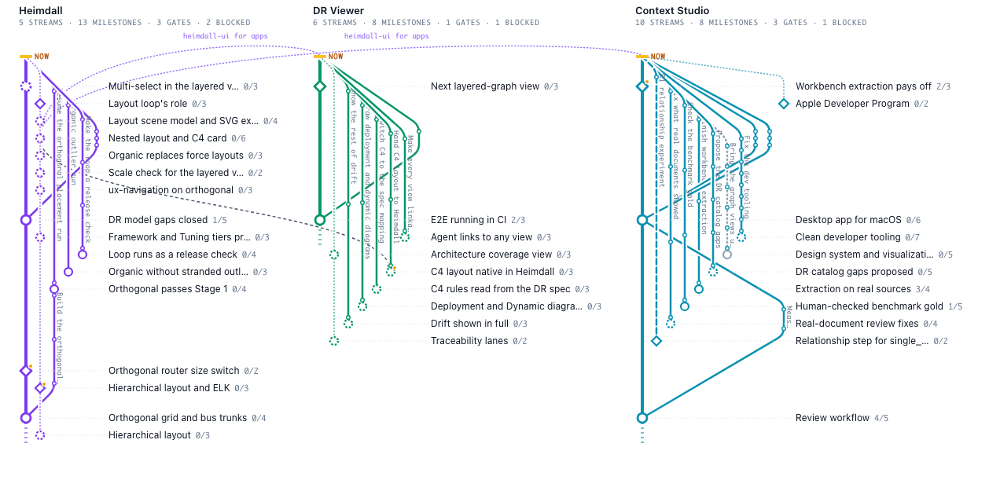
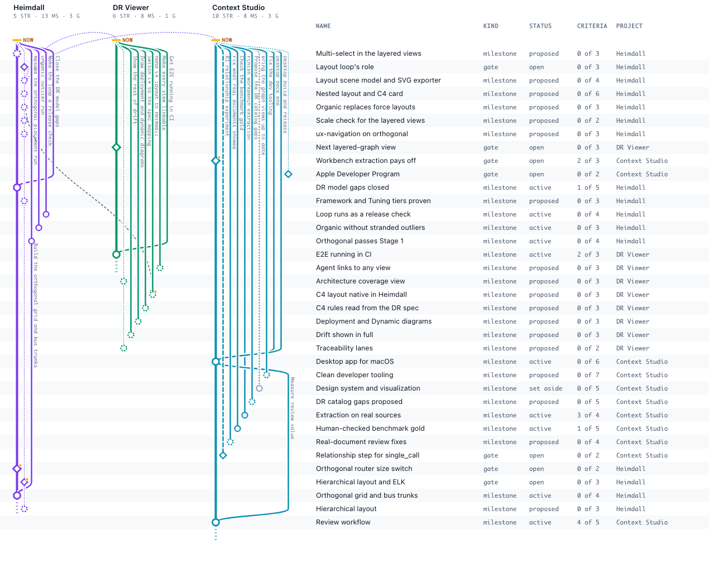
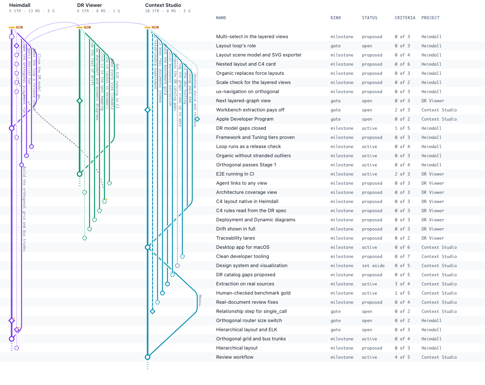
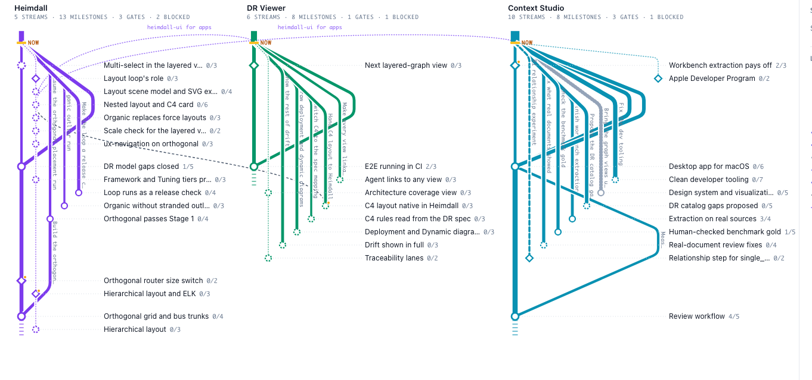
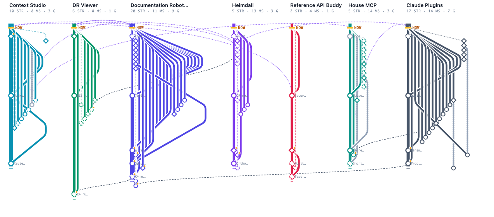
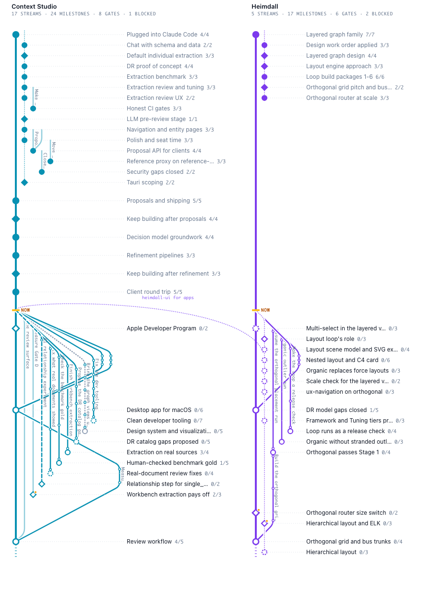

# Branch map: concept designs and proof of concept

Five concepts were drawn on 2026-11-25 and **Metro bands** was chosen (see
[Decisions for the POC](#decisions-for-the-poc)). The proof of concept that builds on it is
described in [The proof of concept](#the-proof-of-concept): a vocabulary-free model, a headless
layout, the `BranchMap` view, and a House adapter that lives in the test pages.

The idea is a vertical map of how a project is organized, read the way you read a git history
graph or a subway map. Each project has a trunk that runs down from **now**. A branch forks off
for each open workstream and runs in parallel to the others. Stations along the lines are gates
and milestones, and ticks along a branch are its tasks. A branch that delivers rejoins the trunk.
A dropped branch stops as a dead end. Where one project waits on another, or provides something
another uses, a link crosses from one project's tree into the other's, so several trees
intertwine.

The concepts run on real data: a snapshot of seven of the tooling projects as they are organized
in House.

```bash
npm run dev
# then open http://localhost:5173/?example=branch-map-concepts
```

URL parameters, for screenshots: `concept=metro|commit-metro|commit|flow|portfolio`, `horizon=forward|all`,
`width=none|streams|tasks`, `tasks=0|1`, `links=0|1`, `projects=heimdall,dr_viewer`,
`select=<ref>` and `dark=1`.

## Prior art

No single known form covers every part of this. It combines three established forms, and the
concepts borrow from each:

- **The metro map metaphor.** Transit-map drawings used for abstract data, project plans
  included. Nesbitt introduced it ("Getting to more Abstract Places using the Metro Map
  Metaphor", IV 2004), and Stott, Rodgers et al. applied it to plans ("Automatic Layout of
  Project Plans Using a Metro Map Metaphor", IV 2005). Layout work on it includes Stott et al.'s
  multicriteria hill climber (TVCG 2011), Nöllenburg & Wolff's octilinear MIP layout and labeling
  (TVCG 2011) and MetroSets (Jacobsen et al., TVCG 2021). In MetroSets, an element shared by two
  sets becomes an interchange, which is close to drawing one project's line into another project's
  station. Miro's "Metro Roadmap" template has the same vocabulary (stations as milestones,
  transfers as dependencies) as a static drawing with no automatic layout. This is probably the
  name to search for.
- **The commit graph.** This is the `git log --graph`, gitk and GitKraken form: one row per
  commit, branches as lanes, merges as joins, abandoned branches as dead ends. Mermaid's
  `gitGraph` has a top-to-bottom orientation, and Plastic SCM's Branch Explorer is a horizontal
  version. Pierre Vigier's ["Commit graph drawing algorithms"](https://pvigier.github.io/2019/05/06/commit-graph-drawing-algorithms.html)
  gives a temporal topological row order and a lane assignment that keeps branches straight and
  reuses freed lanes. The lane step here is a simplified version of it.
- **Storylines and alluvial flows**, for "width is work". Minard's 1812 campaign map is the
  canonical example of a band that thins as it loses volume. ThemeRiver (Havre, Hetzler, Nowell)
  and alluvial diagrams (Rosvall & Bergstrom, 2010) let streams split and merge with width as
  size. Spindle diagrams in palaeontology draw lineages whose width is diversity and that end when
  they go extinct. Storyline layouts (Tanahashi & Ma, InfoVis 2012; StoryFlow, Liu et al. 2013;
  Ogawa & Ma's software evolution storylines, 2010) are the reference for cutting crossings when
  several trees intertwine.

Neither the search nor the tools surveyed turned up one tool that combines several projects, a
width encoding and a "from now on" filter in one branch map.

## The House model behind it

The terms, nodes and edges come from the House ontology. Context Studio's House taxonomy is the
source of truth; the house repo caches it as `ontology/house.bundle.json`, and §3.11 of
`docs/ONTOLOGY.md` covers organizing. The fixture
(`src/test-pages/fixtures/houseOrganizingSnapshot.ts`, typed by `houseOrganizingTypes.ts`) keeps
those names.

| House | On the map |
|---|---|
| `project` | One tree: a column with its own trunk and line colour. Sub-projects (`part_of`) are rolled up into their top-level project. |
| `milestone` (`proposed`, `active`, `reached`, `set_aside`, `dropped`; criteria met of total) | A round station. Reached is filled, proposed has a dashed outline, set aside is grey. |
| `gate` (`open`, `decided`, …; question, decision) | A diamond station. Its `opens` edges are where new branches start. |
| `workstream` (`delivery` or `exploration`; `active`, `set_aside`, `done`, `dropped`) | A branch from where it starts to its `leads_to` destination. Explorations are dashed, set-aside branches are dotted grey, and dropped branches end with a bar. |
| `task` (`in_workstream`; open, in progress, done) | Ticks along the branch. A task in progress is amber. |
| `depends_on` across projects | A dashed arrow from the prerequisite station to the waiting one. |
| `interface` (`provides`, `uses`, `delivers`) | A violet dotted arch from the provider's next delivering milestone to each user's trunk. |
| blocked (derived) | An amber dot on the station, the same rule House uses: it waits on something still open. |

Three things the picture needs are not stored, so the layout derives them:

1. **Where a branch starts.** It starts at the latest of the gates that opened it (`opens`) and
   the stations it waits on (`depends_on`). Failing those, it starts at NOW. Done work with no
   recorded start forks from the trunk station before its destination.
2. **The trunk.** The trunk is the heaviest chain of milestones in rank order. Weight counts the
   workstreams arriving at each milestone and their tasks, with a bonus where consecutive
   milestones are linked by `depends_on`. Gates sit on the trunk when nothing leads to them and
   their row is free.
3. **The vertical axis.** House has no schedule (ONTOLOGY.md: "tasks aren't placed on dates"),
   so below NOW the order is dependency order: the longest path over `depends_on`, `opens` and
   `leads_to`, solved across all visible projects at once so that cross-project links always
   point down. Above NOW (the "Whole history" horizon) the order is by `reached_on` and
   `decided_on`, and closings on the same day are ordered by `follows`.

## What the real data showed

From the 2026-11-25 snapshot of Context Studio, DR, DR Viewer, Heimdall, Reference API Buddy,
House MCP and Claude Plugins (142 milestones, 37 gates, 78 workstreams, 7 interfaces):

- **Interfaces carry the inter-project story, not `depends_on`.** Only 4 `depends_on` links
  cross between these projects, against 7 interfaces with 10 provider-to-user pairs (one of them a
  project that uses its own interface). Drawing only `depends_on` would make the projects look
  nearly independent.
- **One project can need 20 lanes.** Documentation Robotics has 20 active workstreams, so its
  "from now" view is 20 parallel branches. Claude Plugins has 17. The POC needs a way to collapse
  or bundle branches: by destination, by sub-project, or "N more" stubs.
- **Many stations have no workstream.** Proposed milestones and some gates have nothing leading
  to them. Giving each one its own spur from NOW made a fan of dotted lines, so they now sit on a
  single dotted "planned" line per project, in rank order.
- **History dates are coarse.** Most of Heimdall's and DR Viewer's reached milestones share the
  date they were recorded in House: organizing projects shipped 2026-11-24 and roadmaps were
  imported then. The past collapses into one band until real dates build up.
- **Few milestone chains.** Many open milestones have no `depends_on` between them, so the trunk
  heuristic has little to go on and chooses among peers. A stated trunk would be more honest (see
  the decisions below).

## The concepts

All five use the same layout function (`src/test-pages/branchMap/branchMapLayout.ts`) with
different options. The page switches between them, and every option is also a control.

### Metro bands: rank bands, 45° branches, labels beside the line



Stations of the same dependency rank share a band, and each station gets its own sub-row so
labels never stack. Each project has a label column with leader lines. Workstream names run along
their lanes. This reads most like a transit diagram, but the label column makes each project wide,
and lane names get cramped when lanes are 18 px apart.

### Commit graph: one row per station, curved forks, a table for the names



This is the `git log --graph` arrangement. Every station has its own row across all projects, the
graph is compact on the left, and a table on the right carries name, kind, status, criteria and
project. It is the densest and the most legible concept, and it fits the design system's table
idiom. It is also the tallest, and the rows interleave projects, which reads as a timeline more
than a map.

### Commit graph + metro: commit-graph rows and table, metro routing



This has the same rows and table as the commit graph, but branches leave and rejoin at 45° with
rounded corners, as in Metro bands. It is the combination the decisions section below suggests
as a starting point.

### Flow: line width is work



This concept adds Minard-style widths to the metro layout. The rule implemented:

- A trunk starts with everything its project carries: done work (done tasks, or done workstreams
  under `Streams`) plus every branch that forks from it. It is drawn as a short lead-in above NOW.
- A fork takes the branch's weight off the trunk, and a join gives it back. A branch that ends
  off the trunk, or is dropped, never returns its weight, so the trunk is thinner after it.
- Width is the square root of weight, so a 30-task stream does not swamp the drawing, and branches
  share the trunk's scale, capped below the lane spacing.

What it shows: near NOW the trunk is thin, because most work is out on branches, and it thickens
at milestones where streams land (Context Studio's "Review workflow", Heimdall's "DR model gaps
closed"). The `Tasks` weighting is the more truthful one, but House tasks vary a lot in size, and
`Streams` is steadier.

### Portfolio: every project at once



This is the same layout, compressed: 9 px lanes, labels only on trunk milestones, and `Streams`
widths. It is the view for "how do these projects intertwine". Interface arches and
cross-project waits are the subject, and individual names are left to hover and the inspector.

### Whole history



The "Whole history" horizon puts closed work above NOW in date order and open work below it.
Context Studio shows the intended effect: a long dated trunk of reached milestones and decided
gates, then the open branches.

## Decisions for the POC

1. **Row model. Decided 2026-11-25: rank bands (Metro bands).** Stations of one dependency rank
   share a band, each with its own sub-row, and labels sit in a column beside each project.
   Bands show parallel work and keep the map short. Set aside: one row per station with a table
   (Commit graph, Commit graph + metro), which removes label collisions but is taller and reads
   as a list.
2. **Geometry. Decided 2026-11-25 with the row model: 45° octilinear with rounded corners.**
   Set aside: S-curves (git).
3. **Width. Default chosen for the POC: off**, with `width: 'weight'` as an option. With weight
   on, width is the square root of weight; a fork takes a line's weight off the trunk and a join
   gives it back, and a dead end never returns it, so the trunk is visibly thinner after one. The
   House adapter weighs a workstream as 1 (`Streams`, the steadier choice) or by its open and
   done tasks (`Tasks`).
4. **The trunk. Default chosen for the POC: derived unless stated.** A group may state its trunk
   (`group.trunk`, station ids); otherwise the layout takes the heaviest chain of stops. The House
   adapter states none yet, since House has no field for it.
5. **Scale. Default chosen for the POC: a lane budget.** A group draws at most `maxLanes` (8)
   branch lanes. Past it, lines with the same fork and destination bundle into one line with a
   count, then the lightest lines left collapse into one "N more" line. A bundle or a whole group
   can be expanded.
6. **Where it lives. Default chosen for the POC: a standalone `BranchMap` view**, with pan and
   zoom from `usePanZoom` and controlled selection, rather than a `GraphCanvas` layout mode.
   Heimdall stays ignorant of House: the adapter is in the test pages.

Decisions 3 to 6 are defaults for the POC, to be confirmed once it runs on real data. The two
weaknesses Metro bands showed in the concepts (a wide label column, cramped names along 18 px
lanes) are addressed in the POC by placing labels beside their own stations and running line
names horizontally at the fork.

## The proof of concept

The POC is planned in the DR changeset `branch-map-poc` and tracked in the House milestone
"Branch map POC" (GitHub milestone "Branch map POC", issues #411 to #414). It has four parts:

- **The model** (`src/utils/branchMap/types.ts`): groups, stations (`stop` or `decision`, with a
  status, an optional date, `after`, progress and blocked), lines (from a station or the start
  marker to a station or an open end, with status, style, weight and marks) and links
  (`dependency`, `provides`). It knows nothing of House.
- **The layout** (`src/utils/branchMap/`): `layoutBranchMap` places stations in rank bands, picks
  the trunk, bundles lines past the lane budget, assigns lanes and places labels; `routeBranchMap`
  draws lines, trunks and links from the placement alone. Both are pure and headless.
- **The view** (`src/components/BranchMap.tsx`): draws the scene in SVG with `--graph-layer-*`
  colours, with selection, keyboard focus, hover, pan and zoom, and expandable bundles.
- **The House adapter** (`src/test-pages/branchMap/houseBranchMapAdapter.ts`):
  `houseToBranchMap(snapshot, { projects, horizon, widthBy })` maps the snapshot onto the model.

```bash
npm run dev
# then open http://localhost:5173/?example=branch-map
```

URL parameters: `projects=heimdall,dr_viewer`, `horizon=forward|all`,
`width=off|streams|tasks`, `expand=<group or bundle ids>`, `select=<id>` and `dark=1`. The page
has project toggles, horizon, width and canvas controls, an inspector that shows the House
record behind a selection, and a legend. The docs app has a `BranchMap` page on the
vocabulary-free sample (`src/test-pages/fixtures/branchMapSample.ts`).

How the adapter maps House:

| House | Branch map |
|---|---|
| project | group, with a fixed palette colour per project |
| milestone | `stop`: proposed → planned, active → active, reached → done, set_aside → set-aside, dropped → dropped |
| gate | `decision`: open → active, decided → done, set_aside → set-aside, dropped → dropped |
| reached_on, decided_on | the station's `date` (whole history only) |
| `depends_on` and `opens`, within a project | the station's `after` |
| workstream | a line to its `leads_to`, from the latest station in its project that opened it or that it waits on, else from the start marker. Explorations are dashed, set-aside workstreams dotted (set aside wins). Open tasks are marks, in progress emphasized. |
| `depends_on` across projects | a `dependency` link from the station waited on; a workstream's wait lands on its destination |
| interface | a `provides` link from the provider's next open milestone that delivers it, else its start marker, to each other project that uses it |
| blocked | an open station that waits on a milestone or gate still open (in any project, shown or not) or on a task |

Known limits of the POC:

- House stores no start for a workstream, so a line's start is derived. Closed work with no
  recorded start forks from the start marker.
- A workstream waiting on another project is drawn as a dependency into the station it
  delivers to, since a line is not a link endpoint.
- A project that uses its own interface (Documentation Robotics' "Post-extraction review") draws
  no link.
- The House data is a fixture taken on 2026-11-25, not read live.

## Files

The concepts:

- `src/test-pages/branchMap/branchMapLayout.ts`: the concept layout. It is a pure function from the
  snapshot and options to a scene of stations, lines (paths, run, width per trunk segment) and
  links. Its stages are filter, rank, trunk, branches, rows, lanes, routes, widths and links.
  Rounded octilinear routes reuse `polylineCurve` from `src/utils/laneLayout.ts`.
- `src/test-pages/branchMap/BranchMapConceptsPage.tsx` and `.css`: the concept page, with the
  controls, an SVG renderer, the inspector and the legend. Colours come from `--graph-layer-*`,
  status and accent tokens.
- `src/test-pages/fixtures/houseOrganizingSnapshot.ts`: the data. It was generated from House
  `list_nodes` (milestone, gate, workstream, interface, with `include_closed`) on 2026-11-25.
  Definitions, readings and links are left out, and only edges between kept nodes are kept.

The proof of concept:

- `src/utils/branchMap/`: the model, layout and routing (exported from the package).
- `src/components/BranchMap.tsx` and `.css`: the view.
- `src/test-pages/branchMap/houseBranchMapAdapter.ts`: House to the model, with its unit test.
- `src/test-pages/branchMap/BranchMapTestPage.tsx` and `.css`: the test page (`?example=branch-map`).
- `tests/branch-map.spec.ts`: selection, keyboard, expanding bundles and visual baselines.
- `docs/src/showcases/BranchMapShowcase.tsx`: the docs page, on the vocabulary-free sample.
