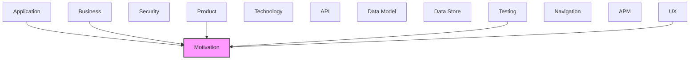

# Motivation

[← Back to README](../README.md)

Goals, requirements, drivers, and strategic outcomes of the architecture.

## Report Index

- [Layer Introduction](#layer-introduction)
- [Intra-Layer Relationships](#intra-layer-relationships)
- [Inter-Layer Dependencies](#inter-layer-dependencies)
- [Inter-Layer Relationships Table](#inter-layer-relationships-table)
- [Element Reference](#element-reference)

## Layer Introduction

| Metric                    | Count |
| ------------------------- | ----- |
| Elements                  | 19    |
| Intra-Layer Relationships | 21    |
| Inter-Layer Relationships | 172   |
| Inbound Relationships     | 172   |
| Outbound Relationships    | 0     |

**Cross-Layer References**:

- **Upstream layers**: [Application](./05-application-layer-report.md), [Business](./02-business-layer-report.md), [Product](./03-product-layer-report.md), [Testing](./13-testing-layer-report.md), [UX](./10-ux-layer-report.md)

## Intra-Layer Relationships

```mermaid
flowchart LR
  subgraph motivation
    motivation_driver_external_regression_gated_layout_quality_loop["External Regression-Gated Layout Quality Loop"]
    motivation_goal_consistent_component_library_for_data_dense_ide_style_applications["Consistent Component Library for Data-Dense IDE-Style Applications"]
    motivation_goal_layout_algorithms_that_scale_to_large_dense_and_pathological_graphs["Layout Algorithms That Scale to Large, Dense, and Pathological Graphs"]
    motivation_goal_readable_layout_for_structurally_complex_graphs["Readable Layout for Structurally Complex Graphs"]
    motivation_principle_deterministic_reproducible_layout_output["Deterministic, Reproducible Layout Output"]
    motivation_principle_every_component_color_comes_from_a_token["Every Component Color Comes From a Token"]
    motivation_principle_ide_density_and_terse_voice["IDE Density and Terse Voice"]
    motivation_principle_two_surface_shell_and_canvas["Two-Surface Shell and Canvas"]
    motivation_principle_zero_literal_node_overlap_guarantee["Zero Literal Node-Overlap Guarantee"]
    motivation_requirement_a_mirror_can_restyle_the_library_from_one_file["A Mirror Can Restyle the Library From One File"]
    motivation_requirement_consumers_bundle_only_the_components_they_import["Consumers Bundle Only the Components They Import"]
    motivation_requirement_every_public_export_is_documented_for_agents["Every Public Export Is Documented for Agents"]
    motivation_requirement_layout_engines_must_be_pluggable_without_breaking_existing_callers["Layout Engines Must Be Pluggable Without Breaking Existing Callers"]
    motivation_requirement_server_rendered_output_hydrates_without_mismatch["Server-Rendered Output Hydrates Without Mismatch"]
    motivation_requirement_upstream_publishing_workflows_are_inert_in_a_mirror["Upstream Publishing Workflows Are Inert in a Mirror"]
    motivation_stakeholder_embedding_application_developer_npm_consumer["Embedding Application Developer (npm consumer)"]
    motivation_stakeholder_end_user_of_an_embedding_application["End User of an Embedding Application"]
    motivation_stakeholder_heimdall_layout_loop_quality_harness["heimdall-layout-loop Quality Harness"]
    motivation_stakeholder_mirror_maintainer["Mirror Maintainer"]
    motivation_driver_external_regression_gated_layout_quality_loop -->|influence| motivation_goal_layout_algorithms_that_scale_to_large_dense_and_pathological_graphs
    motivation_driver_external_regression_gated_layout_quality_loop -->|influence| motivation_goal_readable_layout_for_structurally_complex_graphs
    motivation_driver_external_regression_gated_layout_quality_loop -->|influence| motivation_requirement_layout_engines_must_be_pluggable_without_breaking_existing_callers
    motivation_principle_deterministic_reproducible_layout_output -->|influence| motivation_goal_layout_algorithms_that_scale_to_large_dense_and_pathological_graphs
    motivation_principle_ide_density_and_terse_voice -->|influence| motivation_goal_consistent_component_library_for_data_dense_ide_style_applications
    motivation_principle_two_surface_shell_and_canvas -->|influence| motivation_goal_consistent_component_library_for_data_dense_ide_style_applications
    motivation_principle_zero_literal_node_overlap_guarantee -->|influence| motivation_goal_readable_layout_for_structurally_complex_graphs
    motivation_requirement_a_mirror_can_restyle_the_library_from_one_file -->|realizes| motivation_goal_consistent_component_library_for_data_dense_ide_style_applications
    motivation_requirement_a_mirror_can_restyle_the_library_from_one_file -->|realizes| motivation_principle_every_component_color_comes_from_a_token
    motivation_requirement_consumers_bundle_only_the_components_they_import -->|realizes| motivation_goal_consistent_component_library_for_data_dense_ide_style_applications
    motivation_requirement_every_public_export_is_documented_for_agents -->|realizes| motivation_goal_consistent_component_library_for_data_dense_ide_style_applications
    motivation_requirement_server_rendered_output_hydrates_without_mismatch -->|realizes| motivation_goal_consistent_component_library_for_data_dense_ide_style_applications
    motivation_requirement_upstream_publishing_workflows_are_inert_in_a_mirror -->|realizes| motivation_goal_consistent_component_library_for_data_dense_ide_style_applications
    motivation_stakeholder_embedding_application_developer_npm_consumer -->|associated-with| motivation_requirement_consumers_bundle_only_the_components_they_import
    motivation_stakeholder_embedding_application_developer_npm_consumer -->|associated-with| motivation_requirement_layout_engines_must_be_pluggable_without_breaking_existing_callers
    motivation_stakeholder_embedding_application_developer_npm_consumer -->|associated-with| motivation_requirement_server_rendered_output_hydrates_without_mismatch
    motivation_stakeholder_embedding_application_developer_npm_consumer -->|influence| motivation_goal_consistent_component_library_for_data_dense_ide_style_applications
    motivation_stakeholder_heimdall_layout_loop_quality_harness -->|associated-with| motivation_driver_external_regression_gated_layout_quality_loop
    motivation_stakeholder_mirror_maintainer -->|associated-with| motivation_principle_every_component_color_comes_from_a_token
    motivation_stakeholder_mirror_maintainer -->|associated-with| motivation_requirement_a_mirror_can_restyle_the_library_from_one_file
    motivation_stakeholder_mirror_maintainer -->|associated-with| motivation_requirement_upstream_publishing_workflows_are_inert_in_a_mirror
  end
```

## Inter-Layer Dependencies

## Inter-Layer Relationships Table

| Relationship ID                                                    | Source Node                                                              | Dest Node                                                                                   | Dest Layer   | Predicate    | Cardinality  | Strength |
| ------------------------------------------------------------------ | ------------------------------------------------------------------------ | ------------------------------------------------------------------------------------------- | ------------ | ------------ | ------------ | -------- |
| `application.applicationfunction.satisfies.motivation.requirement` | `application.applicationfunction.clustered-force-layout-algorithm`       | `motivation.requirement.layout-engines-must-be-pluggable-without-breaking-existing-callers` | `motivation` | `satisfies`  | many-to-many | medium   |
| `application.applicationfunction.satisfies.motivation.requirement` | `application.applicationfunction.fixed-clock-date-formatting`            | `motivation.requirement.server-rendered-output-hydrates-without-mismatch`                   | `motivation` | `satisfies`  | many-to-many | medium   |
| `application.applicationfunction.satisfies.motivation.requirement` | `application.applicationfunction.force-directed-layout-algorithm`        | `motivation.requirement.layout-engines-must-be-pluggable-without-breaking-existing-callers` | `motivation` | `satisfies`  | many-to-many | medium   |
| `application.applicationfunction.satisfies.motivation.requirement` | `application.applicationfunction.ssr-safe-media-query`                   | `motivation.requirement.server-rendered-output-hydrates-without-mismatch`                   | `motivation` | `satisfies`  | many-to-many | medium   |
| `business.businessactor.references.motivation.stakeholder`         | `business.businessactor.embedding-application-developer`                 | `motivation.stakeholder.embedding-application-developer-npm-consumer`                       | `motivation` | `references` | many-to-many | medium   |
| `business.businessactor.references.motivation.stakeholder`         | `business.businessactor.end-user-exploring-a-graph-view`                 | `motivation.stakeholder.end-user-of-an-embedding-application`                               | `motivation` | `references` | many-to-many | medium   |
| `product.feature.satisfies.motivation.requirement`                 | `product.feature.per-component-imports`                                  | `motivation.requirement.consumers-bundle-only-the-components-they-import`                   | `motivation` | `satisfies`  | many-to-many | medium   |
| `product.feature.satisfies.motivation.requirement`                 | `product.feature.server-side-rendering-support`                          | `motivation.requirement.server-rendered-output-hydrates-without-mismatch`                   | `motivation` | `satisfies`  | many-to-many | medium   |
| `product.feature.satisfies.motivation.requirement`                 | `product.feature.theme-slot`                                             | `motivation.requirement.a-mirror-can-restyle-the-library-from-one-file`                     | `motivation` | `satisfies`  | many-to-many | medium   |
| `product.feature.satisfies.motivation.requirement`                 | `product.feature.theme-slot`                                             | `motivation.requirement.upstream-publishing-workflows-are-inert-in-a-mirror`                | `motivation` | `satisfies`  | many-to-many | medium   |
| `product.persona.references.motivation.stakeholder`                | `product.persona.application-developer-embedding-a-graph-view`           | `motivation.stakeholder.embedding-application-developer-npm-consumer`                       | `motivation` | `references` | many-to-many | medium   |
| `product.persona.references.motivation.stakeholder`                | `product.persona.end-user-exploring-a-rendered-graph`                    | `motivation.stakeholder.end-user-of-an-embedding-application`                               | `motivation` | `references` | many-to-many | medium   |
| `product.persona.references.motivation.stakeholder`                | `product.persona.mirror-maintainer-restyling-the-library`                | `motivation.stakeholder.mirror-maintainer`                                                  | `motivation` | `references` | many-to-many | medium   |
| `product.softwarecapability.supports.motivation.goal`              | `product.softwarecapability.chat-interface`                              | `motivation.goal.consistent-component-library-for-data-dense-ide-style-applications`        | `motivation` | `supports`   | many-to-many | medium   |
| `product.softwarecapability.supports.motivation.goal`              | `product.softwarecapability.clustered-force-layout-community-bubbles`    | `motivation.goal.layout-algorithms-that-scale-to-large-dense-and-pathological-graphs`       | `motivation` | `supports`   | many-to-many | medium   |
| `product.softwarecapability.supports.motivation.goal`              | `product.softwarecapability.data-display-and-charts`                     | `motivation.goal.consistent-component-library-for-data-dense-ide-style-applications`        | `motivation` | `supports`   | many-to-many | medium   |
| `product.softwarecapability.satisfies.motivation.requirement`      | `product.softwarecapability.design-primitives-and-tokens`                | `motivation.requirement.a-mirror-can-restyle-the-library-from-one-file`                     | `motivation` | `satisfies`  | many-to-many | medium   |
| `product.softwarecapability.supports.motivation.goal`              | `product.softwarecapability.design-primitives-and-tokens`                | `motivation.goal.consistent-component-library-for-data-dense-ide-style-applications`        | `motivation` | `supports`   | many-to-many | medium   |
| `product.softwarecapability.supports.motivation.goal`              | `product.softwarecapability.force-directed-graph-layout`                 | `motivation.goal.readable-layout-for-structurally-complex-graphs`                           | `motivation` | `supports`   | many-to-many | medium   |
| `product.softwarecapability.supports.motivation.goal`              | `product.softwarecapability.form-inputs-and-editors`                     | `motivation.goal.consistent-component-library-for-data-dense-ide-style-applications`        | `motivation` | `supports`   | many-to-many | medium   |
| `product.softwarecapability.supports.motivation.goal`              | `product.softwarecapability.galaxy-radial-orbit-layout`                  | `motivation.goal.readable-layout-for-structurally-complex-graphs`                           | `motivation` | `supports`   | many-to-many | medium   |
| `product.softwarecapability.supports.motivation.goal`              | `product.softwarecapability.ide-application-shell-and-navigation`        | `motivation.goal.consistent-component-library-for-data-dense-ide-style-applications`        | `motivation` | `supports`   | many-to-many | medium   |
| `product.softwarecapability.supports.motivation.goal`              | `product.softwarecapability.layered-graph-exploration`                   | `motivation.goal.layout-algorithms-that-scale-to-large-dense-and-pathological-graphs`       | `motivation` | `supports`   | many-to-many | medium   |
| `product.softwarecapability.supports.motivation.goal`              | `product.softwarecapability.observability-views`                         | `motivation.goal.consistent-component-library-for-data-dense-ide-style-applications`        | `motivation` | `supports`   | many-to-many | medium   |
| `product.softwarecapability.supports.motivation.goal`              | `product.softwarecapability.organic-graph-layout`                        | `motivation.goal.readable-layout-for-structurally-complex-graphs`                           | `motivation` | `supports`   | many-to-many | medium   |
| `product.softwarecapability.supports.motivation.goal`              | `product.softwarecapability.orthogonal-graph-layout`                     | `motivation.goal.readable-layout-for-structurally-complex-graphs`                           | `motivation` | `supports`   | many-to-many | medium   |
| `product.softwarecapability.supports.motivation.goal`              | `product.softwarecapability.overlays-and-dialogs`                        | `motivation.goal.consistent-component-library-for-data-dense-ide-style-applications`        | `motivation` | `supports`   | many-to-many | medium   |
| `product.softwarecapability.supports.motivation.goal`              | `product.softwarecapability.page-patterns`                               | `motivation.goal.consistent-component-library-for-data-dense-ide-style-applications`        | `motivation` | `supports`   | many-to-many | medium   |
| `product.softwarecapability.supports.motivation.goal`              | `product.softwarecapability.planning-views`                              | `motivation.goal.consistent-component-library-for-data-dense-ide-style-applications`        | `motivation` | `supports`   | many-to-many | medium   |
| `product.softwarecapability.supports.motivation.goal`              | `product.softwarecapability.radial-tree-layout`                          | `motivation.goal.readable-layout-for-structurally-complex-graphs`                           | `motivation` | `supports`   | many-to-many | medium   |
| `product.softwarecapability.supports.motivation.goal`              | `product.softwarecapability.ux-navigation-tree-layout`                   | `motivation.goal.readable-layout-for-structurally-complex-graphs`                           | `motivation` | `supports`   | many-to-many | medium   |
| `testing.testcasesketch.satisfies.motivation.requirement`          | `testing.testcasesketch.chart-fills-resolve-from-tokens`                 | `motivation.requirement.a-mirror-can-restyle-the-library-from-one-file`                     | `motivation` | `satisfies`  | many-to-many | high     |
| `testing.testcasesketch.satisfies.motivation.requirement`          | `testing.testcasesketch.color-literal-check-rejects-a-component-literal` | `motivation.requirement.a-mirror-can-restyle-the-library-from-one-file`                     | `motivation` | `satisfies`  | many-to-many | high     |
| `testing.testcasesketch.satisfies.motivation.requirement`          | `testing.testcasesketch.theme-override-ships-after-the-tokens`           | `motivation.requirement.a-mirror-can-restyle-the-library-from-one-file`                     | `motivation` | `satisfies`  | many-to-many | high     |
| `ux.librarycomponent.satisfies.motivation.principle`               | `ux.librarycomponent.activity-timeline`                                  | `motivation.principle.two-surface-shell-and-canvas`                                         | `motivation` | `satisfies`  | many-to-many | medium   |
| `ux.librarycomponent.satisfies.motivation.requirement`             | `ux.librarycomponent.activity-timeline`                                  | `motivation.requirement.server-rendered-output-hydrates-without-mismatch`                   | `motivation` | `satisfies`  | many-to-many | medium   |
| `ux.librarycomponent.satisfies.motivation.principle`               | `ux.librarycomponent.adjacency-matrix`                                   | `motivation.principle.two-surface-shell-and-canvas`                                         | `motivation` | `satisfies`  | many-to-many | medium   |
| `ux.librarycomponent.satisfies.motivation.principle`               | `ux.librarycomponent.alert-strip`                                        | `motivation.principle.two-surface-shell-and-canvas`                                         | `motivation` | `satisfies`  | many-to-many | medium   |
| `ux.librarycomponent.satisfies.motivation.principle`               | `ux.librarycomponent.app-title`                                          | `motivation.principle.every-component-color-comes-from-a-token`                             | `motivation` | `satisfies`  | many-to-many | medium   |
| `ux.librarycomponent.satisfies.motivation.principle`               | `ux.librarycomponent.app-title`                                          | `motivation.principle.two-surface-shell-and-canvas`                                         | `motivation` | `satisfies`  | many-to-many | medium   |
| `ux.librarycomponent.satisfies.motivation.principle`               | `ux.librarycomponent.asset-card`                                         | `motivation.principle.two-surface-shell-and-canvas`                                         | `motivation` | `satisfies`  | many-to-many | medium   |
| `ux.librarycomponent.satisfies.motivation.principle`               | `ux.librarycomponent.asset-grid`                                         | `motivation.principle.two-surface-shell-and-canvas`                                         | `motivation` | `satisfies`  | many-to-many | medium   |
| `ux.librarycomponent.satisfies.motivation.principle`               | `ux.librarycomponent.avatar`                                             | `motivation.principle.two-surface-shell-and-canvas`                                         | `motivation` | `satisfies`  | many-to-many | medium   |
| `ux.librarycomponent.satisfies.motivation.principle`               | `ux.librarycomponent.badge`                                              | `motivation.principle.two-surface-shell-and-canvas`                                         | `motivation` | `satisfies`  | many-to-many | medium   |
| `ux.librarycomponent.satisfies.motivation.principle`               | `ux.librarycomponent.bar-chart`                                          | `motivation.principle.every-component-color-comes-from-a-token`                             | `motivation` | `satisfies`  | many-to-many | medium   |
| `ux.librarycomponent.satisfies.motivation.principle`               | `ux.librarycomponent.bar-chart`                                          | `motivation.principle.two-surface-shell-and-canvas`                                         | `motivation` | `satisfies`  | many-to-many | medium   |
| `ux.librarycomponent.satisfies.motivation.principle`               | `ux.librarycomponent.bar-h`                                              | `motivation.principle.every-component-color-comes-from-a-token`                             | `motivation` | `satisfies`  | many-to-many | medium   |
| `ux.librarycomponent.satisfies.motivation.principle`               | `ux.librarycomponent.bar-h`                                              | `motivation.principle.two-surface-shell-and-canvas`                                         | `motivation` | `satisfies`  | many-to-many | medium   |
| `ux.librarycomponent.satisfies.motivation.principle`               | `ux.librarycomponent.bar-v`                                              | `motivation.principle.two-surface-shell-and-canvas`                                         | `motivation` | `satisfies`  | many-to-many | medium   |
| `ux.librarycomponent.satisfies.motivation.principle`               | `ux.librarycomponent.bridge-node-list`                                   | `motivation.principle.two-surface-shell-and-canvas`                                         | `motivation` | `satisfies`  | many-to-many | medium   |
| `ux.librarycomponent.satisfies.motivation.principle`               | `ux.librarycomponent.button`                                             | `motivation.principle.two-surface-shell-and-canvas`                                         | `motivation` | `satisfies`  | many-to-many | medium   |
| `ux.librarycomponent.satisfies.motivation.principle`               | `ux.librarycomponent.calendar`                                           | `motivation.principle.two-surface-shell-and-canvas`                                         | `motivation` | `satisfies`  | many-to-many | medium   |
| `ux.librarycomponent.satisfies.motivation.requirement`             | `ux.librarycomponent.calendar`                                           | `motivation.requirement.server-rendered-output-hydrates-without-mismatch`                   | `motivation` | `satisfies`  | many-to-many | medium   |
| `ux.librarycomponent.satisfies.motivation.principle`               | `ux.librarycomponent.camera-controls`                                    | `motivation.principle.two-surface-shell-and-canvas`                                         | `motivation` | `satisfies`  | many-to-many | medium   |
| `ux.librarycomponent.satisfies.motivation.principle`               | `ux.librarycomponent.chart-wrapper`                                      | `motivation.principle.two-surface-shell-and-canvas`                                         | `motivation` | `satisfies`  | many-to-many | medium   |
| `ux.librarycomponent.satisfies.motivation.principle`               | `ux.librarycomponent.chat-composer`                                      | `motivation.principle.every-component-color-comes-from-a-token`                             | `motivation` | `satisfies`  | many-to-many | medium   |
| `ux.librarycomponent.satisfies.motivation.principle`               | `ux.librarycomponent.chat-composer`                                      | `motivation.principle.two-surface-shell-and-canvas`                                         | `motivation` | `satisfies`  | many-to-many | medium   |
| `ux.librarycomponent.satisfies.motivation.principle`               | `ux.librarycomponent.chat-container`                                     | `motivation.principle.every-component-color-comes-from-a-token`                             | `motivation` | `satisfies`  | many-to-many | medium   |
| `ux.librarycomponent.satisfies.motivation.principle`               | `ux.librarycomponent.chat-container`                                     | `motivation.principle.two-surface-shell-and-canvas`                                         | `motivation` | `satisfies`  | many-to-many | medium   |
| `ux.librarycomponent.satisfies.motivation.principle`               | `ux.librarycomponent.chat-divider`                                       | `motivation.principle.every-component-color-comes-from-a-token`                             | `motivation` | `satisfies`  | many-to-many | medium   |
| `ux.librarycomponent.satisfies.motivation.principle`               | `ux.librarycomponent.chat-divider`                                       | `motivation.principle.two-surface-shell-and-canvas`                                         | `motivation` | `satisfies`  | many-to-many | medium   |
| `ux.librarycomponent.satisfies.motivation.principle`               | `ux.librarycomponent.chat-markdown-content`                              | `motivation.principle.two-surface-shell-and-canvas`                                         | `motivation` | `satisfies`  | many-to-many | medium   |
| `ux.librarycomponent.satisfies.motivation.principle`               | `ux.librarycomponent.chat-message`                                       | `motivation.principle.every-component-color-comes-from-a-token`                             | `motivation` | `satisfies`  | many-to-many | medium   |
| `ux.librarycomponent.satisfies.motivation.principle`               | `ux.librarycomponent.chat-message`                                       | `motivation.principle.two-surface-shell-and-canvas`                                         | `motivation` | `satisfies`  | many-to-many | medium   |
| `ux.librarycomponent.satisfies.motivation.principle`               | `ux.librarycomponent.chat-suggestions`                                   | `motivation.principle.every-component-color-comes-from-a-token`                             | `motivation` | `satisfies`  | many-to-many | medium   |
| `ux.librarycomponent.satisfies.motivation.principle`               | `ux.librarycomponent.chat-suggestions`                                   | `motivation.principle.two-surface-shell-and-canvas`                                         | `motivation` | `satisfies`  | many-to-many | medium   |
| `ux.librarycomponent.satisfies.motivation.principle`               | `ux.librarycomponent.chip`                                               | `motivation.principle.two-surface-shell-and-canvas`                                         | `motivation` | `satisfies`  | many-to-many | medium   |
| `ux.librarycomponent.satisfies.motivation.principle`               | `ux.librarycomponent.command-palette`                                    | `motivation.principle.two-surface-shell-and-canvas`                                         | `motivation` | `satisfies`  | many-to-many | medium   |
| `ux.librarycomponent.satisfies.motivation.principle`               | `ux.librarycomponent.config-tile`                                        | `motivation.principle.two-surface-shell-and-canvas`                                         | `motivation` | `satisfies`  | many-to-many | medium   |
| `ux.librarycomponent.satisfies.motivation.principle`               | `ux.librarycomponent.confirm-dialog`                                     | `motivation.principle.two-surface-shell-and-canvas`                                         | `motivation` | `satisfies`  | many-to-many | medium   |
| `ux.librarycomponent.satisfies.motivation.principle`               | `ux.librarycomponent.detail-drawer`                                      | `motivation.principle.two-surface-shell-and-canvas`                                         | `motivation` | `satisfies`  | many-to-many | medium   |
| `ux.librarycomponent.satisfies.motivation.principle`               | `ux.librarycomponent.diff-viewer`                                        | `motivation.principle.every-component-color-comes-from-a-token`                             | `motivation` | `satisfies`  | many-to-many | medium   |
| `ux.librarycomponent.satisfies.motivation.principle`               | `ux.librarycomponent.diff-viewer`                                        | `motivation.principle.two-surface-shell-and-canvas`                                         | `motivation` | `satisfies`  | many-to-many | medium   |
| `ux.librarycomponent.satisfies.motivation.principle`               | `ux.librarycomponent.donut`                                              | `motivation.principle.every-component-color-comes-from-a-token`                             | `motivation` | `satisfies`  | many-to-many | medium   |
| `ux.librarycomponent.satisfies.motivation.principle`               | `ux.librarycomponent.donut`                                              | `motivation.principle.two-surface-shell-and-canvas`                                         | `motivation` | `satisfies`  | many-to-many | medium   |
| `ux.librarycomponent.satisfies.motivation.principle`               | `ux.librarycomponent.drawer`                                             | `motivation.principle.two-surface-shell-and-canvas`                                         | `motivation` | `satisfies`  | many-to-many | medium   |
| `ux.librarycomponent.satisfies.motivation.principle`               | `ux.librarycomponent.entity-picker`                                      | `motivation.principle.two-surface-shell-and-canvas`                                         | `motivation` | `satisfies`  | many-to-many | medium   |
| `ux.librarycomponent.satisfies.motivation.principle`               | `ux.librarycomponent.field`                                              | `motivation.principle.two-surface-shell-and-canvas`                                         | `motivation` | `satisfies`  | many-to-many | medium   |
| `ux.librarycomponent.satisfies.motivation.principle`               | `ux.librarycomponent.filter-bar`                                         | `motivation.principle.two-surface-shell-and-canvas`                                         | `motivation` | `satisfies`  | many-to-many | medium   |
| `ux.librarycomponent.satisfies.motivation.principle`               | `ux.librarycomponent.filter-dropdown`                                    | `motivation.principle.two-surface-shell-and-canvas`                                         | `motivation` | `satisfies`  | many-to-many | medium   |
| `ux.librarycomponent.satisfies.motivation.principle`               | `ux.librarycomponent.follow-control`                                     | `motivation.principle.two-surface-shell-and-canvas`                                         | `motivation` | `satisfies`  | many-to-many | medium   |
| `ux.librarycomponent.satisfies.motivation.principle`               | `ux.librarycomponent.form-callout`                                       | `motivation.principle.two-surface-shell-and-canvas`                                         | `motivation` | `satisfies`  | many-to-many | medium   |
| `ux.librarycomponent.satisfies.motivation.principle`               | `ux.librarycomponent.graph-canvas-ux`                                    | `motivation.principle.two-surface-shell-and-canvas`                                         | `motivation` | `satisfies`  | many-to-many | medium   |
| `ux.librarycomponent.satisfies.motivation.principle`               | `ux.librarycomponent.graph-collapse-control-ux`                          | `motivation.principle.two-surface-shell-and-canvas`                                         | `motivation` | `satisfies`  | many-to-many | medium   |
| `ux.librarycomponent.satisfies.motivation.principle`               | `ux.librarycomponent.graph-edgegraph-edge-shape-ux`                      | `motivation.principle.two-surface-shell-and-canvas`                                         | `motivation` | `satisfies`  | many-to-many | medium   |
| `ux.librarycomponent.satisfies.motivation.principle`               | `ux.librarycomponent.graph-inspector-graph-edge-inspector-ux`            | `motivation.principle.two-surface-shell-and-canvas`                                         | `motivation` | `satisfies`  | many-to-many | medium   |
| `ux.librarycomponent.satisfies.motivation.principle`               | `ux.librarycomponent.graph-node-ux`                                      | `motivation.principle.every-component-color-comes-from-a-token`                             | `motivation` | `satisfies`  | many-to-many | medium   |
| `ux.librarycomponent.satisfies.motivation.principle`               | `ux.librarycomponent.graph-node-ux`                                      | `motivation.principle.two-surface-shell-and-canvas`                                         | `motivation` | `satisfies`  | many-to-many | medium   |
| `ux.librarycomponent.satisfies.motivation.principle`               | `ux.librarycomponent.graph-toolbar-ux`                                   | `motivation.principle.two-surface-shell-and-canvas`                                         | `motivation` | `satisfies`  | many-to-many | medium   |
| `ux.librarycomponent.satisfies.motivation.principle`               | `ux.librarycomponent.hash-set-diff`                                      | `motivation.principle.two-surface-shell-and-canvas`                                         | `motivation` | `satisfies`  | many-to-many | medium   |
| `ux.librarycomponent.satisfies.motivation.principle`               | `ux.librarycomponent.heatmap`                                            | `motivation.principle.every-component-color-comes-from-a-token`                             | `motivation` | `satisfies`  | many-to-many | medium   |
| `ux.librarycomponent.satisfies.motivation.principle`               | `ux.librarycomponent.heatmap`                                            | `motivation.principle.two-surface-shell-and-canvas`                                         | `motivation` | `satisfies`  | many-to-many | medium   |
| `ux.librarycomponent.satisfies.motivation.principle`               | `ux.librarycomponent.hierarchy-row`                                      | `motivation.principle.two-surface-shell-and-canvas`                                         | `motivation` | `satisfies`  | many-to-many | medium   |
| `ux.librarycomponent.satisfies.motivation.principle`               | `ux.librarycomponent.hierarchy-tree`                                     | `motivation.principle.two-surface-shell-and-canvas`                                         | `motivation` | `satisfies`  | many-to-many | medium   |
| `ux.librarycomponent.satisfies.motivation.principle`               | `ux.librarycomponent.hive-plot`                                          | `motivation.principle.two-surface-shell-and-canvas`                                         | `motivation` | `satisfies`  | many-to-many | medium   |
| `ux.librarycomponent.satisfies.motivation.principle`               | `ux.librarycomponent.icon`                                               | `motivation.principle.two-surface-shell-and-canvas`                                         | `motivation` | `satisfies`  | many-to-many | medium   |
| `ux.librarycomponent.satisfies.motivation.principle`               | `ux.librarycomponent.inspector-panel`                                    | `motivation.principle.two-surface-shell-and-canvas`                                         | `motivation` | `satisfies`  | many-to-many | medium   |
| `ux.librarycomponent.satisfies.motivation.principle`               | `ux.librarycomponent.kanban-board`                                       | `motivation.principle.every-component-color-comes-from-a-token`                             | `motivation` | `satisfies`  | many-to-many | medium   |
| `ux.librarycomponent.satisfies.motivation.principle`               | `ux.librarycomponent.kanban-board`                                       | `motivation.principle.two-surface-shell-and-canvas`                                         | `motivation` | `satisfies`  | many-to-many | medium   |
| `ux.librarycomponent.satisfies.motivation.principle`               | `ux.librarycomponent.key-value-editor`                                   | `motivation.principle.two-surface-shell-and-canvas`                                         | `motivation` | `satisfies`  | many-to-many | medium   |
| `ux.librarycomponent.satisfies.motivation.principle`               | `ux.librarycomponent.kvgrid`                                             | `motivation.principle.two-surface-shell-and-canvas`                                         | `motivation` | `satisfies`  | many-to-many | medium   |
| `ux.librarycomponent.satisfies.motivation.principle`               | `ux.librarycomponent.layer-list`                                         | `motivation.principle.two-surface-shell-and-canvas`                                         | `motivation` | `satisfies`  | many-to-many | medium   |
| `ux.librarycomponent.satisfies.motivation.principle`               | `ux.librarycomponent.layer-pair-list`                                    | `motivation.principle.two-surface-shell-and-canvas`                                         | `motivation` | `satisfies`  | many-to-many | medium   |
| `ux.librarycomponent.satisfies.motivation.principle`               | `ux.librarycomponent.layer-stack`                                        | `motivation.principle.two-surface-shell-and-canvas`                                         | `motivation` | `satisfies`  | many-to-many | medium   |
| `ux.librarycomponent.satisfies.motivation.principle`               | `ux.librarycomponent.layered-graph-explorer`                             | `motivation.principle.two-surface-shell-and-canvas`                                         | `motivation` | `satisfies`  | many-to-many | medium   |
| `ux.librarycomponent.satisfies.motivation.principle`               | `ux.librarycomponent.line-chart`                                         | `motivation.principle.every-component-color-comes-from-a-token`                             | `motivation` | `satisfies`  | many-to-many | medium   |
| `ux.librarycomponent.satisfies.motivation.principle`               | `ux.librarycomponent.line-chart`                                         | `motivation.principle.two-surface-shell-and-canvas`                                         | `motivation` | `satisfies`  | many-to-many | medium   |
| `ux.librarycomponent.satisfies.motivation.principle`               | `ux.librarycomponent.lineage-rail`                                       | `motivation.principle.two-surface-shell-and-canvas`                                         | `motivation` | `satisfies`  | many-to-many | medium   |
| `ux.librarycomponent.satisfies.motivation.principle`               | `ux.librarycomponent.link-category-filter`                               | `motivation.principle.two-surface-shell-and-canvas`                                         | `motivation` | `satisfies`  | many-to-many | medium   |
| `ux.librarycomponent.satisfies.motivation.principle`               | `ux.librarycomponent.log-stream`                                         | `motivation.principle.two-surface-shell-and-canvas`                                         | `motivation` | `satisfies`  | many-to-many | medium   |
| `ux.librarycomponent.satisfies.motivation.principle`               | `ux.librarycomponent.map-canvas`                                         | `motivation.principle.every-component-color-comes-from-a-token`                             | `motivation` | `satisfies`  | many-to-many | medium   |
| `ux.librarycomponent.satisfies.motivation.principle`               | `ux.librarycomponent.map-canvas`                                         | `motivation.principle.two-surface-shell-and-canvas`                                         | `motivation` | `satisfies`  | many-to-many | medium   |
| `ux.librarycomponent.satisfies.motivation.principle`               | `ux.librarycomponent.metric-row`                                         | `motivation.principle.two-surface-shell-and-canvas`                                         | `motivation` | `satisfies`  | many-to-many | medium   |
| `ux.librarycomponent.satisfies.motivation.principle`               | `ux.librarycomponent.mini-calendar`                                      | `motivation.principle.two-surface-shell-and-canvas`                                         | `motivation` | `satisfies`  | many-to-many | medium   |
| `ux.librarycomponent.satisfies.motivation.requirement`             | `ux.librarycomponent.mini-calendar`                                      | `motivation.requirement.server-rendered-output-hydrates-without-mismatch`                   | `motivation` | `satisfies`  | many-to-many | medium   |
| `ux.librarycomponent.satisfies.motivation.principle`               | `ux.librarycomponent.modal`                                              | `motivation.principle.two-surface-shell-and-canvas`                                         | `motivation` | `satisfies`  | many-to-many | medium   |
| `ux.librarycomponent.satisfies.motivation.principle`               | `ux.librarycomponent.nav-item`                                           | `motivation.principle.two-surface-shell-and-canvas`                                         | `motivation` | `satisfies`  | many-to-many | medium   |
| `ux.librarycomponent.satisfies.motivation.principle`               | `ux.librarycomponent.number-input`                                       | `motivation.principle.two-surface-shell-and-canvas`                                         | `motivation` | `satisfies`  | many-to-many | medium   |
| `ux.librarycomponent.satisfies.motivation.principle`               | `ux.librarycomponent.ordered-list`                                       | `motivation.principle.two-surface-shell-and-canvas`                                         | `motivation` | `satisfies`  | many-to-many | medium   |
| `ux.librarycomponent.satisfies.motivation.principle`               | `ux.librarycomponent.page-header`                                        | `motivation.principle.two-surface-shell-and-canvas`                                         | `motivation` | `satisfies`  | many-to-many | medium   |
| `ux.librarycomponent.satisfies.motivation.principle`               | `ux.librarycomponent.panel`                                              | `motivation.principle.two-surface-shell-and-canvas`                                         | `motivation` | `satisfies`  | many-to-many | medium   |
| `ux.librarycomponent.satisfies.motivation.principle`               | `ux.librarycomponent.pipeline-card`                                      | `motivation.principle.two-surface-shell-and-canvas`                                         | `motivation` | `satisfies`  | many-to-many | medium   |
| `ux.librarycomponent.satisfies.motivation.principle`               | `ux.librarycomponent.plane-layout-control`                               | `motivation.principle.two-surface-shell-and-canvas`                                         | `motivation` | `satisfies`  | many-to-many | medium   |
| `ux.librarycomponent.satisfies.motivation.principle`               | `ux.librarycomponent.popover`                                            | `motivation.principle.two-surface-shell-and-canvas`                                         | `motivation` | `satisfies`  | many-to-many | medium   |
| `ux.librarycomponent.satisfies.motivation.principle`               | `ux.librarycomponent.predicate-label-control`                            | `motivation.principle.two-surface-shell-and-canvas`                                         | `motivation` | `satisfies`  | many-to-many | medium   |
| `ux.librarycomponent.satisfies.motivation.principle`               | `ux.librarycomponent.progress-bar`                                       | `motivation.principle.two-surface-shell-and-canvas`                                         | `motivation` | `satisfies`  | many-to-many | medium   |
| `ux.librarycomponent.satisfies.motivation.principle`               | `ux.librarycomponent.quick-access-grid`                                  | `motivation.principle.two-surface-shell-and-canvas`                                         | `motivation` | `satisfies`  | many-to-many | medium   |
| `ux.librarycomponent.satisfies.motivation.principle`               | `ux.librarycomponent.quick-access-tile`                                  | `motivation.principle.two-surface-shell-and-canvas`                                         | `motivation` | `satisfies`  | many-to-many | medium   |
| `ux.librarycomponent.satisfies.motivation.principle`               | `ux.librarycomponent.reach-inspector`                                    | `motivation.principle.two-surface-shell-and-canvas`                                         | `motivation` | `satisfies`  | many-to-many | medium   |
| `ux.librarycomponent.satisfies.motivation.principle`               | `ux.librarycomponent.relationship-builder`                               | `motivation.principle.two-surface-shell-and-canvas`                                         | `motivation` | `satisfies`  | many-to-many | medium   |
| `ux.librarycomponent.satisfies.motivation.principle`               | `ux.librarycomponent.result-card`                                        | `motivation.principle.two-surface-shell-and-canvas`                                         | `motivation` | `satisfies`  | many-to-many | medium   |
| `ux.librarycomponent.satisfies.motivation.principle`               | `ux.librarycomponent.row-menu`                                           | `motivation.principle.two-surface-shell-and-canvas`                                         | `motivation` | `satisfies`  | many-to-many | medium   |
| `ux.librarycomponent.satisfies.motivation.principle`               | `ux.librarycomponent.segmented-control`                                  | `motivation.principle.two-surface-shell-and-canvas`                                         | `motivation` | `satisfies`  | many-to-many | medium   |
| `ux.librarycomponent.satisfies.motivation.principle`               | `ux.librarycomponent.select`                                             | `motivation.principle.two-surface-shell-and-canvas`                                         | `motivation` | `satisfies`  | many-to-many | medium   |
| `ux.librarycomponent.satisfies.motivation.principle`               | `ux.librarycomponent.shell-layout`                                       | `motivation.principle.ide-density-and-terse-voice`                                          | `motivation` | `satisfies`  | many-to-many | medium   |
| `ux.librarycomponent.satisfies.motivation.principle`               | `ux.librarycomponent.shell-layout`                                       | `motivation.principle.two-surface-shell-and-canvas`                                         | `motivation` | `satisfies`  | many-to-many | medium   |
| `ux.librarycomponent.satisfies.motivation.requirement`             | `ux.librarycomponent.shell-layout`                                       | `motivation.requirement.server-rendered-output-hydrates-without-mismatch`                   | `motivation` | `satisfies`  | many-to-many | medium   |
| `ux.librarycomponent.satisfies.motivation.principle`               | `ux.librarycomponent.side-by-side-diff`                                  | `motivation.principle.two-surface-shell-and-canvas`                                         | `motivation` | `satisfies`  | many-to-many | medium   |
| `ux.librarycomponent.satisfies.motivation.principle`               | `ux.librarycomponent.sidebar`                                            | `motivation.principle.two-surface-shell-and-canvas`                                         | `motivation` | `satisfies`  | many-to-many | medium   |
| `ux.librarycomponent.satisfies.motivation.principle`               | `ux.librarycomponent.sparkline`                                          | `motivation.principle.every-component-color-comes-from-a-token`                             | `motivation` | `satisfies`  | many-to-many | medium   |
| `ux.librarycomponent.satisfies.motivation.principle`               | `ux.librarycomponent.sparkline`                                          | `motivation.principle.two-surface-shell-and-canvas`                                         | `motivation` | `satisfies`  | many-to-many | medium   |
| `ux.librarycomponent.satisfies.motivation.principle`               | `ux.librarycomponent.split-pane`                                         | `motivation.principle.two-surface-shell-and-canvas`                                         | `motivation` | `satisfies`  | many-to-many | medium   |
| `ux.librarycomponent.satisfies.motivation.principle`               | `ux.librarycomponent.stacked-bar`                                        | `motivation.principle.every-component-color-comes-from-a-token`                             | `motivation` | `satisfies`  | many-to-many | medium   |
| `ux.librarycomponent.satisfies.motivation.principle`               | `ux.librarycomponent.stacked-bar`                                        | `motivation.principle.two-surface-shell-and-canvas`                                         | `motivation` | `satisfies`  | many-to-many | medium   |
| `ux.librarycomponent.satisfies.motivation.principle`               | `ux.librarycomponent.stat-grid`                                          | `motivation.principle.two-surface-shell-and-canvas`                                         | `motivation` | `satisfies`  | many-to-many | medium   |
| `ux.librarycomponent.satisfies.motivation.principle`               | `ux.librarycomponent.stat-tile`                                          | `motivation.principle.two-surface-shell-and-canvas`                                         | `motivation` | `satisfies`  | many-to-many | medium   |
| `ux.librarycomponent.satisfies.motivation.principle`               | `ux.librarycomponent.status-badge`                                       | `motivation.principle.two-surface-shell-and-canvas`                                         | `motivation` | `satisfies`  | many-to-many | medium   |
| `ux.librarycomponent.satisfies.motivation.principle`               | `ux.librarycomponent.status-timeline`                                    | `motivation.principle.every-component-color-comes-from-a-token`                             | `motivation` | `satisfies`  | many-to-many | medium   |
| `ux.librarycomponent.satisfies.motivation.principle`               | `ux.librarycomponent.status-timeline`                                    | `motivation.principle.two-surface-shell-and-canvas`                                         | `motivation` | `satisfies`  | many-to-many | medium   |
| `ux.librarycomponent.satisfies.motivation.principle`               | `ux.librarycomponent.statusbar`                                          | `motivation.principle.two-surface-shell-and-canvas`                                         | `motivation` | `satisfies`  | many-to-many | medium   |
| `ux.librarycomponent.satisfies.motivation.requirement`             | `ux.librarycomponent.statusbar`                                          | `motivation.requirement.server-rendered-output-hydrates-without-mismatch`                   | `motivation` | `satisfies`  | many-to-many | medium   |
| `ux.librarycomponent.satisfies.motivation.principle`               | `ux.librarycomponent.tab-bar`                                            | `motivation.principle.two-surface-shell-and-canvas`                                         | `motivation` | `satisfies`  | many-to-many | medium   |
| `ux.librarycomponent.satisfies.motivation.principle`               | `ux.librarycomponent.table`                                              | `motivation.principle.two-surface-shell-and-canvas`                                         | `motivation` | `satisfies`  | many-to-many | medium   |
| `ux.librarycomponent.satisfies.motivation.principle`               | `ux.librarycomponent.text-area`                                          | `motivation.principle.two-surface-shell-and-canvas`                                         | `motivation` | `satisfies`  | many-to-many | medium   |
| `ux.librarycomponent.satisfies.motivation.principle`               | `ux.librarycomponent.text-input`                                         | `motivation.principle.two-surface-shell-and-canvas`                                         | `motivation` | `satisfies`  | many-to-many | medium   |
| `ux.librarycomponent.satisfies.motivation.principle`               | `ux.librarycomponent.thinking-block`                                     | `motivation.principle.two-surface-shell-and-canvas`                                         | `motivation` | `satisfies`  | many-to-many | medium   |
| `ux.librarycomponent.satisfies.motivation.principle`               | `ux.librarycomponent.titlebar`                                           | `motivation.principle.two-surface-shell-and-canvas`                                         | `motivation` | `satisfies`  | many-to-many | medium   |
| `ux.librarycomponent.satisfies.motivation.principle`               | `ux.librarycomponent.toast`                                              | `motivation.principle.two-surface-shell-and-canvas`                                         | `motivation` | `satisfies`  | many-to-many | medium   |
| `ux.librarycomponent.satisfies.motivation.principle`               | `ux.librarycomponent.tool-block`                                         | `motivation.principle.two-surface-shell-and-canvas`                                         | `motivation` | `satisfies`  | many-to-many | medium   |
| `ux.librarycomponent.satisfies.motivation.principle`               | `ux.librarycomponent.tooltip`                                            | `motivation.principle.two-surface-shell-and-canvas`                                         | `motivation` | `satisfies`  | many-to-many | medium   |
| `ux.librarycomponent.satisfies.motivation.principle`               | `ux.librarycomponent.topbar`                                             | `motivation.principle.two-surface-shell-and-canvas`                                         | `motivation` | `satisfies`  | many-to-many | medium   |
| `ux.librarycomponent.satisfies.motivation.requirement`             | `ux.librarycomponent.topbar`                                             | `motivation.requirement.server-rendered-output-hydrates-without-mismatch`                   | `motivation` | `satisfies`  | many-to-many | medium   |
| `ux.librarycomponent.satisfies.motivation.principle`               | `ux.librarycomponent.topology-node`                                      | `motivation.principle.every-component-color-comes-from-a-token`                             | `motivation` | `satisfies`  | many-to-many | medium   |
| `ux.librarycomponent.satisfies.motivation.principle`               | `ux.librarycomponent.topology-node`                                      | `motivation.principle.two-surface-shell-and-canvas`                                         | `motivation` | `satisfies`  | many-to-many | medium   |
| `ux.librarycomponent.satisfies.motivation.principle`               | `ux.librarycomponent.trace-viewer`                                       | `motivation.principle.every-component-color-comes-from-a-token`                             | `motivation` | `satisfies`  | many-to-many | medium   |
| `ux.librarycomponent.satisfies.motivation.principle`               | `ux.librarycomponent.trace-viewer`                                       | `motivation.principle.two-surface-shell-and-canvas`                                         | `motivation` | `satisfies`  | many-to-many | medium   |
| `ux.librarycomponent.satisfies.motivation.principle`               | `ux.librarycomponent.tri-state`                                          | `motivation.principle.two-surface-shell-and-canvas`                                         | `motivation` | `satisfies`  | many-to-many | medium   |
| `ux.librarycomponent.satisfies.motivation.principle`               | `ux.librarycomponent.version-pill`                                       | `motivation.principle.two-surface-shell-and-canvas`                                         | `motivation` | `satisfies`  | many-to-many | medium   |
| `ux.librarycomponent.satisfies.motivation.principle`               | `ux.librarycomponent.version-timeline`                                   | `motivation.principle.two-surface-shell-and-canvas`                                         | `motivation` | `satisfies`  | many-to-many | medium   |
| `ux.librarycomponent.satisfies.motivation.requirement`             | `ux.librarycomponent.version-timeline`                                   | `motivation.requirement.server-rendered-output-hydrates-without-mismatch`                   | `motivation` | `satisfies`  | many-to-many | medium   |
| `ux.librarycomponent.satisfies.motivation.principle`               | `ux.librarycomponent.view-switcher`                                      | `motivation.principle.two-surface-shell-and-canvas`                                         | `motivation` | `satisfies`  | many-to-many | medium   |
| `ux.librarycomponent.satisfies.motivation.principle`               | `ux.librarycomponent.workspace-switcher-dialog`                          | `motivation.principle.two-surface-shell-and-canvas`                                         | `motivation` | `satisfies`  | many-to-many | medium   |

## Element Reference

### External Regression-Gated Layout Quality Loop {#external-regression-gated-layout-quality-loop}

**ID**: `motivation.driver.external-regression-gated-layout-quality-loop`

**Type**: `driver`

Inferred from CHANGELOG.md: forceLayout's resolveOverlaps fix was 'verified against a real 31-node/33-edge reference layer via the project's own layout-quality test loop... the first of 8 proposed changes to that loop's regression-gated test to actually pass it' — i.e. a sibling harness (this very heimdall-layout-loop repo) drives heimdall's own layout-algorithm changes.

#### Attributes

| Name     | Value         |
| -------- | ------------- |
| category | technological |

#### Relationships

| Type        | Related Element                                                                             | Predicate         | Direction |
| ----------- | ------------------------------------------------------------------------------------------- | ----------------- | --------- |
| intra-layer | `motivation.goal.layout-algorithms-that-scale-to-large-dense-and-pathological-graphs`       | `influence`       | outbound  |
| intra-layer | `motivation.goal.readable-layout-for-structurally-complex-graphs`                           | `influence`       | outbound  |
| intra-layer | `motivation.requirement.layout-engines-must-be-pluggable-without-breaking-existing-callers` | `influence`       | outbound  |
| intra-layer | `motivation.stakeholder.heimdall-layout-loop-quality-harness`                               | `associated-with` | inbound   |

### Consistent Component Library for Data-Dense IDE-Style Applications {#consistent-component-library-for-data-dense-ide-style-applications}

**ID**: `motivation.goal.consistent-component-library-for-data-dense-ide-style-applications`

**Type**: `goal`

One React component library, published as @tinkermonkey/heimdall-ui, that gives IDE-density applications a consistent look (two-surface shell and canvas, amber accent, Inter and JetBrains Mono) and behaviour across primitives, inputs, data display, charts, overlays, chat, observability and graph views. Stated in CLAUDE.md and README.md.

#### Attributes

| Name     | Value |
| -------- | ----- |
| priority | high  |

#### Relationships

| Type        | Related Element                                                              | Predicate   | Direction |
| ----------- | ---------------------------------------------------------------------------- | ----------- | --------- |
| inter-layer | `product.softwarecapability.chat-interface`                                  | `supports`  | inbound   |
| inter-layer | `product.softwarecapability.data-display-and-charts`                         | `supports`  | inbound   |
| inter-layer | `product.softwarecapability.design-primitives-and-tokens`                    | `supports`  | inbound   |
| inter-layer | `product.softwarecapability.form-inputs-and-editors`                         | `supports`  | inbound   |
| inter-layer | `product.softwarecapability.ide-application-shell-and-navigation`            | `supports`  | inbound   |
| inter-layer | `product.softwarecapability.observability-views`                             | `supports`  | inbound   |
| inter-layer | `product.softwarecapability.overlays-and-dialogs`                            | `supports`  | inbound   |
| inter-layer | `product.softwarecapability.page-patterns`                                   | `supports`  | inbound   |
| inter-layer | `product.softwarecapability.planning-views`                                  | `supports`  | inbound   |
| intra-layer | `motivation.principle.ide-density-and-terse-voice`                           | `influence` | inbound   |
| intra-layer | `motivation.principle.two-surface-shell-and-canvas`                          | `influence` | inbound   |
| intra-layer | `motivation.requirement.a-mirror-can-restyle-the-library-from-one-file`      | `realizes`  | inbound   |
| intra-layer | `motivation.requirement.consumers-bundle-only-the-components-they-import`    | `realizes`  | inbound   |
| intra-layer | `motivation.requirement.every-public-export-is-documented-for-agents`        | `realizes`  | inbound   |
| intra-layer | `motivation.requirement.server-rendered-output-hydrates-without-mismatch`    | `realizes`  | inbound   |
| intra-layer | `motivation.requirement.upstream-publishing-workflows-are-inert-in-a-mirror` | `realizes`  | inbound   |
| intra-layer | `motivation.stakeholder.embedding-application-developer-npm-consumer`        | `influence` | inbound   |

### Layout Algorithms That Scale to Large, Dense, and Pathological Graphs {#layout-algorithms-that-scale-to-large-dense-and-pathological-graphs}

**ID**: `motivation.goal.layout-algorithms-that-scale-to-large-dense-and-pathological-graphs`

**Type**: `goal`

Inferred from graphLayout.ts's MACRO_EDGE_CAP handling of a measured 564-duplicate-edge pathological dense-cluster fixture, and FINAL_CLEANUP_MAX_PASSES's docs about an 18-large-card dense hub-and-spoke case.

#### Attributes

| Name     | Value |
| -------- | ----- |
| priority | high  |

#### Relationships

| Type        | Related Element                                                       | Predicate   | Direction |
| ----------- | --------------------------------------------------------------------- | ----------- | --------- |
| inter-layer | `product.softwarecapability.clustered-force-layout-community-bubbles` | `supports`  | inbound   |
| inter-layer | `product.softwarecapability.layered-graph-exploration`                | `supports`  | inbound   |
| intra-layer | `motivation.driver.external-regression-gated-layout-quality-loop`     | `influence` | inbound   |
| intra-layer | `motivation.principle.deterministic-reproducible-layout-output`       | `influence` | inbound   |

### Readable Layout for Structurally Complex Graphs {#readable-layout-for-structurally-complex-graphs}

**ID**: `motivation.goal.readable-layout-for-structurally-complex-graphs`

**Type**: `goal`

Inferred from graphLayout.ts's resolveOverlaps/separationPass documentation and repeated CHANGELOG entries: minimize node overlap and edge crossings, and keep edge-length deviation / neighborhood preservation good, even for bushy hub-and-spoke or large-card-node topologies.

#### Attributes

| Name     | Value |
| -------- | ----- |
| priority | high  |

#### Relationships

| Type        | Related Element                                                   | Predicate   | Direction |
| ----------- | ----------------------------------------------------------------- | ----------- | --------- |
| inter-layer | `product.softwarecapability.force-directed-graph-layout`          | `supports`  | inbound   |
| inter-layer | `product.softwarecapability.galaxy-radial-orbit-layout`           | `supports`  | inbound   |
| inter-layer | `product.softwarecapability.organic-graph-layout`                 | `supports`  | inbound   |
| inter-layer | `product.softwarecapability.orthogonal-graph-layout`              | `supports`  | inbound   |
| inter-layer | `product.softwarecapability.radial-tree-layout`                   | `supports`  | inbound   |
| inter-layer | `product.softwarecapability.ux-navigation-tree-layout`            | `supports`  | inbound   |
| intra-layer | `motivation.driver.external-regression-gated-layout-quality-loop` | `influence` | inbound   |
| intra-layer | `motivation.principle.zero-literal-node-overlap-guarantee`        | `influence` | inbound   |

### Deterministic, Reproducible Layout Output {#deterministic-reproducible-layout-output}

**ID**: `motivation.principle.deterministic-reproducible-layout-output`

**Type**: `principle`

Inferred from graphClustering.ts's header comment: louvainCluster never uses Math.random or wall-clock time, always iterates in a fixed order, and breaks every tie deterministically, because the layout loop's scoring depends on reproducible layouts across runs of the same input.

#### Attributes

| Name     | Value       |
| -------- | ----------- |
| category | development |

#### Relationships

| Type        | Related Element                                                                       | Predicate   | Direction |
| ----------- | ------------------------------------------------------------------------------------- | ----------- | --------- |
| intra-layer | `motivation.goal.layout-algorithms-that-scale-to-large-dense-and-pathological-graphs` | `influence` | outbound  |

### Every Component Color Comes From a Token {#every-component-color-comes-from-a-token}

**ID**: `motivation.principle.every-component-color-comes-from-a-token`

**Type**: `principle`

Component CSS and TypeScript take colors only from design tokens (rgb(var(--token)) in both); no color literals outside src/tokens/, except pure black and white. npm run check:colors enforces it.

#### Attributes

| Name     | Value        |
| -------- | ------------ |
| category | architecture |

#### Relationships

| Type        | Related Element                                                         | Predicate         | Direction |
| ----------- | ----------------------------------------------------------------------- | ----------------- | --------- |
| inter-layer | `ux.librarycomponent.app-title`                                         | `satisfies`       | inbound   |
| inter-layer | `ux.librarycomponent.bar-chart`                                         | `satisfies`       | inbound   |
| inter-layer | `ux.librarycomponent.bar-h`                                             | `satisfies`       | inbound   |
| inter-layer | `ux.librarycomponent.chat-composer`                                     | `satisfies`       | inbound   |
| inter-layer | `ux.librarycomponent.chat-container`                                    | `satisfies`       | inbound   |
| inter-layer | `ux.librarycomponent.chat-divider`                                      | `satisfies`       | inbound   |
| inter-layer | `ux.librarycomponent.chat-message`                                      | `satisfies`       | inbound   |
| inter-layer | `ux.librarycomponent.chat-suggestions`                                  | `satisfies`       | inbound   |
| inter-layer | `ux.librarycomponent.diff-viewer`                                       | `satisfies`       | inbound   |
| inter-layer | `ux.librarycomponent.donut`                                             | `satisfies`       | inbound   |
| inter-layer | `ux.librarycomponent.graph-node-ux`                                     | `satisfies`       | inbound   |
| inter-layer | `ux.librarycomponent.heatmap`                                           | `satisfies`       | inbound   |
| inter-layer | `ux.librarycomponent.kanban-board`                                      | `satisfies`       | inbound   |
| inter-layer | `ux.librarycomponent.line-chart`                                        | `satisfies`       | inbound   |
| inter-layer | `ux.librarycomponent.map-canvas`                                        | `satisfies`       | inbound   |
| inter-layer | `ux.librarycomponent.sparkline`                                         | `satisfies`       | inbound   |
| inter-layer | `ux.librarycomponent.stacked-bar`                                       | `satisfies`       | inbound   |
| inter-layer | `ux.librarycomponent.status-timeline`                                   | `satisfies`       | inbound   |
| inter-layer | `ux.librarycomponent.topology-node`                                     | `satisfies`       | inbound   |
| inter-layer | `ux.librarycomponent.trace-viewer`                                      | `satisfies`       | inbound   |
| intra-layer | `motivation.requirement.a-mirror-can-restyle-the-library-from-one-file` | `realizes`        | inbound   |
| intra-layer | `motivation.stakeholder.mirror-maintainer`                              | `associated-with` | inbound   |

### IDE Density and Terse Voice {#ide-density-and-terse-voice}

**ID**: `motivation.principle.ide-density-and-terse-voice`

**Type**: `principle`

Components default to IDE density (14px body, 24px page H1, monospace identifiers and eyebrows) and a terse, impersonal voice: sentence-case headings, no exclamation marks or emoji, confirmations that state the consequence.

#### Attributes

| Name     | Value       |
| -------- | ----------- |
| category | development |

#### Relationships

| Type        | Related Element                                                                      | Predicate   | Direction |
| ----------- | ------------------------------------------------------------------------------------ | ----------- | --------- |
| inter-layer | `ux.librarycomponent.shell-layout`                                                   | `satisfies` | inbound   |
| intra-layer | `motivation.goal.consistent-component-library-for-data-dense-ide-style-applications` | `influence` | outbound  |

### Two-Surface Shell and Canvas {#two-surface-shell-and-canvas}

**ID**: `motivation.principle.two-surface-shell-and-canvas`

**Type**: `principle`

Every screen is built from two surfaces: an always-dark slate-navy shell and a canvas that is white or dark (the dark-canvas class on body). Every colour is a design token in src/tokens/tokens.css with an explicit dark-canvas override; filter() and invert() are never used.

#### Attributes

| Name     | Value        |
| -------- | ------------ |
| category | architecture |

#### Relationships

| Type        | Related Element                                                                      | Predicate   | Direction |
| ----------- | ------------------------------------------------------------------------------------ | ----------- | --------- |
| inter-layer | `ux.librarycomponent.activity-timeline`                                              | `satisfies` | inbound   |
| inter-layer | `ux.librarycomponent.adjacency-matrix`                                               | `satisfies` | inbound   |
| inter-layer | `ux.librarycomponent.alert-strip`                                                    | `satisfies` | inbound   |
| inter-layer | `ux.librarycomponent.app-title`                                                      | `satisfies` | inbound   |
| inter-layer | `ux.librarycomponent.asset-card`                                                     | `satisfies` | inbound   |
| inter-layer | `ux.librarycomponent.asset-grid`                                                     | `satisfies` | inbound   |
| inter-layer | `ux.librarycomponent.avatar`                                                         | `satisfies` | inbound   |
| inter-layer | `ux.librarycomponent.badge`                                                          | `satisfies` | inbound   |
| inter-layer | `ux.librarycomponent.bar-chart`                                                      | `satisfies` | inbound   |
| inter-layer | `ux.librarycomponent.bar-h`                                                          | `satisfies` | inbound   |
| inter-layer | `ux.librarycomponent.bar-v`                                                          | `satisfies` | inbound   |
| inter-layer | `ux.librarycomponent.bridge-node-list`                                               | `satisfies` | inbound   |
| inter-layer | `ux.librarycomponent.button`                                                         | `satisfies` | inbound   |
| inter-layer | `ux.librarycomponent.calendar`                                                       | `satisfies` | inbound   |
| inter-layer | `ux.librarycomponent.camera-controls`                                                | `satisfies` | inbound   |
| inter-layer | `ux.librarycomponent.chart-wrapper`                                                  | `satisfies` | inbound   |
| inter-layer | `ux.librarycomponent.chat-composer`                                                  | `satisfies` | inbound   |
| inter-layer | `ux.librarycomponent.chat-container`                                                 | `satisfies` | inbound   |
| inter-layer | `ux.librarycomponent.chat-divider`                                                   | `satisfies` | inbound   |
| inter-layer | `ux.librarycomponent.chat-markdown-content`                                          | `satisfies` | inbound   |
| inter-layer | `ux.librarycomponent.chat-message`                                                   | `satisfies` | inbound   |
| inter-layer | `ux.librarycomponent.chat-suggestions`                                               | `satisfies` | inbound   |
| inter-layer | `ux.librarycomponent.chip`                                                           | `satisfies` | inbound   |
| inter-layer | `ux.librarycomponent.command-palette`                                                | `satisfies` | inbound   |
| inter-layer | `ux.librarycomponent.config-tile`                                                    | `satisfies` | inbound   |
| inter-layer | `ux.librarycomponent.confirm-dialog`                                                 | `satisfies` | inbound   |
| inter-layer | `ux.librarycomponent.detail-drawer`                                                  | `satisfies` | inbound   |
| inter-layer | `ux.librarycomponent.diff-viewer`                                                    | `satisfies` | inbound   |
| inter-layer | `ux.librarycomponent.donut`                                                          | `satisfies` | inbound   |
| inter-layer | `ux.librarycomponent.drawer`                                                         | `satisfies` | inbound   |
| inter-layer | `ux.librarycomponent.entity-picker`                                                  | `satisfies` | inbound   |
| inter-layer | `ux.librarycomponent.field`                                                          | `satisfies` | inbound   |
| inter-layer | `ux.librarycomponent.filter-bar`                                                     | `satisfies` | inbound   |
| inter-layer | `ux.librarycomponent.filter-dropdown`                                                | `satisfies` | inbound   |
| inter-layer | `ux.librarycomponent.follow-control`                                                 | `satisfies` | inbound   |
| inter-layer | `ux.librarycomponent.form-callout`                                                   | `satisfies` | inbound   |
| inter-layer | `ux.librarycomponent.graph-canvas-ux`                                                | `satisfies` | inbound   |
| inter-layer | `ux.librarycomponent.graph-collapse-control-ux`                                      | `satisfies` | inbound   |
| inter-layer | `ux.librarycomponent.graph-edgegraph-edge-shape-ux`                                  | `satisfies` | inbound   |
| inter-layer | `ux.librarycomponent.graph-inspector-graph-edge-inspector-ux`                        | `satisfies` | inbound   |
| inter-layer | `ux.librarycomponent.graph-node-ux`                                                  | `satisfies` | inbound   |
| inter-layer | `ux.librarycomponent.graph-toolbar-ux`                                               | `satisfies` | inbound   |
| inter-layer | `ux.librarycomponent.hash-set-diff`                                                  | `satisfies` | inbound   |
| inter-layer | `ux.librarycomponent.heatmap`                                                        | `satisfies` | inbound   |
| inter-layer | `ux.librarycomponent.hierarchy-row`                                                  | `satisfies` | inbound   |
| inter-layer | `ux.librarycomponent.hierarchy-tree`                                                 | `satisfies` | inbound   |
| inter-layer | `ux.librarycomponent.hive-plot`                                                      | `satisfies` | inbound   |
| inter-layer | `ux.librarycomponent.icon`                                                           | `satisfies` | inbound   |
| inter-layer | `ux.librarycomponent.inspector-panel`                                                | `satisfies` | inbound   |
| inter-layer | `ux.librarycomponent.kanban-board`                                                   | `satisfies` | inbound   |
| inter-layer | `ux.librarycomponent.key-value-editor`                                               | `satisfies` | inbound   |
| inter-layer | `ux.librarycomponent.kvgrid`                                                         | `satisfies` | inbound   |
| inter-layer | `ux.librarycomponent.layer-list`                                                     | `satisfies` | inbound   |
| inter-layer | `ux.librarycomponent.layer-pair-list`                                                | `satisfies` | inbound   |
| inter-layer | `ux.librarycomponent.layer-stack`                                                    | `satisfies` | inbound   |
| inter-layer | `ux.librarycomponent.layered-graph-explorer`                                         | `satisfies` | inbound   |
| inter-layer | `ux.librarycomponent.line-chart`                                                     | `satisfies` | inbound   |
| inter-layer | `ux.librarycomponent.lineage-rail`                                                   | `satisfies` | inbound   |
| inter-layer | `ux.librarycomponent.link-category-filter`                                           | `satisfies` | inbound   |
| inter-layer | `ux.librarycomponent.log-stream`                                                     | `satisfies` | inbound   |
| inter-layer | `ux.librarycomponent.map-canvas`                                                     | `satisfies` | inbound   |
| inter-layer | `ux.librarycomponent.metric-row`                                                     | `satisfies` | inbound   |
| inter-layer | `ux.librarycomponent.mini-calendar`                                                  | `satisfies` | inbound   |
| inter-layer | `ux.librarycomponent.modal`                                                          | `satisfies` | inbound   |
| inter-layer | `ux.librarycomponent.nav-item`                                                       | `satisfies` | inbound   |
| inter-layer | `ux.librarycomponent.number-input`                                                   | `satisfies` | inbound   |
| inter-layer | `ux.librarycomponent.ordered-list`                                                   | `satisfies` | inbound   |
| inter-layer | `ux.librarycomponent.page-header`                                                    | `satisfies` | inbound   |
| inter-layer | `ux.librarycomponent.panel`                                                          | `satisfies` | inbound   |
| inter-layer | `ux.librarycomponent.pipeline-card`                                                  | `satisfies` | inbound   |
| inter-layer | `ux.librarycomponent.plane-layout-control`                                           | `satisfies` | inbound   |
| inter-layer | `ux.librarycomponent.popover`                                                        | `satisfies` | inbound   |
| inter-layer | `ux.librarycomponent.predicate-label-control`                                        | `satisfies` | inbound   |
| inter-layer | `ux.librarycomponent.progress-bar`                                                   | `satisfies` | inbound   |
| inter-layer | `ux.librarycomponent.quick-access-grid`                                              | `satisfies` | inbound   |
| inter-layer | `ux.librarycomponent.quick-access-tile`                                              | `satisfies` | inbound   |
| inter-layer | `ux.librarycomponent.reach-inspector`                                                | `satisfies` | inbound   |
| inter-layer | `ux.librarycomponent.relationship-builder`                                           | `satisfies` | inbound   |
| inter-layer | `ux.librarycomponent.result-card`                                                    | `satisfies` | inbound   |
| inter-layer | `ux.librarycomponent.row-menu`                                                       | `satisfies` | inbound   |
| inter-layer | `ux.librarycomponent.segmented-control`                                              | `satisfies` | inbound   |
| inter-layer | `ux.librarycomponent.select`                                                         | `satisfies` | inbound   |
| inter-layer | `ux.librarycomponent.shell-layout`                                                   | `satisfies` | inbound   |
| inter-layer | `ux.librarycomponent.side-by-side-diff`                                              | `satisfies` | inbound   |
| inter-layer | `ux.librarycomponent.sidebar`                                                        | `satisfies` | inbound   |
| inter-layer | `ux.librarycomponent.sparkline`                                                      | `satisfies` | inbound   |
| inter-layer | `ux.librarycomponent.split-pane`                                                     | `satisfies` | inbound   |
| inter-layer | `ux.librarycomponent.stacked-bar`                                                    | `satisfies` | inbound   |
| inter-layer | `ux.librarycomponent.stat-grid`                                                      | `satisfies` | inbound   |
| inter-layer | `ux.librarycomponent.stat-tile`                                                      | `satisfies` | inbound   |
| inter-layer | `ux.librarycomponent.status-badge`                                                   | `satisfies` | inbound   |
| inter-layer | `ux.librarycomponent.status-timeline`                                                | `satisfies` | inbound   |
| inter-layer | `ux.librarycomponent.statusbar`                                                      | `satisfies` | inbound   |
| inter-layer | `ux.librarycomponent.tab-bar`                                                        | `satisfies` | inbound   |
| inter-layer | `ux.librarycomponent.table`                                                          | `satisfies` | inbound   |
| inter-layer | `ux.librarycomponent.text-area`                                                      | `satisfies` | inbound   |
| inter-layer | `ux.librarycomponent.text-input`                                                     | `satisfies` | inbound   |
| inter-layer | `ux.librarycomponent.thinking-block`                                                 | `satisfies` | inbound   |
| inter-layer | `ux.librarycomponent.titlebar`                                                       | `satisfies` | inbound   |
| inter-layer | `ux.librarycomponent.toast`                                                          | `satisfies` | inbound   |
| inter-layer | `ux.librarycomponent.tool-block`                                                     | `satisfies` | inbound   |
| inter-layer | `ux.librarycomponent.tooltip`                                                        | `satisfies` | inbound   |
| inter-layer | `ux.librarycomponent.topbar`                                                         | `satisfies` | inbound   |
| inter-layer | `ux.librarycomponent.topology-node`                                                  | `satisfies` | inbound   |
| inter-layer | `ux.librarycomponent.trace-viewer`                                                   | `satisfies` | inbound   |
| inter-layer | `ux.librarycomponent.tri-state`                                                      | `satisfies` | inbound   |
| inter-layer | `ux.librarycomponent.version-pill`                                                   | `satisfies` | inbound   |
| inter-layer | `ux.librarycomponent.version-timeline`                                               | `satisfies` | inbound   |
| inter-layer | `ux.librarycomponent.view-switcher`                                                  | `satisfies` | inbound   |
| inter-layer | `ux.librarycomponent.workspace-switcher-dialog`                                      | `satisfies` | inbound   |
| intra-layer | `motivation.goal.consistent-component-library-for-data-dense-ide-style-applications` | `influence` | outbound  |

### Zero Literal Node-Overlap Guarantee {#zero-literal-node-overlap-guarantee}

**ID**: `motivation.principle.zero-literal-node-overlap-guarantee`

**Type**: `principle`

Inferred from repeated 'zero literal overlap' language across graphLayout.ts/galaxyLayout.ts (resolveOverlaps, FINAL_CLEANUP_MAX_PASSES, nodeMargin docs) — every layout engine runs an unpadded final cleanup pass specifically to guarantee this regardless of what padding options were requested.

#### Attributes

| Name     | Value        |
| -------- | ------------ |
| category | architecture |

#### Relationships

| Type        | Related Element                                                   | Predicate   | Direction |
| ----------- | ----------------------------------------------------------------- | ----------- | --------- |
| intra-layer | `motivation.goal.readable-layout-for-structurally-complex-graphs` | `influence` | outbound  |

### A Mirror Can Restyle the Library From One File {#a-mirror-can-restyle-the-library-from-one-file}

**ID**: `motivation.requirement.a-mirror-can-restyle-the-library-from-one-file`

**Type**: `requirement`

Every color the library paints must be reachable from one override file that upstream never edits (src/tokens/theme.css), so a mirror's palette survives each release-tag merge without conflicts. Default rendering stays pixel-identical upstream.

#### Attributes

| Name            | Value      |
| --------------- | ---------- |
| priority        | high       |
| requirementType | functional |

#### Relationships

| Type        | Related Element                                                                      | Predicate         | Direction |
| ----------- | ------------------------------------------------------------------------------------ | ----------------- | --------- |
| inter-layer | `product.feature.theme-slot`                                                         | `satisfies`       | inbound   |
| inter-layer | `product.softwarecapability.design-primitives-and-tokens`                            | `satisfies`       | inbound   |
| inter-layer | `testing.testcasesketch.chart-fills-resolve-from-tokens`                             | `satisfies`       | inbound   |
| inter-layer | `testing.testcasesketch.color-literal-check-rejects-a-component-literal`             | `satisfies`       | inbound   |
| inter-layer | `testing.testcasesketch.theme-override-ships-after-the-tokens`                       | `satisfies`       | inbound   |
| intra-layer | `motivation.goal.consistent-component-library-for-data-dense-ide-style-applications` | `realizes`        | outbound  |
| intra-layer | `motivation.principle.every-component-color-comes-from-a-token`                      | `realizes`        | outbound  |
| intra-layer | `motivation.stakeholder.mirror-maintainer`                                           | `associated-with` | inbound   |

### Consumers Bundle Only the Components They Import {#consumers-bundle-only-the-components-they-import}

**ID**: `motivation.requirement.consumers-bundle-only-the-components-they-import`

**Type**: `requirement`

An application that imports one component must bundle only that component and what it uses: the package is built one module per source file and its JS imports no CSS. Shipped in 0.13.0 (CHANGELOG.md: import \{ Button \} yields 365 B where 0.12 yielded 669 KB).

#### Attributes

| Name            | Value          |
| --------------- | -------------- |
| priority        | high           |
| requirementType | non-functional |

#### Relationships

| Type        | Related Element                                                                      | Predicate         | Direction |
| ----------- | ------------------------------------------------------------------------------------ | ----------------- | --------- |
| inter-layer | `product.feature.per-component-imports`                                              | `satisfies`       | inbound   |
| intra-layer | `motivation.goal.consistent-component-library-for-data-dense-ide-style-applications` | `realizes`        | outbound  |
| intra-layer | `motivation.stakeholder.embedding-application-developer-npm-consumer`                | `associated-with` | inbound   |

### Every Public Export Is Documented for Agents {#every-public-export-is-documented-for-agents}

**ID**: `motivation.requirement.every-public-export-is-documented-for-agents`

**Type**: `requirement`

Every component and non-component value exported from src/index.ts must have a section in its category skill under agent-skills/, with props tables that match the component types. Enforced in CI by npm run check:skills (scripts/check-skill-coverage.mjs).

#### Attributes

| Name            | Value   |
| --------------- | ------- |
| priority        | medium  |
| requirementType | quality |

#### Relationships

| Type        | Related Element                                                                      | Predicate  | Direction |
| ----------- | ------------------------------------------------------------------------------------ | ---------- | --------- |
| intra-layer | `motivation.goal.consistent-component-library-for-data-dense-ide-style-applications` | `realizes` | outbound  |

### Layout Engines Must Be Pluggable Without Breaking Existing Callers {#layout-engines-must-be-pluggable-without-breaking-existing-callers}

**ID**: `motivation.requirement.layout-engines-must-be-pluggable-without-breaking-existing-callers`

**Type**: `requirement`

Inferred from clusteredForceLayout's own docs ('strictly additive/opt-in: it doesn't change forceLayout's behavior for any existing caller, and is only reached if a caller explicitly chooses it') and GraphCanvas's layout prop union growing over multiple CHANGELOG releases (force -&gt; galaxy -&gt; force-clustered -&gt; ux-navigation -&gt; radial-tree) without breaking earlier modes.

#### Attributes

| Name            | Value          |
| --------------- | -------------- |
| priority        | high           |
| requirementType | non-functional |

#### Relationships

| Type        | Related Element                                                       | Predicate         | Direction |
| ----------- | --------------------------------------------------------------------- | ----------------- | --------- |
| inter-layer | `application.applicationfunction.clustered-force-layout-algorithm`    | `satisfies`       | inbound   |
| inter-layer | `application.applicationfunction.force-directed-layout-algorithm`     | `satisfies`       | inbound   |
| intra-layer | `motivation.driver.external-regression-gated-layout-quality-loop`     | `influence`       | inbound   |
| intra-layer | `motivation.stakeholder.embedding-application-developer-npm-consumer` | `associated-with` | inbound   |

### Server-Rendered Output Hydrates Without Mismatch {#server-rendered-output-hydrates-without-mismatch}

**ID**: `motivation.requirement.server-rendered-output-hydrates-without-mismatch`

**Type**: `requirement`

Components must render on a server (Astro, Next, vite build --ssr, Vitest) without touching window during render, and hydrate without text or attribute mismatches: media queries resolve after mount and time-relative text takes a fixed now/today. Shipped in 0.13.0 (CHANGELOG.md).

#### Attributes

| Name            | Value          |
| --------------- | -------------- |
| priority        | high           |
| requirementType | non-functional |

#### Relationships

| Type        | Related Element                                                                      | Predicate         | Direction |
| ----------- | ------------------------------------------------------------------------------------ | ----------------- | --------- |
| inter-layer | `application.applicationfunction.fixed-clock-date-formatting`                        | `satisfies`       | inbound   |
| inter-layer | `application.applicationfunction.ssr-safe-media-query`                               | `satisfies`       | inbound   |
| inter-layer | `product.feature.server-side-rendering-support`                                      | `satisfies`       | inbound   |
| inter-layer | `ux.librarycomponent.activity-timeline`                                              | `satisfies`       | inbound   |
| inter-layer | `ux.librarycomponent.calendar`                                                       | `satisfies`       | inbound   |
| inter-layer | `ux.librarycomponent.mini-calendar`                                                  | `satisfies`       | inbound   |
| inter-layer | `ux.librarycomponent.shell-layout`                                                   | `satisfies`       | inbound   |
| inter-layer | `ux.librarycomponent.statusbar`                                                      | `satisfies`       | inbound   |
| inter-layer | `ux.librarycomponent.topbar`                                                         | `satisfies`       | inbound   |
| inter-layer | `ux.librarycomponent.version-timeline`                                               | `satisfies`       | inbound   |
| intra-layer | `motivation.goal.consistent-component-library-for-data-dense-ide-style-applications` | `realizes`        | outbound  |
| intra-layer | `motivation.stakeholder.embedding-application-developer-npm-consumer`                | `associated-with` | inbound   |

### Upstream Publishing Workflows Are Inert in a Mirror {#upstream-publishing-workflows-are-inert-in-a-mirror}

**ID**: `motivation.requirement.upstream-publishing-workflows-are-inert-in-a-mirror`

**Type**: `requirement`

release.yml, deploy-docs.yml and the CI visual-regression shards must run only in tinkermonkey/heimdall: in any other repo a v\* tag publishes nothing, a push to main deploys no docs, and the Visual regression check is green with its shards skipped.

#### Attributes

| Name            | Value      |
| --------------- | ---------- |
| priority        | high       |
| requirementType | functional |

#### Relationships

| Type        | Related Element                                                                      | Predicate         | Direction |
| ----------- | ------------------------------------------------------------------------------------ | ----------------- | --------- |
| inter-layer | `product.feature.theme-slot`                                                         | `satisfies`       | inbound   |
| intra-layer | `motivation.goal.consistent-component-library-for-data-dense-ide-style-applications` | `realizes`        | outbound  |
| intra-layer | `motivation.stakeholder.mirror-maintainer`                                           | `associated-with` | inbound   |

### Embedding Application Developer (npm consumer) {#embedding-application-developer-npm-consumer}

**ID**: `motivation.stakeholder.embedding-application-developer-npm-consumer`

**Type**: `stakeholder`

Inferred: the external developer consuming @tinkermonkey/heimdall-ui's public API (src/index.ts) to embed a graph view in their own product.

#### Attributes

| Name | Value    |
| ---- | -------- |
| type | external |

#### Relationships

| Type        | Related Element                                                                             | Predicate         | Direction |
| ----------- | ------------------------------------------------------------------------------------------- | ----------------- | --------- |
| inter-layer | `business.businessactor.embedding-application-developer`                                    | `references`      | inbound   |
| inter-layer | `product.persona.application-developer-embedding-a-graph-view`                              | `references`      | inbound   |
| intra-layer | `motivation.requirement.consumers-bundle-only-the-components-they-import`                   | `associated-with` | outbound  |
| intra-layer | `motivation.requirement.layout-engines-must-be-pluggable-without-breaking-existing-callers` | `associated-with` | outbound  |
| intra-layer | `motivation.requirement.server-rendered-output-hydrates-without-mismatch`                   | `associated-with` | outbound  |
| intra-layer | `motivation.goal.consistent-component-library-for-data-dense-ide-style-applications`        | `influence`       | outbound  |

### End User of an Embedding Application {#end-user-of-an-embedding-application}

**ID**: `motivation.stakeholder.end-user-of-an-embedding-application`

**Type**: `stakeholder`

Inferred: the person who ultimately interacts with a rendered GraphCanvas inside whatever application embedded it, with no awareness of heimdall itself.

#### Attributes

| Name | Value    |
| ---- | -------- |
| type | end-user |

#### Relationships

| Type        | Related Element                                          | Predicate    | Direction |
| ----------- | -------------------------------------------------------- | ------------ | --------- |
| inter-layer | `business.businessactor.end-user-exploring-a-graph-view` | `references` | inbound   |
| inter-layer | `product.persona.end-user-exploring-a-rendered-graph`    | `references` | inbound   |

### heimdall-layout-loop Quality Harness {#heimdall-layout-loop-quality-harness}

**ID**: `motivation.stakeholder.heimdall-layout-loop-quality-harness`

**Type**: `stakeholder`

Inferred from CHANGELOG.md's reference to 'the project's own layout-quality test loop' — an external, automated regression harness that renders/scores heimdall's layout output and gates which proposed algorithm changes are kept.

#### Attributes

| Name | Value  |
| ---- | ------ |
| type | system |

#### Relationships

| Type        | Related Element                                                   | Predicate         | Direction |
| ----------- | ----------------------------------------------------------------- | ----------------- | --------- |
| intra-layer | `motivation.driver.external-regression-gated-layout-quality-loop` | `associated-with` | outbound  |

### Mirror Maintainer {#mirror-maintainer}

**ID**: `motivation.stakeholder.mirror-maintainer`

**Type**: `stakeholder`

A downstream team that keeps a mirror of this repo (not a GitHub fork) with its own brand colors, and takes upstream changes by merging release tags.

#### Attributes

| Name | Value    |
| ---- | -------- |
| type | external |

#### Relationships

| Type        | Related Element                                                              | Predicate         | Direction |
| ----------- | ---------------------------------------------------------------------------- | ----------------- | --------- |
| inter-layer | `product.persona.mirror-maintainer-restyling-the-library`                    | `references`      | inbound   |
| intra-layer | `motivation.principle.every-component-color-comes-from-a-token`              | `associated-with` | outbound  |
| intra-layer | `motivation.requirement.a-mirror-can-restyle-the-library-from-one-file`      | `associated-with` | outbound  |
| intra-layer | `motivation.requirement.upstream-publishing-workflows-are-inert-in-a-mirror` | `associated-with` | outbound  |

---

Generated: 2026-11-24T20:14:36.659Z | Model Version: 0.1.0
