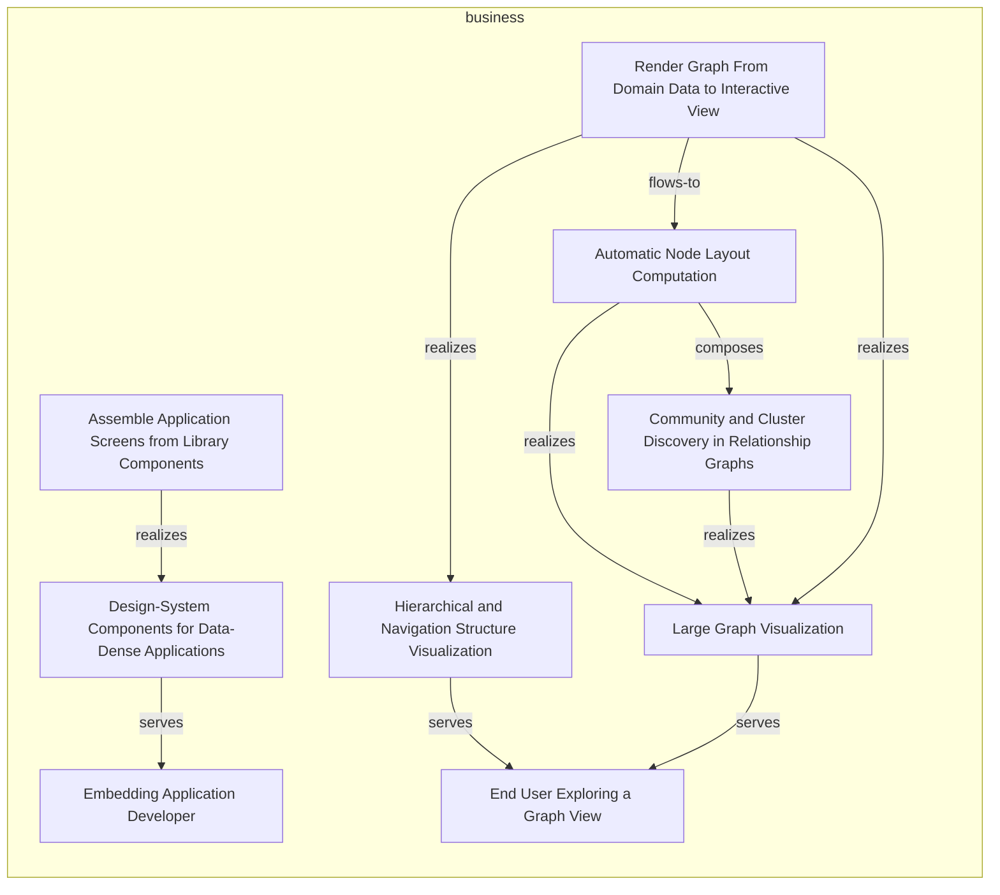
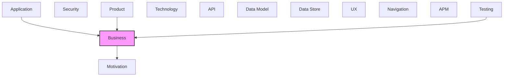

# Business

[← Back to README](../README.md)

Business processes, functions, roles, and services.

## Report Index

- [Layer Introduction](#layer-introduction)
- [Intra-Layer Relationships](#intra-layer-relationships)
- [Inter-Layer Dependencies](#inter-layer-dependencies)
- [Inter-Layer Relationships Table](#inter-layer-relationships-table)
- [Element Reference](#element-reference)

## Layer Introduction

| Metric                    | Count |
| ------------------------- | ----- |
| Elements                  | 9     |
| Intra-Layer Relationships | 10    |
| Inter-Layer Relationships | 35    |
| Inbound Relationships     | 31    |
| Outbound Relationships    | 4     |

**Cross-Layer References**:

- **Upstream layers**: [Application](./05-application-layer-report.md), [Product](./03-product-layer-report.md), [Testing](./13-testing-layer-report.md)
- **Downstream layers**: [Motivation](./01-motivation-layer-report.md)

## Intra-Layer Relationships

## Inter-Layer Dependencies

## Inter-Layer Relationships Table

| Relationship ID                                                      | Source Node                                                                     | Dest Node                                                                             | Dest Layer   | Predicate    | Cardinality  | Strength |
| -------------------------------------------------------------------- | ------------------------------------------------------------------------------- | ------------------------------------------------------------------------------------- | ------------ | ------------ | ------------ | -------- |
| `application.applicationfunction.realizes.business.businessfunction` | `application.applicationfunction.force-directed-layout-algorithm`               | `business.businessfunction.automatic-node-layout-computation`                         | `business`   | `realizes`   | many-to-many | medium   |
| `application.applicationfunction.realizes.business.businessfunction` | `application.applicationfunction.galaxy-radial-orbit-layout-algorithm`          | `business.businessfunction.automatic-node-layout-computation`                         | `business`   | `realizes`   | many-to-many | medium   |
| `application.applicationfunction.realizes.business.businessfunction` | `application.applicationfunction.louvain-community-clustering`                  | `business.businessfunction.community-and-cluster-discovery-in-relationship-graphs`    | `business`   | `realizes`   | many-to-many | medium   |
| `application.applicationfunction.realizes.business.businessfunction` | `application.applicationfunction.radial-tree-layout-algorithm`                  | `business.businessfunction.automatic-node-layout-computation`                         | `business`   | `realizes`   | many-to-many | medium   |
| `application.applicationfunction.realizes.business.businessfunction` | `application.applicationfunction.ux-navigation-tree-layout-algorithm`           | `business.businessfunction.automatic-node-layout-computation`                         | `business`   | `realizes`   | many-to-many | medium   |
| `application.applicationprocess.realizes.business.businessprocess`   | `application.applicationprocess.graph-render-and-layout-recomputation-pipeline` | `business.businessprocess.render-graph-from-domain-data-to-interactive-view`          | `business`   | `realizes`   | many-to-many | medium   |
| `application.applicationservice.realizes.business.businessservice`   | `application.applicationservice.graph-layout-engine-service`                    | `business.businessservice.hierarchical-and-navigation-structure-visualization`        | `business`   | `realizes`   | many-to-many | medium   |
| `application.applicationservice.realizes.business.businessservice`   | `application.applicationservice.graph-layout-engine-service`                    | `business.businessservice.large-graph-visualization`                                  | `business`   | `realizes`   | many-to-many | medium   |
| `application.applicationservice.serves.business.businessprocess`     | `application.applicationservice.graph-layout-engine-service`                    | `business.businessprocess.render-graph-from-domain-data-to-interactive-view`          | `business`   | `serves`     | many-to-many | medium   |
| `business.businessactor.references.motivation.stakeholder`           | `business.businessactor.embedding-application-developer`                        | `motivation.stakeholder.embedding-application-developer-npm-consumer`                 | `motivation` | `references` | many-to-many | medium   |
| `business.businessactor.references.motivation.stakeholder`           | `business.businessactor.end-user-exploring-a-graph-view`                        | `motivation.stakeholder.end-user-of-an-embedding-application`                         | `motivation` | `references` | many-to-many | medium   |
| `business.businessservice.realizes.motivation.goal`                  | `business.businessservice.hierarchical-and-navigation-structure-visualization`  | `motivation.goal.readable-layout-for-structurally-complex-graphs`                     | `motivation` | `realizes`   | many-to-many | medium   |
| `business.businessservice.realizes.motivation.goal`                  | `business.businessservice.large-graph-visualization`                            | `motivation.goal.layout-algorithms-that-scale-to-large-dense-and-pathological-graphs` | `motivation` | `realizes`   | many-to-many | medium   |
| `product.softwarecapability.realizes.business.businessfunction`      | `product.softwarecapability.app-navigation`                                     | `business.businessfunction.assemble-application-screens-from-library-components`      | `business`   | `realizes`   | many-to-many | medium   |
| `product.softwarecapability.realizes.business.businessfunction`      | `product.softwarecapability.app-shell`                                          | `business.businessfunction.assemble-application-screens-from-library-components`      | `business`   | `realizes`   | many-to-many | medium   |
| `product.softwarecapability.realizes.business.businessfunction`      | `product.softwarecapability.branch-map-visualization`                           | `business.businessfunction.automatic-node-layout-computation`                         | `business`   | `realizes`   | many-to-many | medium   |
| `product.softwarecapability.realizes.business.businessfunction`      | `product.softwarecapability.charting`                                           | `business.businessfunction.assemble-application-screens-from-library-components`      | `business`   | `realizes`   | many-to-many | medium   |
| `product.softwarecapability.realizes.business.businessfunction`      | `product.softwarecapability.chat-ui`                                            | `business.businessfunction.assemble-application-screens-from-library-components`      | `business`   | `realizes`   | many-to-many | medium   |
| `product.softwarecapability.realizes.business.businessfunction`      | `product.softwarecapability.clustered-force-layout-community-bubbles`           | `business.businessfunction.community-and-cluster-discovery-in-relationship-graphs`    | `business`   | `realizes`   | many-to-many | medium   |
| `product.softwarecapability.realizes.business.businessfunction`      | `product.softwarecapability.data-display`                                       | `business.businessfunction.assemble-application-screens-from-library-components`      | `business`   | `realizes`   | many-to-many | medium   |
| `product.softwarecapability.realizes.business.businessfunction`      | `product.softwarecapability.force-directed-graph-layout`                        | `business.businessfunction.automatic-node-layout-computation`                         | `business`   | `realizes`   | many-to-many | medium   |
| `product.softwarecapability.realizes.business.businessfunction`      | `product.softwarecapability.form-input`                                         | `business.businessfunction.assemble-application-screens-from-library-components`      | `business`   | `realizes`   | many-to-many | medium   |
| `product.softwarecapability.realizes.business.businessfunction`      | `product.softwarecapability.galaxy-radial-orbit-layout`                         | `business.businessfunction.automatic-node-layout-computation`                         | `business`   | `realizes`   | many-to-many | medium   |
| `product.softwarecapability.realizes.business.businessfunction`      | `product.softwarecapability.layer-lanes-layout`                                 | `business.businessfunction.automatic-node-layout-computation`                         | `business`   | `realizes`   | many-to-many | medium   |
| `product.softwarecapability.realizes.business.businessfunction`      | `product.softwarecapability.layered-graph-visualization`                        | `business.businessfunction.community-and-cluster-discovery-in-relationship-graphs`    | `business`   | `realizes`   | many-to-many | medium   |
| `product.softwarecapability.realizes.business.businessfunction`      | `product.softwarecapability.organic-graph-layout`                               | `business.businessfunction.automatic-node-layout-computation`                         | `business`   | `realizes`   | many-to-many | medium   |
| `product.softwarecapability.realizes.business.businessfunction`      | `product.softwarecapability.orthogonal-graph-layout`                            | `business.businessfunction.automatic-node-layout-computation`                         | `business`   | `realizes`   | many-to-many | medium   |
| `product.softwarecapability.realizes.business.businessfunction`      | `product.softwarecapability.overlays-and-dialogs`                               | `business.businessfunction.assemble-application-screens-from-library-components`      | `business`   | `realizes`   | many-to-many | medium   |
| `product.softwarecapability.realizes.business.businessfunction`      | `product.softwarecapability.page-patterns`                                      | `business.businessfunction.assemble-application-screens-from-library-components`      | `business`   | `realizes`   | many-to-many | medium   |
| `product.softwarecapability.realizes.business.businessfunction`      | `product.softwarecapability.planning-and-scheduling`                            | `business.businessfunction.assemble-application-screens-from-library-components`      | `business`   | `realizes`   | many-to-many | medium   |
| `product.softwarecapability.realizes.business.businessfunction`      | `product.softwarecapability.radial-tree-layout`                                 | `business.businessfunction.automatic-node-layout-computation`                         | `business`   | `realizes`   | many-to-many | medium   |
| `product.softwarecapability.realizes.business.businessfunction`      | `product.softwarecapability.run-history-and-observability-views`                | `business.businessfunction.assemble-application-screens-from-library-components`      | `business`   | `realizes`   | many-to-many | medium   |
| `product.softwarecapability.realizes.business.businessfunction`      | `product.softwarecapability.ui-primitives`                                      | `business.businessfunction.assemble-application-screens-from-library-components`      | `business`   | `realizes`   | many-to-many | medium   |
| `product.softwarecapability.realizes.business.businessfunction`      | `product.softwarecapability.ux-navigation-tree-layout`                          | `business.businessfunction.automatic-node-layout-computation`                         | `business`   | `realizes`   | many-to-many | medium   |
| `testing.testcoveragetarget.covers.business.businessprocess`         | `testing.testcoveragetarget.graph-canvas-rendering-and-interaction`             | `business.businessprocess.render-graph-from-domain-data-to-interactive-view`          | `business`   | `covers`     | many-to-many | medium   |

## Element Reference

### Embedding Application Developer {#embedding-application-developer}

**ID**: `business.businessactor.embedding-application-developer`

**Type**: `businessactor`

Inferred actor: the developer who installs @tinkermonkey/heimdall-ui and wires GraphCanvas into their own application, choosing a layout mode and supplying node/edge data.

#### Relationships

| Type        | Related Element                                                                 | Predicate    | Direction |
| ----------- | ------------------------------------------------------------------------------- | ------------ | --------- |
| inter-layer | `motivation.stakeholder.embedding-application-developer-npm-consumer`           | `references` | outbound  |
| intra-layer | `business.businessservice.design-system-components-for-data-dense-applications` | `serves`     | inbound   |

### End User Exploring a Graph View {#end-user-exploring-a-graph-view}

**ID**: `business.businessactor.end-user-exploring-a-graph-view`

**Type**: `businessactor`

Inferred actor: the person who ultimately pans, zooms, selects, hovers, drags, and collapses/expands nodes in a rendered GraphCanvas.

#### Relationships

| Type        | Related Element                                                                | Predicate    | Direction |
| ----------- | ------------------------------------------------------------------------------ | ------------ | --------- |
| inter-layer | `motivation.stakeholder.end-user-of-an-embedding-application`                  | `references` | outbound  |
| intra-layer | `business.businessservice.hierarchical-and-navigation-structure-visualization` | `serves`     | inbound   |
| intra-layer | `business.businessservice.large-graph-visualization`                           | `serves`     | inbound   |

### Assemble Application Screens from Library Components {#assemble-application-screens-from-library-components}

**ID**: `business.businessfunction.assemble-application-screens-from-library-components`

**Type**: `businessfunction`

Inferred business function: an application developer composes screens from heimdall components and tokens, importing only the components a page uses.

#### Relationships

| Type        | Related Element                                                                 | Predicate  | Direction |
| ----------- | ------------------------------------------------------------------------------- | ---------- | --------- |
| inter-layer | `product.softwarecapability.app-navigation`                                     | `realizes` | inbound   |
| inter-layer | `product.softwarecapability.app-shell`                                          | `realizes` | inbound   |
| inter-layer | `product.softwarecapability.charting`                                           | `realizes` | inbound   |
| inter-layer | `product.softwarecapability.chat-ui`                                            | `realizes` | inbound   |
| inter-layer | `product.softwarecapability.data-display`                                       | `realizes` | inbound   |
| inter-layer | `product.softwarecapability.form-input`                                         | `realizes` | inbound   |
| inter-layer | `product.softwarecapability.overlays-and-dialogs`                               | `realizes` | inbound   |
| inter-layer | `product.softwarecapability.page-patterns`                                      | `realizes` | inbound   |
| inter-layer | `product.softwarecapability.planning-and-scheduling`                            | `realizes` | inbound   |
| inter-layer | `product.softwarecapability.run-history-and-observability-views`                | `realizes` | inbound   |
| inter-layer | `product.softwarecapability.ui-primitives`                                      | `realizes` | inbound   |
| intra-layer | `business.businessservice.design-system-components-for-data-dense-applications` | `realizes` | outbound  |

### Automatic Node Layout Computation {#automatic-node-layout-computation}

**ID**: `business.businessfunction.automatic-node-layout-computation`

**Type**: `businessfunction`

Inferred business function: given arbitrary node/edge data with no pre-set positions, automatically compute a readable 2D arrangement instead of requiring a consumer to hand-place nodes.

#### Relationships

| Type        | Related Element                                                                    | Predicate  | Direction |
| ----------- | ---------------------------------------------------------------------------------- | ---------- | --------- |
| inter-layer | `application.applicationfunction.force-directed-layout-algorithm`                  | `realizes` | inbound   |
| inter-layer | `application.applicationfunction.galaxy-radial-orbit-layout-algorithm`             | `realizes` | inbound   |
| inter-layer | `application.applicationfunction.radial-tree-layout-algorithm`                     | `realizes` | inbound   |
| inter-layer | `application.applicationfunction.ux-navigation-tree-layout-algorithm`              | `realizes` | inbound   |
| inter-layer | `product.softwarecapability.branch-map-visualization`                              | `realizes` | inbound   |
| inter-layer | `product.softwarecapability.force-directed-graph-layout`                           | `realizes` | inbound   |
| inter-layer | `product.softwarecapability.galaxy-radial-orbit-layout`                            | `realizes` | inbound   |
| inter-layer | `product.softwarecapability.layer-lanes-layout`                                    | `realizes` | inbound   |
| inter-layer | `product.softwarecapability.organic-graph-layout`                                  | `realizes` | inbound   |
| inter-layer | `product.softwarecapability.orthogonal-graph-layout`                               | `realizes` | inbound   |
| inter-layer | `product.softwarecapability.radial-tree-layout`                                    | `realizes` | inbound   |
| inter-layer | `product.softwarecapability.ux-navigation-tree-layout`                             | `realizes` | inbound   |
| intra-layer | `business.businessfunction.community-and-cluster-discovery-in-relationship-graphs` | `composes` | outbound  |
| intra-layer | `business.businessservice.large-graph-visualization`                               | `realizes` | outbound  |
| intra-layer | `business.businessprocess.render-graph-from-domain-data-to-interactive-view`       | `flows-to` | inbound   |

### Community and Cluster Discovery in Relationship Graphs {#community-and-cluster-discovery-in-relationship-graphs}

**ID**: `business.businessfunction.community-and-cluster-discovery-in-relationship-graphs`

**Type**: `businessfunction`

Inferred business function: surface community structure in a relationship graph (via Louvain clustering) so densely-interconnected groups read visually as groups.

#### Relationships

| Type        | Related Element                                                       | Predicate  | Direction |
| ----------- | --------------------------------------------------------------------- | ---------- | --------- |
| inter-layer | `application.applicationfunction.louvain-community-clustering`        | `realizes` | inbound   |
| inter-layer | `product.softwarecapability.clustered-force-layout-community-bubbles` | `realizes` | inbound   |
| inter-layer | `product.softwarecapability.layered-graph-visualization`              | `realizes` | inbound   |
| intra-layer | `business.businessfunction.automatic-node-layout-computation`         | `composes` | inbound   |
| intra-layer | `business.businessservice.large-graph-visualization`                  | `realizes` | outbound  |

### Render Graph From Domain Data to Interactive View {#render-graph-from-domain-data-to-interactive-view}

**ID**: `business.businessprocess.render-graph-from-domain-data-to-interactive-view`

**Type**: `businessprocess`

Inferred end-to-end business process: a consumer's domain data (nodes/edges) enters GraphCanvas, is laid out by the selected engine, and becomes an interactive, explorable view for the end user.

#### Relationships

| Type        | Related Element                                                                 | Predicate  | Direction |
| ----------- | ------------------------------------------------------------------------------- | ---------- | --------- |
| inter-layer | `application.applicationprocess.graph-render-and-layout-recomputation-pipeline` | `realizes` | inbound   |
| inter-layer | `application.applicationservice.graph-layout-engine-service`                    | `serves`   | inbound   |
| inter-layer | `testing.testcoveragetarget.graph-canvas-rendering-and-interaction`             | `covers`   | inbound   |
| intra-layer | `business.businessfunction.automatic-node-layout-computation`                   | `flows-to` | outbound  |
| intra-layer | `business.businessservice.hierarchical-and-navigation-structure-visualization`  | `realizes` | outbound  |
| intra-layer | `business.businessservice.large-graph-visualization`                            | `realizes` | outbound  |

### Design-System Components for Data-Dense Applications {#design-system-components-for-data-dense-applications}

**ID**: `business.businessservice.design-system-components-for-data-dense-applications`

**Type**: `businessservice`

Inferred business service: give application teams ready-made, consistent UI building blocks (shell chrome, inputs, tables, charts, overlays, chat, observability and planning views) so they assemble data-dense IDE-style screens instead of building them.

#### Relationships

| Type        | Related Element                                                                  | Predicate  | Direction |
| ----------- | -------------------------------------------------------------------------------- | ---------- | --------- |
| intra-layer | `business.businessfunction.assemble-application-screens-from-library-components` | `realizes` | inbound   |
| intra-layer | `business.businessactor.embedding-application-developer`                         | `serves`   | outbound  |

### Hierarchical and Navigation Structure Visualization {#hierarchical-and-navigation-structure-visualization}

**ID**: `business.businessservice.hierarchical-and-navigation-structure-visualization`

**Type**: `businessservice`

Inferred business capability: visualize page/view navigation hierarchies and general tree/DAG structures as radial or top-down layouts — the problem galaxyLayout/uxNavLayout/radialTreeLayout solve.

#### Relationships

| Type        | Related Element                                                              | Predicate  | Direction |
| ----------- | ---------------------------------------------------------------------------- | ---------- | --------- |
| inter-layer | `application.applicationservice.graph-layout-engine-service`                 | `realizes` | inbound   |
| inter-layer | `motivation.goal.readable-layout-for-structurally-complex-graphs`            | `realizes` | outbound  |
| intra-layer | `business.businessprocess.render-graph-from-domain-data-to-interactive-view` | `realizes` | inbound   |
| intra-layer | `business.businessactor.end-user-exploring-a-graph-view`                     | `serves`   | outbound  |

### Large Graph Visualization {#large-graph-visualization}

**ID**: `business.businessservice.large-graph-visualization`

**Type**: `businessservice`

Inferred business capability: enable consumers to render and let end users navigate graphs with hundreds of nodes while staying visually readable (non-overlapping, low edge-crossing) — the problem forceLayout/clusteredForceLayout solve.

#### Relationships

| Type        | Related Element                                                                       | Predicate  | Direction |
| ----------- | ------------------------------------------------------------------------------------- | ---------- | --------- |
| inter-layer | `application.applicationservice.graph-layout-engine-service`                          | `realizes` | inbound   |
| inter-layer | `motivation.goal.layout-algorithms-that-scale-to-large-dense-and-pathological-graphs` | `realizes` | outbound  |
| intra-layer | `business.businessfunction.automatic-node-layout-computation`                         | `realizes` | inbound   |
| intra-layer | `business.businessfunction.community-and-cluster-discovery-in-relationship-graphs`    | `realizes` | inbound   |
| intra-layer | `business.businessprocess.render-graph-from-domain-data-to-interactive-view`          | `realizes` | inbound   |
| intra-layer | `business.businessactor.end-user-exploring-a-graph-view`                              | `serves`   | outbound  |

---

Generated: 2026-11-25T23:27:05.105Z | Model Version: 0.1.0
