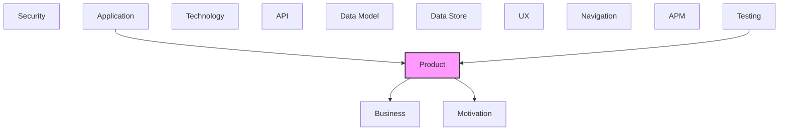

# Product

[← Back to README](../README.md)

Product features, capabilities, personas, and milestones.

## Report Index

- [Layer Introduction](#layer-introduction)
- [Intra-Layer Relationships](#intra-layer-relationships)
- [Inter-Layer Dependencies](#inter-layer-dependencies)
- [Inter-Layer Relationships Table](#inter-layer-relationships-table)
- [Element Reference](#element-reference)

## Layer Introduction

| Metric                    | Count |
| ------------------------- | ----- |
| Elements                  | 27    |
| Intra-Layer Relationships | 16    |
| Inter-Layer Relationships | 45    |
| Inbound Relationships     | 7     |
| Outbound Relationships    | 38    |

**Cross-Layer References**:

- **Upstream layers**: [Application](./05-application-layer-report.md), [Testing](./13-testing-layer-report.md)
- **Downstream layers**: [Business](./02-business-layer-report.md), [Motivation](./01-motivation-layer-report.md)

## Intra-Layer Relationships

```mermaid
flowchart LR
  subgraph product
    product_feature_joint_edge_label_placement["Joint Edge-Label Placement"]
    product_feature_layered_graph_explorer["Layered Graph Explorer"]
    product_feature_link_navigation_with_href["Link Navigation with href"]
    product_feature_live_draggable_galaxy_simulation["Live Draggable Galaxy Simulation"]
    product_feature_node_and_edge_tooltips_and_popovers["Node and Edge Tooltips and Popovers"]
    product_feature_per_component_imports["Per-Component Imports"]
    product_feature_progressive_disclosure_via_node_collapseexpand["Progressive Disclosure via Node Collapse/Expand"]
    product_feature_server_side_rendering_support["Server-Side Rendering Support"]
    product_persona_application_developer_embedding_a_graph_view["Application Developer Embedding a Graph View"]
    product_persona_end_user_exploring_a_rendered_graph["End User Exploring a Rendered Graph"]
    product_softwarecapability_chat_interface["Chat Interface"]
    product_softwarecapability_clustered_force_layout_community_bubbles["Clustered Force Layout (Community Bubbles)"]
    product_softwarecapability_data_display_and_charts["Data Display and Charts"]
    product_softwarecapability_design_primitives_and_tokens["Design Primitives and Tokens"]
    product_softwarecapability_force_directed_graph_layout["Force-Directed Graph Layout"]
    product_softwarecapability_form_inputs_and_editors["Form Inputs and Editors"]
    product_softwarecapability_galaxy_radial_orbit_layout["Galaxy Radial Orbit Layout"]
    product_softwarecapability_ide_application_shell_and_navigation["IDE Application Shell and Navigation"]
    product_softwarecapability_layered_graph_exploration["Layered Graph Exploration"]
    product_softwarecapability_observability_views["Observability Views"]
    product_softwarecapability_organic_graph_layout["Organic Graph Layout"]
    product_softwarecapability_orthogonal_graph_layout["Orthogonal Graph Layout"]
    product_softwarecapability_overlays_and_dialogs["Overlays and Dialogs"]
    product_softwarecapability_page_patterns["Page Patterns"]
    product_softwarecapability_planning_views["Planning Views"]
    product_softwarecapability_radial_tree_layout["Radial Tree Layout"]
    product_softwarecapability_ux_navigation_tree_layout["UX Navigation Tree Layout"]
    product_feature_joint_edge_label_placement -->|realizes| product_softwarecapability_force_directed_graph_layout
    product_feature_joint_edge_label_placement -->|realizes| product_softwarecapability_orthogonal_graph_layout
    product_feature_joint_edge_label_placement -->|serves| product_persona_end_user_exploring_a_rendered_graph
    product_feature_layered_graph_explorer -->|realizes| product_softwarecapability_layered_graph_exploration
    product_feature_layered_graph_explorer -->|serves| product_persona_end_user_exploring_a_rendered_graph
    product_feature_link_navigation_with_href -->|realizes| product_softwarecapability_ide_application_shell_and_navigation
    product_feature_link_navigation_with_href -->|serves| product_persona_application_developer_embedding_a_graph_view
    product_feature_live_draggable_galaxy_simulation -->|realizes| product_softwarecapability_galaxy_radial_orbit_layout
    product_feature_live_draggable_galaxy_simulation -->|serves| product_persona_application_developer_embedding_a_graph_view
    product_feature_node_and_edge_tooltips_and_popovers -->|serves| product_persona_end_user_exploring_a_rendered_graph
    product_feature_per_component_imports -->|realizes| product_softwarecapability_design_primitives_and_tokens
    product_feature_per_component_imports -->|serves| product_persona_application_developer_embedding_a_graph_view
    product_feature_progressive_disclosure_via_node_collapseexpand -->|serves| product_persona_end_user_exploring_a_rendered_graph
    product_feature_server_side_rendering_support -->|realizes| product_softwarecapability_ide_application_shell_and_navigation
    product_feature_server_side_rendering_support -->|serves| product_persona_application_developer_embedding_a_graph_view
    product_softwarecapability_clustered_force_layout_community_bubbles -->|aggregates| product_softwarecapability_force_directed_graph_layout
  end
```

## Inter-Layer Dependencies

## Inter-Layer Relationships Table

| Relationship ID                                                      | Source Node                                                           | Dest Node                                                                             | Dest Layer   | Predicate    | Cardinality  | Strength |
| -------------------------------------------------------------------- | --------------------------------------------------------------------- | ------------------------------------------------------------------------------------- | ------------ | ------------ | ------------ | -------- |
| `application.applicationservice.realizes.product.softwarecapability` | `application.applicationservice.graph-layout-engine-service`          | `product.softwarecapability.organic-graph-layout`                                     | `product`    | `realizes`   | many-to-many | medium   |
| `application.applicationservice.realizes.product.softwarecapability` | `application.applicationservice.graph-layout-engine-service`          | `product.softwarecapability.orthogonal-graph-layout`                                  | `product`    | `realizes`   | many-to-many | medium   |
| `application.applicationservice.realizes.product.softwarecapability` | `application.applicationservice.layered-graph-framework-service`      | `product.softwarecapability.layered-graph-exploration`                                | `product`    | `realizes`   | many-to-many | medium   |
| `product.feature.satisfies.motivation.requirement`                   | `product.feature.per-component-imports`                               | `motivation.requirement.consumers-bundle-only-the-components-they-import`             | `motivation` | `satisfies`  | many-to-many | medium   |
| `product.feature.satisfies.motivation.requirement`                   | `product.feature.server-side-rendering-support`                       | `motivation.requirement.server-rendered-output-hydrates-without-mismatch`             | `motivation` | `satisfies`  | many-to-many | medium   |
| `product.persona.references.motivation.stakeholder`                  | `product.persona.application-developer-embedding-a-graph-view`        | `motivation.stakeholder.embedding-application-developer-npm-consumer`                 | `motivation` | `references` | many-to-many | medium   |
| `product.persona.references.motivation.stakeholder`                  | `product.persona.end-user-exploring-a-rendered-graph`                 | `motivation.stakeholder.end-user-of-an-embedding-application`                         | `motivation` | `references` | many-to-many | medium   |
| `product.softwarecapability.realizes.business.businessfunction`      | `product.softwarecapability.chat-interface`                           | `business.businessfunction.assemble-application-screens-from-library-components`      | `business`   | `realizes`   | many-to-many | medium   |
| `product.softwarecapability.supports.motivation.goal`                | `product.softwarecapability.chat-interface`                           | `motivation.goal.consistent-component-library-for-data-dense-ide-style-applications`  | `motivation` | `supports`   | many-to-many | medium   |
| `product.softwarecapability.realizes.business.businessfunction`      | `product.softwarecapability.clustered-force-layout-community-bubbles` | `business.businessfunction.community-and-cluster-discovery-in-relationship-graphs`    | `business`   | `realizes`   | many-to-many | medium   |
| `product.softwarecapability.supports.motivation.goal`                | `product.softwarecapability.clustered-force-layout-community-bubbles` | `motivation.goal.layout-algorithms-that-scale-to-large-dense-and-pathological-graphs` | `motivation` | `supports`   | many-to-many | medium   |
| `product.softwarecapability.realizes.business.businessfunction`      | `product.softwarecapability.data-display-and-charts`                  | `business.businessfunction.assemble-application-screens-from-library-components`      | `business`   | `realizes`   | many-to-many | medium   |
| `product.softwarecapability.supports.motivation.goal`                | `product.softwarecapability.data-display-and-charts`                  | `motivation.goal.consistent-component-library-for-data-dense-ide-style-applications`  | `motivation` | `supports`   | many-to-many | medium   |
| `product.softwarecapability.realizes.business.businessfunction`      | `product.softwarecapability.design-primitives-and-tokens`             | `business.businessfunction.assemble-application-screens-from-library-components`      | `business`   | `realizes`   | many-to-many | medium   |
| `product.softwarecapability.supports.motivation.goal`                | `product.softwarecapability.design-primitives-and-tokens`             | `motivation.goal.consistent-component-library-for-data-dense-ide-style-applications`  | `motivation` | `supports`   | many-to-many | medium   |
| `product.softwarecapability.realizes.business.businessfunction`      | `product.softwarecapability.force-directed-graph-layout`              | `business.businessfunction.automatic-node-layout-computation`                         | `business`   | `realizes`   | many-to-many | medium   |
| `product.softwarecapability.supports.motivation.goal`                | `product.softwarecapability.force-directed-graph-layout`              | `motivation.goal.readable-layout-for-structurally-complex-graphs`                     | `motivation` | `supports`   | many-to-many | medium   |
| `product.softwarecapability.realizes.business.businessfunction`      | `product.softwarecapability.form-inputs-and-editors`                  | `business.businessfunction.assemble-application-screens-from-library-components`      | `business`   | `realizes`   | many-to-many | medium   |
| `product.softwarecapability.supports.motivation.goal`                | `product.softwarecapability.form-inputs-and-editors`                  | `motivation.goal.consistent-component-library-for-data-dense-ide-style-applications`  | `motivation` | `supports`   | many-to-many | medium   |
| `product.softwarecapability.realizes.business.businessfunction`      | `product.softwarecapability.galaxy-radial-orbit-layout`               | `business.businessfunction.automatic-node-layout-computation`                         | `business`   | `realizes`   | many-to-many | medium   |
| `product.softwarecapability.supports.motivation.goal`                | `product.softwarecapability.galaxy-radial-orbit-layout`               | `motivation.goal.readable-layout-for-structurally-complex-graphs`                     | `motivation` | `supports`   | many-to-many | medium   |
| `product.softwarecapability.realizes.business.businessfunction`      | `product.softwarecapability.ide-application-shell-and-navigation`     | `business.businessfunction.assemble-application-screens-from-library-components`      | `business`   | `realizes`   | many-to-many | medium   |
| `product.softwarecapability.supports.motivation.goal`                | `product.softwarecapability.ide-application-shell-and-navigation`     | `motivation.goal.consistent-component-library-for-data-dense-ide-style-applications`  | `motivation` | `supports`   | many-to-many | medium   |
| `product.softwarecapability.realizes.business.businessfunction`      | `product.softwarecapability.layered-graph-exploration`                | `business.businessfunction.community-and-cluster-discovery-in-relationship-graphs`    | `business`   | `realizes`   | many-to-many | medium   |
| `product.softwarecapability.supports.motivation.goal`                | `product.softwarecapability.layered-graph-exploration`                | `motivation.goal.layout-algorithms-that-scale-to-large-dense-and-pathological-graphs` | `motivation` | `supports`   | many-to-many | medium   |
| `product.softwarecapability.realizes.business.businessfunction`      | `product.softwarecapability.observability-views`                      | `business.businessfunction.assemble-application-screens-from-library-components`      | `business`   | `realizes`   | many-to-many | medium   |
| `product.softwarecapability.supports.motivation.goal`                | `product.softwarecapability.observability-views`                      | `motivation.goal.consistent-component-library-for-data-dense-ide-style-applications`  | `motivation` | `supports`   | many-to-many | medium   |
| `product.softwarecapability.realizes.business.businessfunction`      | `product.softwarecapability.organic-graph-layout`                     | `business.businessfunction.automatic-node-layout-computation`                         | `business`   | `realizes`   | many-to-many | medium   |
| `product.softwarecapability.supports.motivation.goal`                | `product.softwarecapability.organic-graph-layout`                     | `motivation.goal.readable-layout-for-structurally-complex-graphs`                     | `motivation` | `supports`   | many-to-many | medium   |
| `product.softwarecapability.realizes.business.businessfunction`      | `product.softwarecapability.orthogonal-graph-layout`                  | `business.businessfunction.automatic-node-layout-computation`                         | `business`   | `realizes`   | many-to-many | medium   |
| `product.softwarecapability.supports.motivation.goal`                | `product.softwarecapability.orthogonal-graph-layout`                  | `motivation.goal.readable-layout-for-structurally-complex-graphs`                     | `motivation` | `supports`   | many-to-many | medium   |
| `product.softwarecapability.realizes.business.businessfunction`      | `product.softwarecapability.overlays-and-dialogs`                     | `business.businessfunction.assemble-application-screens-from-library-components`      | `business`   | `realizes`   | many-to-many | medium   |
| `product.softwarecapability.supports.motivation.goal`                | `product.softwarecapability.overlays-and-dialogs`                     | `motivation.goal.consistent-component-library-for-data-dense-ide-style-applications`  | `motivation` | `supports`   | many-to-many | medium   |
| `product.softwarecapability.realizes.business.businessfunction`      | `product.softwarecapability.page-patterns`                            | `business.businessfunction.assemble-application-screens-from-library-components`      | `business`   | `realizes`   | many-to-many | medium   |
| `product.softwarecapability.supports.motivation.goal`                | `product.softwarecapability.page-patterns`                            | `motivation.goal.consistent-component-library-for-data-dense-ide-style-applications`  | `motivation` | `supports`   | many-to-many | medium   |
| `product.softwarecapability.realizes.business.businessfunction`      | `product.softwarecapability.planning-views`                           | `business.businessfunction.assemble-application-screens-from-library-components`      | `business`   | `realizes`   | many-to-many | medium   |
| `product.softwarecapability.supports.motivation.goal`                | `product.softwarecapability.planning-views`                           | `motivation.goal.consistent-component-library-for-data-dense-ide-style-applications`  | `motivation` | `supports`   | many-to-many | medium   |
| `product.softwarecapability.realizes.business.businessfunction`      | `product.softwarecapability.radial-tree-layout`                       | `business.businessfunction.automatic-node-layout-computation`                         | `business`   | `realizes`   | many-to-many | medium   |
| `product.softwarecapability.supports.motivation.goal`                | `product.softwarecapability.radial-tree-layout`                       | `motivation.goal.readable-layout-for-structurally-complex-graphs`                     | `motivation` | `supports`   | many-to-many | medium   |
| `product.softwarecapability.realizes.business.businessfunction`      | `product.softwarecapability.ux-navigation-tree-layout`                | `business.businessfunction.automatic-node-layout-computation`                         | `business`   | `realizes`   | many-to-many | medium   |
| `product.softwarecapability.supports.motivation.goal`                | `product.softwarecapability.ux-navigation-tree-layout`                | `motivation.goal.readable-layout-for-structurally-complex-graphs`                     | `motivation` | `supports`   | many-to-many | medium   |
| `testing.testcoveragetarget.covers.product.feature`                  | `testing.testcoveragetarget.graph-geometry-and-joint-label-placement` | `product.feature.joint-edge-label-placement`                                          | `product`    | `covers`     | many-to-many | medium   |
| `testing.testcoveragetarget.covers.product.feature`                  | `testing.testcoveragetarget.layered-graph-explorer`                   | `product.feature.layered-graph-explorer`                                              | `product`    | `covers`     | many-to-many | medium   |
| `testing.testcoveragetarget.covers.product.feature`                  | `testing.testcoveragetarget.server-rendering`                         | `product.feature.server-side-rendering-support`                                       | `product`    | `covers`     | many-to-many | medium   |
| `testing.testcoveragetarget.covers.product.feature`                  | `testing.testcoveragetarget.static-site-link-variants`                | `product.feature.link-navigation-with-href`                                           | `product`    | `covers`     | many-to-many | medium   |

## Element Reference

### Joint Edge-Label Placement {#joint-edge-label-placement}

**ID**: `product.feature.joint-edge-label-placement`

**Type**: `feature`

GraphCanvas places every edge label at once so labels do not print over each other or the cards; a label with no clear spot is hidden until its edge or an endpoint is in focus, and renderEdge receives EdgeGeometry.labelHidden (PR #396, Unreleased in CHANGELOG.md).

#### Attributes

| Name     | Value     |
| -------- | --------- |
| priority | high      |
| status   | delivered |

#### Relationships

| Type        | Related Element                                                       | Predicate  | Direction |
| ----------- | --------------------------------------------------------------------- | ---------- | --------- |
| inter-layer | `testing.testcoveragetarget.graph-geometry-and-joint-label-placement` | `covers`   | inbound   |
| intra-layer | `product.softwarecapability.force-directed-graph-layout`              | `realizes` | outbound  |
| intra-layer | `product.softwarecapability.orthogonal-graph-layout`                  | `realizes` | outbound  |
| intra-layer | `product.persona.end-user-exploring-a-rendered-graph`                 | `serves`   | outbound  |

### Layered Graph Explorer {#layered-graph-explorer}

**ID**: `product.feature.layered-graph-explorer`

**Type**: `feature`

A ready-made explorer (LayeredGraphExplorer) that switches between the 3D stack, lanes, matrix and hive views with shared selection, reach following, link-category filters, layer focus, camera presets and snapshot save/restore.

#### Attributes

| Name     | Value     |
| -------- | --------- |
| priority | high      |
| status   | delivered |

#### Relationships

| Type        | Related Element                                        | Predicate  | Direction |
| ----------- | ------------------------------------------------------ | ---------- | --------- |
| inter-layer | `testing.testcoveragetarget.layered-graph-explorer`    | `covers`   | inbound   |
| intra-layer | `product.softwarecapability.layered-graph-exploration` | `realizes` | outbound  |
| intra-layer | `product.persona.end-user-exploring-a-rendered-graph`  | `serves`   | outbound  |

### Link Navigation with href {#link-navigation-with-href}

**ID**: `product.feature.link-navigation-with-href`

**Type**: `feature`

Sidebar items, NavItem, QuickAccessTile and QuickAccessGrid items take href and render real anchors (modified clicks open in a new tab), so static and server-rendered sites navigate without client routing (0.13.0).

#### Attributes

| Name     | Value     |
| -------- | --------- |
| priority | medium    |
| status   | delivered |

#### Relationships

| Type        | Related Element                                                   | Predicate  | Direction |
| ----------- | ----------------------------------------------------------------- | ---------- | --------- |
| inter-layer | `testing.testcoveragetarget.static-site-link-variants`            | `covers`   | inbound   |
| intra-layer | `product.softwarecapability.ide-application-shell-and-navigation` | `realizes` | outbound  |
| intra-layer | `product.persona.application-developer-embedding-a-graph-view`    | `serves`   | outbound  |

### Live Draggable Galaxy Simulation {#live-draggable-galaxy-simulation}

**ID**: `product.feature.live-draggable-galaxy-simulation`

**Type**: `feature`

Opt-in continuous elastic simulation for galaxy layout, so dragging a node repositions its subtree in real time instead of freezing after one computed layout.

#### Attributes

| Name     | Value     |
| -------- | --------- |
| priority | medium    |
| size     | m         |
| status   | delivered |

#### Relationships

| Type        | Related Element                                                | Predicate  | Direction |
| ----------- | -------------------------------------------------------------- | ---------- | --------- |
| intra-layer | `product.softwarecapability.galaxy-radial-orbit-layout`        | `realizes` | outbound  |
| intra-layer | `product.persona.application-developer-embedding-a-graph-view` | `serves`   | outbound  |

### Node and Edge Tooltips and Popovers {#node-and-edge-tooltips-and-popovers}

**ID**: `product.feature.node-and-edge-tooltips-and-popovers`

**Type**: `feature`

Render-prop tooltip/popover overlays anchored to a hovered/clicked node or edge, positioned via the canvas's own pan/zoom transform.

#### Attributes

| Name     | Value     |
| -------- | --------- |
| priority | low       |
| size     | s         |
| status   | delivered |

#### Relationships

| Type        | Related Element                                       | Predicate | Direction |
| ----------- | ----------------------------------------------------- | --------- | --------- |
| intra-layer | `product.persona.end-user-exploring-a-rendered-graph` | `serves`  | outbound  |

### Per-Component Imports {#per-component-imports}

**ID**: `product.feature.per-component-imports`

**Type**: `feature`

The package is one module per source file and its JS imports no CSS, so a bundler keeps only the imported components; a base stylesheet plus per-component sheets are an opt-in alternative to the full stylesheet (0.13.0).

#### Attributes

| Name     | Value     |
| -------- | --------- |
| priority | high      |
| status   | delivered |

#### Relationships

| Type        | Related Element                                                           | Predicate   | Direction |
| ----------- | ------------------------------------------------------------------------- | ----------- | --------- |
| inter-layer | `motivation.requirement.consumers-bundle-only-the-components-they-import` | `satisfies` | outbound  |
| intra-layer | `product.softwarecapability.design-primitives-and-tokens`                 | `realizes`  | outbound  |
| intra-layer | `product.persona.application-developer-embedding-a-graph-view`            | `serves`    | outbound  |

### Progressive Disclosure via Node Collapse/Expand {#progressive-disclosure-via-node-collapse-expand}

**ID**: `product.feature.progressive-disclosure-via-node-collapseexpand`

**Type**: `feature`

Collapse a node to hide its structural descendants (and their edges) for dense hierarchies, with a hidden-descendant-count badge.

#### Attributes

| Name     | Value     |
| -------- | --------- |
| priority | medium    |
| size     | s         |
| status   | delivered |

#### Relationships

| Type        | Related Element                                       | Predicate | Direction |
| ----------- | ----------------------------------------------------- | --------- | --------- |
| intra-layer | `product.persona.end-user-exploring-a-rendered-graph` | `serves`  | outbound  |

### Server-Side Rendering Support {#server-side-rendering-support}

**ID**: `product.feature.server-side-rendering-support`

**Type**: `feature`

Components render on a server and hydrate without mismatches: useMediaQuery takes a serverValue and resolves after mount, ShellLayout, Topbar and Statusbar leave data-mobile off until the client knows the viewport, and timelines and calendars take a fixed now/today (0.13.0).

#### Attributes

| Name     | Value     |
| -------- | --------- |
| priority | high      |
| status   | delivered |

#### Relationships

| Type        | Related Element                                                           | Predicate   | Direction |
| ----------- | ------------------------------------------------------------------------- | ----------- | --------- |
| inter-layer | `motivation.requirement.server-rendered-output-hydrates-without-mismatch` | `satisfies` | outbound  |
| inter-layer | `testing.testcoveragetarget.server-rendering`                             | `covers`    | inbound   |
| intra-layer | `product.softwarecapability.ide-application-shell-and-navigation`         | `realizes`  | outbound  |
| intra-layer | `product.persona.application-developer-embedding-a-graph-view`            | `serves`    | outbound  |

### Application Developer Embedding a Graph View {#application-developer-embedding-a-graph-view}

**ID**: `product.persona.application-developer-embedding-a-graph-view`

**Type**: `persona`

Inferred persona: a React/TypeScript developer integrating GraphCanvas into their own product, choosing layout mode and supplying data/callbacks.

#### Attributes

| Name        | Value    |
| ----------- | -------- |
| category    | primary  |
| proficiency | advanced |

#### Relationships

| Type        | Related Element                                                       | Predicate    | Direction |
| ----------- | --------------------------------------------------------------------- | ------------ | --------- |
| inter-layer | `motivation.stakeholder.embedding-application-developer-npm-consumer` | `references` | outbound  |
| intra-layer | `product.feature.link-navigation-with-href`                           | `serves`     | inbound   |
| intra-layer | `product.feature.live-draggable-galaxy-simulation`                    | `serves`     | inbound   |
| intra-layer | `product.feature.per-component-imports`                               | `serves`     | inbound   |
| intra-layer | `product.feature.server-side-rendering-support`                       | `serves`     | inbound   |

### End User Exploring a Rendered Graph {#end-user-exploring-a-rendered-graph}

**ID**: `product.persona.end-user-exploring-a-rendered-graph`

**Type**: `persona`

Inferred persona: the person who ultimately interacts with the rendered graph (pan/zoom/select/hover/drag/collapse) without knowledge of the underlying library.

#### Attributes

| Name        | Value  |
| ----------- | ------ |
| category    | served |
| proficiency | novice |

#### Relationships

| Type        | Related Element                                                  | Predicate    | Direction |
| ----------- | ---------------------------------------------------------------- | ------------ | --------- |
| inter-layer | `motivation.stakeholder.end-user-of-an-embedding-application`    | `references` | outbound  |
| intra-layer | `product.feature.joint-edge-label-placement`                     | `serves`     | inbound   |
| intra-layer | `product.feature.layered-graph-explorer`                         | `serves`     | inbound   |
| intra-layer | `product.feature.node-and-edge-tooltips-and-popovers`            | `serves`     | inbound   |
| intra-layer | `product.feature.progressive-disclosure-via-node-collapseexpand` | `serves`     | inbound   |

### Chat Interface {#chat-interface}

**ID**: `product.softwarecapability.chat-interface`

**Type**: `softwarecapability`

Shipped capability: chat messages with tool and thinking blocks, dividers, suggestions, a composer with context and attachment chips, a container with bot tabs, and GitHub-flavored markdown rendering.

#### Attributes

| Name   | Value     |
| ------ | --------- |
| status | delivered |

#### Relationships

| Type        | Related Element                                                                      | Predicate  | Direction |
| ----------- | ------------------------------------------------------------------------------------ | ---------- | --------- |
| inter-layer | `business.businessfunction.assemble-application-screens-from-library-components`     | `realizes` | outbound  |
| inter-layer | `motivation.goal.consistent-component-library-for-data-dense-ide-style-applications` | `supports` | outbound  |

### Clustered Force Layout (Community Bubbles) {#clustered-force-layout-community-bubbles}

**ID**: `product.softwarecapability.clustered-force-layout-community-bubbles`

**Type**: `softwarecapability`

Shipped capability: nested-bubble layout grouping nodes by Louvain community structure.

#### Attributes

| Name   | Value     |
| ------ | --------- |
| status | delivered |

#### Relationships

| Type        | Related Element                                                                       | Predicate    | Direction |
| ----------- | ------------------------------------------------------------------------------------- | ------------ | --------- |
| inter-layer | `business.businessfunction.community-and-cluster-discovery-in-relationship-graphs`    | `realizes`   | outbound  |
| inter-layer | `motivation.goal.layout-algorithms-that-scale-to-large-dense-and-pathological-graphs` | `supports`   | outbound  |
| intra-layer | `product.softwarecapability.force-directed-graph-layout`                              | `aggregates` | outbound  |

### Data Display and Charts {#data-display-and-charts}

**ID**: `product.softwarecapability.data-display-and-charts`

**Type**: `softwarecapability`

Shipped capability: stat tiles and grids, tables, key/value grids, inspector panels, result and asset cards, map canvas, and SVG charts (line, bar, stacked, donut, heatmap, sparkline, status timeline, progress).

#### Attributes

| Name   | Value     |
| ------ | --------- |
| status | delivered |

#### Relationships

| Type        | Related Element                                                                      | Predicate  | Direction |
| ----------- | ------------------------------------------------------------------------------------ | ---------- | --------- |
| inter-layer | `business.businessfunction.assemble-application-screens-from-library-components`     | `realizes` | outbound  |
| inter-layer | `motivation.goal.consistent-component-library-for-data-dense-ide-style-applications` | `supports` | outbound  |

### Design Primitives and Tokens {#design-primitives-and-tokens}

**ID**: `product.softwarecapability.design-primitives-and-tokens`

**Type**: `softwarecapability`

Shipped capability: design tokens (src/tokens/tokens.css, wired into Tailwind) and the primitives built on them: Icon, Avatar, Button, Chip, Badge, StatusBadge, VersionPill, SegmentedControl.

#### Attributes

| Name   | Value     |
| ------ | --------- |
| status | delivered |

#### Relationships

| Type        | Related Element                                                                      | Predicate  | Direction |
| ----------- | ------------------------------------------------------------------------------------ | ---------- | --------- |
| inter-layer | `business.businessfunction.assemble-application-screens-from-library-components`     | `realizes` | outbound  |
| inter-layer | `motivation.goal.consistent-component-library-for-data-dense-ide-style-applications` | `supports` | outbound  |
| intra-layer | `product.feature.per-component-imports`                                              | `realizes` | inbound   |

### Force-Directed Graph Layout {#force-directed-graph-layout}

**ID**: `product.softwarecapability.force-directed-graph-layout`

**Type**: `softwarecapability`

Shipped capability: spring/repulsion-based automatic layout for arbitrary node/edge graphs.

#### Attributes

| Name   | Value     |
| ------ | --------- |
| status | delivered |

#### Relationships

| Type        | Related Element                                                       | Predicate    | Direction |
| ----------- | --------------------------------------------------------------------- | ------------ | --------- |
| inter-layer | `business.businessfunction.automatic-node-layout-computation`         | `realizes`   | outbound  |
| inter-layer | `motivation.goal.readable-layout-for-structurally-complex-graphs`     | `supports`   | outbound  |
| intra-layer | `product.feature.joint-edge-label-placement`                          | `realizes`   | inbound   |
| intra-layer | `product.softwarecapability.clustered-force-layout-community-bubbles` | `aggregates` | inbound   |

### Form Inputs and Editors {#form-inputs-and-editors}

**ID**: `product.softwarecapability.form-inputs-and-editors`

**Type**: `softwarecapability`

Shipped capability: text, number, select, tri-state and filter inputs, labelled fields, entity pickers and structured editors (key/value, ordered list, relationship builder).

#### Attributes

| Name   | Value     |
| ------ | --------- |
| status | delivered |

#### Relationships

| Type        | Related Element                                                                      | Predicate  | Direction |
| ----------- | ------------------------------------------------------------------------------------ | ---------- | --------- |
| inter-layer | `business.businessfunction.assemble-application-screens-from-library-components`     | `realizes` | outbound  |
| inter-layer | `motivation.goal.consistent-component-library-for-data-dense-ide-style-applications` | `supports` | outbound  |

### Galaxy Radial Orbit Layout {#galaxy-radial-orbit-layout}

**ID**: `product.softwarecapability.galaxy-radial-orbit-layout`

**Type**: `softwarecapability`

Shipped capability: radial hierarchy-of-orbits layout for structural trees/forests.

#### Attributes

| Name   | Value     |
| ------ | --------- |
| status | delivered |

#### Relationships

| Type        | Related Element                                                   | Predicate  | Direction |
| ----------- | ----------------------------------------------------------------- | ---------- | --------- |
| inter-layer | `business.businessfunction.automatic-node-layout-computation`     | `realizes` | outbound  |
| inter-layer | `motivation.goal.readable-layout-for-structurally-complex-graphs` | `supports` | outbound  |
| intra-layer | `product.feature.live-draggable-galaxy-simulation`                | `realizes` | inbound   |

### IDE Application Shell and Navigation {#ide-application-shell-and-navigation}

**ID**: `product.softwarecapability.ide-application-shell-and-navigation`

**Type**: `softwarecapability`

Shipped capability: full-viewport IDE chrome (ShellLayout with Titlebar, Sidebar, Topbar, Statusbar), navigation items, tab bars, panels and split panes, responsive down to a phone drawer.

#### Attributes

| Name   | Value     |
| ------ | --------- |
| status | delivered |

#### Relationships

| Type        | Related Element                                                                      | Predicate  | Direction |
| ----------- | ------------------------------------------------------------------------------------ | ---------- | --------- |
| inter-layer | `business.businessfunction.assemble-application-screens-from-library-components`     | `realizes` | outbound  |
| inter-layer | `motivation.goal.consistent-component-library-for-data-dense-ide-style-applications` | `supports` | outbound  |
| intra-layer | `product.feature.link-navigation-with-href`                                          | `realizes` | inbound   |
| intra-layer | `product.feature.server-side-rendering-support`                                      | `realizes` | inbound   |

### Layered Graph Exploration {#layered-graph-exploration}

**ID**: `product.softwarecapability.layered-graph-exploration`

**Type**: `softwarecapability`

Shipped capability: explore a graph whose nodes belong to layers (such as a DR model) as a 3D layer stack, swim lanes, a block adjacency matrix or a hive plot, sharing one selection, reach and filter state (useLayeredGraph, LayeredGraphExplorer).

#### Attributes

| Name   | Value     |
| ------ | --------- |
| status | delivered |

#### Relationships

| Type        | Related Element                                                                       | Predicate  | Direction |
| ----------- | ------------------------------------------------------------------------------------- | ---------- | --------- |
| inter-layer | `application.applicationservice.layered-graph-framework-service`                      | `realizes` | inbound   |
| inter-layer | `business.businessfunction.community-and-cluster-discovery-in-relationship-graphs`    | `realizes` | outbound  |
| inter-layer | `motivation.goal.layout-algorithms-that-scale-to-large-dense-and-pathological-graphs` | `supports` | outbound  |
| intra-layer | `product.feature.layered-graph-explorer`                                              | `realizes` | inbound   |

### Observability Views {#observability-views}

**ID**: `product.softwarecapability.observability-views`

**Type**: `softwarecapability`

Shipped capability: distributed-trace waterfall (TraceViewer) fed by OTLP and AWS X-Ray adapters, log stream, set and line diffs, version timeline and lineage rail.

#### Attributes

| Name   | Value     |
| ------ | --------- |
| status | delivered |

#### Relationships

| Type        | Related Element                                                                      | Predicate  | Direction |
| ----------- | ------------------------------------------------------------------------------------ | ---------- | --------- |
| inter-layer | `business.businessfunction.assemble-application-screens-from-library-components`     | `realizes` | outbound  |
| inter-layer | `motivation.goal.consistent-component-library-for-data-dense-ide-style-applications` | `supports` | outbound  |

### Organic Graph Layout {#organic-graph-layout}

**ID**: `product.softwarecapability.organic-graph-layout`

**Type**: `softwarecapability`

Shipped capability: stress-majorization layout (organicLayout, layout="organic") with preferred edge length, minimum node distance, compactness, label-box reservation and incremental affected-node scope.

#### Attributes

| Name   | Value     |
| ------ | --------- |
| status | delivered |

#### Relationships

| Type        | Related Element                                                   | Predicate  | Direction |
| ----------- | ----------------------------------------------------------------- | ---------- | --------- |
| inter-layer | `application.applicationservice.graph-layout-engine-service`      | `realizes` | inbound   |
| inter-layer | `business.businessfunction.automatic-node-layout-computation`     | `realizes` | outbound  |
| inter-layer | `motivation.goal.readable-layout-for-structurally-complex-graphs` | `supports` | outbound  |

### Orthogonal Graph Layout {#orthogonal-graph-layout}

**ID**: `product.softwarecapability.orthogonal-graph-layout`

**Type**: `softwarecapability`

Shipped capability: grid-snapped layout with right-angle edge routes (orthogonalLayout, layout="orthogonal"): a lattice router for graphs up to 150 edges and a channel router for larger ones, so no route passes through a node.

#### Attributes

| Name   | Value     |
| ------ | --------- |
| status | delivered |

#### Relationships

| Type        | Related Element                                                   | Predicate  | Direction |
| ----------- | ----------------------------------------------------------------- | ---------- | --------- |
| inter-layer | `application.applicationservice.graph-layout-engine-service`      | `realizes` | inbound   |
| inter-layer | `business.businessfunction.automatic-node-layout-computation`     | `realizes` | outbound  |
| inter-layer | `motivation.goal.readable-layout-for-structurally-complex-graphs` | `supports` | outbound  |
| intra-layer | `product.feature.joint-edge-label-placement`                      | `realizes` | inbound   |

### Overlays and Dialogs {#overlays-and-dialogs}

**ID**: `product.softwarecapability.overlays-and-dialogs`

**Type**: `softwarecapability`

Shipped capability: modal, confirm dialog, drawer, toast, tooltip, popover, command palette and workspace switcher, with focus trapping and portal-aware dismissal.

#### Attributes

| Name   | Value     |
| ------ | --------- |
| status | delivered |

#### Relationships

| Type        | Related Element                                                                      | Predicate  | Direction |
| ----------- | ------------------------------------------------------------------------------------ | ---------- | --------- |
| inter-layer | `business.businessfunction.assemble-application-screens-from-library-components`     | `realizes` | outbound  |
| inter-layer | `motivation.goal.consistent-component-library-for-data-dense-ide-style-applications` | `supports` | outbound  |

### Page Patterns {#page-patterns}

**ID**: `product.softwarecapability.page-patterns`

**Type**: `softwarecapability`

Shipped capability: page headers, filter bars, activity timelines, alert strips, quick-access grids and tiles, config tiles, pipeline cards, form callouts and row menus.

#### Attributes

| Name   | Value     |
| ------ | --------- |
| status | delivered |

#### Relationships

| Type        | Related Element                                                                      | Predicate  | Direction |
| ----------- | ------------------------------------------------------------------------------------ | ---------- | --------- |
| inter-layer | `business.businessfunction.assemble-application-screens-from-library-components`     | `realizes` | outbound  |
| inter-layer | `motivation.goal.consistent-component-library-for-data-dense-ide-style-applications` | `supports` | outbound  |

### Planning Views {#planning-views}

**ID**: `product.softwarecapability.planning-views`

**Type**: `softwarecapability`

Shipped capability: event calendar (month, week, day, agenda), mini calendar and kanban board with drag-and-drop and WIP limits.

#### Attributes

| Name   | Value     |
| ------ | --------- |
| status | delivered |

#### Relationships

| Type        | Related Element                                                                      | Predicate  | Direction |
| ----------- | ------------------------------------------------------------------------------------ | ---------- | --------- |
| inter-layer | `business.businessfunction.assemble-application-screens-from-library-components`     | `realizes` | outbound  |
| inter-layer | `motivation.goal.consistent-component-library-for-data-dense-ide-style-applications` | `supports` | outbound  |

### Radial Tree Layout {#radial-tree-layout}

**ID**: `product.softwarecapability.radial-tree-layout`

**Type**: `softwarecapability`

Shipped capability: concentric-ring radial tree layout with multi-trunk packing.

#### Attributes

| Name   | Value     |
| ------ | --------- |
| status | delivered |

#### Relationships

| Type        | Related Element                                                   | Predicate  | Direction |
| ----------- | ----------------------------------------------------------------- | ---------- | --------- |
| inter-layer | `business.businessfunction.automatic-node-layout-computation`     | `realizes` | outbound  |
| inter-layer | `motivation.goal.readable-layout-for-structurally-complex-graphs` | `supports` | outbound  |

### UX Navigation Tree Layout {#ux-navigation-tree-layout}

**ID**: `product.softwarecapability.ux-navigation-tree-layout`

**Type**: `softwarecapability`

Shipped capability: page-tree + view-fan layout for visualizing page/view navigation structures.

#### Attributes

| Name   | Value     |
| ------ | --------- |
| status | delivered |

#### Relationships

| Type        | Related Element                                                   | Predicate  | Direction |
| ----------- | ----------------------------------------------------------------- | ---------- | --------- |
| inter-layer | `business.businessfunction.automatic-node-layout-computation`     | `realizes` | outbound  |
| inter-layer | `motivation.goal.readable-layout-for-structurally-complex-graphs` | `supports` | outbound  |

---

Generated: 2026-11-23T17:44:43.297Z | Model Version: 0.1.0
