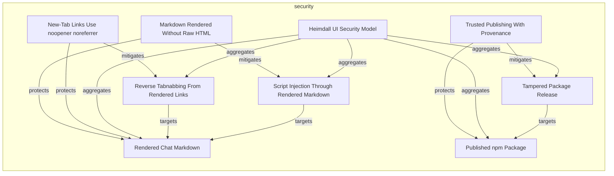
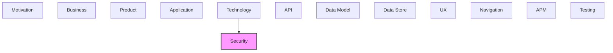

# Security

[← Back to README](../README.md)

Authentication, authorization, security threats, and controls.

## Report Index

- [Layer Introduction](#layer-introduction)
- [Intra-Layer Relationships](#intra-layer-relationships)
- [Inter-Layer Dependencies](#inter-layer-dependencies)
- [Inter-Layer Relationships Table](#inter-layer-relationships-table)
- [Element Reference](#element-reference)

## Layer Introduction

| Metric                    | Count |
| ------------------------- | ----- |
| Elements                  | 9     |
| Intra-Layer Relationships | 14    |
| Inter-Layer Relationships | 1     |
| Inbound Relationships     | 1     |
| Outbound Relationships    | 0     |

**Cross-Layer References**:

- **Upstream layers**: [Technology](./06-technology-layer-report.md)

## Intra-Layer Relationships

## Inter-Layer Dependencies

## Inter-Layer Relationships Table

| Relationship ID                                                  | Source Node                                                 | Dest Node                                                    | Dest Layer | Predicate  | Cardinality  | Strength |
| ---------------------------------------------------------------- | ----------------------------------------------------------- | ------------------------------------------------------------ | ---------- | ---------- | ------------ | -------- |
| `technology.technologyfunction.realizes.security.countermeasure` | `technology.technologyfunction.npm-oidc-trusted-publishing` | `security.countermeasure.trusted-publishing-with-provenance` | `security` | `realizes` | many-to-many | medium   |

## Element Reference

### Markdown Rendered Without Raw HTML {#markdown-rendered-without-raw-html}

**ID**: `security.countermeasure.markdown-rendered-without-raw-html`

**Type**: `countermeasure`

ChatMarkdownContent uses react-markdown with remark-gfm only: no rehype-raw, so raw HTML is not rendered, and react-markdown's default URL transform drops unsafe protocols such as javascript:.

#### Attributes

| Name | Value     |
| ---- | --------- |
| type | technical |

#### Relationships

| Type        | Related Element                                              | Predicate   | Direction |
| ----------- | ------------------------------------------------------------ | ----------- | --------- |
| intra-layer | `security.threat.script-injection-through-rendered-markdown` | `mitigates` | outbound  |
| intra-layer | `security.secureresource.rendered-chat-markdown`             | `protects`  | outbound  |

### New-Tab Links Use noopener noreferrer {#new-tab-links-use-noopener-noreferrer}

**ID**: `security.countermeasure.new-tab-links-use-noopener-noreferrer`

**Type**: `countermeasure`

Markdown links render with target=_blank and rel=noopener noreferrer.

#### Attributes

| Name | Value     |
| ---- | --------- |
| type | technical |

#### Relationships

| Type        | Related Element                                          | Predicate   | Direction |
| ----------- | -------------------------------------------------------- | ----------- | --------- |
| intra-layer | `security.threat.reverse-tabnabbing-from-rendered-links` | `mitigates` | outbound  |
| intra-layer | `security.secureresource.rendered-chat-markdown`         | `protects`  | outbound  |

### Trusted Publishing With Provenance {#trusted-publishing-with-provenance}

**ID**: `security.countermeasure.trusted-publishing-with-provenance`

**Type**: `countermeasure`

release.yml publishes with npm Trusted Publishing (GitHub OIDC, no stored NPM_TOKEN) and --provenance, only after the tag matches package.json and the build, skills and package checks pass.

#### Attributes

| Name | Value     |
| ---- | --------- |
| type | technical |

#### Relationships

| Type        | Related Element                                             | Predicate   | Direction |
| ----------- | ----------------------------------------------------------- | ----------- | --------- |
| inter-layer | `technology.technologyfunction.npm-oidc-trusted-publishing` | `realizes`  | inbound   |
| intra-layer | `security.threat.tampered-package-release`                  | `mitigates` | outbound  |
| intra-layer | `security.secureresource.published-npm-package`             | `protects`  | outbound  |

### Published npm Package {#published-npm-package}

**ID**: `security.secureresource.published-npm-package`

**Type**: `secureresource`

The @tinkermonkey/heimdall-ui tarball on the npm registry that every consumer installs.

#### Attributes

| Name     | Value                                           |
| -------- | ----------------------------------------------- |
| resource | @tinkermonkey/heimdall-ui on registry.npmjs.org |
| type     | file                                            |

#### Relationships

| Type        | Related Element                                              | Predicate    | Direction |
| ----------- | ------------------------------------------------------------ | ------------ | --------- |
| intra-layer | `security.countermeasure.trusted-publishing-with-provenance` | `protects`   | inbound   |
| intra-layer | `security.securitymodel.heimdall-ui-security-model`          | `aggregates` | inbound   |
| intra-layer | `security.threat.tampered-package-release`                   | `targets`    | inbound   |

### Rendered Chat Markdown {#rendered-chat-markdown}

**ID**: `security.secureresource.rendered-chat-markdown`

**Type**: `secureresource`

Markdown from chat messages (often model or tool output the consumer does not control) rendered to DOM by ChatMarkdownContent.

#### Attributes

| Name     | Value                      |
| -------- | -------------------------- |
| resource | ChatMarkdownContent output |
| type     | ui                         |

#### Relationships

| Type        | Related Element                                                 | Predicate    | Direction |
| ----------- | --------------------------------------------------------------- | ------------ | --------- |
| intra-layer | `security.countermeasure.markdown-rendered-without-raw-html`    | `protects`   | inbound   |
| intra-layer | `security.countermeasure.new-tab-links-use-noopener-noreferrer` | `protects`   | inbound   |
| intra-layer | `security.securitymodel.heimdall-ui-security-model`             | `aggregates` | inbound   |
| intra-layer | `security.threat.reverse-tabnabbing-from-rendered-links`        | `targets`    | inbound   |
| intra-layer | `security.threat.script-injection-through-rendered-markdown`    | `targets`    | inbound   |

### Heimdall UI Security Model {#heimdall-ui-security-model}

**ID**: `security.securitymodel.heimdall-ui-security-model`

**Type**: `securitymodel`

Security concerns of a client-side component library with no authentication or data of its own: content it renders from consumer data, and the integrity of what it publishes to npm.

#### Attributes

| Name        | Value                     |
| ----------- | ------------------------- |
| application | @tinkermonkey/heimdall-ui |
| version     | 0.13.0                    |

#### Relationships

| Type        | Related Element                                              | Predicate    | Direction |
| ----------- | ------------------------------------------------------------ | ------------ | --------- |
| intra-layer | `security.secureresource.published-npm-package`              | `aggregates` | outbound  |
| intra-layer | `security.secureresource.rendered-chat-markdown`             | `aggregates` | outbound  |
| intra-layer | `security.threat.reverse-tabnabbing-from-rendered-links`     | `aggregates` | outbound  |
| intra-layer | `security.threat.script-injection-through-rendered-markdown` | `aggregates` | outbound  |
| intra-layer | `security.threat.tampered-package-release`                   | `aggregates` | outbound  |

### Reverse Tabnabbing From Rendered Links {#reverse-tabnabbing-from-rendered-links}

**ID**: `security.threat.reverse-tabnabbing-from-rendered-links`

**Type**: `threat`

A link opened in a new tab from rendered content gets window.opener and navigates the consumer's page to a phishing copy.

#### Attributes

| Name       | Value                  |
| ---------- | ---------------------- |
| impact     | moderate               |
| likelihood | low                    |
| threatens  | Rendered Chat Markdown |

#### Relationships

| Type        | Related Element                                                 | Predicate    | Direction |
| ----------- | --------------------------------------------------------------- | ------------ | --------- |
| intra-layer | `security.countermeasure.new-tab-links-use-noopener-noreferrer` | `mitigates`  | inbound   |
| intra-layer | `security.securitymodel.heimdall-ui-security-model`             | `aggregates` | inbound   |
| intra-layer | `security.secureresource.rendered-chat-markdown`                | `targets`    | outbound  |

### Script Injection Through Rendered Markdown {#script-injection-through-rendered-markdown}

**ID**: `security.threat.script-injection-through-rendered-markdown`

**Type**: `threat`

Untrusted markdown carrying raw HTML or javascript: URLs executes script in the consumer's page.

#### Attributes

| Name       | Value                  |
| ---------- | ---------------------- |
| impact     | high                   |
| likelihood | moderate               |
| threatens  | Rendered Chat Markdown |

#### Relationships

| Type        | Related Element                                              | Predicate    | Direction |
| ----------- | ------------------------------------------------------------ | ------------ | --------- |
| intra-layer | `security.countermeasure.markdown-rendered-without-raw-html` | `mitigates`  | inbound   |
| intra-layer | `security.securitymodel.heimdall-ui-security-model`          | `aggregates` | inbound   |
| intra-layer | `security.secureresource.rendered-chat-markdown`             | `targets`    | outbound  |

### Tampered Package Release {#tampered-package-release}

**ID**: `security.threat.tampered-package-release`

**Type**: `threat`

A stolen long-lived npm token or a build outside CI publishes a malicious version consumers install.

#### Attributes

| Name       | Value                 |
| ---------- | --------------------- |
| impact     | high                  |
| likelihood | low                   |
| threatens  | Published npm Package |

#### Relationships

| Type        | Related Element                                              | Predicate    | Direction |
| ----------- | ------------------------------------------------------------ | ------------ | --------- |
| intra-layer | `security.countermeasure.trusted-publishing-with-provenance` | `mitigates`  | inbound   |
| intra-layer | `security.securitymodel.heimdall-ui-security-model`          | `aggregates` | inbound   |
| intra-layer | `security.secureresource.published-npm-package`              | `targets`    | outbound  |

---

Generated: 2026-11-24T20:12:21.374Z | Model Version: 0.1.0
