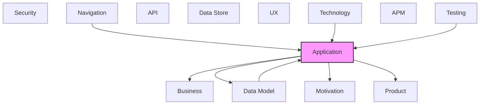

# Application

[← Back to README](../README.md)

Application components, services, and interactions.

## Report Index

- [Layer Introduction](#layer-introduction)
- [Intra-Layer Relationships](#intra-layer-relationships)
- [Inter-Layer Dependencies](#inter-layer-dependencies)
- [Inter-Layer Relationships Table](#inter-layer-relationships-table)
- [Element Reference](#element-reference)

## Layer Introduction

| Metric                    | Count |
| ------------------------- | ----- |
| Elements                  | 120   |
| Intra-Layer Relationships | 199   |
| Inter-Layer Relationships | 382   |
| Inbound Relationships     | 262   |
| Outbound Relationships    | 120   |

**Cross-Layer References**:

- **Upstream layers**: [Data Model](./08-data-model-layer-report.md), [Navigation](./11-navigation-layer-report.md), [Technology](./06-technology-layer-report.md), [Testing](./13-testing-layer-report.md)
- **Downstream layers**: [Business](./02-business-layer-report.md), [Data Model](./08-data-model-layer-report.md), [Motivation](./01-motivation-layer-report.md), [Product](./03-product-layer-report.md)

## Intra-Layer Relationships

*This layer has >30 elements. Summary table shown instead of diagram.*

| Element                                                                          | Type                       | Relationships |
| -------------------------------------------------------------------------------- | -------------------------- | ------------- |
| `application.applicationcollaboration.graph-canvas-layoutviewport-collaboration` | `applicationcollaboration` | 4             |
| `application.applicationcomponent.consumer-smoke-test-app`                       | `applicationcomponent`     | 2             |
| `application.applicationcomponent.graph-canvas-component`                        | `applicationcomponent`     | 30            |
| `application.applicationcomponent.graph-collapse-control-component`              | `applicationcomponent`     | 2             |
| `application.applicationcomponent.graph-edge-component`                          | `applicationcomponent`     | 5             |
| `application.applicationcomponent.graph-edge-inspector-component`                | `applicationcomponent`     | 2             |
| `application.applicationcomponent.graph-edge-shape-component`                    | `applicationcomponent`     | 6             |
| `application.applicationcomponent.graph-inspector-component`                     | `applicationcomponent`     | 2             |
| `application.applicationcomponent.graph-node-component`                          | `applicationcomponent`     | 3             |
| `application.applicationcomponent.graph-toolbar-component`                       | `applicationcomponent`     | 2             |
| `application.applicationcomponent.heimdall-ui-package`                           | `applicationcomponent`     | 41            |
| `application.applicationcomponent.test-page-host-app`                            | `applicationcomponent`     | 2             |
| `application.applicationevent.background-click-event`                            | `applicationevent`         | 0             |
| `application.applicationevent.collapse-toggle-event`                             | `applicationevent`         | 0             |
| `application.applicationevent.edge-hover-change-event`                           | `applicationevent`         | 0             |
| `application.applicationevent.edge-select-event`                                 | `applicationevent`         | 0             |
| `application.applicationevent.layout-state-change-event`                         | `applicationevent`         | 0             |
| `application.applicationevent.node-drag-end-event`                               | `applicationevent`         | 2             |
| `application.applicationevent.node-hover-change-event`                           | `applicationevent`         | 1             |
| `application.applicationevent.viewport-dwell-event`                              | `applicationevent`         | 0             |
| `application.applicationevent.viewport-navigate-event`                           | `applicationevent`         | 0             |
| `application.applicationfunction.adjacency-matrix-ordering`                      | `applicationfunction`      | 1             |
| `application.applicationfunction.animated-tween`                                 | `applicationfunction`      | 2             |
| `application.applicationfunction.async-layer-layout`                             | `applicationfunction`      | 1             |
| `application.applicationfunction.batched-link-path-drawing`                      | `applicationfunction`      | 1             |
| `application.applicationfunction.bezier-edge-path-computation`                   | `applicationfunction`      | 4             |
| `application.applicationfunction.body-scroll-lock`                               | `applicationfunction`      | 1             |
| `application.applicationfunction.cluster-circle-packing`                         | `applicationfunction`      | 3             |
| `application.applicationfunction.clustered-force-layout-algorithm`               | `applicationfunction`      | 6             |
| `application.applicationfunction.controllable-state`                             | `applicationfunction`      | 2             |
| `application.applicationfunction.dropdown-menu-keyboard-navigation`              | `applicationfunction`      | 1             |
| `application.applicationfunction.dropdown-portal-placement`                      | `applicationfunction`      | 1             |
| `application.applicationfunction.edge-label-clear-position-search`               | `applicationfunction`      | 6             |
| `application.applicationfunction.edge-stroke-styling`                            | `applicationfunction`      | 2             |
| `application.applicationfunction.focus-trap`                                     | `applicationfunction`      | 1             |
| `application.applicationfunction.force-directed-layout-algorithm`                | `applicationfunction`      | 7             |
| `application.applicationfunction.galaxy-aspect-ratio-resolution`                 | `applicationfunction`      | 3             |
| `application.applicationfunction.galaxy-live-simulation-step`                    | `applicationfunction`      | 4             |
| `application.applicationfunction.galaxy-radial-orbit-layout-algorithm`           | `applicationfunction`      | 6             |
| `application.applicationfunction.heatmap-color-scaling`                          | `applicationfunction`      | 1             |
| `application.applicationfunction.hive-plot-geometry`                             | `applicationfunction`      | 2             |
| `application.applicationfunction.joint-edge-label-placement`                     | `applicationfunction`      | 3             |
| `application.applicationfunction.layer-placement-layout`                         | `applicationfunction`      | 4             |
| `application.applicationfunction.layer-stack-projection-and-camera`              | `applicationfunction`      | 2             |
| `application.applicationfunction.layered-graph-snapshot-sanitizing`              | `applicationfunction`      | 2             |
| `application.applicationfunction.layered-graph-state`                            | `applicationfunction`      | 2             |
| `application.applicationfunction.layered-index-building`                         | `applicationfunction`      | 3             |
| `application.applicationfunction.link-and-node-emphasis-styling`                 | `applicationfunction`      | 2             |
| `application.applicationfunction.link-visibility-filtering`                      | `applicationfunction`      | 2             |
| `application.applicationfunction.louvain-community-clustering`                   | `applicationfunction`      | 3             |
| `application.applicationfunction.media-query-tracking`                           | `applicationfunction`      | 2             |
| `application.applicationfunction.modified-click-link-handling`                   | `applicationfunction`      | 1             |
| `application.applicationfunction.navigation-edge-orthogonal-routing`             | `applicationfunction`      | 2             |
| `application.applicationfunction.node-overlap-separation-pass`                   | `applicationfunction`      | 4             |
| `application.applicationfunction.node-pointer-handling`                          | `applicationfunction`      | 4             |
| `application.applicationfunction.organic-layout-algorithm`                       | `applicationfunction`      | 3             |
| `application.applicationfunction.orthogonal-channel-routing`                     | `applicationfunction`      | 1             |
| `application.applicationfunction.orthogonal-layout-algorithm`                    | `applicationfunction`      | 3             |
| `application.applicationfunction.otlp-trace-adapter`                             | `applicationfunction`      | 2             |
| `application.applicationfunction.paint-deferred-scheduling`                      | `applicationfunction`      | 1             |
| `application.applicationfunction.painter-depth-reordering`                       | `applicationfunction`      | 1             |
| `application.applicationfunction.pan-inertia-glide`                              | `applicationfunction`      | 1             |
| `application.applicationfunction.predicate-label-placement`                      | `applicationfunction`      | 3             |
| `application.applicationfunction.radial-tree-layout-algorithm`                   | `applicationfunction`      | 4             |
| `application.applicationfunction.selection-reach-computation`                    | `applicationfunction`      | 2             |
| `application.applicationfunction.static-date-formatting`                         | `applicationfunction`      | 1             |
| `application.applicationfunction.structural-descendant-lookup`                   | `applicationfunction`      | 2             |
| `application.applicationfunction.structural-forest-construction`                 | `applicationfunction`      | 5             |
| `application.applicationfunction.swimlane-layer-layout`                          | `applicationfunction`      | 2             |
| `application.applicationfunction.trace-model-building`                           | `applicationfunction`      | 2             |
| `application.applicationfunction.ux-navigation-tree-layout-algorithm`            | `applicationfunction`      | 5             |
| `application.applicationfunction.virtualized-list-windowing`                     | `applicationfunction`      | 1             |
| `application.applicationfunction.x-ray-trace-adapter`                            | `applicationfunction`      | 2             |
| `application.applicationinteraction.panzoom-gesture-handling`                    | `applicationinteraction`   | 2             |
| `application.applicationprocess.graph-render-and-layout-recomputation-pipeline`  | `applicationprocess`       | 8             |
| `application.applicationservice.adjacency-matrix-link-metadata`                  | `applicationservice`       | 1             |
| `application.applicationservice.app-shell-components`                            | `applicationservice`       | 1             |
| `application.applicationservice.chart-components`                                | `applicationservice`       | 1             |
| `application.applicationservice.chat-components`                                 | `applicationservice`       | 1             |
| `application.applicationservice.cluster-packing`                                 | `applicationservice`       | 2             |
| `application.applicationservice.controllable-state-hook`                         | `applicationservice`       | 2             |
| `application.applicationservice.data-display-components`                         | `applicationservice`       | 2             |
| `application.applicationservice.dropdown-portal-containment`                     | `applicationservice`       | 1             |
| `application.applicationservice.edge-geometry`                                   | `applicationservice`       | 2             |
| `application.applicationservice.force-layout`                                    | `applicationservice`       | 3             |
| `application.applicationservice.form-input-components`                           | `applicationservice`       | 3             |
| `application.applicationservice.galaxy-layout`                                   | `applicationservice`       | 2             |
| `application.applicationservice.graph-canvas-context-hook`                       | `applicationservice`       | 1             |
| `application.applicationservice.graph-layout-engine-service`                     | `applicationservice`       | 19            |
| `application.applicationservice.interactive-graph-rendering`                     | `applicationservice`       | 18            |
| `application.applicationservice.lane-layout`                                     | `applicationservice`       | 2             |
| `application.applicationservice.layered-graph-control-helpers`                   | `applicationservice`       | 1             |
| `application.applicationservice.layered-graph-explorer-snapshot`                 | `applicationservice`       | 1             |
| `application.applicationservice.layered-graph-state-hooks`                       | `applicationservice`       | 2             |
| `application.applicationservice.layered-graph-utilities`                         | `applicationservice`       | 10            |
| `application.applicationservice.layered-graph-visualization`                     | `applicationservice`       | 19            |
| `application.applicationservice.layout-components`                               | `applicationservice`       | 2             |
| `application.applicationservice.live-galaxy-simulation-service`                  | `applicationservice`       | 4             |
| `application.applicationservice.louvain-clustering`                              | `applicationservice`       | 2             |
| `application.applicationservice.media-query-hook`                                | `applicationservice`       | 2             |
| `application.applicationservice.navigation-components`                           | `applicationservice`       | 2             |
| `application.applicationservice.observability-view-components`                   | `applicationservice`       | 5             |
| `application.applicationservice.organic-layout`                                  | `applicationservice`       | 2             |
| `application.applicationservice.orthogonal-layout`                               | `applicationservice`       | 2             |
| `application.applicationservice.otlp-trace-adapter`                              | `applicationservice`       | 2             |
| `application.applicationservice.overlay-components`                              | `applicationservice`       | 3             |
| `application.applicationservice.page-pattern-components`                         | `applicationservice`       | 1             |
| `application.applicationservice.pan-and-zoom-hook`                               | `applicationservice`       | 1             |
| `application.applicationservice.planning-components`                             | `applicationservice`       | 2             |
| `application.applicationservice.primitive-components`                            | `applicationservice`       | 1             |
| `application.applicationservice.radial-tree-layout`                              | `applicationservice`       | 2             |
| `application.applicationservice.reach-relationship-helpers`                      | `applicationservice`       | 1             |
| `application.applicationservice.structural-hierarchy`                            | `applicationservice`       | 3             |
| `application.applicationservice.trace-viewer-model`                              | `applicationservice`       | 2             |
| `application.applicationservice.tween-animation-hooks`                           | `applicationservice`       | 2             |
| `application.applicationservice.ux-navigation-edge-visibility`                   | `applicationservice`       | 2             |
| `application.applicationservice.ux-navigation-layout`                            | `applicationservice`       | 2             |
| `application.applicationservice.x-ray-trace-adapter`                             | `applicationservice`       | 2             |
| `application.dataobject.node-position-map`                                       | `dataobject`               | 7             |
| `application.dataobject.node-rect-registry`                                      | `dataobject`               | 4             |

## Inter-Layer Dependencies

## Inter-Layer Relationships Table

| Relationship ID                                                         | Source Node                                                                                                                           | Dest Node                                                                                   | Dest Layer    | Predicate    | Cardinality  | Strength |
| ----------------------------------------------------------------------- | ------------------------------------------------------------------------------------------------------------------------------------- | ------------------------------------------------------------------------------------------- | ------------- | ------------ | ------------ | -------- |
| `application.applicationcomponent.accesses.data-model.schemadefinition` | `application.applicationcomponent.graph-canvas-component`                                                                             | `data-model.schemadefinition.edge-geometry`                                                 | `data-model`  | `accesses`   | many-to-many | medium   |
| `application.applicationcomponent.accesses.data-model.schemadefinition` | `application.applicationcomponent.graph-canvas-component`                                                                             | `data-model.schemadefinition.graph-edge-data-shape`                                         | `data-model`  | `accesses`   | many-to-many | medium   |
| `application.applicationcomponent.accesses.data-model.schemadefinition` | `application.applicationcomponent.graph-canvas-component`                                                                             | `data-model.schemadefinition.graph-layout-state`                                            | `data-model`  | `accesses`   | many-to-many | medium   |
| `application.applicationcomponent.accesses.data-model.schemadefinition` | `application.applicationcomponent.graph-canvas-component`                                                                             | `data-model.schemadefinition.graph-node-data`                                               | `data-model`  | `accesses`   | many-to-many | medium   |
| `application.applicationcomponent.accesses.data-model.schemadefinition` | `application.applicationcomponent.graph-canvas-component`                                                                             | `data-model.schemadefinition.graph-viewport`                                                | `data-model`  | `accesses`   | many-to-many | medium   |
| `application.applicationcomponent.accesses.data-model.schemadefinition` | `application.applicationcomponent.graph-canvas-component`                                                                             | `data-model.schemadefinition.graph-viewport-snapshot`                                       | `data-model`  | `accesses`   | many-to-many | medium   |
| `application.applicationcomponent.accesses.data-model.schemadefinition` | `application.applicationcomponent.graph-canvas-component`                                                                             | `data-model.schemadefinition.lane-layout`                                                   | `data-model`  | `accesses`   | many-to-many | medium   |
| `application.applicationcomponent.accesses.data-model.schemadefinition` | `application.applicationcomponent.graph-canvas-component`                                                                             | `data-model.schemadefinition.layered-graph-state`                                           | `data-model`  | `accesses`   | many-to-many | medium   |
| `application.applicationevent.accesses.data-model.schemadefinition`     | `application.applicationevent.layout-state-change-event`                                                                              | `data-model.schemadefinition.graph-layout-state`                                            | `data-model`  | `accesses`   | many-to-many | medium   |
| `application.applicationevent.accesses.data-model.schemadefinition`     | `application.applicationevent.viewport-dwell-event`                                                                                   | `data-model.schemadefinition.graph-viewport-snapshot`                                       | `data-model`  | `accesses`   | many-to-many | medium   |
| `application.applicationevent.accesses.data-model.schemadefinition`     | `application.applicationevent.viewport-navigate-event`                                                                                | `data-model.schemadefinition.graph-viewport-snapshot`                                       | `data-model`  | `accesses`   | many-to-many | medium   |
| `application.applicationfunction.accesses.data-model.schemadefinition`  | `application.applicationfunction.cluster-circle-packing`                                                                              | `data-model.schemadefinition.cluster-tree-node`                                             | `data-model`  | `accesses`   | many-to-many | medium   |
| `application.applicationfunction.accesses.data-model.schemadefinition`  | `application.applicationfunction.clustered-force-layout-algorithm`                                                                    | `data-model.schemadefinition.clustered-layout-options`                                      | `data-model`  | `accesses`   | many-to-many | medium   |
| `application.applicationfunction.accesses.data-model.schemadefinition`  | `application.applicationfunction.clustered-force-layout-algorithm`                                                                    | `data-model.schemadefinition.clustered-layout-result`                                       | `data-model`  | `accesses`   | many-to-many | medium   |
| `application.applicationfunction.satisfies.motivation.requirement`      | `application.applicationfunction.clustered-force-layout-algorithm`                                                                    | `motivation.requirement.layout-engines-must-be-pluggable-without-breaking-existing-callers` | `motivation`  | `satisfies`  | many-to-many | medium   |
| `application.applicationfunction.satisfies.motivation.requirement`      | `application.applicationfunction.dropdown-portal-placement`                                                                           | `motivation.requirement.dropdown-panels-render-in-a-portal-by-default`                      | `motivation`  | `satisfies`  | many-to-many | medium   |
| `application.applicationfunction.accesses.data-model.schemadefinition`  | `application.applicationfunction.force-directed-layout-algorithm`                                                                     | `data-model.schemadefinition.force-layout-options`                                          | `data-model`  | `accesses`   | many-to-many | medium   |
| `application.applicationfunction.accesses.data-model.schemadefinition`  | `application.applicationfunction.force-directed-layout-algorithm`                                                                     | `data-model.schemadefinition.layout-edge`                                                   | `data-model`  | `accesses`   | many-to-many | medium   |
| `application.applicationfunction.accesses.data-model.schemadefinition`  | `application.applicationfunction.force-directed-layout-algorithm`                                                                     | `data-model.schemadefinition.layout-node`                                                   | `data-model`  | `accesses`   | many-to-many | medium   |
| `application.applicationfunction.realizes.business.businessfunction`    | `application.applicationfunction.force-directed-layout-algorithm`                                                                     | `business.businessfunction.automatic-node-layout-computation`                               | `business`    | `realizes`   | many-to-many | medium   |
| `application.applicationfunction.satisfies.motivation.requirement`      | `application.applicationfunction.force-directed-layout-algorithm`                                                                     | `motivation.requirement.layout-engines-must-be-pluggable-without-breaking-existing-callers` | `motivation`  | `satisfies`  | many-to-many | medium   |
| `application.applicationfunction.satisfies.motivation.requirement`      | `application.applicationfunction.force-directed-layout-algorithm`                                                                     | `motivation.requirement.no-two-node-boxes-overlap-after-any-layout-engine-runs`             | `motivation`  | `satisfies`  | many-to-many | medium   |
| `application.applicationfunction.accesses.data-model.schemadefinition`  | `application.applicationfunction.galaxy-aspect-ratio-resolution`                                                                      | `data-model.schemadefinition.galaxy-layout-edge`                                            | `data-model`  | `accesses`   | many-to-many | medium   |
| `application.applicationfunction.accesses.data-model.schemadefinition`  | `application.applicationfunction.galaxy-aspect-ratio-resolution`                                                                      | `data-model.schemadefinition.galaxy-layout-node`                                            | `data-model`  | `accesses`   | many-to-many | medium   |
| `application.applicationfunction.accesses.data-model.schemadefinition`  | `application.applicationfunction.galaxy-aspect-ratio-resolution`                                                                      | `data-model.schemadefinition.galaxy-layout-options`                                         | `data-model`  | `accesses`   | many-to-many | medium   |
| `application.applicationfunction.accesses.data-model.schemadefinition`  | `application.applicationfunction.galaxy-live-simulation-step`                                                                         | `data-model.schemadefinition.galaxy-layout-edge`                                            | `data-model`  | `accesses`   | many-to-many | medium   |
| `application.applicationfunction.accesses.data-model.schemadefinition`  | `application.applicationfunction.galaxy-live-simulation-step`                                                                         | `data-model.schemadefinition.galaxy-layout-node`                                            | `data-model`  | `accesses`   | many-to-many | medium   |
| `application.applicationfunction.accesses.data-model.schemadefinition`  | `application.applicationfunction.galaxy-live-simulation-step`                                                                         | `data-model.schemadefinition.galaxy-layout-options`                                         | `data-model`  | `accesses`   | many-to-many | medium   |
| `application.applicationfunction.satisfies.motivation.requirement`      | `application.applicationfunction.galaxy-live-simulation-step`                                                                         | `motivation.requirement.layout-output-is-deterministic-for-a-given-input`                   | `motivation`  | `satisfies`  | many-to-many | medium   |
| `application.applicationfunction.satisfies.motivation.requirement`      | `application.applicationfunction.galaxy-live-simulation-step`                                                                         | `motivation.requirement.live-galaxy-drag-stays-interactive`                                 | `motivation`  | `satisfies`  | many-to-many | medium   |
| `application.applicationfunction.accesses.data-model.schemadefinition`  | `application.applicationfunction.galaxy-radial-orbit-layout-algorithm`                                                                | `data-model.schemadefinition.galaxy-layout-edge`                                            | `data-model`  | `accesses`   | many-to-many | medium   |
| `application.applicationfunction.accesses.data-model.schemadefinition`  | `application.applicationfunction.galaxy-radial-orbit-layout-algorithm`                                                                | `data-model.schemadefinition.galaxy-layout-node`                                            | `data-model`  | `accesses`   | many-to-many | medium   |
| `application.applicationfunction.accesses.data-model.schemadefinition`  | `application.applicationfunction.galaxy-radial-orbit-layout-algorithm`                                                                | `data-model.schemadefinition.galaxy-layout-options`                                         | `data-model`  | `accesses`   | many-to-many | medium   |
| `application.applicationfunction.realizes.business.businessfunction`    | `application.applicationfunction.galaxy-radial-orbit-layout-algorithm`                                                                | `business.businessfunction.automatic-node-layout-computation`                               | `business`    | `realizes`   | many-to-many | medium   |
| `application.applicationfunction.satisfies.motivation.requirement`      | `application.applicationfunction.galaxy-radial-orbit-layout-algorithm`                                                                | `motivation.requirement.galaxy-keeps-orbits-even-over-round-systems`                        | `motivation`  | `satisfies`  | many-to-many | medium   |
| `application.applicationfunction.satisfies.motivation.requirement`      | `application.applicationfunction.galaxy-radial-orbit-layout-algorithm`                                                                | `motivation.requirement.no-two-node-boxes-overlap-after-any-layout-engine-runs`             | `motivation`  | `satisfies`  | many-to-many | medium   |
| `application.applicationfunction.satisfies.motivation.requirement`      | `application.applicationfunction.hive-plot-geometry`                                                                                  | `motivation.requirement.hive-plot-keeps-axis-angles-stable-when-a-layer-is-hidden`          | `motivation`  | `satisfies`  | many-to-many | medium   |
| `application.applicationfunction.accesses.data-model.schemadefinition`  | `application.applicationfunction.louvain-community-clustering`                                                                        | `data-model.schemadefinition.cluster-tree-node`                                             | `data-model`  | `accesses`   | many-to-many | medium   |
| `application.applicationfunction.realizes.business.businessfunction`    | `application.applicationfunction.louvain-community-clustering`                                                                        | `business.businessfunction.community-and-cluster-discovery-in-relationship-graphs`          | `business`    | `realizes`   | many-to-many | medium   |
| `application.applicationfunction.satisfies.motivation.requirement`      | `application.applicationfunction.louvain-community-clustering`                                                                        | `motivation.requirement.layout-output-is-deterministic-for-a-given-input`                   | `motivation`  | `satisfies`  | many-to-many | medium   |
| `application.applicationfunction.satisfies.motivation.requirement`      | `application.applicationfunction.navigation-edge-orthogonal-routing`                                                                  | `motivation.requirement.navigation-routing-stays-within-its-time-budget`                    | `motivation`  | `satisfies`  | many-to-many | medium   |
| `application.applicationfunction.accesses.data-model.schemadefinition`  | `application.applicationfunction.node-overlap-separation-pass`                                                                        | `data-model.schemadefinition.layout-node`                                                   | `data-model`  | `accesses`   | many-to-many | medium   |
| `application.applicationfunction.satisfies.motivation.requirement`      | `application.applicationfunction.node-overlap-separation-pass`                                                                        | `motivation.requirement.no-two-node-boxes-overlap-after-any-layout-engine-runs`             | `motivation`  | `satisfies`  | many-to-many | medium   |
| `application.applicationfunction.accesses.data-model.schemadefinition`  | `application.applicationfunction.organic-layout-algorithm`                                                                            | `data-model.schemadefinition.organic-layout-options`                                        | `data-model`  | `accesses`   | many-to-many | medium   |
| `application.applicationfunction.satisfies.motivation.requirement`      | `application.applicationfunction.organic-layout-algorithm`                                                                            | `motivation.requirement.layout-output-is-deterministic-for-a-given-input`                   | `motivation`  | `satisfies`  | many-to-many | medium   |
| `application.applicationfunction.satisfies.motivation.requirement`      | `application.applicationfunction.organic-layout-algorithm`                                                                            | `motivation.requirement.no-two-node-boxes-overlap-after-any-layout-engine-runs`             | `motivation`  | `satisfies`  | many-to-many | medium   |
| `application.applicationfunction.accesses.data-model.schemadefinition`  | `application.applicationfunction.orthogonal-layout-algorithm`                                                                         | `data-model.schemadefinition.orthogonal-layout-options`                                     | `data-model`  | `accesses`   | many-to-many | medium   |
| `application.applicationfunction.satisfies.motivation.requirement`      | `application.applicationfunction.orthogonal-layout-algorithm`                                                                         | `motivation.requirement.layout-output-is-deterministic-for-a-given-input`                   | `motivation`  | `satisfies`  | many-to-many | medium   |
| `application.applicationfunction.accesses.data-model.schemadefinition`  | `application.applicationfunction.otlp-trace-adapter`                                                                                  | `data-model.schemadefinition.otlp-traces-data`                                              | `data-model`  | `accesses`   | many-to-many | medium   |
| `application.applicationfunction.accesses.data-model.schemadefinition`  | `application.applicationfunction.radial-tree-layout-algorithm`                                                                        | `data-model.schemadefinition.radial-tree-layout-result`                                     | `data-model`  | `accesses`   | many-to-many | medium   |
| `application.applicationfunction.realizes.business.businessfunction`    | `application.applicationfunction.radial-tree-layout-algorithm`                                                                        | `business.businessfunction.automatic-node-layout-computation`                               | `business`    | `realizes`   | many-to-many | medium   |
| `application.applicationfunction.satisfies.motivation.requirement`      | `application.applicationfunction.radial-tree-layout-algorithm`                                                                        | `motivation.requirement.no-two-node-boxes-overlap-after-any-layout-engine-runs`             | `motivation`  | `satisfies`  | many-to-many | medium   |
| `application.applicationfunction.accesses.data-model.schemadefinition`  | `application.applicationfunction.structural-forest-construction`                                                                      | `data-model.schemadefinition.hierarchy-edge`                                                | `data-model`  | `accesses`   | many-to-many | medium   |
| `application.applicationfunction.accesses.data-model.schemadefinition`  | `application.applicationfunction.structural-forest-construction`                                                                      | `data-model.schemadefinition.structural-forest`                                             | `data-model`  | `accesses`   | many-to-many | medium   |
| `application.applicationfunction.realizes.business.businessfunction`    | `application.applicationfunction.ux-navigation-tree-layout-algorithm`                                                                 | `business.businessfunction.automatic-node-layout-computation`                               | `business`    | `realizes`   | many-to-many | medium   |
| `application.applicationfunction.accesses.data-model.schemadefinition`  | `application.applicationfunction.x-ray-trace-adapter`                                                                                 | `data-model.schemadefinition.xray-segment`                                                  | `data-model`  | `accesses`   | many-to-many | medium   |
| `application.applicationprocess.realizes.business.businessprocess`      | `application.applicationprocess.graph-render-and-layout-recomputation-pipeline`                                                       | `business.businessprocess.render-graph-from-domain-data-to-interactive-view`                | `business`    | `realizes`   | many-to-many | medium   |
| `application.applicationservice.realizes.product.softwarecapability`    | `application.applicationservice.adjacency-matrix-link-metadata`                                                                       | `product.softwarecapability.layered-graph-visualization`                                    | `product`     | `realizes`   | many-to-many | medium   |
| `application.applicationservice.realizes.product.softwarecapability`    | `application.applicationservice.app-shell-components`                                                                                 | `product.softwarecapability.app-shell`                                                      | `product`     | `realizes`   | many-to-many | medium   |
| `application.applicationservice.realizes.product.softwarecapability`    | `application.applicationservice.chart-components`                                                                                     | `product.softwarecapability.charting`                                                       | `product`     | `realizes`   | many-to-many | medium   |
| `application.applicationservice.realizes.product.softwarecapability`    | `application.applicationservice.chat-components`                                                                                      | `product.softwarecapability.chat-ui`                                                        | `product`     | `realizes`   | many-to-many | medium   |
| `application.applicationservice.realizes.product.softwarecapability`    | `application.applicationservice.cluster-packing`                                                                                      | `product.softwarecapability.clustered-force-layout-community-bubbles`                       | `product`     | `realizes`   | many-to-many | medium   |
| `application.applicationservice.realizes.product.softwarecapability`    | `application.applicationservice.controllable-state-hook`                                                                              | `product.softwarecapability.layered-graph-visualization`                                    | `product`     | `realizes`   | many-to-many | medium   |
| `application.applicationservice.realizes.product.softwarecapability`    | `application.applicationservice.data-display-components`                                                                              | `product.softwarecapability.data-display`                                                   | `product`     | `realizes`   | many-to-many | medium   |
| `application.applicationservice.realizes.product.softwarecapability`    | `application.applicationservice.dropdown-portal-containment`                                                                          | `product.softwarecapability.overlays-and-dialogs`                                           | `product`     | `realizes`   | many-to-many | medium   |
| `application.applicationservice.realizes.product.softwarecapability`    | `application.applicationservice.edge-geometry`                                                                                        | `product.softwarecapability.interactive-graph-exploration`                                  | `product`     | `realizes`   | many-to-many | medium   |
| `application.applicationservice.realizes.product.softwarecapability`    | `application.applicationservice.force-layout`                                                                                         | `product.softwarecapability.clustered-force-layout-community-bubbles`                       | `product`     | `realizes`   | many-to-many | medium   |
| `application.applicationservice.realizes.product.softwarecapability`    | `application.applicationservice.force-layout`                                                                                         | `product.softwarecapability.force-directed-graph-layout`                                    | `product`     | `realizes`   | many-to-many | medium   |
| `application.applicationservice.realizes.product.softwarecapability`    | `application.applicationservice.form-input-components`                                                                                | `product.softwarecapability.form-input`                                                     | `product`     | `realizes`   | many-to-many | medium   |
| `application.applicationservice.realizes.product.softwarecapability`    | `application.applicationservice.galaxy-layout`                                                                                        | `product.softwarecapability.galaxy-radial-orbit-layout`                                     | `product`     | `realizes`   | many-to-many | medium   |
| `application.applicationservice.realizes.product.softwarecapability`    | `application.applicationservice.graph-canvas-context-hook`                                                                            | `product.softwarecapability.interactive-graph-exploration`                                  | `product`     | `realizes`   | many-to-many | medium   |
| `application.applicationservice.realizes.business.businessservice`      | `application.applicationservice.graph-layout-engine-service`                                                                          | `business.businessservice.hierarchical-and-navigation-structure-visualization`              | `business`    | `realizes`   | many-to-many | medium   |
| `application.applicationservice.realizes.business.businessservice`      | `application.applicationservice.graph-layout-engine-service`                                                                          | `business.businessservice.large-graph-visualization`                                        | `business`    | `realizes`   | many-to-many | medium   |
| `application.applicationservice.realizes.product.softwarecapability`    | `application.applicationservice.graph-layout-engine-service`                                                                          | `product.softwarecapability.clustered-force-layout-community-bubbles`                       | `product`     | `realizes`   | many-to-many | medium   |
| `application.applicationservice.realizes.product.softwarecapability`    | `application.applicationservice.graph-layout-engine-service`                                                                          | `product.softwarecapability.force-directed-graph-layout`                                    | `product`     | `realizes`   | many-to-many | medium   |
| `application.applicationservice.realizes.product.softwarecapability`    | `application.applicationservice.graph-layout-engine-service`                                                                          | `product.softwarecapability.galaxy-radial-orbit-layout`                                     | `product`     | `realizes`   | many-to-many | medium   |
| `application.applicationservice.realizes.product.softwarecapability`    | `application.applicationservice.graph-layout-engine-service`                                                                          | `product.softwarecapability.layer-lanes-layout`                                             | `product`     | `realizes`   | many-to-many | medium   |
| `application.applicationservice.realizes.product.softwarecapability`    | `application.applicationservice.graph-layout-engine-service`                                                                          | `product.softwarecapability.organic-graph-layout`                                           | `product`     | `realizes`   | many-to-many | medium   |
| `application.applicationservice.realizes.product.softwarecapability`    | `application.applicationservice.graph-layout-engine-service`                                                                          | `product.softwarecapability.orthogonal-graph-layout`                                        | `product`     | `realizes`   | many-to-many | medium   |
| `application.applicationservice.realizes.product.softwarecapability`    | `application.applicationservice.graph-layout-engine-service`                                                                          | `product.softwarecapability.radial-tree-layout`                                             | `product`     | `realizes`   | many-to-many | medium   |
| `application.applicationservice.realizes.product.softwarecapability`    | `application.applicationservice.graph-layout-engine-service`                                                                          | `product.softwarecapability.ux-navigation-tree-layout`                                      | `product`     | `realizes`   | many-to-many | medium   |
| `application.applicationservice.satisfies.motivation.requirement`       | `application.applicationservice.graph-layout-engine-service`                                                                          | `motivation.requirement.layout-engines-must-be-pluggable-without-breaking-existing-callers` | `motivation`  | `satisfies`  | many-to-many | medium   |
| `application.applicationservice.serves.business.businessprocess`        | `application.applicationservice.graph-layout-engine-service`                                                                          | `business.businessprocess.render-graph-from-domain-data-to-interactive-view`                | `business`    | `serves`     | many-to-many | medium   |
| `application.applicationservice.realizes.product.feature`               | `application.applicationservice.interactive-graph-rendering`                                                                          | `product.feature.edge-selection-and-inspection`                                             | `product`     | `realizes`   | many-to-many | medium   |
| `application.applicationservice.realizes.product.feature`               | `application.applicationservice.interactive-graph-rendering`                                                                          | `product.feature.fullscreen-canvas`                                                         | `product`     | `realizes`   | many-to-many | medium   |
| `application.applicationservice.realizes.product.feature`               | `application.applicationservice.interactive-graph-rendering`                                                                          | `product.feature.layout-progress-indicator`                                                 | `product`     | `realizes`   | many-to-many | medium   |
| `application.applicationservice.realizes.product.feature`               | `application.applicationservice.interactive-graph-rendering`                                                                          | `product.feature.live-draggable-galaxy-simulation`                                          | `product`     | `realizes`   | many-to-many | medium   |
| `application.applicationservice.realizes.product.feature`               | `application.applicationservice.interactive-graph-rendering`                                                                          | `product.feature.node-and-edge-tooltips-and-popovers`                                       | `product`     | `realizes`   | many-to-many | medium   |
| `application.applicationservice.realizes.product.feature`               | `application.applicationservice.interactive-graph-rendering`                                                                          | `product.feature.progressive-disclosure-via-node-collapseexpand`                            | `product`     | `realizes`   | many-to-many | medium   |
| `application.applicationservice.realizes.product.feature`               | `application.applicationservice.interactive-graph-rendering`                                                                          | `product.feature.viewport-history-and-restore`                                              | `product`     | `realizes`   | many-to-many | medium   |
| `application.applicationservice.realizes.product.softwarecapability`    | `application.applicationservice.interactive-graph-rendering`                                                                          | `product.softwarecapability.interactive-graph-exploration`                                  | `product`     | `realizes`   | many-to-many | medium   |
| `application.applicationservice.realizes.product.softwarecapability`    | `application.applicationservice.lane-layout`                                                                                          | `product.softwarecapability.layer-lanes-layout`                                             | `product`     | `realizes`   | many-to-many | medium   |
| `application.applicationservice.realizes.product.softwarecapability`    | `application.applicationservice.layered-graph-control-helpers`                                                                        | `product.softwarecapability.layered-graph-visualization`                                    | `product`     | `realizes`   | many-to-many | medium   |
| `application.applicationservice.realizes.product.softwarecapability`    | `application.applicationservice.layered-graph-explorer-snapshot`                                                                      | `product.softwarecapability.layered-graph-visualization`                                    | `product`     | `realizes`   | many-to-many | medium   |
| `application.applicationservice.realizes.product.softwarecapability`    | `application.applicationservice.layered-graph-state-hooks`                                                                            | `product.softwarecapability.layered-graph-visualization`                                    | `product`     | `realizes`   | many-to-many | medium   |
| `application.applicationservice.realizes.product.softwarecapability`    | `application.applicationservice.layered-graph-utilities`                                                                              | `product.softwarecapability.layered-graph-visualization`                                    | `product`     | `realizes`   | many-to-many | medium   |
| `application.applicationservice.realizes.product.softwarecapability`    | `application.applicationservice.layered-graph-visualization`                                                                          | `product.softwarecapability.layered-graph-visualization`                                    | `product`     | `realizes`   | many-to-many | medium   |
| `application.applicationservice.satisfies.motivation.constraint`        | `application.applicationservice.layered-graph-visualization`                                                                          | `motivation.constraint.layer-stack-draws-links-as-batched-svg-paths-not-canvas`             | `motivation`  | `satisfies`  | many-to-many | medium   |
| `application.applicationservice.realizes.product.softwarecapability`    | `application.applicationservice.layout-components`                                                                                    | `product.softwarecapability.responsive-layout`                                              | `product`     | `realizes`   | many-to-many | medium   |
| `application.applicationservice.realizes.product.feature`               | `application.applicationservice.live-galaxy-simulation-service`                                                                       | `product.feature.live-draggable-galaxy-simulation`                                          | `product`     | `realizes`   | many-to-many | medium   |
| `application.applicationservice.realizes.product.softwarecapability`    | `application.applicationservice.louvain-clustering`                                                                                   | `product.softwarecapability.clustered-force-layout-community-bubbles`                       | `product`     | `realizes`   | many-to-many | medium   |
| `application.applicationservice.realizes.product.softwarecapability`    | `application.applicationservice.media-query-hook`                                                                                     | `product.softwarecapability.responsive-layout`                                              | `product`     | `realizes`   | many-to-many | medium   |
| `application.applicationservice.realizes.product.softwarecapability`    | `application.applicationservice.navigation-components`                                                                                | `product.softwarecapability.app-navigation`                                                 | `product`     | `realizes`   | many-to-many | medium   |
| `application.applicationservice.realizes.product.softwarecapability`    | `application.applicationservice.observability-view-components`                                                                        | `product.softwarecapability.run-history-and-observability-views`                            | `product`     | `realizes`   | many-to-many | medium   |
| `application.applicationservice.realizes.product.softwarecapability`    | `application.applicationservice.organic-layout`                                                                                       | `product.softwarecapability.organic-graph-layout`                                           | `product`     | `realizes`   | many-to-many | medium   |
| `application.applicationservice.realizes.product.softwarecapability`    | `application.applicationservice.orthogonal-layout`                                                                                    | `product.softwarecapability.orthogonal-graph-layout`                                        | `product`     | `realizes`   | many-to-many | medium   |
| `application.applicationservice.realizes.product.softwarecapability`    | `application.applicationservice.otlp-trace-adapter`                                                                                   | `product.softwarecapability.run-history-and-observability-views`                            | `product`     | `realizes`   | many-to-many | medium   |
| `application.applicationservice.realizes.product.softwarecapability`    | `application.applicationservice.overlay-components`                                                                                   | `product.softwarecapability.overlays-and-dialogs`                                           | `product`     | `realizes`   | many-to-many | medium   |
| `application.applicationservice.realizes.product.softwarecapability`    | `application.applicationservice.page-pattern-components`                                                                              | `product.softwarecapability.page-patterns`                                                  | `product`     | `realizes`   | many-to-many | medium   |
| `application.applicationservice.realizes.product.softwarecapability`    | `application.applicationservice.pan-and-zoom-hook`                                                                                    | `product.softwarecapability.interactive-graph-exploration`                                  | `product`     | `realizes`   | many-to-many | medium   |
| `application.applicationservice.realizes.product.softwarecapability`    | `application.applicationservice.planning-components`                                                                                  | `product.softwarecapability.planning-and-scheduling`                                        | `product`     | `realizes`   | many-to-many | medium   |
| `application.applicationservice.realizes.product.softwarecapability`    | `application.applicationservice.primitive-components`                                                                                 | `product.softwarecapability.ui-primitives`                                                  | `product`     | `realizes`   | many-to-many | medium   |
| `application.applicationservice.realizes.product.softwarecapability`    | `application.applicationservice.radial-tree-layout`                                                                                   | `product.softwarecapability.radial-tree-layout`                                             | `product`     | `realizes`   | many-to-many | medium   |
| `application.applicationservice.realizes.product.softwarecapability`    | `application.applicationservice.reach-relationship-helpers`                                                                           | `product.softwarecapability.layered-graph-visualization`                                    | `product`     | `realizes`   | many-to-many | medium   |
| `application.applicationservice.realizes.product.softwarecapability`    | `application.applicationservice.structural-hierarchy`                                                                                 | `product.softwarecapability.interactive-graph-exploration`                                  | `product`     | `realizes`   | many-to-many | medium   |
| `application.applicationservice.realizes.product.softwarecapability`    | `application.applicationservice.trace-viewer-model`                                                                                   | `product.softwarecapability.run-history-and-observability-views`                            | `product`     | `realizes`   | many-to-many | medium   |
| `application.applicationservice.realizes.product.softwarecapability`    | `application.applicationservice.tween-animation-hooks`                                                                                | `product.softwarecapability.layered-graph-visualization`                                    | `product`     | `realizes`   | many-to-many | medium   |
| `application.applicationservice.realizes.product.softwarecapability`    | `application.applicationservice.ux-navigation-edge-visibility`                                                                        | `product.softwarecapability.ux-navigation-tree-layout`                                      | `product`     | `realizes`   | many-to-many | medium   |
| `application.applicationservice.realizes.product.softwarecapability`    | `application.applicationservice.ux-navigation-layout`                                                                                 | `product.softwarecapability.ux-navigation-tree-layout`                                      | `product`     | `realizes`   | many-to-many | medium   |
| `application.applicationservice.realizes.product.softwarecapability`    | `application.applicationservice.x-ray-trace-adapter`                                                                                  | `product.softwarecapability.run-history-and-observability-views`                            | `product`     | `realizes`   | many-to-many | medium   |
| `data-model.schemadefinition.realizes.application.dataobject`           | `data-model.schemadefinition.graph-node-data`                                                                                         | `application.dataobject.node-rect-registry`                                                 | `application` | `realizes`   | many-to-many | medium   |
| `data-model.schemadefinition.realizes.application.dataobject`           | `data-model.schemadefinition.layout-node`                                                                                             | `application.dataobject.node-position-map`                                                  | `application` | `realizes`   | many-to-many | medium   |
| `navigation.route.depends-on.application.applicationcomponent`          | `navigation.route.test-page-example-route`                                                                                            | `application.applicationcomponent.test-page-host-app`                                       | `application` | `depends-on` | many-to-many | medium   |
| `technology.artifact.realizes.application.applicationcomponent`         | `technology.artifact.heimdall-ui-package`                                                                                             | `application.applicationcomponent.graph-canvas-component`                                   | `application` | `realizes`   | many-to-many | medium   |
| `technology.artifact.realizes.application.applicationcomponent`         | `technology.artifact.heimdall-ui-package`                                                                                             | `application.applicationcomponent.graph-collapse-control-component`                         | `application` | `realizes`   | many-to-many | medium   |
| `technology.artifact.realizes.application.applicationcomponent`         | `technology.artifact.heimdall-ui-package`                                                                                             | `application.applicationcomponent.graph-edge-component`                                     | `application` | `realizes`   | many-to-many | medium   |
| `technology.artifact.realizes.application.applicationcomponent`         | `technology.artifact.heimdall-ui-package`                                                                                             | `application.applicationcomponent.graph-edge-inspector-component`                           | `application` | `realizes`   | many-to-many | medium   |
| `technology.artifact.realizes.application.applicationcomponent`         | `technology.artifact.heimdall-ui-package`                                                                                             | `application.applicationcomponent.graph-edge-shape-component`                               | `application` | `realizes`   | many-to-many | medium   |
| `technology.artifact.realizes.application.applicationcomponent`         | `technology.artifact.heimdall-ui-package`                                                                                             | `application.applicationcomponent.graph-inspector-component`                                | `application` | `realizes`   | many-to-many | medium   |
| `technology.artifact.realizes.application.applicationcomponent`         | `technology.artifact.heimdall-ui-package`                                                                                             | `application.applicationcomponent.graph-node-component`                                     | `application` | `realizes`   | many-to-many | medium   |
| `technology.artifact.realizes.application.applicationcomponent`         | `technology.artifact.heimdall-ui-package`                                                                                             | `application.applicationcomponent.graph-toolbar-component`                                  | `application` | `realizes`   | many-to-many | medium   |
| `technology.artifact.realizes.application.applicationcomponent`         | `technology.artifact.heimdall-ui-package`                                                                                             | `application.applicationcomponent.heimdall-ui-package`                                      | `application` | `realizes`   | many-to-many | medium   |
| `technology.systemsoftware.serves.application.applicationcomponent`     | `technology.systemsoftware.web-browser`                                                                                               | `application.applicationcomponent.graph-canvas-component`                                   | `application` | `serves`     | many-to-many | medium   |
| `technology.systemsoftware.serves.application.applicationcomponent`     | `technology.systemsoftware.web-browser`                                                                                               | `application.applicationcomponent.graph-collapse-control-component`                         | `application` | `serves`     | many-to-many | medium   |
| `technology.systemsoftware.serves.application.applicationcomponent`     | `technology.systemsoftware.web-browser`                                                                                               | `application.applicationcomponent.graph-edge-component`                                     | `application` | `serves`     | many-to-many | medium   |
| `technology.systemsoftware.serves.application.applicationcomponent`     | `technology.systemsoftware.web-browser`                                                                                               | `application.applicationcomponent.graph-edge-inspector-component`                           | `application` | `serves`     | many-to-many | medium   |
| `technology.systemsoftware.serves.application.applicationcomponent`     | `technology.systemsoftware.web-browser`                                                                                               | `application.applicationcomponent.graph-edge-shape-component`                               | `application` | `serves`     | many-to-many | medium   |
| `technology.systemsoftware.serves.application.applicationcomponent`     | `technology.systemsoftware.web-browser`                                                                                               | `application.applicationcomponent.graph-inspector-component`                                | `application` | `serves`     | many-to-many | medium   |
| `technology.systemsoftware.serves.application.applicationcomponent`     | `technology.systemsoftware.web-browser`                                                                                               | `application.applicationcomponent.graph-node-component`                                     | `application` | `serves`     | many-to-many | medium   |
| `technology.systemsoftware.serves.application.applicationcomponent`     | `technology.systemsoftware.web-browser`                                                                                               | `application.applicationcomponent.graph-toolbar-component`                                  | `application` | `serves`     | many-to-many | medium   |
| `testing.testcasesketch.tests.application.applicationfunction`          | `testing.testcasesketch.aspect-ratio-elliptical-warp-a-na-n-aspect-ratio-e-g-from-an-unmeasured-0-0-container-is-treated-as-ef780c32` | `application.applicationfunction.galaxy-aspect-ratio-resolution`                            | `application` | `tests`      | many-to-many | medium   |
| `testing.testcasesketch.tests.application.applicationfunction`          | `testing.testcasesketch.aspect-ratio-elliptical-warp-composes-with-separate-groups-group-boundaries-stay-non-overlapping-ff23cd4d`    | `application.applicationfunction.structural-forest-construction`                            | `application` | `tests`      | many-to-many | medium   |
| `testing.testcasesketch.tests.application.applicationfunction`          | `testing.testcasesketch.aspect-ratio-elliptical-warp-formula-the-warp-scales-the-root-ring-offset-by-resolve-aspect-ratio-726fb4bc`   | `application.applicationfunction.galaxy-aspect-ratio-resolution`                            | `application` | `tests`      | many-to-many | medium   |
| `testing.testcasesketch.tests.application.applicationfunction`          | `testing.testcasesketch.aspect-ratio-elliptical-warp-leaning-a-forest-wide-never-makes-galaxies-overlap`                              | `application.applicationfunction.structural-forest-construction`                            | `application` | `tests`      | many-to-many | medium   |
| `testing.testcasesketch.tests.application.applicationfunction`          | `testing.testcasesketch.channel-router-batch-cost-400-boxes-and-400-routes-route-in-well-under-1-5-s-of-cpu-time`                     | `application.applicationfunction.navigation-edge-orthogonal-routing`                        | `application` | `tests`      | many-to-many | medium   |
| `testing.testcasesketch.tests.application.applicationfunction`          | `testing.testcasesketch.channel-router-edge-cases-large-rectangles`                                                                   | `application.applicationfunction.navigation-edge-orthogonal-routing`                        | `application` | `tests`      | many-to-many | medium   |
| `testing.testcasesketch.tests.application.applicationfunction`          | `testing.testcasesketch.channel-router-edge-cases-small-rectangles`                                                                   | `application.applicationfunction.navigation-edge-orthogonal-routing`                        | `application` | `tests`      | many-to-many | medium   |
| `testing.testcasesketch.tests.application.applicationfunction`          | `testing.testcasesketch.channel-router-edge-cases-source-and-target-at-same-location`                                                 | `application.applicationfunction.navigation-edge-orthogonal-routing`                        | `application` | `tests`      | many-to-many | medium   |
| `testing.testcasesketch.tests.application.applicationfunction`          | `testing.testcasesketch.channel-router-edge-cases-very-large-offset-between-source-and-target`                                        | `application.applicationfunction.navigation-edge-orthogonal-routing`                        | `application` | `tests`      | many-to-many | medium   |
| `testing.testcasesketch.tests.application.applicationfunction`          | `testing.testcasesketch.channel-router-edge-cases-zero-size-boxes-still-get-an-orthogonal-route`                                      | `application.applicationfunction.navigation-edge-orthogonal-routing`                        | `application` | `tests`      | many-to-many | medium   |
| `testing.testcasesketch.tests.application.applicationfunction`          | `testing.testcasesketch.channel-router-heimdall-test-page-rendered-boxes-2026-11-04-dashboard-settings-stays-inside-the-6de777f8`     | `application.applicationfunction.navigation-edge-orthogonal-routing`                        | `application` | `tests`      | many-to-many | medium   |
| `testing.testcasesketch.tests.application.applicationfunction`          | `testing.testcasesketch.channel-router-heimdall-test-page-rendered-boxes-2026-11-04-every-route-arrives-perpendicular-to-74fc7d43`    | `application.applicationfunction.navigation-edge-orthogonal-routing`                        | `application` | `tests`      | many-to-many | medium   |
| `testing.testcasesketch.tests.application.applicationfunction`          | `testing.testcasesketch.channel-router-path-string-format-path-coordinates-are-integers`                                              | `application.applicationfunction.navigation-edge-orthogonal-routing`                        | `application` | `tests`      | many-to-many | medium   |
| `testing.testcasesketch.tests.application.applicationfunction`          | `testing.testcasesketch.channel-router-path-string-format-svg-path-string-starts-with-m-and-uses-l-commands`                          | `application.applicationfunction.navigation-edge-orthogonal-routing`                        | `application` | `tests`      | many-to-many | medium   |
| `testing.testcasesketch.tests.application.applicationfunction`          | `testing.testcasesketch.channel-router-route-navigation-edge-avoids-obstacles-by-routing-around-them`                                 | `application.applicationfunction.navigation-edge-orthogonal-routing`                        | `application` | `tests`      | many-to-many | medium   |
| `testing.testcasesketch.tests.application.applicationfunction`          | `testing.testcasesketch.channel-router-route-navigation-edge-avoids-obstacles-with-orthogonal-paths`                                  | `application.applicationfunction.navigation-edge-orthogonal-routing`                        | `application` | `tests`      | many-to-many | medium   |
| `testing.testcasesketch.tests.application.applicationfunction`          | `testing.testcasesketch.channel-router-route-navigation-edge-computes-midpoint-and-angle-for-label-placement`                         | `application.applicationfunction.navigation-edge-orthogonal-routing`                        | `application` | `tests`      | many-to-many | medium   |
| `testing.testcasesketch.tests.application.applicationfunction`          | `testing.testcasesketch.channel-router-route-navigation-edge-creates-orthogonal-paths-with-no-obstacles`                              | `application.applicationfunction.navigation-edge-orthogonal-routing`                        | `application` | `tests`      | many-to-many | medium   |
| `testing.testcasesketch.tests.application.applicationfunction`          | `testing.testcasesketch.channel-router-route-navigation-edge-creates-path-from-source-to-target-without-obstacles`                    | `application.applicationfunction.navigation-edge-orthogonal-routing`                        | `application` | `tests`      | many-to-many | medium   |
| `testing.testcasesketch.tests.application.applicationfunction`          | `testing.testcasesketch.channel-router-route-navigation-edge-handles-target-directly-above-source`                                    | `application.applicationfunction.navigation-edge-orthogonal-routing`                        | `application` | `tests`      | many-to-many | medium   |
| `testing.testcasesketch.tests.application.applicationfunction`          | `testing.testcasesketch.channel-router-route-navigation-edge-handles-target-directly-below-source`                                    | `application.applicationfunction.navigation-edge-orthogonal-routing`                        | `application` | `tests`      | many-to-many | medium   |
| `testing.testcasesketch.tests.application.applicationfunction`          | `testing.testcasesketch.channel-router-route-navigation-edge-handles-target-to-the-left-of-source`                                    | `application.applicationfunction.navigation-edge-orthogonal-routing`                        | `application` | `tests`      | many-to-many | medium   |
| `testing.testcasesketch.tests.application.applicationfunction`          | `testing.testcasesketch.channel-router-route-navigation-edge-maintains-orthogonality-without-obstacles`                               | `application.applicationfunction.navigation-edge-orthogonal-routing`                        | `application` | `tests`      | many-to-many | medium   |
| `testing.testcasesketch.tests.application.applicationfunction`          | `testing.testcasesketch.channel-router-route-navigation-edge-path-is-orthogonal-only-horizontal-and-vertical-segments`                | `application.applicationfunction.navigation-edge-orthogonal-routing`                        | `application` | `tests`      | many-to-many | medium   |
| `testing.testcasesketch.tests.application.applicationfunction`          | `testing.testcasesketch.channel-router-route-navigation-edge-route-starts-at-source-exit-point-and-ends-at-target-entry-6bd9ffa1`     | `application.applicationfunction.navigation-edge-orthogonal-routing`                        | `application` | `tests`      | many-to-many | medium   |
| `testing.testcasesketch.tests.application.applicationfunction`          | `testing.testcasesketch.channel-router-route-navigation-edges-applies-nudge-pass-to-spread-overlapping-segments`                      | `application.applicationfunction.navigation-edge-orthogonal-routing`                        | `application` | `tests`      | many-to-many | medium   |
| `testing.testcasesketch.tests.application.applicationfunction`          | `testing.testcasesketch.channel-router-route-navigation-edges-considers-all-obstacles-when-routing`                                   | `application.applicationfunction.navigation-edge-orthogonal-routing`                        | `application` | `tests`      | many-to-many | medium   |
| `testing.testcasesketch.tests.application.applicationfunction`          | `testing.testcasesketch.channel-router-route-navigation-edges-each-routed-edge-has-valid-path-data`                                   | `application.applicationfunction.navigation-edge-orthogonal-routing`                        | `application` | `tests`      | many-to-many | medium   |
| `testing.testcasesketch.tests.application.applicationfunction`          | `testing.testcasesketch.channel-router-route-navigation-edges-generates-valid-svg-path-strings`                                       | `application.applicationfunction.navigation-edge-orthogonal-routing`                        | `application` | `tests`      | many-to-many | medium   |
| `testing.testcasesketch.tests.application.applicationfunction`          | `testing.testcasesketch.channel-router-route-navigation-edges-handles-empty-edge-list`                                                | `application.applicationfunction.navigation-edge-orthogonal-routing`                        | `application` | `tests`      | many-to-many | medium   |
| `testing.testcasesketch.tests.application.applicationfunction`          | `testing.testcasesketch.channel-router-route-navigation-edges-handles-single-edge`                                                    | `application.applicationfunction.navigation-edge-orthogonal-routing`                        | `application` | `tests`      | many-to-many | medium   |
| `testing.testcasesketch.tests.application.applicationfunction`          | `testing.testcasesketch.channel-router-route-navigation-edges-nudges-overlapping-segments-while-maintaining-orthogonality`            | `application.applicationfunction.navigation-edge-orthogonal-routing`                        | `application` | `tests`      | many-to-many | medium   |
| `testing.testcasesketch.tests.application.applicationfunction`          | `testing.testcasesketch.channel-router-route-navigation-edges-respects-custom-trace-spacing`                                          | `application.applicationfunction.navigation-edge-orthogonal-routing`                        | `application` | `tests`      | many-to-many | medium   |
| `testing.testcasesketch.tests.application.applicationfunction`          | `testing.testcasesketch.channel-router-route-navigation-edges-routes-multiple-edges-without-breaking-polylines`                       | `application.applicationfunction.navigation-edge-orthogonal-routing`                        | `application` | `tests`      | many-to-many | medium   |
| `testing.testcasesketch.tests.application.applicationfunction`          | `testing.testcasesketch.channel-router-route-navigation-edges-routes-multiple-edges-without-obstacles`                                | `application.applicationfunction.navigation-edge-orthogonal-routing`                        | `application` | `tests`      | many-to-many | medium   |
| `testing.testcasesketch.tests.application.applicationfunction`          | `testing.testcasesketch.channel-router-route-navigation-edges-routes-single-edge-with-specified-trace-spacing`                        | `application.applicationfunction.navigation-edge-orthogonal-routing`                        | `application` | `tests`      | many-to-many | medium   |
| `testing.testcasesketch.tests.application.applicationfunction`          | `testing.testcasesketch.clustered-view-bubble-packing-integration`                                                                    | `application.applicationfunction.clustered-force-layout-algorithm`                          | `application` | `tests`      | many-to-many | medium   |
| `testing.testcasesketch.tests.application.applicationfunction`          | `testing.testcasesketch.find-clear-label-position-clears-an-obstacle-sitting-on-the-midpoint-of-a-cubic-anchored-edge`                | `application.applicationfunction.edge-label-clear-position-search`                          | `application` | `tests`      | many-to-many | medium   |
| `testing.testcasesketch.tests.application.applicationfunction`          | `testing.testcasesketch.find-clear-label-position-falls-back-to-the-exact-midpoint-when-every-candidate-collides`                     | `application.applicationfunction.edge-label-clear-position-search`                          | `application` | `tests`      | many-to-many | medium   |
| `testing.testcasesketch.tests.application.applicationfunction`          | `testing.testcasesketch.find-clear-label-position-handles-orthogonal-polyline-paths-5-waypoints-for-navigation-edges`                 | `application.applicationfunction.edge-label-clear-position-search`                          | `application` | `tests`      | many-to-many | medium   |
| `testing.testcasesketch.tests.application.applicationfunction`          | `testing.testcasesketch.find-clear-label-position-keeps-the-default-midpoint-when-nothing-is-in-the-way`                              | `application.applicationfunction.edge-label-clear-position-search`                          | `application` | `tests`      | many-to-many | medium   |
| `testing.testcasesketch.tests.application.applicationfunction`          | `testing.testcasesketch.find-clear-label-position-never-needs-to-consider-a-fourth-candidate-when-the-midpoint-is-already-532dd688`   | `application.applicationfunction.edge-label-clear-position-search`                          | `application` | `tests`      | many-to-many | medium   |
| `testing.testcasesketch.tests.application.applicationfunction`          | `testing.testcasesketch.find-clear-label-position-steps-away-from-the-midpoint-when-a-third-node-sits-on-top-of-it`                   | `application.applicationfunction.edge-label-clear-position-search`                          | `application` | `tests`      | many-to-many | medium   |
| `testing.testcasesketch.tests.application.applicationfunction`          | `testing.testcasesketch.galaxy-layout-a-root-with-exactly-one-child-stays-in-that-childs-group-delegating-headship-to-a-348660e4`     | `application.applicationfunction.structural-forest-construction`                            | `application` | `tests`      | many-to-many | medium   |
| `testing.testcasesketch.tests.application.applicationfunction`          | `testing.testcasesketch.galaxy-layout-a-root-with-more-than-one-child-a-genuinely-delegating-root-still-travels-with-its-8a9b2d33`    | `application.applicationfunction.structural-forest-construction`                            | `application` | `tests`      | many-to-many | medium   |
| `testing.testcasesketch.tests.application.applicationfunction`          | `testing.testcasesketch.galaxy-layout-galaxies-in-a-busy-forest-never-overlap-packed-by-system-circles`                               | `application.applicationfunction.structural-forest-construction`                            | `application` | `tests`      | many-to-many | medium   |
| `testing.testcasesketch.tests.application.applicationfunction`          | `testing.testcasesketch.galaxy-layout-lab-poc-dataset-stress-test`                                                                    | `application.applicationfunction.galaxy-radial-orbit-layout-algorithm`                      | `application` | `tests`      | many-to-many | medium   |
| `testing.testcasesketch.tests.application.applicationfunction`          | `testing.testcasesketch.galaxy-live-drag-287-a-flare-drag-frame-resolves-overlaps-with-grid-local-work-not-all-pairs-every-d4f70636`  | `application.applicationfunction.galaxy-live-simulation-step`                               | `application` | `tests`      | many-to-many | medium   |
| `testing.testcasesketch.tests.application.applicationfunction`          | `testing.testcasesketch.galaxy-live-drag-287-caps-a-drag-frame-on-a-large-graph-and-finishes-the-separation-over-the-94fcbcce`        | `application.applicationfunction.galaxy-live-simulation-step`                               | `application` | `tests`      | many-to-many | medium   |
| `testing.testcasesketch.tests.application.applicationfunction`          | `testing.testcasesketch.galaxy-live-drag-287-reports-settling-only-for-the-tick-that-left-separation-unfinished`                      | `application.applicationfunction.galaxy-live-simulation-step`                               | `application` | `tests`      | many-to-many | medium   |
| `testing.testcasesketch.tests.application.applicationfunction`          | `testing.testcasesketch.galaxy-live-drag-287-settles-with-no-overlapping-bodies-the-dropped-node-exactly-on-its-pin-its-e250ab4d`     | `application.applicationfunction.galaxy-live-simulation-step`                               | `application` | `tests`      | many-to-many | medium   |
| `testing.testcasesketch.tests.application.applicationfunction`          | `testing.testcasesketch.galaxy-live-drag-287-the-settled-live-target-is-exactly-galaxy-layout-for-the-same-pins-however-the-ca1a9823` | `application.applicationfunction.galaxy-live-simulation-step`                               | `application` | `tests`      | many-to-many | medium   |
| `testing.testcasesketch.tests.application.applicationfunction`          | `testing.testcasesketch.galaxy-simulation-step-a-held-drag-carries-its-subtree-settles-and-leaves-no-overlap`                         | `application.applicationfunction.galaxy-live-simulation-step`                               | `application` | `tests`      | many-to-many | medium   |
| `testing.testcasesketch.tests.application.applicationfunction`          | `testing.testcasesketch.galaxy-simulation-step-one-step-nudges-toward-home-without-fully-arriving-unless-already-there`               | `application.applicationfunction.galaxy-live-simulation-step`                               | `application` | `tests`      | many-to-many | medium   |
| `testing.testcasesketch.tests.application.applicationfunction`          | `testing.testcasesketch.galaxy-simulation-step-repeated-calls-converge-toward-the-same-result-galaxy-layout-produces`                 | `application.applicationfunction.galaxy-live-simulation-step`                               | `application` | `tests`      | many-to-many | medium   |
| `testing.testcasesketch.tests.application.applicationfunction`          | `testing.testcasesketch.galaxy-simulation-step-running-many-ticks-with-no-user-interaction-does-not-erode-group-separation-ffdb4a3c`  | `application.applicationfunction.galaxy-live-simulation-step`                               | `application` | `tests`      | many-to-many | medium   |
| `testing.testcasesketch.tests.application.applicationfunction`          | `testing.testcasesketch.galaxy-simulation-step-running-many-ticks-with-no-user-interaction-does-not-erode-group-separation-ffdb4a3c`  | `application.applicationfunction.structural-forest-construction`                            | `application` | `tests`      | many-to-many | medium   |
| `testing.testcasesketch.tests.application.applicationfunction`          | `testing.testcasesketch.galaxy-simulation-step-separate-groups-false-opts-the-per-tick-home-out-of-group-separation-too`              | `application.applicationfunction.galaxy-live-simulation-step`                               | `application` | `tests`      | many-to-many | medium   |
| `testing.testcasesketch.tests.application.applicationcomponent`         | `testing.testcasesketch.graph-canvas-accessible-names-304-edge-popover-dialog-is-named-by-edge-and-node-labels`                       | `application.applicationcomponent.graph-canvas-component`                                   | `application` | `tests`      | many-to-many | medium   |
| `testing.testcasesketch.tests.application.applicationcomponent`         | `testing.testcasesketch.graph-canvas-accessible-names-304-interactive-edges-are-named-by-node-labels-not-ids`                         | `application.applicationcomponent.graph-canvas-component`                                   | `application` | `tests`      | many-to-many | medium   |
| `testing.testcasesketch.tests.application.applicationcomponent`         | `testing.testcasesketch.graph-canvas-accessible-names-304-node-popover-dialog-is-named-by-the-node-label`                             | `application.applicationcomponent.graph-canvas-component`                                   | `application` | `tests`      | many-to-many | medium   |
| `testing.testcasesketch.tests.application.applicationcomponent`         | `testing.testcasesketch.graph-canvas-accessible-names-304-popover-dialog-for-an-unlabelled-edge-is-named-by-node-labels`              | `application.applicationcomponent.graph-canvas-component`                                   | `application` | `tests`      | many-to-many | medium   |
| `testing.testcasesketch.tests.application.applicationcomponent`         | `testing.testcasesketch.graph-canvas-hover-tooltip-placement-323-edge-tooltip-waits-for-tooltip-delay-before-showing`                 | `application.applicationcomponent.graph-canvas-component`                                   | `application` | `tests`      | many-to-many | medium   |
| `testing.testcasesketch.tests.application.applicationcomponent`         | `testing.testcasesketch.graph-canvas-hover-tooltip-placement-323-labelled-edge-near-the-canvas-top-tooltip-flips-below-the-2326f2d8`  | `application.applicationcomponent.graph-canvas-component`                                   | `application` | `tests`      | many-to-many | medium   |
| `testing.testcasesketch.tests.application.applicationcomponent`         | `testing.testcasesketch.graph-canvas-hover-tooltip-placement-323-labelled-edge-tooltip-sits-above-the-label-without-a1ce7be4`         | `application.applicationcomponent.graph-canvas-component`                                   | `application` | `tests`      | many-to-many | medium   |
| `testing.testcasesketch.tests.application.applicationcomponent`         | `testing.testcasesketch.graph-canvas-hover-tooltip-placement-323-labelled-vertical-edge-tooltip-clears-the-label-and-stays-35a5e023`  | `application.applicationcomponent.graph-canvas-component`                                   | `application` | `tests`      | many-to-many | medium   |
| `testing.testcasesketch.tests.application.applicationcomponent`         | `testing.testcasesketch.graph-canvas-hover-tooltip-placement-323-node-tooltip-uses-the-same-tooltip-delay`                            | `application.applicationcomponent.graph-canvas-component`                                   | `application` | `tests`      | many-to-many | medium   |
| `testing.testcasesketch.tests.application.applicationcomponent`         | `testing.testcasesketch.graph-canvas-hover-tooltip-placement-323-tooltip-stays-clear-of-the-label-while-the-canvas-zooms`             | `application.applicationcomponent.graph-canvas-component`                                   | `application` | `tests`      | many-to-many | medium   |
| `testing.testcasesketch.tests.application.applicationcomponent`         | `testing.testcasesketch.graph-canvas-hover-tooltip-placement-323-unlabelled-edge-tooltip-anchors-at-the-path-midpoint`                | `application.applicationcomponent.graph-canvas-component`                                   | `application` | `tests`      | many-to-many | medium   |
| `testing.testcasesketch.tests.application.applicationcomponent`         | `testing.testcasesketch.graph-canvas-hover-tooltip-placement-layer-lanes-323-link-with-a-predicate-pill-tooltip-sits-beside-742ff016` | `application.applicationcomponent.graph-canvas-component`                                   | `application` | `tests`      | many-to-many | medium   |
| `testing.testcasesketch.tests.application.applicationcomponent`         | `testing.testcasesketch.graph-canvas-hover-tooltip-placement-layer-lanes-323-link-without-a-pill-tooltip-anchors-on-the-208a5652`     | `application.applicationcomponent.graph-canvas-component`                                   | `application` | `tests`      | many-to-many | medium   |
| `testing.testcasesketch.tests.application.applicationcomponent`         | `testing.testcasesketch.graph-canvas-layer-lanes-a-cancelled-drag-releases-the-pill-hold`                                             | `application.applicationcomponent.graph-canvas-component`                                   | `application` | `tests`      | many-to-many | medium   |
| `testing.testcasesketch.tests.application.applicationcomponent`         | `testing.testcasesketch.graph-canvas-layer-lanes-a-custom-render-node-is-untouched-by-node-labels-reached`                            | `application.applicationcomponent.graph-canvas-component`                                   | `application` | `tests`      | many-to-many | medium   |
| `testing.testcasesketch.tests.application.applicationcomponent`         | `testing.testcasesketch.graph-canvas-layer-lanes-dragging-a-node-holds-the-pill-placement-and-moves-pills-along-their-links-b4f5df03` | `application.applicationcomponent.graph-canvas-component`                                   | `application` | `tests`      | many-to-many | medium   |
| `testing.testcasesketch.tests.application.applicationcomponent`         | `testing.testcasesketch.graph-canvas-layer-lanes-draws-one-lane-per-layer-every-node-and-every-link`                                  | `application.applicationcomponent.graph-canvas-component`                                   | `application` | `tests`      | many-to-many | medium   |
| `testing.testcasesketch.tests.application.applicationcomponent`         | `testing.testcasesketch.graph-canvas-layer-lanes-gutter-mode-a-category-filter-leaves-the-lanes-where-they-are`                       | `application.applicationcomponent.graph-canvas-component`                                   | `application` | `tests`      | many-to-many | medium   |
| `testing.testcasesketch.tests.application.applicationcomponent`         | `testing.testcasesketch.graph-canvas-layer-lanes-gutter-routes-follow-a-dragged-node-with-the-pill-placement-held`                    | `application.applicationcomponent.graph-canvas-component`                                   | `application` | `tests`      | many-to-many | medium   |
| `testing.testcasesketch.tests.application.applicationcomponent`         | `testing.testcasesketch.graph-canvas-layer-lanes-hover-pan-and-zoom-do-not-re-run-the-pill-placement`                                 | `application.applicationcomponent.graph-canvas-component`                                   | `application` | `tests`      | many-to-many | medium   |
| `testing.testcasesketch.tests.application.applicationcomponent`         | `testing.testcasesketch.graph-canvas-layer-lanes-intra-links-bundled-a-drag-keeps-links-bundled-and-holds-the-pill-placement`         | `application.applicationcomponent.graph-canvas-component`                                   | `application` | `tests`      | many-to-many | medium   |
| `testing.testcasesketch.tests.application.applicationcomponent`         | `testing.testcasesketch.graph-canvas-layer-lanes-intra-links-bundled-each-row-shares-one-trunk-the-reach-and-a-hovered-node-70d23eb9` | `application.applicationcomponent.graph-canvas-component`                                   | `application` | `tests`      | many-to-many | medium   |
| `testing.testcasesketch.tests.application.applicationcomponent`         | `testing.testcasesketch.graph-canvas-layer-lanes-intra-links-bundled-keyboard-focus-fans-a-node-out-trunk-links-get-no-hit-8e2c2683`  | `application.applicationcomponent.graph-canvas-component`                                   | `application` | `tests`      | many-to-many | medium   |
| `testing.testcasesketch.tests.application.applicationcomponent`         | `testing.testcasesketch.graph-canvas-layer-lanes-intra-links-bundled-works-with-gutter-routing-and-with-reached-chips-tags-8bfc42f3`  | `application.applicationcomponent.graph-canvas-component`                                   | `application` | `tests`      | many-to-many | medium   |
| `testing.testcasesketch.tests.application.applicationcomponent`         | `testing.testcasesketch.graph-canvas-layer-lanes-intra-links-none-draws-only-the-cross-layer-links`                                   | `application.applicationcomponent.graph-canvas-component`                                   | `application` | `tests`      | many-to-many | medium   |
| `testing.testcasesketch.tests.application.applicationcomponent`         | `testing.testcasesketch.graph-canvas-layer-lanes-keyboard-enter-on-a-focused-node-selects-it`                                         | `application.applicationcomponent.graph-canvas-component`                                   | `application` | `tests`      | many-to-many | medium   |
| `testing.testcasesketch.tests.application.applicationcomponent`         | `testing.testcasesketch.graph-canvas-layer-lanes-keyboard-focus-pans-an-off-screen-node-into-view-without-scrolling-the-15c05e96`     | `application.applicationcomponent.graph-canvas-component`                                   | `application` | `tests`      | many-to-many | medium   |
| `testing.testcasesketch.tests.application.applicationcomponent`         | `testing.testcasesketch.graph-canvas-layer-lanes-keyboard-hiding-the-focused-nodes-layer-moves-focus-to-a-neighbour`                  | `application.applicationcomponent.graph-canvas-component`                                   | `application` | `tests`      | many-to-many | medium   |
| `testing.testcasesketch.tests.application.applicationcomponent`         | `testing.testcasesketch.graph-canvas-layer-lanes-keyboard-home-and-end-in-vertical-lanes`                                             | `application.applicationcomponent.graph-canvas-component`                                   | `application` | `tests`      | many-to-many | medium   |
| `testing.testcasesketch.tests.application.applicationcomponent`         | `testing.testcasesketch.graph-canvas-layer-lanes-keyboard-in-bundled-mode-arrows-fan-out-the-focused-node-and-fold-the-one-a612b46f`  | `application.applicationcomponent.graph-canvas-component`                                   | `application` | `tests`      | many-to-many | medium   |
| `testing.testcasesketch.tests.application.applicationcomponent`         | `testing.testcasesketch.graph-canvas-layer-lanes-keyboard-left-right-along-a-lane-home-end-to-its-ends-up-down-to-a-linked-0922f825`  | `application.applicationcomponent.graph-canvas-component`                                   | `application` | `tests`      | many-to-many | medium   |
| `testing.testcasesketch.tests.application.applicationcomponent`         | `testing.testcasesketch.graph-canvas-layer-lanes-keyboard-one-tab-stop-for-the-lane-nodes-entering-at-the-first-node-or-the-ac21af87` | `application.applicationcomponent.graph-canvas-component`                                   | `application` | `tests`      | many-to-many | medium   |
| `testing.testcasesketch.tests.application.applicationcomponent`         | `testing.testcasesketch.graph-canvas-layer-lanes-keyboard-other-layouts-keep-one-tab-stop-per-node`                                   | `application.applicationcomponent.graph-canvas-component`                                   | `application` | `tests`      | many-to-many | medium   |
| `testing.testcasesketch.tests.application.applicationcomponent`         | `testing.testcasesketch.graph-canvas-layer-lanes-keyboard-space-selects-shifttab-comes-back-to-the-selection`                         | `application.applicationcomponent.graph-canvas-component`                                   | `application` | `tests`      | many-to-many | medium   |
| `testing.testcasesketch.tests.application.applicationcomponent`         | `testing.testcasesketch.graph-canvas-layer-lanes-keyboard-the-hint-is-visually-hidden-a-1px-box-but-names-space-and-escape`           | `application.applicationcomponent.graph-canvas-component`                                   | `application` | `tests`      | many-to-many | medium   |
| `testing.testcasesketch.tests.application.applicationcomponent`         | `testing.testcasesketch.graph-canvas-layer-lanes-keyboard-vertical-lanes-swap-the-axes-left-right-between-lanes-up-down-ba3a9ffc`     | `application.applicationcomponent.graph-canvas-component`                                   | `application` | `tests`      | many-to-many | medium   |
| `testing.testcasesketch.tests.application.applicationcomponent`         | `testing.testcasesketch.graph-canvas-layer-lanes-keyboard-works-with-reached-chips-focus-tag-follows-and-gutter-routing`              | `application.applicationcomponent.graph-canvas-component`                                   | `application` | `tests`      | many-to-many | medium   |
| `testing.testcasesketch.tests.application.applicationcomponent`         | `testing.testcasesketch.graph-canvas-layer-lanes-node-click-selects-through-the-layered-state-again-escape-or-the-b2c38dc0`           | `application.applicationcomponent.graph-canvas-component`                                   | `application` | `tests`      | many-to-many | medium   |
| `testing.testcasesketch.tests.application.applicationcomponent`         | `testing.testcasesketch.graph-canvas-layer-lanes-node-labels-follow-the-layered-label-toggle-reached-chips-name-the-cdf74296`         | `application.applicationcomponent.graph-canvas-component`                                   | `application` | `tests`      | many-to-many | medium   |
| `testing.testcasesketch.tests.application.applicationcomponent`         | `testing.testcasesketch.graph-canvas-layer-lanes-nodes-and-edges-are-optional-when-a-layered-graph-context-supplies-the-71a4fafe`     | `application.applicationcomponent.graph-canvas-component`                                   | `application` | `tests`      | many-to-many | medium   |
| `testing.testcasesketch.tests.application.applicationcomponent`         | `testing.testcasesketch.graph-canvas-layer-lanes-reached-dragging-the-selection-carries-its-tag-along`                                | `application.applicationcomponent.graph-canvas-component`                                   | `application` | `tests`      | many-to-many | medium   |
| `testing.testcasesketch.tests.application.applicationcomponent`         | `testing.testcasesketch.graph-canvas-layer-lanes-selection-follows-cross-layer-links-per-the-follow-setting-with-pills-and-bb91fe29`  | `application.applicationcomponent.graph-canvas-component`                                   | `application` | `tests`      | many-to-many | medium   |
| `testing.testcasesketch.tests.application.applicationcomponent`         | `testing.testcasesketch.graph-canvas-layer-lanes-skip-layer-routing-gutter-routes-the-links-that-skip-a-lane-outside-the-9061e8f1`    | `application.applicationcomponent.graph-canvas-component`                                   | `application` | `tests`      | many-to-many | medium   |
| `testing.testcasesketch.tests.application.applicationcomponent`         | `testing.testcasesketch.graph-canvas-layer-lanes-visual-bundled-intra-links-light-canvas`                                             | `application.applicationcomponent.graph-canvas-component`                                   | `application` | `tests`      | many-to-many | medium   |
| `testing.testcasesketch.tests.application.applicationcomponent`         | `testing.testcasesketch.graph-canvas-layer-lanes-visual-dark-canvas-with-a-followed-selection`                                        | `application.applicationcomponent.graph-canvas-component`                                   | `application` | `tests`      | many-to-many | medium   |
| `testing.testcasesketch.tests.application.applicationcomponent`         | `testing.testcasesketch.graph-canvas-layer-lanes-visual-gutter-routes-with-a-selection-light-canvas`                                  | `application.applicationcomponent.graph-canvas-component`                                   | `application` | `tests`      | many-to-many | medium   |
| `testing.testcasesketch.tests.application.applicationcomponent`         | `testing.testcasesketch.graph-canvas-layer-lanes-visual-light-canvas-heimdall-ux-model-with-every-predicate`                          | `application.applicationcomponent.graph-canvas-component`                                   | `application` | `tests`      | many-to-many | medium   |
| `testing.testcasesketch.tests.application.applicationcomponent`         | `testing.testcasesketch.graph-canvas-layer-lanes-visual-reached-chips-with-a-selection-light-canvas`                                  | `application.applicationcomponent.graph-canvas-component`                                   | `application` | `tests`      | many-to-many | medium   |
| `testing.testcasesketch.tests.application.applicationcomponent`         | `testing.testcasesketch.graph-canvas-layer-lanes-visual-vertical-bundled-intra-links-over-several-columns-dark-canvas`                | `application.applicationcomponent.graph-canvas-component`                                   | `application` | `tests`      | many-to-many | medium   |
| `testing.testcasesketch.tests.application.applicationcomponent`         | `testing.testcasesketch.graph-canvas-layer-lanes-visual-vertical-bundled-intra-links-with-a-selection-dark-canvas`                    | `application.applicationcomponent.graph-canvas-component`                                   | `application` | `tests`      | many-to-many | medium   |
| `testing.testcasesketch.tests.application.applicationcomponent`         | `testing.testcasesketch.graph-canvas-layer-lanes-visual-vertical-gutter-routes-with-reached-chips-dark-canvas`                        | `application.applicationcomponent.graph-canvas-component`                                   | `application` | `tests`      | many-to-many | medium   |
| `testing.testcasesketch.tests.application.applicationcomponent`         | `testing.testcasesketch.graph-canvas-layer-lanes-visual-vertical-lanes-light-canvas-with-a-selection`                                 | `application.applicationcomponent.graph-canvas-component`                                   | `application` | `tests`      | many-to-many | medium   |
| `testing.testcasesketch.tests.application.applicationcomponent`         | `testing.testcasesketch.graph-canvas-layer-lanes-visual-vertical-reached-chips-with-a-selection-dark-canvas`                          | `application.applicationcomponent.graph-canvas-component`                                   | `application` | `tests`      | many-to-many | medium   |
| `testing.testcasesketch.tests.application.applicationcomponent`         | `testing.testcasesketch.graph-canvas-node-measurement-331-a-custom-nodes-margins-stay-inside-its-foreign-object`                      | `application.applicationcomponent.graph-canvas-component`                                   | `application` | `tests`      | many-to-many | medium   |
| `testing.testcasesketch.tests.application.applicationcomponent`         | `testing.testcasesketch.graph-canvas-node-measurement-331-each-foreign-object-matches-its-rendered-node-in-world-units`               | `application.applicationcomponent.graph-canvas-component`                                   | `application` | `tests`      | many-to-many | medium   |
| `testing.testcasesketch.tests.application.applicationcomponent`         | `testing.testcasesketch.graph-canvas-node-measurement-331-edge-endpoints-land-on-the-node-outline`                                    | `application.applicationcomponent.graph-canvas-component`                                   | `application` | `tests`      | many-to-many | medium   |
| `testing.testcasesketch.tests.application.applicationcomponent`         | `testing.testcasesketch.graph-canvas-node-measurement-331-no-node-label-is-ellipsized-as-rendered-or-held-to-its-measured-7cf51b32`   | `application.applicationcomponent.graph-canvas-component`                                   | `application` | `tests`      | many-to-many | medium   |
| `testing.testcasesketch.tests.application.applicationfunction`          | `testing.testcasesketch.graph-utilities-compute-edge-path-auto-auto-with-no-curvature-override-matches-todays-quadratic-a49774f4`     | `application.applicationfunction.bezier-edge-path-computation`                              | `application` | `tests`      | many-to-many | medium   |
| `testing.testcasesketch.tests.application.applicationfunction`          | `testing.testcasesketch.graph-utilities-compute-edge-path-both-anchors-fixed-pin-endpoints-regardless-of-vertical-offset`             | `application.applicationfunction.bezier-edge-path-computation`                              | `application` | `tests`      | many-to-many | medium   |
| `testing.testcasesketch.tests.application.applicationfunction`          | `testing.testcasesketch.graph-utilities-compute-edge-path-either-anchor-being-fixed-selects-the-cubic-bezier-renderer`                | `application.applicationfunction.bezier-edge-path-computation`                              | `application` | `tests`      | many-to-many | medium   |
| `testing.testcasesketch.tests.application.applicationfunction`          | `testing.testcasesketch.large-card-nodes-stay-non-overlapping-in-a-bushy-hub-and-spoke-topology`                                      | `application.applicationfunction.force-directed-layout-algorithm`                           | `application` | `tests`      | many-to-many | medium   |
| `testing.testcasesketch.tests.application.applicationfunction`          | `testing.testcasesketch.nudge-overlapping-segments-does-not-move-a-segment-onto-another-routes-line`                                  | `application.applicationfunction.navigation-edge-orthogonal-routing`                        | `application` | `tests`      | many-to-many | medium   |
| `testing.testcasesketch.tests.application.applicationfunction`          | `testing.testcasesketch.place-edge-labels-jointly-puts-a-label-that-collides-with-nothing-where-find-clear-label-position-16f07cc2`   | `application.applicationfunction.edge-label-clear-position-search`                          | `application` | `tests`      | many-to-many | medium   |
| `testing.testcasesketch.tests.application.applicationfunction`          | `testing.testcasesketch.polyline-to-routed-edge-anchors-the-label-on-the-longest-straight-segment-never-on-a-bend-corner`             | `application.applicationfunction.navigation-edge-orthogonal-routing`                        | `application` | `tests`      | many-to-many | medium   |
| `testing.testcasesketch.tests.application.applicationfunction`          | `testing.testcasesketch.polyline-to-routed-edge-blocked-routes-does-not-search-for-routes-between-close-diagonal-neighbours`          | `application.applicationfunction.navigation-edge-orthogonal-routing`                        | `application` | `tests`      | many-to-many | medium   |
| `testing.testcasesketch.tests.application.applicationfunction`          | `testing.testcasesketch.polyline-to-routed-edge-blocked-routes-finds-the-middle-of-a-narrow-gap-that-another-rows-box-edge-44913c5f`  | `application.applicationfunction.navigation-edge-orthogonal-routing`                        | `application` | `tests`      | many-to-many | medium   |
| `testing.testcasesketch.tests.application.applicationfunction`          | `testing.testcasesketch.polyline-to-routed-edge-blocked-routes-gives-up-quickly-on-a-target-no-route-can-reach`                       | `application.applicationfunction.navigation-edge-orthogonal-routing`                        | `application` | `tests`      | many-to-many | medium   |
| `testing.testcasesketch.tests.application.applicationfunction`          | `testing.testcasesketch.polyline-to-routed-edge-blocked-routes-leaves-a-wide-box-off-centre-straight-down-through-a-gap`              | `application.applicationfunction.navigation-edge-orthogonal-routing`                        | `application` | `tests`      | many-to-many | medium   |
| `testing.testcasesketch.tests.application.applicationfunction`          | `testing.testcasesketch.polyline-to-routed-edge-blocked-routes-searches-for-a-shorter-route-when-the-cheapest-clear-shape-7dbaf1fe`   | `application.applicationfunction.navigation-edge-orthogonal-routing`                        | `application` | `tests`      | many-to-many | medium   |
| `testing.testcasesketch.tests.application.applicationfunction`          | `testing.testcasesketch.polyline-to-routed-edge-blocked-routes-searches-the-whole-drawing-when-the-window-round-the-two-94f33105`     | `application.applicationfunction.navigation-edge-orthogonal-routing`                        | `application` | `tests`      | many-to-many | medium   |
| `testing.testcasesketch.tests.application.applicationfunction`          | `testing.testcasesketch.polyline-to-routed-edge-blocked-routes-steps-through-staggered-row-gaps-instead-of-crossing-a-box`            | `application.applicationfunction.navigation-edge-orthogonal-routing`                        | `application` | `tests`      | many-to-many | medium   |
| `testing.testcasesketch.tests.application.applicationfunction`          | `testing.testcasesketch.radial-tree-layout-collapse-stability-does-not-move-any-visible-node-when-a-subtree-is-collapsed`             | `application.applicationfunction.structural-forest-construction`                            | `application` | `tests`      | many-to-many | medium   |
| `testing.testcasesketch.tests.application.applicationfunction`          | `testing.testcasesketch.radial-tree-layout-collapse-stability-sizes-unmeasured-hidden-nodes-like-the-largest-measured-node`           | `application.applicationfunction.structural-forest-construction`                            | `application` | `tests`      | many-to-many | medium   |
| `testing.testcasesketch.tests.application.applicationfunction`          | `testing.testcasesketch.radial-tree-layout-collapsed-nodes-excludes-descendants-of-collapsed-nodes-from-placement`                    | `application.applicationfunction.structural-forest-construction`                            | `application` | `tests`      | many-to-many | medium   |
| `testing.testcasesketch.tests.application.applicationfunction`          | `testing.testcasesketch.radial-tree-layout-collapsed-nodes-maintains-stable-trunk-size-for-fully-expanded-tree`                       | `application.applicationfunction.structural-forest-construction`                            | `application` | `tests`      | many-to-many | medium   |
| `testing.testcasesketch.tests.application.applicationfunction`          | `testing.testcasesketch.radial-tree-layout-collapsed-nodes`                                                                           | `application.applicationfunction.radial-tree-layout-algorithm`                              | `application` | `tests`      | many-to-many | medium   |
| `testing.testcasesketch.tests.application.applicationfunction`          | `testing.testcasesketch.radial-tree-layout-empty-graphs-returns-empty-result-for-empty-node-list`                                     | `application.applicationfunction.structural-forest-construction`                            | `application` | `tests`      | many-to-many | medium   |
| `testing.testcasesketch.tests.application.applicationfunction`          | `testing.testcasesketch.radial-tree-layout-multi-level-single-trunk-does-not-overlap-sibling-nodes-at-the-same-depth`                 | `application.applicationfunction.structural-forest-construction`                            | `application` | `tests`      | many-to-many | medium   |
| `testing.testcasesketch.tests.application.applicationfunction`          | `testing.testcasesketch.radial-tree-layout-multi-level-single-trunk-places-root-at-trunk-origin-with-descendants-on-4fb962d5`         | `application.applicationfunction.structural-forest-construction`                            | `application` | `tests`      | many-to-many | medium   |
| `testing.testcasesketch.tests.application.applicationfunction`          | `testing.testcasesketch.radial-tree-layout-multiple-disconnected-trunks-arranges-multiple-trunks-without-overlap`                     | `application.applicationfunction.structural-forest-construction`                            | `application` | `tests`      | many-to-many | medium   |
| `testing.testcasesketch.tests.application.applicationfunction`          | `testing.testcasesketch.radial-tree-layout-multiple-disconnected-trunks-handles-mixed-single-node-and-multi-node-trunks`              | `application.applicationfunction.structural-forest-construction`                            | `application` | `tests`      | many-to-many | medium   |
| `testing.testcasesketch.tests.application.applicationfunction`          | `testing.testcasesketch.radial-tree-layout-non-structural-edges-ignores-non-structural-edges`                                         | `application.applicationfunction.structural-forest-construction`                            | `application` | `tests`      | many-to-many | medium   |
| `testing.testcasesketch.tests.application.applicationfunction`          | `testing.testcasesketch.radial-tree-layout-ring-geometry-produces-ring-geometry-for-occupied-depth-levels`                            | `application.applicationfunction.structural-forest-construction`                            | `application` | `tests`      | many-to-many | medium   |
| `testing.testcasesketch.tests.application.applicationfunction`          | `testing.testcasesketch.radial-tree-layout-ring-sizing-does-not-overlap-nodes-along-a-chain`                                          | `application.applicationfunction.structural-forest-construction`                            | `application` | `tests`      | many-to-many | medium   |
| `testing.testcasesketch.tests.application.applicationfunction`          | `testing.testcasesketch.radial-tree-layout-ring-sizing-keeps-adjacent-rings-at-least-ring-spacing-apart-beyond-the-node-3fbc9075`     | `application.applicationfunction.structural-forest-construction`                            | `application` | `tests`      | many-to-many | medium   |
| `testing.testcasesketch.tests.application.applicationfunction`          | `testing.testcasesketch.radial-tree-layout-ring-sizing-keeps-every-node-of-a-depth-on-one-ring-around-the-root`                       | `application.applicationfunction.structural-forest-construction`                            | `application` | `tests`      | many-to-many | medium   |
| `testing.testcasesketch.tests.application.applicationfunction`          | `testing.testcasesketch.radial-tree-layout-ring-sizing-sizes-rings-from-their-own-population-keeping-a-30-node-tree-legible-2bee72de` | `application.applicationfunction.structural-forest-construction`                            | `application` | `tests`      | many-to-many | medium   |
| `testing.testcasesketch.tests.application.applicationfunction`          | `testing.testcasesketch.radial-tree-layout-single-node-trunk-places-a-single-orphan-node-at-its-trunk-origin`                         | `application.applicationfunction.structural-forest-construction`                            | `application` | `tests`      | many-to-many | medium   |
| `testing.testcasesketch.tests.application.applicationfunction`          | `testing.testcasesketch.radial-tree-layout-trunk-boundaries-does-not-overlap-boundaries-of-packed-trunks`                             | `application.applicationfunction.structural-forest-construction`                            | `application` | `tests`      | many-to-many | medium   |
| `testing.testcasesketch.tests.application.applicationfunction`          | `testing.testcasesketch.route-navigation-edge-avoids-obstacles`                                                                       | `application.applicationfunction.navigation-edge-orthogonal-routing`                        | `application` | `tests`      | many-to-many | medium   |
| `testing.testcasesketch.tests.application.applicationfunction`          | `testing.testcasesketch.separation-job-falls-back-to-separation-pass-for-positions-the-grid-cannot-hold`                              | `application.applicationfunction.node-overlap-separation-pass`                              | `application` | `tests`      | many-to-many | medium   |
| `testing.testcasesketch.tests.application.applicationfunction`          | `testing.testcasesketch.separation-job-matches-the-plain-separation-pass-loop-bit-for-bit-s-label`                                    | `application.applicationfunction.node-overlap-separation-pass`                              | `application` | `tests`      | many-to-many | medium   |
| `testing.testcasesketch.tests.application.applicationfunction`          | `testing.testcasesketch.ux-nav-layout-handles-complex-multi-parent-view-scenario`                                                     | `application.applicationfunction.ux-navigation-tree-layout-algorithm`                       | `application` | `tests`      | many-to-many | medium   |
| `testing.testcasesketch.tests.application.applicationfunction`          | `testing.testcasesketch.ux-nav-layout-handles-custom-dimensions`                                                                      | `application.applicationfunction.ux-navigation-tree-layout-algorithm`                       | `application` | `tests`      | many-to-many | medium   |
| `testing.testcasesketch.tests.application.applicationfunction`          | `testing.testcasesketch.ux-nav-layout-handles-deeply-nested-page-hierarchies`                                                         | `application.applicationfunction.ux-navigation-tree-layout-algorithm`                       | `application` | `tests`      | many-to-many | medium   |
| `testing.testcasesketch.tests.application.applicationfunction`          | `testing.testcasesketch.ux-nav-layout-handles-mixed-tree-structures-with-multiple-levels-and-views`                                   | `application.applicationfunction.ux-navigation-tree-layout-algorithm`                       | `application` | `tests`      | many-to-many | medium   |
| `testing.testcasesketch.tests.application.applicationfunction`          | `testing.testcasesketch.ux-nav-layout-handles-second-parent-fan-with-shared-and-unique-views-no-phantom-gap`                          | `application.applicationfunction.ux-navigation-tree-layout-algorithm`                       | `application` | `tests`      | many-to-many | medium   |
| `testing.testcasesketch.tests.application.applicationfunction`          | `testing.testcasesketch.ux-nav-layout-positions-a-page-disconnected-view-instead-of-leaving-it-unpositioned`                          | `application.applicationfunction.ux-navigation-tree-layout-algorithm`                       | `application` | `tests`      | many-to-many | medium   |
| `testing.testcasesketch.tests.application.applicationfunction`          | `testing.testcasesketch.ux-nav-layout-positions-all-nodes-without-gaps`                                                               | `application.applicationfunction.ux-navigation-tree-layout-algorithm`                       | `application` | `tests`      | many-to-many | medium   |
| `testing.testcasesketch.tests.application.applicationfunction`          | `testing.testcasesketch.ux-nav-layout-positions-independent-page-trees-with-spacing`                                                  | `application.applicationfunction.ux-navigation-tree-layout-algorithm`                       | `application` | `tests`      | many-to-many | medium   |
| `testing.testcasesketch.tests.application.applicationfunction`          | `testing.testcasesketch.ux-nav-layout-positions-multi-level-page-tree-pages-with-child-pages`                                         | `application.applicationfunction.ux-navigation-tree-layout-algorithm`                       | `application` | `tests`      | many-to-many | medium   |
| `testing.testcasesketch.tests.application.applicationfunction`          | `testing.testcasesketch.ux-nav-layout-positions-multiple-views-as-horizontal-fan`                                                     | `application.applicationfunction.ux-navigation-tree-layout-algorithm`                       | `application` | `tests`      | many-to-many | medium   |
| `testing.testcasesketch.tests.application.applicationfunction`          | `testing.testcasesketch.ux-nav-layout-positions-reused-views-under-multiple-parent-pages`                                             | `application.applicationfunction.ux-navigation-tree-layout-algorithm`                       | `application` | `tests`      | many-to-many | medium   |
| `testing.testcasesketch.tests.application.applicationfunction`          | `testing.testcasesketch.ux-nav-layout-positions-single-page-node`                                                                     | `application.applicationfunction.ux-navigation-tree-layout-algorithm`                       | `application` | `tests`      | many-to-many | medium   |
| `testing.testcasesketch.tests.application.applicationfunction`          | `testing.testcasesketch.ux-nav-layout-positions-single-view-node-relative-to-page-parent`                                             | `application.applicationfunction.ux-navigation-tree-layout-algorithm`                       | `application` | `tests`      | many-to-many | medium   |
| `testing.testcasesketch.tests.application.applicationfunction`          | `testing.testcasesketch.ux-nav-layout-respects-custom-row-spacing-option`                                                             | `application.applicationfunction.ux-navigation-tree-layout-algorithm`                       | `application` | `tests`      | many-to-many | medium   |
| `testing.testcasesketch.tests.application.applicationfunction`          | `testing.testcasesketch.ux-nav-layout-respects-custom-view-fan-gap-option`                                                            | `application.applicationfunction.ux-navigation-tree-layout-algorithm`                       | `application` | `tests`      | many-to-many | medium   |
| `testing.testcasesketch.tests.application.applicationfunction`          | `testing.testcasesketch.ux-nav-layout-respects-custom-view-spacing-option`                                                            | `application.applicationfunction.ux-navigation-tree-layout-algorithm`                       | `application` | `tests`      | many-to-many | medium   |
| `testing.testcasesketch.tests.application.applicationfunction`          | `testing.testcasesketch.ux-nav-layout-respects-trunk-spacing-for-independent-trees`                                                   | `application.applicationfunction.ux-navigation-tree-layout-algorithm`                       | `application` | `tests`      | many-to-many | medium   |
| `testing.testcasesketch.tests.application.applicationfunction`          | `testing.testcasesketch.ux-nav-layout-returns-empty-map-for-empty-nodes`                                                              | `application.applicationfunction.ux-navigation-tree-layout-algorithm`                       | `application` | `tests`      | many-to-many | medium   |
| `testing.testcasesketch.tests.application.applicationfunction`          | `testing.testcasesketch.ux-nav-layout-two-page-disconnected-views-do-not-overlap-each-other`                                          | `application.applicationfunction.ux-navigation-tree-layout-algorithm`                       | `application` | `tests`      | many-to-many | medium   |
| `testing.testcasesketch.tests.application.applicationfunction`          | `testing.testcasesketch.ux-nav-layout-uses-default-dimensions-for-nodes-without-custom-dims`                                          | `application.applicationfunction.ux-navigation-tree-layout-algorithm`                       | `application` | `tests`      | many-to-many | medium   |
| `testing.testcasesketch.tests.application.applicationfunction`          | `testing.testcasesketch.ux-nav-layout-view-targeted-only-by-another-views-structural-edge-still-gets-a-position`                      | `application.applicationfunction.ux-navigation-tree-layout-algorithm`                       | `application` | `tests`      | many-to-many | medium   |
| `testing.testcasesketch.tests.application.applicationfunction`          | `testing.testcasesketch.ux-nav-layout-view-wider-than-2x-view-fan-gap-does-not-overlap-its-parent-page`                               | `application.applicationfunction.ux-navigation-tree-layout-algorithm`                       | `application` | `tests`      | many-to-many | medium   |
| `testing.testcasesketch.tests.application.applicationfunction`          | `testing.testcasesketch.visible-navigation-edge-ids-collapsed-page-with-multiple-views-includes-all-child-views`                      | `application.applicationfunction.structural-forest-construction`                            | `application` | `tests`      | many-to-many | medium   |
| `testing.testcasesketch.tests.application.applicationfunction`          | `testing.testcasesketch.visible-navigation-edge-ids-hovering-a-collapsed-page-shows-routes-from-page-and-child-views`                 | `application.applicationfunction.structural-forest-construction`                            | `application` | `tests`      | many-to-many | medium   |
| `testing.testcasesketch.tests.application.applicationfunction`          | `testing.testcasesketch.visible-navigation-edge-ids-hovering-a-node-that-is-the-target-of-an-edge-shows-edges-where-hovered-22422714` | `application.applicationfunction.structural-forest-construction`                            | `application` | `tests`      | many-to-many | medium   |
| `testing.testcasesketch.tests.application.applicationfunction`          | `testing.testcasesketch.visible-navigation-edge-ids-hovering-a-view-shows-only-that-view-routes`                                      | `application.applicationfunction.structural-forest-construction`                            | `application` | `tests`      | many-to-many | medium   |
| `testing.testcasesketch.tests.application.applicationfunction`          | `testing.testcasesketch.visible-navigation-edge-ids-hovering-an-expanded-page-shows-only-page-routes-not-child-view-routes`           | `application.applicationfunction.structural-forest-construction`                            | `application` | `tests`      | many-to-many | medium   |
| `testing.testcasesketch.tests.application.applicationfunction`          | `testing.testcasesketch.visible-navigation-edge-ids-no-hover-no-navigation-routes-are-visible`                                        | `application.applicationfunction.structural-forest-construction`                            | `application` | `tests`      | many-to-many | medium   |
| `testing.testcasesketch.tests.application.applicationfunction`          | `testing.testcasesketch.visible-navigation-edge-ids-only-edges-matching-is-navigation-route-predicate-are-considered`                 | `application.applicationfunction.structural-forest-construction`                            | `application` | `tests`      | many-to-many | medium   |
| `testing.testcoveragemodel.covers.application.applicationcomponent`     | `testing.testcoveragemodel.heimdall-graph-layout-test-coverage`                                                                       | `application.applicationcomponent.graph-canvas-component`                                   | `application` | `covers`     | many-to-many | medium   |
| `testing.testcoveragetarget.covers.application.applicationcomponent`    | `testing.testcoveragetarget.center-on-select-tests`                                                                                   | `application.applicationcomponent.graph-canvas-component`                                   | `application` | `covers`     | many-to-many | medium   |
| `testing.testcoveragetarget.covers.application.applicationcomponent`    | `testing.testcoveragetarget.center-on-select-tests`                                                                                   | `application.applicationcomponent.graph-node-component`                                     | `application` | `covers`     | many-to-many | medium   |
| `testing.testcoveragetarget.covers.application.applicationcomponent`    | `testing.testcoveragetarget.channel-router-tests`                                                                                     | `application.applicationcomponent.graph-canvas-component`                                   | `application` | `covers`     | many-to-many | medium   |
| `testing.testcoveragetarget.covers.application.applicationcomponent`    | `testing.testcoveragetarget.edge-label-placement-and-styling`                                                                         | `application.applicationcomponent.graph-canvas-component`                                   | `application` | `covers`     | many-to-many | medium   |
| `testing.testcoveragetarget.covers.application.applicationcomponent`    | `testing.testcoveragetarget.force-force-clustered-layout-algorithms`                                                                  | `application.applicationcomponent.graph-canvas-component`                                   | `application` | `covers`     | many-to-many | medium   |
| `testing.testcoveragetarget.covers.application.applicationcomponent`    | `testing.testcoveragetarget.force-force-clustered-layout-algorithms`                                                                  | `application.applicationcomponent.graph-node-component`                                     | `application` | `covers`     | many-to-many | medium   |
| `testing.testcoveragetarget.covers.application.applicationservice`      | `testing.testcoveragetarget.force-force-clustered-layout-algorithms`                                                                  | `application.applicationservice.force-layout`                                               | `application` | `covers`     | many-to-many | medium   |
| `testing.testcoveragetarget.covers.application.applicationservice`      | `testing.testcoveragetarget.force-force-clustered-layout-algorithms`                                                                  | `application.applicationservice.graph-layout-engine-service`                                | `application` | `covers`     | many-to-many | medium   |
| `testing.testcoveragetarget.covers.application.applicationcomponent`    | `testing.testcoveragetarget.fullscreen-container-ref-tests`                                                                           | `application.applicationcomponent.graph-canvas-component`                                   | `application` | `covers`     | many-to-many | medium   |
| `testing.testcoveragetarget.covers.application.applicationservice`      | `testing.testcoveragetarget.galaxy-layout-and-live-simulation`                                                                        | `application.applicationservice.galaxy-layout`                                              | `application` | `covers`     | many-to-many | medium   |
| `testing.testcoveragetarget.covers.application.applicationservice`      | `testing.testcoveragetarget.galaxy-layout-and-live-simulation`                                                                        | `application.applicationservice.live-galaxy-simulation-service`                             | `application` | `covers`     | many-to-many | medium   |
| `testing.testcoveragetarget.covers.application.applicationservice`      | `testing.testcoveragetarget.galaxy-layout-browser-tests`                                                                              | `application.applicationservice.galaxy-layout`                                              | `application` | `covers`     | many-to-many | medium   |
| `testing.testcoveragetarget.covers.application.applicationservice`      | `testing.testcoveragetarget.galaxy-layout-browser-tests`                                                                              | `application.applicationservice.structural-hierarchy`                                       | `application` | `covers`     | many-to-many | medium   |
| `testing.testcoveragetarget.covers.application.applicationcomponent`    | `testing.testcoveragetarget.galaxy-layout-collapse-tests`                                                                             | `application.applicationcomponent.graph-collapse-control-component`                         | `application` | `covers`     | many-to-many | medium   |
| `testing.testcoveragetarget.covers.application.applicationcomponent`    | `testing.testcoveragetarget.galaxy-layout-collapse-tests`                                                                             | `application.applicationcomponent.graph-node-component`                                     | `application` | `covers`     | many-to-many | medium   |
| `testing.testcoveragetarget.covers.application.applicationcomponent`    | `testing.testcoveragetarget.galaxy-layout-tests`                                                                                      | `application.applicationcomponent.graph-canvas-component`                                   | `application` | `covers`     | many-to-many | medium   |
| `testing.testcoveragetarget.covers.application.applicationservice`      | `testing.testcoveragetarget.galaxy-layout-tests`                                                                                      | `application.applicationservice.galaxy-layout`                                              | `application` | `covers`     | many-to-many | medium   |
| `testing.testcoveragetarget.covers.application.applicationcomponent`    | `testing.testcoveragetarget.galaxy-live-drag-tests`                                                                                   | `application.applicationcomponent.graph-canvas-component`                                   | `application` | `covers`     | many-to-many | medium   |
| `testing.testcoveragetarget.covers.application.applicationservice`      | `testing.testcoveragetarget.galaxy-live-drag-tests`                                                                                   | `application.applicationservice.galaxy-layout`                                              | `application` | `covers`     | many-to-many | medium   |
| `testing.testcoveragetarget.covers.application.applicationcomponent`    | `testing.testcoveragetarget.graph-a11y-names-tests`                                                                                   | `application.applicationcomponent.graph-canvas-component`                                   | `application` | `covers`     | many-to-many | medium   |
| `testing.testcoveragetarget.covers.application.applicationcomponent`    | `testing.testcoveragetarget.graph-a11y-names-tests`                                                                                   | `application.applicationcomponent.graph-edge-shape-component`                               | `application` | `covers`     | many-to-many | medium   |
| `testing.testcoveragetarget.covers.application.applicationcomponent`    | `testing.testcoveragetarget.graph-canvas-click-tooltip-tests`                                                                         | `application.applicationcomponent.graph-canvas-component`                                   | `application` | `covers`     | many-to-many | medium   |
| `testing.testcoveragetarget.covers.application.applicationcomponent`    | `testing.testcoveragetarget.graph-canvas-popover-tests`                                                                               | `application.applicationcomponent.graph-canvas-component`                                   | `application` | `covers`     | many-to-many | medium   |
| `testing.testcoveragetarget.covers.application.applicationcomponent`    | `testing.testcoveragetarget.graph-canvas-rendering-and-interaction`                                                                   | `application.applicationcomponent.graph-canvas-component`                                   | `application` | `covers`     | many-to-many | medium   |
| `testing.testcoveragetarget.covers.application.applicationcomponent`    | `testing.testcoveragetarget.graph-canvas-rendering-and-interaction`                                                                   | `application.applicationcomponent.graph-edge-component`                                     | `application` | `covers`     | many-to-many | medium   |
| `testing.testcoveragetarget.covers.application.applicationcomponent`    | `testing.testcoveragetarget.graph-canvas-rendering-and-interaction`                                                                   | `application.applicationcomponent.graph-inspector-component`                                | `application` | `covers`     | many-to-many | medium   |
| `testing.testcoveragetarget.covers.application.applicationcomponent`    | `testing.testcoveragetarget.graph-canvas-rendering-and-interaction`                                                                   | `application.applicationcomponent.graph-node-component`                                     | `application` | `covers`     | many-to-many | medium   |
| `testing.testcoveragetarget.covers.application.applicationcomponent`    | `testing.testcoveragetarget.graph-canvas-rendering-and-interaction`                                                                   | `application.applicationcomponent.graph-toolbar-component`                                  | `application` | `covers`     | many-to-many | medium   |
| `testing.testcoveragetarget.covers.application.applicationservice`      | `testing.testcoveragetarget.graph-canvas-rendering-and-interaction`                                                                   | `application.applicationservice.force-layout`                                               | `application` | `covers`     | many-to-many | medium   |
| `testing.testcoveragetarget.covers.application.applicationservice`      | `testing.testcoveragetarget.graph-canvas-rendering-and-interaction`                                                                   | `application.applicationservice.galaxy-layout`                                              | `application` | `covers`     | many-to-many | medium   |
| `testing.testcoveragetarget.covers.application.applicationcomponent`    | `testing.testcoveragetarget.graph-edge-geometry-utilities`                                                                            | `application.applicationcomponent.graph-canvas-component`                                   | `application` | `covers`     | many-to-many | medium   |
| `testing.testcoveragetarget.covers.application.applicationcomponent`    | `testing.testcoveragetarget.graph-edge-label-tests`                                                                                   | `application.applicationcomponent.graph-node-component`                                     | `application` | `covers`     | many-to-many | medium   |
| `testing.testcoveragetarget.covers.application.applicationservice`      | `testing.testcoveragetarget.graph-edge-label-tests`                                                                                   | `application.applicationservice.force-layout`                                               | `application` | `covers`     | many-to-many | medium   |
| `testing.testcoveragetarget.covers.application.applicationcomponent`    | `testing.testcoveragetarget.graph-fit-boundaries-tests`                                                                               | `application.applicationcomponent.graph-canvas-component`                                   | `application` | `covers`     | many-to-many | medium   |
| `testing.testcoveragetarget.covers.application.applicationcomponent`    | `testing.testcoveragetarget.graph-layout-busy-tests`                                                                                  | `application.applicationcomponent.graph-canvas-component`                                   | `application` | `covers`     | many-to-many | medium   |
| `testing.testcoveragetarget.covers.application.applicationcomponent`    | `testing.testcoveragetarget.graph-node-measure-tests`                                                                                 | `application.applicationcomponent.graph-canvas-component`                                   | `application` | `covers`     | many-to-many | medium   |
| `testing.testcoveragetarget.covers.application.applicationcomponent`    | `testing.testcoveragetarget.graph-tooltip-placement-tests`                                                                            | `application.applicationcomponent.graph-canvas-component`                                   | `application` | `covers`     | many-to-many | medium   |
| `testing.testcoveragetarget.covers.application.applicationcomponent`    | `testing.testcoveragetarget.graph-viewport-history-tests`                                                                             | `application.applicationcomponent.graph-canvas-component`                                   | `application` | `covers`     | many-to-many | medium   |
| `testing.testcoveragetarget.covers.application.applicationcomponent`    | `testing.testcoveragetarget.layer-lanes-tests`                                                                                        | `application.applicationcomponent.graph-canvas-component`                                   | `application` | `covers`     | many-to-many | medium   |
| `testing.testcoveragetarget.covers.application.applicationcomponent`    | `testing.testcoveragetarget.layered-async-layout-tests`                                                                               | `application.applicationcomponent.graph-canvas-component`                                   | `application` | `covers`     | many-to-many | medium   |
| `testing.testcoveragetarget.covers.application.applicationcomponent`    | `testing.testcoveragetarget.layered-matrix-tests`                                                                                     | `application.applicationcomponent.graph-edge-inspector-component`                           | `application` | `covers`     | many-to-many | medium   |
| `testing.testcoveragetarget.covers.application.applicationcomponent`    | `testing.testcoveragetarget.layered-tests`                                                                                            | `application.applicationcomponent.graph-canvas-component`                                   | `application` | `covers`     | many-to-many | medium   |
| `testing.testcoveragetarget.covers.application.applicationcomponent`    | `testing.testcoveragetarget.layered-tests`                                                                                            | `application.applicationcomponent.graph-edge-component`                                     | `application` | `covers`     | many-to-many | medium   |
| `testing.testcoveragetarget.covers.application.applicationservice`      | `testing.testcoveragetarget.map-canvas-tests`                                                                                         | `application.applicationservice.pan-and-zoom-hook`                                          | `application` | `covers`     | many-to-many | medium   |
| `testing.testcoveragetarget.covers.application.applicationcomponent`    | `testing.testcoveragetarget.navigation-edge-channel-routing`                                                                          | `application.applicationcomponent.graph-canvas-component`                                   | `application` | `covers`     | many-to-many | medium   |
| `testing.testcoveragetarget.covers.application.applicationcomponent`    | `testing.testcoveragetarget.organic-layout-tests`                                                                                     | `application.applicationcomponent.graph-canvas-component`                                   | `application` | `covers`     | many-to-many | medium   |
| `testing.testcoveragetarget.covers.application.applicationcomponent`    | `testing.testcoveragetarget.orthogonal-layout-tests`                                                                                  | `application.applicationcomponent.graph-canvas-component`                                   | `application` | `covers`     | many-to-many | medium   |
| `testing.testcoveragetarget.covers.application.applicationservice`      | `testing.testcoveragetarget.pan-inertia-tests`                                                                                        | `application.applicationservice.pan-and-zoom-hook`                                          | `application` | `covers`     | many-to-many | medium   |
| `testing.testcoveragetarget.covers.application.applicationcomponent`    | `testing.testcoveragetarget.pan-zoom-tests`                                                                                           | `application.applicationcomponent.graph-canvas-component`                                   | `application` | `covers`     | many-to-many | medium   |
| `testing.testcoveragetarget.covers.application.applicationservice`      | `testing.testcoveragetarget.pan-zoom-tests`                                                                                           | `application.applicationservice.pan-and-zoom-hook`                                          | `application` | `covers`     | many-to-many | medium   |
| `testing.testcoveragetarget.covers.application.applicationcomponent`    | `testing.testcoveragetarget.radial-tree-layout-algorithm`                                                                             | `application.applicationcomponent.graph-canvas-component`                                   | `application` | `covers`     | many-to-many | medium   |
| `testing.testcoveragetarget.covers.application.applicationservice`      | `testing.testcoveragetarget.radial-tree-layout-algorithm`                                                                             | `application.applicationservice.graph-layout-engine-service`                                | `application` | `covers`     | many-to-many | medium   |
| `testing.testcoveragetarget.covers.application.applicationservice`      | `testing.testcoveragetarget.radial-tree-layout-algorithm`                                                                             | `application.applicationservice.radial-tree-layout`                                         | `application` | `covers`     | many-to-many | medium   |
| `testing.testcoveragetarget.covers.application.applicationservice`      | `testing.testcoveragetarget.radial-tree-layout-algorithm`                                                                             | `application.applicationservice.structural-hierarchy`                                       | `application` | `covers`     | many-to-many | medium   |
| `testing.testcoveragetarget.covers.application.applicationcomponent`    | `testing.testcoveragetarget.reach-inspector-tests`                                                                                    | `application.applicationcomponent.graph-canvas-component`                                   | `application` | `covers`     | many-to-many | medium   |
| `testing.testcoveragetarget.covers.application.applicationcomponent`    | `testing.testcoveragetarget.reach-inspector-tests`                                                                                    | `application.applicationcomponent.graph-edge-component`                                     | `application` | `covers`     | many-to-many | medium   |
| `testing.testcoveragetarget.covers.application.applicationcomponent`    | `testing.testcoveragetarget.ux-nav-edge-visibility-tests`                                                                             | `application.applicationcomponent.graph-canvas-component`                                   | `application` | `covers`     | many-to-many | medium   |
| `testing.testcoveragetarget.covers.application.applicationcomponent`    | `testing.testcoveragetarget.ux-nav-edge-visibility-tests`                                                                             | `application.applicationcomponent.graph-edge-component`                                     | `application` | `covers`     | many-to-many | medium   |
| `testing.testcoveragetarget.covers.application.applicationservice`      | `testing.testcoveragetarget.ux-nav-edge-visibility-tests`                                                                             | `application.applicationservice.structural-hierarchy`                                       | `application` | `covers`     | many-to-many | medium   |
| `testing.testcoveragetarget.covers.application.applicationservice`      | `testing.testcoveragetarget.ux-nav-edge-visibility-tests`                                                                             | `application.applicationservice.ux-navigation-edge-visibility`                              | `application` | `covers`     | many-to-many | medium   |
| `testing.testcoveragetarget.covers.application.applicationcomponent`    | `testing.testcoveragetarget.ux-nav-layout-tests`                                                                                      | `application.applicationcomponent.graph-canvas-component`                                   | `application` | `covers`     | many-to-many | medium   |
| `testing.testcoveragetarget.covers.application.applicationservice`      | `testing.testcoveragetarget.ux-nav-layout-tests`                                                                                      | `application.applicationservice.ux-navigation-layout`                                       | `application` | `covers`     | many-to-many | medium   |

## Element Reference

### GraphCanvas Layout/Viewport Collaboration {#graphcanvas-layout-viewport-collaboration}

**ID**: `application.applicationcollaboration.graph-canvas-layoutviewport-collaboration`

**Type**: `applicationcollaboration`

The runtime collaboration between GraphCanvas, its selected layout engine, usePanZoom, and (layout=galaxy) useGalaxySimulation — GraphCanvas owns state and orchestrates calls into the others each render/frame.

#### Relationships

| Type        | Related Element                                                                 | Predicate     | Direction |
| ----------- | ------------------------------------------------------------------------------- | ------------- | --------- |
| intra-layer | `application.applicationcomponent.graph-canvas-component`                       | `aggregates`  | outbound  |
| intra-layer | `application.applicationinteraction.panzoom-gesture-handling`                   | `assigned-to` | outbound  |
| intra-layer | `application.applicationprocess.graph-render-and-layout-recomputation-pipeline` | `assigned-to` | outbound  |
| intra-layer | `application.applicationservice.live-galaxy-simulation-service`                 | `realizes`    | outbound  |

### Consumer Smoke Test App {#consumer-smoke-test-app}

**ID**: `application.applicationcomponent.consumer-smoke-test-app`

**Type**: `applicationcomponent`

test-app/: a separate Vite app that installs the package as a consumer would (file:..) and renders components from the built dist, so packaging mistakes surface outside the library's own source tree. Not run by CI.

#### Attributes

| Name | Value    |
| ---- | -------- |
| type | internal |

#### Relationships

| Type        | Related Element                                           | Predicate | Direction |
| ----------- | --------------------------------------------------------- | --------- | --------- |
| intra-layer | `application.applicationcomponent.graph-canvas-component` | `uses`    | outbound  |
| intra-layer | `application.applicationcomponent.heimdall-ui-package`    | `uses`    | outbound  |

### GraphCanvas Component {#graphcanvas-component}

**ID**: `application.applicationcomponent.graph-canvas-component`

**Type**: `applicationcomponent`

The primary orchestrating React component: manages node measurement, dispatches to whichever layout engine is selected, owns pan/zoom/selection/hover/collapse state, and renders nodes, edges, toolbar, tooltips, and popovers.

#### Attributes

| Name | Value             |
| ---- | ----------------- |
| type | service-component |

#### Relationships

| Type        | Related Element                                                                                                                       | Predicate     | Direction |
| ----------- | ------------------------------------------------------------------------------------------------------------------------------------- | ------------- | --------- |
| inter-layer | `data-model.schemadefinition.edge-geometry`                                                                                           | `accesses`    | outbound  |
| inter-layer | `data-model.schemadefinition.graph-edge-data-shape`                                                                                   | `accesses`    | outbound  |
| inter-layer | `data-model.schemadefinition.graph-layout-state`                                                                                      | `accesses`    | outbound  |
| inter-layer | `data-model.schemadefinition.graph-node-data`                                                                                         | `accesses`    | outbound  |
| inter-layer | `data-model.schemadefinition.graph-viewport`                                                                                          | `accesses`    | outbound  |
| inter-layer | `data-model.schemadefinition.graph-viewport-snapshot`                                                                                 | `accesses`    | outbound  |
| inter-layer | `data-model.schemadefinition.lane-layout`                                                                                             | `accesses`    | outbound  |
| inter-layer | `data-model.schemadefinition.layered-graph-state`                                                                                     | `accesses`    | outbound  |
| inter-layer | `technology.artifact.heimdall-ui-package`                                                                                             | `realizes`    | inbound   |
| inter-layer | `technology.systemsoftware.web-browser`                                                                                               | `serves`      | inbound   |
| inter-layer | `testing.testcasesketch.graph-canvas-accessible-names-304-edge-popover-dialog-is-named-by-edge-and-node-labels`                       | `tests`       | inbound   |
| inter-layer | `testing.testcasesketch.graph-canvas-accessible-names-304-interactive-edges-are-named-by-node-labels-not-ids`                         | `tests`       | inbound   |
| inter-layer | `testing.testcasesketch.graph-canvas-accessible-names-304-node-popover-dialog-is-named-by-the-node-label`                             | `tests`       | inbound   |
| inter-layer | `testing.testcasesketch.graph-canvas-accessible-names-304-popover-dialog-for-an-unlabelled-edge-is-named-by-node-labels`              | `tests`       | inbound   |
| inter-layer | `testing.testcasesketch.graph-canvas-hover-tooltip-placement-323-edge-tooltip-waits-for-tooltip-delay-before-showing`                 | `tests`       | inbound   |
| inter-layer | `testing.testcasesketch.graph-canvas-hover-tooltip-placement-323-labelled-edge-near-the-canvas-top-tooltip-flips-below-the-2326f2d8`  | `tests`       | inbound   |
| inter-layer | `testing.testcasesketch.graph-canvas-hover-tooltip-placement-323-labelled-edge-tooltip-sits-above-the-label-without-a1ce7be4`         | `tests`       | inbound   |
| inter-layer | `testing.testcasesketch.graph-canvas-hover-tooltip-placement-323-labelled-vertical-edge-tooltip-clears-the-label-and-stays-35a5e023`  | `tests`       | inbound   |
| inter-layer | `testing.testcasesketch.graph-canvas-hover-tooltip-placement-323-node-tooltip-uses-the-same-tooltip-delay`                            | `tests`       | inbound   |
| inter-layer | `testing.testcasesketch.graph-canvas-hover-tooltip-placement-323-tooltip-stays-clear-of-the-label-while-the-canvas-zooms`             | `tests`       | inbound   |
| inter-layer | `testing.testcasesketch.graph-canvas-hover-tooltip-placement-323-unlabelled-edge-tooltip-anchors-at-the-path-midpoint`                | `tests`       | inbound   |
| inter-layer | `testing.testcasesketch.graph-canvas-hover-tooltip-placement-layer-lanes-323-link-with-a-predicate-pill-tooltip-sits-beside-742ff016` | `tests`       | inbound   |
| inter-layer | `testing.testcasesketch.graph-canvas-hover-tooltip-placement-layer-lanes-323-link-without-a-pill-tooltip-anchors-on-the-208a5652`     | `tests`       | inbound   |
| inter-layer | `testing.testcasesketch.graph-canvas-layer-lanes-a-cancelled-drag-releases-the-pill-hold`                                             | `tests`       | inbound   |
| inter-layer | `testing.testcasesketch.graph-canvas-layer-lanes-a-custom-render-node-is-untouched-by-node-labels-reached`                            | `tests`       | inbound   |
| inter-layer | `testing.testcasesketch.graph-canvas-layer-lanes-dragging-a-node-holds-the-pill-placement-and-moves-pills-along-their-links-b4f5df03` | `tests`       | inbound   |
| inter-layer | `testing.testcasesketch.graph-canvas-layer-lanes-draws-one-lane-per-layer-every-node-and-every-link`                                  | `tests`       | inbound   |
| inter-layer | `testing.testcasesketch.graph-canvas-layer-lanes-gutter-mode-a-category-filter-leaves-the-lanes-where-they-are`                       | `tests`       | inbound   |
| inter-layer | `testing.testcasesketch.graph-canvas-layer-lanes-gutter-routes-follow-a-dragged-node-with-the-pill-placement-held`                    | `tests`       | inbound   |
| inter-layer | `testing.testcasesketch.graph-canvas-layer-lanes-hover-pan-and-zoom-do-not-re-run-the-pill-placement`                                 | `tests`       | inbound   |
| inter-layer | `testing.testcasesketch.graph-canvas-layer-lanes-intra-links-bundled-a-drag-keeps-links-bundled-and-holds-the-pill-placement`         | `tests`       | inbound   |
| inter-layer | `testing.testcasesketch.graph-canvas-layer-lanes-intra-links-bundled-each-row-shares-one-trunk-the-reach-and-a-hovered-node-70d23eb9` | `tests`       | inbound   |
| inter-layer | `testing.testcasesketch.graph-canvas-layer-lanes-intra-links-bundled-keyboard-focus-fans-a-node-out-trunk-links-get-no-hit-8e2c2683`  | `tests`       | inbound   |
| inter-layer | `testing.testcasesketch.graph-canvas-layer-lanes-intra-links-bundled-works-with-gutter-routing-and-with-reached-chips-tags-8bfc42f3`  | `tests`       | inbound   |
| inter-layer | `testing.testcasesketch.graph-canvas-layer-lanes-intra-links-none-draws-only-the-cross-layer-links`                                   | `tests`       | inbound   |
| inter-layer | `testing.testcasesketch.graph-canvas-layer-lanes-keyboard-enter-on-a-focused-node-selects-it`                                         | `tests`       | inbound   |
| inter-layer | `testing.testcasesketch.graph-canvas-layer-lanes-keyboard-focus-pans-an-off-screen-node-into-view-without-scrolling-the-15c05e96`     | `tests`       | inbound   |
| inter-layer | `testing.testcasesketch.graph-canvas-layer-lanes-keyboard-hiding-the-focused-nodes-layer-moves-focus-to-a-neighbour`                  | `tests`       | inbound   |
| inter-layer | `testing.testcasesketch.graph-canvas-layer-lanes-keyboard-home-and-end-in-vertical-lanes`                                             | `tests`       | inbound   |
| inter-layer | `testing.testcasesketch.graph-canvas-layer-lanes-keyboard-in-bundled-mode-arrows-fan-out-the-focused-node-and-fold-the-one-a612b46f`  | `tests`       | inbound   |
| inter-layer | `testing.testcasesketch.graph-canvas-layer-lanes-keyboard-left-right-along-a-lane-home-end-to-its-ends-up-down-to-a-linked-0922f825`  | `tests`       | inbound   |
| inter-layer | `testing.testcasesketch.graph-canvas-layer-lanes-keyboard-one-tab-stop-for-the-lane-nodes-entering-at-the-first-node-or-the-ac21af87` | `tests`       | inbound   |
| inter-layer | `testing.testcasesketch.graph-canvas-layer-lanes-keyboard-other-layouts-keep-one-tab-stop-per-node`                                   | `tests`       | inbound   |
| inter-layer | `testing.testcasesketch.graph-canvas-layer-lanes-keyboard-space-selects-shifttab-comes-back-to-the-selection`                         | `tests`       | inbound   |
| inter-layer | `testing.testcasesketch.graph-canvas-layer-lanes-keyboard-the-hint-is-visually-hidden-a-1px-box-but-names-space-and-escape`           | `tests`       | inbound   |
| inter-layer | `testing.testcasesketch.graph-canvas-layer-lanes-keyboard-vertical-lanes-swap-the-axes-left-right-between-lanes-up-down-ba3a9ffc`     | `tests`       | inbound   |
| inter-layer | `testing.testcasesketch.graph-canvas-layer-lanes-keyboard-works-with-reached-chips-focus-tag-follows-and-gutter-routing`              | `tests`       | inbound   |
| inter-layer | `testing.testcasesketch.graph-canvas-layer-lanes-node-click-selects-through-the-layered-state-again-escape-or-the-b2c38dc0`           | `tests`       | inbound   |
| inter-layer | `testing.testcasesketch.graph-canvas-layer-lanes-node-labels-follow-the-layered-label-toggle-reached-chips-name-the-cdf74296`         | `tests`       | inbound   |
| inter-layer | `testing.testcasesketch.graph-canvas-layer-lanes-nodes-and-edges-are-optional-when-a-layered-graph-context-supplies-the-71a4fafe`     | `tests`       | inbound   |
| inter-layer | `testing.testcasesketch.graph-canvas-layer-lanes-reached-dragging-the-selection-carries-its-tag-along`                                | `tests`       | inbound   |
| inter-layer | `testing.testcasesketch.graph-canvas-layer-lanes-selection-follows-cross-layer-links-per-the-follow-setting-with-pills-and-bb91fe29`  | `tests`       | inbound   |
| inter-layer | `testing.testcasesketch.graph-canvas-layer-lanes-skip-layer-routing-gutter-routes-the-links-that-skip-a-lane-outside-the-9061e8f1`    | `tests`       | inbound   |
| inter-layer | `testing.testcasesketch.graph-canvas-layer-lanes-visual-bundled-intra-links-light-canvas`                                             | `tests`       | inbound   |
| inter-layer | `testing.testcasesketch.graph-canvas-layer-lanes-visual-dark-canvas-with-a-followed-selection`                                        | `tests`       | inbound   |
| inter-layer | `testing.testcasesketch.graph-canvas-layer-lanes-visual-gutter-routes-with-a-selection-light-canvas`                                  | `tests`       | inbound   |
| inter-layer | `testing.testcasesketch.graph-canvas-layer-lanes-visual-light-canvas-heimdall-ux-model-with-every-predicate`                          | `tests`       | inbound   |
| inter-layer | `testing.testcasesketch.graph-canvas-layer-lanes-visual-reached-chips-with-a-selection-light-canvas`                                  | `tests`       | inbound   |
| inter-layer | `testing.testcasesketch.graph-canvas-layer-lanes-visual-vertical-bundled-intra-links-over-several-columns-dark-canvas`                | `tests`       | inbound   |
| inter-layer | `testing.testcasesketch.graph-canvas-layer-lanes-visual-vertical-bundled-intra-links-with-a-selection-dark-canvas`                    | `tests`       | inbound   |
| inter-layer | `testing.testcasesketch.graph-canvas-layer-lanes-visual-vertical-gutter-routes-with-reached-chips-dark-canvas`                        | `tests`       | inbound   |
| inter-layer | `testing.testcasesketch.graph-canvas-layer-lanes-visual-vertical-lanes-light-canvas-with-a-selection`                                 | `tests`       | inbound   |
| inter-layer | `testing.testcasesketch.graph-canvas-layer-lanes-visual-vertical-reached-chips-with-a-selection-dark-canvas`                          | `tests`       | inbound   |
| inter-layer | `testing.testcasesketch.graph-canvas-node-measurement-331-a-custom-nodes-margins-stay-inside-its-foreign-object`                      | `tests`       | inbound   |
| inter-layer | `testing.testcasesketch.graph-canvas-node-measurement-331-each-foreign-object-matches-its-rendered-node-in-world-units`               | `tests`       | inbound   |
| inter-layer | `testing.testcasesketch.graph-canvas-node-measurement-331-edge-endpoints-land-on-the-node-outline`                                    | `tests`       | inbound   |
| inter-layer | `testing.testcasesketch.graph-canvas-node-measurement-331-no-node-label-is-ellipsized-as-rendered-or-held-to-its-measured-7cf51b32`   | `tests`       | inbound   |
| inter-layer | `testing.testcoveragemodel.heimdall-graph-layout-test-coverage`                                                                       | `covers`      | inbound   |
| inter-layer | `testing.testcoveragetarget.center-on-select-tests`                                                                                   | `covers`      | inbound   |
| inter-layer | `testing.testcoveragetarget.channel-router-tests`                                                                                     | `covers`      | inbound   |
| inter-layer | `testing.testcoveragetarget.edge-label-placement-and-styling`                                                                         | `covers`      | inbound   |
| inter-layer | `testing.testcoveragetarget.force-force-clustered-layout-algorithms`                                                                  | `covers`      | inbound   |
| inter-layer | `testing.testcoveragetarget.fullscreen-container-ref-tests`                                                                           | `covers`      | inbound   |
| inter-layer | `testing.testcoveragetarget.galaxy-layout-tests`                                                                                      | `covers`      | inbound   |
| inter-layer | `testing.testcoveragetarget.galaxy-live-drag-tests`                                                                                   | `covers`      | inbound   |
| inter-layer | `testing.testcoveragetarget.graph-a11y-names-tests`                                                                                   | `covers`      | inbound   |
| inter-layer | `testing.testcoveragetarget.graph-canvas-click-tooltip-tests`                                                                         | `covers`      | inbound   |
| inter-layer | `testing.testcoveragetarget.graph-canvas-popover-tests`                                                                               | `covers`      | inbound   |
| inter-layer | `testing.testcoveragetarget.graph-canvas-rendering-and-interaction`                                                                   | `covers`      | inbound   |
| inter-layer | `testing.testcoveragetarget.graph-edge-geometry-utilities`                                                                            | `covers`      | inbound   |
| inter-layer | `testing.testcoveragetarget.graph-fit-boundaries-tests`                                                                               | `covers`      | inbound   |
| inter-layer | `testing.testcoveragetarget.graph-layout-busy-tests`                                                                                  | `covers`      | inbound   |
| inter-layer | `testing.testcoveragetarget.graph-node-measure-tests`                                                                                 | `covers`      | inbound   |
| inter-layer | `testing.testcoveragetarget.graph-tooltip-placement-tests`                                                                            | `covers`      | inbound   |
| inter-layer | `testing.testcoveragetarget.graph-viewport-history-tests`                                                                             | `covers`      | inbound   |
| inter-layer | `testing.testcoveragetarget.layer-lanes-tests`                                                                                        | `covers`      | inbound   |
| inter-layer | `testing.testcoveragetarget.layered-async-layout-tests`                                                                               | `covers`      | inbound   |
| inter-layer | `testing.testcoveragetarget.layered-tests`                                                                                            | `covers`      | inbound   |
| inter-layer | `testing.testcoveragetarget.navigation-edge-channel-routing`                                                                          | `covers`      | inbound   |
| inter-layer | `testing.testcoveragetarget.organic-layout-tests`                                                                                     | `covers`      | inbound   |
| inter-layer | `testing.testcoveragetarget.orthogonal-layout-tests`                                                                                  | `covers`      | inbound   |
| inter-layer | `testing.testcoveragetarget.pan-zoom-tests`                                                                                           | `covers`      | inbound   |
| inter-layer | `testing.testcoveragetarget.radial-tree-layout-algorithm`                                                                             | `covers`      | inbound   |
| inter-layer | `testing.testcoveragetarget.reach-inspector-tests`                                                                                    | `covers`      | inbound   |
| inter-layer | `testing.testcoveragetarget.ux-nav-edge-visibility-tests`                                                                             | `covers`      | inbound   |
| inter-layer | `testing.testcoveragetarget.ux-nav-layout-tests`                                                                                      | `covers`      | inbound   |
| intra-layer | `application.applicationcollaboration.graph-canvas-layoutviewport-collaboration`                                                      | `aggregates`  | inbound   |
| intra-layer | `application.applicationcomponent.consumer-smoke-test-app`                                                                            | `uses`        | inbound   |
| intra-layer | `application.dataobject.node-position-map`                                                                                            | `accesses`    | outbound  |
| intra-layer | `application.dataobject.node-rect-registry`                                                                                           | `accesses`    | outbound  |
| intra-layer | `application.applicationfunction.bezier-edge-path-computation`                                                                        | `assigned-to` | outbound  |
| intra-layer | `application.applicationfunction.clustered-force-layout-algorithm`                                                                    | `assigned-to` | outbound  |
| intra-layer | `application.applicationfunction.edge-label-clear-position-search`                                                                    | `assigned-to` | outbound  |
| intra-layer | `application.applicationfunction.force-directed-layout-algorithm`                                                                     | `assigned-to` | outbound  |
| intra-layer | `application.applicationfunction.galaxy-aspect-ratio-resolution`                                                                      | `assigned-to` | outbound  |
| intra-layer | `application.applicationfunction.galaxy-radial-orbit-layout-algorithm`                                                                | `assigned-to` | outbound  |
| intra-layer | `application.applicationfunction.joint-edge-label-placement`                                                                          | `assigned-to` | outbound  |
| intra-layer | `application.applicationfunction.navigation-edge-orthogonal-routing`                                                                  | `assigned-to` | outbound  |
| intra-layer | `application.applicationfunction.node-pointer-handling`                                                                               | `assigned-to` | outbound  |
| intra-layer | `application.applicationfunction.radial-tree-layout-algorithm`                                                                        | `assigned-to` | outbound  |
| intra-layer | `application.applicationfunction.structural-forest-construction`                                                                      | `assigned-to` | outbound  |
| intra-layer | `application.applicationfunction.ux-navigation-tree-layout-algorithm`                                                                 | `assigned-to` | outbound  |
| intra-layer | `application.applicationprocess.graph-render-and-layout-recomputation-pipeline`                                                       | `assigned-to` | outbound  |
| intra-layer | `application.applicationservice.graph-layout-engine-service`                                                                          | `realizes`    | outbound  |
| intra-layer | `application.applicationservice.interactive-graph-rendering`                                                                          | `realizes`    | outbound  |
| intra-layer | `application.applicationservice.live-galaxy-simulation-service`                                                                       | `realizes`    | outbound  |
| intra-layer | `application.applicationcomponent.graph-collapse-control-component`                                                                   | `uses`        | outbound  |
| intra-layer | `application.applicationcomponent.graph-edge-shape-component`                                                                         | `uses`        | outbound  |
| intra-layer | `application.applicationcomponent.graph-node-component`                                                                               | `uses`        | outbound  |
| intra-layer | `application.applicationcomponent.graph-toolbar-component`                                                                            | `uses`        | outbound  |
| intra-layer | `application.applicationcomponent.graph-edge-inspector-component`                                                                     | `uses`        | inbound   |
| intra-layer | `application.applicationcomponent.graph-inspector-component`                                                                          | `uses`        | inbound   |
| intra-layer | `application.applicationcomponent.graph-node-component`                                                                               | `uses`        | inbound   |
| intra-layer | `application.applicationcomponent.test-page-host-app`                                                                                 | `uses`        | inbound   |
| intra-layer | `application.applicationservice.graph-layout-engine-service`                                                                          | `serves`      | inbound   |
| intra-layer | `application.applicationservice.live-galaxy-simulation-service`                                                                       | `serves`      | inbound   |

### GraphCollapseControl Component {#graphcollapsecontrol-component}

**ID**: `application.applicationcomponent.graph-collapse-control-component`

**Type**: `applicationcomponent`

Floating foreignObject button rendered at a node's right edge for toggling structural collapse/expand, with a hidden-descendant-count badge.

#### Attributes

| Name | Value    |
| ---- | -------- |
| type | internal |

#### Relationships

| Type        | Related Element                                              | Predicate  | Direction |
| ----------- | ------------------------------------------------------------ | ---------- | --------- |
| inter-layer | `technology.artifact.heimdall-ui-package`                    | `realizes` | inbound   |
| inter-layer | `technology.systemsoftware.web-browser`                      | `serves`   | inbound   |
| inter-layer | `testing.testcoveragetarget.galaxy-layout-collapse-tests`    | `covers`   | inbound   |
| intra-layer | `application.applicationcomponent.graph-canvas-component`    | `uses`     | inbound   |
| intra-layer | `application.applicationservice.interactive-graph-rendering` | `realizes` | outbound  |

### GraphEdge Component {#graphedge-component}

**ID**: `application.applicationcomponent.graph-edge-component`

**Type**: `applicationcomponent`

Standalone exported edge component (for use outside GraphCanvas's own internal edge renderer) — computes its own path via computeEdgePath and delegates drawing to GraphEdgeShape.

#### Attributes

| Name | Value    |
| ---- | -------- |
| type | internal |

#### Relationships

| Type        | Related Element                                                     | Predicate     | Direction |
| ----------- | ------------------------------------------------------------------- | ------------- | --------- |
| inter-layer | `technology.artifact.heimdall-ui-package`                           | `realizes`    | inbound   |
| inter-layer | `technology.systemsoftware.web-browser`                             | `serves`      | inbound   |
| inter-layer | `testing.testcoveragetarget.graph-canvas-rendering-and-interaction` | `covers`      | inbound   |
| inter-layer | `testing.testcoveragetarget.layered-tests`                          | `covers`      | inbound   |
| inter-layer | `testing.testcoveragetarget.reach-inspector-tests`                  | `covers`      | inbound   |
| inter-layer | `testing.testcoveragetarget.ux-nav-edge-visibility-tests`           | `covers`      | inbound   |
| intra-layer | `application.dataobject.node-rect-registry`                         | `accesses`    | outbound  |
| intra-layer | `application.applicationfunction.bezier-edge-path-computation`      | `assigned-to` | outbound  |
| intra-layer | `application.applicationfunction.edge-label-clear-position-search`  | `assigned-to` | outbound  |
| intra-layer | `application.applicationservice.interactive-graph-rendering`        | `realizes`    | outbound  |
| intra-layer | `application.applicationcomponent.graph-edge-shape-component`       | `uses`        | outbound  |

### GraphEdgeInspector Component {#graphedgeinspector-component}

**ID**: `application.applicationcomponent.graph-edge-inspector-component`

**Type**: `applicationcomponent`

Lighter detail panel for a selected edge: predicate/title, source/target endpoint buttons, weight and scalar metadata.

#### Attributes

| Name | Value    |
| ---- | -------- |
| type | internal |

#### Relationships

| Type        | Related Element                                              | Predicate  | Direction |
| ----------- | ------------------------------------------------------------ | ---------- | --------- |
| inter-layer | `technology.artifact.heimdall-ui-package`                    | `realizes` | inbound   |
| inter-layer | `technology.systemsoftware.web-browser`                      | `serves`   | inbound   |
| inter-layer | `testing.testcoveragetarget.layered-matrix-tests`            | `covers`   | inbound   |
| intra-layer | `application.applicationservice.interactive-graph-rendering` | `realizes` | outbound  |
| intra-layer | `application.applicationcomponent.graph-canvas-component`    | `uses`     | outbound  |

### GraphEdgeShape Component {#graphedgeshape-component}

**ID**: `application.applicationcomponent.graph-edge-shape-component`

**Type**: `applicationcomponent`

Shared SVG drawing primitive for an edge: line, arrow markers (per variant), hit-target path, and collision-cleared label pill. Used by both GraphEdge and GraphCanvas's internal edge renderer to prevent visual drift between the two.

#### Attributes

| Name | Value    |
| ---- | -------- |
| type | internal |

#### Relationships

| Type        | Related Element                                                    | Predicate     | Direction |
| ----------- | ------------------------------------------------------------------ | ------------- | --------- |
| inter-layer | `technology.artifact.heimdall-ui-package`                          | `realizes`    | inbound   |
| inter-layer | `technology.systemsoftware.web-browser`                            | `serves`      | inbound   |
| inter-layer | `testing.testcoveragetarget.graph-a11y-names-tests`                | `covers`      | inbound   |
| intra-layer | `application.applicationcomponent.graph-canvas-component`          | `uses`        | inbound   |
| intra-layer | `application.applicationcomponent.graph-edge-component`            | `uses`        | inbound   |
| intra-layer | `application.applicationfunction.bezier-edge-path-computation`     | `assigned-to` | outbound  |
| intra-layer | `application.applicationfunction.edge-label-clear-position-search` | `assigned-to` | outbound  |
| intra-layer | `application.applicationfunction.edge-stroke-styling`              | `assigned-to` | outbound  |
| intra-layer | `application.applicationservice.interactive-graph-rendering`       | `realizes`    | outbound  |

### GraphInspector Component {#graphinspector-component}

**ID**: `application.applicationcomponent.graph-inspector-component`

**Type**: `applicationcomponent`

Detail panel for a selected node: title/kind/domain badges, description, metadata key-value list, and outgoing/incoming relationship links.

#### Attributes

| Name | Value    |
| ---- | -------- |
| type | internal |

#### Relationships

| Type        | Related Element                                                     | Predicate  | Direction |
| ----------- | ------------------------------------------------------------------- | ---------- | --------- |
| inter-layer | `technology.artifact.heimdall-ui-package`                           | `realizes` | inbound   |
| inter-layer | `technology.systemsoftware.web-browser`                             | `serves`   | inbound   |
| inter-layer | `testing.testcoveragetarget.graph-canvas-rendering-and-interaction` | `covers`   | inbound   |
| intra-layer | `application.applicationservice.interactive-graph-rendering`        | `realizes` | outbound  |
| intra-layer | `application.applicationcomponent.graph-canvas-component`           | `uses`     | outbound  |

### GraphNode Component {#graphnode-component}

**ID**: `application.applicationcomponent.graph-node-component`

**Type**: `applicationcomponent`

Default node renderer: label/kind/domain swatch, click/keyboard select, Shift+Enter collapse toggle, popover trigger.

#### Attributes

| Name | Value    |
| ---- | -------- |
| type | internal |

#### Relationships

| Type        | Related Element                                                      | Predicate  | Direction |
| ----------- | -------------------------------------------------------------------- | ---------- | --------- |
| inter-layer | `technology.artifact.heimdall-ui-package`                            | `realizes` | inbound   |
| inter-layer | `technology.systemsoftware.web-browser`                              | `serves`   | inbound   |
| inter-layer | `testing.testcoveragetarget.center-on-select-tests`                  | `covers`   | inbound   |
| inter-layer | `testing.testcoveragetarget.force-force-clustered-layout-algorithms` | `covers`   | inbound   |
| inter-layer | `testing.testcoveragetarget.galaxy-layout-collapse-tests`            | `covers`   | inbound   |
| inter-layer | `testing.testcoveragetarget.graph-canvas-rendering-and-interaction`  | `covers`   | inbound   |
| inter-layer | `testing.testcoveragetarget.graph-edge-label-tests`                  | `covers`   | inbound   |
| intra-layer | `application.applicationcomponent.graph-canvas-component`            | `uses`     | inbound   |
| intra-layer | `application.applicationservice.interactive-graph-rendering`         | `realizes` | outbound  |
| intra-layer | `application.applicationcomponent.graph-canvas-component`            | `uses`     | outbound  |

### GraphToolbar Component {#graphtoolbar-component}

**ID**: `application.applicationcomponent.graph-toolbar-component`

**Type**: `applicationcomponent`

Floating zoom in/out/fit, pan-lock, fullscreen, and (layout=galaxy only) live-simulation toggle controls, reading/writing GraphCanvasContext.

#### Attributes

| Name | Value    |
| ---- | -------- |
| type | internal |

#### Relationships

| Type        | Related Element                                                     | Predicate  | Direction |
| ----------- | ------------------------------------------------------------------- | ---------- | --------- |
| inter-layer | `technology.artifact.heimdall-ui-package`                           | `realizes` | inbound   |
| inter-layer | `technology.systemsoftware.web-browser`                             | `serves`   | inbound   |
| inter-layer | `testing.testcoveragetarget.graph-canvas-rendering-and-interaction` | `covers`   | inbound   |
| intra-layer | `application.applicationcomponent.graph-canvas-component`           | `uses`     | inbound   |
| intra-layer | `application.applicationservice.interactive-graph-rendering`        | `realizes` | outbound  |

### Heimdall UI Package {#heimdall-ui-package}

**ID**: `application.applicationcomponent.heimdall-ui-package`

**Type**: `applicationcomponent`

The published library @tinkermonkey/heimdall-ui: an ESM package built to dist/ whose public entry point is src/index.ts (the `.` export in package.json). It ships the React UI components (modelled in the ux layer), the layout engines, layered-graph utilities and hooks offered as application services, and the CSS and font assets (technology artifacts).

#### Attributes

| Name | Value    |
| ---- | -------- |
| type | internal |

#### Relationships

| Type        | Related Element                                                  | Predicate  | Direction |
| ----------- | ---------------------------------------------------------------- | ---------- | --------- |
| inter-layer | `technology.artifact.heimdall-ui-package`                        | `realizes` | inbound   |
| intra-layer | `application.applicationcomponent.consumer-smoke-test-app`       | `uses`     | inbound   |
| intra-layer | `application.applicationservice.adjacency-matrix-link-metadata`  | `realizes` | outbound  |
| intra-layer | `application.applicationservice.app-shell-components`            | `realizes` | outbound  |
| intra-layer | `application.applicationservice.chart-components`                | `realizes` | outbound  |
| intra-layer | `application.applicationservice.chat-components`                 | `realizes` | outbound  |
| intra-layer | `application.applicationservice.cluster-packing`                 | `realizes` | outbound  |
| intra-layer | `application.applicationservice.controllable-state-hook`         | `realizes` | outbound  |
| intra-layer | `application.applicationservice.data-display-components`         | `realizes` | outbound  |
| intra-layer | `application.applicationservice.dropdown-portal-containment`     | `realizes` | outbound  |
| intra-layer | `application.applicationservice.edge-geometry`                   | `realizes` | outbound  |
| intra-layer | `application.applicationservice.force-layout`                    | `realizes` | outbound  |
| intra-layer | `application.applicationservice.form-input-components`           | `realizes` | outbound  |
| intra-layer | `application.applicationservice.galaxy-layout`                   | `realizes` | outbound  |
| intra-layer | `application.applicationservice.graph-canvas-context-hook`       | `realizes` | outbound  |
| intra-layer | `application.applicationservice.lane-layout`                     | `realizes` | outbound  |
| intra-layer | `application.applicationservice.layered-graph-control-helpers`   | `realizes` | outbound  |
| intra-layer | `application.applicationservice.layered-graph-explorer-snapshot` | `realizes` | outbound  |
| intra-layer | `application.applicationservice.layered-graph-state-hooks`       | `realizes` | outbound  |
| intra-layer | `application.applicationservice.layered-graph-utilities`         | `realizes` | outbound  |
| intra-layer | `application.applicationservice.layout-components`               | `realizes` | outbound  |
| intra-layer | `application.applicationservice.louvain-clustering`              | `realizes` | outbound  |
| intra-layer | `application.applicationservice.media-query-hook`                | `realizes` | outbound  |
| intra-layer | `application.applicationservice.navigation-components`           | `realizes` | outbound  |
| intra-layer | `application.applicationservice.observability-view-components`   | `realizes` | outbound  |
| intra-layer | `application.applicationservice.organic-layout`                  | `realizes` | outbound  |
| intra-layer | `application.applicationservice.orthogonal-layout`               | `realizes` | outbound  |
| intra-layer | `application.applicationservice.otlp-trace-adapter`              | `realizes` | outbound  |
| intra-layer | `application.applicationservice.overlay-components`              | `realizes` | outbound  |
| intra-layer | `application.applicationservice.page-pattern-components`         | `realizes` | outbound  |
| intra-layer | `application.applicationservice.pan-and-zoom-hook`               | `realizes` | outbound  |
| intra-layer | `application.applicationservice.planning-components`             | `realizes` | outbound  |
| intra-layer | `application.applicationservice.primitive-components`            | `realizes` | outbound  |
| intra-layer | `application.applicationservice.radial-tree-layout`              | `realizes` | outbound  |
| intra-layer | `application.applicationservice.reach-relationship-helpers`      | `realizes` | outbound  |
| intra-layer | `application.applicationservice.structural-hierarchy`            | `realizes` | outbound  |
| intra-layer | `application.applicationservice.trace-viewer-model`              | `realizes` | outbound  |
| intra-layer | `application.applicationservice.tween-animation-hooks`           | `realizes` | outbound  |
| intra-layer | `application.applicationservice.ux-navigation-edge-visibility`   | `realizes` | outbound  |
| intra-layer | `application.applicationservice.ux-navigation-layout`            | `realizes` | outbound  |
| intra-layer | `application.applicationservice.x-ray-trace-adapter`             | `realizes` | outbound  |
| intra-layer | `application.applicationcomponent.test-page-host-app`            | `uses`     | inbound   |

### Test Page Host App {#test-page-host-app}

**ID**: `application.applicationcomponent.test-page-host-app`

**Type**: `applicationcomponent`

The repo-root Vite dev app (index.html, src/main.tsx, src/App.tsx): renders one of 52 src/test-pages chosen by the ?example= (and ?test=) query parameter. Playwright's webServer starts it on :5173 and every visual spec navigates to it; the docs site imports the same test pages.

#### Attributes

| Name | Value    |
| ---- | -------- |
| type | internal |

#### Relationships

| Type        | Related Element                                           | Predicate    | Direction |
| ----------- | --------------------------------------------------------- | ------------ | --------- |
| inter-layer | `navigation.route.test-page-example-route`                | `depends-on` | inbound   |
| intra-layer | `application.applicationcomponent.graph-canvas-component` | `uses`       | outbound  |
| intra-layer | `application.applicationcomponent.heimdall-ui-package`    | `uses`       | outbound  |

### Background Click Event {#background-click-event}

**ID**: `application.applicationevent.background-click-event`

**Type**: `applicationevent`

onBackgroundClick(): a click on empty canvas, used by callers to clear selection.

#### Attributes

| Name      | Value  |
| --------- | ------ |
| eventType | domain |

### Collapse Toggle Event {#collapse-toggle-event}

**ID**: `application.applicationevent.collapse-toggle-event`

**Type**: `applicationevent`

onToggleCollapse(nodeId): the user asked to collapse or expand a node; the caller owns collapsedNodeIds and answers by changing it.

#### Attributes

| Name      | Value  |
| --------- | ------ |
| eventType | domain |

### Edge Hover Change Event {#edge-hover-change-event}

**ID**: `application.applicationevent.edge-hover-change-event`

**Type**: `applicationevent`

onEdgeHover(edgeId \| undefined): pointer enters or leaves an edge's hit path; drives edge tooltips.

#### Attributes

| Name      | Value  |
| --------- | ------ |
| eventType | domain |

### Edge Select Event {#edge-select-event}

**ID**: `application.applicationevent.edge-select-event`

**Type**: `applicationevent`

onEdgeSelect(edgeId): fired when an edge is clicked or activated by keyboard; drives the selected-edge highlight and GraphEdgeInspector.

#### Attributes

| Name      | Value  |
| --------- | ------ |
| eventType | domain |

### Layout State Change Event {#layout-state-change-event}

**ID**: `application.applicationevent.layout-state-change-event`

**Type**: `applicationevent`

onLayoutStateChange(state): GraphCanvas moved between idle, computing and simulating, e.g. while an engine layout runs after yieldToPaint.

#### Attributes

| Name      | Value  |
| --------- | ------ |
| eventType | domain |

#### Relationships

| Type        | Related Element                                  | Predicate  | Direction |
| ----------- | ------------------------------------------------ | ---------- | --------- |
| inter-layer | `data-model.schemadefinition.graph-layout-state` | `accesses` | outbound  |

### Node Drag End Event {#node-drag-end-event}

**ID**: `application.applicationevent.node-drag-end-event`

**Type**: `applicationevent`

onNodeDragEnd callback fired once a node drag ends past DRAG_THRESHOLD, carrying the node's id and new position — a UI-domain event, not a system/integration one.

#### Attributes

| Name      | Value  |
| --------- | ------ |
| eventType | domain |

#### Relationships

| Type        | Related Element                                                                 | Predicate  | Direction |
| ----------- | ------------------------------------------------------------------------------- | ---------- | --------- |
| intra-layer | `application.applicationprocess.graph-render-and-layout-recomputation-pipeline` | `triggers` | outbound  |
| intra-layer | `application.applicationfunction.node-pointer-handling`                         | `triggers` | inbound   |

### Node Hover Change Event {#node-hover-change-event}

**ID**: `application.applicationevent.node-hover-change-event`

**Type**: `applicationevent`

onNodeHover callback fired with a node's id on pointer-enter and undefined on pointer-leave, mirrored in GraphCanvasContext.hoveredNodeId; drives structural/navigation edge visibility.

#### Attributes

| Name      | Value  |
| --------- | ------ |
| eventType | domain |

#### Relationships

| Type        | Related Element                                         | Predicate  | Direction |
| ----------- | ------------------------------------------------------- | ---------- | --------- |
| intra-layer | `application.applicationfunction.node-pointer-handling` | `triggers` | inbound   |

### Viewport Dwell Event {#viewport-dwell-event}

**ID**: `application.applicationevent.viewport-dwell-event`

**Type**: `applicationevent`

onViewportDwell(snapshot): the viewport has rested for dwellMs; callers record it as a history entry.

#### Attributes

| Name      | Value  |
| --------- | ------ |
| eventType | domain |

#### Relationships

| Type        | Related Element                                       | Predicate  | Direction |
| ----------- | ----------------------------------------------------- | ---------- | --------- |
| inter-layer | `data-model.schemadefinition.graph-viewport-snapshot` | `accesses` | outbound  |

### Viewport Navigate Event {#viewport-navigate-event}

**ID**: `application.applicationevent.viewport-navigate-event`

**Type**: `applicationevent`

onViewportNavigate(snapshot, cause): the viewport moved for a stated cause (fit, center on select, programmatic, user); with onViewportDwell it lets a caller keep back/forward viewport history.

#### Attributes

| Name      | Value  |
| --------- | ------ |
| eventType | domain |

#### Relationships

| Type        | Related Element                                       | Predicate  | Direction |
| ----------- | ----------------------------------------------------- | ---------- | --------- |
| inter-layer | `data-model.schemadefinition.graph-viewport-snapshot` | `accesses` | outbound  |

### Adjacency Matrix Ordering {#adjacency-matrix-ordering}

**ID**: `application.applicationfunction.adjacency-matrix-ordering`

**Type**: `applicationfunction`

clusterOrder()/matrixCells(): row and column order (Louvain communities per layer) and the cells of the adjacency matrix.

#### Relationships

| Type        | Related Element                                              | Predicate  | Direction |
| ----------- | ------------------------------------------------------------ | ---------- | --------- |
| intra-layer | `application.applicationservice.layered-graph-visualization` | `realizes` | outbound  |

### Animated Tween {#animated-tween}

**ID**: `application.applicationfunction.animated-tween`

**Type**: `applicationfunction`

useTween(): eased numeric tweens per animation frame, honouring prefers-reduced-motion.

#### Relationships

| Type        | Related Element                                              | Predicate  | Direction |
| ----------- | ------------------------------------------------------------ | ---------- | --------- |
| intra-layer | `application.applicationservice.layered-graph-visualization` | `realizes` | outbound  |
| intra-layer | `application.applicationservice.tween-animation-hooks`       | `realizes` | outbound  |

### Async Layer Layout {#async-layer-layout}

**ID**: `application.applicationfunction.async-layer-layout`

**Type**: `applicationfunction`

useAsyncLayerLayout(): runs layoutLayersAsync off the main path for graphs over asyncLayoutMinNodes, keeping the last result while it computes.

#### Relationships

| Type        | Related Element                                              | Predicate  | Direction |
| ----------- | ------------------------------------------------------------ | ---------- | --------- |
| intra-layer | `application.applicationservice.layered-graph-visualization` | `realizes` | outbound  |

### Batched Link Path Drawing {#batched-link-path-drawing}

**ID**: `application.applicationfunction.batched-link-path-drawing`

**Type**: `applicationfunction`

batchLinks(): links that share a style are drawn as one SVG path per bucket, so a frame restyles one element per style.

#### Relationships

| Type        | Related Element                                              | Predicate  | Direction |
| ----------- | ------------------------------------------------------------ | ---------- | --------- |
| intra-layer | `application.applicationservice.layered-graph-visualization` | `realizes` | outbound  |

### Bezier Edge Path Computation {#bezier-edge-path-computation}

**ID**: `application.applicationfunction.bezier-edge-path-computation`

**Type**: `applicationfunction`

computeEdgePath()/bezierPath()/cubicBezierPath(): resolves the rendered curve between two node rectangles, choosing quadratic vs. cubic bezier depending on whether either endpoint has a fixed anchor side.

#### Relationships

| Type        | Related Element                                                                                                                   | Predicate     | Direction |
| ----------- | --------------------------------------------------------------------------------------------------------------------------------- | ------------- | --------- |
| inter-layer | `testing.testcasesketch.graph-utilities-compute-edge-path-auto-auto-with-no-curvature-override-matches-todays-quadratic-a49774f4` | `tests`       | inbound   |
| inter-layer | `testing.testcasesketch.graph-utilities-compute-edge-path-both-anchors-fixed-pin-endpoints-regardless-of-vertical-offset`         | `tests`       | inbound   |
| inter-layer | `testing.testcasesketch.graph-utilities-compute-edge-path-either-anchor-being-fixed-selects-the-cubic-bezier-renderer`            | `tests`       | inbound   |
| intra-layer | `application.applicationcomponent.graph-canvas-component`                                                                         | `assigned-to` | inbound   |
| intra-layer | `application.applicationcomponent.graph-edge-component`                                                                           | `assigned-to` | inbound   |
| intra-layer | `application.applicationcomponent.graph-edge-shape-component`                                                                     | `assigned-to` | inbound   |
| intra-layer | `application.applicationservice.interactive-graph-rendering`                                                                      | `realizes`    | outbound  |

### Body Scroll Lock {#body-scroll-lock}

**ID**: `application.applicationfunction.body-scroll-lock`

**Type**: `applicationfunction`

useBodyOverflow(): locks page scroll while an overlay is open.

#### Relationships

| Type        | Related Element                                     | Predicate  | Direction |
| ----------- | --------------------------------------------------- | ---------- | --------- |
| intra-layer | `application.applicationservice.overlay-components` | `realizes` | outbound  |

### Cluster Circle Packing {#cluster-circle-packing}

**ID**: `application.applicationfunction.cluster-circle-packing`

**Type**: `applicationfunction`

packClusters(): wraps d3-hierarchy's pack() to turn a Louvain dendrogram into concrete non-overlapping nested circles sized to each leaf's real bounding box.

#### Relationships

| Type        | Related Element                                                    | Predicate    | Direction |
| ----------- | ------------------------------------------------------------------ | ------------ | --------- |
| inter-layer | `data-model.schemadefinition.cluster-tree-node`                    | `accesses`   | outbound  |
| intra-layer | `application.applicationservice.cluster-packing`                   | `realizes`   | outbound  |
| intra-layer | `application.applicationservice.graph-layout-engine-service`       | `realizes`   | outbound  |
| intra-layer | `application.applicationfunction.clustered-force-layout-algorithm` | `depends-on` | inbound   |

### Clustered Force Layout Algorithm {#clustered-force-layout-algorithm}

**ID**: `application.applicationfunction.clustered-force-layout-algorithm`

**Type**: `applicationfunction`

clusteredForceLayout(): opt-in nested-bubble layout — Louvain clustering + circle packing + a macro force pass over cluster pseudo-nodes + a micro force pass over real nodes gravity-biased toward their cluster centroid.

#### Relationships

| Type        | Related Element                                                                             | Predicate     | Direction |
| ----------- | ------------------------------------------------------------------------------------------- | ------------- | --------- |
| inter-layer | `data-model.schemadefinition.clustered-layout-options`                                      | `accesses`    | outbound  |
| inter-layer | `data-model.schemadefinition.clustered-layout-result`                                       | `accesses`    | outbound  |
| inter-layer | `motivation.requirement.layout-engines-must-be-pluggable-without-breaking-existing-callers` | `satisfies`   | outbound  |
| inter-layer | `testing.testcasesketch.clustered-view-bubble-packing-integration`                          | `tests`       | inbound   |
| intra-layer | `application.applicationcomponent.graph-canvas-component`                                   | `assigned-to` | inbound   |
| intra-layer | `application.applicationfunction.cluster-circle-packing`                                    | `depends-on`  | outbound  |
| intra-layer | `application.applicationfunction.force-directed-layout-algorithm`                           | `depends-on`  | outbound  |
| intra-layer | `application.applicationfunction.louvain-community-clustering`                              | `depends-on`  | outbound  |
| intra-layer | `application.applicationservice.force-layout`                                               | `realizes`    | outbound  |
| intra-layer | `application.applicationservice.graph-layout-engine-service`                                | `realizes`    | outbound  |

### Controllable State {#controllable-state}

**ID**: `application.applicationfunction.controllable-state`

**Type**: `applicationfunction`

useControllable(): the value/defaultValue/onChange pattern for state a caller may or may not control.

#### Relationships

| Type        | Related Element                                              | Predicate  | Direction |
| ----------- | ------------------------------------------------------------ | ---------- | --------- |
| intra-layer | `application.applicationservice.controllable-state-hook`     | `realizes` | outbound  |
| intra-layer | `application.applicationservice.layered-graph-visualization` | `realizes` | outbound  |

### Dropdown Menu Keyboard Navigation {#dropdown-menu-keyboard-navigation}

**ID**: `application.applicationfunction.dropdown-menu-keyboard-navigation`

**Type**: `applicationfunction`

useDropdownMenu(): open state, active item and keyboard navigation shared by Select, FilterDropdown, EntityPicker and RowMenu.

#### Relationships

| Type        | Related Element                                        | Predicate  | Direction |
| ----------- | ------------------------------------------------------ | ---------- | --------- |
| intra-layer | `application.applicationservice.form-input-components` | `realizes` | outbound  |

### Dropdown Portal Placement {#dropdown-portal-placement}

**ID**: `application.applicationfunction.dropdown-portal-placement`

**Type**: `applicationfunction`

useDropdownPortal() with computeDropdownPosition(): renders a dropdown panel in a portal positioned from its trigger rect, flipping and repositioning or closing on scroll.

#### Relationships

| Type        | Related Element                                                        | Predicate   | Direction |
| ----------- | ---------------------------------------------------------------------- | ----------- | --------- |
| inter-layer | `motivation.requirement.dropdown-panels-render-in-a-portal-by-default` | `satisfies` | outbound  |
| intra-layer | `application.applicationservice.form-input-components`                 | `realizes`  | outbound  |

### Edge Label Clear-Position Search {#edge-label-clear-position-search}

**ID**: `application.applicationfunction.edge-label-clear-position-search`

**Type**: `applicationfunction`

findClearLabelPosition(): samples candidate points along an edge's path and picks the first whose label footprint clears every node, falling back to the exact midpoint.

#### Relationships

| Type        | Related Element                                                                                                                     | Predicate     | Direction |
| ----------- | ----------------------------------------------------------------------------------------------------------------------------------- | ------------- | --------- |
| inter-layer | `testing.testcasesketch.find-clear-label-position-clears-an-obstacle-sitting-on-the-midpoint-of-a-cubic-anchored-edge`              | `tests`       | inbound   |
| inter-layer | `testing.testcasesketch.find-clear-label-position-falls-back-to-the-exact-midpoint-when-every-candidate-collides`                   | `tests`       | inbound   |
| inter-layer | `testing.testcasesketch.find-clear-label-position-handles-orthogonal-polyline-paths-5-waypoints-for-navigation-edges`               | `tests`       | inbound   |
| inter-layer | `testing.testcasesketch.find-clear-label-position-keeps-the-default-midpoint-when-nothing-is-in-the-way`                            | `tests`       | inbound   |
| inter-layer | `testing.testcasesketch.find-clear-label-position-never-needs-to-consider-a-fourth-candidate-when-the-midpoint-is-already-532dd688` | `tests`       | inbound   |
| inter-layer | `testing.testcasesketch.find-clear-label-position-steps-away-from-the-midpoint-when-a-third-node-sits-on-top-of-it`                 | `tests`       | inbound   |
| inter-layer | `testing.testcasesketch.place-edge-labels-jointly-puts-a-label-that-collides-with-nothing-where-find-clear-label-position-16f07cc2` | `tests`       | inbound   |
| intra-layer | `application.applicationcomponent.graph-canvas-component`                                                                           | `assigned-to` | inbound   |
| intra-layer | `application.applicationcomponent.graph-edge-component`                                                                             | `assigned-to` | inbound   |
| intra-layer | `application.applicationcomponent.graph-edge-shape-component`                                                                       | `assigned-to` | inbound   |
| intra-layer | `application.applicationservice.edge-geometry`                                                                                      | `realizes`    | outbound  |
| intra-layer | `application.applicationservice.interactive-graph-rendering`                                                                        | `realizes`    | outbound  |
| intra-layer | `application.applicationfunction.joint-edge-label-placement`                                                                        | `depends-on`  | inbound   |

### Edge Stroke Styling {#edge-stroke-styling}

**ID**: `application.applicationfunction.edge-stroke-styling`

**Type**: `applicationfunction`

weightToStrokeWidth/markerSizeForStrokeWidth/strokeDashToDasharray: maps edge weight, variant and dash props to SVG stroke styling.

#### Relationships

| Type        | Related Element                                               | Predicate     | Direction |
| ----------- | ------------------------------------------------------------- | ------------- | --------- |
| intra-layer | `application.applicationcomponent.graph-edge-shape-component` | `assigned-to` | inbound   |
| intra-layer | `application.applicationservice.interactive-graph-rendering`  | `realizes`    | outbound  |

### Focus Trap {#focus-trap}

**ID**: `application.applicationfunction.focus-trap`

**Type**: `applicationfunction`

useFocusTrap(): keeps keyboard focus inside an open modal, drawer, popover or palette and restores it on close.

#### Relationships

| Type        | Related Element                                     | Predicate  | Direction |
| ----------- | --------------------------------------------------- | ---------- | --------- |
| intra-layer | `application.applicationservice.overlay-components` | `realizes` | outbound  |

### Force-Directed Layout Algorithm {#force-directed-layout-algorithm}

**ID**: `application.applicationfunction.force-directed-layout-algorithm`

**Type**: `applicationfunction`

forceLayout(): spring/repulsion/collision/center-gravity simulation placing nodes without explicit coordinates, followed by a capped-displacement overlap-resolution post-process (resolveOverlaps/separationPass).

#### Relationships

| Type        | Related Element                                                                                  | Predicate     | Direction |
| ----------- | ------------------------------------------------------------------------------------------------ | ------------- | --------- |
| inter-layer | `data-model.schemadefinition.force-layout-options`                                               | `accesses`    | outbound  |
| inter-layer | `data-model.schemadefinition.layout-edge`                                                        | `accesses`    | outbound  |
| inter-layer | `data-model.schemadefinition.layout-node`                                                        | `accesses`    | outbound  |
| inter-layer | `business.businessfunction.automatic-node-layout-computation`                                    | `realizes`    | outbound  |
| inter-layer | `motivation.requirement.layout-engines-must-be-pluggable-without-breaking-existing-callers`      | `satisfies`   | outbound  |
| inter-layer | `motivation.requirement.no-two-node-boxes-overlap-after-any-layout-engine-runs`                  | `satisfies`   | outbound  |
| inter-layer | `testing.testcasesketch.large-card-nodes-stay-non-overlapping-in-a-bushy-hub-and-spoke-topology` | `tests`       | inbound   |
| intra-layer | `application.applicationcomponent.graph-canvas-component`                                        | `assigned-to` | inbound   |
| intra-layer | `application.applicationfunction.clustered-force-layout-algorithm`                               | `depends-on`  | inbound   |
| intra-layer | `application.dataobject.node-position-map`                                                       | `accesses`    | outbound  |
| intra-layer | `application.applicationfunction.node-overlap-separation-pass`                                   | `depends-on`  | outbound  |
| intra-layer | `application.applicationservice.force-layout`                                                    | `realizes`    | outbound  |
| intra-layer | `application.applicationservice.graph-layout-engine-service`                                     | `realizes`    | outbound  |
| intra-layer | `application.applicationprocess.graph-render-and-layout-recomputation-pipeline`                  | `depends-on`  | inbound   |

### Galaxy Aspect-Ratio Resolution {#galaxy-aspect-ratio-resolution}

**ID**: `application.applicationfunction.galaxy-aspect-ratio-resolution`

**Type**: `applicationfunction`

resolveAspectRatioScale(): binary-searches how much a galaxy layout's orbital ellipse can be warped toward a container's aspect ratio without inflating rendered area past a cap.

#### Relationships

| Type        | Related Element                                                                                                                       | Predicate     | Direction |
| ----------- | ------------------------------------------------------------------------------------------------------------------------------------- | ------------- | --------- |
| inter-layer | `data-model.schemadefinition.galaxy-layout-edge`                                                                                      | `accesses`    | outbound  |
| inter-layer | `data-model.schemadefinition.galaxy-layout-node`                                                                                      | `accesses`    | outbound  |
| inter-layer | `data-model.schemadefinition.galaxy-layout-options`                                                                                   | `accesses`    | outbound  |
| inter-layer | `testing.testcasesketch.aspect-ratio-elliptical-warp-a-na-n-aspect-ratio-e-g-from-an-unmeasured-0-0-container-is-treated-as-ef780c32` | `tests`       | inbound   |
| inter-layer | `testing.testcasesketch.aspect-ratio-elliptical-warp-formula-the-warp-scales-the-root-ring-offset-by-resolve-aspect-ratio-726fb4bc`   | `tests`       | inbound   |
| intra-layer | `application.applicationcomponent.graph-canvas-component`                                                                             | `assigned-to` | inbound   |
| intra-layer | `application.applicationservice.graph-layout-engine-service`                                                                          | `realizes`    | outbound  |
| intra-layer | `application.applicationfunction.galaxy-live-simulation-step`                                                                         | `depends-on`  | inbound   |

### Galaxy Live Simulation Step {#galaxy-live-simulation-step}

**ID**: `application.applicationfunction.galaxy-live-simulation-step`

**Type**: `applicationfunction`

galaxySimulationStep(): one settle iteration of the galaxy algorithm — recomputed orbital home positions, collision separation, homeStrength nudge — driven either as a bounded batch (galaxyLayout) or continuously per animation frame for live dragging.

#### Relationships

| Type        | Related Element                                                                                                                       | Predicate    | Direction |
| ----------- | ------------------------------------------------------------------------------------------------------------------------------------- | ------------ | --------- |
| inter-layer | `data-model.schemadefinition.galaxy-layout-edge`                                                                                      | `accesses`   | outbound  |
| inter-layer | `data-model.schemadefinition.galaxy-layout-node`                                                                                      | `accesses`   | outbound  |
| inter-layer | `data-model.schemadefinition.galaxy-layout-options`                                                                                   | `accesses`   | outbound  |
| inter-layer | `motivation.requirement.layout-output-is-deterministic-for-a-given-input`                                                             | `satisfies`  | outbound  |
| inter-layer | `motivation.requirement.live-galaxy-drag-stays-interactive`                                                                           | `satisfies`  | outbound  |
| inter-layer | `testing.testcasesketch.galaxy-live-drag-287-a-flare-drag-frame-resolves-overlaps-with-grid-local-work-not-all-pairs-every-d4f70636`  | `tests`      | inbound   |
| inter-layer | `testing.testcasesketch.galaxy-live-drag-287-caps-a-drag-frame-on-a-large-graph-and-finishes-the-separation-over-the-94fcbcce`        | `tests`      | inbound   |
| inter-layer | `testing.testcasesketch.galaxy-live-drag-287-reports-settling-only-for-the-tick-that-left-separation-unfinished`                      | `tests`      | inbound   |
| inter-layer | `testing.testcasesketch.galaxy-live-drag-287-settles-with-no-overlapping-bodies-the-dropped-node-exactly-on-its-pin-its-e250ab4d`     | `tests`      | inbound   |
| inter-layer | `testing.testcasesketch.galaxy-live-drag-287-the-settled-live-target-is-exactly-galaxy-layout-for-the-same-pins-however-the-ca1a9823` | `tests`      | inbound   |
| inter-layer | `testing.testcasesketch.galaxy-simulation-step-a-held-drag-carries-its-subtree-settles-and-leaves-no-overlap`                         | `tests`      | inbound   |
| inter-layer | `testing.testcasesketch.galaxy-simulation-step-one-step-nudges-toward-home-without-fully-arriving-unless-already-there`               | `tests`      | inbound   |
| inter-layer | `testing.testcasesketch.galaxy-simulation-step-repeated-calls-converge-toward-the-same-result-galaxy-layout-produces`                 | `tests`      | inbound   |
| inter-layer | `testing.testcasesketch.galaxy-simulation-step-running-many-ticks-with-no-user-interaction-does-not-erode-group-separation-ffdb4a3c`  | `tests`      | inbound   |
| inter-layer | `testing.testcasesketch.galaxy-simulation-step-separate-groups-false-opts-the-per-tick-home-out-of-group-separation-too`              | `tests`      | inbound   |
| intra-layer | `application.applicationfunction.galaxy-aspect-ratio-resolution`                                                                      | `depends-on` | outbound  |
| intra-layer | `application.applicationfunction.structural-forest-construction`                                                                      | `depends-on` | outbound  |
| intra-layer | `application.applicationservice.live-galaxy-simulation-service`                                                                       | `realizes`   | outbound  |
| intra-layer | `application.applicationfunction.galaxy-radial-orbit-layout-algorithm`                                                                | `depends-on` | inbound   |

### Galaxy Radial Orbit Layout Algorithm {#galaxy-radial-orbit-layout-algorithm}

**ID**: `application.applicationfunction.galaxy-radial-orbit-layout-algorithm`

**Type**: `applicationfunction`

galaxyLayout(): positions nodes as a radial hierarchy of orbits from structural edges, settled over repeated galaxySimulationStep cycles, then group-separated so independent root subtrees don't overlap.

#### Relationships

| Type        | Related Element                                                                 | Predicate     | Direction |
| ----------- | ------------------------------------------------------------------------------- | ------------- | --------- |
| inter-layer | `data-model.schemadefinition.galaxy-layout-edge`                                | `accesses`    | outbound  |
| inter-layer | `data-model.schemadefinition.galaxy-layout-node`                                | `accesses`    | outbound  |
| inter-layer | `data-model.schemadefinition.galaxy-layout-options`                             | `accesses`    | outbound  |
| inter-layer | `business.businessfunction.automatic-node-layout-computation`                   | `realizes`    | outbound  |
| inter-layer | `motivation.requirement.galaxy-keeps-orbits-even-over-round-systems`            | `satisfies`   | outbound  |
| inter-layer | `motivation.requirement.no-two-node-boxes-overlap-after-any-layout-engine-runs` | `satisfies`   | outbound  |
| inter-layer | `testing.testcasesketch.galaxy-layout-lab-poc-dataset-stress-test`              | `tests`       | inbound   |
| intra-layer | `application.applicationcomponent.graph-canvas-component`                       | `assigned-to` | inbound   |
| intra-layer | `application.dataobject.node-position-map`                                      | `accesses`    | outbound  |
| intra-layer | `application.applicationfunction.galaxy-live-simulation-step`                   | `depends-on`  | outbound  |
| intra-layer | `application.applicationfunction.node-overlap-separation-pass`                  | `depends-on`  | outbound  |
| intra-layer | `application.applicationservice.galaxy-layout`                                  | `realizes`    | outbound  |
| intra-layer | `application.applicationservice.graph-layout-engine-service`                    | `realizes`    | outbound  |

### Heatmap Color Scaling {#heatmap-color-scaling}

**ID**: `application.applicationfunction.heatmap-color-scaling`

**Type**: `applicationfunction`

getHeatmapColor/normalizeColorToHex: colour ramp for map and heatmap values.

#### Relationships

| Type        | Related Element                                          | Predicate  | Direction |
| ----------- | -------------------------------------------------------- | ---------- | --------- |
| intra-layer | `application.applicationservice.data-display-components` | `realizes` | outbound  |

### Hive Plot Geometry {#hive-plot-geometry}

**ID**: `application.applicationfunction.hive-plot-geometry`

**Type**: `applicationfunction`

hiveLayout(): one radial axis per layer at evenly divided angles, optionally split, with nodes placed outward along it; hidden layers keep the other axes in place.

#### Relationships

| Type        | Related Element                                                                    | Predicate   | Direction |
| ----------- | ---------------------------------------------------------------------------------- | ----------- | --------- |
| inter-layer | `motivation.requirement.hive-plot-keeps-axis-angles-stable-when-a-layer-is-hidden` | `satisfies` | outbound  |
| intra-layer | `application.applicationservice.layered-graph-utilities`                           | `realizes`  | outbound  |
| intra-layer | `application.applicationservice.layered-graph-visualization`                       | `realizes`  | outbound  |

### Joint Edge Label Placement {#joint-edge-label-placement}

**ID**: `application.applicationfunction.joint-edge-label-placement`

**Type**: `applicationfunction`

placeEdgeLabelsJointly(): places all edge labels together so they clear nodes and each other, hiding a label with no room until its edge is focused (#396). Supersedes per-edge findClearLabelPosition inside GraphCanvas.

#### Relationships

| Type        | Related Element                                                    | Predicate     | Direction |
| ----------- | ------------------------------------------------------------------ | ------------- | --------- |
| intra-layer | `application.applicationcomponent.graph-canvas-component`          | `assigned-to` | inbound   |
| intra-layer | `application.dataobject.node-rect-registry`                        | `accesses`    | outbound  |
| intra-layer | `application.applicationfunction.edge-label-clear-position-search` | `depends-on`  | outbound  |

### Layer Placement Layout {#layer-placement-layout}

**ID**: `application.applicationfunction.layer-placement-layout`

**Type**: `applicationfunction`

layoutLayers()/layoutLayersAsync(): places each layer's nodes on its plane, ordering within and across layers to cut crossings.

#### Relationships

| Type        | Related Element                                              | Predicate  | Direction |
| ----------- | ------------------------------------------------------------ | ---------- | --------- |
| intra-layer | `application.applicationfunction.predicate-label-placement`  | `flows-to` | outbound  |
| intra-layer | `application.applicationservice.layered-graph-utilities`     | `realizes` | outbound  |
| intra-layer | `application.applicationservice.layered-graph-visualization` | `realizes` | outbound  |
| intra-layer | `application.applicationfunction.layered-index-building`     | `flows-to` | inbound   |

### Layer Stack Projection and Camera {#layer-stack-projection-and-camera}

**ID**: `application.applicationfunction.layer-stack-projection-and-camera`

**Type**: `applicationfunction`

createProjector/cameraFromPreset/clampCamera: camera presets and projection math for the 3D layer stack, free of React and the DOM.

#### Relationships

| Type        | Related Element                                              | Predicate  | Direction |
| ----------- | ------------------------------------------------------------ | ---------- | --------- |
| intra-layer | `application.applicationservice.layered-graph-utilities`     | `realizes` | outbound  |
| intra-layer | `application.applicationservice.layered-graph-visualization` | `realizes` | outbound  |

### Layered Graph Snapshot Sanitizing {#layered-graph-snapshot-sanitizing}

**ID**: `application.applicationfunction.layered-graph-snapshot-sanitizing`

**Type**: `applicationfunction`

sanitizeLayeredGraphSnapshot(): validates a saved view snapshot (selection, filters, camera) before it is restored.

#### Relationships

| Type        | Related Element                                              | Predicate  | Direction |
| ----------- | ------------------------------------------------------------ | ---------- | --------- |
| intra-layer | `application.applicationservice.layered-graph-utilities`     | `realizes` | outbound  |
| intra-layer | `application.applicationservice.layered-graph-visualization` | `realizes` | outbound  |

### Layered Graph State {#layered-graph-state}

**ID**: `application.applicationfunction.layered-graph-state`

**Type**: `applicationfunction`

useLayeredGraph(): the shared state of a layered graph (index, selection, filters, reach, layout) behind LayeredGraphContext.

#### Relationships

| Type        | Related Element                                              | Predicate  | Direction |
| ----------- | ------------------------------------------------------------ | ---------- | --------- |
| intra-layer | `application.applicationservice.layered-graph-state-hooks`   | `realizes` | outbound  |
| intra-layer | `application.applicationservice.layered-graph-visualization` | `realizes` | outbound  |

### Layered Index Building {#layered-index-building}

**ID**: `application.applicationfunction.layered-index-building`

**Type**: `applicationfunction`

buildLayeredIndex(): reads each node's layer through layerBy and indexes nodes, links and layer pairs for every layered view.

#### Relationships

| Type        | Related Element                                              | Predicate  | Direction |
| ----------- | ------------------------------------------------------------ | ---------- | --------- |
| intra-layer | `application.applicationfunction.layer-placement-layout`     | `flows-to` | outbound  |
| intra-layer | `application.applicationservice.layered-graph-utilities`     | `realizes` | outbound  |
| intra-layer | `application.applicationservice.layered-graph-visualization` | `realizes` | outbound  |

### Link and Node Emphasis Styling {#link-and-node-emphasis-styling}

**ID**: `application.applicationfunction.link-and-node-emphasis-styling`

**Type**: `applicationfunction`

linkEmphasis/nodeEmphasis/linkCategoryStyle: the emphasis and palette each node and link draws with given selection, hover and reach.

#### Relationships

| Type        | Related Element                                              | Predicate  | Direction |
| ----------- | ------------------------------------------------------------ | ---------- | --------- |
| intra-layer | `application.applicationservice.layered-graph-utilities`     | `realizes` | outbound  |
| intra-layer | `application.applicationservice.layered-graph-visualization` | `realizes` | outbound  |

### Link Visibility Filtering {#link-visibility-filtering}

**ID**: `application.applicationfunction.link-visibility-filtering`

**Type**: `applicationfunction`

isNodeVisible/isLinkVisible/visiblePredicates: applies category and predicate filters to nodes and links.

#### Relationships

| Type        | Related Element                                              | Predicate  | Direction |
| ----------- | ------------------------------------------------------------ | ---------- | --------- |
| intra-layer | `application.applicationservice.layered-graph-utilities`     | `realizes` | outbound  |
| intra-layer | `application.applicationservice.layered-graph-visualization` | `realizes` | outbound  |

### Louvain Community Clustering {#louvain-community-clustering}

**ID**: `application.applicationfunction.louvain-community-clustering`

**Type**: `applicationfunction`

louvainCluster(): deterministic multi-level Louvain modularity clustering producing a nested dendrogram, used as the community structure clusteredForceLayout packs and lays out.

#### Relationships

| Type        | Related Element                                                                    | Predicate    | Direction |
| ----------- | ---------------------------------------------------------------------------------- | ------------ | --------- |
| inter-layer | `data-model.schemadefinition.cluster-tree-node`                                    | `accesses`   | outbound  |
| inter-layer | `business.businessfunction.community-and-cluster-discovery-in-relationship-graphs` | `realizes`   | outbound  |
| inter-layer | `motivation.requirement.layout-output-is-deterministic-for-a-given-input`          | `satisfies`  | outbound  |
| intra-layer | `application.applicationfunction.clustered-force-layout-algorithm`                 | `depends-on` | inbound   |
| intra-layer | `application.applicationservice.graph-layout-engine-service`                       | `realizes`   | outbound  |
| intra-layer | `application.applicationservice.louvain-clustering`                                | `realizes`   | outbound  |

### Media Query Tracking {#media-query-tracking}

**ID**: `application.applicationfunction.media-query-tracking`

**Type**: `applicationfunction`

useMediaQuery(): SSR-safe media query match with a server value.

#### Relationships

| Type        | Related Element                                    | Predicate  | Direction |
| ----------- | -------------------------------------------------- | ---------- | --------- |
| intra-layer | `application.applicationservice.layout-components` | `realizes` | outbound  |
| intra-layer | `application.applicationservice.media-query-hook`  | `realizes` | outbound  |

### Modified Click Link Handling {#modified-click-link-handling}

**ID**: `application.applicationfunction.modified-click-link-handling`

**Type**: `applicationfunction`

isModifiedClick/isPlainLinkClick: lets nav links keep browser behaviour (new tab, save) on modified clicks while plain clicks route in-app.

#### Relationships

| Type        | Related Element                                        | Predicate  | Direction |
| ----------- | ------------------------------------------------------ | ---------- | --------- |
| intra-layer | `application.applicationservice.navigation-components` | `realizes` | outbound  |

### Navigation Edge Orthogonal Routing {#navigation-edge-orthogonal-routing}

**ID**: `application.applicationfunction.navigation-edge-orthogonal-routing`

**Type**: `applicationfunction`

routeNavigationEdge/routeNavigationEdges(): builds obstacle-avoiding orthogonal (right-angle) paths for ux-navigation route edges, with a nudge pass spreading overlapping parallel segments.

#### Relationships

| Type        | Related Element                                                                                                                      | Predicate     | Direction |
| ----------- | ------------------------------------------------------------------------------------------------------------------------------------ | ------------- | --------- |
| inter-layer | `motivation.requirement.navigation-routing-stays-within-its-time-budget`                                                             | `satisfies`   | outbound  |
| inter-layer | `testing.testcasesketch.channel-router-batch-cost-400-boxes-and-400-routes-route-in-well-under-1-5-s-of-cpu-time`                    | `tests`       | inbound   |
| inter-layer | `testing.testcasesketch.channel-router-edge-cases-large-rectangles`                                                                  | `tests`       | inbound   |
| inter-layer | `testing.testcasesketch.channel-router-edge-cases-small-rectangles`                                                                  | `tests`       | inbound   |
| inter-layer | `testing.testcasesketch.channel-router-edge-cases-source-and-target-at-same-location`                                                | `tests`       | inbound   |
| inter-layer | `testing.testcasesketch.channel-router-edge-cases-very-large-offset-between-source-and-target`                                       | `tests`       | inbound   |
| inter-layer | `testing.testcasesketch.channel-router-edge-cases-zero-size-boxes-still-get-an-orthogonal-route`                                     | `tests`       | inbound   |
| inter-layer | `testing.testcasesketch.channel-router-heimdall-test-page-rendered-boxes-2026-11-04-dashboard-settings-stays-inside-the-6de777f8`    | `tests`       | inbound   |
| inter-layer | `testing.testcasesketch.channel-router-heimdall-test-page-rendered-boxes-2026-11-04-every-route-arrives-perpendicular-to-74fc7d43`   | `tests`       | inbound   |
| inter-layer | `testing.testcasesketch.channel-router-path-string-format-path-coordinates-are-integers`                                             | `tests`       | inbound   |
| inter-layer | `testing.testcasesketch.channel-router-path-string-format-svg-path-string-starts-with-m-and-uses-l-commands`                         | `tests`       | inbound   |
| inter-layer | `testing.testcasesketch.channel-router-route-navigation-edge-avoids-obstacles-by-routing-around-them`                                | `tests`       | inbound   |
| inter-layer | `testing.testcasesketch.channel-router-route-navigation-edge-avoids-obstacles-with-orthogonal-paths`                                 | `tests`       | inbound   |
| inter-layer | `testing.testcasesketch.channel-router-route-navigation-edge-computes-midpoint-and-angle-for-label-placement`                        | `tests`       | inbound   |
| inter-layer | `testing.testcasesketch.channel-router-route-navigation-edge-creates-orthogonal-paths-with-no-obstacles`                             | `tests`       | inbound   |
| inter-layer | `testing.testcasesketch.channel-router-route-navigation-edge-creates-path-from-source-to-target-without-obstacles`                   | `tests`       | inbound   |
| inter-layer | `testing.testcasesketch.channel-router-route-navigation-edge-handles-target-directly-above-source`                                   | `tests`       | inbound   |
| inter-layer | `testing.testcasesketch.channel-router-route-navigation-edge-handles-target-directly-below-source`                                   | `tests`       | inbound   |
| inter-layer | `testing.testcasesketch.channel-router-route-navigation-edge-handles-target-to-the-left-of-source`                                   | `tests`       | inbound   |
| inter-layer | `testing.testcasesketch.channel-router-route-navigation-edge-maintains-orthogonality-without-obstacles`                              | `tests`       | inbound   |
| inter-layer | `testing.testcasesketch.channel-router-route-navigation-edge-path-is-orthogonal-only-horizontal-and-vertical-segments`               | `tests`       | inbound   |
| inter-layer | `testing.testcasesketch.channel-router-route-navigation-edge-route-starts-at-source-exit-point-and-ends-at-target-entry-6bd9ffa1`    | `tests`       | inbound   |
| inter-layer | `testing.testcasesketch.channel-router-route-navigation-edges-applies-nudge-pass-to-spread-overlapping-segments`                     | `tests`       | inbound   |
| inter-layer | `testing.testcasesketch.channel-router-route-navigation-edges-considers-all-obstacles-when-routing`                                  | `tests`       | inbound   |
| inter-layer | `testing.testcasesketch.channel-router-route-navigation-edges-each-routed-edge-has-valid-path-data`                                  | `tests`       | inbound   |
| inter-layer | `testing.testcasesketch.channel-router-route-navigation-edges-generates-valid-svg-path-strings`                                      | `tests`       | inbound   |
| inter-layer | `testing.testcasesketch.channel-router-route-navigation-edges-handles-empty-edge-list`                                               | `tests`       | inbound   |
| inter-layer | `testing.testcasesketch.channel-router-route-navigation-edges-handles-single-edge`                                                   | `tests`       | inbound   |
| inter-layer | `testing.testcasesketch.channel-router-route-navigation-edges-nudges-overlapping-segments-while-maintaining-orthogonality`           | `tests`       | inbound   |
| inter-layer | `testing.testcasesketch.channel-router-route-navigation-edges-respects-custom-trace-spacing`                                         | `tests`       | inbound   |
| inter-layer | `testing.testcasesketch.channel-router-route-navigation-edges-routes-multiple-edges-without-breaking-polylines`                      | `tests`       | inbound   |
| inter-layer | `testing.testcasesketch.channel-router-route-navigation-edges-routes-multiple-edges-without-obstacles`                               | `tests`       | inbound   |
| inter-layer | `testing.testcasesketch.channel-router-route-navigation-edges-routes-single-edge-with-specified-trace-spacing`                       | `tests`       | inbound   |
| inter-layer | `testing.testcasesketch.nudge-overlapping-segments-does-not-move-a-segment-onto-another-routes-line`                                 | `tests`       | inbound   |
| inter-layer | `testing.testcasesketch.polyline-to-routed-edge-anchors-the-label-on-the-longest-straight-segment-never-on-a-bend-corner`            | `tests`       | inbound   |
| inter-layer | `testing.testcasesketch.polyline-to-routed-edge-blocked-routes-does-not-search-for-routes-between-close-diagonal-neighbours`         | `tests`       | inbound   |
| inter-layer | `testing.testcasesketch.polyline-to-routed-edge-blocked-routes-finds-the-middle-of-a-narrow-gap-that-another-rows-box-edge-44913c5f` | `tests`       | inbound   |
| inter-layer | `testing.testcasesketch.polyline-to-routed-edge-blocked-routes-gives-up-quickly-on-a-target-no-route-can-reach`                      | `tests`       | inbound   |
| inter-layer | `testing.testcasesketch.polyline-to-routed-edge-blocked-routes-leaves-a-wide-box-off-centre-straight-down-through-a-gap`             | `tests`       | inbound   |
| inter-layer | `testing.testcasesketch.polyline-to-routed-edge-blocked-routes-searches-for-a-shorter-route-when-the-cheapest-clear-shape-7dbaf1fe`  | `tests`       | inbound   |
| inter-layer | `testing.testcasesketch.polyline-to-routed-edge-blocked-routes-searches-the-whole-drawing-when-the-window-round-the-two-94f33105`    | `tests`       | inbound   |
| inter-layer | `testing.testcasesketch.polyline-to-routed-edge-blocked-routes-steps-through-staggered-row-gaps-instead-of-crossing-a-box`           | `tests`       | inbound   |
| inter-layer | `testing.testcasesketch.route-navigation-edge-avoids-obstacles`                                                                      | `tests`       | inbound   |
| intra-layer | `application.applicationcomponent.graph-canvas-component`                                                                            | `assigned-to` | inbound   |
| intra-layer | `application.applicationservice.graph-layout-engine-service`                                                                         | `realizes`    | outbound  |

### Node Overlap Separation Pass {#node-overlap-separation-pass}

**ID**: `application.applicationfunction.node-overlap-separation-pass`

**Type**: `applicationfunction`

separationPass(): pushes every currently-overlapping node pair apart along the least-movement axis, capped per node — shared post-process reused by forceLayout, galaxyLayout, and radialTreeLayout.

#### Relationships

| Type        | Related Element                                                                                          | Predicate    | Direction |
| ----------- | -------------------------------------------------------------------------------------------------------- | ------------ | --------- |
| inter-layer | `data-model.schemadefinition.layout-node`                                                                | `accesses`   | outbound  |
| inter-layer | `motivation.requirement.no-two-node-boxes-overlap-after-any-layout-engine-runs`                          | `satisfies`  | outbound  |
| inter-layer | `testing.testcasesketch.separation-job-falls-back-to-separation-pass-for-positions-the-grid-cannot-hold` | `tests`      | inbound   |
| inter-layer | `testing.testcasesketch.separation-job-matches-the-plain-separation-pass-loop-bit-for-bit-s-label`       | `tests`      | inbound   |
| intra-layer | `application.applicationfunction.force-directed-layout-algorithm`                                        | `depends-on` | inbound   |
| intra-layer | `application.applicationfunction.galaxy-radial-orbit-layout-algorithm`                                   | `depends-on` | inbound   |
| intra-layer | `application.applicationservice.graph-layout-engine-service`                                             | `realizes`   | outbound  |
| intra-layer | `application.applicationfunction.radial-tree-layout-algorithm`                                           | `depends-on` | inbound   |

### Node Pointer Handling {#node-pointer-handling}

**ID**: `application.applicationfunction.node-pointer-handling`

**Type**: `applicationfunction`

GraphCanvas's node pointer handlers: a drag past DRAG_THRESHOLD moves the node and, on release, raises onNodeDragEnd with its id and position; pointer enter and leave update hoveredNodeId and raise onNodeHover.

#### Relationships

| Type        | Related Element                                              | Predicate     | Direction |
| ----------- | ------------------------------------------------------------ | ------------- | --------- |
| intra-layer | `application.applicationcomponent.graph-canvas-component`    | `assigned-to` | inbound   |
| intra-layer | `application.applicationservice.interactive-graph-rendering` | `realizes`    | outbound  |
| intra-layer | `application.applicationevent.node-drag-end-event`           | `triggers`    | outbound  |
| intra-layer | `application.applicationevent.node-hover-change-event`       | `triggers`    | outbound  |

### Organic Layout Algorithm {#organic-layout-algorithm}

**ID**: `application.applicationfunction.organic-layout-algorithm`

**Type**: `applicationfunction`

organicLayout(): deterministic force-free organic layout (spectral seed, overlap removal, polish passes); GraphCanvas layout="organic".

#### Relationships

| Type        | Related Element                                                                 | Predicate   | Direction |
| ----------- | ------------------------------------------------------------------------------- | ----------- | --------- |
| inter-layer | `data-model.schemadefinition.organic-layout-options`                            | `accesses`  | outbound  |
| inter-layer | `motivation.requirement.layout-output-is-deterministic-for-a-given-input`       | `satisfies` | outbound  |
| inter-layer | `motivation.requirement.no-two-node-boxes-overlap-after-any-layout-engine-runs` | `satisfies` | outbound  |
| intra-layer | `application.dataobject.node-position-map`                                      | `accesses`  | outbound  |
| intra-layer | `application.applicationservice.graph-layout-engine-service`                    | `realizes`  | outbound  |
| intra-layer | `application.applicationservice.organic-layout`                                 | `realizes`  | outbound  |

### Orthogonal Channel Routing {#orthogonal-channel-routing}

**ID**: `application.applicationfunction.orthogonal-channel-routing`

**Type**: `applicationfunction`

routeChannels(): routes orthogonal edges over a cell grid in two stages, a channel path search then track assignment, so large graphs route without crossing nodes.

#### Relationships

| Type        | Related Element                                              | Predicate  | Direction |
| ----------- | ------------------------------------------------------------ | ---------- | --------- |
| intra-layer | `application.applicationservice.graph-layout-engine-service` | `realizes` | outbound  |

### Orthogonal Layout Algorithm {#orthogonal-layout-algorithm}

**ID**: `application.applicationfunction.orthogonal-layout-algorithm`

**Type**: `applicationfunction`

orthogonalLayout(): place-then-route layered grid layout with right-angle edges; GraphCanvas layout="orthogonal".

#### Relationships

| Type        | Related Element                                                           | Predicate   | Direction |
| ----------- | ------------------------------------------------------------------------- | ----------- | --------- |
| inter-layer | `data-model.schemadefinition.orthogonal-layout-options`                   | `accesses`  | outbound  |
| inter-layer | `motivation.requirement.layout-output-is-deterministic-for-a-given-input` | `satisfies` | outbound  |
| intra-layer | `application.dataobject.node-position-map`                                | `accesses`  | outbound  |
| intra-layer | `application.applicationservice.graph-layout-engine-service`              | `realizes`  | outbound  |
| intra-layer | `application.applicationservice.orthogonal-layout`                        | `realizes`  | outbound  |

### OTLP Trace Adapter {#otlp-trace-adapter}

**ID**: `application.applicationfunction.otlp-trace-adapter`

**Type**: `applicationfunction`

fromOTLP(): converts an OpenTelemetry OTLP JSON trace into the TraceViewer's Trace shape.

#### Relationships

| Type        | Related Element                                                | Predicate  | Direction |
| ----------- | -------------------------------------------------------------- | ---------- | --------- |
| inter-layer | `data-model.schemadefinition.otlp-traces-data`                 | `accesses` | outbound  |
| intra-layer | `application.applicationservice.observability-view-components` | `realizes` | outbound  |
| intra-layer | `application.applicationservice.otlp-trace-adapter`            | `realizes` | outbound  |

### Paint Deferred Scheduling {#paint-deferred-scheduling}

**ID**: `application.applicationfunction.paint-deferred-scheduling`

**Type**: `applicationfunction`

yieldToPaint(): runs a callback after the browser has painted, so long layouts show a busy state first.

#### Relationships

| Type        | Related Element                                              | Predicate  | Direction |
| ----------- | ------------------------------------------------------------ | ---------- | --------- |
| intra-layer | `application.applicationservice.layered-graph-visualization` | `realizes` | outbound  |

### Painter Depth Reordering {#painter-depth-reordering}

**ID**: `application.applicationfunction.painter-depth-reordering`

**Type**: `applicationfunction`

reorder(): restacks projected scene elements in painter's order each frame with the fewest DOM moves.

#### Relationships

| Type        | Related Element                                              | Predicate  | Direction |
| ----------- | ------------------------------------------------------------ | ---------- | --------- |
| intra-layer | `application.applicationservice.layered-graph-visualization` | `realizes` | outbound  |

### Pan Inertia Glide {#pan-inertia-glide}

**ID**: `application.applicationfunction.pan-inertia-glide`

**Type**: `applicationfunction`

releaseVelocity/decayVelocity: release velocity from pointer samples and its per-frame decay for pan inertia.

#### Relationships

| Type        | Related Element                                              | Predicate  | Direction |
| ----------- | ------------------------------------------------------------ | ---------- | --------- |
| intra-layer | `application.applicationservice.interactive-graph-rendering` | `realizes` | outbound  |

### Predicate Label Placement {#predicate-label-placement}

**ID**: `application.applicationfunction.predicate-label-placement`

**Type**: `applicationfunction`

placeEdgeLabels(): greedy predicate-pill placement over sampled curve points, shared by lanes, stack and hive.

#### Relationships

| Type        | Related Element                                              | Predicate  | Direction |
| ----------- | ------------------------------------------------------------ | ---------- | --------- |
| intra-layer | `application.applicationfunction.layer-placement-layout`     | `flows-to` | inbound   |
| intra-layer | `application.applicationservice.layered-graph-utilities`     | `realizes` | outbound  |
| intra-layer | `application.applicationservice.layered-graph-visualization` | `realizes` | outbound  |

### Radial Tree Layout Algorithm {#radial-tree-layout-algorithm}

**ID**: `application.applicationfunction.radial-tree-layout-algorithm`

**Type**: `applicationfunction`

radialTreeLayout(): per-trunk sizing, d3.tree()-based polar placement of descendants on depth rings, trunk packing (d3 packSiblings), and a global separation pass.

#### Relationships

| Type        | Related Element                                                                 | Predicate     | Direction |
| ----------- | ------------------------------------------------------------------------------- | ------------- | --------- |
| inter-layer | `data-model.schemadefinition.radial-tree-layout-result`                         | `accesses`    | outbound  |
| inter-layer | `business.businessfunction.automatic-node-layout-computation`                   | `realizes`    | outbound  |
| inter-layer | `motivation.requirement.no-two-node-boxes-overlap-after-any-layout-engine-runs` | `satisfies`   | outbound  |
| inter-layer | `testing.testcasesketch.radial-tree-layout-collapsed-nodes`                     | `tests`       | inbound   |
| intra-layer | `application.applicationcomponent.graph-canvas-component`                       | `assigned-to` | inbound   |
| intra-layer | `application.applicationfunction.node-overlap-separation-pass`                  | `depends-on`  | outbound  |
| intra-layer | `application.applicationservice.graph-layout-engine-service`                    | `realizes`    | outbound  |
| intra-layer | `application.applicationservice.radial-tree-layout`                             | `realizes`    | outbound  |

### Selection Reach Computation {#selection-reach-computation}

**ID**: `application.applicationfunction.selection-reach-computation`

**Type**: `applicationfunction`

computeReach(): the nodes and links a selection reaches, hop by hop over traversable links, for highlighting and the reach inspector.

#### Relationships

| Type        | Related Element                                              | Predicate  | Direction |
| ----------- | ------------------------------------------------------------ | ---------- | --------- |
| intra-layer | `application.applicationservice.layered-graph-utilities`     | `realizes` | outbound  |
| intra-layer | `application.applicationservice.layered-graph-visualization` | `realizes` | outbound  |

### Static Date Formatting {#static-date-formatting}

**ID**: `application.applicationfunction.static-date-formatting`

**Type**: `applicationfunction`

formatTimestamp/getMonthGrid/getWeekDays: date formatting and calendar grids against a supplied now, so rendering is static and SSR-safe.

#### Relationships

| Type        | Related Element                                      | Predicate  | Direction |
| ----------- | ---------------------------------------------------- | ---------- | --------- |
| intra-layer | `application.applicationservice.planning-components` | `realizes` | outbound  |

### Structural Descendant Lookup {#structural-descendant-lookup}

**ID**: `application.applicationfunction.structural-descendant-lookup`

**Type**: `applicationfunction`

structuralDescendants(): the nodes under a node in the structural forest, used to hide a collapsed node's subtree.

#### Relationships

| Type        | Related Element                                              | Predicate  | Direction |
| ----------- | ------------------------------------------------------------ | ---------- | --------- |
| intra-layer | `application.applicationservice.interactive-graph-rendering` | `realizes` | outbound  |
| intra-layer | `application.applicationservice.structural-hierarchy`        | `realizes` | outbound  |

### Structural Forest Construction {#structural-forest-construction}

**ID**: `application.applicationfunction.structural-forest-construction`

**Type**: `applicationfunction`

buildStructuralForest(): derives a parent/child forest from structural edges only, breaking structural cycles by promoting one node per cycle to a root. Shared by galaxyLayout, radialTreeLayout, uxNavLayout, and GraphCanvas's collapse/expand logic.

#### Relationships

| Type        | Related Element                                                                                                                       | Predicate     | Direction |
| ----------- | ------------------------------------------------------------------------------------------------------------------------------------- | ------------- | --------- |
| inter-layer | `data-model.schemadefinition.hierarchy-edge`                                                                                          | `accesses`    | outbound  |
| inter-layer | `data-model.schemadefinition.structural-forest`                                                                                       | `accesses`    | outbound  |
| inter-layer | `testing.testcasesketch.aspect-ratio-elliptical-warp-composes-with-separate-groups-group-boundaries-stay-non-overlapping-ff23cd4d`    | `tests`       | inbound   |
| inter-layer | `testing.testcasesketch.aspect-ratio-elliptical-warp-leaning-a-forest-wide-never-makes-galaxies-overlap`                              | `tests`       | inbound   |
| inter-layer | `testing.testcasesketch.galaxy-layout-a-root-with-exactly-one-child-stays-in-that-childs-group-delegating-headship-to-a-348660e4`     | `tests`       | inbound   |
| inter-layer | `testing.testcasesketch.galaxy-layout-a-root-with-more-than-one-child-a-genuinely-delegating-root-still-travels-with-its-8a9b2d33`    | `tests`       | inbound   |
| inter-layer | `testing.testcasesketch.galaxy-layout-galaxies-in-a-busy-forest-never-overlap-packed-by-system-circles`                               | `tests`       | inbound   |
| inter-layer | `testing.testcasesketch.galaxy-simulation-step-running-many-ticks-with-no-user-interaction-does-not-erode-group-separation-ffdb4a3c`  | `tests`       | inbound   |
| inter-layer | `testing.testcasesketch.radial-tree-layout-collapse-stability-does-not-move-any-visible-node-when-a-subtree-is-collapsed`             | `tests`       | inbound   |
| inter-layer | `testing.testcasesketch.radial-tree-layout-collapse-stability-sizes-unmeasured-hidden-nodes-like-the-largest-measured-node`           | `tests`       | inbound   |
| inter-layer | `testing.testcasesketch.radial-tree-layout-collapsed-nodes-excludes-descendants-of-collapsed-nodes-from-placement`                    | `tests`       | inbound   |
| inter-layer | `testing.testcasesketch.radial-tree-layout-collapsed-nodes-maintains-stable-trunk-size-for-fully-expanded-tree`                       | `tests`       | inbound   |
| inter-layer | `testing.testcasesketch.radial-tree-layout-empty-graphs-returns-empty-result-for-empty-node-list`                                     | `tests`       | inbound   |
| inter-layer | `testing.testcasesketch.radial-tree-layout-multi-level-single-trunk-does-not-overlap-sibling-nodes-at-the-same-depth`                 | `tests`       | inbound   |
| inter-layer | `testing.testcasesketch.radial-tree-layout-multi-level-single-trunk-places-root-at-trunk-origin-with-descendants-on-4fb962d5`         | `tests`       | inbound   |
| inter-layer | `testing.testcasesketch.radial-tree-layout-multiple-disconnected-trunks-arranges-multiple-trunks-without-overlap`                     | `tests`       | inbound   |
| inter-layer | `testing.testcasesketch.radial-tree-layout-multiple-disconnected-trunks-handles-mixed-single-node-and-multi-node-trunks`              | `tests`       | inbound   |
| inter-layer | `testing.testcasesketch.radial-tree-layout-non-structural-edges-ignores-non-structural-edges`                                         | `tests`       | inbound   |
| inter-layer | `testing.testcasesketch.radial-tree-layout-ring-geometry-produces-ring-geometry-for-occupied-depth-levels`                            | `tests`       | inbound   |
| inter-layer | `testing.testcasesketch.radial-tree-layout-ring-sizing-does-not-overlap-nodes-along-a-chain`                                          | `tests`       | inbound   |
| inter-layer | `testing.testcasesketch.radial-tree-layout-ring-sizing-keeps-adjacent-rings-at-least-ring-spacing-apart-beyond-the-node-3fbc9075`     | `tests`       | inbound   |
| inter-layer | `testing.testcasesketch.radial-tree-layout-ring-sizing-keeps-every-node-of-a-depth-on-one-ring-around-the-root`                       | `tests`       | inbound   |
| inter-layer | `testing.testcasesketch.radial-tree-layout-ring-sizing-sizes-rings-from-their-own-population-keeping-a-30-node-tree-legible-2bee72de` | `tests`       | inbound   |
| inter-layer | `testing.testcasesketch.radial-tree-layout-single-node-trunk-places-a-single-orphan-node-at-its-trunk-origin`                         | `tests`       | inbound   |
| inter-layer | `testing.testcasesketch.radial-tree-layout-trunk-boundaries-does-not-overlap-boundaries-of-packed-trunks`                             | `tests`       | inbound   |
| inter-layer | `testing.testcasesketch.visible-navigation-edge-ids-collapsed-page-with-multiple-views-includes-all-child-views`                      | `tests`       | inbound   |
| inter-layer | `testing.testcasesketch.visible-navigation-edge-ids-hovering-a-collapsed-page-shows-routes-from-page-and-child-views`                 | `tests`       | inbound   |
| inter-layer | `testing.testcasesketch.visible-navigation-edge-ids-hovering-a-node-that-is-the-target-of-an-edge-shows-edges-where-hovered-22422714` | `tests`       | inbound   |
| inter-layer | `testing.testcasesketch.visible-navigation-edge-ids-hovering-a-view-shows-only-that-view-routes`                                      | `tests`       | inbound   |
| inter-layer | `testing.testcasesketch.visible-navigation-edge-ids-hovering-an-expanded-page-shows-only-page-routes-not-child-view-routes`           | `tests`       | inbound   |
| inter-layer | `testing.testcasesketch.visible-navigation-edge-ids-no-hover-no-navigation-routes-are-visible`                                        | `tests`       | inbound   |
| inter-layer | `testing.testcasesketch.visible-navigation-edge-ids-only-edges-matching-is-navigation-route-predicate-are-considered`                 | `tests`       | inbound   |
| intra-layer | `application.applicationcomponent.graph-canvas-component`                                                                             | `assigned-to` | inbound   |
| intra-layer | `application.applicationfunction.galaxy-live-simulation-step`                                                                         | `depends-on`  | inbound   |
| intra-layer | `application.applicationservice.graph-layout-engine-service`                                                                          | `realizes`    | outbound  |
| intra-layer | `application.applicationservice.structural-hierarchy`                                                                                 | `realizes`    | outbound  |
| intra-layer | `application.applicationfunction.ux-navigation-tree-layout-algorithm`                                                                 | `depends-on`  | inbound   |

### Swimlane Layer Layout {#swimlane-layer-layout}

**ID**: `application.applicationfunction.swimlane-layer-layout`

**Type**: `applicationfunction`

layoutLanes(): one lane per layer, nodes packed into rows in framework order, gutters routed for cross-lane links; GraphCanvas layout="layer-lanes".

#### Relationships

| Type        | Related Element                                              | Predicate  | Direction |
| ----------- | ------------------------------------------------------------ | ---------- | --------- |
| intra-layer | `application.applicationservice.lane-layout`                 | `realizes` | outbound  |
| intra-layer | `application.applicationservice.layered-graph-visualization` | `realizes` | outbound  |

### Trace Model Building {#trace-model-building}

**ID**: `application.applicationfunction.trace-model-building`

**Type**: `applicationfunction`

buildTraceModel(): normalizes a Trace into rows, self times, time scale and service colours for the TraceViewer.

#### Relationships

| Type        | Related Element                                                | Predicate  | Direction |
| ----------- | -------------------------------------------------------------- | ---------- | --------- |
| intra-layer | `application.applicationservice.observability-view-components` | `realizes` | outbound  |
| intra-layer | `application.applicationservice.trace-viewer-model`            | `realizes` | outbound  |

### UX Navigation Tree Layout Algorithm {#ux-navigation-tree-layout-algorithm}

**ID**: `application.applicationfunction.ux-navigation-tree-layout-algorithm`

**Type**: `applicationfunction`

uxNavLayout(): positions page nodes as independent top-down d3.tree() hierarchies and view nodes as horizontal fans attached to their parent pages, handling multi-parent views and orphan views.

#### Relationships

| Type        | Related Element                                                                                                  | Predicate     | Direction |
| ----------- | ---------------------------------------------------------------------------------------------------------------- | ------------- | --------- |
| inter-layer | `business.businessfunction.automatic-node-layout-computation`                                                    | `realizes`    | outbound  |
| inter-layer | `testing.testcasesketch.ux-nav-layout-handles-complex-multi-parent-view-scenario`                                | `tests`       | inbound   |
| inter-layer | `testing.testcasesketch.ux-nav-layout-handles-custom-dimensions`                                                 | `tests`       | inbound   |
| inter-layer | `testing.testcasesketch.ux-nav-layout-handles-deeply-nested-page-hierarchies`                                    | `tests`       | inbound   |
| inter-layer | `testing.testcasesketch.ux-nav-layout-handles-mixed-tree-structures-with-multiple-levels-and-views`              | `tests`       | inbound   |
| inter-layer | `testing.testcasesketch.ux-nav-layout-handles-second-parent-fan-with-shared-and-unique-views-no-phantom-gap`     | `tests`       | inbound   |
| inter-layer | `testing.testcasesketch.ux-nav-layout-positions-a-page-disconnected-view-instead-of-leaving-it-unpositioned`     | `tests`       | inbound   |
| inter-layer | `testing.testcasesketch.ux-nav-layout-positions-all-nodes-without-gaps`                                          | `tests`       | inbound   |
| inter-layer | `testing.testcasesketch.ux-nav-layout-positions-independent-page-trees-with-spacing`                             | `tests`       | inbound   |
| inter-layer | `testing.testcasesketch.ux-nav-layout-positions-multi-level-page-tree-pages-with-child-pages`                    | `tests`       | inbound   |
| inter-layer | `testing.testcasesketch.ux-nav-layout-positions-multiple-views-as-horizontal-fan`                                | `tests`       | inbound   |
| inter-layer | `testing.testcasesketch.ux-nav-layout-positions-reused-views-under-multiple-parent-pages`                        | `tests`       | inbound   |
| inter-layer | `testing.testcasesketch.ux-nav-layout-positions-single-page-node`                                                | `tests`       | inbound   |
| inter-layer | `testing.testcasesketch.ux-nav-layout-positions-single-view-node-relative-to-page-parent`                        | `tests`       | inbound   |
| inter-layer | `testing.testcasesketch.ux-nav-layout-respects-custom-row-spacing-option`                                        | `tests`       | inbound   |
| inter-layer | `testing.testcasesketch.ux-nav-layout-respects-custom-view-fan-gap-option`                                       | `tests`       | inbound   |
| inter-layer | `testing.testcasesketch.ux-nav-layout-respects-custom-view-spacing-option`                                       | `tests`       | inbound   |
| inter-layer | `testing.testcasesketch.ux-nav-layout-respects-trunk-spacing-for-independent-trees`                              | `tests`       | inbound   |
| inter-layer | `testing.testcasesketch.ux-nav-layout-returns-empty-map-for-empty-nodes`                                         | `tests`       | inbound   |
| inter-layer | `testing.testcasesketch.ux-nav-layout-two-page-disconnected-views-do-not-overlap-each-other`                     | `tests`       | inbound   |
| inter-layer | `testing.testcasesketch.ux-nav-layout-uses-default-dimensions-for-nodes-without-custom-dims`                     | `tests`       | inbound   |
| inter-layer | `testing.testcasesketch.ux-nav-layout-view-targeted-only-by-another-views-structural-edge-still-gets-a-position` | `tests`       | inbound   |
| inter-layer | `testing.testcasesketch.ux-nav-layout-view-wider-than-2x-view-fan-gap-does-not-overlap-its-parent-page`          | `tests`       | inbound   |
| intra-layer | `application.applicationcomponent.graph-canvas-component`                                                        | `assigned-to` | inbound   |
| intra-layer | `application.applicationfunction.structural-forest-construction`                                                 | `depends-on`  | outbound  |
| intra-layer | `application.applicationservice.graph-layout-engine-service`                                                     | `realizes`    | outbound  |
| intra-layer | `application.applicationservice.ux-navigation-edge-visibility`                                                   | `realizes`    | outbound  |
| intra-layer | `application.applicationservice.ux-navigation-layout`                                                            | `realizes`    | outbound  |

### Virtualized List Windowing {#virtualized-list-windowing}

**ID**: `application.applicationfunction.virtualized-list-windowing`

**Type**: `applicationfunction`

useVirtualList(): renders only the visible rows of a long list.

#### Relationships

| Type        | Related Element                                                | Predicate  | Direction |
| ----------- | -------------------------------------------------------------- | ---------- | --------- |
| intra-layer | `application.applicationservice.observability-view-components` | `realizes` | outbound  |

### X-Ray Trace Adapter {#x-ray-trace-adapter}

**ID**: `application.applicationfunction.x-ray-trace-adapter`

**Type**: `applicationfunction`

fromXRay(): converts an AWS X-Ray trace document into the TraceViewer's Trace shape.

#### Relationships

| Type        | Related Element                                                | Predicate  | Direction |
| ----------- | -------------------------------------------------------------- | ---------- | --------- |
| inter-layer | `data-model.schemadefinition.xray-segment`                     | `accesses` | outbound  |
| intra-layer | `application.applicationservice.observability-view-components` | `realizes` | outbound  |
| intra-layer | `application.applicationservice.x-ray-trace-adapter`           | `realizes` | outbound  |

### Pan/Zoom Gesture Handling {#pan-zoom-gesture-handling}

**ID**: `application.applicationinteraction.panzoom-gesture-handling`

**Type**: `applicationinteraction`

usePanZoom(): wheel/pinch/drag/keyboard-driven pan and zoom with inertia, anchored-zoom math, and bounds clamping — reacts continuously to pointer/wheel/keyboard events rather than a single request/response.

#### Attributes

| Name    | Value        |
| ------- | ------------ |
| pattern | event-driven |

#### Relationships

| Type        | Related Element                                                                  | Predicate     | Direction |
| ----------- | -------------------------------------------------------------------------------- | ------------- | --------- |
| intra-layer | `application.applicationcollaboration.graph-canvas-layoutviewport-collaboration` | `assigned-to` | inbound   |
| intra-layer | `application.applicationservice.interactive-graph-rendering`                     | `realizes`    | outbound  |

### Graph Render and Layout Recomputation Pipeline {#graph-render-and-layout-recomputation-pipeline}

**ID**: `application.applicationprocess.graph-render-and-layout-recomputation-pipeline`

**Type**: `applicationprocess`

GraphCanvas's core pipeline: measure node dimensions -&gt; run the selected layout engine once dims are ready -&gt; commit positions to state -&gt; compute per-edge geometry (path/label) against the committed node rects -&gt; render nodes/edges/toolbar.

#### Relationships

| Type        | Related Element                                                                  | Predicate     | Direction |
| ----------- | -------------------------------------------------------------------------------- | ------------- | --------- |
| inter-layer | `business.businessprocess.render-graph-from-domain-data-to-interactive-view`     | `realizes`    | outbound  |
| intra-layer | `application.applicationcollaboration.graph-canvas-layoutviewport-collaboration` | `assigned-to` | inbound   |
| intra-layer | `application.applicationcomponent.graph-canvas-component`                        | `assigned-to` | inbound   |
| intra-layer | `application.applicationevent.node-drag-end-event`                               | `triggers`    | inbound   |
| intra-layer | `application.dataobject.node-position-map`                                       | `accesses`    | outbound  |
| intra-layer | `application.dataobject.node-rect-registry`                                      | `accesses`    | outbound  |
| intra-layer | `application.applicationfunction.force-directed-layout-algorithm`                | `depends-on`  | outbound  |
| intra-layer | `application.applicationservice.interactive-graph-rendering`                     | `realizes`    | outbound  |
| intra-layer | `application.applicationservice.graph-layout-engine-service`                     | `serves`      | inbound   |

### Adjacency Matrix Link Metadata {#adjacency-matrix-link-metadata}

**ID**: `application.applicationservice.adjacency-matrix-link-metadata`

**Type**: `applicationservice`

Exported from the package entry point (src/index.ts) out of src/utils/layered/matrix.ts: linkEdgeMetadata.

#### Attributes

| Name        | Value       |
| ----------- | ----------- |
| serviceType | synchronous |

#### Relationships

| Type        | Related Element                                          | Predicate  | Direction |
| ----------- | -------------------------------------------------------- | ---------- | --------- |
| inter-layer | `product.softwarecapability.layered-graph-visualization` | `realizes` | outbound  |
| intra-layer | `application.applicationcomponent.heimdall-ui-package`   | `realizes` | inbound   |

### App Shell Components {#app-shell-components}

**ID**: `application.applicationservice.app-shell-components`

**Type**: `applicationservice`

Titlebar, statusbar, app title and the ShellLayout that composes the IDE chrome.

#### Attributes

| Name        | Value       |
| ----------- | ----------- |
| serviceType | synchronous |

#### Relationships

| Type        | Related Element                                        | Predicate  | Direction |
| ----------- | ------------------------------------------------------ | ---------- | --------- |
| inter-layer | `product.softwarecapability.app-shell`                 | `realizes` | outbound  |
| intra-layer | `application.applicationcomponent.heimdall-ui-package` | `realizes` | inbound   |

### Chart Components {#chart-components}

**ID**: `application.applicationservice.chart-components`

**Type**: `applicationservice`

Sparklines, line, bar, stacked and donut charts, heatmaps, status timelines, progress bars and metric rows.

#### Attributes

| Name        | Value       |
| ----------- | ----------- |
| serviceType | synchronous |

#### Relationships

| Type        | Related Element                                        | Predicate  | Direction |
| ----------- | ------------------------------------------------------ | ---------- | --------- |
| inter-layer | `product.softwarecapability.charting`                  | `realizes` | outbound  |
| intra-layer | `application.applicationcomponent.heimdall-ui-package` | `realizes` | inbound   |

### Chat Components {#chat-components}

**ID**: `application.applicationservice.chat-components`

**Type**: `applicationservice`

Chat messages with tool and thinking blocks, markdown content, suggestions, composer and container.

#### Attributes

| Name        | Value       |
| ----------- | ----------- |
| serviceType | synchronous |

#### Relationships

| Type        | Related Element                                        | Predicate  | Direction |
| ----------- | ------------------------------------------------------ | ---------- | --------- |
| inter-layer | `product.softwarecapability.chat-ui`                   | `realizes` | outbound  |
| intra-layer | `application.applicationcomponent.heimdall-ui-package` | `realizes` | inbound   |

### Cluster Packing {#cluster-packing}

**ID**: `application.applicationservice.cluster-packing`

**Type**: `applicationservice`

Exported from the package entry point (src/index.ts) out of src/utils/graphPacking.ts: packClusters.

#### Attributes

| Name        | Value       |
| ----------- | ----------- |
| serviceType | synchronous |

#### Relationships

| Type        | Related Element                                                       | Predicate  | Direction |
| ----------- | --------------------------------------------------------------------- | ---------- | --------- |
| inter-layer | `product.softwarecapability.clustered-force-layout-community-bubbles` | `realizes` | outbound  |
| intra-layer | `application.applicationcomponent.heimdall-ui-package`                | `realizes` | inbound   |
| intra-layer | `application.applicationfunction.cluster-circle-packing`              | `realizes` | inbound   |

### Controllable State Hook {#controllable-state-hook}

**ID**: `application.applicationservice.controllable-state-hook`

**Type**: `applicationservice`

Exported from the package entry point (src/index.ts) out of src/hooks/useControllable.ts: useControllable.

#### Attributes

| Name        | Value       |
| ----------- | ----------- |
| serviceType | synchronous |

#### Relationships

| Type        | Related Element                                          | Predicate  | Direction |
| ----------- | -------------------------------------------------------- | ---------- | --------- |
| inter-layer | `product.softwarecapability.layered-graph-visualization` | `realizes` | outbound  |
| intra-layer | `application.applicationcomponent.heimdall-ui-package`   | `realizes` | inbound   |
| intra-layer | `application.applicationfunction.controllable-state`     | `realizes` | inbound   |

### Data Display Components {#data-display-components}

**ID**: `application.applicationservice.data-display-components`

**Type**: `applicationservice`

Stat tiles and grids, tables, key-value grids, inspector panels, result and asset cards, and the map canvas.

#### Attributes

| Name        | Value       |
| ----------- | ----------- |
| serviceType | synchronous |

#### Relationships

| Type        | Related Element                                         | Predicate  | Direction |
| ----------- | ------------------------------------------------------- | ---------- | --------- |
| inter-layer | `product.softwarecapability.data-display`               | `realizes` | outbound  |
| intra-layer | `application.applicationcomponent.heimdall-ui-package`  | `realizes` | inbound   |
| intra-layer | `application.applicationfunction.heatmap-color-scaling` | `realizes` | inbound   |

### Dropdown Portal Containment {#dropdown-portal-containment}

**ID**: `application.applicationservice.dropdown-portal-containment`

**Type**: `applicationservice`

Exported from the package entry point (src/index.ts) out of src/hooks/useDropdownPortal.ts: containsAcrossPortals.

#### Attributes

| Name        | Value       |
| ----------- | ----------- |
| serviceType | synchronous |

#### Relationships

| Type        | Related Element                                        | Predicate  | Direction |
| ----------- | ------------------------------------------------------ | ---------- | --------- |
| inter-layer | `product.softwarecapability.overlays-and-dialogs`      | `realizes` | outbound  |
| intra-layer | `application.applicationcomponent.heimdall-ui-package` | `realizes` | inbound   |

### Edge Geometry {#edge-geometry}

**ID**: `application.applicationservice.edge-geometry`

**Type**: `applicationservice`

Exported from the package entry point (src/index.ts) out of src/utils/graph.ts: bezierPath, rectEdgePoint, rectEdgeDirection, edgeLabelSize, findClearLabelPosition.

#### Attributes

| Name        | Value       |
| ----------- | ----------- |
| serviceType | synchronous |

#### Relationships

| Type        | Related Element                                                    | Predicate  | Direction |
| ----------- | ------------------------------------------------------------------ | ---------- | --------- |
| inter-layer | `product.softwarecapability.interactive-graph-exploration`         | `realizes` | outbound  |
| intra-layer | `application.applicationcomponent.heimdall-ui-package`             | `realizes` | inbound   |
| intra-layer | `application.applicationfunction.edge-label-clear-position-search` | `realizes` | inbound   |

### Force Layout {#force-layout}

**ID**: `application.applicationservice.force-layout`

**Type**: `applicationservice`

Exported from the package entry point (src/index.ts) out of src/utils/graphLayout.ts: forceLayout, clusteredForceLayout, boundingCirclesByGroup.

#### Attributes

| Name        | Value       |
| ----------- | ----------- |
| serviceType | synchronous |

#### Relationships

| Type        | Related Element                                                       | Predicate  | Direction |
| ----------- | --------------------------------------------------------------------- | ---------- | --------- |
| inter-layer | `product.softwarecapability.clustered-force-layout-community-bubbles` | `realizes` | outbound  |
| inter-layer | `product.softwarecapability.force-directed-graph-layout`              | `realizes` | outbound  |
| inter-layer | `testing.testcoveragetarget.force-force-clustered-layout-algorithms`  | `covers`   | inbound   |
| inter-layer | `testing.testcoveragetarget.graph-canvas-rendering-and-interaction`   | `covers`   | inbound   |
| inter-layer | `testing.testcoveragetarget.graph-edge-label-tests`                   | `covers`   | inbound   |
| intra-layer | `application.applicationcomponent.heimdall-ui-package`                | `realizes` | inbound   |
| intra-layer | `application.applicationfunction.clustered-force-layout-algorithm`    | `realizes` | inbound   |
| intra-layer | `application.applicationfunction.force-directed-layout-algorithm`     | `realizes` | inbound   |

### Form Input Components {#form-input-components}

**ID**: `application.applicationservice.form-input-components`

**Type**: `applicationservice`

Text, number, select, tri-state and structured inputs (pickers, key-value and relationship editors) with field labels and errors.

#### Attributes

| Name        | Value       |
| ----------- | ----------- |
| serviceType | synchronous |

#### Relationships

| Type        | Related Element                                                     | Predicate  | Direction |
| ----------- | ------------------------------------------------------------------- | ---------- | --------- |
| inter-layer | `product.softwarecapability.form-input`                             | `realizes` | outbound  |
| intra-layer | `application.applicationcomponent.heimdall-ui-package`              | `realizes` | inbound   |
| intra-layer | `application.applicationfunction.dropdown-menu-keyboard-navigation` | `realizes` | inbound   |
| intra-layer | `application.applicationfunction.dropdown-portal-placement`         | `realizes` | inbound   |

### Galaxy Layout {#galaxy-layout}

**ID**: `application.applicationservice.galaxy-layout`

**Type**: `applicationservice`

Exported from the package entry point (src/index.ts) out of src/utils/galaxyLayout.ts: galaxyLayout.

#### Attributes

| Name        | Value       |
| ----------- | ----------- |
| serviceType | synchronous |

#### Relationships

| Type        | Related Element                                                        | Predicate  | Direction |
| ----------- | ---------------------------------------------------------------------- | ---------- | --------- |
| inter-layer | `product.softwarecapability.galaxy-radial-orbit-layout`                | `realizes` | outbound  |
| inter-layer | `testing.testcoveragetarget.galaxy-layout-and-live-simulation`         | `covers`   | inbound   |
| inter-layer | `testing.testcoveragetarget.galaxy-layout-browser-tests`               | `covers`   | inbound   |
| inter-layer | `testing.testcoveragetarget.galaxy-layout-tests`                       | `covers`   | inbound   |
| inter-layer | `testing.testcoveragetarget.galaxy-live-drag-tests`                    | `covers`   | inbound   |
| inter-layer | `testing.testcoveragetarget.graph-canvas-rendering-and-interaction`    | `covers`   | inbound   |
| intra-layer | `application.applicationcomponent.heimdall-ui-package`                 | `realizes` | inbound   |
| intra-layer | `application.applicationfunction.galaxy-radial-orbit-layout-algorithm` | `realizes` | inbound   |

### Graph Canvas Context Hook {#graph-canvas-context-hook}

**ID**: `application.applicationservice.graph-canvas-context-hook`

**Type**: `applicationservice`

Exported from the package entry point (src/index.ts) out of src/components/GraphCanvas.tsx: useGraphCanvas.

#### Attributes

| Name        | Value       |
| ----------- | ----------- |
| serviceType | synchronous |

#### Relationships

| Type        | Related Element                                            | Predicate  | Direction |
| ----------- | ---------------------------------------------------------- | ---------- | --------- |
| inter-layer | `product.softwarecapability.interactive-graph-exploration` | `realizes` | outbound  |
| intra-layer | `application.applicationcomponent.heimdall-ui-package`     | `realizes` | inbound   |

### Graph Layout Engine Service {#graph-layout-engine-service}

**ID**: `application.applicationservice.graph-layout-engine-service`

**Type**: `applicationservice`

The layout engines GraphCanvas dispatches to by its layout prop: force, organic, orthogonal, galaxy, force-clustered, ux-navigation, radial-tree and layer-lanes ('manual' runs none). GraphCanvas first renders the computing layout state and yields a frame (yieldToPaint), then runs the engine, reporting idle/computing/simulating through onLayoutStateChange. Was: five engines dispatched synchronously.

#### Attributes

| Name        | Value       |
| ----------- | ----------- |
| serviceType | synchronous |

#### Relationships

| Type        | Related Element                                                                             | Predicate    | Direction |
| ----------- | ------------------------------------------------------------------------------------------- | ------------ | --------- |
| inter-layer | `business.businessservice.hierarchical-and-navigation-structure-visualization`              | `realizes`   | outbound  |
| inter-layer | `business.businessservice.large-graph-visualization`                                        | `realizes`   | outbound  |
| inter-layer | `product.softwarecapability.clustered-force-layout-community-bubbles`                       | `realizes`   | outbound  |
| inter-layer | `product.softwarecapability.force-directed-graph-layout`                                    | `realizes`   | outbound  |
| inter-layer | `product.softwarecapability.galaxy-radial-orbit-layout`                                     | `realizes`   | outbound  |
| inter-layer | `product.softwarecapability.layer-lanes-layout`                                             | `realizes`   | outbound  |
| inter-layer | `product.softwarecapability.organic-graph-layout`                                           | `realizes`   | outbound  |
| inter-layer | `product.softwarecapability.orthogonal-graph-layout`                                        | `realizes`   | outbound  |
| inter-layer | `product.softwarecapability.radial-tree-layout`                                             | `realizes`   | outbound  |
| inter-layer | `product.softwarecapability.ux-navigation-tree-layout`                                      | `realizes`   | outbound  |
| inter-layer | `motivation.requirement.layout-engines-must-be-pluggable-without-breaking-existing-callers` | `satisfies`  | outbound  |
| inter-layer | `business.businessprocess.render-graph-from-domain-data-to-interactive-view`                | `serves`     | outbound  |
| inter-layer | `testing.testcoveragetarget.force-force-clustered-layout-algorithms`                        | `covers`     | inbound   |
| inter-layer | `testing.testcoveragetarget.radial-tree-layout-algorithm`                                   | `covers`     | inbound   |
| intra-layer | `application.applicationcomponent.graph-canvas-component`                                   | `realizes`   | inbound   |
| intra-layer | `application.applicationfunction.cluster-circle-packing`                                    | `realizes`   | inbound   |
| intra-layer | `application.applicationfunction.clustered-force-layout-algorithm`                          | `realizes`   | inbound   |
| intra-layer | `application.applicationfunction.force-directed-layout-algorithm`                           | `realizes`   | inbound   |
| intra-layer | `application.applicationfunction.galaxy-aspect-ratio-resolution`                            | `realizes`   | inbound   |
| intra-layer | `application.applicationfunction.galaxy-radial-orbit-layout-algorithm`                      | `realizes`   | inbound   |
| intra-layer | `application.applicationfunction.louvain-community-clustering`                              | `realizes`   | inbound   |
| intra-layer | `application.applicationfunction.navigation-edge-orthogonal-routing`                        | `realizes`   | inbound   |
| intra-layer | `application.applicationfunction.node-overlap-separation-pass`                              | `realizes`   | inbound   |
| intra-layer | `application.applicationfunction.organic-layout-algorithm`                                  | `realizes`   | inbound   |
| intra-layer | `application.applicationfunction.orthogonal-channel-routing`                                | `realizes`   | inbound   |
| intra-layer | `application.applicationfunction.orthogonal-layout-algorithm`                               | `realizes`   | inbound   |
| intra-layer | `application.applicationfunction.radial-tree-layout-algorithm`                              | `realizes`   | inbound   |
| intra-layer | `application.applicationfunction.structural-forest-construction`                            | `realizes`   | inbound   |
| intra-layer | `application.applicationfunction.ux-navigation-tree-layout-algorithm`                       | `realizes`   | inbound   |
| intra-layer | `application.dataobject.node-position-map`                                                  | `accesses`   | outbound  |
| intra-layer | `application.applicationcomponent.graph-canvas-component`                                   | `serves`     | outbound  |
| intra-layer | `application.applicationprocess.graph-render-and-layout-recomputation-pipeline`             | `serves`     | outbound  |
| intra-layer | `application.applicationservice.interactive-graph-rendering`                                | `depends-on` | inbound   |

### Interactive Graph Rendering {#interactive-graph-rendering}

**ID**: `application.applicationservice.interactive-graph-rendering`

**Type**: `applicationservice`

Rendering and in-place interaction for a laid-out graph: GraphCanvas and its node, edge, toolbar, inspector and collapse components, edge geometry and styling, plus the detail drawer, topology node and hierarchy tree.

#### Attributes

| Name        | Value       |
| ----------- | ----------- |
| serviceType | synchronous |

#### Relationships

| Type        | Related Element                                                                 | Predicate    | Direction |
| ----------- | ------------------------------------------------------------------------------- | ------------ | --------- |
| inter-layer | `product.feature.edge-selection-and-inspection`                                 | `realizes`   | outbound  |
| inter-layer | `product.feature.fullscreen-canvas`                                             | `realizes`   | outbound  |
| inter-layer | `product.feature.layout-progress-indicator`                                     | `realizes`   | outbound  |
| inter-layer | `product.feature.live-draggable-galaxy-simulation`                              | `realizes`   | outbound  |
| inter-layer | `product.feature.node-and-edge-tooltips-and-popovers`                           | `realizes`   | outbound  |
| inter-layer | `product.feature.progressive-disclosure-via-node-collapseexpand`                | `realizes`   | outbound  |
| inter-layer | `product.feature.viewport-history-and-restore`                                  | `realizes`   | outbound  |
| inter-layer | `product.softwarecapability.interactive-graph-exploration`                      | `realizes`   | outbound  |
| intra-layer | `application.applicationcomponent.graph-canvas-component`                       | `realizes`   | inbound   |
| intra-layer | `application.applicationcomponent.graph-collapse-control-component`             | `realizes`   | inbound   |
| intra-layer | `application.applicationcomponent.graph-edge-component`                         | `realizes`   | inbound   |
| intra-layer | `application.applicationcomponent.graph-edge-inspector-component`               | `realizes`   | inbound   |
| intra-layer | `application.applicationcomponent.graph-edge-shape-component`                   | `realizes`   | inbound   |
| intra-layer | `application.applicationcomponent.graph-inspector-component`                    | `realizes`   | inbound   |
| intra-layer | `application.applicationcomponent.graph-node-component`                         | `realizes`   | inbound   |
| intra-layer | `application.applicationcomponent.graph-toolbar-component`                      | `realizes`   | inbound   |
| intra-layer | `application.applicationfunction.bezier-edge-path-computation`                  | `realizes`   | inbound   |
| intra-layer | `application.applicationfunction.edge-label-clear-position-search`              | `realizes`   | inbound   |
| intra-layer | `application.applicationfunction.edge-stroke-styling`                           | `realizes`   | inbound   |
| intra-layer | `application.applicationfunction.node-pointer-handling`                         | `realizes`   | inbound   |
| intra-layer | `application.applicationfunction.pan-inertia-glide`                             | `realizes`   | inbound   |
| intra-layer | `application.applicationfunction.structural-descendant-lookup`                  | `realizes`   | inbound   |
| intra-layer | `application.applicationinteraction.panzoom-gesture-handling`                   | `realizes`   | inbound   |
| intra-layer | `application.applicationprocess.graph-render-and-layout-recomputation-pipeline` | `realizes`   | inbound   |
| intra-layer | `application.applicationservice.graph-layout-engine-service`                    | `depends-on` | outbound  |
| intra-layer | `application.applicationservice.layered-graph-visualization`                    | `depends-on` | inbound   |

### Lane Layout {#lane-layout}

**ID**: `application.applicationservice.lane-layout`

**Type**: `applicationservice`

Exported from the package entry point (src/index.ts) out of src/utils/laneLayout.ts: layoutLanes, laneLinkCurve, laneBundleCurve, laneBundler, laneTagRoom, laneTagSize, routeLaneGutters, retraceLaneGutters, laneGutterGapTracks.

#### Attributes

| Name        | Value       |
| ----------- | ----------- |
| serviceType | synchronous |

#### Relationships

| Type        | Related Element                                         | Predicate  | Direction |
| ----------- | ------------------------------------------------------- | ---------- | --------- |
| inter-layer | `product.softwarecapability.layer-lanes-layout`         | `realizes` | outbound  |
| intra-layer | `application.applicationcomponent.heimdall-ui-package`  | `realizes` | inbound   |
| intra-layer | `application.applicationfunction.swimlane-layer-layout` | `realizes` | inbound   |

### Layered Graph Control Helpers {#layered-graph-control-helpers}

**ID**: `application.applicationservice.layered-graph-control-helpers`

**Type**: `applicationservice`

Exported from the package entry point (src/index.ts) out of src/components/LayeredGraphControls.tsx: followOptionLabel, categoryDisplayLabel, useLayeredGraphProp.

#### Attributes

| Name        | Value       |
| ----------- | ----------- |
| serviceType | synchronous |

#### Relationships

| Type        | Related Element                                          | Predicate  | Direction |
| ----------- | -------------------------------------------------------- | ---------- | --------- |
| inter-layer | `product.softwarecapability.layered-graph-visualization` | `realizes` | outbound  |
| intra-layer | `application.applicationcomponent.heimdall-ui-package`   | `realizes` | inbound   |

### Layered Graph Explorer Snapshot {#layered-graph-explorer-snapshot}

**ID**: `application.applicationservice.layered-graph-explorer-snapshot`

**Type**: `applicationservice`

Exported from the package entry point (src/index.ts) out of src/components/LayeredGraphExplorer.tsx: sanitizeLayeredGraphExplorerSnapshot, with the constants LAYERED_GRAPH_VIEWS, LAYERED_GRAPH_VIEW_LABELS.

#### Attributes

| Name        | Value       |
| ----------- | ----------- |
| serviceType | synchronous |

#### Relationships

| Type        | Related Element                                          | Predicate  | Direction |
| ----------- | -------------------------------------------------------- | ---------- | --------- |
| inter-layer | `product.softwarecapability.layered-graph-visualization` | `realizes` | outbound  |
| intra-layer | `application.applicationcomponent.heimdall-ui-package`   | `realizes` | inbound   |

### Layered Graph State Hooks {#layered-graph-state-hooks}

**ID**: `application.applicationservice.layered-graph-state-hooks`

**Type**: `applicationservice`

Exported from the package entry point (src/index.ts) out of src/hooks/useLayeredGraph.ts: layeredGraphSnapshotDefaults, useLayeredGraph, useLayeredGraphContext, with the constants ASYNC_LAYOUT_MIN_NODES, LayeredGraphContext.

#### Attributes

| Name        | Value       |
| ----------- | ----------- |
| serviceType | synchronous |

#### Relationships

| Type        | Related Element                                          | Predicate  | Direction |
| ----------- | -------------------------------------------------------- | ---------- | --------- |
| inter-layer | `product.softwarecapability.layered-graph-visualization` | `realizes` | outbound  |
| intra-layer | `application.applicationcomponent.heimdall-ui-package`   | `realizes` | inbound   |
| intra-layer | `application.applicationfunction.layered-graph-state`    | `realizes` | inbound   |

### Layered Graph Utilities {#layered-graph-utilities}

**ID**: `application.applicationservice.layered-graph-utilities`

**Type**: `applicationservice`

Exported from the package entry point (src/index.ts) out of src/utils/layered/index.ts: buildLayeredIndex, readLayerValues, layerPairKey, layerPaletteColor, assignPredicateCodes, isNodeVisible, isLinkVisible, isLinkTraversable, visiblePredicates, layerPairNodeIds, computeReach, reachPath, sanitizeLayeredGraphSnapshot, linkEmphasis, nodeEmphasis, linkCategoryStyle, linkCategoryStyleAt, layoutLayers, layoutLayersAsync, mixLayerPositions, orderWithinLayers, orderAcrossLayers, rankWithinLayers, linkPredicateLabel, arrowHeadPoints, placeEdgeLabels, edgeLabelPriority, lineCurve, quadCurve, cubicCurve, defaultPillSize, hiveLayout, hiveLinkGeometry, hivePoint, hiveAxisAngles, clampSplitAngle, hiveLabelSide, hiveAxisGroups, cameraFromPreset, presetLayerGap, clampCamera, wrapAngle, nearestYaw, lerpCamera, createProjector, projectPoint, depthSort, stackPlaneY, planeCorners, planeGridLines, ringPoints, svgPoints, leftmostPoint, screenBounds, fitZoom, titleRail, with the constants LAYER_PALETTE_SIZE, DEFAULT_LINK_FILTERS, LINK_CATEGORY_PALETTE_SIZE, HOP_COLORS, DEFAULT_LABEL_TS, HIVE_MIN_LOOP_BULGE, CAMERA_PRESETS, CAMERA_PRESET_NAMES, PITCH_RANGE, ZOOM_RANGE, DEFAULT_CAMERA_DISTANCE, TOP_VIEW_PITCH, PRESET_GAP_FULL_LAYERS.

#### Attributes

| Name        | Value       |
| ----------- | ----------- |
| serviceType | synchronous |

#### Relationships

| Type        | Related Element                                                     | Predicate  | Direction |
| ----------- | ------------------------------------------------------------------- | ---------- | --------- |
| inter-layer | `product.softwarecapability.layered-graph-visualization`            | `realizes` | outbound  |
| intra-layer | `application.applicationcomponent.heimdall-ui-package`              | `realizes` | inbound   |
| intra-layer | `application.applicationfunction.hive-plot-geometry`                | `realizes` | inbound   |
| intra-layer | `application.applicationfunction.layer-placement-layout`            | `realizes` | inbound   |
| intra-layer | `application.applicationfunction.layer-stack-projection-and-camera` | `realizes` | inbound   |
| intra-layer | `application.applicationfunction.layered-graph-snapshot-sanitizing` | `realizes` | inbound   |
| intra-layer | `application.applicationfunction.layered-index-building`            | `realizes` | inbound   |
| intra-layer | `application.applicationfunction.link-and-node-emphasis-styling`    | `realizes` | inbound   |
| intra-layer | `application.applicationfunction.link-visibility-filtering`         | `realizes` | inbound   |
| intra-layer | `application.applicationfunction.predicate-label-placement`         | `realizes` | inbound   |
| intra-layer | `application.applicationfunction.selection-reach-computation`       | `realizes` | inbound   |

### Layered Graph Visualization {#layered-graph-visualization}

**ID**: `application.applicationservice.layered-graph-visualization`

**Type**: `applicationservice`

Views of a graph whose nodes belong to layers: a 3D layer stack, swimlanes, adjacency matrix and hive plot, with reach, filtering and camera controls.

#### Attributes

| Name        | Value       |
| ----------- | ----------- |
| serviceType | synchronous |

#### Relationships

| Type        | Related Element                                                                 | Predicate    | Direction |
| ----------- | ------------------------------------------------------------------------------- | ------------ | --------- |
| inter-layer | `product.softwarecapability.layered-graph-visualization`                        | `realizes`   | outbound  |
| inter-layer | `motivation.constraint.layer-stack-draws-links-as-batched-svg-paths-not-canvas` | `satisfies`  | outbound  |
| intra-layer | `application.applicationfunction.adjacency-matrix-ordering`                     | `realizes`   | inbound   |
| intra-layer | `application.applicationfunction.animated-tween`                                | `realizes`   | inbound   |
| intra-layer | `application.applicationfunction.async-layer-layout`                            | `realizes`   | inbound   |
| intra-layer | `application.applicationfunction.batched-link-path-drawing`                     | `realizes`   | inbound   |
| intra-layer | `application.applicationfunction.controllable-state`                            | `realizes`   | inbound   |
| intra-layer | `application.applicationfunction.hive-plot-geometry`                            | `realizes`   | inbound   |
| intra-layer | `application.applicationfunction.layer-placement-layout`                        | `realizes`   | inbound   |
| intra-layer | `application.applicationfunction.layer-stack-projection-and-camera`             | `realizes`   | inbound   |
| intra-layer | `application.applicationfunction.layered-graph-snapshot-sanitizing`             | `realizes`   | inbound   |
| intra-layer | `application.applicationfunction.layered-graph-state`                           | `realizes`   | inbound   |
| intra-layer | `application.applicationfunction.layered-index-building`                        | `realizes`   | inbound   |
| intra-layer | `application.applicationfunction.link-and-node-emphasis-styling`                | `realizes`   | inbound   |
| intra-layer | `application.applicationfunction.link-visibility-filtering`                     | `realizes`   | inbound   |
| intra-layer | `application.applicationfunction.paint-deferred-scheduling`                     | `realizes`   | inbound   |
| intra-layer | `application.applicationfunction.painter-depth-reordering`                      | `realizes`   | inbound   |
| intra-layer | `application.applicationfunction.predicate-label-placement`                     | `realizes`   | inbound   |
| intra-layer | `application.applicationfunction.selection-reach-computation`                   | `realizes`   | inbound   |
| intra-layer | `application.applicationfunction.swimlane-layer-layout`                         | `realizes`   | inbound   |
| intra-layer | `application.applicationservice.interactive-graph-rendering`                    | `depends-on` | outbound  |

### Layout Components {#layout-components}

**ID**: `application.applicationservice.layout-components`

**Type**: `applicationservice`

Panels, resizable split panes and media-query driven layout.

#### Attributes

| Name        | Value       |
| ----------- | ----------- |
| serviceType | synchronous |

#### Relationships

| Type        | Related Element                                        | Predicate  | Direction |
| ----------- | ------------------------------------------------------ | ---------- | --------- |
| inter-layer | `product.softwarecapability.responsive-layout`         | `realizes` | outbound  |
| intra-layer | `application.applicationcomponent.heimdall-ui-package` | `realizes` | inbound   |
| intra-layer | `application.applicationfunction.media-query-tracking` | `realizes` | inbound   |

### Live Galaxy Simulation Service {#live-galaxy-simulation-service}

**ID**: `application.applicationservice.live-galaxy-simulation-service`

**Type**: `applicationservice`

useGalaxySimulation(): a continuous, self-scheduling requestAnimationFrame loop over galaxySimulationStep — the 'live' counterpart to galaxyLayout's bounded one-shot settle loop, coalescing input changes into at most one commit per frame.

#### Attributes

| Name        | Value        |
| ----------- | ------------ |
| serviceType | event-driven |

#### Relationships

| Type        | Related Element                                                                  | Predicate  | Direction |
| ----------- | -------------------------------------------------------------------------------- | ---------- | --------- |
| inter-layer | `product.feature.live-draggable-galaxy-simulation`                               | `realizes` | outbound  |
| inter-layer | `testing.testcoveragetarget.galaxy-layout-and-live-simulation`                   | `covers`   | inbound   |
| intra-layer | `application.applicationcollaboration.graph-canvas-layoutviewport-collaboration` | `realizes` | inbound   |
| intra-layer | `application.applicationcomponent.graph-canvas-component`                        | `realizes` | inbound   |
| intra-layer | `application.applicationfunction.galaxy-live-simulation-step`                    | `realizes` | inbound   |
| intra-layer | `application.applicationcomponent.graph-canvas-component`                        | `serves`   | outbound  |

### Louvain Clustering {#louvain-clustering}

**ID**: `application.applicationservice.louvain-clustering`

**Type**: `applicationservice`

Exported from the package entry point (src/index.ts) out of src/utils/graphClustering.ts: louvainCluster.

#### Attributes

| Name        | Value       |
| ----------- | ----------- |
| serviceType | synchronous |

#### Relationships

| Type        | Related Element                                                       | Predicate  | Direction |
| ----------- | --------------------------------------------------------------------- | ---------- | --------- |
| inter-layer | `product.softwarecapability.clustered-force-layout-community-bubbles` | `realizes` | outbound  |
| intra-layer | `application.applicationcomponent.heimdall-ui-package`                | `realizes` | inbound   |
| intra-layer | `application.applicationfunction.louvain-community-clustering`        | `realizes` | inbound   |

### Media Query Hook {#media-query-hook}

**ID**: `application.applicationservice.media-query-hook`

**Type**: `applicationservice`

Exported from the package entry point (src/index.ts) out of src/hooks/useMediaQuery.ts: useMediaQuery.

#### Attributes

| Name        | Value       |
| ----------- | ----------- |
| serviceType | synchronous |

#### Relationships

| Type        | Related Element                                        | Predicate  | Direction |
| ----------- | ------------------------------------------------------ | ---------- | --------- |
| inter-layer | `product.softwarecapability.responsive-layout`         | `realizes` | outbound  |
| intra-layer | `application.applicationcomponent.heimdall-ui-package` | `realizes` | inbound   |
| intra-layer | `application.applicationfunction.media-query-tracking` | `realizes` | inbound   |

### Navigation Components {#navigation-components}

**ID**: `application.applicationservice.navigation-components`

**Type**: `applicationservice`

Nav items, sidebar, topbar and tab bar for moving between an app's areas.

#### Attributes

| Name        | Value       |
| ----------- | ----------- |
| serviceType | synchronous |

#### Relationships

| Type        | Related Element                                                | Predicate  | Direction |
| ----------- | -------------------------------------------------------------- | ---------- | --------- |
| inter-layer | `product.softwarecapability.app-navigation`                    | `realizes` | outbound  |
| intra-layer | `application.applicationcomponent.heimdall-ui-package`         | `realizes` | inbound   |
| intra-layer | `application.applicationfunction.modified-click-link-handling` | `realizes` | inbound   |

### Observability View Components {#observability-view-components}

**ID**: `application.applicationservice.observability-view-components`

**Type**: `applicationservice`

Trace viewer, log stream, diff viewers, version timeline and lineage rail, with OTLP and X-Ray trace adapters.

#### Attributes

| Name        | Value       |
| ----------- | ----------- |
| serviceType | synchronous |

#### Relationships

| Type        | Related Element                                                  | Predicate  | Direction |
| ----------- | ---------------------------------------------------------------- | ---------- | --------- |
| inter-layer | `product.softwarecapability.run-history-and-observability-views` | `realizes` | outbound  |
| intra-layer | `application.applicationcomponent.heimdall-ui-package`           | `realizes` | inbound   |
| intra-layer | `application.applicationfunction.otlp-trace-adapter`             | `realizes` | inbound   |
| intra-layer | `application.applicationfunction.trace-model-building`           | `realizes` | inbound   |
| intra-layer | `application.applicationfunction.virtualized-list-windowing`     | `realizes` | inbound   |
| intra-layer | `application.applicationfunction.x-ray-trace-adapter`            | `realizes` | inbound   |

### Organic Layout {#organic-layout}

**ID**: `application.applicationservice.organic-layout`

**Type**: `applicationservice`

Exported from the package entry point (src/index.ts) out of src/utils/organicLayout.ts: organicLayout.

#### Attributes

| Name        | Value       |
| ----------- | ----------- |
| serviceType | synchronous |

#### Relationships

| Type        | Related Element                                            | Predicate  | Direction |
| ----------- | ---------------------------------------------------------- | ---------- | --------- |
| inter-layer | `product.softwarecapability.organic-graph-layout`          | `realizes` | outbound  |
| intra-layer | `application.applicationcomponent.heimdall-ui-package`     | `realizes` | inbound   |
| intra-layer | `application.applicationfunction.organic-layout-algorithm` | `realizes` | inbound   |

### Orthogonal Layout {#orthogonal-layout}

**ID**: `application.applicationservice.orthogonal-layout`

**Type**: `applicationservice`

Exported from the package entry point (src/index.ts) out of src/utils/orthogonalLayout.ts: orthogonalLayout.

#### Attributes

| Name        | Value       |
| ----------- | ----------- |
| serviceType | synchronous |

#### Relationships

| Type        | Related Element                                               | Predicate  | Direction |
| ----------- | ------------------------------------------------------------- | ---------- | --------- |
| inter-layer | `product.softwarecapability.orthogonal-graph-layout`          | `realizes` | outbound  |
| intra-layer | `application.applicationcomponent.heimdall-ui-package`        | `realizes` | inbound   |
| intra-layer | `application.applicationfunction.orthogonal-layout-algorithm` | `realizes` | inbound   |

### OTLP Trace Adapter {#otlp-trace-adapter}

**ID**: `application.applicationservice.otlp-trace-adapter`

**Type**: `applicationservice`

Exported from the package entry point (src/index.ts) out of src/utils/otlpTrace.ts: fromOTLP.

#### Attributes

| Name        | Value       |
| ----------- | ----------- |
| serviceType | synchronous |

#### Relationships

| Type        | Related Element                                                  | Predicate  | Direction |
| ----------- | ---------------------------------------------------------------- | ---------- | --------- |
| inter-layer | `product.softwarecapability.run-history-and-observability-views` | `realizes` | outbound  |
| intra-layer | `application.applicationcomponent.heimdall-ui-package`           | `realizes` | inbound   |
| intra-layer | `application.applicationfunction.otlp-trace-adapter`             | `realizes` | inbound   |

### Overlay Components {#overlay-components}

**ID**: `application.applicationservice.overlay-components`

**Type**: `applicationservice`

Modals, confirm dialogs, toasts, tooltips, popovers, drawers, the command palette and the workspace switcher.

#### Attributes

| Name        | Value       |
| ----------- | ----------- |
| serviceType | synchronous |

#### Relationships

| Type        | Related Element                                        | Predicate  | Direction |
| ----------- | ------------------------------------------------------ | ---------- | --------- |
| inter-layer | `product.softwarecapability.overlays-and-dialogs`      | `realizes` | outbound  |
| intra-layer | `application.applicationcomponent.heimdall-ui-package` | `realizes` | inbound   |
| intra-layer | `application.applicationfunction.body-scroll-lock`     | `realizes` | inbound   |
| intra-layer | `application.applicationfunction.focus-trap`           | `realizes` | inbound   |

### Page Pattern Components {#page-pattern-components}

**ID**: `application.applicationservice.page-pattern-components`

**Type**: `applicationservice`

Page headers, filter bars, activity timelines, alert strips, quick-access tiles, config and pipeline cards, row menus.

#### Attributes

| Name        | Value       |
| ----------- | ----------- |
| serviceType | synchronous |

#### Relationships

| Type        | Related Element                                        | Predicate  | Direction |
| ----------- | ------------------------------------------------------ | ---------- | --------- |
| inter-layer | `product.softwarecapability.page-patterns`             | `realizes` | outbound  |
| intra-layer | `application.applicationcomponent.heimdall-ui-package` | `realizes` | inbound   |

### Pan and Zoom Hook {#pan-and-zoom-hook}

**ID**: `application.applicationservice.pan-and-zoom-hook`

**Type**: `applicationservice`

Exported from the package entry point (src/index.ts) out of src/hooks/usePanZoom.ts: usePanZoom.

#### Attributes

| Name        | Value       |
| ----------- | ----------- |
| serviceType | synchronous |

#### Relationships

| Type        | Related Element                                            | Predicate  | Direction |
| ----------- | ---------------------------------------------------------- | ---------- | --------- |
| inter-layer | `product.softwarecapability.interactive-graph-exploration` | `realizes` | outbound  |
| inter-layer | `testing.testcoveragetarget.map-canvas-tests`              | `covers`   | inbound   |
| inter-layer | `testing.testcoveragetarget.pan-inertia-tests`             | `covers`   | inbound   |
| inter-layer | `testing.testcoveragetarget.pan-zoom-tests`                | `covers`   | inbound   |
| intra-layer | `application.applicationcomponent.heimdall-ui-package`     | `realizes` | inbound   |

### Planning Components {#planning-components}

**ID**: `application.applicationservice.planning-components`

**Type**: `applicationservice`

Calendar, mini calendar and kanban board.

#### Attributes

| Name        | Value       |
| ----------- | ----------- |
| serviceType | synchronous |

#### Relationships

| Type        | Related Element                                          | Predicate  | Direction |
| ----------- | -------------------------------------------------------- | ---------- | --------- |
| inter-layer | `product.softwarecapability.planning-and-scheduling`     | `realizes` | outbound  |
| intra-layer | `application.applicationcomponent.heimdall-ui-package`   | `realizes` | inbound   |
| intra-layer | `application.applicationfunction.static-date-formatting` | `realizes` | inbound   |

### Primitive Components {#primitive-components}

**ID**: `application.applicationservice.primitive-components`

**Type**: `applicationservice`

Icons, buttons, chips, badges, avatars and segmented controls every other component builds on.

#### Attributes

| Name        | Value       |
| ----------- | ----------- |
| serviceType | synchronous |

#### Relationships

| Type        | Related Element                                        | Predicate  | Direction |
| ----------- | ------------------------------------------------------ | ---------- | --------- |
| inter-layer | `product.softwarecapability.ui-primitives`             | `realizes` | outbound  |
| intra-layer | `application.applicationcomponent.heimdall-ui-package` | `realizes` | inbound   |

### Radial Tree Layout {#radial-tree-layout}

**ID**: `application.applicationservice.radial-tree-layout`

**Type**: `applicationservice`

Exported from the package entry point (src/index.ts) out of src/utils/radialTreeLayout.ts: radialTreeLayout.

#### Attributes

| Name        | Value       |
| ----------- | ----------- |
| serviceType | synchronous |

#### Relationships

| Type        | Related Element                                                | Predicate  | Direction |
| ----------- | -------------------------------------------------------------- | ---------- | --------- |
| inter-layer | `product.softwarecapability.radial-tree-layout`                | `realizes` | outbound  |
| inter-layer | `testing.testcoveragetarget.radial-tree-layout-algorithm`      | `covers`   | inbound   |
| intra-layer | `application.applicationcomponent.heimdall-ui-package`         | `realizes` | inbound   |
| intra-layer | `application.applicationfunction.radial-tree-layout-algorithm` | `realizes` | inbound   |

### Reach Relationship Helpers {#reach-relationship-helpers}

**ID**: `application.applicationservice.reach-relationship-helpers`

**Type**: `applicationservice`

Exported from the package entry point (src/index.ts) out of src/components/ReachInspector.tsx: reachRelationships, reachSummaryText.

#### Attributes

| Name        | Value       |
| ----------- | ----------- |
| serviceType | synchronous |

#### Relationships

| Type        | Related Element                                          | Predicate  | Direction |
| ----------- | -------------------------------------------------------- | ---------- | --------- |
| inter-layer | `product.softwarecapability.layered-graph-visualization` | `realizes` | outbound  |
| intra-layer | `application.applicationcomponent.heimdall-ui-package`   | `realizes` | inbound   |

### Structural Hierarchy {#structural-hierarchy}

**ID**: `application.applicationservice.structural-hierarchy`

**Type**: `applicationservice`

Exported from the package entry point (src/index.ts) out of src/utils/graphHierarchy.ts: buildStructuralForest, structuralDescendants.

#### Attributes

| Name        | Value       |
| ----------- | ----------- |
| serviceType | synchronous |

#### Relationships

| Type        | Related Element                                                  | Predicate  | Direction |
| ----------- | ---------------------------------------------------------------- | ---------- | --------- |
| inter-layer | `product.softwarecapability.interactive-graph-exploration`       | `realizes` | outbound  |
| inter-layer | `testing.testcoveragetarget.galaxy-layout-browser-tests`         | `covers`   | inbound   |
| inter-layer | `testing.testcoveragetarget.radial-tree-layout-algorithm`        | `covers`   | inbound   |
| inter-layer | `testing.testcoveragetarget.ux-nav-edge-visibility-tests`        | `covers`   | inbound   |
| intra-layer | `application.applicationcomponent.heimdall-ui-package`           | `realizes` | inbound   |
| intra-layer | `application.applicationfunction.structural-descendant-lookup`   | `realizes` | inbound   |
| intra-layer | `application.applicationfunction.structural-forest-construction` | `realizes` | inbound   |

### Trace Viewer Model {#trace-viewer-model}

**ID**: `application.applicationservice.trace-viewer-model`

**Type**: `applicationservice`

Exported from the package entry point (src/index.ts) out of src/components/traceViewerModel.ts: buildTraceModel, selfTime, visibleRows, createTimeScale, niceTicks, fmtTraceMs, resolveServiceColor, resolveServiceLabel, paletteColor, with the constants DEFAULT_SERVICE_PALETTE.

#### Attributes

| Name        | Value       |
| ----------- | ----------- |
| serviceType | synchronous |

#### Relationships

| Type        | Related Element                                                  | Predicate  | Direction |
| ----------- | ---------------------------------------------------------------- | ---------- | --------- |
| inter-layer | `product.softwarecapability.run-history-and-observability-views` | `realizes` | outbound  |
| intra-layer | `application.applicationcomponent.heimdall-ui-package`           | `realizes` | inbound   |
| intra-layer | `application.applicationfunction.trace-model-building`           | `realizes` | inbound   |

### Tween Animation Hooks {#tween-animation-hooks}

**ID**: `application.applicationservice.tween-animation-hooks`

**Type**: `applicationservice`

Exported from the package entry point (src/index.ts) out of src/hooks/useTween.ts: easeInOutCubic, interpolateValues, useTween, usePrefersReducedMotion, with the constants REDUCED_MOTION_QUERY.

#### Attributes

| Name        | Value       |
| ----------- | ----------- |
| serviceType | synchronous |

#### Relationships

| Type        | Related Element                                          | Predicate  | Direction |
| ----------- | -------------------------------------------------------- | ---------- | --------- |
| inter-layer | `product.softwarecapability.layered-graph-visualization` | `realizes` | outbound  |
| intra-layer | `application.applicationcomponent.heimdall-ui-package`   | `realizes` | inbound   |
| intra-layer | `application.applicationfunction.animated-tween`         | `realizes` | inbound   |

### UX Navigation Edge Visibility {#ux-navigation-edge-visibility}

**ID**: `application.applicationservice.ux-navigation-edge-visibility`

**Type**: `applicationservice`

Exported from the package entry point (src/index.ts) out of src/utils/uxNavEdgeVisibility.ts: visibleNavigationEdgeIds.

#### Attributes

| Name        | Value       |
| ----------- | ----------- |
| serviceType | synchronous |

#### Relationships

| Type        | Related Element                                                       | Predicate  | Direction |
| ----------- | --------------------------------------------------------------------- | ---------- | --------- |
| inter-layer | `product.softwarecapability.ux-navigation-tree-layout`                | `realizes` | outbound  |
| inter-layer | `testing.testcoveragetarget.ux-nav-edge-visibility-tests`             | `covers`   | inbound   |
| intra-layer | `application.applicationcomponent.heimdall-ui-package`                | `realizes` | inbound   |
| intra-layer | `application.applicationfunction.ux-navigation-tree-layout-algorithm` | `realizes` | inbound   |

### UX Navigation Layout {#ux-navigation-layout}

**ID**: `application.applicationservice.ux-navigation-layout`

**Type**: `applicationservice`

Exported from the package entry point (src/index.ts) out of src/utils/uxNavLayout.ts: uxNavLayout.

#### Attributes

| Name        | Value       |
| ----------- | ----------- |
| serviceType | synchronous |

#### Relationships

| Type        | Related Element                                                       | Predicate  | Direction |
| ----------- | --------------------------------------------------------------------- | ---------- | --------- |
| inter-layer | `product.softwarecapability.ux-navigation-tree-layout`                | `realizes` | outbound  |
| inter-layer | `testing.testcoveragetarget.ux-nav-layout-tests`                      | `covers`   | inbound   |
| intra-layer | `application.applicationcomponent.heimdall-ui-package`                | `realizes` | inbound   |
| intra-layer | `application.applicationfunction.ux-navigation-tree-layout-algorithm` | `realizes` | inbound   |

### X-Ray Trace Adapter {#x-ray-trace-adapter}

**ID**: `application.applicationservice.x-ray-trace-adapter`

**Type**: `applicationservice`

Exported from the package entry point (src/index.ts) out of src/utils/xrayTrace.ts: fromXRay.

#### Attributes

| Name        | Value       |
| ----------- | ----------- |
| serviceType | synchronous |

#### Relationships

| Type        | Related Element                                                  | Predicate  | Direction |
| ----------- | ---------------------------------------------------------------- | ---------- | --------- |
| inter-layer | `product.softwarecapability.run-history-and-observability-views` | `realizes` | outbound  |
| intra-layer | `application.applicationcomponent.heimdall-ui-package`           | `realizes` | inbound   |
| intra-layer | `application.applicationfunction.x-ray-trace-adapter`            | `realizes` | inbound   |

### Node Position Map {#node-position-map}

**ID**: `application.dataobject.node-position-map`

**Type**: `dataobject`

Map&lt;string, \{x, y\}&gt; — the universal output shape every layout engine (forceLayout, galaxyLayout, uxNavLayout, radialTreeLayout, clusteredForceLayout) returns, consumed uniformly by GraphCanvas regardless of which engine produced it.

#### Relationships

| Type        | Related Element                                                                 | Predicate  | Direction |
| ----------- | ------------------------------------------------------------------------------- | ---------- | --------- |
| inter-layer | `data-model.schemadefinition.layout-node`                                       | `realizes` | inbound   |
| intra-layer | `application.applicationcomponent.graph-canvas-component`                       | `accesses` | inbound   |
| intra-layer | `application.applicationfunction.force-directed-layout-algorithm`               | `accesses` | inbound   |
| intra-layer | `application.applicationfunction.galaxy-radial-orbit-layout-algorithm`          | `accesses` | inbound   |
| intra-layer | `application.applicationfunction.organic-layout-algorithm`                      | `accesses` | inbound   |
| intra-layer | `application.applicationfunction.orthogonal-layout-algorithm`                   | `accesses` | inbound   |
| intra-layer | `application.applicationprocess.graph-render-and-layout-recomputation-pipeline` | `accesses` | inbound   |
| intra-layer | `application.applicationservice.graph-layout-engine-service`                    | `accesses` | inbound   |

### Node Rect Registry {#node-rect-registry}

**ID**: `application.dataobject.node-rect-registry`

**Type**: `dataobject`

GraphCanvasContext's nodeRects/getNodeRect — every currently-visible node's measured rect, used by edge components to compute paths and keep labels clear of node boxes.

#### Relationships

| Type        | Related Element                                                                 | Predicate  | Direction |
| ----------- | ------------------------------------------------------------------------------- | ---------- | --------- |
| inter-layer | `data-model.schemadefinition.graph-node-data`                                   | `realizes` | inbound   |
| intra-layer | `application.applicationcomponent.graph-canvas-component`                       | `accesses` | inbound   |
| intra-layer | `application.applicationcomponent.graph-edge-component`                         | `accesses` | inbound   |
| intra-layer | `application.applicationfunction.joint-edge-label-placement`                    | `accesses` | inbound   |
| intra-layer | `application.applicationprocess.graph-render-and-layout-recomputation-pipeline` | `accesses` | inbound   |

---

Generated: 2026-11-24T15:11:54.119Z | Model Version: 0.1.0
