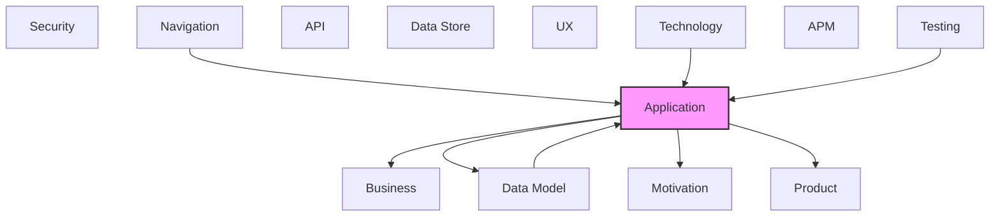

# Application

[← Back to README](../README.md)

Application components, services, and interactions.

## Report Index

- [Layer Introduction](#layer-introduction)
- [Intra-Layer Relationships](#intra-layer-relationships)
- [Inter-Layer Dependencies](#inter-layer-dependencies)
- [Inter-Layer Relationships Table](#inter-layer-relationships-table)
- [Element Reference](#element-reference)

## Layer Introduction

| Metric                    | Count |
| ------------------------- | ----- |
| Elements                  | 135   |
| Intra-Layer Relationships | 269   |
| Inter-Layer Relationships | 778   |
| Inbound Relationships     | 620   |
| Outbound Relationships    | 158   |

**Cross-Layer References**:

- **Upstream layers**: [Data Model](./08-data-model-layer-report.md), [Navigation](./11-navigation-layer-report.md), [Technology](./06-technology-layer-report.md), [Testing](./13-testing-layer-report.md)
- **Downstream layers**: [Business](./02-business-layer-report.md), [Data Model](./08-data-model-layer-report.md), [Motivation](./01-motivation-layer-report.md), [Product](./03-product-layer-report.md)

## Intra-Layer Relationships

*This layer has >30 elements. Summary table shown instead of diagram.*

| Element                                                                         | Type                     | Relationships |
| ------------------------------------------------------------------------------- | ------------------------ | ------------- |
| `application.applicationcomponent.consumer-smoke-test-app`                      | `applicationcomponent`   | 1             |
| `application.applicationcomponent.heimdall-ui-library-module`                   | `applicationcomponent`   | 105           |
| `application.applicationcomponent.test-page-host-app`                           | `applicationcomponent`   | 2             |
| `application.applicationevent.background-click-event`                           | `applicationevent`       | 1             |
| `application.applicationevent.collapse-toggle-event`                            | `applicationevent`       | 1             |
| `application.applicationevent.edge-hover-change-event`                          | `applicationevent`       | 1             |
| `application.applicationevent.edge-select-event`                                | `applicationevent`       | 1             |
| `application.applicationevent.layout-state-change-event`                        | `applicationevent`       | 1             |
| `application.applicationevent.node-drag-end-event`                              | `applicationevent`       | 2             |
| `application.applicationevent.node-hover-change-event`                          | `applicationevent`       | 1             |
| `application.applicationevent.viewport-dwell-event`                             | `applicationevent`       | 1             |
| `application.applicationevent.viewport-navigate-event`                          | `applicationevent`       | 1             |
| `application.applicationfunction.adjacency-matrix-cells`                        | `applicationfunction`    | 3             |
| `application.applicationfunction.adjacency-matrix-ordering`                     | `applicationfunction`    | 1             |
| `application.applicationfunction.async-layer-layout`                            | `applicationfunction`    | 1             |
| `application.applicationfunction.aws-x-ray-trace-adaptation`                    | `applicationfunction`    | 4             |
| `application.applicationfunction.batched-link-path-drawing`                     | `applicationfunction`    | 1             |
| `application.applicationfunction.bezier-edge-path-computation`                  | `applicationfunction`    | 3             |
| `application.applicationfunction.body-scroll-lock`                              | `applicationfunction`    | 2             |
| `application.applicationfunction.branch-map-label-placement`                    | `applicationfunction`    | 3             |
| `application.applicationfunction.branch-map-line-bundling`                      | `applicationfunction`    | 3             |
| `application.applicationfunction.branch-map-placement`                          | `applicationfunction`    | 6             |
| `application.applicationfunction.branch-map-routing`                            | `applicationfunction`    | 4             |
| `application.applicationfunction.branch-map-trunk-selection`                    | `applicationfunction`    | 3             |
| `application.applicationfunction.canvas-pointer-handling`                       | `applicationfunction`    | 3             |
| `application.applicationfunction.cluster-circle-packing`                        | `applicationfunction`    | 3             |
| `application.applicationfunction.clustered-force-layout-algorithm`              | `applicationfunction`    | 6             |
| `application.applicationfunction.collapse-toggling`                             | `applicationfunction`    | 3             |
| `application.applicationfunction.controlled-or-uncontrolled-state`              | `applicationfunction`    | 3             |
| `application.applicationfunction.dropdown-menu-keyboard-navigation`             | `applicationfunction`    | 1             |
| `application.applicationfunction.dropdown-placement`                            | `applicationfunction`    | 2             |
| `application.applicationfunction.dropdown-portal-and-outside-click-containment` | `applicationfunction`    | 4             |
| `application.applicationfunction.edge-label-clear-position-search`              | `applicationfunction`    | 4             |
| `application.applicationfunction.edge-pointer-handling`                         | `applicationfunction`    | 4             |
| `application.applicationfunction.edge-weight-and-dash-styling`                  | `applicationfunction`    | 2             |
| `application.applicationfunction.explorer-snapshot-sanitizing`                  | `applicationfunction`    | 2             |
| `application.applicationfunction.fixed-clock-date-formatting`                   | `applicationfunction`    | 2             |
| `application.applicationfunction.focus-trap`                                    | `applicationfunction`    | 2             |
| `application.applicationfunction.follow-depth-labelling`                        | `applicationfunction`    | 2             |
| `application.applicationfunction.force-directed-layout-algorithm`               | `applicationfunction`    | 7             |
| `application.applicationfunction.galaxy-aspect-ratio-resolution`                | `applicationfunction`    | 3             |
| `application.applicationfunction.galaxy-live-simulation-step`                   | `applicationfunction`    | 4             |
| `application.applicationfunction.galaxy-radial-orbit-layout-algorithm`          | `applicationfunction`    | 6             |
| `application.applicationfunction.graph-canvas-context-lookup`                   | `applicationfunction`    | 2             |
| `application.applicationfunction.hive-plot-layout`                              | `applicationfunction`    | 5             |
| `application.applicationfunction.house-branch-map-adapter`                      | `applicationfunction`    | 1             |
| `application.applicationfunction.joint-edge-label-placement`                    | `applicationfunction`    | 3             |
| `application.applicationfunction.lane-layout-and-gutter-routing`                | `applicationfunction`    | 7             |
| `application.applicationfunction.layer-plane-layout`                            | `applicationfunction`    | 7             |
| `application.applicationfunction.layer-stack-3d-projection`                     | `applicationfunction`    | 4             |
| `application.applicationfunction.layered-edge-label-placement`                  | `applicationfunction`    | 5             |
| `application.applicationfunction.layered-graph-index-construction`              | `applicationfunction`    | 9             |
| `application.applicationfunction.layered-graph-snapshot-sanitization`           | `applicationfunction`    | 3             |
| `application.applicationfunction.layered-graph-state`                           | `applicationfunction`    | 2             |
| `application.applicationfunction.layered-graph-state-resolution`                | `applicationfunction`    | 2             |
| `application.applicationfunction.layered-link-filtering-and-emphasis`           | `applicationfunction`    | 4             |
| `application.applicationfunction.layered-reach-computation`                     | `applicationfunction`    | 4             |
| `application.applicationfunction.link-and-node-emphasis-styling`                | `applicationfunction`    | 2             |
| `application.applicationfunction.link-category-labelling`                       | `applicationfunction`    | 2             |
| `application.applicationfunction.link-edge-metadata-formatting`                 | `applicationfunction`    | 2             |
| `application.applicationfunction.louvain-community-clustering`                  | `applicationfunction`    | 3             |
| `application.applicationfunction.navigation-edge-orthogonal-routing`            | `applicationfunction`    | 3             |
| `application.applicationfunction.node-overlap-separation-pass`                  | `applicationfunction`    | 4             |
| `application.applicationfunction.node-pointer-handling`                         | `applicationfunction`    | 4             |
| `application.applicationfunction.organic-layout-algorithm`                      | `applicationfunction`    | 4             |
| `application.applicationfunction.orthogonal-channel-edge-routing`               | `applicationfunction`    | 2             |
| `application.applicationfunction.orthogonal-layout-algorithm`                   | `applicationfunction`    | 5             |
| `application.applicationfunction.otlp-trace-adaptation`                         | `applicationfunction`    | 4             |
| `application.applicationfunction.painter-depth-reordering`                      | `applicationfunction`    | 1             |
| `application.applicationfunction.pan-and-zoom-viewport-control`                 | `applicationfunction`    | 2             |
| `application.applicationfunction.pan-inertia-glide`                             | `applicationfunction`    | 2             |
| `application.applicationfunction.pane-rail-marks`                               | `applicationfunction`    | 1             |
| `application.applicationfunction.plain-link-click-detection`                    | `applicationfunction`    | 2             |
| `application.applicationfunction.programmatic-viewport-move-reporting`          | `applicationfunction`    | 3             |
| `application.applicationfunction.radial-tree-layout-algorithm`                  | `applicationfunction`    | 4             |
| `application.applicationfunction.reach-relationship-listing`                    | `applicationfunction`    | 2             |
| `application.applicationfunction.reach-summary-formatting`                      | `applicationfunction`    | 2             |
| `application.applicationfunction.ssr-safe-media-query`                          | `applicationfunction`    | 3             |
| `application.applicationfunction.structural-descendant-lookup`                  | `applicationfunction`    | 2             |
| `application.applicationfunction.structural-forest-construction`                | `applicationfunction`    | 5             |
| `application.applicationfunction.tooltip-placement`                             | `applicationfunction`    | 1             |
| `application.applicationfunction.trace-model-construction`                      | `applicationfunction`    | 5             |
| `application.applicationfunction.tweened-animation`                             | `applicationfunction`    | 3             |
| `application.applicationfunction.ux-navigation-tree-layout-algorithm`           | `applicationfunction`    | 5             |
| `application.applicationfunction.virtualized-list-windowing`                    | `applicationfunction`    | 2             |
| `application.applicationfunction.yield-to-paint`                                | `applicationfunction`    | 2             |
| `application.applicationinteraction.panzoom-gesture-handling`                   | `applicationinteraction` | 2             |
| `application.applicationprocess.graph-render-and-layout-recomputation-pipeline` | `applicationprocess`     | 8             |
| `application.applicationservice.adjacency-matrix-link-metadata`                 | `applicationservice`     | 2             |
| `application.applicationservice.app-shell-components`                           | `applicationservice`     | 1             |
| `application.applicationservice.branch-map-layout`                              | `applicationservice`     | 6             |
| `application.applicationservice.chart-components`                               | `applicationservice`     | 1             |
| `application.applicationservice.chat-components`                                | `applicationservice`     | 1             |
| `application.applicationservice.cluster-packing`                                | `applicationservice`     | 2             |
| `application.applicationservice.controllable-state-hook`                        | `applicationservice`     | 2             |
| `application.applicationservice.data-display-components`                        | `applicationservice`     | 1             |
| `application.applicationservice.dropdown-portal-containment`                    | `applicationservice`     | 2             |
| `application.applicationservice.edge-geometry`                                  | `applicationservice`     | 3             |
| `application.applicationservice.force-layout`                                   | `applicationservice`     | 3             |
| `application.applicationservice.form-input-components`                          | `applicationservice`     | 3             |
| `application.applicationservice.galaxy-layout`                                  | `applicationservice`     | 2             |
| `application.applicationservice.graph-canvas-context-hook`                      | `applicationservice`     | 2             |
| `application.applicationservice.graph-layout-engine-service`                    | `applicationservice`     | 19            |
| `application.applicationservice.interactive-graph-rendering`                    | `applicationservice`     | 15            |
| `application.applicationservice.lane-layout`                                    | `applicationservice`     | 2             |
| `application.applicationservice.layered-graph-control-helpers`                  | `applicationservice`     | 4             |
| `application.applicationservice.layered-graph-explorer-snapshot`                | `applicationservice`     | 2             |
| `application.applicationservice.layered-graph-framework-service`                | `applicationservice`     | 10            |
| `application.applicationservice.layered-graph-state-hooks`                      | `applicationservice`     | 2             |
| `application.applicationservice.layered-graph-utilities`                        | `applicationservice`     | 10            |
| `application.applicationservice.layered-graph-visualization`                    | `applicationservice`     | 19            |
| `application.applicationservice.layout-components`                              | `applicationservice`     | 2             |
| `application.applicationservice.live-galaxy-simulation-service`                 | `applicationservice`     | 2             |
| `application.applicationservice.louvain-clustering`                             | `applicationservice`     | 2             |
| `application.applicationservice.media-query-hook`                               | `applicationservice`     | 2             |
| `application.applicationservice.navigation-components`                          | `applicationservice`     | 2             |
| `application.applicationservice.observability-view-components`                  | `applicationservice`     | 5             |
| `application.applicationservice.organic-layout`                                 | `applicationservice`     | 2             |
| `application.applicationservice.orthogonal-layout`                              | `applicationservice`     | 2             |
| `application.applicationservice.otlp-trace-adapter`                             | `applicationservice`     | 2             |
| `application.applicationservice.overlay-components`                             | `applicationservice`     | 3             |
| `application.applicationservice.page-pattern-components`                        | `applicationservice`     | 1             |
| `application.applicationservice.pan-and-zoom-hook`                              | `applicationservice`     | 2             |
| `application.applicationservice.planning-components`                            | `applicationservice`     | 2             |
| `application.applicationservice.primitive-components`                           | `applicationservice`     | 1             |
| `application.applicationservice.radial-tree-layout`                             | `applicationservice`     | 2             |
| `application.applicationservice.reach-relationship-helpers`                     | `applicationservice`     | 3             |
| `application.applicationservice.structural-hierarchy`                           | `applicationservice`     | 3             |
| `application.applicationservice.trace-viewer-model`                             | `applicationservice`     | 2             |
| `application.applicationservice.tween-animation-hooks`                          | `applicationservice`     | 2             |
| `application.applicationservice.ux-navigation-edge-visibility`                  | `applicationservice`     | 2             |
| `application.applicationservice.ux-navigation-layout`                           | `applicationservice`     | 2             |
| `application.applicationservice.x-ray-trace-adapter`                            | `applicationservice`     | 2             |
| `application.dataobject.node-position-map`                                      | `dataobject`             | 8             |
| `application.dataobject.node-rect-registry`                                     | `dataobject`             | 3             |

## Inter-Layer Dependencies

## Inter-Layer Relationships Table

| Relationship ID                                                         | Source Node                                                                                                                           | Dest Node                                                                                   | Dest Layer    | Predicate    | Cardinality  | Strength |
| ----------------------------------------------------------------------- | ------------------------------------------------------------------------------------------------------------------------------------- | ------------------------------------------------------------------------------------------- | ------------- | ------------ | ------------ | -------- |
| `application.applicationcomponent.accesses.data-model.schemadefinition` | `application.applicationcomponent.heimdall-ui-library-module`                                                                         | `data-model.schemadefinition.branch-map-data`                                               | `data-model`  | `accesses`   | many-to-many | medium   |
| `application.applicationcomponent.accesses.data-model.schemadefinition` | `application.applicationcomponent.heimdall-ui-library-module`                                                                         | `data-model.schemadefinition.branch-map-scene`                                              | `data-model`  | `accesses`   | many-to-many | medium   |
| `application.applicationcomponent.accesses.data-model.schemadefinition` | `application.applicationcomponent.heimdall-ui-library-module`                                                                         | `data-model.schemadefinition.edge-geometry`                                                 | `data-model`  | `accesses`   | many-to-many | medium   |
| `application.applicationcomponent.accesses.data-model.schemadefinition` | `application.applicationcomponent.heimdall-ui-library-module`                                                                         | `data-model.schemadefinition.graph-edge-data-shape`                                         | `data-model`  | `accesses`   | many-to-many | medium   |
| `application.applicationcomponent.accesses.data-model.schemadefinition` | `application.applicationcomponent.heimdall-ui-library-module`                                                                         | `data-model.schemadefinition.graph-layout-state`                                            | `data-model`  | `accesses`   | many-to-many | medium   |
| `application.applicationcomponent.accesses.data-model.schemadefinition` | `application.applicationcomponent.heimdall-ui-library-module`                                                                         | `data-model.schemadefinition.graph-node-data`                                               | `data-model`  | `accesses`   | many-to-many | medium   |
| `application.applicationcomponent.accesses.data-model.schemadefinition` | `application.applicationcomponent.heimdall-ui-library-module`                                                                         | `data-model.schemadefinition.graph-viewport`                                                | `data-model`  | `accesses`   | many-to-many | medium   |
| `application.applicationcomponent.accesses.data-model.schemadefinition` | `application.applicationcomponent.heimdall-ui-library-module`                                                                         | `data-model.schemadefinition.graph-viewport-snapshot`                                       | `data-model`  | `accesses`   | many-to-many | medium   |
| `application.applicationcomponent.accesses.data-model.schemadefinition` | `application.applicationcomponent.heimdall-ui-library-module`                                                                         | `data-model.schemadefinition.lane-layout`                                                   | `data-model`  | `accesses`   | many-to-many | medium   |
| `application.applicationcomponent.accesses.data-model.schemadefinition` | `application.applicationcomponent.heimdall-ui-library-module`                                                                         | `data-model.schemadefinition.layered-graph-state`                                           | `data-model`  | `accesses`   | many-to-many | medium   |
| `application.applicationevent.accesses.data-model.schemadefinition`     | `application.applicationevent.layout-state-change-event`                                                                              | `data-model.schemadefinition.graph-layout-state`                                            | `data-model`  | `accesses`   | many-to-many | medium   |
| `application.applicationevent.accesses.data-model.schemadefinition`     | `application.applicationevent.viewport-dwell-event`                                                                                   | `data-model.schemadefinition.graph-viewport-snapshot`                                       | `data-model`  | `accesses`   | many-to-many | medium   |
| `application.applicationevent.accesses.data-model.schemadefinition`     | `application.applicationevent.viewport-navigate-event`                                                                                | `data-model.schemadefinition.graph-viewport-snapshot`                                       | `data-model`  | `accesses`   | many-to-many | medium   |
| `application.applicationfunction.accesses.data-model.schemadefinition`  | `application.applicationfunction.aws-x-ray-trace-adaptation`                                                                          | `data-model.schemadefinition.trace`                                                         | `data-model`  | `accesses`   | many-to-many | medium   |
| `application.applicationfunction.accesses.data-model.schemadefinition`  | `application.applicationfunction.aws-x-ray-trace-adaptation`                                                                          | `data-model.schemadefinition.xray-segment`                                                  | `data-model`  | `accesses`   | many-to-many | medium   |
| `application.applicationfunction.accesses.data-model.schemadefinition`  | `application.applicationfunction.branch-map-label-placement`                                                                          | `data-model.schemadefinition.branch-map-layout`                                             | `data-model`  | `accesses`   | many-to-many | medium   |
| `application.applicationfunction.satisfies.motivation.requirement`      | `application.applicationfunction.branch-map-label-placement`                                                                          | `motivation.requirement.branch-map-labels-sit-beside-their-stations-without-overlap`        | `motivation`  | `satisfies`  | many-to-many | medium   |
| `application.applicationfunction.satisfies.motivation.requirement`      | `application.applicationfunction.branch-map-label-placement`                                                                          | `motivation.requirement.no-two-node-boxes-overlap-after-any-layout-engine-runs`             | `motivation`  | `satisfies`  | many-to-many | medium   |
| `application.applicationfunction.accesses.data-model.schemadefinition`  | `application.applicationfunction.branch-map-line-bundling`                                                                            | `data-model.schemadefinition.branch-map-line`                                               | `data-model`  | `accesses`   | many-to-many | medium   |
| `application.applicationfunction.satisfies.motivation.requirement`      | `application.applicationfunction.branch-map-line-bundling`                                                                            | `motivation.requirement.branch-map-groups-stay-within-a-lane-budget`                        | `motivation`  | `satisfies`  | many-to-many | medium   |
| `application.applicationfunction.satisfies.motivation.requirement`      | `application.applicationfunction.branch-map-line-bundling`                                                                            | `motivation.requirement.layout-output-is-deterministic-for-a-given-input`                   | `motivation`  | `satisfies`  | many-to-many | medium   |
| `application.applicationfunction.accesses.data-model.schemadefinition`  | `application.applicationfunction.branch-map-placement`                                                                                | `data-model.schemadefinition.branch-map-data`                                               | `data-model`  | `accesses`   | many-to-many | medium   |
| `application.applicationfunction.accesses.data-model.schemadefinition`  | `application.applicationfunction.branch-map-placement`                                                                                | `data-model.schemadefinition.branch-map-layout`                                             | `data-model`  | `accesses`   | many-to-many | medium   |
| `application.applicationfunction.accesses.data-model.schemadefinition`  | `application.applicationfunction.branch-map-placement`                                                                                | `data-model.schemadefinition.branch-map-options`                                            | `data-model`  | `accesses`   | many-to-many | medium   |
| `application.applicationfunction.satisfies.motivation.requirement`      | `application.applicationfunction.branch-map-placement`                                                                                | `motivation.requirement.graph-layout-and-edge-routing-are-separate-headless-stages`         | `motivation`  | `satisfies`  | many-to-many | medium   |
| `application.applicationfunction.satisfies.motivation.requirement`      | `application.applicationfunction.branch-map-placement`                                                                                | `motivation.requirement.layout-output-is-deterministic-for-a-given-input`                   | `motivation`  | `satisfies`  | many-to-many | medium   |
| `application.applicationfunction.satisfies.motivation.requirement`      | `application.applicationfunction.branch-map-placement`                                                                                | `motivation.requirement.no-two-node-boxes-overlap-after-any-layout-engine-runs`             | `motivation`  | `satisfies`  | many-to-many | medium   |
| `application.applicationfunction.accesses.data-model.schemadefinition`  | `application.applicationfunction.branch-map-routing`                                                                                  | `data-model.schemadefinition.branch-map-layout`                                             | `data-model`  | `accesses`   | many-to-many | medium   |
| `application.applicationfunction.accesses.data-model.schemadefinition`  | `application.applicationfunction.branch-map-routing`                                                                                  | `data-model.schemadefinition.branch-map-scene`                                              | `data-model`  | `accesses`   | many-to-many | medium   |
| `application.applicationfunction.satisfies.motivation.requirement`      | `application.applicationfunction.branch-map-routing`                                                                                  | `motivation.requirement.graph-layout-and-edge-routing-are-separate-headless-stages`         | `motivation`  | `satisfies`  | many-to-many | medium   |
| `application.applicationfunction.satisfies.motivation.requirement`      | `application.applicationfunction.branch-map-routing`                                                                                  | `motivation.requirement.layout-output-is-deterministic-for-a-given-input`                   | `motivation`  | `satisfies`  | many-to-many | medium   |
| `application.applicationfunction.accesses.data-model.schemadefinition`  | `application.applicationfunction.branch-map-trunk-selection`                                                                          | `data-model.schemadefinition.branch-map-group`                                              | `data-model`  | `accesses`   | many-to-many | medium   |
| `application.applicationfunction.satisfies.motivation.requirement`      | `application.applicationfunction.branch-map-trunk-selection`                                                                          | `motivation.requirement.layout-output-is-deterministic-for-a-given-input`                   | `motivation`  | `satisfies`  | many-to-many | medium   |
| `application.applicationfunction.accesses.data-model.schemadefinition`  | `application.applicationfunction.cluster-circle-packing`                                                                              | `data-model.schemadefinition.cluster-tree-node`                                             | `data-model`  | `accesses`   | many-to-many | medium   |
| `application.applicationfunction.accesses.data-model.schemadefinition`  | `application.applicationfunction.clustered-force-layout-algorithm`                                                                    | `data-model.schemadefinition.clustered-layout-options`                                      | `data-model`  | `accesses`   | many-to-many | medium   |
| `application.applicationfunction.accesses.data-model.schemadefinition`  | `application.applicationfunction.clustered-force-layout-algorithm`                                                                    | `data-model.schemadefinition.clustered-layout-result`                                       | `data-model`  | `accesses`   | many-to-many | medium   |
| `application.applicationfunction.satisfies.motivation.requirement`      | `application.applicationfunction.clustered-force-layout-algorithm`                                                                    | `motivation.requirement.layout-engines-must-be-pluggable-without-breaking-existing-callers` | `motivation`  | `satisfies`  | many-to-many | medium   |
| `application.applicationfunction.satisfies.motivation.requirement`      | `application.applicationfunction.dropdown-portal-and-outside-click-containment`                                                       | `motivation.requirement.dropdown-panels-render-in-a-portal-by-default`                      | `motivation`  | `satisfies`  | many-to-many | medium   |
| `application.applicationfunction.satisfies.motivation.requirement`      | `application.applicationfunction.fixed-clock-date-formatting`                                                                         | `motivation.requirement.server-rendered-output-hydrates-without-mismatch`                   | `motivation`  | `satisfies`  | many-to-many | medium   |
| `application.applicationfunction.accesses.data-model.schemadefinition`  | `application.applicationfunction.force-directed-layout-algorithm`                                                                     | `data-model.schemadefinition.force-layout-options`                                          | `data-model`  | `accesses`   | many-to-many | medium   |
| `application.applicationfunction.accesses.data-model.schemadefinition`  | `application.applicationfunction.force-directed-layout-algorithm`                                                                     | `data-model.schemadefinition.layout-edge`                                                   | `data-model`  | `accesses`   | many-to-many | medium   |
| `application.applicationfunction.accesses.data-model.schemadefinition`  | `application.applicationfunction.force-directed-layout-algorithm`                                                                     | `data-model.schemadefinition.layout-node`                                                   | `data-model`  | `accesses`   | many-to-many | medium   |
| `application.applicationfunction.realizes.business.businessfunction`    | `application.applicationfunction.force-directed-layout-algorithm`                                                                     | `business.businessfunction.automatic-node-layout-computation`                               | `business`    | `realizes`   | many-to-many | medium   |
| `application.applicationfunction.satisfies.motivation.requirement`      | `application.applicationfunction.force-directed-layout-algorithm`                                                                     | `motivation.requirement.layout-engines-must-be-pluggable-without-breaking-existing-callers` | `motivation`  | `satisfies`  | many-to-many | medium   |
| `application.applicationfunction.satisfies.motivation.requirement`      | `application.applicationfunction.force-directed-layout-algorithm`                                                                     | `motivation.requirement.no-two-node-boxes-overlap-after-any-layout-engine-runs`             | `motivation`  | `satisfies`  | many-to-many | medium   |
| `application.applicationfunction.accesses.data-model.schemadefinition`  | `application.applicationfunction.galaxy-aspect-ratio-resolution`                                                                      | `data-model.schemadefinition.galaxy-layout-edge`                                            | `data-model`  | `accesses`   | many-to-many | medium   |
| `application.applicationfunction.accesses.data-model.schemadefinition`  | `application.applicationfunction.galaxy-aspect-ratio-resolution`                                                                      | `data-model.schemadefinition.galaxy-layout-node`                                            | `data-model`  | `accesses`   | many-to-many | medium   |
| `application.applicationfunction.accesses.data-model.schemadefinition`  | `application.applicationfunction.galaxy-aspect-ratio-resolution`                                                                      | `data-model.schemadefinition.galaxy-layout-options`                                         | `data-model`  | `accesses`   | many-to-many | medium   |
| `application.applicationfunction.accesses.data-model.schemadefinition`  | `application.applicationfunction.galaxy-live-simulation-step`                                                                         | `data-model.schemadefinition.galaxy-layout-edge`                                            | `data-model`  | `accesses`   | many-to-many | medium   |
| `application.applicationfunction.accesses.data-model.schemadefinition`  | `application.applicationfunction.galaxy-live-simulation-step`                                                                         | `data-model.schemadefinition.galaxy-layout-node`                                            | `data-model`  | `accesses`   | many-to-many | medium   |
| `application.applicationfunction.accesses.data-model.schemadefinition`  | `application.applicationfunction.galaxy-live-simulation-step`                                                                         | `data-model.schemadefinition.galaxy-layout-options`                                         | `data-model`  | `accesses`   | many-to-many | medium   |
| `application.applicationfunction.satisfies.motivation.requirement`      | `application.applicationfunction.galaxy-live-simulation-step`                                                                         | `motivation.requirement.layout-output-is-deterministic-for-a-given-input`                   | `motivation`  | `satisfies`  | many-to-many | medium   |
| `application.applicationfunction.satisfies.motivation.requirement`      | `application.applicationfunction.galaxy-live-simulation-step`                                                                         | `motivation.requirement.live-galaxy-drag-stays-interactive`                                 | `motivation`  | `satisfies`  | many-to-many | medium   |
| `application.applicationfunction.accesses.data-model.schemadefinition`  | `application.applicationfunction.galaxy-radial-orbit-layout-algorithm`                                                                | `data-model.schemadefinition.galaxy-layout-edge`                                            | `data-model`  | `accesses`   | many-to-many | medium   |
| `application.applicationfunction.accesses.data-model.schemadefinition`  | `application.applicationfunction.galaxy-radial-orbit-layout-algorithm`                                                                | `data-model.schemadefinition.galaxy-layout-node`                                            | `data-model`  | `accesses`   | many-to-many | medium   |
| `application.applicationfunction.accesses.data-model.schemadefinition`  | `application.applicationfunction.galaxy-radial-orbit-layout-algorithm`                                                                | `data-model.schemadefinition.galaxy-layout-options`                                         | `data-model`  | `accesses`   | many-to-many | medium   |
| `application.applicationfunction.realizes.business.businessfunction`    | `application.applicationfunction.galaxy-radial-orbit-layout-algorithm`                                                                | `business.businessfunction.automatic-node-layout-computation`                               | `business`    | `realizes`   | many-to-many | medium   |
| `application.applicationfunction.satisfies.motivation.requirement`      | `application.applicationfunction.galaxy-radial-orbit-layout-algorithm`                                                                | `motivation.requirement.galaxy-keeps-orbits-even-over-round-systems`                        | `motivation`  | `satisfies`  | many-to-many | medium   |
| `application.applicationfunction.satisfies.motivation.requirement`      | `application.applicationfunction.galaxy-radial-orbit-layout-algorithm`                                                                | `motivation.requirement.no-two-node-boxes-overlap-after-any-layout-engine-runs`             | `motivation`  | `satisfies`  | many-to-many | medium   |
| `application.applicationfunction.satisfies.motivation.requirement`      | `application.applicationfunction.hive-plot-layout`                                                                                    | `motivation.requirement.hive-plot-keeps-axis-angles-stable-when-a-layer-is-hidden`          | `motivation`  | `satisfies`  | many-to-many | medium   |
| `application.applicationfunction.accesses.data-model.schemadefinition`  | `application.applicationfunction.house-branch-map-adapter`                                                                            | `data-model.schemadefinition.branch-map-data`                                               | `data-model`  | `accesses`   | many-to-many | medium   |
| `application.applicationfunction.accesses.data-model.schemadefinition`  | `application.applicationfunction.house-branch-map-adapter`                                                                            | `data-model.schemadefinition.house-organizing-snapshot`                                     | `data-model`  | `accesses`   | many-to-many | medium   |
| `application.applicationfunction.satisfies.motivation.requirement`      | `application.applicationfunction.house-branch-map-adapter`                                                                            | `motivation.requirement.branch-map-library-stays-vocabulary-free`                           | `motivation`  | `satisfies`  | many-to-many | medium   |
| `application.applicationfunction.accesses.data-model.schemadefinition`  | `application.applicationfunction.joint-edge-label-placement`                                                                          | `data-model.schemadefinition.edge-geometry`                                                 | `data-model`  | `accesses`   | many-to-many | medium   |
| `application.applicationfunction.accesses.data-model.schemadefinition`  | `application.applicationfunction.layered-graph-index-construction`                                                                    | `data-model.schemadefinition.layered-index`                                                 | `data-model`  | `accesses`   | many-to-many | medium   |
| `application.applicationfunction.accesses.data-model.schemadefinition`  | `application.applicationfunction.layered-graph-snapshot-sanitization`                                                                 | `data-model.schemadefinition.layered-graph-snapshot`                                        | `data-model`  | `accesses`   | many-to-many | medium   |
| `application.applicationfunction.accesses.data-model.schemadefinition`  | `application.applicationfunction.louvain-community-clustering`                                                                        | `data-model.schemadefinition.cluster-tree-node`                                             | `data-model`  | `accesses`   | many-to-many | medium   |
| `application.applicationfunction.realizes.business.businessfunction`    | `application.applicationfunction.louvain-community-clustering`                                                                        | `business.businessfunction.community-and-cluster-discovery-in-relationship-graphs`          | `business`    | `realizes`   | many-to-many | medium   |
| `application.applicationfunction.satisfies.motivation.requirement`      | `application.applicationfunction.louvain-community-clustering`                                                                        | `motivation.requirement.layout-output-is-deterministic-for-a-given-input`                   | `motivation`  | `satisfies`  | many-to-many | medium   |
| `application.applicationfunction.satisfies.motivation.requirement`      | `application.applicationfunction.navigation-edge-orthogonal-routing`                                                                  | `motivation.requirement.navigation-routing-stays-within-its-time-budget`                    | `motivation`  | `satisfies`  | many-to-many | medium   |
| `application.applicationfunction.accesses.data-model.schemadefinition`  | `application.applicationfunction.node-overlap-separation-pass`                                                                        | `data-model.schemadefinition.layout-node`                                                   | `data-model`  | `accesses`   | many-to-many | medium   |
| `application.applicationfunction.satisfies.motivation.requirement`      | `application.applicationfunction.node-overlap-separation-pass`                                                                        | `motivation.requirement.no-two-node-boxes-overlap-after-any-layout-engine-runs`             | `motivation`  | `satisfies`  | many-to-many | medium   |
| `application.applicationfunction.accesses.data-model.schemadefinition`  | `application.applicationfunction.organic-layout-algorithm`                                                                            | `data-model.schemadefinition.organic-layout-options`                                        | `data-model`  | `accesses`   | many-to-many | medium   |
| `application.applicationfunction.accesses.data-model.schemadefinition`  | `application.applicationfunction.organic-layout-algorithm`                                                                            | `data-model.schemadefinition.organic-layout-result`                                         | `data-model`  | `accesses`   | many-to-many | medium   |
| `application.applicationfunction.satisfies.motivation.requirement`      | `application.applicationfunction.organic-layout-algorithm`                                                                            | `motivation.requirement.layout-output-is-deterministic-for-a-given-input`                   | `motivation`  | `satisfies`  | many-to-many | medium   |
| `application.applicationfunction.satisfies.motivation.requirement`      | `application.applicationfunction.organic-layout-algorithm`                                                                            | `motivation.requirement.no-two-node-boxes-overlap-after-any-layout-engine-runs`             | `motivation`  | `satisfies`  | many-to-many | medium   |
| `application.applicationfunction.accesses.data-model.schemadefinition`  | `application.applicationfunction.orthogonal-layout-algorithm`                                                                         | `data-model.schemadefinition.orthogonal-layout-options`                                     | `data-model`  | `accesses`   | many-to-many | medium   |
| `application.applicationfunction.accesses.data-model.schemadefinition`  | `application.applicationfunction.orthogonal-layout-algorithm`                                                                         | `data-model.schemadefinition.orthogonal-layout-result`                                      | `data-model`  | `accesses`   | many-to-many | medium   |
| `application.applicationfunction.satisfies.motivation.requirement`      | `application.applicationfunction.orthogonal-layout-algorithm`                                                                         | `motivation.requirement.layout-output-is-deterministic-for-a-given-input`                   | `motivation`  | `satisfies`  | many-to-many | medium   |
| `application.applicationfunction.accesses.data-model.schemadefinition`  | `application.applicationfunction.otlp-trace-adaptation`                                                                               | `data-model.schemadefinition.otlp-traces-data`                                              | `data-model`  | `accesses`   | many-to-many | medium   |
| `application.applicationfunction.accesses.data-model.schemadefinition`  | `application.applicationfunction.otlp-trace-adaptation`                                                                               | `data-model.schemadefinition.trace`                                                         | `data-model`  | `accesses`   | many-to-many | medium   |
| `application.applicationfunction.accesses.data-model.schemadefinition`  | `application.applicationfunction.radial-tree-layout-algorithm`                                                                        | `data-model.schemadefinition.radial-tree-layout-result`                                     | `data-model`  | `accesses`   | many-to-many | medium   |
| `application.applicationfunction.realizes.business.businessfunction`    | `application.applicationfunction.radial-tree-layout-algorithm`                                                                        | `business.businessfunction.automatic-node-layout-computation`                               | `business`    | `realizes`   | many-to-many | medium   |
| `application.applicationfunction.satisfies.motivation.requirement`      | `application.applicationfunction.radial-tree-layout-algorithm`                                                                        | `motivation.requirement.no-two-node-boxes-overlap-after-any-layout-engine-runs`             | `motivation`  | `satisfies`  | many-to-many | medium   |
| `application.applicationfunction.satisfies.motivation.requirement`      | `application.applicationfunction.ssr-safe-media-query`                                                                                | `motivation.requirement.server-rendered-output-hydrates-without-mismatch`                   | `motivation`  | `satisfies`  | many-to-many | medium   |
| `application.applicationfunction.accesses.data-model.schemadefinition`  | `application.applicationfunction.structural-forest-construction`                                                                      | `data-model.schemadefinition.hierarchy-edge`                                                | `data-model`  | `accesses`   | many-to-many | medium   |
| `application.applicationfunction.accesses.data-model.schemadefinition`  | `application.applicationfunction.structural-forest-construction`                                                                      | `data-model.schemadefinition.structural-forest`                                             | `data-model`  | `accesses`   | many-to-many | medium   |
| `application.applicationfunction.accesses.data-model.schemadefinition`  | `application.applicationfunction.trace-model-construction`                                                                            | `data-model.schemadefinition.trace`                                                         | `data-model`  | `accesses`   | many-to-many | medium   |
| `application.applicationfunction.realizes.business.businessfunction`    | `application.applicationfunction.ux-navigation-tree-layout-algorithm`                                                                 | `business.businessfunction.automatic-node-layout-computation`                               | `business`    | `realizes`   | many-to-many | medium   |
| `application.applicationprocess.realizes.business.businessprocess`      | `application.applicationprocess.graph-render-and-layout-recomputation-pipeline`                                                       | `business.businessprocess.render-graph-from-domain-data-to-interactive-view`                | `business`    | `realizes`   | many-to-many | medium   |
| `application.applicationservice.realizes.product.softwarecapability`    | `application.applicationservice.adjacency-matrix-link-metadata`                                                                       | `product.softwarecapability.layered-graph-visualization`                                    | `product`     | `realizes`   | many-to-many | medium   |
| `application.applicationservice.realizes.product.softwarecapability`    | `application.applicationservice.app-shell-components`                                                                                 | `product.softwarecapability.app-shell`                                                      | `product`     | `realizes`   | many-to-many | medium   |
| `application.applicationservice.realizes.product.feature`               | `application.applicationservice.branch-map-layout`                                                                                    | `product.feature.branch-map`                                                                | `product`     | `realizes`   | many-to-many | medium   |
| `application.applicationservice.realizes.product.softwarecapability`    | `application.applicationservice.branch-map-layout`                                                                                    | `product.softwarecapability.branch-map-visualization`                                       | `product`     | `realizes`   | many-to-many | medium   |
| `application.applicationservice.satisfies.motivation.requirement`       | `application.applicationservice.branch-map-layout`                                                                                    | `motivation.requirement.branch-map-library-stays-vocabulary-free`                           | `motivation`  | `satisfies`  | many-to-many | medium   |
| `application.applicationservice.satisfies.motivation.requirement`       | `application.applicationservice.branch-map-layout`                                                                                    | `motivation.requirement.graph-layout-and-edge-routing-are-separate-headless-stages`         | `motivation`  | `satisfies`  | many-to-many | medium   |
| `application.applicationservice.realizes.product.softwarecapability`    | `application.applicationservice.chart-components`                                                                                     | `product.softwarecapability.charting`                                                       | `product`     | `realizes`   | many-to-many | medium   |
| `application.applicationservice.realizes.product.softwarecapability`    | `application.applicationservice.chat-components`                                                                                      | `product.softwarecapability.chat-ui`                                                        | `product`     | `realizes`   | many-to-many | medium   |
| `application.applicationservice.realizes.product.softwarecapability`    | `application.applicationservice.cluster-packing`                                                                                      | `product.softwarecapability.clustered-force-layout-community-bubbles`                       | `product`     | `realizes`   | many-to-many | medium   |
| `application.applicationservice.realizes.product.softwarecapability`    | `application.applicationservice.controllable-state-hook`                                                                              | `product.softwarecapability.layered-graph-visualization`                                    | `product`     | `realizes`   | many-to-many | medium   |
| `application.applicationservice.realizes.product.softwarecapability`    | `application.applicationservice.data-display-components`                                                                              | `product.softwarecapability.data-display`                                                   | `product`     | `realizes`   | many-to-many | medium   |
| `application.applicationservice.realizes.product.softwarecapability`    | `application.applicationservice.dropdown-portal-containment`                                                                          | `product.softwarecapability.overlays-and-dialogs`                                           | `product`     | `realizes`   | many-to-many | medium   |
| `application.applicationservice.realizes.product.softwarecapability`    | `application.applicationservice.edge-geometry`                                                                                        | `product.softwarecapability.interactive-graph-exploration`                                  | `product`     | `realizes`   | many-to-many | medium   |
| `application.applicationservice.realizes.product.softwarecapability`    | `application.applicationservice.force-layout`                                                                                         | `product.softwarecapability.clustered-force-layout-community-bubbles`                       | `product`     | `realizes`   | many-to-many | medium   |
| `application.applicationservice.realizes.product.softwarecapability`    | `application.applicationservice.force-layout`                                                                                         | `product.softwarecapability.force-directed-graph-layout`                                    | `product`     | `realizes`   | many-to-many | medium   |
| `application.applicationservice.realizes.product.softwarecapability`    | `application.applicationservice.form-input-components`                                                                                | `product.softwarecapability.form-input`                                                     | `product`     | `realizes`   | many-to-many | medium   |
| `application.applicationservice.realizes.product.softwarecapability`    | `application.applicationservice.galaxy-layout`                                                                                        | `product.softwarecapability.galaxy-radial-orbit-layout`                                     | `product`     | `realizes`   | many-to-many | medium   |
| `application.applicationservice.realizes.product.softwarecapability`    | `application.applicationservice.graph-canvas-context-hook`                                                                            | `product.softwarecapability.interactive-graph-exploration`                                  | `product`     | `realizes`   | many-to-many | medium   |
| `application.applicationservice.realizes.business.businessservice`      | `application.applicationservice.graph-layout-engine-service`                                                                          | `business.businessservice.hierarchical-and-navigation-structure-visualization`              | `business`    | `realizes`   | many-to-many | medium   |
| `application.applicationservice.realizes.business.businessservice`      | `application.applicationservice.graph-layout-engine-service`                                                                          | `business.businessservice.large-graph-visualization`                                        | `business`    | `realizes`   | many-to-many | medium   |
| `application.applicationservice.realizes.product.softwarecapability`    | `application.applicationservice.graph-layout-engine-service`                                                                          | `product.softwarecapability.clustered-force-layout-community-bubbles`                       | `product`     | `realizes`   | many-to-many | medium   |
| `application.applicationservice.realizes.product.softwarecapability`    | `application.applicationservice.graph-layout-engine-service`                                                                          | `product.softwarecapability.force-directed-graph-layout`                                    | `product`     | `realizes`   | many-to-many | medium   |
| `application.applicationservice.realizes.product.softwarecapability`    | `application.applicationservice.graph-layout-engine-service`                                                                          | `product.softwarecapability.galaxy-radial-orbit-layout`                                     | `product`     | `realizes`   | many-to-many | medium   |
| `application.applicationservice.realizes.product.softwarecapability`    | `application.applicationservice.graph-layout-engine-service`                                                                          | `product.softwarecapability.layer-lanes-layout`                                             | `product`     | `realizes`   | many-to-many | medium   |
| `application.applicationservice.realizes.product.softwarecapability`    | `application.applicationservice.graph-layout-engine-service`                                                                          | `product.softwarecapability.organic-graph-layout`                                           | `product`     | `realizes`   | many-to-many | medium   |
| `application.applicationservice.realizes.product.softwarecapability`    | `application.applicationservice.graph-layout-engine-service`                                                                          | `product.softwarecapability.orthogonal-graph-layout`                                        | `product`     | `realizes`   | many-to-many | medium   |
| `application.applicationservice.realizes.product.softwarecapability`    | `application.applicationservice.graph-layout-engine-service`                                                                          | `product.softwarecapability.radial-tree-layout`                                             | `product`     | `realizes`   | many-to-many | medium   |
| `application.applicationservice.realizes.product.softwarecapability`    | `application.applicationservice.graph-layout-engine-service`                                                                          | `product.softwarecapability.ux-navigation-tree-layout`                                      | `product`     | `realizes`   | many-to-many | medium   |
| `application.applicationservice.satisfies.motivation.requirement`       | `application.applicationservice.graph-layout-engine-service`                                                                          | `motivation.requirement.layout-engines-must-be-pluggable-without-breaking-existing-callers` | `motivation`  | `satisfies`  | many-to-many | medium   |
| `application.applicationservice.serves.business.businessprocess`        | `application.applicationservice.graph-layout-engine-service`                                                                          | `business.businessprocess.render-graph-from-domain-data-to-interactive-view`                | `business`    | `serves`     | many-to-many | medium   |
| `application.applicationservice.realizes.product.feature`               | `application.applicationservice.interactive-graph-rendering`                                                                          | `product.feature.edge-selection-and-inspection`                                             | `product`     | `realizes`   | many-to-many | medium   |
| `application.applicationservice.realizes.product.feature`               | `application.applicationservice.interactive-graph-rendering`                                                                          | `product.feature.fullscreen-canvas`                                                         | `product`     | `realizes`   | many-to-many | medium   |
| `application.applicationservice.realizes.product.feature`               | `application.applicationservice.interactive-graph-rendering`                                                                          | `product.feature.layout-progress-indicator`                                                 | `product`     | `realizes`   | many-to-many | medium   |
| `application.applicationservice.realizes.product.feature`               | `application.applicationservice.interactive-graph-rendering`                                                                          | `product.feature.live-draggable-galaxy-simulation`                                          | `product`     | `realizes`   | many-to-many | medium   |
| `application.applicationservice.realizes.product.feature`               | `application.applicationservice.interactive-graph-rendering`                                                                          | `product.feature.node-and-edge-tooltips-and-popovers`                                       | `product`     | `realizes`   | many-to-many | medium   |
| `application.applicationservice.realizes.product.feature`               | `application.applicationservice.interactive-graph-rendering`                                                                          | `product.feature.progressive-disclosure-via-node-collapseexpand`                            | `product`     | `realizes`   | many-to-many | medium   |
| `application.applicationservice.realizes.product.feature`               | `application.applicationservice.interactive-graph-rendering`                                                                          | `product.feature.viewport-history-and-restore`                                              | `product`     | `realizes`   | many-to-many | medium   |
| `application.applicationservice.realizes.product.softwarecapability`    | `application.applicationservice.interactive-graph-rendering`                                                                          | `product.softwarecapability.interactive-graph-exploration`                                  | `product`     | `realizes`   | many-to-many | medium   |
| `application.applicationservice.realizes.product.softwarecapability`    | `application.applicationservice.lane-layout`                                                                                          | `product.softwarecapability.layer-lanes-layout`                                             | `product`     | `realizes`   | many-to-many | medium   |
| `application.applicationservice.realizes.product.softwarecapability`    | `application.applicationservice.layered-graph-control-helpers`                                                                        | `product.softwarecapability.layered-graph-visualization`                                    | `product`     | `realizes`   | many-to-many | medium   |
| `application.applicationservice.realizes.product.softwarecapability`    | `application.applicationservice.layered-graph-explorer-snapshot`                                                                      | `product.softwarecapability.layered-graph-visualization`                                    | `product`     | `realizes`   | many-to-many | medium   |
| `application.applicationservice.realizes.product.softwarecapability`    | `application.applicationservice.layered-graph-framework-service`                                                                      | `product.softwarecapability.layered-graph-visualization`                                    | `product`     | `realizes`   | many-to-many | medium   |
| `application.applicationservice.realizes.product.softwarecapability`    | `application.applicationservice.layered-graph-state-hooks`                                                                            | `product.softwarecapability.layered-graph-visualization`                                    | `product`     | `realizes`   | many-to-many | medium   |
| `application.applicationservice.realizes.product.softwarecapability`    | `application.applicationservice.layered-graph-utilities`                                                                              | `product.softwarecapability.layered-graph-visualization`                                    | `product`     | `realizes`   | many-to-many | medium   |
| `application.applicationservice.realizes.product.softwarecapability`    | `application.applicationservice.layered-graph-visualization`                                                                          | `product.softwarecapability.layered-graph-visualization`                                    | `product`     | `realizes`   | many-to-many | medium   |
| `application.applicationservice.satisfies.motivation.constraint`        | `application.applicationservice.layered-graph-visualization`                                                                          | `motivation.constraint.layer-stack-draws-links-as-batched-svg-paths-not-canvas`             | `motivation`  | `satisfies`  | many-to-many | medium   |
| `application.applicationservice.realizes.product.softwarecapability`    | `application.applicationservice.layout-components`                                                                                    | `product.softwarecapability.responsive-layout`                                              | `product`     | `realizes`   | many-to-many | medium   |
| `application.applicationservice.realizes.product.feature`               | `application.applicationservice.live-galaxy-simulation-service`                                                                       | `product.feature.live-draggable-galaxy-simulation`                                          | `product`     | `realizes`   | many-to-many | medium   |
| `application.applicationservice.realizes.product.softwarecapability`    | `application.applicationservice.louvain-clustering`                                                                                   | `product.softwarecapability.clustered-force-layout-community-bubbles`                       | `product`     | `realizes`   | many-to-many | medium   |
| `application.applicationservice.realizes.product.softwarecapability`    | `application.applicationservice.media-query-hook`                                                                                     | `product.softwarecapability.responsive-layout`                                              | `product`     | `realizes`   | many-to-many | medium   |
| `application.applicationservice.realizes.product.softwarecapability`    | `application.applicationservice.navigation-components`                                                                                | `product.softwarecapability.app-navigation`                                                 | `product`     | `realizes`   | many-to-many | medium   |
| `application.applicationservice.realizes.product.softwarecapability`    | `application.applicationservice.observability-view-components`                                                                        | `product.softwarecapability.run-history-and-observability-views`                            | `product`     | `realizes`   | many-to-many | medium   |
| `application.applicationservice.realizes.product.softwarecapability`    | `application.applicationservice.organic-layout`                                                                                       | `product.softwarecapability.organic-graph-layout`                                           | `product`     | `realizes`   | many-to-many | medium   |
| `application.applicationservice.realizes.product.softwarecapability`    | `application.applicationservice.orthogonal-layout`                                                                                    | `product.softwarecapability.orthogonal-graph-layout`                                        | `product`     | `realizes`   | many-to-many | medium   |
| `application.applicationservice.realizes.product.softwarecapability`    | `application.applicationservice.otlp-trace-adapter`                                                                                   | `product.softwarecapability.run-history-and-observability-views`                            | `product`     | `realizes`   | many-to-many | medium   |
| `application.applicationservice.realizes.product.softwarecapability`    | `application.applicationservice.overlay-components`                                                                                   | `product.softwarecapability.overlays-and-dialogs`                                           | `product`     | `realizes`   | many-to-many | medium   |
| `application.applicationservice.realizes.product.softwarecapability`    | `application.applicationservice.page-pattern-components`                                                                              | `product.softwarecapability.page-patterns`                                                  | `product`     | `realizes`   | many-to-many | medium   |
| `application.applicationservice.realizes.product.softwarecapability`    | `application.applicationservice.pan-and-zoom-hook`                                                                                    | `product.softwarecapability.interactive-graph-exploration`                                  | `product`     | `realizes`   | many-to-many | medium   |
| `application.applicationservice.realizes.product.softwarecapability`    | `application.applicationservice.planning-components`                                                                                  | `product.softwarecapability.planning-and-scheduling`                                        | `product`     | `realizes`   | many-to-many | medium   |
| `application.applicationservice.realizes.product.softwarecapability`    | `application.applicationservice.primitive-components`                                                                                 | `product.softwarecapability.ui-primitives`                                                  | `product`     | `realizes`   | many-to-many | medium   |
| `application.applicationservice.realizes.product.softwarecapability`    | `application.applicationservice.radial-tree-layout`                                                                                   | `product.softwarecapability.radial-tree-layout`                                             | `product`     | `realizes`   | many-to-many | medium   |
| `application.applicationservice.realizes.product.softwarecapability`    | `application.applicationservice.reach-relationship-helpers`                                                                           | `product.softwarecapability.layered-graph-visualization`                                    | `product`     | `realizes`   | many-to-many | medium   |
| `application.applicationservice.realizes.product.softwarecapability`    | `application.applicationservice.structural-hierarchy`                                                                                 | `product.softwarecapability.interactive-graph-exploration`                                  | `product`     | `realizes`   | many-to-many | medium   |
| `application.applicationservice.realizes.product.softwarecapability`    | `application.applicationservice.trace-viewer-model`                                                                                   | `product.softwarecapability.run-history-and-observability-views`                            | `product`     | `realizes`   | many-to-many | medium   |
| `application.applicationservice.realizes.product.softwarecapability`    | `application.applicationservice.tween-animation-hooks`                                                                                | `product.softwarecapability.layered-graph-visualization`                                    | `product`     | `realizes`   | many-to-many | medium   |
| `application.applicationservice.realizes.product.softwarecapability`    | `application.applicationservice.ux-navigation-edge-visibility`                                                                        | `product.softwarecapability.ux-navigation-tree-layout`                                      | `product`     | `realizes`   | many-to-many | medium   |
| `application.applicationservice.realizes.product.softwarecapability`    | `application.applicationservice.ux-navigation-layout`                                                                                 | `product.softwarecapability.ux-navigation-tree-layout`                                      | `product`     | `realizes`   | many-to-many | medium   |
| `application.applicationservice.realizes.product.softwarecapability`    | `application.applicationservice.x-ray-trace-adapter`                                                                                  | `product.softwarecapability.run-history-and-observability-views`                            | `product`     | `realizes`   | many-to-many | medium   |
| `data-model.schemadefinition.realizes.application.dataobject`           | `data-model.schemadefinition.graph-node-data`                                                                                         | `application.dataobject.node-rect-registry`                                                 | `application` | `realizes`   | many-to-many | medium   |
| `data-model.schemadefinition.realizes.application.dataobject`           | `data-model.schemadefinition.layout-node`                                                                                             | `application.dataobject.node-position-map`                                                  | `application` | `realizes`   | many-to-many | medium   |
| `data-model.schemadefinition.realizes.application.dataobject`           | `data-model.schemadefinition.organic-layout-result`                                                                                   | `application.dataobject.node-position-map`                                                  | `application` | `realizes`   | many-to-many | medium   |
| `data-model.schemadefinition.realizes.application.dataobject`           | `data-model.schemadefinition.orthogonal-layout-result`                                                                                | `application.dataobject.node-position-map`                                                  | `application` | `realizes`   | many-to-many | medium   |
| `navigation.route.depends-on.application.applicationcomponent`          | `navigation.route.test-page-example-route`                                                                                            | `application.applicationcomponent.test-page-host-app`                                       | `application` | `depends-on` | many-to-many | medium   |
| `technology.artifact.realizes.application.applicationcomponent`         | `technology.artifact.heimdall-ui-package`                                                                                             | `application.applicationcomponent.heimdall-ui-library-module`                               | `application` | `realizes`   | many-to-many | medium   |
| `testing.testcasesketch.tests.application.applicationfunction`          | `testing.testcasesketch.aspect-ratio-elliptical-warp-a-na-n-aspect-ratio-e-g-from-an-unmeasured-0-0-container-is-treated-as-ef780c32` | `application.applicationfunction.galaxy-aspect-ratio-resolution`                            | `application` | `tests`      | many-to-many | medium   |
| `testing.testcasesketch.tests.application.applicationservice`           | `testing.testcasesketch.aspect-ratio-elliptical-warp-a-single-galaxy-is-never-squashed-to-fit-a-wide-aspect-ratio-its-ab5d27dd`       | `application.applicationservice.galaxy-layout`                                              | `application` | `tests`      | many-to-many | medium   |
| `testing.testcasesketch.tests.application.applicationservice`           | `testing.testcasesketch.aspect-ratio-elliptical-warp-a-wide-aspect-ratio-spreads-a-forests-galaxies-into-a-measurably-wider-839831ad` | `application.applicationservice.galaxy-layout`                                              | `application` | `tests`      | many-to-many | medium   |
| `testing.testcasesketch.tests.application.applicationfunction`          | `testing.testcasesketch.aspect-ratio-elliptical-warp-composes-with-separate-groups-group-boundaries-stay-non-overlapping-ff23cd4d`    | `application.applicationfunction.structural-forest-construction`                            | `application` | `tests`      | many-to-many | medium   |
| `testing.testcasesketch.tests.application.applicationfunction`          | `testing.testcasesketch.aspect-ratio-elliptical-warp-formula-the-warp-scales-the-root-ring-offset-by-resolve-aspect-ratio-726fb4bc`   | `application.applicationfunction.galaxy-aspect-ratio-resolution`                            | `application` | `tests`      | many-to-many | medium   |
| `testing.testcasesketch.tests.application.applicationfunction`          | `testing.testcasesketch.aspect-ratio-elliptical-warp-leaning-a-forest-wide-never-makes-galaxies-overlap`                              | `application.applicationfunction.structural-forest-construction`                            | `application` | `tests`      | many-to-many | medium   |
| `testing.testcasesketch.tests.application.applicationservice`           | `testing.testcasesketch.aspect-ratio-elliptical-warp-omitted-and-1-produce-identical-positions-backward-compatible-with-the-c84e0a36` | `application.applicationservice.galaxy-layout`                                              | `application` | `tests`      | many-to-many | medium   |
| `testing.testcasesketch.tests.application.applicationservice`           | `testing.testcasesketch.aspect-ratio-elliptical-warp-pinned-coordinates-are-unaffected-by-aspect-ratio`                               | `application.applicationservice.galaxy-layout`                                              | `application` | `tests`      | many-to-many | medium   |
| `testing.testcasesketch.tests.application.applicationservice`           | `testing.testcasesketch.aspect-ratio-elliptical-warp-the-ratio-is-clamped-to-1-8-8-extreme-values-beyond-the-clamp-are-e11f0212`      | `application.applicationservice.galaxy-layout`                                              | `application` | `tests`      | many-to-many | medium   |
| `testing.testcasesketch.tests.application.applicationfunction`          | `testing.testcasesketch.batch-links-arrowheads-width-0-batch-by-colour-and-opacity-only`                                              | `application.applicationfunction.batched-link-path-drawing`                                 | `application` | `tests`      | many-to-many | medium   |
| `testing.testcasesketch.tests.application.applicationfunction`          | `testing.testcasesketch.batch-links-keys-a-style-the-same-from-frame-to-frame-so-its-path-is-reused`                                  | `application.applicationfunction.batched-link-path-drawing`                                 | `application` | `tests`      | many-to-many | medium   |
| `testing.testcasesketch.tests.application.applicationfunction`          | `testing.testcasesketch.batch-links-paints-lower-z-first-then-farther-batches-first-and-is-stable`                                    | `application.applicationfunction.batched-link-path-drawing`                                 | `application` | `tests`      | many-to-many | medium   |
| `testing.testcasesketch.tests.application.applicationfunction`          | `testing.testcasesketch.batch-links-puts-links-of-one-style-into-one-path-segments-concatenated-in-order`                             | `application.applicationfunction.batched-link-path-drawing`                                 | `application` | `tests`      | many-to-many | medium   |
| `testing.testcasesketch.tests.application.applicationfunction`          | `testing.testcasesketch.batch-links-returns-nothing-for-no-links`                                                                     | `application.applicationfunction.batched-link-path-drawing`                                 | `application` | `tests`      | many-to-many | medium   |
| `testing.testcasesketch.tests.application.applicationfunction`          | `testing.testcasesketch.batch-links-splits-by-colour-opacity-dash-z-and-width-step`                                                   | `application.applicationfunction.batched-link-path-drawing`                                 | `application` | `tests`      | many-to-many | medium   |
| `testing.testcasesketch.tests.application.applicationfunction`          | `testing.testcasesketch.batch-links-widths-within-one-step-share-a-path-drawn-at-the-step`                                            | `application.applicationfunction.batched-link-path-drawing`                                 | `application` | `tests`      | many-to-many | medium   |
| `testing.testcasesketch.tests.application.applicationfunction`          | `testing.testcasesketch.branch-map-layout-a-group-past-its-lane-budget-bundles-by-destination-then-into-n-more`                       | `application.applicationfunction.branch-map-line-bundling`                                  | `application` | `tests`      | many-to-many | medium   |
| `testing.testcasesketch.tests.application.applicationfunction`          | `testing.testcasesketch.branch-map-layout-a-group-past-its-lane-budget-bundles-by-destination-then-into-n-more`                       | `application.applicationfunction.branch-map-placement`                                      | `application` | `tests`      | many-to-many | medium   |
| `testing.testcasesketch.tests.application.applicationfunction`          | `testing.testcasesketch.branch-map-layout-a-stated-trunk-wins-over-the-derived-chain`                                                 | `application.applicationfunction.branch-map-placement`                                      | `application` | `tests`      | many-to-many | medium   |
| `testing.testcasesketch.tests.application.applicationfunction`          | `testing.testcasesketch.branch-map-layout-a-stated-trunk-wins-over-the-derived-chain`                                                 | `application.applicationfunction.branch-map-trunk-selection`                                | `application` | `tests`      | many-to-many | medium   |
| `testing.testcasesketch.tests.application.applicationfunction`          | `testing.testcasesketch.branch-map-layout-no-stations-labels-or-groups-overlap-on-the-house-snapshot-all-seven-projects-75b1ed12`     | `application.applicationfunction.house-branch-map-adapter`                                  | `application` | `tests`      | many-to-many | medium   |
| `testing.testcasesketch.tests.application.applicationfunction`          | `testing.testcasesketch.branch-map-layout-no-stations-labels-or-groups-overlap-on-the-house-snapshot`                                 | `application.applicationfunction.branch-map-label-placement`                                | `application` | `tests`      | many-to-many | medium   |
| `testing.testcasesketch.tests.application.applicationfunction`          | `testing.testcasesketch.branch-map-layout-no-stations-labels-or-groups-overlap-on-the-house-snapshot`                                 | `application.applicationfunction.branch-map-placement`                                      | `application` | `tests`      | many-to-many | medium   |
| `testing.testcasesketch.tests.application.applicationfunction`          | `testing.testcasesketch.branch-map-layout-routing-reads-only-the-placement`                                                           | `application.applicationfunction.branch-map-placement`                                      | `application` | `tests`      | many-to-many | medium   |
| `testing.testcasesketch.tests.application.applicationfunction`          | `testing.testcasesketch.branch-map-layout-routing-reads-only-the-placement`                                                           | `application.applicationfunction.branch-map-routing`                                        | `application` | `tests`      | many-to-many | medium   |
| `testing.testcasesketch.tests.application.applicationfunction`          | `testing.testcasesketch.branch-map-layout-the-same-input-gives-the-same-scene`                                                        | `application.applicationfunction.branch-map-placement`                                      | `application` | `tests`      | many-to-many | medium   |
| `testing.testcasesketch.tests.application.applicationservice`           | `testing.testcasesketch.branch-map-layout-the-same-input-gives-the-same-scene`                                                        | `application.applicationservice.branch-map-layout`                                          | `application` | `tests`      | many-to-many | medium   |
| `testing.testcasesketch.tests.application.applicationfunction`          | `testing.testcasesketch.branch-map-stays-headless-touches-no-dom-in-src-utils-branch-map`                                             | `application.applicationfunction.branch-map-placement`                                      | `application` | `tests`      | many-to-many | medium   |
| `testing.testcasesketch.tests.application.applicationservice`           | `testing.testcasesketch.bundled-intra-links-between-neighbouring-rows-leaves-the-upper-node-from-its-bottom-edge-into-the-2682b803`   | `application.applicationservice.lane-layout`                                                | `application` | `tests`      | many-to-many | medium   |
| `testing.testcasesketch.tests.application.applicationservice`           | `testing.testcasesketch.bundled-intra-links-gives-a-row-one-trunk-above-it-neighbouring-rows-share-the-lower-trunk-rows-d4889bb9`     | `application.applicationservice.lane-layout`                                                | `application` | `tests`      | many-to-many | medium   |
| `testing.testcasesketch.tests.application.applicationfunction`          | `testing.testcasesketch.bundled-intra-links-horizontal-wrapped-rows-no-bundled-path-crosses-a-node-including-links-between-a9d45313`  | `application.applicationfunction.lane-layout-and-gutter-routing`                            | `application` | `tests`      | many-to-many | medium   |
| `testing.testcasesketch.tests.application.applicationservice`           | `testing.testcasesketch.bundled-intra-links-horizontal-wrapped-rows-no-bundled-path-crosses-a-node-including-links-between-a9d45313`  | `application.applicationservice.lane-layout`                                                | `application` | `tests`      | many-to-many | medium   |
| `testing.testcasesketch.tests.application.applicationservice`           | `testing.testcasesketch.bundled-intra-links-runs-up-to-the-trunk-along-it-and-down-into-the-target-arrow-pointing-in`                 | `application.applicationservice.lane-layout`                                                | `application` | `tests`      | many-to-many | medium   |
| `testing.testcasesketch.tests.application.applicationservice`           | `testing.testcasesketch.bundled-intra-links-vertical-leaves-the-left-edge-to-a-trunk-left-of-the-column`                              | `application.applicationservice.lane-layout`                                                | `application` | `tests`      | many-to-many | medium   |
| `testing.testcasesketch.tests.application.applicationfunction`          | `testing.testcasesketch.bundled-intra-links-vertical-several-columns-per-lane-no-bundled-path-crosses-a-node`                         | `application.applicationfunction.lane-layout-and-gutter-routing`                            | `application` | `tests`      | many-to-many | medium   |
| `testing.testcasesketch.tests.application.applicationservice`           | `testing.testcasesketch.bundled-intra-links-vertical-several-columns-per-lane-no-bundled-path-crosses-a-node`                         | `application.applicationservice.lane-layout`                                                | `application` | `tests`      | many-to-many | medium   |
| `testing.testcasesketch.tests.application.applicationfunction`          | `testing.testcasesketch.camera-helpers-clamp-camera-clamps-pitch-and-zoom-only`                                                       | `application.applicationfunction.layer-stack-3d-projection`                                 | `application` | `tests`      | many-to-many | medium   |
| `testing.testcasesketch.tests.application.applicationfunction`          | `testing.testcasesketch.camera-helpers-lerp-camera-interpolates-every-field-yaw-via-the-shortest-arc`                                 | `application.applicationfunction.layer-stack-3d-projection`                                 | `application` | `tests`      | many-to-many | medium   |
| `testing.testcasesketch.tests.application.applicationfunction`          | `testing.testcasesketch.camera-helpers-presets-are-within-range-and-camera-from-preset-centers-the-target`                            | `application.applicationfunction.layer-stack-3d-projection`                                 | `application` | `tests`      | many-to-many | medium   |
| `testing.testcasesketch.tests.application.applicationfunction`          | `testing.testcasesketch.camera-helpers-wrap-angle-and-nearest-yaw-turn-the-short-way`                                                 | `application.applicationfunction.layer-stack-3d-projection`                                 | `application` | `tests`      | many-to-many | medium   |
| `testing.testcasesketch.tests.application.applicationfunction`          | `testing.testcasesketch.channel-router-batch-cost-400-boxes-and-400-routes-route-in-well-under-1-5-s-of-cpu-time`                     | `application.applicationfunction.navigation-edge-orthogonal-routing`                        | `application` | `tests`      | many-to-many | medium   |
| `testing.testcasesketch.tests.application.applicationfunction`          | `testing.testcasesketch.channel-router-edge-cases-large-rectangles`                                                                   | `application.applicationfunction.navigation-edge-orthogonal-routing`                        | `application` | `tests`      | many-to-many | medium   |
| `testing.testcasesketch.tests.application.applicationfunction`          | `testing.testcasesketch.channel-router-edge-cases-small-rectangles`                                                                   | `application.applicationfunction.navigation-edge-orthogonal-routing`                        | `application` | `tests`      | many-to-many | medium   |
| `testing.testcasesketch.tests.application.applicationfunction`          | `testing.testcasesketch.channel-router-edge-cases-source-and-target-at-same-location`                                                 | `application.applicationfunction.navigation-edge-orthogonal-routing`                        | `application` | `tests`      | many-to-many | medium   |
| `testing.testcasesketch.tests.application.applicationfunction`          | `testing.testcasesketch.channel-router-edge-cases-very-large-offset-between-source-and-target`                                        | `application.applicationfunction.navigation-edge-orthogonal-routing`                        | `application` | `tests`      | many-to-many | medium   |
| `testing.testcasesketch.tests.application.applicationfunction`          | `testing.testcasesketch.channel-router-edge-cases-zero-size-boxes-still-get-an-orthogonal-route`                                      | `application.applicationfunction.navigation-edge-orthogonal-routing`                        | `application` | `tests`      | many-to-many | medium   |
| `testing.testcasesketch.tests.application.applicationfunction`          | `testing.testcasesketch.channel-router-heimdall-test-page-rendered-boxes-2026-11-04-dashboard-settings-stays-inside-the-6de777f8`     | `application.applicationfunction.navigation-edge-orthogonal-routing`                        | `application` | `tests`      | many-to-many | medium   |
| `testing.testcasesketch.tests.application.applicationfunction`          | `testing.testcasesketch.channel-router-heimdall-test-page-rendered-boxes-2026-11-04-every-route-arrives-perpendicular-to-74fc7d43`    | `application.applicationfunction.navigation-edge-orthogonal-routing`                        | `application` | `tests`      | many-to-many | medium   |
| `testing.testcasesketch.tests.application.applicationfunction`          | `testing.testcasesketch.channel-router-path-string-format-path-coordinates-are-integers`                                              | `application.applicationfunction.navigation-edge-orthogonal-routing`                        | `application` | `tests`      | many-to-many | medium   |
| `testing.testcasesketch.tests.application.applicationfunction`          | `testing.testcasesketch.channel-router-path-string-format-svg-path-string-starts-with-m-and-uses-l-commands`                          | `application.applicationfunction.navigation-edge-orthogonal-routing`                        | `application` | `tests`      | many-to-many | medium   |
| `testing.testcasesketch.tests.application.applicationfunction`          | `testing.testcasesketch.channel-router-route-navigation-edge-avoids-obstacles-by-routing-around-them`                                 | `application.applicationfunction.navigation-edge-orthogonal-routing`                        | `application` | `tests`      | many-to-many | medium   |
| `testing.testcasesketch.tests.application.applicationfunction`          | `testing.testcasesketch.channel-router-route-navigation-edge-computes-midpoint-and-angle-for-label-placement`                         | `application.applicationfunction.navigation-edge-orthogonal-routing`                        | `application` | `tests`      | many-to-many | medium   |
| `testing.testcasesketch.tests.application.applicationfunction`          | `testing.testcasesketch.channel-router-route-navigation-edge-creates-orthogonal-paths-with-no-obstacles`                              | `application.applicationfunction.navigation-edge-orthogonal-routing`                        | `application` | `tests`      | many-to-many | medium   |
| `testing.testcasesketch.tests.application.applicationfunction`          | `testing.testcasesketch.channel-router-route-navigation-edge-creates-path-from-source-to-target-without-obstacles`                    | `application.applicationfunction.navigation-edge-orthogonal-routing`                        | `application` | `tests`      | many-to-many | medium   |
| `testing.testcasesketch.tests.application.applicationfunction`          | `testing.testcasesketch.channel-router-route-navigation-edge-handles-target-directly-above-source`                                    | `application.applicationfunction.navigation-edge-orthogonal-routing`                        | `application` | `tests`      | many-to-many | medium   |
| `testing.testcasesketch.tests.application.applicationfunction`          | `testing.testcasesketch.channel-router-route-navigation-edge-handles-target-directly-below-source`                                    | `application.applicationfunction.navigation-edge-orthogonal-routing`                        | `application` | `tests`      | many-to-many | medium   |
| `testing.testcasesketch.tests.application.applicationfunction`          | `testing.testcasesketch.channel-router-route-navigation-edge-handles-target-to-the-left-of-source`                                    | `application.applicationfunction.navigation-edge-orthogonal-routing`                        | `application` | `tests`      | many-to-many | medium   |
| `testing.testcasesketch.tests.application.applicationfunction`          | `testing.testcasesketch.channel-router-route-navigation-edge-maintains-orthogonality-without-obstacles`                               | `application.applicationfunction.navigation-edge-orthogonal-routing`                        | `application` | `tests`      | many-to-many | medium   |
| `testing.testcasesketch.tests.application.applicationfunction`          | `testing.testcasesketch.channel-router-route-navigation-edge-path-is-orthogonal-only-horizontal-and-vertical-segments`                | `application.applicationfunction.navigation-edge-orthogonal-routing`                        | `application` | `tests`      | many-to-many | medium   |
| `testing.testcasesketch.tests.application.applicationfunction`          | `testing.testcasesketch.channel-router-route-navigation-edge-route-starts-at-source-exit-point-and-ends-at-target-entry-6bd9ffa1`     | `application.applicationfunction.navigation-edge-orthogonal-routing`                        | `application` | `tests`      | many-to-many | medium   |
| `testing.testcasesketch.tests.application.applicationfunction`          | `testing.testcasesketch.channel-router-route-navigation-edges-applies-nudge-pass-to-spread-overlapping-segments`                      | `application.applicationfunction.navigation-edge-orthogonal-routing`                        | `application` | `tests`      | many-to-many | medium   |
| `testing.testcasesketch.tests.application.applicationfunction`          | `testing.testcasesketch.channel-router-route-navigation-edges-considers-all-obstacles-when-routing`                                   | `application.applicationfunction.navigation-edge-orthogonal-routing`                        | `application` | `tests`      | many-to-many | medium   |
| `testing.testcasesketch.tests.application.applicationfunction`          | `testing.testcasesketch.channel-router-route-navigation-edges-each-routed-edge-has-valid-path-data`                                   | `application.applicationfunction.navigation-edge-orthogonal-routing`                        | `application` | `tests`      | many-to-many | medium   |
| `testing.testcasesketch.tests.application.applicationfunction`          | `testing.testcasesketch.channel-router-route-navigation-edges-generates-valid-svg-path-strings`                                       | `application.applicationfunction.navigation-edge-orthogonal-routing`                        | `application` | `tests`      | many-to-many | medium   |
| `testing.testcasesketch.tests.application.applicationfunction`          | `testing.testcasesketch.channel-router-route-navigation-edges-handles-empty-edge-list`                                                | `application.applicationfunction.navigation-edge-orthogonal-routing`                        | `application` | `tests`      | many-to-many | medium   |
| `testing.testcasesketch.tests.application.applicationfunction`          | `testing.testcasesketch.channel-router-route-navigation-edges-handles-single-edge`                                                    | `application.applicationfunction.navigation-edge-orthogonal-routing`                        | `application` | `tests`      | many-to-many | medium   |
| `testing.testcasesketch.tests.application.applicationfunction`          | `testing.testcasesketch.channel-router-route-navigation-edges-nudges-overlapping-segments-while-maintaining-orthogonality`            | `application.applicationfunction.navigation-edge-orthogonal-routing`                        | `application` | `tests`      | many-to-many | medium   |
| `testing.testcasesketch.tests.application.applicationfunction`          | `testing.testcasesketch.channel-router-route-navigation-edges-respects-custom-trace-spacing`                                          | `application.applicationfunction.navigation-edge-orthogonal-routing`                        | `application` | `tests`      | many-to-many | medium   |
| `testing.testcasesketch.tests.application.applicationfunction`          | `testing.testcasesketch.channel-router-route-navigation-edges-routes-multiple-edges-without-breaking-polylines`                       | `application.applicationfunction.navigation-edge-orthogonal-routing`                        | `application` | `tests`      | many-to-many | medium   |
| `testing.testcasesketch.tests.application.applicationfunction`          | `testing.testcasesketch.channel-router-route-navigation-edges-routes-multiple-edges-without-obstacles`                                | `application.applicationfunction.navigation-edge-orthogonal-routing`                        | `application` | `tests`      | many-to-many | medium   |
| `testing.testcasesketch.tests.application.applicationfunction`          | `testing.testcasesketch.channel-router-route-navigation-edges-routes-single-edge-with-specified-trace-spacing`                        | `application.applicationfunction.navigation-edge-orthogonal-routing`                        | `application` | `tests`      | many-to-many | medium   |
| `testing.testcasesketch.tests.application.applicationfunction`          | `testing.testcasesketch.clamp-pane-rail-position-clamps-positions-outside-0-1`                                                        | `application.applicationfunction.pane-rail-marks`                                           | `application` | `tests`      | many-to-many | medium   |
| `testing.testcasesketch.tests.application.applicationfunction`          | `testing.testcasesketch.clamp-pane-rail-position-keeps-positions-inside-0-1`                                                          | `application.applicationfunction.pane-rail-marks`                                           | `application` | `tests`      | many-to-many | medium   |
| `testing.testcasesketch.tests.application.applicationfunction`          | `testing.testcasesketch.clamp-pane-rail-position-sends-non-finite-positions-to-0`                                                     | `application.applicationfunction.pane-rail-marks`                                           | `application` | `tests`      | many-to-many | medium   |
| `testing.testcasesketch.tests.application.applicationfunction`          | `testing.testcasesketch.cluster-order-breaks-degree-and-label-ties-by-id-not-input-order`                                             | `application.applicationfunction.adjacency-matrix-ordering`                                 | `application` | `tests`      | many-to-many | medium   |
| `testing.testcasesketch.tests.application.applicationfunction`          | `testing.testcasesketch.cluster-order-is-a-permutation-of-every-node-grouped-by-layer`                                                | `application.applicationfunction.adjacency-matrix-ordering`                                 | `application` | `tests`      | many-to-many | medium   |
| `testing.testcasesketch.tests.application.applicationfunction`          | `testing.testcasesketch.cluster-order-is-deterministic-same-result-on-every-run-and-for-any-input-order`                              | `application.applicationfunction.adjacency-matrix-ordering`                                 | `application` | `tests`      | many-to-many | medium   |
| `testing.testcasesketch.tests.application.applicationfunction`          | `testing.testcasesketch.cluster-order-keeps-each-community-together-within-its-layer-layers-in-rank-order`                            | `application.applicationfunction.adjacency-matrix-ordering`                                 | `application` | `tests`      | many-to-many | medium   |
| `testing.testcasesketch.tests.application.applicationfunction`          | `testing.testcasesketch.clustered-view-bubble-packing-integration`                                                                    | `application.applicationfunction.clustered-force-layout-algorithm`                          | `application` | `tests`      | many-to-many | medium   |
| `testing.testcasesketch.tests.application.applicationfunction`          | `testing.testcasesketch.compute-dropdown-position-anchors-a-top-panel-that-is-shorter-than-its-content-to-the-available-de6cb29b`     | `application.applicationfunction.dropdown-placement`                                        | `application` | `tests`      | many-to-many | medium   |
| `testing.testcasesketch.tests.application.applicationfunction`          | `testing.testcasesketch.compute-dropdown-position-clamps-inside-the-viewport-when-neither-alignment-fits`                             | `application.applicationfunction.dropdown-placement`                                        | `application` | `tests`      | many-to-many | medium   |
| `testing.testcasesketch.tests.application.applicationfunction`          | `testing.testcasesketch.compute-dropdown-position-clamps-to-the-margin-when-the-trigger-is-scrolled-past-the-left-edge`               | `application.applicationfunction.dropdown-placement`                                        | `application` | `tests`      | many-to-many | medium   |
| `testing.testcasesketch.tests.application.applicationfunction`          | `testing.testcasesketch.compute-dropdown-position-flips-bottom-to-top-when-there-is-no-room-below-and-more-room-above`                | `application.applicationfunction.dropdown-placement`                                        | `application` | `tests`      | many-to-many | medium   |
| `testing.testcasesketch.tests.application.applicationfunction`          | `testing.testcasesketch.compute-dropdown-position-flips-end-to-start-when-the-panel-would-cross-the-left-edge`                        | `application.applicationfunction.dropdown-placement`                                        | `application` | `tests`      | many-to-many | medium   |
| `testing.testcasesketch.tests.application.applicationfunction`          | `testing.testcasesketch.compute-dropdown-position-flips-start-to-end-when-the-panel-would-cross-the-right-edge`                       | `application.applicationfunction.dropdown-placement`                                        | `application` | `tests`      | many-to-many | medium   |
| `testing.testcasesketch.tests.application.applicationfunction`          | `testing.testcasesketch.compute-dropdown-position-flips-top-to-bottom-when-there-is-no-room-above-and-more-room-below`                | `application.applicationfunction.dropdown-placement`                                        | `application` | `tests`      | many-to-many | medium   |
| `testing.testcasesketch.tests.application.applicationfunction`          | `testing.testcasesketch.compute-dropdown-position-honours-a-custom-offset-and-margin`                                                 | `application.applicationfunction.dropdown-placement`                                        | `application` | `tests`      | many-to-many | medium   |
| `testing.testcasesketch.tests.application.applicationfunction`          | `testing.testcasesketch.compute-dropdown-position-keeps-the-requested-side-when-neither-side-fits-but-it-has-more-room`               | `application.applicationfunction.dropdown-placement`                                        | `application` | `tests`      | many-to-many | medium   |
| `testing.testcasesketch.tests.application.applicationfunction`          | `testing.testcasesketch.compute-dropdown-position-never-reports-negative-available-height`                                            | `application.applicationfunction.dropdown-placement`                                        | `application` | `tests`      | many-to-many | medium   |
| `testing.testcasesketch.tests.application.applicationfunction`          | `testing.testcasesketch.compute-dropdown-position-places-bottom-end-with-right-edges-aligned`                                         | `application.applicationfunction.dropdown-placement`                                        | `application` | `tests`      | many-to-many | medium   |
| `testing.testcasesketch.tests.application.applicationfunction`          | `testing.testcasesketch.compute-dropdown-position-places-bottom-start-below-the-trigger-left-edges-aligned`                           | `application.applicationfunction.dropdown-placement`                                        | `application` | `tests`      | many-to-many | medium   |
| `testing.testcasesketch.tests.application.applicationfunction`          | `testing.testcasesketch.compute-dropdown-position-places-top-start-above-the-trigger`                                                 | `application.applicationfunction.dropdown-placement`                                        | `application` | `tests`      | many-to-many | medium   |
| `testing.testcasesketch.tests.application.applicationfunction`          | `testing.testcasesketch.compute-tooltip-position-clamps-along-the-cross-axis-near-a-side-edge`                                        | `application.applicationfunction.tooltip-placement`                                         | `application` | `tests`      | many-to-many | medium   |
| `testing.testcasesketch.tests.application.applicationfunction`          | `testing.testcasesketch.compute-tooltip-position-falls-back-to-a-perpendicular-side-when-neither-vertical-side-has-room`              | `application.applicationfunction.tooltip-placement`                                         | `application` | `tests`      | many-to-many | medium   |
| `testing.testcasesketch.tests.application.applicationfunction`          | `testing.testcasesketch.compute-tooltip-position-flips-above-from-a-bottom-preference-when-there-is-no-room-below`                    | `application.applicationfunction.tooltip-placement`                                         | `application` | `tests`      | many-to-many | medium   |
| `testing.testcasesketch.tests.application.applicationfunction`          | `testing.testcasesketch.compute-tooltip-position-flips-below-when-there-is-no-room-above`                                             | `application.applicationfunction.tooltip-placement`                                         | `application` | `tests`      | many-to-many | medium   |
| `testing.testcasesketch.tests.application.applicationfunction`          | `testing.testcasesketch.compute-tooltip-position-places-the-card-above-the-anchor-centred-with-the-gap`                               | `application.applicationfunction.tooltip-placement`                                         | `application` | `tests`      | many-to-many | medium   |
| `testing.testcasesketch.tests.application.applicationfunction`          | `testing.testcasesketch.compute-tooltip-position-respects-custom-offset-and-margin`                                                   | `application.applicationfunction.tooltip-placement`                                         | `application` | `tests`      | many-to-many | medium   |
| `testing.testcasesketch.tests.application.applicationfunction`          | `testing.testcasesketch.compute-tooltip-position-takes-the-left-side-when-the-right-has-no-room-either`                               | `application.applicationfunction.tooltip-placement`                                         | `application` | `tests`      | many-to-many | medium   |
| `testing.testcasesketch.tests.application.applicationfunction`          | `testing.testcasesketch.compute-tooltip-position-treats-a-zero-size-anchor-as-a-point`                                                | `application.applicationfunction.tooltip-placement`                                         | `application` | `tests`      | many-to-many | medium   |
| `testing.testcasesketch.tests.application.applicationfunction`          | `testing.testcasesketch.compute-tooltip-position-uses-the-least-overflowing-side-and-stays-inside-bounds-when-nothing-fits`           | `application.applicationfunction.tooltip-placement`                                         | `application` | `tests`      | many-to-many | medium   |
| `testing.testcasesketch.tests.application.applicationfunction`          | `testing.testcasesketch.create-projector-farther-points-have-larger-depth-and-smaller-scale-perspective-divide`                       | `application.applicationfunction.layer-stack-3d-projection`                                 | `application` | `tests`      | many-to-many | medium   |
| `testing.testcasesketch.tests.application.applicationfunction`          | `testing.testcasesketch.create-projector-maps-the-target-to-the-screen-origin-plus-offset-at-scale-zoom`                              | `application.applicationfunction.layer-stack-3d-projection`                                 | `application` | `tests`      | many-to-many | medium   |
| `testing.testcasesketch.tests.application.applicationfunction`          | `testing.testcasesketch.create-projector-side-on-world-up-is-screen-up-and-x-maps-to-x`                                               | `application.applicationfunction.layer-stack-3d-projection`                                 | `application` | `tests`      | many-to-many | medium   |
| `testing.testcasesketch.tests.application.applicationfunction`          | `testing.testcasesketch.create-projector-stays-finite-for-points-behind-the-camera`                                                   | `application.applicationfunction.layer-stack-3d-projection`                                 | `application` | `tests`      | many-to-many | medium   |
| `testing.testcasesketch.tests.application.applicationfunction`          | `testing.testcasesketch.create-projector-target-y-moves-the-look-at-height`                                                           | `application.applicationfunction.layer-stack-3d-projection`                                 | `application` | `tests`      | many-to-many | medium   |
| `testing.testcasesketch.tests.application.applicationfunction`          | `testing.testcasesketch.create-projector-top-down-depth-ignores-in-plane-position-and-higher-planes-are-nearer`                       | `application.applicationfunction.layer-stack-3d-projection`                                 | `application` | `tests`      | many-to-many | medium   |
| `testing.testcasesketch.tests.application.applicationfunction`          | `testing.testcasesketch.create-projector-yaw-rotates-about-the-vertical-axis`                                                         | `application.applicationfunction.layer-stack-3d-projection`                                 | `application` | `tests`      | many-to-many | medium   |
| `testing.testcasesketch.tests.application.applicationfunction`          | `testing.testcasesketch.create-tween-channels-a-later-move-replaces-only-the-channels-it-names-the-others-keep-running`               | `application.applicationfunction.tweened-animation`                                         | `application` | `tests`      | many-to-many | medium   |
| `testing.testcasesketch.tests.application.applicationfunction`          | `testing.testcasesketch.create-tween-channels-a-replaced-channel-continues-from-the-value-it-was-given-without-a-jump`                | `application.applicationfunction.tweened-animation`                                         | `application` | `tests`      | many-to-many | medium   |
| `testing.testcasesketch.tests.application.applicationfunction`          | `testing.testcasesketch.create-tween-channels-cancel-stops-the-named-channels-where-they-are-and-drops-their-on-done`                 | `application.applicationfunction.tweened-animation`                                         | `application` | `tests`      | many-to-many | medium   |
| `testing.testcasesketch.tests.application.applicationfunction`          | `testing.testcasesketch.create-tween-channels-jumps-under-reduced-motion-in-one-synchronous-frame`                                    | `application.applicationfunction.tweened-animation`                                         | `application` | `tests`      | many-to-many | medium   |
| `testing.testcasesketch.tests.application.applicationfunction`          | `testing.testcasesketch.create-tween-channels-runs-a-move-to-its-target-and-reports-idle-on-the-last-frame`                           | `application.applicationfunction.tweened-animation`                                         | `application` | `tests`      | many-to-many | medium   |
| `testing.testcasesketch.tests.application.applicationservice`           | `testing.testcasesketch.curve-end-boxes-covers-the-first-px-of-a-long-route-not-one-t-step-of-it`                                     | `application.applicationservice.lane-layout`                                                | `application` | `tests`      | many-to-many | medium   |
| `testing.testcasesketch.tests.application.applicationfunction`          | `testing.testcasesketch.date-utils-format-timestamp-takes-a-fixed-now`                                                                | `application.applicationfunction.fixed-clock-date-formatting`                               | `application` | `tests`      | many-to-many | medium   |
| `testing.testcasesketch.tests.application.applicationfunction`          | `testing.testcasesketch.date-utils-is-today-takes-a-fixed-today-a-date-date-utils-test-ts-covers-timezones`                           | `application.applicationfunction.fixed-clock-date-formatting`                               | `application` | `tests`      | many-to-many | medium   |
| `testing.testcasesketch.tests.application.applicationfunction`          | `testing.testcasesketch.find-clear-label-position-clears-an-obstacle-sitting-on-the-midpoint-of-a-cubic-anchored-edge`                | `application.applicationfunction.edge-label-clear-position-search`                          | `application` | `tests`      | many-to-many | medium   |
| `testing.testcasesketch.tests.application.applicationfunction`          | `testing.testcasesketch.find-clear-label-position-falls-back-to-the-exact-midpoint-when-every-candidate-collides`                     | `application.applicationfunction.edge-label-clear-position-search`                          | `application` | `tests`      | many-to-many | medium   |
| `testing.testcasesketch.tests.application.applicationservice`           | `testing.testcasesketch.find-clear-label-position-falls-back-to-the-exact-midpoint-when-every-candidate-collides`                     | `application.applicationservice.edge-geometry`                                              | `application` | `tests`      | many-to-many | medium   |
| `testing.testcasesketch.tests.application.applicationfunction`          | `testing.testcasesketch.find-clear-label-position-handles-orthogonal-polyline-paths-5-waypoints-for-navigation-edges`                 | `application.applicationfunction.edge-label-clear-position-search`                          | `application` | `tests`      | many-to-many | medium   |
| `testing.testcasesketch.tests.application.applicationfunction`          | `testing.testcasesketch.find-clear-label-position-keeps-the-default-midpoint-when-nothing-is-in-the-way`                              | `application.applicationfunction.edge-label-clear-position-search`                          | `application` | `tests`      | many-to-many | medium   |
| `testing.testcasesketch.tests.application.applicationservice`           | `testing.testcasesketch.find-clear-label-position-keeps-the-default-midpoint-when-nothing-is-in-the-way`                              | `application.applicationservice.edge-geometry`                                              | `application` | `tests`      | many-to-many | medium   |
| `testing.testcasesketch.tests.application.applicationfunction`          | `testing.testcasesketch.find-clear-label-position-never-needs-to-consider-a-fourth-candidate-when-the-midpoint-is-already-532dd688`   | `application.applicationfunction.edge-label-clear-position-search`                          | `application` | `tests`      | many-to-many | medium   |
| `testing.testcasesketch.tests.application.applicationservice`           | `testing.testcasesketch.find-clear-label-position-never-needs-to-consider-a-fourth-candidate-when-the-midpoint-is-already-532dd688`   | `application.applicationservice.edge-geometry`                                              | `application` | `tests`      | many-to-many | medium   |
| `testing.testcasesketch.tests.application.applicationfunction`          | `testing.testcasesketch.find-clear-label-position-steps-away-from-the-midpoint-when-a-third-node-sits-on-top-of-it`                   | `application.applicationfunction.edge-label-clear-position-search`                          | `application` | `tests`      | many-to-many | medium   |
| `testing.testcasesketch.tests.application.applicationservice`           | `testing.testcasesketch.find-clear-label-position-steps-away-from-the-midpoint-when-a-third-node-sits-on-top-of-it`                   | `application.applicationservice.edge-geometry`                                              | `application` | `tests`      | many-to-many | medium   |
| `testing.testcasesketch.tests.application.applicationfunction`          | `testing.testcasesketch.format-timestamp-with-a-fixed-now-activity-timeline-server-html-is-the-same-in-every-timezone`                | `application.applicationfunction.fixed-clock-date-formatting`                               | `application` | `tests`      | many-to-many | medium   |
| `testing.testcasesketch.tests.application.applicationfunction`          | `testing.testcasesketch.format-timestamp-with-a-fixed-now-prints-dates-past-a-week-as-en-us-in-utc-whatever-the-timezone`             | `application.applicationfunction.fixed-clock-date-formatting`                               | `application` | `tests`      | many-to-many | medium   |
| `testing.testcasesketch.tests.application.applicationfunction`          | `testing.testcasesketch.format-timestamp-with-a-fixed-now-relative-labels-depend-only-on-the-two-instants`                            | `application.applicationfunction.fixed-clock-date-formatting`                               | `application` | `tests`      | many-to-many | medium   |
| `testing.testcasesketch.tests.application.applicationfunction`          | `testing.testcasesketch.format-timestamp-with-a-fixed-now-runs-under-the-zones-it-claims-to-the-tz-switch-takes-effect`               | `application.applicationfunction.fixed-clock-date-formatting`                               | `application` | `tests`      | many-to-many | medium   |
| `testing.testcasesketch.tests.application.applicationfunction`          | `testing.testcasesketch.from-otlp-accepts-span-kind-status-code-name-strings`                                                         | `application.applicationfunction.otlp-trace-adaptation`                                     | `application` | `tests`      | many-to-many | medium   |
| `testing.testcasesketch.tests.application.applicationfunction`          | `testing.testcasesketch.from-otlp-classifies-a-stringified-status-code-2-as-error`                                                    | `application.applicationfunction.otlp-trace-adaptation`                                     | `application` | `tests`      | many-to-many | medium   |
| `testing.testcasesketch.tests.application.applicationfunction`          | `testing.testcasesketch.from-otlp-maps-a-numeric-string-span-kind-3-to-client`                                                        | `application.applicationfunction.otlp-trace-adaptation`                                     | `application` | `tests`      | many-to-many | medium   |
| `testing.testcasesketch.tests.application.applicationfunction`          | `testing.testcasesketch.from-otlp-normalizes-hex-and-base64-ids-to-the-same-lowercase-hex`                                            | `application.applicationfunction.otlp-trace-adaptation`                                     | `application` | `tests`      | many-to-many | medium   |
| `testing.testcasesketch.tests.application.applicationfunction`          | `testing.testcasesketch.from-otlp-tolerates-a-malformed-unix-nano-without-throwing-or-corrupting-trace-start`                         | `application.applicationfunction.otlp-trace-adaptation`                                     | `application` | `tests`      | many-to-many | medium   |
| `testing.testcasesketch.tests.application.applicationfunction`          | `testing.testcasesketch.from-xray-a-subsegment-missing-start-time-does-not-poison-the-trace-with-na-n`                                | `application.applicationfunction.aws-x-ray-trace-adaptation`                                | `application` | `tests`      | many-to-many | medium   |
| `testing.testcasesketch.tests.application.applicationfunction`          | `testing.testcasesketch.from-xray-coerces-numeric-id-parent-id-and-tolerates-a-missing-id`                                            | `application.applicationfunction.aws-x-ray-trace-adaptation`                                | `application` | `tests`      | many-to-many | medium   |
| `testing.testcasesketch.tests.application.applicationfunction`          | `testing.testcasesketch.from-xray-handles-in-progress-spans-no-end-time-by-clamping-to-trace-end`                                     | `application.applicationfunction.aws-x-ray-trace-adaptation`                                | `application` | `tests`      | many-to-many | medium   |
| `testing.testcasesketch.tests.application.applicationfunction`          | `testing.testcasesketch.from-xray-surfaces-a-string-cause-bare-exception-id-as-an-exception`                                          | `application.applicationfunction.aws-x-ray-trace-adaptation`                                | `application` | `tests`      | many-to-many | medium   |
| `testing.testcasesketch.tests.application.applicationservice`           | `testing.testcasesketch.galaxy-body-radii-gives-all-equal-weights-the-middle-area-instead-of-dividing-by-zero`                        | `application.applicationservice.galaxy-layout`                                              | `application` | `tests`      | many-to-many | medium   |
| `testing.testcasesketch.tests.application.applicationservice`           | `testing.testcasesketch.galaxy-body-radii-keeps-small-weights-distinguishable-across-a-wide-range`                                    | `application.applicationservice.galaxy-layout`                                              | `application` | `tests`      | many-to-many | medium   |
| `testing.testcasesketch.tests.application.applicationservice`           | `testing.testcasesketch.galaxy-body-radii-maps-the-square-root-of-weight-to-area-between-the-min-and-max-radius`                      | `application.applicationservice.galaxy-layout`                                              | `application` | `tests`      | many-to-many | medium   |
| `testing.testcasesketch.tests.application.applicationservice`           | `testing.testcasesketch.galaxy-effective-weights-sums-children-for-an-unweighted-parent-and-a-given-weight-wins-over-the-sum`         | `application.applicationservice.galaxy-layout`                                              | `application` | `tests`      | many-to-many | medium   |
| `testing.testcasesketch.tests.application.applicationservice`           | `testing.testcasesketch.galaxy-effective-weights-treats-na-n-negative-and-missing-weights-as-missing-unweighted-leaf-0-once-12871752` | `application.applicationservice.galaxy-layout`                                              | `application` | `tests`      | many-to-many | medium   |
| `testing.testcasesketch.tests.application.applicationservice`           | `testing.testcasesketch.galaxy-effective-weights-uses-subtree-leaf-counts-when-no-node-has-a-weight`                                  | `application.applicationservice.galaxy-layout`                                              | `application` | `tests`      | many-to-many | medium   |
| `testing.testcasesketch.tests.application.applicationfunction`          | `testing.testcasesketch.galaxy-layout-a-root-with-exactly-one-child-stays-in-that-childs-group-delegating-headship-to-a-348660e4`     | `application.applicationfunction.structural-forest-construction`                            | `application` | `tests`      | many-to-many | medium   |
| `testing.testcasesketch.tests.application.applicationfunction`          | `testing.testcasesketch.galaxy-layout-a-root-with-more-than-one-child-a-genuinely-delegating-root-still-travels-with-its-8a9b2d33`    | `application.applicationfunction.structural-forest-construction`                            | `application` | `tests`      | many-to-many | medium   |
| `testing.testcasesketch.tests.application.applicationservice`           | `testing.testcasesketch.galaxy-layout-a-single-root-tree-has-nothing-to-separate-separate-groups-is-a-no-op`                          | `application.applicationservice.galaxy-layout`                                              | `application` | `tests`      | many-to-many | medium   |
| `testing.testcasesketch.tests.application.applicationfunction`          | `testing.testcasesketch.galaxy-layout-galaxies-in-a-busy-forest-never-overlap-packed-by-system-circles`                               | `application.applicationfunction.structural-forest-construction`                            | `application` | `tests`      | many-to-many | medium   |
| `testing.testcasesketch.tests.application.applicationservice`           | `testing.testcasesketch.galaxy-layout-galaxy-layout-the-batch-entry-point-respects-a-pinned-node-even-when-separate-groups-d80e2ae5`  | `application.applicationservice.galaxy-layout`                                              | `application` | `tests`      | many-to-many | medium   |
| `testing.testcasesketch.tests.application.applicationservice`           | `testing.testcasesketch.galaxy-layout-independent-galaxies-never-overlap-whatever-their-depth`                                        | `application.applicationservice.galaxy-layout`                                              | `application` | `tests`      | many-to-many | medium   |
| `testing.testcasesketch.tests.application.applicationfunction`          | `testing.testcasesketch.galaxy-layout-lab-poc-dataset-stress-test`                                                                    | `application.applicationfunction.galaxy-radial-orbit-layout-algorithm`                      | `application` | `tests`      | many-to-many | medium   |
| `testing.testcasesketch.tests.application.applicationservice`           | `testing.testcasesketch.galaxy-layout-ordering-and-shape-does-not-squash-a-single-root-tree-to-fit-a-wide-aspect-ratio`               | `application.applicationservice.galaxy-layout`                                              | `application` | `tests`      | many-to-many | medium   |
| `testing.testcasesketch.tests.application.applicationservice`           | `testing.testcasesketch.galaxy-layout-ordering-and-shape-places-the-heaviest-satellite-closest-to-the-parents-outward-e22c7c0e`       | `application.applicationservice.galaxy-layout`                                              | `application` | `tests`      | many-to-many | medium   |
| `testing.testcasesketch.tests.application.applicationservice`           | `testing.testcasesketch.galaxy-layout-pinning-a-non-leaf-node-repositions-its-children-relative-to-the-pin-not-the-original-7a0b3c87` | `application.applicationservice.galaxy-layout`                                              | `application` | `tests`      | many-to-many | medium   |
| `testing.testcasesketch.tests.application.applicationservice`           | `testing.testcasesketch.galaxy-layout-positions-every-node`                                                                           | `application.applicationservice.galaxy-layout`                                              | `application` | `tests`      | many-to-many | medium   |
| `testing.testcasesketch.tests.application.applicationservice`           | `testing.testcasesketch.galaxy-layout-respects-pinned-nodes-their-position-never-changes`                                             | `application.applicationservice.galaxy-layout`                                              | `application` | `tests`      | many-to-many | medium   |
| `testing.testcasesketch.tests.application.applicationservice`           | `testing.testcasesketch.galaxy-layout-the-layout-is-deterministic`                                                                    | `application.applicationservice.galaxy-layout`                                              | `application` | `tests`      | many-to-many | medium   |
| `testing.testcasesketch.tests.application.applicationfunction`          | `testing.testcasesketch.galaxy-live-drag-287-a-flare-drag-frame-resolves-overlaps-with-grid-local-work-not-all-pairs-every-d4f70636`  | `application.applicationfunction.galaxy-live-simulation-step`                               | `application` | `tests`      | many-to-many | medium   |
| `testing.testcasesketch.tests.application.applicationfunction`          | `testing.testcasesketch.galaxy-live-drag-287-caps-a-drag-frame-on-a-large-graph-and-finishes-the-separation-over-the-94fcbcce`        | `application.applicationfunction.galaxy-live-simulation-step`                               | `application` | `tests`      | many-to-many | medium   |
| `testing.testcasesketch.tests.application.applicationfunction`          | `testing.testcasesketch.galaxy-live-drag-287-reports-settling-only-for-the-tick-that-left-separation-unfinished`                      | `application.applicationfunction.galaxy-live-simulation-step`                               | `application` | `tests`      | many-to-many | medium   |
| `testing.testcasesketch.tests.application.applicationfunction`          | `testing.testcasesketch.galaxy-live-drag-287-settles-with-no-overlapping-bodies-the-dropped-node-exactly-on-its-pin-its-e250ab4d`     | `application.applicationfunction.galaxy-live-simulation-step`                               | `application` | `tests`      | many-to-many | medium   |
| `testing.testcasesketch.tests.application.applicationfunction`          | `testing.testcasesketch.galaxy-live-drag-287-the-settled-live-target-is-exactly-galaxy-layout-for-the-same-pins-however-the-ca1a9823` | `application.applicationfunction.galaxy-live-simulation-step`                               | `application` | `tests`      | many-to-many | medium   |
| `testing.testcasesketch.tests.application.applicationservice`           | `testing.testcasesketch.galaxy-radius-of-prefers-an-explicit-radius-over-the-box-half-diagonal`                                       | `application.applicationservice.galaxy-layout`                                              | `application` | `tests`      | many-to-many | medium   |
| `testing.testcasesketch.tests.application.applicationfunction`          | `testing.testcasesketch.galaxy-simulation-step-a-held-drag-carries-its-subtree-settles-and-leaves-no-overlap`                         | `application.applicationfunction.galaxy-live-simulation-step`                               | `application` | `tests`      | many-to-many | medium   |
| `testing.testcasesketch.tests.application.applicationfunction`          | `testing.testcasesketch.galaxy-simulation-step-one-step-nudges-toward-home-without-fully-arriving-unless-already-there`               | `application.applicationfunction.galaxy-live-simulation-step`                               | `application` | `tests`      | many-to-many | medium   |
| `testing.testcasesketch.tests.application.applicationfunction`          | `testing.testcasesketch.galaxy-simulation-step-repeated-calls-converge-toward-the-same-result-galaxy-layout-produces`                 | `application.applicationfunction.galaxy-live-simulation-step`                               | `application` | `tests`      | many-to-many | medium   |
| `testing.testcasesketch.tests.application.applicationfunction`          | `testing.testcasesketch.galaxy-simulation-step-running-many-ticks-with-no-user-interaction-does-not-erode-group-separation-ffdb4a3c`  | `application.applicationfunction.galaxy-live-simulation-step`                               | `application` | `tests`      | many-to-many | medium   |
| `testing.testcasesketch.tests.application.applicationfunction`          | `testing.testcasesketch.galaxy-simulation-step-running-many-ticks-with-no-user-interaction-does-not-erode-group-separation-ffdb4a3c`  | `application.applicationfunction.structural-forest-construction`                            | `application` | `tests`      | many-to-many | medium   |
| `testing.testcasesketch.tests.application.applicationfunction`          | `testing.testcasesketch.galaxy-simulation-step-separate-groups-false-opts-the-per-tick-home-out-of-group-separation-too`              | `application.applicationfunction.galaxy-live-simulation-step`                               | `application` | `tests`      | many-to-many | medium   |
| `testing.testcasesketch.tests.application.applicationfunction`          | `testing.testcasesketch.glide-end-320-does-not-start-a-glide-for-a-release-that-would-travel-under-half-a-pixel`                      | `application.applicationfunction.pan-inertia-glide`                                         | `application` | `tests`      | many-to-many | medium   |
| `testing.testcasesketch.tests.application.applicationfunction`          | `testing.testcasesketch.glide-end-320-ends-a-2000px-s-flick-in-about-2-3s-skipping-under-a-pixel-of-travel`                           | `application.applicationfunction.pan-inertia-glide`                                         | `application` | `tests`      | many-to-many | medium   |
| `testing.testcasesketch.tests.application.applicationfunction`          | `testing.testcasesketch.glide-end-320-stops-once-under-half-a-pixel-of-travel-is-left`                                                | `application.applicationfunction.pan-inertia-glide`                                         | `application` | `tests`      | many-to-many | medium   |
| `testing.testcasesketch.tests.application.applicationfunction`          | `testing.testcasesketch.graph-edge-style-utilities-marker-size-for-stroke-width-caps-scaled-size-at-the-sane-maximum`                 | `application.applicationfunction.edge-weight-and-dash-styling`                              | `application` | `tests`      | many-to-many | medium   |
| `testing.testcasesketch.tests.application.applicationfunction`          | `testing.testcasesketch.graph-edge-style-utilities-marker-size-for-stroke-width-scales-proportionally-with-stroke-width`              | `application.applicationfunction.edge-weight-and-dash-styling`                              | `application` | `tests`      | many-to-many | medium   |
| `testing.testcasesketch.tests.application.applicationfunction`          | `testing.testcasesketch.graph-edge-style-utilities-stroke-dash-to-dasharray-produces-an-asymmetric-pattern-from-a-dash-gap-fb455362`  | `application.applicationfunction.edge-weight-and-dash-styling`                              | `application` | `tests`      | many-to-many | medium   |
| `testing.testcasesketch.tests.application.applicationfunction`          | `testing.testcasesketch.graph-edge-style-utilities-stroke-dash-to-dasharray-produces-an-equal-dash-gap-pattern-from-a-0a8f74f8`       | `application.applicationfunction.edge-weight-and-dash-styling`                              | `application` | `tests`      | many-to-many | medium   |
| `testing.testcasesketch.tests.application.applicationfunction`          | `testing.testcasesketch.graph-edge-style-utilities-weight-to-stroke-width-clamps-out-of-range-weights`                                | `application.applicationfunction.edge-weight-and-dash-styling`                              | `application` | `tests`      | many-to-many | medium   |
| `testing.testcasesketch.tests.application.applicationfunction`          | `testing.testcasesketch.graph-edge-style-utilities-weight-to-stroke-width-falls-back-to-the-1px-minimum-instead-of-na-n-for-b8e9cced` | `application.applicationfunction.edge-weight-and-dash-styling`                              | `application` | `tests`      | many-to-many | medium   |
| `testing.testcasesketch.tests.application.applicationfunction`          | `testing.testcasesketch.graph-edge-style-utilities-weight-to-stroke-width-keeps-low-end-weight-differences-visually-2a16af01`         | `application.applicationfunction.edge-weight-and-dash-styling`                              | `application` | `tests`      | many-to-many | medium   |
| `testing.testcasesketch.tests.application.applicationfunction`          | `testing.testcasesketch.graph-edge-style-utilities-weight-to-stroke-width-maps-weight-0-to-the-1px-minimum`                           | `application.applicationfunction.edge-weight-and-dash-styling`                              | `application` | `tests`      | many-to-many | medium   |
| `testing.testcasesketch.tests.application.applicationfunction`          | `testing.testcasesketch.graph-edge-style-utilities-weight-to-stroke-width-maps-weight-100-to-the-8px-maximum`                         | `application.applicationfunction.edge-weight-and-dash-styling`                              | `application` | `tests`      | many-to-many | medium   |
| `testing.testcasesketch.tests.application.applicationfunction`          | `testing.testcasesketch.graph-edge-style-utilities-weight-to-stroke-width-maps-weight-25-via-the-sqrt-curve`                          | `application.applicationfunction.edge-weight-and-dash-styling`                              | `application` | `tests`      | many-to-many | medium   |
| `testing.testcasesketch.tests.application.applicationfunction`          | `testing.testcasesketch.graph-edge-style-utilities-weight-to-stroke-width-maps-weight-50-via-the-sqrt-curve`                          | `application.applicationfunction.edge-weight-and-dash-styling`                              | `application` | `tests`      | many-to-many | medium   |
| `testing.testcasesketch.tests.application.applicationfunction`          | `testing.testcasesketch.graph-edge-style-utilities-weight-to-stroke-width-maps-weight-75-via-the-sqrt-curve`                          | `application.applicationfunction.edge-weight-and-dash-styling`                              | `application` | `tests`      | many-to-many | medium   |
| `testing.testcasesketch.tests.application.applicationservice`           | `testing.testcasesketch.graph-utilities-bezier-path-calculates-angle-for-line-going-right-and-down`                                   | `application.applicationservice.edge-geometry`                                              | `application` | `tests`      | many-to-many | medium   |
| `testing.testcasesketch.tests.application.applicationservice`           | `testing.testcasesketch.graph-utilities-bezier-path-calculates-midpoint-for-straight-horizontal-line`                                 | `application.applicationservice.edge-geometry`                                              | `application` | `tests`      | many-to-many | medium   |
| `testing.testcasesketch.tests.application.applicationservice`           | `testing.testcasesketch.graph-utilities-bezier-path-calculates-midpoint-for-straight-vertical-line`                                   | `application.applicationservice.edge-geometry`                                              | `application` | `tests`      | many-to-many | medium   |
| `testing.testcasesketch.tests.application.applicationservice`           | `testing.testcasesketch.graph-utilities-bezier-path-creates-a-valid-path-string`                                                      | `application.applicationservice.edge-geometry`                                              | `application` | `tests`      | many-to-many | medium   |
| `testing.testcasesketch.tests.application.applicationservice`           | `testing.testcasesketch.graph-utilities-bezier-path-curvature0-produces-a-straight-line-path-with-control-point-at-the-44e62599`      | `application.applicationservice.edge-geometry`                                              | `application` | `tests`      | many-to-many | medium   |
| `testing.testcasesketch.tests.application.applicationservice`           | `testing.testcasesketch.graph-utilities-bezier-path-handles-negative-coordinates`                                                     | `application.applicationservice.edge-geometry`                                              | `application` | `tests`      | many-to-many | medium   |
| `testing.testcasesketch.tests.application.applicationservice`           | `testing.testcasesketch.graph-utilities-bezier-path-handles-zero-length-path`                                                         | `application.applicationservice.edge-geometry`                                              | `application` | `tests`      | many-to-many | medium   |
| `testing.testcasesketch.tests.application.applicationservice`           | `testing.testcasesketch.graph-utilities-bezier-path-path-d-attribute-has-correct-format`                                              | `application.applicationservice.edge-geometry`                                              | `application` | `tests`      | many-to-many | medium   |
| `testing.testcasesketch.tests.application.applicationservice`           | `testing.testcasesketch.graph-utilities-bezier-path-produces-symmetric-paths-for-symmetric-inputs`                                    | `application.applicationservice.edge-geometry`                                              | `application` | `tests`      | many-to-many | medium   |
| `testing.testcasesketch.tests.application.applicationservice`           | `testing.testcasesketch.graph-utilities-bezier-path-respects-curvature-parameter`                                                     | `application.applicationservice.edge-geometry`                                              | `application` | `tests`      | many-to-many | medium   |
| `testing.testcasesketch.tests.application.applicationservice`           | `testing.testcasesketch.graph-utilities-bezier-path-uses-default-curvature-when-not-provided`                                         | `application.applicationservice.edge-geometry`                                              | `application` | `tests`      | many-to-many | medium   |
| `testing.testcasesketch.tests.application.applicationfunction`          | `testing.testcasesketch.graph-utilities-compute-edge-path-auto-auto-with-no-curvature-override-matches-todays-quadratic-a49774f4`     | `application.applicationfunction.bezier-edge-path-computation`                              | `application` | `tests`      | many-to-many | medium   |
| `testing.testcasesketch.tests.application.applicationservice`           | `testing.testcasesketch.graph-utilities-compute-edge-path-auto-auto-with-no-curvature-override-matches-todays-quadratic-a49774f4`     | `application.applicationservice.edge-geometry`                                              | `application` | `tests`      | many-to-many | medium   |
| `testing.testcasesketch.tests.application.applicationfunction`          | `testing.testcasesketch.graph-utilities-compute-edge-path-both-anchors-fixed-pin-endpoints-regardless-of-vertical-offset`             | `application.applicationfunction.bezier-edge-path-computation`                              | `application` | `tests`      | many-to-many | medium   |
| `testing.testcasesketch.tests.application.applicationfunction`          | `testing.testcasesketch.graph-utilities-compute-edge-path-either-anchor-being-fixed-selects-the-cubic-bezier-renderer`                | `application.applicationfunction.bezier-edge-path-computation`                              | `application` | `tests`      | many-to-many | medium   |
| `testing.testcasesketch.tests.application.applicationservice`           | `testing.testcasesketch.graph-utilities-integration-rect-edge-point-bezier-path-creates-valid-paths-between-two-rectangles`           | `application.applicationservice.edge-geometry`                                              | `application` | `tests`      | many-to-many | medium   |
| `testing.testcasesketch.tests.application.applicationfunction`          | `testing.testcasesketch.hive-axis-groups-defaults-to-one-axis-per-layer-in-layer-order`                                               | `application.applicationfunction.hive-plot-layout`                                          | `application` | `tests`      | many-to-many | medium   |
| `testing.testcasesketch.tests.application.applicationfunction`          | `testing.testcasesketch.hive-axis-groups-groups-by-any-value-sorted-by-code-point-and-leaves-null-or-undefined-unassigned`            | `application.applicationfunction.hive-plot-layout`                                          | `application` | `tests`      | many-to-many | medium   |
| `testing.testcasesketch.tests.application.applicationfunction`          | `testing.testcasesketch.hive-axis-groups-lays-the-groups-out-like-layers-with-stable-slots`                                           | `application.applicationfunction.hive-plot-layout`                                          | `application` | `tests`      | many-to-many | medium   |
| `testing.testcasesketch.tests.application.applicationfunction`          | `testing.testcasesketch.hive-axis-groups-lays-the-groups-out-like-layers-with-stable-slots`                                           | `application.applicationfunction.layer-plane-layout`                                        | `application` | `tests`      | many-to-many | medium   |
| `testing.testcasesketch.tests.application.applicationfunction`          | `testing.testcasesketch.hive-axis-groups-orders-axes-by-a-list-the-rest-follow-or-a-comparator`                                       | `application.applicationfunction.hive-plot-layout`                                          | `application` | `tests`      | many-to-many | medium   |
| `testing.testcasesketch.tests.application.applicationfunction`          | `testing.testcasesketch.hive-axis-groups-ranks-within-the-axis-groups`                                                                | `application.applicationfunction.hive-plot-layout`                                          | `application` | `tests`      | many-to-many | medium   |
| `testing.testcasesketch.tests.application.applicationfunction`          | `testing.testcasesketch.hive-axis-groups-ranks-within-the-axis-groups`                                                                | `application.applicationfunction.layer-plane-layout`                                        | `application` | `tests`      | many-to-many | medium   |
| `testing.testcasesketch.tests.application.applicationfunction`          | `testing.testcasesketch.hive-axis-groups-tells-structurally-equal-groupings-apart-from-changed-ones`                                  | `application.applicationfunction.hive-plot-layout`                                          | `application` | `tests`      | many-to-many | medium   |
| `testing.testcasesketch.tests.application.applicationfunction`          | `testing.testcasesketch.hive-geometry-clamps-the-split-so-copies-of-neighbouring-axes-do-not-meet`                                    | `application.applicationfunction.hive-plot-layout`                                          | `application` | `tests`      | many-to-many | medium   |
| `testing.testcasesketch.tests.application.applicationfunction`          | `testing.testcasesketch.hive-geometry-divides-axis-angles-evenly-from-the-start-angle`                                                | `application.applicationfunction.hive-plot-layout`                                          | `application` | `tests`      | many-to-many | medium   |
| `testing.testcasesketch.tests.application.applicationfunction`          | `testing.testcasesketch.hive-geometry-draws-unsplit-intra-layer-links-as-arcs-whose-side-encodes-direction`                           | `application.applicationfunction.hive-plot-layout`                                          | `application` | `tests`      | many-to-many | medium   |
| `testing.testcasesketch.tests.application.applicationfunction`          | `testing.testcasesketch.hive-geometry-hive-point-measures-clockwise-from-x`                                                           | `application.applicationfunction.hive-plot-layout`                                          | `application` | `tests`      | many-to-many | medium   |
| `testing.testcasesketch.tests.application.applicationfunction`          | `testing.testcasesketch.hive-geometry-keeps-a-loop-between-near-neighbours-wide-enough-for-its-arrowhead`                             | `application.applicationfunction.hive-plot-layout`                                          | `application` | `tests`      | many-to-many | medium   |
| `testing.testcasesketch.tests.application.applicationfunction`          | `testing.testcasesketch.hive-geometry-keeps-angles-stable-when-a-layer-is-hidden`                                                     | `application.applicationfunction.hive-plot-layout`                                          | `application` | `tests`      | many-to-many | medium   |
| `testing.testcasesketch.tests.application.applicationfunction`          | `testing.testcasesketch.hive-geometry-keeps-angles-stable-when-the-first-layer-or-all-but-one-is-hidden`                              | `application.applicationfunction.hive-plot-layout`                                          | `application` | `tests`      | many-to-many | medium   |
| `testing.testcasesketch.tests.application.applicationfunction`          | `testing.testcasesketch.hive-geometry-labels-the-copy-whose-text-reads-clear-of-the-gap`                                              | `application.applicationfunction.hive-plot-layout`                                          | `application` | `tests`      | many-to-many | medium   |
| `testing.testcasesketch.tests.application.applicationfunction`          | `testing.testcasesketch.hive-geometry-places-nodes-outward-by-rank`                                                                   | `application.applicationfunction.hive-plot-layout`                                          | `application` | `tests`      | many-to-many | medium   |
| `testing.testcasesketch.tests.application.applicationfunction`          | `testing.testcasesketch.hive-geometry-returns-null-for-a-layer-without-an-axis`                                                       | `application.applicationfunction.hive-plot-layout`                                          | `application` | `tests`      | many-to-many | medium   |
| `testing.testcasesketch.tests.application.applicationfunction`          | `testing.testcasesketch.hive-geometry-runs-cross-layer-links-between-the-facing-copies`                                               | `application.applicationfunction.hive-plot-layout`                                          | `application` | `tests`      | many-to-many | medium   |
| `testing.testcasesketch.tests.application.applicationfunction`          | `testing.testcasesketch.hive-geometry-runs-intra-layer-links-between-the-two-copies-of-the-axis`                                      | `application.applicationfunction.hive-plot-layout`                                          | `application` | `tests`      | many-to-many | medium   |
| `testing.testcasesketch.tests.application.applicationfunction`          | `testing.testcasesketch.hive-geometry-sends-links-between-opposite-axes-to-either-side-by-direction`                                  | `application.applicationfunction.hive-plot-layout`                                          | `application` | `tests`      | many-to-many | medium   |
| `testing.testcasesketch.tests.application.applicationfunction`          | `testing.testcasesketch.house-branch-map-adapter-maps-workstreams-interfaces-and-blocked-as-house-does-derives-blocked-as-0c668edc`   | `application.applicationfunction.house-branch-map-adapter`                                  | `application` | `tests`      | many-to-many | medium   |
| `testing.testcasesketch.tests.application.applicationfunction`          | `testing.testcasesketch.house-branch-map-adapter-maps-workstreams-interfaces-and-blocked-as-house-does-gives-the-milestones-abe8288d` | `application.applicationfunction.house-branch-map-adapter`                                  | `application` | `tests`      | many-to-many | medium   |
| `testing.testcasesketch.tests.application.applicationfunction`          | `testing.testcasesketch.house-branch-map-adapter-maps-workstreams-interfaces-and-blocked-as-house-does-maps-depends-on-97d4b30d`      | `application.applicationfunction.house-branch-map-adapter`                                  | `application` | `tests`      | many-to-many | medium   |
| `testing.testcasesketch.tests.application.applicationfunction`          | `testing.testcasesketch.house-branch-map-adapter-maps-workstreams-interfaces-and-blocked-as-house-does-maps-every-house-8299268f`     | `application.applicationfunction.house-branch-map-adapter`                                  | `application` | `tests`      | many-to-many | medium   |
| `testing.testcasesketch.tests.application.applicationfunction`          | `testing.testcasesketch.house-branch-map-adapter-maps-workstreams-interfaces-and-blocked-as-house-does-maps-interfaces-to-8d730441`   | `application.applicationfunction.house-branch-map-adapter`                                  | `application` | `tests`      | many-to-many | medium   |
| `testing.testcasesketch.tests.application.applicationfunction`          | `testing.testcasesketch.house-branch-map-adapter-maps-workstreams-interfaces-and-blocked-as-house-does-maps-milestones-to-77ffbbd0`   | `application.applicationfunction.house-branch-map-adapter`                                  | `application` | `tests`      | many-to-many | medium   |
| `testing.testcasesketch.tests.application.applicationfunction`          | `testing.testcasesketch.house-branch-map-adapter-maps-workstreams-interfaces-and-blocked-as-house-does-maps-projects-to-6a122fb5`     | `application.applicationfunction.house-branch-map-adapter`                                  | `application` | `tests`      | many-to-many | medium   |
| `testing.testcasesketch.tests.application.applicationfunction`          | `testing.testcasesketch.house-branch-map-adapter-maps-workstreams-interfaces-and-blocked-as-house-does-orders-stations-by-084260ac`   | `application.applicationfunction.house-branch-map-adapter`                                  | `application` | `tests`      | many-to-many | medium   |
| `testing.testcasesketch.tests.application.applicationfunction`          | `testing.testcasesketch.house-branch-map-adapter-maps-workstreams-interfaces-and-blocked-as-house-does-passes-the-house-ac8881d0`     | `application.applicationfunction.house-branch-map-adapter`                                  | `application` | `tests`      | many-to-many | medium   |
| `testing.testcasesketch.tests.application.applicationfunction`          | `testing.testcasesketch.house-branch-map-adapter-maps-workstreams-interfaces-and-blocked-as-house-does-starts-a-line-at-the-ffb710b1` | `application.applicationfunction.house-branch-map-adapter`                                  | `application` | `tests`      | many-to-many | medium   |
| `testing.testcasesketch.tests.application.applicationfunction`          | `testing.testcasesketch.house-branch-map-adapter-maps-workstreams-interfaces-and-blocked-as-house-does-styles-explorations-d5e7ec81`  | `application.applicationfunction.house-branch-map-adapter`                                  | `application` | `tests`      | many-to-many | medium   |
| `testing.testcasesketch.tests.application.applicationfunction`          | `testing.testcasesketch.house-branch-map-adapter-maps-workstreams-interfaces-and-blocked-as-house-does`                               | `application.applicationfunction.house-branch-map-adapter`                                  | `application` | `tests`      | many-to-many | medium   |
| `testing.testcasesketch.tests.application.applicationfunction`          | `testing.testcasesketch.house-branch-map-adapter-maps-workstreams-interfaces-and-blocked-as-house-does-weighs-lines-by-c2c8647a`      | `application.applicationfunction.house-branch-map-adapter`                                  | `application` | `tests`      | many-to-many | medium   |
| `testing.testcasesketch.tests.application.applicationfunction`          | `testing.testcasesketch.house-branch-map-adapter-the-2026-11-25-snapshot-draws-the-cross-project-waits-and-the-interfaces-cc86bef3`   | `application.applicationfunction.house-branch-map-adapter`                                  | `application` | `tests`      | many-to-many | medium   |
| `testing.testcasesketch.tests.application.applicationfunction`          | `testing.testcasesketch.house-branch-map-adapter-the-2026-11-25-snapshot-keeps-only-open-work-from-now-on`                            | `application.applicationfunction.house-branch-map-adapter`                                  | `application` | `tests`      | many-to-many | medium   |
| `testing.testcasesketch.tests.application.applicationfunction`          | `testing.testcasesketch.house-branch-map-adapter-the-2026-11-25-snapshot-maps-every-milestone-gate-and-workstream-over-the-ed1f4b3b`  | `application.applicationfunction.house-branch-map-adapter`                                  | `application` | `tests`      | many-to-many | medium   |
| `testing.testcasesketch.tests.application.applicationfunction`          | `testing.testcasesketch.integration-graph-canvas-components-hover-state-cleanup-on-edge-hover-fires-with-undefined-when-a-b8d380eb`   | `application.applicationfunction.edge-pointer-handling`                                     | `application` | `tests`      | many-to-many | medium   |
| `testing.testcasesketch.tests.application.applicationfunction`          | `testing.testcasesketch.integration-graph-canvas-viewport-history-center-on-select-reports-a-center-on-select-navigation-a4796f46`    | `application.applicationfunction.programmatic-viewport-move-reporting`                      | `application` | `tests`      | many-to-many | medium   |
| `testing.testcasesketch.tests.application.applicationfunction`          | `testing.testcasesketch.integration-graph-canvas-viewport-history-set-viewport-moves-the-view-silent-suppresses-the-08cbf9f6`         | `application.applicationfunction.programmatic-viewport-move-reporting`                      | `application` | `tests`      | many-to-many | medium   |
| `testing.testcasesketch.tests.application.applicationfunction`          | `testing.testcasesketch.integration-map-canvas-component-initial-fit-a-caller-re-rendering-from-on-viewport-change-does-not-95d47740` | `application.applicationfunction.pan-and-zoom-viewport-control`                             | `application` | `tests`      | many-to-many | medium   |
| `testing.testcasesketch.tests.application.applicationservice`           | `testing.testcasesketch.integration-organic-layout-is-deterministic-across-reloads`                                                   | `application.applicationservice.organic-layout`                                             | `application` | `tests`      | many-to-many | medium   |
| `testing.testcasesketch.tests.application.applicationservice`           | `testing.testcasesketch.integration-organic-layout-renders-every-node-without-overlapping-bounding-boxes`                             | `application.applicationservice.organic-layout`                                             | `application` | `tests`      | many-to-many | medium   |
| `testing.testcasesketch.tests.application.applicationservice`           | `testing.testcasesketch.integration-orthogonal-layout-is-deterministic-across-reloads`                                                | `application.applicationservice.orthogonal-layout`                                          | `application` | `tests`      | many-to-many | medium   |
| `testing.testcasesketch.tests.application.applicationservice`           | `testing.testcasesketch.integration-orthogonal-layout-renders-every-node-without-overlapping-bounding-boxes`                          | `application.applicationservice.orthogonal-layout`                                          | `application` | `tests`      | many-to-many | medium   |
| `testing.testcasesketch.tests.application.applicationfunction`          | `testing.testcasesketch.integration-use-pan-zoom-graph-canvas-and-zoom-about-the-view-centre-by-a-fixed-factor`                       | `application.applicationfunction.pan-and-zoom-viewport-control`                             | `application` | `tests`      | many-to-many | medium   |
| `testing.testcasesketch.tests.application.applicationfunction`          | `testing.testcasesketch.integration-use-pan-zoom-graph-canvas-wheel-events-within-one-frame-compound`                                 | `application.applicationfunction.pan-and-zoom-viewport-control`                             | `application` | `tests`      | many-to-many | medium   |
| `testing.testcasesketch.tests.application.applicationfunction`          | `testing.testcasesketch.integration-use-pan-zoom-graph-canvas-wheel-zoom-during-pan-inertia-keeps-the-point-under-the-7a0c359c`       | `application.applicationfunction.pan-and-zoom-viewport-control`                             | `application` | `tests`      | many-to-many | medium   |
| `testing.testcasesketch.tests.application.applicationfunction`          | `testing.testcasesketch.integration-use-pan-zoom-map-canvas-and-keep-the-reported-centre-fixed`                                       | `application.applicationfunction.pan-and-zoom-viewport-control`                             | `application` | `tests`      | many-to-many | medium   |
| `testing.testcasesketch.tests.application.applicationfunction`          | `testing.testcasesketch.is-today-with-a-fixed-today-a-yyyy-mm-dd-string-names-the-day-in-every-timezone`                              | `application.applicationfunction.fixed-clock-date-formatting`                               | `application` | `tests`      | many-to-many | medium   |
| `testing.testcasesketch.tests.application.applicationfunction`          | `testing.testcasesketch.is-today-with-a-fixed-today-an-instant-counts-as-its-utc-day-not-the-local-one`                               | `application.applicationfunction.fixed-clock-date-formatting`                               | `application` | `tests`      | many-to-many | medium   |
| `testing.testcasesketch.tests.application.applicationfunction`          | `testing.testcasesketch.is-today-with-a-fixed-today-mini-calendar-highlights-the-same-day-in-every-timezone`                          | `application.applicationfunction.fixed-clock-date-formatting`                               | `application` | `tests`      | many-to-many | medium   |
| `testing.testcasesketch.tests.application.applicationfunction`          | `testing.testcasesketch.is-today-with-a-fixed-today-without-today-compares-against-the-local-clock-unchanged`                         | `application.applicationfunction.fixed-clock-date-formatting`                               | `application` | `tests`      | many-to-many | medium   |
| `testing.testcasesketch.tests.application.applicationservice`           | `testing.testcasesketch.lane-keyboard-navigation-crosses-lanes-to-the-nearest-linked-node-else-the-nearest-node-preferring-5bb4dd3f`  | `application.applicationservice.lane-layout`                                                | `application` | `tests`      | many-to-many | medium   |
| `testing.testcasesketch.tests.application.applicationservice`           | `testing.testcasesketch.lane-keyboard-navigation-maps-keys-by-screen-direction-in-each-orientation`                                   | `application.applicationservice.lane-layout`                                                | `application` | `tests`      | many-to-many | medium   |
| `testing.testcasesketch.tests.application.applicationservice`           | `testing.testcasesketch.lane-keyboard-navigation-moves-along-a-lane-and-to-its-ends-stopping-at-them`                                 | `application.applicationservice.lane-layout`                                                | `application` | `tests`      | many-to-many | medium   |
| `testing.testcasesketch.tests.application.applicationservice`           | `testing.testcasesketch.lane-keyboard-navigation-orders-each-lane-by-rows-then-along-the-row`                                         | `application.applicationservice.lane-layout`                                                | `application` | `tests`      | many-to-many | medium   |
| `testing.testcasesketch.tests.application.applicationservice`           | `testing.testcasesketch.lane-keyboard-navigation-skips-an-empty-lane`                                                                 | `application.applicationservice.lane-layout`                                                | `application` | `tests`      | many-to-many | medium   |
| `testing.testcasesketch.tests.application.applicationservice`           | `testing.testcasesketch.lane-link-curve-cross-layer-runs-from-the-bottom-of-the-upper-box-to-the-top-of-the-lower-one-arrow-efda0944` | `application.applicationservice.lane-layout`                                                | `application` | `tests`      | many-to-many | medium   |
| `testing.testcasesketch.tests.application.applicationservice`           | `testing.testcasesketch.lane-link-curve-intra-layer-an-arc-above-the-row-between-the-top-edges`                                       | `application.applicationservice.lane-layout`                                                | `application` | `tests`      | many-to-many | medium   |
| `testing.testcasesketch.tests.application.applicationservice`           | `testing.testcasesketch.lane-link-curve-vertical-cross-links-leave-the-facing-side-intra-arcs-bulge-left`                             | `application.applicationservice.lane-layout`                                                | `application` | `tests`      | many-to-many | medium   |
| `testing.testcasesketch.tests.application.applicationfunction`          | `testing.testcasesketch.large-card-nodes-stay-non-overlapping-in-a-bushy-hub-and-spoke-topology`                                      | `application.applicationfunction.force-directed-layout-algorithm`                           | `application` | `tests`      | many-to-many | medium   |
| `testing.testcasesketch.tests.application.applicationfunction`          | `testing.testcasesketch.layer-matrix-cells-counts-links-per-source-layer-target-layer`                                                | `application.applicationfunction.adjacency-matrix-cells`                                    | `application` | `tests`      | many-to-many | medium   |
| `testing.testcasesketch.tests.application.applicationfunction`          | `testing.testcasesketch.layer-matrix-cells-leaves-out-hidden-layers-and-adds-up-to-the-visible-link-count`                            | `application.applicationfunction.adjacency-matrix-cells`                                    | `application` | `tests`      | many-to-many | medium   |
| `testing.testcasesketch.tests.application.applicationfunction`          | `testing.testcasesketch.layer-matrix-cells-symmetric-both-directions-add-into-the-upper-triangle`                                     | `application.applicationfunction.adjacency-matrix-cells`                                    | `application` | `tests`      | many-to-many | medium   |
| `testing.testcasesketch.tests.application.applicationservice`           | `testing.testcasesketch.layered-graph-snapshot-defaults-maps-each-snapshot-field-to-its-default-option-leaving-out-what-the-ebf0be87` | `application.applicationservice.layered-graph-state-hooks`                                  | `application` | `tests`      | many-to-many | medium   |
| `testing.testcasesketch.tests.application.applicationfunction`          | `testing.testcasesketch.layered-graph-snapshot-defaults-round-trips-a-snapshot-through-json-into-a-fresh-hook`                        | `application.applicationfunction.layered-graph-state`                                       | `application` | `tests`      | many-to-many | medium   |
| `testing.testcasesketch.tests.application.applicationservice`           | `testing.testcasesketch.layered-graph-snapshot-defaults-round-trips-a-snapshot-through-json-into-a-fresh-hook`                        | `application.applicationservice.layered-graph-state-hooks`                                  | `application` | `tests`      | many-to-many | medium   |
| `testing.testcasesketch.tests.application.applicationfunction`          | `testing.testcasesketch.layout-branch-map-lane-budget-draws-every-line-of-an-expanded-group-and-of-an-expanded-bundle`                | `application.applicationfunction.branch-map-line-bundling`                                  | `application` | `tests`      | many-to-many | medium   |
| `testing.testcasesketch.tests.application.applicationfunction`          | `testing.testcasesketch.layout-branch-map-lane-budget-draws-every-line-of-an-expanded-group-and-of-an-expanded-bundle`                | `application.applicationfunction.branch-map-placement`                                      | `application` | `tests`      | many-to-many | medium   |
| `testing.testcasesketch.tests.application.applicationfunction`          | `testing.testcasesketch.layout-branch-map-lane-budget-draws-what-n-more-held-when-it-is-expanded-past-the-budget`                     | `application.applicationfunction.branch-map-line-bundling`                                  | `application` | `tests`      | many-to-many | medium   |
| `testing.testcasesketch.tests.application.applicationfunction`          | `testing.testcasesketch.layout-branch-map-lane-budget-draws-what-n-more-held-when-it-is-expanded-past-the-budget`                     | `application.applicationfunction.branch-map-placement`                                      | `application` | `tests`      | many-to-many | medium   |
| `testing.testcasesketch.tests.application.applicationfunction`          | `testing.testcasesketch.layout-branch-map-lane-budget-honours-a-smaller-budget`                                                       | `application.applicationfunction.branch-map-line-bundling`                                  | `application` | `tests`      | many-to-many | medium   |
| `testing.testcasesketch.tests.application.applicationfunction`          | `testing.testcasesketch.layout-branch-map-lane-budget-honours-a-smaller-budget`                                                       | `application.applicationfunction.branch-map-placement`                                      | `application` | `tests`      | many-to-many | medium   |
| `testing.testcasesketch.tests.application.applicationfunction`          | `testing.testcasesketch.layout-branch-map-lane-budget-puts-stations-no-line-leads-to-on-one-dotted-spur-per-group-in-rank-318cc046`   | `application.applicationfunction.branch-map-line-bundling`                                  | `application` | `tests`      | many-to-many | medium   |
| `testing.testcasesketch.tests.application.applicationfunction`          | `testing.testcasesketch.layout-branch-map-lane-budget-puts-stations-no-line-leads-to-on-one-dotted-spur-per-group-in-rank-318cc046`   | `application.applicationfunction.branch-map-placement`                                      | `application` | `tests`      | many-to-many | medium   |
| `testing.testcasesketch.tests.application.applicationfunction`          | `testing.testcasesketch.layout-branch-map-lanes-reuses-a-lane-once-it-is-free-and-continues-a-line-straight-on-from-its-4d677d55`     | `application.applicationfunction.branch-map-placement`                                      | `application` | `tests`      | many-to-many | medium   |
| `testing.testcasesketch.tests.application.applicationfunction`          | `testing.testcasesketch.layout-branch-map-lays-the-sample-out-with-no-issues`                                                         | `application.applicationfunction.branch-map-placement`                                      | `application` | `tests`      | many-to-many | medium   |
| `testing.testcasesketch.tests.application.applicationfunction`          | `testing.testcasesketch.layout-branch-map-never-overlaps-station-marks-label-boxes-or-groups-name`                                    | `application.applicationfunction.branch-map-placement`                                      | `application` | `tests`      | many-to-many | medium   |
| `testing.testcasesketch.tests.application.applicationfunction`          | `testing.testcasesketch.layout-branch-map-places-every-label-of-the-sample-each-station-label-on-its-own-row`                         | `application.applicationfunction.branch-map-label-placement`                                | `application` | `tests`      | many-to-many | medium   |
| `testing.testcasesketch.tests.application.applicationfunction`          | `testing.testcasesketch.layout-branch-map-places-every-label-of-the-sample-each-station-label-on-its-own-row`                         | `application.applicationfunction.branch-map-placement`                                      | `application` | `tests`      | many-to-many | medium   |
| `testing.testcasesketch.tests.application.applicationfunction`          | `testing.testcasesketch.layout-branch-map-ranks-and-bands-gives-every-station-of-a-group-its-own-row-and-a-rank-one-band-85af82af`    | `application.applicationfunction.branch-map-placement`                                      | `application` | `tests`      | many-to-many | medium   |
| `testing.testcasesketch.tests.application.applicationfunction`          | `testing.testcasesketch.layout-branch-map-ranks-and-bands-orders-open-stations-by-longest-path-over-after-lines-and-1aab84d3`         | `application.applicationfunction.branch-map-placement`                                      | `application` | `tests`      | many-to-many | medium   |
| `testing.testcasesketch.tests.application.applicationfunction`          | `testing.testcasesketch.layout-branch-map-ranks-and-bands-places-dated-done-stations-above-the-start-in-date-order`                   | `application.applicationfunction.branch-map-placement`                                      | `application` | `tests`      | many-to-many | medium   |
| `testing.testcasesketch.tests.application.applicationfunction`          | `testing.testcasesketch.layout-branch-map-takes-text-widths-from-measure-text-when-given`                                             | `application.applicationfunction.branch-map-label-placement`                                | `application` | `tests`      | many-to-many | medium   |
| `testing.testcasesketch.tests.application.applicationfunction`          | `testing.testcasesketch.layout-branch-map-takes-text-widths-from-measure-text-when-given`                                             | `application.applicationfunction.branch-map-placement`                                      | `application` | `tests`      | many-to-many | medium   |
| `testing.testcasesketch.tests.application.applicationfunction`          | `testing.testcasesketch.layout-branch-map-trunk-keeps-the-given-order-among-stated-stations-of-one-rank-and-reports-only-a-9a8e1409`  | `application.applicationfunction.branch-map-placement`                                      | `application` | `tests`      | many-to-many | medium   |
| `testing.testcasesketch.tests.application.applicationfunction`          | `testing.testcasesketch.layout-branch-map-trunk-keeps-the-given-order-among-stated-stations-of-one-rank-and-reports-only-a-9a8e1409`  | `application.applicationfunction.branch-map-trunk-selection`                                | `application` | `tests`      | many-to-many | medium   |
| `testing.testcasesketch.tests.application.applicationfunction`          | `testing.testcasesketch.layout-branch-map-trunk-reports-a-stated-trunk-naming-stations-outside-the-group-and-keeps-the-rest`          | `application.applicationfunction.branch-map-placement`                                      | `application` | `tests`      | many-to-many | medium   |
| `testing.testcasesketch.tests.application.applicationfunction`          | `testing.testcasesketch.layout-branch-map-trunk-reports-a-stated-trunk-naming-stations-outside-the-group-and-keeps-the-rest`          | `application.applicationfunction.branch-map-trunk-selection`                                | `application` | `tests`      | many-to-many | medium   |
| `testing.testcasesketch.tests.application.applicationfunction`          | `testing.testcasesketch.layout-branch-map-trunk-without-one-takes-the-heaviest-chain-of-stops`                                        | `application.applicationfunction.branch-map-placement`                                      | `application` | `tests`      | many-to-many | medium   |
| `testing.testcasesketch.tests.application.applicationfunction`          | `testing.testcasesketch.layout-branch-map-trunk-without-one-takes-the-heaviest-chain-of-stops`                                        | `application.applicationfunction.branch-map-trunk-selection`                                | `application` | `tests`      | many-to-many | medium   |
| `testing.testcasesketch.tests.application.applicationfunction`          | `testing.testcasesketch.layout-branch-map-validation-lays-out-an-empty-map`                                                           | `application.applicationfunction.branch-map-placement`                                      | `application` | `tests`      | many-to-many | medium   |
| `testing.testcasesketch.tests.application.applicationfunction`          | `testing.testcasesketch.layout-branch-map-validation-reports-duplicates-dangling-references-and-cycles-without-throwing`              | `application.applicationfunction.branch-map-placement`                                      | `application` | `tests`      | many-to-many | medium   |
| `testing.testcasesketch.tests.application.applicationfunction`          | `testing.testcasesketch.layout-branch-map-wraps-labels-to-two-lines-at-max-label-width-then-ends-them-with-an-ellipsis`               | `application.applicationfunction.branch-map-label-placement`                                | `application` | `tests`      | many-to-many | medium   |
| `testing.testcasesketch.tests.application.applicationfunction`          | `testing.testcasesketch.layout-branch-map-wraps-labels-to-two-lines-at-max-label-width-then-ends-them-with-an-ellipsis`               | `application.applicationfunction.branch-map-placement`                                      | `application` | `tests`      | many-to-many | medium   |
| `testing.testcasesketch.tests.application.applicationfunction`          | `testing.testcasesketch.layout-lanes-is-deterministic`                                                                                | `application.applicationfunction.lane-layout-and-gutter-routing`                            | `application` | `tests`      | many-to-many | medium   |
| `testing.testcasesketch.tests.application.applicationfunction`          | `testing.testcasesketch.layout-lanes-leaves-hidden-layers-out`                                                                        | `application.applicationfunction.lane-layout-and-gutter-routing`                            | `application` | `tests`      | many-to-many | medium   |
| `testing.testcasesketch.tests.application.applicationfunction`          | `testing.testcasesketch.layout-lanes-places-every-node-inside-its-own-band-one-band-per-layer-in-rank-order`                          | `application.applicationfunction.lane-layout-and-gutter-routing`                            | `application` | `tests`      | many-to-many | medium   |
| `testing.testcasesketch.tests.application.applicationfunction`          | `testing.testcasesketch.layout-lanes-stacks-bands-without-overlap-and-no-two-nodes-overlap`                                           | `application.applicationfunction.lane-layout-and-gutter-routing`                            | `application` | `tests`      | many-to-many | medium   |
| `testing.testcasesketch.tests.application.applicationfunction`          | `testing.testcasesketch.layout-lanes-vertical-chips-side-room-of-keeps-room-for-each-nodes-tag-inside-its-band`                       | `application.applicationfunction.lane-layout-and-gutter-routing`                            | `application` | `tests`      | many-to-many | medium   |
| `testing.testcasesketch.tests.application.applicationservice`           | `testing.testcasesketch.layout-lanes-vertical-chips-side-room-of-keeps-room-for-each-nodes-tag-inside-its-band`                       | `application.applicationservice.lane-layout`                                                | `application` | `tests`      | many-to-many | medium   |
| `testing.testcasesketch.tests.application.applicationfunction`          | `testing.testcasesketch.layout-lanes-vertical-one-column-band-per-layer-side-by-side-all-the-same-height`                             | `application.applicationfunction.lane-layout-and-gutter-routing`                            | `application` | `tests`      | many-to-many | medium   |
| `testing.testcasesketch.tests.application.applicationfunction`          | `testing.testcasesketch.layout-lanes-wraps-rows-at-max-row-width-and-orders-each-row-by-coupled-x`                                    | `application.applicationfunction.lane-layout-and-gutter-routing`                            | `application` | `tests`      | many-to-many | medium   |
| `testing.testcasesketch.tests.application.applicationfunction`          | `testing.testcasesketch.layout-layers-async-rejects-with-a-solves-error`                                                              | `application.applicationfunction.layer-plane-layout`                                        | `application` | `tests`      | many-to-many | medium   |
| `testing.testcasesketch.tests.application.applicationfunction`          | `testing.testcasesketch.layout-layers-async-rejects-with-an-abort-error-when-aborted-before-or-during-the-run`                        | `application.applicationfunction.layer-plane-layout`                                        | `application` | `tests`      | many-to-many | medium   |
| `testing.testcasesketch.tests.application.applicationfunction`          | `testing.testcasesketch.layout-layers-async-resolves-to-the-same-result-as-layout-layers`                                             | `application.applicationfunction.layer-plane-layout`                                        | `application` | `tests`      | many-to-many | medium   |
| `testing.testcasesketch.tests.application.applicationfunction`          | `testing.testcasesketch.layout-layers-async-yields-before-solving-nothing-runs-in-the-calling-tick`                                   | `application.applicationfunction.layer-plane-layout`                                        | `application` | `tests`      | many-to-many | medium   |
| `testing.testcasesketch.tests.application.applicationfunction`          | `testing.testcasesketch.layout-request-equality-compares-options-field-by-field`                                                      | `application.applicationfunction.layer-plane-layout`                                        | `application` | `tests`      | many-to-many | medium   |
| `testing.testcasesketch.tests.application.applicationfunction`          | `testing.testcasesketch.layout-request-equality-keys-an-index-by-content`                                                             | `application.applicationfunction.layer-plane-layout`                                        | `application` | `tests`      | many-to-many | medium   |
| `testing.testcasesketch.tests.application.applicationfunction`          | `testing.testcasesketch.link-edge-metadata-maps-a-link-to-graph-edge-inspector-metadata`                                              | `application.applicationfunction.link-edge-metadata-formatting`                             | `application` | `tests`      | many-to-many | medium   |
| `testing.testcasesketch.tests.application.applicationfunction`          | `testing.testcasesketch.longest-increasing-a-reversed-sequence-keeps-one-element`                                                     | `application.applicationfunction.painter-depth-reordering`                                  | `application` | `tests`      | many-to-many | medium   |
| `testing.testcasesketch.tests.application.applicationfunction`          | `testing.testcasesketch.longest-increasing-handles-empty-input`                                                                       | `application.applicationfunction.painter-depth-reordering`                                  | `application` | `tests`      | many-to-many | medium   |
| `testing.testcasesketch.tests.application.applicationfunction`          | `testing.testcasesketch.longest-increasing-keeps-an-already-sorted-sequence-whole`                                                    | `application.applicationfunction.painter-depth-reordering`                                  | `application` | `tests`      | many-to-many | medium   |
| `testing.testcasesketch.tests.application.applicationfunction`          | `testing.testcasesketch.longest-increasing-one-element-moved-from-front-to-back-every-other-element-stays`                            | `application.applicationfunction.painter-depth-reordering`                                  | `application` | `tests`      | many-to-many | medium   |
| `testing.testcasesketch.tests.application.applicationfunction`          | `testing.testcasesketch.longest-increasing-returns-a-valid-longest-run-on-a-shuffled-sequence`                                        | `application.applicationfunction.painter-depth-reordering`                                  | `application` | `tests`      | many-to-many | medium   |
| `testing.testcasesketch.tests.application.applicationfunction`          | `testing.testcasesketch.nearest-pane-rail-mark-index-finds-the-mark-nearest-the-selection`                                            | `application.applicationfunction.pane-rail-marks`                                           | `application` | `tests`      | many-to-many | medium   |
| `testing.testcasesketch.tests.application.applicationfunction`          | `testing.testcasesketch.nearest-pane-rail-mark-index-returns-0-for-no-marks`                                                          | `application.applicationfunction.pane-rail-marks`                                           | `application` | `tests`      | many-to-many | medium   |
| `testing.testcasesketch.tests.application.applicationfunction`          | `testing.testcasesketch.nearest-pane-rail-mark-index-starts-at-the-first-mark-without-a-selection`                                    | `application.applicationfunction.pane-rail-marks`                                           | `application` | `tests`      | many-to-many | medium   |
| `testing.testcasesketch.tests.application.applicationfunction`          | `testing.testcasesketch.next-pane-rail-mark-index-ignores-other-keys-and-empty-rails`                                                 | `application.applicationfunction.pane-rail-marks`                                           | `application` | `tests`      | many-to-many | medium   |
| `testing.testcasesketch.tests.application.applicationfunction`          | `testing.testcasesketch.next-pane-rail-mark-index-jumps-to-the-ends-with-home-and-end`                                                | `application.applicationfunction.pane-rail-marks`                                           | `application` | `tests`      | many-to-many | medium   |
| `testing.testcasesketch.tests.application.applicationfunction`          | `testing.testcasesketch.next-pane-rail-mark-index-moves-one-mark-with-the-arrow-keys-and-stops-at-the-ends`                           | `application.applicationfunction.pane-rail-marks`                                           | `application` | `tests`      | many-to-many | medium   |
| `testing.testcasesketch.tests.application.applicationfunction`          | `testing.testcasesketch.nudge-overlapping-segments-does-not-move-a-segment-onto-another-routes-line`                                  | `application.applicationfunction.navigation-edge-orthogonal-routing`                        | `application` | `tests`      | many-to-many | medium   |
| `testing.testcasesketch.tests.application.applicationfunction`          | `testing.testcasesketch.order-pane-rail-marks-clamps-positions-and-leaves-the-input-unchanged`                                        | `application.applicationfunction.pane-rail-marks`                                           | `application` | `tests`      | many-to-many | medium   |
| `testing.testcasesketch.tests.application.applicationfunction`          | `testing.testcasesketch.order-pane-rail-marks-keeps-input-order-for-marks-at-the-same-position`                                       | `application.applicationfunction.pane-rail-marks`                                           | `application` | `tests`      | many-to-many | medium   |
| `testing.testcasesketch.tests.application.applicationfunction`          | `testing.testcasesketch.order-pane-rail-marks-keeps-tone-and-label`                                                                   | `application.applicationfunction.pane-rail-marks`                                           | `application` | `tests`      | many-to-many | medium   |
| `testing.testcasesketch.tests.application.applicationfunction`          | `testing.testcasesketch.order-pane-rail-marks-orders-hundreds-of-marks`                                                               | `application.applicationfunction.pane-rail-marks`                                           | `application` | `tests`      | many-to-many | medium   |
| `testing.testcasesketch.tests.application.applicationfunction`          | `testing.testcasesketch.order-pane-rail-marks-sorts-marks-top-to-bottom`                                                              | `application.applicationfunction.pane-rail-marks`                                           | `application` | `tests`      | many-to-many | medium   |
| `testing.testcasesketch.tests.application.applicationfunction`          | `testing.testcasesketch.organic-layout-anchors-a-component-onto-two-pins-and-keeps-the-other-components-clear-of-it`                  | `application.applicationfunction.organic-layout-algorithm`                                  | `application` | `tests`      | many-to-many | medium   |
| `testing.testcasesketch.tests.application.applicationfunction`          | `testing.testcasesketch.organic-layout-edge-hints-floors-adjacent-ideal-distances-at-an-edges-preferred-length`                       | `application.applicationfunction.organic-layout-algorithm`                                  | `application` | `tests`      | many-to-many | medium   |
| `testing.testcasesketch.tests.application.applicationfunction`          | `testing.testcasesketch.organic-layout-edge-hints-keeps-a-labelled-hubs-labels-clear-of-both-endpoints-and-of-each-other`             | `application.applicationfunction.organic-layout-algorithm`                                  | `application` | `tests`      | many-to-many | medium   |
| `testing.testcasesketch.tests.application.applicationfunction`          | `testing.testcasesketch.organic-layout-edge-hints-re-running-a-labelled-layout-on-its-own-output-moves-nothing`                       | `application.applicationfunction.organic-layout-algorithm`                                  | `application` | `tests`      | many-to-many | medium   |
| `testing.testcasesketch.tests.application.applicationfunction`          | `testing.testcasesketch.organic-layout-edge-hints-stays-finite-when-a-labelled-sketch-is-re-solved-in-full-with-a-new-node`           | `application.applicationfunction.organic-layout-algorithm`                                  | `application` | `tests`      | many-to-many | medium   |
| `testing.testcasesketch.tests.application.applicationfunction`          | `testing.testcasesketch.organic-layout-ignores-self-loops-duplicate-edges-and-edges-to-unknown-nodes`                                 | `application.applicationfunction.organic-layout-algorithm`                                  | `application` | `tests`      | many-to-many | medium   |
| `testing.testcasesketch.tests.application.applicationfunction`          | `testing.testcasesketch.organic-layout-is-deterministic-identical-input-gives-identical-output`                                       | `application.applicationfunction.organic-layout-algorithm`                                  | `application` | `tests`      | many-to-many | medium   |
| `testing.testcasesketch.tests.application.applicationfunction`          | `testing.testcasesketch.organic-layout-keeps-a-pinned-node-exactly-where-it-was-pinned-on-a-cold-start`                               | `application.applicationfunction.organic-layout-algorithm`                                  | `application` | `tests`      | many-to-many | medium   |
| `testing.testcasesketch.tests.application.applicationfunction`          | `testing.testcasesketch.organic-layout-keeps-hub-graphs-finite-and-compact-where-the-force-layout-diverged`                           | `application.applicationfunction.organic-layout-algorithm`                                  | `application` | `tests`      | many-to-many | medium   |
| `testing.testcasesketch.tests.application.applicationfunction`          | `testing.testcasesketch.organic-layout-keeps-the-post-conditions-when-a-sketch-is-re-solved-in-full-on-its-own-output`                | `application.applicationfunction.organic-layout-algorithm`                                  | `application` | `tests`      | many-to-many | medium   |
| `testing.testcasesketch.tests.application.applicationfunction`          | `testing.testcasesketch.organic-layout-lays-a-star-far-past-its-ring-capacity-out-as-a-halo-of-the-view-aspect`                       | `application.applicationfunction.organic-layout-algorithm`                                  | `application` | `tests`      | many-to-many | medium   |
| `testing.testcasesketch.tests.application.applicationfunction`          | `testing.testcasesketch.organic-layout-never-overlaps-nodes-and-honors-minimum-node-distance-as-a-post-condition`                     | `application.applicationfunction.organic-layout-algorithm`                                  | `application` | `tests`      | many-to-many | medium   |
| `testing.testcasesketch.tests.application.applicationfunction`          | `testing.testcasesketch.organic-layout-packs-disconnected-components-and-isolates-without-overlap`                                    | `application.applicationfunction.organic-layout-algorithm`                                  | `application` | `tests`      | many-to-many | medium   |
| `testing.testcasesketch.tests.application.applicationfunction`          | `testing.testcasesketch.organic-layout-places-new-nodes-into-a-sketch-without-disturbing-the-rest`                                    | `application.applicationfunction.organic-layout-algorithm`                                  | `application` | `tests`      | many-to-many | medium   |
| `testing.testcasesketch.tests.application.applicationfunction`          | `testing.testcasesketch.organic-layout-places-several-new-isolates-into-a-sketch-without-producing-na-n`                              | `application.applicationfunction.organic-layout-algorithm`                                  | `application` | `tests`      | many-to-many | medium   |
| `testing.testcasesketch.tests.application.applicationfunction`          | `testing.testcasesketch.organic-layout-polish-and-incremental-stability-an-affected-ids-re-solve-with-no-graph-change-keeps-d5119dee` | `application.applicationfunction.organic-layout-algorithm`                                  | `application` | `tests`      | many-to-many | medium   |
| `testing.testcasesketch.tests.application.applicationfunction`          | `testing.testcasesketch.organic-layout-polish-and-incremental-stability-runs-the-polish-on-a-component-of-up-to-300-nodes-0485b771`   | `application.applicationfunction.organic-layout-algorithm`                                  | `application` | `tests`      | many-to-many | medium   |
| `testing.testcasesketch.tests.application.applicationfunction`          | `testing.testcasesketch.organic-layout-polish-and-incremental-stability-the-polish-never-moves-a-pinned-node`                         | `application.applicationfunction.organic-layout-algorithm`                                  | `application` | `tests`      | many-to-many | medium   |
| `testing.testcasesketch.tests.application.applicationfunction`          | `testing.testcasesketch.organic-layout-re-running-on-its-own-output-moves-nothing-warm-start-idempotence`                             | `application.applicationfunction.organic-layout-algorithm`                                  | `application` | `tests`      | many-to-many | medium   |
| `testing.testcasesketch.tests.application.applicationfunction`          | `testing.testcasesketch.organic-layout-re-settles-the-nodes-named-in-affected-ids-and-their-neighbors-on-a-valid-sketch`              | `application.applicationfunction.organic-layout-algorithm`                                  | `application` | `tests`      | many-to-many | medium   |
| `testing.testcasesketch.tests.application.applicationfunction`          | `testing.testcasesketch.organic-layout-re-solves-a-sketch-in-full-with-scope-all-including-a-new-node-and-stays-finite-and-a9a701f9`  | `application.applicationfunction.organic-layout-algorithm`                                  | `application` | `tests`      | many-to-many | medium   |
| `testing.testcasesketch.tests.application.applicationfunction`          | `testing.testcasesketch.organic-layout-shelf-packs-components-into-a-block-near-the-view-aspect-and-grids-the-isolates-327dc9df`      | `application.applicationfunction.organic-layout-algorithm`                                  | `application` | `tests`      | many-to-many | medium   |
| `testing.testcasesketch.tests.application.applicationfunction`          | `testing.testcasesketch.organic-layout-stress-never-increases-between-majorization-sweeps`                                            | `application.applicationfunction.organic-layout-algorithm`                                  | `application` | `tests`      | many-to-many | medium   |
| `testing.testcasesketch.tests.application.applicationfunction`          | `testing.testcasesketch.organic-layout-treats-a-circle-seed-as-a-cold-start-not-a-sketch`                                             | `application.applicationfunction.organic-layout-algorithm`                                  | `application` | `tests`      | many-to-many | medium   |
| `testing.testcasesketch.tests.application.applicationfunction`          | `testing.testcasesketch.organic-layout-treats-a-tiny-circle-seed-that-already-honors-the-post-conditions-as-a-sketch-587b9453`        | `application.applicationfunction.organic-layout-algorithm`                                  | `application` | `tests`      | many-to-many | medium   |
| `testing.testcasesketch.tests.application.applicationfunction`          | `testing.testcasesketch.organic-layout-uses-pivot-mds-above-600-nodes-and-seeds-at-the-ideal-scale`                                   | `application.applicationfunction.organic-layout-algorithm`                                  | `application` | `tests`      | many-to-many | medium   |
| `testing.testcasesketch.tests.application.applicationfunction`          | `testing.testcasesketch.orthogonal-layout-channel-router-graphs-the-lattice-router-cannot-route-gives-a-hub-more-edges-than-c8f2845b` | `application.applicationfunction.orthogonal-layout-algorithm`                               | `application` | `tests`      | many-to-many | medium   |
| `testing.testcasesketch.tests.application.applicationfunction`          | `testing.testcasesketch.orthogonal-layout-channel-router-graphs-the-lattice-router-cannot-route-holds-pins-taken-from-its-3cf356c4`   | `application.applicationfunction.orthogonal-layout-algorithm`                               | `application` | `tests`      | many-to-many | medium   |
| `testing.testcasesketch.tests.application.applicationfunction`          | `testing.testcasesketch.orthogonal-layout-channel-router-graphs-the-lattice-router-cannot-route-is-deterministic-on-the-ec86bc78`     | `application.applicationfunction.orthogonal-layout-algorithm`                               | `application` | `tests`      | many-to-many | medium   |
| `testing.testcasesketch.tests.application.applicationfunction`          | `testing.testcasesketch.orthogonal-layout-channel-router-graphs-the-lattice-router-cannot-route-keeps-every-cell-when-re-32f1da2a`    | `application.applicationfunction.orthogonal-layout-algorithm`                               | `application` | `tests`      | many-to-many | medium   |
| `testing.testcasesketch.tests.application.applicationfunction`          | `testing.testcasesketch.orthogonal-layout-channel-router-graphs-the-lattice-router-cannot-route-keeps-the-lattice-result-on-c7417d3f` | `application.applicationfunction.orthogonal-layout-algorithm`                               | `application` | `tests`      | many-to-many | medium   |
| `testing.testcasesketch.tests.application.applicationfunction`          | `testing.testcasesketch.orthogonal-layout-channel-router-graphs-the-lattice-router-cannot-route-lays-out-a-400-node-7695b2cd`         | `application.applicationfunction.orthogonal-layout-algorithm`                               | `application` | `tests`      | many-to-many | medium   |
| `testing.testcasesketch.tests.application.applicationfunction`          | `testing.testcasesketch.orthogonal-layout-channel-router-graphs-the-lattice-router-cannot-route-lets-bus-members-share-only-1acbb144` | `application.applicationfunction.orthogonal-layout-algorithm`                               | `application` | `tests`      | many-to-many | medium   |
| `testing.testcasesketch.tests.application.applicationfunction`          | `testing.testcasesketch.orthogonal-layout-channel-router-graphs-the-lattice-router-cannot-route-never-puts-two-pinned-nodes-5d79576a` | `application.applicationfunction.orthogonal-layout-algorithm`                               | `application` | `tests`      | many-to-many | medium   |
| `testing.testcasesketch.tests.application.applicationfunction`          | `testing.testcasesketch.orthogonal-layout-channel-router-graphs-the-lattice-router-cannot-route-routes-a-large-hub-graph-63326143`    | `application.applicationfunction.orthogonal-layout-algorithm`                               | `application` | `tests`      | many-to-many | medium   |
| `testing.testcasesketch.tests.application.applicationfunction`          | `testing.testcasesketch.orthogonal-layout-channel-router-graphs-the-lattice-router-cannot-route-routes-every-edge-with-fbf7d59f`      | `application.applicationfunction.orthogonal-layout-algorithm`                               | `application` | `tests`      | many-to-many | medium   |
| `testing.testcasesketch.tests.application.applicationfunction`          | `testing.testcasesketch.orthogonal-layout-channel-router-graphs-the-lattice-router-cannot-route-survives-a-one-node-drag-db1bbe53`    | `application.applicationfunction.orthogonal-layout-algorithm`                               | `application` | `tests`      | many-to-many | medium   |
| `testing.testcasesketch.tests.application.applicationfunction`          | `testing.testcasesketch.orthogonal-layout-channel-router-graphs-the-lattice-router-cannot-route-switches-to-the-channel-dd4c5c1b`     | `application.applicationfunction.orthogonal-layout-algorithm`                               | `application` | `tests`      | many-to-many | medium   |
| `testing.testcasesketch.tests.application.applicationfunction`          | `testing.testcasesketch.orthogonal-layout-channel-router-graphs-the-lattice-router-cannot-route-widens-the-uniform-pitch-to-d46978bf` | `application.applicationfunction.orthogonal-layout-algorithm`                               | `application` | `tests`      | many-to-many | medium   |
| `testing.testcasesketch.tests.application.applicationfunction`          | `testing.testcasesketch.orthogonal-layout-fans-a-pages-views-to-its-right-in-the-same-row-ux-navigation-shape`                        | `application.applicationfunction.orthogonal-layout-algorithm`                               | `application` | `tests`      | many-to-many | medium   |
| `testing.testcasesketch.tests.application.applicationfunction`          | `testing.testcasesketch.orthogonal-layout-golden-output-keeps-a-layout-whose-rows-are-longer-than-8-the-insertion-search-a15b5bcb`    | `application.applicationfunction.orthogonal-layout-algorithm`                               | `application` | `tests`      | many-to-many | medium   |
| `testing.testcasesketch.tests.application.applicationfunction`          | `testing.testcasesketch.orthogonal-layout-golden-output-keeps-a-layout-with-more-than-64-root-candidates-the-cap-decides-b85f7a89`    | `application.applicationfunction.orthogonal-layout-algorithm`                               | `application` | `tests`      | many-to-many | medium   |
| `testing.testcasesketch.tests.application.applicationfunction`          | `testing.testcasesketch.orthogonal-layout-golden-output-keeps-the-tree-layout`                                                        | `application.applicationfunction.orthogonal-layout-algorithm`                               | `application` | `tests`      | many-to-many | medium   |
| `testing.testcasesketch.tests.application.applicationfunction`          | `testing.testcasesketch.orthogonal-layout-handles-self-loops-duplicates-and-unknown-endpoints-without-throwing`                       | `application.applicationfunction.orthogonal-layout-algorithm`                               | `application` | `tests`      | many-to-many | medium   |
| `testing.testcasesketch.tests.application.applicationfunction`          | `testing.testcasesketch.orthogonal-layout-handles-the-empty-graph-and-a-single-node`                                                  | `application.applicationfunction.orthogonal-layout-algorithm`                               | `application` | `tests`      | many-to-many | medium   |
| `testing.testcasesketch.tests.application.applicationfunction`          | `testing.testcasesketch.orthogonal-layout-holds-a-pinned-node-exactly-on-its-pin-and-keeps-every-anchor-on-the-grid`                  | `application.applicationfunction.orthogonal-layout-algorithm`                               | `application` | `tests`      | many-to-many | medium   |
| `testing.testcasesketch.tests.application.applicationfunction`          | `testing.testcasesketch.orthogonal-layout-is-deterministic-identical-input-gives-identical-positions-and-routes`                      | `application.applicationfunction.orthogonal-layout-algorithm`                               | `application` | `tests`      | many-to-many | medium   |
| `testing.testcasesketch.tests.application.applicationfunction`          | `testing.testcasesketch.orthogonal-layout-keeps-bidirectional-pairs-on-separate-ports-and-segments`                                   | `application.applicationfunction.orthogonal-layout-algorithm`                               | `application` | `tests`      | many-to-many | medium   |
| `testing.testcasesketch.tests.application.applicationfunction`          | `testing.testcasesketch.orthogonal-layout-keeps-every-cell-when-re-run-on-its-own-output-and-places-a-new-node-near-its-294e46d4`     | `application.applicationfunction.orthogonal-layout-algorithm`                               | `application` | `tests`      | many-to-many | medium   |
| `testing.testcasesketch.tests.application.applicationfunction`          | `testing.testcasesketch.orthogonal-layout-layers-by-the-structural-forest-when-edges-are-flagged-with-relational-edges-8737d8d5`      | `application.applicationfunction.orthogonal-layout-algorithm`                               | `application` | `tests`      | many-to-many | medium   |
| `testing.testcasesketch.tests.application.applicationfunction`          | `testing.testcasesketch.orthogonal-layout-lays-out-components-side-by-side-and-isolates-in-a-block-all-on-the-grid`                   | `application.applicationfunction.orthogonal-layout-algorithm`                               | `application` | `tests`      | many-to-many | medium   |
| `testing.testcasesketch.tests.application.applicationfunction`          | `testing.testcasesketch.orthogonal-layout-never-routes-an-edge-through-another-node-or-over-another-edge`                             | `application.applicationfunction.orthogonal-layout-algorithm`                               | `application` | `tests`      | many-to-many | medium   |
| `testing.testcasesketch.tests.application.applicationfunction`          | `testing.testcasesketch.orthogonal-layout-places-every-node-on-the-reported-cell-grid-with-no-overlaps`                               | `application.applicationfunction.orthogonal-layout-algorithm`                               | `application` | `tests`      | many-to-many | medium   |
| `testing.testcasesketch.tests.application.applicationfunction`          | `testing.testcasesketch.orthogonal-layout-returns-one-finite-axis-parallel-route-per-edge-index-aligned-boundary-to-boundary`         | `application.applicationfunction.orthogonal-layout-algorithm`                               | `application` | `tests`      | many-to-many | medium   |
| `testing.testcasesketch.tests.application.applicationfunction`          | `testing.testcasesketch.orthogonal-layout-routes-navigation-routes-last-and-keeps-them-clear-of-nodes-and-other-routes`               | `application.applicationfunction.orthogonal-layout-algorithm`                               | `application` | `tests`      | many-to-many | medium   |
| `testing.testcasesketch.tests.application.applicationfunction`          | `testing.testcasesketch.orthogonal-layout-shares-one-trunk-per-parent-with-bus-tree-edges-and-reports-the-groups`                     | `application.applicationfunction.orthogonal-layout-algorithm`                               | `application` | `tests`      | many-to-many | medium   |
| `testing.testcasesketch.tests.application.applicationfunction`          | `testing.testcasesketch.orthogonal-layout-sizes-cells-from-the-largest-node-and-honors-mixed-node-sizes`                              | `application.applicationfunction.orthogonal-layout-algorithm`                               | `application` | `tests`      | many-to-many | medium   |
| `testing.testcasesketch.tests.application.applicationfunction`          | `testing.testcasesketch.otlp-and-x-ray-normalize-to-the-same-shape-both-yield-spans-with-the-required-model-fields`                   | `application.applicationfunction.aws-x-ray-trace-adaptation`                                | `application` | `tests`      | many-to-many | medium   |
| `testing.testcasesketch.tests.application.applicationfunction`          | `testing.testcasesketch.otlp-and-x-ray-normalize-to-the-same-shape-both-yield-spans-with-the-required-model-fields`                   | `application.applicationfunction.otlp-trace-adaptation`                                     | `application` | `tests`      | many-to-many | medium   |
| `testing.testcasesketch.tests.application.applicationfunction`          | `testing.testcasesketch.pane-rail-mark-keys-gives-duplicate-ids-distinct-keys-in-position-order`                                      | `application.applicationfunction.pane-rail-marks`                                           | `application` | `tests`      | many-to-many | medium   |
| `testing.testcasesketch.tests.application.applicationfunction`          | `testing.testcasesketch.pane-rail-mark-keys-keys-marks-with-unique-ids-by-their-id`                                                   | `application.applicationfunction.pane-rail-marks`                                           | `application` | `tests`      | many-to-many | medium   |
| `testing.testcasesketch.tests.application.applicationfunction`          | `testing.testcasesketch.pane-rail-mark-keys-returns-no-keys-for-no-marks`                                                             | `application.applicationfunction.pane-rail-marks`                                           | `application` | `tests`      | many-to-many | medium   |
| `testing.testcasesketch.tests.application.applicationfunction`          | `testing.testcasesketch.pane-rail-mark-keys-stays-unique-when-an-id-looks-like-a-generated-key`                                       | `application.applicationfunction.pane-rail-marks`                                           | `application` | `tests`      | many-to-many | medium   |
| `testing.testcasesketch.tests.application.applicationfunction`          | `testing.testcasesketch.place-edge-labels-jointly-bounds-the-repair-work-on-a-hub-with-hundreds-of-labelled-spokes`                   | `application.applicationfunction.joint-edge-label-placement`                                | `application` | `tests`      | many-to-many | medium   |
| `testing.testcasesketch.tests.application.applicationfunction`          | `testing.testcasesketch.place-edge-labels-jointly-builds-requests-with-a-line-only-for-polyline-routes-so-bezier-labels-d58fffc3`     | `application.applicationfunction.joint-edge-label-placement`                                | `application` | `tests`      | many-to-many | medium   |
| `testing.testcasesketch.tests.application.applicationfunction`          | `testing.testcasesketch.place-edge-labels-jointly-is-deterministic-and-leaves-unplaceable-input-alone`                                | `application.applicationfunction.joint-edge-label-placement`                                | `application` | `tests`      | many-to-many | medium   |
| `testing.testcasesketch.tests.application.applicationfunction`          | `testing.testcasesketch.place-edge-labels-jointly-keeps-a-label-on-its-line-when-the-parallel-track-is-not-labelled-or-the-696be7d5`  | `application.applicationfunction.joint-edge-label-placement`                                | `application` | `tests`      | many-to-many | medium   |
| `testing.testcasesketch.tests.application.applicationfunction`          | `testing.testcasesketch.place-edge-labels-jointly-marks-a-label-with-no-clear-spot-as-no-room-only-when-asked`                        | `application.applicationfunction.joint-edge-label-placement`                                | `application` | `tests`      | many-to-many | medium   |
| `testing.testcasesketch.tests.application.applicationfunction`          | `testing.testcasesketch.place-edge-labels-jointly-never-trades-two-stacked-labels-for-a-label-over-a-card`                            | `application.applicationfunction.joint-edge-label-placement`                                | `application` | `tests`      | many-to-many | medium   |
| `testing.testcasesketch.tests.application.applicationfunction`          | `testing.testcasesketch.place-edge-labels-jointly-of-two-labels-that-cannot-clear-each-other-marks-the-later-one-no-room-89df3f86`    | `application.applicationfunction.joint-edge-label-placement`                                | `application` | `tests`      | many-to-many | medium   |
| `testing.testcasesketch.tests.application.applicationfunction`          | `testing.testcasesketch.place-edge-labels-jointly-offsets-the-labels-of-parallel-labelled-tracks-to-the-outside-of-their-ca99cd41`    | `application.applicationfunction.joint-edge-label-placement`                                | `application` | `tests`      | many-to-many | medium   |
| `testing.testcasesketch.tests.application.applicationfunction`          | `testing.testcasesketch.place-edge-labels-jointly-places-revealed-labels-against-fixed-resting-labels-without-moving-or-e4eec4f3`     | `application.applicationfunction.joint-edge-label-placement`                                | `application` | `tests`      | many-to-many | medium   |
| `testing.testcasesketch.tests.application.applicationfunction`          | `testing.testcasesketch.place-edge-labels-jointly-puts-a-label-that-collides-with-nothing-where-find-clear-label-position-16f07cc2`   | `application.applicationfunction.edge-label-clear-position-search`                          | `application` | `tests`      | many-to-many | medium   |
| `testing.testcasesketch.tests.application.applicationfunction`          | `testing.testcasesketch.place-edge-labels-jointly-puts-a-label-that-collides-with-nothing-where-find-clear-label-position-16f07cc2`   | `application.applicationfunction.joint-edge-label-placement`                                | `application` | `tests`      | many-to-many | medium   |
| `testing.testcasesketch.tests.application.applicationfunction`          | `testing.testcasesketch.place-edge-labels-jointly-staggers-the-labels-of-two-parallel-edges-instead-of-stacking-them`                 | `application.applicationfunction.joint-edge-label-placement`                                | `application` | `tests`      | many-to-many | medium   |
| `testing.testcasesketch.tests.application.applicationfunction`          | `testing.testcasesketch.place-edge-labels-jointly-takes-the-least-covered-spot-when-no-spot-clears-the-nodes-not-the-8dd0613e`        | `application.applicationfunction.joint-edge-label-placement`                                | `application` | `tests`      | many-to-many | medium   |
| `testing.testcasesketch.tests.application.applicationservice`           | `testing.testcasesketch.place-lane-tags-always-places-a-forced-tag-at-its-first-spot-when-nothing-is-clear`                           | `application.applicationservice.lane-layout`                                                | `application` | `tests`      | many-to-many | medium   |
| `testing.testcasesketch.tests.application.applicationservice`           | `testing.testcasesketch.place-lane-tags-horizontal-puts-a-tag-above-its-chip-clear-of-the-chips`                                      | `application.applicationservice.lane-layout`                                                | `application` | `tests`      | many-to-many | medium   |
| `testing.testcasesketch.tests.application.applicationservice`           | `testing.testcasesketch.place-lane-tags-keeps-an-unforced-tag-inside-its-lane-band`                                                   | `application.applicationservice.lane-layout`                                                | `application` | `tests`      | many-to-many | medium   |
| `testing.testcasesketch.tests.application.applicationservice`           | `testing.testcasesketch.place-lane-tags-places-forced-tags-first-so-the-others-keep-clear-of-them-and-of-each-other`                  | `application.applicationservice.lane-layout`                                                | `application` | `tests`      | many-to-many | medium   |
| `testing.testcasesketch.tests.application.applicationservice`           | `testing.testcasesketch.place-lane-tags-places-tags-clear-of-each-other-and-the-obstacles-dropping-unforced-ones-with-no-97b4fdc3`    | `application.applicationservice.lane-layout`                                                | `application` | `tests`      | many-to-many | medium   |
| `testing.testcasesketch.tests.application.applicationservice`           | `testing.testcasesketch.place-lane-tags-takes-the-side-its-link-ends-leave-free`                                                      | `application.applicationservice.lane-layout`                                                | `application` | `tests`      | many-to-many | medium   |
| `testing.testcasesketch.tests.application.applicationservice`           | `testing.testcasesketch.place-lane-tags-vertical-a-tag-whose-links-leave-on-the-right-sits-past-their-ends-inside-the-2b3cbf2f`       | `application.applicationservice.lane-layout`                                                | `application` | `tests`      | many-to-many | medium   |
| `testing.testcasesketch.tests.application.applicationservice`           | `testing.testcasesketch.place-lane-tags-vertical-puts-a-tag-right-of-its-chip`                                                        | `application.applicationservice.lane-layout`                                                | `application` | `tests`      | many-to-many | medium   |
| `testing.testcasesketch.tests.application.applicationfunction`          | `testing.testcasesketch.points-to-path-closes-an-arrowhead-polygon-as-path-data`                                                      | `application.applicationfunction.batched-link-path-drawing`                                 | `application` | `tests`      | many-to-many | medium   |
| `testing.testcasesketch.tests.application.applicationservice`           | `testing.testcasesketch.polyline-curve-walks-the-straight-segments-by-length-and-rounds-the-corners-in-the-path`                      | `application.applicationservice.lane-layout`                                                | `application` | `tests`      | many-to-many | medium   |
| `testing.testcasesketch.tests.application.applicationfunction`          | `testing.testcasesketch.polyline-to-routed-edge-anchors-the-label-on-the-longest-straight-segment-never-on-a-bend-corner`             | `application.applicationfunction.navigation-edge-orthogonal-routing`                        | `application` | `tests`      | many-to-many | medium   |
| `testing.testcasesketch.tests.application.applicationfunction`          | `testing.testcasesketch.polyline-to-routed-edge-blocked-routes-does-not-search-for-routes-between-close-diagonal-neighbours`          | `application.applicationfunction.navigation-edge-orthogonal-routing`                        | `application` | `tests`      | many-to-many | medium   |
| `testing.testcasesketch.tests.application.applicationfunction`          | `testing.testcasesketch.polyline-to-routed-edge-blocked-routes-finds-the-middle-of-a-narrow-gap-that-another-rows-box-edge-44913c5f`  | `application.applicationfunction.navigation-edge-orthogonal-routing`                        | `application` | `tests`      | many-to-many | medium   |
| `testing.testcasesketch.tests.application.applicationfunction`          | `testing.testcasesketch.polyline-to-routed-edge-blocked-routes-gives-up-quickly-on-a-target-no-route-can-reach`                       | `application.applicationfunction.navigation-edge-orthogonal-routing`                        | `application` | `tests`      | many-to-many | medium   |
| `testing.testcasesketch.tests.application.applicationfunction`          | `testing.testcasesketch.polyline-to-routed-edge-blocked-routes-leaves-a-wide-box-off-centre-straight-down-through-a-gap`              | `application.applicationfunction.navigation-edge-orthogonal-routing`                        | `application` | `tests`      | many-to-many | medium   |
| `testing.testcasesketch.tests.application.applicationfunction`          | `testing.testcasesketch.polyline-to-routed-edge-blocked-routes-searches-for-a-shorter-route-when-the-cheapest-clear-shape-7dbaf1fe`   | `application.applicationfunction.navigation-edge-orthogonal-routing`                        | `application` | `tests`      | many-to-many | medium   |
| `testing.testcasesketch.tests.application.applicationfunction`          | `testing.testcasesketch.polyline-to-routed-edge-blocked-routes-searches-the-whole-drawing-when-the-window-round-the-two-94f33105`     | `application.applicationfunction.navigation-edge-orthogonal-routing`                        | `application` | `tests`      | many-to-many | medium   |
| `testing.testcasesketch.tests.application.applicationfunction`          | `testing.testcasesketch.polyline-to-routed-edge-blocked-routes-steps-through-staggered-row-gaps-instead-of-crossing-a-box`            | `application.applicationfunction.navigation-edge-orthogonal-routing`                        | `application` | `tests`      | many-to-many | medium   |
| `testing.testcasesketch.tests.application.applicationfunction`          | `testing.testcasesketch.prune-samples-keeps-the-sample-before-the-window-so-release-velocity-is-unchanged`                            | `application.applicationfunction.pan-inertia-glide`                                         | `application` | `tests`      | many-to-many | medium   |
| `testing.testcasesketch.tests.application.applicationfunction`          | `testing.testcasesketch.radial-tree-layout-collapse-stability-does-not-move-any-visible-node-when-a-subtree-is-collapsed`             | `application.applicationfunction.structural-forest-construction`                            | `application` | `tests`      | many-to-many | medium   |
| `testing.testcasesketch.tests.application.applicationfunction`          | `testing.testcasesketch.radial-tree-layout-collapse-stability-sizes-unmeasured-hidden-nodes-like-the-largest-measured-node`           | `application.applicationfunction.structural-forest-construction`                            | `application` | `tests`      | many-to-many | medium   |
| `testing.testcasesketch.tests.application.applicationfunction`          | `testing.testcasesketch.radial-tree-layout-collapsed-nodes-maintains-stable-trunk-size-for-fully-expanded-tree`                       | `application.applicationfunction.structural-forest-construction`                            | `application` | `tests`      | many-to-many | medium   |
| `testing.testcasesketch.tests.application.applicationfunction`          | `testing.testcasesketch.radial-tree-layout-collapsed-nodes`                                                                           | `application.applicationfunction.radial-tree-layout-algorithm`                              | `application` | `tests`      | many-to-many | medium   |
| `testing.testcasesketch.tests.application.applicationfunction`          | `testing.testcasesketch.radial-tree-layout-collapsed-nodes`                                                                           | `application.applicationfunction.structural-forest-construction`                            | `application` | `tests`      | many-to-many | medium   |
| `testing.testcasesketch.tests.application.applicationfunction`          | `testing.testcasesketch.radial-tree-layout-empty-graphs-returns-empty-result-for-empty-node-list`                                     | `application.applicationfunction.structural-forest-construction`                            | `application` | `tests`      | many-to-many | medium   |
| `testing.testcasesketch.tests.application.applicationfunction`          | `testing.testcasesketch.radial-tree-layout-multi-level-single-trunk-does-not-overlap-sibling-nodes-at-the-same-depth`                 | `application.applicationfunction.structural-forest-construction`                            | `application` | `tests`      | many-to-many | medium   |
| `testing.testcasesketch.tests.application.applicationfunction`          | `testing.testcasesketch.radial-tree-layout-multi-level-single-trunk-places-root-at-trunk-origin-with-descendants-on-4fb962d5`         | `application.applicationfunction.structural-forest-construction`                            | `application` | `tests`      | many-to-many | medium   |
| `testing.testcasesketch.tests.application.applicationfunction`          | `testing.testcasesketch.radial-tree-layout-multiple-disconnected-trunks-arranges-multiple-trunks-without-overlap`                     | `application.applicationfunction.structural-forest-construction`                            | `application` | `tests`      | many-to-many | medium   |
| `testing.testcasesketch.tests.application.applicationfunction`          | `testing.testcasesketch.radial-tree-layout-multiple-disconnected-trunks-handles-mixed-single-node-and-multi-node-trunks`              | `application.applicationfunction.structural-forest-construction`                            | `application` | `tests`      | many-to-many | medium   |
| `testing.testcasesketch.tests.application.applicationfunction`          | `testing.testcasesketch.radial-tree-layout-non-structural-edges-ignores-non-structural-edges`                                         | `application.applicationfunction.structural-forest-construction`                            | `application` | `tests`      | many-to-many | medium   |
| `testing.testcasesketch.tests.application.applicationfunction`          | `testing.testcasesketch.radial-tree-layout-ring-geometry-produces-ring-geometry-for-occupied-depth-levels`                            | `application.applicationfunction.structural-forest-construction`                            | `application` | `tests`      | many-to-many | medium   |
| `testing.testcasesketch.tests.application.applicationfunction`          | `testing.testcasesketch.radial-tree-layout-ring-sizing-does-not-overlap-nodes-along-a-chain`                                          | `application.applicationfunction.structural-forest-construction`                            | `application` | `tests`      | many-to-many | medium   |
| `testing.testcasesketch.tests.application.applicationfunction`          | `testing.testcasesketch.radial-tree-layout-ring-sizing-keeps-adjacent-rings-at-least-ring-spacing-apart-beyond-the-node-3fbc9075`     | `application.applicationfunction.structural-forest-construction`                            | `application` | `tests`      | many-to-many | medium   |
| `testing.testcasesketch.tests.application.applicationfunction`          | `testing.testcasesketch.radial-tree-layout-ring-sizing-keeps-every-node-of-a-depth-on-one-ring-around-the-root`                       | `application.applicationfunction.structural-forest-construction`                            | `application` | `tests`      | many-to-many | medium   |
| `testing.testcasesketch.tests.application.applicationfunction`          | `testing.testcasesketch.radial-tree-layout-ring-sizing-sizes-rings-from-their-own-population-keeping-a-30-node-tree-legible-2bee72de` | `application.applicationfunction.structural-forest-construction`                            | `application` | `tests`      | many-to-many | medium   |
| `testing.testcasesketch.tests.application.applicationfunction`          | `testing.testcasesketch.radial-tree-layout-single-node-trunk-places-a-single-orphan-node-at-its-trunk-origin`                         | `application.applicationfunction.structural-forest-construction`                            | `application` | `tests`      | many-to-many | medium   |
| `testing.testcasesketch.tests.application.applicationfunction`          | `testing.testcasesketch.radial-tree-layout-trunk-boundaries-does-not-overlap-boundaries-of-packed-trunks`                             | `application.applicationfunction.structural-forest-construction`                            | `application` | `tests`      | many-to-many | medium   |
| `testing.testcasesketch.tests.application.applicationfunction`          | `testing.testcasesketch.reach-relationships-is-null-without-a-selection-or-with-an-unknown-one`                                       | `application.applicationfunction.reach-relationship-listing`                                | `application` | `tests`      | many-to-many | medium   |
| `testing.testcasesketch.tests.application.applicationfunction`          | `testing.testcasesketch.reach-relationships-labels-a-bundled-link-with-its-visible-predicates-only`                                   | `application.applicationfunction.reach-relationship-listing`                                | `application` | `tests`      | many-to-many | medium   |
| `testing.testcasesketch.tests.application.applicationfunction`          | `testing.testcasesketch.reach-relationships-leaves-out-links-the-filters-make-untraversable`                                          | `application.applicationfunction.reach-relationship-listing`                                | `application` | `tests`      | many-to-many | medium   |
| `testing.testcasesketch.tests.application.applicationfunction`          | `testing.testcasesketch.reach-relationships-lists-followed-nodes-with-their-hop-and-the-node-and-predicate-they-came-through`         | `application.applicationfunction.reach-relationship-listing`                                | `application` | `tests`      | many-to-many | medium   |
| `testing.testcasesketch.tests.application.applicationfunction`          | `testing.testcasesketch.reach-relationships-lists-no-followed-nodes-when-the-reach-belongs-to-another-node`                           | `application.applicationfunction.reach-relationship-listing`                                | `application` | `tests`      | many-to-many | medium   |
| `testing.testcasesketch.tests.application.applicationfunction`          | `testing.testcasesketch.reach-relationships-orders-followed-nodes-by-hop-then-layer-then-name-spec-fixture`                           | `application.applicationfunction.reach-relationship-listing`                                | `application` | `tests`      | many-to-many | medium   |
| `testing.testcasesketch.tests.application.applicationfunction`          | `testing.testcasesketch.reach-relationships-splits-direct-links-into-cross-layer-and-intra-layer-rows-with-direction-7cc209eb`        | `application.applicationfunction.reach-relationship-listing`                                | `application` | `tests`      | many-to-many | medium   |
| `testing.testcasesketch.tests.application.applicationfunction`          | `testing.testcasesketch.reach-summary-text-counts-nodes-and-layers-and-names-the-follow-depth`                                        | `application.applicationfunction.reach-summary-formatting`                                  | `application` | `tests`      | many-to-many | medium   |
| `testing.testcasesketch.tests.application.applicationfunction`          | `testing.testcasesketch.release-velocity-counts-a-short-hold-against-the-velocity`                                                    | `application.applicationfunction.pan-inertia-glide`                                         | `application` | `tests`      | many-to-many | medium   |
| `testing.testcasesketch.tests.application.applicationfunction`          | `testing.testcasesketch.release-velocity-counts-a-slowdown-just-before-the-release`                                                   | `application.applicationfunction.pan-inertia-glide`                                         | `application` | `tests`      | many-to-many | medium   |
| `testing.testcasesketch.tests.application.applicationfunction`          | `testing.testcasesketch.release-velocity-gives-no-velocity-for-a-press-with-no-moves`                                                 | `application.applicationfunction.pan-inertia-glide`                                         | `application` | `tests`      | many-to-many | medium   |
| `testing.testcasesketch.tests.application.applicationfunction`          | `testing.testcasesketch.release-velocity-gives-no-velocity-when-the-pointer-was-held-still-for-the-whole-window-321`                  | `application.applicationfunction.pan-inertia-glide`                                         | `application` | `tests`      | many-to-many | medium   |
| `testing.testcasesketch.tests.application.applicationfunction`          | `testing.testcasesketch.release-velocity-interpolates-the-window-start-between-sparse-samples`                                        | `application.applicationfunction.pan-inertia-glide`                                         | `application` | `tests`      | many-to-many | medium   |
| `testing.testcasesketch.tests.application.applicationfunction`          | `testing.testcasesketch.release-velocity-measures-a-steady-drag-released-straight-away`                                               | `application.applicationfunction.pan-inertia-glide`                                         | `application` | `tests`      | many-to-many | medium   |
| `testing.testcasesketch.tests.application.applicationfunction`          | `testing.testcasesketch.release-velocity-uses-the-press-as-the-start-of-a-drag-shorter-than-the-window`                               | `application.applicationfunction.pan-inertia-glide`                                         | `application` | `tests`      | many-to-many | medium   |
| `testing.testcasesketch.tests.application.applicationfunction`          | `testing.testcasesketch.reorder-a-reversal-reaches-the-reversed-order`                                                                | `application.applicationfunction.painter-depth-reordering`                                  | `application` | `tests`      | many-to-many | medium   |
| `testing.testcasesketch.tests.application.applicationfunction`          | `testing.testcasesketch.reorder-an-unchanged-order-since-the-last-call-does-nothing`                                                  | `application.applicationfunction.painter-depth-reordering`                                  | `application` | `tests`      | many-to-many | medium   |
| `testing.testcasesketch.tests.application.applicationfunction`          | `testing.testcasesketch.reorder-one-element-from-the-front-to-the-back-is-one-move-not-n-1`                                           | `application.applicationfunction.painter-depth-reordering`                                  | `application` | `tests`      | many-to-many | medium   |
| `testing.testcasesketch.tests.application.applicationfunction`          | `testing.testcasesketch.reorder-reaches-the-wanted-order-moving-only-what-lies-outside-the-longest-kept-run`                          | `application.applicationfunction.painter-depth-reordering`                                  | `application` | `tests`      | many-to-many | medium   |
| `testing.testcasesketch.tests.application.applicationfunction`          | `testing.testcasesketch.retrace-labels-keeps-each-pill-at-its-t-on-the-live-curve-and-drops-pills-whose-link-is-gone`                 | `application.applicationfunction.layered-edge-label-placement`                              | `application` | `tests`      | many-to-many | medium   |
| `testing.testcasesketch.tests.application.applicationservice`           | `testing.testcasesketch.retrace-labels-keeps-each-pill-at-its-t-on-the-live-curve-and-drops-pills-whose-link-is-gone`                 | `application.applicationservice.lane-layout`                                                | `application` | `tests`      | many-to-many | medium   |
| `testing.testcasesketch.tests.application.applicationfunction`          | `testing.testcasesketch.route-branch-map-draws-one-width-for-every-line-and-one-trunk-segment-with-width-off`                         | `application.applicationfunction.branch-map-routing`                                        | `application` | `tests`      | many-to-many | medium   |
| `testing.testcasesketch.tests.application.applicationfunction`          | `testing.testcasesketch.route-branch-map-routes-dependency-arrows-down-to-the-waiting-station-and-provides-arches-to-a-38c78d5a`      | `application.applicationfunction.branch-map-routing`                                        | `application` | `tests`      | many-to-many | medium   |
| `testing.testcasesketch.tests.application.applicationfunction`          | `testing.testcasesketch.route-branch-map-runs-every-line-from-its-fork-to-its-station-along-45-degree-horizontal-and-1aa8c846`        | `application.applicationfunction.branch-map-routing`                                        | `application` | `tests`      | many-to-many | medium   |
| `testing.testcasesketch.tests.application.applicationfunction`          | `testing.testcasesketch.route-branch-map-with-width-by-weight-a-fork-takes-weight-off-the-trunk-a-join-gives-it-back-and-a-0e3ca7f8`  | `application.applicationfunction.branch-map-placement`                                      | `application` | `tests`      | many-to-many | medium   |
| `testing.testcasesketch.tests.application.applicationfunction`          | `testing.testcasesketch.route-branch-map-with-width-by-weight-a-fork-takes-weight-off-the-trunk-a-join-gives-it-back-and-a-0e3ca7f8`  | `application.applicationfunction.branch-map-routing`                                        | `application` | `tests`      | many-to-many | medium   |
| `testing.testcasesketch.tests.application.applicationfunction`          | `testing.testcasesketch.route-lane-gutters-at-dr-scale-synthetic-13-lanes-a-drag-keeps-every-other-route-where-it-was`                | `application.applicationfunction.lane-layout-and-gutter-routing`                            | `application` | `tests`      | many-to-many | medium   |
| `testing.testcasesketch.tests.application.applicationservice`           | `testing.testcasesketch.route-lane-gutters-at-dr-scale-synthetic-13-lanes-a-drag-keeps-every-other-route-where-it-was`                | `application.applicationservice.lane-layout`                                                | `application` | `tests`      | many-to-many | medium   |
| `testing.testcasesketch.tests.application.applicationservice`           | `testing.testcasesketch.route-lane-gutters-at-dr-scale-synthetic-13-lanes-orientation-keeps-gap-tracks-at-least-3px-apart`            | `application.applicationservice.lane-layout`                                                | `application` | `tests`      | many-to-many | medium   |
| `testing.testcasesketch.tests.application.applicationservice`           | `testing.testcasesketch.route-lane-gutters-at-dr-scale-synthetic-13-lanes-orientation-no-two-routes-share-a-gap-or-gutter-92bbfc1e`   | `application.applicationservice.lane-layout`                                                | `application` | `tests`      | many-to-many | medium   |
| `testing.testcasesketch.tests.application.applicationservice`           | `testing.testcasesketch.route-lane-gutters-at-dr-scale-synthetic-13-lanes-orientation-routes-every-skip-link`                         | `application.applicationservice.lane-layout`                                                | `application` | `tests`      | many-to-many | medium   |
| `testing.testcasesketch.tests.application.applicationservice`           | `testing.testcasesketch.route-lane-gutters-at-dr-scale-synthetic-13-lanes-orientation-uses-about-as-many-gutter-tracks-as-997b2fe9`   | `application.applicationservice.lane-layout`                                                | `application` | `tests`      | many-to-many | medium   |
| `testing.testcasesketch.tests.application.applicationfunction`          | `testing.testcasesketch.route-lane-gutters-at-dr-scale-synthetic-13-lanes-widens-a-gap-for-its-tracks-only-under-gutter-efbaf15c`     | `application.applicationfunction.lane-layout-and-gutter-routing`                            | `application` | `tests`      | many-to-many | medium   |
| `testing.testcasesketch.tests.application.applicationservice`           | `testing.testcasesketch.route-lane-gutters-at-dr-scale-synthetic-13-lanes-widens-a-gap-for-its-tracks-only-under-gutter-efbaf15c`     | `application.applicationservice.lane-layout`                                                | `application` | `tests`      | many-to-many | medium   |
| `testing.testcasesketch.tests.application.applicationfunction`          | `testing.testcasesketch.route-lane-gutters-gives-each-stub-its-own-gap-track-and-overlapping-routes-their-own-gutter-tracks-51c767b0` | `application.applicationfunction.lane-layout-and-gutter-routing`                            | `application` | `tests`      | many-to-many | medium   |
| `testing.testcasesketch.tests.application.applicationservice`           | `testing.testcasesketch.route-lane-gutters-gives-each-stub-its-own-gap-track-and-overlapping-routes-their-own-gutter-tracks-51c767b0` | `application.applicationservice.lane-layout`                                                | `application` | `tests`      | many-to-many | medium   |
| `testing.testcasesketch.tests.application.applicationfunction`          | `testing.testcasesketch.route-lane-gutters-horizontal-leaves-the-source-toward-the-next-lane-runs-outside-the-bands-arrives-e8e1325a` | `application.applicationfunction.lane-layout-and-gutter-routing`                            | `application` | `tests`      | many-to-many | medium   |
| `testing.testcasesketch.tests.application.applicationservice`           | `testing.testcasesketch.route-lane-gutters-horizontal-leaves-the-source-toward-the-next-lane-runs-outside-the-bands-arrives-e8e1325a` | `application.applicationservice.lane-layout`                                                | `application` | `tests`      | many-to-many | medium   |
| `testing.testcasesketch.tests.application.applicationfunction`          | `testing.testcasesketch.route-lane-gutters-routes-exactly-the-links-that-skip-a-lane`                                                 | `application.applicationfunction.lane-layout-and-gutter-routing`                            | `application` | `tests`      | many-to-many | medium   |
| `testing.testcasesketch.tests.application.applicationservice`           | `testing.testcasesketch.route-lane-gutters-routes-exactly-the-links-that-skip-a-lane`                                                 | `application.applicationservice.lane-layout`                                                | `application` | `tests`      | many-to-many | medium   |
| `testing.testcasesketch.tests.application.applicationfunction`          | `testing.testcasesketch.route-lane-gutters-routes-nothing-with-fewer-than-three-lanes`                                                | `application.applicationfunction.lane-layout-and-gutter-routing`                            | `application` | `tests`      | many-to-many | medium   |
| `testing.testcasesketch.tests.application.applicationservice`           | `testing.testcasesketch.route-lane-gutters-routes-nothing-with-fewer-than-three-lanes`                                                | `application.applicationservice.lane-layout`                                                | `application` | `tests`      | many-to-many | medium   |
| `testing.testcasesketch.tests.application.applicationfunction`          | `testing.testcasesketch.route-lane-gutters-track-order-gives-the-same-routes-whatever-order-the-links-come-in`                        | `application.applicationfunction.lane-layout-and-gutter-routing`                            | `application` | `tests`      | many-to-many | medium   |
| `testing.testcasesketch.tests.application.applicationservice`           | `testing.testcasesketch.route-lane-gutters-track-order-gives-the-same-routes-whatever-order-the-links-come-in`                        | `application.applicationservice.lane-layout`                                                | `application` | `tests`      | many-to-many | medium   |
| `testing.testcasesketch.tests.application.applicationservice`           | `testing.testcasesketch.route-lane-gutters-track-order-puts-a-route-that-contains-another-further-out-and-lets-disjoint-21a8482c`     | `application.applicationservice.lane-layout`                                                | `application` | `tests`      | many-to-many | medium   |
| `testing.testcasesketch.tests.application.applicationfunction`          | `testing.testcasesketch.route-lane-gutters-vertical-the-gutter-runs-above-or-below-the-lanes`                                         | `application.applicationfunction.lane-layout-and-gutter-routing`                            | `application` | `tests`      | many-to-many | medium   |
| `testing.testcasesketch.tests.application.applicationservice`           | `testing.testcasesketch.route-lane-gutters-vertical-the-gutter-runs-above-or-below-the-lanes`                                         | `application.applicationservice.lane-layout`                                                | `application` | `tests`      | many-to-many | medium   |
| `testing.testcasesketch.tests.application.applicationfunction`          | `testing.testcasesketch.route-navigation-edge-avoids-obstacles`                                                                       | `application.applicationfunction.navigation-edge-orthogonal-routing`                        | `application` | `tests`      | many-to-many | medium   |
| `testing.testcasesketch.tests.application.applicationfunction`          | `testing.testcasesketch.row-pair-crossings-matches-the-pairwise-count-on-random-rows-shared-ends-included`                            | `application.applicationfunction.orthogonal-layout-algorithm`                               | `application` | `tests`      | many-to-many | medium   |
| `testing.testcasesketch.tests.application.applicationfunction`          | `testing.testcasesketch.sanitize-layered-graph-explorer-snapshot-checks-the-view-labels-and-stack-camera`                             | `application.applicationfunction.explorer-snapshot-sanitizing`                              | `application` | `tests`      | many-to-many | medium   |
| `testing.testcasesketch.tests.application.applicationservice`           | `testing.testcasesketch.sanitize-layered-graph-snapshot-makes-layered-graph-snapshot-defaults-safe-on-malformed-input`                | `application.applicationservice.layered-graph-state-hooks`                                  | `application` | `tests`      | many-to-many | medium   |
| `testing.testcasesketch.tests.application.applicationfunction`          | `testing.testcasesketch.separation-job-falls-back-to-separation-pass-for-positions-the-grid-cannot-hold`                              | `application.applicationfunction.node-overlap-separation-pass`                              | `application` | `tests`      | many-to-many | medium   |
| `testing.testcasesketch.tests.application.applicationfunction`          | `testing.testcasesketch.separation-job-matches-the-plain-separation-pass-loop-bit-for-bit-s-label`                                    | `application.applicationfunction.node-overlap-separation-pass`                              | `application` | `tests`      | many-to-many | medium   |
| `testing.testcasesketch.tests.application.applicationfunction`          | `testing.testcasesketch.stack-geometry-a-focused-layer-pushes-the-others-apart-by-push-amount-and-stays-put-itself`                   | `application.applicationfunction.layer-stack-3d-projection`                                 | `application` | `tests`      | many-to-many | medium   |
| `testing.testcasesketch.tests.application.applicationfunction`          | `testing.testcasesketch.stack-geometry-depth-sort-is-painter-order-far-first-and-stable`                                              | `application.applicationfunction.layer-stack-3d-projection`                                 | `application` | `tests`      | many-to-many | medium   |
| `testing.testcasesketch.tests.application.applicationfunction`          | `testing.testcasesketch.stack-geometry-fit-title-column-a-column-off-the-bottom-moves-back-up-a-taller-one-spreads-evenly`            | `application.applicationfunction.layer-stack-3d-projection`                                 | `application` | `tests`      | many-to-many | medium   |
| `testing.testcasesketch.tests.application.applicationfunction`          | `testing.testcasesketch.stack-geometry-fit-title-column-a-column-that-fits-is-only-pushed-apart`                                      | `application.applicationfunction.layer-stack-3d-projection`                                 | `application` | `tests`      | many-to-many | medium   |
| `testing.testcasesketch.tests.application.applicationfunction`          | `testing.testcasesketch.stack-geometry-fit-zoom-fits-the-projected-stack-in-the-viewport-with-the-margin`                             | `application.applicationfunction.layer-stack-3d-projection`                                 | `application` | `tests`      | many-to-many | medium   |
| `testing.testcasesketch.tests.application.applicationfunction`          | `testing.testcasesketch.stack-geometry-inside-polygon-inside-outside-and-on-a-projected-quad`                                         | `application.applicationfunction.layer-stack-3d-projection`                                 | `application` | `tests`      | many-to-many | medium   |
| `testing.testcasesketch.tests.application.applicationfunction`          | `testing.testcasesketch.stack-geometry-leftmost-point-screen-bounds-svg-points-and-title-rail`                                        | `application.applicationfunction.layer-stack-3d-projection`                                 | `application` | `tests`      | many-to-many | medium   |
| `testing.testcasesketch.tests.application.applicationfunction`          | `testing.testcasesketch.stack-geometry-planes-share-one-square-extent`                                                                | `application.applicationfunction.layer-stack-3d-projection`                                 | `application` | `tests`      | many-to-many | medium   |
| `testing.testcasesketch.tests.application.applicationfunction`          | `testing.testcasesketch.stack-geometry-preset-layer-gap-keeps-the-preset-gap-up-to-five-layers-and-the-five-layer-height-6cfc2bbb`    | `application.applicationfunction.layer-stack-3d-projection`                                 | `application` | `tests`      | many-to-many | medium   |
| `testing.testcasesketch.tests.application.applicationfunction`          | `testing.testcasesketch.stack-geometry-ring-points-closes-the-circle-at-the-given-radius`                                             | `application.applicationfunction.layer-stack-3d-projection`                                 | `application` | `tests`      | many-to-many | medium   |
| `testing.testcasesketch.tests.application.applicationfunction`          | `testing.testcasesketch.stack-geometry-several-focus-entries-add-up-so-a-switch-between-layers-blends`                                | `application.applicationfunction.layer-stack-3d-projection`                                 | `application` | `tests`      | many-to-many | medium   |
| `testing.testcasesketch.tests.application.applicationfunction`          | `testing.testcasesketch.stack-geometry-stack-plane-y-spreads-ranks-evenly-about-0-rank-0-on-top`                                      | `application.applicationfunction.layer-stack-3d-projection`                                 | `application` | `tests`      | many-to-many | medium   |
| `testing.testcasesketch.tests.application.applicationservice`           | `testing.testcasesketch.tween-math-ease-in-out-cubic-is-symmetric-and-pinned-at-the-ends`                                             | `application.applicationservice.tween-animation-hooks`                                      | `application` | `tests`      | many-to-many | medium   |
| `testing.testcasesketch.tests.application.applicationfunction`          | `testing.testcasesketch.tween-math-interpolate-values-moves-only-the-keys-in-to`                                                      | `application.applicationfunction.tweened-animation`                                         | `application` | `tests`      | many-to-many | medium   |
| `testing.testcasesketch.tests.application.applicationfunction`          | `testing.testcasesketch.use-controllable-holds-its-own-state-seeded-from-the-default-when-uncontrolled`                               | `application.applicationfunction.controlled-or-uncontrolled-state`                          | `application` | `tests`      | many-to-many | medium   |
| `testing.testcasesketch.tests.application.applicationfunction`          | `testing.testcasesketch.use-controllable-returns-the-controlled-value-and-only-reports-changes`                                       | `application.applicationfunction.controlled-or-uncontrolled-state`                          | `application` | `tests`      | many-to-many | medium   |
| `testing.testcasesketch.tests.application.applicationfunction`          | `testing.testcasesketch.use-layered-graph-asynchronous-layout-is-opt-in-synchronous-by-default-as-before`                             | `application.applicationfunction.layered-graph-state`                                       | `application` | `tests`      | many-to-many | medium   |
| `testing.testcasesketch.tests.application.applicationfunction`          | `testing.testcasesketch.use-layered-graph-asynchronous-layout-opted-in-is-pending-with-no-layout-from-the-threshold-up-92878da3`      | `application.applicationfunction.layered-graph-state`                                       | `application` | `tests`      | many-to-many | medium   |
| `testing.testcasesketch.tests.application.applicationfunction`          | `testing.testcasesketch.use-layered-graph-asynchronous-layout-rendered-lands-pending-with-no-layout-first-then-the-same-2902daf1`     | `application.applicationfunction.layer-plane-layout`                                        | `application` | `tests`      | many-to-many | medium   |
| `testing.testcasesketch.tests.application.applicationfunction`          | `testing.testcasesketch.use-layered-graph-asynchronous-layout-rendered-with-a-custom-node-size-rebuilt-data-with-an-equal-1a827aca`   | `application.applicationfunction.layer-plane-layout`                                        | `application` | `tests`      | many-to-many | medium   |
| `testing.testcasesketch.tests.application.applicationfunction`          | `testing.testcasesketch.use-layered-graph-derives-index-layout-and-reach-from-controlled-state`                                       | `application.applicationfunction.layered-graph-state`                                       | `application` | `tests`      | many-to-many | medium   |
| `testing.testcasesketch.tests.application.applicationfunction`          | `testing.testcasesketch.use-layered-graph-drops-a-selection-that-is-not-in-the-graph-and-uses-defaults-when-uncontrolled`             | `application.applicationfunction.layered-graph-state`                                       | `application` | `tests`      | many-to-many | medium   |
| `testing.testcasesketch.tests.application.applicationfunction`          | `testing.testcasesketch.use-layered-graph-node-labels-defaults-on-is-controllable-and-is-in-the-snapshot`                             | `application.applicationfunction.layered-graph-state`                                       | `application` | `tests`      | many-to-many | medium   |
| `testing.testcasesketch.tests.application.applicationfunction`          | `testing.testcasesketch.use-layered-graph-restore-and-set-filters-review-cycle-2-applies-whichever-selection-field-the-19033d4a`      | `application.applicationfunction.layered-graph-state`                                       | `application` | `tests`      | many-to-many | medium   |
| `testing.testcasesketch.tests.application.applicationfunction`          | `testing.testcasesketch.use-layered-graph-restore-and-set-filters-review-cycle-2-restore-changes-nothing-restore-selected-a60dcf21`   | `application.applicationfunction.layered-graph-state`                                       | `application` | `tests`      | many-to-many | medium   |
| `testing.testcasesketch.tests.application.applicationfunction`          | `testing.testcasesketch.use-layered-graph-restore-and-set-filters-review-cycle-2-restore-with-filters-and-a-selection-5114a254`       | `application.applicationfunction.layered-graph-state`                                       | `application` | `tests`      | many-to-many | medium   |
| `testing.testcasesketch.tests.application.applicationfunction`          | `testing.testcasesketch.use-layered-graph-restore-and-set-filters-review-cycle-2-set-filters-reports-a-visible-primary-1b75f72c`      | `application.applicationfunction.layered-graph-state`                                       | `application` | `tests`      | many-to-many | medium   |
| `testing.testcasesketch.tests.application.applicationfunction`          | `testing.testcasesketch.use-layered-graph-selection-a-controlled-selected-id-alone-reports-changes-through-on-select`                 | `application.applicationfunction.layered-graph-state`                                       | `application` | `tests`      | many-to-many | medium   |
| `testing.testcasesketch.tests.application.applicationfunction`          | `testing.testcasesketch.use-layered-graph-selection-hiding-a-layer-drops-the-selected-nodes-on-it`                                    | `application.applicationfunction.layered-graph-state`                                       | `application` | `tests`      | many-to-many | medium   |
| `testing.testcasesketch.tests.application.applicationfunction`          | `testing.testcasesketch.use-layered-graph-selection-leaves-out-ids-not-in-the-graph-or-on-a-hidden-layer`                             | `application.applicationfunction.layered-graph-state`                                       | `application` | `tests`      | many-to-many | medium   |
| `testing.testcasesketch.tests.application.applicationfunction`          | `testing.testcasesketch.use-layered-graph-selection-multi-select-the-primary-is-the-first-id-and-reach-is-the-union`                  | `application.applicationfunction.layered-graph-state`                                       | `application` | `tests`      | many-to-many | medium   |
| `testing.testcasesketch.tests.application.applicationfunction`          | `testing.testcasesketch.use-layered-graph-selection-on-select-reports-the-visible-primary-skipping-ids-hidden-or-not-in-the-dacd5a05` | `application.applicationfunction.layered-graph-state`                                       | `application` | `tests`      | many-to-many | medium   |
| `testing.testcasesketch.tests.application.applicationfunction`          | `testing.testcasesketch.use-layered-graph-selection-rendered-an-inline-follow-categories-array-keeps-reach-and-emphasis-5e21803f`     | `application.applicationfunction.layered-graph-state`                                       | `application` | `tests`      | many-to-many | medium   |
| `testing.testcasesketch.tests.application.applicationfunction`          | `testing.testcasesketch.use-layered-graph-selection-rendered-set-node-labels-updates-the-shared-state`                                | `application.applicationfunction.layered-graph-state`                                       | `application` | `tests`      | many-to-many | medium   |
| `testing.testcasesketch.tests.application.applicationfunction`          | `testing.testcasesketch.use-layered-graph-selection-rendered-toggle-layer-reports-the-primary-change-once-rendered`                   | `application.applicationfunction.layered-graph-state`                                       | `application` | `tests`      | many-to-many | medium   |
| `testing.testcasesketch.tests.application.applicationfunction`          | `testing.testcasesketch.use-layered-graph-selection-rendered-toggle-selected-and-set-selected-ids-update-selected-ids-and-3a0aca2d`   | `application.applicationfunction.layered-graph-state`                                       | `application` | `tests`      | many-to-many | medium   |
| `testing.testcasesketch.tests.application.applicationfunction`          | `testing.testcasesketch.use-layered-graph-selection-rendered-use-controllable-uncontrolled-updates-setter-identity-and-baf53ddd`      | `application.applicationfunction.controlled-or-uncontrolled-state`                          | `application` | `tests`      | many-to-many | medium   |
| `testing.testcasesketch.tests.application.applicationfunction`          | `testing.testcasesketch.use-layered-graph-selection-restore-a-changed-selected-id-over-a-carried-along-selected-ids-wins-83a64158`    | `application.applicationfunction.layered-graph-state`                                       | `application` | `tests`      | many-to-many | medium   |
| `testing.testcasesketch.tests.application.applicationfunction`          | `testing.testcasesketch.use-layered-graph-selection-restore-uses-selected-ids-when-it-agrees-with-selected-id-or-that-is-1181d2c9`    | `application.applicationfunction.layered-graph-state`                                       | `application` | `tests`      | many-to-many | medium   |
| `testing.testcasesketch.tests.application.applicationfunction`          | `testing.testcasesketch.use-layered-graph-selection-select-replaces-the-selection-and-always-reports-the-primary`                     | `application.applicationfunction.layered-graph-state`                                       | `application` | `tests`      | many-to-many | medium   |
| `testing.testcasesketch.tests.application.applicationfunction`          | `testing.testcasesketch.use-layered-graph-selection-single-select-selected-ids-mirrors-selected-id`                                   | `application.applicationfunction.layered-graph-state`                                       | `application` | `tests`      | many-to-many | medium   |
| `testing.testcasesketch.tests.application.applicationfunction`          | `testing.testcasesketch.use-layered-graph-selection-toggle-selected-and-set-selected-ids-compose-and-report-the-primary-1e1192ec`     | `application.applicationfunction.layered-graph-state`                                       | `application` | `tests`      | many-to-many | medium   |
| `testing.testcasesketch.tests.application.applicationfunction`          | `testing.testcasesketch.use-layered-graph-treats-a-selection-on-a-hidden-layer-as-no-selection`                                       | `application.applicationfunction.layered-graph-state`                                       | `application` | `tests`      | many-to-many | medium   |
| `testing.testcasesketch.tests.application.applicationfunction`          | `testing.testcasesketch.ux-nav-layout-handles-complex-multi-parent-view-scenario`                                                     | `application.applicationfunction.ux-navigation-tree-layout-algorithm`                       | `application` | `tests`      | many-to-many | medium   |
| `testing.testcasesketch.tests.application.applicationfunction`          | `testing.testcasesketch.ux-nav-layout-handles-custom-dimensions`                                                                      | `application.applicationfunction.ux-navigation-tree-layout-algorithm`                       | `application` | `tests`      | many-to-many | medium   |
| `testing.testcasesketch.tests.application.applicationfunction`          | `testing.testcasesketch.ux-nav-layout-handles-deeply-nested-page-hierarchies`                                                         | `application.applicationfunction.ux-navigation-tree-layout-algorithm`                       | `application` | `tests`      | many-to-many | medium   |
| `testing.testcasesketch.tests.application.applicationfunction`          | `testing.testcasesketch.ux-nav-layout-handles-mixed-tree-structures-with-multiple-levels-and-views`                                   | `application.applicationfunction.ux-navigation-tree-layout-algorithm`                       | `application` | `tests`      | many-to-many | medium   |
| `testing.testcasesketch.tests.application.applicationfunction`          | `testing.testcasesketch.ux-nav-layout-handles-second-parent-fan-with-shared-and-unique-views-no-phantom-gap`                          | `application.applicationfunction.ux-navigation-tree-layout-algorithm`                       | `application` | `tests`      | many-to-many | medium   |
| `testing.testcasesketch.tests.application.applicationfunction`          | `testing.testcasesketch.ux-nav-layout-positions-a-page-disconnected-view-instead-of-leaving-it-unpositioned`                          | `application.applicationfunction.ux-navigation-tree-layout-algorithm`                       | `application` | `tests`      | many-to-many | medium   |
| `testing.testcasesketch.tests.application.applicationfunction`          | `testing.testcasesketch.ux-nav-layout-positions-all-nodes-without-gaps`                                                               | `application.applicationfunction.ux-navigation-tree-layout-algorithm`                       | `application` | `tests`      | many-to-many | medium   |
| `testing.testcasesketch.tests.application.applicationfunction`          | `testing.testcasesketch.ux-nav-layout-positions-independent-page-trees-with-spacing`                                                  | `application.applicationfunction.ux-navigation-tree-layout-algorithm`                       | `application` | `tests`      | many-to-many | medium   |
| `testing.testcasesketch.tests.application.applicationfunction`          | `testing.testcasesketch.ux-nav-layout-positions-multi-level-page-tree-pages-with-child-pages`                                         | `application.applicationfunction.ux-navigation-tree-layout-algorithm`                       | `application` | `tests`      | many-to-many | medium   |
| `testing.testcasesketch.tests.application.applicationfunction`          | `testing.testcasesketch.ux-nav-layout-positions-multiple-views-as-horizontal-fan`                                                     | `application.applicationfunction.ux-navigation-tree-layout-algorithm`                       | `application` | `tests`      | many-to-many | medium   |
| `testing.testcasesketch.tests.application.applicationfunction`          | `testing.testcasesketch.ux-nav-layout-positions-reused-views-under-multiple-parent-pages`                                             | `application.applicationfunction.ux-navigation-tree-layout-algorithm`                       | `application` | `tests`      | many-to-many | medium   |
| `testing.testcasesketch.tests.application.applicationfunction`          | `testing.testcasesketch.ux-nav-layout-positions-single-page-node`                                                                     | `application.applicationfunction.ux-navigation-tree-layout-algorithm`                       | `application` | `tests`      | many-to-many | medium   |
| `testing.testcasesketch.tests.application.applicationfunction`          | `testing.testcasesketch.ux-nav-layout-positions-single-view-node-relative-to-page-parent`                                             | `application.applicationfunction.ux-navigation-tree-layout-algorithm`                       | `application` | `tests`      | many-to-many | medium   |
| `testing.testcasesketch.tests.application.applicationfunction`          | `testing.testcasesketch.ux-nav-layout-respects-custom-row-spacing-option`                                                             | `application.applicationfunction.ux-navigation-tree-layout-algorithm`                       | `application` | `tests`      | many-to-many | medium   |
| `testing.testcasesketch.tests.application.applicationfunction`          | `testing.testcasesketch.ux-nav-layout-respects-custom-view-fan-gap-option`                                                            | `application.applicationfunction.ux-navigation-tree-layout-algorithm`                       | `application` | `tests`      | many-to-many | medium   |
| `testing.testcasesketch.tests.application.applicationfunction`          | `testing.testcasesketch.ux-nav-layout-respects-custom-view-spacing-option`                                                            | `application.applicationfunction.ux-navigation-tree-layout-algorithm`                       | `application` | `tests`      | many-to-many | medium   |
| `testing.testcasesketch.tests.application.applicationfunction`          | `testing.testcasesketch.ux-nav-layout-respects-trunk-spacing-for-independent-trees`                                                   | `application.applicationfunction.ux-navigation-tree-layout-algorithm`                       | `application` | `tests`      | many-to-many | medium   |
| `testing.testcasesketch.tests.application.applicationfunction`          | `testing.testcasesketch.ux-nav-layout-returns-empty-map-for-empty-nodes`                                                              | `application.applicationfunction.ux-navigation-tree-layout-algorithm`                       | `application` | `tests`      | many-to-many | medium   |
| `testing.testcasesketch.tests.application.applicationfunction`          | `testing.testcasesketch.ux-nav-layout-two-page-disconnected-views-do-not-overlap-each-other`                                          | `application.applicationfunction.ux-navigation-tree-layout-algorithm`                       | `application` | `tests`      | many-to-many | medium   |
| `testing.testcasesketch.tests.application.applicationfunction`          | `testing.testcasesketch.ux-nav-layout-uses-default-dimensions-for-nodes-without-custom-dims`                                          | `application.applicationfunction.ux-navigation-tree-layout-algorithm`                       | `application` | `tests`      | many-to-many | medium   |
| `testing.testcasesketch.tests.application.applicationfunction`          | `testing.testcasesketch.ux-nav-layout-view-targeted-only-by-another-views-structural-edge-still-gets-a-position`                      | `application.applicationfunction.ux-navigation-tree-layout-algorithm`                       | `application` | `tests`      | many-to-many | medium   |
| `testing.testcasesketch.tests.application.applicationfunction`          | `testing.testcasesketch.ux-nav-layout-view-wider-than-2x-view-fan-gap-does-not-overlap-its-parent-page`                               | `application.applicationfunction.ux-navigation-tree-layout-algorithm`                       | `application` | `tests`      | many-to-many | medium   |
| `testing.testcasesketch.tests.application.applicationfunction`          | `testing.testcasesketch.visible-navigation-edge-ids-collapsed-page-with-multiple-views-includes-all-child-views`                      | `application.applicationfunction.structural-forest-construction`                            | `application` | `tests`      | many-to-many | medium   |
| `testing.testcasesketch.tests.application.applicationservice`           | `testing.testcasesketch.visible-navigation-edge-ids-collapsed-page-with-multiple-views-includes-all-child-views`                      | `application.applicationservice.ux-navigation-edge-visibility`                              | `application` | `tests`      | many-to-many | medium   |
| `testing.testcasesketch.tests.application.applicationfunction`          | `testing.testcasesketch.visible-navigation-edge-ids-hovering-a-collapsed-page-shows-routes-from-page-and-child-views`                 | `application.applicationfunction.structural-forest-construction`                            | `application` | `tests`      | many-to-many | medium   |
| `testing.testcasesketch.tests.application.applicationservice`           | `testing.testcasesketch.visible-navigation-edge-ids-hovering-a-collapsed-page-shows-routes-from-page-and-child-views`                 | `application.applicationservice.ux-navigation-edge-visibility`                              | `application` | `tests`      | many-to-many | medium   |
| `testing.testcasesketch.tests.application.applicationfunction`          | `testing.testcasesketch.visible-navigation-edge-ids-hovering-a-node-that-is-the-target-of-an-edge-shows-edges-where-hovered-22422714` | `application.applicationfunction.structural-forest-construction`                            | `application` | `tests`      | many-to-many | medium   |
| `testing.testcasesketch.tests.application.applicationservice`           | `testing.testcasesketch.visible-navigation-edge-ids-hovering-a-node-that-is-the-target-of-an-edge-shows-edges-where-hovered-22422714` | `application.applicationservice.ux-navigation-edge-visibility`                              | `application` | `tests`      | many-to-many | medium   |
| `testing.testcasesketch.tests.application.applicationfunction`          | `testing.testcasesketch.visible-navigation-edge-ids-hovering-a-view-shows-only-that-view-routes`                                      | `application.applicationfunction.structural-forest-construction`                            | `application` | `tests`      | many-to-many | medium   |
| `testing.testcasesketch.tests.application.applicationservice`           | `testing.testcasesketch.visible-navigation-edge-ids-hovering-a-view-shows-only-that-view-routes`                                      | `application.applicationservice.ux-navigation-edge-visibility`                              | `application` | `tests`      | many-to-many | medium   |
| `testing.testcasesketch.tests.application.applicationfunction`          | `testing.testcasesketch.visible-navigation-edge-ids-hovering-an-expanded-page-shows-only-page-routes-not-child-view-routes`           | `application.applicationfunction.structural-forest-construction`                            | `application` | `tests`      | many-to-many | medium   |
| `testing.testcasesketch.tests.application.applicationservice`           | `testing.testcasesketch.visible-navigation-edge-ids-hovering-an-expanded-page-shows-only-page-routes-not-child-view-routes`           | `application.applicationservice.ux-navigation-edge-visibility`                              | `application` | `tests`      | many-to-many | medium   |
| `testing.testcasesketch.tests.application.applicationfunction`          | `testing.testcasesketch.visible-navigation-edge-ids-no-hover-no-navigation-routes-are-visible`                                        | `application.applicationfunction.structural-forest-construction`                            | `application` | `tests`      | many-to-many | medium   |
| `testing.testcasesketch.tests.application.applicationservice`           | `testing.testcasesketch.visible-navigation-edge-ids-no-hover-no-navigation-routes-are-visible`                                        | `application.applicationservice.ux-navigation-edge-visibility`                              | `application` | `tests`      | many-to-many | medium   |
| `testing.testcasesketch.tests.application.applicationfunction`          | `testing.testcasesketch.visible-navigation-edge-ids-only-edges-matching-is-navigation-route-predicate-are-considered`                 | `application.applicationfunction.structural-forest-construction`                            | `application` | `tests`      | many-to-many | medium   |
| `testing.testcasesketch.tests.application.applicationservice`           | `testing.testcasesketch.visible-navigation-edge-ids-only-edges-matching-is-navigation-route-predicate-are-considered`                 | `application.applicationservice.ux-navigation-edge-visibility`                              | `application` | `tests`      | many-to-many | medium   |
| `testing.testcasesketch.tests.application.applicationfunction`          | `testing.testcasesketch.yield-to-paint-never-runs-once-cancelled-at-any-stage`                                                        | `application.applicationfunction.yield-to-paint`                                            | `application` | `tests`      | many-to-many | medium   |
| `testing.testcasesketch.tests.application.applicationfunction`          | `testing.testcasesketch.yield-to-paint-runs-only-after-an-animation-frame-and-one-more-macrotask`                                     | `application.applicationfunction.yield-to-paint`                                            | `application` | `tests`      | many-to-many | medium   |
| `testing.testcasesketch.tests.application.applicationfunction`          | `testing.testcasesketch.yield-to-paint-still-runs-when-no-frame-arrives-a-background-tab-pauses-r-af`                                 | `application.applicationfunction.yield-to-paint`                                            | `application` | `tests`      | many-to-many | medium   |
| `testing.testcoveragemodel.covers.application.applicationcomponent`     | `testing.testcoveragemodel.heimdall-graph-layout-test-coverage`                                                                       | `application.applicationcomponent.heimdall-ui-library-module`                               | `application` | `covers`     | many-to-many | medium   |
| `testing.testcoveragetarget.covers.application.applicationservice`      | `testing.testcoveragetarget.branch-map-layout-tests`                                                                                  | `application.applicationservice.branch-map-layout`                                          | `application` | `covers`     | many-to-many | medium   |
| `testing.testcoveragetarget.covers.application.applicationservice`      | `testing.testcoveragetarget.edge-label-placement-and-styling`                                                                         | `application.applicationservice.force-layout`                                               | `application` | `covers`     | many-to-many | medium   |
| `testing.testcoveragetarget.covers.application.applicationservice`      | `testing.testcoveragetarget.force-force-clustered-layout-algorithms`                                                                  | `application.applicationservice.force-layout`                                               | `application` | `covers`     | many-to-many | medium   |
| `testing.testcoveragetarget.covers.application.applicationservice`      | `testing.testcoveragetarget.force-force-clustered-layout-algorithms`                                                                  | `application.applicationservice.graph-layout-engine-service`                                | `application` | `covers`     | many-to-many | medium   |
| `testing.testcoveragetarget.covers.application.applicationservice`      | `testing.testcoveragetarget.galaxy-layout-algorithm-unit`                                                                             | `application.applicationservice.galaxy-layout`                                              | `application` | `covers`     | many-to-many | medium   |
| `testing.testcoveragetarget.covers.application.applicationservice`      | `testing.testcoveragetarget.galaxy-layout-algorithm-unit`                                                                             | `application.applicationservice.graph-layout-engine-service`                                | `application` | `covers`     | many-to-many | medium   |
| `testing.testcoveragetarget.covers.application.applicationservice`      | `testing.testcoveragetarget.galaxy-layout-algorithm-unit`                                                                             | `application.applicationservice.live-galaxy-simulation-service`                             | `application` | `covers`     | many-to-many | medium   |
| `testing.testcoveragetarget.covers.application.applicationservice`      | `testing.testcoveragetarget.galaxy-layout-and-live-simulation`                                                                        | `application.applicationservice.galaxy-layout`                                              | `application` | `covers`     | many-to-many | medium   |
| `testing.testcoveragetarget.covers.application.applicationservice`      | `testing.testcoveragetarget.galaxy-layout-and-live-simulation`                                                                        | `application.applicationservice.live-galaxy-simulation-service`                             | `application` | `covers`     | many-to-many | medium   |
| `testing.testcoveragetarget.covers.application.applicationservice`      | `testing.testcoveragetarget.galaxy-layout-and-live-simulation`                                                                        | `application.applicationservice.structural-hierarchy`                                       | `application` | `covers`     | many-to-many | medium   |
| `testing.testcoveragetarget.covers.application.applicationservice`      | `testing.testcoveragetarget.galaxy-live-drag`                                                                                         | `application.applicationservice.galaxy-layout`                                              | `application` | `covers`     | many-to-many | medium   |
| `testing.testcoveragetarget.covers.application.applicationservice`      | `testing.testcoveragetarget.galaxy-live-drag`                                                                                         | `application.applicationservice.live-galaxy-simulation-service`                             | `application` | `covers`     | many-to-many | medium   |
| `testing.testcoveragetarget.covers.application.applicationservice`      | `testing.testcoveragetarget.graph-canvas-rendering-and-interaction`                                                                   | `application.applicationservice.force-layout`                                               | `application` | `covers`     | many-to-many | medium   |
| `testing.testcoveragetarget.covers.application.applicationservice`      | `testing.testcoveragetarget.graph-canvas-rendering-and-interaction`                                                                   | `application.applicationservice.galaxy-layout`                                              | `application` | `covers`     | many-to-many | medium   |
| `testing.testcoveragetarget.covers.application.applicationcomponent`    | `testing.testcoveragetarget.house-branch-map-adapter-tests`                                                                           | `application.applicationcomponent.test-page-host-app`                                       | `application` | `covers`     | many-to-many | medium   |
| `testing.testcoveragetarget.covers.application.applicationservice`      | `testing.testcoveragetarget.lane-layout-and-gutter-routing`                                                                           | `application.applicationservice.graph-layout-engine-service`                                | `application` | `covers`     | many-to-many | medium   |
| `testing.testcoveragetarget.covers.application.applicationservice`      | `testing.testcoveragetarget.layered-async-layout`                                                                                     | `application.applicationservice.layered-graph-framework-service`                            | `application` | `covers`     | many-to-many | medium   |
| `testing.testcoveragetarget.covers.application.applicationservice`      | `testing.testcoveragetarget.layered-graph-index-and-reach`                                                                            | `application.applicationservice.layered-graph-framework-service`                            | `application` | `covers`     | many-to-many | medium   |
| `testing.testcoveragetarget.covers.application.applicationservice`      | `testing.testcoveragetarget.layered-selection-and-emphasis`                                                                           | `application.applicationservice.layered-graph-framework-service`                            | `application` | `covers`     | many-to-many | medium   |
| `testing.testcoveragetarget.covers.application.applicationservice`      | `testing.testcoveragetarget.layered-snapshot-sanitization`                                                                            | `application.applicationservice.layered-graph-framework-service`                            | `application` | `covers`     | many-to-many | medium   |
| `testing.testcoveragetarget.covers.application.applicationservice`      | `testing.testcoveragetarget.map-canvas`                                                                                               | `application.applicationservice.pan-and-zoom-hook`                                          | `application` | `covers`     | many-to-many | medium   |
| `testing.testcoveragetarget.covers.application.applicationservice`      | `testing.testcoveragetarget.organic-layout-algorithm`                                                                                 | `application.applicationservice.graph-layout-engine-service`                                | `application` | `covers`     | many-to-many | medium   |
| `testing.testcoveragetarget.covers.application.applicationservice`      | `testing.testcoveragetarget.organic-layout-browser`                                                                                   | `application.applicationservice.graph-layout-engine-service`                                | `application` | `covers`     | many-to-many | medium   |
| `testing.testcoveragetarget.covers.application.applicationservice`      | `testing.testcoveragetarget.orthogonal-layout-algorithm-and-routers`                                                                  | `application.applicationservice.graph-layout-engine-service`                                | `application` | `covers`     | many-to-many | medium   |
| `testing.testcoveragetarget.covers.application.applicationservice`      | `testing.testcoveragetarget.orthogonal-layout-browser`                                                                                | `application.applicationservice.graph-layout-engine-service`                                | `application` | `covers`     | many-to-many | medium   |
| `testing.testcoveragetarget.covers.application.applicationservice`      | `testing.testcoveragetarget.pan-and-zoom`                                                                                             | `application.applicationservice.pan-and-zoom-hook`                                          | `application` | `covers`     | many-to-many | medium   |
| `testing.testcoveragetarget.covers.application.applicationservice`      | `testing.testcoveragetarget.pan-inertia`                                                                                              | `application.applicationservice.pan-and-zoom-hook`                                          | `application` | `covers`     | many-to-many | medium   |
| `testing.testcoveragetarget.covers.application.applicationservice`      | `testing.testcoveragetarget.radial-tree-layout-algorithm`                                                                             | `application.applicationservice.graph-layout-engine-service`                                | `application` | `covers`     | many-to-many | medium   |
| `testing.testcoveragetarget.covers.application.applicationservice`      | `testing.testcoveragetarget.radial-tree-layout-algorithm`                                                                             | `application.applicationservice.radial-tree-layout`                                         | `application` | `covers`     | many-to-many | medium   |
| `testing.testcoveragetarget.covers.application.applicationservice`      | `testing.testcoveragetarget.radial-tree-layout-algorithm`                                                                             | `application.applicationservice.structural-hierarchy`                                       | `application` | `covers`     | many-to-many | medium   |
| `testing.testcoveragetarget.covers.application.applicationservice`      | `testing.testcoveragetarget.radial-tree-layout-browser`                                                                               | `application.applicationservice.graph-layout-engine-service`                                | `application` | `covers`     | many-to-many | medium   |
| `testing.testcoveragetarget.covers.application.applicationservice`      | `testing.testcoveragetarget.ux-navigation-edge-visibility`                                                                            | `application.applicationservice.structural-hierarchy`                                       | `application` | `covers`     | many-to-many | medium   |
| `testing.testcoveragetarget.covers.application.applicationservice`      | `testing.testcoveragetarget.ux-navigation-edge-visibility`                                                                            | `application.applicationservice.ux-navigation-edge-visibility`                              | `application` | `covers`     | many-to-many | medium   |
| `testing.testcoveragetarget.covers.application.applicationservice`      | `testing.testcoveragetarget.ux-navigation-layout-algorithm`                                                                           | `application.applicationservice.graph-layout-engine-service`                                | `application` | `covers`     | many-to-many | medium   |
| `testing.testcoveragetarget.covers.application.applicationservice`      | `testing.testcoveragetarget.ux-navigation-layout-algorithm`                                                                           | `application.applicationservice.ux-navigation-layout`                                       | `application` | `covers`     | many-to-many | medium   |
| `testing.testcoveragetarget.covers.application.applicationservice`      | `testing.testcoveragetarget.ux-navigation-layout-browser`                                                                             | `application.applicationservice.graph-layout-engine-service`                                | `application` | `covers`     | many-to-many | medium   |

## Element Reference

### Consumer Smoke Test App {#consumer-smoke-test-app}

**ID**: `application.applicationcomponent.consumer-smoke-test-app`

**Type**: `applicationcomponent`

test-app/: a separate Vite app that installs the package as a consumer would (file:..) and renders components from the built dist, so packaging mistakes surface outside the library's own source tree. Not run by CI.

#### Attributes

| Name | Value    |
| ---- | -------- |
| type | internal |

#### Relationships

| Type        | Related Element                                               | Predicate | Direction |
| ----------- | ------------------------------------------------------------- | --------- | --------- |
| intra-layer | `application.applicationcomponent.heimdall-ui-library-module` | `uses`    | outbound  |

### Heimdall UI Library Module {#heimdall-ui-library-module}

**ID**: `application.applicationcomponent.heimdall-ui-library-module`

**Type**: `applicationcomponent`

The package's public module (src/index.ts barrel over one module per source file) taken as the owner of the shared, component-independent behaviour its hooks and utilities perform: placement, focus and scroll management, controllable state, SSR-safe media queries, fixed-clock dates, link-click handling, virtualization and trace adapters.

#### Attributes

| Name | Value             |
| ---- | ----------------- |
| type | service-component |

#### Relationships

| Type        | Related Element                                                                 | Predicate     | Direction |
| ----------- | ------------------------------------------------------------------------------- | ------------- | --------- |
| inter-layer | `data-model.schemadefinition.branch-map-data`                                   | `accesses`    | outbound  |
| inter-layer | `data-model.schemadefinition.branch-map-scene`                                  | `accesses`    | outbound  |
| inter-layer | `data-model.schemadefinition.edge-geometry`                                     | `accesses`    | outbound  |
| inter-layer | `data-model.schemadefinition.graph-edge-data-shape`                             | `accesses`    | outbound  |
| inter-layer | `data-model.schemadefinition.graph-layout-state`                                | `accesses`    | outbound  |
| inter-layer | `data-model.schemadefinition.graph-node-data`                                   | `accesses`    | outbound  |
| inter-layer | `data-model.schemadefinition.graph-viewport`                                    | `accesses`    | outbound  |
| inter-layer | `data-model.schemadefinition.graph-viewport-snapshot`                           | `accesses`    | outbound  |
| inter-layer | `data-model.schemadefinition.lane-layout`                                       | `accesses`    | outbound  |
| inter-layer | `data-model.schemadefinition.layered-graph-state`                               | `accesses`    | outbound  |
| inter-layer | `technology.artifact.heimdall-ui-package`                                       | `realizes`    | inbound   |
| inter-layer | `testing.testcoveragemodel.heimdall-graph-layout-test-coverage`                 | `covers`      | inbound   |
| intra-layer | `application.applicationcomponent.consumer-smoke-test-app`                      | `uses`        | inbound   |
| intra-layer | `application.dataobject.node-position-map`                                      | `accesses`    | outbound  |
| intra-layer | `application.dataobject.node-rect-registry`                                     | `accesses`    | outbound  |
| intra-layer | `application.applicationfunction.adjacency-matrix-cells`                        | `assigned-to` | outbound  |
| intra-layer | `application.applicationfunction.aws-x-ray-trace-adaptation`                    | `assigned-to` | outbound  |
| intra-layer | `application.applicationfunction.bezier-edge-path-computation`                  | `assigned-to` | outbound  |
| intra-layer | `application.applicationfunction.body-scroll-lock`                              | `assigned-to` | outbound  |
| intra-layer | `application.applicationfunction.branch-map-label-placement`                    | `assigned-to` | outbound  |
| intra-layer | `application.applicationfunction.branch-map-line-bundling`                      | `assigned-to` | outbound  |
| intra-layer | `application.applicationfunction.branch-map-placement`                          | `assigned-to` | outbound  |
| intra-layer | `application.applicationfunction.branch-map-routing`                            | `assigned-to` | outbound  |
| intra-layer | `application.applicationfunction.branch-map-trunk-selection`                    | `assigned-to` | outbound  |
| intra-layer | `application.applicationfunction.canvas-pointer-handling`                       | `assigned-to` | outbound  |
| intra-layer | `application.applicationfunction.clustered-force-layout-algorithm`              | `assigned-to` | outbound  |
| intra-layer | `application.applicationfunction.collapse-toggling`                             | `assigned-to` | outbound  |
| intra-layer | `application.applicationfunction.controlled-or-uncontrolled-state`              | `assigned-to` | outbound  |
| intra-layer | `application.applicationfunction.dropdown-placement`                            | `assigned-to` | outbound  |
| intra-layer | `application.applicationfunction.dropdown-portal-and-outside-click-containment` | `assigned-to` | outbound  |
| intra-layer | `application.applicationfunction.edge-label-clear-position-search`              | `assigned-to` | outbound  |
| intra-layer | `application.applicationfunction.edge-pointer-handling`                         | `assigned-to` | outbound  |
| intra-layer | `application.applicationfunction.edge-weight-and-dash-styling`                  | `assigned-to` | outbound  |
| intra-layer | `application.applicationfunction.explorer-snapshot-sanitizing`                  | `assigned-to` | outbound  |
| intra-layer | `application.applicationfunction.fixed-clock-date-formatting`                   | `assigned-to` | outbound  |
| intra-layer | `application.applicationfunction.focus-trap`                                    | `assigned-to` | outbound  |
| intra-layer | `application.applicationfunction.follow-depth-labelling`                        | `assigned-to` | outbound  |
| intra-layer | `application.applicationfunction.force-directed-layout-algorithm`               | `assigned-to` | outbound  |
| intra-layer | `application.applicationfunction.galaxy-aspect-ratio-resolution`                | `assigned-to` | outbound  |
| intra-layer | `application.applicationfunction.galaxy-radial-orbit-layout-algorithm`          | `assigned-to` | outbound  |
| intra-layer | `application.applicationfunction.graph-canvas-context-lookup`                   | `assigned-to` | outbound  |
| intra-layer | `application.applicationfunction.hive-plot-layout`                              | `assigned-to` | outbound  |
| intra-layer | `application.applicationfunction.joint-edge-label-placement`                    | `assigned-to` | outbound  |
| intra-layer | `application.applicationfunction.lane-layout-and-gutter-routing`                | `assigned-to` | outbound  |
| intra-layer | `application.applicationfunction.layer-plane-layout`                            | `assigned-to` | outbound  |
| intra-layer | `application.applicationfunction.layer-stack-3d-projection`                     | `assigned-to` | outbound  |
| intra-layer | `application.applicationfunction.layered-edge-label-placement`                  | `assigned-to` | outbound  |
| intra-layer | `application.applicationfunction.layered-graph-state-resolution`                | `assigned-to` | outbound  |
| intra-layer | `application.applicationfunction.link-category-labelling`                       | `assigned-to` | outbound  |
| intra-layer | `application.applicationfunction.link-edge-metadata-formatting`                 | `assigned-to` | outbound  |
| intra-layer | `application.applicationfunction.navigation-edge-orthogonal-routing`            | `assigned-to` | outbound  |
| intra-layer | `application.applicationfunction.node-pointer-handling`                         | `assigned-to` | outbound  |
| intra-layer | `application.applicationfunction.organic-layout-algorithm`                      | `assigned-to` | outbound  |
| intra-layer | `application.applicationfunction.orthogonal-layout-algorithm`                   | `assigned-to` | outbound  |
| intra-layer | `application.applicationfunction.otlp-trace-adaptation`                         | `assigned-to` | outbound  |
| intra-layer | `application.applicationfunction.pan-and-zoom-viewport-control`                 | `assigned-to` | outbound  |
| intra-layer | `application.applicationfunction.pan-inertia-glide`                             | `assigned-to` | outbound  |
| intra-layer | `application.applicationfunction.pane-rail-marks`                               | `assigned-to` | outbound  |
| intra-layer | `application.applicationfunction.plain-link-click-detection`                    | `assigned-to` | outbound  |
| intra-layer | `application.applicationfunction.programmatic-viewport-move-reporting`          | `assigned-to` | outbound  |
| intra-layer | `application.applicationfunction.radial-tree-layout-algorithm`                  | `assigned-to` | outbound  |
| intra-layer | `application.applicationfunction.reach-relationship-listing`                    | `assigned-to` | outbound  |
| intra-layer | `application.applicationfunction.reach-summary-formatting`                      | `assigned-to` | outbound  |
| intra-layer | `application.applicationfunction.ssr-safe-media-query`                          | `assigned-to` | outbound  |
| intra-layer | `application.applicationfunction.structural-forest-construction`                | `assigned-to` | outbound  |
| intra-layer | `application.applicationfunction.tooltip-placement`                             | `assigned-to` | outbound  |
| intra-layer | `application.applicationfunction.trace-model-construction`                      | `assigned-to` | outbound  |
| intra-layer | `application.applicationfunction.tweened-animation`                             | `assigned-to` | outbound  |
| intra-layer | `application.applicationfunction.ux-navigation-tree-layout-algorithm`           | `assigned-to` | outbound  |
| intra-layer | `application.applicationfunction.virtualized-list-windowing`                    | `assigned-to` | outbound  |
| intra-layer | `application.applicationfunction.yield-to-paint`                                | `assigned-to` | outbound  |
| intra-layer | `application.applicationprocess.graph-render-and-layout-recomputation-pipeline` | `assigned-to` | outbound  |
| intra-layer | `application.applicationservice.adjacency-matrix-link-metadata`                 | `realizes`    | outbound  |
| intra-layer | `application.applicationservice.app-shell-components`                           | `realizes`    | outbound  |
| intra-layer | `application.applicationservice.branch-map-layout`                              | `realizes`    | outbound  |
| intra-layer | `application.applicationservice.chart-components`                               | `realizes`    | outbound  |
| intra-layer | `application.applicationservice.chat-components`                                | `realizes`    | outbound  |
| intra-layer | `application.applicationservice.cluster-packing`                                | `realizes`    | outbound  |
| intra-layer | `application.applicationservice.controllable-state-hook`                        | `realizes`    | outbound  |
| intra-layer | `application.applicationservice.data-display-components`                        | `realizes`    | outbound  |
| intra-layer | `application.applicationservice.dropdown-portal-containment`                    | `realizes`    | outbound  |
| intra-layer | `application.applicationservice.edge-geometry`                                  | `realizes`    | outbound  |
| intra-layer | `application.applicationservice.force-layout`                                   | `realizes`    | outbound  |
| intra-layer | `application.applicationservice.form-input-components`                          | `realizes`    | outbound  |
| intra-layer | `application.applicationservice.galaxy-layout`                                  | `realizes`    | outbound  |
| intra-layer | `application.applicationservice.graph-canvas-context-hook`                      | `realizes`    | outbound  |
| intra-layer | `application.applicationservice.graph-layout-engine-service`                    | `realizes`    | outbound  |
| intra-layer | `application.applicationservice.interactive-graph-rendering`                    | `realizes`    | outbound  |
| intra-layer | `application.applicationservice.lane-layout`                                    | `realizes`    | outbound  |
| intra-layer | `application.applicationservice.layered-graph-control-helpers`                  | `realizes`    | outbound  |
| intra-layer | `application.applicationservice.layered-graph-explorer-snapshot`                | `realizes`    | outbound  |
| intra-layer | `application.applicationservice.layered-graph-framework-service`                | `realizes`    | outbound  |
| intra-layer | `application.applicationservice.layered-graph-state-hooks`                      | `realizes`    | outbound  |
| intra-layer | `application.applicationservice.layered-graph-utilities`                        | `realizes`    | outbound  |
| intra-layer | `application.applicationservice.layout-components`                              | `realizes`    | outbound  |
| intra-layer | `application.applicationservice.live-galaxy-simulation-service`                 | `realizes`    | outbound  |
| intra-layer | `application.applicationservice.louvain-clustering`                             | `realizes`    | outbound  |
| intra-layer | `application.applicationservice.media-query-hook`                               | `realizes`    | outbound  |
| intra-layer | `application.applicationservice.navigation-components`                          | `realizes`    | outbound  |
| intra-layer | `application.applicationservice.observability-view-components`                  | `realizes`    | outbound  |
| intra-layer | `application.applicationservice.organic-layout`                                 | `realizes`    | outbound  |
| intra-layer | `application.applicationservice.orthogonal-layout`                              | `realizes`    | outbound  |
| intra-layer | `application.applicationservice.otlp-trace-adapter`                             | `realizes`    | outbound  |
| intra-layer | `application.applicationservice.overlay-components`                             | `realizes`    | outbound  |
| intra-layer | `application.applicationservice.page-pattern-components`                        | `realizes`    | outbound  |
| intra-layer | `application.applicationservice.pan-and-zoom-hook`                              | `realizes`    | outbound  |
| intra-layer | `application.applicationservice.planning-components`                            | `realizes`    | outbound  |
| intra-layer | `application.applicationservice.primitive-components`                           | `realizes`    | outbound  |
| intra-layer | `application.applicationservice.radial-tree-layout`                             | `realizes`    | outbound  |
| intra-layer | `application.applicationservice.reach-relationship-helpers`                     | `realizes`    | outbound  |
| intra-layer | `application.applicationservice.structural-hierarchy`                           | `realizes`    | outbound  |
| intra-layer | `application.applicationservice.trace-viewer-model`                             | `realizes`    | outbound  |
| intra-layer | `application.applicationservice.tween-animation-hooks`                          | `realizes`    | outbound  |
| intra-layer | `application.applicationservice.ux-navigation-edge-visibility`                  | `realizes`    | outbound  |
| intra-layer | `application.applicationservice.ux-navigation-layout`                           | `realizes`    | outbound  |
| intra-layer | `application.applicationservice.x-ray-trace-adapter`                            | `realizes`    | outbound  |
| intra-layer | `application.applicationcomponent.test-page-host-app`                           | `uses`        | inbound   |

### Test Page Host App {#test-page-host-app}

**ID**: `application.applicationcomponent.test-page-host-app`

**Type**: `applicationcomponent`

The repo-root Vite dev app (index.html, src/main.tsx, src/App.tsx): renders one of 52 src/test-pages chosen by the ?example= (and ?test=) query parameter. Playwright's webServer starts it on :5173 and every visual spec navigates to it; the docs site imports the same test pages.

#### Attributes

| Name | Value    |
| ---- | -------- |
| type | internal |

#### Relationships

| Type        | Related Element                                               | Predicate     | Direction |
| ----------- | ------------------------------------------------------------- | ------------- | --------- |
| inter-layer | `navigation.route.test-page-example-route`                    | `depends-on`  | inbound   |
| inter-layer | `testing.testcoveragetarget.house-branch-map-adapter-tests`   | `covers`      | inbound   |
| intra-layer | `application.applicationfunction.house-branch-map-adapter`    | `assigned-to` | outbound  |
| intra-layer | `application.applicationcomponent.heimdall-ui-library-module` | `uses`        | outbound  |

### Background Click Event {#background-click-event}

**ID**: `application.applicationevent.background-click-event`

**Type**: `applicationevent`

onBackgroundClick(): a click on empty canvas, used by callers to clear selection.

#### Attributes

| Name      | Value  |
| --------- | ------ |
| eventType | domain |

#### Relationships

| Type        | Related Element                                           | Predicate  | Direction |
| ----------- | --------------------------------------------------------- | ---------- | --------- |
| intra-layer | `application.applicationfunction.canvas-pointer-handling` | `triggers` | inbound   |

### Collapse Toggle Event {#collapse-toggle-event}

**ID**: `application.applicationevent.collapse-toggle-event`

**Type**: `applicationevent`

onToggleCollapse(nodeId): the user asked to collapse or expand a node; the caller owns collapsedNodeIds and answers by changing it.

#### Attributes

| Name      | Value  |
| --------- | ------ |
| eventType | domain |

#### Relationships

| Type        | Related Element                                     | Predicate  | Direction |
| ----------- | --------------------------------------------------- | ---------- | --------- |
| intra-layer | `application.applicationfunction.collapse-toggling` | `triggers` | inbound   |

### Edge Hover Change Event {#edge-hover-change-event}

**ID**: `application.applicationevent.edge-hover-change-event`

**Type**: `applicationevent`

onEdgeHover(edgeId \| undefined): pointer enters or leaves an edge's hit path; drives edge tooltips.

#### Attributes

| Name      | Value  |
| --------- | ------ |
| eventType | domain |

#### Relationships

| Type        | Related Element                                         | Predicate  | Direction |
| ----------- | ------------------------------------------------------- | ---------- | --------- |
| intra-layer | `application.applicationfunction.edge-pointer-handling` | `triggers` | inbound   |

### Edge Select Event {#edge-select-event}

**ID**: `application.applicationevent.edge-select-event`

**Type**: `applicationevent`

onEdgeSelect(edgeId): fired when an edge is clicked or activated by keyboard; drives the selected-edge highlight and GraphEdgeInspector.

#### Attributes

| Name      | Value  |
| --------- | ------ |
| eventType | domain |

#### Relationships

| Type        | Related Element                                         | Predicate  | Direction |
| ----------- | ------------------------------------------------------- | ---------- | --------- |
| intra-layer | `application.applicationfunction.edge-pointer-handling` | `triggers` | inbound   |

### Layout State Change Event {#layout-state-change-event}

**ID**: `application.applicationevent.layout-state-change-event`

**Type**: `applicationevent`

onLayoutStateChange(state): GraphCanvas moved between idle, computing and simulating, e.g. while an engine layout runs after yieldToPaint.

#### Attributes

| Name      | Value  |
| --------- | ------ |
| eventType | domain |

#### Relationships

| Type        | Related Element                                                                 | Predicate  | Direction |
| ----------- | ------------------------------------------------------------------------------- | ---------- | --------- |
| inter-layer | `data-model.schemadefinition.graph-layout-state`                                | `accesses` | outbound  |
| intra-layer | `application.applicationprocess.graph-render-and-layout-recomputation-pipeline` | `triggers` | inbound   |

### Node Drag End Event {#node-drag-end-event}

**ID**: `application.applicationevent.node-drag-end-event`

**Type**: `applicationevent`

onNodeDragEnd callback fired once a node drag ends past DRAG_THRESHOLD, carrying the node's id and new position — a UI-domain event, not a system/integration one.

#### Attributes

| Name      | Value  |
| --------- | ------ |
| eventType | domain |

#### Relationships

| Type        | Related Element                                                                 | Predicate  | Direction |
| ----------- | ------------------------------------------------------------------------------- | ---------- | --------- |
| intra-layer | `application.applicationprocess.graph-render-and-layout-recomputation-pipeline` | `triggers` | outbound  |
| intra-layer | `application.applicationfunction.node-pointer-handling`                         | `triggers` | inbound   |

### Node Hover Change Event {#node-hover-change-event}

**ID**: `application.applicationevent.node-hover-change-event`

**Type**: `applicationevent`

onNodeHover callback fired with a node's id on pointer-enter and undefined on pointer-leave, mirrored in GraphCanvasContext.hoveredNodeId; drives structural/navigation edge visibility.

#### Attributes

| Name      | Value  |
| --------- | ------ |
| eventType | domain |

#### Relationships

| Type        | Related Element                                         | Predicate  | Direction |
| ----------- | ------------------------------------------------------- | ---------- | --------- |
| intra-layer | `application.applicationfunction.node-pointer-handling` | `triggers` | inbound   |

### Viewport Dwell Event {#viewport-dwell-event}

**ID**: `application.applicationevent.viewport-dwell-event`

**Type**: `applicationevent`

onViewportDwell(snapshot): the viewport has rested for dwellMs; callers record it as a history entry.

#### Attributes

| Name      | Value  |
| --------- | ------ |
| eventType | domain |

#### Relationships

| Type        | Related Element                                               | Predicate  | Direction |
| ----------- | ------------------------------------------------------------- | ---------- | --------- |
| inter-layer | `data-model.schemadefinition.graph-viewport-snapshot`         | `accesses` | outbound  |
| intra-layer | `application.applicationinteraction.panzoom-gesture-handling` | `triggers` | inbound   |

### Viewport Navigate Event {#viewport-navigate-event}

**ID**: `application.applicationevent.viewport-navigate-event`

**Type**: `applicationevent`

onViewportNavigate(snapshot, cause): the viewport moved for a stated cause (fit, center on select, programmatic, user); with onViewportDwell it lets a caller keep back/forward viewport history.

#### Attributes

| Name      | Value  |
| --------- | ------ |
| eventType | domain |

#### Relationships

| Type        | Related Element                                                        | Predicate  | Direction |
| ----------- | ---------------------------------------------------------------------- | ---------- | --------- |
| inter-layer | `data-model.schemadefinition.graph-viewport-snapshot`                  | `accesses` | outbound  |
| intra-layer | `application.applicationfunction.programmatic-viewport-move-reporting` | `triggers` | inbound   |

### Adjacency Matrix Cells {#adjacency-matrix-cells}

**ID**: `application.applicationfunction.adjacency-matrix-cells`

**Type**: `applicationfunction`

layerMatrixCells(), matrixWindow() and linkEdgeMetadata(): builds the block adjacency matrix cells per layer pair and the visible window for large matrices.

#### Relationships

| Type        | Related Element                                                                                            | Predicate     | Direction |
| ----------- | ---------------------------------------------------------------------------------------------------------- | ------------- | --------- |
| inter-layer | `testing.testcasesketch.layer-matrix-cells-counts-links-per-source-layer-target-layer`                     | `tests`       | inbound   |
| inter-layer | `testing.testcasesketch.layer-matrix-cells-leaves-out-hidden-layers-and-adds-up-to-the-visible-link-count` | `tests`       | inbound   |
| inter-layer | `testing.testcasesketch.layer-matrix-cells-symmetric-both-directions-add-into-the-upper-triangle`          | `tests`       | inbound   |
| intra-layer | `application.applicationcomponent.heimdall-ui-library-module`                                              | `assigned-to` | inbound   |
| intra-layer | `application.applicationfunction.layered-graph-index-construction`                                         | `depends-on`  | outbound  |
| intra-layer | `application.applicationservice.layered-graph-framework-service`                                           | `realizes`    | outbound  |

### Adjacency Matrix Ordering {#adjacency-matrix-ordering}

**ID**: `application.applicationfunction.adjacency-matrix-ordering`

**Type**: `applicationfunction`

clusterOrder()/matrixCells(): row and column order (Louvain communities per layer) and the cells of the adjacency matrix.

#### Relationships

| Type        | Related Element                                                                                            | Predicate  | Direction |
| ----------- | ---------------------------------------------------------------------------------------------------------- | ---------- | --------- |
| inter-layer | `testing.testcasesketch.cluster-order-breaks-degree-and-label-ties-by-id-not-input-order`                  | `tests`    | inbound   |
| inter-layer | `testing.testcasesketch.cluster-order-is-a-permutation-of-every-node-grouped-by-layer`                     | `tests`    | inbound   |
| inter-layer | `testing.testcasesketch.cluster-order-is-deterministic-same-result-on-every-run-and-for-any-input-order`   | `tests`    | inbound   |
| inter-layer | `testing.testcasesketch.cluster-order-keeps-each-community-together-within-its-layer-layers-in-rank-order` | `tests`    | inbound   |
| intra-layer | `application.applicationservice.layered-graph-visualization`                                               | `realizes` | outbound  |

### Async Layer Layout {#async-layer-layout}

**ID**: `application.applicationfunction.async-layer-layout`

**Type**: `applicationfunction`

useAsyncLayerLayout(): runs layoutLayersAsync off the main path for graphs over asyncLayoutMinNodes, keeping the last result while it computes.

#### Relationships

| Type        | Related Element                                              | Predicate  | Direction |
| ----------- | ------------------------------------------------------------ | ---------- | --------- |
| intra-layer | `application.applicationservice.layered-graph-visualization` | `realizes` | outbound  |

### AWS X-Ray Trace Adaptation {#aws-x-ray-trace-adaptation}

**ID**: `application.applicationfunction.aws-x-ray-trace-adaptation`

**Type**: `applicationfunction`

fromXRay(): converts AWS X-Ray segment documents (segments, subsegments, exceptions and causes) into heimdall's Trace shape.

#### Relationships

| Type        | Related Element                                                                                                     | Predicate     | Direction |
| ----------- | ------------------------------------------------------------------------------------------------------------------- | ------------- | --------- |
| inter-layer | `data-model.schemadefinition.trace`                                                                                 | `accesses`    | outbound  |
| inter-layer | `data-model.schemadefinition.xray-segment`                                                                          | `accesses`    | outbound  |
| inter-layer | `testing.testcasesketch.from-xray-a-subsegment-missing-start-time-does-not-poison-the-trace-with-na-n`              | `tests`       | inbound   |
| inter-layer | `testing.testcasesketch.from-xray-coerces-numeric-id-parent-id-and-tolerates-a-missing-id`                          | `tests`       | inbound   |
| inter-layer | `testing.testcasesketch.from-xray-handles-in-progress-spans-no-end-time-by-clamping-to-trace-end`                   | `tests`       | inbound   |
| inter-layer | `testing.testcasesketch.from-xray-surfaces-a-string-cause-bare-exception-id-as-an-exception`                        | `tests`       | inbound   |
| inter-layer | `testing.testcasesketch.otlp-and-x-ray-normalize-to-the-same-shape-both-yield-spans-with-the-required-model-fields` | `tests`       | inbound   |
| intra-layer | `application.applicationcomponent.heimdall-ui-library-module`                                                       | `assigned-to` | inbound   |
| intra-layer | `application.applicationfunction.trace-model-construction`                                                          | `flows-to`    | outbound  |
| intra-layer | `application.applicationservice.observability-view-components`                                                      | `realizes`    | outbound  |
| intra-layer | `application.applicationservice.x-ray-trace-adapter`                                                                | `realizes`    | outbound  |

### Batched Link Path Drawing {#batched-link-path-drawing}

**ID**: `application.applicationfunction.batched-link-path-drawing`

**Type**: `applicationfunction`

batchLinks(): links that share a style are drawn as one SVG path per bucket, so a frame restyles one element per style.

#### Relationships

| Type        | Related Element                                                                                           | Predicate  | Direction |
| ----------- | --------------------------------------------------------------------------------------------------------- | ---------- | --------- |
| inter-layer | `testing.testcasesketch.batch-links-arrowheads-width-0-batch-by-colour-and-opacity-only`                  | `tests`    | inbound   |
| inter-layer | `testing.testcasesketch.batch-links-keys-a-style-the-same-from-frame-to-frame-so-its-path-is-reused`      | `tests`    | inbound   |
| inter-layer | `testing.testcasesketch.batch-links-paints-lower-z-first-then-farther-batches-first-and-is-stable`        | `tests`    | inbound   |
| inter-layer | `testing.testcasesketch.batch-links-puts-links-of-one-style-into-one-path-segments-concatenated-in-order` | `tests`    | inbound   |
| inter-layer | `testing.testcasesketch.batch-links-returns-nothing-for-no-links`                                         | `tests`    | inbound   |
| inter-layer | `testing.testcasesketch.batch-links-splits-by-colour-opacity-dash-z-and-width-step`                       | `tests`    | inbound   |
| inter-layer | `testing.testcasesketch.batch-links-widths-within-one-step-share-a-path-drawn-at-the-step`                | `tests`    | inbound   |
| inter-layer | `testing.testcasesketch.points-to-path-closes-an-arrowhead-polygon-as-path-data`                          | `tests`    | inbound   |
| intra-layer | `application.applicationservice.layered-graph-visualization`                                              | `realizes` | outbound  |

### Bezier Edge Path Computation {#bezier-edge-path-computation}

**ID**: `application.applicationfunction.bezier-edge-path-computation`

**Type**: `applicationfunction`

computeEdgePath()/bezierPath()/cubicBezierPath(): resolves the rendered curve between two node rectangles, choosing quadratic vs. cubic bezier depending on whether either endpoint has a fixed anchor side.

#### Relationships

| Type        | Related Element                                                                                                                   | Predicate     | Direction |
| ----------- | --------------------------------------------------------------------------------------------------------------------------------- | ------------- | --------- |
| inter-layer | `testing.testcasesketch.graph-utilities-compute-edge-path-auto-auto-with-no-curvature-override-matches-todays-quadratic-a49774f4` | `tests`       | inbound   |
| inter-layer | `testing.testcasesketch.graph-utilities-compute-edge-path-both-anchors-fixed-pin-endpoints-regardless-of-vertical-offset`         | `tests`       | inbound   |
| inter-layer | `testing.testcasesketch.graph-utilities-compute-edge-path-either-anchor-being-fixed-selects-the-cubic-bezier-renderer`            | `tests`       | inbound   |
| intra-layer | `application.applicationcomponent.heimdall-ui-library-module`                                                                     | `assigned-to` | inbound   |
| intra-layer | `application.applicationservice.edge-geometry`                                                                                    | `realizes`    | outbound  |
| intra-layer | `application.applicationservice.interactive-graph-rendering`                                                                      | `realizes`    | outbound  |

### Body Scroll Lock {#body-scroll-lock}

**ID**: `application.applicationfunction.body-scroll-lock`

**Type**: `applicationfunction`

useBodyOverflow(): locks body scrolling while a modal overlay is open.

#### Relationships

| Type        | Related Element                                               | Predicate     | Direction |
| ----------- | ------------------------------------------------------------- | ------------- | --------- |
| intra-layer | `application.applicationcomponent.heimdall-ui-library-module` | `assigned-to` | inbound   |
| intra-layer | `application.applicationservice.overlay-components`           | `realizes`    | outbound  |

### Branch Map Label Placement {#branch-map-label-placement}

**ID**: `application.applicationfunction.branch-map-label-placement`

**Type**: `applicationfunction`

placeBranchMapLabels() in src/utils/branchMap/labels.ts: per group, candidate boxes for each station label on its own sub-row (right of the station, right of the lines running past that row, or left of a station off the trunk) and each line label (horizontal, right of the line's run near its fork, sliding down the run when taken), placed greedily by priority (trunk stations, then other stations, then line names) so no box overlaps another box or a station mark; crossing a line and distance from the anchor are soft costs. Text width from options.measureText or a character-width estimate; wraps to two lines at maxLabelWidth, then ellipsis. Returns placed and unplaced labels; layoutBranchMap sets the group's width from the placed boxes.

#### Relationships

| Type        | Related Element                                                                                                         | Predicate     | Direction |
| ----------- | ----------------------------------------------------------------------------------------------------------------------- | ------------- | --------- |
| inter-layer | `data-model.schemadefinition.branch-map-layout`                                                                         | `accesses`    | outbound  |
| inter-layer | `motivation.requirement.branch-map-labels-sit-beside-their-stations-without-overlap`                                    | `satisfies`   | outbound  |
| inter-layer | `motivation.requirement.no-two-node-boxes-overlap-after-any-layout-engine-runs`                                         | `satisfies`   | outbound  |
| inter-layer | `testing.testcasesketch.branch-map-layout-no-stations-labels-or-groups-overlap-on-the-house-snapshot`                   | `tests`       | inbound   |
| inter-layer | `testing.testcasesketch.layout-branch-map-places-every-label-of-the-sample-each-station-label-on-its-own-row`           | `tests`       | inbound   |
| inter-layer | `testing.testcasesketch.layout-branch-map-takes-text-widths-from-measure-text-when-given`                               | `tests`       | inbound   |
| inter-layer | `testing.testcasesketch.layout-branch-map-wraps-labels-to-two-lines-at-max-label-width-then-ends-them-with-an-ellipsis` | `tests`       | inbound   |
| intra-layer | `application.applicationcomponent.heimdall-ui-library-module`                                                           | `assigned-to` | inbound   |
| intra-layer | `application.applicationservice.branch-map-layout`                                                                      | `realizes`    | outbound  |
| intra-layer | `application.applicationfunction.branch-map-placement`                                                                  | `depends-on`  | inbound   |

### Branch Map Line Bundling {#branch-map-line-bundling}

**ID**: `application.applicationfunction.branch-map-line-bundling`

**Type**: `applicationfunction`

bundleBranchLines() in src/utils/branchMap/bundle.ts: keeps a group within maxLanes. Merges lines that fork from the same place (a station, or the group's start) and deliver to the same station into one bundle line (members, count, summed weight; id bundle:&lt;group&gt;:&lt;from\|start&gt;:&lt;to&gt;), largest sets first; if still over budget, collapses the lightest remaining lines and bundles into one 'N more' line per group (more:&lt;group&gt;). Groups and bundles named in expanded are left whole, and an expanded more:&lt;group&gt; draws the lines and bundles it would have held, past the budget. Deterministic tie-breaks by id. As built, the bundle key is the exact fork plus destination, not the fork's rank as first planned.

#### Relationships

| Type        | Related Element                                                                                                                     | Predicate     | Direction |
| ----------- | ----------------------------------------------------------------------------------------------------------------------------------- | ------------- | --------- |
| inter-layer | `data-model.schemadefinition.branch-map-line`                                                                                       | `accesses`    | outbound  |
| inter-layer | `motivation.requirement.branch-map-groups-stay-within-a-lane-budget`                                                                | `satisfies`   | outbound  |
| inter-layer | `motivation.requirement.layout-output-is-deterministic-for-a-given-input`                                                           | `satisfies`   | outbound  |
| inter-layer | `testing.testcasesketch.branch-map-layout-a-group-past-its-lane-budget-bundles-by-destination-then-into-n-more`                     | `tests`       | inbound   |
| inter-layer | `testing.testcasesketch.layout-branch-map-lane-budget-draws-every-line-of-an-expanded-group-and-of-an-expanded-bundle`              | `tests`       | inbound   |
| inter-layer | `testing.testcasesketch.layout-branch-map-lane-budget-draws-what-n-more-held-when-it-is-expanded-past-the-budget`                   | `tests`       | inbound   |
| inter-layer | `testing.testcasesketch.layout-branch-map-lane-budget-honours-a-smaller-budget`                                                     | `tests`       | inbound   |
| inter-layer | `testing.testcasesketch.layout-branch-map-lane-budget-puts-stations-no-line-leads-to-on-one-dotted-spur-per-group-in-rank-318cc046` | `tests`       | inbound   |
| intra-layer | `application.applicationcomponent.heimdall-ui-library-module`                                                                       | `assigned-to` | inbound   |
| intra-layer | `application.applicationservice.branch-map-layout`                                                                                  | `realizes`    | outbound  |
| intra-layer | `application.applicationfunction.branch-map-placement`                                                                              | `depends-on`  | inbound   |

### Branch Map Placement {#branch-map-placement}

**ID**: `application.applicationfunction.branch-map-placement`

**Type**: `applicationfunction`

layoutBranchMap() in src/utils/branchMap/layout.ts: validate the input (duplicate ids, dangling references and cycles go to issues, never throw), rank stations (rank.ts: dated done stations above the start marker by date; open stations below it by longest path over station.after, line from-to with a minimum span, and dependency links, solved across all groups so cross-group links point down), choose each trunk (dated done stations no live line leads to join it), bundle lines, assign rank bands with one sub-row per station per group, assign lanes by interval colouring (lanes.ts: trunk on lane 0, freed lanes reused; lines from the start leave the trunk one row apart as a staggered fan), place the labels, then pack groups left to right by their measured width. Output is BranchMapLayout: positions only.

#### Relationships

| Type        | Related Element                                                                                                                      | Predicate     | Direction |
| ----------- | ------------------------------------------------------------------------------------------------------------------------------------ | ------------- | --------- |
| inter-layer | `data-model.schemadefinition.branch-map-data`                                                                                        | `accesses`    | outbound  |
| inter-layer | `data-model.schemadefinition.branch-map-layout`                                                                                      | `accesses`    | outbound  |
| inter-layer | `data-model.schemadefinition.branch-map-options`                                                                                     | `accesses`    | outbound  |
| inter-layer | `motivation.requirement.graph-layout-and-edge-routing-are-separate-headless-stages`                                                  | `satisfies`   | outbound  |
| inter-layer | `motivation.requirement.layout-output-is-deterministic-for-a-given-input`                                                            | `satisfies`   | outbound  |
| inter-layer | `motivation.requirement.no-two-node-boxes-overlap-after-any-layout-engine-runs`                                                      | `satisfies`   | outbound  |
| inter-layer | `testing.testcasesketch.branch-map-layout-a-group-past-its-lane-budget-bundles-by-destination-then-into-n-more`                      | `tests`       | inbound   |
| inter-layer | `testing.testcasesketch.branch-map-layout-a-stated-trunk-wins-over-the-derived-chain`                                                | `tests`       | inbound   |
| inter-layer | `testing.testcasesketch.branch-map-layout-no-stations-labels-or-groups-overlap-on-the-house-snapshot`                                | `tests`       | inbound   |
| inter-layer | `testing.testcasesketch.branch-map-layout-routing-reads-only-the-placement`                                                          | `tests`       | inbound   |
| inter-layer | `testing.testcasesketch.branch-map-layout-the-same-input-gives-the-same-scene`                                                       | `tests`       | inbound   |
| inter-layer | `testing.testcasesketch.branch-map-stays-headless-touches-no-dom-in-src-utils-branch-map`                                            | `tests`       | inbound   |
| inter-layer | `testing.testcasesketch.layout-branch-map-lane-budget-draws-every-line-of-an-expanded-group-and-of-an-expanded-bundle`               | `tests`       | inbound   |
| inter-layer | `testing.testcasesketch.layout-branch-map-lane-budget-draws-what-n-more-held-when-it-is-expanded-past-the-budget`                    | `tests`       | inbound   |
| inter-layer | `testing.testcasesketch.layout-branch-map-lane-budget-honours-a-smaller-budget`                                                      | `tests`       | inbound   |
| inter-layer | `testing.testcasesketch.layout-branch-map-lane-budget-puts-stations-no-line-leads-to-on-one-dotted-spur-per-group-in-rank-318cc046`  | `tests`       | inbound   |
| inter-layer | `testing.testcasesketch.layout-branch-map-lanes-reuses-a-lane-once-it-is-free-and-continues-a-line-straight-on-from-its-4d677d55`    | `tests`       | inbound   |
| inter-layer | `testing.testcasesketch.layout-branch-map-lays-the-sample-out-with-no-issues`                                                        | `tests`       | inbound   |
| inter-layer | `testing.testcasesketch.layout-branch-map-never-overlaps-station-marks-label-boxes-or-groups-name`                                   | `tests`       | inbound   |
| inter-layer | `testing.testcasesketch.layout-branch-map-places-every-label-of-the-sample-each-station-label-on-its-own-row`                        | `tests`       | inbound   |
| inter-layer | `testing.testcasesketch.layout-branch-map-ranks-and-bands-gives-every-station-of-a-group-its-own-row-and-a-rank-one-band-85af82af`   | `tests`       | inbound   |
| inter-layer | `testing.testcasesketch.layout-branch-map-ranks-and-bands-orders-open-stations-by-longest-path-over-after-lines-and-1aab84d3`        | `tests`       | inbound   |
| inter-layer | `testing.testcasesketch.layout-branch-map-ranks-and-bands-places-dated-done-stations-above-the-start-in-date-order`                  | `tests`       | inbound   |
| inter-layer | `testing.testcasesketch.layout-branch-map-takes-text-widths-from-measure-text-when-given`                                            | `tests`       | inbound   |
| inter-layer | `testing.testcasesketch.layout-branch-map-trunk-keeps-the-given-order-among-stated-stations-of-one-rank-and-reports-only-a-9a8e1409` | `tests`       | inbound   |
| inter-layer | `testing.testcasesketch.layout-branch-map-trunk-reports-a-stated-trunk-naming-stations-outside-the-group-and-keeps-the-rest`         | `tests`       | inbound   |
| inter-layer | `testing.testcasesketch.layout-branch-map-trunk-without-one-takes-the-heaviest-chain-of-stops`                                       | `tests`       | inbound   |
| inter-layer | `testing.testcasesketch.layout-branch-map-validation-lays-out-an-empty-map`                                                          | `tests`       | inbound   |
| inter-layer | `testing.testcasesketch.layout-branch-map-validation-reports-duplicates-dangling-references-and-cycles-without-throwing`             | `tests`       | inbound   |
| inter-layer | `testing.testcasesketch.layout-branch-map-wraps-labels-to-two-lines-at-max-label-width-then-ends-them-with-an-ellipsis`              | `tests`       | inbound   |
| inter-layer | `testing.testcasesketch.route-branch-map-with-width-by-weight-a-fork-takes-weight-off-the-trunk-a-join-gives-it-back-and-a-0e3ca7f8` | `tests`       | inbound   |
| intra-layer | `application.applicationcomponent.heimdall-ui-library-module`                                                                        | `assigned-to` | inbound   |
| intra-layer | `application.applicationfunction.branch-map-label-placement`                                                                         | `depends-on`  | outbound  |
| intra-layer | `application.applicationfunction.branch-map-line-bundling`                                                                           | `depends-on`  | outbound  |
| intra-layer | `application.applicationfunction.branch-map-trunk-selection`                                                                         | `depends-on`  | outbound  |
| intra-layer | `application.applicationfunction.branch-map-routing`                                                                                 | `flows-to`    | outbound  |
| intra-layer | `application.applicationservice.branch-map-layout`                                                                                   | `realizes`    | outbound  |

### Branch Map Routing {#branch-map-routing}

**ID**: `application.applicationfunction.branch-map-routing`

**Type**: `applicationfunction`

routeBranchMap(): from a BranchMapLayout only, each line's polyline (fork at 45 degrees, straight run along its lane, rejoin at 45 degrees, corners rounded with polylineCurve from laneLayout.ts) with its run for ticks, how it ends (join, station, open, dead), the trunk as straight segments with per-segment width when width is on (fork takes weight off, join gives it back, a dead end never returns it), and link curves (dependency arrows between stations, arches from a provider station to a group's start). Output is BranchMapScene.

#### Relationships

| Type        | Related Element                                                                                                                      | Predicate     | Direction |
| ----------- | ------------------------------------------------------------------------------------------------------------------------------------ | ------------- | --------- |
| inter-layer | `data-model.schemadefinition.branch-map-layout`                                                                                      | `accesses`    | outbound  |
| inter-layer | `data-model.schemadefinition.branch-map-scene`                                                                                       | `accesses`    | outbound  |
| inter-layer | `motivation.requirement.graph-layout-and-edge-routing-are-separate-headless-stages`                                                  | `satisfies`   | outbound  |
| inter-layer | `motivation.requirement.layout-output-is-deterministic-for-a-given-input`                                                            | `satisfies`   | outbound  |
| inter-layer | `testing.testcasesketch.branch-map-layout-routing-reads-only-the-placement`                                                          | `tests`       | inbound   |
| inter-layer | `testing.testcasesketch.route-branch-map-draws-one-width-for-every-line-and-one-trunk-segment-with-width-off`                        | `tests`       | inbound   |
| inter-layer | `testing.testcasesketch.route-branch-map-routes-dependency-arrows-down-to-the-waiting-station-and-provides-arches-to-a-38c78d5a`     | `tests`       | inbound   |
| inter-layer | `testing.testcasesketch.route-branch-map-runs-every-line-from-its-fork-to-its-station-along-45-degree-horizontal-and-1aa8c846`       | `tests`       | inbound   |
| inter-layer | `testing.testcasesketch.route-branch-map-with-width-by-weight-a-fork-takes-weight-off-the-trunk-a-join-gives-it-back-and-a-0e3ca7f8` | `tests`       | inbound   |
| intra-layer | `application.applicationcomponent.heimdall-ui-library-module`                                                                        | `assigned-to` | inbound   |
| intra-layer | `application.applicationfunction.branch-map-placement`                                                                               | `flows-to`    | inbound   |
| intra-layer | `application.applicationfunction.lane-layout-and-gutter-routing`                                                                     | `depends-on`  | outbound  |
| intra-layer | `application.applicationservice.branch-map-layout`                                                                                   | `realizes`    | outbound  |

### Branch Map Trunk Selection {#branch-map-trunk-selection}

**ID**: `application.applicationfunction.branch-map-trunk-selection`

**Type**: `applicationfunction`

chooseBranchMapTrunk(): the heaviest chain of stops in rank order (weight from arriving lines and their weight, a bonus for consecutive stops linked by after). A stated trunk (group.trunk) names waypoints the chain must pass through; each stretch between waypoints, and before the first and after the last, is chosen on its own. Waypoints of one rank are a tie, not an inversion; ids outside the group or a later rank given before an earlier one are reported as invalid-trunk. Decision stations sit on the trunk when nothing leads to them and their row is free. Decided 2026-11-25 (decision 4): waypoints rather than an exact trunk, so a stated trunk stays a long main line.

#### Relationships

| Type        | Related Element                                                                                                                      | Predicate     | Direction |
| ----------- | ------------------------------------------------------------------------------------------------------------------------------------ | ------------- | --------- |
| inter-layer | `data-model.schemadefinition.branch-map-group`                                                                                       | `accesses`    | outbound  |
| inter-layer | `motivation.requirement.layout-output-is-deterministic-for-a-given-input`                                                            | `satisfies`   | outbound  |
| inter-layer | `testing.testcasesketch.branch-map-layout-a-stated-trunk-wins-over-the-derived-chain`                                                | `tests`       | inbound   |
| inter-layer | `testing.testcasesketch.layout-branch-map-trunk-keeps-the-given-order-among-stated-stations-of-one-rank-and-reports-only-a-9a8e1409` | `tests`       | inbound   |
| inter-layer | `testing.testcasesketch.layout-branch-map-trunk-reports-a-stated-trunk-naming-stations-outside-the-group-and-keeps-the-rest`         | `tests`       | inbound   |
| inter-layer | `testing.testcasesketch.layout-branch-map-trunk-without-one-takes-the-heaviest-chain-of-stops`                                       | `tests`       | inbound   |
| intra-layer | `application.applicationcomponent.heimdall-ui-library-module`                                                                        | `assigned-to` | inbound   |
| intra-layer | `application.applicationfunction.branch-map-placement`                                                                               | `depends-on`  | inbound   |
| intra-layer | `application.applicationservice.branch-map-layout`                                                                                   | `realizes`    | outbound  |

### Canvas Pointer Handling {#canvas-pointer-handling}

**ID**: `application.applicationfunction.canvas-pointer-handling`

**Type**: `applicationfunction`

GraphCanvas's pointer-up handler on the canvas background: a click that is not a pan reports onBackgroundClick.

#### Relationships

| Type        | Related Element                                               | Predicate     | Direction |
| ----------- | ------------------------------------------------------------- | ------------- | --------- |
| intra-layer | `application.applicationcomponent.heimdall-ui-library-module` | `assigned-to` | inbound   |
| intra-layer | `application.applicationservice.interactive-graph-rendering`  | `realizes`    | outbound  |
| intra-layer | `application.applicationevent.background-click-event`         | `triggers`    | outbound  |

### Cluster Circle Packing {#cluster-circle-packing}

**ID**: `application.applicationfunction.cluster-circle-packing`

**Type**: `applicationfunction`

packClusters(): wraps d3-hierarchy's pack() to turn a Louvain dendrogram into concrete non-overlapping nested circles sized to each leaf's real bounding box.

#### Relationships

| Type        | Related Element                                                    | Predicate    | Direction |
| ----------- | ------------------------------------------------------------------ | ------------ | --------- |
| inter-layer | `data-model.schemadefinition.cluster-tree-node`                    | `accesses`   | outbound  |
| intra-layer | `application.applicationservice.cluster-packing`                   | `realizes`   | outbound  |
| intra-layer | `application.applicationservice.graph-layout-engine-service`       | `realizes`   | outbound  |
| intra-layer | `application.applicationfunction.clustered-force-layout-algorithm` | `depends-on` | inbound   |

### Clustered Force Layout Algorithm {#clustered-force-layout-algorithm}

**ID**: `application.applicationfunction.clustered-force-layout-algorithm`

**Type**: `applicationfunction`

clusteredForceLayout(): opt-in nested-bubble layout — Louvain clustering + circle packing + a macro force pass over cluster pseudo-nodes + a micro force pass over real nodes gravity-biased toward their cluster centroid.

#### Relationships

| Type        | Related Element                                                                             | Predicate     | Direction |
| ----------- | ------------------------------------------------------------------------------------------- | ------------- | --------- |
| inter-layer | `data-model.schemadefinition.clustered-layout-options`                                      | `accesses`    | outbound  |
| inter-layer | `data-model.schemadefinition.clustered-layout-result`                                       | `accesses`    | outbound  |
| inter-layer | `motivation.requirement.layout-engines-must-be-pluggable-without-breaking-existing-callers` | `satisfies`   | outbound  |
| inter-layer | `testing.testcasesketch.clustered-view-bubble-packing-integration`                          | `tests`       | inbound   |
| intra-layer | `application.applicationcomponent.heimdall-ui-library-module`                               | `assigned-to` | inbound   |
| intra-layer | `application.applicationfunction.cluster-circle-packing`                                    | `depends-on`  | outbound  |
| intra-layer | `application.applicationfunction.force-directed-layout-algorithm`                           | `depends-on`  | outbound  |
| intra-layer | `application.applicationfunction.louvain-community-clustering`                              | `depends-on`  | outbound  |
| intra-layer | `application.applicationservice.force-layout`                                               | `realizes`    | outbound  |
| intra-layer | `application.applicationservice.graph-layout-engine-service`                                | `realizes`    | outbound  |

### Collapse Toggling {#collapse-toggling}

**ID**: `application.applicationfunction.collapse-toggling`

**Type**: `applicationfunction`

GraphCanvas hands each node with structural children an onToggleCollapse that reports the node to the consumer's onToggleCollapse; GraphCollapseControl and Shift+Enter call it.

#### Relationships

| Type        | Related Element                                               | Predicate     | Direction |
| ----------- | ------------------------------------------------------------- | ------------- | --------- |
| intra-layer | `application.applicationcomponent.heimdall-ui-library-module` | `assigned-to` | inbound   |
| intra-layer | `application.applicationservice.interactive-graph-rendering`  | `realizes`    | outbound  |
| intra-layer | `application.applicationevent.collapse-toggle-event`          | `triggers`    | outbound  |

### Controlled or Uncontrolled State {#controlled-or-uncontrolled-state}

**ID**: `application.applicationfunction.controlled-or-uncontrolled-state`

**Type**: `applicationfunction`

useControllable(): one state hook for props that may be controlled (value + onChange) or uncontrolled (defaultValue), used across inputs and views.

#### Relationships

| Type        | Related Element                                                                                                                  | Predicate     | Direction |
| ----------- | -------------------------------------------------------------------------------------------------------------------------------- | ------------- | --------- |
| inter-layer | `testing.testcasesketch.use-controllable-holds-its-own-state-seeded-from-the-default-when-uncontrolled`                          | `tests`       | inbound   |
| inter-layer | `testing.testcasesketch.use-controllable-returns-the-controlled-value-and-only-reports-changes`                                  | `tests`       | inbound   |
| inter-layer | `testing.testcasesketch.use-layered-graph-selection-rendered-use-controllable-uncontrolled-updates-setter-identity-and-baf53ddd` | `tests`       | inbound   |
| intra-layer | `application.applicationcomponent.heimdall-ui-library-module`                                                                    | `assigned-to` | inbound   |
| intra-layer | `application.applicationservice.controllable-state-hook`                                                                         | `realizes`    | outbound  |
| intra-layer | `application.applicationservice.layered-graph-visualization`                                                                     | `realizes`    | outbound  |

### Dropdown Menu Keyboard Navigation {#dropdown-menu-keyboard-navigation}

**ID**: `application.applicationfunction.dropdown-menu-keyboard-navigation`

**Type**: `applicationfunction`

useDropdownMenu(): open state, active item and keyboard navigation shared by Select, FilterDropdown, EntityPicker and RowMenu.

#### Relationships

| Type        | Related Element                                        | Predicate  | Direction |
| ----------- | ------------------------------------------------------ | ---------- | --------- |
| intra-layer | `application.applicationservice.form-input-components` | `realizes` | outbound  |

### Dropdown Placement {#dropdown-placement}

**ID**: `application.applicationfunction.dropdown-placement`

**Type**: `applicationfunction`

computeDropdownPosition(): places a dropdown panel below or above its trigger, start- or end-aligned, flipping and clamping inside the viewport and reporting the available height.

#### Relationships

| Type        | Related Element                                                                                                                   | Predicate     | Direction |
| ----------- | --------------------------------------------------------------------------------------------------------------------------------- | ------------- | --------- |
| inter-layer | `testing.testcasesketch.compute-dropdown-position-anchors-a-top-panel-that-is-shorter-than-its-content-to-the-available-de6cb29b` | `tests`       | inbound   |
| inter-layer | `testing.testcasesketch.compute-dropdown-position-clamps-inside-the-viewport-when-neither-alignment-fits`                         | `tests`       | inbound   |
| inter-layer | `testing.testcasesketch.compute-dropdown-position-clamps-to-the-margin-when-the-trigger-is-scrolled-past-the-left-edge`           | `tests`       | inbound   |
| inter-layer | `testing.testcasesketch.compute-dropdown-position-flips-bottom-to-top-when-there-is-no-room-below-and-more-room-above`            | `tests`       | inbound   |
| inter-layer | `testing.testcasesketch.compute-dropdown-position-flips-end-to-start-when-the-panel-would-cross-the-left-edge`                    | `tests`       | inbound   |
| inter-layer | `testing.testcasesketch.compute-dropdown-position-flips-start-to-end-when-the-panel-would-cross-the-right-edge`                   | `tests`       | inbound   |
| inter-layer | `testing.testcasesketch.compute-dropdown-position-flips-top-to-bottom-when-there-is-no-room-above-and-more-room-below`            | `tests`       | inbound   |
| inter-layer | `testing.testcasesketch.compute-dropdown-position-honours-a-custom-offset-and-margin`                                             | `tests`       | inbound   |
| inter-layer | `testing.testcasesketch.compute-dropdown-position-keeps-the-requested-side-when-neither-side-fits-but-it-has-more-room`           | `tests`       | inbound   |
| inter-layer | `testing.testcasesketch.compute-dropdown-position-never-reports-negative-available-height`                                        | `tests`       | inbound   |
| inter-layer | `testing.testcasesketch.compute-dropdown-position-places-bottom-end-with-right-edges-aligned`                                     | `tests`       | inbound   |
| inter-layer | `testing.testcasesketch.compute-dropdown-position-places-bottom-start-below-the-trigger-left-edges-aligned`                       | `tests`       | inbound   |
| inter-layer | `testing.testcasesketch.compute-dropdown-position-places-top-start-above-the-trigger`                                             | `tests`       | inbound   |
| intra-layer | `application.applicationcomponent.heimdall-ui-library-module`                                                                     | `assigned-to` | inbound   |
| intra-layer | `application.applicationfunction.dropdown-portal-and-outside-click-containment`                                                   | `depends-on`  | inbound   |

### Dropdown Portal and Outside-Click Containment {#dropdown-portal-and-outside-click-containment}

**ID**: `application.applicationfunction.dropdown-portal-and-outside-click-containment`

**Type**: `applicationfunction`

useDropdownPortal() and containsAcrossPortals(): renders dropdown panels in a body portal and treats clicks inside any nested portal as inside the owning control.

#### Relationships

| Type        | Related Element                                                        | Predicate     | Direction |
| ----------- | ---------------------------------------------------------------------- | ------------- | --------- |
| inter-layer | `motivation.requirement.dropdown-panels-render-in-a-portal-by-default` | `satisfies`   | outbound  |
| intra-layer | `application.applicationcomponent.heimdall-ui-library-module`          | `assigned-to` | inbound   |
| intra-layer | `application.applicationfunction.dropdown-placement`                   | `depends-on`  | outbound  |
| intra-layer | `application.applicationservice.dropdown-portal-containment`           | `realizes`    | outbound  |
| intra-layer | `application.applicationservice.form-input-components`                 | `realizes`    | outbound  |

### Edge Label Clear-Position Search {#edge-label-clear-position-search}

**ID**: `application.applicationfunction.edge-label-clear-position-search`

**Type**: `applicationfunction`

findClearLabelPosition(): samples candidate points along an edge's path and picks the first whose label footprint clears every node, falling back to the exact midpoint.

#### Relationships

| Type        | Related Element                                                                                                                     | Predicate     | Direction |
| ----------- | ----------------------------------------------------------------------------------------------------------------------------------- | ------------- | --------- |
| inter-layer | `testing.testcasesketch.find-clear-label-position-clears-an-obstacle-sitting-on-the-midpoint-of-a-cubic-anchored-edge`              | `tests`       | inbound   |
| inter-layer | `testing.testcasesketch.find-clear-label-position-falls-back-to-the-exact-midpoint-when-every-candidate-collides`                   | `tests`       | inbound   |
| inter-layer | `testing.testcasesketch.find-clear-label-position-handles-orthogonal-polyline-paths-5-waypoints-for-navigation-edges`               | `tests`       | inbound   |
| inter-layer | `testing.testcasesketch.find-clear-label-position-keeps-the-default-midpoint-when-nothing-is-in-the-way`                            | `tests`       | inbound   |
| inter-layer | `testing.testcasesketch.find-clear-label-position-never-needs-to-consider-a-fourth-candidate-when-the-midpoint-is-already-532dd688` | `tests`       | inbound   |
| inter-layer | `testing.testcasesketch.find-clear-label-position-steps-away-from-the-midpoint-when-a-third-node-sits-on-top-of-it`                 | `tests`       | inbound   |
| inter-layer | `testing.testcasesketch.place-edge-labels-jointly-puts-a-label-that-collides-with-nothing-where-find-clear-label-position-16f07cc2` | `tests`       | inbound   |
| intra-layer | `application.applicationcomponent.heimdall-ui-library-module`                                                                       | `assigned-to` | inbound   |
| intra-layer | `application.applicationservice.edge-geometry`                                                                                      | `realizes`    | outbound  |
| intra-layer | `application.applicationservice.interactive-graph-rendering`                                                                        | `realizes`    | outbound  |
| intra-layer | `application.applicationfunction.joint-edge-label-placement`                                                                        | `depends-on`  | inbound   |

### Edge Pointer Handling {#edge-pointer-handling}

**ID**: `application.applicationfunction.edge-pointer-handling`

**Type**: `applicationfunction`

GraphCanvas's edge hover start and end handlers and an edge's activation: report the hovered edge through onEdgeHover and the selected edge through onEdgeSelect.

#### Relationships

| Type        | Related Element                                                                                                                     | Predicate     | Direction |
| ----------- | ----------------------------------------------------------------------------------------------------------------------------------- | ------------- | --------- |
| inter-layer | `testing.testcasesketch.integration-graph-canvas-components-hover-state-cleanup-on-edge-hover-fires-with-undefined-when-a-b8d380eb` | `tests`       | inbound   |
| intra-layer | `application.applicationcomponent.heimdall-ui-library-module`                                                                       | `assigned-to` | inbound   |
| intra-layer | `application.applicationservice.interactive-graph-rendering`                                                                        | `realizes`    | outbound  |
| intra-layer | `application.applicationevent.edge-hover-change-event`                                                                              | `triggers`    | outbound  |
| intra-layer | `application.applicationevent.edge-select-event`                                                                                    | `triggers`    | outbound  |

### Edge Weight and Dash Styling {#edge-weight-and-dash-styling}

**ID**: `application.applicationfunction.edge-weight-and-dash-styling`

**Type**: `applicationfunction`

weightToStrokeWidth(), markerSizeForStrokeWidth() and strokeDashToDasharray(): map an edge's 0-100 weight to stroke width and marker size and its strokeDash to an SVG dasharray.

#### Relationships

| Type        | Related Element                                                                                                                       | Predicate     | Direction |
| ----------- | ------------------------------------------------------------------------------------------------------------------------------------- | ------------- | --------- |
| inter-layer | `testing.testcasesketch.graph-edge-style-utilities-marker-size-for-stroke-width-caps-scaled-size-at-the-sane-maximum`                 | `tests`       | inbound   |
| inter-layer | `testing.testcasesketch.graph-edge-style-utilities-marker-size-for-stroke-width-scales-proportionally-with-stroke-width`              | `tests`       | inbound   |
| inter-layer | `testing.testcasesketch.graph-edge-style-utilities-stroke-dash-to-dasharray-produces-an-asymmetric-pattern-from-a-dash-gap-fb455362`  | `tests`       | inbound   |
| inter-layer | `testing.testcasesketch.graph-edge-style-utilities-stroke-dash-to-dasharray-produces-an-equal-dash-gap-pattern-from-a-0a8f74f8`       | `tests`       | inbound   |
| inter-layer | `testing.testcasesketch.graph-edge-style-utilities-weight-to-stroke-width-clamps-out-of-range-weights`                                | `tests`       | inbound   |
| inter-layer | `testing.testcasesketch.graph-edge-style-utilities-weight-to-stroke-width-falls-back-to-the-1px-minimum-instead-of-na-n-for-b8e9cced` | `tests`       | inbound   |
| inter-layer | `testing.testcasesketch.graph-edge-style-utilities-weight-to-stroke-width-keeps-low-end-weight-differences-visually-2a16af01`         | `tests`       | inbound   |
| inter-layer | `testing.testcasesketch.graph-edge-style-utilities-weight-to-stroke-width-maps-weight-0-to-the-1px-minimum`                           | `tests`       | inbound   |
| inter-layer | `testing.testcasesketch.graph-edge-style-utilities-weight-to-stroke-width-maps-weight-100-to-the-8px-maximum`                         | `tests`       | inbound   |
| inter-layer | `testing.testcasesketch.graph-edge-style-utilities-weight-to-stroke-width-maps-weight-25-via-the-sqrt-curve`                          | `tests`       | inbound   |
| inter-layer | `testing.testcasesketch.graph-edge-style-utilities-weight-to-stroke-width-maps-weight-50-via-the-sqrt-curve`                          | `tests`       | inbound   |
| inter-layer | `testing.testcasesketch.graph-edge-style-utilities-weight-to-stroke-width-maps-weight-75-via-the-sqrt-curve`                          | `tests`       | inbound   |
| intra-layer | `application.applicationcomponent.heimdall-ui-library-module`                                                                         | `assigned-to` | inbound   |
| intra-layer | `application.applicationservice.interactive-graph-rendering`                                                                          | `realizes`    | outbound  |

### Explorer Snapshot Sanitizing {#explorer-snapshot-sanitizing}

**ID**: `application.applicationfunction.explorer-snapshot-sanitizing`

**Type**: `applicationfunction`

sanitizeLayeredGraphExplorerSnapshot(): reduces an untrusted explorer snapshot (from a URL, storage or a message) to well-formed fields: the graph fields through sanitizeLayeredGraphSnapshot, a known view, a boolean nodeLabels, a known camera preset, finite camera fields and a positive layer gap; anything else is dropped. Every explorer entry point runs its input through it.

#### Relationships

| Type        | Related Element                                                                                           | Predicate     | Direction |
| ----------- | --------------------------------------------------------------------------------------------------------- | ------------- | --------- |
| inter-layer | `testing.testcasesketch.sanitize-layered-graph-explorer-snapshot-checks-the-view-labels-and-stack-camera` | `tests`       | inbound   |
| intra-layer | `application.applicationcomponent.heimdall-ui-library-module`                                             | `assigned-to` | inbound   |
| intra-layer | `application.applicationservice.layered-graph-explorer-snapshot`                                          | `realizes`    | outbound  |

### Fixed-Clock Date Formatting {#fixed-clock-date-formatting}

**ID**: `application.applicationfunction.fixed-clock-date-formatting`

**Type**: `applicationfunction`

formatTimestamp(timestamp, now) and isToday(date, today) in dateUtils: relative and calendar text computed from a caller-supplied now/today, so timelines and calendars print the same text on a server and in any browser and timezone (0.13.0).

#### Relationships

| Type        | Related Element                                                                                                           | Predicate     | Direction |
| ----------- | ------------------------------------------------------------------------------------------------------------------------- | ------------- | --------- |
| inter-layer | `motivation.requirement.server-rendered-output-hydrates-without-mismatch`                                                 | `satisfies`   | outbound  |
| inter-layer | `testing.testcasesketch.date-utils-format-timestamp-takes-a-fixed-now`                                                    | `tests`       | inbound   |
| inter-layer | `testing.testcasesketch.date-utils-is-today-takes-a-fixed-today-a-date-date-utils-test-ts-covers-timezones`               | `tests`       | inbound   |
| inter-layer | `testing.testcasesketch.format-timestamp-with-a-fixed-now-activity-timeline-server-html-is-the-same-in-every-timezone`    | `tests`       | inbound   |
| inter-layer | `testing.testcasesketch.format-timestamp-with-a-fixed-now-prints-dates-past-a-week-as-en-us-in-utc-whatever-the-timezone` | `tests`       | inbound   |
| inter-layer | `testing.testcasesketch.format-timestamp-with-a-fixed-now-relative-labels-depend-only-on-the-two-instants`                | `tests`       | inbound   |
| inter-layer | `testing.testcasesketch.format-timestamp-with-a-fixed-now-runs-under-the-zones-it-claims-to-the-tz-switch-takes-effect`   | `tests`       | inbound   |
| inter-layer | `testing.testcasesketch.is-today-with-a-fixed-today-a-yyyy-mm-dd-string-names-the-day-in-every-timezone`                  | `tests`       | inbound   |
| inter-layer | `testing.testcasesketch.is-today-with-a-fixed-today-an-instant-counts-as-its-utc-day-not-the-local-one`                   | `tests`       | inbound   |
| inter-layer | `testing.testcasesketch.is-today-with-a-fixed-today-mini-calendar-highlights-the-same-day-in-every-timezone`              | `tests`       | inbound   |
| inter-layer | `testing.testcasesketch.is-today-with-a-fixed-today-without-today-compares-against-the-local-clock-unchanged`             | `tests`       | inbound   |
| intra-layer | `application.applicationcomponent.heimdall-ui-library-module`                                                             | `assigned-to` | inbound   |
| intra-layer | `application.applicationservice.planning-components`                                                                      | `realizes`    | outbound  |

### Focus Trap {#focus-trap}

**ID**: `application.applicationfunction.focus-trap`

**Type**: `applicationfunction`

useFocusTrap(): keeps keyboard focus inside an open modal surface (Modal, Drawer, CommandPalette) and restores it on close.

#### Relationships

| Type        | Related Element                                               | Predicate     | Direction |
| ----------- | ------------------------------------------------------------- | ------------- | --------- |
| intra-layer | `application.applicationcomponent.heimdall-ui-library-module` | `assigned-to` | inbound   |
| intra-layer | `application.applicationservice.overlay-components`           | `realizes`    | outbound  |

### Follow Depth Labelling {#follow-depth-labelling}

**ID**: `application.applicationfunction.follow-depth-labelling`

**Type**: `applicationfunction`

followOptionLabel(): labels a follow depth for the Follow control: 0 is 'Direct', n is '+n layer(s)'.

#### Relationships

| Type        | Related Element                                                | Predicate     | Direction |
| ----------- | -------------------------------------------------------------- | ------------- | --------- |
| intra-layer | `application.applicationcomponent.heimdall-ui-library-module`  | `assigned-to` | inbound   |
| intra-layer | `application.applicationservice.layered-graph-control-helpers` | `realizes`    | outbound  |

### Force-Directed Layout Algorithm {#force-directed-layout-algorithm}

**ID**: `application.applicationfunction.force-directed-layout-algorithm`

**Type**: `applicationfunction`

forceLayout(): spring/repulsion/collision/center-gravity simulation placing nodes without explicit coordinates, followed by a capped-displacement overlap-resolution post-process (resolveOverlaps/separationPass).

#### Relationships

| Type        | Related Element                                                                                  | Predicate     | Direction |
| ----------- | ------------------------------------------------------------------------------------------------ | ------------- | --------- |
| inter-layer | `data-model.schemadefinition.force-layout-options`                                               | `accesses`    | outbound  |
| inter-layer | `data-model.schemadefinition.layout-edge`                                                        | `accesses`    | outbound  |
| inter-layer | `data-model.schemadefinition.layout-node`                                                        | `accesses`    | outbound  |
| inter-layer | `business.businessfunction.automatic-node-layout-computation`                                    | `realizes`    | outbound  |
| inter-layer | `motivation.requirement.layout-engines-must-be-pluggable-without-breaking-existing-callers`      | `satisfies`   | outbound  |
| inter-layer | `motivation.requirement.no-two-node-boxes-overlap-after-any-layout-engine-runs`                  | `satisfies`   | outbound  |
| inter-layer | `testing.testcasesketch.large-card-nodes-stay-non-overlapping-in-a-bushy-hub-and-spoke-topology` | `tests`       | inbound   |
| intra-layer | `application.applicationcomponent.heimdall-ui-library-module`                                    | `assigned-to` | inbound   |
| intra-layer | `application.applicationfunction.clustered-force-layout-algorithm`                               | `depends-on`  | inbound   |
| intra-layer | `application.dataobject.node-position-map`                                                       | `accesses`    | outbound  |
| intra-layer | `application.applicationfunction.node-overlap-separation-pass`                                   | `depends-on`  | outbound  |
| intra-layer | `application.applicationservice.force-layout`                                                    | `realizes`    | outbound  |
| intra-layer | `application.applicationservice.graph-layout-engine-service`                                     | `realizes`    | outbound  |
| intra-layer | `application.applicationprocess.graph-render-and-layout-recomputation-pipeline`                  | `depends-on`  | inbound   |

### Galaxy Aspect-Ratio Resolution {#galaxy-aspect-ratio-resolution}

**ID**: `application.applicationfunction.galaxy-aspect-ratio-resolution`

**Type**: `applicationfunction`

resolveAspectRatioScale(): binary-searches how much a galaxy layout's orbital ellipse can be warped toward a container's aspect ratio without inflating rendered area past a cap.

#### Relationships

| Type        | Related Element                                                                                                                       | Predicate     | Direction |
| ----------- | ------------------------------------------------------------------------------------------------------------------------------------- | ------------- | --------- |
| inter-layer | `data-model.schemadefinition.galaxy-layout-edge`                                                                                      | `accesses`    | outbound  |
| inter-layer | `data-model.schemadefinition.galaxy-layout-node`                                                                                      | `accesses`    | outbound  |
| inter-layer | `data-model.schemadefinition.galaxy-layout-options`                                                                                   | `accesses`    | outbound  |
| inter-layer | `testing.testcasesketch.aspect-ratio-elliptical-warp-a-na-n-aspect-ratio-e-g-from-an-unmeasured-0-0-container-is-treated-as-ef780c32` | `tests`       | inbound   |
| inter-layer | `testing.testcasesketch.aspect-ratio-elliptical-warp-formula-the-warp-scales-the-root-ring-offset-by-resolve-aspect-ratio-726fb4bc`   | `tests`       | inbound   |
| intra-layer | `application.applicationcomponent.heimdall-ui-library-module`                                                                         | `assigned-to` | inbound   |
| intra-layer | `application.applicationservice.graph-layout-engine-service`                                                                          | `realizes`    | outbound  |
| intra-layer | `application.applicationfunction.galaxy-live-simulation-step`                                                                         | `depends-on`  | inbound   |

### Galaxy Live Simulation Step {#galaxy-live-simulation-step}

**ID**: `application.applicationfunction.galaxy-live-simulation-step`

**Type**: `applicationfunction`

galaxySimulationStep(): one settle iteration of the galaxy algorithm — recomputed orbital home positions, collision separation, homeStrength nudge — driven either as a bounded batch (galaxyLayout) or continuously per animation frame for live dragging.

#### Relationships

| Type        | Related Element                                                                                                                       | Predicate    | Direction |
| ----------- | ------------------------------------------------------------------------------------------------------------------------------------- | ------------ | --------- |
| inter-layer | `data-model.schemadefinition.galaxy-layout-edge`                                                                                      | `accesses`   | outbound  |
| inter-layer | `data-model.schemadefinition.galaxy-layout-node`                                                                                      | `accesses`   | outbound  |
| inter-layer | `data-model.schemadefinition.galaxy-layout-options`                                                                                   | `accesses`   | outbound  |
| inter-layer | `motivation.requirement.layout-output-is-deterministic-for-a-given-input`                                                             | `satisfies`  | outbound  |
| inter-layer | `motivation.requirement.live-galaxy-drag-stays-interactive`                                                                           | `satisfies`  | outbound  |
| inter-layer | `testing.testcasesketch.galaxy-live-drag-287-a-flare-drag-frame-resolves-overlaps-with-grid-local-work-not-all-pairs-every-d4f70636`  | `tests`      | inbound   |
| inter-layer | `testing.testcasesketch.galaxy-live-drag-287-caps-a-drag-frame-on-a-large-graph-and-finishes-the-separation-over-the-94fcbcce`        | `tests`      | inbound   |
| inter-layer | `testing.testcasesketch.galaxy-live-drag-287-reports-settling-only-for-the-tick-that-left-separation-unfinished`                      | `tests`      | inbound   |
| inter-layer | `testing.testcasesketch.galaxy-live-drag-287-settles-with-no-overlapping-bodies-the-dropped-node-exactly-on-its-pin-its-e250ab4d`     | `tests`      | inbound   |
| inter-layer | `testing.testcasesketch.galaxy-live-drag-287-the-settled-live-target-is-exactly-galaxy-layout-for-the-same-pins-however-the-ca1a9823` | `tests`      | inbound   |
| inter-layer | `testing.testcasesketch.galaxy-simulation-step-a-held-drag-carries-its-subtree-settles-and-leaves-no-overlap`                         | `tests`      | inbound   |
| inter-layer | `testing.testcasesketch.galaxy-simulation-step-one-step-nudges-toward-home-without-fully-arriving-unless-already-there`               | `tests`      | inbound   |
| inter-layer | `testing.testcasesketch.galaxy-simulation-step-repeated-calls-converge-toward-the-same-result-galaxy-layout-produces`                 | `tests`      | inbound   |
| inter-layer | `testing.testcasesketch.galaxy-simulation-step-running-many-ticks-with-no-user-interaction-does-not-erode-group-separation-ffdb4a3c`  | `tests`      | inbound   |
| inter-layer | `testing.testcasesketch.galaxy-simulation-step-separate-groups-false-opts-the-per-tick-home-out-of-group-separation-too`              | `tests`      | inbound   |
| intra-layer | `application.applicationfunction.galaxy-aspect-ratio-resolution`                                                                      | `depends-on` | outbound  |
| intra-layer | `application.applicationfunction.structural-forest-construction`                                                                      | `depends-on` | outbound  |
| intra-layer | `application.applicationservice.live-galaxy-simulation-service`                                                                       | `realizes`   | outbound  |
| intra-layer | `application.applicationfunction.galaxy-radial-orbit-layout-algorithm`                                                                | `depends-on` | inbound   |

### Galaxy Radial Orbit Layout Algorithm {#galaxy-radial-orbit-layout-algorithm}

**ID**: `application.applicationfunction.galaxy-radial-orbit-layout-algorithm`

**Type**: `applicationfunction`

galaxyLayout(): positions nodes as a radial hierarchy of orbits from structural edges, settled over repeated galaxySimulationStep cycles, then group-separated so independent root subtrees don't overlap.

#### Relationships

| Type        | Related Element                                                                 | Predicate     | Direction |
| ----------- | ------------------------------------------------------------------------------- | ------------- | --------- |
| inter-layer | `data-model.schemadefinition.galaxy-layout-edge`                                | `accesses`    | outbound  |
| inter-layer | `data-model.schemadefinition.galaxy-layout-node`                                | `accesses`    | outbound  |
| inter-layer | `data-model.schemadefinition.galaxy-layout-options`                             | `accesses`    | outbound  |
| inter-layer | `business.businessfunction.automatic-node-layout-computation`                   | `realizes`    | outbound  |
| inter-layer | `motivation.requirement.galaxy-keeps-orbits-even-over-round-systems`            | `satisfies`   | outbound  |
| inter-layer | `motivation.requirement.no-two-node-boxes-overlap-after-any-layout-engine-runs` | `satisfies`   | outbound  |
| inter-layer | `testing.testcasesketch.galaxy-layout-lab-poc-dataset-stress-test`              | `tests`       | inbound   |
| intra-layer | `application.applicationcomponent.heimdall-ui-library-module`                   | `assigned-to` | inbound   |
| intra-layer | `application.dataobject.node-position-map`                                      | `accesses`    | outbound  |
| intra-layer | `application.applicationfunction.galaxy-live-simulation-step`                   | `depends-on`  | outbound  |
| intra-layer | `application.applicationfunction.node-overlap-separation-pass`                  | `depends-on`  | outbound  |
| intra-layer | `application.applicationservice.galaxy-layout`                                  | `realizes`    | outbound  |
| intra-layer | `application.applicationservice.graph-layout-engine-service`                    | `realizes`    | outbound  |

### Graph Canvas Context Lookup {#graph-canvas-context-lookup}

**ID**: `application.applicationfunction.graph-canvas-context-lookup`

**Type**: `applicationfunction`

useGraphCanvas(): returns the enclosing GraphCanvas's context (viewport, selection and the canvas's imperative actions) for chrome rendered inside it, and throws when called outside a GraphCanvas.

#### Relationships

| Type        | Related Element                                               | Predicate     | Direction |
| ----------- | ------------------------------------------------------------- | ------------- | --------- |
| intra-layer | `application.applicationcomponent.heimdall-ui-library-module` | `assigned-to` | inbound   |
| intra-layer | `application.applicationservice.graph-canvas-context-hook`    | `realizes`    | outbound  |

### Hive Plot Layout {#hive-plot-layout}

**ID**: `application.applicationfunction.hive-plot-layout`

**Type**: `applicationfunction`

hiveLayout(), hiveLinkGeometry() and hiveAxisGroups(): axis angles per layer or group, node radii along each axis, and link curves between axes (with loop bulges for same-axis links).

#### Relationships

| Type        | Related Element                                                                                                            | Predicate     | Direction |
| ----------- | -------------------------------------------------------------------------------------------------------------------------- | ------------- | --------- |
| inter-layer | `motivation.requirement.hive-plot-keeps-axis-angles-stable-when-a-layer-is-hidden`                                         | `satisfies`   | outbound  |
| inter-layer | `testing.testcasesketch.hive-axis-groups-defaults-to-one-axis-per-layer-in-layer-order`                                    | `tests`       | inbound   |
| inter-layer | `testing.testcasesketch.hive-axis-groups-groups-by-any-value-sorted-by-code-point-and-leaves-null-or-undefined-unassigned` | `tests`       | inbound   |
| inter-layer | `testing.testcasesketch.hive-axis-groups-lays-the-groups-out-like-layers-with-stable-slots`                                | `tests`       | inbound   |
| inter-layer | `testing.testcasesketch.hive-axis-groups-orders-axes-by-a-list-the-rest-follow-or-a-comparator`                            | `tests`       | inbound   |
| inter-layer | `testing.testcasesketch.hive-axis-groups-ranks-within-the-axis-groups`                                                     | `tests`       | inbound   |
| inter-layer | `testing.testcasesketch.hive-axis-groups-tells-structurally-equal-groupings-apart-from-changed-ones`                       | `tests`       | inbound   |
| inter-layer | `testing.testcasesketch.hive-geometry-clamps-the-split-so-copies-of-neighbouring-axes-do-not-meet`                         | `tests`       | inbound   |
| inter-layer | `testing.testcasesketch.hive-geometry-divides-axis-angles-evenly-from-the-start-angle`                                     | `tests`       | inbound   |
| inter-layer | `testing.testcasesketch.hive-geometry-draws-unsplit-intra-layer-links-as-arcs-whose-side-encodes-direction`                | `tests`       | inbound   |
| inter-layer | `testing.testcasesketch.hive-geometry-hive-point-measures-clockwise-from-x`                                                | `tests`       | inbound   |
| inter-layer | `testing.testcasesketch.hive-geometry-keeps-a-loop-between-near-neighbours-wide-enough-for-its-arrowhead`                  | `tests`       | inbound   |
| inter-layer | `testing.testcasesketch.hive-geometry-keeps-angles-stable-when-a-layer-is-hidden`                                          | `tests`       | inbound   |
| inter-layer | `testing.testcasesketch.hive-geometry-keeps-angles-stable-when-the-first-layer-or-all-but-one-is-hidden`                   | `tests`       | inbound   |
| inter-layer | `testing.testcasesketch.hive-geometry-labels-the-copy-whose-text-reads-clear-of-the-gap`                                   | `tests`       | inbound   |
| inter-layer | `testing.testcasesketch.hive-geometry-places-nodes-outward-by-rank`                                                        | `tests`       | inbound   |
| inter-layer | `testing.testcasesketch.hive-geometry-returns-null-for-a-layer-without-an-axis`                                            | `tests`       | inbound   |
| inter-layer | `testing.testcasesketch.hive-geometry-runs-cross-layer-links-between-the-facing-copies`                                    | `tests`       | inbound   |
| inter-layer | `testing.testcasesketch.hive-geometry-runs-intra-layer-links-between-the-two-copies-of-the-axis`                           | `tests`       | inbound   |
| inter-layer | `testing.testcasesketch.hive-geometry-sends-links-between-opposite-axes-to-either-side-by-direction`                       | `tests`       | inbound   |
| intra-layer | `application.applicationcomponent.heimdall-ui-library-module`                                                              | `assigned-to` | inbound   |
| intra-layer | `application.applicationfunction.layered-graph-index-construction`                                                         | `depends-on`  | outbound  |
| intra-layer | `application.applicationservice.layered-graph-framework-service`                                                           | `realizes`    | outbound  |
| intra-layer | `application.applicationservice.layered-graph-utilities`                                                                   | `realizes`    | outbound  |
| intra-layer | `application.applicationservice.layered-graph-visualization`                                                               | `realizes`    | outbound  |

### House Branch Map Adapter {#house-branch-map-adapter}

**ID**: `application.applicationfunction.house-branch-map-adapter`

**Type**: `applicationfunction`

houseToBranchMap(snapshot, \{ projects, horizon, widthBy \}) in src/test-pages/branchMap/houseBranchMapAdapter.ts: maps the House organizing snapshot to BranchMapData. Projects become groups (fixed palette colour per project), milestones stops and gates decisions (proposed to planned, open gate to active, reached and decided to done, with reached_on or decided_on as the date), depends_on and opens within a project become station after; workstreams become lines (from: the latest station in its own project that opened it or that it waits on, else the start; style dashed for explorations, dotted for set aside, set aside winning; weight 1 or open plus done tasks; open tasks as marks, in progress emphasized), depends_on across projects dependency links (a workstream's wait lands on its destination), interfaces provides links from the provider's next open delivering milestone (else its start) to each other user's start, blocked derived as House derives it over the whole snapshot. A project's milestones that deliver an active interface become its trunk waypoints in depends_on order (decision 4, 2026-11-25); a project delivering none states none. Visible projects and the horizon (from now, whole history) are the adapter's filter. Stays out of the library.

#### Relationships

| Type        | Related Element                                                                                                                       | Predicate     | Direction |
| ----------- | ------------------------------------------------------------------------------------------------------------------------------------- | ------------- | --------- |
| inter-layer | `data-model.schemadefinition.branch-map-data`                                                                                         | `accesses`    | outbound  |
| inter-layer | `data-model.schemadefinition.house-organizing-snapshot`                                                                               | `accesses`    | outbound  |
| inter-layer | `motivation.requirement.branch-map-library-stays-vocabulary-free`                                                                     | `satisfies`   | outbound  |
| inter-layer | `testing.testcasesketch.branch-map-layout-no-stations-labels-or-groups-overlap-on-the-house-snapshot-all-seven-projects-75b1ed12`     | `tests`       | inbound   |
| inter-layer | `testing.testcasesketch.house-branch-map-adapter-maps-workstreams-interfaces-and-blocked-as-house-does-derives-blocked-as-0c668edc`   | `tests`       | inbound   |
| inter-layer | `testing.testcasesketch.house-branch-map-adapter-maps-workstreams-interfaces-and-blocked-as-house-does-gives-the-milestones-abe8288d` | `tests`       | inbound   |
| inter-layer | `testing.testcasesketch.house-branch-map-adapter-maps-workstreams-interfaces-and-blocked-as-house-does-maps-depends-on-97d4b30d`      | `tests`       | inbound   |
| inter-layer | `testing.testcasesketch.house-branch-map-adapter-maps-workstreams-interfaces-and-blocked-as-house-does-maps-every-house-8299268f`     | `tests`       | inbound   |
| inter-layer | `testing.testcasesketch.house-branch-map-adapter-maps-workstreams-interfaces-and-blocked-as-house-does-maps-interfaces-to-8d730441`   | `tests`       | inbound   |
| inter-layer | `testing.testcasesketch.house-branch-map-adapter-maps-workstreams-interfaces-and-blocked-as-house-does-maps-milestones-to-77ffbbd0`   | `tests`       | inbound   |
| inter-layer | `testing.testcasesketch.house-branch-map-adapter-maps-workstreams-interfaces-and-blocked-as-house-does-maps-projects-to-6a122fb5`     | `tests`       | inbound   |
| inter-layer | `testing.testcasesketch.house-branch-map-adapter-maps-workstreams-interfaces-and-blocked-as-house-does-orders-stations-by-084260ac`   | `tests`       | inbound   |
| inter-layer | `testing.testcasesketch.house-branch-map-adapter-maps-workstreams-interfaces-and-blocked-as-house-does-passes-the-house-ac8881d0`     | `tests`       | inbound   |
| inter-layer | `testing.testcasesketch.house-branch-map-adapter-maps-workstreams-interfaces-and-blocked-as-house-does-starts-a-line-at-the-ffb710b1` | `tests`       | inbound   |
| inter-layer | `testing.testcasesketch.house-branch-map-adapter-maps-workstreams-interfaces-and-blocked-as-house-does-styles-explorations-d5e7ec81`  | `tests`       | inbound   |
| inter-layer | `testing.testcasesketch.house-branch-map-adapter-maps-workstreams-interfaces-and-blocked-as-house-does`                               | `tests`       | inbound   |
| inter-layer | `testing.testcasesketch.house-branch-map-adapter-maps-workstreams-interfaces-and-blocked-as-house-does-weighs-lines-by-c2c8647a`      | `tests`       | inbound   |
| inter-layer | `testing.testcasesketch.house-branch-map-adapter-the-2026-11-25-snapshot-draws-the-cross-project-waits-and-the-interfaces-cc86bef3`   | `tests`       | inbound   |
| inter-layer | `testing.testcasesketch.house-branch-map-adapter-the-2026-11-25-snapshot-keeps-only-open-work-from-now-on`                            | `tests`       | inbound   |
| inter-layer | `testing.testcasesketch.house-branch-map-adapter-the-2026-11-25-snapshot-maps-every-milestone-gate-and-workstream-over-the-ed1f4b3b`  | `tests`       | inbound   |
| intra-layer | `application.applicationcomponent.test-page-host-app`                                                                                 | `assigned-to` | inbound   |

### Joint Edge-Label Placement {#joint-edge-label-placement}

**ID**: `application.applicationfunction.joint-edge-label-placement`

**Type**: `applicationfunction`

placeEdgeLabelsJointly(): places every edge label at once; each label takes its solo spot, then colliding labels move along their own edge (or beside their own line where a parallel labelled track crowds them), and a label with no clear spot is marked noRoom, which GraphCanvas turns into EdgeGeometry.labelHidden (PR #396).

#### Relationships

| Type        | Related Element                                                                                                                      | Predicate     | Direction |
| ----------- | ------------------------------------------------------------------------------------------------------------------------------------ | ------------- | --------- |
| inter-layer | `data-model.schemadefinition.edge-geometry`                                                                                          | `accesses`    | outbound  |
| inter-layer | `testing.testcasesketch.place-edge-labels-jointly-bounds-the-repair-work-on-a-hub-with-hundreds-of-labelled-spokes`                  | `tests`       | inbound   |
| inter-layer | `testing.testcasesketch.place-edge-labels-jointly-builds-requests-with-a-line-only-for-polyline-routes-so-bezier-labels-d58fffc3`    | `tests`       | inbound   |
| inter-layer | `testing.testcasesketch.place-edge-labels-jointly-is-deterministic-and-leaves-unplaceable-input-alone`                               | `tests`       | inbound   |
| inter-layer | `testing.testcasesketch.place-edge-labels-jointly-keeps-a-label-on-its-line-when-the-parallel-track-is-not-labelled-or-the-696be7d5` | `tests`       | inbound   |
| inter-layer | `testing.testcasesketch.place-edge-labels-jointly-marks-a-label-with-no-clear-spot-as-no-room-only-when-asked`                       | `tests`       | inbound   |
| inter-layer | `testing.testcasesketch.place-edge-labels-jointly-never-trades-two-stacked-labels-for-a-label-over-a-card`                           | `tests`       | inbound   |
| inter-layer | `testing.testcasesketch.place-edge-labels-jointly-of-two-labels-that-cannot-clear-each-other-marks-the-later-one-no-room-89df3f86`   | `tests`       | inbound   |
| inter-layer | `testing.testcasesketch.place-edge-labels-jointly-offsets-the-labels-of-parallel-labelled-tracks-to-the-outside-of-their-ca99cd41`   | `tests`       | inbound   |
| inter-layer | `testing.testcasesketch.place-edge-labels-jointly-places-revealed-labels-against-fixed-resting-labels-without-moving-or-e4eec4f3`    | `tests`       | inbound   |
| inter-layer | `testing.testcasesketch.place-edge-labels-jointly-puts-a-label-that-collides-with-nothing-where-find-clear-label-position-16f07cc2`  | `tests`       | inbound   |
| inter-layer | `testing.testcasesketch.place-edge-labels-jointly-staggers-the-labels-of-two-parallel-edges-instead-of-stacking-them`                | `tests`       | inbound   |
| inter-layer | `testing.testcasesketch.place-edge-labels-jointly-takes-the-least-covered-spot-when-no-spot-clears-the-nodes-not-the-8dd0613e`       | `tests`       | inbound   |
| intra-layer | `application.applicationcomponent.heimdall-ui-library-module`                                                                        | `assigned-to` | inbound   |
| intra-layer | `application.dataobject.node-rect-registry`                                                                                          | `accesses`    | outbound  |
| intra-layer | `application.applicationfunction.edge-label-clear-position-search`                                                                   | `depends-on`  | outbound  |

### Lane Layout and Gutter Routing {#lane-layout-and-gutter-routing}

**ID**: `application.applicationfunction.lane-layout-and-gutter-routing`

**Type**: `applicationfunction`

layoutLanes(), routeLaneGutters() and laneBundler(): lays out layers as swim lanes (horizontal or vertical) and routes cross-lane links through gutter tracks with bundling, used by GraphCanvas layout="layer-lanes".

#### Relationships

| Type        | Related Element                                                                                                                       | Predicate     | Direction |
| ----------- | ------------------------------------------------------------------------------------------------------------------------------------- | ------------- | --------- |
| inter-layer | `testing.testcasesketch.bundled-intra-links-horizontal-wrapped-rows-no-bundled-path-crosses-a-node-including-links-between-a9d45313`  | `tests`       | inbound   |
| inter-layer | `testing.testcasesketch.bundled-intra-links-vertical-several-columns-per-lane-no-bundled-path-crosses-a-node`                         | `tests`       | inbound   |
| inter-layer | `testing.testcasesketch.layout-lanes-is-deterministic`                                                                                | `tests`       | inbound   |
| inter-layer | `testing.testcasesketch.layout-lanes-leaves-hidden-layers-out`                                                                        | `tests`       | inbound   |
| inter-layer | `testing.testcasesketch.layout-lanes-places-every-node-inside-its-own-band-one-band-per-layer-in-rank-order`                          | `tests`       | inbound   |
| inter-layer | `testing.testcasesketch.layout-lanes-stacks-bands-without-overlap-and-no-two-nodes-overlap`                                           | `tests`       | inbound   |
| inter-layer | `testing.testcasesketch.layout-lanes-vertical-chips-side-room-of-keeps-room-for-each-nodes-tag-inside-its-band`                       | `tests`       | inbound   |
| inter-layer | `testing.testcasesketch.layout-lanes-vertical-one-column-band-per-layer-side-by-side-all-the-same-height`                             | `tests`       | inbound   |
| inter-layer | `testing.testcasesketch.layout-lanes-wraps-rows-at-max-row-width-and-orders-each-row-by-coupled-x`                                    | `tests`       | inbound   |
| inter-layer | `testing.testcasesketch.route-lane-gutters-at-dr-scale-synthetic-13-lanes-a-drag-keeps-every-other-route-where-it-was`                | `tests`       | inbound   |
| inter-layer | `testing.testcasesketch.route-lane-gutters-at-dr-scale-synthetic-13-lanes-widens-a-gap-for-its-tracks-only-under-gutter-efbaf15c`     | `tests`       | inbound   |
| inter-layer | `testing.testcasesketch.route-lane-gutters-gives-each-stub-its-own-gap-track-and-overlapping-routes-their-own-gutter-tracks-51c767b0` | `tests`       | inbound   |
| inter-layer | `testing.testcasesketch.route-lane-gutters-horizontal-leaves-the-source-toward-the-next-lane-runs-outside-the-bands-arrives-e8e1325a` | `tests`       | inbound   |
| inter-layer | `testing.testcasesketch.route-lane-gutters-routes-exactly-the-links-that-skip-a-lane`                                                 | `tests`       | inbound   |
| inter-layer | `testing.testcasesketch.route-lane-gutters-routes-nothing-with-fewer-than-three-lanes`                                                | `tests`       | inbound   |
| inter-layer | `testing.testcasesketch.route-lane-gutters-track-order-gives-the-same-routes-whatever-order-the-links-come-in`                        | `tests`       | inbound   |
| inter-layer | `testing.testcasesketch.route-lane-gutters-vertical-the-gutter-runs-above-or-below-the-lanes`                                         | `tests`       | inbound   |
| intra-layer | `application.applicationcomponent.heimdall-ui-library-module`                                                                         | `assigned-to` | inbound   |
| intra-layer | `application.applicationfunction.branch-map-routing`                                                                                  | `depends-on`  | inbound   |
| intra-layer | `application.dataobject.node-position-map`                                                                                            | `accesses`    | outbound  |
| intra-layer | `application.applicationfunction.navigation-edge-orthogonal-routing`                                                                  | `depends-on`  | outbound  |
| intra-layer | `application.applicationservice.graph-layout-engine-service`                                                                          | `realizes`    | outbound  |
| intra-layer | `application.applicationservice.lane-layout`                                                                                          | `realizes`    | outbound  |
| intra-layer | `application.applicationservice.layered-graph-visualization`                                                                          | `realizes`    | outbound  |

### Layer Plane Layout {#layer-plane-layout}

**ID**: `application.applicationfunction.layer-plane-layout`

**Type**: `applicationfunction`

layoutLayers() / layoutLayersAsync(): lays out each layer's nodes on its plane, independently or coupled (cross-layer neighbours aligned via orderAcrossLayers), the async form yielding between layers for graphs over ASYNC_LAYOUT_MIN_NODES nodes (useAsyncLayerLayout).

#### Relationships

| Type        | Related Element                                                                                                                     | Predicate     | Direction |
| ----------- | ----------------------------------------------------------------------------------------------------------------------------------- | ------------- | --------- |
| inter-layer | `testing.testcasesketch.hive-axis-groups-lays-the-groups-out-like-layers-with-stable-slots`                                         | `tests`       | inbound   |
| inter-layer | `testing.testcasesketch.hive-axis-groups-ranks-within-the-axis-groups`                                                              | `tests`       | inbound   |
| inter-layer | `testing.testcasesketch.layout-layers-async-rejects-with-a-solves-error`                                                            | `tests`       | inbound   |
| inter-layer | `testing.testcasesketch.layout-layers-async-rejects-with-an-abort-error-when-aborted-before-or-during-the-run`                      | `tests`       | inbound   |
| inter-layer | `testing.testcasesketch.layout-layers-async-resolves-to-the-same-result-as-layout-layers`                                           | `tests`       | inbound   |
| inter-layer | `testing.testcasesketch.layout-layers-async-yields-before-solving-nothing-runs-in-the-calling-tick`                                 | `tests`       | inbound   |
| inter-layer | `testing.testcasesketch.layout-request-equality-compares-options-field-by-field`                                                    | `tests`       | inbound   |
| inter-layer | `testing.testcasesketch.layout-request-equality-keys-an-index-by-content`                                                           | `tests`       | inbound   |
| inter-layer | `testing.testcasesketch.use-layered-graph-asynchronous-layout-rendered-lands-pending-with-no-layout-first-then-the-same-2902daf1`   | `tests`       | inbound   |
| inter-layer | `testing.testcasesketch.use-layered-graph-asynchronous-layout-rendered-with-a-custom-node-size-rebuilt-data-with-an-equal-1a827aca` | `tests`       | inbound   |
| intra-layer | `application.applicationcomponent.heimdall-ui-library-module`                                                                       | `assigned-to` | inbound   |
| intra-layer | `application.applicationfunction.layered-graph-index-construction`                                                                  | `depends-on`  | outbound  |
| intra-layer | `application.applicationfunction.layered-edge-label-placement`                                                                      | `flows-to`    | outbound  |
| intra-layer | `application.applicationservice.layered-graph-framework-service`                                                                    | `realizes`    | outbound  |
| intra-layer | `application.applicationservice.layered-graph-utilities`                                                                            | `realizes`    | outbound  |
| intra-layer | `application.applicationservice.layered-graph-visualization`                                                                        | `realizes`    | outbound  |
| intra-layer | `application.applicationfunction.layered-graph-index-construction`                                                                  | `flows-to`    | inbound   |

### Layer Stack 3D Projection {#layer-stack-3d-projection}

**ID**: `application.applicationfunction.layer-stack-3d-projection`

**Type**: `applicationfunction`

createProjector() and the camera helpers (cameraFromPreset, clampCamera, lerpCamera, fitZoom, depthSort): perspective projection of layer planes and nodes into SVG screen space for LayerStack, with stack, exploded, top and profile presets.

#### Relationships

| Type        | Related Element                                                                                                                    | Predicate     | Direction |
| ----------- | ---------------------------------------------------------------------------------------------------------------------------------- | ------------- | --------- |
| inter-layer | `testing.testcasesketch.camera-helpers-clamp-camera-clamps-pitch-and-zoom-only`                                                    | `tests`       | inbound   |
| inter-layer | `testing.testcasesketch.camera-helpers-lerp-camera-interpolates-every-field-yaw-via-the-shortest-arc`                              | `tests`       | inbound   |
| inter-layer | `testing.testcasesketch.camera-helpers-presets-are-within-range-and-camera-from-preset-centers-the-target`                         | `tests`       | inbound   |
| inter-layer | `testing.testcasesketch.camera-helpers-wrap-angle-and-nearest-yaw-turn-the-short-way`                                              | `tests`       | inbound   |
| inter-layer | `testing.testcasesketch.create-projector-farther-points-have-larger-depth-and-smaller-scale-perspective-divide`                    | `tests`       | inbound   |
| inter-layer | `testing.testcasesketch.create-projector-maps-the-target-to-the-screen-origin-plus-offset-at-scale-zoom`                           | `tests`       | inbound   |
| inter-layer | `testing.testcasesketch.create-projector-side-on-world-up-is-screen-up-and-x-maps-to-x`                                            | `tests`       | inbound   |
| inter-layer | `testing.testcasesketch.create-projector-stays-finite-for-points-behind-the-camera`                                                | `tests`       | inbound   |
| inter-layer | `testing.testcasesketch.create-projector-target-y-moves-the-look-at-height`                                                        | `tests`       | inbound   |
| inter-layer | `testing.testcasesketch.create-projector-top-down-depth-ignores-in-plane-position-and-higher-planes-are-nearer`                    | `tests`       | inbound   |
| inter-layer | `testing.testcasesketch.create-projector-yaw-rotates-about-the-vertical-axis`                                                      | `tests`       | inbound   |
| inter-layer | `testing.testcasesketch.stack-geometry-a-focused-layer-pushes-the-others-apart-by-push-amount-and-stays-put-itself`                | `tests`       | inbound   |
| inter-layer | `testing.testcasesketch.stack-geometry-depth-sort-is-painter-order-far-first-and-stable`                                           | `tests`       | inbound   |
| inter-layer | `testing.testcasesketch.stack-geometry-fit-title-column-a-column-off-the-bottom-moves-back-up-a-taller-one-spreads-evenly`         | `tests`       | inbound   |
| inter-layer | `testing.testcasesketch.stack-geometry-fit-title-column-a-column-that-fits-is-only-pushed-apart`                                   | `tests`       | inbound   |
| inter-layer | `testing.testcasesketch.stack-geometry-fit-zoom-fits-the-projected-stack-in-the-viewport-with-the-margin`                          | `tests`       | inbound   |
| inter-layer | `testing.testcasesketch.stack-geometry-inside-polygon-inside-outside-and-on-a-projected-quad`                                      | `tests`       | inbound   |
| inter-layer | `testing.testcasesketch.stack-geometry-leftmost-point-screen-bounds-svg-points-and-title-rail`                                     | `tests`       | inbound   |
| inter-layer | `testing.testcasesketch.stack-geometry-planes-share-one-square-extent`                                                             | `tests`       | inbound   |
| inter-layer | `testing.testcasesketch.stack-geometry-preset-layer-gap-keeps-the-preset-gap-up-to-five-layers-and-the-five-layer-height-6cfc2bbb` | `tests`       | inbound   |
| inter-layer | `testing.testcasesketch.stack-geometry-ring-points-closes-the-circle-at-the-given-radius`                                          | `tests`       | inbound   |
| inter-layer | `testing.testcasesketch.stack-geometry-several-focus-entries-add-up-so-a-switch-between-layers-blends`                             | `tests`       | inbound   |
| inter-layer | `testing.testcasesketch.stack-geometry-stack-plane-y-spreads-ranks-evenly-about-0-rank-0-on-top`                                   | `tests`       | inbound   |
| intra-layer | `application.applicationcomponent.heimdall-ui-library-module`                                                                      | `assigned-to` | inbound   |
| intra-layer | `application.applicationservice.layered-graph-framework-service`                                                                   | `realizes`    | outbound  |
| intra-layer | `application.applicationservice.layered-graph-utilities`                                                                           | `realizes`    | outbound  |
| intra-layer | `application.applicationservice.layered-graph-visualization`                                                                       | `realizes`    | outbound  |

### Layered Edge-Label Placement {#layered-edge-label-placement}

**ID**: `application.applicationfunction.layered-edge-label-placement`

**Type**: `applicationfunction`

placeEdgeLabels(): places predicate pills on projected or drawn links in priority order (edgeLabelPriority), skipping pills that would overlap placed ones, for the layer stack, lanes and hive views.

#### Relationships

| Type        | Related Element                                                                                                       | Predicate     | Direction |
| ----------- | --------------------------------------------------------------------------------------------------------------------- | ------------- | --------- |
| inter-layer | `testing.testcasesketch.retrace-labels-keeps-each-pill-at-its-t-on-the-live-curve-and-drops-pills-whose-link-is-gone` | `tests`       | inbound   |
| intra-layer | `application.applicationcomponent.heimdall-ui-library-module`                                                         | `assigned-to` | inbound   |
| intra-layer | `application.applicationfunction.layer-plane-layout`                                                                  | `flows-to`    | inbound   |
| intra-layer | `application.applicationservice.layered-graph-framework-service`                                                      | `realizes`    | outbound  |
| intra-layer | `application.applicationservice.layered-graph-utilities`                                                              | `realizes`    | outbound  |
| intra-layer | `application.applicationservice.layered-graph-visualization`                                                          | `realizes`    | outbound  |

### Layered Graph Index Construction {#layered-graph-index-construction}

**ID**: `application.applicationfunction.layered-graph-index-construction`

**Type**: `applicationfunction`

buildLayeredIndex(): reads each node's layer(s) through a LayerDef accessor and builds the layered index (layers, nodes, links, adjacency, layer-pair summaries, predicate catalog) with issues for missing or multi-valued layers.

#### Relationships

| Type        | Related Element                                                       | Predicate    | Direction |
| ----------- | --------------------------------------------------------------------- | ------------ | --------- |
| inter-layer | `data-model.schemadefinition.layered-index`                           | `accesses`   | outbound  |
| intra-layer | `application.applicationfunction.adjacency-matrix-cells`              | `depends-on` | inbound   |
| intra-layer | `application.applicationfunction.hive-plot-layout`                    | `depends-on` | inbound   |
| intra-layer | `application.applicationfunction.layer-plane-layout`                  | `depends-on` | inbound   |
| intra-layer | `application.applicationfunction.layer-plane-layout`                  | `flows-to`   | outbound  |
| intra-layer | `application.applicationservice.layered-graph-framework-service`      | `realizes`   | outbound  |
| intra-layer | `application.applicationservice.layered-graph-utilities`              | `realizes`   | outbound  |
| intra-layer | `application.applicationservice.layered-graph-visualization`          | `realizes`   | outbound  |
| intra-layer | `application.applicationfunction.layered-link-filtering-and-emphasis` | `depends-on` | inbound   |
| intra-layer | `application.applicationfunction.layered-reach-computation`           | `depends-on` | inbound   |

### Layered Graph Snapshot Sanitization {#layered-graph-snapshot-sanitization}

**ID**: `application.applicationfunction.layered-graph-snapshot-sanitization`

**Type**: `applicationfunction`

sanitizeLayeredGraphSnapshot(): validates a saved layered-graph view state (selection, filters, focus, follow depth, labels, plane layout) against the current graph so a stale snapshot restores safely.

#### Relationships

| Type        | Related Element                                                  | Predicate  | Direction |
| ----------- | ---------------------------------------------------------------- | ---------- | --------- |
| inter-layer | `data-model.schemadefinition.layered-graph-snapshot`             | `accesses` | outbound  |
| intra-layer | `application.applicationservice.layered-graph-framework-service` | `realizes` | outbound  |
| intra-layer | `application.applicationservice.layered-graph-utilities`         | `realizes` | outbound  |
| intra-layer | `application.applicationservice.layered-graph-visualization`     | `realizes` | outbound  |

### Layered Graph State {#layered-graph-state}

**ID**: `application.applicationfunction.layered-graph-state`

**Type**: `applicationfunction`

useLayeredGraph(): the shared state of a layered graph (index, selection, filters, reach, layout) behind LayeredGraphContext.

#### Relationships

| Type        | Related Element                                                                                                                       | Predicate  | Direction |
| ----------- | ------------------------------------------------------------------------------------------------------------------------------------- | ---------- | --------- |
| inter-layer | `testing.testcasesketch.layered-graph-snapshot-defaults-round-trips-a-snapshot-through-json-into-a-fresh-hook`                        | `tests`    | inbound   |
| inter-layer | `testing.testcasesketch.use-layered-graph-asynchronous-layout-is-opt-in-synchronous-by-default-as-before`                             | `tests`    | inbound   |
| inter-layer | `testing.testcasesketch.use-layered-graph-asynchronous-layout-opted-in-is-pending-with-no-layout-from-the-threshold-up-92878da3`      | `tests`    | inbound   |
| inter-layer | `testing.testcasesketch.use-layered-graph-derives-index-layout-and-reach-from-controlled-state`                                       | `tests`    | inbound   |
| inter-layer | `testing.testcasesketch.use-layered-graph-drops-a-selection-that-is-not-in-the-graph-and-uses-defaults-when-uncontrolled`             | `tests`    | inbound   |
| inter-layer | `testing.testcasesketch.use-layered-graph-node-labels-defaults-on-is-controllable-and-is-in-the-snapshot`                             | `tests`    | inbound   |
| inter-layer | `testing.testcasesketch.use-layered-graph-restore-and-set-filters-review-cycle-2-applies-whichever-selection-field-the-19033d4a`      | `tests`    | inbound   |
| inter-layer | `testing.testcasesketch.use-layered-graph-restore-and-set-filters-review-cycle-2-restore-changes-nothing-restore-selected-a60dcf21`   | `tests`    | inbound   |
| inter-layer | `testing.testcasesketch.use-layered-graph-restore-and-set-filters-review-cycle-2-restore-with-filters-and-a-selection-5114a254`       | `tests`    | inbound   |
| inter-layer | `testing.testcasesketch.use-layered-graph-restore-and-set-filters-review-cycle-2-set-filters-reports-a-visible-primary-1b75f72c`      | `tests`    | inbound   |
| inter-layer | `testing.testcasesketch.use-layered-graph-selection-a-controlled-selected-id-alone-reports-changes-through-on-select`                 | `tests`    | inbound   |
| inter-layer | `testing.testcasesketch.use-layered-graph-selection-hiding-a-layer-drops-the-selected-nodes-on-it`                                    | `tests`    | inbound   |
| inter-layer | `testing.testcasesketch.use-layered-graph-selection-leaves-out-ids-not-in-the-graph-or-on-a-hidden-layer`                             | `tests`    | inbound   |
| inter-layer | `testing.testcasesketch.use-layered-graph-selection-multi-select-the-primary-is-the-first-id-and-reach-is-the-union`                  | `tests`    | inbound   |
| inter-layer | `testing.testcasesketch.use-layered-graph-selection-on-select-reports-the-visible-primary-skipping-ids-hidden-or-not-in-the-dacd5a05` | `tests`    | inbound   |
| inter-layer | `testing.testcasesketch.use-layered-graph-selection-rendered-an-inline-follow-categories-array-keeps-reach-and-emphasis-5e21803f`     | `tests`    | inbound   |
| inter-layer | `testing.testcasesketch.use-layered-graph-selection-rendered-set-node-labels-updates-the-shared-state`                                | `tests`    | inbound   |
| inter-layer | `testing.testcasesketch.use-layered-graph-selection-rendered-toggle-layer-reports-the-primary-change-once-rendered`                   | `tests`    | inbound   |
| inter-layer | `testing.testcasesketch.use-layered-graph-selection-rendered-toggle-selected-and-set-selected-ids-update-selected-ids-and-3a0aca2d`   | `tests`    | inbound   |
| inter-layer | `testing.testcasesketch.use-layered-graph-selection-restore-a-changed-selected-id-over-a-carried-along-selected-ids-wins-83a64158`    | `tests`    | inbound   |
| inter-layer | `testing.testcasesketch.use-layered-graph-selection-restore-uses-selected-ids-when-it-agrees-with-selected-id-or-that-is-1181d2c9`    | `tests`    | inbound   |
| inter-layer | `testing.testcasesketch.use-layered-graph-selection-select-replaces-the-selection-and-always-reports-the-primary`                     | `tests`    | inbound   |
| inter-layer | `testing.testcasesketch.use-layered-graph-selection-single-select-selected-ids-mirrors-selected-id`                                   | `tests`    | inbound   |
| inter-layer | `testing.testcasesketch.use-layered-graph-selection-toggle-selected-and-set-selected-ids-compose-and-report-the-primary-1e1192ec`     | `tests`    | inbound   |
| inter-layer | `testing.testcasesketch.use-layered-graph-treats-a-selection-on-a-hidden-layer-as-no-selection`                                       | `tests`    | inbound   |
| intra-layer | `application.applicationservice.layered-graph-state-hooks`                                                                            | `realizes` | outbound  |
| intra-layer | `application.applicationservice.layered-graph-visualization`                                                                          | `realizes` | outbound  |

### Layered Graph State Resolution {#layered-graph-state-resolution}

**ID**: `application.applicationfunction.layered-graph-state-resolution`

**Type**: `applicationfunction`

useLayeredGraphProp(): resolves the layered-graph state a control works on, the graph prop or else the enclosing LayeredGraphContext, and throws naming the component when there is neither.

#### Relationships

| Type        | Related Element                                                | Predicate     | Direction |
| ----------- | -------------------------------------------------------------- | ------------- | --------- |
| intra-layer | `application.applicationcomponent.heimdall-ui-library-module`  | `assigned-to` | inbound   |
| intra-layer | `application.applicationservice.layered-graph-control-helpers` | `realizes`    | outbound  |

### Layered Link Filtering and Emphasis {#layered-link-filtering-and-emphasis}

**ID**: `application.applicationfunction.layered-link-filtering-and-emphasis`

**Type**: `applicationfunction`

isLinkVisible, isLinkTraversable, isNodeVisible and linkEmphasis/nodeEmphasis: apply the link-category and layer filters and compute each link's and node's emphasis for the current selection, reach and focus.

#### Relationships

| Type        | Related Element                                                    | Predicate    | Direction |
| ----------- | ------------------------------------------------------------------ | ------------ | --------- |
| intra-layer | `application.applicationfunction.layered-graph-index-construction` | `depends-on` | outbound  |
| intra-layer | `application.applicationservice.layered-graph-framework-service`   | `realizes`   | outbound  |
| intra-layer | `application.applicationservice.layered-graph-utilities`           | `realizes`   | outbound  |
| intra-layer | `application.applicationservice.layered-graph-visualization`       | `realizes`   | outbound  |

### Layered Reach Computation {#layered-reach-computation}

**ID**: `application.applicationfunction.layered-reach-computation`

**Type**: `applicationfunction`

computeReach() and reachPath(): from a selected node, follows traversable links within its layer and across up to the chosen number of layers, recording each reached node's hop and the node and predicate it came through.

#### Relationships

| Type        | Related Element                                                    | Predicate    | Direction |
| ----------- | ------------------------------------------------------------------ | ------------ | --------- |
| intra-layer | `application.applicationfunction.layered-graph-index-construction` | `depends-on` | outbound  |
| intra-layer | `application.applicationservice.layered-graph-framework-service`   | `realizes`   | outbound  |
| intra-layer | `application.applicationservice.layered-graph-utilities`           | `realizes`   | outbound  |
| intra-layer | `application.applicationservice.layered-graph-visualization`       | `realizes`   | outbound  |

### Link and Node Emphasis Styling {#link-and-node-emphasis-styling}

**ID**: `application.applicationfunction.link-and-node-emphasis-styling`

**Type**: `applicationfunction`

linkEmphasis/nodeEmphasis/linkCategoryStyle: the emphasis and palette each node and link draws with given selection, hover and reach.

#### Relationships

| Type        | Related Element                                              | Predicate  | Direction |
| ----------- | ------------------------------------------------------------ | ---------- | --------- |
| intra-layer | `application.applicationservice.layered-graph-utilities`     | `realizes` | outbound  |
| intra-layer | `application.applicationservice.layered-graph-visualization` | `realizes` | outbound  |

### Link Category Labelling {#link-category-labelling}

**ID**: `application.applicationfunction.link-category-labelling`

**Type**: `applicationfunction`

categoryDisplayLabel(): turns a link category key into display text ('data_flow' to 'Data flow'), 'Uncategorized' when empty.

#### Relationships

| Type        | Related Element                                                | Predicate     | Direction |
| ----------- | -------------------------------------------------------------- | ------------- | --------- |
| intra-layer | `application.applicationcomponent.heimdall-ui-library-module`  | `assigned-to` | inbound   |
| intra-layer | `application.applicationservice.layered-graph-control-helpers` | `realizes`    | outbound  |

### Link Edge Metadata Formatting {#link-edge-metadata-formatting}

**ID**: `application.applicationfunction.link-edge-metadata-formatting`

**Type**: `applicationfunction`

linkEdgeMetadata(): turns an indexed layered-graph link into GraphEdgeInspector metadata: its predicates as the title ('No predicate' without), source and target titles, and the layers it spans and its category as rows.

#### Relationships

| Type        | Related Element                                                                          | Predicate     | Direction |
| ----------- | ---------------------------------------------------------------------------------------- | ------------- | --------- |
| inter-layer | `testing.testcasesketch.link-edge-metadata-maps-a-link-to-graph-edge-inspector-metadata` | `tests`       | inbound   |
| intra-layer | `application.applicationcomponent.heimdall-ui-library-module`                            | `assigned-to` | inbound   |
| intra-layer | `application.applicationservice.adjacency-matrix-link-metadata`                          | `realizes`    | outbound  |

### Louvain Community Clustering {#louvain-community-clustering}

**ID**: `application.applicationfunction.louvain-community-clustering`

**Type**: `applicationfunction`

louvainCluster(): deterministic multi-level Louvain modularity clustering producing a nested dendrogram, used as the community structure clusteredForceLayout packs and lays out.

#### Relationships

| Type        | Related Element                                                                    | Predicate    | Direction |
| ----------- | ---------------------------------------------------------------------------------- | ------------ | --------- |
| inter-layer | `data-model.schemadefinition.cluster-tree-node`                                    | `accesses`   | outbound  |
| inter-layer | `business.businessfunction.community-and-cluster-discovery-in-relationship-graphs` | `realizes`   | outbound  |
| inter-layer | `motivation.requirement.layout-output-is-deterministic-for-a-given-input`          | `satisfies`  | outbound  |
| intra-layer | `application.applicationfunction.clustered-force-layout-algorithm`                 | `depends-on` | inbound   |
| intra-layer | `application.applicationservice.graph-layout-engine-service`                       | `realizes`   | outbound  |
| intra-layer | `application.applicationservice.louvain-clustering`                                | `realizes`   | outbound  |

### Navigation Edge Orthogonal Routing {#navigation-edge-orthogonal-routing}

**ID**: `application.applicationfunction.navigation-edge-orthogonal-routing`

**Type**: `applicationfunction`

routeNavigationEdge/routeNavigationEdges(): builds obstacle-avoiding orthogonal (right-angle) paths for ux-navigation route edges, with a nudge pass spreading overlapping parallel segments.

#### Relationships

| Type        | Related Element                                                                                                                      | Predicate     | Direction |
| ----------- | ------------------------------------------------------------------------------------------------------------------------------------ | ------------- | --------- |
| inter-layer | `motivation.requirement.navigation-routing-stays-within-its-time-budget`                                                             | `satisfies`   | outbound  |
| inter-layer | `testing.testcasesketch.channel-router-batch-cost-400-boxes-and-400-routes-route-in-well-under-1-5-s-of-cpu-time`                    | `tests`       | inbound   |
| inter-layer | `testing.testcasesketch.channel-router-edge-cases-large-rectangles`                                                                  | `tests`       | inbound   |
| inter-layer | `testing.testcasesketch.channel-router-edge-cases-small-rectangles`                                                                  | `tests`       | inbound   |
| inter-layer | `testing.testcasesketch.channel-router-edge-cases-source-and-target-at-same-location`                                                | `tests`       | inbound   |
| inter-layer | `testing.testcasesketch.channel-router-edge-cases-very-large-offset-between-source-and-target`                                       | `tests`       | inbound   |
| inter-layer | `testing.testcasesketch.channel-router-edge-cases-zero-size-boxes-still-get-an-orthogonal-route`                                     | `tests`       | inbound   |
| inter-layer | `testing.testcasesketch.channel-router-heimdall-test-page-rendered-boxes-2026-11-04-dashboard-settings-stays-inside-the-6de777f8`    | `tests`       | inbound   |
| inter-layer | `testing.testcasesketch.channel-router-heimdall-test-page-rendered-boxes-2026-11-04-every-route-arrives-perpendicular-to-74fc7d43`   | `tests`       | inbound   |
| inter-layer | `testing.testcasesketch.channel-router-path-string-format-path-coordinates-are-integers`                                             | `tests`       | inbound   |
| inter-layer | `testing.testcasesketch.channel-router-path-string-format-svg-path-string-starts-with-m-and-uses-l-commands`                         | `tests`       | inbound   |
| inter-layer | `testing.testcasesketch.channel-router-route-navigation-edge-avoids-obstacles-by-routing-around-them`                                | `tests`       | inbound   |
| inter-layer | `testing.testcasesketch.channel-router-route-navigation-edge-computes-midpoint-and-angle-for-label-placement`                        | `tests`       | inbound   |
| inter-layer | `testing.testcasesketch.channel-router-route-navigation-edge-creates-orthogonal-paths-with-no-obstacles`                             | `tests`       | inbound   |
| inter-layer | `testing.testcasesketch.channel-router-route-navigation-edge-creates-path-from-source-to-target-without-obstacles`                   | `tests`       | inbound   |
| inter-layer | `testing.testcasesketch.channel-router-route-navigation-edge-handles-target-directly-above-source`                                   | `tests`       | inbound   |
| inter-layer | `testing.testcasesketch.channel-router-route-navigation-edge-handles-target-directly-below-source`                                   | `tests`       | inbound   |
| inter-layer | `testing.testcasesketch.channel-router-route-navigation-edge-handles-target-to-the-left-of-source`                                   | `tests`       | inbound   |
| inter-layer | `testing.testcasesketch.channel-router-route-navigation-edge-maintains-orthogonality-without-obstacles`                              | `tests`       | inbound   |
| inter-layer | `testing.testcasesketch.channel-router-route-navigation-edge-path-is-orthogonal-only-horizontal-and-vertical-segments`               | `tests`       | inbound   |
| inter-layer | `testing.testcasesketch.channel-router-route-navigation-edge-route-starts-at-source-exit-point-and-ends-at-target-entry-6bd9ffa1`    | `tests`       | inbound   |
| inter-layer | `testing.testcasesketch.channel-router-route-navigation-edges-applies-nudge-pass-to-spread-overlapping-segments`                     | `tests`       | inbound   |
| inter-layer | `testing.testcasesketch.channel-router-route-navigation-edges-considers-all-obstacles-when-routing`                                  | `tests`       | inbound   |
| inter-layer | `testing.testcasesketch.channel-router-route-navigation-edges-each-routed-edge-has-valid-path-data`                                  | `tests`       | inbound   |
| inter-layer | `testing.testcasesketch.channel-router-route-navigation-edges-generates-valid-svg-path-strings`                                      | `tests`       | inbound   |
| inter-layer | `testing.testcasesketch.channel-router-route-navigation-edges-handles-empty-edge-list`                                               | `tests`       | inbound   |
| inter-layer | `testing.testcasesketch.channel-router-route-navigation-edges-handles-single-edge`                                                   | `tests`       | inbound   |
| inter-layer | `testing.testcasesketch.channel-router-route-navigation-edges-nudges-overlapping-segments-while-maintaining-orthogonality`           | `tests`       | inbound   |
| inter-layer | `testing.testcasesketch.channel-router-route-navigation-edges-respects-custom-trace-spacing`                                         | `tests`       | inbound   |
| inter-layer | `testing.testcasesketch.channel-router-route-navigation-edges-routes-multiple-edges-without-breaking-polylines`                      | `tests`       | inbound   |
| inter-layer | `testing.testcasesketch.channel-router-route-navigation-edges-routes-multiple-edges-without-obstacles`                               | `tests`       | inbound   |
| inter-layer | `testing.testcasesketch.channel-router-route-navigation-edges-routes-single-edge-with-specified-trace-spacing`                       | `tests`       | inbound   |
| inter-layer | `testing.testcasesketch.nudge-overlapping-segments-does-not-move-a-segment-onto-another-routes-line`                                 | `tests`       | inbound   |
| inter-layer | `testing.testcasesketch.polyline-to-routed-edge-anchors-the-label-on-the-longest-straight-segment-never-on-a-bend-corner`            | `tests`       | inbound   |
| inter-layer | `testing.testcasesketch.polyline-to-routed-edge-blocked-routes-does-not-search-for-routes-between-close-diagonal-neighbours`         | `tests`       | inbound   |
| inter-layer | `testing.testcasesketch.polyline-to-routed-edge-blocked-routes-finds-the-middle-of-a-narrow-gap-that-another-rows-box-edge-44913c5f` | `tests`       | inbound   |
| inter-layer | `testing.testcasesketch.polyline-to-routed-edge-blocked-routes-gives-up-quickly-on-a-target-no-route-can-reach`                      | `tests`       | inbound   |
| inter-layer | `testing.testcasesketch.polyline-to-routed-edge-blocked-routes-leaves-a-wide-box-off-centre-straight-down-through-a-gap`             | `tests`       | inbound   |
| inter-layer | `testing.testcasesketch.polyline-to-routed-edge-blocked-routes-searches-for-a-shorter-route-when-the-cheapest-clear-shape-7dbaf1fe`  | `tests`       | inbound   |
| inter-layer | `testing.testcasesketch.polyline-to-routed-edge-blocked-routes-searches-the-whole-drawing-when-the-window-round-the-two-94f33105`    | `tests`       | inbound   |
| inter-layer | `testing.testcasesketch.polyline-to-routed-edge-blocked-routes-steps-through-staggered-row-gaps-instead-of-crossing-a-box`           | `tests`       | inbound   |
| inter-layer | `testing.testcasesketch.route-navigation-edge-avoids-obstacles`                                                                      | `tests`       | inbound   |
| intra-layer | `application.applicationcomponent.heimdall-ui-library-module`                                                                        | `assigned-to` | inbound   |
| intra-layer | `application.applicationfunction.lane-layout-and-gutter-routing`                                                                     | `depends-on`  | inbound   |
| intra-layer | `application.applicationservice.graph-layout-engine-service`                                                                         | `realizes`    | outbound  |

### Node Overlap Separation Pass {#node-overlap-separation-pass}

**ID**: `application.applicationfunction.node-overlap-separation-pass`

**Type**: `applicationfunction`

separationPass(): pushes every currently-overlapping node pair apart along the least-movement axis, capped per node — shared post-process reused by forceLayout, galaxyLayout, and radialTreeLayout.

#### Relationships

| Type        | Related Element                                                                                          | Predicate    | Direction |
| ----------- | -------------------------------------------------------------------------------------------------------- | ------------ | --------- |
| inter-layer | `data-model.schemadefinition.layout-node`                                                                | `accesses`   | outbound  |
| inter-layer | `motivation.requirement.no-two-node-boxes-overlap-after-any-layout-engine-runs`                          | `satisfies`  | outbound  |
| inter-layer | `testing.testcasesketch.separation-job-falls-back-to-separation-pass-for-positions-the-grid-cannot-hold` | `tests`      | inbound   |
| inter-layer | `testing.testcasesketch.separation-job-matches-the-plain-separation-pass-loop-bit-for-bit-s-label`       | `tests`      | inbound   |
| intra-layer | `application.applicationfunction.force-directed-layout-algorithm`                                        | `depends-on` | inbound   |
| intra-layer | `application.applicationfunction.galaxy-radial-orbit-layout-algorithm`                                   | `depends-on` | inbound   |
| intra-layer | `application.applicationservice.graph-layout-engine-service`                                             | `realizes`   | outbound  |
| intra-layer | `application.applicationfunction.radial-tree-layout-algorithm`                                           | `depends-on` | inbound   |

### Node Pointer Handling {#node-pointer-handling}

**ID**: `application.applicationfunction.node-pointer-handling`

**Type**: `applicationfunction`

GraphCanvas's node pointer handlers: a drag past DRAG_THRESHOLD moves the node and, on release, raises onNodeDragEnd with its id and position; pointer enter and leave update hoveredNodeId and raise onNodeHover.

#### Relationships

| Type        | Related Element                                               | Predicate     | Direction |
| ----------- | ------------------------------------------------------------- | ------------- | --------- |
| intra-layer | `application.applicationcomponent.heimdall-ui-library-module` | `assigned-to` | inbound   |
| intra-layer | `application.applicationservice.interactive-graph-rendering`  | `realizes`    | outbound  |
| intra-layer | `application.applicationevent.node-drag-end-event`            | `triggers`    | outbound  |
| intra-layer | `application.applicationevent.node-hover-change-event`        | `triggers`    | outbound  |

### Organic Layout Algorithm {#organic-layout-algorithm}

**ID**: `application.applicationfunction.organic-layout-algorithm`

**Type**: `applicationfunction`

organicLayout(): stress-majorization layout with preferred edge length, minimum node distance, compactness, component packing, edge-label box reservation and an incremental "affected" scope; deterministic, and a no-op on its own output.

#### Relationships

| Type        | Related Element                                                                                                                       | Predicate     | Direction |
| ----------- | ------------------------------------------------------------------------------------------------------------------------------------- | ------------- | --------- |
| inter-layer | `data-model.schemadefinition.organic-layout-options`                                                                                  | `accesses`    | outbound  |
| inter-layer | `data-model.schemadefinition.organic-layout-result`                                                                                   | `accesses`    | outbound  |
| inter-layer | `motivation.requirement.layout-output-is-deterministic-for-a-given-input`                                                             | `satisfies`   | outbound  |
| inter-layer | `motivation.requirement.no-two-node-boxes-overlap-after-any-layout-engine-runs`                                                       | `satisfies`   | outbound  |
| inter-layer | `testing.testcasesketch.organic-layout-anchors-a-component-onto-two-pins-and-keeps-the-other-components-clear-of-it`                  | `tests`       | inbound   |
| inter-layer | `testing.testcasesketch.organic-layout-edge-hints-floors-adjacent-ideal-distances-at-an-edges-preferred-length`                       | `tests`       | inbound   |
| inter-layer | `testing.testcasesketch.organic-layout-edge-hints-keeps-a-labelled-hubs-labels-clear-of-both-endpoints-and-of-each-other`             | `tests`       | inbound   |
| inter-layer | `testing.testcasesketch.organic-layout-edge-hints-re-running-a-labelled-layout-on-its-own-output-moves-nothing`                       | `tests`       | inbound   |
| inter-layer | `testing.testcasesketch.organic-layout-edge-hints-stays-finite-when-a-labelled-sketch-is-re-solved-in-full-with-a-new-node`           | `tests`       | inbound   |
| inter-layer | `testing.testcasesketch.organic-layout-ignores-self-loops-duplicate-edges-and-edges-to-unknown-nodes`                                 | `tests`       | inbound   |
| inter-layer | `testing.testcasesketch.organic-layout-is-deterministic-identical-input-gives-identical-output`                                       | `tests`       | inbound   |
| inter-layer | `testing.testcasesketch.organic-layout-keeps-a-pinned-node-exactly-where-it-was-pinned-on-a-cold-start`                               | `tests`       | inbound   |
| inter-layer | `testing.testcasesketch.organic-layout-keeps-hub-graphs-finite-and-compact-where-the-force-layout-diverged`                           | `tests`       | inbound   |
| inter-layer | `testing.testcasesketch.organic-layout-keeps-the-post-conditions-when-a-sketch-is-re-solved-in-full-on-its-own-output`                | `tests`       | inbound   |
| inter-layer | `testing.testcasesketch.organic-layout-lays-a-star-far-past-its-ring-capacity-out-as-a-halo-of-the-view-aspect`                       | `tests`       | inbound   |
| inter-layer | `testing.testcasesketch.organic-layout-never-overlaps-nodes-and-honors-minimum-node-distance-as-a-post-condition`                     | `tests`       | inbound   |
| inter-layer | `testing.testcasesketch.organic-layout-packs-disconnected-components-and-isolates-without-overlap`                                    | `tests`       | inbound   |
| inter-layer | `testing.testcasesketch.organic-layout-places-new-nodes-into-a-sketch-without-disturbing-the-rest`                                    | `tests`       | inbound   |
| inter-layer | `testing.testcasesketch.organic-layout-places-several-new-isolates-into-a-sketch-without-producing-na-n`                              | `tests`       | inbound   |
| inter-layer | `testing.testcasesketch.organic-layout-polish-and-incremental-stability-an-affected-ids-re-solve-with-no-graph-change-keeps-d5119dee` | `tests`       | inbound   |
| inter-layer | `testing.testcasesketch.organic-layout-polish-and-incremental-stability-runs-the-polish-on-a-component-of-up-to-300-nodes-0485b771`   | `tests`       | inbound   |
| inter-layer | `testing.testcasesketch.organic-layout-polish-and-incremental-stability-the-polish-never-moves-a-pinned-node`                         | `tests`       | inbound   |
| inter-layer | `testing.testcasesketch.organic-layout-re-running-on-its-own-output-moves-nothing-warm-start-idempotence`                             | `tests`       | inbound   |
| inter-layer | `testing.testcasesketch.organic-layout-re-settles-the-nodes-named-in-affected-ids-and-their-neighbors-on-a-valid-sketch`              | `tests`       | inbound   |
| inter-layer | `testing.testcasesketch.organic-layout-re-solves-a-sketch-in-full-with-scope-all-including-a-new-node-and-stays-finite-and-a9a701f9`  | `tests`       | inbound   |
| inter-layer | `testing.testcasesketch.organic-layout-shelf-packs-components-into-a-block-near-the-view-aspect-and-grids-the-isolates-327dc9df`      | `tests`       | inbound   |
| inter-layer | `testing.testcasesketch.organic-layout-stress-never-increases-between-majorization-sweeps`                                            | `tests`       | inbound   |
| inter-layer | `testing.testcasesketch.organic-layout-treats-a-circle-seed-as-a-cold-start-not-a-sketch`                                             | `tests`       | inbound   |
| inter-layer | `testing.testcasesketch.organic-layout-treats-a-tiny-circle-seed-that-already-honors-the-post-conditions-as-a-sketch-587b9453`        | `tests`       | inbound   |
| inter-layer | `testing.testcasesketch.organic-layout-uses-pivot-mds-above-600-nodes-and-seeds-at-the-ideal-scale`                                   | `tests`       | inbound   |
| intra-layer | `application.applicationcomponent.heimdall-ui-library-module`                                                                         | `assigned-to` | inbound   |
| intra-layer | `application.dataobject.node-position-map`                                                                                            | `accesses`    | outbound  |
| intra-layer | `application.applicationservice.graph-layout-engine-service`                                                                          | `realizes`    | outbound  |
| intra-layer | `application.applicationservice.organic-layout`                                                                                       | `realizes`    | outbound  |

### Orthogonal Channel Edge Routing {#orthogonal-channel-edge-routing}

**ID**: `application.applicationfunction.orthogonal-channel-edge-routing`

**Type**: `applicationfunction`

routeChannels(): routes orthogonal edges over a grid of cell, channel and junction tiles in two stages (path search with port-line capacity, then interval-colouring line assignment), so no route crosses a node; used by orthogonalLayout above 150 edges (PR #394). OrthogonalLayoutStats.router reports "channel".

#### Relationships

| Type        | Related Element                                               | Predicate    | Direction |
| ----------- | ------------------------------------------------------------- | ------------ | --------- |
| intra-layer | `application.applicationservice.graph-layout-engine-service`  | `realizes`   | outbound  |
| intra-layer | `application.applicationfunction.orthogonal-layout-algorithm` | `depends-on` | inbound   |

### Orthogonal Layout Algorithm {#orthogonal-layout-algorithm}

**ID**: `application.applicationfunction.orthogonal-layout-algorithm`

**Type**: `applicationfunction`

orthogonalLayout(): places nodes on a grid with barycentric ordering sweeps and routes every edge as a right-angle polyline from box boundary to box boundary, with the exact lattice router up to 150 edges and the channel router beyond; supports pinned nodes, sketch scope and bus trees.

#### Relationships

| Type        | Related Element                                                                                                                       | Predicate     | Direction |
| ----------- | ------------------------------------------------------------------------------------------------------------------------------------- | ------------- | --------- |
| inter-layer | `data-model.schemadefinition.orthogonal-layout-options`                                                                               | `accesses`    | outbound  |
| inter-layer | `data-model.schemadefinition.orthogonal-layout-result`                                                                                | `accesses`    | outbound  |
| inter-layer | `motivation.requirement.layout-output-is-deterministic-for-a-given-input`                                                             | `satisfies`   | outbound  |
| inter-layer | `testing.testcasesketch.orthogonal-layout-channel-router-graphs-the-lattice-router-cannot-route-gives-a-hub-more-edges-than-c8f2845b` | `tests`       | inbound   |
| inter-layer | `testing.testcasesketch.orthogonal-layout-channel-router-graphs-the-lattice-router-cannot-route-holds-pins-taken-from-its-3cf356c4`   | `tests`       | inbound   |
| inter-layer | `testing.testcasesketch.orthogonal-layout-channel-router-graphs-the-lattice-router-cannot-route-is-deterministic-on-the-ec86bc78`     | `tests`       | inbound   |
| inter-layer | `testing.testcasesketch.orthogonal-layout-channel-router-graphs-the-lattice-router-cannot-route-keeps-every-cell-when-re-32f1da2a`    | `tests`       | inbound   |
| inter-layer | `testing.testcasesketch.orthogonal-layout-channel-router-graphs-the-lattice-router-cannot-route-keeps-the-lattice-result-on-c7417d3f` | `tests`       | inbound   |
| inter-layer | `testing.testcasesketch.orthogonal-layout-channel-router-graphs-the-lattice-router-cannot-route-lays-out-a-400-node-7695b2cd`         | `tests`       | inbound   |
| inter-layer | `testing.testcasesketch.orthogonal-layout-channel-router-graphs-the-lattice-router-cannot-route-lets-bus-members-share-only-1acbb144` | `tests`       | inbound   |
| inter-layer | `testing.testcasesketch.orthogonal-layout-channel-router-graphs-the-lattice-router-cannot-route-never-puts-two-pinned-nodes-5d79576a` | `tests`       | inbound   |
| inter-layer | `testing.testcasesketch.orthogonal-layout-channel-router-graphs-the-lattice-router-cannot-route-routes-a-large-hub-graph-63326143`    | `tests`       | inbound   |
| inter-layer | `testing.testcasesketch.orthogonal-layout-channel-router-graphs-the-lattice-router-cannot-route-routes-every-edge-with-fbf7d59f`      | `tests`       | inbound   |
| inter-layer | `testing.testcasesketch.orthogonal-layout-channel-router-graphs-the-lattice-router-cannot-route-survives-a-one-node-drag-db1bbe53`    | `tests`       | inbound   |
| inter-layer | `testing.testcasesketch.orthogonal-layout-channel-router-graphs-the-lattice-router-cannot-route-switches-to-the-channel-dd4c5c1b`     | `tests`       | inbound   |
| inter-layer | `testing.testcasesketch.orthogonal-layout-channel-router-graphs-the-lattice-router-cannot-route-widens-the-uniform-pitch-to-d46978bf` | `tests`       | inbound   |
| inter-layer | `testing.testcasesketch.orthogonal-layout-fans-a-pages-views-to-its-right-in-the-same-row-ux-navigation-shape`                        | `tests`       | inbound   |
| inter-layer | `testing.testcasesketch.orthogonal-layout-golden-output-keeps-a-layout-whose-rows-are-longer-than-8-the-insertion-search-a15b5bcb`    | `tests`       | inbound   |
| inter-layer | `testing.testcasesketch.orthogonal-layout-golden-output-keeps-a-layout-with-more-than-64-root-candidates-the-cap-decides-b85f7a89`    | `tests`       | inbound   |
| inter-layer | `testing.testcasesketch.orthogonal-layout-golden-output-keeps-the-tree-layout`                                                        | `tests`       | inbound   |
| inter-layer | `testing.testcasesketch.orthogonal-layout-handles-self-loops-duplicates-and-unknown-endpoints-without-throwing`                       | `tests`       | inbound   |
| inter-layer | `testing.testcasesketch.orthogonal-layout-handles-the-empty-graph-and-a-single-node`                                                  | `tests`       | inbound   |
| inter-layer | `testing.testcasesketch.orthogonal-layout-holds-a-pinned-node-exactly-on-its-pin-and-keeps-every-anchor-on-the-grid`                  | `tests`       | inbound   |
| inter-layer | `testing.testcasesketch.orthogonal-layout-is-deterministic-identical-input-gives-identical-positions-and-routes`                      | `tests`       | inbound   |
| inter-layer | `testing.testcasesketch.orthogonal-layout-keeps-bidirectional-pairs-on-separate-ports-and-segments`                                   | `tests`       | inbound   |
| inter-layer | `testing.testcasesketch.orthogonal-layout-keeps-every-cell-when-re-run-on-its-own-output-and-places-a-new-node-near-its-294e46d4`     | `tests`       | inbound   |
| inter-layer | `testing.testcasesketch.orthogonal-layout-layers-by-the-structural-forest-when-edges-are-flagged-with-relational-edges-8737d8d5`      | `tests`       | inbound   |
| inter-layer | `testing.testcasesketch.orthogonal-layout-lays-out-components-side-by-side-and-isolates-in-a-block-all-on-the-grid`                   | `tests`       | inbound   |
| inter-layer | `testing.testcasesketch.orthogonal-layout-never-routes-an-edge-through-another-node-or-over-another-edge`                             | `tests`       | inbound   |
| inter-layer | `testing.testcasesketch.orthogonal-layout-places-every-node-on-the-reported-cell-grid-with-no-overlaps`                               | `tests`       | inbound   |
| inter-layer | `testing.testcasesketch.orthogonal-layout-returns-one-finite-axis-parallel-route-per-edge-index-aligned-boundary-to-boundary`         | `tests`       | inbound   |
| inter-layer | `testing.testcasesketch.orthogonal-layout-routes-navigation-routes-last-and-keeps-them-clear-of-nodes-and-other-routes`               | `tests`       | inbound   |
| inter-layer | `testing.testcasesketch.orthogonal-layout-shares-one-trunk-per-parent-with-bus-tree-edges-and-reports-the-groups`                     | `tests`       | inbound   |
| inter-layer | `testing.testcasesketch.orthogonal-layout-sizes-cells-from-the-largest-node-and-honors-mixed-node-sizes`                              | `tests`       | inbound   |
| inter-layer | `testing.testcasesketch.row-pair-crossings-matches-the-pairwise-count-on-random-rows-shared-ends-included`                            | `tests`       | inbound   |
| intra-layer | `application.applicationcomponent.heimdall-ui-library-module`                                                                         | `assigned-to` | inbound   |
| intra-layer | `application.dataobject.node-position-map`                                                                                            | `accesses`    | outbound  |
| intra-layer | `application.applicationfunction.orthogonal-channel-edge-routing`                                                                     | `depends-on`  | outbound  |
| intra-layer | `application.applicationservice.graph-layout-engine-service`                                                                          | `realizes`    | outbound  |
| intra-layer | `application.applicationservice.orthogonal-layout`                                                                                    | `realizes`    | outbound  |

### OTLP Trace Adaptation {#otlp-trace-adaptation}

**ID**: `application.applicationfunction.otlp-trace-adaptation`

**Type**: `applicationfunction`

fromOTLP(): converts OpenTelemetry OTLP/JSON traces data into heimdall's Trace shape (services from resource attributes, span kinds, status, events).

#### Relationships

| Type        | Related Element                                                                                                     | Predicate     | Direction |
| ----------- | ------------------------------------------------------------------------------------------------------------------- | ------------- | --------- |
| inter-layer | `data-model.schemadefinition.otlp-traces-data`                                                                      | `accesses`    | outbound  |
| inter-layer | `data-model.schemadefinition.trace`                                                                                 | `accesses`    | outbound  |
| inter-layer | `testing.testcasesketch.from-otlp-accepts-span-kind-status-code-name-strings`                                       | `tests`       | inbound   |
| inter-layer | `testing.testcasesketch.from-otlp-classifies-a-stringified-status-code-2-as-error`                                  | `tests`       | inbound   |
| inter-layer | `testing.testcasesketch.from-otlp-maps-a-numeric-string-span-kind-3-to-client`                                      | `tests`       | inbound   |
| inter-layer | `testing.testcasesketch.from-otlp-normalizes-hex-and-base64-ids-to-the-same-lowercase-hex`                          | `tests`       | inbound   |
| inter-layer | `testing.testcasesketch.from-otlp-tolerates-a-malformed-unix-nano-without-throwing-or-corrupting-trace-start`       | `tests`       | inbound   |
| inter-layer | `testing.testcasesketch.otlp-and-x-ray-normalize-to-the-same-shape-both-yield-spans-with-the-required-model-fields` | `tests`       | inbound   |
| intra-layer | `application.applicationcomponent.heimdall-ui-library-module`                                                       | `assigned-to` | inbound   |
| intra-layer | `application.applicationfunction.trace-model-construction`                                                          | `flows-to`    | outbound  |
| intra-layer | `application.applicationservice.observability-view-components`                                                      | `realizes`    | outbound  |
| intra-layer | `application.applicationservice.otlp-trace-adapter`                                                                 | `realizes`    | outbound  |

### Painter Depth Reordering {#painter-depth-reordering}

**ID**: `application.applicationfunction.painter-depth-reordering`

**Type**: `applicationfunction`

reorder(): restacks projected scene elements in painter's order each frame with the fewest DOM moves.

#### Relationships

| Type        | Related Element                                                                                              | Predicate  | Direction |
| ----------- | ------------------------------------------------------------------------------------------------------------ | ---------- | --------- |
| inter-layer | `testing.testcasesketch.longest-increasing-a-reversed-sequence-keeps-one-element`                            | `tests`    | inbound   |
| inter-layer | `testing.testcasesketch.longest-increasing-handles-empty-input`                                              | `tests`    | inbound   |
| inter-layer | `testing.testcasesketch.longest-increasing-keeps-an-already-sorted-sequence-whole`                           | `tests`    | inbound   |
| inter-layer | `testing.testcasesketch.longest-increasing-one-element-moved-from-front-to-back-every-other-element-stays`   | `tests`    | inbound   |
| inter-layer | `testing.testcasesketch.longest-increasing-returns-a-valid-longest-run-on-a-shuffled-sequence`               | `tests`    | inbound   |
| inter-layer | `testing.testcasesketch.reorder-a-reversal-reaches-the-reversed-order`                                       | `tests`    | inbound   |
| inter-layer | `testing.testcasesketch.reorder-an-unchanged-order-since-the-last-call-does-nothing`                         | `tests`    | inbound   |
| inter-layer | `testing.testcasesketch.reorder-one-element-from-the-front-to-the-back-is-one-move-not-n-1`                  | `tests`    | inbound   |
| inter-layer | `testing.testcasesketch.reorder-reaches-the-wanted-order-moving-only-what-lies-outside-the-longest-kept-run` | `tests`    | inbound   |
| intra-layer | `application.applicationservice.layered-graph-visualization`                                                 | `realizes` | outbound  |

### Pan and Zoom Viewport Control {#pan-and-zoom-viewport-control}

**ID**: `application.applicationfunction.pan-and-zoom-viewport-control`

**Type**: `applicationfunction`

usePanZoom(): the viewport transform for a pannable, zoomable surface: wheel and pinch zoom through a non-passive native listener, drag-to-pan with inertial glide, keyboard zoom and pan, imperative zoomTo/panTo/reset, a lock that freezes user input, and start/change/end reports of user-driven viewport input only.

#### Relationships

| Type        | Related Element                                                                                                                       | Predicate     | Direction |
| ----------- | ------------------------------------------------------------------------------------------------------------------------------------- | ------------- | --------- |
| inter-layer | `testing.testcasesketch.integration-map-canvas-component-initial-fit-a-caller-re-rendering-from-on-viewport-change-does-not-95d47740` | `tests`       | inbound   |
| inter-layer | `testing.testcasesketch.integration-use-pan-zoom-graph-canvas-and-zoom-about-the-view-centre-by-a-fixed-factor`                       | `tests`       | inbound   |
| inter-layer | `testing.testcasesketch.integration-use-pan-zoom-graph-canvas-wheel-events-within-one-frame-compound`                                 | `tests`       | inbound   |
| inter-layer | `testing.testcasesketch.integration-use-pan-zoom-graph-canvas-wheel-zoom-during-pan-inertia-keeps-the-point-under-the-7a0c359c`       | `tests`       | inbound   |
| inter-layer | `testing.testcasesketch.integration-use-pan-zoom-map-canvas-and-keep-the-reported-centre-fixed`                                       | `tests`       | inbound   |
| intra-layer | `application.applicationcomponent.heimdall-ui-library-module`                                                                         | `assigned-to` | inbound   |
| intra-layer | `application.applicationservice.pan-and-zoom-hook`                                                                                    | `realizes`    | outbound  |

### Pan Inertia Glide {#pan-inertia-glide}

**ID**: `application.applicationfunction.pan-inertia-glide`

**Type**: `applicationfunction`

releaseVelocity(), decayVelocity() and glideHasSettled(): pointer-release velocity over a 100 ms window and exponential decay for usePanZoom's inertial glide.

#### Relationships

| Type        | Related Element                                                                                                      | Predicate     | Direction |
| ----------- | -------------------------------------------------------------------------------------------------------------------- | ------------- | --------- |
| inter-layer | `testing.testcasesketch.glide-end-320-does-not-start-a-glide-for-a-release-that-would-travel-under-half-a-pixel`     | `tests`       | inbound   |
| inter-layer | `testing.testcasesketch.glide-end-320-ends-a-2000px-s-flick-in-about-2-3s-skipping-under-a-pixel-of-travel`          | `tests`       | inbound   |
| inter-layer | `testing.testcasesketch.glide-end-320-stops-once-under-half-a-pixel-of-travel-is-left`                               | `tests`       | inbound   |
| inter-layer | `testing.testcasesketch.prune-samples-keeps-the-sample-before-the-window-so-release-velocity-is-unchanged`           | `tests`       | inbound   |
| inter-layer | `testing.testcasesketch.release-velocity-counts-a-short-hold-against-the-velocity`                                   | `tests`       | inbound   |
| inter-layer | `testing.testcasesketch.release-velocity-counts-a-slowdown-just-before-the-release`                                  | `tests`       | inbound   |
| inter-layer | `testing.testcasesketch.release-velocity-gives-no-velocity-for-a-press-with-no-moves`                                | `tests`       | inbound   |
| inter-layer | `testing.testcasesketch.release-velocity-gives-no-velocity-when-the-pointer-was-held-still-for-the-whole-window-321` | `tests`       | inbound   |
| inter-layer | `testing.testcasesketch.release-velocity-interpolates-the-window-start-between-sparse-samples`                       | `tests`       | inbound   |
| inter-layer | `testing.testcasesketch.release-velocity-measures-a-steady-drag-released-straight-away`                              | `tests`       | inbound   |
| inter-layer | `testing.testcasesketch.release-velocity-uses-the-press-as-the-start-of-a-drag-shorter-than-the-window`              | `tests`       | inbound   |
| intra-layer | `application.applicationcomponent.heimdall-ui-library-module`                                                        | `assigned-to` | inbound   |
| intra-layer | `application.applicationservice.interactive-graph-rendering`                                                         | `realizes`    | outbound  |

### Pane Rail Marks {#pane-rail-marks}

**ID**: `application.applicationfunction.pane-rail-marks`

**Type**: `applicationfunction`

orderPaneRailMarks() clamps each mark's position to 0..1 and sorts the marks by position (stable), so the rail renders them top to bottom in reading order; nextPaneRailMarkIndex() maps ArrowUp/ArrowDown/Home/End to the next focused mark for the rail's roving tab stop.

#### Relationships

| Type        | Related Element                                                                                             | Predicate     | Direction |
| ----------- | ----------------------------------------------------------------------------------------------------------- | ------------- | --------- |
| inter-layer | `testing.testcasesketch.clamp-pane-rail-position-clamps-positions-outside-0-1`                              | `tests`       | inbound   |
| inter-layer | `testing.testcasesketch.clamp-pane-rail-position-keeps-positions-inside-0-1`                                | `tests`       | inbound   |
| inter-layer | `testing.testcasesketch.clamp-pane-rail-position-sends-non-finite-positions-to-0`                           | `tests`       | inbound   |
| inter-layer | `testing.testcasesketch.nearest-pane-rail-mark-index-finds-the-mark-nearest-the-selection`                  | `tests`       | inbound   |
| inter-layer | `testing.testcasesketch.nearest-pane-rail-mark-index-returns-0-for-no-marks`                                | `tests`       | inbound   |
| inter-layer | `testing.testcasesketch.nearest-pane-rail-mark-index-starts-at-the-first-mark-without-a-selection`          | `tests`       | inbound   |
| inter-layer | `testing.testcasesketch.next-pane-rail-mark-index-ignores-other-keys-and-empty-rails`                       | `tests`       | inbound   |
| inter-layer | `testing.testcasesketch.next-pane-rail-mark-index-jumps-to-the-ends-with-home-and-end`                      | `tests`       | inbound   |
| inter-layer | `testing.testcasesketch.next-pane-rail-mark-index-moves-one-mark-with-the-arrow-keys-and-stops-at-the-ends` | `tests`       | inbound   |
| inter-layer | `testing.testcasesketch.order-pane-rail-marks-clamps-positions-and-leaves-the-input-unchanged`              | `tests`       | inbound   |
| inter-layer | `testing.testcasesketch.order-pane-rail-marks-keeps-input-order-for-marks-at-the-same-position`             | `tests`       | inbound   |
| inter-layer | `testing.testcasesketch.order-pane-rail-marks-keeps-tone-and-label`                                         | `tests`       | inbound   |
| inter-layer | `testing.testcasesketch.order-pane-rail-marks-orders-hundreds-of-marks`                                     | `tests`       | inbound   |
| inter-layer | `testing.testcasesketch.order-pane-rail-marks-sorts-marks-top-to-bottom`                                    | `tests`       | inbound   |
| inter-layer | `testing.testcasesketch.pane-rail-mark-keys-gives-duplicate-ids-distinct-keys-in-position-order`            | `tests`       | inbound   |
| inter-layer | `testing.testcasesketch.pane-rail-mark-keys-keys-marks-with-unique-ids-by-their-id`                         | `tests`       | inbound   |
| inter-layer | `testing.testcasesketch.pane-rail-mark-keys-returns-no-keys-for-no-marks`                                   | `tests`       | inbound   |
| inter-layer | `testing.testcasesketch.pane-rail-mark-keys-stays-unique-when-an-id-looks-like-a-generated-key`             | `tests`       | inbound   |
| intra-layer | `application.applicationcomponent.heimdall-ui-library-module`                                               | `assigned-to` | inbound   |

### Plain Link Click Detection {#plain-link-click-detection}

**ID**: `application.applicationfunction.plain-link-click-detection`

**Type**: `applicationfunction`

isPlainLinkClick() / isModifiedClick(): lets href-rendering components (NavItem, Sidebar, QuickAccessTile) run onClick for a plain click and leave modified clicks (new tab, new window) to the browser.

#### Relationships

| Type        | Related Element                                               | Predicate     | Direction |
| ----------- | ------------------------------------------------------------- | ------------- | --------- |
| intra-layer | `application.applicationcomponent.heimdall-ui-library-module` | `assigned-to` | inbound   |
| intra-layer | `application.applicationservice.navigation-components`        | `realizes`    | outbound  |

### Programmatic Viewport Move Reporting {#programmatic-viewport-move-reporting}

**ID**: `application.applicationfunction.programmatic-viewport-move-reporting`

**Type**: `applicationfunction`

Runs after every viewport move GraphCanvas or the app makes: cancels a running ease, drops a pending dwell and queues onViewportNavigate with the move's cause, reported once the move has rendered.

#### Relationships

| Type        | Related Element                                                                                                                    | Predicate     | Direction |
| ----------- | ---------------------------------------------------------------------------------------------------------------------------------- | ------------- | --------- |
| inter-layer | `testing.testcasesketch.integration-graph-canvas-viewport-history-center-on-select-reports-a-center-on-select-navigation-a4796f46` | `tests`       | inbound   |
| inter-layer | `testing.testcasesketch.integration-graph-canvas-viewport-history-set-viewport-moves-the-view-silent-suppresses-the-08cbf9f6`      | `tests`       | inbound   |
| intra-layer | `application.applicationcomponent.heimdall-ui-library-module`                                                                      | `assigned-to` | inbound   |
| intra-layer | `application.applicationservice.interactive-graph-rendering`                                                                       | `realizes`    | outbound  |
| intra-layer | `application.applicationevent.viewport-navigate-event`                                                                             | `triggers`    | outbound  |

### Radial Tree Layout Algorithm {#radial-tree-layout-algorithm}

**ID**: `application.applicationfunction.radial-tree-layout-algorithm`

**Type**: `applicationfunction`

radialTreeLayout(): per-trunk sizing, d3.tree()-based polar placement of descendants on depth rings, trunk packing (d3 packSiblings), and a global separation pass.

#### Relationships

| Type        | Related Element                                                                 | Predicate     | Direction |
| ----------- | ------------------------------------------------------------------------------- | ------------- | --------- |
| inter-layer | `data-model.schemadefinition.radial-tree-layout-result`                         | `accesses`    | outbound  |
| inter-layer | `business.businessfunction.automatic-node-layout-computation`                   | `realizes`    | outbound  |
| inter-layer | `motivation.requirement.no-two-node-boxes-overlap-after-any-layout-engine-runs` | `satisfies`   | outbound  |
| inter-layer | `testing.testcasesketch.radial-tree-layout-collapsed-nodes`                     | `tests`       | inbound   |
| intra-layer | `application.applicationcomponent.heimdall-ui-library-module`                   | `assigned-to` | inbound   |
| intra-layer | `application.applicationfunction.node-overlap-separation-pass`                  | `depends-on`  | outbound  |
| intra-layer | `application.applicationservice.graph-layout-engine-service`                    | `realizes`    | outbound  |
| intra-layer | `application.applicationservice.radial-tree-layout`                             | `realizes`    | outbound  |

### Reach Relationship Listing {#reach-relationship-listing}

**ID**: `application.applicationfunction.reach-relationship-listing`

**Type**: `applicationfunction`

reachRelationships(): lists the selected node's cross-layer and intra-layer relationships that the filters leave traversable, labelled with their visible predicates and carrying hop, via and layer, with the reach's node and layer counts; null without a selection. Feeds ReachInspector or a GraphInspector.

#### Relationships

| Type        | Related Element                                                                                                                | Predicate     | Direction |
| ----------- | ------------------------------------------------------------------------------------------------------------------------------ | ------------- | --------- |
| inter-layer | `testing.testcasesketch.reach-relationships-is-null-without-a-selection-or-with-an-unknown-one`                                | `tests`       | inbound   |
| inter-layer | `testing.testcasesketch.reach-relationships-labels-a-bundled-link-with-its-visible-predicates-only`                            | `tests`       | inbound   |
| inter-layer | `testing.testcasesketch.reach-relationships-leaves-out-links-the-filters-make-untraversable`                                   | `tests`       | inbound   |
| inter-layer | `testing.testcasesketch.reach-relationships-lists-followed-nodes-with-their-hop-and-the-node-and-predicate-they-came-through`  | `tests`       | inbound   |
| inter-layer | `testing.testcasesketch.reach-relationships-lists-no-followed-nodes-when-the-reach-belongs-to-another-node`                    | `tests`       | inbound   |
| inter-layer | `testing.testcasesketch.reach-relationships-orders-followed-nodes-by-hop-then-layer-then-name-spec-fixture`                    | `tests`       | inbound   |
| inter-layer | `testing.testcasesketch.reach-relationships-splits-direct-links-into-cross-layer-and-intra-layer-rows-with-direction-7cc209eb` | `tests`       | inbound   |
| intra-layer | `application.applicationcomponent.heimdall-ui-library-module`                                                                  | `assigned-to` | inbound   |
| intra-layer | `application.applicationservice.reach-relationship-helpers`                                                                    | `realizes`    | outbound  |

### Reach Summary Formatting {#reach-summary-formatting}

**ID**: `application.applicationfunction.reach-summary-formatting`

**Type**: `applicationfunction`

reachSummaryText(): formats a reach as one line, e.g. 'reach 13 nodes across 3 layers · follow +1 layer'.

#### Relationships

| Type        | Related Element                                                                                | Predicate     | Direction |
| ----------- | ---------------------------------------------------------------------------------------------- | ------------- | --------- |
| inter-layer | `testing.testcasesketch.reach-summary-text-counts-nodes-and-layers-and-names-the-follow-depth` | `tests`       | inbound   |
| intra-layer | `application.applicationcomponent.heimdall-ui-library-module`                                  | `assigned-to` | inbound   |
| intra-layer | `application.applicationservice.reach-relationship-helpers`                                    | `realizes`    | outbound  |

### SSR-Safe Media Query {#ssr-safe-media-query}

**ID**: `application.applicationfunction.ssr-safe-media-query`

**Type**: `applicationfunction`

useMediaQuery(query, serverValue): returns serverValue during server render and hydration and the real match after mount, so server HTML and the first client render agree (0.13.0); useMediaQueryMatch returns undefined until known.

#### Relationships

| Type        | Related Element                                                           | Predicate     | Direction |
| ----------- | ------------------------------------------------------------------------- | ------------- | --------- |
| inter-layer | `motivation.requirement.server-rendered-output-hydrates-without-mismatch` | `satisfies`   | outbound  |
| intra-layer | `application.applicationcomponent.heimdall-ui-library-module`             | `assigned-to` | inbound   |
| intra-layer | `application.applicationservice.layout-components`                        | `realizes`    | outbound  |
| intra-layer | `application.applicationservice.media-query-hook`                         | `realizes`    | outbound  |

### Structural Descendant Lookup {#structural-descendant-lookup}

**ID**: `application.applicationfunction.structural-descendant-lookup`

**Type**: `applicationfunction`

structuralDescendants(): the nodes under a node in the structural forest, used to hide a collapsed node's subtree.

#### Relationships

| Type        | Related Element                                              | Predicate  | Direction |
| ----------- | ------------------------------------------------------------ | ---------- | --------- |
| intra-layer | `application.applicationservice.interactive-graph-rendering` | `realizes` | outbound  |
| intra-layer | `application.applicationservice.structural-hierarchy`        | `realizes` | outbound  |

### Structural Forest Construction {#structural-forest-construction}

**ID**: `application.applicationfunction.structural-forest-construction`

**Type**: `applicationfunction`

buildStructuralForest(): derives a parent/child forest from structural edges only, breaking structural cycles by promoting one node per cycle to a root. Shared by galaxyLayout, radialTreeLayout, uxNavLayout, and GraphCanvas's collapse/expand logic.

#### Relationships

| Type        | Related Element                                                                                                                       | Predicate     | Direction |
| ----------- | ------------------------------------------------------------------------------------------------------------------------------------- | ------------- | --------- |
| inter-layer | `data-model.schemadefinition.hierarchy-edge`                                                                                          | `accesses`    | outbound  |
| inter-layer | `data-model.schemadefinition.structural-forest`                                                                                       | `accesses`    | outbound  |
| inter-layer | `testing.testcasesketch.aspect-ratio-elliptical-warp-composes-with-separate-groups-group-boundaries-stay-non-overlapping-ff23cd4d`    | `tests`       | inbound   |
| inter-layer | `testing.testcasesketch.aspect-ratio-elliptical-warp-leaning-a-forest-wide-never-makes-galaxies-overlap`                              | `tests`       | inbound   |
| inter-layer | `testing.testcasesketch.galaxy-layout-a-root-with-exactly-one-child-stays-in-that-childs-group-delegating-headship-to-a-348660e4`     | `tests`       | inbound   |
| inter-layer | `testing.testcasesketch.galaxy-layout-a-root-with-more-than-one-child-a-genuinely-delegating-root-still-travels-with-its-8a9b2d33`    | `tests`       | inbound   |
| inter-layer | `testing.testcasesketch.galaxy-layout-galaxies-in-a-busy-forest-never-overlap-packed-by-system-circles`                               | `tests`       | inbound   |
| inter-layer | `testing.testcasesketch.galaxy-simulation-step-running-many-ticks-with-no-user-interaction-does-not-erode-group-separation-ffdb4a3c`  | `tests`       | inbound   |
| inter-layer | `testing.testcasesketch.radial-tree-layout-collapse-stability-does-not-move-any-visible-node-when-a-subtree-is-collapsed`             | `tests`       | inbound   |
| inter-layer | `testing.testcasesketch.radial-tree-layout-collapse-stability-sizes-unmeasured-hidden-nodes-like-the-largest-measured-node`           | `tests`       | inbound   |
| inter-layer | `testing.testcasesketch.radial-tree-layout-collapsed-nodes-maintains-stable-trunk-size-for-fully-expanded-tree`                       | `tests`       | inbound   |
| inter-layer | `testing.testcasesketch.radial-tree-layout-collapsed-nodes`                                                                           | `tests`       | inbound   |
| inter-layer | `testing.testcasesketch.radial-tree-layout-empty-graphs-returns-empty-result-for-empty-node-list`                                     | `tests`       | inbound   |
| inter-layer | `testing.testcasesketch.radial-tree-layout-multi-level-single-trunk-does-not-overlap-sibling-nodes-at-the-same-depth`                 | `tests`       | inbound   |
| inter-layer | `testing.testcasesketch.radial-tree-layout-multi-level-single-trunk-places-root-at-trunk-origin-with-descendants-on-4fb962d5`         | `tests`       | inbound   |
| inter-layer | `testing.testcasesketch.radial-tree-layout-multiple-disconnected-trunks-arranges-multiple-trunks-without-overlap`                     | `tests`       | inbound   |
| inter-layer | `testing.testcasesketch.radial-tree-layout-multiple-disconnected-trunks-handles-mixed-single-node-and-multi-node-trunks`              | `tests`       | inbound   |
| inter-layer | `testing.testcasesketch.radial-tree-layout-non-structural-edges-ignores-non-structural-edges`                                         | `tests`       | inbound   |
| inter-layer | `testing.testcasesketch.radial-tree-layout-ring-geometry-produces-ring-geometry-for-occupied-depth-levels`                            | `tests`       | inbound   |
| inter-layer | `testing.testcasesketch.radial-tree-layout-ring-sizing-does-not-overlap-nodes-along-a-chain`                                          | `tests`       | inbound   |
| inter-layer | `testing.testcasesketch.radial-tree-layout-ring-sizing-keeps-adjacent-rings-at-least-ring-spacing-apart-beyond-the-node-3fbc9075`     | `tests`       | inbound   |
| inter-layer | `testing.testcasesketch.radial-tree-layout-ring-sizing-keeps-every-node-of-a-depth-on-one-ring-around-the-root`                       | `tests`       | inbound   |
| inter-layer | `testing.testcasesketch.radial-tree-layout-ring-sizing-sizes-rings-from-their-own-population-keeping-a-30-node-tree-legible-2bee72de` | `tests`       | inbound   |
| inter-layer | `testing.testcasesketch.radial-tree-layout-single-node-trunk-places-a-single-orphan-node-at-its-trunk-origin`                         | `tests`       | inbound   |
| inter-layer | `testing.testcasesketch.radial-tree-layout-trunk-boundaries-does-not-overlap-boundaries-of-packed-trunks`                             | `tests`       | inbound   |
| inter-layer | `testing.testcasesketch.visible-navigation-edge-ids-collapsed-page-with-multiple-views-includes-all-child-views`                      | `tests`       | inbound   |
| inter-layer | `testing.testcasesketch.visible-navigation-edge-ids-hovering-a-collapsed-page-shows-routes-from-page-and-child-views`                 | `tests`       | inbound   |
| inter-layer | `testing.testcasesketch.visible-navigation-edge-ids-hovering-a-node-that-is-the-target-of-an-edge-shows-edges-where-hovered-22422714` | `tests`       | inbound   |
| inter-layer | `testing.testcasesketch.visible-navigation-edge-ids-hovering-a-view-shows-only-that-view-routes`                                      | `tests`       | inbound   |
| inter-layer | `testing.testcasesketch.visible-navigation-edge-ids-hovering-an-expanded-page-shows-only-page-routes-not-child-view-routes`           | `tests`       | inbound   |
| inter-layer | `testing.testcasesketch.visible-navigation-edge-ids-no-hover-no-navigation-routes-are-visible`                                        | `tests`       | inbound   |
| inter-layer | `testing.testcasesketch.visible-navigation-edge-ids-only-edges-matching-is-navigation-route-predicate-are-considered`                 | `tests`       | inbound   |
| intra-layer | `application.applicationcomponent.heimdall-ui-library-module`                                                                         | `assigned-to` | inbound   |
| intra-layer | `application.applicationfunction.galaxy-live-simulation-step`                                                                         | `depends-on`  | inbound   |
| intra-layer | `application.applicationservice.graph-layout-engine-service`                                                                          | `realizes`    | outbound  |
| intra-layer | `application.applicationservice.structural-hierarchy`                                                                                 | `realizes`    | outbound  |
| intra-layer | `application.applicationfunction.ux-navigation-tree-layout-algorithm`                                                                 | `depends-on`  | inbound   |

### Tooltip Placement {#tooltip-placement}

**ID**: `application.applicationfunction.tooltip-placement`

**Type**: `applicationfunction`

computeTooltipPosition(): places a tooltip card on the preferred side of its anchor, flipping to the opposite or a perpendicular side and clamping inside the bounds when there is no room.

#### Relationships

| Type        | Related Element                                                                                                             | Predicate     | Direction |
| ----------- | --------------------------------------------------------------------------------------------------------------------------- | ------------- | --------- |
| inter-layer | `testing.testcasesketch.compute-tooltip-position-clamps-along-the-cross-axis-near-a-side-edge`                              | `tests`       | inbound   |
| inter-layer | `testing.testcasesketch.compute-tooltip-position-falls-back-to-a-perpendicular-side-when-neither-vertical-side-has-room`    | `tests`       | inbound   |
| inter-layer | `testing.testcasesketch.compute-tooltip-position-flips-above-from-a-bottom-preference-when-there-is-no-room-below`          | `tests`       | inbound   |
| inter-layer | `testing.testcasesketch.compute-tooltip-position-flips-below-when-there-is-no-room-above`                                   | `tests`       | inbound   |
| inter-layer | `testing.testcasesketch.compute-tooltip-position-places-the-card-above-the-anchor-centred-with-the-gap`                     | `tests`       | inbound   |
| inter-layer | `testing.testcasesketch.compute-tooltip-position-respects-custom-offset-and-margin`                                         | `tests`       | inbound   |
| inter-layer | `testing.testcasesketch.compute-tooltip-position-takes-the-left-side-when-the-right-has-no-room-either`                     | `tests`       | inbound   |
| inter-layer | `testing.testcasesketch.compute-tooltip-position-treats-a-zero-size-anchor-as-a-point`                                      | `tests`       | inbound   |
| inter-layer | `testing.testcasesketch.compute-tooltip-position-uses-the-least-overflowing-side-and-stays-inside-bounds-when-nothing-fits` | `tests`       | inbound   |
| intra-layer | `application.applicationcomponent.heimdall-ui-library-module`                                                               | `assigned-to` | inbound   |

### Trace Model Construction {#trace-model-construction}

**ID**: `application.applicationfunction.trace-model-construction`

**Type**: `applicationfunction`

buildTraceModel(): turns a Trace (spans with parent ids, services, timings, status, events) into the span tree, self times, visible rows and time scale the TraceViewer waterfall draws.

#### Relationships

| Type        | Related Element                                                | Predicate     | Direction |
| ----------- | -------------------------------------------------------------- | ------------- | --------- |
| inter-layer | `data-model.schemadefinition.trace`                            | `accesses`    | outbound  |
| intra-layer | `application.applicationcomponent.heimdall-ui-library-module`  | `assigned-to` | inbound   |
| intra-layer | `application.applicationfunction.aws-x-ray-trace-adaptation`   | `flows-to`    | inbound   |
| intra-layer | `application.applicationfunction.otlp-trace-adaptation`        | `flows-to`    | inbound   |
| intra-layer | `application.applicationservice.observability-view-components` | `realizes`    | outbound  |
| intra-layer | `application.applicationservice.trace-viewer-model`            | `realizes`    | outbound  |

### Tweened Animation {#tweened-animation}

**ID**: `application.applicationfunction.tweened-animation`

**Type**: `applicationfunction`

useTween() with easeInOutCubic and interpolateValues: animates numeric values on requestAnimationFrame and jumps under prefers-reduced-motion (usePrefersReducedMotion); drives LayerStack camera and plane moves.

#### Relationships

| Type        | Related Element                                                                                                         | Predicate     | Direction |
| ----------- | ----------------------------------------------------------------------------------------------------------------------- | ------------- | --------- |
| inter-layer | `testing.testcasesketch.create-tween-channels-a-later-move-replaces-only-the-channels-it-names-the-others-keep-running` | `tests`       | inbound   |
| inter-layer | `testing.testcasesketch.create-tween-channels-a-replaced-channel-continues-from-the-value-it-was-given-without-a-jump`  | `tests`       | inbound   |
| inter-layer | `testing.testcasesketch.create-tween-channels-cancel-stops-the-named-channels-where-they-are-and-drops-their-on-done`   | `tests`       | inbound   |
| inter-layer | `testing.testcasesketch.create-tween-channels-jumps-under-reduced-motion-in-one-synchronous-frame`                      | `tests`       | inbound   |
| inter-layer | `testing.testcasesketch.create-tween-channels-runs-a-move-to-its-target-and-reports-idle-on-the-last-frame`             | `tests`       | inbound   |
| inter-layer | `testing.testcasesketch.tween-math-interpolate-values-moves-only-the-keys-in-to`                                        | `tests`       | inbound   |
| intra-layer | `application.applicationcomponent.heimdall-ui-library-module`                                                           | `assigned-to` | inbound   |
| intra-layer | `application.applicationservice.layered-graph-visualization`                                                            | `realizes`    | outbound  |
| intra-layer | `application.applicationservice.tween-animation-hooks`                                                                  | `realizes`    | outbound  |

### UX Navigation Tree Layout Algorithm {#ux-navigation-tree-layout-algorithm}

**ID**: `application.applicationfunction.ux-navigation-tree-layout-algorithm`

**Type**: `applicationfunction`

uxNavLayout(): positions page nodes as independent top-down d3.tree() hierarchies and view nodes as horizontal fans attached to their parent pages, handling multi-parent views and orphan views.

#### Relationships

| Type        | Related Element                                                                                                  | Predicate     | Direction |
| ----------- | ---------------------------------------------------------------------------------------------------------------- | ------------- | --------- |
| inter-layer | `business.businessfunction.automatic-node-layout-computation`                                                    | `realizes`    | outbound  |
| inter-layer | `testing.testcasesketch.ux-nav-layout-handles-complex-multi-parent-view-scenario`                                | `tests`       | inbound   |
| inter-layer | `testing.testcasesketch.ux-nav-layout-handles-custom-dimensions`                                                 | `tests`       | inbound   |
| inter-layer | `testing.testcasesketch.ux-nav-layout-handles-deeply-nested-page-hierarchies`                                    | `tests`       | inbound   |
| inter-layer | `testing.testcasesketch.ux-nav-layout-handles-mixed-tree-structures-with-multiple-levels-and-views`              | `tests`       | inbound   |
| inter-layer | `testing.testcasesketch.ux-nav-layout-handles-second-parent-fan-with-shared-and-unique-views-no-phantom-gap`     | `tests`       | inbound   |
| inter-layer | `testing.testcasesketch.ux-nav-layout-positions-a-page-disconnected-view-instead-of-leaving-it-unpositioned`     | `tests`       | inbound   |
| inter-layer | `testing.testcasesketch.ux-nav-layout-positions-all-nodes-without-gaps`                                          | `tests`       | inbound   |
| inter-layer | `testing.testcasesketch.ux-nav-layout-positions-independent-page-trees-with-spacing`                             | `tests`       | inbound   |
| inter-layer | `testing.testcasesketch.ux-nav-layout-positions-multi-level-page-tree-pages-with-child-pages`                    | `tests`       | inbound   |
| inter-layer | `testing.testcasesketch.ux-nav-layout-positions-multiple-views-as-horizontal-fan`                                | `tests`       | inbound   |
| inter-layer | `testing.testcasesketch.ux-nav-layout-positions-reused-views-under-multiple-parent-pages`                        | `tests`       | inbound   |
| inter-layer | `testing.testcasesketch.ux-nav-layout-positions-single-page-node`                                                | `tests`       | inbound   |
| inter-layer | `testing.testcasesketch.ux-nav-layout-positions-single-view-node-relative-to-page-parent`                        | `tests`       | inbound   |
| inter-layer | `testing.testcasesketch.ux-nav-layout-respects-custom-row-spacing-option`                                        | `tests`       | inbound   |
| inter-layer | `testing.testcasesketch.ux-nav-layout-respects-custom-view-fan-gap-option`                                       | `tests`       | inbound   |
| inter-layer | `testing.testcasesketch.ux-nav-layout-respects-custom-view-spacing-option`                                       | `tests`       | inbound   |
| inter-layer | `testing.testcasesketch.ux-nav-layout-respects-trunk-spacing-for-independent-trees`                              | `tests`       | inbound   |
| inter-layer | `testing.testcasesketch.ux-nav-layout-returns-empty-map-for-empty-nodes`                                         | `tests`       | inbound   |
| inter-layer | `testing.testcasesketch.ux-nav-layout-two-page-disconnected-views-do-not-overlap-each-other`                     | `tests`       | inbound   |
| inter-layer | `testing.testcasesketch.ux-nav-layout-uses-default-dimensions-for-nodes-without-custom-dims`                     | `tests`       | inbound   |
| inter-layer | `testing.testcasesketch.ux-nav-layout-view-targeted-only-by-another-views-structural-edge-still-gets-a-position` | `tests`       | inbound   |
| inter-layer | `testing.testcasesketch.ux-nav-layout-view-wider-than-2x-view-fan-gap-does-not-overlap-its-parent-page`          | `tests`       | inbound   |
| intra-layer | `application.applicationcomponent.heimdall-ui-library-module`                                                    | `assigned-to` | inbound   |
| intra-layer | `application.applicationfunction.structural-forest-construction`                                                 | `depends-on`  | outbound  |
| intra-layer | `application.applicationservice.graph-layout-engine-service`                                                     | `realizes`    | outbound  |
| intra-layer | `application.applicationservice.ux-navigation-edge-visibility`                                                   | `realizes`    | outbound  |
| intra-layer | `application.applicationservice.ux-navigation-layout`                                                            | `realizes`    | outbound  |

### Virtualized List Windowing {#virtualized-list-windowing}

**ID**: `application.applicationfunction.virtualized-list-windowing`

**Type**: `applicationfunction`

useVirtualList(): computes the visible row window for long lists such as SideBySideDiff and LogStream.

#### Relationships

| Type        | Related Element                                                | Predicate     | Direction |
| ----------- | -------------------------------------------------------------- | ------------- | --------- |
| intra-layer | `application.applicationcomponent.heimdall-ui-library-module`  | `assigned-to` | inbound   |
| intra-layer | `application.applicationservice.observability-view-components` | `realizes`    | outbound  |

### Yield to Paint {#yield-to-paint}

**ID**: `application.applicationfunction.yield-to-paint`

**Type**: `applicationfunction`

yieldToPaint(): defers work until after the next paint (double requestAnimationFrame) so a busy indicator shows before a long synchronous layout.

#### Relationships

| Type        | Related Element                                                                                       | Predicate     | Direction |
| ----------- | ----------------------------------------------------------------------------------------------------- | ------------- | --------- |
| inter-layer | `testing.testcasesketch.yield-to-paint-never-runs-once-cancelled-at-any-stage`                        | `tests`       | inbound   |
| inter-layer | `testing.testcasesketch.yield-to-paint-runs-only-after-an-animation-frame-and-one-more-macrotask`     | `tests`       | inbound   |
| inter-layer | `testing.testcasesketch.yield-to-paint-still-runs-when-no-frame-arrives-a-background-tab-pauses-r-af` | `tests`       | inbound   |
| intra-layer | `application.applicationcomponent.heimdall-ui-library-module`                                         | `assigned-to` | inbound   |
| intra-layer | `application.applicationservice.layered-graph-visualization`                                          | `realizes`    | outbound  |

### Pan/Zoom Gesture Handling {#pan-zoom-gesture-handling}

**ID**: `application.applicationinteraction.panzoom-gesture-handling`

**Type**: `applicationinteraction`

usePanZoom(): wheel/pinch/drag/keyboard-driven pan and zoom with inertia, anchored-zoom math, and bounds clamping — reacts continuously to pointer/wheel/keyboard events rather than a single request/response.

#### Attributes

| Name    | Value        |
| ------- | ------------ |
| pattern | event-driven |

#### Relationships

| Type        | Related Element                                              | Predicate  | Direction |
| ----------- | ------------------------------------------------------------ | ---------- | --------- |
| intra-layer | `application.applicationservice.interactive-graph-rendering` | `realizes` | outbound  |
| intra-layer | `application.applicationevent.viewport-dwell-event`          | `triggers` | outbound  |

### Graph Render and Layout Recomputation Pipeline {#graph-render-and-layout-recomputation-pipeline}

**ID**: `application.applicationprocess.graph-render-and-layout-recomputation-pipeline`

**Type**: `applicationprocess`

GraphCanvas's core pipeline: measure node dimensions -&gt; run the selected layout engine once dims are ready -&gt; commit positions to state -&gt; compute per-edge geometry (path/label) against the committed node rects -&gt; render nodes/edges/toolbar.

#### Relationships

| Type        | Related Element                                                              | Predicate     | Direction |
| ----------- | ---------------------------------------------------------------------------- | ------------- | --------- |
| inter-layer | `business.businessprocess.render-graph-from-domain-data-to-interactive-view` | `realizes`    | outbound  |
| intra-layer | `application.applicationcomponent.heimdall-ui-library-module`                | `assigned-to` | inbound   |
| intra-layer | `application.applicationevent.node-drag-end-event`                           | `triggers`    | inbound   |
| intra-layer | `application.dataobject.node-position-map`                                   | `accesses`    | outbound  |
| intra-layer | `application.dataobject.node-rect-registry`                                  | `accesses`    | outbound  |
| intra-layer | `application.applicationfunction.force-directed-layout-algorithm`            | `depends-on`  | outbound  |
| intra-layer | `application.applicationservice.interactive-graph-rendering`                 | `realizes`    | outbound  |
| intra-layer | `application.applicationevent.layout-state-change-event`                     | `triggers`    | outbound  |
| intra-layer | `application.applicationservice.graph-layout-engine-service`                 | `serves`      | inbound   |

### Adjacency Matrix Link Metadata {#adjacency-matrix-link-metadata}

**ID**: `application.applicationservice.adjacency-matrix-link-metadata`

**Type**: `applicationservice`

Exported from the package entry point (src/index.ts) out of src/utils/layered/matrix.ts: linkEdgeMetadata.

#### Attributes

| Name        | Value       |
| ----------- | ----------- |
| serviceType | synchronous |

#### Relationships

| Type        | Related Element                                                 | Predicate  | Direction |
| ----------- | --------------------------------------------------------------- | ---------- | --------- |
| inter-layer | `product.softwarecapability.layered-graph-visualization`        | `realizes` | outbound  |
| intra-layer | `application.applicationcomponent.heimdall-ui-library-module`   | `realizes` | inbound   |
| intra-layer | `application.applicationfunction.link-edge-metadata-formatting` | `realizes` | inbound   |

### App Shell Components {#app-shell-components}

**ID**: `application.applicationservice.app-shell-components`

**Type**: `applicationservice`

Titlebar, statusbar, app title and the ShellLayout that composes the IDE chrome.

#### Attributes

| Name        | Value       |
| ----------- | ----------- |
| serviceType | synchronous |

#### Relationships

| Type        | Related Element                                               | Predicate  | Direction |
| ----------- | ------------------------------------------------------------- | ---------- | --------- |
| inter-layer | `product.softwarecapability.app-shell`                        | `realizes` | outbound  |
| intra-layer | `application.applicationcomponent.heimdall-ui-library-module` | `realizes` | inbound   |

### Branch Map Layout {#branch-map-layout}

**ID**: `application.applicationservice.branch-map-layout`

**Type**: `applicationservice`

Exported from the package entry point out of src/utils/branchMap/: layoutBranchMap (placement and label placement), routeBranchMap (line and link routing) and branchMapScene (both, memoizable), with the BranchMap\* types.

#### Attributes

| Name        | Value       |
| ----------- | ----------- |
| serviceType | synchronous |

#### Relationships

| Type        | Related Element                                                                     | Predicate   | Direction |
| ----------- | ----------------------------------------------------------------------------------- | ----------- | --------- |
| inter-layer | `product.feature.branch-map`                                                        | `realizes`  | outbound  |
| inter-layer | `product.softwarecapability.branch-map-visualization`                               | `realizes`  | outbound  |
| inter-layer | `motivation.requirement.branch-map-library-stays-vocabulary-free`                   | `satisfies` | outbound  |
| inter-layer | `motivation.requirement.graph-layout-and-edge-routing-are-separate-headless-stages` | `satisfies` | outbound  |
| inter-layer | `testing.testcasesketch.branch-map-layout-the-same-input-gives-the-same-scene`      | `tests`     | inbound   |
| inter-layer | `testing.testcoveragetarget.branch-map-layout-tests`                                | `covers`    | inbound   |
| intra-layer | `application.applicationcomponent.heimdall-ui-library-module`                       | `realizes`  | inbound   |
| intra-layer | `application.applicationfunction.branch-map-label-placement`                        | `realizes`  | inbound   |
| intra-layer | `application.applicationfunction.branch-map-line-bundling`                          | `realizes`  | inbound   |
| intra-layer | `application.applicationfunction.branch-map-placement`                              | `realizes`  | inbound   |
| intra-layer | `application.applicationfunction.branch-map-routing`                                | `realizes`  | inbound   |
| intra-layer | `application.applicationfunction.branch-map-trunk-selection`                        | `realizes`  | inbound   |

### Chart Components {#chart-components}

**ID**: `application.applicationservice.chart-components`

**Type**: `applicationservice`

Sparklines, line, bar, stacked and donut charts, heatmaps, status timelines, progress bars and metric rows.

#### Attributes

| Name        | Value       |
| ----------- | ----------- |
| serviceType | synchronous |

#### Relationships

| Type        | Related Element                                               | Predicate  | Direction |
| ----------- | ------------------------------------------------------------- | ---------- | --------- |
| inter-layer | `product.softwarecapability.charting`                         | `realizes` | outbound  |
| intra-layer | `application.applicationcomponent.heimdall-ui-library-module` | `realizes` | inbound   |

### Chat Components {#chat-components}

**ID**: `application.applicationservice.chat-components`

**Type**: `applicationservice`

Chat messages with tool and thinking blocks, markdown content, suggestions, composer and container.

#### Attributes

| Name        | Value       |
| ----------- | ----------- |
| serviceType | synchronous |

#### Relationships

| Type        | Related Element                                               | Predicate  | Direction |
| ----------- | ------------------------------------------------------------- | ---------- | --------- |
| inter-layer | `product.softwarecapability.chat-ui`                          | `realizes` | outbound  |
| intra-layer | `application.applicationcomponent.heimdall-ui-library-module` | `realizes` | inbound   |

### Cluster Packing {#cluster-packing}

**ID**: `application.applicationservice.cluster-packing`

**Type**: `applicationservice`

Exported from the package entry point (src/index.ts) out of src/utils/graphPacking.ts: packClusters.

#### Attributes

| Name        | Value       |
| ----------- | ----------- |
| serviceType | synchronous |

#### Relationships

| Type        | Related Element                                                       | Predicate  | Direction |
| ----------- | --------------------------------------------------------------------- | ---------- | --------- |
| inter-layer | `product.softwarecapability.clustered-force-layout-community-bubbles` | `realizes` | outbound  |
| intra-layer | `application.applicationcomponent.heimdall-ui-library-module`         | `realizes` | inbound   |
| intra-layer | `application.applicationfunction.cluster-circle-packing`              | `realizes` | inbound   |

### Controllable State Hook {#controllable-state-hook}

**ID**: `application.applicationservice.controllable-state-hook`

**Type**: `applicationservice`

Exported from the package entry point (src/index.ts) out of src/hooks/useControllable.ts: useControllable.

#### Attributes

| Name        | Value       |
| ----------- | ----------- |
| serviceType | synchronous |

#### Relationships

| Type        | Related Element                                                    | Predicate  | Direction |
| ----------- | ------------------------------------------------------------------ | ---------- | --------- |
| inter-layer | `product.softwarecapability.layered-graph-visualization`           | `realizes` | outbound  |
| intra-layer | `application.applicationcomponent.heimdall-ui-library-module`      | `realizes` | inbound   |
| intra-layer | `application.applicationfunction.controlled-or-uncontrolled-state` | `realizes` | inbound   |

### Data Display Components {#data-display-components}

**ID**: `application.applicationservice.data-display-components`

**Type**: `applicationservice`

Stat tiles and grids, tables, key-value grids, inspector panels, result and asset cards, and the map canvas.

#### Attributes

| Name        | Value       |
| ----------- | ----------- |
| serviceType | synchronous |

#### Relationships

| Type        | Related Element                                               | Predicate  | Direction |
| ----------- | ------------------------------------------------------------- | ---------- | --------- |
| inter-layer | `product.softwarecapability.data-display`                     | `realizes` | outbound  |
| intra-layer | `application.applicationcomponent.heimdall-ui-library-module` | `realizes` | inbound   |

### Dropdown Portal Containment {#dropdown-portal-containment}

**ID**: `application.applicationservice.dropdown-portal-containment`

**Type**: `applicationservice`

Exported from the package entry point (src/index.ts) out of src/hooks/useDropdownPortal.ts: containsAcrossPortals.

#### Attributes

| Name        | Value       |
| ----------- | ----------- |
| serviceType | synchronous |

#### Relationships

| Type        | Related Element                                                                 | Predicate  | Direction |
| ----------- | ------------------------------------------------------------------------------- | ---------- | --------- |
| inter-layer | `product.softwarecapability.overlays-and-dialogs`                               | `realizes` | outbound  |
| intra-layer | `application.applicationcomponent.heimdall-ui-library-module`                   | `realizes` | inbound   |
| intra-layer | `application.applicationfunction.dropdown-portal-and-outside-click-containment` | `realizes` | inbound   |

### Edge Geometry {#edge-geometry}

**ID**: `application.applicationservice.edge-geometry`

**Type**: `applicationservice`

Exported from the package entry point (src/index.ts) out of src/utils/graph.ts: bezierPath, rectEdgePoint, rectEdgeDirection, edgeLabelSize, findClearLabelPosition.

#### Attributes

| Name        | Value       |
| ----------- | ----------- |
| serviceType | synchronous |

#### Relationships

| Type        | Related Element                                                                                                                     | Predicate  | Direction |
| ----------- | ----------------------------------------------------------------------------------------------------------------------------------- | ---------- | --------- |
| inter-layer | `product.softwarecapability.interactive-graph-exploration`                                                                          | `realizes` | outbound  |
| inter-layer | `testing.testcasesketch.find-clear-label-position-falls-back-to-the-exact-midpoint-when-every-candidate-collides`                   | `tests`    | inbound   |
| inter-layer | `testing.testcasesketch.find-clear-label-position-keeps-the-default-midpoint-when-nothing-is-in-the-way`                            | `tests`    | inbound   |
| inter-layer | `testing.testcasesketch.find-clear-label-position-never-needs-to-consider-a-fourth-candidate-when-the-midpoint-is-already-532dd688` | `tests`    | inbound   |
| inter-layer | `testing.testcasesketch.find-clear-label-position-steps-away-from-the-midpoint-when-a-third-node-sits-on-top-of-it`                 | `tests`    | inbound   |
| inter-layer | `testing.testcasesketch.graph-utilities-bezier-path-calculates-angle-for-line-going-right-and-down`                                 | `tests`    | inbound   |
| inter-layer | `testing.testcasesketch.graph-utilities-bezier-path-calculates-midpoint-for-straight-horizontal-line`                               | `tests`    | inbound   |
| inter-layer | `testing.testcasesketch.graph-utilities-bezier-path-calculates-midpoint-for-straight-vertical-line`                                 | `tests`    | inbound   |
| inter-layer | `testing.testcasesketch.graph-utilities-bezier-path-creates-a-valid-path-string`                                                    | `tests`    | inbound   |
| inter-layer | `testing.testcasesketch.graph-utilities-bezier-path-curvature0-produces-a-straight-line-path-with-control-point-at-the-44e62599`    | `tests`    | inbound   |
| inter-layer | `testing.testcasesketch.graph-utilities-bezier-path-handles-negative-coordinates`                                                   | `tests`    | inbound   |
| inter-layer | `testing.testcasesketch.graph-utilities-bezier-path-handles-zero-length-path`                                                       | `tests`    | inbound   |
| inter-layer | `testing.testcasesketch.graph-utilities-bezier-path-path-d-attribute-has-correct-format`                                            | `tests`    | inbound   |
| inter-layer | `testing.testcasesketch.graph-utilities-bezier-path-produces-symmetric-paths-for-symmetric-inputs`                                  | `tests`    | inbound   |
| inter-layer | `testing.testcasesketch.graph-utilities-bezier-path-respects-curvature-parameter`                                                   | `tests`    | inbound   |
| inter-layer | `testing.testcasesketch.graph-utilities-bezier-path-uses-default-curvature-when-not-provided`                                       | `tests`    | inbound   |
| inter-layer | `testing.testcasesketch.graph-utilities-compute-edge-path-auto-auto-with-no-curvature-override-matches-todays-quadratic-a49774f4`   | `tests`    | inbound   |
| inter-layer | `testing.testcasesketch.graph-utilities-integration-rect-edge-point-bezier-path-creates-valid-paths-between-two-rectangles`         | `tests`    | inbound   |
| intra-layer | `application.applicationcomponent.heimdall-ui-library-module`                                                                       | `realizes` | inbound   |
| intra-layer | `application.applicationfunction.bezier-edge-path-computation`                                                                      | `realizes` | inbound   |
| intra-layer | `application.applicationfunction.edge-label-clear-position-search`                                                                  | `realizes` | inbound   |

### Force Layout {#force-layout}

**ID**: `application.applicationservice.force-layout`

**Type**: `applicationservice`

Exported from the package entry point (src/index.ts) out of src/utils/graphLayout.ts: forceLayout, clusteredForceLayout, boundingCirclesByGroup.

#### Attributes

| Name        | Value       |
| ----------- | ----------- |
| serviceType | synchronous |

#### Relationships

| Type        | Related Element                                                       | Predicate  | Direction |
| ----------- | --------------------------------------------------------------------- | ---------- | --------- |
| inter-layer | `product.softwarecapability.clustered-force-layout-community-bubbles` | `realizes` | outbound  |
| inter-layer | `product.softwarecapability.force-directed-graph-layout`              | `realizes` | outbound  |
| inter-layer | `testing.testcoveragetarget.edge-label-placement-and-styling`         | `covers`   | inbound   |
| inter-layer | `testing.testcoveragetarget.force-force-clustered-layout-algorithms`  | `covers`   | inbound   |
| inter-layer | `testing.testcoveragetarget.graph-canvas-rendering-and-interaction`   | `covers`   | inbound   |
| intra-layer | `application.applicationcomponent.heimdall-ui-library-module`         | `realizes` | inbound   |
| intra-layer | `application.applicationfunction.clustered-force-layout-algorithm`    | `realizes` | inbound   |
| intra-layer | `application.applicationfunction.force-directed-layout-algorithm`     | `realizes` | inbound   |

### Form Input Components {#form-input-components}

**ID**: `application.applicationservice.form-input-components`

**Type**: `applicationservice`

Text, number, select, tri-state and structured inputs (pickers, key-value and relationship editors) with field labels and errors.

#### Attributes

| Name        | Value       |
| ----------- | ----------- |
| serviceType | synchronous |

#### Relationships

| Type        | Related Element                                                                 | Predicate  | Direction |
| ----------- | ------------------------------------------------------------------------------- | ---------- | --------- |
| inter-layer | `product.softwarecapability.form-input`                                         | `realizes` | outbound  |
| intra-layer | `application.applicationcomponent.heimdall-ui-library-module`                   | `realizes` | inbound   |
| intra-layer | `application.applicationfunction.dropdown-menu-keyboard-navigation`             | `realizes` | inbound   |
| intra-layer | `application.applicationfunction.dropdown-portal-and-outside-click-containment` | `realizes` | inbound   |

### Galaxy Layout {#galaxy-layout}

**ID**: `application.applicationservice.galaxy-layout`

**Type**: `applicationservice`

Exported from the package entry point (src/index.ts) out of src/utils/galaxyLayout.ts: galaxyLayout.

#### Attributes

| Name        | Value       |
| ----------- | ----------- |
| serviceType | synchronous |

#### Relationships

| Type        | Related Element                                                                                                                       | Predicate  | Direction |
| ----------- | ------------------------------------------------------------------------------------------------------------------------------------- | ---------- | --------- |
| inter-layer | `product.softwarecapability.galaxy-radial-orbit-layout`                                                                               | `realizes` | outbound  |
| inter-layer | `testing.testcasesketch.aspect-ratio-elliptical-warp-a-single-galaxy-is-never-squashed-to-fit-a-wide-aspect-ratio-its-ab5d27dd`       | `tests`    | inbound   |
| inter-layer | `testing.testcasesketch.aspect-ratio-elliptical-warp-a-wide-aspect-ratio-spreads-a-forests-galaxies-into-a-measurably-wider-839831ad` | `tests`    | inbound   |
| inter-layer | `testing.testcasesketch.aspect-ratio-elliptical-warp-omitted-and-1-produce-identical-positions-backward-compatible-with-the-c84e0a36` | `tests`    | inbound   |
| inter-layer | `testing.testcasesketch.aspect-ratio-elliptical-warp-pinned-coordinates-are-unaffected-by-aspect-ratio`                               | `tests`    | inbound   |
| inter-layer | `testing.testcasesketch.aspect-ratio-elliptical-warp-the-ratio-is-clamped-to-1-8-8-extreme-values-beyond-the-clamp-are-e11f0212`      | `tests`    | inbound   |
| inter-layer | `testing.testcasesketch.galaxy-body-radii-gives-all-equal-weights-the-middle-area-instead-of-dividing-by-zero`                        | `tests`    | inbound   |
| inter-layer | `testing.testcasesketch.galaxy-body-radii-keeps-small-weights-distinguishable-across-a-wide-range`                                    | `tests`    | inbound   |
| inter-layer | `testing.testcasesketch.galaxy-body-radii-maps-the-square-root-of-weight-to-area-between-the-min-and-max-radius`                      | `tests`    | inbound   |
| inter-layer | `testing.testcasesketch.galaxy-effective-weights-sums-children-for-an-unweighted-parent-and-a-given-weight-wins-over-the-sum`         | `tests`    | inbound   |
| inter-layer | `testing.testcasesketch.galaxy-effective-weights-treats-na-n-negative-and-missing-weights-as-missing-unweighted-leaf-0-once-12871752` | `tests`    | inbound   |
| inter-layer | `testing.testcasesketch.galaxy-effective-weights-uses-subtree-leaf-counts-when-no-node-has-a-weight`                                  | `tests`    | inbound   |
| inter-layer | `testing.testcasesketch.galaxy-layout-a-single-root-tree-has-nothing-to-separate-separate-groups-is-a-no-op`                          | `tests`    | inbound   |
| inter-layer | `testing.testcasesketch.galaxy-layout-galaxy-layout-the-batch-entry-point-respects-a-pinned-node-even-when-separate-groups-d80e2ae5`  | `tests`    | inbound   |
| inter-layer | `testing.testcasesketch.galaxy-layout-independent-galaxies-never-overlap-whatever-their-depth`                                        | `tests`    | inbound   |
| inter-layer | `testing.testcasesketch.galaxy-layout-ordering-and-shape-does-not-squash-a-single-root-tree-to-fit-a-wide-aspect-ratio`               | `tests`    | inbound   |
| inter-layer | `testing.testcasesketch.galaxy-layout-ordering-and-shape-places-the-heaviest-satellite-closest-to-the-parents-outward-e22c7c0e`       | `tests`    | inbound   |
| inter-layer | `testing.testcasesketch.galaxy-layout-pinning-a-non-leaf-node-repositions-its-children-relative-to-the-pin-not-the-original-7a0b3c87` | `tests`    | inbound   |
| inter-layer | `testing.testcasesketch.galaxy-layout-positions-every-node`                                                                           | `tests`    | inbound   |
| inter-layer | `testing.testcasesketch.galaxy-layout-respects-pinned-nodes-their-position-never-changes`                                             | `tests`    | inbound   |
| inter-layer | `testing.testcasesketch.galaxy-layout-the-layout-is-deterministic`                                                                    | `tests`    | inbound   |
| inter-layer | `testing.testcasesketch.galaxy-radius-of-prefers-an-explicit-radius-over-the-box-half-diagonal`                                       | `tests`    | inbound   |
| inter-layer | `testing.testcoveragetarget.galaxy-layout-algorithm-unit`                                                                             | `covers`   | inbound   |
| inter-layer | `testing.testcoveragetarget.galaxy-layout-and-live-simulation`                                                                        | `covers`   | inbound   |
| inter-layer | `testing.testcoveragetarget.galaxy-live-drag`                                                                                         | `covers`   | inbound   |
| inter-layer | `testing.testcoveragetarget.graph-canvas-rendering-and-interaction`                                                                   | `covers`   | inbound   |
| intra-layer | `application.applicationcomponent.heimdall-ui-library-module`                                                                         | `realizes` | inbound   |
| intra-layer | `application.applicationfunction.galaxy-radial-orbit-layout-algorithm`                                                                | `realizes` | inbound   |

### Graph Canvas Context Hook {#graph-canvas-context-hook}

**ID**: `application.applicationservice.graph-canvas-context-hook`

**Type**: `applicationservice`

Exported from the package entry point (src/index.ts) out of src/components/GraphCanvas.tsx: useGraphCanvas.

#### Attributes

| Name        | Value       |
| ----------- | ----------- |
| serviceType | synchronous |

#### Relationships

| Type        | Related Element                                               | Predicate  | Direction |
| ----------- | ------------------------------------------------------------- | ---------- | --------- |
| inter-layer | `product.softwarecapability.interactive-graph-exploration`    | `realizes` | outbound  |
| intra-layer | `application.applicationcomponent.heimdall-ui-library-module` | `realizes` | inbound   |
| intra-layer | `application.applicationfunction.graph-canvas-context-lookup` | `realizes` | inbound   |

### Graph Layout Engine Service {#graph-layout-engine-service}

**ID**: `application.applicationservice.graph-layout-engine-service`

**Type**: `applicationservice`

The set of one-shot layout engines GraphCanvas dispatches to by its layout prop: forceLayout, clusteredForceLayout, organicLayout, orthogonalLayout, galaxyLayout, uxNavLayout, radialTreeLayout and layoutLanes (layer-lanes). Each is also exported for headless use; all are deterministic and return node centres.

#### Attributes

| Name        | Value       |
| ----------- | ----------- |
| serviceType | synchronous |

#### Relationships

| Type        | Related Element                                                                             | Predicate    | Direction |
| ----------- | ------------------------------------------------------------------------------------------- | ------------ | --------- |
| inter-layer | `business.businessservice.hierarchical-and-navigation-structure-visualization`              | `realizes`   | outbound  |
| inter-layer | `business.businessservice.large-graph-visualization`                                        | `realizes`   | outbound  |
| inter-layer | `product.softwarecapability.clustered-force-layout-community-bubbles`                       | `realizes`   | outbound  |
| inter-layer | `product.softwarecapability.force-directed-graph-layout`                                    | `realizes`   | outbound  |
| inter-layer | `product.softwarecapability.galaxy-radial-orbit-layout`                                     | `realizes`   | outbound  |
| inter-layer | `product.softwarecapability.layer-lanes-layout`                                             | `realizes`   | outbound  |
| inter-layer | `product.softwarecapability.organic-graph-layout`                                           | `realizes`   | outbound  |
| inter-layer | `product.softwarecapability.orthogonal-graph-layout`                                        | `realizes`   | outbound  |
| inter-layer | `product.softwarecapability.radial-tree-layout`                                             | `realizes`   | outbound  |
| inter-layer | `product.softwarecapability.ux-navigation-tree-layout`                                      | `realizes`   | outbound  |
| inter-layer | `motivation.requirement.layout-engines-must-be-pluggable-without-breaking-existing-callers` | `satisfies`  | outbound  |
| inter-layer | `business.businessprocess.render-graph-from-domain-data-to-interactive-view`                | `serves`     | outbound  |
| inter-layer | `testing.testcoveragetarget.force-force-clustered-layout-algorithms`                        | `covers`     | inbound   |
| inter-layer | `testing.testcoveragetarget.galaxy-layout-algorithm-unit`                                   | `covers`     | inbound   |
| inter-layer | `testing.testcoveragetarget.lane-layout-and-gutter-routing`                                 | `covers`     | inbound   |
| inter-layer | `testing.testcoveragetarget.organic-layout-algorithm`                                       | `covers`     | inbound   |
| inter-layer | `testing.testcoveragetarget.organic-layout-browser`                                         | `covers`     | inbound   |
| inter-layer | `testing.testcoveragetarget.orthogonal-layout-algorithm-and-routers`                        | `covers`     | inbound   |
| inter-layer | `testing.testcoveragetarget.orthogonal-layout-browser`                                      | `covers`     | inbound   |
| inter-layer | `testing.testcoveragetarget.radial-tree-layout-algorithm`                                   | `covers`     | inbound   |
| inter-layer | `testing.testcoveragetarget.radial-tree-layout-browser`                                     | `covers`     | inbound   |
| inter-layer | `testing.testcoveragetarget.ux-navigation-layout-algorithm`                                 | `covers`     | inbound   |
| inter-layer | `testing.testcoveragetarget.ux-navigation-layout-browser`                                   | `covers`     | inbound   |
| intra-layer | `application.applicationcomponent.heimdall-ui-library-module`                               | `realizes`   | inbound   |
| intra-layer | `application.applicationfunction.cluster-circle-packing`                                    | `realizes`   | inbound   |
| intra-layer | `application.applicationfunction.clustered-force-layout-algorithm`                          | `realizes`   | inbound   |
| intra-layer | `application.applicationfunction.force-directed-layout-algorithm`                           | `realizes`   | inbound   |
| intra-layer | `application.applicationfunction.galaxy-aspect-ratio-resolution`                            | `realizes`   | inbound   |
| intra-layer | `application.applicationfunction.galaxy-radial-orbit-layout-algorithm`                      | `realizes`   | inbound   |
| intra-layer | `application.applicationfunction.lane-layout-and-gutter-routing`                            | `realizes`   | inbound   |
| intra-layer | `application.applicationfunction.louvain-community-clustering`                              | `realizes`   | inbound   |
| intra-layer | `application.applicationfunction.navigation-edge-orthogonal-routing`                        | `realizes`   | inbound   |
| intra-layer | `application.applicationfunction.node-overlap-separation-pass`                              | `realizes`   | inbound   |
| intra-layer | `application.applicationfunction.organic-layout-algorithm`                                  | `realizes`   | inbound   |
| intra-layer | `application.applicationfunction.orthogonal-channel-edge-routing`                           | `realizes`   | inbound   |
| intra-layer | `application.applicationfunction.orthogonal-layout-algorithm`                               | `realizes`   | inbound   |
| intra-layer | `application.applicationfunction.radial-tree-layout-algorithm`                              | `realizes`   | inbound   |
| intra-layer | `application.applicationfunction.structural-forest-construction`                            | `realizes`   | inbound   |
| intra-layer | `application.applicationfunction.ux-navigation-tree-layout-algorithm`                       | `realizes`   | inbound   |
| intra-layer | `application.dataobject.node-position-map`                                                  | `accesses`   | outbound  |
| intra-layer | `application.applicationprocess.graph-render-and-layout-recomputation-pipeline`             | `serves`     | outbound  |
| intra-layer | `application.applicationservice.interactive-graph-rendering`                                | `depends-on` | inbound   |

### Interactive Graph Rendering {#interactive-graph-rendering}

**ID**: `application.applicationservice.interactive-graph-rendering`

**Type**: `applicationservice`

Rendering and in-place interaction for a laid-out graph: GraphCanvas and its node, edge, toolbar, inspector and collapse components, edge geometry and styling, plus the detail drawer, topology node and hierarchy tree.

#### Attributes

| Name        | Value       |
| ----------- | ----------- |
| serviceType | synchronous |

#### Relationships

| Type        | Related Element                                                                 | Predicate    | Direction |
| ----------- | ------------------------------------------------------------------------------- | ------------ | --------- |
| inter-layer | `product.feature.edge-selection-and-inspection`                                 | `realizes`   | outbound  |
| inter-layer | `product.feature.fullscreen-canvas`                                             | `realizes`   | outbound  |
| inter-layer | `product.feature.layout-progress-indicator`                                     | `realizes`   | outbound  |
| inter-layer | `product.feature.live-draggable-galaxy-simulation`                              | `realizes`   | outbound  |
| inter-layer | `product.feature.node-and-edge-tooltips-and-popovers`                           | `realizes`   | outbound  |
| inter-layer | `product.feature.progressive-disclosure-via-node-collapseexpand`                | `realizes`   | outbound  |
| inter-layer | `product.feature.viewport-history-and-restore`                                  | `realizes`   | outbound  |
| inter-layer | `product.softwarecapability.interactive-graph-exploration`                      | `realizes`   | outbound  |
| intra-layer | `application.applicationcomponent.heimdall-ui-library-module`                   | `realizes`   | inbound   |
| intra-layer | `application.applicationfunction.bezier-edge-path-computation`                  | `realizes`   | inbound   |
| intra-layer | `application.applicationfunction.canvas-pointer-handling`                       | `realizes`   | inbound   |
| intra-layer | `application.applicationfunction.collapse-toggling`                             | `realizes`   | inbound   |
| intra-layer | `application.applicationfunction.edge-label-clear-position-search`              | `realizes`   | inbound   |
| intra-layer | `application.applicationfunction.edge-pointer-handling`                         | `realizes`   | inbound   |
| intra-layer | `application.applicationfunction.edge-weight-and-dash-styling`                  | `realizes`   | inbound   |
| intra-layer | `application.applicationfunction.node-pointer-handling`                         | `realizes`   | inbound   |
| intra-layer | `application.applicationfunction.pan-inertia-glide`                             | `realizes`   | inbound   |
| intra-layer | `application.applicationfunction.programmatic-viewport-move-reporting`          | `realizes`   | inbound   |
| intra-layer | `application.applicationfunction.structural-descendant-lookup`                  | `realizes`   | inbound   |
| intra-layer | `application.applicationinteraction.panzoom-gesture-handling`                   | `realizes`   | inbound   |
| intra-layer | `application.applicationprocess.graph-render-and-layout-recomputation-pipeline` | `realizes`   | inbound   |
| intra-layer | `application.applicationservice.graph-layout-engine-service`                    | `depends-on` | outbound  |
| intra-layer | `application.applicationservice.layered-graph-visualization`                    | `depends-on` | inbound   |

### Lane Layout {#lane-layout}

**ID**: `application.applicationservice.lane-layout`

**Type**: `applicationservice`

Exported from the package entry point (src/index.ts) out of src/utils/laneLayout.ts: layoutLanes, laneLinkCurve, laneBundleCurve, laneBundler, laneTagRoom, laneTagSize, routeLaneGutters, retraceLaneGutters, laneGutterGapTracks.

#### Attributes

| Name        | Value       |
| ----------- | ----------- |
| serviceType | synchronous |

#### Relationships

| Type        | Related Element                                                                                                                       | Predicate  | Direction |
| ----------- | ------------------------------------------------------------------------------------------------------------------------------------- | ---------- | --------- |
| inter-layer | `product.softwarecapability.layer-lanes-layout`                                                                                       | `realizes` | outbound  |
| inter-layer | `testing.testcasesketch.bundled-intra-links-between-neighbouring-rows-leaves-the-upper-node-from-its-bottom-edge-into-the-2682b803`   | `tests`    | inbound   |
| inter-layer | `testing.testcasesketch.bundled-intra-links-gives-a-row-one-trunk-above-it-neighbouring-rows-share-the-lower-trunk-rows-d4889bb9`     | `tests`    | inbound   |
| inter-layer | `testing.testcasesketch.bundled-intra-links-horizontal-wrapped-rows-no-bundled-path-crosses-a-node-including-links-between-a9d45313`  | `tests`    | inbound   |
| inter-layer | `testing.testcasesketch.bundled-intra-links-runs-up-to-the-trunk-along-it-and-down-into-the-target-arrow-pointing-in`                 | `tests`    | inbound   |
| inter-layer | `testing.testcasesketch.bundled-intra-links-vertical-leaves-the-left-edge-to-a-trunk-left-of-the-column`                              | `tests`    | inbound   |
| inter-layer | `testing.testcasesketch.bundled-intra-links-vertical-several-columns-per-lane-no-bundled-path-crosses-a-node`                         | `tests`    | inbound   |
| inter-layer | `testing.testcasesketch.curve-end-boxes-covers-the-first-px-of-a-long-route-not-one-t-step-of-it`                                     | `tests`    | inbound   |
| inter-layer | `testing.testcasesketch.lane-keyboard-navigation-crosses-lanes-to-the-nearest-linked-node-else-the-nearest-node-preferring-5bb4dd3f`  | `tests`    | inbound   |
| inter-layer | `testing.testcasesketch.lane-keyboard-navigation-maps-keys-by-screen-direction-in-each-orientation`                                   | `tests`    | inbound   |
| inter-layer | `testing.testcasesketch.lane-keyboard-navigation-moves-along-a-lane-and-to-its-ends-stopping-at-them`                                 | `tests`    | inbound   |
| inter-layer | `testing.testcasesketch.lane-keyboard-navigation-orders-each-lane-by-rows-then-along-the-row`                                         | `tests`    | inbound   |
| inter-layer | `testing.testcasesketch.lane-keyboard-navigation-skips-an-empty-lane`                                                                 | `tests`    | inbound   |
| inter-layer | `testing.testcasesketch.lane-link-curve-cross-layer-runs-from-the-bottom-of-the-upper-box-to-the-top-of-the-lower-one-arrow-efda0944` | `tests`    | inbound   |
| inter-layer | `testing.testcasesketch.lane-link-curve-intra-layer-an-arc-above-the-row-between-the-top-edges`                                       | `tests`    | inbound   |
| inter-layer | `testing.testcasesketch.lane-link-curve-vertical-cross-links-leave-the-facing-side-intra-arcs-bulge-left`                             | `tests`    | inbound   |
| inter-layer | `testing.testcasesketch.layout-lanes-vertical-chips-side-room-of-keeps-room-for-each-nodes-tag-inside-its-band`                       | `tests`    | inbound   |
| inter-layer | `testing.testcasesketch.place-lane-tags-always-places-a-forced-tag-at-its-first-spot-when-nothing-is-clear`                           | `tests`    | inbound   |
| inter-layer | `testing.testcasesketch.place-lane-tags-horizontal-puts-a-tag-above-its-chip-clear-of-the-chips`                                      | `tests`    | inbound   |
| inter-layer | `testing.testcasesketch.place-lane-tags-keeps-an-unforced-tag-inside-its-lane-band`                                                   | `tests`    | inbound   |
| inter-layer | `testing.testcasesketch.place-lane-tags-places-forced-tags-first-so-the-others-keep-clear-of-them-and-of-each-other`                  | `tests`    | inbound   |
| inter-layer | `testing.testcasesketch.place-lane-tags-places-tags-clear-of-each-other-and-the-obstacles-dropping-unforced-ones-with-no-97b4fdc3`    | `tests`    | inbound   |
| inter-layer | `testing.testcasesketch.place-lane-tags-takes-the-side-its-link-ends-leave-free`                                                      | `tests`    | inbound   |
| inter-layer | `testing.testcasesketch.place-lane-tags-vertical-a-tag-whose-links-leave-on-the-right-sits-past-their-ends-inside-the-2b3cbf2f`       | `tests`    | inbound   |
| inter-layer | `testing.testcasesketch.place-lane-tags-vertical-puts-a-tag-right-of-its-chip`                                                        | `tests`    | inbound   |
| inter-layer | `testing.testcasesketch.polyline-curve-walks-the-straight-segments-by-length-and-rounds-the-corners-in-the-path`                      | `tests`    | inbound   |
| inter-layer | `testing.testcasesketch.retrace-labels-keeps-each-pill-at-its-t-on-the-live-curve-and-drops-pills-whose-link-is-gone`                 | `tests`    | inbound   |
| inter-layer | `testing.testcasesketch.route-lane-gutters-at-dr-scale-synthetic-13-lanes-a-drag-keeps-every-other-route-where-it-was`                | `tests`    | inbound   |
| inter-layer | `testing.testcasesketch.route-lane-gutters-at-dr-scale-synthetic-13-lanes-orientation-keeps-gap-tracks-at-least-3px-apart`            | `tests`    | inbound   |
| inter-layer | `testing.testcasesketch.route-lane-gutters-at-dr-scale-synthetic-13-lanes-orientation-no-two-routes-share-a-gap-or-gutter-92bbfc1e`   | `tests`    | inbound   |
| inter-layer | `testing.testcasesketch.route-lane-gutters-at-dr-scale-synthetic-13-lanes-orientation-routes-every-skip-link`                         | `tests`    | inbound   |
| inter-layer | `testing.testcasesketch.route-lane-gutters-at-dr-scale-synthetic-13-lanes-orientation-uses-about-as-many-gutter-tracks-as-997b2fe9`   | `tests`    | inbound   |
| inter-layer | `testing.testcasesketch.route-lane-gutters-at-dr-scale-synthetic-13-lanes-widens-a-gap-for-its-tracks-only-under-gutter-efbaf15c`     | `tests`    | inbound   |
| inter-layer | `testing.testcasesketch.route-lane-gutters-gives-each-stub-its-own-gap-track-and-overlapping-routes-their-own-gutter-tracks-51c767b0` | `tests`    | inbound   |
| inter-layer | `testing.testcasesketch.route-lane-gutters-horizontal-leaves-the-source-toward-the-next-lane-runs-outside-the-bands-arrives-e8e1325a` | `tests`    | inbound   |
| inter-layer | `testing.testcasesketch.route-lane-gutters-routes-exactly-the-links-that-skip-a-lane`                                                 | `tests`    | inbound   |
| inter-layer | `testing.testcasesketch.route-lane-gutters-routes-nothing-with-fewer-than-three-lanes`                                                | `tests`    | inbound   |
| inter-layer | `testing.testcasesketch.route-lane-gutters-track-order-gives-the-same-routes-whatever-order-the-links-come-in`                        | `tests`    | inbound   |
| inter-layer | `testing.testcasesketch.route-lane-gutters-track-order-puts-a-route-that-contains-another-further-out-and-lets-disjoint-21a8482c`     | `tests`    | inbound   |
| inter-layer | `testing.testcasesketch.route-lane-gutters-vertical-the-gutter-runs-above-or-below-the-lanes`                                         | `tests`    | inbound   |
| intra-layer | `application.applicationcomponent.heimdall-ui-library-module`                                                                         | `realizes` | inbound   |
| intra-layer | `application.applicationfunction.lane-layout-and-gutter-routing`                                                                      | `realizes` | inbound   |

### Layered Graph Control Helpers {#layered-graph-control-helpers}

**ID**: `application.applicationservice.layered-graph-control-helpers`

**Type**: `applicationservice`

Exported from the package entry point (src/index.ts) out of src/components/LayeredGraphControls.tsx: followOptionLabel, categoryDisplayLabel, useLayeredGraphProp.

#### Attributes

| Name        | Value       |
| ----------- | ----------- |
| serviceType | synchronous |

#### Relationships

| Type        | Related Element                                                  | Predicate  | Direction |
| ----------- | ---------------------------------------------------------------- | ---------- | --------- |
| inter-layer | `product.softwarecapability.layered-graph-visualization`         | `realizes` | outbound  |
| intra-layer | `application.applicationcomponent.heimdall-ui-library-module`    | `realizes` | inbound   |
| intra-layer | `application.applicationfunction.follow-depth-labelling`         | `realizes` | inbound   |
| intra-layer | `application.applicationfunction.layered-graph-state-resolution` | `realizes` | inbound   |
| intra-layer | `application.applicationfunction.link-category-labelling`        | `realizes` | inbound   |

### Layered Graph Explorer Snapshot {#layered-graph-explorer-snapshot}

**ID**: `application.applicationservice.layered-graph-explorer-snapshot`

**Type**: `applicationservice`

Exported from the package entry point (src/index.ts) out of src/components/LayeredGraphExplorer.tsx: sanitizeLayeredGraphExplorerSnapshot, with the constants LAYERED_GRAPH_VIEWS, LAYERED_GRAPH_VIEW_LABELS.

#### Attributes

| Name        | Value       |
| ----------- | ----------- |
| serviceType | synchronous |

#### Relationships

| Type        | Related Element                                                | Predicate  | Direction |
| ----------- | -------------------------------------------------------------- | ---------- | --------- |
| inter-layer | `product.softwarecapability.layered-graph-visualization`       | `realizes` | outbound  |
| intra-layer | `application.applicationcomponent.heimdall-ui-library-module`  | `realizes` | inbound   |
| intra-layer | `application.applicationfunction.explorer-snapshot-sanitizing` | `realizes` | inbound   |

### Layered Graph Framework Service {#layered-graph-framework-service}

**ID**: `application.applicationservice.layered-graph-framework-service`

**Type**: `applicationservice`

useLayeredGraph(): the shared state behind the layered views: an indexed graph, selection, reach, link and layer filters, focus, predicate labels and plane layout, offered to views through LayeredGraphContext.

#### Attributes

| Name        | Value       |
| ----------- | ----------- |
| serviceType | synchronous |

#### Relationships

| Type        | Related Element                                                       | Predicate  | Direction |
| ----------- | --------------------------------------------------------------------- | ---------- | --------- |
| inter-layer | `product.softwarecapability.layered-graph-visualization`              | `realizes` | outbound  |
| inter-layer | `testing.testcoveragetarget.layered-async-layout`                     | `covers`   | inbound   |
| inter-layer | `testing.testcoveragetarget.layered-graph-index-and-reach`            | `covers`   | inbound   |
| inter-layer | `testing.testcoveragetarget.layered-selection-and-emphasis`           | `covers`   | inbound   |
| inter-layer | `testing.testcoveragetarget.layered-snapshot-sanitization`            | `covers`   | inbound   |
| intra-layer | `application.applicationcomponent.heimdall-ui-library-module`         | `realizes` | inbound   |
| intra-layer | `application.applicationfunction.adjacency-matrix-cells`              | `realizes` | inbound   |
| intra-layer | `application.applicationfunction.hive-plot-layout`                    | `realizes` | inbound   |
| intra-layer | `application.applicationfunction.layer-plane-layout`                  | `realizes` | inbound   |
| intra-layer | `application.applicationfunction.layer-stack-3d-projection`           | `realizes` | inbound   |
| intra-layer | `application.applicationfunction.layered-edge-label-placement`        | `realizes` | inbound   |
| intra-layer | `application.applicationfunction.layered-graph-index-construction`    | `realizes` | inbound   |
| intra-layer | `application.applicationfunction.layered-graph-snapshot-sanitization` | `realizes` | inbound   |
| intra-layer | `application.applicationfunction.layered-link-filtering-and-emphasis` | `realizes` | inbound   |
| intra-layer | `application.applicationfunction.layered-reach-computation`           | `realizes` | inbound   |

### Layered Graph State Hooks {#layered-graph-state-hooks}

**ID**: `application.applicationservice.layered-graph-state-hooks`

**Type**: `applicationservice`

Exported from the package entry point (src/index.ts) out of src/hooks/useLayeredGraph.ts: layeredGraphSnapshotDefaults, useLayeredGraph, useLayeredGraphContext, with the constants ASYNC_LAYOUT_MIN_NODES, LayeredGraphContext.

#### Attributes

| Name        | Value       |
| ----------- | ----------- |
| serviceType | synchronous |

#### Relationships

| Type        | Related Element                                                                                                                       | Predicate  | Direction |
| ----------- | ------------------------------------------------------------------------------------------------------------------------------------- | ---------- | --------- |
| inter-layer | `product.softwarecapability.layered-graph-visualization`                                                                              | `realizes` | outbound  |
| inter-layer | `testing.testcasesketch.layered-graph-snapshot-defaults-maps-each-snapshot-field-to-its-default-option-leaving-out-what-the-ebf0be87` | `tests`    | inbound   |
| inter-layer | `testing.testcasesketch.layered-graph-snapshot-defaults-round-trips-a-snapshot-through-json-into-a-fresh-hook`                        | `tests`    | inbound   |
| inter-layer | `testing.testcasesketch.sanitize-layered-graph-snapshot-makes-layered-graph-snapshot-defaults-safe-on-malformed-input`                | `tests`    | inbound   |
| intra-layer | `application.applicationcomponent.heimdall-ui-library-module`                                                                         | `realizes` | inbound   |
| intra-layer | `application.applicationfunction.layered-graph-state`                                                                                 | `realizes` | inbound   |

### Layered Graph Utilities {#layered-graph-utilities}

**ID**: `application.applicationservice.layered-graph-utilities`

**Type**: `applicationservice`

Exported from the package entry point (src/index.ts) out of src/utils/layered/index.ts: buildLayeredIndex, readLayerValues, layerPairKey, layerPaletteColor, assignPredicateCodes, isNodeVisible, isLinkVisible, isLinkTraversable, visiblePredicates, layerPairNodeIds, computeReach, reachPath, sanitizeLayeredGraphSnapshot, linkEmphasis, nodeEmphasis, linkCategoryStyle, linkCategoryStyleAt, layoutLayers, layoutLayersAsync, mixLayerPositions, orderWithinLayers, orderAcrossLayers, rankWithinLayers, linkPredicateLabel, arrowHeadPoints, placeEdgeLabels, edgeLabelPriority, lineCurve, quadCurve, cubicCurve, defaultPillSize, hiveLayout, hiveLinkGeometry, hivePoint, hiveAxisAngles, clampSplitAngle, hiveLabelSide, hiveAxisGroups, cameraFromPreset, presetLayerGap, clampCamera, wrapAngle, nearestYaw, lerpCamera, createProjector, projectPoint, depthSort, stackPlaneY, planeCorners, planeGridLines, ringPoints, svgPoints, leftmostPoint, screenBounds, fitZoom, titleRail, with the constants LAYER_PALETTE_SIZE, DEFAULT_LINK_FILTERS, LINK_CATEGORY_PALETTE_SIZE, HOP_COLORS, DEFAULT_LABEL_TS, HIVE_MIN_LOOP_BULGE, CAMERA_PRESETS, CAMERA_PRESET_NAMES, PITCH_RANGE, ZOOM_RANGE, DEFAULT_CAMERA_DISTANCE, TOP_VIEW_PITCH, PRESET_GAP_FULL_LAYERS.

#### Attributes

| Name        | Value       |
| ----------- | ----------- |
| serviceType | synchronous |

#### Relationships

| Type        | Related Element                                                       | Predicate  | Direction |
| ----------- | --------------------------------------------------------------------- | ---------- | --------- |
| inter-layer | `product.softwarecapability.layered-graph-visualization`              | `realizes` | outbound  |
| intra-layer | `application.applicationcomponent.heimdall-ui-library-module`         | `realizes` | inbound   |
| intra-layer | `application.applicationfunction.hive-plot-layout`                    | `realizes` | inbound   |
| intra-layer | `application.applicationfunction.layer-plane-layout`                  | `realizes` | inbound   |
| intra-layer | `application.applicationfunction.layer-stack-3d-projection`           | `realizes` | inbound   |
| intra-layer | `application.applicationfunction.layered-edge-label-placement`        | `realizes` | inbound   |
| intra-layer | `application.applicationfunction.layered-graph-index-construction`    | `realizes` | inbound   |
| intra-layer | `application.applicationfunction.layered-graph-snapshot-sanitization` | `realizes` | inbound   |
| intra-layer | `application.applicationfunction.layered-link-filtering-and-emphasis` | `realizes` | inbound   |
| intra-layer | `application.applicationfunction.layered-reach-computation`           | `realizes` | inbound   |
| intra-layer | `application.applicationfunction.link-and-node-emphasis-styling`      | `realizes` | inbound   |

### Layered Graph Visualization {#layered-graph-visualization}

**ID**: `application.applicationservice.layered-graph-visualization`

**Type**: `applicationservice`

Views of a graph whose nodes belong to layers: a 3D layer stack, swimlanes, adjacency matrix and hive plot, with reach, filtering and camera controls.

#### Attributes

| Name        | Value       |
| ----------- | ----------- |
| serviceType | synchronous |

#### Relationships

| Type        | Related Element                                                                 | Predicate    | Direction |
| ----------- | ------------------------------------------------------------------------------- | ------------ | --------- |
| inter-layer | `product.softwarecapability.layered-graph-visualization`                        | `realizes`   | outbound  |
| inter-layer | `motivation.constraint.layer-stack-draws-links-as-batched-svg-paths-not-canvas` | `satisfies`  | outbound  |
| intra-layer | `application.applicationfunction.adjacency-matrix-ordering`                     | `realizes`   | inbound   |
| intra-layer | `application.applicationfunction.async-layer-layout`                            | `realizes`   | inbound   |
| intra-layer | `application.applicationfunction.batched-link-path-drawing`                     | `realizes`   | inbound   |
| intra-layer | `application.applicationfunction.controlled-or-uncontrolled-state`              | `realizes`   | inbound   |
| intra-layer | `application.applicationfunction.hive-plot-layout`                              | `realizes`   | inbound   |
| intra-layer | `application.applicationfunction.lane-layout-and-gutter-routing`                | `realizes`   | inbound   |
| intra-layer | `application.applicationfunction.layer-plane-layout`                            | `realizes`   | inbound   |
| intra-layer | `application.applicationfunction.layer-stack-3d-projection`                     | `realizes`   | inbound   |
| intra-layer | `application.applicationfunction.layered-edge-label-placement`                  | `realizes`   | inbound   |
| intra-layer | `application.applicationfunction.layered-graph-index-construction`              | `realizes`   | inbound   |
| intra-layer | `application.applicationfunction.layered-graph-snapshot-sanitization`           | `realizes`   | inbound   |
| intra-layer | `application.applicationfunction.layered-graph-state`                           | `realizes`   | inbound   |
| intra-layer | `application.applicationfunction.layered-link-filtering-and-emphasis`           | `realizes`   | inbound   |
| intra-layer | `application.applicationfunction.layered-reach-computation`                     | `realizes`   | inbound   |
| intra-layer | `application.applicationfunction.link-and-node-emphasis-styling`                | `realizes`   | inbound   |
| intra-layer | `application.applicationfunction.painter-depth-reordering`                      | `realizes`   | inbound   |
| intra-layer | `application.applicationfunction.tweened-animation`                             | `realizes`   | inbound   |
| intra-layer | `application.applicationfunction.yield-to-paint`                                | `realizes`   | inbound   |
| intra-layer | `application.applicationservice.interactive-graph-rendering`                    | `depends-on` | outbound  |

### Layout Components {#layout-components}

**ID**: `application.applicationservice.layout-components`

**Type**: `applicationservice`

Panels, resizable split panes and media-query driven layout.

#### Attributes

| Name        | Value       |
| ----------- | ----------- |
| serviceType | synchronous |

#### Relationships

| Type        | Related Element                                               | Predicate  | Direction |
| ----------- | ------------------------------------------------------------- | ---------- | --------- |
| inter-layer | `product.softwarecapability.responsive-layout`                | `realizes` | outbound  |
| intra-layer | `application.applicationcomponent.heimdall-ui-library-module` | `realizes` | inbound   |
| intra-layer | `application.applicationfunction.ssr-safe-media-query`        | `realizes` | inbound   |

### Live Galaxy Simulation Service {#live-galaxy-simulation-service}

**ID**: `application.applicationservice.live-galaxy-simulation-service`

**Type**: `applicationservice`

useGalaxySimulation(): a continuous, self-scheduling requestAnimationFrame loop over galaxySimulationStep — the 'live' counterpart to galaxyLayout's bounded one-shot settle loop, coalescing input changes into at most one commit per frame.

#### Attributes

| Name        | Value        |
| ----------- | ------------ |
| serviceType | event-driven |

#### Relationships

| Type        | Related Element                                                | Predicate  | Direction |
| ----------- | -------------------------------------------------------------- | ---------- | --------- |
| inter-layer | `product.feature.live-draggable-galaxy-simulation`             | `realizes` | outbound  |
| inter-layer | `testing.testcoveragetarget.galaxy-layout-algorithm-unit`      | `covers`   | inbound   |
| inter-layer | `testing.testcoveragetarget.galaxy-layout-and-live-simulation` | `covers`   | inbound   |
| inter-layer | `testing.testcoveragetarget.galaxy-live-drag`                  | `covers`   | inbound   |
| intra-layer | `application.applicationcomponent.heimdall-ui-library-module`  | `realizes` | inbound   |
| intra-layer | `application.applicationfunction.galaxy-live-simulation-step`  | `realizes` | inbound   |

### Louvain Clustering {#louvain-clustering}

**ID**: `application.applicationservice.louvain-clustering`

**Type**: `applicationservice`

Exported from the package entry point (src/index.ts) out of src/utils/graphClustering.ts: louvainCluster.

#### Attributes

| Name        | Value       |
| ----------- | ----------- |
| serviceType | synchronous |

#### Relationships

| Type        | Related Element                                                       | Predicate  | Direction |
| ----------- | --------------------------------------------------------------------- | ---------- | --------- |
| inter-layer | `product.softwarecapability.clustered-force-layout-community-bubbles` | `realizes` | outbound  |
| intra-layer | `application.applicationcomponent.heimdall-ui-library-module`         | `realizes` | inbound   |
| intra-layer | `application.applicationfunction.louvain-community-clustering`        | `realizes` | inbound   |

### Media Query Hook {#media-query-hook}

**ID**: `application.applicationservice.media-query-hook`

**Type**: `applicationservice`

Exported from the package entry point (src/index.ts) out of src/hooks/useMediaQuery.ts: useMediaQuery.

#### Attributes

| Name        | Value       |
| ----------- | ----------- |
| serviceType | synchronous |

#### Relationships

| Type        | Related Element                                               | Predicate  | Direction |
| ----------- | ------------------------------------------------------------- | ---------- | --------- |
| inter-layer | `product.softwarecapability.responsive-layout`                | `realizes` | outbound  |
| intra-layer | `application.applicationcomponent.heimdall-ui-library-module` | `realizes` | inbound   |
| intra-layer | `application.applicationfunction.ssr-safe-media-query`        | `realizes` | inbound   |

### Navigation Components {#navigation-components}

**ID**: `application.applicationservice.navigation-components`

**Type**: `applicationservice`

Nav items, sidebar, topbar and tab bar for moving between an app's areas.

#### Attributes

| Name        | Value       |
| ----------- | ----------- |
| serviceType | synchronous |

#### Relationships

| Type        | Related Element                                               | Predicate  | Direction |
| ----------- | ------------------------------------------------------------- | ---------- | --------- |
| inter-layer | `product.softwarecapability.app-navigation`                   | `realizes` | outbound  |
| intra-layer | `application.applicationcomponent.heimdall-ui-library-module` | `realizes` | inbound   |
| intra-layer | `application.applicationfunction.plain-link-click-detection`  | `realizes` | inbound   |

### Observability View Components {#observability-view-components}

**ID**: `application.applicationservice.observability-view-components`

**Type**: `applicationservice`

Trace viewer, log stream, diff viewers, version timeline and lineage rail, with OTLP and X-Ray trace adapters.

#### Attributes

| Name        | Value       |
| ----------- | ----------- |
| serviceType | synchronous |

#### Relationships

| Type        | Related Element                                                  | Predicate  | Direction |
| ----------- | ---------------------------------------------------------------- | ---------- | --------- |
| inter-layer | `product.softwarecapability.run-history-and-observability-views` | `realizes` | outbound  |
| intra-layer | `application.applicationcomponent.heimdall-ui-library-module`    | `realizes` | inbound   |
| intra-layer | `application.applicationfunction.aws-x-ray-trace-adaptation`     | `realizes` | inbound   |
| intra-layer | `application.applicationfunction.otlp-trace-adaptation`          | `realizes` | inbound   |
| intra-layer | `application.applicationfunction.trace-model-construction`       | `realizes` | inbound   |
| intra-layer | `application.applicationfunction.virtualized-list-windowing`     | `realizes` | inbound   |

### Organic Layout {#organic-layout}

**ID**: `application.applicationservice.organic-layout`

**Type**: `applicationservice`

Exported from the package entry point (src/index.ts) out of src/utils/organicLayout.ts: organicLayout.

#### Attributes

| Name        | Value       |
| ----------- | ----------- |
| serviceType | synchronous |

#### Relationships

| Type        | Related Element                                                                                           | Predicate  | Direction |
| ----------- | --------------------------------------------------------------------------------------------------------- | ---------- | --------- |
| inter-layer | `product.softwarecapability.organic-graph-layout`                                                         | `realizes` | outbound  |
| inter-layer | `testing.testcasesketch.integration-organic-layout-is-deterministic-across-reloads`                       | `tests`    | inbound   |
| inter-layer | `testing.testcasesketch.integration-organic-layout-renders-every-node-without-overlapping-bounding-boxes` | `tests`    | inbound   |
| intra-layer | `application.applicationcomponent.heimdall-ui-library-module`                                             | `realizes` | inbound   |
| intra-layer | `application.applicationfunction.organic-layout-algorithm`                                                | `realizes` | inbound   |

### Orthogonal Layout {#orthogonal-layout}

**ID**: `application.applicationservice.orthogonal-layout`

**Type**: `applicationservice`

Exported from the package entry point (src/index.ts) out of src/utils/orthogonalLayout.ts: orthogonalLayout.

#### Attributes

| Name        | Value       |
| ----------- | ----------- |
| serviceType | synchronous |

#### Relationships

| Type        | Related Element                                                                                              | Predicate  | Direction |
| ----------- | ------------------------------------------------------------------------------------------------------------ | ---------- | --------- |
| inter-layer | `product.softwarecapability.orthogonal-graph-layout`                                                         | `realizes` | outbound  |
| inter-layer | `testing.testcasesketch.integration-orthogonal-layout-is-deterministic-across-reloads`                       | `tests`    | inbound   |
| inter-layer | `testing.testcasesketch.integration-orthogonal-layout-renders-every-node-without-overlapping-bounding-boxes` | `tests`    | inbound   |
| intra-layer | `application.applicationcomponent.heimdall-ui-library-module`                                                | `realizes` | inbound   |
| intra-layer | `application.applicationfunction.orthogonal-layout-algorithm`                                                | `realizes` | inbound   |

### OTLP Trace Adapter {#otlp-trace-adapter}

**ID**: `application.applicationservice.otlp-trace-adapter`

**Type**: `applicationservice`

Exported from the package entry point (src/index.ts) out of src/utils/otlpTrace.ts: fromOTLP.

#### Attributes

| Name        | Value       |
| ----------- | ----------- |
| serviceType | synchronous |

#### Relationships

| Type        | Related Element                                                  | Predicate  | Direction |
| ----------- | ---------------------------------------------------------------- | ---------- | --------- |
| inter-layer | `product.softwarecapability.run-history-and-observability-views` | `realizes` | outbound  |
| intra-layer | `application.applicationcomponent.heimdall-ui-library-module`    | `realizes` | inbound   |
| intra-layer | `application.applicationfunction.otlp-trace-adaptation`          | `realizes` | inbound   |

### Overlay Components {#overlay-components}

**ID**: `application.applicationservice.overlay-components`

**Type**: `applicationservice`

Modals, confirm dialogs, toasts, tooltips, popovers, drawers, the command palette and the workspace switcher.

#### Attributes

| Name        | Value       |
| ----------- | ----------- |
| serviceType | synchronous |

#### Relationships

| Type        | Related Element                                               | Predicate  | Direction |
| ----------- | ------------------------------------------------------------- | ---------- | --------- |
| inter-layer | `product.softwarecapability.overlays-and-dialogs`             | `realizes` | outbound  |
| intra-layer | `application.applicationcomponent.heimdall-ui-library-module` | `realizes` | inbound   |
| intra-layer | `application.applicationfunction.body-scroll-lock`            | `realizes` | inbound   |
| intra-layer | `application.applicationfunction.focus-trap`                  | `realizes` | inbound   |

### Page Pattern Components {#page-pattern-components}

**ID**: `application.applicationservice.page-pattern-components`

**Type**: `applicationservice`

Page headers, filter bars, activity timelines, alert strips, quick-access tiles, config and pipeline cards, row menus.

#### Attributes

| Name        | Value       |
| ----------- | ----------- |
| serviceType | synchronous |

#### Relationships

| Type        | Related Element                                               | Predicate  | Direction |
| ----------- | ------------------------------------------------------------- | ---------- | --------- |
| inter-layer | `product.softwarecapability.page-patterns`                    | `realizes` | outbound  |
| intra-layer | `application.applicationcomponent.heimdall-ui-library-module` | `realizes` | inbound   |

### Pan and Zoom Hook {#pan-and-zoom-hook}

**ID**: `application.applicationservice.pan-and-zoom-hook`

**Type**: `applicationservice`

Exported from the package entry point (src/index.ts) out of src/hooks/usePanZoom.ts: usePanZoom.

#### Attributes

| Name        | Value       |
| ----------- | ----------- |
| serviceType | synchronous |

#### Relationships

| Type        | Related Element                                                 | Predicate  | Direction |
| ----------- | --------------------------------------------------------------- | ---------- | --------- |
| inter-layer | `product.softwarecapability.interactive-graph-exploration`      | `realizes` | outbound  |
| inter-layer | `testing.testcoveragetarget.map-canvas`                         | `covers`   | inbound   |
| inter-layer | `testing.testcoveragetarget.pan-and-zoom`                       | `covers`   | inbound   |
| inter-layer | `testing.testcoveragetarget.pan-inertia`                        | `covers`   | inbound   |
| intra-layer | `application.applicationcomponent.heimdall-ui-library-module`   | `realizes` | inbound   |
| intra-layer | `application.applicationfunction.pan-and-zoom-viewport-control` | `realizes` | inbound   |

### Planning Components {#planning-components}

**ID**: `application.applicationservice.planning-components`

**Type**: `applicationservice`

Calendar, mini calendar and kanban board.

#### Attributes

| Name        | Value       |
| ----------- | ----------- |
| serviceType | synchronous |

#### Relationships

| Type        | Related Element                                               | Predicate  | Direction |
| ----------- | ------------------------------------------------------------- | ---------- | --------- |
| inter-layer | `product.softwarecapability.planning-and-scheduling`          | `realizes` | outbound  |
| intra-layer | `application.applicationcomponent.heimdall-ui-library-module` | `realizes` | inbound   |
| intra-layer | `application.applicationfunction.fixed-clock-date-formatting` | `realizes` | inbound   |

### Primitive Components {#primitive-components}

**ID**: `application.applicationservice.primitive-components`

**Type**: `applicationservice`

Icons, buttons, chips, badges, avatars and segmented controls every other component builds on.

#### Attributes

| Name        | Value       |
| ----------- | ----------- |
| serviceType | synchronous |

#### Relationships

| Type        | Related Element                                               | Predicate  | Direction |
| ----------- | ------------------------------------------------------------- | ---------- | --------- |
| inter-layer | `product.softwarecapability.ui-primitives`                    | `realizes` | outbound  |
| intra-layer | `application.applicationcomponent.heimdall-ui-library-module` | `realizes` | inbound   |

### Radial Tree Layout {#radial-tree-layout}

**ID**: `application.applicationservice.radial-tree-layout`

**Type**: `applicationservice`

Exported from the package entry point (src/index.ts) out of src/utils/radialTreeLayout.ts: radialTreeLayout.

#### Attributes

| Name        | Value       |
| ----------- | ----------- |
| serviceType | synchronous |

#### Relationships

| Type        | Related Element                                                | Predicate  | Direction |
| ----------- | -------------------------------------------------------------- | ---------- | --------- |
| inter-layer | `product.softwarecapability.radial-tree-layout`                | `realizes` | outbound  |
| inter-layer | `testing.testcoveragetarget.radial-tree-layout-algorithm`      | `covers`   | inbound   |
| intra-layer | `application.applicationcomponent.heimdall-ui-library-module`  | `realizes` | inbound   |
| intra-layer | `application.applicationfunction.radial-tree-layout-algorithm` | `realizes` | inbound   |

### Reach Relationship Helpers {#reach-relationship-helpers}

**ID**: `application.applicationservice.reach-relationship-helpers`

**Type**: `applicationservice`

Exported from the package entry point (src/index.ts) out of src/components/ReachInspector.tsx: reachRelationships, reachSummaryText.

#### Attributes

| Name        | Value       |
| ----------- | ----------- |
| serviceType | synchronous |

#### Relationships

| Type        | Related Element                                               | Predicate  | Direction |
| ----------- | ------------------------------------------------------------- | ---------- | --------- |
| inter-layer | `product.softwarecapability.layered-graph-visualization`      | `realizes` | outbound  |
| intra-layer | `application.applicationcomponent.heimdall-ui-library-module` | `realizes` | inbound   |
| intra-layer | `application.applicationfunction.reach-relationship-listing`  | `realizes` | inbound   |
| intra-layer | `application.applicationfunction.reach-summary-formatting`    | `realizes` | inbound   |

### Structural Hierarchy {#structural-hierarchy}

**ID**: `application.applicationservice.structural-hierarchy`

**Type**: `applicationservice`

Exported from the package entry point (src/index.ts) out of src/utils/graphHierarchy.ts: buildStructuralForest, structuralDescendants.

#### Attributes

| Name        | Value       |
| ----------- | ----------- |
| serviceType | synchronous |

#### Relationships

| Type        | Related Element                                                  | Predicate  | Direction |
| ----------- | ---------------------------------------------------------------- | ---------- | --------- |
| inter-layer | `product.softwarecapability.interactive-graph-exploration`       | `realizes` | outbound  |
| inter-layer | `testing.testcoveragetarget.galaxy-layout-and-live-simulation`   | `covers`   | inbound   |
| inter-layer | `testing.testcoveragetarget.radial-tree-layout-algorithm`        | `covers`   | inbound   |
| inter-layer | `testing.testcoveragetarget.ux-navigation-edge-visibility`       | `covers`   | inbound   |
| intra-layer | `application.applicationcomponent.heimdall-ui-library-module`    | `realizes` | inbound   |
| intra-layer | `application.applicationfunction.structural-descendant-lookup`   | `realizes` | inbound   |
| intra-layer | `application.applicationfunction.structural-forest-construction` | `realizes` | inbound   |

### Trace Viewer Model {#trace-viewer-model}

**ID**: `application.applicationservice.trace-viewer-model`

**Type**: `applicationservice`

Exported from the package entry point (src/index.ts) out of src/components/traceViewerModel.ts: buildTraceModel, selfTime, visibleRows, createTimeScale, niceTicks, fmtTraceMs, resolveServiceColor, resolveServiceLabel, paletteColor, with the constants DEFAULT_SERVICE_PALETTE.

#### Attributes

| Name        | Value       |
| ----------- | ----------- |
| serviceType | synchronous |

#### Relationships

| Type        | Related Element                                                  | Predicate  | Direction |
| ----------- | ---------------------------------------------------------------- | ---------- | --------- |
| inter-layer | `product.softwarecapability.run-history-and-observability-views` | `realizes` | outbound  |
| intra-layer | `application.applicationcomponent.heimdall-ui-library-module`    | `realizes` | inbound   |
| intra-layer | `application.applicationfunction.trace-model-construction`       | `realizes` | inbound   |

### Tween Animation Hooks {#tween-animation-hooks}

**ID**: `application.applicationservice.tween-animation-hooks`

**Type**: `applicationservice`

Exported from the package entry point (src/index.ts) out of src/hooks/useTween.ts: easeInOutCubic, interpolateValues, useTween, usePrefersReducedMotion, with the constants REDUCED_MOTION_QUERY.

#### Attributes

| Name        | Value       |
| ----------- | ----------- |
| serviceType | synchronous |

#### Relationships

| Type        | Related Element                                                                           | Predicate  | Direction |
| ----------- | ----------------------------------------------------------------------------------------- | ---------- | --------- |
| inter-layer | `product.softwarecapability.layered-graph-visualization`                                  | `realizes` | outbound  |
| inter-layer | `testing.testcasesketch.tween-math-ease-in-out-cubic-is-symmetric-and-pinned-at-the-ends` | `tests`    | inbound   |
| intra-layer | `application.applicationcomponent.heimdall-ui-library-module`                             | `realizes` | inbound   |
| intra-layer | `application.applicationfunction.tweened-animation`                                       | `realizes` | inbound   |

### UX Navigation Edge Visibility {#ux-navigation-edge-visibility}

**ID**: `application.applicationservice.ux-navigation-edge-visibility`

**Type**: `applicationservice`

Exported from the package entry point (src/index.ts) out of src/utils/uxNavEdgeVisibility.ts: visibleNavigationEdgeIds.

#### Attributes

| Name        | Value       |
| ----------- | ----------- |
| serviceType | synchronous |

#### Relationships

| Type        | Related Element                                                                                                                       | Predicate  | Direction |
| ----------- | ------------------------------------------------------------------------------------------------------------------------------------- | ---------- | --------- |
| inter-layer | `product.softwarecapability.ux-navigation-tree-layout`                                                                                | `realizes` | outbound  |
| inter-layer | `testing.testcasesketch.visible-navigation-edge-ids-collapsed-page-with-multiple-views-includes-all-child-views`                      | `tests`    | inbound   |
| inter-layer | `testing.testcasesketch.visible-navigation-edge-ids-hovering-a-collapsed-page-shows-routes-from-page-and-child-views`                 | `tests`    | inbound   |
| inter-layer | `testing.testcasesketch.visible-navigation-edge-ids-hovering-a-node-that-is-the-target-of-an-edge-shows-edges-where-hovered-22422714` | `tests`    | inbound   |
| inter-layer | `testing.testcasesketch.visible-navigation-edge-ids-hovering-a-view-shows-only-that-view-routes`                                      | `tests`    | inbound   |
| inter-layer | `testing.testcasesketch.visible-navigation-edge-ids-hovering-an-expanded-page-shows-only-page-routes-not-child-view-routes`           | `tests`    | inbound   |
| inter-layer | `testing.testcasesketch.visible-navigation-edge-ids-no-hover-no-navigation-routes-are-visible`                                        | `tests`    | inbound   |
| inter-layer | `testing.testcasesketch.visible-navigation-edge-ids-only-edges-matching-is-navigation-route-predicate-are-considered`                 | `tests`    | inbound   |
| inter-layer | `testing.testcoveragetarget.ux-navigation-edge-visibility`                                                                            | `covers`   | inbound   |
| intra-layer | `application.applicationcomponent.heimdall-ui-library-module`                                                                         | `realizes` | inbound   |
| intra-layer | `application.applicationfunction.ux-navigation-tree-layout-algorithm`                                                                 | `realizes` | inbound   |

### UX Navigation Layout {#ux-navigation-layout}

**ID**: `application.applicationservice.ux-navigation-layout`

**Type**: `applicationservice`

Exported from the package entry point (src/index.ts) out of src/utils/uxNavLayout.ts: uxNavLayout.

#### Attributes

| Name        | Value       |
| ----------- | ----------- |
| serviceType | synchronous |

#### Relationships

| Type        | Related Element                                                       | Predicate  | Direction |
| ----------- | --------------------------------------------------------------------- | ---------- | --------- |
| inter-layer | `product.softwarecapability.ux-navigation-tree-layout`                | `realizes` | outbound  |
| inter-layer | `testing.testcoveragetarget.ux-navigation-layout-algorithm`           | `covers`   | inbound   |
| intra-layer | `application.applicationcomponent.heimdall-ui-library-module`         | `realizes` | inbound   |
| intra-layer | `application.applicationfunction.ux-navigation-tree-layout-algorithm` | `realizes` | inbound   |

### X-Ray Trace Adapter {#x-ray-trace-adapter}

**ID**: `application.applicationservice.x-ray-trace-adapter`

**Type**: `applicationservice`

Exported from the package entry point (src/index.ts) out of src/utils/xrayTrace.ts: fromXRay.

#### Attributes

| Name        | Value       |
| ----------- | ----------- |
| serviceType | synchronous |

#### Relationships

| Type        | Related Element                                                  | Predicate  | Direction |
| ----------- | ---------------------------------------------------------------- | ---------- | --------- |
| inter-layer | `product.softwarecapability.run-history-and-observability-views` | `realizes` | outbound  |
| intra-layer | `application.applicationcomponent.heimdall-ui-library-module`    | `realizes` | inbound   |
| intra-layer | `application.applicationfunction.aws-x-ray-trace-adaptation`     | `realizes` | inbound   |

### Node Position Map {#node-position-map}

**ID**: `application.dataobject.node-position-map`

**Type**: `dataobject`

Map&lt;string, \{x, y\}&gt; of node centres: the universal output every layout engine returns (forceLayout, clusteredForceLayout, organicLayout, orthogonalLayout, galaxyLayout, uxNavLayout, radialTreeLayout, layoutLanes), which GraphCanvas commits to state.

#### Relationships

| Type        | Related Element                                                                 | Predicate  | Direction |
| ----------- | ------------------------------------------------------------------------------- | ---------- | --------- |
| inter-layer | `data-model.schemadefinition.layout-node`                                       | `realizes` | inbound   |
| inter-layer | `data-model.schemadefinition.organic-layout-result`                             | `realizes` | inbound   |
| inter-layer | `data-model.schemadefinition.orthogonal-layout-result`                          | `realizes` | inbound   |
| intra-layer | `application.applicationcomponent.heimdall-ui-library-module`                   | `accesses` | inbound   |
| intra-layer | `application.applicationfunction.force-directed-layout-algorithm`               | `accesses` | inbound   |
| intra-layer | `application.applicationfunction.galaxy-radial-orbit-layout-algorithm`          | `accesses` | inbound   |
| intra-layer | `application.applicationfunction.lane-layout-and-gutter-routing`                | `accesses` | inbound   |
| intra-layer | `application.applicationfunction.organic-layout-algorithm`                      | `accesses` | inbound   |
| intra-layer | `application.applicationfunction.orthogonal-layout-algorithm`                   | `accesses` | inbound   |
| intra-layer | `application.applicationprocess.graph-render-and-layout-recomputation-pipeline` | `accesses` | inbound   |
| intra-layer | `application.applicationservice.graph-layout-engine-service`                    | `accesses` | inbound   |

### Node Rect Registry {#node-rect-registry}

**ID**: `application.dataobject.node-rect-registry`

**Type**: `dataobject`

GraphCanvasContext's nodeRects/getNodeRect — every currently-visible node's measured rect, used by edge components to compute paths and keep labels clear of node boxes.

#### Relationships

| Type        | Related Element                                                                 | Predicate  | Direction |
| ----------- | ------------------------------------------------------------------------------- | ---------- | --------- |
| inter-layer | `data-model.schemadefinition.graph-node-data`                                   | `realizes` | inbound   |
| intra-layer | `application.applicationcomponent.heimdall-ui-library-module`                   | `accesses` | inbound   |
| intra-layer | `application.applicationfunction.joint-edge-label-placement`                    | `accesses` | inbound   |
| intra-layer | `application.applicationprocess.graph-render-and-layout-recomputation-pipeline` | `accesses` | inbound   |

---

Generated: 2026-11-26T13:40:58.223Z | Model Version: 0.1.0
