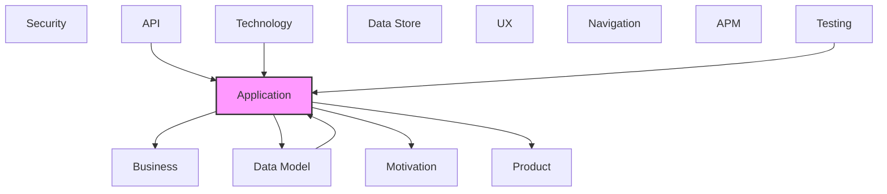

# Application

[← Back to README](../README.md)

Application components, services, and interactions.

## Report Index

- [Layer Introduction](#layer-introduction)
- [Intra-Layer Relationships](#intra-layer-relationships)
- [Inter-Layer Dependencies](#inter-layer-dependencies)
- [Inter-Layer Relationships Table](#inter-layer-relationships-table)
- [Element Reference](#element-reference)

## Layer Introduction

| Metric                    | Count |
| ------------------------- | ----- |
| Elements                  | 69    |
| Intra-Layer Relationships | 105   |
| Inter-Layer Relationships | 119   |
| Inbound Relationships     | 101   |
| Outbound Relationships    | 18    |

**Cross-Layer References**:

- **Upstream layers**: [API](./07-api-layer-report.md), [Data Model](./08-data-model-layer-report.md), [Technology](./06-technology-layer-report.md), [Testing](./13-testing-layer-report.md)
- **Downstream layers**: [Business](./02-business-layer-report.md), [Data Model](./08-data-model-layer-report.md), [Motivation](./01-motivation-layer-report.md), [Product](./03-product-layer-report.md)

## Intra-Layer Relationships

*This layer has >30 elements. Summary table shown instead of diagram.*

| Element                                                                          | Type                       | Relationships |
| -------------------------------------------------------------------------------- | -------------------------- | ------------- |
| `application.applicationcollaboration.graph-canvas-layoutviewport-collaboration` | `applicationcollaboration` | 3             |
| `application.applicationcomponent.adjacency-matrix-component`                    | `applicationcomponent`     | 2             |
| `application.applicationcomponent.graph-canvas-component`                        | `applicationcomponent`     | 28            |
| `application.applicationcomponent.graph-collapse-control-component`              | `applicationcomponent`     | 1             |
| `application.applicationcomponent.graph-edge-component`                          | `applicationcomponent`     | 2             |
| `application.applicationcomponent.graph-edge-inspector-component`                | `applicationcomponent`     | 1             |
| `application.applicationcomponent.graph-edge-shape-component`                    | `applicationcomponent`     | 3             |
| `application.applicationcomponent.graph-inspector-component`                     | `applicationcomponent`     | 1             |
| `application.applicationcomponent.graph-node-component`                          | `applicationcomponent`     | 1             |
| `application.applicationcomponent.graph-toolbar-component`                       | `applicationcomponent`     | 1             |
| `application.applicationcomponent.heimdall-ui-library-module`                    | `applicationcomponent`     | 12            |
| `application.applicationcomponent.hive-plot-component`                           | `applicationcomponent`     | 3             |
| `application.applicationcomponent.layer-stack-component`                         | `applicationcomponent`     | 5             |
| `application.applicationcomponent.layered-graph-explorer-component`              | `applicationcomponent`     | 1             |
| `application.applicationcomponent.trace-viewer-component`                        | `applicationcomponent`     | 1             |
| `application.applicationevent.node-drag-end-event`                               | `applicationevent`         | 1             |
| `application.applicationevent.node-hover-change-event`                           | `applicationevent`         | 0             |
| `application.applicationfunction.adjacency-matrix-cells`                         | `applicationfunction`      | 3             |
| `application.applicationfunction.aws-x-ray-trace-adaptation`                     | `applicationfunction`      | 2             |
| `application.applicationfunction.bezier-edge-path-computation`                   | `applicationfunction`      | 1             |
| `application.applicationfunction.body-scroll-lock`                               | `applicationfunction`      | 1             |
| `application.applicationfunction.cluster-circle-packing`                         | `applicationfunction`      | 1             |
| `application.applicationfunction.clustered-force-layout-algorithm`               | `applicationfunction`      | 5             |
| `application.applicationfunction.controlled-or-uncontrolled-state`               | `applicationfunction`      | 1             |
| `application.applicationfunction.dropdown-placement`                             | `applicationfunction`      | 2             |
| `application.applicationfunction.dropdown-portal-and-outside-click-containment`  | `applicationfunction`      | 2             |
| `application.applicationfunction.edge-label-clear-position-search`               | `applicationfunction`      | 2             |
| `application.applicationfunction.edge-weight-and-dash-styling`                   | `applicationfunction`      | 1             |
| `application.applicationfunction.fixed-clock-date-formatting`                    | `applicationfunction`      | 1             |
| `application.applicationfunction.focus-trap`                                     | `applicationfunction`      | 1             |
| `application.applicationfunction.force-directed-layout-algorithm`                | `applicationfunction`      | 6             |
| `application.applicationfunction.galaxy-aspect-ratio-resolution`                 | `applicationfunction`      | 2             |
| `application.applicationfunction.galaxy-live-simulation-step`                    | `applicationfunction`      | 4             |
| `application.applicationfunction.galaxy-radial-orbit-layout-algorithm`           | `applicationfunction`      | 5             |
| `application.applicationfunction.hive-plot-layout`                               | `applicationfunction`      | 3             |
| `application.applicationfunction.joint-edge-label-placement`                     | `applicationfunction`      | 2             |
| `application.applicationfunction.lane-layout-and-gutter-routing`                 | `applicationfunction`      | 4             |
| `application.applicationfunction.layer-plane-layout`                             | `applicationfunction`      | 3             |
| `application.applicationfunction.layer-stack-3d-projection`                      | `applicationfunction`      | 2             |
| `application.applicationfunction.layered-edge-label-placement`                   | `applicationfunction`      | 3             |
| `application.applicationfunction.layered-graph-index-construction`               | `applicationfunction`      | 6             |
| `application.applicationfunction.layered-graph-snapshot-sanitization`            | `applicationfunction`      | 1             |
| `application.applicationfunction.layered-link-filtering-and-emphasis`            | `applicationfunction`      | 2             |
| `application.applicationfunction.layered-reach-computation`                      | `applicationfunction`      | 2             |
| `application.applicationfunction.louvain-community-clustering`                   | `applicationfunction`      | 1             |
| `application.applicationfunction.navigation-edge-orthogonal-routing`             | `applicationfunction`      | 2             |
| `application.applicationfunction.node-overlap-separation-pass`                   | `applicationfunction`      | 3             |
| `application.applicationfunction.organic-layout-algorithm`                       | `applicationfunction`      | 3             |
| `application.applicationfunction.orthogonal-channel-edge-routing`                | `applicationfunction`      | 1             |
| `application.applicationfunction.orthogonal-layout-algorithm`                    | `applicationfunction`      | 4             |
| `application.applicationfunction.otlp-trace-adaptation`                          | `applicationfunction`      | 2             |
| `application.applicationfunction.pan-inertia-glide`                              | `applicationfunction`      | 1             |
| `application.applicationfunction.plain-link-click-detection`                     | `applicationfunction`      | 1             |
| `application.applicationfunction.radial-tree-layout-algorithm`                   | `applicationfunction`      | 3             |
| `application.applicationfunction.ssr-safe-media-query`                           | `applicationfunction`      | 1             |
| `application.applicationfunction.structural-forest-construction`                 | `applicationfunction`      | 3             |
| `application.applicationfunction.tooltip-placement`                              | `applicationfunction`      | 1             |
| `application.applicationfunction.trace-model-construction`                       | `applicationfunction`      | 3             |
| `application.applicationfunction.tweened-animation`                              | `applicationfunction`      | 1             |
| `application.applicationfunction.ux-navigation-tree-layout-algorithm`            | `applicationfunction`      | 3             |
| `application.applicationfunction.virtualized-list-windowing`                     | `applicationfunction`      | 1             |
| `application.applicationfunction.yield-to-paint`                                 | `applicationfunction`      | 1             |
| `application.applicationinteraction.panzoom-gesture-handling`                    | `applicationinteraction`   | 1             |
| `application.applicationprocess.graph-render-and-layout-recomputation-pipeline`  | `applicationprocess`       | 4             |
| `application.applicationservice.graph-layout-engine-service`                     | `applicationservice`       | 9             |
| `application.applicationservice.layered-graph-framework-service`                 | `applicationservice`       | 14            |
| `application.applicationservice.live-galaxy-simulation-service`                  | `applicationservice`       | 3             |
| `application.dataobject.node-position-map`                                       | `dataobject`               | 7             |
| `application.dataobject.node-rect-registry`                                      | `dataobject`               | 3             |

## Inter-Layer Dependencies

## Inter-Layer Relationships Table

| Relationship ID                                                        | Source Node                                                                                      | Dest Node                                                                                   | Dest Layer    | Predicate    | Cardinality  | Strength |
| ---------------------------------------------------------------------- | ------------------------------------------------------------------------------------------------ | ------------------------------------------------------------------------------------------- | ------------- | ------------ | ------------ | -------- |
| `api.operation.realizes.application.applicationfunction`               | `api.operation.bezier-path`                                                                      | `application.applicationfunction.bezier-edge-path-computation`                              | `application` | `realizes`   | many-to-many | medium   |
| `api.operation.realizes.application.applicationfunction`               | `api.operation.build-layered-index`                                                              | `application.applicationfunction.layered-graph-index-construction`                          | `application` | `realizes`   | many-to-many | medium   |
| `api.operation.realizes.application.applicationfunction`               | `api.operation.build-structural-forest`                                                          | `application.applicationfunction.structural-forest-construction`                            | `application` | `realizes`   | many-to-many | medium   |
| `api.operation.realizes.application.applicationfunction`               | `api.operation.build-trace-model`                                                                | `application.applicationfunction.trace-model-construction`                                  | `application` | `realizes`   | many-to-many | medium   |
| `api.operation.realizes.application.applicationfunction`               | `api.operation.clustered-force-layout`                                                           | `application.applicationfunction.clustered-force-layout-algorithm`                          | `application` | `realizes`   | many-to-many | medium   |
| `api.operation.realizes.application.applicationfunction`               | `api.operation.compute-reach`                                                                    | `application.applicationfunction.layered-reach-computation`                                 | `application` | `realizes`   | many-to-many | medium   |
| `api.operation.realizes.application.applicationfunction`               | `api.operation.find-clear-label-position`                                                        | `application.applicationfunction.edge-label-clear-position-search`                          | `application` | `realizes`   | many-to-many | medium   |
| `api.operation.realizes.application.applicationfunction`               | `api.operation.force-layout`                                                                     | `application.applicationfunction.force-directed-layout-algorithm`                           | `application` | `realizes`   | many-to-many | medium   |
| `api.operation.realizes.application.applicationfunction`               | `api.operation.from-otlp`                                                                        | `application.applicationfunction.otlp-trace-adaptation`                                     | `application` | `realizes`   | many-to-many | medium   |
| `api.operation.realizes.application.applicationfunction`               | `api.operation.from-xray`                                                                        | `application.applicationfunction.aws-x-ray-trace-adaptation`                                | `application` | `realizes`   | many-to-many | medium   |
| `api.operation.realizes.application.applicationfunction`               | `api.operation.galaxy-layout`                                                                    | `application.applicationfunction.galaxy-radial-orbit-layout-algorithm`                      | `application` | `realizes`   | many-to-many | medium   |
| `api.operation.references.application.applicationservice`              | `api.operation.graph-canvas`                                                                     | `application.applicationservice.graph-layout-engine-service`                                | `application` | `references` | many-to-many | medium   |
| `api.operation.references.application.applicationservice`              | `api.operation.graph-canvas`                                                                     | `application.applicationservice.live-galaxy-simulation-service`                             | `application` | `references` | many-to-many | medium   |
| `api.operation.triggers.application.applicationevent`                  | `api.operation.graph-canvas`                                                                     | `application.applicationevent.node-drag-end-event`                                          | `application` | `triggers`   | many-to-many | medium   |
| `api.operation.triggers.application.applicationevent`                  | `api.operation.graph-canvas`                                                                     | `application.applicationevent.node-hover-change-event`                                      | `application` | `triggers`   | many-to-many | medium   |
| `api.operation.realizes.application.applicationfunction`               | `api.operation.hive-layout`                                                                      | `application.applicationfunction.hive-plot-layout`                                          | `application` | `realizes`   | many-to-many | medium   |
| `api.operation.realizes.application.applicationfunction`               | `api.operation.layout-lanes`                                                                     | `application.applicationfunction.lane-layout-and-gutter-routing`                            | `application` | `realizes`   | many-to-many | medium   |
| `api.operation.realizes.application.applicationfunction`               | `api.operation.layout-layers`                                                                    | `application.applicationfunction.layer-plane-layout`                                        | `application` | `realizes`   | many-to-many | medium   |
| `api.operation.realizes.application.applicationfunction`               | `api.operation.louvain-cluster`                                                                  | `application.applicationfunction.louvain-community-clustering`                              | `application` | `realizes`   | many-to-many | medium   |
| `api.operation.realizes.application.applicationfunction`               | `api.operation.organic-layout`                                                                   | `application.applicationfunction.organic-layout-algorithm`                                  | `application` | `realizes`   | many-to-many | medium   |
| `api.operation.realizes.application.applicationfunction`               | `api.operation.orthogonal-layout`                                                                | `application.applicationfunction.orthogonal-layout-algorithm`                               | `application` | `realizes`   | many-to-many | medium   |
| `api.operation.realizes.application.applicationfunction`               | `api.operation.pack-clusters`                                                                    | `application.applicationfunction.cluster-circle-packing`                                    | `application` | `realizes`   | many-to-many | medium   |
| `api.operation.realizes.application.applicationfunction`               | `api.operation.radial-tree-layout`                                                               | `application.applicationfunction.radial-tree-layout-algorithm`                              | `application` | `realizes`   | many-to-many | medium   |
| `api.operation.realizes.application.applicationfunction`               | `api.operation.use-controllable`                                                                 | `application.applicationfunction.controlled-or-uncontrolled-state`                          | `application` | `realizes`   | many-to-many | medium   |
| `api.operation.references.application.applicationservice`              | `api.operation.use-layered-graph`                                                                | `application.applicationservice.layered-graph-framework-service`                            | `application` | `references` | many-to-many | medium   |
| `api.operation.realizes.application.applicationfunction`               | `api.operation.use-media-query`                                                                  | `application.applicationfunction.ssr-safe-media-query`                                      | `application` | `realizes`   | many-to-many | medium   |
| `api.operation.realizes.application.applicationfunction`               | `api.operation.use-tween`                                                                        | `application.applicationfunction.tweened-animation`                                         | `application` | `realizes`   | many-to-many | medium   |
| `api.operation.realizes.application.applicationfunction`               | `api.operation.ux-nav-layout`                                                                    | `application.applicationfunction.ux-navigation-tree-layout-algorithm`                       | `application` | `realizes`   | many-to-many | medium   |
| `api.operation.realizes.application.applicationfunction`               | `api.operation.visible-navigation-edge-ids`                                                      | `application.applicationfunction.ux-navigation-tree-layout-algorithm`                       | `application` | `realizes`   | many-to-many | medium   |
| `application.applicationfunction.accesses.data-model.schemadefinition` | `application.applicationfunction.aws-x-ray-trace-adaptation`                                     | `data-model.schemadefinition.trace`                                                         | `data-model`  | `accesses`   | many-to-many | medium   |
| `application.applicationfunction.satisfies.motivation.requirement`     | `application.applicationfunction.clustered-force-layout-algorithm`                               | `motivation.requirement.layout-engines-must-be-pluggable-without-breaking-existing-callers` | `motivation`  | `satisfies`  | many-to-many | medium   |
| `application.applicationfunction.satisfies.motivation.requirement`     | `application.applicationfunction.fixed-clock-date-formatting`                                    | `motivation.requirement.server-rendered-output-hydrates-without-mismatch`                   | `motivation`  | `satisfies`  | many-to-many | medium   |
| `application.applicationfunction.satisfies.motivation.requirement`     | `application.applicationfunction.force-directed-layout-algorithm`                                | `motivation.requirement.layout-engines-must-be-pluggable-without-breaking-existing-callers` | `motivation`  | `satisfies`  | many-to-many | medium   |
| `application.applicationfunction.accesses.data-model.schemadefinition` | `application.applicationfunction.joint-edge-label-placement`                                     | `data-model.schemadefinition.edge-geometry`                                                 | `data-model`  | `accesses`   | many-to-many | medium   |
| `application.applicationfunction.accesses.data-model.schemadefinition` | `application.applicationfunction.layered-graph-index-construction`                               | `data-model.schemadefinition.layered-index`                                                 | `data-model`  | `accesses`   | many-to-many | medium   |
| `application.applicationfunction.accesses.data-model.schemadefinition` | `application.applicationfunction.layered-graph-snapshot-sanitization`                            | `data-model.schemadefinition.layered-graph-snapshot`                                        | `data-model`  | `accesses`   | many-to-many | medium   |
| `application.applicationfunction.accesses.data-model.schemadefinition` | `application.applicationfunction.organic-layout-algorithm`                                       | `data-model.schemadefinition.organic-layout-options`                                        | `data-model`  | `accesses`   | many-to-many | medium   |
| `application.applicationfunction.accesses.data-model.schemadefinition` | `application.applicationfunction.organic-layout-algorithm`                                       | `data-model.schemadefinition.organic-layout-result`                                         | `data-model`  | `accesses`   | many-to-many | medium   |
| `application.applicationfunction.accesses.data-model.schemadefinition` | `application.applicationfunction.orthogonal-layout-algorithm`                                    | `data-model.schemadefinition.orthogonal-layout-options`                                     | `data-model`  | `accesses`   | many-to-many | medium   |
| `application.applicationfunction.accesses.data-model.schemadefinition` | `application.applicationfunction.orthogonal-layout-algorithm`                                    | `data-model.schemadefinition.orthogonal-layout-result`                                      | `data-model`  | `accesses`   | many-to-many | medium   |
| `application.applicationfunction.accesses.data-model.schemadefinition` | `application.applicationfunction.otlp-trace-adaptation`                                          | `data-model.schemadefinition.trace`                                                         | `data-model`  | `accesses`   | many-to-many | medium   |
| `application.applicationfunction.satisfies.motivation.requirement`     | `application.applicationfunction.ssr-safe-media-query`                                           | `motivation.requirement.server-rendered-output-hydrates-without-mismatch`                   | `motivation`  | `satisfies`  | many-to-many | medium   |
| `application.applicationfunction.accesses.data-model.schemadefinition` | `application.applicationfunction.trace-model-construction`                                       | `data-model.schemadefinition.trace`                                                         | `data-model`  | `accesses`   | many-to-many | medium   |
| `application.applicationprocess.realizes.business.businessprocess`     | `application.applicationprocess.graph-render-and-layout-recomputation-pipeline`                  | `business.businessprocess.render-graph-from-domain-data-to-interactive-view`                | `business`    | `realizes`   | many-to-many | medium   |
| `application.applicationservice.realizes.product.softwarecapability`   | `application.applicationservice.graph-layout-engine-service`                                     | `product.softwarecapability.organic-graph-layout`                                           | `product`     | `realizes`   | many-to-many | medium   |
| `application.applicationservice.realizes.product.softwarecapability`   | `application.applicationservice.graph-layout-engine-service`                                     | `product.softwarecapability.orthogonal-graph-layout`                                        | `product`     | `realizes`   | many-to-many | medium   |
| `application.applicationservice.realizes.product.softwarecapability`   | `application.applicationservice.layered-graph-framework-service`                                 | `product.softwarecapability.layered-graph-exploration`                                      | `product`     | `realizes`   | many-to-many | medium   |
| `data-model.schemadefinition.realizes.application.dataobject`          | `data-model.schemadefinition.graph-node-data`                                                    | `application.dataobject.node-rect-registry`                                                 | `application` | `realizes`   | many-to-many | medium   |
| `data-model.schemadefinition.realizes.application.dataobject`          | `data-model.schemadefinition.layout-node`                                                        | `application.dataobject.node-position-map`                                                  | `application` | `realizes`   | many-to-many | medium   |
| `data-model.schemadefinition.realizes.application.dataobject`          | `data-model.schemadefinition.organic-layout-result`                                              | `application.dataobject.node-position-map`                                                  | `application` | `realizes`   | many-to-many | medium   |
| `data-model.schemadefinition.realizes.application.dataobject`          | `data-model.schemadefinition.orthogonal-layout-result`                                           | `application.dataobject.node-position-map`                                                  | `application` | `realizes`   | many-to-many | medium   |
| `technology.artifact.realizes.application.applicationcomponent`        | `technology.artifact.heimdall-ui-package`                                                        | `application.applicationcomponent.graph-canvas-component`                                   | `application` | `realizes`   | many-to-many | medium   |
| `technology.artifact.realizes.application.applicationcomponent`        | `technology.artifact.heimdall-ui-package`                                                        | `application.applicationcomponent.heimdall-ui-library-module`                               | `application` | `realizes`   | many-to-many | medium   |
| `testing.testcasesketch.tests.application.applicationfunction`         | `testing.testcasesketch.clustered-view-bubble-packing-integration`                               | `application.applicationfunction.clustered-force-layout-algorithm`                          | `application` | `tests`      | many-to-many | medium   |
| `testing.testcasesketch.tests.application.applicationfunction`         | `testing.testcasesketch.galaxy-layout-lab-poc-dataset-stress-test`                               | `application.applicationfunction.galaxy-radial-orbit-layout-algorithm`                      | `application` | `tests`      | many-to-many | medium   |
| `testing.testcasesketch.tests.application.applicationfunction`         | `testing.testcasesketch.large-card-nodes-stay-non-overlapping-in-a-bushy-hub-and-spoke-topology` | `application.applicationfunction.force-directed-layout-algorithm`                           | `application` | `tests`      | many-to-many | medium   |
| `testing.testcasesketch.tests.application.applicationfunction`         | `testing.testcasesketch.radial-tree-layout-collapsed-nodes`                                      | `application.applicationfunction.radial-tree-layout-algorithm`                              | `application` | `tests`      | many-to-many | medium   |
| `testing.testcasesketch.tests.application.applicationfunction`         | `testing.testcasesketch.radial-tree-layout-collapsed-nodes`                                      | `application.applicationfunction.structural-forest-construction`                            | `application` | `tests`      | many-to-many | medium   |
| `testing.testcasesketch.tests.application.applicationfunction`         | `testing.testcasesketch.route-navigation-edge-avoids-obstacles`                                  | `application.applicationfunction.navigation-edge-orthogonal-routing`                        | `application` | `tests`      | many-to-many | medium   |
| `testing.testcoveragemodel.covers.application.applicationcomponent`    | `testing.testcoveragemodel.heimdall-graph-layout-test-coverage`                                  | `application.applicationcomponent.graph-canvas-component`                                   | `application` | `covers`     | many-to-many | medium   |
| `testing.testcoveragetarget.covers.application.applicationcomponent`   | `testing.testcoveragetarget.adjacency-matrix-view`                                               | `application.applicationcomponent.adjacency-matrix-component`                               | `application` | `covers`     | many-to-many | medium   |
| `testing.testcoveragetarget.covers.application.applicationcomponent`   | `testing.testcoveragetarget.edge-label-placement-and-styling`                                    | `application.applicationcomponent.graph-canvas-component`                                   | `application` | `covers`     | many-to-many | medium   |
| `testing.testcoveragetarget.covers.application.applicationservice`     | `testing.testcoveragetarget.force-force-clustered-layout-algorithms`                             | `application.applicationservice.graph-layout-engine-service`                                | `application` | `covers`     | many-to-many | medium   |
| `testing.testcoveragetarget.covers.application.applicationservice`     | `testing.testcoveragetarget.galaxy-layout-algorithm-unit`                                        | `application.applicationservice.graph-layout-engine-service`                                | `application` | `covers`     | many-to-many | medium   |
| `testing.testcoveragetarget.covers.application.applicationservice`     | `testing.testcoveragetarget.galaxy-layout-algorithm-unit`                                        | `application.applicationservice.live-galaxy-simulation-service`                             | `application` | `covers`     | many-to-many | medium   |
| `testing.testcoveragetarget.covers.application.applicationservice`     | `testing.testcoveragetarget.galaxy-layout-and-live-simulation`                                   | `application.applicationservice.live-galaxy-simulation-service`                             | `application` | `covers`     | many-to-many | medium   |
| `testing.testcoveragetarget.covers.application.applicationcomponent`   | `testing.testcoveragetarget.galaxy-layout-collapse-and-expand`                                   | `application.applicationcomponent.graph-canvas-component`                                   | `application` | `covers`     | many-to-many | medium   |
| `testing.testcoveragetarget.covers.application.applicationservice`     | `testing.testcoveragetarget.galaxy-live-drag`                                                    | `application.applicationservice.live-galaxy-simulation-service`                             | `application` | `covers`     | many-to-many | medium   |
| `testing.testcoveragetarget.covers.application.applicationcomponent`   | `testing.testcoveragetarget.graph-canvas-accessible-names`                                       | `application.applicationcomponent.graph-canvas-component`                                   | `application` | `covers`     | many-to-many | medium   |
| `testing.testcoveragetarget.covers.application.applicationcomponent`   | `testing.testcoveragetarget.graph-canvas-center-on-select`                                       | `application.applicationcomponent.graph-canvas-component`                                   | `application` | `covers`     | many-to-many | medium   |
| `testing.testcoveragetarget.covers.application.applicationcomponent`   | `testing.testcoveragetarget.graph-canvas-click-tooltips`                                         | `application.applicationcomponent.graph-canvas-component`                                   | `application` | `covers`     | many-to-many | medium   |
| `testing.testcoveragetarget.covers.application.applicationcomponent`   | `testing.testcoveragetarget.graph-canvas-fit-to-boundaries`                                      | `application.applicationcomponent.graph-canvas-component`                                   | `application` | `covers`     | many-to-many | medium   |
| `testing.testcoveragetarget.covers.application.applicationcomponent`   | `testing.testcoveragetarget.graph-canvas-fullscreen-container`                                   | `application.applicationcomponent.graph-canvas-component`                                   | `application` | `covers`     | many-to-many | medium   |
| `testing.testcoveragetarget.covers.application.applicationcomponent`   | `testing.testcoveragetarget.graph-canvas-hover-tooltip-placement`                                | `application.applicationcomponent.graph-canvas-component`                                   | `application` | `covers`     | many-to-many | medium   |
| `testing.testcoveragetarget.covers.application.applicationcomponent`   | `testing.testcoveragetarget.graph-canvas-layer-lanes`                                            | `application.applicationcomponent.graph-canvas-component`                                   | `application` | `covers`     | many-to-many | medium   |
| `testing.testcoveragetarget.covers.application.applicationcomponent`   | `testing.testcoveragetarget.graph-canvas-layout-busy-state`                                      | `application.applicationcomponent.graph-canvas-component`                                   | `application` | `covers`     | many-to-many | medium   |
| `testing.testcoveragetarget.covers.application.applicationcomponent`   | `testing.testcoveragetarget.graph-canvas-node-measurement`                                       | `application.applicationcomponent.graph-canvas-component`                                   | `application` | `covers`     | many-to-many | medium   |
| `testing.testcoveragetarget.covers.application.applicationcomponent`   | `testing.testcoveragetarget.graph-canvas-popovers`                                               | `application.applicationcomponent.graph-canvas-component`                                   | `application` | `covers`     | many-to-many | medium   |
| `testing.testcoveragetarget.covers.application.applicationcomponent`   | `testing.testcoveragetarget.graph-canvas-rendering-and-interaction`                              | `application.applicationcomponent.graph-canvas-component`                                   | `application` | `covers`     | many-to-many | medium   |
| `testing.testcoveragetarget.covers.application.applicationcomponent`   | `testing.testcoveragetarget.graph-canvas-viewport-history`                                       | `application.applicationcomponent.graph-canvas-component`                                   | `application` | `covers`     | many-to-many | medium   |
| `testing.testcoveragetarget.covers.application.applicationcomponent`   | `testing.testcoveragetarget.graph-edge-geometry-utilities`                                       | `application.applicationcomponent.graph-canvas-component`                                   | `application` | `covers`     | many-to-many | medium   |
| `testing.testcoveragetarget.covers.application.applicationcomponent`   | `testing.testcoveragetarget.graph-edge-style-utilities`                                          | `application.applicationcomponent.graph-edge-shape-component`                               | `application` | `covers`     | many-to-many | medium   |
| `testing.testcoveragetarget.covers.application.applicationcomponent`   | `testing.testcoveragetarget.graph-geometry-and-joint-label-placement`                            | `application.applicationcomponent.graph-canvas-component`                                   | `application` | `covers`     | many-to-many | medium   |
| `testing.testcoveragetarget.covers.application.applicationcomponent`   | `testing.testcoveragetarget.hive-plot-layout`                                                    | `application.applicationcomponent.hive-plot-component`                                      | `application` | `covers`     | many-to-many | medium   |
| `testing.testcoveragetarget.covers.application.applicationcomponent`   | `testing.testcoveragetarget.hive-plot-view`                                                      | `application.applicationcomponent.hive-plot-component`                                      | `application` | `covers`     | many-to-many | medium   |
| `testing.testcoveragetarget.covers.application.applicationcomponent`   | `testing.testcoveragetarget.lane-layout-and-gutter-routing`                                      | `application.applicationcomponent.graph-canvas-component`                                   | `application` | `covers`     | many-to-many | medium   |
| `testing.testcoveragetarget.covers.application.applicationservice`     | `testing.testcoveragetarget.lane-layout-and-gutter-routing`                                      | `application.applicationservice.graph-layout-engine-service`                                | `application` | `covers`     | many-to-many | medium   |
| `testing.testcoveragetarget.covers.application.applicationcomponent`   | `testing.testcoveragetarget.layer-stack-projection`                                              | `application.applicationcomponent.layer-stack-component`                                    | `application` | `covers`     | many-to-many | medium   |
| `testing.testcoveragetarget.covers.application.applicationcomponent`   | `testing.testcoveragetarget.layer-stack-view`                                                    | `application.applicationcomponent.layer-stack-component`                                    | `application` | `covers`     | many-to-many | medium   |
| `testing.testcoveragetarget.covers.application.applicationcomponent`   | `testing.testcoveragetarget.layered-adjacency-matrix-cells`                                      | `application.applicationcomponent.adjacency-matrix-component`                               | `application` | `covers`     | many-to-many | medium   |
| `testing.testcoveragetarget.covers.application.applicationservice`     | `testing.testcoveragetarget.layered-async-layout`                                                | `application.applicationservice.layered-graph-framework-service`                            | `application` | `covers`     | many-to-many | medium   |
| `testing.testcoveragetarget.covers.application.applicationcomponent`   | `testing.testcoveragetarget.layered-dom-order`                                                   | `application.applicationcomponent.layer-stack-component`                                    | `application` | `covers`     | many-to-many | medium   |
| `testing.testcoveragetarget.covers.application.applicationcomponent`   | `testing.testcoveragetarget.layered-edge-labels`                                                 | `application.applicationcomponent.hive-plot-component`                                      | `application` | `covers`     | many-to-many | medium   |
| `testing.testcoveragetarget.covers.application.applicationcomponent`   | `testing.testcoveragetarget.layered-edge-labels`                                                 | `application.applicationcomponent.layer-stack-component`                                    | `application` | `covers`     | many-to-many | medium   |
| `testing.testcoveragetarget.covers.application.applicationcomponent`   | `testing.testcoveragetarget.layered-graph-explorer`                                              | `application.applicationcomponent.layered-graph-explorer-component`                         | `application` | `covers`     | many-to-many | medium   |
| `testing.testcoveragetarget.covers.application.applicationservice`     | `testing.testcoveragetarget.layered-graph-index-and-reach`                                       | `application.applicationservice.layered-graph-framework-service`                            | `application` | `covers`     | many-to-many | medium   |
| `testing.testcoveragetarget.covers.application.applicationcomponent`   | `testing.testcoveragetarget.layered-link-batches`                                                | `application.applicationcomponent.layer-stack-component`                                    | `application` | `covers`     | many-to-many | medium   |
| `testing.testcoveragetarget.covers.application.applicationservice`     | `testing.testcoveragetarget.layered-selection-and-emphasis`                                      | `application.applicationservice.layered-graph-framework-service`                            | `application` | `covers`     | many-to-many | medium   |
| `testing.testcoveragetarget.covers.application.applicationservice`     | `testing.testcoveragetarget.layered-snapshot-sanitization`                                       | `application.applicationservice.layered-graph-framework-service`                            | `application` | `covers`     | many-to-many | medium   |
| `testing.testcoveragetarget.covers.application.applicationcomponent`   | `testing.testcoveragetarget.navigation-edge-channel-routing-browser`                             | `application.applicationcomponent.graph-canvas-component`                                   | `application` | `covers`     | many-to-many | medium   |
| `testing.testcoveragetarget.covers.application.applicationcomponent`   | `testing.testcoveragetarget.navigation-edge-channel-routing`                                     | `application.applicationcomponent.graph-canvas-component`                                   | `application` | `covers`     | many-to-many | medium   |
| `testing.testcoveragetarget.covers.application.applicationservice`     | `testing.testcoveragetarget.organic-layout-algorithm`                                            | `application.applicationservice.graph-layout-engine-service`                                | `application` | `covers`     | many-to-many | medium   |
| `testing.testcoveragetarget.covers.application.applicationcomponent`   | `testing.testcoveragetarget.organic-layout-browser`                                              | `application.applicationcomponent.graph-canvas-component`                                   | `application` | `covers`     | many-to-many | medium   |
| `testing.testcoveragetarget.covers.application.applicationservice`     | `testing.testcoveragetarget.organic-layout-browser`                                              | `application.applicationservice.graph-layout-engine-service`                                | `application` | `covers`     | many-to-many | medium   |
| `testing.testcoveragetarget.covers.application.applicationservice`     | `testing.testcoveragetarget.orthogonal-layout-algorithm-and-routers`                             | `application.applicationservice.graph-layout-engine-service`                                | `application` | `covers`     | many-to-many | medium   |
| `testing.testcoveragetarget.covers.application.applicationcomponent`   | `testing.testcoveragetarget.orthogonal-layout-browser`                                           | `application.applicationcomponent.graph-canvas-component`                                   | `application` | `covers`     | many-to-many | medium   |
| `testing.testcoveragetarget.covers.application.applicationservice`     | `testing.testcoveragetarget.orthogonal-layout-browser`                                           | `application.applicationservice.graph-layout-engine-service`                                | `application` | `covers`     | many-to-many | medium   |
| `testing.testcoveragetarget.covers.application.applicationcomponent`   | `testing.testcoveragetarget.pan-and-zoom`                                                        | `application.applicationcomponent.graph-canvas-component`                                   | `application` | `covers`     | many-to-many | medium   |
| `testing.testcoveragetarget.covers.application.applicationcomponent`   | `testing.testcoveragetarget.pan-inertia`                                                         | `application.applicationcomponent.graph-canvas-component`                                   | `application` | `covers`     | many-to-many | medium   |
| `testing.testcoveragetarget.covers.application.applicationservice`     | `testing.testcoveragetarget.radial-tree-layout-algorithm`                                        | `application.applicationservice.graph-layout-engine-service`                                | `application` | `covers`     | many-to-many | medium   |
| `testing.testcoveragetarget.covers.application.applicationcomponent`   | `testing.testcoveragetarget.radial-tree-layout-browser`                                          | `application.applicationcomponent.graph-canvas-component`                                   | `application` | `covers`     | many-to-many | medium   |
| `testing.testcoveragetarget.covers.application.applicationservice`     | `testing.testcoveragetarget.radial-tree-layout-browser`                                          | `application.applicationservice.graph-layout-engine-service`                                | `application` | `covers`     | many-to-many | medium   |
| `testing.testcoveragetarget.covers.application.applicationcomponent`   | `testing.testcoveragetarget.trace-adapters`                                                      | `application.applicationcomponent.trace-viewer-component`                                   | `application` | `covers`     | many-to-many | medium   |
| `testing.testcoveragetarget.covers.application.applicationcomponent`   | `testing.testcoveragetarget.trace-viewer`                                                        | `application.applicationcomponent.trace-viewer-component`                                   | `application` | `covers`     | many-to-many | medium   |
| `testing.testcoveragetarget.covers.application.applicationcomponent`   | `testing.testcoveragetarget.ux-navigation-edge-visibility`                                       | `application.applicationcomponent.graph-canvas-component`                                   | `application` | `covers`     | many-to-many | medium   |
| `testing.testcoveragetarget.covers.application.applicationservice`     | `testing.testcoveragetarget.ux-navigation-layout-algorithm`                                      | `application.applicationservice.graph-layout-engine-service`                                | `application` | `covers`     | many-to-many | medium   |
| `testing.testcoveragetarget.covers.application.applicationcomponent`   | `testing.testcoveragetarget.ux-navigation-layout-browser`                                        | `application.applicationcomponent.graph-canvas-component`                                   | `application` | `covers`     | many-to-many | medium   |
| `testing.testcoveragetarget.covers.application.applicationservice`     | `testing.testcoveragetarget.ux-navigation-layout-browser`                                        | `application.applicationservice.graph-layout-engine-service`                                | `application` | `covers`     | many-to-many | medium   |
| `testing.testcoveragetarget.covers.application.applicationcomponent`   | `testing.testcoveragetarget.yield-to-paint`                                                      | `application.applicationcomponent.graph-canvas-component`                                   | `application` | `covers`     | many-to-many | medium   |

## Element Reference

### GraphCanvas Layout/Viewport Collaboration {#graphcanvas-layout-viewport-collaboration}

**ID**: `application.applicationcollaboration.graph-canvas-layoutviewport-collaboration`

**Type**: `applicationcollaboration`

The runtime collaboration between GraphCanvas, its selected layout engine, usePanZoom, and (layout=galaxy) useGalaxySimulation — GraphCanvas owns state and orchestrates calls into the others each render/frame.

#### Relationships

| Type        | Related Element                                                 | Predicate     | Direction |
| ----------- | --------------------------------------------------------------- | ------------- | --------- |
| intra-layer | `application.applicationcomponent.graph-canvas-component`       | `aggregates`  | outbound  |
| intra-layer | `application.applicationinteraction.panzoom-gesture-handling`   | `assigned-to` | outbound  |
| intra-layer | `application.applicationservice.live-galaxy-simulation-service` | `realizes`    | outbound  |

### AdjacencyMatrix Component {#adjacencymatrix-component}

**ID**: `application.applicationcomponent.adjacency-matrix-component`

**Type**: `applicationcomponent`

Renders a layered graph as a directed block adjacency matrix, one row and column per node grouped by layer, windowed for large graphs.

#### Attributes

| Name | Value    |
| ---- | -------- |
| type | internal |

#### Relationships

| Type        | Related Element                                                  | Predicate     | Direction |
| ----------- | ---------------------------------------------------------------- | ------------- | --------- |
| inter-layer | `testing.testcoveragetarget.adjacency-matrix-view`               | `covers`      | inbound   |
| inter-layer | `testing.testcoveragetarget.layered-adjacency-matrix-cells`      | `covers`      | inbound   |
| intra-layer | `application.applicationfunction.adjacency-matrix-cells`         | `assigned-to` | outbound  |
| intra-layer | `application.applicationservice.layered-graph-framework-service` | `serves`      | inbound   |

### GraphCanvas Component {#graphcanvas-component}

**ID**: `application.applicationcomponent.graph-canvas-component`

**Type**: `applicationcomponent`

The primary orchestrating React component: measures nodes, dispatches to the layout selected by its layout prop (manual, force, organic, orthogonal, galaxy, force-clustered, ux-navigation, radial-tree, layer-lanes), owns pan/zoom, selection, hover, collapse and viewport history, places edge labels jointly (hiding labels with no room until focus), and renders nodes, edges, toolbar, tooltips and popovers.

#### Attributes

| Name | Value             |
| ---- | ----------------- |
| type | service-component |

#### Relationships

| Type        | Related Element                                                                  | Predicate     | Direction |
| ----------- | -------------------------------------------------------------------------------- | ------------- | --------- |
| inter-layer | `technology.artifact.heimdall-ui-package`                                        | `realizes`    | inbound   |
| inter-layer | `testing.testcoveragemodel.heimdall-graph-layout-test-coverage`                  | `covers`      | inbound   |
| inter-layer | `testing.testcoveragetarget.edge-label-placement-and-styling`                    | `covers`      | inbound   |
| inter-layer | `testing.testcoveragetarget.galaxy-layout-collapse-and-expand`                   | `covers`      | inbound   |
| inter-layer | `testing.testcoveragetarget.graph-canvas-accessible-names`                       | `covers`      | inbound   |
| inter-layer | `testing.testcoveragetarget.graph-canvas-center-on-select`                       | `covers`      | inbound   |
| inter-layer | `testing.testcoveragetarget.graph-canvas-click-tooltips`                         | `covers`      | inbound   |
| inter-layer | `testing.testcoveragetarget.graph-canvas-fit-to-boundaries`                      | `covers`      | inbound   |
| inter-layer | `testing.testcoveragetarget.graph-canvas-fullscreen-container`                   | `covers`      | inbound   |
| inter-layer | `testing.testcoveragetarget.graph-canvas-hover-tooltip-placement`                | `covers`      | inbound   |
| inter-layer | `testing.testcoveragetarget.graph-canvas-layer-lanes`                            | `covers`      | inbound   |
| inter-layer | `testing.testcoveragetarget.graph-canvas-layout-busy-state`                      | `covers`      | inbound   |
| inter-layer | `testing.testcoveragetarget.graph-canvas-node-measurement`                       | `covers`      | inbound   |
| inter-layer | `testing.testcoveragetarget.graph-canvas-popovers`                               | `covers`      | inbound   |
| inter-layer | `testing.testcoveragetarget.graph-canvas-rendering-and-interaction`              | `covers`      | inbound   |
| inter-layer | `testing.testcoveragetarget.graph-canvas-viewport-history`                       | `covers`      | inbound   |
| inter-layer | `testing.testcoveragetarget.graph-edge-geometry-utilities`                       | `covers`      | inbound   |
| inter-layer | `testing.testcoveragetarget.graph-geometry-and-joint-label-placement`            | `covers`      | inbound   |
| inter-layer | `testing.testcoveragetarget.lane-layout-and-gutter-routing`                      | `covers`      | inbound   |
| inter-layer | `testing.testcoveragetarget.navigation-edge-channel-routing-browser`             | `covers`      | inbound   |
| inter-layer | `testing.testcoveragetarget.navigation-edge-channel-routing`                     | `covers`      | inbound   |
| inter-layer | `testing.testcoveragetarget.organic-layout-browser`                              | `covers`      | inbound   |
| inter-layer | `testing.testcoveragetarget.orthogonal-layout-browser`                           | `covers`      | inbound   |
| inter-layer | `testing.testcoveragetarget.pan-and-zoom`                                        | `covers`      | inbound   |
| inter-layer | `testing.testcoveragetarget.pan-inertia`                                         | `covers`      | inbound   |
| inter-layer | `testing.testcoveragetarget.radial-tree-layout-browser`                          | `covers`      | inbound   |
| inter-layer | `testing.testcoveragetarget.ux-navigation-edge-visibility`                       | `covers`      | inbound   |
| inter-layer | `testing.testcoveragetarget.ux-navigation-layout-browser`                        | `covers`      | inbound   |
| inter-layer | `testing.testcoveragetarget.yield-to-paint`                                      | `covers`      | inbound   |
| intra-layer | `application.applicationcollaboration.graph-canvas-layoutviewport-collaboration` | `aggregates`  | inbound   |
| intra-layer | `application.dataobject.node-position-map`                                       | `accesses`    | outbound  |
| intra-layer | `application.dataobject.node-rect-registry`                                      | `accesses`    | outbound  |
| intra-layer | `application.applicationfunction.bezier-edge-path-computation`                   | `assigned-to` | outbound  |
| intra-layer | `application.applicationfunction.clustered-force-layout-algorithm`               | `assigned-to` | outbound  |
| intra-layer | `application.applicationfunction.edge-label-clear-position-search`               | `assigned-to` | outbound  |
| intra-layer | `application.applicationfunction.force-directed-layout-algorithm`                | `assigned-to` | outbound  |
| intra-layer | `application.applicationfunction.galaxy-aspect-ratio-resolution`                 | `assigned-to` | outbound  |
| intra-layer | `application.applicationfunction.galaxy-radial-orbit-layout-algorithm`           | `assigned-to` | outbound  |
| intra-layer | `application.applicationfunction.joint-edge-label-placement`                     | `assigned-to` | outbound  |
| intra-layer | `application.applicationfunction.lane-layout-and-gutter-routing`                 | `assigned-to` | outbound  |
| intra-layer | `application.applicationfunction.navigation-edge-orthogonal-routing`             | `assigned-to` | outbound  |
| intra-layer | `application.applicationfunction.organic-layout-algorithm`                       | `assigned-to` | outbound  |
| intra-layer | `application.applicationfunction.orthogonal-layout-algorithm`                    | `assigned-to` | outbound  |
| intra-layer | `application.applicationfunction.pan-inertia-glide`                              | `assigned-to` | outbound  |
| intra-layer | `application.applicationfunction.radial-tree-layout-algorithm`                   | `assigned-to` | outbound  |
| intra-layer | `application.applicationfunction.structural-forest-construction`                 | `assigned-to` | outbound  |
| intra-layer | `application.applicationfunction.ux-navigation-tree-layout-algorithm`            | `assigned-to` | outbound  |
| intra-layer | `application.applicationfunction.yield-to-paint`                                 | `assigned-to` | outbound  |
| intra-layer | `application.applicationservice.graph-layout-engine-service`                     | `realizes`    | outbound  |
| intra-layer | `application.applicationservice.live-galaxy-simulation-service`                  | `realizes`    | outbound  |
| intra-layer | `application.applicationcomponent.graph-collapse-control-component`              | `uses`        | outbound  |
| intra-layer | `application.applicationcomponent.graph-edge-shape-component`                    | `uses`        | outbound  |
| intra-layer | `application.applicationcomponent.graph-node-component`                          | `uses`        | outbound  |
| intra-layer | `application.applicationcomponent.graph-toolbar-component`                       | `uses`        | outbound  |
| intra-layer | `application.applicationcomponent.graph-edge-inspector-component`                | `uses`        | inbound   |
| intra-layer | `application.applicationcomponent.graph-inspector-component`                     | `uses`        | inbound   |
| intra-layer | `application.applicationservice.layered-graph-framework-service`                 | `serves`      | inbound   |

### GraphCollapseControl Component {#graphcollapsecontrol-component}

**ID**: `application.applicationcomponent.graph-collapse-control-component`

**Type**: `applicationcomponent`

Floating foreignObject button rendered at a node's right edge for toggling structural collapse/expand, with a hidden-descendant-count badge.

#### Attributes

| Name | Value    |
| ---- | -------- |
| type | internal |

#### Relationships

| Type        | Related Element                                           | Predicate | Direction |
| ----------- | --------------------------------------------------------- | --------- | --------- |
| intra-layer | `application.applicationcomponent.graph-canvas-component` | `uses`    | inbound   |

### GraphEdge Component {#graphedge-component}

**ID**: `application.applicationcomponent.graph-edge-component`

**Type**: `applicationcomponent`

Standalone exported edge component (for use outside GraphCanvas's own internal edge renderer): computes its own path with the internal computeEdgePath helper (src/utils/graph.ts, no longer a public export) and delegates drawing to GraphEdgeShape.

#### Attributes

| Name | Value    |
| ---- | -------- |
| type | internal |

#### Relationships

| Type        | Related Element                                               | Predicate  | Direction |
| ----------- | ------------------------------------------------------------- | ---------- | --------- |
| intra-layer | `application.dataobject.node-rect-registry`                   | `accesses` | outbound  |
| intra-layer | `application.applicationcomponent.graph-edge-shape-component` | `uses`     | outbound  |

### GraphEdgeInspector Component {#graphedgeinspector-component}

**ID**: `application.applicationcomponent.graph-edge-inspector-component`

**Type**: `applicationcomponent`

Lighter detail panel for a selected edge: predicate/title, source/target endpoint buttons, weight and scalar metadata.

#### Attributes

| Name | Value    |
| ---- | -------- |
| type | internal |

#### Relationships

| Type        | Related Element                                           | Predicate | Direction |
| ----------- | --------------------------------------------------------- | --------- | --------- |
| intra-layer | `application.applicationcomponent.graph-canvas-component` | `uses`    | outbound  |

### GraphEdgeShape Component {#graphedgeshape-component}

**ID**: `application.applicationcomponent.graph-edge-shape-component`

**Type**: `applicationcomponent`

Shared SVG drawing primitive for an edge: line, arrow markers (per variant), hit-target path, and collision-cleared label pill. Used by both GraphEdge and GraphCanvas's internal edge renderer to prevent visual drift between the two.

#### Attributes

| Name | Value    |
| ---- | -------- |
| type | internal |

#### Relationships

| Type        | Related Element                                                | Predicate     | Direction |
| ----------- | -------------------------------------------------------------- | ------------- | --------- |
| inter-layer | `testing.testcoveragetarget.graph-edge-style-utilities`        | `covers`      | inbound   |
| intra-layer | `application.applicationcomponent.graph-canvas-component`      | `uses`        | inbound   |
| intra-layer | `application.applicationcomponent.graph-edge-component`        | `uses`        | inbound   |
| intra-layer | `application.applicationfunction.edge-weight-and-dash-styling` | `assigned-to` | outbound  |

### GraphInspector Component {#graphinspector-component}

**ID**: `application.applicationcomponent.graph-inspector-component`

**Type**: `applicationcomponent`

Detail panel for a selected node: title/kind/domain badges, description, metadata key-value list, and outgoing/incoming relationship links.

#### Attributes

| Name | Value    |
| ---- | -------- |
| type | internal |

#### Relationships

| Type        | Related Element                                           | Predicate | Direction |
| ----------- | --------------------------------------------------------- | --------- | --------- |
| intra-layer | `application.applicationcomponent.graph-canvas-component` | `uses`    | outbound  |

### GraphNode Component {#graphnode-component}

**ID**: `application.applicationcomponent.graph-node-component`

**Type**: `applicationcomponent`

Default node renderer: label/kind/domain swatch, click/keyboard select, Shift+Enter collapse toggle, popover trigger.

#### Attributes

| Name | Value    |
| ---- | -------- |
| type | internal |

#### Relationships

| Type        | Related Element                                           | Predicate | Direction |
| ----------- | --------------------------------------------------------- | --------- | --------- |
| intra-layer | `application.applicationcomponent.graph-canvas-component` | `uses`    | inbound   |

### GraphToolbar Component {#graphtoolbar-component}

**ID**: `application.applicationcomponent.graph-toolbar-component`

**Type**: `applicationcomponent`

Floating zoom in/out/fit, pan-lock, fullscreen, and (layout=galaxy only) live-simulation toggle controls, reading/writing GraphCanvasContext.

#### Attributes

| Name | Value    |
| ---- | -------- |
| type | internal |

#### Relationships

| Type        | Related Element                                           | Predicate | Direction |
| ----------- | --------------------------------------------------------- | --------- | --------- |
| intra-layer | `application.applicationcomponent.graph-canvas-component` | `uses`    | inbound   |

### Heimdall UI Library Module {#heimdall-ui-library-module}

**ID**: `application.applicationcomponent.heimdall-ui-library-module`

**Type**: `applicationcomponent`

The package's public module (src/index.ts barrel over one module per source file) taken as the owner of the shared, component-independent behaviour its hooks and utilities perform: placement, focus and scroll management, controllable state, SSR-safe media queries, fixed-clock dates, link-click handling, virtualization and trace adapters.

#### Attributes

| Name | Value             |
| ---- | ----------------- |
| type | service-component |

#### Relationships

| Type        | Related Element                                                                 | Predicate     | Direction |
| ----------- | ------------------------------------------------------------------------------- | ------------- | --------- |
| inter-layer | `technology.artifact.heimdall-ui-package`                                       | `realizes`    | inbound   |
| intra-layer | `application.applicationfunction.aws-x-ray-trace-adaptation`                    | `assigned-to` | outbound  |
| intra-layer | `application.applicationfunction.body-scroll-lock`                              | `assigned-to` | outbound  |
| intra-layer | `application.applicationfunction.controlled-or-uncontrolled-state`              | `assigned-to` | outbound  |
| intra-layer | `application.applicationfunction.dropdown-placement`                            | `assigned-to` | outbound  |
| intra-layer | `application.applicationfunction.dropdown-portal-and-outside-click-containment` | `assigned-to` | outbound  |
| intra-layer | `application.applicationfunction.fixed-clock-date-formatting`                   | `assigned-to` | outbound  |
| intra-layer | `application.applicationfunction.focus-trap`                                    | `assigned-to` | outbound  |
| intra-layer | `application.applicationfunction.otlp-trace-adaptation`                         | `assigned-to` | outbound  |
| intra-layer | `application.applicationfunction.plain-link-click-detection`                    | `assigned-to` | outbound  |
| intra-layer | `application.applicationfunction.ssr-safe-media-query`                          | `assigned-to` | outbound  |
| intra-layer | `application.applicationfunction.tooltip-placement`                             | `assigned-to` | outbound  |
| intra-layer | `application.applicationfunction.virtualized-list-windowing`                    | `assigned-to` | outbound  |

### HivePlot Component {#hiveplot-component}

**ID**: `application.applicationcomponent.hive-plot-component`

**Type**: `applicationcomponent`

Renders a layered graph as a hive plot: one radial axis per layer (or per group), nodes along the axis, links as curves between axes.

#### Attributes

| Name | Value    |
| ---- | -------- |
| type | internal |

#### Relationships

| Type        | Related Element                                                  | Predicate     | Direction |
| ----------- | ---------------------------------------------------------------- | ------------- | --------- |
| inter-layer | `testing.testcoveragetarget.hive-plot-layout`                    | `covers`      | inbound   |
| inter-layer | `testing.testcoveragetarget.hive-plot-view`                      | `covers`      | inbound   |
| inter-layer | `testing.testcoveragetarget.layered-edge-labels`                 | `covers`      | inbound   |
| intra-layer | `application.applicationfunction.hive-plot-layout`               | `assigned-to` | outbound  |
| intra-layer | `application.applicationfunction.layered-edge-label-placement`   | `assigned-to` | outbound  |
| intra-layer | `application.applicationservice.layered-graph-framework-service` | `serves`      | inbound   |

### LayerStack Component {#layerstack-component}

**ID**: `application.applicationcomponent.layer-stack-component`

**Type**: `applicationcomponent`

Renders a layered graph as a 3D stack of translucent layer planes in SVG with a perspective projection, an HTML label overlay, orbit/zoom/preset camera, layer focus and drill-through selection.

#### Attributes

| Name | Value    |
| ---- | -------- |
| type | internal |

#### Relationships

| Type        | Related Element                                                  | Predicate     | Direction |
| ----------- | ---------------------------------------------------------------- | ------------- | --------- |
| inter-layer | `testing.testcoveragetarget.layer-stack-projection`              | `covers`      | inbound   |
| inter-layer | `testing.testcoveragetarget.layer-stack-view`                    | `covers`      | inbound   |
| inter-layer | `testing.testcoveragetarget.layered-dom-order`                   | `covers`      | inbound   |
| inter-layer | `testing.testcoveragetarget.layered-edge-labels`                 | `covers`      | inbound   |
| inter-layer | `testing.testcoveragetarget.layered-link-batches`                | `covers`      | inbound   |
| intra-layer | `application.applicationfunction.layer-plane-layout`             | `assigned-to` | outbound  |
| intra-layer | `application.applicationfunction.layer-stack-3d-projection`      | `assigned-to` | outbound  |
| intra-layer | `application.applicationfunction.layered-edge-label-placement`   | `assigned-to` | outbound  |
| intra-layer | `application.applicationfunction.tweened-animation`              | `assigned-to` | outbound  |
| intra-layer | `application.applicationservice.layered-graph-framework-service` | `serves`      | inbound   |

### LayeredGraphExplorer Component {#layeredgraphexplorer-component}

**ID**: `application.applicationcomponent.layered-graph-explorer-component`

**Type**: `applicationcomponent`

Hosts every layered view (LayerStack, lanes through GraphCanvas layout="layer-lanes", AdjacencyMatrix, HivePlot) with its chrome over one useLayeredGraph state, with an imperative handle and snapshot save/restore.

#### Attributes

| Name | Value             |
| ---- | ----------------- |
| type | service-component |

#### Relationships

| Type        | Related Element                                                  | Predicate  | Direction |
| ----------- | ---------------------------------------------------------------- | ---------- | --------- |
| inter-layer | `testing.testcoveragetarget.layered-graph-explorer`              | `covers`   | inbound   |
| intra-layer | `application.applicationservice.layered-graph-framework-service` | `realizes` | outbound  |

### TraceViewer Component {#traceviewer-component}

**ID**: `application.applicationcomponent.trace-viewer-component`

**Type**: `applicationcomponent`

Distributed-trace waterfall: builds a trace model from a Trace and renders the span tree, service-coloured timeline, summary strip and span detail panel.

#### Attributes

| Name | Value    |
| ---- | -------- |
| type | internal |

#### Relationships

| Type        | Related Element                                            | Predicate     | Direction |
| ----------- | ---------------------------------------------------------- | ------------- | --------- |
| inter-layer | `testing.testcoveragetarget.trace-adapters`                | `covers`      | inbound   |
| inter-layer | `testing.testcoveragetarget.trace-viewer`                  | `covers`      | inbound   |
| intra-layer | `application.applicationfunction.trace-model-construction` | `assigned-to` | outbound  |

### Node Drag End Event {#node-drag-end-event}

**ID**: `application.applicationevent.node-drag-end-event`

**Type**: `applicationevent`

onNodeDragEnd callback fired once a node drag ends past DRAG_THRESHOLD, carrying the node's id and new position — a UI-domain event, not a system/integration one.

#### Attributes

| Name      | Value  |
| --------- | ------ |
| eventType | domain |

#### Relationships

| Type        | Related Element                                                                 | Predicate  | Direction |
| ----------- | ------------------------------------------------------------------------------- | ---------- | --------- |
| inter-layer | `api.operation.graph-canvas`                                                    | `triggers` | inbound   |
| intra-layer | `application.applicationprocess.graph-render-and-layout-recomputation-pipeline` | `triggers` | outbound  |

### Node Hover Change Event {#node-hover-change-event}

**ID**: `application.applicationevent.node-hover-change-event`

**Type**: `applicationevent`

onNodeHover callback fired with a node's id on pointer-enter and undefined on pointer-leave, mirrored in GraphCanvasContext.hoveredNodeId; drives structural/navigation edge visibility.

#### Attributes

| Name      | Value  |
| --------- | ------ |
| eventType | domain |

#### Relationships

| Type        | Related Element              | Predicate  | Direction |
| ----------- | ---------------------------- | ---------- | --------- |
| inter-layer | `api.operation.graph-canvas` | `triggers` | inbound   |

### Adjacency Matrix Cells {#adjacency-matrix-cells}

**ID**: `application.applicationfunction.adjacency-matrix-cells`

**Type**: `applicationfunction`

layerMatrixCells(), matrixWindow() and linkEdgeMetadata(): builds the block adjacency matrix cells per layer pair and the visible window for large matrices.

#### Relationships

| Type        | Related Element                                                    | Predicate     | Direction |
| ----------- | ------------------------------------------------------------------ | ------------- | --------- |
| intra-layer | `application.applicationcomponent.adjacency-matrix-component`      | `assigned-to` | inbound   |
| intra-layer | `application.applicationfunction.layered-graph-index-construction` | `depends-on`  | outbound  |
| intra-layer | `application.applicationservice.layered-graph-framework-service`   | `realizes`    | outbound  |

### AWS X-Ray Trace Adaptation {#aws-x-ray-trace-adaptation}

**ID**: `application.applicationfunction.aws-x-ray-trace-adaptation`

**Type**: `applicationfunction`

fromXRay(): converts AWS X-Ray segment documents (segments, subsegments, exceptions and causes) into heimdall's Trace shape.

#### Relationships

| Type        | Related Element                                               | Predicate     | Direction |
| ----------- | ------------------------------------------------------------- | ------------- | --------- |
| inter-layer | `api.operation.from-xray`                                     | `realizes`    | inbound   |
| inter-layer | `data-model.schemadefinition.trace`                           | `accesses`    | outbound  |
| intra-layer | `application.applicationcomponent.heimdall-ui-library-module` | `assigned-to` | inbound   |
| intra-layer | `application.applicationfunction.trace-model-construction`    | `flows-to`    | outbound  |

### Bezier Edge Path Computation {#bezier-edge-path-computation}

**ID**: `application.applicationfunction.bezier-edge-path-computation`

**Type**: `applicationfunction`

computeEdgePath()/bezierPath()/cubicBezierPath(): resolves the rendered curve between two node rectangles, choosing quadratic vs. cubic bezier depending on whether either endpoint has a fixed anchor side.

#### Relationships

| Type        | Related Element                                           | Predicate     | Direction |
| ----------- | --------------------------------------------------------- | ------------- | --------- |
| inter-layer | `api.operation.bezier-path`                               | `realizes`    | inbound   |
| intra-layer | `application.applicationcomponent.graph-canvas-component` | `assigned-to` | inbound   |

### Body Scroll Lock {#body-scroll-lock}

**ID**: `application.applicationfunction.body-scroll-lock`

**Type**: `applicationfunction`

useBodyOverflow(): locks body scrolling while a modal overlay is open.

#### Relationships

| Type        | Related Element                                               | Predicate     | Direction |
| ----------- | ------------------------------------------------------------- | ------------- | --------- |
| intra-layer | `application.applicationcomponent.heimdall-ui-library-module` | `assigned-to` | inbound   |

### Cluster Circle Packing {#cluster-circle-packing}

**ID**: `application.applicationfunction.cluster-circle-packing`

**Type**: `applicationfunction`

packClusters(): wraps d3-hierarchy's pack() to turn a Louvain dendrogram into concrete non-overlapping nested circles sized to each leaf's real bounding box.

#### Relationships

| Type        | Related Element                                                    | Predicate    | Direction |
| ----------- | ------------------------------------------------------------------ | ------------ | --------- |
| inter-layer | `api.operation.pack-clusters`                                      | `realizes`   | inbound   |
| intra-layer | `application.applicationfunction.clustered-force-layout-algorithm` | `depends-on` | inbound   |

### Clustered Force Layout Algorithm {#clustered-force-layout-algorithm}

**ID**: `application.applicationfunction.clustered-force-layout-algorithm`

**Type**: `applicationfunction`

clusteredForceLayout(): opt-in nested-bubble layout — Louvain clustering + circle packing + a macro force pass over cluster pseudo-nodes + a micro force pass over real nodes gravity-biased toward their cluster centroid.

#### Relationships

| Type        | Related Element                                                                             | Predicate     | Direction |
| ----------- | ------------------------------------------------------------------------------------------- | ------------- | --------- |
| inter-layer | `api.operation.clustered-force-layout`                                                      | `realizes`    | inbound   |
| inter-layer | `motivation.requirement.layout-engines-must-be-pluggable-without-breaking-existing-callers` | `satisfies`   | outbound  |
| inter-layer | `testing.testcasesketch.clustered-view-bubble-packing-integration`                          | `tests`       | inbound   |
| intra-layer | `application.applicationcomponent.graph-canvas-component`                                   | `assigned-to` | inbound   |
| intra-layer | `application.applicationfunction.cluster-circle-packing`                                    | `depends-on`  | outbound  |
| intra-layer | `application.applicationfunction.force-directed-layout-algorithm`                           | `depends-on`  | outbound  |
| intra-layer | `application.applicationfunction.louvain-community-clustering`                              | `depends-on`  | outbound  |
| intra-layer | `application.applicationservice.graph-layout-engine-service`                                | `realizes`    | outbound  |

### Controlled or Uncontrolled State {#controlled-or-uncontrolled-state}

**ID**: `application.applicationfunction.controlled-or-uncontrolled-state`

**Type**: `applicationfunction`

useControllable(): one state hook for props that may be controlled (value + onChange) or uncontrolled (defaultValue), used across inputs and views.

#### Relationships

| Type        | Related Element                                               | Predicate     | Direction |
| ----------- | ------------------------------------------------------------- | ------------- | --------- |
| inter-layer | `api.operation.use-controllable`                              | `realizes`    | inbound   |
| intra-layer | `application.applicationcomponent.heimdall-ui-library-module` | `assigned-to` | inbound   |

### Dropdown Placement {#dropdown-placement}

**ID**: `application.applicationfunction.dropdown-placement`

**Type**: `applicationfunction`

computeDropdownPosition(): places a dropdown panel below or above its trigger, start- or end-aligned, flipping and clamping inside the viewport and reporting the available height.

#### Relationships

| Type        | Related Element                                                                 | Predicate     | Direction |
| ----------- | ------------------------------------------------------------------------------- | ------------- | --------- |
| intra-layer | `application.applicationcomponent.heimdall-ui-library-module`                   | `assigned-to` | inbound   |
| intra-layer | `application.applicationfunction.dropdown-portal-and-outside-click-containment` | `depends-on`  | inbound   |

### Dropdown Portal and Outside-Click Containment {#dropdown-portal-and-outside-click-containment}

**ID**: `application.applicationfunction.dropdown-portal-and-outside-click-containment`

**Type**: `applicationfunction`

useDropdownPortal() and containsAcrossPortals(): renders dropdown panels in a body portal and treats clicks inside any nested portal as inside the owning control.

#### Relationships

| Type        | Related Element                                               | Predicate     | Direction |
| ----------- | ------------------------------------------------------------- | ------------- | --------- |
| intra-layer | `application.applicationcomponent.heimdall-ui-library-module` | `assigned-to` | inbound   |
| intra-layer | `application.applicationfunction.dropdown-placement`          | `depends-on`  | outbound  |

### Edge Label Clear-Position Search {#edge-label-clear-position-search}

**ID**: `application.applicationfunction.edge-label-clear-position-search`

**Type**: `applicationfunction`

findClearLabelPosition(): samples candidate points along an edge's path and picks the first whose label footprint clears every node, falling back to the exact midpoint.

#### Relationships

| Type        | Related Element                                              | Predicate     | Direction |
| ----------- | ------------------------------------------------------------ | ------------- | --------- |
| inter-layer | `api.operation.find-clear-label-position`                    | `realizes`    | inbound   |
| intra-layer | `application.applicationcomponent.graph-canvas-component`    | `assigned-to` | inbound   |
| intra-layer | `application.applicationfunction.joint-edge-label-placement` | `depends-on`  | inbound   |

### Edge Weight and Dash Styling {#edge-weight-and-dash-styling}

**ID**: `application.applicationfunction.edge-weight-and-dash-styling`

**Type**: `applicationfunction`

weightToStrokeWidth(), markerSizeForStrokeWidth() and strokeDashToDasharray(): map an edge's 0-100 weight to stroke width and marker size and its strokeDash to an SVG dasharray.

#### Relationships

| Type        | Related Element                                               | Predicate     | Direction |
| ----------- | ------------------------------------------------------------- | ------------- | --------- |
| intra-layer | `application.applicationcomponent.graph-edge-shape-component` | `assigned-to` | inbound   |

### Fixed-Clock Date Formatting {#fixed-clock-date-formatting}

**ID**: `application.applicationfunction.fixed-clock-date-formatting`

**Type**: `applicationfunction`

formatTimestamp(timestamp, now) and isToday(date, today) in dateUtils: relative and calendar text computed from a caller-supplied now/today, so timelines and calendars print the same text on a server and in any browser and timezone (0.13.0).

#### Relationships

| Type        | Related Element                                                           | Predicate     | Direction |
| ----------- | ------------------------------------------------------------------------- | ------------- | --------- |
| inter-layer | `motivation.requirement.server-rendered-output-hydrates-without-mismatch` | `satisfies`   | outbound  |
| intra-layer | `application.applicationcomponent.heimdall-ui-library-module`             | `assigned-to` | inbound   |

### Focus Trap {#focus-trap}

**ID**: `application.applicationfunction.focus-trap`

**Type**: `applicationfunction`

useFocusTrap(): keeps keyboard focus inside an open modal surface (Modal, Drawer, CommandPalette) and restores it on close.

#### Relationships

| Type        | Related Element                                               | Predicate     | Direction |
| ----------- | ------------------------------------------------------------- | ------------- | --------- |
| intra-layer | `application.applicationcomponent.heimdall-ui-library-module` | `assigned-to` | inbound   |

### Force-Directed Layout Algorithm {#force-directed-layout-algorithm}

**ID**: `application.applicationfunction.force-directed-layout-algorithm`

**Type**: `applicationfunction`

forceLayout(): spring/repulsion/collision/center-gravity simulation placing nodes without explicit coordinates, followed by a capped-displacement overlap-resolution post-process (resolveOverlaps/separationPass).

#### Relationships

| Type        | Related Element                                                                                  | Predicate     | Direction |
| ----------- | ------------------------------------------------------------------------------------------------ | ------------- | --------- |
| inter-layer | `api.operation.force-layout`                                                                     | `realizes`    | inbound   |
| inter-layer | `motivation.requirement.layout-engines-must-be-pluggable-without-breaking-existing-callers`      | `satisfies`   | outbound  |
| inter-layer | `testing.testcasesketch.large-card-nodes-stay-non-overlapping-in-a-bushy-hub-and-spoke-topology` | `tests`       | inbound   |
| intra-layer | `application.applicationcomponent.graph-canvas-component`                                        | `assigned-to` | inbound   |
| intra-layer | `application.applicationfunction.clustered-force-layout-algorithm`                               | `depends-on`  | inbound   |
| intra-layer | `application.dataobject.node-position-map`                                                       | `accesses`    | outbound  |
| intra-layer | `application.applicationfunction.node-overlap-separation-pass`                                   | `depends-on`  | outbound  |
| intra-layer | `application.applicationservice.graph-layout-engine-service`                                     | `realizes`    | outbound  |
| intra-layer | `application.applicationprocess.graph-render-and-layout-recomputation-pipeline`                  | `depends-on`  | inbound   |

### Galaxy Aspect-Ratio Resolution {#galaxy-aspect-ratio-resolution}

**ID**: `application.applicationfunction.galaxy-aspect-ratio-resolution`

**Type**: `applicationfunction`

resolveAspectRatioScale(): binary-searches how much a galaxy layout's orbital ellipse can be warped toward a container's aspect ratio without inflating rendered area past a cap.

#### Relationships

| Type        | Related Element                                               | Predicate     | Direction |
| ----------- | ------------------------------------------------------------- | ------------- | --------- |
| intra-layer | `application.applicationcomponent.graph-canvas-component`     | `assigned-to` | inbound   |
| intra-layer | `application.applicationfunction.galaxy-live-simulation-step` | `depends-on`  | inbound   |

### Galaxy Live Simulation Step {#galaxy-live-simulation-step}

**ID**: `application.applicationfunction.galaxy-live-simulation-step`

**Type**: `applicationfunction`

galaxySimulationStep(): one settle iteration of the galaxy algorithm — recomputed orbital home positions, collision separation, homeStrength nudge — driven either as a bounded batch (galaxyLayout) or continuously per animation frame for live dragging.

#### Relationships

| Type        | Related Element                                                        | Predicate    | Direction |
| ----------- | ---------------------------------------------------------------------- | ------------ | --------- |
| intra-layer | `application.applicationfunction.galaxy-aspect-ratio-resolution`       | `depends-on` | outbound  |
| intra-layer | `application.applicationfunction.structural-forest-construction`       | `depends-on` | outbound  |
| intra-layer | `application.applicationservice.live-galaxy-simulation-service`        | `realizes`   | outbound  |
| intra-layer | `application.applicationfunction.galaxy-radial-orbit-layout-algorithm` | `depends-on` | inbound   |

### Galaxy Radial Orbit Layout Algorithm {#galaxy-radial-orbit-layout-algorithm}

**ID**: `application.applicationfunction.galaxy-radial-orbit-layout-algorithm`

**Type**: `applicationfunction`

galaxyLayout(): positions nodes as a radial hierarchy of orbits from structural edges, settled over repeated galaxySimulationStep cycles, then group-separated so independent root subtrees don't overlap.

#### Relationships

| Type        | Related Element                                                    | Predicate     | Direction |
| ----------- | ------------------------------------------------------------------ | ------------- | --------- |
| inter-layer | `api.operation.galaxy-layout`                                      | `realizes`    | inbound   |
| inter-layer | `testing.testcasesketch.galaxy-layout-lab-poc-dataset-stress-test` | `tests`       | inbound   |
| intra-layer | `application.applicationcomponent.graph-canvas-component`          | `assigned-to` | inbound   |
| intra-layer | `application.dataobject.node-position-map`                         | `accesses`    | outbound  |
| intra-layer | `application.applicationfunction.galaxy-live-simulation-step`      | `depends-on`  | outbound  |
| intra-layer | `application.applicationfunction.node-overlap-separation-pass`     | `depends-on`  | outbound  |
| intra-layer | `application.applicationservice.graph-layout-engine-service`       | `realizes`    | outbound  |

### Hive Plot Layout {#hive-plot-layout}

**ID**: `application.applicationfunction.hive-plot-layout`

**Type**: `applicationfunction`

hiveLayout(), hiveLinkGeometry() and hiveAxisGroups(): axis angles per layer or group, node radii along each axis, and link curves between axes (with loop bulges for same-axis links).

#### Relationships

| Type        | Related Element                                                    | Predicate     | Direction |
| ----------- | ------------------------------------------------------------------ | ------------- | --------- |
| inter-layer | `api.operation.hive-layout`                                        | `realizes`    | inbound   |
| intra-layer | `application.applicationcomponent.hive-plot-component`             | `assigned-to` | inbound   |
| intra-layer | `application.applicationfunction.layered-graph-index-construction` | `depends-on`  | outbound  |
| intra-layer | `application.applicationservice.layered-graph-framework-service`   | `realizes`    | outbound  |

### Joint Edge-Label Placement {#joint-edge-label-placement}

**ID**: `application.applicationfunction.joint-edge-label-placement`

**Type**: `applicationfunction`

placeEdgeLabelsJointly(): places every edge label at once; each label takes its solo spot, then colliding labels move along their own edge (or beside their own line where a parallel labelled track crowds them), and a label with no clear spot is marked noRoom, which GraphCanvas turns into EdgeGeometry.labelHidden (PR #396).

#### Relationships

| Type        | Related Element                                                    | Predicate     | Direction |
| ----------- | ------------------------------------------------------------------ | ------------- | --------- |
| inter-layer | `data-model.schemadefinition.edge-geometry`                        | `accesses`    | outbound  |
| intra-layer | `application.applicationcomponent.graph-canvas-component`          | `assigned-to` | inbound   |
| intra-layer | `application.applicationfunction.edge-label-clear-position-search` | `depends-on`  | outbound  |

### Lane Layout and Gutter Routing {#lane-layout-and-gutter-routing}

**ID**: `application.applicationfunction.lane-layout-and-gutter-routing`

**Type**: `applicationfunction`

layoutLanes(), routeLaneGutters() and laneBundler(): lays out layers as swim lanes (horizontal or vertical) and routes cross-lane links through gutter tracks with bundling, used by GraphCanvas layout="layer-lanes".

#### Relationships

| Type        | Related Element                                                      | Predicate     | Direction |
| ----------- | -------------------------------------------------------------------- | ------------- | --------- |
| inter-layer | `api.operation.layout-lanes`                                         | `realizes`    | inbound   |
| intra-layer | `application.applicationcomponent.graph-canvas-component`            | `assigned-to` | inbound   |
| intra-layer | `application.dataobject.node-position-map`                           | `accesses`    | outbound  |
| intra-layer | `application.applicationfunction.navigation-edge-orthogonal-routing` | `depends-on`  | outbound  |
| intra-layer | `application.applicationservice.graph-layout-engine-service`         | `realizes`    | outbound  |

### Layer Plane Layout {#layer-plane-layout}

**ID**: `application.applicationfunction.layer-plane-layout`

**Type**: `applicationfunction`

layoutLayers() / layoutLayersAsync(): lays out each layer's nodes on its plane, independently or coupled (cross-layer neighbours aligned via orderAcrossLayers), the async form yielding between layers for graphs over ASYNC_LAYOUT_MIN_NODES nodes (useAsyncLayerLayout).

#### Relationships

| Type        | Related Element                                                    | Predicate     | Direction |
| ----------- | ------------------------------------------------------------------ | ------------- | --------- |
| inter-layer | `api.operation.layout-layers`                                      | `realizes`    | inbound   |
| intra-layer | `application.applicationcomponent.layer-stack-component`           | `assigned-to` | inbound   |
| intra-layer | `application.applicationfunction.layered-graph-index-construction` | `depends-on`  | outbound  |
| intra-layer | `application.applicationservice.layered-graph-framework-service`   | `realizes`    | outbound  |

### Layer Stack 3D Projection {#layer-stack-3d-projection}

**ID**: `application.applicationfunction.layer-stack-3d-projection`

**Type**: `applicationfunction`

createProjector() and the camera helpers (cameraFromPreset, clampCamera, lerpCamera, fitZoom, depthSort): perspective projection of layer planes and nodes into SVG screen space for LayerStack, with stack, exploded, top and profile presets.

#### Relationships

| Type        | Related Element                                                  | Predicate     | Direction |
| ----------- | ---------------------------------------------------------------- | ------------- | --------- |
| intra-layer | `application.applicationcomponent.layer-stack-component`         | `assigned-to` | inbound   |
| intra-layer | `application.applicationservice.layered-graph-framework-service` | `realizes`    | outbound  |

### Layered Edge-Label Placement {#layered-edge-label-placement}

**ID**: `application.applicationfunction.layered-edge-label-placement`

**Type**: `applicationfunction`

placeEdgeLabels(): places predicate pills on projected or drawn links in priority order (edgeLabelPriority), skipping pills that would overlap placed ones, for the layer stack, lanes and hive views.

#### Relationships

| Type        | Related Element                                                  | Predicate     | Direction |
| ----------- | ---------------------------------------------------------------- | ------------- | --------- |
| intra-layer | `application.applicationcomponent.hive-plot-component`           | `assigned-to` | inbound   |
| intra-layer | `application.applicationcomponent.layer-stack-component`         | `assigned-to` | inbound   |
| intra-layer | `application.applicationservice.layered-graph-framework-service` | `realizes`    | outbound  |

### Layered Graph Index Construction {#layered-graph-index-construction}

**ID**: `application.applicationfunction.layered-graph-index-construction`

**Type**: `applicationfunction`

buildLayeredIndex(): reads each node's layer(s) through a LayerDef accessor and builds the layered index (layers, nodes, links, adjacency, layer-pair summaries, predicate catalog) with issues for missing or multi-valued layers.

#### Relationships

| Type        | Related Element                                                       | Predicate    | Direction |
| ----------- | --------------------------------------------------------------------- | ------------ | --------- |
| inter-layer | `api.operation.build-layered-index`                                   | `realizes`   | inbound   |
| inter-layer | `data-model.schemadefinition.layered-index`                           | `accesses`   | outbound  |
| intra-layer | `application.applicationfunction.adjacency-matrix-cells`              | `depends-on` | inbound   |
| intra-layer | `application.applicationfunction.hive-plot-layout`                    | `depends-on` | inbound   |
| intra-layer | `application.applicationfunction.layer-plane-layout`                  | `depends-on` | inbound   |
| intra-layer | `application.applicationservice.layered-graph-framework-service`      | `realizes`   | outbound  |
| intra-layer | `application.applicationfunction.layered-link-filtering-and-emphasis` | `depends-on` | inbound   |
| intra-layer | `application.applicationfunction.layered-reach-computation`           | `depends-on` | inbound   |

### Layered Graph Snapshot Sanitization {#layered-graph-snapshot-sanitization}

**ID**: `application.applicationfunction.layered-graph-snapshot-sanitization`

**Type**: `applicationfunction`

sanitizeLayeredGraphSnapshot(): validates a saved layered-graph view state (selection, filters, focus, follow depth, labels, plane layout) against the current graph so a stale snapshot restores safely.

#### Relationships

| Type        | Related Element                                                  | Predicate  | Direction |
| ----------- | ---------------------------------------------------------------- | ---------- | --------- |
| inter-layer | `data-model.schemadefinition.layered-graph-snapshot`             | `accesses` | outbound  |
| intra-layer | `application.applicationservice.layered-graph-framework-service` | `realizes` | outbound  |

### Layered Link Filtering and Emphasis {#layered-link-filtering-and-emphasis}

**ID**: `application.applicationfunction.layered-link-filtering-and-emphasis`

**Type**: `applicationfunction`

isLinkVisible, isLinkTraversable, isNodeVisible and linkEmphasis/nodeEmphasis: apply the link-category and layer filters and compute each link's and node's emphasis for the current selection, reach and focus.

#### Relationships

| Type        | Related Element                                                    | Predicate    | Direction |
| ----------- | ------------------------------------------------------------------ | ------------ | --------- |
| intra-layer | `application.applicationfunction.layered-graph-index-construction` | `depends-on` | outbound  |
| intra-layer | `application.applicationservice.layered-graph-framework-service`   | `realizes`   | outbound  |

### Layered Reach Computation {#layered-reach-computation}

**ID**: `application.applicationfunction.layered-reach-computation`

**Type**: `applicationfunction`

computeReach() and reachPath(): from a selected node, follows traversable links within its layer and across up to the chosen number of layers, recording each reached node's hop and the node and predicate it came through.

#### Relationships

| Type        | Related Element                                                    | Predicate    | Direction |
| ----------- | ------------------------------------------------------------------ | ------------ | --------- |
| inter-layer | `api.operation.compute-reach`                                      | `realizes`   | inbound   |
| intra-layer | `application.applicationfunction.layered-graph-index-construction` | `depends-on` | outbound  |
| intra-layer | `application.applicationservice.layered-graph-framework-service`   | `realizes`   | outbound  |

### Louvain Community Clustering {#louvain-community-clustering}

**ID**: `application.applicationfunction.louvain-community-clustering`

**Type**: `applicationfunction`

louvainCluster(): deterministic multi-level Louvain modularity clustering producing a nested dendrogram, used as the community structure clusteredForceLayout packs and lays out.

#### Relationships

| Type        | Related Element                                                    | Predicate    | Direction |
| ----------- | ------------------------------------------------------------------ | ------------ | --------- |
| inter-layer | `api.operation.louvain-cluster`                                    | `realizes`   | inbound   |
| intra-layer | `application.applicationfunction.clustered-force-layout-algorithm` | `depends-on` | inbound   |

### Navigation Edge Orthogonal Routing {#navigation-edge-orthogonal-routing}

**ID**: `application.applicationfunction.navigation-edge-orthogonal-routing`

**Type**: `applicationfunction`

routeNavigationEdge/routeNavigationEdges(): builds obstacle-avoiding orthogonal (right-angle) paths for ux-navigation route edges, with a nudge pass spreading overlapping parallel segments.

#### Relationships

| Type        | Related Element                                                  | Predicate     | Direction |
| ----------- | ---------------------------------------------------------------- | ------------- | --------- |
| inter-layer | `testing.testcasesketch.route-navigation-edge-avoids-obstacles`  | `tests`       | inbound   |
| intra-layer | `application.applicationcomponent.graph-canvas-component`        | `assigned-to` | inbound   |
| intra-layer | `application.applicationfunction.lane-layout-and-gutter-routing` | `depends-on`  | inbound   |

### Node Overlap Separation Pass {#node-overlap-separation-pass}

**ID**: `application.applicationfunction.node-overlap-separation-pass`

**Type**: `applicationfunction`

separationPass(): pushes every currently-overlapping node pair apart along the least-movement axis, capped per node — shared post-process reused by forceLayout, galaxyLayout, and radialTreeLayout.

#### Relationships

| Type        | Related Element                                                        | Predicate    | Direction |
| ----------- | ---------------------------------------------------------------------- | ------------ | --------- |
| intra-layer | `application.applicationfunction.force-directed-layout-algorithm`      | `depends-on` | inbound   |
| intra-layer | `application.applicationfunction.galaxy-radial-orbit-layout-algorithm` | `depends-on` | inbound   |
| intra-layer | `application.applicationfunction.radial-tree-layout-algorithm`         | `depends-on` | inbound   |

### Organic Layout Algorithm {#organic-layout-algorithm}

**ID**: `application.applicationfunction.organic-layout-algorithm`

**Type**: `applicationfunction`

organicLayout(): stress-majorization layout with preferred edge length, minimum node distance, compactness, component packing, edge-label box reservation and an incremental "affected" scope; deterministic, and a no-op on its own output.

#### Relationships

| Type        | Related Element                                              | Predicate     | Direction |
| ----------- | ------------------------------------------------------------ | ------------- | --------- |
| inter-layer | `api.operation.organic-layout`                               | `realizes`    | inbound   |
| inter-layer | `data-model.schemadefinition.organic-layout-options`         | `accesses`    | outbound  |
| inter-layer | `data-model.schemadefinition.organic-layout-result`          | `accesses`    | outbound  |
| intra-layer | `application.applicationcomponent.graph-canvas-component`    | `assigned-to` | inbound   |
| intra-layer | `application.dataobject.node-position-map`                   | `accesses`    | outbound  |
| intra-layer | `application.applicationservice.graph-layout-engine-service` | `realizes`    | outbound  |

### Orthogonal Channel Edge Routing {#orthogonal-channel-edge-routing}

**ID**: `application.applicationfunction.orthogonal-channel-edge-routing`

**Type**: `applicationfunction`

routeChannels(): routes orthogonal edges over a grid of cell, channel and junction tiles in two stages (path search with port-line capacity, then interval-colouring line assignment), so no route crosses a node; used by orthogonalLayout above 150 edges (PR #394). OrthogonalLayoutStats.router reports "channel".

#### Relationships

| Type        | Related Element                                               | Predicate    | Direction |
| ----------- | ------------------------------------------------------------- | ------------ | --------- |
| intra-layer | `application.applicationfunction.orthogonal-layout-algorithm` | `depends-on` | inbound   |

### Orthogonal Layout Algorithm {#orthogonal-layout-algorithm}

**ID**: `application.applicationfunction.orthogonal-layout-algorithm`

**Type**: `applicationfunction`

orthogonalLayout(): places nodes on a grid with barycentric ordering sweeps and routes every edge as a right-angle polyline from box boundary to box boundary, with the exact lattice router up to 150 edges and the channel router beyond; supports pinned nodes, sketch scope and bus trees.

#### Relationships

| Type        | Related Element                                                   | Predicate     | Direction |
| ----------- | ----------------------------------------------------------------- | ------------- | --------- |
| inter-layer | `api.operation.orthogonal-layout`                                 | `realizes`    | inbound   |
| inter-layer | `data-model.schemadefinition.orthogonal-layout-options`           | `accesses`    | outbound  |
| inter-layer | `data-model.schemadefinition.orthogonal-layout-result`            | `accesses`    | outbound  |
| intra-layer | `application.applicationcomponent.graph-canvas-component`         | `assigned-to` | inbound   |
| intra-layer | `application.dataobject.node-position-map`                        | `accesses`    | outbound  |
| intra-layer | `application.applicationfunction.orthogonal-channel-edge-routing` | `depends-on`  | outbound  |
| intra-layer | `application.applicationservice.graph-layout-engine-service`      | `realizes`    | outbound  |

### OTLP Trace Adaptation {#otlp-trace-adaptation}

**ID**: `application.applicationfunction.otlp-trace-adaptation`

**Type**: `applicationfunction`

fromOTLP(): converts OpenTelemetry OTLP/JSON traces data into heimdall's Trace shape (services from resource attributes, span kinds, status, events).

#### Relationships

| Type        | Related Element                                               | Predicate     | Direction |
| ----------- | ------------------------------------------------------------- | ------------- | --------- |
| inter-layer | `api.operation.from-otlp`                                     | `realizes`    | inbound   |
| inter-layer | `data-model.schemadefinition.trace`                           | `accesses`    | outbound  |
| intra-layer | `application.applicationcomponent.heimdall-ui-library-module` | `assigned-to` | inbound   |
| intra-layer | `application.applicationfunction.trace-model-construction`    | `flows-to`    | outbound  |

### Pan Inertia Glide {#pan-inertia-glide}

**ID**: `application.applicationfunction.pan-inertia-glide`

**Type**: `applicationfunction`

releaseVelocity(), decayVelocity() and glideHasSettled(): pointer-release velocity over a 100 ms window and exponential decay for usePanZoom's inertial glide.

#### Relationships

| Type        | Related Element                                           | Predicate     | Direction |
| ----------- | --------------------------------------------------------- | ------------- | --------- |
| intra-layer | `application.applicationcomponent.graph-canvas-component` | `assigned-to` | inbound   |

### Plain Link Click Detection {#plain-link-click-detection}

**ID**: `application.applicationfunction.plain-link-click-detection`

**Type**: `applicationfunction`

isPlainLinkClick() / isModifiedClick(): lets href-rendering components (NavItem, Sidebar, QuickAccessTile) run onClick for a plain click and leave modified clicks (new tab, new window) to the browser.

#### Relationships

| Type        | Related Element                                               | Predicate     | Direction |
| ----------- | ------------------------------------------------------------- | ------------- | --------- |
| intra-layer | `application.applicationcomponent.heimdall-ui-library-module` | `assigned-to` | inbound   |

### Radial Tree Layout Algorithm {#radial-tree-layout-algorithm}

**ID**: `application.applicationfunction.radial-tree-layout-algorithm`

**Type**: `applicationfunction`

radialTreeLayout(): per-trunk sizing, d3.tree()-based polar placement of descendants on depth rings, trunk packing (d3 packSiblings), and a global separation pass.

#### Relationships

| Type        | Related Element                                                | Predicate     | Direction |
| ----------- | -------------------------------------------------------------- | ------------- | --------- |
| inter-layer | `api.operation.radial-tree-layout`                             | `realizes`    | inbound   |
| inter-layer | `testing.testcasesketch.radial-tree-layout-collapsed-nodes`    | `tests`       | inbound   |
| intra-layer | `application.applicationcomponent.graph-canvas-component`      | `assigned-to` | inbound   |
| intra-layer | `application.applicationfunction.node-overlap-separation-pass` | `depends-on`  | outbound  |
| intra-layer | `application.applicationservice.graph-layout-engine-service`   | `realizes`    | outbound  |

### SSR-Safe Media Query {#ssr-safe-media-query}

**ID**: `application.applicationfunction.ssr-safe-media-query`

**Type**: `applicationfunction`

useMediaQuery(query, serverValue): returns serverValue during server render and hydration and the real match after mount, so server HTML and the first client render agree (0.13.0); useMediaQueryMatch returns undefined until known.

#### Relationships

| Type        | Related Element                                                           | Predicate     | Direction |
| ----------- | ------------------------------------------------------------------------- | ------------- | --------- |
| inter-layer | `api.operation.use-media-query`                                           | `realizes`    | inbound   |
| inter-layer | `motivation.requirement.server-rendered-output-hydrates-without-mismatch` | `satisfies`   | outbound  |
| intra-layer | `application.applicationcomponent.heimdall-ui-library-module`             | `assigned-to` | inbound   |

### Structural Forest Construction {#structural-forest-construction}

**ID**: `application.applicationfunction.structural-forest-construction`

**Type**: `applicationfunction`

buildStructuralForest(): derives a parent/child forest from structural edges only, breaking structural cycles by promoting one node per cycle to a root. Shared by galaxyLayout, radialTreeLayout, uxNavLayout, and GraphCanvas's collapse/expand logic.

#### Relationships

| Type        | Related Element                                                       | Predicate     | Direction |
| ----------- | --------------------------------------------------------------------- | ------------- | --------- |
| inter-layer | `api.operation.build-structural-forest`                               | `realizes`    | inbound   |
| inter-layer | `testing.testcasesketch.radial-tree-layout-collapsed-nodes`           | `tests`       | inbound   |
| intra-layer | `application.applicationcomponent.graph-canvas-component`             | `assigned-to` | inbound   |
| intra-layer | `application.applicationfunction.galaxy-live-simulation-step`         | `depends-on`  | inbound   |
| intra-layer | `application.applicationfunction.ux-navigation-tree-layout-algorithm` | `depends-on`  | inbound   |

### Tooltip Placement {#tooltip-placement}

**ID**: `application.applicationfunction.tooltip-placement`

**Type**: `applicationfunction`

computeTooltipPosition(): places a tooltip card on the preferred side of its anchor, flipping to the opposite or a perpendicular side and clamping inside the bounds when there is no room.

#### Relationships

| Type        | Related Element                                               | Predicate     | Direction |
| ----------- | ------------------------------------------------------------- | ------------- | --------- |
| intra-layer | `application.applicationcomponent.heimdall-ui-library-module` | `assigned-to` | inbound   |

### Trace Model Construction {#trace-model-construction}

**ID**: `application.applicationfunction.trace-model-construction`

**Type**: `applicationfunction`

buildTraceModel(): turns a Trace (spans with parent ids, services, timings, status, events) into the span tree, self times, visible rows and time scale the TraceViewer waterfall draws.

#### Relationships

| Type        | Related Element                                              | Predicate     | Direction |
| ----------- | ------------------------------------------------------------ | ------------- | --------- |
| inter-layer | `api.operation.build-trace-model`                            | `realizes`    | inbound   |
| inter-layer | `data-model.schemadefinition.trace`                          | `accesses`    | outbound  |
| intra-layer | `application.applicationcomponent.trace-viewer-component`    | `assigned-to` | inbound   |
| intra-layer | `application.applicationfunction.aws-x-ray-trace-adaptation` | `flows-to`    | inbound   |
| intra-layer | `application.applicationfunction.otlp-trace-adaptation`      | `flows-to`    | inbound   |

### Tweened Animation {#tweened-animation}

**ID**: `application.applicationfunction.tweened-animation`

**Type**: `applicationfunction`

useTween() with easeInOutCubic and interpolateValues: animates numeric values on requestAnimationFrame and jumps under prefers-reduced-motion (usePrefersReducedMotion); drives LayerStack camera and plane moves.

#### Relationships

| Type        | Related Element                                          | Predicate     | Direction |
| ----------- | -------------------------------------------------------- | ------------- | --------- |
| inter-layer | `api.operation.use-tween`                                | `realizes`    | inbound   |
| intra-layer | `application.applicationcomponent.layer-stack-component` | `assigned-to` | inbound   |

### UX Navigation Tree Layout Algorithm {#ux-navigation-tree-layout-algorithm}

**ID**: `application.applicationfunction.ux-navigation-tree-layout-algorithm`

**Type**: `applicationfunction`

uxNavLayout(): positions page nodes as independent top-down d3.tree() hierarchies and view nodes as horizontal fans attached to their parent pages, handling multi-parent views and orphan views.

#### Relationships

| Type        | Related Element                                                  | Predicate     | Direction |
| ----------- | ---------------------------------------------------------------- | ------------- | --------- |
| inter-layer | `api.operation.ux-nav-layout`                                    | `realizes`    | inbound   |
| inter-layer | `api.operation.visible-navigation-edge-ids`                      | `realizes`    | inbound   |
| intra-layer | `application.applicationcomponent.graph-canvas-component`        | `assigned-to` | inbound   |
| intra-layer | `application.applicationfunction.structural-forest-construction` | `depends-on`  | outbound  |
| intra-layer | `application.applicationservice.graph-layout-engine-service`     | `realizes`    | outbound  |

### Virtualized List Windowing {#virtualized-list-windowing}

**ID**: `application.applicationfunction.virtualized-list-windowing`

**Type**: `applicationfunction`

useVirtualList(): computes the visible row window for long lists such as SideBySideDiff and LogStream.

#### Relationships

| Type        | Related Element                                               | Predicate     | Direction |
| ----------- | ------------------------------------------------------------- | ------------- | --------- |
| intra-layer | `application.applicationcomponent.heimdall-ui-library-module` | `assigned-to` | inbound   |

### Yield to Paint {#yield-to-paint}

**ID**: `application.applicationfunction.yield-to-paint`

**Type**: `applicationfunction`

yieldToPaint(): defers work until after the next paint (double requestAnimationFrame) so a busy indicator shows before a long synchronous layout.

#### Relationships

| Type        | Related Element                                           | Predicate     | Direction |
| ----------- | --------------------------------------------------------- | ------------- | --------- |
| intra-layer | `application.applicationcomponent.graph-canvas-component` | `assigned-to` | inbound   |

### Pan/Zoom Gesture Handling {#pan-zoom-gesture-handling}

**ID**: `application.applicationinteraction.panzoom-gesture-handling`

**Type**: `applicationinteraction`

usePanZoom(): wheel/pinch/drag/keyboard-driven pan and zoom with inertia, anchored-zoom math, and bounds clamping — reacts continuously to pointer/wheel/keyboard events rather than a single request/response.

#### Attributes

| Name    | Value        |
| ------- | ------------ |
| pattern | event-driven |

#### Relationships

| Type        | Related Element                                                                  | Predicate     | Direction |
| ----------- | -------------------------------------------------------------------------------- | ------------- | --------- |
| intra-layer | `application.applicationcollaboration.graph-canvas-layoutviewport-collaboration` | `assigned-to` | inbound   |

### Graph Render and Layout Recomputation Pipeline {#graph-render-and-layout-recomputation-pipeline}

**ID**: `application.applicationprocess.graph-render-and-layout-recomputation-pipeline`

**Type**: `applicationprocess`

GraphCanvas's core pipeline: measure node dimensions -&gt; run the selected layout engine once dims are ready -&gt; commit positions to state -&gt; compute per-edge geometry (path/label) against the committed node rects -&gt; render nodes/edges/toolbar.

#### Relationships

| Type        | Related Element                                                              | Predicate    | Direction |
| ----------- | ---------------------------------------------------------------------------- | ------------ | --------- |
| inter-layer | `business.businessprocess.render-graph-from-domain-data-to-interactive-view` | `realizes`   | outbound  |
| intra-layer | `application.applicationevent.node-drag-end-event`                           | `triggers`   | inbound   |
| intra-layer | `application.dataobject.node-position-map`                                   | `accesses`   | outbound  |
| intra-layer | `application.dataobject.node-rect-registry`                                  | `accesses`   | outbound  |
| intra-layer | `application.applicationfunction.force-directed-layout-algorithm`            | `depends-on` | outbound  |

### Graph Layout Engine Service {#graph-layout-engine-service}

**ID**: `application.applicationservice.graph-layout-engine-service`

**Type**: `applicationservice`

The set of one-shot layout engines GraphCanvas dispatches to by its layout prop: forceLayout, clusteredForceLayout, organicLayout, orthogonalLayout, galaxyLayout, uxNavLayout, radialTreeLayout and layoutLanes (layer-lanes). Each is also exported for headless use; all are deterministic and return node centres.

#### Attributes

| Name        | Value       |
| ----------- | ----------- |
| serviceType | synchronous |

#### Relationships

| Type        | Related Element                                                        | Predicate    | Direction |
| ----------- | ---------------------------------------------------------------------- | ------------ | --------- |
| inter-layer | `api.operation.graph-canvas`                                           | `references` | inbound   |
| inter-layer | `product.softwarecapability.organic-graph-layout`                      | `realizes`   | outbound  |
| inter-layer | `product.softwarecapability.orthogonal-graph-layout`                   | `realizes`   | outbound  |
| inter-layer | `testing.testcoveragetarget.force-force-clustered-layout-algorithms`   | `covers`     | inbound   |
| inter-layer | `testing.testcoveragetarget.galaxy-layout-algorithm-unit`              | `covers`     | inbound   |
| inter-layer | `testing.testcoveragetarget.lane-layout-and-gutter-routing`            | `covers`     | inbound   |
| inter-layer | `testing.testcoveragetarget.organic-layout-algorithm`                  | `covers`     | inbound   |
| inter-layer | `testing.testcoveragetarget.organic-layout-browser`                    | `covers`     | inbound   |
| inter-layer | `testing.testcoveragetarget.orthogonal-layout-algorithm-and-routers`   | `covers`     | inbound   |
| inter-layer | `testing.testcoveragetarget.orthogonal-layout-browser`                 | `covers`     | inbound   |
| inter-layer | `testing.testcoveragetarget.radial-tree-layout-algorithm`              | `covers`     | inbound   |
| inter-layer | `testing.testcoveragetarget.radial-tree-layout-browser`                | `covers`     | inbound   |
| inter-layer | `testing.testcoveragetarget.ux-navigation-layout-algorithm`            | `covers`     | inbound   |
| inter-layer | `testing.testcoveragetarget.ux-navigation-layout-browser`              | `covers`     | inbound   |
| intra-layer | `application.applicationcomponent.graph-canvas-component`              | `realizes`   | inbound   |
| intra-layer | `application.applicationfunction.clustered-force-layout-algorithm`     | `realizes`   | inbound   |
| intra-layer | `application.applicationfunction.force-directed-layout-algorithm`      | `realizes`   | inbound   |
| intra-layer | `application.applicationfunction.galaxy-radial-orbit-layout-algorithm` | `realizes`   | inbound   |
| intra-layer | `application.applicationfunction.lane-layout-and-gutter-routing`       | `realizes`   | inbound   |
| intra-layer | `application.applicationfunction.organic-layout-algorithm`             | `realizes`   | inbound   |
| intra-layer | `application.applicationfunction.orthogonal-layout-algorithm`          | `realizes`   | inbound   |
| intra-layer | `application.applicationfunction.radial-tree-layout-algorithm`         | `realizes`   | inbound   |
| intra-layer | `application.applicationfunction.ux-navigation-tree-layout-algorithm`  | `realizes`   | inbound   |

### Layered Graph Framework Service {#layered-graph-framework-service}

**ID**: `application.applicationservice.layered-graph-framework-service`

**Type**: `applicationservice`

useLayeredGraph(): the shared state behind the layered views: an indexed graph, selection, reach, link and layer filters, focus, predicate labels and plane layout, offered to views through LayeredGraphContext.

#### Attributes

| Name        | Value       |
| ----------- | ----------- |
| serviceType | synchronous |

#### Relationships

| Type        | Related Element                                                       | Predicate    | Direction |
| ----------- | --------------------------------------------------------------------- | ------------ | --------- |
| inter-layer | `api.operation.use-layered-graph`                                     | `references` | inbound   |
| inter-layer | `product.softwarecapability.layered-graph-exploration`                | `realizes`   | outbound  |
| inter-layer | `testing.testcoveragetarget.layered-async-layout`                     | `covers`     | inbound   |
| inter-layer | `testing.testcoveragetarget.layered-graph-index-and-reach`            | `covers`     | inbound   |
| inter-layer | `testing.testcoveragetarget.layered-selection-and-emphasis`           | `covers`     | inbound   |
| inter-layer | `testing.testcoveragetarget.layered-snapshot-sanitization`            | `covers`     | inbound   |
| intra-layer | `application.applicationcomponent.layered-graph-explorer-component`   | `realizes`   | inbound   |
| intra-layer | `application.applicationfunction.adjacency-matrix-cells`              | `realizes`   | inbound   |
| intra-layer | `application.applicationfunction.hive-plot-layout`                    | `realizes`   | inbound   |
| intra-layer | `application.applicationfunction.layer-plane-layout`                  | `realizes`   | inbound   |
| intra-layer | `application.applicationfunction.layer-stack-3d-projection`           | `realizes`   | inbound   |
| intra-layer | `application.applicationfunction.layered-edge-label-placement`        | `realizes`   | inbound   |
| intra-layer | `application.applicationfunction.layered-graph-index-construction`    | `realizes`   | inbound   |
| intra-layer | `application.applicationfunction.layered-graph-snapshot-sanitization` | `realizes`   | inbound   |
| intra-layer | `application.applicationfunction.layered-link-filtering-and-emphasis` | `realizes`   | inbound   |
| intra-layer | `application.applicationfunction.layered-reach-computation`           | `realizes`   | inbound   |
| intra-layer | `application.applicationcomponent.adjacency-matrix-component`         | `serves`     | outbound  |
| intra-layer | `application.applicationcomponent.graph-canvas-component`             | `serves`     | outbound  |
| intra-layer | `application.applicationcomponent.hive-plot-component`                | `serves`     | outbound  |
| intra-layer | `application.applicationcomponent.layer-stack-component`              | `serves`     | outbound  |

### Live Galaxy Simulation Service {#live-galaxy-simulation-service}

**ID**: `application.applicationservice.live-galaxy-simulation-service`

**Type**: `applicationservice`

useGalaxySimulation(): a continuous, self-scheduling requestAnimationFrame loop over galaxySimulationStep — the 'live' counterpart to galaxyLayout's bounded one-shot settle loop, coalescing input changes into at most one commit per frame.

#### Attributes

| Name        | Value        |
| ----------- | ------------ |
| serviceType | event-driven |

#### Relationships

| Type        | Related Element                                                                  | Predicate    | Direction |
| ----------- | -------------------------------------------------------------------------------- | ------------ | --------- |
| inter-layer | `api.operation.graph-canvas`                                                     | `references` | inbound   |
| inter-layer | `testing.testcoveragetarget.galaxy-layout-algorithm-unit`                        | `covers`     | inbound   |
| inter-layer | `testing.testcoveragetarget.galaxy-layout-and-live-simulation`                   | `covers`     | inbound   |
| inter-layer | `testing.testcoveragetarget.galaxy-live-drag`                                    | `covers`     | inbound   |
| intra-layer | `application.applicationcollaboration.graph-canvas-layoutviewport-collaboration` | `realizes`   | inbound   |
| intra-layer | `application.applicationcomponent.graph-canvas-component`                        | `realizes`   | inbound   |
| intra-layer | `application.applicationfunction.galaxy-live-simulation-step`                    | `realizes`   | inbound   |

### Node Position Map {#node-position-map}

**ID**: `application.dataobject.node-position-map`

**Type**: `dataobject`

Map&lt;string, \{x, y\}&gt; of node centres: the universal output every layout engine returns (forceLayout, clusteredForceLayout, organicLayout, orthogonalLayout, galaxyLayout, uxNavLayout, radialTreeLayout, layoutLanes), which GraphCanvas commits to state.

#### Relationships

| Type        | Related Element                                                                 | Predicate  | Direction |
| ----------- | ------------------------------------------------------------------------------- | ---------- | --------- |
| inter-layer | `data-model.schemadefinition.layout-node`                                       | `realizes` | inbound   |
| inter-layer | `data-model.schemadefinition.organic-layout-result`                             | `realizes` | inbound   |
| inter-layer | `data-model.schemadefinition.orthogonal-layout-result`                          | `realizes` | inbound   |
| intra-layer | `application.applicationcomponent.graph-canvas-component`                       | `accesses` | inbound   |
| intra-layer | `application.applicationfunction.force-directed-layout-algorithm`               | `accesses` | inbound   |
| intra-layer | `application.applicationfunction.galaxy-radial-orbit-layout-algorithm`          | `accesses` | inbound   |
| intra-layer | `application.applicationfunction.lane-layout-and-gutter-routing`                | `accesses` | inbound   |
| intra-layer | `application.applicationfunction.organic-layout-algorithm`                      | `accesses` | inbound   |
| intra-layer | `application.applicationfunction.orthogonal-layout-algorithm`                   | `accesses` | inbound   |
| intra-layer | `application.applicationprocess.graph-render-and-layout-recomputation-pipeline` | `accesses` | inbound   |

### Node Rect Registry {#node-rect-registry}

**ID**: `application.dataobject.node-rect-registry`

**Type**: `dataobject`

GraphCanvasContext's nodeRects/getNodeRect — every currently-visible node's measured rect, used by edge components to compute paths and keep labels clear of node boxes.

#### Relationships

| Type        | Related Element                                                                 | Predicate  | Direction |
| ----------- | ------------------------------------------------------------------------------- | ---------- | --------- |
| inter-layer | `data-model.schemadefinition.graph-node-data`                                   | `realizes` | inbound   |
| intra-layer | `application.applicationcomponent.graph-canvas-component`                       | `accesses` | inbound   |
| intra-layer | `application.applicationcomponent.graph-edge-component`                         | `accesses` | inbound   |
| intra-layer | `application.applicationprocess.graph-render-and-layout-recomputation-pipeline` | `accesses` | inbound   |

---

Generated: 2026-11-24T20:14:36.659Z | Model Version: 0.1.0
