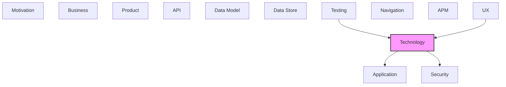

# Technology

[← Back to README](../README.md)

Infrastructure, platforms, systems, and technology components.

## Report Index

- [Layer Introduction](#layer-introduction)
- [Intra-Layer Relationships](#intra-layer-relationships)
- [Inter-Layer Dependencies](#inter-layer-dependencies)
- [Inter-Layer Relationships Table](#inter-layer-relationships-table)
- [Element Reference](#element-reference)

## Layer Introduction

| Metric                    | Count |
| ------------------------- | ----- |
| Elements                  | 50    |
| Intra-Layer Relationships | 65    |
| Inter-Layer Relationships | 118   |
| Inbound Relationships     | 116   |
| Outbound Relationships    | 2     |

**Cross-Layer References**:

- **Upstream layers**: [Testing](./13-testing-layer-report.md), [UX](./10-ux-layer-report.md)
- **Downstream layers**: [Application](./05-application-layer-report.md), [Security](./04-security-layer-report.md)

## Intra-Layer Relationships

*This layer has >30 elements. Summary table shown instead of diagram.*

| Element                                                                          | Type                 | Relationships |
| -------------------------------------------------------------------------------- | -------------------- | ------------- |
| `technology.artifact.agent-environment-entrypoint`                               | `artifact`           | 1             |
| `technology.artifact.agent-skills-bundle`                                        | `artifact`           | 1             |
| `technology.artifact.base-stylesheet`                                            | `artifact`           | 4             |
| `technology.artifact.bundled-stylesheet`                                         | `artifact`           | 3             |
| `technology.artifact.ci-dev-server-script`                                       | `artifact`           | 1             |
| `technology.artifact.color-literal-check-script`                                 | `artifact`           | 1             |
| `technology.artifact.d3-delaunay`                                                | `artifact`           | 1             |
| `technology.artifact.d3-hierarchy`                                               | `artifact`           | 1             |
| `technology.artifact.design-token-stylesheet`                                    | `artifact`           | 4             |
| `technology.artifact.docs-showcase-site`                                         | `artifact`           | 2             |
| `technology.artifact.eslint`                                                     | `artifact`           | 1             |
| `technology.artifact.font-bundle`                                                | `artifact`           | 2             |
| `technology.artifact.font-download-script`                                       | `artifact`           | 1             |
| `technology.artifact.galaxy-drag-benchmark-script`                               | `artifact`           | 1             |
| `technology.artifact.heimdall-agent-environment-image`                           | `artifact`           | 2             |
| `technology.artifact.heimdall-ui-package`                                        | `artifact`           | 22            |
| `technology.artifact.layered-graph-fixture-builder`                              | `artifact`           | 1             |
| `technology.artifact.legacy-css-forwarder`                                       | `artifact`           | 2             |
| `technology.artifact.per-component-stylesheets`                                  | `artifact`           | 4             |
| `technology.artifact.per-module-esm-build-output`                                | `artifact`           | 2             |
| `technology.artifact.performance-baseline`                                       | `artifact`           | 1             |
| `technology.artifact.playwright-test-runner`                                     | `artifact`           | 1             |
| `technology.artifact.react-dom-peer-dependency`                                  | `artifact`           | 1             |
| `technology.artifact.react-markdown`                                             | `artifact`           | 2             |
| `technology.artifact.react-peer-dependency`                                      | `artifact`           | 1             |
| `technology.artifact.remark-gfm`                                                 | `artifact`           | 2             |
| `technology.artifact.router-benchmark-script`                                    | `artifact`           | 1             |
| `technology.artifact.switchyard-orchestrator`                                    | `artifact`           | 1             |
| `technology.artifact.tailwind-css`                                               | `artifact`           | 2             |
| `technology.artifact.theme-stylesheet`                                           | `artifact`           | 3             |
| `technology.artifact.type-declarations`                                          | `artifact`           | 2             |
| `technology.artifact.type-script-compiler-configuration`                         | `artifact`           | 2             |
| `technology.artifact.vite`                                                       | `artifact`           | 2             |
| `technology.artifact.vitest`                                                     | `artifact`           | 1             |
| `technology.node.git-hub-actions-ubuntu-latest-runner`                           | `node`               | 4             |
| `technology.systemsoftware.web-browser`                                          | `systemsoftware`     | 0             |
| `technology.technologyfunction.automated-test-execution`                         | `technologyfunction` | 9             |
| `technology.technologyfunction.library-bundling-and-type-declaration-generation` | `technologyfunction` | 8             |
| `technology.technologyfunction.npm-oidc-trusted-publishing`                      | `technologyfunction` | 1             |
| `technology.technologyfunction.published-package-verification`                   | `technologyfunction` | 1             |
| `technology.technologyfunction.stylesheet-load-order-check`                      | `technologyfunction` | 1             |
| `technology.technologyfunction.stylesheet-splitting-and-ordering`                | `technologyfunction` | 3             |
| `technology.technologyprocess.ci-checks-workflow`                                | `technologyprocess`  | 5             |
| `technology.technologyprocess.deploy-docs-to-git-hub-pages`                      | `technologyprocess`  | 2             |
| `technology.technologyprocess.npm-run-build-vite-build`                          | `technologyprocess`  | 7             |
| `technology.technologyprocess.npm-test-npm-run-testunit`                         | `technologyprocess`  | 4             |
| `technology.technologyprocess.release-to-npm`                                    | `technologyprocess`  | 3             |
| `technology.technologyprocess.update-visual-snapshots-workflow`                  | `technologyprocess`  | 1             |
| `technology.technologyservice.git-hub-pages`                                     | `technologyservice`  | 1             |
| `technology.technologyservice.npm-registry`                                      | `technologyservice`  | 1             |

## Inter-Layer Dependencies

## Inter-Layer Relationships Table

| Relationship ID                                                  | Source Node                                                   | Dest Node                                                     | Dest Layer    | Predicate    | Cardinality  | Strength |
| ---------------------------------------------------------------- | ------------------------------------------------------------- | ------------------------------------------------------------- | ------------- | ------------ | ------------ | -------- |
| `technology.artifact.realizes.application.applicationcomponent`  | `technology.artifact.heimdall-ui-package`                     | `application.applicationcomponent.heimdall-ui-library-module` | `application` | `realizes`   | many-to-many | medium   |
| `technology.technologyfunction.realizes.security.countermeasure` | `technology.technologyfunction.npm-oidc-trusted-publishing`   | `security.countermeasure.trusted-publishing-with-provenance`  | `security`    | `realizes`   | many-to-many | medium   |
| `testing.environmentfactor.references.technology.node`           | `testing.environmentfactor.ci-chromium-rendering-environment` | `technology.node.git-hub-actions-ubuntu-latest-runner`        | `technology`  | `references` | many-to-many | medium   |
| `testing.environmentfactor.references.technology.systemsoftware` | `testing.environmentfactor.ci-chromium-rendering-environment` | `technology.systemsoftware.web-browser`                       | `technology`  | `references` | many-to-many | medium   |
| `ux.librarycomponent.depends-on.technology.systemsoftware`       | `ux.librarycomponent.activity-timeline`                       | `technology.systemsoftware.web-browser`                       | `technology`  | `depends-on` | many-to-many | medium   |
| `ux.librarycomponent.depends-on.technology.systemsoftware`       | `ux.librarycomponent.adjacency-matrix`                        | `technology.systemsoftware.web-browser`                       | `technology`  | `depends-on` | many-to-many | medium   |
| `ux.librarycomponent.depends-on.technology.systemsoftware`       | `ux.librarycomponent.alert-strip`                             | `technology.systemsoftware.web-browser`                       | `technology`  | `depends-on` | many-to-many | medium   |
| `ux.librarycomponent.depends-on.technology.systemsoftware`       | `ux.librarycomponent.app-title`                               | `technology.systemsoftware.web-browser`                       | `technology`  | `depends-on` | many-to-many | medium   |
| `ux.librarycomponent.depends-on.technology.systemsoftware`       | `ux.librarycomponent.asset-card`                              | `technology.systemsoftware.web-browser`                       | `technology`  | `depends-on` | many-to-many | medium   |
| `ux.librarycomponent.depends-on.technology.systemsoftware`       | `ux.librarycomponent.asset-grid`                              | `technology.systemsoftware.web-browser`                       | `technology`  | `depends-on` | many-to-many | medium   |
| `ux.librarycomponent.depends-on.technology.systemsoftware`       | `ux.librarycomponent.avatar`                                  | `technology.systemsoftware.web-browser`                       | `technology`  | `depends-on` | many-to-many | medium   |
| `ux.librarycomponent.depends-on.technology.systemsoftware`       | `ux.librarycomponent.badge`                                   | `technology.systemsoftware.web-browser`                       | `technology`  | `depends-on` | many-to-many | medium   |
| `ux.librarycomponent.depends-on.technology.systemsoftware`       | `ux.librarycomponent.bar-chart`                               | `technology.systemsoftware.web-browser`                       | `technology`  | `depends-on` | many-to-many | medium   |
| `ux.librarycomponent.depends-on.technology.systemsoftware`       | `ux.librarycomponent.bar-h`                                   | `technology.systemsoftware.web-browser`                       | `technology`  | `depends-on` | many-to-many | medium   |
| `ux.librarycomponent.depends-on.technology.systemsoftware`       | `ux.librarycomponent.bar-v`                                   | `technology.systemsoftware.web-browser`                       | `technology`  | `depends-on` | many-to-many | medium   |
| `ux.librarycomponent.depends-on.technology.systemsoftware`       | `ux.librarycomponent.branch-map`                              | `technology.systemsoftware.web-browser`                       | `technology`  | `depends-on` | many-to-many | medium   |
| `ux.librarycomponent.depends-on.technology.systemsoftware`       | `ux.librarycomponent.bridge-node-list`                        | `technology.systemsoftware.web-browser`                       | `technology`  | `depends-on` | many-to-many | medium   |
| `ux.librarycomponent.depends-on.technology.systemsoftware`       | `ux.librarycomponent.button`                                  | `technology.systemsoftware.web-browser`                       | `technology`  | `depends-on` | many-to-many | medium   |
| `ux.librarycomponent.depends-on.technology.systemsoftware`       | `ux.librarycomponent.calendar`                                | `technology.systemsoftware.web-browser`                       | `technology`  | `depends-on` | many-to-many | medium   |
| `ux.librarycomponent.depends-on.technology.systemsoftware`       | `ux.librarycomponent.camera-controls`                         | `technology.systemsoftware.web-browser`                       | `technology`  | `depends-on` | many-to-many | medium   |
| `ux.librarycomponent.depends-on.technology.systemsoftware`       | `ux.librarycomponent.chart-wrapper`                           | `technology.systemsoftware.web-browser`                       | `technology`  | `depends-on` | many-to-many | medium   |
| `ux.librarycomponent.depends-on.technology.systemsoftware`       | `ux.librarycomponent.chat-composer`                           | `technology.systemsoftware.web-browser`                       | `technology`  | `depends-on` | many-to-many | medium   |
| `ux.librarycomponent.depends-on.technology.systemsoftware`       | `ux.librarycomponent.chat-container`                          | `technology.systemsoftware.web-browser`                       | `technology`  | `depends-on` | many-to-many | medium   |
| `ux.librarycomponent.depends-on.technology.systemsoftware`       | `ux.librarycomponent.chat-divider`                            | `technology.systemsoftware.web-browser`                       | `technology`  | `depends-on` | many-to-many | medium   |
| `ux.librarycomponent.depends-on.technology.systemsoftware`       | `ux.librarycomponent.chat-markdown-content`                   | `technology.systemsoftware.web-browser`                       | `technology`  | `depends-on` | many-to-many | medium   |
| `ux.librarycomponent.depends-on.technology.systemsoftware`       | `ux.librarycomponent.chat-message`                            | `technology.systemsoftware.web-browser`                       | `technology`  | `depends-on` | many-to-many | medium   |
| `ux.librarycomponent.depends-on.technology.systemsoftware`       | `ux.librarycomponent.chat-suggestions`                        | `technology.systemsoftware.web-browser`                       | `technology`  | `depends-on` | many-to-many | medium   |
| `ux.librarycomponent.depends-on.technology.systemsoftware`       | `ux.librarycomponent.chip`                                    | `technology.systemsoftware.web-browser`                       | `technology`  | `depends-on` | many-to-many | medium   |
| `ux.librarycomponent.depends-on.technology.systemsoftware`       | `ux.librarycomponent.command-palette`                         | `technology.systemsoftware.web-browser`                       | `technology`  | `depends-on` | many-to-many | medium   |
| `ux.librarycomponent.depends-on.technology.systemsoftware`       | `ux.librarycomponent.config-tile`                             | `technology.systemsoftware.web-browser`                       | `technology`  | `depends-on` | many-to-many | medium   |
| `ux.librarycomponent.depends-on.technology.systemsoftware`       | `ux.librarycomponent.confirm-dialog`                          | `technology.systemsoftware.web-browser`                       | `technology`  | `depends-on` | many-to-many | medium   |
| `ux.librarycomponent.depends-on.technology.systemsoftware`       | `ux.librarycomponent.detail-drawer`                           | `technology.systemsoftware.web-browser`                       | `technology`  | `depends-on` | many-to-many | medium   |
| `ux.librarycomponent.depends-on.technology.systemsoftware`       | `ux.librarycomponent.diff-viewer`                             | `technology.systemsoftware.web-browser`                       | `technology`  | `depends-on` | many-to-many | medium   |
| `ux.librarycomponent.depends-on.technology.systemsoftware`       | `ux.librarycomponent.donut`                                   | `technology.systemsoftware.web-browser`                       | `technology`  | `depends-on` | many-to-many | medium   |
| `ux.librarycomponent.depends-on.technology.systemsoftware`       | `ux.librarycomponent.drawer`                                  | `technology.systemsoftware.web-browser`                       | `technology`  | `depends-on` | many-to-many | medium   |
| `ux.librarycomponent.depends-on.technology.systemsoftware`       | `ux.librarycomponent.entity-picker`                           | `technology.systemsoftware.web-browser`                       | `technology`  | `depends-on` | many-to-many | medium   |
| `ux.librarycomponent.depends-on.technology.systemsoftware`       | `ux.librarycomponent.field`                                   | `technology.systemsoftware.web-browser`                       | `technology`  | `depends-on` | many-to-many | medium   |
| `ux.librarycomponent.depends-on.technology.systemsoftware`       | `ux.librarycomponent.filter-bar`                              | `technology.systemsoftware.web-browser`                       | `technology`  | `depends-on` | many-to-many | medium   |
| `ux.librarycomponent.depends-on.technology.systemsoftware`       | `ux.librarycomponent.filter-dropdown`                         | `technology.systemsoftware.web-browser`                       | `technology`  | `depends-on` | many-to-many | medium   |
| `ux.librarycomponent.depends-on.technology.systemsoftware`       | `ux.librarycomponent.follow-control`                          | `technology.systemsoftware.web-browser`                       | `technology`  | `depends-on` | many-to-many | medium   |
| `ux.librarycomponent.depends-on.technology.systemsoftware`       | `ux.librarycomponent.form-callout`                            | `technology.systemsoftware.web-browser`                       | `technology`  | `depends-on` | many-to-many | medium   |
| `ux.librarycomponent.depends-on.technology.systemsoftware`       | `ux.librarycomponent.graph-canvas-ux`                         | `technology.systemsoftware.web-browser`                       | `technology`  | `depends-on` | many-to-many | medium   |
| `ux.librarycomponent.depends-on.technology.systemsoftware`       | `ux.librarycomponent.graph-collapse-control-ux`               | `technology.systemsoftware.web-browser`                       | `technology`  | `depends-on` | many-to-many | medium   |
| `ux.librarycomponent.depends-on.technology.systemsoftware`       | `ux.librarycomponent.graph-edge-inspector-ux`                 | `technology.systemsoftware.web-browser`                       | `technology`  | `depends-on` | many-to-many | medium   |
| `ux.librarycomponent.depends-on.technology.systemsoftware`       | `ux.librarycomponent.graph-edge-shape-ux`                     | `technology.systemsoftware.web-browser`                       | `technology`  | `depends-on` | many-to-many | medium   |
| `ux.librarycomponent.depends-on.technology.systemsoftware`       | `ux.librarycomponent.graph-edge-ux`                           | `technology.systemsoftware.web-browser`                       | `technology`  | `depends-on` | many-to-many | medium   |
| `ux.librarycomponent.depends-on.technology.systemsoftware`       | `ux.librarycomponent.graph-inspector-ux`                      | `technology.systemsoftware.web-browser`                       | `technology`  | `depends-on` | many-to-many | medium   |
| `ux.librarycomponent.depends-on.technology.systemsoftware`       | `ux.librarycomponent.graph-node-ux`                           | `technology.systemsoftware.web-browser`                       | `technology`  | `depends-on` | many-to-many | medium   |
| `ux.librarycomponent.depends-on.technology.systemsoftware`       | `ux.librarycomponent.graph-toolbar-ux`                        | `technology.systemsoftware.web-browser`                       | `technology`  | `depends-on` | many-to-many | medium   |
| `ux.librarycomponent.depends-on.technology.systemsoftware`       | `ux.librarycomponent.hash-set-diff`                           | `technology.systemsoftware.web-browser`                       | `technology`  | `depends-on` | many-to-many | medium   |
| `ux.librarycomponent.depends-on.technology.systemsoftware`       | `ux.librarycomponent.heatmap`                                 | `technology.systemsoftware.web-browser`                       | `technology`  | `depends-on` | many-to-many | medium   |
| `ux.librarycomponent.depends-on.technology.systemsoftware`       | `ux.librarycomponent.hierarchy-row`                           | `technology.systemsoftware.web-browser`                       | `technology`  | `depends-on` | many-to-many | medium   |
| `ux.librarycomponent.depends-on.technology.systemsoftware`       | `ux.librarycomponent.hierarchy-tree`                          | `technology.systemsoftware.web-browser`                       | `technology`  | `depends-on` | many-to-many | medium   |
| `ux.librarycomponent.depends-on.technology.systemsoftware`       | `ux.librarycomponent.hive-plot`                               | `technology.systemsoftware.web-browser`                       | `technology`  | `depends-on` | many-to-many | medium   |
| `ux.librarycomponent.depends-on.technology.systemsoftware`       | `ux.librarycomponent.icon`                                    | `technology.systemsoftware.web-browser`                       | `technology`  | `depends-on` | many-to-many | medium   |
| `ux.librarycomponent.depends-on.technology.systemsoftware`       | `ux.librarycomponent.inspector-panel`                         | `technology.systemsoftware.web-browser`                       | `technology`  | `depends-on` | many-to-many | medium   |
| `ux.librarycomponent.depends-on.technology.systemsoftware`       | `ux.librarycomponent.kanban-board`                            | `technology.systemsoftware.web-browser`                       | `technology`  | `depends-on` | many-to-many | medium   |
| `ux.librarycomponent.depends-on.technology.systemsoftware`       | `ux.librarycomponent.key-value-editor`                        | `technology.systemsoftware.web-browser`                       | `technology`  | `depends-on` | many-to-many | medium   |
| `ux.librarycomponent.depends-on.technology.systemsoftware`       | `ux.librarycomponent.kvgrid`                                  | `technology.systemsoftware.web-browser`                       | `technology`  | `depends-on` | many-to-many | medium   |
| `ux.librarycomponent.depends-on.technology.systemsoftware`       | `ux.librarycomponent.layer-list`                              | `technology.systemsoftware.web-browser`                       | `technology`  | `depends-on` | many-to-many | medium   |
| `ux.librarycomponent.depends-on.technology.systemsoftware`       | `ux.librarycomponent.layer-pair-list`                         | `technology.systemsoftware.web-browser`                       | `technology`  | `depends-on` | many-to-many | medium   |
| `ux.librarycomponent.depends-on.technology.systemsoftware`       | `ux.librarycomponent.layer-stack`                             | `technology.systemsoftware.web-browser`                       | `technology`  | `depends-on` | many-to-many | medium   |
| `ux.librarycomponent.depends-on.technology.systemsoftware`       | `ux.librarycomponent.layered-graph-context-ux`                | `technology.systemsoftware.web-browser`                       | `technology`  | `depends-on` | many-to-many | medium   |
| `ux.librarycomponent.depends-on.technology.systemsoftware`       | `ux.librarycomponent.layered-graph-explorer`                  | `technology.systemsoftware.web-browser`                       | `technology`  | `depends-on` | many-to-many | medium   |
| `ux.librarycomponent.depends-on.technology.systemsoftware`       | `ux.librarycomponent.line-chart`                              | `technology.systemsoftware.web-browser`                       | `technology`  | `depends-on` | many-to-many | medium   |
| `ux.librarycomponent.depends-on.technology.systemsoftware`       | `ux.librarycomponent.lineage-rail`                            | `technology.systemsoftware.web-browser`                       | `technology`  | `depends-on` | many-to-many | medium   |
| `ux.librarycomponent.depends-on.technology.systemsoftware`       | `ux.librarycomponent.link-category-filter`                    | `technology.systemsoftware.web-browser`                       | `technology`  | `depends-on` | many-to-many | medium   |
| `ux.librarycomponent.depends-on.technology.systemsoftware`       | `ux.librarycomponent.log-stream`                              | `technology.systemsoftware.web-browser`                       | `technology`  | `depends-on` | many-to-many | medium   |
| `ux.librarycomponent.depends-on.technology.systemsoftware`       | `ux.librarycomponent.map-canvas`                              | `technology.systemsoftware.web-browser`                       | `technology`  | `depends-on` | many-to-many | medium   |
| `ux.librarycomponent.depends-on.technology.systemsoftware`       | `ux.librarycomponent.metric-row`                              | `technology.systemsoftware.web-browser`                       | `technology`  | `depends-on` | many-to-many | medium   |
| `ux.librarycomponent.depends-on.technology.systemsoftware`       | `ux.librarycomponent.mini-calendar`                           | `technology.systemsoftware.web-browser`                       | `technology`  | `depends-on` | many-to-many | medium   |
| `ux.librarycomponent.depends-on.technology.systemsoftware`       | `ux.librarycomponent.modal`                                   | `technology.systemsoftware.web-browser`                       | `technology`  | `depends-on` | many-to-many | medium   |
| `ux.librarycomponent.depends-on.technology.systemsoftware`       | `ux.librarycomponent.nav-item`                                | `technology.systemsoftware.web-browser`                       | `technology`  | `depends-on` | many-to-many | medium   |
| `ux.librarycomponent.depends-on.technology.systemsoftware`       | `ux.librarycomponent.number-input`                            | `technology.systemsoftware.web-browser`                       | `technology`  | `depends-on` | many-to-many | medium   |
| `ux.librarycomponent.depends-on.technology.systemsoftware`       | `ux.librarycomponent.ordered-list`                            | `technology.systemsoftware.web-browser`                       | `technology`  | `depends-on` | many-to-many | medium   |
| `ux.librarycomponent.depends-on.technology.systemsoftware`       | `ux.librarycomponent.page-header`                             | `technology.systemsoftware.web-browser`                       | `technology`  | `depends-on` | many-to-many | medium   |
| `ux.librarycomponent.depends-on.technology.systemsoftware`       | `ux.librarycomponent.panel`                                   | `technology.systemsoftware.web-browser`                       | `technology`  | `depends-on` | many-to-many | medium   |
| `ux.librarycomponent.depends-on.technology.systemsoftware`       | `ux.librarycomponent.pipeline-card`                           | `technology.systemsoftware.web-browser`                       | `technology`  | `depends-on` | many-to-many | medium   |
| `ux.librarycomponent.depends-on.technology.systemsoftware`       | `ux.librarycomponent.plane-layout-control`                    | `technology.systemsoftware.web-browser`                       | `technology`  | `depends-on` | many-to-many | medium   |
| `ux.librarycomponent.depends-on.technology.systemsoftware`       | `ux.librarycomponent.popover`                                 | `technology.systemsoftware.web-browser`                       | `technology`  | `depends-on` | many-to-many | medium   |
| `ux.librarycomponent.depends-on.technology.systemsoftware`       | `ux.librarycomponent.predicate-label-control`                 | `technology.systemsoftware.web-browser`                       | `technology`  | `depends-on` | many-to-many | medium   |
| `ux.librarycomponent.depends-on.technology.systemsoftware`       | `ux.librarycomponent.progress-bar`                            | `technology.systemsoftware.web-browser`                       | `technology`  | `depends-on` | many-to-many | medium   |
| `ux.librarycomponent.depends-on.technology.systemsoftware`       | `ux.librarycomponent.quick-access-grid`                       | `technology.systemsoftware.web-browser`                       | `technology`  | `depends-on` | many-to-many | medium   |
| `ux.librarycomponent.depends-on.technology.systemsoftware`       | `ux.librarycomponent.quick-access-tile`                       | `technology.systemsoftware.web-browser`                       | `technology`  | `depends-on` | many-to-many | medium   |
| `ux.librarycomponent.depends-on.technology.systemsoftware`       | `ux.librarycomponent.reach-inspector`                         | `technology.systemsoftware.web-browser`                       | `technology`  | `depends-on` | many-to-many | medium   |
| `ux.librarycomponent.depends-on.technology.systemsoftware`       | `ux.librarycomponent.relationship-builder`                    | `technology.systemsoftware.web-browser`                       | `technology`  | `depends-on` | many-to-many | medium   |
| `ux.librarycomponent.depends-on.technology.systemsoftware`       | `ux.librarycomponent.result-card`                             | `technology.systemsoftware.web-browser`                       | `technology`  | `depends-on` | many-to-many | medium   |
| `ux.librarycomponent.depends-on.technology.systemsoftware`       | `ux.librarycomponent.row-menu`                                | `technology.systemsoftware.web-browser`                       | `technology`  | `depends-on` | many-to-many | medium   |
| `ux.librarycomponent.depends-on.technology.systemsoftware`       | `ux.librarycomponent.segmented-control`                       | `technology.systemsoftware.web-browser`                       | `technology`  | `depends-on` | many-to-many | medium   |
| `ux.librarycomponent.depends-on.technology.systemsoftware`       | `ux.librarycomponent.select`                                  | `technology.systemsoftware.web-browser`                       | `technology`  | `depends-on` | many-to-many | medium   |
| `ux.librarycomponent.depends-on.technology.systemsoftware`       | `ux.librarycomponent.shell-layout`                            | `technology.systemsoftware.web-browser`                       | `technology`  | `depends-on` | many-to-many | medium   |
| `ux.librarycomponent.depends-on.technology.systemsoftware`       | `ux.librarycomponent.side-by-side-diff`                       | `technology.systemsoftware.web-browser`                       | `technology`  | `depends-on` | many-to-many | medium   |
| `ux.librarycomponent.depends-on.technology.systemsoftware`       | `ux.librarycomponent.sidebar`                                 | `technology.systemsoftware.web-browser`                       | `technology`  | `depends-on` | many-to-many | medium   |
| `ux.librarycomponent.depends-on.technology.systemsoftware`       | `ux.librarycomponent.sparkline`                               | `technology.systemsoftware.web-browser`                       | `technology`  | `depends-on` | many-to-many | medium   |
| `ux.librarycomponent.depends-on.technology.systemsoftware`       | `ux.librarycomponent.split-pane`                              | `technology.systemsoftware.web-browser`                       | `technology`  | `depends-on` | many-to-many | medium   |
| `ux.librarycomponent.depends-on.technology.systemsoftware`       | `ux.librarycomponent.stacked-bar`                             | `technology.systemsoftware.web-browser`                       | `technology`  | `depends-on` | many-to-many | medium   |
| `ux.librarycomponent.depends-on.technology.systemsoftware`       | `ux.librarycomponent.stat-grid`                               | `technology.systemsoftware.web-browser`                       | `technology`  | `depends-on` | many-to-many | medium   |
| `ux.librarycomponent.depends-on.technology.systemsoftware`       | `ux.librarycomponent.stat-tile`                               | `technology.systemsoftware.web-browser`                       | `technology`  | `depends-on` | many-to-many | medium   |
| `ux.librarycomponent.depends-on.technology.systemsoftware`       | `ux.librarycomponent.status-badge`                            | `technology.systemsoftware.web-browser`                       | `technology`  | `depends-on` | many-to-many | medium   |
| `ux.librarycomponent.depends-on.technology.systemsoftware`       | `ux.librarycomponent.status-timeline`                         | `technology.systemsoftware.web-browser`                       | `technology`  | `depends-on` | many-to-many | medium   |
| `ux.librarycomponent.depends-on.technology.systemsoftware`       | `ux.librarycomponent.statusbar`                               | `technology.systemsoftware.web-browser`                       | `technology`  | `depends-on` | many-to-many | medium   |
| `ux.librarycomponent.depends-on.technology.systemsoftware`       | `ux.librarycomponent.tab-bar`                                 | `technology.systemsoftware.web-browser`                       | `technology`  | `depends-on` | many-to-many | medium   |
| `ux.librarycomponent.depends-on.technology.systemsoftware`       | `ux.librarycomponent.table`                                   | `technology.systemsoftware.web-browser`                       | `technology`  | `depends-on` | many-to-many | medium   |
| `ux.librarycomponent.depends-on.technology.systemsoftware`       | `ux.librarycomponent.text-area`                               | `technology.systemsoftware.web-browser`                       | `technology`  | `depends-on` | many-to-many | medium   |
| `ux.librarycomponent.depends-on.technology.systemsoftware`       | `ux.librarycomponent.text-input`                              | `technology.systemsoftware.web-browser`                       | `technology`  | `depends-on` | many-to-many | medium   |
| `ux.librarycomponent.depends-on.technology.systemsoftware`       | `ux.librarycomponent.thinking-block`                          | `technology.systemsoftware.web-browser`                       | `technology`  | `depends-on` | many-to-many | medium   |
| `ux.librarycomponent.depends-on.technology.systemsoftware`       | `ux.librarycomponent.titlebar`                                | `technology.systemsoftware.web-browser`                       | `technology`  | `depends-on` | many-to-many | medium   |
| `ux.librarycomponent.depends-on.technology.systemsoftware`       | `ux.librarycomponent.toast`                                   | `technology.systemsoftware.web-browser`                       | `technology`  | `depends-on` | many-to-many | medium   |
| `ux.librarycomponent.depends-on.technology.systemsoftware`       | `ux.librarycomponent.tool-block`                              | `technology.systemsoftware.web-browser`                       | `technology`  | `depends-on` | many-to-many | medium   |
| `ux.librarycomponent.depends-on.technology.systemsoftware`       | `ux.librarycomponent.tooltip`                                 | `technology.systemsoftware.web-browser`                       | `technology`  | `depends-on` | many-to-many | medium   |
| `ux.librarycomponent.depends-on.technology.systemsoftware`       | `ux.librarycomponent.topbar`                                  | `technology.systemsoftware.web-browser`                       | `technology`  | `depends-on` | many-to-many | medium   |
| `ux.librarycomponent.depends-on.technology.systemsoftware`       | `ux.librarycomponent.topology-node`                           | `technology.systemsoftware.web-browser`                       | `technology`  | `depends-on` | many-to-many | medium   |
| `ux.librarycomponent.depends-on.technology.systemsoftware`       | `ux.librarycomponent.trace-viewer`                            | `technology.systemsoftware.web-browser`                       | `technology`  | `depends-on` | many-to-many | medium   |
| `ux.librarycomponent.depends-on.technology.systemsoftware`       | `ux.librarycomponent.tri-state`                               | `technology.systemsoftware.web-browser`                       | `technology`  | `depends-on` | many-to-many | medium   |
| `ux.librarycomponent.depends-on.technology.systemsoftware`       | `ux.librarycomponent.version-pill`                            | `technology.systemsoftware.web-browser`                       | `technology`  | `depends-on` | many-to-many | medium   |
| `ux.librarycomponent.depends-on.technology.systemsoftware`       | `ux.librarycomponent.version-timeline`                        | `technology.systemsoftware.web-browser`                       | `technology`  | `depends-on` | many-to-many | medium   |
| `ux.librarycomponent.depends-on.technology.systemsoftware`       | `ux.librarycomponent.view-switcher`                           | `technology.systemsoftware.web-browser`                       | `technology`  | `depends-on` | many-to-many | medium   |
| `ux.librarycomponent.depends-on.technology.systemsoftware`       | `ux.librarycomponent.workspace-switcher-dialog`               | `technology.systemsoftware.web-browser`                       | `technology`  | `depends-on` | many-to-many | medium   |

## Element Reference

### Agent Environment Entrypoint {#agent-environment-entrypoint}

**ID**: `technology.artifact.agent-environment-entrypoint`

**Type**: `artifact`

heimdall-docker-entrypoint.sh: links the image's pre-installed node_modules into the bind-mounted /workspace at container start.

#### Attributes

| Name         | Value  |
| ------------ | ------ |
| artifactType | script |

#### Relationships

| Type        | Related Element                                        | Predicate  | Direction |
| ----------- | ------------------------------------------------------ | ---------- | --------- |
| intra-layer | `technology.artifact.heimdall-agent-environment-image` | `composes` | inbound   |

### Agent Skills Bundle {#agent-skills-bundle}

**ID**: `technology.artifact.agent-skills-bundle`

**Type**: `artifact`

agent-skills/: Claude Code skills documenting every exported component for coding agents in consumer repos; shipped inside the npm package (files: dist, agent-skills).

#### Attributes

| Name         | Value |
| ------------ | ----- |
| artifactType | file  |

#### Relationships

| Type        | Related Element                           | Predicate  | Direction |
| ----------- | ----------------------------------------- | ---------- | --------- |
| intra-layer | `technology.artifact.heimdall-ui-package` | `composes` | inbound   |

### Base Stylesheet {#base-stylesheet}

**ID**: `technology.artifact.base-stylesheet`

**Type**: `artifact`

dist/css/base.css, the './css/base' export: tokens.css plus styles/utilities.css, the sheet every opt-in component sheet assumes.

#### Attributes

| Name         | Value |
| ------------ | ----- |
| artifactType | file  |

#### Relationships

| Type        | Related Element                                                   | Predicate    | Direction |
| ----------- | ----------------------------------------------------------------- | ------------ | --------- |
| intra-layer | `technology.artifact.design-token-stylesheet`                     | `composes`   | outbound  |
| intra-layer | `technology.artifact.heimdall-ui-package`                         | `composes`   | inbound   |
| intra-layer | `technology.artifact.per-component-stylesheets`                   | `depends-on` | inbound   |
| intra-layer | `technology.technologyfunction.stylesheet-splitting-and-ordering` | `accesses`   | inbound   |

### Bundled Stylesheet {#bundled-stylesheet}

**ID**: `technology.artifact.bundled-stylesheet`

**Type**: `artifact`

dist/style.css, the './css' export: every stylesheet (tokens, utilities, all components) in ESM evaluation order, minified as one file.

#### Attributes

| Name         | Value |
| ------------ | ----- |
| artifactType | file  |

#### Relationships

| Type        | Related Element                                                   | Predicate    | Direction |
| ----------- | ----------------------------------------------------------------- | ------------ | --------- |
| intra-layer | `technology.artifact.heimdall-ui-package`                         | `composes`   | inbound   |
| intra-layer | `technology.artifact.legacy-css-forwarder`                        | `depends-on` | inbound   |
| intra-layer | `technology.technologyfunction.stylesheet-splitting-and-ordering` | `accesses`   | inbound   |

### CI Dev Server Script {#ci-dev-server-script}

**ID**: `technology.artifact.ci-dev-server-script`

**Type**: `artifact`

scripts/ci-dev-server.sh: starts the Vite dev server for Playwright in CI from a copy of the config in /tmp, for runners where the checkout is not writable.

#### Attributes

| Name         | Value  |
| ------------ | ------ |
| artifactType | script |

#### Relationships

| Type        | Related Element                                          | Predicate  | Direction |
| ----------- | -------------------------------------------------------- | ---------- | --------- |
| intra-layer | `technology.technologyfunction.automated-test-execution` | `accesses` | inbound   |

### Color Literal Check Script {#color-literal-check-script}

**ID**: `technology.artifact.color-literal-check-script`

**Type**: `artifact`

scripts/check-color-literals.mjs (npm run check:colors): scans src/\*\*/\*.\{css,ts,tsx\} except src/tokens/, src/test-pages/ and \*.test.\*, comments stripped; fails on hex colors (3/4/6/8 digits, not after /), rgb/rgba/hsl/hsla with numeric arguments, and var(--x, N, N, N) fallbacks; allows pure black and white at any alpha.

#### Attributes

| Name         | Value  |
| ------------ | ------ |
| artifactType | script |

#### Relationships

| Type        | Related Element                                   | Predicate  | Direction |
| ----------- | ------------------------------------------------- | ---------- | --------- |
| intra-layer | `technology.technologyprocess.ci-checks-workflow` | `accesses` | inbound   |

### d3-delaunay {#d3-delaunay}

**ID**: `technology.artifact.d3-delaunay`

**Type**: `artifact`

Runtime dependency used by organicLayout (src/utils/organicLayout.ts) for Delaunay triangulation of node positions.

#### Attributes

| Name         | Value   |
| ------------ | ------- |
| artifactType | library |

#### Relationships

| Type        | Related Element                           | Predicate    | Direction |
| ----------- | ----------------------------------------- | ------------ | --------- |
| intra-layer | `technology.artifact.heimdall-ui-package` | `depends-on` | inbound   |

### d3-hierarchy {#d3-hierarchy}

**ID**: `technology.artifact.d3-hierarchy`

**Type**: `artifact`

Real runtime dependency used directly by uxNavLayout (tree), radialTreeLayout (tree, packSiblings), and graphPacking (pack, hierarchy) for tree layout and circle packing.

#### Attributes

| Name         | Value   |
| ------------ | ------- |
| artifactType | library |

#### Relationships

| Type        | Related Element                           | Predicate    | Direction |
| ----------- | ----------------------------------------- | ------------ | --------- |
| intra-layer | `technology.artifact.heimdall-ui-package` | `depends-on` | inbound   |

### Design Token Stylesheet {#design-token-stylesheet}

**ID**: `technology.artifact.design-token-stylesheet`

**Type**: `artifact`

src/tokens/tokens.css: about 260 CSS custom properties (shell and canvas surfaces, accent, status colors, radius, shadow, fonts, spacing) that tailwind.config.ts maps every theme key to; .dark-canvas on body overrides every --canvas-\* value. Shipped inside base.css and style.css.

#### Attributes

| Name         | Value |
| ------------ | ----- |
| artifactType | file  |

#### Relationships

| Type        | Related Element                                         | Predicate    | Direction |
| ----------- | ------------------------------------------------------- | ------------ | --------- |
| intra-layer | `technology.artifact.base-stylesheet`                   | `composes`   | inbound   |
| intra-layer | `technology.artifact.heimdall-ui-package`               | `aggregates` | inbound   |
| intra-layer | `technology.artifact.theme-stylesheet`                  | `depends-on` | inbound   |
| intra-layer | `technology.technologyprocess.npm-run-build-vite-build` | `accesses`   | inbound   |

### Docs Showcase Site {#docs-showcase-site}

**ID**: `technology.artifact.docs-showcase-site`

**Type**: `artifact`

docs/: the Vite + React showcase app built to docs/dist and published to GitHub Pages (tinkermonkey.github.io/heimdall).

#### Attributes

| Name         | Value   |
| ------------ | ------- |
| artifactType | archive |

#### Relationships

| Type        | Related Element                                             | Predicate    | Direction |
| ----------- | ----------------------------------------------------------- | ------------ | --------- |
| intra-layer | `technology.artifact.heimdall-ui-package`                   | `depends-on` | outbound  |
| intra-layer | `technology.technologyprocess.deploy-docs-to-git-hub-pages` | `accesses`   | inbound   |

### ESLint {#eslint}

**ID**: `technology.artifact.eslint`

**Type**: `artifact`

devDependency: lint gate in CI (npm run lint over src/, docs/src/, scripts/).

#### Attributes

| Name         | Value   |
| ------------ | ------- |
| artifactType | library |

#### Relationships

| Type        | Related Element                                   | Predicate  | Direction |
| ----------- | ------------------------------------------------- | ---------- | --------- |
| intra-layer | `technology.technologyprocess.ci-checks-workflow` | `accesses` | inbound   |

### Font Bundle {#font-bundle}

**ID**: `technology.artifact.font-bundle`

**Type**: `artifact`

Inter and JetBrains Mono font files with fonts.css, kept in public/fonts (fetched by scripts/download-fonts.js) and copied to dist/fonts; the './fonts' export.

#### Attributes

| Name         | Value   |
| ------------ | ------- |
| artifactType | archive |

#### Relationships

| Type        | Related Element                            | Predicate    | Direction |
| ----------- | ------------------------------------------ | ------------ | --------- |
| intra-layer | `technology.artifact.font-download-script` | `depends-on` | inbound   |
| intra-layer | `technology.artifact.heimdall-ui-package`  | `composes`   | inbound   |

### Font Download Script {#font-download-script}

**ID**: `technology.artifact.font-download-script`

**Type**: `artifact`

scripts/download-fonts.js (npm run setup): fetches the Inter and JetBrains Mono files into public/fonts, the only copy, which the build copies to dist/fonts.

#### Attributes

| Name         | Value  |
| ------------ | ------ |
| artifactType | script |

#### Relationships

| Type        | Related Element                   | Predicate    | Direction |
| ----------- | --------------------------------- | ------------ | --------- |
| intra-layer | `technology.artifact.font-bundle` | `depends-on` | outbound  |

### Galaxy Drag Benchmark Script {#galaxy-drag-benchmark-script}

**ID**: `technology.artifact.galaxy-drag-benchmark-script`

**Type**: `artifact`

scripts/bench-galaxy-drag.mjs: headless live-simulation drag benchmark for galaxySimulationStep.

#### Attributes

| Name         | Value  |
| ------------ | ------ |
| artifactType | script |

#### Relationships

| Type        | Related Element                                          | Predicate  | Direction |
| ----------- | -------------------------------------------------------- | ---------- | --------- |
| intra-layer | `technology.technologyfunction.automated-test-execution` | `accesses` | inbound   |

### Heimdall Agent Environment Image {#heimdall-agent-environment-image}

**ID**: `technology.artifact.heimdall-agent-environment-image`

**Type**: `artifact`

Dockerfile.agent: container image for coding agents working on this repo, with Playwright/Chromium system libraries, fonts and pinned locale and TZ for consistent screenshots.

#### Attributes

| Name         | Value           |
| ------------ | --------------- |
| artifactType | container-image |

#### Relationships

| Type        | Related Element                                    | Predicate    | Direction |
| ----------- | -------------------------------------------------- | ------------ | --------- |
| intra-layer | `technology.artifact.agent-environment-entrypoint` | `composes`   | outbound  |
| intra-layer | `technology.artifact.switchyard-orchestrator`      | `depends-on` | outbound  |

### Heimdall UI Package {#heimdall-ui-package}

**ID**: `technology.artifact.heimdall-ui-package`

**Type**: `artifact`

The published @tinkermonkey/heimdall-ui npm package (0.13.0): the full component library exported from src/index.ts, built one module per source file (dist/, with type declarations) plus the default full stylesheet and opt-in base and per-component sheets.

#### Attributes

| Name         | Value   |
| ------------ | ------- |
| artifactType | library |

#### Relationships

| Type        | Related Element                                                                  | Predicate    | Direction |
| ----------- | -------------------------------------------------------------------------------- | ------------ | --------- |
| inter-layer | `application.applicationcomponent.heimdall-ui-library-module`                    | `realizes`   | outbound  |
| intra-layer | `technology.artifact.docs-showcase-site`                                         | `depends-on` | inbound   |
| intra-layer | `technology.artifact.design-token-stylesheet`                                    | `aggregates` | outbound  |
| intra-layer | `technology.artifact.theme-stylesheet`                                           | `aggregates` | outbound  |
| intra-layer | `technology.artifact.agent-skills-bundle`                                        | `composes`   | outbound  |
| intra-layer | `technology.artifact.base-stylesheet`                                            | `composes`   | outbound  |
| intra-layer | `technology.artifact.bundled-stylesheet`                                         | `composes`   | outbound  |
| intra-layer | `technology.artifact.font-bundle`                                                | `composes`   | outbound  |
| intra-layer | `technology.artifact.legacy-css-forwarder`                                       | `composes`   | outbound  |
| intra-layer | `technology.artifact.per-component-stylesheets`                                  | `composes`   | outbound  |
| intra-layer | `technology.artifact.per-module-esm-build-output`                                | `composes`   | outbound  |
| intra-layer | `technology.artifact.type-declarations`                                          | `composes`   | outbound  |
| intra-layer | `technology.artifact.d3-delaunay`                                                | `depends-on` | outbound  |
| intra-layer | `technology.artifact.d3-hierarchy`                                               | `depends-on` | outbound  |
| intra-layer | `technology.artifact.react-dom-peer-dependency`                                  | `depends-on` | outbound  |
| intra-layer | `technology.artifact.react-markdown`                                             | `depends-on` | outbound  |
| intra-layer | `technology.artifact.react-peer-dependency`                                      | `depends-on` | outbound  |
| intra-layer | `technology.artifact.remark-gfm`                                                 | `depends-on` | outbound  |
| intra-layer | `technology.technologyfunction.library-bundling-and-type-declaration-generation` | `accesses`   | inbound   |
| intra-layer | `technology.technologyfunction.npm-oidc-trusted-publishing`                      | `accesses`   | inbound   |
| intra-layer | `technology.technologyfunction.published-package-verification`                   | `accesses`   | inbound   |
| intra-layer | `technology.technologyprocess.deploy-docs-to-git-hub-pages`                      | `accesses`   | inbound   |
| intra-layer | `technology.technologyprocess.release-to-npm`                                    | `accesses`   | inbound   |

### Layered Graph Fixture Builder {#layered-graph-fixture-builder}

**ID**: `technology.artifact.layered-graph-fixture-builder`

**Type**: `artifact`

scripts/build-layered-fixtures.mjs: generates src/test-pages/fixtures from Documentation Robotics data, the DR spec meta-model (read from the sibling ../documentation_robotics/spec checkout) and this repo's own documentation-robotics/model. The layered-graph test fixtures therefore depend on the DR model and on a second repository.

#### Attributes

| Name         | Value  |
| ------------ | ------ |
| artifactType | script |

#### Relationships

| Type        | Related Element                                          | Predicate  | Direction |
| ----------- | -------------------------------------------------------- | ---------- | --------- |
| intra-layer | `technology.technologyfunction.automated-test-execution` | `accesses` | inbound   |

### Legacy CSS Forwarder {#legacy-css-forwarder}

**ID**: `technology.artifact.legacy-css-forwarder`

**Type**: `artifact`

dist/heimdall-ui.css, a one-line @import of style.css kept for consumers who pointed at the 0.9.0/0.9.1 file name directly. Deprecated.

#### Attributes

| Name         | Value |
| ------------ | ----- |
| artifactType | file  |

#### Relationships

| Type        | Related Element                           | Predicate    | Direction |
| ----------- | ----------------------------------------- | ------------ | --------- |
| intra-layer | `technology.artifact.heimdall-ui-package` | `composes`   | inbound   |
| intra-layer | `technology.artifact.bundled-stylesheet`  | `depends-on` | outbound  |

### Per-Component Stylesheets {#per-component-stylesheets}

**ID**: `technology.artifact.per-component-stylesheets`

**Type**: `artifact`

dist/css/&lt;Name&gt;.css, the './css/\*' exports (0.13.0): one sheet per component module holding its own CSS and that of every component it renders, minus base, so an app can load only the CSS it uses.

#### Attributes

| Name         | Value |
| ------------ | ----- |
| artifactType | file  |

#### Relationships

| Type        | Related Element                                                   | Predicate    | Direction |
| ----------- | ----------------------------------------------------------------- | ------------ | --------- |
| intra-layer | `technology.artifact.heimdall-ui-package`                         | `composes`   | inbound   |
| intra-layer | `technology.artifact.base-stylesheet`                             | `depends-on` | outbound  |
| intra-layer | `technology.technologyfunction.stylesheet-load-order-check`       | `accesses`   | inbound   |
| intra-layer | `technology.technologyfunction.stylesheet-splitting-and-ordering` | `accesses`   | inbound   |

### Per-Module ESM Build Output {#per-module-esm-build-output}

**ID**: `technology.artifact.per-module-esm-build-output`

**Type**: `artifact`

dist/&lt;module&gt;.js: one ESM file per source module (rollup preserveModules, root src), CJS dropped (#343), so a consumer's bundler drops the modules of components it never imports. No JS module imports CSS, so Node, SSR builds and test runners load it as plain ESM.

#### Attributes

| Name         | Value   |
| ------------ | ------- |
| artifactType | library |

#### Relationships

| Type        | Related Element                                                                  | Predicate  | Direction |
| ----------- | -------------------------------------------------------------------------------- | ---------- | --------- |
| intra-layer | `technology.artifact.heimdall-ui-package`                                        | `composes` | inbound   |
| intra-layer | `technology.technologyfunction.library-bundling-and-type-declaration-generation` | `accesses` | inbound   |

### Performance Baseline {#performance-baseline}

**ID**: `technology.artifact.performance-baseline`

**Type**: `artifact`

performance-baseline.json from scripts/measure-performance.js: bundle sizes and render times recorded 2026-05-17 for the single-bundle build. Stale since the 0.13.0 per-module build and not checked by anything.

#### Attributes

| Name         | Value         |
| ------------ | ------------- |
| artifactType | configuration |

#### Relationships

| Type        | Related Element                                          | Predicate  | Direction |
| ----------- | -------------------------------------------------------- | ---------- | --------- |
| intra-layer | `technology.technologyfunction.automated-test-execution` | `accesses` | inbound   |

### Playwright Test Runner {#playwright-test-runner}

**ID**: `technology.artifact.playwright-test-runner`

**Type**: `artifact`

@playwright/test devDependency driving the browser-based visual/behavioral regression suite in tests/, including all graph-\*.spec.ts files.

#### Attributes

| Name         | Value   |
| ------------ | ------- |
| artifactType | library |

#### Relationships

| Type        | Related Element                                          | Predicate  | Direction |
| ----------- | -------------------------------------------------------- | ---------- | --------- |
| intra-layer | `technology.technologyfunction.automated-test-execution` | `accesses` | inbound   |

### react-dom (peer dependency) {#react-dom-peer-dependency}

**ID**: `technology.artifact.react-dom-peer-dependency`

**Type**: `artifact`

react-dom ^18 \|\| ^19 peer dependency. The library renders through it (createPortal for dropdown panels, server rendering in tests) and leaves it external in the build.

#### Attributes

| Name         | Value   |
| ------------ | ------- |
| artifactType | library |

#### Relationships

| Type        | Related Element                           | Predicate    | Direction |
| ----------- | ----------------------------------------- | ------------ | --------- |
| intra-layer | `technology.artifact.heimdall-ui-package` | `depends-on` | inbound   |

### react-markdown {#react-markdown}

**ID**: `technology.artifact.react-markdown`

**Type**: `artifact`

Runtime dependency used by ChatMarkdownContent to render model output as markdown, with remark-gfm for GitHub-flavored markdown.

#### Attributes

| Name         | Value   |
| ------------ | ------- |
| artifactType | library |

#### Relationships

| Type        | Related Element                           | Predicate    | Direction |
| ----------- | ----------------------------------------- | ------------ | --------- |
| intra-layer | `technology.artifact.heimdall-ui-package` | `depends-on` | inbound   |
| intra-layer | `technology.artifact.remark-gfm`          | `depends-on` | outbound  |

### React (peer dependency) {#react-peer-dependency}

**ID**: `technology.artifact.react-peer-dependency`

**Type**: `artifact`

React and react-dom 18 or 19 peer dependencies every component is built against.

#### Attributes

| Name         | Value   |
| ------------ | ------- |
| artifactType | library |

#### Relationships

| Type        | Related Element                           | Predicate    | Direction |
| ----------- | ----------------------------------------- | ------------ | --------- |
| intra-layer | `technology.artifact.heimdall-ui-package` | `depends-on` | inbound   |

### remark-gfm {#remark-gfm}

**ID**: `technology.artifact.remark-gfm`

**Type**: `artifact`

Runtime dependency: the GitHub-flavored markdown plugin ChatMarkdownContent passes to react-markdown.

#### Attributes

| Name         | Value   |
| ------------ | ------- |
| artifactType | library |

#### Relationships

| Type        | Related Element                           | Predicate    | Direction |
| ----------- | ----------------------------------------- | ------------ | --------- |
| intra-layer | `technology.artifact.heimdall-ui-package` | `depends-on` | inbound   |
| intra-layer | `technology.artifact.react-markdown`      | `depends-on` | inbound   |

### Router Benchmark Script {#router-benchmark-script}

**ID**: `technology.artifact.router-benchmark-script`

**Type**: `artifact`

scripts/bench-router.mjs (npm run bench:router): seeded grid benchmark of routeNavigationEdges with a route fingerprint and per-size budgets.

#### Attributes

| Name         | Value  |
| ------------ | ------ |
| artifactType | script |

#### Relationships

| Type        | Related Element                                          | Predicate  | Direction |
| ----------- | -------------------------------------------------------- | ---------- | --------- |
| intra-layer | `technology.technologyfunction.automated-test-execution` | `accesses` | inbound   |

### switchyard-orchestrator {#switchyard-orchestrator}

**ID**: `technology.artifact.switchyard-orchestrator`

**Type**: `artifact`

Base image of Dockerfile.agent (FROM switchyard-orchestrator:latest), built elsewhere.

#### Attributes

| Name         | Value           |
| ------------ | --------------- |
| artifactType | container-image |

#### Relationships

| Type        | Related Element                                        | Predicate    | Direction |
| ----------- | ------------------------------------------------------ | ------------ | --------- |
| intra-layer | `technology.artifact.heimdall-agent-environment-image` | `depends-on` | inbound   |

### Tailwind CSS {#tailwind-css}

**ID**: `technology.artifact.tailwind-css`

**Type**: `artifact`

devDependency: utility CSS whose theme is wired to the design tokens in src/tokens/tokens.css (tailwind.config.ts).

#### Attributes

| Name         | Value   |
| ------------ | ------- |
| artifactType | library |

#### Relationships

| Type        | Related Element                                                                  | Predicate  | Direction |
| ----------- | -------------------------------------------------------------------------------- | ---------- | --------- |
| intra-layer | `technology.technologyfunction.library-bundling-and-type-declaration-generation` | `accesses` | inbound   |
| intra-layer | `technology.technologyprocess.ci-checks-workflow`                                | `accesses` | inbound   |

### Theme Stylesheet {#theme-stylesheet}

**ID**: `technology.artifact.theme-stylesheet`

**Type**: `artifact`

src/tokens/theme.css: an override layer that is empty upstream (header comment with an example and the caveat that derived tokens resolve on :root, so a theme that changes --accent-primary only under body.dark-canvas must redeclare them there). Loaded after tokens.css from src/index.ts, src/index.css and vite.config.mjs BASE_SHEETS (last), so it ships after the tokens in dist/style.css and dist/css/base.css.

#### Attributes

| Name         | Value |
| ------------ | ----- |
| artifactType | file  |

#### Relationships

| Type        | Related Element                                         | Predicate    | Direction |
| ----------- | ------------------------------------------------------- | ------------ | --------- |
| intra-layer | `technology.artifact.heimdall-ui-package`               | `aggregates` | inbound   |
| intra-layer | `technology.artifact.design-token-stylesheet`           | `depends-on` | outbound  |
| intra-layer | `technology.technologyprocess.npm-run-build-vite-build` | `accesses`   | inbound   |

### Type Declarations {#type-declarations}

**ID**: `technology.artifact.type-declarations`

**Type**: `artifact`

dist/\*\*/\*.d.ts generated by vite-plugin-dts for the public API only (the dev app, test pages and tests are excluded); the package's types entry.

#### Attributes

| Name         | Value |
| ------------ | ----- |
| artifactType | file  |

#### Relationships

| Type        | Related Element                                                                  | Predicate  | Direction |
| ----------- | -------------------------------------------------------------------------------- | ---------- | --------- |
| intra-layer | `technology.artifact.heimdall-ui-package`                                        | `composes` | inbound   |
| intra-layer | `technology.technologyfunction.library-bundling-and-type-declaration-generation` | `accesses` | inbound   |

### TypeScript Compiler Configuration {#typescript-compiler-configuration}

**ID**: `technology.artifact.type-script-compiler-configuration`

**Type**: `artifact`

tsconfig.json — strict TypeScript configuration, including allowImportingTsExtensions so scripts/render-and-score.mjs (in the sibling layout-loop harness) can import graphLayout.ts directly via Node's --experimental-strip-types without a build step.

#### Attributes

| Name         | Value         |
| ------------ | ------------- |
| artifactType | configuration |

#### Relationships

| Type        | Related Element                                                                  | Predicate  | Direction |
| ----------- | -------------------------------------------------------------------------------- | ---------- | --------- |
| intra-layer | `technology.technologyfunction.library-bundling-and-type-declaration-generation` | `accesses` | inbound   |
| intra-layer | `technology.technologyprocess.npm-run-build-vite-build`                          | `accesses` | inbound   |

### Vite {#vite}

**ID**: `technology.artifact.vite`

**Type**: `artifact`

Build tool (devDependency): dev server, library-mode build of dist/, and the docs site build.

#### Attributes

| Name         | Value   |
| ------------ | ------- |
| artifactType | library |

#### Relationships

| Type        | Related Element                                                                  | Predicate  | Direction |
| ----------- | -------------------------------------------------------------------------------- | ---------- | --------- |
| intra-layer | `technology.technologyfunction.library-bundling-and-type-declaration-generation` | `accesses` | inbound   |
| intra-layer | `technology.technologyprocess.npm-run-build-vite-build`                          | `accesses` | inbound   |

### Vitest {#vitest}

**ID**: `technology.artifact.vitest`

**Type**: `artifact`

vitest devDependency running the pure-function and server-render unit tests (src/\*\*/\*.test.ts: layout engines, layered framework, placement, date and trace utilities) via npm run test:unit.

#### Attributes

| Name         | Value   |
| ------------ | ------- |
| artifactType | library |

#### Relationships

| Type        | Related Element                                          | Predicate  | Direction |
| ----------- | -------------------------------------------------------- | ---------- | --------- |
| intra-layer | `technology.technologyfunction.automated-test-execution` | `accesses` | inbound   |

### GitHub Actions ubuntu-latest Runner {#github-actions-ubuntu-latest-runner}

**ID**: `technology.node.git-hub-actions-ubuntu-latest-runner`

**Type**: `node`

Hosted runner VM that runs every workflow; the reference rasterizer for the -linux.png baselines.

#### Attributes

| Name     | Value           |
| -------- | --------------- |
| nodeType | virtual-machine |

#### Relationships

| Type        | Related Element                                                                  | Predicate     | Direction |
| ----------- | -------------------------------------------------------------------------------- | ------------- | --------- |
| inter-layer | `testing.environmentfactor.ci-chromium-rendering-environment`                    | `references`  | inbound   |
| intra-layer | `technology.technologyfunction.automated-test-execution`                         | `assigned-to` | outbound  |
| intra-layer | `technology.technologyfunction.library-bundling-and-type-declaration-generation` | `assigned-to` | outbound  |
| intra-layer | `technology.technologyservice.git-hub-pages`                                     | `serves`      | inbound   |
| intra-layer | `technology.technologyservice.npm-registry`                                      | `serves`      | inbound   |

### Web Browser {#web-browser}

**ID**: `technology.systemsoftware.web-browser`

**Type**: `systemsoftware`

The consumer's browser, which runs every Heimdall component: DOM and SVG rendering, ResizeObserver for node measurement, requestAnimationFrame for live simulation and tweens, matchMedia for useMediaQuery. Heimdall itself has no server; it runs inside the host app's page. softwareType is middleware for want of a browser or runtime value in the enum.

#### Attributes

| Name         | Value      |
| ------------ | ---------- |
| softwareType | middleware |

#### Relationships

| Type        | Related Element                                               | Predicate    | Direction |
| ----------- | ------------------------------------------------------------- | ------------ | --------- |
| inter-layer | `testing.environmentfactor.ci-chromium-rendering-environment` | `references` | inbound   |
| inter-layer | `ux.librarycomponent.activity-timeline`                       | `depends-on` | inbound   |
| inter-layer | `ux.librarycomponent.adjacency-matrix`                        | `depends-on` | inbound   |
| inter-layer | `ux.librarycomponent.alert-strip`                             | `depends-on` | inbound   |
| inter-layer | `ux.librarycomponent.app-title`                               | `depends-on` | inbound   |
| inter-layer | `ux.librarycomponent.asset-card`                              | `depends-on` | inbound   |
| inter-layer | `ux.librarycomponent.asset-grid`                              | `depends-on` | inbound   |
| inter-layer | `ux.librarycomponent.avatar`                                  | `depends-on` | inbound   |
| inter-layer | `ux.librarycomponent.badge`                                   | `depends-on` | inbound   |
| inter-layer | `ux.librarycomponent.bar-chart`                               | `depends-on` | inbound   |
| inter-layer | `ux.librarycomponent.bar-h`                                   | `depends-on` | inbound   |
| inter-layer | `ux.librarycomponent.bar-v`                                   | `depends-on` | inbound   |
| inter-layer | `ux.librarycomponent.branch-map`                              | `depends-on` | inbound   |
| inter-layer | `ux.librarycomponent.bridge-node-list`                        | `depends-on` | inbound   |
| inter-layer | `ux.librarycomponent.button`                                  | `depends-on` | inbound   |
| inter-layer | `ux.librarycomponent.calendar`                                | `depends-on` | inbound   |
| inter-layer | `ux.librarycomponent.camera-controls`                         | `depends-on` | inbound   |
| inter-layer | `ux.librarycomponent.chart-wrapper`                           | `depends-on` | inbound   |
| inter-layer | `ux.librarycomponent.chat-composer`                           | `depends-on` | inbound   |
| inter-layer | `ux.librarycomponent.chat-container`                          | `depends-on` | inbound   |
| inter-layer | `ux.librarycomponent.chat-divider`                            | `depends-on` | inbound   |
| inter-layer | `ux.librarycomponent.chat-markdown-content`                   | `depends-on` | inbound   |
| inter-layer | `ux.librarycomponent.chat-message`                            | `depends-on` | inbound   |
| inter-layer | `ux.librarycomponent.chat-suggestions`                        | `depends-on` | inbound   |
| inter-layer | `ux.librarycomponent.chip`                                    | `depends-on` | inbound   |
| inter-layer | `ux.librarycomponent.command-palette`                         | `depends-on` | inbound   |
| inter-layer | `ux.librarycomponent.config-tile`                             | `depends-on` | inbound   |
| inter-layer | `ux.librarycomponent.confirm-dialog`                          | `depends-on` | inbound   |
| inter-layer | `ux.librarycomponent.detail-drawer`                           | `depends-on` | inbound   |
| inter-layer | `ux.librarycomponent.diff-viewer`                             | `depends-on` | inbound   |
| inter-layer | `ux.librarycomponent.donut`                                   | `depends-on` | inbound   |
| inter-layer | `ux.librarycomponent.drawer`                                  | `depends-on` | inbound   |
| inter-layer | `ux.librarycomponent.entity-picker`                           | `depends-on` | inbound   |
| inter-layer | `ux.librarycomponent.field`                                   | `depends-on` | inbound   |
| inter-layer | `ux.librarycomponent.filter-bar`                              | `depends-on` | inbound   |
| inter-layer | `ux.librarycomponent.filter-dropdown`                         | `depends-on` | inbound   |
| inter-layer | `ux.librarycomponent.follow-control`                          | `depends-on` | inbound   |
| inter-layer | `ux.librarycomponent.form-callout`                            | `depends-on` | inbound   |
| inter-layer | `ux.librarycomponent.graph-canvas-ux`                         | `depends-on` | inbound   |
| inter-layer | `ux.librarycomponent.graph-collapse-control-ux`               | `depends-on` | inbound   |
| inter-layer | `ux.librarycomponent.graph-edge-inspector-ux`                 | `depends-on` | inbound   |
| inter-layer | `ux.librarycomponent.graph-edge-shape-ux`                     | `depends-on` | inbound   |
| inter-layer | `ux.librarycomponent.graph-edge-ux`                           | `depends-on` | inbound   |
| inter-layer | `ux.librarycomponent.graph-inspector-ux`                      | `depends-on` | inbound   |
| inter-layer | `ux.librarycomponent.graph-node-ux`                           | `depends-on` | inbound   |
| inter-layer | `ux.librarycomponent.graph-toolbar-ux`                        | `depends-on` | inbound   |
| inter-layer | `ux.librarycomponent.hash-set-diff`                           | `depends-on` | inbound   |
| inter-layer | `ux.librarycomponent.heatmap`                                 | `depends-on` | inbound   |
| inter-layer | `ux.librarycomponent.hierarchy-row`                           | `depends-on` | inbound   |
| inter-layer | `ux.librarycomponent.hierarchy-tree`                          | `depends-on` | inbound   |
| inter-layer | `ux.librarycomponent.hive-plot`                               | `depends-on` | inbound   |
| inter-layer | `ux.librarycomponent.icon`                                    | `depends-on` | inbound   |
| inter-layer | `ux.librarycomponent.inspector-panel`                         | `depends-on` | inbound   |
| inter-layer | `ux.librarycomponent.kanban-board`                            | `depends-on` | inbound   |
| inter-layer | `ux.librarycomponent.key-value-editor`                        | `depends-on` | inbound   |
| inter-layer | `ux.librarycomponent.kvgrid`                                  | `depends-on` | inbound   |
| inter-layer | `ux.librarycomponent.layer-list`                              | `depends-on` | inbound   |
| inter-layer | `ux.librarycomponent.layer-pair-list`                         | `depends-on` | inbound   |
| inter-layer | `ux.librarycomponent.layer-stack`                             | `depends-on` | inbound   |
| inter-layer | `ux.librarycomponent.layered-graph-context-ux`                | `depends-on` | inbound   |
| inter-layer | `ux.librarycomponent.layered-graph-explorer`                  | `depends-on` | inbound   |
| inter-layer | `ux.librarycomponent.line-chart`                              | `depends-on` | inbound   |
| inter-layer | `ux.librarycomponent.lineage-rail`                            | `depends-on` | inbound   |
| inter-layer | `ux.librarycomponent.link-category-filter`                    | `depends-on` | inbound   |
| inter-layer | `ux.librarycomponent.log-stream`                              | `depends-on` | inbound   |
| inter-layer | `ux.librarycomponent.map-canvas`                              | `depends-on` | inbound   |
| inter-layer | `ux.librarycomponent.metric-row`                              | `depends-on` | inbound   |
| inter-layer | `ux.librarycomponent.mini-calendar`                           | `depends-on` | inbound   |
| inter-layer | `ux.librarycomponent.modal`                                   | `depends-on` | inbound   |
| inter-layer | `ux.librarycomponent.nav-item`                                | `depends-on` | inbound   |
| inter-layer | `ux.librarycomponent.number-input`                            | `depends-on` | inbound   |
| inter-layer | `ux.librarycomponent.ordered-list`                            | `depends-on` | inbound   |
| inter-layer | `ux.librarycomponent.page-header`                             | `depends-on` | inbound   |
| inter-layer | `ux.librarycomponent.panel`                                   | `depends-on` | inbound   |
| inter-layer | `ux.librarycomponent.pipeline-card`                           | `depends-on` | inbound   |
| inter-layer | `ux.librarycomponent.plane-layout-control`                    | `depends-on` | inbound   |
| inter-layer | `ux.librarycomponent.popover`                                 | `depends-on` | inbound   |
| inter-layer | `ux.librarycomponent.predicate-label-control`                 | `depends-on` | inbound   |
| inter-layer | `ux.librarycomponent.progress-bar`                            | `depends-on` | inbound   |
| inter-layer | `ux.librarycomponent.quick-access-grid`                       | `depends-on` | inbound   |
| inter-layer | `ux.librarycomponent.quick-access-tile`                       | `depends-on` | inbound   |
| inter-layer | `ux.librarycomponent.reach-inspector`                         | `depends-on` | inbound   |
| inter-layer | `ux.librarycomponent.relationship-builder`                    | `depends-on` | inbound   |
| inter-layer | `ux.librarycomponent.result-card`                             | `depends-on` | inbound   |
| inter-layer | `ux.librarycomponent.row-menu`                                | `depends-on` | inbound   |
| inter-layer | `ux.librarycomponent.segmented-control`                       | `depends-on` | inbound   |
| inter-layer | `ux.librarycomponent.select`                                  | `depends-on` | inbound   |
| inter-layer | `ux.librarycomponent.shell-layout`                            | `depends-on` | inbound   |
| inter-layer | `ux.librarycomponent.side-by-side-diff`                       | `depends-on` | inbound   |
| inter-layer | `ux.librarycomponent.sidebar`                                 | `depends-on` | inbound   |
| inter-layer | `ux.librarycomponent.sparkline`                               | `depends-on` | inbound   |
| inter-layer | `ux.librarycomponent.split-pane`                              | `depends-on` | inbound   |
| inter-layer | `ux.librarycomponent.stacked-bar`                             | `depends-on` | inbound   |
| inter-layer | `ux.librarycomponent.stat-grid`                               | `depends-on` | inbound   |
| inter-layer | `ux.librarycomponent.stat-tile`                               | `depends-on` | inbound   |
| inter-layer | `ux.librarycomponent.status-badge`                            | `depends-on` | inbound   |
| inter-layer | `ux.librarycomponent.status-timeline`                         | `depends-on` | inbound   |
| inter-layer | `ux.librarycomponent.statusbar`                               | `depends-on` | inbound   |
| inter-layer | `ux.librarycomponent.tab-bar`                                 | `depends-on` | inbound   |
| inter-layer | `ux.librarycomponent.table`                                   | `depends-on` | inbound   |
| inter-layer | `ux.librarycomponent.text-area`                               | `depends-on` | inbound   |
| inter-layer | `ux.librarycomponent.text-input`                              | `depends-on` | inbound   |
| inter-layer | `ux.librarycomponent.thinking-block`                          | `depends-on` | inbound   |
| inter-layer | `ux.librarycomponent.titlebar`                                | `depends-on` | inbound   |
| inter-layer | `ux.librarycomponent.toast`                                   | `depends-on` | inbound   |
| inter-layer | `ux.librarycomponent.tool-block`                              | `depends-on` | inbound   |
| inter-layer | `ux.librarycomponent.tooltip`                                 | `depends-on` | inbound   |
| inter-layer | `ux.librarycomponent.topbar`                                  | `depends-on` | inbound   |
| inter-layer | `ux.librarycomponent.topology-node`                           | `depends-on` | inbound   |
| inter-layer | `ux.librarycomponent.trace-viewer`                            | `depends-on` | inbound   |
| inter-layer | `ux.librarycomponent.tri-state`                               | `depends-on` | inbound   |
| inter-layer | `ux.librarycomponent.version-pill`                            | `depends-on` | inbound   |
| inter-layer | `ux.librarycomponent.version-timeline`                        | `depends-on` | inbound   |
| inter-layer | `ux.librarycomponent.view-switcher`                           | `depends-on` | inbound   |
| inter-layer | `ux.librarycomponent.workspace-switcher-dialog`               | `depends-on` | inbound   |

### Automated Test Execution {#automated-test-execution}

**ID**: `technology.technologyfunction.automated-test-execution`

**Type**: `technologyfunction`

Running heimdall's test suites: the Playwright visual and behavioural suite (tests/\*.spec.ts, per-OS screenshot baselines, sharded in CI) and the Vitest unit suite (src/\*\*/\*.test.ts).

#### Relationships

| Type        | Related Element                                          | Predicate     | Direction |
| ----------- | -------------------------------------------------------- | ------------- | --------- |
| intra-layer | `technology.node.git-hub-actions-ubuntu-latest-runner`   | `assigned-to` | inbound   |
| intra-layer | `technology.artifact.ci-dev-server-script`               | `accesses`    | outbound  |
| intra-layer | `technology.artifact.galaxy-drag-benchmark-script`       | `accesses`    | outbound  |
| intra-layer | `technology.artifact.layered-graph-fixture-builder`      | `accesses`    | outbound  |
| intra-layer | `technology.artifact.performance-baseline`               | `accesses`    | outbound  |
| intra-layer | `technology.artifact.playwright-test-runner`             | `accesses`    | outbound  |
| intra-layer | `technology.artifact.router-benchmark-script`            | `accesses`    | outbound  |
| intra-layer | `technology.artifact.vitest`                             | `accesses`    | outbound  |
| intra-layer | `technology.technologyprocess.npm-test-npm-run-testunit` | `flows-to`    | outbound  |

### Library Bundling and Type Declaration Generation {#library-bundling-and-type-declaration-generation}

**ID**: `technology.technologyfunction.library-bundling-and-type-declaration-generation`

**Type**: `technologyfunction`

Vite library-mode build (Rollup with preserveModules and preserveModulesRoot src, so every source file is its own module and bundlers tree-shake per component) plus vite-plugin-dts for type declarations; the JS imports no CSS and the stylesheets are emitted separately (0.13.0).

#### Relationships

| Type        | Related Element                                          | Predicate     | Direction |
| ----------- | -------------------------------------------------------- | ------------- | --------- |
| intra-layer | `technology.node.git-hub-actions-ubuntu-latest-runner`   | `assigned-to` | inbound   |
| intra-layer | `technology.artifact.heimdall-ui-package`                | `accesses`    | outbound  |
| intra-layer | `technology.artifact.per-module-esm-build-output`        | `accesses`    | outbound  |
| intra-layer | `technology.artifact.tailwind-css`                       | `accesses`    | outbound  |
| intra-layer | `technology.artifact.type-declarations`                  | `accesses`    | outbound  |
| intra-layer | `technology.artifact.type-script-compiler-configuration` | `accesses`    | outbound  |
| intra-layer | `technology.artifact.vite`                               | `accesses`    | outbound  |
| intra-layer | `technology.technologyprocess.npm-run-build-vite-build`  | `flows-to`    | outbound  |

### npm OIDC Trusted Publishing {#npm-oidc-trusted-publishing}

**ID**: `technology.technologyfunction.npm-oidc-trusted-publishing`

**Type**: `technologyfunction`

The id-token: write permission plus npm publish --provenance: the GitHub Actions OIDC token is exchanged for a short-lived npm token keyed to this repository and workflow.

#### Relationships

| Type        | Related Element                                              | Predicate  | Direction |
| ----------- | ------------------------------------------------------------ | ---------- | --------- |
| inter-layer | `security.countermeasure.trusted-publishing-with-provenance` | `realizes` | outbound  |
| intra-layer | `technology.artifact.heimdall-ui-package`                    | `accesses` | outbound  |

### Published Package Verification {#published-package-verification}

**ID**: `technology.technologyfunction.published-package-verification`

**Type**: `technologyfunction`

npm run check:package (scripts/check-package-exports.mjs), run in CI and before publishing: every exports/main/types path is in the npm pack file list, the tarball holds only dist/ and agent-skills/, declarations import no unpublished source, dependencies stay external, and no JS module imports CSS.

#### Relationships

| Type        | Related Element                           | Predicate  | Direction |
| ----------- | ----------------------------------------- | ---------- | --------- |
| intra-layer | `technology.artifact.heimdall-ui-package` | `accesses` | outbound  |

### Stylesheet Load-Order Check {#stylesheet-load-order-check}

**ID**: `technology.technologyfunction.stylesheet-load-order-check`

**Type**: `technologyfunction`

npm run check:sheets (scripts/check-sheet-order.mjs): renders each dev-app test page with dist/style.css swapped in and checks that opt-in component sheets do not depend on load order. Run by hand; no workflow runs it.

#### Relationships

| Type        | Related Element                                 | Predicate  | Direction |
| ----------- | ----------------------------------------------- | ---------- | --------- |
| intra-layer | `technology.artifact.per-component-stylesheets` | `accesses` | outbound  |

### Stylesheet Splitting and Ordering {#stylesheet-splitting-and-ordering}

**ID**: `technology.technologyfunction.stylesheet-splitting-and-ordering`

**Type**: `technologyfunction`

The heimdall-css-sheets Vite plugin: reads where each module's CSS sat in ESM evaluation order, removes the empty-css placeholders, and writes style.css, css/base.css and one css/&lt;Name&gt;.css per component in that order, failing the build when a sheet is unreachable or out of order.

#### Relationships

| Type        | Related Element                                 | Predicate  | Direction |
| ----------- | ----------------------------------------------- | ---------- | --------- |
| intra-layer | `technology.artifact.base-stylesheet`           | `accesses` | outbound  |
| intra-layer | `technology.artifact.bundled-stylesheet`        | `accesses` | outbound  |
| intra-layer | `technology.artifact.per-component-stylesheets` | `accesses` | outbound  |

### CI Checks Workflow {#ci-checks-workflow}

**ID**: `technology.technologyprocess.ci-checks-workflow`

**Type**: `technologyprocess`

.github/workflows/ci.yml on PRs and pushes to main: tsc --noEmit, lint, Vitest, check:skills, build + check:package, then the Playwright suite sharded over 4 runners against -linux.png baselines.

#### Relationships

| Type        | Related Element                                          | Predicate  | Direction |
| ----------- | -------------------------------------------------------- | ---------- | --------- |
| intra-layer | `technology.artifact.color-literal-check-script`         | `accesses` | outbound  |
| intra-layer | `technology.artifact.eslint`                             | `accesses` | outbound  |
| intra-layer | `technology.artifact.tailwind-css`                       | `accesses` | outbound  |
| intra-layer | `technology.technologyprocess.npm-run-build-vite-build`  | `composes` | outbound  |
| intra-layer | `technology.technologyprocess.npm-test-npm-run-testunit` | `composes` | outbound  |

### Deploy Docs to GitHub Pages {#deploy-docs-to-github-pages}

**ID**: `technology.technologyprocess.deploy-docs-to-git-hub-pages`

**Type**: `technologyprocess`

.github/workflows/deploy-docs.yml on push to main: builds the library and the docs app and deploys docs/dist to GitHub Pages.

#### Relationships

| Type        | Related Element                           | Predicate  | Direction |
| ----------- | ----------------------------------------- | ---------- | --------- |
| intra-layer | `technology.artifact.docs-showcase-site`  | `accesses` | outbound  |
| intra-layer | `technology.artifact.heimdall-ui-package` | `accesses` | outbound  |

### npm run build (vite build) {#npm-run-build-vite-build}

**ID**: `technology.technologyprocess.npm-run-build-vite-build`

**Type**: `technologyprocess`

The package.json 'build'/'prepare' script that invokes the Vite build — runs automatically on npm install via the prepare lifecycle hook, producing the dist/ artifact this package publishes.

#### Relationships

| Type        | Related Element                                                                  | Predicate  | Direction |
| ----------- | -------------------------------------------------------------------------------- | ---------- | --------- |
| intra-layer | `technology.technologyfunction.library-bundling-and-type-declaration-generation` | `flows-to` | inbound   |
| intra-layer | `technology.technologyprocess.ci-checks-workflow`                                | `composes` | inbound   |
| intra-layer | `technology.artifact.design-token-stylesheet`                                    | `accesses` | outbound  |
| intra-layer | `technology.artifact.theme-stylesheet`                                           | `accesses` | outbound  |
| intra-layer | `technology.artifact.type-script-compiler-configuration`                         | `accesses` | outbound  |
| intra-layer | `technology.artifact.vite`                                                       | `accesses` | outbound  |
| intra-layer | `technology.technologyprocess.release-to-npm`                                    | `composes` | inbound   |

### npm test / npm run test:unit {#npm-test-npm-run-test-unit}

**ID**: `technology.technologyprocess.npm-test-npm-run-testunit`

**Type**: `technologyprocess`

The package.json scripts invoking Playwright ('test'/'test:ui') and Vitest ('test:unit') against the graph-visualization test suite.

#### Relationships

| Type        | Related Element                                                 | Predicate  | Direction |
| ----------- | --------------------------------------------------------------- | ---------- | --------- |
| intra-layer | `technology.technologyfunction.automated-test-execution`        | `flows-to` | inbound   |
| intra-layer | `technology.technologyprocess.ci-checks-workflow`               | `composes` | inbound   |
| intra-layer | `technology.technologyprocess.release-to-npm`                   | `composes` | inbound   |
| intra-layer | `technology.technologyprocess.update-visual-snapshots-workflow` | `composes` | inbound   |

### Release to npm {#release-to-npm}

**ID**: `technology.technologyprocess.release-to-npm`

**Type**: `technologyprocess`

.github/workflows/release.yml on a version tag: test job (skill coverage, package exports, Playwright) then publish to npm via Trusted Publisher.

#### Relationships

| Type        | Related Element                                          | Predicate  | Direction |
| ----------- | -------------------------------------------------------- | ---------- | --------- |
| intra-layer | `technology.artifact.heimdall-ui-package`                | `accesses` | outbound  |
| intra-layer | `technology.technologyprocess.npm-run-build-vite-build`  | `composes` | outbound  |
| intra-layer | `technology.technologyprocess.npm-test-npm-run-testunit` | `composes` | outbound  |

### Update Visual Snapshots Workflow {#update-visual-snapshots-workflow}

**ID**: `technology.technologyprocess.update-visual-snapshots-workflow`

**Type**: `technologyprocess`

.github/workflows/update-snapshots.yml (manual): regenerates -linux.png baselines on ubuntu-latest and uploads them as an artifact for review.

#### Relationships

| Type        | Related Element                                          | Predicate  | Direction |
| ----------- | -------------------------------------------------------- | ---------- | --------- |
| intra-layer | `technology.technologyprocess.npm-test-npm-run-testunit` | `composes` | outbound  |

### GitHub Pages {#github-pages}

**ID**: `technology.technologyservice.git-hub-pages`

**Type**: `technologyservice`

External static hosting serving the docs showcase site.

#### Attributes

| Name        | Value   |
| ----------- | ------- |
| serviceType | storage |

#### Relationships

| Type        | Related Element                                        | Predicate | Direction |
| ----------- | ------------------------------------------------------ | --------- | --------- |
| intra-layer | `technology.node.git-hub-actions-ubuntu-latest-runner` | `serves`  | outbound  |

### npm Registry {#npm-registry}

**ID**: `technology.technologyservice.npm-registry`

**Type**: `technologyservice`

External package registry the release publishes @tinkermonkey/heimdall-ui to and consumers install from.

#### Attributes

| Name        | Value   |
| ----------- | ------- |
| serviceType | storage |

#### Relationships

| Type        | Related Element                                        | Predicate | Direction |
| ----------- | ------------------------------------------------------ | --------- | --------- |
| intra-layer | `technology.node.git-hub-actions-ubuntu-latest-runner` | `serves`  | outbound  |

---

Generated: 2026-11-25T23:27:05.105Z | Model Version: 0.1.0
