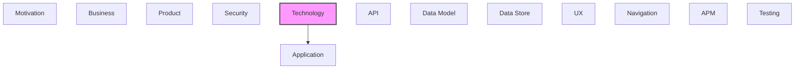

# Technology

[← Back to README](../README.md)

Infrastructure, platforms, systems, and technology components.

## Report Index

- [Layer Introduction](#layer-introduction)
- [Intra-Layer Relationships](#intra-layer-relationships)
- [Inter-Layer Dependencies](#inter-layer-dependencies)
- [Inter-Layer Relationships Table](#inter-layer-relationships-table)
- [Element Reference](#element-reference)

## Layer Introduction

| Metric                    | Count |
| ------------------------- | ----- |
| Elements                  | 13    |
| Intra-Layer Relationships | 12    |
| Inter-Layer Relationships | 2     |
| Inbound Relationships     | 0     |
| Outbound Relationships    | 2     |

**Cross-Layer References**:

- **Downstream layers**: [Application](./05-application-layer-report.md)

## Intra-Layer Relationships

```mermaid
flowchart LR
  subgraph technology
    technology_artifact_d3_delaunay["d3-delaunay"]
    technology_artifact_d3_hierarchy["d3-hierarchy"]
    technology_artifact_heimdall_ui_package["Heimdall UI Package"]
    technology_artifact_playwright_test_runner["Playwright Test Runner"]
    technology_artifact_react_markdown["react-markdown"]
    technology_artifact_react_peer_dependency["React (peer dependency)"]
    technology_artifact_remark_gfm["remark-gfm"]
    technology_artifact_type_script_compiler_configuration["TypeScript Compiler Configuration"]
    technology_artifact_vitest["Vitest"]
    technology_technologyfunction_automated_test_execution["Automated Test Execution"]
    technology_technologyfunction_library_bundling_and_type_declaration_generation["Library Bundling and Type Declaration Generation"]
    technology_technologyprocess_npm_run_build_vite_build["npm run build (vite build)"]
    technology_technologyprocess_npm_test_npm_run_testunit["npm test / npm run test:unit"]
    technology_artifact_heimdall_ui_package -->|depends-on| technology_artifact_d3_delaunay
    technology_artifact_heimdall_ui_package -->|depends-on| technology_artifact_d3_hierarchy
    technology_artifact_heimdall_ui_package -->|depends-on| technology_artifact_react_markdown
    technology_artifact_heimdall_ui_package -->|depends-on| technology_artifact_react_peer_dependency
    technology_artifact_heimdall_ui_package -->|depends-on| technology_artifact_remark_gfm
    technology_technologyfunction_automated_test_execution -->|accesses| technology_artifact_playwright_test_runner
    technology_technologyfunction_automated_test_execution -->|accesses| technology_artifact_vitest
    technology_technologyfunction_automated_test_execution -->|flows-to| technology_technologyprocess_npm_test_npm_run_testunit
    technology_technologyfunction_library_bundling_and_type_declaration_generation -->|accesses| technology_artifact_heimdall_ui_package
    technology_technologyfunction_library_bundling_and_type_declaration_generation -->|accesses| technology_artifact_type_script_compiler_configuration
    technology_technologyfunction_library_bundling_and_type_declaration_generation -->|flows-to| technology_technologyprocess_npm_run_build_vite_build
    technology_technologyprocess_npm_run_build_vite_build -->|accesses| technology_artifact_type_script_compiler_configuration
  end
```

## Inter-Layer Dependencies

## Inter-Layer Relationships Table

| Relationship ID                                                 | Source Node                               | Dest Node                                                     | Dest Layer    | Predicate  | Cardinality  | Strength |
| --------------------------------------------------------------- | ----------------------------------------- | ------------------------------------------------------------- | ------------- | ---------- | ------------ | -------- |
| `technology.artifact.realizes.application.applicationcomponent` | `technology.artifact.heimdall-ui-package` | `application.applicationcomponent.graph-canvas-component`     | `application` | `realizes` | many-to-many | medium   |
| `technology.artifact.realizes.application.applicationcomponent` | `technology.artifact.heimdall-ui-package` | `application.applicationcomponent.heimdall-ui-library-module` | `application` | `realizes` | many-to-many | medium   |

## Element Reference

### d3-delaunay {#d3-delaunay}

**ID**: `technology.artifact.d3-delaunay`

**Type**: `artifact`

Runtime dependency used by organicLayout (src/utils/organicLayout.ts) for Delaunay triangulation of node positions.

#### Attributes

| Name         | Value   |
| ------------ | ------- |
| artifactType | library |

#### Relationships

| Type        | Related Element                           | Predicate    | Direction |
| ----------- | ----------------------------------------- | ------------ | --------- |
| intra-layer | `technology.artifact.heimdall-ui-package` | `depends-on` | inbound   |

### d3-hierarchy {#d3-hierarchy}

**ID**: `technology.artifact.d3-hierarchy`

**Type**: `artifact`

Real runtime dependency used directly by uxNavLayout (tree), radialTreeLayout (tree, packSiblings), and graphPacking (pack, hierarchy) for tree layout and circle packing.

#### Attributes

| Name         | Value   |
| ------------ | ------- |
| artifactType | library |

#### Relationships

| Type        | Related Element                           | Predicate    | Direction |
| ----------- | ----------------------------------------- | ------------ | --------- |
| intra-layer | `technology.artifact.heimdall-ui-package` | `depends-on` | inbound   |

### Heimdall UI Package {#heimdall-ui-package}

**ID**: `technology.artifact.heimdall-ui-package`

**Type**: `artifact`

The published @tinkermonkey/heimdall-ui npm package (0.13.0): the full component library exported from src/index.ts, built one module per source file (dist/, with type declarations) plus the default full stylesheet and opt-in base and per-component sheets.

#### Attributes

| Name         | Value   |
| ------------ | ------- |
| artifactType | library |

#### Relationships

| Type        | Related Element                                                                  | Predicate    | Direction |
| ----------- | -------------------------------------------------------------------------------- | ------------ | --------- |
| inter-layer | `application.applicationcomponent.graph-canvas-component`                        | `realizes`   | outbound  |
| inter-layer | `application.applicationcomponent.heimdall-ui-library-module`                    | `realizes`   | outbound  |
| intra-layer | `technology.artifact.d3-delaunay`                                                | `depends-on` | outbound  |
| intra-layer | `technology.artifact.d3-hierarchy`                                               | `depends-on` | outbound  |
| intra-layer | `technology.artifact.react-markdown`                                             | `depends-on` | outbound  |
| intra-layer | `technology.artifact.react-peer-dependency`                                      | `depends-on` | outbound  |
| intra-layer | `technology.artifact.remark-gfm`                                                 | `depends-on` | outbound  |
| intra-layer | `technology.technologyfunction.library-bundling-and-type-declaration-generation` | `accesses`   | inbound   |

### Playwright Test Runner {#playwright-test-runner}

**ID**: `technology.artifact.playwright-test-runner`

**Type**: `artifact`

@playwright/test devDependency driving the browser-based visual/behavioral regression suite in tests/, including all graph-\*.spec.ts files.

#### Attributes

| Name         | Value   |
| ------------ | ------- |
| artifactType | library |

#### Relationships

| Type        | Related Element                                          | Predicate  | Direction |
| ----------- | -------------------------------------------------------- | ---------- | --------- |
| intra-layer | `technology.technologyfunction.automated-test-execution` | `accesses` | inbound   |

### react-markdown {#react-markdown}

**ID**: `technology.artifact.react-markdown`

**Type**: `artifact`

Runtime dependency used by ChatMarkdownContent to render model output as markdown, with remark-gfm for GitHub-flavored markdown.

#### Attributes

| Name         | Value   |
| ------------ | ------- |
| artifactType | library |

#### Relationships

| Type        | Related Element                           | Predicate    | Direction |
| ----------- | ----------------------------------------- | ------------ | --------- |
| intra-layer | `technology.artifact.heimdall-ui-package` | `depends-on` | inbound   |

### React (peer dependency) {#react-peer-dependency}

**ID**: `technology.artifact.react-peer-dependency`

**Type**: `artifact`

React and react-dom 18 or 19 peer dependencies every component is built against.

#### Attributes

| Name         | Value   |
| ------------ | ------- |
| artifactType | library |

#### Relationships

| Type        | Related Element                           | Predicate    | Direction |
| ----------- | ----------------------------------------- | ------------ | --------- |
| intra-layer | `technology.artifact.heimdall-ui-package` | `depends-on` | inbound   |

### remark-gfm {#remark-gfm}

**ID**: `technology.artifact.remark-gfm`

**Type**: `artifact`

Runtime dependency: the GitHub-flavored markdown plugin ChatMarkdownContent passes to react-markdown.

#### Attributes

| Name         | Value   |
| ------------ | ------- |
| artifactType | library |

#### Relationships

| Type        | Related Element                           | Predicate    | Direction |
| ----------- | ----------------------------------------- | ------------ | --------- |
| intra-layer | `technology.artifact.heimdall-ui-package` | `depends-on` | inbound   |

### TypeScript Compiler Configuration {#typescript-compiler-configuration}

**ID**: `technology.artifact.type-script-compiler-configuration`

**Type**: `artifact`

tsconfig.json — strict TypeScript configuration, including allowImportingTsExtensions so scripts/render-and-score.mjs (in the sibling layout-loop harness) can import graphLayout.ts directly via Node's --experimental-strip-types without a build step.

#### Attributes

| Name         | Value         |
| ------------ | ------------- |
| artifactType | configuration |

#### Relationships

| Type        | Related Element                                                                  | Predicate  | Direction |
| ----------- | -------------------------------------------------------------------------------- | ---------- | --------- |
| intra-layer | `technology.technologyfunction.library-bundling-and-type-declaration-generation` | `accesses` | inbound   |
| intra-layer | `technology.technologyprocess.npm-run-build-vite-build`                          | `accesses` | inbound   |

### Vitest {#vitest}

**ID**: `technology.artifact.vitest`

**Type**: `artifact`

vitest devDependency running the pure-function and server-render unit tests (src/\*\*/\*.test.ts: layout engines, layered framework, placement, date and trace utilities) via npm run test:unit.

#### Attributes

| Name         | Value   |
| ------------ | ------- |
| artifactType | library |

#### Relationships

| Type        | Related Element                                          | Predicate  | Direction |
| ----------- | -------------------------------------------------------- | ---------- | --------- |
| intra-layer | `technology.technologyfunction.automated-test-execution` | `accesses` | inbound   |

### Automated Test Execution {#automated-test-execution}

**ID**: `technology.technologyfunction.automated-test-execution`

**Type**: `technologyfunction`

Running heimdall's test suites: the Playwright visual and behavioural suite (tests/\*.spec.ts, per-OS screenshot baselines, sharded in CI) and the Vitest unit suite (src/\*\*/\*.test.ts).

#### Relationships

| Type        | Related Element                                          | Predicate  | Direction |
| ----------- | -------------------------------------------------------- | ---------- | --------- |
| intra-layer | `technology.artifact.playwright-test-runner`             | `accesses` | outbound  |
| intra-layer | `technology.artifact.vitest`                             | `accesses` | outbound  |
| intra-layer | `technology.technologyprocess.npm-test-npm-run-testunit` | `flows-to` | outbound  |

### Library Bundling and Type Declaration Generation {#library-bundling-and-type-declaration-generation}

**ID**: `technology.technologyfunction.library-bundling-and-type-declaration-generation`

**Type**: `technologyfunction`

Vite library-mode build (Rollup with preserveModules and preserveModulesRoot src, so every source file is its own module and bundlers tree-shake per component) plus vite-plugin-dts for type declarations; the JS imports no CSS and the stylesheets are emitted separately (0.13.0).

#### Relationships

| Type        | Related Element                                          | Predicate  | Direction |
| ----------- | -------------------------------------------------------- | ---------- | --------- |
| intra-layer | `technology.artifact.heimdall-ui-package`                | `accesses` | outbound  |
| intra-layer | `technology.artifact.type-script-compiler-configuration` | `accesses` | outbound  |
| intra-layer | `technology.technologyprocess.npm-run-build-vite-build`  | `flows-to` | outbound  |

### npm run build (vite build) {#npm-run-build-vite-build}

**ID**: `technology.technologyprocess.npm-run-build-vite-build`

**Type**: `technologyprocess`

The package.json 'build'/'prepare' script that invokes the Vite build — runs automatically on npm install via the prepare lifecycle hook, producing the dist/ artifact this package publishes.

#### Relationships

| Type        | Related Element                                                                  | Predicate  | Direction |
| ----------- | -------------------------------------------------------------------------------- | ---------- | --------- |
| intra-layer | `technology.technologyfunction.library-bundling-and-type-declaration-generation` | `flows-to` | inbound   |
| intra-layer | `technology.artifact.type-script-compiler-configuration`                         | `accesses` | outbound  |

### npm test / npm run test:unit {#npm-test-npm-run-test-unit}

**ID**: `technology.technologyprocess.npm-test-npm-run-testunit`

**Type**: `technologyprocess`

The package.json scripts invoking Playwright ('test'/'test:ui') and Vitest ('test:unit') against the graph-visualization test suite.

#### Relationships

| Type        | Related Element                                          | Predicate  | Direction |
| ----------- | -------------------------------------------------------- | ---------- | --------- |
| intra-layer | `technology.technologyfunction.automated-test-execution` | `flows-to` | inbound   |

---

Generated: 2026-11-23T17:44:43.297Z | Model Version: 0.1.0
