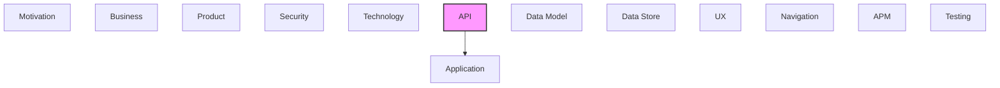

# API

[← Back to README](../README.md)

REST APIs, operations, endpoints, and API integrations.

## Report Index

- [Layer Introduction](#layer-introduction)
- [Intra-Layer Relationships](#intra-layer-relationships)
- [Inter-Layer Dependencies](#inter-layer-dependencies)
- [Inter-Layer Relationships Table](#inter-layer-relationships-table)
- [Element Reference](#element-reference)

## Layer Introduction

| Metric                    | Count |
| ------------------------- | ----- |
| Elements                  | 37    |
| Intra-Layer Relationships | 34    |
| Inter-Layer Relationships | 29    |
| Inbound Relationships     | 0     |
| Outbound Relationships    | 29    |

**Cross-Layer References**:

- **Downstream layers**: [Application](./05-application-layer-report.md)

## Intra-Layer Relationships

*This layer has >30 elements. Summary table shown instead of diagram.*

| Element                                     | Type        | Relationships |
| ------------------------------------------- | ----------- | ------------- |
| `api.operation.bezier-path`                 | `operation` | 1             |
| `api.operation.build-layered-index`         | `operation` | 1             |
| `api.operation.build-structural-forest`     | `operation` | 1             |
| `api.operation.build-trace-model`           | `operation` | 1             |
| `api.operation.clustered-force-layout`      | `operation` | 1             |
| `api.operation.compute-reach`               | `operation` | 1             |
| `api.operation.find-clear-label-position`   | `operation` | 1             |
| `api.operation.force-layout`                | `operation` | 1             |
| `api.operation.from-otlp`                   | `operation` | 1             |
| `api.operation.from-xray`                   | `operation` | 1             |
| `api.operation.galaxy-layout`               | `operation` | 1             |
| `api.operation.graph-canvas`                | `operation` | 1             |
| `api.operation.graph-collapse-control`      | `operation` | 1             |
| `api.operation.graph-edge`                  | `operation` | 1             |
| `api.operation.graph-edge-inspector`        | `operation` | 1             |
| `api.operation.graph-edge-shape`            | `operation` | 1             |
| `api.operation.graph-inspector`             | `operation` | 1             |
| `api.operation.graph-node`                  | `operation` | 1             |
| `api.operation.graph-toolbar`               | `operation` | 1             |
| `api.operation.hive-layout`                 | `operation` | 1             |
| `api.operation.layout-lanes`                | `operation` | 1             |
| `api.operation.layout-layers`               | `operation` | 1             |
| `api.operation.louvain-cluster`             | `operation` | 1             |
| `api.operation.organic-layout`              | `operation` | 1             |
| `api.operation.orthogonal-layout`           | `operation` | 1             |
| `api.operation.pack-clusters`               | `operation` | 1             |
| `api.operation.radial-tree-layout`          | `operation` | 1             |
| `api.operation.use-controllable`            | `operation` | 1             |
| `api.operation.use-layered-graph`           | `operation` | 1             |
| `api.operation.use-media-query`             | `operation` | 1             |
| `api.operation.use-pan-zoom`                | `operation` | 1             |
| `api.operation.use-tween`                   | `operation` | 1             |
| `api.operation.ux-nav-layout`               | `operation` | 1             |
| `api.operation.visible-navigation-edge-ids` | `operation` | 1             |
| `api.tag.graph`                             | `tag`       | 28            |
| `api.tag.hooks`                             | `tag`       | 3             |
| `api.tag.observability`                     | `tag`       | 3             |

## Inter-Layer Dependencies

## Inter-Layer Relationships Table

| Relationship ID                                           | Source Node                                 | Dest Node                                                              | Dest Layer    | Predicate    | Cardinality  | Strength |
| --------------------------------------------------------- | ------------------------------------------- | ---------------------------------------------------------------------- | ------------- | ------------ | ------------ | -------- |
| `api.operation.realizes.application.applicationfunction`  | `api.operation.bezier-path`                 | `application.applicationfunction.bezier-edge-path-computation`         | `application` | `realizes`   | many-to-many | medium   |
| `api.operation.realizes.application.applicationfunction`  | `api.operation.build-layered-index`         | `application.applicationfunction.layered-graph-index-construction`     | `application` | `realizes`   | many-to-many | medium   |
| `api.operation.realizes.application.applicationfunction`  | `api.operation.build-structural-forest`     | `application.applicationfunction.structural-forest-construction`       | `application` | `realizes`   | many-to-many | medium   |
| `api.operation.realizes.application.applicationfunction`  | `api.operation.build-trace-model`           | `application.applicationfunction.trace-model-construction`             | `application` | `realizes`   | many-to-many | medium   |
| `api.operation.realizes.application.applicationfunction`  | `api.operation.clustered-force-layout`      | `application.applicationfunction.clustered-force-layout-algorithm`     | `application` | `realizes`   | many-to-many | medium   |
| `api.operation.realizes.application.applicationfunction`  | `api.operation.compute-reach`               | `application.applicationfunction.layered-reach-computation`            | `application` | `realizes`   | many-to-many | medium   |
| `api.operation.realizes.application.applicationfunction`  | `api.operation.find-clear-label-position`   | `application.applicationfunction.edge-label-clear-position-search`     | `application` | `realizes`   | many-to-many | medium   |
| `api.operation.realizes.application.applicationfunction`  | `api.operation.force-layout`                | `application.applicationfunction.force-directed-layout-algorithm`      | `application` | `realizes`   | many-to-many | medium   |
| `api.operation.realizes.application.applicationfunction`  | `api.operation.from-otlp`                   | `application.applicationfunction.otlp-trace-adaptation`                | `application` | `realizes`   | many-to-many | medium   |
| `api.operation.realizes.application.applicationfunction`  | `api.operation.from-xray`                   | `application.applicationfunction.aws-x-ray-trace-adaptation`           | `application` | `realizes`   | many-to-many | medium   |
| `api.operation.realizes.application.applicationfunction`  | `api.operation.galaxy-layout`               | `application.applicationfunction.galaxy-radial-orbit-layout-algorithm` | `application` | `realizes`   | many-to-many | medium   |
| `api.operation.references.application.applicationservice` | `api.operation.graph-canvas`                | `application.applicationservice.graph-layout-engine-service`           | `application` | `references` | many-to-many | medium   |
| `api.operation.references.application.applicationservice` | `api.operation.graph-canvas`                | `application.applicationservice.live-galaxy-simulation-service`        | `application` | `references` | many-to-many | medium   |
| `api.operation.triggers.application.applicationevent`     | `api.operation.graph-canvas`                | `application.applicationevent.node-drag-end-event`                     | `application` | `triggers`   | many-to-many | medium   |
| `api.operation.triggers.application.applicationevent`     | `api.operation.graph-canvas`                | `application.applicationevent.node-hover-change-event`                 | `application` | `triggers`   | many-to-many | medium   |
| `api.operation.realizes.application.applicationfunction`  | `api.operation.hive-layout`                 | `application.applicationfunction.hive-plot-layout`                     | `application` | `realizes`   | many-to-many | medium   |
| `api.operation.realizes.application.applicationfunction`  | `api.operation.layout-lanes`                | `application.applicationfunction.lane-layout-and-gutter-routing`       | `application` | `realizes`   | many-to-many | medium   |
| `api.operation.realizes.application.applicationfunction`  | `api.operation.layout-layers`               | `application.applicationfunction.layer-plane-layout`                   | `application` | `realizes`   | many-to-many | medium   |
| `api.operation.realizes.application.applicationfunction`  | `api.operation.louvain-cluster`             | `application.applicationfunction.louvain-community-clustering`         | `application` | `realizes`   | many-to-many | medium   |
| `api.operation.realizes.application.applicationfunction`  | `api.operation.organic-layout`              | `application.applicationfunction.organic-layout-algorithm`             | `application` | `realizes`   | many-to-many | medium   |
| `api.operation.realizes.application.applicationfunction`  | `api.operation.orthogonal-layout`           | `application.applicationfunction.orthogonal-layout-algorithm`          | `application` | `realizes`   | many-to-many | medium   |
| `api.operation.realizes.application.applicationfunction`  | `api.operation.pack-clusters`               | `application.applicationfunction.cluster-circle-packing`               | `application` | `realizes`   | many-to-many | medium   |
| `api.operation.realizes.application.applicationfunction`  | `api.operation.radial-tree-layout`          | `application.applicationfunction.radial-tree-layout-algorithm`         | `application` | `realizes`   | many-to-many | medium   |
| `api.operation.realizes.application.applicationfunction`  | `api.operation.use-controllable`            | `application.applicationfunction.controlled-or-uncontrolled-state`     | `application` | `realizes`   | many-to-many | medium   |
| `api.operation.references.application.applicationservice` | `api.operation.use-layered-graph`           | `application.applicationservice.layered-graph-framework-service`       | `application` | `references` | many-to-many | medium   |
| `api.operation.realizes.application.applicationfunction`  | `api.operation.use-media-query`             | `application.applicationfunction.ssr-safe-media-query`                 | `application` | `realizes`   | many-to-many | medium   |
| `api.operation.realizes.application.applicationfunction`  | `api.operation.use-tween`                   | `application.applicationfunction.tweened-animation`                    | `application` | `realizes`   | many-to-many | medium   |
| `api.operation.realizes.application.applicationfunction`  | `api.operation.ux-nav-layout`               | `application.applicationfunction.ux-navigation-tree-layout-algorithm`  | `application` | `realizes`   | many-to-many | medium   |
| `api.operation.realizes.application.applicationfunction`  | `api.operation.visible-navigation-edge-ids` | `application.applicationfunction.ux-navigation-tree-layout-algorithm`  | `application` | `realizes`   | many-to-many | medium   |

## Element Reference

### bezierPath {#bezierpath}

**ID**: `api.operation.bezier-path`

**Type**: `operation`

Exported edge-geometry helper (with rectEdgePoint, rectEdgeDirection, edgeLabelSize) for custom edge renderers; replaces computeEdgePath, which is internal to src/utils/graph.ts and no longer exported.

#### Attributes

| Name        | Value                                               |
| ----------- | --------------------------------------------------- |
| operationId | bezierPath                                          |
| summary     | Compute the curved path between two node rectangles |
| tags        | graph                                               |

#### Relationships

| Type        | Related Element                                                | Predicate    | Direction |
| ----------- | -------------------------------------------------------------- | ------------ | --------- |
| inter-layer | `application.applicationfunction.bezier-edge-path-computation` | `realizes`   | outbound  |
| intra-layer | `api.tag.graph`                                                | `references` | outbound  |

### buildLayeredIndex {#buildlayeredindex}

**ID**: `api.operation.build-layered-index`

**Type**: `operation`

Exported function building the layered index.

#### Attributes

| Name        | Value                  |
| ----------- | ---------------------- |
| operationId | buildLayeredIndex      |
| summary     | Index a graph by layer |
| tags        | graph                  |

#### Relationships

| Type        | Related Element                                                    | Predicate    | Direction |
| ----------- | ------------------------------------------------------------------ | ------------ | --------- |
| inter-layer | `application.applicationfunction.layered-graph-index-construction` | `realizes`   | outbound  |
| intra-layer | `api.tag.graph`                                                    | `references` | outbound  |

### buildStructuralForest {#buildstructuralforest}

**ID**: `api.operation.build-structural-forest`

**Type**: `operation`

Exported function deriving a parent/child forest from structural edges.

#### Attributes

| Name        | Value                                             |
| ----------- | ------------------------------------------------- |
| operationId | buildStructuralForest                             |
| summary     | Build a structural parent/child forest from edges |
| tags        | graph                                             |

#### Relationships

| Type        | Related Element                                                  | Predicate    | Direction |
| ----------- | ---------------------------------------------------------------- | ------------ | --------- |
| inter-layer | `application.applicationfunction.structural-forest-construction` | `realizes`   | outbound  |
| intra-layer | `api.tag.graph`                                                  | `references` | outbound  |

### buildTraceModel {#buildtracemodel}

**ID**: `api.operation.build-trace-model`

**Type**: `operation`

Exported trace-model helper behind TraceViewer.

#### Attributes

| Name        | Value                                |
| ----------- | ------------------------------------ |
| operationId | buildTraceModel                      |
| summary     | Build the waterfall model of a trace |
| tags        | observability                        |

#### Relationships

| Type        | Related Element                                            | Predicate    | Direction |
| ----------- | ---------------------------------------------------------- | ------------ | --------- |
| inter-layer | `application.applicationfunction.trace-model-construction` | `realizes`   | outbound  |
| intra-layer | `api.tag.observability`                                    | `references` | outbound  |

### clusteredForceLayout {#clusteredforcelayout}

**ID**: `api.operation.clustered-force-layout`

**Type**: `operation`

Exported function running the Louvain-clustered nested-bubble force layout.

#### Attributes

| Name        | Value                                      |
| ----------- | ------------------------------------------ |
| operationId | clusteredForceLayout                       |
| summary     | Compute a community-clustered force layout |
| tags        | graph                                      |

#### Relationships

| Type        | Related Element                                                    | Predicate    | Direction |
| ----------- | ------------------------------------------------------------------ | ------------ | --------- |
| inter-layer | `application.applicationfunction.clustered-force-layout-algorithm` | `realizes`   | outbound  |
| intra-layer | `api.tag.graph`                                                    | `references` | outbound  |

### computeReach {#computereach}

**ID**: `api.operation.compute-reach`

**Type**: `operation`

Exported function computing the selection reach.

#### Attributes

| Name        | Value                                              |
| ----------- | -------------------------------------------------- |
| operationId | computeReach                                       |
| summary     | Compute the reach of a selected node across layers |
| tags        | graph                                              |

#### Relationships

| Type        | Related Element                                             | Predicate    | Direction |
| ----------- | ----------------------------------------------------------- | ------------ | --------- |
| inter-layer | `application.applicationfunction.layered-reach-computation` | `realizes`   | outbound  |
| intra-layer | `api.tag.graph`                                             | `references` | outbound  |

### findClearLabelPosition {#findclearlabelposition}

**ID**: `api.operation.find-clear-label-position`

**Type**: `operation`

Exported edge-label helper for custom renderers.

#### Attributes

| Name        | Value                                               |
| ----------- | --------------------------------------------------- |
| operationId | findClearLabelPosition                              |
| summary     | Find a label spot along an edge clear of every node |
| tags        | graph                                               |

#### Relationships

| Type        | Related Element                                                    | Predicate    | Direction |
| ----------- | ------------------------------------------------------------------ | ------------ | --------- |
| inter-layer | `application.applicationfunction.edge-label-clear-position-search` | `realizes`   | outbound  |
| intra-layer | `api.tag.graph`                                                    | `references` | outbound  |

### forceLayout {#forcelayout}

**ID**: `api.operation.force-layout`

**Type**: `operation`

Exported function running the spring/repulsion force-directed layout algorithm.

#### Attributes

| Name        | Value                                               |
| ----------- | --------------------------------------------------- |
| operationId | forceLayout                                         |
| summary     | Compute a force-directed layout for a node/edge set |
| tags        | graph                                               |

#### Relationships

| Type        | Related Element                                                   | Predicate    | Direction |
| ----------- | ----------------------------------------------------------------- | ------------ | --------- |
| inter-layer | `application.applicationfunction.force-directed-layout-algorithm` | `realizes`   | outbound  |
| intra-layer | `api.tag.graph`                                                   | `references` | outbound  |

### fromOTLP {#fromotlp}

**ID**: `api.operation.from-otlp`

**Type**: `operation`

Exported OTLP trace adapter.

#### Attributes

| Name        | Value                                          |
| ----------- | ---------------------------------------------- |
| operationId | fromOTLP                                       |
| summary     | Convert OTLP/JSON traces into a heimdall Trace |
| tags        | observability                                  |

#### Relationships

| Type        | Related Element                                         | Predicate    | Direction |
| ----------- | ------------------------------------------------------- | ------------ | --------- |
| inter-layer | `application.applicationfunction.otlp-trace-adaptation` | `realizes`   | outbound  |
| intra-layer | `api.tag.observability`                                 | `references` | outbound  |

### fromXRay {#fromxray}

**ID**: `api.operation.from-xray`

**Type**: `operation`

Exported X-Ray trace adapter.

#### Attributes

| Name        | Value                                            |
| ----------- | ------------------------------------------------ |
| operationId | fromXRay                                         |
| summary     | Convert AWS X-Ray segments into a heimdall Trace |
| tags        | observability                                    |

#### Relationships

| Type        | Related Element                                              | Predicate    | Direction |
| ----------- | ------------------------------------------------------------ | ------------ | --------- |
| inter-layer | `application.applicationfunction.aws-x-ray-trace-adaptation` | `realizes`   | outbound  |
| intra-layer | `api.tag.observability`                                      | `references` | outbound  |

### galaxyLayout {#galaxylayout}

**ID**: `api.operation.galaxy-layout`

**Type**: `operation`

Exported function running the radial-orbit galaxy layout algorithm.

#### Attributes

| Name        | Value                                    |
| ----------- | ---------------------------------------- |
| operationId | galaxyLayout                             |
| summary     | Compute a radial-hierarchy galaxy layout |
| tags        | graph                                    |

#### Relationships

| Type        | Related Element                                                        | Predicate    | Direction |
| ----------- | ---------------------------------------------------------------------- | ------------ | --------- |
| inter-layer | `application.applicationfunction.galaxy-radial-orbit-layout-algorithm` | `realizes`   | outbound  |
| intra-layer | `api.tag.graph`                                                        | `references` | outbound  |

### GraphCanvas {#graphcanvas}

**ID**: `api.operation.graph-canvas`

**Type**: `operation`

Exported React component — the public entry point for rendering an interactive graph.

#### Attributes

| Name        | Value                                                                    |
| ----------- | ------------------------------------------------------------------------ |
| operationId | GraphCanvas                                                              |
| summary     | Render an interactive, pan/zoomable graph with a pluggable layout engine |
| tags        | graph                                                                    |

#### Relationships

| Type        | Related Element                                                 | Predicate    | Direction |
| ----------- | --------------------------------------------------------------- | ------------ | --------- |
| inter-layer | `application.applicationservice.graph-layout-engine-service`    | `references` | outbound  |
| inter-layer | `application.applicationservice.live-galaxy-simulation-service` | `references` | outbound  |
| inter-layer | `application.applicationevent.node-drag-end-event`              | `triggers`   | outbound  |
| inter-layer | `application.applicationevent.node-hover-change-event`          | `triggers`   | outbound  |
| intra-layer | `api.tag.graph`                                                 | `references` | outbound  |

### GraphCollapseControl {#graphcollapsecontrol}

**ID**: `api.operation.graph-collapse-control`

**Type**: `operation`

Exported collapse/expand affordance button for a node with structural children.

#### Attributes

| Name        | Value                                              |
| ----------- | -------------------------------------------------- |
| operationId | GraphCollapseControl                               |
| summary     | Collapse/expand affordance for a hierarchical node |
| tags        | graph                                              |

#### Relationships

| Type        | Related Element | Predicate    | Direction |
| ----------- | --------------- | ------------ | --------- |
| intra-layer | `api.tag.graph` | `references` | outbound  |

### GraphEdge {#graphedge}

**ID**: `api.operation.graph-edge`

**Type**: `operation`

Exported standalone edge component for use outside GraphCanvas's own internal edge renderer.

#### Attributes

| Name        | Value                           |
| ----------- | ------------------------------- |
| operationId | GraphEdge                       |
| summary     | Standalone graph edge component |
| tags        | graph                           |

#### Relationships

| Type        | Related Element | Predicate    | Direction |
| ----------- | --------------- | ------------ | --------- |
| intra-layer | `api.tag.graph` | `references` | outbound  |

### GraphEdgeInspector {#graphedgeinspector}

**ID**: `api.operation.graph-edge-inspector`

**Type**: `operation`

Exported detail panel component for a selected edge's endpoints and metadata.

#### Attributes

| Name        | Value                                  |
| ----------- | -------------------------------------- |
| operationId | GraphEdgeInspector                     |
| summary     | Detail panel for a selected graph edge |
| tags        | graph                                  |

#### Relationships

| Type        | Related Element | Predicate    | Direction |
| ----------- | --------------- | ------------ | --------- |
| intra-layer | `api.tag.graph` | `references` | outbound  |

### GraphEdgeShape {#graphedgeshape}

**ID**: `api.operation.graph-edge-shape`

**Type**: `operation`

Exported low-level SVG edge-drawing primitive (line, markers, hit target, label pill), for fully custom renderEdge callbacks.

#### Attributes

| Name        | Value                              |
| ----------- | ---------------------------------- |
| operationId | GraphEdgeShape                     |
| summary     | Low-level SVG edge shape primitive |
| tags        | graph                              |

#### Relationships

| Type        | Related Element | Predicate    | Direction |
| ----------- | --------------- | ------------ | --------- |
| intra-layer | `api.tag.graph` | `references` | outbound  |

### GraphInspector {#graphinspector}

**ID**: `api.operation.graph-inspector`

**Type**: `operation`

Exported detail panel component for a selected node's metadata and relationships.

#### Attributes

| Name        | Value                                  |
| ----------- | -------------------------------------- |
| operationId | GraphInspector                         |
| summary     | Detail panel for a selected graph node |
| tags        | graph                                  |

#### Relationships

| Type        | Related Element | Predicate    | Direction |
| ----------- | --------------- | ------------ | --------- |
| intra-layer | `api.tag.graph` | `references` | outbound  |

### GraphNode {#graphnode}

**ID**: `api.operation.graph-node`

**Type**: `operation`

Exported default node renderer component, usable standalone or via GraphCanvas's renderNode.

#### Attributes

| Name        | Value                       |
| ----------- | --------------------------- |
| operationId | GraphNode                   |
| summary     | Default graph node renderer |
| tags        | graph                       |

#### Relationships

| Type        | Related Element | Predicate    | Direction |
| ----------- | --------------- | ------------ | --------- |
| intra-layer | `api.tag.graph` | `references` | outbound  |

### GraphToolbar {#graphtoolbar}

**ID**: `api.operation.graph-toolbar`

**Type**: `operation`

Exported floating zoom/pan/lock/fullscreen/live-simulation control cluster, for a custom toolbar placement.

#### Attributes

| Name        | Value                                            |
| ----------- | ------------------------------------------------ |
| operationId | GraphToolbar                                     |
| summary     | Zoom/pan/lock/fullscreen toolbar for GraphCanvas |
| tags        | graph                                            |

#### Relationships

| Type        | Related Element | Predicate    | Direction |
| ----------- | --------------- | ------------ | --------- |
| intra-layer | `api.tag.graph` | `references` | outbound  |

### hiveLayout {#hivelayout}

**ID**: `api.operation.hive-layout`

**Type**: `operation`

Exported function computing hive axes, node positions and link curves.

#### Attributes

| Name        | Value                      |
| ----------- | -------------------------- |
| operationId | hiveLayout                 |
| summary     | Compute a hive plot layout |
| tags        | graph                      |

#### Relationships

| Type        | Related Element                                    | Predicate    | Direction |
| ----------- | -------------------------------------------------- | ------------ | --------- |
| inter-layer | `application.applicationfunction.hive-plot-layout` | `realizes`   | outbound  |
| intra-layer | `api.tag.graph`                                    | `references` | outbound  |

### layoutLanes {#layoutlanes}

**ID**: `api.operation.layout-lanes`

**Type**: `operation`

Exported function laying out layers as lanes with gutter routing.

#### Attributes

| Name        | Value                                 |
| ----------- | ------------------------------------- |
| operationId | layoutLanes                           |
| summary     | Lay out a layered graph as swim lanes |
| tags        | graph                                 |

#### Relationships

| Type        | Related Element                                                  | Predicate    | Direction |
| ----------- | ---------------------------------------------------------------- | ------------ | --------- |
| inter-layer | `application.applicationfunction.lane-layout-and-gutter-routing` | `realizes`   | outbound  |
| intra-layer | `api.tag.graph`                                                  | `references` | outbound  |

### layoutLayers {#layoutlayers}

**ID**: `api.operation.layout-layers`

**Type**: `operation`

Exported function (with layoutLayersAsync) laying out layer planes.

#### Attributes

| Name        | Value                                       |
| ----------- | ------------------------------------------- |
| operationId | layoutLayers                                |
| summary     | Lay out each layer plane of a layered graph |
| tags        | graph                                       |

#### Relationships

| Type        | Related Element                                      | Predicate    | Direction |
| ----------- | ---------------------------------------------------- | ------------ | --------- |
| inter-layer | `application.applicationfunction.layer-plane-layout` | `realizes`   | outbound  |
| intra-layer | `api.tag.graph`                                      | `references` | outbound  |

### louvainCluster {#louvaincluster}

**ID**: `api.operation.louvain-cluster`

**Type**: `operation`

Exported function running deterministic multi-level Louvain community clustering.

#### Attributes

| Name        | Value                                              |
| ----------- | -------------------------------------------------- |
| operationId | louvainCluster                                     |
| summary     | Compute a deterministic Louvain cluster dendrogram |
| tags        | graph                                              |

#### Relationships

| Type        | Related Element                                                | Predicate    | Direction |
| ----------- | -------------------------------------------------------------- | ------------ | --------- |
| inter-layer | `application.applicationfunction.louvain-community-clustering` | `realizes`   | outbound  |
| intra-layer | `api.tag.graph`                                                | `references` | outbound  |

### organicLayout {#organiclayout}

**ID**: `api.operation.organic-layout`

**Type**: `operation`

Exported function running the organic (stress-majorization) layout.

#### Attributes

| Name        | Value                                  |
| ----------- | -------------------------------------- |
| operationId | organicLayout                          |
| summary     | Lay out a graph by stress majorization |
| tags        | graph                                  |

#### Relationships

| Type        | Related Element                                            | Predicate    | Direction |
| ----------- | ---------------------------------------------------------- | ------------ | --------- |
| inter-layer | `application.applicationfunction.organic-layout-algorithm` | `realizes`   | outbound  |
| intra-layer | `api.tag.graph`                                            | `references` | outbound  |

### orthogonalLayout {#orthogonallayout}

**ID**: `api.operation.orthogonal-layout`

**Type**: `operation`

Exported function running the orthogonal layout with lattice and channel routing.

#### Attributes

| Name        | Value                                                  |
| ----------- | ------------------------------------------------------ |
| operationId | orthogonalLayout                                       |
| summary     | Lay out a graph on a grid with right-angle edge routes |
| tags        | graph                                                  |

#### Relationships

| Type        | Related Element                                               | Predicate    | Direction |
| ----------- | ------------------------------------------------------------- | ------------ | --------- |
| inter-layer | `application.applicationfunction.orthogonal-layout-algorithm` | `realizes`   | outbound  |
| intra-layer | `api.tag.graph`                                               | `references` | outbound  |

### packClusters {#packclusters}

**ID**: `api.operation.pack-clusters`

**Type**: `operation`

Exported function packing a cluster dendrogram into non-overlapping nested circles.

#### Attributes

| Name        | Value                                         |
| ----------- | --------------------------------------------- |
| operationId | packClusters                                  |
| summary     | Pack a cluster dendrogram into nested circles |
| tags        | graph                                         |

#### Relationships

| Type        | Related Element                                          | Predicate    | Direction |
| ----------- | -------------------------------------------------------- | ------------ | --------- |
| inter-layer | `application.applicationfunction.cluster-circle-packing` | `realizes`   | outbound  |
| intra-layer | `api.tag.graph`                                          | `references` | outbound  |

### radialTreeLayout {#radialtreelayout}

**ID**: `api.operation.radial-tree-layout`

**Type**: `operation`

Exported function running the radial-tree (concentric ring) layout algorithm.

#### Attributes

| Name        | Value                                         |
| ----------- | --------------------------------------------- |
| operationId | radialTreeLayout                              |
| summary     | Compute a radial-tree layout with depth rings |
| tags        | graph                                         |

#### Relationships

| Type        | Related Element                                                | Predicate    | Direction |
| ----------- | -------------------------------------------------------------- | ------------ | --------- |
| inter-layer | `application.applicationfunction.radial-tree-layout-algorithm` | `realizes`   | outbound  |
| intra-layer | `api.tag.graph`                                                | `references` | outbound  |

### useControllable {#usecontrollable}

**ID**: `api.operation.use-controllable`

**Type**: `operation`

Exported controllable-state hook.

#### Attributes

| Name        | Value                                             |
| ----------- | ------------------------------------------------- |
| operationId | useControllable                                   |
| summary     | Hold state that may be controlled or uncontrolled |
| tags        | hooks                                             |

#### Relationships

| Type        | Related Element                                                    | Predicate    | Direction |
| ----------- | ------------------------------------------------------------------ | ------------ | --------- |
| inter-layer | `application.applicationfunction.controlled-or-uncontrolled-state` | `realizes`   | outbound  |
| intra-layer | `api.tag.hooks`                                                    | `references` | outbound  |

### useLayeredGraph {#uselayeredgraph}

**ID**: `api.operation.use-layered-graph`

**Type**: `operation`

Exported hook providing the layered graph framework state through LayeredGraphContext.

#### Attributes

| Name        | Value                                            |
| ----------- | ------------------------------------------------ |
| operationId | useLayeredGraph                                  |
| summary     | Hold the shared state of the layered graph views |
| tags        | graph                                            |

#### Relationships

| Type        | Related Element                                                  | Predicate    | Direction |
| ----------- | ---------------------------------------------------------------- | ------------ | --------- |
| inter-layer | `application.applicationservice.layered-graph-framework-service` | `references` | outbound  |
| intra-layer | `api.tag.graph`                                                  | `references` | outbound  |

### useMediaQuery {#usemediaquery}

**ID**: `api.operation.use-media-query`

**Type**: `operation`

Exported SSR-safe media-query hook.

#### Attributes

| Name        | Value                                            |
| ----------- | ------------------------------------------------ |
| operationId | useMediaQuery                                    |
| summary     | Match a media query without hydration mismatches |
| tags        | hooks                                            |

#### Relationships

| Type        | Related Element                                        | Predicate    | Direction |
| ----------- | ------------------------------------------------------ | ------------ | --------- |
| inter-layer | `application.applicationfunction.ssr-safe-media-query` | `realizes`   | outbound  |
| intra-layer | `api.tag.hooks`                                        | `references` | outbound  |

### usePanZoom {#usepanzoom}

**ID**: `api.operation.use-pan-zoom`

**Type**: `operation`

Exported React hook implementing wheel/pinch/drag/keyboard pan-and-zoom with inertia.

#### Attributes

| Name        | Value                               |
| ----------- | ----------------------------------- |
| operationId | usePanZoom                          |
| summary     | Pan/zoom viewport hook with inertia |
| tags        | graph                               |

#### Relationships

| Type        | Related Element | Predicate    | Direction |
| ----------- | --------------- | ------------ | --------- |
| intra-layer | `api.tag.graph` | `references` | outbound  |

### useTween {#usetween}

**ID**: `api.operation.use-tween`

**Type**: `operation`

Exported animation hook.

#### Attributes

| Name        | Value                                            |
| ----------- | ------------------------------------------------ |
| operationId | useTween                                         |
| summary     | Tween numeric values with reduced-motion support |
| tags        | hooks                                            |

#### Relationships

| Type        | Related Element                                     | Predicate    | Direction |
| ----------- | --------------------------------------------------- | ------------ | --------- |
| inter-layer | `application.applicationfunction.tweened-animation` | `realizes`   | outbound  |
| intra-layer | `api.tag.hooks`                                     | `references` | outbound  |

### uxNavLayout {#uxnavlayout}

**ID**: `api.operation.ux-nav-layout`

**Type**: `operation`

Exported function running the page/view navigation tree layout algorithm.

#### Attributes

| Name        | Value                                            |
| ----------- | ------------------------------------------------ |
| operationId | uxNavLayout                                      |
| summary     | Compute a page-tree + view-fan navigation layout |
| tags        | graph                                            |

#### Relationships

| Type        | Related Element                                                       | Predicate    | Direction |
| ----------- | --------------------------------------------------------------------- | ------------ | --------- |
| inter-layer | `application.applicationfunction.ux-navigation-tree-layout-algorithm` | `realizes`   | outbound  |
| intra-layer | `api.tag.graph`                                                       | `references` | outbound  |

### visibleNavigationEdgeIds {#visiblenavigationedgeids}

**ID**: `api.operation.visible-navigation-edge-ids`

**Type**: `operation`

Exported function computing which ux-navigation route edges should be visible for a given hover/collapse state.

#### Attributes

| Name        | Value                                                       |
| ----------- | ----------------------------------------------------------- |
| operationId | visibleNavigationEdgeIds                                    |
| summary     | Compute visible navigation-route edge ids for a hover state |
| tags        | graph                                                       |

#### Relationships

| Type        | Related Element                                                       | Predicate    | Direction |
| ----------- | --------------------------------------------------------------------- | ------------ | --------- |
| inter-layer | `application.applicationfunction.ux-navigation-tree-layout-algorithm` | `realizes`   | outbound  |
| intra-layer | `api.tag.graph`                                                       | `references` | outbound  |

### graph {#graph}

**ID**: `api.tag.graph`

**Type**: `tag`

Graph visualization and layout portion of @tinkermonkey/heimdall-ui's public exported API surface (src/index.ts).

#### Relationships

| Type        | Related Element                             | Predicate    | Direction |
| ----------- | ------------------------------------------- | ------------ | --------- |
| intra-layer | `api.operation.bezier-path`                 | `references` | inbound   |
| intra-layer | `api.operation.build-layered-index`         | `references` | inbound   |
| intra-layer | `api.operation.build-structural-forest`     | `references` | inbound   |
| intra-layer | `api.operation.clustered-force-layout`      | `references` | inbound   |
| intra-layer | `api.operation.compute-reach`               | `references` | inbound   |
| intra-layer | `api.operation.find-clear-label-position`   | `references` | inbound   |
| intra-layer | `api.operation.force-layout`                | `references` | inbound   |
| intra-layer | `api.operation.galaxy-layout`               | `references` | inbound   |
| intra-layer | `api.operation.graph-canvas`                | `references` | inbound   |
| intra-layer | `api.operation.graph-collapse-control`      | `references` | inbound   |
| intra-layer | `api.operation.graph-edge-inspector`        | `references` | inbound   |
| intra-layer | `api.operation.graph-edge`                  | `references` | inbound   |
| intra-layer | `api.operation.graph-edge-shape`            | `references` | inbound   |
| intra-layer | `api.operation.graph-inspector`             | `references` | inbound   |
| intra-layer | `api.operation.graph-node`                  | `references` | inbound   |
| intra-layer | `api.operation.graph-toolbar`               | `references` | inbound   |
| intra-layer | `api.operation.hive-layout`                 | `references` | inbound   |
| intra-layer | `api.operation.layout-lanes`                | `references` | inbound   |
| intra-layer | `api.operation.layout-layers`               | `references` | inbound   |
| intra-layer | `api.operation.louvain-cluster`             | `references` | inbound   |
| intra-layer | `api.operation.organic-layout`              | `references` | inbound   |
| intra-layer | `api.operation.orthogonal-layout`           | `references` | inbound   |
| intra-layer | `api.operation.pack-clusters`               | `references` | inbound   |
| intra-layer | `api.operation.radial-tree-layout`          | `references` | inbound   |
| intra-layer | `api.operation.use-layered-graph`           | `references` | inbound   |
| intra-layer | `api.operation.use-pan-zoom`                | `references` | inbound   |
| intra-layer | `api.operation.ux-nav-layout`               | `references` | inbound   |
| intra-layer | `api.operation.visible-navigation-edge-ids` | `references` | inbound   |

### hooks {#hooks}

**ID**: `api.tag.hooks`

**Type**: `tag`

Framework-free React hooks of @tinkermonkey/heimdall-ui's public exported API (src/index.ts): responsive, controllable-state and animation hooks.

#### Relationships

| Type        | Related Element                  | Predicate    | Direction |
| ----------- | -------------------------------- | ------------ | --------- |
| intra-layer | `api.operation.use-controllable` | `references` | inbound   |
| intra-layer | `api.operation.use-media-query`  | `references` | inbound   |
| intra-layer | `api.operation.use-tween`        | `references` | inbound   |

### observability {#observability}

**ID**: `api.tag.observability`

**Type**: `tag`

Trace adapters and trace-model helpers of @tinkermonkey/heimdall-ui's public exported API (src/index.ts).

#### Relationships

| Type        | Related Element                   | Predicate    | Direction |
| ----------- | --------------------------------- | ------------ | --------- |
| intra-layer | `api.operation.build-trace-model` | `references` | inbound   |
| intra-layer | `api.operation.from-otlp`         | `references` | inbound   |
| intra-layer | `api.operation.from-xray`         | `references` | inbound   |

---

Generated: 2026-11-23T17:44:43.297Z | Model Version: 0.1.0
