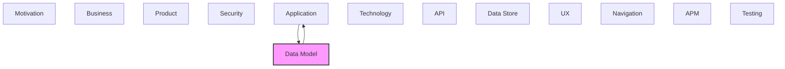

# Data Model

[← Back to README](../README.md)

Data entities, relationships, and data structure definitions.

## Report Index

- [Layer Introduction](#layer-introduction)
- [Intra-Layer Relationships](#intra-layer-relationships)
- [Inter-Layer Dependencies](#inter-layer-dependencies)
- [Inter-Layer Relationships Table](#inter-layer-relationships-table)
- [Element Reference](#element-reference)

## Layer Introduction

| Metric                    | Count |
| ------------------------- | ----- |
| Elements                  | 35    |
| Intra-Layer Relationships | 25    |
| Inter-Layer Relationships | 37    |
| Inbound Relationships     | 35    |
| Outbound Relationships    | 2     |

**Cross-Layer References**:

- **Upstream layers**: [Application](./05-application-layer-report.md)
- **Downstream layers**: [Application](./05-application-layer-report.md)

## Intra-Layer Relationships

*This layer has >30 elements. Summary table shown instead of diagram.*

| Element                                                   | Type               | Relationships |
| --------------------------------------------------------- | ------------------ | ------------- |
| `data-model.schemadefinition.build-layered-index-options` | `schemadefinition` | 2             |
| `data-model.schemadefinition.cluster-tree-node`           | `schemadefinition` | 1             |
| `data-model.schemadefinition.clustered-layout-options`    | `schemadefinition` | 2             |
| `data-model.schemadefinition.clustered-layout-result`     | `schemadefinition` | 2             |
| `data-model.schemadefinition.edge-geometry`               | `schemadefinition` | 1             |
| `data-model.schemadefinition.force-layout-options`        | `schemadefinition` | 3             |
| `data-model.schemadefinition.galaxy-layout-edge`          | `schemadefinition` | 2             |
| `data-model.schemadefinition.galaxy-layout-node`          | `schemadefinition` | 2             |
| `data-model.schemadefinition.galaxy-layout-options`       | `schemadefinition` | 1             |
| `data-model.schemadefinition.graph-edge-data-shape`       | `schemadefinition` | 2             |
| `data-model.schemadefinition.graph-layout-state`          | `schemadefinition` | 0             |
| `data-model.schemadefinition.graph-node-data`             | `schemadefinition` | 1             |
| `data-model.schemadefinition.graph-viewport`              | `schemadefinition` | 1             |
| `data-model.schemadefinition.graph-viewport-snapshot`     | `schemadefinition` | 1             |
| `data-model.schemadefinition.hierarchy-edge`              | `schemadefinition` | 3             |
| `data-model.schemadefinition.lane-layout`                 | `schemadefinition` | 1             |
| `data-model.schemadefinition.layer-def`                   | `schemadefinition` | 1             |
| `data-model.schemadefinition.layered-graph-snapshot`      | `schemadefinition` | 1             |
| `data-model.schemadefinition.layered-graph-state`         | `schemadefinition` | 3             |
| `data-model.schemadefinition.layered-index`               | `schemadefinition` | 5             |
| `data-model.schemadefinition.layered-index-issue`         | `schemadefinition` | 1             |
| `data-model.schemadefinition.layout-edge`                 | `schemadefinition` | 1             |
| `data-model.schemadefinition.layout-node`                 | `schemadefinition` | 2             |
| `data-model.schemadefinition.link-filter-state`           | `schemadefinition` | 2             |
| `data-model.schemadefinition.organic-layout-options`      | `schemadefinition` | 0             |
| `data-model.schemadefinition.orthogonal-layout-options`   | `schemadefinition` | 0             |
| `data-model.schemadefinition.otlp-traces-data`            | `schemadefinition` | 0             |
| `data-model.schemadefinition.predicate-catalog`           | `schemadefinition` | 1             |
| `data-model.schemadefinition.radial-tree-layout-result`   | `schemadefinition` | 1             |
| `data-model.schemadefinition.reach-result`                | `schemadefinition` | 1             |
| `data-model.schemadefinition.structural-forest`           | `schemadefinition` | 2             |
| `data-model.schemadefinition.trace`                       | `schemadefinition` | 2             |
| `data-model.schemadefinition.trace-model`                 | `schemadefinition` | 1             |
| `data-model.schemadefinition.trace-span`                  | `schemadefinition` | 1             |
| `data-model.schemadefinition.xray-segment`                | `schemadefinition` | 0             |

## Inter-Layer Dependencies

## Inter-Layer Relationships Table

| Relationship ID                                                         | Source Node                                                            | Dest Node                                               | Dest Layer    | Predicate  | Cardinality  | Strength |
| ----------------------------------------------------------------------- | ---------------------------------------------------------------------- | ------------------------------------------------------- | ------------- | ---------- | ------------ | -------- |
| `application.applicationcomponent.accesses.data-model.schemadefinition` | `application.applicationcomponent.graph-canvas-component`              | `data-model.schemadefinition.edge-geometry`             | `data-model`  | `accesses` | many-to-many | medium   |
| `application.applicationcomponent.accesses.data-model.schemadefinition` | `application.applicationcomponent.graph-canvas-component`              | `data-model.schemadefinition.graph-edge-data-shape`     | `data-model`  | `accesses` | many-to-many | medium   |
| `application.applicationcomponent.accesses.data-model.schemadefinition` | `application.applicationcomponent.graph-canvas-component`              | `data-model.schemadefinition.graph-layout-state`        | `data-model`  | `accesses` | many-to-many | medium   |
| `application.applicationcomponent.accesses.data-model.schemadefinition` | `application.applicationcomponent.graph-canvas-component`              | `data-model.schemadefinition.graph-node-data`           | `data-model`  | `accesses` | many-to-many | medium   |
| `application.applicationcomponent.accesses.data-model.schemadefinition` | `application.applicationcomponent.graph-canvas-component`              | `data-model.schemadefinition.graph-viewport`            | `data-model`  | `accesses` | many-to-many | medium   |
| `application.applicationcomponent.accesses.data-model.schemadefinition` | `application.applicationcomponent.graph-canvas-component`              | `data-model.schemadefinition.graph-viewport-snapshot`   | `data-model`  | `accesses` | many-to-many | medium   |
| `application.applicationcomponent.accesses.data-model.schemadefinition` | `application.applicationcomponent.graph-canvas-component`              | `data-model.schemadefinition.lane-layout`               | `data-model`  | `accesses` | many-to-many | medium   |
| `application.applicationcomponent.accesses.data-model.schemadefinition` | `application.applicationcomponent.graph-canvas-component`              | `data-model.schemadefinition.layered-graph-state`       | `data-model`  | `accesses` | many-to-many | medium   |
| `application.applicationevent.accesses.data-model.schemadefinition`     | `application.applicationevent.layout-state-change-event`               | `data-model.schemadefinition.graph-layout-state`        | `data-model`  | `accesses` | many-to-many | medium   |
| `application.applicationevent.accesses.data-model.schemadefinition`     | `application.applicationevent.viewport-dwell-event`                    | `data-model.schemadefinition.graph-viewport-snapshot`   | `data-model`  | `accesses` | many-to-many | medium   |
| `application.applicationevent.accesses.data-model.schemadefinition`     | `application.applicationevent.viewport-navigate-event`                 | `data-model.schemadefinition.graph-viewport-snapshot`   | `data-model`  | `accesses` | many-to-many | medium   |
| `application.applicationfunction.accesses.data-model.schemadefinition`  | `application.applicationfunction.cluster-circle-packing`               | `data-model.schemadefinition.cluster-tree-node`         | `data-model`  | `accesses` | many-to-many | medium   |
| `application.applicationfunction.accesses.data-model.schemadefinition`  | `application.applicationfunction.clustered-force-layout-algorithm`     | `data-model.schemadefinition.clustered-layout-options`  | `data-model`  | `accesses` | many-to-many | medium   |
| `application.applicationfunction.accesses.data-model.schemadefinition`  | `application.applicationfunction.clustered-force-layout-algorithm`     | `data-model.schemadefinition.clustered-layout-result`   | `data-model`  | `accesses` | many-to-many | medium   |
| `application.applicationfunction.accesses.data-model.schemadefinition`  | `application.applicationfunction.force-directed-layout-algorithm`      | `data-model.schemadefinition.force-layout-options`      | `data-model`  | `accesses` | many-to-many | medium   |
| `application.applicationfunction.accesses.data-model.schemadefinition`  | `application.applicationfunction.force-directed-layout-algorithm`      | `data-model.schemadefinition.layout-edge`               | `data-model`  | `accesses` | many-to-many | medium   |
| `application.applicationfunction.accesses.data-model.schemadefinition`  | `application.applicationfunction.force-directed-layout-algorithm`      | `data-model.schemadefinition.layout-node`               | `data-model`  | `accesses` | many-to-many | medium   |
| `application.applicationfunction.accesses.data-model.schemadefinition`  | `application.applicationfunction.galaxy-aspect-ratio-resolution`       | `data-model.schemadefinition.galaxy-layout-edge`        | `data-model`  | `accesses` | many-to-many | medium   |
| `application.applicationfunction.accesses.data-model.schemadefinition`  | `application.applicationfunction.galaxy-aspect-ratio-resolution`       | `data-model.schemadefinition.galaxy-layout-node`        | `data-model`  | `accesses` | many-to-many | medium   |
| `application.applicationfunction.accesses.data-model.schemadefinition`  | `application.applicationfunction.galaxy-aspect-ratio-resolution`       | `data-model.schemadefinition.galaxy-layout-options`     | `data-model`  | `accesses` | many-to-many | medium   |
| `application.applicationfunction.accesses.data-model.schemadefinition`  | `application.applicationfunction.galaxy-live-simulation-step`          | `data-model.schemadefinition.galaxy-layout-edge`        | `data-model`  | `accesses` | many-to-many | medium   |
| `application.applicationfunction.accesses.data-model.schemadefinition`  | `application.applicationfunction.galaxy-live-simulation-step`          | `data-model.schemadefinition.galaxy-layout-node`        | `data-model`  | `accesses` | many-to-many | medium   |
| `application.applicationfunction.accesses.data-model.schemadefinition`  | `application.applicationfunction.galaxy-live-simulation-step`          | `data-model.schemadefinition.galaxy-layout-options`     | `data-model`  | `accesses` | many-to-many | medium   |
| `application.applicationfunction.accesses.data-model.schemadefinition`  | `application.applicationfunction.galaxy-radial-orbit-layout-algorithm` | `data-model.schemadefinition.galaxy-layout-edge`        | `data-model`  | `accesses` | many-to-many | medium   |
| `application.applicationfunction.accesses.data-model.schemadefinition`  | `application.applicationfunction.galaxy-radial-orbit-layout-algorithm` | `data-model.schemadefinition.galaxy-layout-node`        | `data-model`  | `accesses` | many-to-many | medium   |
| `application.applicationfunction.accesses.data-model.schemadefinition`  | `application.applicationfunction.galaxy-radial-orbit-layout-algorithm` | `data-model.schemadefinition.galaxy-layout-options`     | `data-model`  | `accesses` | many-to-many | medium   |
| `application.applicationfunction.accesses.data-model.schemadefinition`  | `application.applicationfunction.louvain-community-clustering`         | `data-model.schemadefinition.cluster-tree-node`         | `data-model`  | `accesses` | many-to-many | medium   |
| `application.applicationfunction.accesses.data-model.schemadefinition`  | `application.applicationfunction.node-overlap-separation-pass`         | `data-model.schemadefinition.layout-node`               | `data-model`  | `accesses` | many-to-many | medium   |
| `application.applicationfunction.accesses.data-model.schemadefinition`  | `application.applicationfunction.organic-layout-algorithm`             | `data-model.schemadefinition.organic-layout-options`    | `data-model`  | `accesses` | many-to-many | medium   |
| `application.applicationfunction.accesses.data-model.schemadefinition`  | `application.applicationfunction.orthogonal-layout-algorithm`          | `data-model.schemadefinition.orthogonal-layout-options` | `data-model`  | `accesses` | many-to-many | medium   |
| `application.applicationfunction.accesses.data-model.schemadefinition`  | `application.applicationfunction.otlp-trace-adapter`                   | `data-model.schemadefinition.otlp-traces-data`          | `data-model`  | `accesses` | many-to-many | medium   |
| `application.applicationfunction.accesses.data-model.schemadefinition`  | `application.applicationfunction.radial-tree-layout-algorithm`         | `data-model.schemadefinition.radial-tree-layout-result` | `data-model`  | `accesses` | many-to-many | medium   |
| `application.applicationfunction.accesses.data-model.schemadefinition`  | `application.applicationfunction.structural-forest-construction`       | `data-model.schemadefinition.hierarchy-edge`            | `data-model`  | `accesses` | many-to-many | medium   |
| `application.applicationfunction.accesses.data-model.schemadefinition`  | `application.applicationfunction.structural-forest-construction`       | `data-model.schemadefinition.structural-forest`         | `data-model`  | `accesses` | many-to-many | medium   |
| `application.applicationfunction.accesses.data-model.schemadefinition`  | `application.applicationfunction.x-ray-trace-adapter`                  | `data-model.schemadefinition.xray-segment`              | `data-model`  | `accesses` | many-to-many | medium   |
| `data-model.schemadefinition.realizes.application.dataobject`           | `data-model.schemadefinition.graph-node-data`                          | `application.dataobject.node-rect-registry`             | `application` | `realizes` | many-to-many | medium   |
| `data-model.schemadefinition.realizes.application.dataobject`           | `data-model.schemadefinition.layout-node`                              | `application.dataobject.node-position-map`              | `application` | `realizes` | many-to-many | medium   |

## Element Reference

### BuildLayeredIndexOptions {#buildlayeredindexoptions}

**ID**: `data-model.schemadefinition.build-layered-index-options`

**Type**: `schemadefinition`

How to read a layer from each node (attribute name or accessor), multi- and missing-value policies, layer order and the predicate catalog of link categories.

#### Attributes

| Name  | Value                    |
| ----- | ------------------------ |
| title | BuildLayeredIndexOptions |
| type  | object                   |

#### Relationships

| Type        | Related Element                                 | Predicate  | Direction |
| ----------- | ----------------------------------------------- | ---------- | --------- |
| intra-layer | `data-model.schemadefinition.layer-def`         | `composes` | outbound  |
| intra-layer | `data-model.schemadefinition.predicate-catalog` | `composes` | outbound  |

### ClusterTreeNode {#clustertreenode}

**ID**: `data-model.schemadefinition.cluster-tree-node`

**Type**: `schemadefinition`

d3-hierarchy-compatible dendrogram node produced by louvainCluster: leaves are real node ids, internal nodes are synthetic cluster ids with children.

#### Attributes

| Name  | Value           |
| ----- | --------------- |
| title | ClusterTreeNode |
| type  | object          |

#### Relationships

| Type        | Related Element                                                | Predicate    | Direction |
| ----------- | -------------------------------------------------------------- | ------------ | --------- |
| inter-layer | `application.applicationfunction.cluster-circle-packing`       | `accesses`   | inbound   |
| inter-layer | `application.applicationfunction.louvain-community-clustering` | `accesses`   | inbound   |
| intra-layer | `data-model.schemadefinition.clustered-layout-result`          | `references` | outbound  |

### ClusteredLayoutOptions {#clusteredlayoutoptions}

**ID**: `data-model.schemadefinition.clustered-layout-options`

**Type**: `schemadefinition`

Extends ForceLayoutOptions with clusterPadding and macro-pass overrides for clusteredForceLayout's cluster-to-cluster force pass.

#### Attributes

| Name  | Value                  |
| ----- | ---------------------- |
| title | ClusteredLayoutOptions |
| type  | object                 |

#### Relationships

| Type        | Related Element                                                    | Predicate     | Direction |
| ----------- | ------------------------------------------------------------------ | ------------- | --------- |
| inter-layer | `application.applicationfunction.clustered-force-layout-algorithm` | `accesses`    | inbound   |
| intra-layer | `data-model.schemadefinition.force-layout-options`                 | `references`  | outbound  |
| intra-layer | `data-model.schemadefinition.force-layout-options`                 | `specializes` | outbound  |

### ClusteredLayoutResult {#clusteredlayoutresult}

**ID**: `data-model.schemadefinition.clustered-layout-result`

**Type**: `schemadefinition`

Return shape of clusteredForceLayout: final node positions plus an approximate bounding circle per top-level Louvain cluster.

#### Attributes

| Name  | Value                 |
| ----- | --------------------- |
| title | ClusteredLayoutResult |
| type  | object                |

#### Relationships

| Type        | Related Element                                                    | Predicate    | Direction |
| ----------- | ------------------------------------------------------------------ | ------------ | --------- |
| inter-layer | `application.applicationfunction.clustered-force-layout-algorithm` | `accesses`   | inbound   |
| intra-layer | `data-model.schemadefinition.cluster-tree-node`                    | `references` | inbound   |
| intra-layer | `data-model.schemadefinition.layout-node`                          | `references` | outbound  |

### EdgeGeometry {#edgegeometry}

**ID**: `data-model.schemadefinition.edge-geometry`

**Type**: `schemadefinition`

Computed rendering geometry passed to a custom renderEdge callback: SVG path string, curve midpoint, collision-cleared label position, tangent angle, selected/hovered state.

#### Attributes

| Name  | Value        |
| ----- | ------------ |
| title | EdgeGeometry |
| type  | object       |

#### Relationships

| Type        | Related Element                                           | Predicate    | Direction |
| ----------- | --------------------------------------------------------- | ------------ | --------- |
| inter-layer | `application.applicationcomponent.graph-canvas-component` | `accesses`   | inbound   |
| intra-layer | `data-model.schemadefinition.graph-edge-data-shape`       | `references` | inbound   |

### ForceLayoutOptions {#forcelayoutoptions}

**ID**: `data-model.schemadefinition.force-layout-options`

**Type**: `schemadefinition`

Tuning parameters for forceLayout: iterations, springLength/Strength, repulsion, damping, centerStrength, collisionStrength, nodeMargin.

#### Attributes

| Name  | Value              |
| ----- | ------------------ |
| title | ForceLayoutOptions |
| type  | object             |

#### Relationships

| Type        | Related Element                                                   | Predicate     | Direction |
| ----------- | ----------------------------------------------------------------- | ------------- | --------- |
| inter-layer | `application.applicationfunction.force-directed-layout-algorithm` | `accesses`    | inbound   |
| intra-layer | `data-model.schemadefinition.clustered-layout-options`            | `references`  | inbound   |
| intra-layer | `data-model.schemadefinition.clustered-layout-options`            | `specializes` | inbound   |
| intra-layer | `data-model.schemadefinition.layout-node`                         | `references`  | outbound  |

### GalaxyLayoutEdge {#galaxylayoutedge}

**ID**: `data-model.schemadefinition.galaxy-layout-edge`

**Type**: `schemadefinition`

Extends HierarchyEdge with a structural flag distinguishing orbit-defining edges from layout-irrelevant relational edges.

#### Attributes

| Name  | Value            |
| ----- | ---------------- |
| title | GalaxyLayoutEdge |
| type  | object           |

#### Relationships

| Type        | Related Element                                                        | Predicate     | Direction |
| ----------- | ---------------------------------------------------------------------- | ------------- | --------- |
| inter-layer | `application.applicationfunction.galaxy-aspect-ratio-resolution`       | `accesses`    | inbound   |
| inter-layer | `application.applicationfunction.galaxy-live-simulation-step`          | `accesses`    | inbound   |
| inter-layer | `application.applicationfunction.galaxy-radial-orbit-layout-algorithm` | `accesses`    | inbound   |
| intra-layer | `data-model.schemadefinition.galaxy-layout-node`                       | `references`  | outbound  |
| intra-layer | `data-model.schemadefinition.hierarchy-edge`                           | `specializes` | outbound  |

### GalaxyLayoutNode {#galaxylayoutnode}

**ID**: `data-model.schemadefinition.galaxy-layout-node`

**Type**: `schemadefinition`

Node shape for galaxyLayout/galaxySimulationStep: id, width/height, optional explicit x/y and pinned (cascades to the whole structural subtree).

#### Attributes

| Name  | Value            |
| ----- | ---------------- |
| title | GalaxyLayoutNode |
| type  | object           |

#### Relationships

| Type        | Related Element                                                        | Predicate    | Direction |
| ----------- | ---------------------------------------------------------------------- | ------------ | --------- |
| inter-layer | `application.applicationfunction.galaxy-aspect-ratio-resolution`       | `accesses`   | inbound   |
| inter-layer | `application.applicationfunction.galaxy-live-simulation-step`          | `accesses`   | inbound   |
| inter-layer | `application.applicationfunction.galaxy-radial-orbit-layout-algorithm` | `accesses`   | inbound   |
| intra-layer | `data-model.schemadefinition.galaxy-layout-edge`                       | `references` | inbound   |
| intra-layer | `data-model.schemadefinition.galaxy-layout-options`                    | `references` | outbound  |

### GalaxyLayoutOptions {#galaxylayoutoptions}

**ID**: `data-model.schemadefinition.galaxy-layout-options`

**Type**: `schemadefinition`

Tuning parameters for galaxyLayout: nodeSpread, startAngle, settleCycles, homeStrength, nodeMargin, separateGroups, aspectRatio, resolvedAspectScale.

#### Attributes

| Name  | Value               |
| ----- | ------------------- |
| title | GalaxyLayoutOptions |
| type  | object              |

#### Relationships

| Type        | Related Element                                                        | Predicate    | Direction |
| ----------- | ---------------------------------------------------------------------- | ------------ | --------- |
| inter-layer | `application.applicationfunction.galaxy-aspect-ratio-resolution`       | `accesses`   | inbound   |
| inter-layer | `application.applicationfunction.galaxy-live-simulation-step`          | `accesses`   | inbound   |
| inter-layer | `application.applicationfunction.galaxy-radial-orbit-layout-algorithm` | `accesses`   | inbound   |
| intra-layer | `data-model.schemadefinition.galaxy-layout-node`                       | `references` | inbound   |

### GraphEdge (data shape) {#graphedge-data-shape}

**ID**: `data-model.schemadefinition.graph-edge-data-shape`

**Type**: `schemadefinition`

Public data shape for a graph edge: id/sourceId/targetId plus optional label, variant, weight (0-100, mapped to stroke width), opacity, strokeDash, per-endpoint anchor, and curvature.

#### Attributes

| Name  | Value     |
| ----- | --------- |
| title | GraphEdge |
| type  | object    |

#### Relationships

| Type        | Related Element                                           | Predicate    | Direction |
| ----------- | --------------------------------------------------------- | ------------ | --------- |
| inter-layer | `application.applicationcomponent.graph-canvas-component` | `accesses`   | inbound   |
| intra-layer | `data-model.schemadefinition.edge-geometry`               | `references` | outbound  |
| intra-layer | `data-model.schemadefinition.layered-index`               | `references` | inbound   |

### GraphLayoutState {#graphlayoutstate}

**ID**: `data-model.schemadefinition.graph-layout-state`

**Type**: `schemadefinition`

idle \| computing \| simulating: whether GraphCanvas is waiting on a layout engine, reported by onLayoutStateChange and shown by the layout indicator.

#### Attributes

| Name  | Value                         |
| ----- | ----------------------------- |
| enum  | [idle, computing, simulating] |
| title | GraphLayoutState              |
| type  | string                        |

#### Relationships

| Type        | Related Element                                           | Predicate  | Direction |
| ----------- | --------------------------------------------------------- | ---------- | --------- |
| inter-layer | `application.applicationcomponent.graph-canvas-component` | `accesses` | inbound   |
| inter-layer | `application.applicationevent.layout-state-change-event`  | `accesses` | inbound   |

### GraphNodeData {#graphnodedata}

**ID**: `data-model.schemadefinition.graph-node-data`

**Type**: `schemadefinition`

Public data shape for a graph node passed to GraphCanvas: id, label, optional kind/domainColor, optional explicit x/y (pins the node under any engine layout).

#### Attributes

| Name  | Value         |
| ----- | ------------- |
| title | GraphNodeData |
| type  | object        |

#### Relationships

| Type        | Related Element                                           | Predicate    | Direction |
| ----------- | --------------------------------------------------------- | ------------ | --------- |
| inter-layer | `application.applicationcomponent.graph-canvas-component` | `accesses`   | inbound   |
| inter-layer | `application.dataobject.node-rect-registry`               | `realizes`   | outbound  |
| intra-layer | `data-model.schemadefinition.layered-index`               | `references` | inbound   |

### GraphViewport {#graphviewport}

**ID**: `data-model.schemadefinition.graph-viewport`

**Type**: `schemadefinition`

A GraphCanvas viewport (pan x/y and zoom) a caller can restore through initialViewport or read and set through the GraphViewportHandle ref.

#### Attributes

| Name  | Value         |
| ----- | ------------- |
| title | GraphViewport |
| type  | object        |

#### Relationships

| Type        | Related Element                                           | Predicate  | Direction |
| ----------- | --------------------------------------------------------- | ---------- | --------- |
| inter-layer | `application.applicationcomponent.graph-canvas-component` | `accesses` | inbound   |
| intra-layer | `data-model.schemadefinition.graph-viewport-snapshot`     | `composes` | inbound   |

### GraphViewportSnapshot {#graphviewportsnapshot}

**ID**: `data-model.schemadefinition.graph-viewport-snapshot`

**Type**: `schemadefinition`

Viewport plus selection and the cause of the change (GraphViewportCause), passed to onViewportDwell and onViewportNavigate so a caller can keep back/forward history.

#### Attributes

| Name  | Value                 |
| ----- | --------------------- |
| title | GraphViewportSnapshot |
| type  | object                |

#### Relationships

| Type        | Related Element                                           | Predicate  | Direction |
| ----------- | --------------------------------------------------------- | ---------- | --------- |
| inter-layer | `application.applicationcomponent.graph-canvas-component` | `accesses` | inbound   |
| inter-layer | `application.applicationevent.viewport-dwell-event`       | `accesses` | inbound   |
| inter-layer | `application.applicationevent.viewport-navigate-event`    | `accesses` | inbound   |
| intra-layer | `data-model.schemadefinition.graph-viewport`              | `composes` | outbound  |

### HierarchyEdge {#hierarchyedge}

**ID**: `data-model.schemadefinition.hierarchy-edge`

**Type**: `schemadefinition`

Shared structural-edge shape (source=parent, target=child, structural flag) consumed by buildStructuralForest and reused by galaxyLayout/radialTreeLayout/uxNavLayout.

#### Attributes

| Name  | Value         |
| ----- | ------------- |
| title | HierarchyEdge |
| type  | object        |

#### Relationships

| Type        | Related Element                                                  | Predicate     | Direction |
| ----------- | ---------------------------------------------------------------- | ------------- | --------- |
| inter-layer | `application.applicationfunction.structural-forest-construction` | `accesses`    | inbound   |
| intra-layer | `data-model.schemadefinition.galaxy-layout-edge`                 | `specializes` | inbound   |
| intra-layer | `data-model.schemadefinition.layout-edge`                        | `references`  | inbound   |
| intra-layer | `data-model.schemadefinition.structural-forest`                  | `references`  | inbound   |

### LaneLayout {#lanelayout}

**ID**: `data-model.schemadefinition.lane-layout`

**Type**: `schemadefinition`

Output of layoutLanes: lane bands and node boxes for the swimlane view (orientation, label policy) used by GraphCanvas layout layer-lanes.

#### Attributes

| Name  | Value      |
| ----- | ---------- |
| title | LaneLayout |
| type  | object     |

#### Relationships

| Type        | Related Element                                           | Predicate    | Direction |
| ----------- | --------------------------------------------------------- | ------------ | --------- |
| inter-layer | `application.applicationcomponent.graph-canvas-component` | `accesses`   | inbound   |
| intra-layer | `data-model.schemadefinition.layered-index`               | `references` | outbound  |

### LayerDef {#layerdef}

**ID**: `data-model.schemadefinition.layer-def`

**Type**: `schemadefinition`

One layer of a layered graph: id, label, order and optional color; supplied through BuildLayeredIndexOptions or derived from node attribute values.

#### Attributes

| Name  | Value    |
| ----- | -------- |
| title | LayerDef |
| type  | object   |

#### Relationships

| Type        | Related Element                                           | Predicate  | Direction |
| ----------- | --------------------------------------------------------- | ---------- | --------- |
| intra-layer | `data-model.schemadefinition.build-layered-index-options` | `composes` | inbound   |

### LayeredGraphSnapshot {#layeredgraphsnapshot}

**ID**: `data-model.schemadefinition.layered-graph-snapshot`

**Type**: `schemadefinition`

The serializable view state of a layered graph (selection, follow mode, filters, label mode, plane layout, camera). Consumers persist it (URL, storage) and restore it through sanitizeLayeredGraphSnapshot, which drops ids the current graph no longer has.

#### Attributes

| Name  | Value                |
| ----- | -------------------- |
| title | LayeredGraphSnapshot |
| type  | object               |

#### Relationships

| Type        | Related Element                                 | Predicate  | Direction |
| ----------- | ----------------------------------------------- | ---------- | --------- |
| intra-layer | `data-model.schemadefinition.link-filter-state` | `composes` | outbound  |

### LayeredGraphState {#layeredgraphstate}

**ID**: `data-model.schemadefinition.layered-graph-state`

**Type**: `schemadefinition`

Return value of useLayeredGraph, shared through LayeredGraphContext: the index, current filters, selection, reach, camera, async layout state and setters.

#### Attributes

| Name  | Value             |
| ----- | ----------------- |
| title | LayeredGraphState |
| type  | object            |

#### Relationships

| Type        | Related Element                                           | Predicate  | Direction |
| ----------- | --------------------------------------------------------- | ---------- | --------- |
| inter-layer | `application.applicationcomponent.graph-canvas-component` | `accesses` | inbound   |
| intra-layer | `data-model.schemadefinition.layered-index`               | `composes` | outbound  |
| intra-layer | `data-model.schemadefinition.link-filter-state`           | `composes` | outbound  |
| intra-layer | `data-model.schemadefinition.reach-result`                | `composes` | outbound  |

### LayeredIndex {#layeredindex}

**ID**: `data-model.schemadefinition.layered-index`

**Type**: `schemadefinition`

Output of buildLayeredIndex: indexed layers, nodes, links, adjacency, layer-pair summaries and the issues found (missing layer value, dangling edge, self loop, ...). The shared read model behind LayerStack, lanes, matrix and hive views.

#### Attributes

| Name  | Value        |
| ----- | ------------ |
| title | LayeredIndex |
| type  | object       |

#### Relationships

| Type        | Related Element                                     | Predicate    | Direction |
| ----------- | --------------------------------------------------- | ------------ | --------- |
| intra-layer | `data-model.schemadefinition.lane-layout`           | `references` | inbound   |
| intra-layer | `data-model.schemadefinition.layered-graph-state`   | `composes`   | inbound   |
| intra-layer | `data-model.schemadefinition.layered-index-issue`   | `composes`   | outbound  |
| intra-layer | `data-model.schemadefinition.graph-edge-data-shape` | `references` | outbound  |
| intra-layer | `data-model.schemadefinition.graph-node-data`       | `references` | outbound  |

### LayeredIndexIssue {#layeredindexissue}

**ID**: `data-model.schemadefinition.layered-index-issue`

**Type**: `schemadefinition`

A data problem buildLayeredIndex found and skipped instead of throwing: missing-layer-value, multi-value-excluded, dangling-edge, self-loop, duplicate.

#### Attributes

| Name  | Value             |
| ----- | ----------------- |
| title | LayeredIndexIssue |
| type  | object            |

#### Relationships

| Type        | Related Element                             | Predicate  | Direction |
| ----------- | ------------------------------------------- | ---------- | --------- |
| intra-layer | `data-model.schemadefinition.layered-index` | `composes` | inbound   |

### LayoutEdge {#layoutedge}

**ID**: `data-model.schemadefinition.layout-edge`

**Type**: `schemadefinition`

Internal layout-engine edge shape: source/target node ids, used by forceLayout's spring-force pass.

#### Attributes

| Name  | Value      |
| ----- | ---------- |
| title | LayoutEdge |
| type  | object     |

#### Relationships

| Type        | Related Element                                                   | Predicate    | Direction |
| ----------- | ----------------------------------------------------------------- | ------------ | --------- |
| inter-layer | `application.applicationfunction.force-directed-layout-algorithm` | `accesses`   | inbound   |
| intra-layer | `data-model.schemadefinition.hierarchy-edge`                      | `references` | outbound  |

### LayoutNode {#layoutnode}

**ID**: `data-model.schemadefinition.layout-node`

**Type**: `schemadefinition`

Internal layout-engine node shape shared by forceLayout/clusteredForceLayout/separationPass: id, x/y, width/height, optional pinned, gravityTarget, gravityStrength.

#### Attributes

| Name  | Value      |
| ----- | ---------- |
| title | LayoutNode |
| type  | object     |

#### Relationships

| Type        | Related Element                                                   | Predicate    | Direction |
| ----------- | ----------------------------------------------------------------- | ------------ | --------- |
| inter-layer | `application.applicationfunction.force-directed-layout-algorithm` | `accesses`   | inbound   |
| inter-layer | `application.applicationfunction.node-overlap-separation-pass`    | `accesses`   | inbound   |
| inter-layer | `application.dataobject.node-position-map`                        | `realizes`   | outbound  |
| intra-layer | `data-model.schemadefinition.clustered-layout-result`             | `references` | inbound   |
| intra-layer | `data-model.schemadefinition.force-layout-options`                | `references` | inbound   |

### LinkFilterState {#linkfilterstate}

**ID**: `data-model.schemadefinition.link-filter-state`

**Type**: `schemadefinition`

Which link categories, predicates and layer pairs are shown; DEFAULT_LINK_FILTERS is its initial value.

#### Attributes

| Name  | Value           |
| ----- | --------------- |
| title | LinkFilterState |
| type  | object          |

#### Relationships

| Type        | Related Element                                      | Predicate  | Direction |
| ----------- | ---------------------------------------------------- | ---------- | --------- |
| intra-layer | `data-model.schemadefinition.layered-graph-snapshot` | `composes` | inbound   |
| intra-layer | `data-model.schemadefinition.layered-graph-state`    | `composes` | inbound   |

### OrganicLayoutOptions {#organiclayoutoptions}

**ID**: `data-model.schemadefinition.organic-layout-options`

**Type**: `schemadefinition`

Tuning for organicLayout (stress majorization with a hard minimum node gap); its result carries positions and OrganicLayoutStats.

#### Attributes

| Name  | Value                |
| ----- | -------------------- |
| title | OrganicLayoutOptions |
| type  | object               |

#### Relationships

| Type        | Related Element                                            | Predicate  | Direction |
| ----------- | ---------------------------------------------------------- | ---------- | --------- |
| inter-layer | `application.applicationfunction.organic-layout-algorithm` | `accesses` | inbound   |

### OrthogonalLayoutOptions {#orthogonallayoutoptions}

**ID**: `data-model.schemadefinition.orthogonal-layout-options`

**Type**: `schemadefinition`

Tuning for orthogonalLayout (grid cells layered from a BFS spanning tree, orthogonal routes); its result carries positions, routes and OrthogonalLayoutStats.

#### Attributes

| Name  | Value                   |
| ----- | ----------------------- |
| title | OrthogonalLayoutOptions |
| type  | object                  |

#### Relationships

| Type        | Related Element                                               | Predicate  | Direction |
| ----------- | ------------------------------------------------------------- | ---------- | --------- |
| inter-layer | `application.applicationfunction.orthogonal-layout-algorithm` | `accesses` | inbound   |

### OtlpTracesData {#otlptracesdata}

**ID**: `data-model.schemadefinition.otlp-traces-data`

**Type**: `schemadefinition`

OpenTelemetry OTLP/JSON trace export (resourceSpans &gt; scopeSpans &gt; spans with key-value attributes), the input of fromOTLP.

#### Attributes

| Name  | Value          |
| ----- | -------------- |
| title | OtlpTracesData |
| type  | object         |

#### Relationships

| Type        | Related Element                                      | Predicate  | Direction |
| ----------- | ---------------------------------------------------- | ---------- | --------- |
| inter-layer | `application.applicationfunction.otlp-trace-adapter` | `accesses` | inbound   |

### PredicateCatalog {#predicatecatalog}

**ID**: `data-model.schemadefinition.predicate-catalog`

**Type**: `schemadefinition`

Map from edge predicate to LinkCategoryInfo (category, label, direction): drives link coloring, category filters and predicate labels in every layered view.

#### Attributes

| Name  | Value            |
| ----- | ---------------- |
| title | PredicateCatalog |
| type  | object           |

#### Relationships

| Type        | Related Element                                           | Predicate  | Direction |
| ----------- | --------------------------------------------------------- | ---------- | --------- |
| intra-layer | `data-model.schemadefinition.build-layered-index-options` | `composes` | inbound   |

### RadialTreeLayoutResult {#radialtreelayoutresult}

**ID**: `data-model.schemadefinition.radial-tree-layout-result`

**Type**: `schemadefinition`

Return shape of radialTreeLayout: node positions, per-trunk boundary circles, and ring geometry for the optional depth-ring visualization.

#### Attributes

| Name  | Value                  |
| ----- | ---------------------- |
| title | RadialTreeLayoutResult |
| type  | object                 |

#### Relationships

| Type        | Related Element                                                | Predicate    | Direction |
| ----------- | -------------------------------------------------------------- | ------------ | --------- |
| inter-layer | `application.applicationfunction.radial-tree-layout-algorithm` | `accesses`   | inbound   |
| intra-layer | `data-model.schemadefinition.structural-forest`                | `references` | outbound  |

### ReachResult {#reachresult}

**ID**: `data-model.schemadefinition.reach-result`

**Type**: `schemadefinition`

Nodes and links reachable from the selection with the hop at which each was reached and the link it came through (ReachVia).

#### Attributes

| Name  | Value       |
| ----- | ----------- |
| title | ReachResult |
| type  | object      |

#### Relationships

| Type        | Related Element                                   | Predicate  | Direction |
| ----------- | ------------------------------------------------- | ---------- | --------- |
| intra-layer | `data-model.schemadefinition.layered-graph-state` | `composes` | inbound   |

### StructuralForest {#structuralforest}

**ID**: `data-model.schemadefinition.structural-forest`

**Type**: `schemadefinition`

Output of buildStructuralForest: parentOf map, childrenOf map, and roots array describing the parent/child forest derived from structural edges.

#### Attributes

| Name  | Value            |
| ----- | ---------------- |
| title | StructuralForest |
| type  | object           |

#### Relationships

| Type        | Related Element                                                  | Predicate    | Direction |
| ----------- | ---------------------------------------------------------------- | ------------ | --------- |
| inter-layer | `application.applicationfunction.structural-forest-construction` | `accesses`   | inbound   |
| intra-layer | `data-model.schemadefinition.radial-tree-layout-result`          | `references` | inbound   |
| intra-layer | `data-model.schemadefinition.hierarchy-edge`                     | `references` | outbound  |

### Trace {#trace}

**ID**: `data-model.schemadefinition.trace`

**Type**: `schemadefinition`

Format-neutral trace TraceViewer renders: TraceMeta, TraceSpan list (id, parent, service, kind, status, start/duration, attributes, events) and ServiceInfo. fromOTLP and fromXRay produce it.

#### Attributes

| Name  | Value  |
| ----- | ------ |
| title | Trace  |
| type  | object |

#### Relationships

| Type        | Related Element                           | Predicate    | Direction |
| ----------- | ----------------------------------------- | ------------ | --------- |
| intra-layer | `data-model.schemadefinition.trace-span`  | `composes`   | outbound  |
| intra-layer | `data-model.schemadefinition.trace-model` | `references` | inbound   |

### TraceModel {#tracemodel}

**ID**: `data-model.schemadefinition.trace-model`

**Type**: `schemadefinition`

Output of buildTraceModel: the span tree (TraceModelNode with depth and self time), time bounds and services, from which TraceViewer derives visible rows and its time scale.

#### Attributes

| Name  | Value      |
| ----- | ---------- |
| title | TraceModel |
| type  | object     |

#### Relationships

| Type        | Related Element                     | Predicate    | Direction |
| ----------- | ----------------------------------- | ------------ | --------- |
| intra-layer | `data-model.schemadefinition.trace` | `references` | outbound  |

### TraceSpan {#tracespan}

**ID**: `data-model.schemadefinition.trace-span`

**Type**: `schemadefinition`

One span of a Trace: ids, service, name, SpanKind, SpanStatus (ok/warn/error), timing, attributes and SpanEvents.

#### Attributes

| Name  | Value     |
| ----- | --------- |
| title | TraceSpan |
| type  | object    |

#### Relationships

| Type        | Related Element                     | Predicate  | Direction |
| ----------- | ----------------------------------- | ---------- | --------- |
| intra-layer | `data-model.schemadefinition.trace` | `composes` | inbound   |

### XRaySegment {#xraysegment}

**ID**: `data-model.schemadefinition.xray-segment`

**Type**: `schemadefinition`

AWS X-Ray segment document with nested subsegments, http, sql, cause and exception blocks, the input of fromXRay.

#### Attributes

| Name  | Value       |
| ----- | ----------- |
| title | XRaySegment |
| type  | object      |

#### Relationships

| Type        | Related Element                                       | Predicate  | Direction |
| ----------- | ----------------------------------------------------- | ---------- | --------- |
| inter-layer | `application.applicationfunction.x-ray-trace-adapter` | `accesses` | inbound   |

---

Generated: 2026-11-24T15:11:54.119Z | Model Version: 0.1.0
