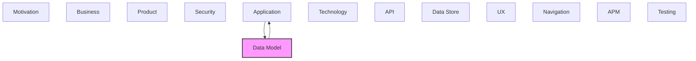

# Data Model

[← Back to README](../README.md)

Data entities, relationships, and data structure definitions.

## Report Index

- [Layer Introduction](#layer-introduction)
- [Intra-Layer Relationships](#intra-layer-relationships)
- [Inter-Layer Dependencies](#inter-layer-dependencies)
- [Inter-Layer Relationships Table](#inter-layer-relationships-table)
- [Element Reference](#element-reference)

## Layer Introduction

| Metric                    | Count |
| ------------------------- | ----- |
| Elements                  | 24    |
| Intra-Layer Relationships | 17    |
| Inter-Layer Relationships | 14    |
| Inbound Relationships     | 10    |
| Outbound Relationships    | 4     |

**Cross-Layer References**:

- **Upstream layers**: [Application](./05-application-layer-report.md)
- **Downstream layers**: [Application](./05-application-layer-report.md)

## Intra-Layer Relationships

```mermaid
flowchart LR
  subgraph data_model
    data_model_schemadefinition_cluster_tree_node["ClusterTreeNode"]
    data_model_schemadefinition_clustered_layout_options["ClusteredLayoutOptions"]
    data_model_schemadefinition_clustered_layout_result["ClusteredLayoutResult"]
    data_model_schemadefinition_edge_geometry["EdgeGeometry"]
    data_model_schemadefinition_force_layout_options["ForceLayoutOptions"]
    data_model_schemadefinition_galaxy_layout_edge["GalaxyLayoutEdge"]
    data_model_schemadefinition_galaxy_layout_node["GalaxyLayoutNode"]
    data_model_schemadefinition_galaxy_layout_options["GalaxyLayoutOptions"]
    data_model_schemadefinition_graph_edge_data_shape["GraphEdge (data shape)"]
    data_model_schemadefinition_graph_node_data["GraphNodeData"]
    data_model_schemadefinition_hierarchy_edge["HierarchyEdge"]
    data_model_schemadefinition_layered_graph_snapshot["LayeredGraphSnapshot"]
    data_model_schemadefinition_layered_index["LayeredIndex"]
    data_model_schemadefinition_layout_edge["LayoutEdge"]
    data_model_schemadefinition_layout_node["LayoutNode"]
    data_model_schemadefinition_organic_layout_options["OrganicLayoutOptions"]
    data_model_schemadefinition_organic_layout_result["OrganicLayoutResult"]
    data_model_schemadefinition_organic_layout_stats["OrganicLayoutStats"]
    data_model_schemadefinition_orthogonal_layout_options["OrthogonalLayoutOptions"]
    data_model_schemadefinition_orthogonal_layout_result["OrthogonalLayoutResult"]
    data_model_schemadefinition_orthogonal_layout_stats["OrthogonalLayoutStats"]
    data_model_schemadefinition_radial_tree_layout_result["RadialTreeLayoutResult"]
    data_model_schemadefinition_structural_forest["StructuralForest"]
    data_model_schemadefinition_trace["Trace"]
    data_model_schemadefinition_cluster_tree_node -->|references| data_model_schemadefinition_clustered_layout_result
    data_model_schemadefinition_clustered_layout_options -->|references| data_model_schemadefinition_force_layout_options
    data_model_schemadefinition_clustered_layout_result -->|references| data_model_schemadefinition_layout_node
    data_model_schemadefinition_force_layout_options -->|references| data_model_schemadefinition_layout_node
    data_model_schemadefinition_galaxy_layout_edge -->|references| data_model_schemadefinition_galaxy_layout_node
    data_model_schemadefinition_galaxy_layout_node -->|references| data_model_schemadefinition_galaxy_layout_options
    data_model_schemadefinition_graph_edge_data_shape -->|references| data_model_schemadefinition_edge_geometry
    data_model_schemadefinition_layered_graph_snapshot -->|references| data_model_schemadefinition_layered_index
    data_model_schemadefinition_layout_edge -->|references| data_model_schemadefinition_hierarchy_edge
    data_model_schemadefinition_organic_layout_options -->|references| data_model_schemadefinition_layout_node
    data_model_schemadefinition_organic_layout_result -->|references| data_model_schemadefinition_layout_node
    data_model_schemadefinition_organic_layout_result -->|references| data_model_schemadefinition_organic_layout_stats
    data_model_schemadefinition_orthogonal_layout_options -->|references| data_model_schemadefinition_layout_node
    data_model_schemadefinition_orthogonal_layout_result -->|references| data_model_schemadefinition_layout_node
    data_model_schemadefinition_orthogonal_layout_result -->|references| data_model_schemadefinition_orthogonal_layout_stats
    data_model_schemadefinition_radial_tree_layout_result -->|references| data_model_schemadefinition_structural_forest
    data_model_schemadefinition_structural_forest -->|references| data_model_schemadefinition_hierarchy_edge
  end
```

## Inter-Layer Dependencies

## Inter-Layer Relationships Table

| Relationship ID                                                        | Source Node                                                           | Dest Node                                               | Dest Layer    | Predicate  | Cardinality  | Strength |
| ---------------------------------------------------------------------- | --------------------------------------------------------------------- | ------------------------------------------------------- | ------------- | ---------- | ------------ | -------- |
| `application.applicationfunction.accesses.data-model.schemadefinition` | `application.applicationfunction.aws-x-ray-trace-adaptation`          | `data-model.schemadefinition.trace`                     | `data-model`  | `accesses` | many-to-many | medium   |
| `application.applicationfunction.accesses.data-model.schemadefinition` | `application.applicationfunction.joint-edge-label-placement`          | `data-model.schemadefinition.edge-geometry`             | `data-model`  | `accesses` | many-to-many | medium   |
| `application.applicationfunction.accesses.data-model.schemadefinition` | `application.applicationfunction.layered-graph-index-construction`    | `data-model.schemadefinition.layered-index`             | `data-model`  | `accesses` | many-to-many | medium   |
| `application.applicationfunction.accesses.data-model.schemadefinition` | `application.applicationfunction.layered-graph-snapshot-sanitization` | `data-model.schemadefinition.layered-graph-snapshot`    | `data-model`  | `accesses` | many-to-many | medium   |
| `application.applicationfunction.accesses.data-model.schemadefinition` | `application.applicationfunction.organic-layout-algorithm`            | `data-model.schemadefinition.organic-layout-options`    | `data-model`  | `accesses` | many-to-many | medium   |
| `application.applicationfunction.accesses.data-model.schemadefinition` | `application.applicationfunction.organic-layout-algorithm`            | `data-model.schemadefinition.organic-layout-result`     | `data-model`  | `accesses` | many-to-many | medium   |
| `application.applicationfunction.accesses.data-model.schemadefinition` | `application.applicationfunction.orthogonal-layout-algorithm`         | `data-model.schemadefinition.orthogonal-layout-options` | `data-model`  | `accesses` | many-to-many | medium   |
| `application.applicationfunction.accesses.data-model.schemadefinition` | `application.applicationfunction.orthogonal-layout-algorithm`         | `data-model.schemadefinition.orthogonal-layout-result`  | `data-model`  | `accesses` | many-to-many | medium   |
| `application.applicationfunction.accesses.data-model.schemadefinition` | `application.applicationfunction.otlp-trace-adaptation`               | `data-model.schemadefinition.trace`                     | `data-model`  | `accesses` | many-to-many | medium   |
| `application.applicationfunction.accesses.data-model.schemadefinition` | `application.applicationfunction.trace-model-construction`            | `data-model.schemadefinition.trace`                     | `data-model`  | `accesses` | many-to-many | medium   |
| `data-model.schemadefinition.realizes.application.dataobject`          | `data-model.schemadefinition.graph-node-data`                         | `application.dataobject.node-rect-registry`             | `application` | `realizes` | many-to-many | medium   |
| `data-model.schemadefinition.realizes.application.dataobject`          | `data-model.schemadefinition.layout-node`                             | `application.dataobject.node-position-map`              | `application` | `realizes` | many-to-many | medium   |
| `data-model.schemadefinition.realizes.application.dataobject`          | `data-model.schemadefinition.organic-layout-result`                   | `application.dataobject.node-position-map`              | `application` | `realizes` | many-to-many | medium   |
| `data-model.schemadefinition.realizes.application.dataobject`          | `data-model.schemadefinition.orthogonal-layout-result`                | `application.dataobject.node-position-map`              | `application` | `realizes` | many-to-many | medium   |

## Element Reference

### ClusterTreeNode {#clustertreenode}

**ID**: `data-model.schemadefinition.cluster-tree-node`

**Type**: `schemadefinition`

d3-hierarchy-compatible dendrogram node produced by louvainCluster: leaves are real node ids, internal nodes are synthetic cluster ids with children.

#### Attributes

| Name  | Value           |
| ----- | --------------- |
| title | ClusterTreeNode |
| type  | object          |

#### Relationships

| Type        | Related Element                                       | Predicate    | Direction |
| ----------- | ----------------------------------------------------- | ------------ | --------- |
| intra-layer | `data-model.schemadefinition.clustered-layout-result` | `references` | outbound  |

### ClusteredLayoutOptions {#clusteredlayoutoptions}

**ID**: `data-model.schemadefinition.clustered-layout-options`

**Type**: `schemadefinition`

Extends ForceLayoutOptions with clusterPadding and macro-pass overrides for clusteredForceLayout's cluster-to-cluster force pass.

#### Attributes

| Name  | Value                  |
| ----- | ---------------------- |
| title | ClusteredLayoutOptions |
| type  | object                 |

#### Relationships

| Type        | Related Element                                    | Predicate    | Direction |
| ----------- | -------------------------------------------------- | ------------ | --------- |
| intra-layer | `data-model.schemadefinition.force-layout-options` | `references` | outbound  |

### ClusteredLayoutResult {#clusteredlayoutresult}

**ID**: `data-model.schemadefinition.clustered-layout-result`

**Type**: `schemadefinition`

Return shape of clusteredForceLayout: final node positions plus an approximate bounding circle per top-level Louvain cluster.

#### Attributes

| Name  | Value                 |
| ----- | --------------------- |
| title | ClusteredLayoutResult |
| type  | object                |

#### Relationships

| Type        | Related Element                                 | Predicate    | Direction |
| ----------- | ----------------------------------------------- | ------------ | --------- |
| intra-layer | `data-model.schemadefinition.cluster-tree-node` | `references` | inbound   |
| intra-layer | `data-model.schemadefinition.layout-node`       | `references` | outbound  |

### EdgeGeometry {#edgegeometry}

**ID**: `data-model.schemadefinition.edge-geometry`

**Type**: `schemadefinition`

Computed rendering geometry passed to a custom renderEdge callback: SVG path string, curve midpoint, collision-cleared label position, tangent angle and, since PR #396, labelHidden: true when GraphCanvas would not draw the label now (no clear spot and not in focus, or mid-drag).

#### Attributes

| Name  | Value        |
| ----- | ------------ |
| title | EdgeGeometry |
| type  | object       |

#### Relationships

| Type        | Related Element                                              | Predicate    | Direction |
| ----------- | ------------------------------------------------------------ | ------------ | --------- |
| inter-layer | `application.applicationfunction.joint-edge-label-placement` | `accesses`   | inbound   |
| intra-layer | `data-model.schemadefinition.graph-edge-data-shape`          | `references` | inbound   |

### ForceLayoutOptions {#forcelayoutoptions}

**ID**: `data-model.schemadefinition.force-layout-options`

**Type**: `schemadefinition`

Tuning parameters for forceLayout: iterations, springLength/Strength, repulsion, damping, centerStrength, collisionStrength, nodeMargin.

#### Attributes

| Name  | Value              |
| ----- | ------------------ |
| title | ForceLayoutOptions |
| type  | object             |

#### Relationships

| Type        | Related Element                                        | Predicate    | Direction |
| ----------- | ------------------------------------------------------ | ------------ | --------- |
| intra-layer | `data-model.schemadefinition.clustered-layout-options` | `references` | inbound   |
| intra-layer | `data-model.schemadefinition.layout-node`              | `references` | outbound  |

### GalaxyLayoutEdge {#galaxylayoutedge}

**ID**: `data-model.schemadefinition.galaxy-layout-edge`

**Type**: `schemadefinition`

Extends HierarchyEdge with a structural flag distinguishing orbit-defining edges from layout-irrelevant relational edges.

#### Attributes

| Name  | Value            |
| ----- | ---------------- |
| title | GalaxyLayoutEdge |
| type  | object           |

#### Relationships

| Type        | Related Element                                  | Predicate    | Direction |
| ----------- | ------------------------------------------------ | ------------ | --------- |
| intra-layer | `data-model.schemadefinition.galaxy-layout-node` | `references` | outbound  |

### GalaxyLayoutNode {#galaxylayoutnode}

**ID**: `data-model.schemadefinition.galaxy-layout-node`

**Type**: `schemadefinition`

Node shape for galaxyLayout/galaxySimulationStep: id, width/height, optional explicit x/y and pinned (cascades to the whole structural subtree).

#### Attributes

| Name  | Value            |
| ----- | ---------------- |
| title | GalaxyLayoutNode |
| type  | object           |

#### Relationships

| Type        | Related Element                                     | Predicate    | Direction |
| ----------- | --------------------------------------------------- | ------------ | --------- |
| intra-layer | `data-model.schemadefinition.galaxy-layout-edge`    | `references` | inbound   |
| intra-layer | `data-model.schemadefinition.galaxy-layout-options` | `references` | outbound  |

### GalaxyLayoutOptions {#galaxylayoutoptions}

**ID**: `data-model.schemadefinition.galaxy-layout-options`

**Type**: `schemadefinition`

Tuning parameters for galaxyLayout: nodeSpread (multiple of the median body radius), nodeMargin, startAngle, aspectRatio and homeStrength. settleCycles, separateGroups and resolvedAspectScale are deprecated and ignored.

#### Attributes

| Name  | Value               |
| ----- | ------------------- |
| title | GalaxyLayoutOptions |
| type  | object              |

#### Relationships

| Type        | Related Element                                  | Predicate    | Direction |
| ----------- | ------------------------------------------------ | ------------ | --------- |
| intra-layer | `data-model.schemadefinition.galaxy-layout-node` | `references` | inbound   |

### GraphEdge (data shape) {#graphedge-data-shape}

**ID**: `data-model.schemadefinition.graph-edge-data-shape`

**Type**: `schemadefinition`

Public data shape for a graph edge: id/sourceId/targetId plus optional label, variant, weight (0-100, mapped to stroke width), opacity, strokeDash, per-endpoint anchor, and curvature.

#### Attributes

| Name  | Value     |
| ----- | --------- |
| title | GraphEdge |
| type  | object    |

#### Relationships

| Type        | Related Element                             | Predicate    | Direction |
| ----------- | ------------------------------------------- | ------------ | --------- |
| intra-layer | `data-model.schemadefinition.edge-geometry` | `references` | outbound  |

### GraphNodeData {#graphnodedata}

**ID**: `data-model.schemadefinition.graph-node-data`

**Type**: `schemadefinition`

Public data shape for a graph node passed to GraphCanvas: id, label, optional kind/domainColor, optional explicit x/y (pins the node under any engine layout).

#### Attributes

| Name  | Value         |
| ----- | ------------- |
| title | GraphNodeData |
| type  | object        |

#### Relationships

| Type        | Related Element                             | Predicate  | Direction |
| ----------- | ------------------------------------------- | ---------- | --------- |
| inter-layer | `application.dataobject.node-rect-registry` | `realizes` | outbound  |

### HierarchyEdge {#hierarchyedge}

**ID**: `data-model.schemadefinition.hierarchy-edge`

**Type**: `schemadefinition`

Shared structural-edge shape (source=parent, target=child, structural flag) consumed by buildStructuralForest and reused by galaxyLayout/radialTreeLayout/uxNavLayout.

#### Attributes

| Name  | Value         |
| ----- | ------------- |
| title | HierarchyEdge |
| type  | object        |

#### Relationships

| Type        | Related Element                                 | Predicate    | Direction |
| ----------- | ----------------------------------------------- | ------------ | --------- |
| intra-layer | `data-model.schemadefinition.layout-edge`       | `references` | inbound   |
| intra-layer | `data-model.schemadefinition.structural-forest` | `references` | inbound   |

### LayeredGraphSnapshot {#layeredgraphsnapshot}

**ID**: `data-model.schemadefinition.layered-graph-snapshot`

**Type**: `schemadefinition`

Serializable view state of the layered views (selection, follow depth, link filters, focused and hidden layers, predicate label mode, plane layout), saved and restored by LayeredGraphExplorer.

#### Attributes

| Name  | Value                |
| ----- | -------------------- |
| title | LayeredGraphSnapshot |
| type  | object               |

#### Relationships

| Type        | Related Element                                                       | Predicate    | Direction |
| ----------- | --------------------------------------------------------------------- | ------------ | --------- |
| inter-layer | `application.applicationfunction.layered-graph-snapshot-sanitization` | `accesses`   | inbound   |
| intra-layer | `data-model.schemadefinition.layered-index`                           | `references` | outbound  |

### LayeredIndex {#layeredindex}

**ID**: `data-model.schemadefinition.layered-index`

**Type**: `schemadefinition`

The indexed layered graph built by buildLayeredIndex: layers, nodes, links, adjacency, layer-pair summaries, predicate catalog and indexing issues.

#### Attributes

| Name  | Value        |
| ----- | ------------ |
| title | LayeredIndex |
| type  | object       |

#### Relationships

| Type        | Related Element                                                    | Predicate    | Direction |
| ----------- | ------------------------------------------------------------------ | ------------ | --------- |
| inter-layer | `application.applicationfunction.layered-graph-index-construction` | `accesses`   | inbound   |
| intra-layer | `data-model.schemadefinition.layered-graph-snapshot`               | `references` | inbound   |

### LayoutEdge {#layoutedge}

**ID**: `data-model.schemadefinition.layout-edge`

**Type**: `schemadefinition`

Internal layout-engine edge shape: source/target node ids, used by forceLayout's spring-force pass.

#### Attributes

| Name  | Value      |
| ----- | ---------- |
| title | LayoutEdge |
| type  | object     |

#### Relationships

| Type        | Related Element                              | Predicate    | Direction |
| ----------- | -------------------------------------------- | ------------ | --------- |
| intra-layer | `data-model.schemadefinition.hierarchy-edge` | `references` | outbound  |

### LayoutNode {#layoutnode}

**ID**: `data-model.schemadefinition.layout-node`

**Type**: `schemadefinition`

Internal layout-engine node shape shared by forceLayout/clusteredForceLayout/separationPass: id, x/y, width/height, optional pinned, gravityTarget, gravityStrength.

#### Attributes

| Name  | Value      |
| ----- | ---------- |
| title | LayoutNode |
| type  | object     |

#### Relationships

| Type        | Related Element                                         | Predicate    | Direction |
| ----------- | ------------------------------------------------------- | ------------ | --------- |
| inter-layer | `application.dataobject.node-position-map`              | `realizes`   | outbound  |
| intra-layer | `data-model.schemadefinition.clustered-layout-result`   | `references` | inbound   |
| intra-layer | `data-model.schemadefinition.force-layout-options`      | `references` | inbound   |
| intra-layer | `data-model.schemadefinition.organic-layout-options`    | `references` | inbound   |
| intra-layer | `data-model.schemadefinition.organic-layout-result`     | `references` | inbound   |
| intra-layer | `data-model.schemadefinition.orthogonal-layout-options` | `references` | inbound   |
| intra-layer | `data-model.schemadefinition.orthogonal-layout-result`  | `references` | inbound   |

### OrganicLayoutOptions {#organiclayoutoptions}

**ID**: `data-model.schemadefinition.organic-layout-options`

**Type**: `schemadefinition`

Tuning for organicLayout: preferredEdgeLength, minimumNodeDistance, compactness, componentSpacing, maxIterations, tolerance, scope (auto, all, affected) and affectedIds.

#### Attributes

| Name  | Value                |
| ----- | -------------------- |
| title | OrganicLayoutOptions |
| type  | object               |

#### Relationships

| Type        | Related Element                                            | Predicate    | Direction |
| ----------- | ---------------------------------------------------------- | ------------ | --------- |
| inter-layer | `application.applicationfunction.organic-layout-algorithm` | `accesses`   | inbound   |
| intra-layer | `data-model.schemadefinition.layout-node`                  | `references` | outbound  |

### OrganicLayoutResult {#organiclayoutresult}

**ID**: `data-model.schemadefinition.organic-layout-result`

**Type**: `schemadefinition`

Return shape of organicLayout: positions, stressHistory and stats.

#### Attributes

| Name  | Value               |
| ----- | ------------------- |
| title | OrganicLayoutResult |
| type  | object              |

#### Relationships

| Type        | Related Element                                            | Predicate    | Direction |
| ----------- | ---------------------------------------------------------- | ------------ | --------- |
| inter-layer | `application.applicationfunction.organic-layout-algorithm` | `accesses`   | inbound   |
| inter-layer | `application.dataobject.node-position-map`                 | `realizes`   | outbound  |
| intra-layer | `data-model.schemadefinition.layout-node`                  | `references` | outbound  |
| intra-layer | `data-model.schemadefinition.organic-layout-stats`         | `references` | outbound  |

### OrganicLayoutStats {#organiclayoutstats}

**ID**: `data-model.schemadefinition.organic-layout-stats`

**Type**: `schemadefinition`

Diagnostics returned with an organic layout (iterations run, final stress, convergence).

#### Attributes

| Name  | Value              |
| ----- | ------------------ |
| title | OrganicLayoutStats |
| type  | object             |

#### Relationships

| Type        | Related Element                                     | Predicate    | Direction |
| ----------- | --------------------------------------------------- | ------------ | --------- |
| intra-layer | `data-model.schemadefinition.organic-layout-result` | `references` | inbound   |

### OrthogonalLayoutOptions {#orthogonallayoutoptions}

**ID**: `data-model.schemadefinition.orthogonal-layout-options`

**Type**: `schemadefinition`

Tuning for orthogonalLayout: clearance, laneSpacing, lanes, bendPenalty, crossingPenalty, componentGap, orderingSweeps, isPageNode, busTreeEdges, scope (auto, cold, sketch).

#### Attributes

| Name  | Value                   |
| ----- | ----------------------- |
| title | OrthogonalLayoutOptions |
| type  | object                  |

#### Relationships

| Type        | Related Element                                               | Predicate    | Direction |
| ----------- | ------------------------------------------------------------- | ------------ | --------- |
| inter-layer | `application.applicationfunction.orthogonal-layout-algorithm` | `accesses`   | inbound   |
| intra-layer | `data-model.schemadefinition.layout-node`                     | `references` | outbound  |

### OrthogonalLayoutResult {#orthogonallayoutresult}

**ID**: `data-model.schemadefinition.orthogonal-layout-result`

**Type**: `schemadefinition`

Return shape of orthogonalLayout: positions, routes (one polyline per input edge, box boundary to box boundary), groups, cell pitch, origin and stats.

#### Attributes

| Name  | Value                  |
| ----- | ---------------------- |
| title | OrthogonalLayoutResult |
| type  | object                 |

#### Relationships

| Type        | Related Element                                               | Predicate    | Direction |
| ----------- | ------------------------------------------------------------- | ------------ | --------- |
| inter-layer | `application.applicationfunction.orthogonal-layout-algorithm` | `accesses`   | inbound   |
| inter-layer | `application.dataobject.node-position-map`                    | `realizes`   | outbound  |
| intra-layer | `data-model.schemadefinition.layout-node`                     | `references` | outbound  |
| intra-layer | `data-model.schemadefinition.orthogonal-layout-stats`         | `references` | outbound  |

### OrthogonalLayoutStats {#orthogonallayoutstats}

**ID**: `data-model.schemadefinition.orthogonal-layout-stats`

**Type**: `schemadefinition`

Diagnostics returned with an orthogonal layout, including router: "lattice" (exact, graphs up to 150 edges) or "channel" (orthogonalChannelRouter, larger graphs), plus fallback and pitch counts.

#### Attributes

| Name  | Value                 |
| ----- | --------------------- |
| title | OrthogonalLayoutStats |
| type  | object                |

#### Relationships

| Type        | Related Element                                        | Predicate    | Direction |
| ----------- | ------------------------------------------------------ | ------------ | --------- |
| intra-layer | `data-model.schemadefinition.orthogonal-layout-result` | `references` | inbound   |

### RadialTreeLayoutResult {#radialtreelayoutresult}

**ID**: `data-model.schemadefinition.radial-tree-layout-result`

**Type**: `schemadefinition`

Return shape of radialTreeLayout: node positions, per-trunk boundary circles, and ring geometry for the optional depth-ring visualization.

#### Attributes

| Name  | Value                  |
| ----- | ---------------------- |
| title | RadialTreeLayoutResult |
| type  | object                 |

#### Relationships

| Type        | Related Element                                 | Predicate    | Direction |
| ----------- | ----------------------------------------------- | ------------ | --------- |
| intra-layer | `data-model.schemadefinition.structural-forest` | `references` | outbound  |

### StructuralForest {#structuralforest}

**ID**: `data-model.schemadefinition.structural-forest`

**Type**: `schemadefinition`

Output of buildStructuralForest: parentOf map, childrenOf map, and roots array describing the parent/child forest derived from structural edges.

#### Attributes

| Name  | Value            |
| ----- | ---------------- |
| title | StructuralForest |
| type  | object           |

#### Relationships

| Type        | Related Element                                         | Predicate    | Direction |
| ----------- | ------------------------------------------------------- | ------------ | --------- |
| intra-layer | `data-model.schemadefinition.radial-tree-layout-result` | `references` | inbound   |
| intra-layer | `data-model.schemadefinition.hierarchy-edge`            | `references` | outbound  |

### Trace {#trace}

**ID**: `data-model.schemadefinition.trace`

**Type**: `schemadefinition`

A distributed trace as TraceViewer reads it: spans (id, parent, service, name, kind, start, duration, status, attributes, events) plus trace metadata and service info; produced by fromOTLP and fromXRay.

#### Attributes

| Name  | Value  |
| ----- | ------ |
| title | Trace  |
| type  | object |

#### Relationships

| Type        | Related Element                                              | Predicate  | Direction |
| ----------- | ------------------------------------------------------------ | ---------- | --------- |
| inter-layer | `application.applicationfunction.aws-x-ray-trace-adaptation` | `accesses` | inbound   |
| inter-layer | `application.applicationfunction.otlp-trace-adaptation`      | `accesses` | inbound   |
| inter-layer | `application.applicationfunction.trace-model-construction`   | `accesses` | inbound   |

---

Generated: 2026-11-23T17:44:43.297Z | Model Version: 0.1.0
