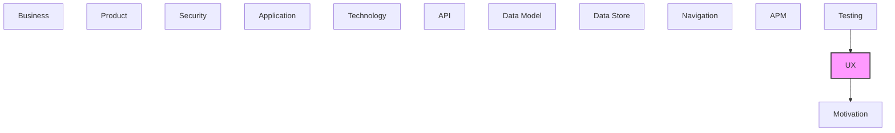

# UX

[← Back to README](../README.md)

User interface components, screens, and user experience elements.

## Report Index

- [Layer Introduction](#layer-introduction)
- [Intra-Layer Relationships](#intra-layer-relationships)
- [Inter-Layer Dependencies](#inter-layer-dependencies)
- [Inter-Layer Relationships Table](#inter-layer-relationships-table)
- [Element Reference](#element-reference)

## Layer Introduction

| Metric                    | Count |
| ------------------------- | ----- |
| Elements                  | 121   |
| Intra-Layer Relationships | 290   |
| Inter-Layer Relationships | 277   |
| Inbound Relationships     | 139   |
| Outbound Relationships    | 138   |

**Cross-Layer References**:

- **Upstream layers**: [Testing](./13-testing-layer-report.md)
- **Downstream layers**: [Motivation](./01-motivation-layer-report.md)

## Intra-Layer Relationships

*This layer has >30 elements. Summary table shown instead of diagram.*

| Element                                                              | Type               | Relationships |
| -------------------------------------------------------------------- | ------------------ | ------------- |
| `ux.actionpattern.collapseexpand-toggle-shiftenter-or-chevron-click` | `actionpattern`    | 3             |
| `ux.actionpattern.layer-stack-camera-orbit-and-presets`              | `actionpattern`    | 2             |
| `ux.actionpattern.link-navigation`                                   | `actionpattern`    | 4             |
| `ux.actionpattern.node-drag-reposition`                              | `actionpattern`    | 2             |
| `ux.actionpattern.node-select-on-click-or-enterspace`                | `actionpattern`    | 2             |
| `ux.actionpattern.panzoom-viewport-gesture`                          | `actionpattern`    | 1             |
| `ux.librarycomponent.activity-timeline`                              | `librarycomponent` | 2             |
| `ux.librarycomponent.adjacency-matrix`                               | `librarycomponent` | 8             |
| `ux.librarycomponent.alert-strip`                                    | `librarycomponent` | 3             |
| `ux.librarycomponent.app-title`                                      | `librarycomponent` | 3             |
| `ux.librarycomponent.asset-card`                                     | `librarycomponent` | 2             |
| `ux.librarycomponent.asset-grid`                                     | `librarycomponent` | 1             |
| `ux.librarycomponent.avatar`                                         | `librarycomponent` | 1             |
| `ux.librarycomponent.badge`                                          | `librarycomponent` | 3             |
| `ux.librarycomponent.bar-chart`                                      | `librarycomponent` | 1             |
| `ux.librarycomponent.bar-h`                                          | `librarycomponent` | 1             |
| `ux.librarycomponent.bar-v`                                          | `librarycomponent` | 1             |
| `ux.librarycomponent.bridge-node-list`                               | `librarycomponent` | 7             |
| `ux.librarycomponent.button`                                         | `librarycomponent` | 19            |
| `ux.librarycomponent.calendar`                                       | `librarycomponent` | 5             |
| `ux.librarycomponent.camera-controls`                                | `librarycomponent` | 18            |
| `ux.librarycomponent.chart-wrapper`                                  | `librarycomponent` | 1             |
| `ux.librarycomponent.chat-composer`                                  | `librarycomponent` | 3             |
| `ux.librarycomponent.chat-container`                                 | `librarycomponent` | 1             |
| `ux.librarycomponent.chat-divider`                                   | `librarycomponent` | 1             |
| `ux.librarycomponent.chat-markdown-content`                          | `librarycomponent` | 1             |
| `ux.librarycomponent.chat-message`                                   | `librarycomponent` | 2             |
| `ux.librarycomponent.chat-suggestions`                               | `librarycomponent` | 1             |
| `ux.librarycomponent.chip`                                           | `librarycomponent` | 10            |
| `ux.librarycomponent.command-palette`                                | `librarycomponent` | 2             |
| `ux.librarycomponent.config-tile`                                    | `librarycomponent` | 2             |
| `ux.librarycomponent.confirm-dialog`                                 | `librarycomponent` | 3             |
| `ux.librarycomponent.detail-drawer`                                  | `librarycomponent` | 1             |
| `ux.librarycomponent.diff-viewer`                                    | `librarycomponent` | 4             |
| `ux.librarycomponent.donut`                                          | `librarycomponent` | 1             |
| `ux.librarycomponent.drawer`                                         | `librarycomponent` | 3             |
| `ux.librarycomponent.entity-picker`                                  | `librarycomponent` | 4             |
| `ux.librarycomponent.field`                                          | `librarycomponent` | 1             |
| `ux.librarycomponent.filter-bar`                                     | `librarycomponent` | 3             |
| `ux.librarycomponent.filter-dropdown`                                | `librarycomponent` | 2             |
| `ux.librarycomponent.follow-control`                                 | `librarycomponent` | 7             |
| `ux.librarycomponent.form-callout`                                   | `librarycomponent` | 2             |
| `ux.librarycomponent.graph-canvas-ux`                                | `librarycomponent` | 13            |
| `ux.librarycomponent.graph-collapse-control-ux`                      | `librarycomponent` | 3             |
| `ux.librarycomponent.graph-edgegraph-edge-shape-ux`                  | `librarycomponent` | 5             |
| `ux.librarycomponent.graph-inspector-graph-edge-inspector-ux`        | `librarycomponent` | 2             |
| `ux.librarycomponent.graph-node-ux`                                  | `librarycomponent` | 4             |
| `ux.librarycomponent.graph-toolbar-ux`                               | `librarycomponent` | 2             |
| `ux.librarycomponent.hash-set-diff`                                  | `librarycomponent` | 3             |
| `ux.librarycomponent.heatmap`                                        | `librarycomponent` | 1             |
| `ux.librarycomponent.hierarchy-row`                                  | `librarycomponent` | 1             |
| `ux.librarycomponent.hierarchy-tree`                                 | `librarycomponent` | 1             |
| `ux.librarycomponent.hive-plot`                                      | `librarycomponent` | 5             |
| `ux.librarycomponent.icon`                                           | `librarycomponent` | 46            |
| `ux.librarycomponent.inspector-panel`                                | `librarycomponent` | 2             |
| `ux.librarycomponent.kanban-board`                                   | `librarycomponent` | 5             |
| `ux.librarycomponent.key-value-editor`                               | `librarycomponent` | 5             |
| `ux.librarycomponent.kvgrid`                                         | `librarycomponent` | 1             |
| `ux.librarycomponent.layer-list`                                     | `librarycomponent` | 7             |
| `ux.librarycomponent.layer-pair-list`                                | `librarycomponent` | 7             |
| `ux.librarycomponent.layer-stack`                                    | `librarycomponent` | 6             |
| `ux.librarycomponent.layered-graph-explorer`                         | `librarycomponent` | 18            |
| `ux.librarycomponent.line-chart`                                     | `librarycomponent` | 1             |
| `ux.librarycomponent.lineage-rail`                                   | `librarycomponent` | 3             |
| `ux.librarycomponent.link-category-filter`                           | `librarycomponent` | 7             |
| `ux.librarycomponent.log-stream`                                     | `librarycomponent` | 1             |
| `ux.librarycomponent.map-canvas`                                     | `librarycomponent` | 1             |
| `ux.librarycomponent.metric-row`                                     | `librarycomponent` | 3             |
| `ux.librarycomponent.mini-calendar`                                  | `librarycomponent` | 1             |
| `ux.librarycomponent.modal`                                          | `librarycomponent` | 4             |
| `ux.librarycomponent.nav-item`                                       | `librarycomponent` | 3             |
| `ux.librarycomponent.number-input`                                   | `librarycomponent` | 1             |
| `ux.librarycomponent.ordered-list`                                   | `librarycomponent` | 3             |
| `ux.librarycomponent.page-header`                                    | `librarycomponent` | 2             |
| `ux.librarycomponent.panel`                                          | `librarycomponent` | 2             |
| `ux.librarycomponent.pipeline-card`                                  | `librarycomponent` | 3             |
| `ux.librarycomponent.plane-layout-control`                           | `librarycomponent` | 7             |
| `ux.librarycomponent.popover`                                        | `librarycomponent` | 1             |
| `ux.librarycomponent.predicate-label-control`                        | `librarycomponent` | 7             |
| `ux.librarycomponent.progress-bar`                                   | `librarycomponent` | 3             |
| `ux.librarycomponent.quick-access-grid`                              | `librarycomponent` | 3             |
| `ux.librarycomponent.quick-access-tile`                              | `librarycomponent` | 4             |
| `ux.librarycomponent.reach-inspector`                                | `librarycomponent` | 8             |
| `ux.librarycomponent.relationship-builder`                           | `librarycomponent` | 3             |
| `ux.librarycomponent.result-card`                                    | `librarycomponent` | 5             |
| `ux.librarycomponent.row-menu`                                       | `librarycomponent` | 2             |
| `ux.librarycomponent.segmented-control`                              | `librarycomponent` | 12            |
| `ux.librarycomponent.select`                                         | `librarycomponent` | 4             |
| `ux.librarycomponent.shell-layout`                                   | `librarycomponent` | 8             |
| `ux.librarycomponent.side-by-side-diff`                              | `librarycomponent` | 3             |
| `ux.librarycomponent.sidebar`                                        | `librarycomponent` | 5             |
| `ux.librarycomponent.sparkline`                                      | `librarycomponent` | 3             |
| `ux.librarycomponent.split-pane`                                     | `librarycomponent` | 1             |
| `ux.librarycomponent.stacked-bar`                                    | `librarycomponent` | 1             |
| `ux.librarycomponent.stat-grid`                                      | `librarycomponent` | 1             |
| `ux.librarycomponent.stat-tile`                                      | `librarycomponent` | 4             |
| `ux.librarycomponent.status-badge`                                   | `librarycomponent` | 1             |
| `ux.librarycomponent.status-timeline`                                | `librarycomponent` | 1             |
| `ux.librarycomponent.statusbar`                                      | `librarycomponent` | 3             |
| `ux.librarycomponent.tab-bar`                                        | `librarycomponent` | 2             |
| `ux.librarycomponent.table`                                          | `librarycomponent` | 2             |
| `ux.librarycomponent.text-area`                                      | `librarycomponent` | 1             |
| `ux.librarycomponent.text-input`                                     | `librarycomponent` | 2             |
| `ux.librarycomponent.thinking-block`                                 | `librarycomponent` | 2             |
| `ux.librarycomponent.titlebar`                                       | `librarycomponent` | 2             |
| `ux.librarycomponent.toast`                                          | `librarycomponent` | 2             |
| `ux.librarycomponent.tool-block`                                     | `librarycomponent` | 2             |
| `ux.librarycomponent.tooltip`                                        | `librarycomponent` | 1             |
| `ux.librarycomponent.topbar`                                         | `librarycomponent` | 2             |
| `ux.librarycomponent.topology-node`                                  | `librarycomponent` | 1             |
| `ux.librarycomponent.trace-viewer`                                   | `librarycomponent` | 2             |
| `ux.librarycomponent.tri-state`                                      | `librarycomponent` | 1             |
| `ux.librarycomponent.version-pill`                                   | `librarycomponent` | 8             |
| `ux.librarycomponent.version-timeline`                               | `librarycomponent` | 3             |
| `ux.librarycomponent.view-switcher`                                  | `librarycomponent` | 17            |
| `ux.librarycomponent.workspace-switcher-dialog`                      | `librarycomponent` | 3             |
| `ux.statepattern.collapsed-node-set-progressive-disclosure`          | `statepattern`     | 2             |
| `ux.statepattern.layered-selection-and-reach`                        | `statepattern`     | 5             |
| `ux.statepattern.live-simulation-vs-static-layout-state`             | `statepattern`     | 1             |
| `ux.statepattern.node-hover-and-selection-state`                     | `statepattern`     | 3             |
| `ux.uxlibrary.heimdall-ui`                                           | `uxlibrary`        | 110           |

## Inter-Layer Dependencies

## Inter-Layer Relationships Table

| Relationship ID                                         | Source Node                                                          | Dest Node                                                                 | Dest Layer   | Predicate   | Cardinality  | Strength |
| ------------------------------------------------------- | -------------------------------------------------------------------- | ------------------------------------------------------------------------- | ------------ | ----------- | ------------ | -------- |
| `testing.testcasesketch.tests.ux.librarycomponent`      | `testing.testcasesketch.chart-fills-resolve-from-tokens`             | `ux.librarycomponent.heatmap`                                             | `ux`         | `tests`     | many-to-many | medium   |
| `testing.testcasesketch.tests.ux.librarycomponent`      | `testing.testcasesketch.chart-fills-resolve-from-tokens`             | `ux.librarycomponent.line-chart`                                          | `ux`         | `tests`     | many-to-many | medium   |
| `testing.testcasesketch.tests.ux.librarycomponent`      | `testing.testcasesketch.chart-fills-resolve-from-tokens`             | `ux.librarycomponent.status-timeline`                                     | `ux`         | `tests`     | many-to-many | medium   |
| `testing.testcoveragetarget.covers.ux.librarycomponent` | `testing.testcoveragetarget.adjacency-matrix-view`                   | `ux.librarycomponent.adjacency-matrix`                                    | `ux`         | `covers`    | many-to-many | medium   |
| `testing.testcoveragetarget.covers.ux.librarycomponent` | `testing.testcoveragetarget.advanced-overlays`                       | `ux.librarycomponent.command-palette`                                     | `ux`         | `covers`    | many-to-many | medium   |
| `testing.testcoveragetarget.covers.ux.librarycomponent` | `testing.testcoveragetarget.advanced-overlays`                       | `ux.librarycomponent.detail-drawer`                                       | `ux`         | `covers`    | many-to-many | medium   |
| `testing.testcoveragetarget.covers.ux.librarycomponent` | `testing.testcoveragetarget.advanced-overlays`                       | `ux.librarycomponent.drawer`                                              | `ux`         | `covers`    | many-to-many | medium   |
| `testing.testcoveragetarget.covers.ux.librarycomponent` | `testing.testcoveragetarget.advanced-overlays`                       | `ux.librarycomponent.popover`                                             | `ux`         | `covers`    | many-to-many | medium   |
| `testing.testcoveragetarget.covers.ux.librarycomponent` | `testing.testcoveragetarget.advanced-overlays`                       | `ux.librarycomponent.tooltip`                                             | `ux`         | `covers`    | many-to-many | medium   |
| `testing.testcoveragetarget.covers.ux.librarycomponent` | `testing.testcoveragetarget.avatar`                                  | `ux.librarycomponent.avatar`                                              | `ux`         | `covers`    | many-to-many | medium   |
| `testing.testcoveragetarget.covers.ux.librarycomponent` | `testing.testcoveragetarget.calendar-and-mini-calendar`              | `ux.librarycomponent.calendar`                                            | `ux`         | `covers`    | many-to-many | medium   |
| `testing.testcoveragetarget.covers.ux.librarycomponent` | `testing.testcoveragetarget.calendar-and-mini-calendar`              | `ux.librarycomponent.mini-calendar`                                       | `ux`         | `covers`    | many-to-many | medium   |
| `testing.testcoveragetarget.covers.ux.librarycomponent` | `testing.testcoveragetarget.cards-and-lists`                         | `ux.librarycomponent.asset-card`                                          | `ux`         | `covers`    | many-to-many | medium   |
| `testing.testcoveragetarget.covers.ux.librarycomponent` | `testing.testcoveragetarget.cards-and-lists`                         | `ux.librarycomponent.asset-grid`                                          | `ux`         | `covers`    | many-to-many | medium   |
| `testing.testcoveragetarget.covers.ux.librarycomponent` | `testing.testcoveragetarget.cards-and-lists`                         | `ux.librarycomponent.log-stream`                                          | `ux`         | `covers`    | many-to-many | medium   |
| `testing.testcoveragetarget.covers.ux.librarycomponent` | `testing.testcoveragetarget.cards-and-lists`                         | `ux.librarycomponent.ordered-list`                                        | `ux`         | `covers`    | many-to-many | medium   |
| `testing.testcoveragetarget.covers.ux.librarycomponent` | `testing.testcoveragetarget.cards-and-lists`                         | `ux.librarycomponent.result-card`                                         | `ux`         | `covers`    | many-to-many | medium   |
| `testing.testcoveragetarget.covers.ux.librarycomponent` | `testing.testcoveragetarget.chart-components`                        | `ux.librarycomponent.bar-chart`                                           | `ux`         | `covers`    | many-to-many | medium   |
| `testing.testcoveragetarget.covers.ux.librarycomponent` | `testing.testcoveragetarget.chart-components`                        | `ux.librarycomponent.bar-h`                                               | `ux`         | `covers`    | many-to-many | medium   |
| `testing.testcoveragetarget.covers.ux.librarycomponent` | `testing.testcoveragetarget.chart-components`                        | `ux.librarycomponent.bar-v`                                               | `ux`         | `covers`    | many-to-many | medium   |
| `testing.testcoveragetarget.covers.ux.librarycomponent` | `testing.testcoveragetarget.chart-components`                        | `ux.librarycomponent.chart-wrapper`                                       | `ux`         | `covers`    | many-to-many | medium   |
| `testing.testcoveragetarget.covers.ux.librarycomponent` | `testing.testcoveragetarget.chart-components`                        | `ux.librarycomponent.donut`                                               | `ux`         | `covers`    | many-to-many | medium   |
| `testing.testcoveragetarget.covers.ux.librarycomponent` | `testing.testcoveragetarget.chart-components`                        | `ux.librarycomponent.heatmap`                                             | `ux`         | `covers`    | many-to-many | medium   |
| `testing.testcoveragetarget.covers.ux.librarycomponent` | `testing.testcoveragetarget.chart-components`                        | `ux.librarycomponent.line-chart`                                          | `ux`         | `covers`    | many-to-many | medium   |
| `testing.testcoveragetarget.covers.ux.librarycomponent` | `testing.testcoveragetarget.chart-components`                        | `ux.librarycomponent.metric-row`                                          | `ux`         | `covers`    | many-to-many | medium   |
| `testing.testcoveragetarget.covers.ux.librarycomponent` | `testing.testcoveragetarget.chart-components`                        | `ux.librarycomponent.progress-bar`                                        | `ux`         | `covers`    | many-to-many | medium   |
| `testing.testcoveragetarget.covers.ux.librarycomponent` | `testing.testcoveragetarget.chart-components`                        | `ux.librarycomponent.sparkline`                                           | `ux`         | `covers`    | many-to-many | medium   |
| `testing.testcoveragetarget.covers.ux.librarycomponent` | `testing.testcoveragetarget.chart-components`                        | `ux.librarycomponent.stacked-bar`                                         | `ux`         | `covers`    | many-to-many | medium   |
| `testing.testcoveragetarget.covers.ux.librarycomponent` | `testing.testcoveragetarget.chart-components`                        | `ux.librarycomponent.status-timeline`                                     | `ux`         | `covers`    | many-to-many | medium   |
| `testing.testcoveragetarget.covers.ux.librarycomponent` | `testing.testcoveragetarget.chat-components`                         | `ux.librarycomponent.chat-composer`                                       | `ux`         | `covers`    | many-to-many | medium   |
| `testing.testcoveragetarget.covers.ux.librarycomponent` | `testing.testcoveragetarget.chat-components`                         | `ux.librarycomponent.chat-container`                                      | `ux`         | `covers`    | many-to-many | medium   |
| `testing.testcoveragetarget.covers.ux.librarycomponent` | `testing.testcoveragetarget.chat-components`                         | `ux.librarycomponent.chat-divider`                                        | `ux`         | `covers`    | many-to-many | medium   |
| `testing.testcoveragetarget.covers.ux.librarycomponent` | `testing.testcoveragetarget.chat-components`                         | `ux.librarycomponent.chat-markdown-content`                               | `ux`         | `covers`    | many-to-many | medium   |
| `testing.testcoveragetarget.covers.ux.librarycomponent` | `testing.testcoveragetarget.chat-components`                         | `ux.librarycomponent.chat-message`                                        | `ux`         | `covers`    | many-to-many | medium   |
| `testing.testcoveragetarget.covers.ux.librarycomponent` | `testing.testcoveragetarget.chat-components`                         | `ux.librarycomponent.chat-suggestions`                                    | `ux`         | `covers`    | many-to-many | medium   |
| `testing.testcoveragetarget.covers.ux.librarycomponent` | `testing.testcoveragetarget.chat-components`                         | `ux.librarycomponent.thinking-block`                                      | `ux`         | `covers`    | many-to-many | medium   |
| `testing.testcoveragetarget.covers.ux.librarycomponent` | `testing.testcoveragetarget.chat-components`                         | `ux.librarycomponent.tool-block`                                          | `ux`         | `covers`    | many-to-many | medium   |
| `testing.testcoveragetarget.covers.ux.librarycomponent` | `testing.testcoveragetarget.dark-canvas-semantic-tokens`             | `ux.librarycomponent.activity-timeline`                                   | `ux`         | `covers`    | many-to-many | medium   |
| `testing.testcoveragetarget.covers.ux.librarycomponent` | `testing.testcoveragetarget.dark-canvas-semantic-tokens`             | `ux.librarycomponent.chip`                                                | `ux`         | `covers`    | many-to-many | medium   |
| `testing.testcoveragetarget.covers.ux.librarycomponent` | `testing.testcoveragetarget.dark-canvas-semantic-tokens`             | `ux.librarycomponent.form-callout`                                        | `ux`         | `covers`    | many-to-many | medium   |
| `testing.testcoveragetarget.covers.ux.librarycomponent` | `testing.testcoveragetarget.dark-canvas-semantic-tokens`             | `ux.librarycomponent.version-pill`                                        | `ux`         | `covers`    | many-to-many | medium   |
| `testing.testcoveragetarget.covers.ux.librarycomponent` | `testing.testcoveragetarget.data-display-components`                 | `ux.librarycomponent.hierarchy-row`                                       | `ux`         | `covers`    | many-to-many | medium   |
| `testing.testcoveragetarget.covers.ux.librarycomponent` | `testing.testcoveragetarget.data-display-components`                 | `ux.librarycomponent.hierarchy-tree`                                      | `ux`         | `covers`    | many-to-many | medium   |
| `testing.testcoveragetarget.covers.ux.librarycomponent` | `testing.testcoveragetarget.data-display-components`                 | `ux.librarycomponent.stat-grid`                                           | `ux`         | `covers`    | many-to-many | medium   |
| `testing.testcoveragetarget.covers.ux.librarycomponent` | `testing.testcoveragetarget.data-display-components`                 | `ux.librarycomponent.stat-tile`                                           | `ux`         | `covers`    | many-to-many | medium   |
| `testing.testcoveragetarget.covers.ux.librarycomponent` | `testing.testcoveragetarget.data-display-components`                 | `ux.librarycomponent.table`                                               | `ux`         | `covers`    | many-to-many | medium   |
| `testing.testcoveragetarget.covers.ux.librarycomponent` | `testing.testcoveragetarget.data-display-components`                 | `ux.librarycomponent.topology-node`                                       | `ux`         | `covers`    | many-to-many | medium   |
| `testing.testcoveragetarget.covers.ux.librarycomponent` | `testing.testcoveragetarget.date-utilities`                          | `ux.librarycomponent.activity-timeline`                                   | `ux`         | `covers`    | many-to-many | medium   |
| `testing.testcoveragetarget.covers.ux.librarycomponent` | `testing.testcoveragetarget.date-utilities`                          | `ux.librarycomponent.calendar`                                            | `ux`         | `covers`    | many-to-many | medium   |
| `testing.testcoveragetarget.covers.ux.librarycomponent` | `testing.testcoveragetarget.date-utilities`                          | `ux.librarycomponent.mini-calendar`                                       | `ux`         | `covers`    | many-to-many | medium   |
| `testing.testcoveragetarget.covers.ux.librarycomponent` | `testing.testcoveragetarget.date-utilities`                          | `ux.librarycomponent.version-timeline`                                    | `ux`         | `covers`    | many-to-many | medium   |
| `testing.testcoveragetarget.covers.ux.librarycomponent` | `testing.testcoveragetarget.design-foundation-tokens-and-typography` | `ux.librarycomponent.icon`                                                | `ux`         | `covers`    | many-to-many | medium   |
| `testing.testcoveragetarget.covers.ux.librarycomponent` | `testing.testcoveragetarget.design-reference-comparison`             | `ux.librarycomponent.shell-layout`                                        | `ux`         | `covers`    | many-to-many | medium   |
| `testing.testcoveragetarget.covers.ux.librarycomponent` | `testing.testcoveragetarget.diff-viewer-components`                  | `ux.librarycomponent.diff-viewer`                                         | `ux`         | `covers`    | many-to-many | medium   |
| `testing.testcoveragetarget.covers.ux.librarycomponent` | `testing.testcoveragetarget.diff-viewer-components`                  | `ux.librarycomponent.hash-set-diff`                                       | `ux`         | `covers`    | many-to-many | medium   |
| `testing.testcoveragetarget.covers.ux.librarycomponent` | `testing.testcoveragetarget.diff-viewer-components`                  | `ux.librarycomponent.side-by-side-diff`                                   | `ux`         | `covers`    | many-to-many | medium   |
| `testing.testcoveragetarget.covers.ux.librarycomponent` | `testing.testcoveragetarget.dropdown-placement`                      | `ux.librarycomponent.filter-dropdown`                                     | `ux`         | `covers`    | many-to-many | medium   |
| `testing.testcoveragetarget.covers.ux.librarycomponent` | `testing.testcoveragetarget.dropdown-placement`                      | `ux.librarycomponent.row-menu`                                            | `ux`         | `covers`    | many-to-many | medium   |
| `testing.testcoveragetarget.covers.ux.librarycomponent` | `testing.testcoveragetarget.dropdown-placement`                      | `ux.librarycomponent.select`                                              | `ux`         | `covers`    | many-to-many | medium   |
| `testing.testcoveragetarget.covers.ux.librarycomponent` | `testing.testcoveragetarget.dropdown-portal`                         | `ux.librarycomponent.filter-dropdown`                                     | `ux`         | `covers`    | many-to-many | medium   |
| `testing.testcoveragetarget.covers.ux.librarycomponent` | `testing.testcoveragetarget.dropdown-portal`                         | `ux.librarycomponent.row-menu`                                            | `ux`         | `covers`    | many-to-many | medium   |
| `testing.testcoveragetarget.covers.ux.librarycomponent` | `testing.testcoveragetarget.dropdown-portal`                         | `ux.librarycomponent.select`                                              | `ux`         | `covers`    | many-to-many | medium   |
| `testing.testcoveragetarget.covers.ux.librarycomponent` | `testing.testcoveragetarget.filter-dropdown`                         | `ux.librarycomponent.filter-dropdown`                                     | `ux`         | `covers`    | many-to-many | medium   |
| `testing.testcoveragetarget.covers.ux.librarycomponent` | `testing.testcoveragetarget.form-components`                         | `ux.librarycomponent.entity-picker`                                       | `ux`         | `covers`    | many-to-many | medium   |
| `testing.testcoveragetarget.covers.ux.librarycomponent` | `testing.testcoveragetarget.form-components`                         | `ux.librarycomponent.field`                                               | `ux`         | `covers`    | many-to-many | medium   |
| `testing.testcoveragetarget.covers.ux.librarycomponent` | `testing.testcoveragetarget.form-components`                         | `ux.librarycomponent.key-value-editor`                                    | `ux`         | `covers`    | many-to-many | medium   |
| `testing.testcoveragetarget.covers.ux.librarycomponent` | `testing.testcoveragetarget.form-components`                         | `ux.librarycomponent.number-input`                                        | `ux`         | `covers`    | many-to-many | medium   |
| `testing.testcoveragetarget.covers.ux.librarycomponent` | `testing.testcoveragetarget.form-components`                         | `ux.librarycomponent.relationship-builder`                                | `ux`         | `covers`    | many-to-many | medium   |
| `testing.testcoveragetarget.covers.ux.librarycomponent` | `testing.testcoveragetarget.form-components`                         | `ux.librarycomponent.select`                                              | `ux`         | `covers`    | many-to-many | medium   |
| `testing.testcoveragetarget.covers.ux.librarycomponent` | `testing.testcoveragetarget.form-components`                         | `ux.librarycomponent.text-area`                                           | `ux`         | `covers`    | many-to-many | medium   |
| `testing.testcoveragetarget.covers.ux.librarycomponent` | `testing.testcoveragetarget.form-components`                         | `ux.librarycomponent.text-input`                                          | `ux`         | `covers`    | many-to-many | medium   |
| `testing.testcoveragetarget.covers.ux.librarycomponent` | `testing.testcoveragetarget.form-components`                         | `ux.librarycomponent.tri-state`                                           | `ux`         | `covers`    | many-to-many | medium   |
| `testing.testcoveragetarget.covers.ux.librarycomponent` | `testing.testcoveragetarget.hive-plot-view`                          | `ux.librarycomponent.hive-plot`                                           | `ux`         | `covers`    | many-to-many | medium   |
| `testing.testcoveragetarget.covers.ux.librarycomponent` | `testing.testcoveragetarget.inspector-panel-and-kvgrid`              | `ux.librarycomponent.inspector-panel`                                     | `ux`         | `covers`    | many-to-many | medium   |
| `testing.testcoveragetarget.covers.ux.librarycomponent` | `testing.testcoveragetarget.inspector-panel-and-kvgrid`              | `ux.librarycomponent.kvgrid`                                              | `ux`         | `covers`    | many-to-many | medium   |
| `testing.testcoveragetarget.covers.ux.librarycomponent` | `testing.testcoveragetarget.kanban-board`                            | `ux.librarycomponent.kanban-board`                                        | `ux`         | `covers`    | many-to-many | medium   |
| `testing.testcoveragetarget.covers.ux.librarycomponent` | `testing.testcoveragetarget.layer-stack-view`                        | `ux.librarycomponent.layer-stack`                                         | `ux`         | `covers`    | many-to-many | medium   |
| `testing.testcoveragetarget.covers.ux.librarycomponent` | `testing.testcoveragetarget.layered-graph-chrome`                    | `ux.librarycomponent.bridge-node-list`                                    | `ux`         | `covers`    | many-to-many | medium   |
| `testing.testcoveragetarget.covers.ux.librarycomponent` | `testing.testcoveragetarget.layered-graph-chrome`                    | `ux.librarycomponent.camera-controls`                                     | `ux`         | `covers`    | many-to-many | medium   |
| `testing.testcoveragetarget.covers.ux.librarycomponent` | `testing.testcoveragetarget.layered-graph-chrome`                    | `ux.librarycomponent.follow-control`                                      | `ux`         | `covers`    | many-to-many | medium   |
| `testing.testcoveragetarget.covers.ux.librarycomponent` | `testing.testcoveragetarget.layered-graph-chrome`                    | `ux.librarycomponent.layer-list`                                          | `ux`         | `covers`    | many-to-many | medium   |
| `testing.testcoveragetarget.covers.ux.librarycomponent` | `testing.testcoveragetarget.layered-graph-chrome`                    | `ux.librarycomponent.layer-pair-list`                                     | `ux`         | `covers`    | many-to-many | medium   |
| `testing.testcoveragetarget.covers.ux.librarycomponent` | `testing.testcoveragetarget.layered-graph-chrome`                    | `ux.librarycomponent.link-category-filter`                                | `ux`         | `covers`    | many-to-many | medium   |
| `testing.testcoveragetarget.covers.ux.librarycomponent` | `testing.testcoveragetarget.layered-graph-chrome`                    | `ux.librarycomponent.plane-layout-control`                                | `ux`         | `covers`    | many-to-many | medium   |
| `testing.testcoveragetarget.covers.ux.librarycomponent` | `testing.testcoveragetarget.layered-graph-chrome`                    | `ux.librarycomponent.predicate-label-control`                             | `ux`         | `covers`    | many-to-many | medium   |
| `testing.testcoveragetarget.covers.ux.librarycomponent` | `testing.testcoveragetarget.layered-graph-chrome`                    | `ux.librarycomponent.view-switcher`                                       | `ux`         | `covers`    | many-to-many | medium   |
| `testing.testcoveragetarget.covers.ux.librarycomponent` | `testing.testcoveragetarget.layered-graph-explorer`                  | `ux.librarycomponent.layered-graph-explorer`                              | `ux`         | `covers`    | many-to-many | medium   |
| `testing.testcoveragetarget.covers.ux.librarycomponent` | `testing.testcoveragetarget.line-chart-data-toggle`                  | `ux.librarycomponent.line-chart`                                          | `ux`         | `covers`    | many-to-many | medium   |
| `testing.testcoveragetarget.covers.ux.librarycomponent` | `testing.testcoveragetarget.lineage-rail`                            | `ux.librarycomponent.lineage-rail`                                        | `ux`         | `covers`    | many-to-many | medium   |
| `testing.testcoveragetarget.covers.ux.librarycomponent` | `testing.testcoveragetarget.map-canvas`                              | `ux.librarycomponent.map-canvas`                                          | `ux`         | `covers`    | many-to-many | medium   |
| `testing.testcoveragetarget.covers.ux.librarycomponent` | `testing.testcoveragetarget.overlay-components`                      | `ux.librarycomponent.confirm-dialog`                                      | `ux`         | `covers`    | many-to-many | medium   |
| `testing.testcoveragetarget.covers.ux.librarycomponent` | `testing.testcoveragetarget.overlay-components`                      | `ux.librarycomponent.drawer`                                              | `ux`         | `covers`    | many-to-many | medium   |
| `testing.testcoveragetarget.covers.ux.librarycomponent` | `testing.testcoveragetarget.overlay-components`                      | `ux.librarycomponent.modal`                                               | `ux`         | `covers`    | many-to-many | medium   |
| `testing.testcoveragetarget.covers.ux.librarycomponent` | `testing.testcoveragetarget.overlay-components`                      | `ux.librarycomponent.toast`                                               | `ux`         | `covers`    | many-to-many | medium   |
| `testing.testcoveragetarget.covers.ux.librarycomponent` | `testing.testcoveragetarget.page-pattern-components`                 | `ux.librarycomponent.activity-timeline`                                   | `ux`         | `covers`    | many-to-many | medium   |
| `testing.testcoveragetarget.covers.ux.librarycomponent` | `testing.testcoveragetarget.page-pattern-components`                 | `ux.librarycomponent.alert-strip`                                         | `ux`         | `covers`    | many-to-many | medium   |
| `testing.testcoveragetarget.covers.ux.librarycomponent` | `testing.testcoveragetarget.page-pattern-components`                 | `ux.librarycomponent.config-tile`                                         | `ux`         | `covers`    | many-to-many | medium   |
| `testing.testcoveragetarget.covers.ux.librarycomponent` | `testing.testcoveragetarget.page-pattern-components`                 | `ux.librarycomponent.filter-bar`                                          | `ux`         | `covers`    | many-to-many | medium   |
| `testing.testcoveragetarget.covers.ux.librarycomponent` | `testing.testcoveragetarget.page-pattern-components`                 | `ux.librarycomponent.form-callout`                                        | `ux`         | `covers`    | many-to-many | medium   |
| `testing.testcoveragetarget.covers.ux.librarycomponent` | `testing.testcoveragetarget.page-pattern-components`                 | `ux.librarycomponent.page-header`                                         | `ux`         | `covers`    | many-to-many | medium   |
| `testing.testcoveragetarget.covers.ux.librarycomponent` | `testing.testcoveragetarget.page-pattern-components`                 | `ux.librarycomponent.pipeline-card`                                       | `ux`         | `covers`    | many-to-many | medium   |
| `testing.testcoveragetarget.covers.ux.librarycomponent` | `testing.testcoveragetarget.page-pattern-components`                 | `ux.librarycomponent.quick-access-grid`                                   | `ux`         | `covers`    | many-to-many | medium   |
| `testing.testcoveragetarget.covers.ux.librarycomponent` | `testing.testcoveragetarget.page-pattern-components`                 | `ux.librarycomponent.quick-access-tile`                                   | `ux`         | `covers`    | many-to-many | medium   |
| `testing.testcoveragetarget.covers.ux.librarycomponent` | `testing.testcoveragetarget.page-pattern-components`                 | `ux.librarycomponent.row-menu`                                            | `ux`         | `covers`    | many-to-many | medium   |
| `testing.testcoveragetarget.covers.ux.librarycomponent` | `testing.testcoveragetarget.primitive-components`                    | `ux.librarycomponent.avatar`                                              | `ux`         | `covers`    | many-to-many | medium   |
| `testing.testcoveragetarget.covers.ux.librarycomponent` | `testing.testcoveragetarget.primitive-components`                    | `ux.librarycomponent.badge`                                               | `ux`         | `covers`    | many-to-many | medium   |
| `testing.testcoveragetarget.covers.ux.librarycomponent` | `testing.testcoveragetarget.primitive-components`                    | `ux.librarycomponent.button`                                              | `ux`         | `covers`    | many-to-many | medium   |
| `testing.testcoveragetarget.covers.ux.librarycomponent` | `testing.testcoveragetarget.primitive-components`                    | `ux.librarycomponent.chip`                                                | `ux`         | `covers`    | many-to-many | medium   |
| `testing.testcoveragetarget.covers.ux.librarycomponent` | `testing.testcoveragetarget.primitive-components`                    | `ux.librarycomponent.icon`                                                | `ux`         | `covers`    | many-to-many | medium   |
| `testing.testcoveragetarget.covers.ux.librarycomponent` | `testing.testcoveragetarget.primitive-components`                    | `ux.librarycomponent.segmented-control`                                   | `ux`         | `covers`    | many-to-many | medium   |
| `testing.testcoveragetarget.covers.ux.librarycomponent` | `testing.testcoveragetarget.primitive-components`                    | `ux.librarycomponent.status-badge`                                        | `ux`         | `covers`    | many-to-many | medium   |
| `testing.testcoveragetarget.covers.ux.librarycomponent` | `testing.testcoveragetarget.primitive-components`                    | `ux.librarycomponent.version-pill`                                        | `ux`         | `covers`    | many-to-many | medium   |
| `testing.testcoveragetarget.covers.ux.librarycomponent` | `testing.testcoveragetarget.reach-inspector-relationships`           | `ux.librarycomponent.reach-inspector`                                     | `ux`         | `covers`    | many-to-many | medium   |
| `testing.testcoveragetarget.covers.ux.librarycomponent` | `testing.testcoveragetarget.responsive-shell`                        | `ux.librarycomponent.shell-layout`                                        | `ux`         | `covers`    | many-to-many | medium   |
| `testing.testcoveragetarget.covers.ux.librarycomponent` | `testing.testcoveragetarget.responsive-shell`                        | `ux.librarycomponent.sidebar`                                             | `ux`         | `covers`    | many-to-many | medium   |
| `testing.testcoveragetarget.covers.ux.librarycomponent` | `testing.testcoveragetarget.responsive-shell`                        | `ux.librarycomponent.statusbar`                                           | `ux`         | `covers`    | many-to-many | medium   |
| `testing.testcoveragetarget.covers.ux.librarycomponent` | `testing.testcoveragetarget.responsive-shell`                        | `ux.librarycomponent.topbar`                                              | `ux`         | `covers`    | many-to-many | medium   |
| `testing.testcoveragetarget.covers.ux.librarycomponent` | `testing.testcoveragetarget.server-rendering`                        | `ux.librarycomponent.mini-calendar`                                       | `ux`         | `covers`    | many-to-many | medium   |
| `testing.testcoveragetarget.covers.ux.librarycomponent` | `testing.testcoveragetarget.server-rendering`                        | `ux.librarycomponent.nav-item`                                            | `ux`         | `covers`    | many-to-many | medium   |
| `testing.testcoveragetarget.covers.ux.librarycomponent` | `testing.testcoveragetarget.server-rendering`                        | `ux.librarycomponent.quick-access-tile`                                   | `ux`         | `covers`    | many-to-many | medium   |
| `testing.testcoveragetarget.covers.ux.librarycomponent` | `testing.testcoveragetarget.server-rendering`                        | `ux.librarycomponent.shell-layout`                                        | `ux`         | `covers`    | many-to-many | medium   |
| `testing.testcoveragetarget.covers.ux.librarycomponent` | `testing.testcoveragetarget.shell-framework-components`              | `ux.librarycomponent.app-title`                                           | `ux`         | `covers`    | many-to-many | medium   |
| `testing.testcoveragetarget.covers.ux.librarycomponent` | `testing.testcoveragetarget.shell-framework-components`              | `ux.librarycomponent.nav-item`                                            | `ux`         | `covers`    | many-to-many | medium   |
| `testing.testcoveragetarget.covers.ux.librarycomponent` | `testing.testcoveragetarget.shell-framework-components`              | `ux.librarycomponent.panel`                                               | `ux`         | `covers`    | many-to-many | medium   |
| `testing.testcoveragetarget.covers.ux.librarycomponent` | `testing.testcoveragetarget.shell-framework-components`              | `ux.librarycomponent.shell-layout`                                        | `ux`         | `covers`    | many-to-many | medium   |
| `testing.testcoveragetarget.covers.ux.librarycomponent` | `testing.testcoveragetarget.shell-framework-components`              | `ux.librarycomponent.sidebar`                                             | `ux`         | `covers`    | many-to-many | medium   |
| `testing.testcoveragetarget.covers.ux.librarycomponent` | `testing.testcoveragetarget.shell-framework-components`              | `ux.librarycomponent.split-pane`                                          | `ux`         | `covers`    | many-to-many | medium   |
| `testing.testcoveragetarget.covers.ux.librarycomponent` | `testing.testcoveragetarget.shell-framework-components`              | `ux.librarycomponent.statusbar`                                           | `ux`         | `covers`    | many-to-many | medium   |
| `testing.testcoveragetarget.covers.ux.librarycomponent` | `testing.testcoveragetarget.shell-framework-components`              | `ux.librarycomponent.tab-bar`                                             | `ux`         | `covers`    | many-to-many | medium   |
| `testing.testcoveragetarget.covers.ux.librarycomponent` | `testing.testcoveragetarget.shell-framework-components`              | `ux.librarycomponent.titlebar`                                            | `ux`         | `covers`    | many-to-many | medium   |
| `testing.testcoveragetarget.covers.ux.librarycomponent` | `testing.testcoveragetarget.shell-framework-components`              | `ux.librarycomponent.topbar`                                              | `ux`         | `covers`    | many-to-many | medium   |
| `testing.testcoveragetarget.covers.ux.librarycomponent` | `testing.testcoveragetarget.static-site-link-variants`               | `ux.librarycomponent.nav-item`                                            | `ux`         | `covers`    | many-to-many | medium   |
| `testing.testcoveragetarget.covers.ux.librarycomponent` | `testing.testcoveragetarget.static-site-link-variants`               | `ux.librarycomponent.quick-access-grid`                                   | `ux`         | `covers`    | many-to-many | medium   |
| `testing.testcoveragetarget.covers.ux.librarycomponent` | `testing.testcoveragetarget.static-site-link-variants`               | `ux.librarycomponent.quick-access-tile`                                   | `ux`         | `covers`    | many-to-many | medium   |
| `testing.testcoveragetarget.covers.ux.librarycomponent` | `testing.testcoveragetarget.static-site-link-variants`               | `ux.librarycomponent.sidebar`                                             | `ux`         | `covers`    | many-to-many | medium   |
| `testing.testcoveragetarget.covers.ux.librarycomponent` | `testing.testcoveragetarget.tooltip-placement`                       | `ux.librarycomponent.tooltip`                                             | `ux`         | `covers`    | many-to-many | medium   |
| `testing.testcoveragetarget.covers.ux.librarycomponent` | `testing.testcoveragetarget.trace-viewer`                            | `ux.librarycomponent.trace-viewer`                                        | `ux`         | `covers`    | many-to-many | medium   |
| `testing.testcoveragetarget.covers.ux.librarycomponent` | `testing.testcoveragetarget.version-timeline`                        | `ux.librarycomponent.version-timeline`                                    | `ux`         | `covers`    | many-to-many | medium   |
| `testing.testcoveragetarget.covers.ux.librarycomponent` | `testing.testcoveragetarget.workspace-switcher-dialog`               | `ux.librarycomponent.workspace-switcher-dialog`                           | `ux`         | `covers`    | many-to-many | medium   |
| `ux.librarycomponent.satisfies.motivation.principle`    | `ux.librarycomponent.activity-timeline`                              | `motivation.principle.two-surface-shell-and-canvas`                       | `motivation` | `satisfies` | many-to-many | medium   |
| `ux.librarycomponent.satisfies.motivation.requirement`  | `ux.librarycomponent.activity-timeline`                              | `motivation.requirement.server-rendered-output-hydrates-without-mismatch` | `motivation` | `satisfies` | many-to-many | medium   |
| `ux.librarycomponent.satisfies.motivation.principle`    | `ux.librarycomponent.adjacency-matrix`                               | `motivation.principle.two-surface-shell-and-canvas`                       | `motivation` | `satisfies` | many-to-many | medium   |
| `ux.librarycomponent.satisfies.motivation.principle`    | `ux.librarycomponent.alert-strip`                                    | `motivation.principle.two-surface-shell-and-canvas`                       | `motivation` | `satisfies` | many-to-many | medium   |
| `ux.librarycomponent.satisfies.motivation.principle`    | `ux.librarycomponent.app-title`                                      | `motivation.principle.every-component-color-comes-from-a-token`           | `motivation` | `satisfies` | many-to-many | medium   |
| `ux.librarycomponent.satisfies.motivation.principle`    | `ux.librarycomponent.app-title`                                      | `motivation.principle.two-surface-shell-and-canvas`                       | `motivation` | `satisfies` | many-to-many | medium   |
| `ux.librarycomponent.satisfies.motivation.principle`    | `ux.librarycomponent.asset-card`                                     | `motivation.principle.two-surface-shell-and-canvas`                       | `motivation` | `satisfies` | many-to-many | medium   |
| `ux.librarycomponent.satisfies.motivation.principle`    | `ux.librarycomponent.asset-grid`                                     | `motivation.principle.two-surface-shell-and-canvas`                       | `motivation` | `satisfies` | many-to-many | medium   |
| `ux.librarycomponent.satisfies.motivation.principle`    | `ux.librarycomponent.avatar`                                         | `motivation.principle.two-surface-shell-and-canvas`                       | `motivation` | `satisfies` | many-to-many | medium   |
| `ux.librarycomponent.satisfies.motivation.principle`    | `ux.librarycomponent.badge`                                          | `motivation.principle.two-surface-shell-and-canvas`                       | `motivation` | `satisfies` | many-to-many | medium   |
| `ux.librarycomponent.satisfies.motivation.principle`    | `ux.librarycomponent.bar-chart`                                      | `motivation.principle.every-component-color-comes-from-a-token`           | `motivation` | `satisfies` | many-to-many | medium   |
| `ux.librarycomponent.satisfies.motivation.principle`    | `ux.librarycomponent.bar-chart`                                      | `motivation.principle.two-surface-shell-and-canvas`                       | `motivation` | `satisfies` | many-to-many | medium   |
| `ux.librarycomponent.satisfies.motivation.principle`    | `ux.librarycomponent.bar-h`                                          | `motivation.principle.every-component-color-comes-from-a-token`           | `motivation` | `satisfies` | many-to-many | medium   |
| `ux.librarycomponent.satisfies.motivation.principle`    | `ux.librarycomponent.bar-h`                                          | `motivation.principle.two-surface-shell-and-canvas`                       | `motivation` | `satisfies` | many-to-many | medium   |
| `ux.librarycomponent.satisfies.motivation.principle`    | `ux.librarycomponent.bar-v`                                          | `motivation.principle.two-surface-shell-and-canvas`                       | `motivation` | `satisfies` | many-to-many | medium   |
| `ux.librarycomponent.satisfies.motivation.principle`    | `ux.librarycomponent.bridge-node-list`                               | `motivation.principle.two-surface-shell-and-canvas`                       | `motivation` | `satisfies` | many-to-many | medium   |
| `ux.librarycomponent.satisfies.motivation.principle`    | `ux.librarycomponent.button`                                         | `motivation.principle.two-surface-shell-and-canvas`                       | `motivation` | `satisfies` | many-to-many | medium   |
| `ux.librarycomponent.satisfies.motivation.principle`    | `ux.librarycomponent.calendar`                                       | `motivation.principle.two-surface-shell-and-canvas`                       | `motivation` | `satisfies` | many-to-many | medium   |
| `ux.librarycomponent.satisfies.motivation.requirement`  | `ux.librarycomponent.calendar`                                       | `motivation.requirement.server-rendered-output-hydrates-without-mismatch` | `motivation` | `satisfies` | many-to-many | medium   |
| `ux.librarycomponent.satisfies.motivation.principle`    | `ux.librarycomponent.camera-controls`                                | `motivation.principle.two-surface-shell-and-canvas`                       | `motivation` | `satisfies` | many-to-many | medium   |
| `ux.librarycomponent.satisfies.motivation.principle`    | `ux.librarycomponent.chart-wrapper`                                  | `motivation.principle.two-surface-shell-and-canvas`                       | `motivation` | `satisfies` | many-to-many | medium   |
| `ux.librarycomponent.satisfies.motivation.principle`    | `ux.librarycomponent.chat-composer`                                  | `motivation.principle.every-component-color-comes-from-a-token`           | `motivation` | `satisfies` | many-to-many | medium   |
| `ux.librarycomponent.satisfies.motivation.principle`    | `ux.librarycomponent.chat-composer`                                  | `motivation.principle.two-surface-shell-and-canvas`                       | `motivation` | `satisfies` | many-to-many | medium   |
| `ux.librarycomponent.satisfies.motivation.principle`    | `ux.librarycomponent.chat-container`                                 | `motivation.principle.every-component-color-comes-from-a-token`           | `motivation` | `satisfies` | many-to-many | medium   |
| `ux.librarycomponent.satisfies.motivation.principle`    | `ux.librarycomponent.chat-container`                                 | `motivation.principle.two-surface-shell-and-canvas`                       | `motivation` | `satisfies` | many-to-many | medium   |
| `ux.librarycomponent.satisfies.motivation.principle`    | `ux.librarycomponent.chat-divider`                                   | `motivation.principle.every-component-color-comes-from-a-token`           | `motivation` | `satisfies` | many-to-many | medium   |
| `ux.librarycomponent.satisfies.motivation.principle`    | `ux.librarycomponent.chat-divider`                                   | `motivation.principle.two-surface-shell-and-canvas`                       | `motivation` | `satisfies` | many-to-many | medium   |
| `ux.librarycomponent.satisfies.motivation.principle`    | `ux.librarycomponent.chat-markdown-content`                          | `motivation.principle.two-surface-shell-and-canvas`                       | `motivation` | `satisfies` | many-to-many | medium   |
| `ux.librarycomponent.satisfies.motivation.principle`    | `ux.librarycomponent.chat-message`                                   | `motivation.principle.every-component-color-comes-from-a-token`           | `motivation` | `satisfies` | many-to-many | medium   |
| `ux.librarycomponent.satisfies.motivation.principle`    | `ux.librarycomponent.chat-message`                                   | `motivation.principle.two-surface-shell-and-canvas`                       | `motivation` | `satisfies` | many-to-many | medium   |
| `ux.librarycomponent.satisfies.motivation.principle`    | `ux.librarycomponent.chat-suggestions`                               | `motivation.principle.every-component-color-comes-from-a-token`           | `motivation` | `satisfies` | many-to-many | medium   |
| `ux.librarycomponent.satisfies.motivation.principle`    | `ux.librarycomponent.chat-suggestions`                               | `motivation.principle.two-surface-shell-and-canvas`                       | `motivation` | `satisfies` | many-to-many | medium   |
| `ux.librarycomponent.satisfies.motivation.principle`    | `ux.librarycomponent.chip`                                           | `motivation.principle.two-surface-shell-and-canvas`                       | `motivation` | `satisfies` | many-to-many | medium   |
| `ux.librarycomponent.satisfies.motivation.principle`    | `ux.librarycomponent.command-palette`                                | `motivation.principle.two-surface-shell-and-canvas`                       | `motivation` | `satisfies` | many-to-many | medium   |
| `ux.librarycomponent.satisfies.motivation.principle`    | `ux.librarycomponent.config-tile`                                    | `motivation.principle.two-surface-shell-and-canvas`                       | `motivation` | `satisfies` | many-to-many | medium   |
| `ux.librarycomponent.satisfies.motivation.principle`    | `ux.librarycomponent.confirm-dialog`                                 | `motivation.principle.two-surface-shell-and-canvas`                       | `motivation` | `satisfies` | many-to-many | medium   |
| `ux.librarycomponent.satisfies.motivation.principle`    | `ux.librarycomponent.detail-drawer`                                  | `motivation.principle.two-surface-shell-and-canvas`                       | `motivation` | `satisfies` | many-to-many | medium   |
| `ux.librarycomponent.satisfies.motivation.principle`    | `ux.librarycomponent.diff-viewer`                                    | `motivation.principle.every-component-color-comes-from-a-token`           | `motivation` | `satisfies` | many-to-many | medium   |
| `ux.librarycomponent.satisfies.motivation.principle`    | `ux.librarycomponent.diff-viewer`                                    | `motivation.principle.two-surface-shell-and-canvas`                       | `motivation` | `satisfies` | many-to-many | medium   |
| `ux.librarycomponent.satisfies.motivation.principle`    | `ux.librarycomponent.donut`                                          | `motivation.principle.every-component-color-comes-from-a-token`           | `motivation` | `satisfies` | many-to-many | medium   |
| `ux.librarycomponent.satisfies.motivation.principle`    | `ux.librarycomponent.donut`                                          | `motivation.principle.two-surface-shell-and-canvas`                       | `motivation` | `satisfies` | many-to-many | medium   |
| `ux.librarycomponent.satisfies.motivation.principle`    | `ux.librarycomponent.drawer`                                         | `motivation.principle.two-surface-shell-and-canvas`                       | `motivation` | `satisfies` | many-to-many | medium   |
| `ux.librarycomponent.satisfies.motivation.principle`    | `ux.librarycomponent.entity-picker`                                  | `motivation.principle.two-surface-shell-and-canvas`                       | `motivation` | `satisfies` | many-to-many | medium   |
| `ux.librarycomponent.satisfies.motivation.principle`    | `ux.librarycomponent.field`                                          | `motivation.principle.two-surface-shell-and-canvas`                       | `motivation` | `satisfies` | many-to-many | medium   |
| `ux.librarycomponent.satisfies.motivation.principle`    | `ux.librarycomponent.filter-bar`                                     | `motivation.principle.two-surface-shell-and-canvas`                       | `motivation` | `satisfies` | many-to-many | medium   |
| `ux.librarycomponent.satisfies.motivation.principle`    | `ux.librarycomponent.filter-dropdown`                                | `motivation.principle.two-surface-shell-and-canvas`                       | `motivation` | `satisfies` | many-to-many | medium   |
| `ux.librarycomponent.satisfies.motivation.principle`    | `ux.librarycomponent.follow-control`                                 | `motivation.principle.two-surface-shell-and-canvas`                       | `motivation` | `satisfies` | many-to-many | medium   |
| `ux.librarycomponent.satisfies.motivation.principle`    | `ux.librarycomponent.form-callout`                                   | `motivation.principle.two-surface-shell-and-canvas`                       | `motivation` | `satisfies` | many-to-many | medium   |
| `ux.librarycomponent.satisfies.motivation.principle`    | `ux.librarycomponent.graph-canvas-ux`                                | `motivation.principle.two-surface-shell-and-canvas`                       | `motivation` | `satisfies` | many-to-many | medium   |
| `ux.librarycomponent.satisfies.motivation.principle`    | `ux.librarycomponent.graph-collapse-control-ux`                      | `motivation.principle.two-surface-shell-and-canvas`                       | `motivation` | `satisfies` | many-to-many | medium   |
| `ux.librarycomponent.satisfies.motivation.principle`    | `ux.librarycomponent.graph-edgegraph-edge-shape-ux`                  | `motivation.principle.two-surface-shell-and-canvas`                       | `motivation` | `satisfies` | many-to-many | medium   |
| `ux.librarycomponent.satisfies.motivation.principle`    | `ux.librarycomponent.graph-inspector-graph-edge-inspector-ux`        | `motivation.principle.two-surface-shell-and-canvas`                       | `motivation` | `satisfies` | many-to-many | medium   |
| `ux.librarycomponent.satisfies.motivation.principle`    | `ux.librarycomponent.graph-node-ux`                                  | `motivation.principle.every-component-color-comes-from-a-token`           | `motivation` | `satisfies` | many-to-many | medium   |
| `ux.librarycomponent.satisfies.motivation.principle`    | `ux.librarycomponent.graph-node-ux`                                  | `motivation.principle.two-surface-shell-and-canvas`                       | `motivation` | `satisfies` | many-to-many | medium   |
| `ux.librarycomponent.satisfies.motivation.principle`    | `ux.librarycomponent.graph-toolbar-ux`                               | `motivation.principle.two-surface-shell-and-canvas`                       | `motivation` | `satisfies` | many-to-many | medium   |
| `ux.librarycomponent.satisfies.motivation.principle`    | `ux.librarycomponent.hash-set-diff`                                  | `motivation.principle.two-surface-shell-and-canvas`                       | `motivation` | `satisfies` | many-to-many | medium   |
| `ux.librarycomponent.satisfies.motivation.principle`    | `ux.librarycomponent.heatmap`                                        | `motivation.principle.every-component-color-comes-from-a-token`           | `motivation` | `satisfies` | many-to-many | medium   |
| `ux.librarycomponent.satisfies.motivation.principle`    | `ux.librarycomponent.heatmap`                                        | `motivation.principle.two-surface-shell-and-canvas`                       | `motivation` | `satisfies` | many-to-many | medium   |
| `ux.librarycomponent.satisfies.motivation.principle`    | `ux.librarycomponent.hierarchy-row`                                  | `motivation.principle.two-surface-shell-and-canvas`                       | `motivation` | `satisfies` | many-to-many | medium   |
| `ux.librarycomponent.satisfies.motivation.principle`    | `ux.librarycomponent.hierarchy-tree`                                 | `motivation.principle.two-surface-shell-and-canvas`                       | `motivation` | `satisfies` | many-to-many | medium   |
| `ux.librarycomponent.satisfies.motivation.principle`    | `ux.librarycomponent.hive-plot`                                      | `motivation.principle.two-surface-shell-and-canvas`                       | `motivation` | `satisfies` | many-to-many | medium   |
| `ux.librarycomponent.satisfies.motivation.principle`    | `ux.librarycomponent.icon`                                           | `motivation.principle.two-surface-shell-and-canvas`                       | `motivation` | `satisfies` | many-to-many | medium   |
| `ux.librarycomponent.satisfies.motivation.principle`    | `ux.librarycomponent.inspector-panel`                                | `motivation.principle.two-surface-shell-and-canvas`                       | `motivation` | `satisfies` | many-to-many | medium   |
| `ux.librarycomponent.satisfies.motivation.principle`    | `ux.librarycomponent.kanban-board`                                   | `motivation.principle.every-component-color-comes-from-a-token`           | `motivation` | `satisfies` | many-to-many | medium   |
| `ux.librarycomponent.satisfies.motivation.principle`    | `ux.librarycomponent.kanban-board`                                   | `motivation.principle.two-surface-shell-and-canvas`                       | `motivation` | `satisfies` | many-to-many | medium   |
| `ux.librarycomponent.satisfies.motivation.principle`    | `ux.librarycomponent.key-value-editor`                               | `motivation.principle.two-surface-shell-and-canvas`                       | `motivation` | `satisfies` | many-to-many | medium   |
| `ux.librarycomponent.satisfies.motivation.principle`    | `ux.librarycomponent.kvgrid`                                         | `motivation.principle.two-surface-shell-and-canvas`                       | `motivation` | `satisfies` | many-to-many | medium   |
| `ux.librarycomponent.satisfies.motivation.principle`    | `ux.librarycomponent.layer-list`                                     | `motivation.principle.two-surface-shell-and-canvas`                       | `motivation` | `satisfies` | many-to-many | medium   |
| `ux.librarycomponent.satisfies.motivation.principle`    | `ux.librarycomponent.layer-pair-list`                                | `motivation.principle.two-surface-shell-and-canvas`                       | `motivation` | `satisfies` | many-to-many | medium   |
| `ux.librarycomponent.satisfies.motivation.principle`    | `ux.librarycomponent.layer-stack`                                    | `motivation.principle.two-surface-shell-and-canvas`                       | `motivation` | `satisfies` | many-to-many | medium   |
| `ux.librarycomponent.satisfies.motivation.principle`    | `ux.librarycomponent.layered-graph-explorer`                         | `motivation.principle.two-surface-shell-and-canvas`                       | `motivation` | `satisfies` | many-to-many | medium   |
| `ux.librarycomponent.satisfies.motivation.principle`    | `ux.librarycomponent.line-chart`                                     | `motivation.principle.every-component-color-comes-from-a-token`           | `motivation` | `satisfies` | many-to-many | medium   |
| `ux.librarycomponent.satisfies.motivation.principle`    | `ux.librarycomponent.line-chart`                                     | `motivation.principle.two-surface-shell-and-canvas`                       | `motivation` | `satisfies` | many-to-many | medium   |
| `ux.librarycomponent.satisfies.motivation.principle`    | `ux.librarycomponent.lineage-rail`                                   | `motivation.principle.two-surface-shell-and-canvas`                       | `motivation` | `satisfies` | many-to-many | medium   |
| `ux.librarycomponent.satisfies.motivation.principle`    | `ux.librarycomponent.link-category-filter`                           | `motivation.principle.two-surface-shell-and-canvas`                       | `motivation` | `satisfies` | many-to-many | medium   |
| `ux.librarycomponent.satisfies.motivation.principle`    | `ux.librarycomponent.log-stream`                                     | `motivation.principle.two-surface-shell-and-canvas`                       | `motivation` | `satisfies` | many-to-many | medium   |
| `ux.librarycomponent.satisfies.motivation.principle`    | `ux.librarycomponent.map-canvas`                                     | `motivation.principle.every-component-color-comes-from-a-token`           | `motivation` | `satisfies` | many-to-many | medium   |
| `ux.librarycomponent.satisfies.motivation.principle`    | `ux.librarycomponent.map-canvas`                                     | `motivation.principle.two-surface-shell-and-canvas`                       | `motivation` | `satisfies` | many-to-many | medium   |
| `ux.librarycomponent.satisfies.motivation.principle`    | `ux.librarycomponent.metric-row`                                     | `motivation.principle.two-surface-shell-and-canvas`                       | `motivation` | `satisfies` | many-to-many | medium   |
| `ux.librarycomponent.satisfies.motivation.principle`    | `ux.librarycomponent.mini-calendar`                                  | `motivation.principle.two-surface-shell-and-canvas`                       | `motivation` | `satisfies` | many-to-many | medium   |
| `ux.librarycomponent.satisfies.motivation.requirement`  | `ux.librarycomponent.mini-calendar`                                  | `motivation.requirement.server-rendered-output-hydrates-without-mismatch` | `motivation` | `satisfies` | many-to-many | medium   |
| `ux.librarycomponent.satisfies.motivation.principle`    | `ux.librarycomponent.modal`                                          | `motivation.principle.two-surface-shell-and-canvas`                       | `motivation` | `satisfies` | many-to-many | medium   |
| `ux.librarycomponent.satisfies.motivation.principle`    | `ux.librarycomponent.nav-item`                                       | `motivation.principle.two-surface-shell-and-canvas`                       | `motivation` | `satisfies` | many-to-many | medium   |
| `ux.librarycomponent.satisfies.motivation.principle`    | `ux.librarycomponent.number-input`                                   | `motivation.principle.two-surface-shell-and-canvas`                       | `motivation` | `satisfies` | many-to-many | medium   |
| `ux.librarycomponent.satisfies.motivation.principle`    | `ux.librarycomponent.ordered-list`                                   | `motivation.principle.two-surface-shell-and-canvas`                       | `motivation` | `satisfies` | many-to-many | medium   |
| `ux.librarycomponent.satisfies.motivation.principle`    | `ux.librarycomponent.page-header`                                    | `motivation.principle.two-surface-shell-and-canvas`                       | `motivation` | `satisfies` | many-to-many | medium   |
| `ux.librarycomponent.satisfies.motivation.principle`    | `ux.librarycomponent.panel`                                          | `motivation.principle.two-surface-shell-and-canvas`                       | `motivation` | `satisfies` | many-to-many | medium   |
| `ux.librarycomponent.satisfies.motivation.principle`    | `ux.librarycomponent.pipeline-card`                                  | `motivation.principle.two-surface-shell-and-canvas`                       | `motivation` | `satisfies` | many-to-many | medium   |
| `ux.librarycomponent.satisfies.motivation.principle`    | `ux.librarycomponent.plane-layout-control`                           | `motivation.principle.two-surface-shell-and-canvas`                       | `motivation` | `satisfies` | many-to-many | medium   |
| `ux.librarycomponent.satisfies.motivation.principle`    | `ux.librarycomponent.popover`                                        | `motivation.principle.two-surface-shell-and-canvas`                       | `motivation` | `satisfies` | many-to-many | medium   |
| `ux.librarycomponent.satisfies.motivation.principle`    | `ux.librarycomponent.predicate-label-control`                        | `motivation.principle.two-surface-shell-and-canvas`                       | `motivation` | `satisfies` | many-to-many | medium   |
| `ux.librarycomponent.satisfies.motivation.principle`    | `ux.librarycomponent.progress-bar`                                   | `motivation.principle.two-surface-shell-and-canvas`                       | `motivation` | `satisfies` | many-to-many | medium   |
| `ux.librarycomponent.satisfies.motivation.principle`    | `ux.librarycomponent.quick-access-grid`                              | `motivation.principle.two-surface-shell-and-canvas`                       | `motivation` | `satisfies` | many-to-many | medium   |
| `ux.librarycomponent.satisfies.motivation.principle`    | `ux.librarycomponent.quick-access-tile`                              | `motivation.principle.two-surface-shell-and-canvas`                       | `motivation` | `satisfies` | many-to-many | medium   |
| `ux.librarycomponent.satisfies.motivation.principle`    | `ux.librarycomponent.reach-inspector`                                | `motivation.principle.two-surface-shell-and-canvas`                       | `motivation` | `satisfies` | many-to-many | medium   |
| `ux.librarycomponent.satisfies.motivation.principle`    | `ux.librarycomponent.relationship-builder`                           | `motivation.principle.two-surface-shell-and-canvas`                       | `motivation` | `satisfies` | many-to-many | medium   |
| `ux.librarycomponent.satisfies.motivation.principle`    | `ux.librarycomponent.result-card`                                    | `motivation.principle.two-surface-shell-and-canvas`                       | `motivation` | `satisfies` | many-to-many | medium   |
| `ux.librarycomponent.satisfies.motivation.principle`    | `ux.librarycomponent.row-menu`                                       | `motivation.principle.two-surface-shell-and-canvas`                       | `motivation` | `satisfies` | many-to-many | medium   |
| `ux.librarycomponent.satisfies.motivation.principle`    | `ux.librarycomponent.segmented-control`                              | `motivation.principle.two-surface-shell-and-canvas`                       | `motivation` | `satisfies` | many-to-many | medium   |
| `ux.librarycomponent.satisfies.motivation.principle`    | `ux.librarycomponent.select`                                         | `motivation.principle.two-surface-shell-and-canvas`                       | `motivation` | `satisfies` | many-to-many | medium   |
| `ux.librarycomponent.satisfies.motivation.principle`    | `ux.librarycomponent.shell-layout`                                   | `motivation.principle.ide-density-and-terse-voice`                        | `motivation` | `satisfies` | many-to-many | medium   |
| `ux.librarycomponent.satisfies.motivation.principle`    | `ux.librarycomponent.shell-layout`                                   | `motivation.principle.two-surface-shell-and-canvas`                       | `motivation` | `satisfies` | many-to-many | medium   |
| `ux.librarycomponent.satisfies.motivation.requirement`  | `ux.librarycomponent.shell-layout`                                   | `motivation.requirement.server-rendered-output-hydrates-without-mismatch` | `motivation` | `satisfies` | many-to-many | medium   |
| `ux.librarycomponent.satisfies.motivation.principle`    | `ux.librarycomponent.side-by-side-diff`                              | `motivation.principle.two-surface-shell-and-canvas`                       | `motivation` | `satisfies` | many-to-many | medium   |
| `ux.librarycomponent.satisfies.motivation.principle`    | `ux.librarycomponent.sidebar`                                        | `motivation.principle.two-surface-shell-and-canvas`                       | `motivation` | `satisfies` | many-to-many | medium   |
| `ux.librarycomponent.satisfies.motivation.principle`    | `ux.librarycomponent.sparkline`                                      | `motivation.principle.every-component-color-comes-from-a-token`           | `motivation` | `satisfies` | many-to-many | medium   |
| `ux.librarycomponent.satisfies.motivation.principle`    | `ux.librarycomponent.sparkline`                                      | `motivation.principle.two-surface-shell-and-canvas`                       | `motivation` | `satisfies` | many-to-many | medium   |
| `ux.librarycomponent.satisfies.motivation.principle`    | `ux.librarycomponent.split-pane`                                     | `motivation.principle.two-surface-shell-and-canvas`                       | `motivation` | `satisfies` | many-to-many | medium   |
| `ux.librarycomponent.satisfies.motivation.principle`    | `ux.librarycomponent.stacked-bar`                                    | `motivation.principle.every-component-color-comes-from-a-token`           | `motivation` | `satisfies` | many-to-many | medium   |
| `ux.librarycomponent.satisfies.motivation.principle`    | `ux.librarycomponent.stacked-bar`                                    | `motivation.principle.two-surface-shell-and-canvas`                       | `motivation` | `satisfies` | many-to-many | medium   |
| `ux.librarycomponent.satisfies.motivation.principle`    | `ux.librarycomponent.stat-grid`                                      | `motivation.principle.two-surface-shell-and-canvas`                       | `motivation` | `satisfies` | many-to-many | medium   |
| `ux.librarycomponent.satisfies.motivation.principle`    | `ux.librarycomponent.stat-tile`                                      | `motivation.principle.two-surface-shell-and-canvas`                       | `motivation` | `satisfies` | many-to-many | medium   |
| `ux.librarycomponent.satisfies.motivation.principle`    | `ux.librarycomponent.status-badge`                                   | `motivation.principle.two-surface-shell-and-canvas`                       | `motivation` | `satisfies` | many-to-many | medium   |
| `ux.librarycomponent.satisfies.motivation.principle`    | `ux.librarycomponent.status-timeline`                                | `motivation.principle.every-component-color-comes-from-a-token`           | `motivation` | `satisfies` | many-to-many | medium   |
| `ux.librarycomponent.satisfies.motivation.principle`    | `ux.librarycomponent.status-timeline`                                | `motivation.principle.two-surface-shell-and-canvas`                       | `motivation` | `satisfies` | many-to-many | medium   |
| `ux.librarycomponent.satisfies.motivation.principle`    | `ux.librarycomponent.statusbar`                                      | `motivation.principle.two-surface-shell-and-canvas`                       | `motivation` | `satisfies` | many-to-many | medium   |
| `ux.librarycomponent.satisfies.motivation.requirement`  | `ux.librarycomponent.statusbar`                                      | `motivation.requirement.server-rendered-output-hydrates-without-mismatch` | `motivation` | `satisfies` | many-to-many | medium   |
| `ux.librarycomponent.satisfies.motivation.principle`    | `ux.librarycomponent.tab-bar`                                        | `motivation.principle.two-surface-shell-and-canvas`                       | `motivation` | `satisfies` | many-to-many | medium   |
| `ux.librarycomponent.satisfies.motivation.principle`    | `ux.librarycomponent.table`                                          | `motivation.principle.two-surface-shell-and-canvas`                       | `motivation` | `satisfies` | many-to-many | medium   |
| `ux.librarycomponent.satisfies.motivation.principle`    | `ux.librarycomponent.text-area`                                      | `motivation.principle.two-surface-shell-and-canvas`                       | `motivation` | `satisfies` | many-to-many | medium   |
| `ux.librarycomponent.satisfies.motivation.principle`    | `ux.librarycomponent.text-input`                                     | `motivation.principle.two-surface-shell-and-canvas`                       | `motivation` | `satisfies` | many-to-many | medium   |
| `ux.librarycomponent.satisfies.motivation.principle`    | `ux.librarycomponent.thinking-block`                                 | `motivation.principle.two-surface-shell-and-canvas`                       | `motivation` | `satisfies` | many-to-many | medium   |
| `ux.librarycomponent.satisfies.motivation.principle`    | `ux.librarycomponent.titlebar`                                       | `motivation.principle.two-surface-shell-and-canvas`                       | `motivation` | `satisfies` | many-to-many | medium   |
| `ux.librarycomponent.satisfies.motivation.principle`    | `ux.librarycomponent.toast`                                          | `motivation.principle.two-surface-shell-and-canvas`                       | `motivation` | `satisfies` | many-to-many | medium   |
| `ux.librarycomponent.satisfies.motivation.principle`    | `ux.librarycomponent.tool-block`                                     | `motivation.principle.two-surface-shell-and-canvas`                       | `motivation` | `satisfies` | many-to-many | medium   |
| `ux.librarycomponent.satisfies.motivation.principle`    | `ux.librarycomponent.tooltip`                                        | `motivation.principle.two-surface-shell-and-canvas`                       | `motivation` | `satisfies` | many-to-many | medium   |
| `ux.librarycomponent.satisfies.motivation.principle`    | `ux.librarycomponent.topbar`                                         | `motivation.principle.two-surface-shell-and-canvas`                       | `motivation` | `satisfies` | many-to-many | medium   |
| `ux.librarycomponent.satisfies.motivation.requirement`  | `ux.librarycomponent.topbar`                                         | `motivation.requirement.server-rendered-output-hydrates-without-mismatch` | `motivation` | `satisfies` | many-to-many | medium   |
| `ux.librarycomponent.satisfies.motivation.principle`    | `ux.librarycomponent.topology-node`                                  | `motivation.principle.every-component-color-comes-from-a-token`           | `motivation` | `satisfies` | many-to-many | medium   |
| `ux.librarycomponent.satisfies.motivation.principle`    | `ux.librarycomponent.topology-node`                                  | `motivation.principle.two-surface-shell-and-canvas`                       | `motivation` | `satisfies` | many-to-many | medium   |
| `ux.librarycomponent.satisfies.motivation.principle`    | `ux.librarycomponent.trace-viewer`                                   | `motivation.principle.every-component-color-comes-from-a-token`           | `motivation` | `satisfies` | many-to-many | medium   |
| `ux.librarycomponent.satisfies.motivation.principle`    | `ux.librarycomponent.trace-viewer`                                   | `motivation.principle.two-surface-shell-and-canvas`                       | `motivation` | `satisfies` | many-to-many | medium   |
| `ux.librarycomponent.satisfies.motivation.principle`    | `ux.librarycomponent.tri-state`                                      | `motivation.principle.two-surface-shell-and-canvas`                       | `motivation` | `satisfies` | many-to-many | medium   |
| `ux.librarycomponent.satisfies.motivation.principle`    | `ux.librarycomponent.version-pill`                                   | `motivation.principle.two-surface-shell-and-canvas`                       | `motivation` | `satisfies` | many-to-many | medium   |
| `ux.librarycomponent.satisfies.motivation.principle`    | `ux.librarycomponent.version-timeline`                               | `motivation.principle.two-surface-shell-and-canvas`                       | `motivation` | `satisfies` | many-to-many | medium   |
| `ux.librarycomponent.satisfies.motivation.requirement`  | `ux.librarycomponent.version-timeline`                               | `motivation.requirement.server-rendered-output-hydrates-without-mismatch` | `motivation` | `satisfies` | many-to-many | medium   |
| `ux.librarycomponent.satisfies.motivation.principle`    | `ux.librarycomponent.view-switcher`                                  | `motivation.principle.two-surface-shell-and-canvas`                       | `motivation` | `satisfies` | many-to-many | medium   |
| `ux.librarycomponent.satisfies.motivation.principle`    | `ux.librarycomponent.workspace-switcher-dialog`                      | `motivation.principle.two-surface-shell-and-canvas`                       | `motivation` | `satisfies` | many-to-many | medium   |

## Element Reference

### Collapse/Expand Toggle (Shift+Enter or Chevron Click) {#collapse-expand-toggle-shift-enter-or-chevron-click}

**ID**: `ux.actionpattern.collapseexpand-toggle-shiftenter-or-chevron-click`

**Type**: `actionpattern`

Shift+Enter on a focused hierarchical node, or clicking its chevron button, toggles collapsed state via onToggleCollapse — progressive disclosure for dense hierarchies.

#### Attributes

| Name     | Value     |
| -------- | --------- |
| category | crud      |
| feedback | animation |
| trigger  | keyboard  |

#### Relationships

| Type        | Related Element                                             | Predicate         | Direction |
| ----------- | ----------------------------------------------------------- | ----------------- | --------- |
| intra-layer | `ux.statepattern.collapsed-node-set-progressive-disclosure` | `associated-with` | outbound  |
| intra-layer | `ux.librarycomponent.graph-collapse-control-ux`             | `uses`            | inbound   |
| intra-layer | `ux.librarycomponent.graph-node-ux`                         | `uses`            | inbound   |

### Layer Stack Camera Orbit and Presets {#layer-stack-camera-orbit-and-presets}

**ID**: `ux.actionpattern.layer-stack-camera-orbit-and-presets`

**Type**: `actionpattern`

Drag to orbit the layer stack (pitch clamped, 4px click threshold), wheel or pinch to zoom while focused, pick a stack, exploded, top or profile preset, or run the turntable; moves tween and jump under prefers-reduced-motion.

#### Relationships

| Type        | Related Element                       | Predicate | Direction |
| ----------- | ------------------------------------- | --------- | --------- |
| intra-layer | `ux.librarycomponent.camera-controls` | `uses`    | inbound   |
| intra-layer | `ux.librarycomponent.layer-stack`     | `uses`    | inbound   |

### Link Navigation {#link-navigation}

**ID**: `ux.actionpattern.link-navigation`

**Type**: `actionpattern`

A navigation item with href renders an anchor: a plain click runs onClick (client routing), a modified click opens a new tab or window as the browser does.

#### Relationships

| Type        | Related Element                         | Predicate | Direction |
| ----------- | --------------------------------------- | --------- | --------- |
| intra-layer | `ux.librarycomponent.nav-item`          | `uses`    | inbound   |
| intra-layer | `ux.librarycomponent.quick-access-grid` | `uses`    | inbound   |
| intra-layer | `ux.librarycomponent.quick-access-tile` | `uses`    | inbound   |
| intra-layer | `ux.librarycomponent.sidebar`           | `uses`    | inbound   |

### Node Drag Reposition {#node-drag-reposition}

**ID**: `ux.actionpattern.node-drag-reposition`

**Type**: `actionpattern`

Dragging a node past DRAG_THRESHOLD pixels repositions it, persisting locally until the node list changes; onNodeDragEnd lets the caller persist it elsewhere.

#### Attributes

| Name     | Value |
| -------- | ----- |
| category | crud  |
| feedback | none  |
| trigger  | click |

#### Relationships

| Type        | Related Element                                  | Predicate         | Direction |
| ----------- | ------------------------------------------------ | ----------------- | --------- |
| intra-layer | `ux.statepattern.node-hover-and-selection-state` | `associated-with` | outbound  |
| intra-layer | `ux.librarycomponent.graph-canvas-ux`            | `uses`            | inbound   |

### Node Select on Click or Enter/Space {#node-select-on-click-or-enter-space}

**ID**: `ux.actionpattern.node-select-on-click-or-enterspace`

**Type**: `actionpattern`

Clicking a node, or pressing Enter/Space while it's focused, fires onSelect — GraphNode's primary interaction.

#### Attributes

| Name     | Value          |
| -------- | -------------- |
| category | crud           |
| feedback | inline-message |
| trigger  | click          |

#### Relationships

| Type        | Related Element                                  | Predicate         | Direction |
| ----------- | ------------------------------------------------ | ----------------- | --------- |
| intra-layer | `ux.statepattern.node-hover-and-selection-state` | `associated-with` | outbound  |
| intra-layer | `ux.librarycomponent.graph-node-ux`              | `uses`            | inbound   |

### Pan/Zoom Viewport Gesture {#pan-zoom-viewport-gesture}

**ID**: `ux.actionpattern.panzoom-viewport-gesture`

**Type**: `actionpattern`

Wheel/pinch zoom (anchored under the cursor), pointer-drag pan with release inertia, and +/-/arrow-key shortcuts, via usePanZoom.

#### Attributes

| Name     | Value      |
| -------- | ---------- |
| category | navigation |
| feedback | none       |
| trigger  | swipe      |

#### Relationships

| Type        | Related Element                       | Predicate | Direction |
| ----------- | ------------------------------------- | --------- | --------- |
| intra-layer | `ux.librarycomponent.graph-canvas-ux` | `uses`    | inbound   |

### ActivityTimeline {#activitytimeline}

**ID**: `ux.librarycomponent.activity-timeline`

**Type**: `librarycomponent`

Vertical feed of timestamped events with type-colored dots, optional kind tags, meta lines, and clickable rows.

#### Attributes

| Name     | Value                  |
| -------- | ---------------------- |
| category | heimdall-page-patterns |
| label    | ActivityTimeline       |
| type     | display                |

#### Relationships

| Type        | Related Element                                                           | Predicate    | Direction |
| ----------- | ------------------------------------------------------------------------- | ------------ | --------- |
| inter-layer | `testing.testcoveragetarget.dark-canvas-semantic-tokens`                  | `covers`     | inbound   |
| inter-layer | `testing.testcoveragetarget.date-utilities`                               | `covers`     | inbound   |
| inter-layer | `testing.testcoveragetarget.page-pattern-components`                      | `covers`     | inbound   |
| inter-layer | `motivation.principle.two-surface-shell-and-canvas`                       | `satisfies`  | outbound  |
| inter-layer | `motivation.requirement.server-rendered-output-hydrates-without-mismatch` | `satisfies`  | outbound  |
| intra-layer | `ux.librarycomponent.badge`                                               | `composes`   | outbound  |
| intra-layer | `ux.uxlibrary.heimdall-ui`                                                | `aggregates` | inbound   |

### AdjacencyMatrix {#adjacencymatrix}

**ID**: `ux.librarycomponent.adjacency-matrix`

**Type**: `librarycomponent`

A directed block adjacency matrix of a layered graph. There is one row and one column per node, grouped by layer, and one cell per link (row = source, column = target).

#### Attributes

| Name     | Value           |
| -------- | --------------- |
| category | heimdall-graph  |
| label    | AdjacencyMatrix |
| type     | display         |

#### Relationships

| Type        | Related Element                                               | Predicate    | Direction |
| ----------- | ------------------------------------------------------------- | ------------ | --------- |
| inter-layer | `testing.testcoveragetarget.adjacency-matrix-view`            | `covers`     | inbound   |
| inter-layer | `motivation.principle.two-surface-shell-and-canvas`           | `satisfies`  | outbound  |
| intra-layer | `ux.librarycomponent.button`                                  | `composes`   | outbound  |
| intra-layer | `ux.librarycomponent.graph-inspector-graph-edge-inspector-ux` | `composes`   | outbound  |
| intra-layer | `ux.librarycomponent.icon`                                    | `composes`   | outbound  |
| intra-layer | `ux.statepattern.layered-selection-and-reach`                 | `uses`       | outbound  |
| intra-layer | `ux.librarycomponent.camera-controls`                         | `composes`   | inbound   |
| intra-layer | `ux.librarycomponent.layered-graph-explorer`                  | `composes`   | inbound   |
| intra-layer | `ux.librarycomponent.view-switcher`                           | `composes`   | inbound   |
| intra-layer | `ux.uxlibrary.heimdall-ui`                                    | `aggregates` | inbound   |

### AlertStrip {#alertstrip}

**ID**: `ux.librarycomponent.alert-strip`

**Type**: `librarycomponent`

Stacked list of compact severity alerts, each with a colored dot, message, and optional dismiss button.

#### Attributes

| Name     | Value                  |
| -------- | ---------------------- |
| category | heimdall-page-patterns |
| label    | AlertStrip             |
| type     | feedback               |

#### Relationships

| Type        | Related Element                                      | Predicate    | Direction |
| ----------- | ---------------------------------------------------- | ------------ | --------- |
| inter-layer | `testing.testcoveragetarget.page-pattern-components` | `covers`     | inbound   |
| inter-layer | `motivation.principle.two-surface-shell-and-canvas`  | `satisfies`  | outbound  |
| intra-layer | `ux.librarycomponent.badge`                          | `composes`   | outbound  |
| intra-layer | `ux.librarycomponent.icon`                           | `composes`   | outbound  |
| intra-layer | `ux.uxlibrary.heimdall-ui`                           | `aggregates` | inbound   |

### AppTitle {#apptitle}

**ID**: `ux.librarycomponent.app-title`

**Type**: `librarycomponent`

Brand row with the amber mark, application name, optional version tag, and an optional trailing action; sits at the top of the sidebar column.

#### Attributes

| Name     | Value          |
| -------- | -------------- |
| category | heimdall-shell |
| label    | AppTitle       |
| type     | display        |

#### Relationships

| Type        | Related Element                                                 | Predicate    | Direction |
| ----------- | --------------------------------------------------------------- | ------------ | --------- |
| inter-layer | `testing.testcoveragetarget.shell-framework-components`         | `covers`     | inbound   |
| inter-layer | `motivation.principle.every-component-color-comes-from-a-token` | `satisfies`  | outbound  |
| inter-layer | `motivation.principle.two-surface-shell-and-canvas`             | `satisfies`  | outbound  |
| intra-layer | `ux.librarycomponent.shell-layout`                              | `composes`   | inbound   |
| intra-layer | `ux.librarycomponent.sidebar`                                   | `composes`   | inbound   |
| intra-layer | `ux.uxlibrary.heimdall-ui`                                      | `aggregates` | inbound   |

### AssetCard {#assetcard}

**ID**: `ux.librarycomponent.asset-card`

**Type**: `librarycomponent`

Thumbnail card for a document, image or cover asset, with title, subtitle, meta and an optional corner badge.

#### Attributes

| Name     | Value                 |
| -------- | --------------------- |
| category | heimdall-data-display |
| label    | AssetCard             |
| type     | display               |

#### Relationships

| Type        | Related Element                                     | Predicate    | Direction |
| ----------- | --------------------------------------------------- | ------------ | --------- |
| inter-layer | `testing.testcoveragetarget.cards-and-lists`        | `covers`     | inbound   |
| inter-layer | `motivation.principle.two-surface-shell-and-canvas` | `satisfies`  | outbound  |
| intra-layer | `ux.librarycomponent.icon`                          | `composes`   | outbound  |
| intra-layer | `ux.uxlibrary.heimdall-ui`                          | `aggregates` | inbound   |

### AssetGrid {#assetgrid}

**ID**: `ux.librarycomponent.asset-grid`

**Type**: `librarycomponent`

Responsive grid container for `AssetCard`s.

#### Attributes

| Name     | Value                 |
| -------- | --------------------- |
| category | heimdall-data-display |
| label    | AssetGrid             |
| type     | display               |

#### Relationships

| Type        | Related Element                                     | Predicate    | Direction |
| ----------- | --------------------------------------------------- | ------------ | --------- |
| inter-layer | `testing.testcoveragetarget.cards-and-lists`        | `covers`     | inbound   |
| inter-layer | `motivation.principle.two-surface-shell-and-canvas` | `satisfies`  | outbound  |
| intra-layer | `ux.uxlibrary.heimdall-ui`                          | `aggregates` | inbound   |

### Avatar {#avatar}

**ID**: `ux.librarycomponent.avatar`

**Type**: `librarycomponent`

People identifier: renders a photo, or initials on a deterministic gradient, with an optional presence dot.

#### Attributes

| Name     | Value               |
| -------- | ------------------- |
| category | heimdall-primitives |
| label    | Avatar              |
| type     | display             |

#### Relationships

| Type        | Related Element                                     | Predicate    | Direction |
| ----------- | --------------------------------------------------- | ------------ | --------- |
| inter-layer | `testing.testcoveragetarget.avatar`                 | `covers`     | inbound   |
| inter-layer | `testing.testcoveragetarget.primitive-components`   | `covers`     | inbound   |
| inter-layer | `motivation.principle.two-surface-shell-and-canvas` | `satisfies`  | outbound  |
| intra-layer | `ux.uxlibrary.heimdall-ui`                          | `aggregates` | inbound   |

### Badge {#badge}

**ID**: `ux.librarycomponent.badge`

**Type**: `librarycomponent`

A static 8px colored dot for inline use beside text.

#### Attributes

| Name     | Value               |
| -------- | ------------------- |
| category | heimdall-primitives |
| label    | Badge               |
| type     | display             |

#### Relationships

| Type        | Related Element                                     | Predicate    | Direction |
| ----------- | --------------------------------------------------- | ------------ | --------- |
| inter-layer | `testing.testcoveragetarget.primitive-components`   | `covers`     | inbound   |
| inter-layer | `motivation.principle.two-surface-shell-and-canvas` | `satisfies`  | outbound  |
| intra-layer | `ux.librarycomponent.activity-timeline`             | `composes`   | inbound   |
| intra-layer | `ux.librarycomponent.alert-strip`                   | `composes`   | inbound   |
| intra-layer | `ux.uxlibrary.heimdall-ui`                          | `aggregates` | inbound   |

### BarChart {#barchart}

**ID**: `ux.librarycomponent.bar-chart`

**Type**: `librarycomponent`

Grouped multi-series vertical bar chart with built-in axes and an optional legend. Older API; for a single series prefer `BarV`, for composition `StackedBar`.

#### Attributes

| Name     | Value           |
| -------- | --------------- |
| category | heimdall-charts |
| label    | BarChart        |
| type     | chart           |

#### Relationships

| Type        | Related Element                                                 | Predicate    | Direction |
| ----------- | --------------------------------------------------------------- | ------------ | --------- |
| inter-layer | `testing.testcoveragetarget.chart-components`                   | `covers`     | inbound   |
| inter-layer | `motivation.principle.every-component-color-comes-from-a-token` | `satisfies`  | outbound  |
| inter-layer | `motivation.principle.two-surface-shell-and-canvas`             | `satisfies`  | outbound  |
| intra-layer | `ux.uxlibrary.heimdall-ui`                                      | `aggregates` | inbound   |

### BarH {#barh}

**ID**: `ux.librarycomponent.bar-h`

**Type**: `librarycomponent`

Horizontal bar chart for ranked categories: a label column, an inset track and a filled bar per item, with an optional value at the bar's end.

#### Attributes

| Name     | Value           |
| -------- | --------------- |
| category | heimdall-charts |
| label    | BarH            |
| type     | chart           |

#### Relationships

| Type        | Related Element                                                 | Predicate    | Direction |
| ----------- | --------------------------------------------------------------- | ------------ | --------- |
| inter-layer | `testing.testcoveragetarget.chart-components`                   | `covers`     | inbound   |
| inter-layer | `motivation.principle.every-component-color-comes-from-a-token` | `satisfies`  | outbound  |
| inter-layer | `motivation.principle.two-surface-shell-and-canvas`             | `satisfies`  | outbound  |
| intra-layer | `ux.uxlibrary.heimdall-ui`                                      | `aggregates` | inbound   |

### BarV {#barv}

**ID**: `ux.librarycomponent.bar-v`

**Type**: `librarycomponent`

Single-series vertical bar chart with a zero baseline.

#### Attributes

| Name     | Value           |
| -------- | --------------- |
| category | heimdall-charts |
| label    | BarV            |
| type     | chart           |

#### Relationships

| Type        | Related Element                                     | Predicate    | Direction |
| ----------- | --------------------------------------------------- | ------------ | --------- |
| inter-layer | `testing.testcoveragetarget.chart-components`       | `covers`     | inbound   |
| inter-layer | `motivation.principle.two-surface-shell-and-canvas` | `satisfies`  | outbound  |
| intra-layer | `ux.uxlibrary.heimdall-ui`                          | `aggregates` | inbound   |

### BridgeNodeList {#bridgenodelist}

**ID**: `ux.librarycomponent.bridge-node-list`

**Type**: `librarycomponent`

The nodes with the most cross-layer links (ties by total degree), skipping hidden layers. A row selects the node.

#### Attributes

| Name     | Value          |
| -------- | -------------- |
| category | heimdall-graph |
| label    | BridgeNodeList |
| type     | navigation     |

#### Relationships

| Type        | Related Element                                     | Predicate    | Direction |
| ----------- | --------------------------------------------------- | ------------ | --------- |
| inter-layer | `testing.testcoveragetarget.layered-graph-chrome`   | `covers`     | inbound   |
| inter-layer | `motivation.principle.two-surface-shell-and-canvas` | `satisfies`  | outbound  |
| intra-layer | `ux.librarycomponent.button`                        | `composes`   | outbound  |
| intra-layer | `ux.librarycomponent.icon`                          | `composes`   | outbound  |
| intra-layer | `ux.librarycomponent.segmented-control`             | `composes`   | outbound  |
| intra-layer | `ux.librarycomponent.camera-controls`               | `composes`   | inbound   |
| intra-layer | `ux.librarycomponent.layered-graph-explorer`        | `composes`   | inbound   |
| intra-layer | `ux.librarycomponent.view-switcher`                 | `composes`   | inbound   |
| intra-layer | `ux.uxlibrary.heimdall-ui`                          | `aggregates` | inbound   |

### Button {#button}

**ID**: `ux.librarycomponent.button`

**Type**: `librarycomponent`

Standard action button with six variants and two sizes.

#### Attributes

| Name     | Value               |
| -------- | ------------------- |
| category | heimdall-primitives |
| label    | Button              |
| type     | input               |

#### Relationships

| Type        | Related Element                                     | Predicate    | Direction |
| ----------- | --------------------------------------------------- | ------------ | --------- |
| inter-layer | `testing.testcoveragetarget.primitive-components`   | `covers`     | inbound   |
| inter-layer | `motivation.principle.two-surface-shell-and-canvas` | `satisfies`  | outbound  |
| intra-layer | `ux.librarycomponent.adjacency-matrix`              | `composes`   | inbound   |
| intra-layer | `ux.librarycomponent.bridge-node-list`              | `composes`   | inbound   |
| intra-layer | `ux.librarycomponent.calendar`                      | `composes`   | inbound   |
| intra-layer | `ux.librarycomponent.camera-controls`               | `composes`   | inbound   |
| intra-layer | `ux.librarycomponent.chat-composer`                 | `composes`   | inbound   |
| intra-layer | `ux.librarycomponent.confirm-dialog`                | `composes`   | inbound   |
| intra-layer | `ux.librarycomponent.follow-control`                | `composes`   | inbound   |
| intra-layer | `ux.librarycomponent.key-value-editor`              | `composes`   | inbound   |
| intra-layer | `ux.librarycomponent.layer-list`                    | `composes`   | inbound   |
| intra-layer | `ux.librarycomponent.layer-pair-list`               | `composes`   | inbound   |
| intra-layer | `ux.librarycomponent.layered-graph-explorer`        | `composes`   | inbound   |
| intra-layer | `ux.librarycomponent.link-category-filter`          | `composes`   | inbound   |
| intra-layer | `ux.librarycomponent.ordered-list`                  | `composes`   | inbound   |
| intra-layer | `ux.librarycomponent.plane-layout-control`          | `composes`   | inbound   |
| intra-layer | `ux.librarycomponent.predicate-label-control`       | `composes`   | inbound   |
| intra-layer | `ux.librarycomponent.reach-inspector`               | `composes`   | inbound   |
| intra-layer | `ux.librarycomponent.result-card`                   | `composes`   | inbound   |
| intra-layer | `ux.librarycomponent.view-switcher`                 | `composes`   | inbound   |
| intra-layer | `ux.uxlibrary.heimdall-ui`                          | `aggregates` | inbound   |

### Calendar {#calendar}

**ID**: `ux.librarycomponent.calendar`

**Type**: `librarycomponent`

Controlled date-based event calendar with month, week, day and agenda views, a header with previous / Today / next buttons, and a view switcher.

#### Attributes

| Name     | Value             |
| -------- | ----------------- |
| category | heimdall-planning |
| label    | Calendar          |
| type     | display           |

#### Relationships

| Type        | Related Element                                                           | Predicate    | Direction |
| ----------- | ------------------------------------------------------------------------- | ------------ | --------- |
| inter-layer | `testing.testcoveragetarget.calendar-and-mini-calendar`                   | `covers`     | inbound   |
| inter-layer | `testing.testcoveragetarget.date-utilities`                               | `covers`     | inbound   |
| inter-layer | `motivation.principle.two-surface-shell-and-canvas`                       | `satisfies`  | outbound  |
| inter-layer | `motivation.requirement.server-rendered-output-hydrates-without-mismatch` | `satisfies`  | outbound  |
| intra-layer | `ux.librarycomponent.button`                                              | `composes`   | outbound  |
| intra-layer | `ux.librarycomponent.chip`                                                | `composes`   | outbound  |
| intra-layer | `ux.librarycomponent.icon`                                                | `composes`   | outbound  |
| intra-layer | `ux.librarycomponent.segmented-control`                                   | `composes`   | outbound  |
| intra-layer | `ux.uxlibrary.heimdall-ui`                                                | `aggregates` | inbound   |

### CameraControls {#cameracontrols}

**ID**: `ux.librarycomponent.camera-controls`

**Type**: `librarycomponent`

Camera chrome for `LayerStack`: preset segmented control, zoom in and out, fit and the turntable toggle, driven by a LayerStack ref or controlled props.

#### Attributes

| Name     | Value          |
| -------- | -------------- |
| category | heimdall-graph |
| label    | CameraControls |
| type     | input          |

#### Relationships

| Type        | Related Element                                         | Predicate    | Direction |
| ----------- | ------------------------------------------------------- | ------------ | --------- |
| inter-layer | `testing.testcoveragetarget.layered-graph-chrome`       | `covers`     | inbound   |
| inter-layer | `motivation.principle.two-surface-shell-and-canvas`     | `satisfies`  | outbound  |
| intra-layer | `ux.librarycomponent.adjacency-matrix`                  | `composes`   | outbound  |
| intra-layer | `ux.librarycomponent.bridge-node-list`                  | `composes`   | outbound  |
| intra-layer | `ux.librarycomponent.button`                            | `composes`   | outbound  |
| intra-layer | `ux.librarycomponent.follow-control`                    | `composes`   | outbound  |
| intra-layer | `ux.librarycomponent.graph-canvas-ux`                   | `composes`   | outbound  |
| intra-layer | `ux.librarycomponent.graph-edgegraph-edge-shape-ux`     | `composes`   | outbound  |
| intra-layer | `ux.librarycomponent.hive-plot`                         | `composes`   | outbound  |
| intra-layer | `ux.librarycomponent.icon`                              | `composes`   | outbound  |
| intra-layer | `ux.librarycomponent.layer-list`                        | `composes`   | outbound  |
| intra-layer | `ux.librarycomponent.layer-pair-list`                   | `composes`   | outbound  |
| intra-layer | `ux.librarycomponent.layer-stack`                       | `composes`   | outbound  |
| intra-layer | `ux.librarycomponent.link-category-filter`              | `composes`   | outbound  |
| intra-layer | `ux.librarycomponent.plane-layout-control`              | `composes`   | outbound  |
| intra-layer | `ux.librarycomponent.predicate-label-control`           | `composes`   | outbound  |
| intra-layer | `ux.librarycomponent.reach-inspector`                   | `composes`   | outbound  |
| intra-layer | `ux.librarycomponent.segmented-control`                 | `composes`   | outbound  |
| intra-layer | `ux.actionpattern.layer-stack-camera-orbit-and-presets` | `uses`       | outbound  |
| intra-layer | `ux.uxlibrary.heimdall-ui`                              | `aggregates` | inbound   |

### ChartWrapper {#chartwrapper}

**ID**: `ux.librarycomponent.chart-wrapper`

**Type**: `librarycomponent`

Accessible `&lt;svg&gt;` container (`role="img"` plus `aria-label`) for hand-drawn custom charts.

#### Attributes

| Name     | Value           |
| -------- | --------------- |
| category | heimdall-charts |
| label    | ChartWrapper    |
| type     | chart           |

#### Relationships

| Type        | Related Element                                     | Predicate    | Direction |
| ----------- | --------------------------------------------------- | ------------ | --------- |
| inter-layer | `testing.testcoveragetarget.chart-components`       | `covers`     | inbound   |
| inter-layer | `motivation.principle.two-surface-shell-and-canvas` | `satisfies`  | outbound  |
| intra-layer | `ux.uxlibrary.heimdall-ui`                          | `aggregates` | inbound   |

### ChatComposer {#chatcomposer}

**ID**: `ux.librarycomponent.chat-composer`

**Type**: `librarycomponent`

Controlled message input with context chips, attachment chips, a file picker and a send button.

#### Attributes

| Name     | Value         |
| -------- | ------------- |
| category | heimdall-chat |
| label    | ChatComposer  |
| type     | input         |

#### Relationships

| Type        | Related Element                                                 | Predicate    | Direction |
| ----------- | --------------------------------------------------------------- | ------------ | --------- |
| inter-layer | `testing.testcoveragetarget.chat-components`                    | `covers`     | inbound   |
| inter-layer | `motivation.principle.every-component-color-comes-from-a-token` | `satisfies`  | outbound  |
| inter-layer | `motivation.principle.two-surface-shell-and-canvas`             | `satisfies`  | outbound  |
| intra-layer | `ux.librarycomponent.button`                                    | `composes`   | outbound  |
| intra-layer | `ux.librarycomponent.icon`                                      | `composes`   | outbound  |
| intra-layer | `ux.uxlibrary.heimdall-ui`                                      | `aggregates` | inbound   |

### ChatContainer {#chatcontainer}

**ID**: `ux.librarycomponent.chat-container`

**Type**: `librarycomponent`

Chat panel composing optional bot tabs, a scrolling message thread and a composer slot.

#### Attributes

| Name     | Value         |
| -------- | ------------- |
| category | heimdall-chat |
| label    | ChatContainer |
| type     | layout        |

#### Relationships

| Type        | Related Element                                                 | Predicate    | Direction |
| ----------- | --------------------------------------------------------------- | ------------ | --------- |
| inter-layer | `testing.testcoveragetarget.chat-components`                    | `covers`     | inbound   |
| inter-layer | `motivation.principle.every-component-color-comes-from-a-token` | `satisfies`  | outbound  |
| inter-layer | `motivation.principle.two-surface-shell-and-canvas`             | `satisfies`  | outbound  |
| intra-layer | `ux.uxlibrary.heimdall-ui`                                      | `aggregates` | inbound   |

### ChatDivider {#chatdivider}

**ID**: `ux.librarycomponent.chat-divider`

**Type**: `librarycomponent`

Horizontal rule with a centered label for separating conversation sections (dates, sessions).

#### Attributes

| Name     | Value         |
| -------- | ------------- |
| category | heimdall-chat |
| label    | ChatDivider   |
| type     | display       |

#### Relationships

| Type        | Related Element                                                 | Predicate    | Direction |
| ----------- | --------------------------------------------------------------- | ------------ | --------- |
| inter-layer | `testing.testcoveragetarget.chat-components`                    | `covers`     | inbound   |
| inter-layer | `motivation.principle.every-component-color-comes-from-a-token` | `satisfies`  | outbound  |
| inter-layer | `motivation.principle.two-surface-shell-and-canvas`             | `satisfies`  | outbound  |
| intra-layer | `ux.uxlibrary.heimdall-ui`                                      | `aggregates` | inbound   |

### ChatMarkdownContent {#chatmarkdowncontent}

**ID**: `ux.librarycomponent.chat-markdown-content`

**Type**: `librarycomponent`

Renders a markdown string (GitHub-flavored) with Heimdall chat typography; the standard renderer for model output in a message body.

#### Attributes

| Name     | Value               |
| -------- | ------------------- |
| category | heimdall-chat       |
| label    | ChatMarkdownContent |
| type     | display             |

#### Relationships

| Type        | Related Element                                     | Predicate    | Direction |
| ----------- | --------------------------------------------------- | ------------ | --------- |
| inter-layer | `testing.testcoveragetarget.chat-components`        | `covers`     | inbound   |
| inter-layer | `motivation.principle.two-surface-shell-and-canvas` | `satisfies`  | outbound  |
| intra-layer | `ux.uxlibrary.heimdall-ui`                          | `aggregates` | inbound   |

### ChatMessage {#chatmessage}

**ID**: `ux.librarycomponent.chat-message`

**Type**: `librarycomponent`

A single chat turn (user or bot) with an optional inline tool call and reasoning block.

#### Attributes

| Name     | Value         |
| -------- | ------------- |
| category | heimdall-chat |
| label    | ChatMessage   |
| type     | display       |

#### Relationships

| Type        | Related Element                                                 | Predicate    | Direction |
| ----------- | --------------------------------------------------------------- | ------------ | --------- |
| inter-layer | `testing.testcoveragetarget.chat-components`                    | `covers`     | inbound   |
| inter-layer | `motivation.principle.every-component-color-comes-from-a-token` | `satisfies`  | outbound  |
| inter-layer | `motivation.principle.two-surface-shell-and-canvas`             | `satisfies`  | outbound  |
| intra-layer | `ux.librarycomponent.icon`                                      | `composes`   | outbound  |
| intra-layer | `ux.uxlibrary.heimdall-ui`                                      | `aggregates` | inbound   |

### ChatSuggestions {#chatsuggestions}

**ID**: `ux.librarycomponent.chat-suggestions`

**Type**: `librarycomponent`

Row of quick-reply chips. Once one is selected, the others are disabled.

#### Attributes

| Name     | Value           |
| -------- | --------------- |
| category | heimdall-chat   |
| label    | ChatSuggestions |
| type     | input           |

#### Relationships

| Type        | Related Element                                                 | Predicate    | Direction |
| ----------- | --------------------------------------------------------------- | ------------ | --------- |
| inter-layer | `testing.testcoveragetarget.chat-components`                    | `covers`     | inbound   |
| inter-layer | `motivation.principle.every-component-color-comes-from-a-token` | `satisfies`  | outbound  |
| inter-layer | `motivation.principle.two-surface-shell-and-canvas`             | `satisfies`  | outbound  |
| intra-layer | `ux.uxlibrary.heimdall-ui`                                      | `aggregates` | inbound   |

### Chip {#chip}

**ID**: `ux.librarycomponent.chip`

**Type**: `librarycomponent`

Inline tag for statuses, identifiers, versions, environments and inferred values.

#### Attributes

| Name     | Value               |
| -------- | ------------------- |
| category | heimdall-primitives |
| label    | Chip                |
| type     | display             |

#### Relationships

| Type        | Related Element                                          | Predicate    | Direction |
| ----------- | -------------------------------------------------------- | ------------ | --------- |
| inter-layer | `testing.testcoveragetarget.dark-canvas-semantic-tokens` | `covers`     | inbound   |
| inter-layer | `testing.testcoveragetarget.primitive-components`        | `covers`     | inbound   |
| inter-layer | `motivation.principle.two-surface-shell-and-canvas`      | `satisfies`  | outbound  |
| intra-layer | `ux.librarycomponent.calendar`                           | `composes`   | inbound   |
| intra-layer | `ux.librarycomponent.entity-picker`                      | `composes`   | inbound   |
| intra-layer | `ux.librarycomponent.filter-bar`                         | `composes`   | inbound   |
| intra-layer | `ux.librarycomponent.kanban-board`                       | `composes`   | inbound   |
| intra-layer | `ux.librarycomponent.lineage-rail`                       | `composes`   | inbound   |
| intra-layer | `ux.librarycomponent.page-header`                        | `composes`   | inbound   |
| intra-layer | `ux.librarycomponent.pipeline-card`                      | `composes`   | inbound   |
| intra-layer | `ux.librarycomponent.tab-bar`                            | `composes`   | inbound   |
| intra-layer | `ux.librarycomponent.version-timeline`                   | `composes`   | inbound   |
| intra-layer | `ux.uxlibrary.heimdall-ui`                               | `aggregates` | inbound   |

### CommandPalette {#commandpalette}

**ID**: `ux.librarycomponent.command-palette`

**Type**: `librarycomponent`

Keyboard-driven command launcher with substring search and optional groups.

#### Attributes

| Name     | Value             |
| -------- | ----------------- |
| category | heimdall-overlays |
| label    | CommandPalette    |
| type     | navigation        |

#### Relationships

| Type        | Related Element                                     | Predicate    | Direction |
| ----------- | --------------------------------------------------- | ------------ | --------- |
| inter-layer | `testing.testcoveragetarget.advanced-overlays`      | `covers`     | inbound   |
| inter-layer | `motivation.principle.two-surface-shell-and-canvas` | `satisfies`  | outbound  |
| intra-layer | `ux.librarycomponent.icon`                          | `composes`   | outbound  |
| intra-layer | `ux.uxlibrary.heimdall-ui`                          | `aggregates` | inbound   |

### ConfigTile {#configtile}

**ID**: `ux.librarycomponent.config-tile`

**Type**: `librarycomponent`

Settings-page tile button with a 24px icon, title, description, a key/value summary grid, and trailing chevron.

#### Attributes

| Name     | Value                  |
| -------- | ---------------------- |
| category | heimdall-page-patterns |
| label    | ConfigTile             |
| type     | display                |

#### Relationships

| Type        | Related Element                                      | Predicate    | Direction |
| ----------- | ---------------------------------------------------- | ------------ | --------- |
| inter-layer | `testing.testcoveragetarget.page-pattern-components` | `covers`     | inbound   |
| inter-layer | `motivation.principle.two-surface-shell-and-canvas`  | `satisfies`  | outbound  |
| intra-layer | `ux.librarycomponent.icon`                           | `composes`   | outbound  |
| intra-layer | `ux.uxlibrary.heimdall-ui`                           | `aggregates` | inbound   |

### ConfirmDialog {#confirmdialog}

**ID**: `ux.librarycomponent.confirm-dialog`

**Type**: `librarycomponent`

Two-button confirmation built on `Modal`. Defaults to the `danger` variant.

#### Attributes

| Name     | Value             |
| -------- | ----------------- |
| category | heimdall-overlays |
| label    | ConfirmDialog     |
| type     | feedback          |

#### Relationships

| Type        | Related Element                                     | Predicate    | Direction |
| ----------- | --------------------------------------------------- | ------------ | --------- |
| inter-layer | `testing.testcoveragetarget.overlay-components`     | `covers`     | inbound   |
| inter-layer | `motivation.principle.two-surface-shell-and-canvas` | `satisfies`  | outbound  |
| intra-layer | `ux.librarycomponent.button`                        | `composes`   | outbound  |
| intra-layer | `ux.librarycomponent.modal`                         | `composes`   | outbound  |
| intra-layer | `ux.uxlibrary.heimdall-ui`                          | `aggregates` | inbound   |

### DetailDrawer {#detaildrawer}

**ID**: `ux.librarycomponent.detail-drawer`

**Type**: `librarycomponent`

Non-modal translucent panel that slides over the right edge of its nearest positioned ancestor, opening when `open` is true and collapsing to zero width otherwise.

#### Attributes

| Name     | Value          |
| -------- | -------------- |
| category | heimdall-graph |
| label    | DetailDrawer   |
| type     | layout         |

#### Relationships

| Type        | Related Element                                     | Predicate    | Direction |
| ----------- | --------------------------------------------------- | ------------ | --------- |
| inter-layer | `testing.testcoveragetarget.advanced-overlays`      | `covers`     | inbound   |
| inter-layer | `motivation.principle.two-surface-shell-and-canvas` | `satisfies`  | outbound  |
| intra-layer | `ux.uxlibrary.heimdall-ui`                          | `aggregates` | inbound   |

### DiffViewer {#diffviewer}

**ID**: `ux.librarycomponent.diff-viewer`

**Type**: `librarycomponent`

Tabbed diff panel that switches between a set diff (`DiffViewer.HashSet`, added / removed / kept items) and a line diff (`DiffViewer.SideBySide`).

#### Attributes

| Name     | Value                  |
| -------- | ---------------------- |
| category | heimdall-observability |
| label    | DiffViewer             |
| type     | display                |

#### Relationships

| Type        | Related Element                                                 | Predicate    | Direction |
| ----------- | --------------------------------------------------------------- | ------------ | --------- |
| inter-layer | `testing.testcoveragetarget.diff-viewer-components`             | `covers`     | inbound   |
| inter-layer | `motivation.principle.every-component-color-comes-from-a-token` | `satisfies`  | outbound  |
| inter-layer | `motivation.principle.two-surface-shell-and-canvas`             | `satisfies`  | outbound  |
| intra-layer | `ux.librarycomponent.hash-set-diff`                             | `composes`   | outbound  |
| intra-layer | `ux.librarycomponent.side-by-side-diff`                         | `composes`   | outbound  |
| intra-layer | `ux.librarycomponent.version-pill`                              | `composes`   | outbound  |
| intra-layer | `ux.uxlibrary.heimdall-ui`                                      | `aggregates` | inbound   |

### Donut {#donut}

**ID**: `ux.librarycomponent.donut`

**Type**: `librarycomponent`

Ring chart for composition, with optional center value and eyebrow label. No legend.

#### Attributes

| Name     | Value           |
| -------- | --------------- |
| category | heimdall-charts |
| label    | Donut           |
| type     | chart           |

#### Relationships

| Type        | Related Element                                                 | Predicate    | Direction |
| ----------- | --------------------------------------------------------------- | ------------ | --------- |
| inter-layer | `testing.testcoveragetarget.chart-components`                   | `covers`     | inbound   |
| inter-layer | `motivation.principle.every-component-color-comes-from-a-token` | `satisfies`  | outbound  |
| inter-layer | `motivation.principle.two-surface-shell-and-canvas`             | `satisfies`  | outbound  |
| intra-layer | `ux.uxlibrary.heimdall-ui`                                      | `aggregates` | inbound   |

### Drawer {#drawer}

**ID**: `ux.librarycomponent.drawer`

**Type**: `librarycomponent`

Modal slide-in side panel with backdrop, optional title, and configurable edge and width.

#### Attributes

| Name     | Value             |
| -------- | ----------------- |
| category | heimdall-overlays |
| label    | Drawer            |
| type     | layout            |

#### Relationships

| Type        | Related Element                                     | Predicate    | Direction |
| ----------- | --------------------------------------------------- | ------------ | --------- |
| inter-layer | `testing.testcoveragetarget.advanced-overlays`      | `covers`     | inbound   |
| inter-layer | `testing.testcoveragetarget.overlay-components`     | `covers`     | inbound   |
| inter-layer | `motivation.principle.two-surface-shell-and-canvas` | `satisfies`  | outbound  |
| intra-layer | `ux.librarycomponent.icon`                          | `composes`   | outbound  |
| intra-layer | `ux.librarycomponent.shell-layout`                  | `composes`   | inbound   |
| intra-layer | `ux.uxlibrary.heimdall-ui`                          | `aggregates` | inbound   |

### EntityPicker {#entitypicker}

**ID**: `ux.librarycomponent.entity-picker`

**Type**: `librarycomponent`

Search-as-you-type combobox that lists entity results with optional domain chips. The parent owns the query and does the filtering.

#### Attributes

| Name     | Value           |
| -------- | --------------- |
| category | heimdall-inputs |
| label    | EntityPicker    |
| type     | input           |

#### Relationships

| Type        | Related Element                                     | Predicate    | Direction |
| ----------- | --------------------------------------------------- | ------------ | --------- |
| inter-layer | `testing.testcoveragetarget.form-components`        | `covers`     | inbound   |
| inter-layer | `motivation.principle.two-surface-shell-and-canvas` | `satisfies`  | outbound  |
| intra-layer | `ux.librarycomponent.chip`                          | `composes`   | outbound  |
| intra-layer | `ux.librarycomponent.icon`                          | `composes`   | outbound  |
| intra-layer | `ux.librarycomponent.relationship-builder`          | `composes`   | inbound   |
| intra-layer | `ux.uxlibrary.heimdall-ui`                          | `aggregates` | inbound   |

### Field {#field}

**ID**: `ux.librarycomponent.field`

**Type**: `librarycomponent`

Layout wrapper that adds a label, required marker, inline hint and error message around any input.

#### Attributes

| Name     | Value           |
| -------- | --------------- |
| category | heimdall-inputs |
| label    | Field           |
| type     | form            |

#### Relationships

| Type        | Related Element                                     | Predicate    | Direction |
| ----------- | --------------------------------------------------- | ------------ | --------- |
| inter-layer | `testing.testcoveragetarget.form-components`        | `covers`     | inbound   |
| inter-layer | `motivation.principle.two-surface-shell-and-canvas` | `satisfies`  | outbound  |
| intra-layer | `ux.uxlibrary.heimdall-ui`                          | `aggregates` | inbound   |

### FilterBar {#filterbar}

**ID**: `ux.librarycomponent.filter-bar`

**Type**: `librarycomponent`

Search input with optional inline controls, a "Showing X of Y" caption, and a row of removable filter chips.

#### Attributes

| Name     | Value                  |
| -------- | ---------------------- |
| category | heimdall-page-patterns |
| label    | FilterBar              |
| type     | input                  |

#### Relationships

| Type        | Related Element                                      | Predicate    | Direction |
| ----------- | ---------------------------------------------------- | ------------ | --------- |
| inter-layer | `testing.testcoveragetarget.page-pattern-components` | `covers`     | inbound   |
| inter-layer | `motivation.principle.two-surface-shell-and-canvas`  | `satisfies`  | outbound  |
| intra-layer | `ux.librarycomponent.chip`                           | `composes`   | outbound  |
| intra-layer | `ux.librarycomponent.icon`                           | `composes`   | outbound  |
| intra-layer | `ux.uxlibrary.heimdall-ui`                           | `aggregates` | inbound   |

### FilterDropdown {#filterdropdown}

**ID**: `ux.librarycomponent.filter-dropdown`

**Type**: `librarycomponent`

Compound dropdown for filter bars: a trigger with an eyebrow label and summary, and a panel of checkbox (multi) or radio (single) options.

#### Attributes

| Name     | Value           |
| -------- | --------------- |
| category | heimdall-inputs |
| label    | FilterDropdown  |
| type     | input           |

#### Relationships

| Type        | Related Element                                     | Predicate    | Direction |
| ----------- | --------------------------------------------------- | ------------ | --------- |
| inter-layer | `testing.testcoveragetarget.dropdown-placement`     | `covers`     | inbound   |
| inter-layer | `testing.testcoveragetarget.dropdown-portal`        | `covers`     | inbound   |
| inter-layer | `testing.testcoveragetarget.filter-dropdown`        | `covers`     | inbound   |
| inter-layer | `motivation.principle.two-surface-shell-and-canvas` | `satisfies`  | outbound  |
| intra-layer | `ux.librarycomponent.icon`                          | `composes`   | outbound  |
| intra-layer | `ux.uxlibrary.heimdall-ui`                          | `aggregates` | inbound   |

### FollowControl {#followcontrol}

**ID**: `ux.librarycomponent.follow-control`

**Type**: `librarycomponent`

Segmented control for how far the selection's reach follows cross-layer links: Direct / +1 layer / +2 layers. Writes `follow` on the shared `useLayeredGraph` state.

#### Attributes

| Name     | Value          |
| -------- | -------------- |
| category | heimdall-graph |
| label    | FollowControl  |
| type     | input          |

#### Relationships

| Type        | Related Element                                     | Predicate    | Direction |
| ----------- | --------------------------------------------------- | ------------ | --------- |
| inter-layer | `testing.testcoveragetarget.layered-graph-chrome`   | `covers`     | inbound   |
| inter-layer | `motivation.principle.two-surface-shell-and-canvas` | `satisfies`  | outbound  |
| intra-layer | `ux.librarycomponent.camera-controls`               | `composes`   | inbound   |
| intra-layer | `ux.librarycomponent.button`                        | `composes`   | outbound  |
| intra-layer | `ux.librarycomponent.icon`                          | `composes`   | outbound  |
| intra-layer | `ux.librarycomponent.segmented-control`             | `composes`   | outbound  |
| intra-layer | `ux.librarycomponent.layered-graph-explorer`        | `composes`   | inbound   |
| intra-layer | `ux.librarycomponent.view-switcher`                 | `composes`   | inbound   |
| intra-layer | `ux.uxlibrary.heimdall-ui`                          | `aggregates` | inbound   |

### FormCallout {#formcallout}

**ID**: `ux.librarycomponent.form-callout`

**Type**: `librarycomponent`

Inline info, warning, or error block inside forms, with backtick-delimited code rendered as `&lt;code&gt;`.

#### Attributes

| Name     | Value                  |
| -------- | ---------------------- |
| category | heimdall-page-patterns |
| label    | FormCallout            |
| type     | feedback               |

#### Relationships

| Type        | Related Element                                          | Predicate    | Direction |
| ----------- | -------------------------------------------------------- | ------------ | --------- |
| inter-layer | `testing.testcoveragetarget.dark-canvas-semantic-tokens` | `covers`     | inbound   |
| inter-layer | `testing.testcoveragetarget.page-pattern-components`     | `covers`     | inbound   |
| inter-layer | `motivation.principle.two-surface-shell-and-canvas`      | `satisfies`  | outbound  |
| intra-layer | `ux.librarycomponent.icon`                               | `composes`   | outbound  |
| intra-layer | `ux.uxlibrary.heimdall-ui`                               | `aggregates` | inbound   |

### GraphCanvas (UX) {#graphcanvas-ux}

**ID**: `ux.librarycomponent.graph-canvas-ux`

**Type**: `librarycomponent`

Interactive graph canvas: pan/zoom viewport with history, selectable, hoverable and draggable nodes and edges, jointly placed edge labels, tooltips and popovers, toolbar, and progressive-disclosure collapse controls, over nine layouts.

#### Attributes

| Name | Value   |
| ---- | ------- |
| type | display |

#### Relationships

| Type        | Related Element                                             | Predicate    | Direction |
| ----------- | ----------------------------------------------------------- | ------------ | --------- |
| inter-layer | `motivation.principle.two-surface-shell-and-canvas`         | `satisfies`  | outbound  |
| intra-layer | `ux.librarycomponent.camera-controls`                       | `composes`   | inbound   |
| intra-layer | `ux.librarycomponent.graph-collapse-control-ux`             | `composes`   | outbound  |
| intra-layer | `ux.librarycomponent.graph-edgegraph-edge-shape-ux`         | `composes`   | outbound  |
| intra-layer | `ux.librarycomponent.graph-node-ux`                         | `composes`   | outbound  |
| intra-layer | `ux.librarycomponent.graph-toolbar-ux`                      | `composes`   | outbound  |
| intra-layer | `ux.actionpattern.node-drag-reposition`                     | `uses`       | outbound  |
| intra-layer | `ux.actionpattern.panzoom-viewport-gesture`                 | `uses`       | outbound  |
| intra-layer | `ux.statepattern.collapsed-node-set-progressive-disclosure` | `uses`       | outbound  |
| intra-layer | `ux.statepattern.live-simulation-vs-static-layout-state`    | `uses`       | outbound  |
| intra-layer | `ux.statepattern.node-hover-and-selection-state`            | `uses`       | outbound  |
| intra-layer | `ux.librarycomponent.layered-graph-explorer`                | `composes`   | inbound   |
| intra-layer | `ux.librarycomponent.view-switcher`                         | `composes`   | inbound   |
| intra-layer | `ux.uxlibrary.heimdall-ui`                                  | `aggregates` | inbound   |

### GraphCollapseControl (UX) {#graphcollapsecontrol-ux}

**ID**: `ux.librarycomponent.graph-collapse-control-ux`

**Type**: `librarycomponent`

Small floating button anchored to a node's right edge for toggling structural collapse/expand, with a hidden-descendant-count badge when collapsed.

#### Attributes

| Name | Value    |
| ---- | -------- |
| type | feedback |

#### Relationships

| Type        | Related Element                                                      | Predicate    | Direction |
| ----------- | -------------------------------------------------------------------- | ------------ | --------- |
| inter-layer | `motivation.principle.two-surface-shell-and-canvas`                  | `satisfies`  | outbound  |
| intra-layer | `ux.librarycomponent.graph-canvas-ux`                                | `composes`   | inbound   |
| intra-layer | `ux.actionpattern.collapseexpand-toggle-shiftenter-or-chevron-click` | `uses`       | outbound  |
| intra-layer | `ux.uxlibrary.heimdall-ui`                                           | `aggregates` | inbound   |

### GraphEdge/GraphEdgeShape (UX) {#graphedge-graphedgeshape-ux}

**ID**: `ux.librarycomponent.graph-edgegraph-edge-shape-ux`

**Type**: `librarycomponent`

Default edge visual: curved or orthogonal line, directional arrow marker, optional collision-cleared label pill, variant-based (default/hot/irrelevant) styling.

#### Attributes

| Name | Value   |
| ---- | ------- |
| type | display |

#### Relationships

| Type        | Related Element                                     | Predicate    | Direction |
| ----------- | --------------------------------------------------- | ------------ | --------- |
| inter-layer | `motivation.principle.two-surface-shell-and-canvas` | `satisfies`  | outbound  |
| intra-layer | `ux.librarycomponent.camera-controls`               | `composes`   | inbound   |
| intra-layer | `ux.librarycomponent.graph-canvas-ux`               | `composes`   | inbound   |
| intra-layer | `ux.librarycomponent.layered-graph-explorer`        | `composes`   | inbound   |
| intra-layer | `ux.librarycomponent.view-switcher`                 | `composes`   | inbound   |
| intra-layer | `ux.uxlibrary.heimdall-ui`                          | `aggregates` | inbound   |

### GraphInspector / GraphEdgeInspector (UX) {#graphinspector-graphedgeinspector-ux}

**ID**: `ux.librarycomponent.graph-inspector-graph-edge-inspector-ux`

**Type**: `librarycomponent`

Detail-panel pair for a selected node or edge: title/badges, description, key-value metadata, and (node) outgoing/incoming relationship navigation links.

#### Attributes

| Name | Value   |
| ---- | ------- |
| type | display |

#### Relationships

| Type        | Related Element                                     | Predicate    | Direction |
| ----------- | --------------------------------------------------- | ------------ | --------- |
| inter-layer | `motivation.principle.two-surface-shell-and-canvas` | `satisfies`  | outbound  |
| intra-layer | `ux.librarycomponent.adjacency-matrix`              | `composes`   | inbound   |
| intra-layer | `ux.uxlibrary.heimdall-ui`                          | `aggregates` | inbound   |

### GraphNode (UX) {#graphnode-ux}

**ID**: `ux.librarycomponent.graph-node-ux`

**Type**: `librarycomponent`

Default node visual: label, kind badge, domain-color swatch, selection ring, and (when hierarchical) a collapse/expand chevron with hidden-descendant-count badge.

#### Attributes

| Name | Value   |
| ---- | ------- |
| type | display |

#### Relationships

| Type        | Related Element                                                      | Predicate    | Direction |
| ----------- | -------------------------------------------------------------------- | ------------ | --------- |
| inter-layer | `motivation.principle.every-component-color-comes-from-a-token`      | `satisfies`  | outbound  |
| inter-layer | `motivation.principle.two-surface-shell-and-canvas`                  | `satisfies`  | outbound  |
| intra-layer | `ux.librarycomponent.graph-canvas-ux`                                | `composes`   | inbound   |
| intra-layer | `ux.actionpattern.collapseexpand-toggle-shiftenter-or-chevron-click` | `uses`       | outbound  |
| intra-layer | `ux.actionpattern.node-select-on-click-or-enterspace`                | `uses`       | outbound  |
| intra-layer | `ux.uxlibrary.heimdall-ui`                                           | `aggregates` | inbound   |

### GraphToolbar (UX) {#graphtoolbar-ux}

**ID**: `ux.librarycomponent.graph-toolbar-ux`

**Type**: `librarycomponent`

Floating control cluster: zoom in/out/fit, pan-lock toggle, fullscreen toggle, and (galaxy layout only) live-simulation toggle.

#### Attributes

| Name | Value      |
| ---- | ---------- |
| type | navigation |

#### Relationships

| Type        | Related Element                                     | Predicate    | Direction |
| ----------- | --------------------------------------------------- | ------------ | --------- |
| inter-layer | `motivation.principle.two-surface-shell-and-canvas` | `satisfies`  | outbound  |
| intra-layer | `ux.librarycomponent.graph-canvas-ux`               | `composes`   | inbound   |
| intra-layer | `ux.uxlibrary.heimdall-ui`                          | `aggregates` | inbound   |

### HashSetDiff {#hashsetdiff}

**ID**: `ux.librarycomponent.hash-set-diff`

**Type**: `librarycomponent`

Three-column set diff (Added / Removed / Kept, with counts) for comparing two versions of a set of identifiers. Standalone version of `DiffViewer.HashSet` without the label pill.

#### Attributes

| Name     | Value                  |
| -------- | ---------------------- |
| category | heimdall-observability |
| label    | HashSetDiff            |
| type     | display                |

#### Relationships

| Type        | Related Element                                     | Predicate    | Direction |
| ----------- | --------------------------------------------------- | ------------ | --------- |
| inter-layer | `testing.testcoveragetarget.diff-viewer-components` | `covers`     | inbound   |
| inter-layer | `motivation.principle.two-surface-shell-and-canvas` | `satisfies`  | outbound  |
| intra-layer | `ux.librarycomponent.diff-viewer`                   | `composes`   | inbound   |
| intra-layer | `ux.librarycomponent.version-pill`                  | `composes`   | outbound  |
| intra-layer | `ux.uxlibrary.heimdall-ui`                          | `aggregates` | inbound   |

### Heatmap {#heatmap}

**ID**: `ux.librarycomponent.heatmap`

**Type**: `librarycomponent`

2-D density grid on a single-hue alpha scale, for hour-by-day activity or host-by-metric matrices.

#### Attributes

| Name     | Value           |
| -------- | --------------- |
| category | heimdall-charts |
| label    | Heatmap         |
| type     | chart           |

#### Relationships

| Type        | Related Element                                                 | Predicate    | Direction |
| ----------- | --------------------------------------------------------------- | ------------ | --------- |
| inter-layer | `testing.testcasesketch.chart-fills-resolve-from-tokens`        | `tests`      | inbound   |
| inter-layer | `testing.testcoveragetarget.chart-components`                   | `covers`     | inbound   |
| inter-layer | `motivation.principle.every-component-color-comes-from-a-token` | `satisfies`  | outbound  |
| inter-layer | `motivation.principle.two-surface-shell-and-canvas`             | `satisfies`  | outbound  |
| intra-layer | `ux.uxlibrary.heimdall-ui`                                      | `aggregates` | inbound   |

### HierarchyRow {#hierarchyrow}

**ID**: `ux.librarycomponent.hierarchy-row`

**Type**: `librarycomponent`

A single row in a taxonomy/hierarchy list with depth indentation, connector, domain color swatch, kind badge and right-hand description.

#### Attributes

| Name     | Value          |
| -------- | -------------- |
| category | heimdall-graph |
| label    | HierarchyRow   |
| type     | display        |

#### Relationships

| Type        | Related Element                                      | Predicate    | Direction |
| ----------- | ---------------------------------------------------- | ------------ | --------- |
| inter-layer | `testing.testcoveragetarget.data-display-components` | `covers`     | inbound   |
| inter-layer | `motivation.principle.two-surface-shell-and-canvas`  | `satisfies`  | outbound  |
| intra-layer | `ux.uxlibrary.heimdall-ui`                           | `aggregates` | inbound   |

### HierarchyTree {#hierarchytree}

**ID**: `ux.librarycomponent.hierarchy-tree`

**Type**: `librarycomponent`

Plain container for `HierarchyRow` items.

#### Attributes

| Name     | Value          |
| -------- | -------------- |
| category | heimdall-graph |
| label    | HierarchyTree  |
| type     | display        |

#### Relationships

| Type        | Related Element                                      | Predicate    | Direction |
| ----------- | ---------------------------------------------------- | ------------ | --------- |
| inter-layer | `testing.testcoveragetarget.data-display-components` | `covers`     | inbound   |
| inter-layer | `motivation.principle.two-surface-shell-and-canvas`  | `satisfies`  | outbound  |
| intra-layer | `ux.uxlibrary.heimdall-ui`                           | `aggregates` | inbound   |

### HivePlot {#hiveplot}

**ID**: `ux.librarycomponent.hive-plot`

**Type**: `librarycomponent`

A hive plot of a layered graph: one radial axis per layer at evenly divided angles, nodes placed outward along their axis by rank (degree by default, busiest farthest out), and links drawn as curves between axes.

#### Attributes

| Name     | Value          |
| -------- | -------------- |
| category | heimdall-graph |
| label    | HivePlot       |
| type     | display        |

#### Relationships

| Type        | Related Element                                     | Predicate    | Direction |
| ----------- | --------------------------------------------------- | ------------ | --------- |
| inter-layer | `testing.testcoveragetarget.hive-plot-view`         | `covers`     | inbound   |
| inter-layer | `motivation.principle.two-surface-shell-and-canvas` | `satisfies`  | outbound  |
| intra-layer | `ux.librarycomponent.camera-controls`               | `composes`   | inbound   |
| intra-layer | `ux.statepattern.layered-selection-and-reach`       | `uses`       | outbound  |
| intra-layer | `ux.librarycomponent.layered-graph-explorer`        | `composes`   | inbound   |
| intra-layer | `ux.librarycomponent.view-switcher`                 | `composes`   | inbound   |
| intra-layer | `ux.uxlibrary.heimdall-ui`                          | `aggregates` | inbound   |

### Icon {#icon}

**ID**: `ux.librarycomponent.icon`

**Type**: `librarycomponent`

Renders a named outline icon from the Heimdall icon set. Use it for every icon; never paste raw SVG.

#### Attributes

| Name     | Value               |
| -------- | ------------------- |
| category | heimdall-primitives |
| label    | Icon                |
| type     | display             |

#### Relationships

| Type        | Related Element                                                      | Predicate    | Direction |
| ----------- | -------------------------------------------------------------------- | ------------ | --------- |
| inter-layer | `testing.testcoveragetarget.design-foundation-tokens-and-typography` | `covers`     | inbound   |
| inter-layer | `testing.testcoveragetarget.primitive-components`                    | `covers`     | inbound   |
| inter-layer | `motivation.principle.two-surface-shell-and-canvas`                  | `satisfies`  | outbound  |
| intra-layer | `ux.librarycomponent.adjacency-matrix`                               | `composes`   | inbound   |
| intra-layer | `ux.librarycomponent.alert-strip`                                    | `composes`   | inbound   |
| intra-layer | `ux.librarycomponent.asset-card`                                     | `composes`   | inbound   |
| intra-layer | `ux.librarycomponent.bridge-node-list`                               | `composes`   | inbound   |
| intra-layer | `ux.librarycomponent.calendar`                                       | `composes`   | inbound   |
| intra-layer | `ux.librarycomponent.camera-controls`                                | `composes`   | inbound   |
| intra-layer | `ux.librarycomponent.chat-composer`                                  | `composes`   | inbound   |
| intra-layer | `ux.librarycomponent.chat-message`                                   | `composes`   | inbound   |
| intra-layer | `ux.librarycomponent.command-palette`                                | `composes`   | inbound   |
| intra-layer | `ux.librarycomponent.config-tile`                                    | `composes`   | inbound   |
| intra-layer | `ux.librarycomponent.drawer`                                         | `composes`   | inbound   |
| intra-layer | `ux.librarycomponent.entity-picker`                                  | `composes`   | inbound   |
| intra-layer | `ux.librarycomponent.filter-bar`                                     | `composes`   | inbound   |
| intra-layer | `ux.librarycomponent.filter-dropdown`                                | `composes`   | inbound   |
| intra-layer | `ux.librarycomponent.follow-control`                                 | `composes`   | inbound   |
| intra-layer | `ux.librarycomponent.form-callout`                                   | `composes`   | inbound   |
| intra-layer | `ux.librarycomponent.kanban-board`                                   | `composes`   | inbound   |
| intra-layer | `ux.librarycomponent.key-value-editor`                               | `composes`   | inbound   |
| intra-layer | `ux.librarycomponent.layer-list`                                     | `composes`   | inbound   |
| intra-layer | `ux.librarycomponent.layer-pair-list`                                | `composes`   | inbound   |
| intra-layer | `ux.librarycomponent.layered-graph-explorer`                         | `composes`   | inbound   |
| intra-layer | `ux.librarycomponent.lineage-rail`                                   | `composes`   | inbound   |
| intra-layer | `ux.librarycomponent.link-category-filter`                           | `composes`   | inbound   |
| intra-layer | `ux.librarycomponent.modal`                                          | `composes`   | inbound   |
| intra-layer | `ux.librarycomponent.nav-item`                                       | `composes`   | inbound   |
| intra-layer | `ux.librarycomponent.ordered-list`                                   | `composes`   | inbound   |
| intra-layer | `ux.librarycomponent.pipeline-card`                                  | `composes`   | inbound   |
| intra-layer | `ux.librarycomponent.plane-layout-control`                           | `composes`   | inbound   |
| intra-layer | `ux.librarycomponent.predicate-label-control`                        | `composes`   | inbound   |
| intra-layer | `ux.librarycomponent.quick-access-tile`                              | `composes`   | inbound   |
| intra-layer | `ux.librarycomponent.reach-inspector`                                | `composes`   | inbound   |
| intra-layer | `ux.librarycomponent.result-card`                                    | `composes`   | inbound   |
| intra-layer | `ux.librarycomponent.row-menu`                                       | `composes`   | inbound   |
| intra-layer | `ux.librarycomponent.select`                                         | `composes`   | inbound   |
| intra-layer | `ux.librarycomponent.shell-layout`                                   | `composes`   | inbound   |
| intra-layer | `ux.librarycomponent.sidebar`                                        | `composes`   | inbound   |
| intra-layer | `ux.librarycomponent.stat-tile`                                      | `composes`   | inbound   |
| intra-layer | `ux.librarycomponent.statusbar`                                      | `composes`   | inbound   |
| intra-layer | `ux.librarycomponent.table`                                          | `composes`   | inbound   |
| intra-layer | `ux.librarycomponent.thinking-block`                                 | `composes`   | inbound   |
| intra-layer | `ux.librarycomponent.toast`                                          | `composes`   | inbound   |
| intra-layer | `ux.librarycomponent.tool-block`                                     | `composes`   | inbound   |
| intra-layer | `ux.librarycomponent.trace-viewer`                                   | `composes`   | inbound   |
| intra-layer | `ux.librarycomponent.view-switcher`                                  | `composes`   | inbound   |
| intra-layer | `ux.librarycomponent.workspace-switcher-dialog`                      | `composes`   | inbound   |
| intra-layer | `ux.uxlibrary.heimdall-ui`                                           | `aggregates` | inbound   |

### InspectorPanel {#inspectorpanel}

**ID**: `ux.librarycomponent.inspector-panel`

**Type**: `librarycomponent`

Full-height details panel for one entity: eyebrow, title, id, version pill, header actions, and a scrolling body of sections.

#### Attributes

| Name     | Value                 |
| -------- | --------------------- |
| category | heimdall-data-display |
| label    | InspectorPanel        |
| type     | display               |

#### Relationships

| Type        | Related Element                                         | Predicate    | Direction |
| ----------- | ------------------------------------------------------- | ------------ | --------- |
| inter-layer | `testing.testcoveragetarget.inspector-panel-and-kvgrid` | `covers`     | inbound   |
| inter-layer | `motivation.principle.two-surface-shell-and-canvas`     | `satisfies`  | outbound  |
| intra-layer | `ux.librarycomponent.version-pill`                      | `composes`   | outbound  |
| intra-layer | `ux.uxlibrary.heimdall-ui`                              | `aggregates` | inbound   |

### KanbanBoard {#kanbanboard}

**ID**: `ux.librarycomponent.kanban-board`

**Type**: `librarycomponent`

Column board of cards with pointer drag-and-drop, keyboard moves, per-column counts, WIP-limit warnings and controlled selection.

#### Attributes

| Name     | Value             |
| -------- | ----------------- |
| category | heimdall-planning |
| label    | KanbanBoard       |
| type     | display           |

#### Relationships

| Type        | Related Element                                                 | Predicate    | Direction |
| ----------- | --------------------------------------------------------------- | ------------ | --------- |
| inter-layer | `testing.testcoveragetarget.kanban-board`                       | `covers`     | inbound   |
| inter-layer | `motivation.principle.every-component-color-comes-from-a-token` | `satisfies`  | outbound  |
| inter-layer | `motivation.principle.two-surface-shell-and-canvas`             | `satisfies`  | outbound  |
| intra-layer | `ux.librarycomponent.chip`                                      | `composes`   | outbound  |
| intra-layer | `ux.librarycomponent.icon`                                      | `composes`   | outbound  |
| intra-layer | `ux.librarycomponent.panel`                                     | `composes`   | outbound  |
| intra-layer | `ux.librarycomponent.version-pill`                              | `composes`   | outbound  |
| intra-layer | `ux.uxlibrary.heimdall-ui`                                      | `aggregates` | inbound   |

### KeyValueEditor {#keyvalueeditor}

**ID**: `ux.librarycomponent.key-value-editor`

**Type**: `librarycomponent`

Editable table of key/value rows with an optional datatype column and add/remove controls.

#### Attributes

| Name     | Value           |
| -------- | --------------- |
| category | heimdall-inputs |
| label    | KeyValueEditor  |
| type     | form            |

#### Relationships

| Type        | Related Element                                     | Predicate    | Direction |
| ----------- | --------------------------------------------------- | ------------ | --------- |
| inter-layer | `testing.testcoveragetarget.form-components`        | `covers`     | inbound   |
| inter-layer | `motivation.principle.two-surface-shell-and-canvas` | `satisfies`  | outbound  |
| intra-layer | `ux.librarycomponent.button`                        | `composes`   | outbound  |
| intra-layer | `ux.librarycomponent.icon`                          | `composes`   | outbound  |
| intra-layer | `ux.librarycomponent.select`                        | `composes`   | outbound  |
| intra-layer | `ux.librarycomponent.text-input`                    | `composes`   | outbound  |
| intra-layer | `ux.uxlibrary.heimdall-ui`                          | `aggregates` | inbound   |

### KVGrid {#kvgrid}

**ID**: `ux.librarycomponent.kvgrid`

**Type**: `librarycomponent`

Two-column key/value list for entity metadata, rendered as `&lt;dl&gt;`/`&lt;dt&gt;`/`&lt;dd&gt;`.

#### Attributes

| Name     | Value                 |
| -------- | --------------------- |
| category | heimdall-data-display |
| label    | KVGrid                |
| type     | display               |

#### Relationships

| Type        | Related Element                                         | Predicate    | Direction |
| ----------- | ------------------------------------------------------- | ------------ | --------- |
| inter-layer | `testing.testcoveragetarget.inspector-panel-and-kvgrid` | `covers`     | inbound   |
| inter-layer | `motivation.principle.two-surface-shell-and-canvas`     | `satisfies`  | outbound  |
| intra-layer | `ux.uxlibrary.heimdall-ui`                              | `aggregates` | inbound   |

### LayerList {#layerlist}

**ID**: `ux.librarycomponent.layer-list`

**Type**: `librarycomponent`

One row per layer: colour swatch, name, and `nodes · links within` counts. The row is a button that focuses the layer (again to clear); the eye button hides or shows it.

#### Attributes

| Name     | Value          |
| -------- | -------------- |
| category | heimdall-graph |
| label    | LayerList      |
| type     | navigation     |

#### Relationships

| Type        | Related Element                                     | Predicate    | Direction |
| ----------- | --------------------------------------------------- | ------------ | --------- |
| inter-layer | `testing.testcoveragetarget.layered-graph-chrome`   | `covers`     | inbound   |
| inter-layer | `motivation.principle.two-surface-shell-and-canvas` | `satisfies`  | outbound  |
| intra-layer | `ux.librarycomponent.camera-controls`               | `composes`   | inbound   |
| intra-layer | `ux.librarycomponent.button`                        | `composes`   | outbound  |
| intra-layer | `ux.librarycomponent.icon`                          | `composes`   | outbound  |
| intra-layer | `ux.librarycomponent.segmented-control`             | `composes`   | outbound  |
| intra-layer | `ux.librarycomponent.layered-graph-explorer`        | `composes`   | inbound   |
| intra-layer | `ux.librarycomponent.view-switcher`                 | `composes`   | inbound   |
| intra-layer | `ux.uxlibrary.heimdall-ui`                          | `aggregates` | inbound   |

### LayerPairList {#layerpairlist}

**ID**: `ux.librarycomponent.layer-pair-list`

**Type**: `librarycomponent`

One row per layer pair with cross-layer links: both swatches, the names and the link count. A row toggles layer-pair focus (only that pair's cross-layer links show) and by default clears the selection.

#### Attributes

| Name     | Value          |
| -------- | -------------- |
| category | heimdall-graph |
| label    | LayerPairList  |
| type     | navigation     |

#### Relationships

| Type        | Related Element                                     | Predicate    | Direction |
| ----------- | --------------------------------------------------- | ------------ | --------- |
| inter-layer | `testing.testcoveragetarget.layered-graph-chrome`   | `covers`     | inbound   |
| inter-layer | `motivation.principle.two-surface-shell-and-canvas` | `satisfies`  | outbound  |
| intra-layer | `ux.librarycomponent.camera-controls`               | `composes`   | inbound   |
| intra-layer | `ux.librarycomponent.button`                        | `composes`   | outbound  |
| intra-layer | `ux.librarycomponent.icon`                          | `composes`   | outbound  |
| intra-layer | `ux.librarycomponent.segmented-control`             | `composes`   | outbound  |
| intra-layer | `ux.librarycomponent.layered-graph-explorer`        | `composes`   | inbound   |
| intra-layer | `ux.librarycomponent.view-switcher`                 | `composes`   | inbound   |
| intra-layer | `ux.uxlibrary.heimdall-ui`                          | `aggregates` | inbound   |

### LayerStack {#layerstack}

**ID**: `ux.librarycomponent.layer-stack`

**Type**: `librarycomponent`

The layered graph as a 3D stack: one translucent plane per layer (with a grid and a clickable title showing node and link counts), nodes as layer-coloured discs sized by degree, intra-layer links on their plane and cross-layer links between planes.

#### Attributes

| Name     | Value          |
| -------- | -------------- |
| category | heimdall-graph |
| label    | LayerStack     |
| type     | display        |

#### Relationships

| Type        | Related Element                                         | Predicate    | Direction |
| ----------- | ------------------------------------------------------- | ------------ | --------- |
| inter-layer | `testing.testcoveragetarget.layer-stack-view`           | `covers`     | inbound   |
| inter-layer | `motivation.principle.two-surface-shell-and-canvas`     | `satisfies`  | outbound  |
| intra-layer | `ux.librarycomponent.camera-controls`                   | `composes`   | inbound   |
| intra-layer | `ux.actionpattern.layer-stack-camera-orbit-and-presets` | `uses`       | outbound  |
| intra-layer | `ux.statepattern.layered-selection-and-reach`           | `uses`       | outbound  |
| intra-layer | `ux.librarycomponent.layered-graph-explorer`            | `composes`   | inbound   |
| intra-layer | `ux.librarycomponent.view-switcher`                     | `composes`   | inbound   |
| intra-layer | `ux.uxlibrary.heimdall-ui`                              | `aggregates` | inbound   |

### LayeredGraphExplorer {#layeredgraphexplorer}

**ID**: `ux.librarycomponent.layered-graph-explorer`

**Type**: `librarycomponent`

The ready-made layered graph explorer: every layered view and its chrome in one component.

#### Attributes

| Name     | Value                |
| -------- | -------------------- |
| category | heimdall-graph       |
| label    | LayeredGraphExplorer |
| type     | display              |

#### Relationships

| Type        | Related Element                                     | Predicate    | Direction |
| ----------- | --------------------------------------------------- | ------------ | --------- |
| inter-layer | `testing.testcoveragetarget.layered-graph-explorer` | `covers`     | inbound   |
| inter-layer | `motivation.principle.two-surface-shell-and-canvas` | `satisfies`  | outbound  |
| intra-layer | `ux.librarycomponent.adjacency-matrix`              | `composes`   | outbound  |
| intra-layer | `ux.librarycomponent.bridge-node-list`              | `composes`   | outbound  |
| intra-layer | `ux.librarycomponent.button`                        | `composes`   | outbound  |
| intra-layer | `ux.librarycomponent.follow-control`                | `composes`   | outbound  |
| intra-layer | `ux.librarycomponent.graph-canvas-ux`               | `composes`   | outbound  |
| intra-layer | `ux.librarycomponent.graph-edgegraph-edge-shape-ux` | `composes`   | outbound  |
| intra-layer | `ux.librarycomponent.hive-plot`                     | `composes`   | outbound  |
| intra-layer | `ux.librarycomponent.icon`                          | `composes`   | outbound  |
| intra-layer | `ux.librarycomponent.layer-list`                    | `composes`   | outbound  |
| intra-layer | `ux.librarycomponent.layer-pair-list`               | `composes`   | outbound  |
| intra-layer | `ux.librarycomponent.layer-stack`                   | `composes`   | outbound  |
| intra-layer | `ux.librarycomponent.link-category-filter`          | `composes`   | outbound  |
| intra-layer | `ux.librarycomponent.plane-layout-control`          | `composes`   | outbound  |
| intra-layer | `ux.librarycomponent.predicate-label-control`       | `composes`   | outbound  |
| intra-layer | `ux.librarycomponent.reach-inspector`               | `composes`   | outbound  |
| intra-layer | `ux.librarycomponent.segmented-control`             | `composes`   | outbound  |
| intra-layer | `ux.statepattern.layered-selection-and-reach`       | `uses`       | outbound  |
| intra-layer | `ux.uxlibrary.heimdall-ui`                          | `aggregates` | inbound   |

### LineChart {#linechart}

**ID**: `ux.librarycomponent.line-chart`

**Type**: `librarycomponent`

Multi-series line chart with optional area fill, axes, grid, threshold line, event markers and hover tooltip.

#### Attributes

| Name     | Value           |
| -------- | --------------- |
| category | heimdall-charts |
| label    | LineChart       |
| type     | chart           |

#### Relationships

| Type        | Related Element                                                 | Predicate    | Direction |
| ----------- | --------------------------------------------------------------- | ------------ | --------- |
| inter-layer | `testing.testcasesketch.chart-fills-resolve-from-tokens`        | `tests`      | inbound   |
| inter-layer | `testing.testcoveragetarget.chart-components`                   | `covers`     | inbound   |
| inter-layer | `testing.testcoveragetarget.line-chart-data-toggle`             | `covers`     | inbound   |
| inter-layer | `motivation.principle.every-component-color-comes-from-a-token` | `satisfies`  | outbound  |
| inter-layer | `motivation.principle.two-surface-shell-and-canvas`             | `satisfies`  | outbound  |
| intra-layer | `ux.uxlibrary.heimdall-ui`                                      | `aggregates` | inbound   |

### LineageRail {#lineagerail}

**ID**: `ux.librarycomponent.lineage-rail`

**Type**: `librarycomponent`

Horizontal chain of chips joined by arrows, showing the lineage of a dataset, run, or entity. The first node is styled as the head.

#### Attributes

| Name     | Value                  |
| -------- | ---------------------- |
| category | heimdall-observability |
| label    | LineageRail            |
| type     | display                |

#### Relationships

| Type        | Related Element                                     | Predicate    | Direction |
| ----------- | --------------------------------------------------- | ------------ | --------- |
| inter-layer | `testing.testcoveragetarget.lineage-rail`           | `covers`     | inbound   |
| inter-layer | `motivation.principle.two-surface-shell-and-canvas` | `satisfies`  | outbound  |
| intra-layer | `ux.librarycomponent.chip`                          | `composes`   | outbound  |
| intra-layer | `ux.librarycomponent.icon`                          | `composes`   | outbound  |
| intra-layer | `ux.uxlibrary.heimdall-ui`                          | `aggregates` | inbound   |

### LinkCategoryFilter {#linkcategoryfilter}

**ID**: `ux.librarycomponent.link-category-filter`

**Type**: `librarycomponent`

The link bar: one toggle button per link category, each with its dash sample (from `linkCategoryStyle`) and link count, then optional intra-layer and node-label toggles.

#### Attributes

| Name     | Value              |
| -------- | ------------------ |
| category | heimdall-graph     |
| label    | LinkCategoryFilter |
| type     | input              |

#### Relationships

| Type        | Related Element                                     | Predicate    | Direction |
| ----------- | --------------------------------------------------- | ------------ | --------- |
| inter-layer | `testing.testcoveragetarget.layered-graph-chrome`   | `covers`     | inbound   |
| inter-layer | `motivation.principle.two-surface-shell-and-canvas` | `satisfies`  | outbound  |
| intra-layer | `ux.librarycomponent.camera-controls`               | `composes`   | inbound   |
| intra-layer | `ux.librarycomponent.layered-graph-explorer`        | `composes`   | inbound   |
| intra-layer | `ux.librarycomponent.button`                        | `composes`   | outbound  |
| intra-layer | `ux.librarycomponent.icon`                          | `composes`   | outbound  |
| intra-layer | `ux.librarycomponent.segmented-control`             | `composes`   | outbound  |
| intra-layer | `ux.librarycomponent.view-switcher`                 | `composes`   | inbound   |
| intra-layer | `ux.uxlibrary.heimdall-ui`                          | `aggregates` | inbound   |

### LogStream {#logstream}

**ID**: `ux.librarycomponent.log-stream`

**Type**: `librarycomponent`

Monospace, auto-following log tail with timestamp and level columns, and optional operation / target columns.

#### Attributes

| Name     | Value                  |
| -------- | ---------------------- |
| category | heimdall-observability |
| label    | LogStream              |
| type     | display                |

#### Relationships

| Type        | Related Element                                     | Predicate    | Direction |
| ----------- | --------------------------------------------------- | ------------ | --------- |
| inter-layer | `testing.testcoveragetarget.cards-and-lists`        | `covers`     | inbound   |
| inter-layer | `motivation.principle.two-surface-shell-and-canvas` | `satisfies`  | outbound  |
| intra-layer | `ux.uxlibrary.heimdall-ui`                          | `aggregates` | inbound   |

### MapCanvas {#mapcanvas}

**ID**: `ux.librarycomponent.map-canvas`

**Type**: `librarycomponent`

Pan/zoom Web Mercator map that renders pins, a track polyline, or a heatmap, over a grid or optional raster tiles.

#### Attributes

| Name     | Value                 |
| -------- | --------------------- |
| category | heimdall-data-display |
| label    | MapCanvas             |
| type     | display               |

#### Relationships

| Type        | Related Element                                                 | Predicate    | Direction |
| ----------- | --------------------------------------------------------------- | ------------ | --------- |
| inter-layer | `testing.testcoveragetarget.map-canvas`                         | `covers`     | inbound   |
| inter-layer | `motivation.principle.every-component-color-comes-from-a-token` | `satisfies`  | outbound  |
| inter-layer | `motivation.principle.two-surface-shell-and-canvas`             | `satisfies`  | outbound  |
| intra-layer | `ux.uxlibrary.heimdall-ui`                                      | `aggregates` | inbound   |

### MetricRow {#metricrow}

**ID**: `ux.librarycomponent.metric-row`

**Type**: `librarycomponent`

One dashboard row combining a label, a progress bar, a 60 × 18 sparkline and a value with unit.

#### Attributes

| Name     | Value           |
| -------- | --------------- |
| category | heimdall-charts |
| label    | MetricRow       |
| type     | chart           |

#### Relationships

| Type        | Related Element                                     | Predicate    | Direction |
| ----------- | --------------------------------------------------- | ------------ | --------- |
| inter-layer | `testing.testcoveragetarget.chart-components`       | `covers`     | inbound   |
| inter-layer | `motivation.principle.two-surface-shell-and-canvas` | `satisfies`  | outbound  |
| intra-layer | `ux.librarycomponent.progress-bar`                  | `composes`   | outbound  |
| intra-layer | `ux.librarycomponent.sparkline`                     | `composes`   | outbound  |
| intra-layer | `ux.uxlibrary.heimdall-ui`                          | `aggregates` | inbound   |

### MiniCalendar {#minicalendar}

**ID**: `ux.librarycomponent.mini-calendar`

**Type**: `librarycomponent`

Compact single-month date picker for sidebars, with today and selected-day highlighting and dot markers for days that have events.

#### Attributes

| Name     | Value             |
| -------- | ----------------- |
| category | heimdall-planning |
| label    | MiniCalendar      |
| type     | display           |

#### Relationships

| Type        | Related Element                                                           | Predicate    | Direction |
| ----------- | ------------------------------------------------------------------------- | ------------ | --------- |
| inter-layer | `testing.testcoveragetarget.calendar-and-mini-calendar`                   | `covers`     | inbound   |
| inter-layer | `testing.testcoveragetarget.date-utilities`                               | `covers`     | inbound   |
| inter-layer | `testing.testcoveragetarget.server-rendering`                             | `covers`     | inbound   |
| inter-layer | `motivation.principle.two-surface-shell-and-canvas`                       | `satisfies`  | outbound  |
| inter-layer | `motivation.requirement.server-rendered-output-hydrates-without-mismatch` | `satisfies`  | outbound  |
| intra-layer | `ux.uxlibrary.heimdall-ui`                                                | `aggregates` | inbound   |

### Modal {#modal}

**ID**: `ux.librarycomponent.modal`

**Type**: `librarycomponent`

General-purpose dialog with header, body, footer, and optional hint strip.

#### Attributes

| Name     | Value             |
| -------- | ----------------- |
| category | heimdall-overlays |
| label    | Modal             |
| type     | layout            |

#### Relationships

| Type        | Related Element                                     | Predicate    | Direction |
| ----------- | --------------------------------------------------- | ------------ | --------- |
| inter-layer | `testing.testcoveragetarget.overlay-components`     | `covers`     | inbound   |
| inter-layer | `motivation.principle.two-surface-shell-and-canvas` | `satisfies`  | outbound  |
| intra-layer | `ux.librarycomponent.confirm-dialog`                | `composes`   | inbound   |
| intra-layer | `ux.librarycomponent.icon`                          | `composes`   | outbound  |
| intra-layer | `ux.librarycomponent.workspace-switcher-dialog`     | `composes`   | inbound   |
| intra-layer | `ux.uxlibrary.heimdall-ui`                          | `aggregates` | inbound   |

### NavItem {#navitem}

**ID**: `ux.librarycomponent.nav-item`

**Type**: `librarycomponent`

Single shell-surface navigation button (or link, with `href`) with optional icon, count, and active marker; use it to build a custom nav column when `Sidebar` does not fit.

#### Attributes

| Name     | Value               |
| -------- | ------------------- |
| category | heimdall-navigation |
| label    | NavItem             |
| type     | navigation          |

#### Relationships

| Type        | Related Element                                         | Predicate    | Direction |
| ----------- | ------------------------------------------------------- | ------------ | --------- |
| inter-layer | `testing.testcoveragetarget.server-rendering`           | `covers`     | inbound   |
| inter-layer | `testing.testcoveragetarget.shell-framework-components` | `covers`     | inbound   |
| inter-layer | `testing.testcoveragetarget.static-site-link-variants`  | `covers`     | inbound   |
| inter-layer | `motivation.principle.two-surface-shell-and-canvas`     | `satisfies`  | outbound  |
| intra-layer | `ux.librarycomponent.icon`                              | `composes`   | outbound  |
| intra-layer | `ux.actionpattern.link-navigation`                      | `uses`       | outbound  |
| intra-layer | `ux.uxlibrary.heimdall-ui`                              | `aggregates` | inbound   |

### NumberInput {#numberinput}

**ID**: `ux.librarycomponent.number-input`

**Type**: `librarycomponent`

Numeric input rendered as `&lt;input type="number"&gt;`.

#### Attributes

| Name     | Value           |
| -------- | --------------- |
| category | heimdall-inputs |
| label    | NumberInput     |
| type     | input           |

#### Relationships

| Type        | Related Element                                     | Predicate    | Direction |
| ----------- | --------------------------------------------------- | ------------ | --------- |
| inter-layer | `testing.testcoveragetarget.form-components`        | `covers`     | inbound   |
| inter-layer | `motivation.principle.two-surface-shell-and-canvas` | `satisfies`  | outbound  |
| intra-layer | `ux.uxlibrary.heimdall-ui`                          | `aggregates` | inbound   |

### OrderedList {#orderedlist}

**ID**: `ux.librarycomponent.ordered-list`

**Type**: `librarycomponent`

Ranked list with move-up / move-down buttons and an optional star marker on a primary item.

#### Attributes

| Name     | Value           |
| -------- | --------------- |
| category | heimdall-inputs |
| label    | OrderedList     |
| type     | form            |

#### Relationships

| Type        | Related Element                                     | Predicate    | Direction |
| ----------- | --------------------------------------------------- | ------------ | --------- |
| inter-layer | `testing.testcoveragetarget.cards-and-lists`        | `covers`     | inbound   |
| inter-layer | `motivation.principle.two-surface-shell-and-canvas` | `satisfies`  | outbound  |
| intra-layer | `ux.librarycomponent.button`                        | `composes`   | outbound  |
| intra-layer | `ux.librarycomponent.icon`                          | `composes`   | outbound  |
| intra-layer | `ux.uxlibrary.heimdall-ui`                          | `aggregates` | inbound   |

### PageHeader {#pageheader}

**ID**: `ux.librarycomponent.page-header`

**Type**: `librarycomponent`

Page title block: `&lt;h1&gt;` title with optional eyebrow row, identifier chip, subtitle, and right-aligned action slot.

#### Attributes

| Name     | Value                  |
| -------- | ---------------------- |
| category | heimdall-page-patterns |
| label    | PageHeader             |
| type     | layout                 |

#### Relationships

| Type        | Related Element                                      | Predicate    | Direction |
| ----------- | ---------------------------------------------------- | ------------ | --------- |
| inter-layer | `testing.testcoveragetarget.page-pattern-components` | `covers`     | inbound   |
| inter-layer | `motivation.principle.two-surface-shell-and-canvas`  | `satisfies`  | outbound  |
| intra-layer | `ux.librarycomponent.chip`                           | `composes`   | outbound  |
| intra-layer | `ux.uxlibrary.heimdall-ui`                           | `aggregates` | inbound   |

### Panel {#panel}

**ID**: `ux.librarycomponent.panel`

**Type**: `librarycomponent`

Bordered content card with optional header (title, subtitle, trailing action) and footer.

#### Attributes

| Name     | Value           |
| -------- | --------------- |
| category | heimdall-layout |
| label    | Panel           |
| type     | layout          |

#### Relationships

| Type        | Related Element                                         | Predicate    | Direction |
| ----------- | ------------------------------------------------------- | ------------ | --------- |
| inter-layer | `testing.testcoveragetarget.shell-framework-components` | `covers`     | inbound   |
| inter-layer | `motivation.principle.two-surface-shell-and-canvas`     | `satisfies`  | outbound  |
| intra-layer | `ux.librarycomponent.kanban-board`                      | `composes`   | inbound   |
| intra-layer | `ux.uxlibrary.heimdall-ui`                              | `aggregates` | inbound   |

### PipelineCard {#pipelinecard}

**ID**: `ux.librarycomponent.pipeline-card`

**Type**: `librarycomponent`

Pipeline status card: name, id, status/target/tag chips, run controls, a stage flow strip, and a recent-stats footer.

#### Attributes

| Name     | Value                  |
| -------- | ---------------------- |
| category | heimdall-page-patterns |
| label    | PipelineCard           |
| type     | display                |

#### Relationships

| Type        | Related Element                                      | Predicate    | Direction |
| ----------- | ---------------------------------------------------- | ------------ | --------- |
| inter-layer | `testing.testcoveragetarget.page-pattern-components` | `covers`     | inbound   |
| inter-layer | `motivation.principle.two-surface-shell-and-canvas`  | `satisfies`  | outbound  |
| intra-layer | `ux.librarycomponent.chip`                           | `composes`   | outbound  |
| intra-layer | `ux.librarycomponent.icon`                           | `composes`   | outbound  |
| intra-layer | `ux.uxlibrary.heimdall-ui`                           | `aggregates` | inbound   |

### PlaneLayoutControl {#planelayoutcontrol}

**ID**: `ux.librarycomponent.plane-layout-control`

**Type**: `librarycomponent`

Segmented control for Independent (each layer laid out on its own) or Coupled (cross-layer neighbours aligned). Writes `planeLayout`; views that position nodes per layer read it.

#### Attributes

| Name     | Value              |
| -------- | ------------------ |
| category | heimdall-graph     |
| label    | PlaneLayoutControl |
| type     | input              |

#### Relationships

| Type        | Related Element                                     | Predicate    | Direction |
| ----------- | --------------------------------------------------- | ------------ | --------- |
| inter-layer | `testing.testcoveragetarget.layered-graph-chrome`   | `covers`     | inbound   |
| inter-layer | `motivation.principle.two-surface-shell-and-canvas` | `satisfies`  | outbound  |
| intra-layer | `ux.librarycomponent.camera-controls`               | `composes`   | inbound   |
| intra-layer | `ux.librarycomponent.layered-graph-explorer`        | `composes`   | inbound   |
| intra-layer | `ux.librarycomponent.button`                        | `composes`   | outbound  |
| intra-layer | `ux.librarycomponent.icon`                          | `composes`   | outbound  |
| intra-layer | `ux.librarycomponent.segmented-control`             | `composes`   | outbound  |
| intra-layer | `ux.librarycomponent.view-switcher`                 | `composes`   | inbound   |
| intra-layer | `ux.uxlibrary.heimdall-ui`                          | `aggregates` | inbound   |

### Popover {#popover}

**ID**: `ux.librarycomponent.popover`

**Type**: `librarycomponent`

Click-to-open non-modal panel anchored to a trigger. Compound component: `Popover` + `Popover.Trigger` + `Popover.Panel`.

#### Attributes

| Name     | Value             |
| -------- | ----------------- |
| category | heimdall-overlays |
| label    | Popover           |
| type     | layout            |

#### Relationships

| Type        | Related Element                                     | Predicate    | Direction |
| ----------- | --------------------------------------------------- | ------------ | --------- |
| inter-layer | `testing.testcoveragetarget.advanced-overlays`      | `covers`     | inbound   |
| inter-layer | `motivation.principle.two-surface-shell-and-canvas` | `satisfies`  | outbound  |
| intra-layer | `ux.uxlibrary.heimdall-ui`                          | `aggregates` | inbound   |

### PredicateLabelControl {#predicatelabelcontrol}

**ID**: `ux.librarycomponent.predicate-label-control`

**Type**: `librarycomponent`

Segmented control for which links show predicate labels: Off / Highlighted (reached links and the active layer pair) / All.

#### Attributes

| Name     | Value                 |
| -------- | --------------------- |
| category | heimdall-graph        |
| label    | PredicateLabelControl |
| type     | input                 |

#### Relationships

| Type        | Related Element                                     | Predicate    | Direction |
| ----------- | --------------------------------------------------- | ------------ | --------- |
| inter-layer | `testing.testcoveragetarget.layered-graph-chrome`   | `covers`     | inbound   |
| inter-layer | `motivation.principle.two-surface-shell-and-canvas` | `satisfies`  | outbound  |
| intra-layer | `ux.librarycomponent.camera-controls`               | `composes`   | inbound   |
| intra-layer | `ux.librarycomponent.layered-graph-explorer`        | `composes`   | inbound   |
| intra-layer | `ux.librarycomponent.button`                        | `composes`   | outbound  |
| intra-layer | `ux.librarycomponent.icon`                          | `composes`   | outbound  |
| intra-layer | `ux.librarycomponent.segmented-control`             | `composes`   | outbound  |
| intra-layer | `ux.librarycomponent.view-switcher`                 | `composes`   | inbound   |
| intra-layer | `ux.uxlibrary.heimdall-ui`                          | `aggregates` | inbound   |

### ProgressBar {#progressbar}

**ID**: `ux.librarycomponent.progress-bar`

**Type**: `librarycomponent`

Thin horizontal fill bar for progress, quota or utilization, with `role="progressbar"`.

#### Attributes

| Name     | Value           |
| -------- | --------------- |
| category | heimdall-charts |
| label    | ProgressBar     |
| type     | chart           |

#### Relationships

| Type        | Related Element                                     | Predicate    | Direction |
| ----------- | --------------------------------------------------- | ------------ | --------- |
| inter-layer | `testing.testcoveragetarget.chart-components`       | `covers`     | inbound   |
| inter-layer | `motivation.principle.two-surface-shell-and-canvas` | `satisfies`  | outbound  |
| intra-layer | `ux.librarycomponent.metric-row`                    | `composes`   | inbound   |
| intra-layer | `ux.librarycomponent.result-card`                   | `composes`   | inbound   |
| intra-layer | `ux.uxlibrary.heimdall-ui`                          | `aggregates` | inbound   |

### QuickAccessGrid {#quickaccessgrid}

**ID**: `ux.librarycomponent.quick-access-grid`

**Type**: `librarycomponent`

Grid of `QuickAccessTile` buttons (or links, with `href`) driven by a data array, for landing-page shortcuts.

#### Attributes

| Name     | Value                  |
| -------- | ---------------------- |
| category | heimdall-page-patterns |
| label    | QuickAccessGrid        |
| type     | display                |

#### Relationships

| Type        | Related Element                                        | Predicate    | Direction |
| ----------- | ------------------------------------------------------ | ------------ | --------- |
| inter-layer | `testing.testcoveragetarget.page-pattern-components`   | `covers`     | inbound   |
| inter-layer | `testing.testcoveragetarget.static-site-link-variants` | `covers`     | inbound   |
| inter-layer | `motivation.principle.two-surface-shell-and-canvas`    | `satisfies`  | outbound  |
| intra-layer | `ux.librarycomponent.quick-access-tile`                | `composes`   | outbound  |
| intra-layer | `ux.actionpattern.link-navigation`                     | `uses`       | outbound  |
| intra-layer | `ux.uxlibrary.heimdall-ui`                             | `aggregates` | inbound   |

### QuickAccessTile {#quickaccesstile}

**ID**: `ux.librarycomponent.quick-access-tile`

**Type**: `librarycomponent`

Single shortcut button (or link, with `href`) with an icon tile, title, optional description, and trailing chevron.

#### Attributes

| Name     | Value                  |
| -------- | ---------------------- |
| category | heimdall-page-patterns |
| label    | QuickAccessTile        |
| type     | display                |

#### Relationships

| Type        | Related Element                                        | Predicate    | Direction |
| ----------- | ------------------------------------------------------ | ------------ | --------- |
| inter-layer | `testing.testcoveragetarget.page-pattern-components`   | `covers`     | inbound   |
| inter-layer | `testing.testcoveragetarget.server-rendering`          | `covers`     | inbound   |
| inter-layer | `testing.testcoveragetarget.static-site-link-variants` | `covers`     | inbound   |
| inter-layer | `motivation.principle.two-surface-shell-and-canvas`    | `satisfies`  | outbound  |
| intra-layer | `ux.librarycomponent.quick-access-grid`                | `composes`   | inbound   |
| intra-layer | `ux.librarycomponent.icon`                             | `composes`   | outbound  |
| intra-layer | `ux.actionpattern.link-navigation`                     | `uses`       | outbound  |
| intra-layer | `ux.uxlibrary.heimdall-ui`                             | `aggregates` | inbound   |

### ReachInspector {#reachinspector}

**ID**: `ux.librarycomponent.reach-inspector`

**Type**: `librarycomponent`

Inspector for the layered views' selection: the selected node's direct links split into cross-layer and intra-layer rows (direction, predicate, layer) and the nodes its reach followed, with hop and the node and predicate each came through; reads the enclosing LayeredGraphContext or a graph prop.

#### Attributes

| Name     | Value          |
| -------- | -------------- |
| category | heimdall-graph |
| label    | ReachInspector |
| type     | display        |

#### Relationships

| Type        | Related Element                                            | Predicate    | Direction |
| ----------- | ---------------------------------------------------------- | ------------ | --------- |
| inter-layer | `testing.testcoveragetarget.reach-inspector-relationships` | `covers`     | inbound   |
| inter-layer | `motivation.principle.two-surface-shell-and-canvas`        | `satisfies`  | outbound  |
| intra-layer | `ux.librarycomponent.camera-controls`                      | `composes`   | inbound   |
| intra-layer | `ux.librarycomponent.layered-graph-explorer`               | `composes`   | inbound   |
| intra-layer | `ux.librarycomponent.button`                               | `composes`   | outbound  |
| intra-layer | `ux.librarycomponent.icon`                                 | `composes`   | outbound  |
| intra-layer | `ux.librarycomponent.stat-tile`                            | `composes`   | outbound  |
| intra-layer | `ux.statepattern.layered-selection-and-reach`              | `uses`       | outbound  |
| intra-layer | `ux.librarycomponent.view-switcher`                        | `composes`   | inbound   |
| intra-layer | `ux.uxlibrary.heimdall-ui`                                 | `aggregates` | inbound   |

### RelationshipBuilder {#relationshipbuilder}

**ID**: `ux.librarycomponent.relationship-builder`

**Type**: `librarycomponent`

Three-column form (Source / Predicate / Target) composing two `EntityPicker`s and a `Select` into one relationship value.

#### Attributes

| Name     | Value               |
| -------- | ------------------- |
| category | heimdall-inputs     |
| label    | RelationshipBuilder |
| type     | form                |

#### Relationships

| Type        | Related Element                                     | Predicate    | Direction |
| ----------- | --------------------------------------------------- | ------------ | --------- |
| inter-layer | `testing.testcoveragetarget.form-components`        | `covers`     | inbound   |
| inter-layer | `motivation.principle.two-surface-shell-and-canvas` | `satisfies`  | outbound  |
| intra-layer | `ux.librarycomponent.entity-picker`                 | `composes`   | outbound  |
| intra-layer | `ux.librarycomponent.select`                        | `composes`   | outbound  |
| intra-layer | `ux.uxlibrary.heimdall-ui`                          | `aggregates` | inbound   |

### ResultCard {#resultcard}

**ID**: `ux.librarycomponent.result-card`

**Type**: `librarycomponent`

Search or retrieval result: source, version, relevance score bar, snippet, provenance and row actions.

#### Attributes

| Name     | Value                 |
| -------- | --------------------- |
| category | heimdall-data-display |
| label    | ResultCard            |
| type     | display               |

#### Relationships

| Type        | Related Element                                     | Predicate    | Direction |
| ----------- | --------------------------------------------------- | ------------ | --------- |
| inter-layer | `testing.testcoveragetarget.cards-and-lists`        | `covers`     | inbound   |
| inter-layer | `motivation.principle.two-surface-shell-and-canvas` | `satisfies`  | outbound  |
| intra-layer | `ux.librarycomponent.button`                        | `composes`   | outbound  |
| intra-layer | `ux.librarycomponent.icon`                          | `composes`   | outbound  |
| intra-layer | `ux.librarycomponent.progress-bar`                  | `composes`   | outbound  |
| intra-layer | `ux.librarycomponent.version-pill`                  | `composes`   | outbound  |
| intra-layer | `ux.uxlibrary.heimdall-ui`                          | `aggregates` | inbound   |

### RowMenu {#rowmenu}

**ID**: `ux.librarycomponent.row-menu`

**Type**: `librarycomponent`

Kebab trigger that opens a dropdown of row actions, with separators, danger and disabled items, and full keyboard navigation.

#### Attributes

| Name     | Value                  |
| -------- | ---------------------- |
| category | heimdall-page-patterns |
| label    | RowMenu                |
| type     | navigation             |

#### Relationships

| Type        | Related Element                                      | Predicate    | Direction |
| ----------- | ---------------------------------------------------- | ------------ | --------- |
| inter-layer | `testing.testcoveragetarget.dropdown-placement`      | `covers`     | inbound   |
| inter-layer | `testing.testcoveragetarget.dropdown-portal`         | `covers`     | inbound   |
| inter-layer | `testing.testcoveragetarget.page-pattern-components` | `covers`     | inbound   |
| inter-layer | `motivation.principle.two-surface-shell-and-canvas`  | `satisfies`  | outbound  |
| intra-layer | `ux.librarycomponent.icon`                           | `composes`   | outbound  |
| intra-layer | `ux.uxlibrary.heimdall-ui`                           | `aggregates` | inbound   |

### SegmentedControl {#segmentedcontrol}

**ID**: `ux.librarycomponent.segmented-control`

**Type**: `librarycomponent`

Radio group rendered as a connected row of segments, for mutually exclusive view or filter selection.

#### Attributes

| Name     | Value               |
| -------- | ------------------- |
| category | heimdall-primitives |
| label    | SegmentedControl    |
| type     | input               |

#### Relationships

| Type        | Related Element                                     | Predicate    | Direction |
| ----------- | --------------------------------------------------- | ------------ | --------- |
| inter-layer | `testing.testcoveragetarget.primitive-components`   | `covers`     | inbound   |
| inter-layer | `motivation.principle.two-surface-shell-and-canvas` | `satisfies`  | outbound  |
| intra-layer | `ux.librarycomponent.bridge-node-list`              | `composes`   | inbound   |
| intra-layer | `ux.librarycomponent.calendar`                      | `composes`   | inbound   |
| intra-layer | `ux.librarycomponent.camera-controls`               | `composes`   | inbound   |
| intra-layer | `ux.librarycomponent.follow-control`                | `composes`   | inbound   |
| intra-layer | `ux.librarycomponent.layer-list`                    | `composes`   | inbound   |
| intra-layer | `ux.librarycomponent.layer-pair-list`               | `composes`   | inbound   |
| intra-layer | `ux.librarycomponent.layered-graph-explorer`        | `composes`   | inbound   |
| intra-layer | `ux.librarycomponent.link-category-filter`          | `composes`   | inbound   |
| intra-layer | `ux.librarycomponent.plane-layout-control`          | `composes`   | inbound   |
| intra-layer | `ux.librarycomponent.predicate-label-control`       | `composes`   | inbound   |
| intra-layer | `ux.librarycomponent.view-switcher`                 | `composes`   | inbound   |
| intra-layer | `ux.uxlibrary.heimdall-ui`                          | `aggregates` | inbound   |

### Select {#select}

**ID**: `ux.librarycomponent.select`

**Type**: `librarycomponent`

Custom dropdown (not a native `&lt;select&gt;`) with single and multi-select modes, compound item children, icons, descriptions, separators and section titles.

#### Attributes

| Name     | Value           |
| -------- | --------------- |
| category | heimdall-inputs |
| label    | Select          |
| type     | input           |

#### Relationships

| Type        | Related Element                                     | Predicate    | Direction |
| ----------- | --------------------------------------------------- | ------------ | --------- |
| inter-layer | `testing.testcoveragetarget.dropdown-placement`     | `covers`     | inbound   |
| inter-layer | `testing.testcoveragetarget.dropdown-portal`        | `covers`     | inbound   |
| inter-layer | `testing.testcoveragetarget.form-components`        | `covers`     | inbound   |
| inter-layer | `motivation.principle.two-surface-shell-and-canvas` | `satisfies`  | outbound  |
| intra-layer | `ux.librarycomponent.key-value-editor`              | `composes`   | inbound   |
| intra-layer | `ux.librarycomponent.relationship-builder`          | `composes`   | inbound   |
| intra-layer | `ux.librarycomponent.icon`                          | `composes`   | outbound  |
| intra-layer | `ux.uxlibrary.heimdall-ui`                          | `aggregates` | inbound   |

### ShellLayout {#shelllayout}

**ID**: `ux.librarycomponent.shell-layout`

**Type**: `librarycomponent`

Full-viewport IDE chrome: optional Titlebar on top, Sidebar (with AppTitle) on the left, Topbar above a scrolling canvas `&lt;main&gt;`, optional Statusbar at the bottom, and a drawer-based sidebar below a mobile breakpoint.

#### Attributes

| Name     | Value          |
| -------- | -------------- |
| category | heimdall-shell |
| label    | ShellLayout    |
| type     | layout         |

#### Relationships

| Type        | Related Element                                                           | Predicate    | Direction |
| ----------- | ------------------------------------------------------------------------- | ------------ | --------- |
| inter-layer | `testing.testcoveragetarget.design-reference-comparison`                  | `covers`     | inbound   |
| inter-layer | `testing.testcoveragetarget.responsive-shell`                             | `covers`     | inbound   |
| inter-layer | `testing.testcoveragetarget.server-rendering`                             | `covers`     | inbound   |
| inter-layer | `testing.testcoveragetarget.shell-framework-components`                   | `covers`     | inbound   |
| inter-layer | `motivation.principle.ide-density-and-terse-voice`                        | `satisfies`  | outbound  |
| inter-layer | `motivation.principle.two-surface-shell-and-canvas`                       | `satisfies`  | outbound  |
| inter-layer | `motivation.requirement.server-rendered-output-hydrates-without-mismatch` | `satisfies`  | outbound  |
| intra-layer | `ux.librarycomponent.app-title`                                           | `composes`   | outbound  |
| intra-layer | `ux.librarycomponent.drawer`                                              | `composes`   | outbound  |
| intra-layer | `ux.librarycomponent.icon`                                                | `composes`   | outbound  |
| intra-layer | `ux.librarycomponent.sidebar`                                             | `composes`   | outbound  |
| intra-layer | `ux.librarycomponent.statusbar`                                           | `composes`   | outbound  |
| intra-layer | `ux.librarycomponent.titlebar`                                            | `composes`   | outbound  |
| intra-layer | `ux.librarycomponent.topbar`                                              | `composes`   | outbound  |
| intra-layer | `ux.uxlibrary.heimdall-ui`                                                | `aggregates` | inbound   |

### SideBySideDiff {#sidebysidediff}

**ID**: `ux.librarycomponent.side-by-side-diff`

**Type**: `librarycomponent`

Virtualized line diff with +/− gutter markers, tinted added and removed rows, and full-width hunk headers. Lines render in one column in the order given (a unified diff), under a fixed "Version 2 (Added)" / "Version 1 (Removed)" header.

#### Attributes

| Name     | Value                  |
| -------- | ---------------------- |
| category | heimdall-observability |
| label    | SideBySideDiff         |
| type     | display                |

#### Relationships

| Type        | Related Element                                     | Predicate    | Direction |
| ----------- | --------------------------------------------------- | ------------ | --------- |
| inter-layer | `testing.testcoveragetarget.diff-viewer-components` | `covers`     | inbound   |
| inter-layer | `motivation.principle.two-surface-shell-and-canvas` | `satisfies`  | outbound  |
| intra-layer | `ux.librarycomponent.diff-viewer`                   | `composes`   | inbound   |
| intra-layer | `ux.librarycomponent.version-pill`                  | `composes`   | outbound  |
| intra-layer | `ux.uxlibrary.heimdall-ui`                          | `aggregates` | inbound   |

### Sidebar {#sidebar}

**ID**: `ux.librarycomponent.sidebar`

**Type**: `librarycomponent`

Left navigation column with titled sections, expandable parent items, a 256px/64px collapse toggle, an optional `AppTitle` header, and a footer slot.

#### Attributes

| Name     | Value               |
| -------- | ------------------- |
| category | heimdall-navigation |
| label    | Sidebar             |
| type     | navigation          |

#### Relationships

| Type        | Related Element                                         | Predicate    | Direction |
| ----------- | ------------------------------------------------------- | ------------ | --------- |
| inter-layer | `testing.testcoveragetarget.responsive-shell`           | `covers`     | inbound   |
| inter-layer | `testing.testcoveragetarget.shell-framework-components` | `covers`     | inbound   |
| inter-layer | `testing.testcoveragetarget.static-site-link-variants`  | `covers`     | inbound   |
| inter-layer | `motivation.principle.two-surface-shell-and-canvas`     | `satisfies`  | outbound  |
| intra-layer | `ux.librarycomponent.shell-layout`                      | `composes`   | inbound   |
| intra-layer | `ux.librarycomponent.app-title`                         | `composes`   | outbound  |
| intra-layer | `ux.librarycomponent.icon`                              | `composes`   | outbound  |
| intra-layer | `ux.actionpattern.link-navigation`                      | `uses`       | outbound  |
| intra-layer | `ux.uxlibrary.heimdall-ui`                              | `aggregates` | inbound   |

### Sparkline {#sparkline}

**ID**: `ux.librarycomponent.sparkline`

**Type**: `librarycomponent`

Shape-only trend line (88 × 28 by default) for tiles, table cells and cards. No axes, labels or tooltip.

#### Attributes

| Name     | Value           |
| -------- | --------------- |
| category | heimdall-charts |
| label    | Sparkline       |
| type     | chart           |

#### Relationships

| Type        | Related Element                                                 | Predicate    | Direction |
| ----------- | --------------------------------------------------------------- | ------------ | --------- |
| inter-layer | `testing.testcoveragetarget.chart-components`                   | `covers`     | inbound   |
| inter-layer | `motivation.principle.every-component-color-comes-from-a-token` | `satisfies`  | outbound  |
| inter-layer | `motivation.principle.two-surface-shell-and-canvas`             | `satisfies`  | outbound  |
| intra-layer | `ux.librarycomponent.metric-row`                                | `composes`   | inbound   |
| intra-layer | `ux.librarycomponent.stat-tile`                                 | `composes`   | inbound   |
| intra-layer | `ux.uxlibrary.heimdall-ui`                                      | `aggregates` | inbound   |

### SplitPane {#splitpane}

**ID**: `ux.librarycomponent.split-pane`

**Type**: `librarycomponent`

Resizable two-pane split with a draggable, keyboard-focusable divider. Controlled or uncontrolled.

#### Attributes

| Name     | Value           |
| -------- | --------------- |
| category | heimdall-layout |
| label    | SplitPane       |
| type     | layout          |

#### Relationships

| Type        | Related Element                                         | Predicate    | Direction |
| ----------- | ------------------------------------------------------- | ------------ | --------- |
| inter-layer | `testing.testcoveragetarget.shell-framework-components` | `covers`     | inbound   |
| inter-layer | `motivation.principle.two-surface-shell-and-canvas`     | `satisfies`  | outbound  |
| intra-layer | `ux.uxlibrary.heimdall-ui`                              | `aggregates` | inbound   |

### StackedBar {#stackedbar}

**ID**: `ux.librarycomponent.stacked-bar`

**Type**: `librarycomponent`

Vertical stacked bars, one stack per category, with optional 100% normalized mode and per-stack labels.

#### Attributes

| Name     | Value           |
| -------- | --------------- |
| category | heimdall-charts |
| label    | StackedBar      |
| type     | chart           |

#### Relationships

| Type        | Related Element                                                 | Predicate    | Direction |
| ----------- | --------------------------------------------------------------- | ------------ | --------- |
| inter-layer | `testing.testcoveragetarget.chart-components`                   | `covers`     | inbound   |
| inter-layer | `motivation.principle.every-component-color-comes-from-a-token` | `satisfies`  | outbound  |
| inter-layer | `motivation.principle.two-surface-shell-and-canvas`             | `satisfies`  | outbound  |
| intra-layer | `ux.uxlibrary.heimdall-ui`                                      | `aggregates` | inbound   |

### StatGrid {#statgrid}

**ID**: `ux.librarycomponent.stat-grid`

**Type**: `librarycomponent`

Responsive grid for a row of `StatTile`s (14px gap).

#### Attributes

| Name     | Value                 |
| -------- | --------------------- |
| category | heimdall-data-display |
| label    | StatGrid              |
| type     | display               |

#### Relationships

| Type        | Related Element                                      | Predicate    | Direction |
| ----------- | ---------------------------------------------------- | ------------ | --------- |
| inter-layer | `testing.testcoveragetarget.data-display-components` | `covers`     | inbound   |
| inter-layer | `motivation.principle.two-surface-shell-and-canvas`  | `satisfies`  | outbound  |
| intra-layer | `ux.uxlibrary.heimdall-ui`                           | `aggregates` | inbound   |

### StatTile {#stattile}

**ID**: `ux.librarycomponent.stat-tile`

**Type**: `librarycomponent`

KPI tile with a colored left bar, optional delta, sparkline, icon and meta line.

#### Attributes

| Name     | Value                 |
| -------- | --------------------- |
| category | heimdall-data-display |
| label    | StatTile              |
| type     | display               |

#### Relationships

| Type        | Related Element                                      | Predicate    | Direction |
| ----------- | ---------------------------------------------------- | ------------ | --------- |
| inter-layer | `testing.testcoveragetarget.data-display-components` | `covers`     | inbound   |
| inter-layer | `motivation.principle.two-surface-shell-and-canvas`  | `satisfies`  | outbound  |
| intra-layer | `ux.librarycomponent.reach-inspector`                | `composes`   | inbound   |
| intra-layer | `ux.librarycomponent.icon`                           | `composes`   | outbound  |
| intra-layer | `ux.librarycomponent.sparkline`                      | `composes`   | outbound  |
| intra-layer | `ux.uxlibrary.heimdall-ui`                           | `aggregates` | inbound   |

### StatusBadge {#statusbadge}

**ID**: `ux.librarycomponent.status-badge`

**Type**: `librarycomponent`

Solid 8px dot with an optional pulsing halo, for live status indicators.

#### Attributes

| Name     | Value               |
| -------- | ------------------- |
| category | heimdall-primitives |
| label    | StatusBadge         |
| type     | display             |

#### Relationships

| Type        | Related Element                                     | Predicate    | Direction |
| ----------- | --------------------------------------------------- | ------------ | --------- |
| inter-layer | `testing.testcoveragetarget.primitive-components`   | `covers`     | inbound   |
| inter-layer | `motivation.principle.two-surface-shell-and-canvas` | `satisfies`  | outbound  |
| intra-layer | `ux.uxlibrary.heimdall-ui`                          | `aggregates` | inbound   |

### StatusTimeline {#statustimeline}

**ID**: `ux.librarycomponent.status-timeline`

**Type**: `librarycomponent`

Gantt-style status history: one horizontal track per service, colored segments across a time window, optional amber event marker.

#### Attributes

| Name     | Value           |
| -------- | --------------- |
| category | heimdall-charts |
| label    | StatusTimeline  |
| type     | chart           |

#### Relationships

| Type        | Related Element                                                 | Predicate    | Direction |
| ----------- | --------------------------------------------------------------- | ------------ | --------- |
| inter-layer | `testing.testcasesketch.chart-fills-resolve-from-tokens`        | `tests`      | inbound   |
| inter-layer | `testing.testcoveragetarget.chart-components`                   | `covers`     | inbound   |
| inter-layer | `motivation.principle.every-component-color-comes-from-a-token` | `satisfies`  | outbound  |
| inter-layer | `motivation.principle.two-surface-shell-and-canvas`             | `satisfies`  | outbound  |
| intra-layer | `ux.uxlibrary.heimdall-ui`                                      | `aggregates` | inbound   |

### Statusbar {#statusbar}

**ID**: `ux.librarycomponent.statusbar`

**Type**: `librarycomponent`

27px bottom bar with left, center, and right slots; each slot takes React nodes or a typed `StatusbarItem\[\]` of pulses, icons, and dividers.

#### Attributes

| Name     | Value          |
| -------- | -------------- |
| category | heimdall-shell |
| label    | Statusbar      |
| type     | layout         |

#### Relationships

| Type        | Related Element                                                           | Predicate    | Direction |
| ----------- | ------------------------------------------------------------------------- | ------------ | --------- |
| inter-layer | `testing.testcoveragetarget.responsive-shell`                             | `covers`     | inbound   |
| inter-layer | `testing.testcoveragetarget.shell-framework-components`                   | `covers`     | inbound   |
| inter-layer | `motivation.principle.two-surface-shell-and-canvas`                       | `satisfies`  | outbound  |
| inter-layer | `motivation.requirement.server-rendered-output-hydrates-without-mismatch` | `satisfies`  | outbound  |
| intra-layer | `ux.librarycomponent.shell-layout`                                        | `composes`   | inbound   |
| intra-layer | `ux.librarycomponent.icon`                                                | `composes`   | outbound  |
| intra-layer | `ux.uxlibrary.heimdall-ui`                                                | `aggregates` | inbound   |

### TabBar {#tabbar}

**ID**: `ux.librarycomponent.tab-bar`

**Type**: `librarycomponent`

Canvas-surface horizontal tab strip with an amber underline on the active tab, optional count chips, and roving-focus keyboard navigation.

#### Attributes

| Name     | Value               |
| -------- | ------------------- |
| category | heimdall-navigation |
| label    | TabBar              |
| type     | navigation          |

#### Relationships

| Type        | Related Element                                         | Predicate    | Direction |
| ----------- | ------------------------------------------------------- | ------------ | --------- |
| inter-layer | `testing.testcoveragetarget.shell-framework-components` | `covers`     | inbound   |
| inter-layer | `motivation.principle.two-surface-shell-and-canvas`     | `satisfies`  | outbound  |
| intra-layer | `ux.librarycomponent.chip`                              | `composes`   | outbound  |
| intra-layer | `ux.uxlibrary.heimdall-ui`                              | `aggregates` | inbound   |

### Table {#table}

**ID**: `ux.librarycomponent.table`

**Type**: `librarycomponent`

Generic data table with sortable headers, checkbox selection, clickable rows and custom cell rendering.

#### Attributes

| Name     | Value                 |
| -------- | --------------------- |
| category | heimdall-data-display |
| label    | Table                 |
| type     | table                 |

#### Relationships

| Type        | Related Element                                      | Predicate    | Direction |
| ----------- | ---------------------------------------------------- | ------------ | --------- |
| inter-layer | `testing.testcoveragetarget.data-display-components` | `covers`     | inbound   |
| inter-layer | `motivation.principle.two-surface-shell-and-canvas`  | `satisfies`  | outbound  |
| intra-layer | `ux.librarycomponent.icon`                           | `composes`   | outbound  |
| intra-layer | `ux.uxlibrary.heimdall-ui`                           | `aggregates` | inbound   |

### TextArea {#textarea}

**ID**: `ux.librarycomponent.text-area`

**Type**: `librarycomponent`

Multi-line text input with optional monospace font and error state.

#### Attributes

| Name     | Value           |
| -------- | --------------- |
| category | heimdall-inputs |
| label    | TextArea        |
| type     | input           |

#### Relationships

| Type        | Related Element                                     | Predicate    | Direction |
| ----------- | --------------------------------------------------- | ------------ | --------- |
| inter-layer | `testing.testcoveragetarget.form-components`        | `covers`     | inbound   |
| inter-layer | `motivation.principle.two-surface-shell-and-canvas` | `satisfies`  | outbound  |
| intra-layer | `ux.uxlibrary.heimdall-ui`                          | `aggregates` | inbound   |

### TextInput {#textinput}

**ID**: `ux.librarycomponent.text-input`

**Type**: `librarycomponent`

Single-line text input with optional monospace font and error state.

#### Attributes

| Name     | Value           |
| -------- | --------------- |
| category | heimdall-inputs |
| label    | TextInput       |
| type     | input           |

#### Relationships

| Type        | Related Element                                     | Predicate    | Direction |
| ----------- | --------------------------------------------------- | ------------ | --------- |
| inter-layer | `testing.testcoveragetarget.form-components`        | `covers`     | inbound   |
| inter-layer | `motivation.principle.two-surface-shell-and-canvas` | `satisfies`  | outbound  |
| intra-layer | `ux.librarycomponent.key-value-editor`              | `composes`   | inbound   |
| intra-layer | `ux.uxlibrary.heimdall-ui`                          | `aggregates` | inbound   |

### ThinkingBlock {#thinkingblock}

**ID**: `ux.librarycomponent.thinking-block`

**Type**: `librarycomponent`

Collapsible monospace block for model reasoning or step-by-step thought text.

#### Attributes

| Name     | Value         |
| -------- | ------------- |
| category | heimdall-chat |
| label    | ThinkingBlock |
| type     | display       |

#### Relationships

| Type        | Related Element                                     | Predicate    | Direction |
| ----------- | --------------------------------------------------- | ------------ | --------- |
| inter-layer | `testing.testcoveragetarget.chat-components`        | `covers`     | inbound   |
| inter-layer | `motivation.principle.two-surface-shell-and-canvas` | `satisfies`  | outbound  |
| intra-layer | `ux.librarycomponent.icon`                          | `composes`   | outbound  |
| intra-layer | `ux.uxlibrary.heimdall-ui`                          | `aggregates` | inbound   |

### Titlebar {#titlebar}

**ID**: `ux.librarycomponent.titlebar`

**Type**: `librarycomponent`

48px full-width chrome bar with left, center, and right slots, rendered above the sidebar and content.

#### Attributes

| Name     | Value          |
| -------- | -------------- |
| category | heimdall-shell |
| label    | Titlebar       |
| type     | layout         |

#### Relationships

| Type        | Related Element                                         | Predicate    | Direction |
| ----------- | ------------------------------------------------------- | ------------ | --------- |
| inter-layer | `testing.testcoveragetarget.shell-framework-components` | `covers`     | inbound   |
| inter-layer | `motivation.principle.two-surface-shell-and-canvas`     | `satisfies`  | outbound  |
| intra-layer | `ux.librarycomponent.shell-layout`                      | `composes`   | inbound   |
| intra-layer | `ux.uxlibrary.heimdall-ui`                              | `aggregates` | inbound   |

### Toast {#toast}

**ID**: `ux.librarycomponent.toast`

**Type**: `librarycomponent`

Single dismissible notification with optional auto-dismiss. Does not position itself.

#### Attributes

| Name     | Value             |
| -------- | ----------------- |
| category | heimdall-overlays |
| label    | Toast             |
| type     | feedback          |

#### Relationships

| Type        | Related Element                                     | Predicate    | Direction |
| ----------- | --------------------------------------------------- | ------------ | --------- |
| inter-layer | `testing.testcoveragetarget.overlay-components`     | `covers`     | inbound   |
| inter-layer | `motivation.principle.two-surface-shell-and-canvas` | `satisfies`  | outbound  |
| intra-layer | `ux.librarycomponent.icon`                          | `composes`   | outbound  |
| intra-layer | `ux.uxlibrary.heimdall-ui`                          | `aggregates` | inbound   |

### ToolBlock {#toolblock}

**ID**: `ux.librarycomponent.tool-block`

**Type**: `librarycomponent`

Collapsible block showing a tool call name, execution status, and optional key/value output rows.

#### Attributes

| Name     | Value         |
| -------- | ------------- |
| category | heimdall-chat |
| label    | ToolBlock     |
| type     | display       |

#### Relationships

| Type        | Related Element                                     | Predicate    | Direction |
| ----------- | --------------------------------------------------- | ------------ | --------- |
| inter-layer | `testing.testcoveragetarget.chat-components`        | `covers`     | inbound   |
| inter-layer | `motivation.principle.two-surface-shell-and-canvas` | `satisfies`  | outbound  |
| intra-layer | `ux.librarycomponent.icon`                          | `composes`   | outbound  |
| intra-layer | `ux.uxlibrary.heimdall-ui`                          | `aggregates` | inbound   |

### Tooltip {#tooltip}

**ID**: `ux.librarycomponent.tooltip`

**Type**: `librarycomponent`

Short hover/focus hint attached to a single child element.

#### Attributes

| Name     | Value             |
| -------- | ----------------- |
| category | heimdall-overlays |
| label    | Tooltip           |
| type     | display           |

#### Relationships

| Type        | Related Element                                     | Predicate    | Direction |
| ----------- | --------------------------------------------------- | ------------ | --------- |
| inter-layer | `testing.testcoveragetarget.advanced-overlays`      | `covers`     | inbound   |
| inter-layer | `testing.testcoveragetarget.tooltip-placement`      | `covers`     | inbound   |
| inter-layer | `motivation.principle.two-surface-shell-and-canvas` | `satisfies`  | outbound  |
| intra-layer | `ux.uxlibrary.heimdall-ui`                          | `aggregates` | inbound   |

### Topbar {#topbar}

**ID**: `ux.librarycomponent.topbar`

**Type**: `librarycomponent`

48px bar above the canvas with breadcrumbs, a leading slot, an optional search box with a shortcut hint, and a right-side actions slot.

#### Attributes

| Name     | Value               |
| -------- | ------------------- |
| category | heimdall-navigation |
| label    | Topbar              |
| type     | navigation          |

#### Relationships

| Type        | Related Element                                                           | Predicate    | Direction |
| ----------- | ------------------------------------------------------------------------- | ------------ | --------- |
| inter-layer | `testing.testcoveragetarget.responsive-shell`                             | `covers`     | inbound   |
| inter-layer | `testing.testcoveragetarget.shell-framework-components`                   | `covers`     | inbound   |
| inter-layer | `motivation.principle.two-surface-shell-and-canvas`                       | `satisfies`  | outbound  |
| inter-layer | `motivation.requirement.server-rendered-output-hydrates-without-mismatch` | `satisfies`  | outbound  |
| intra-layer | `ux.librarycomponent.shell-layout`                                        | `composes`   | inbound   |
| intra-layer | `ux.uxlibrary.heimdall-ui`                                                | `aggregates` | inbound   |

### TopologyNode {#topologynode}

**ID**: `ux.librarycomponent.topology-node`

**Type**: `librarycomponent`

Infrastructure/service node card with status dot and metric progress bars. Supports absolute positioning for hand-placed diagrams, and works as `renderNode` content in `GraphCanvas`.

#### Attributes

| Name     | Value          |
| -------- | -------------- |
| category | heimdall-graph |
| label    | TopologyNode   |
| type     | display        |

#### Relationships

| Type        | Related Element                                                 | Predicate    | Direction |
| ----------- | --------------------------------------------------------------- | ------------ | --------- |
| inter-layer | `testing.testcoveragetarget.data-display-components`            | `covers`     | inbound   |
| inter-layer | `motivation.principle.every-component-color-comes-from-a-token` | `satisfies`  | outbound  |
| inter-layer | `motivation.principle.two-surface-shell-and-canvas`             | `satisfies`  | outbound  |
| intra-layer | `ux.uxlibrary.heimdall-ui`                                      | `aggregates` | inbound   |

### TraceViewer {#traceviewer}

**ID**: `ux.librarycomponent.trace-viewer`

**Type**: `librarycomponent`

Distributed-trace waterfall: span tree, service-colored timeline with parent-to-child connectors, summary strip, toolbar, and a fly-out span detail panel.

#### Attributes

| Name     | Value                  |
| -------- | ---------------------- |
| category | heimdall-observability |
| label    | TraceViewer            |
| type     | display                |

#### Relationships

| Type        | Related Element                                                 | Predicate    | Direction |
| ----------- | --------------------------------------------------------------- | ------------ | --------- |
| inter-layer | `testing.testcoveragetarget.trace-viewer`                       | `covers`     | inbound   |
| inter-layer | `motivation.principle.every-component-color-comes-from-a-token` | `satisfies`  | outbound  |
| inter-layer | `motivation.principle.two-surface-shell-and-canvas`             | `satisfies`  | outbound  |
| intra-layer | `ux.librarycomponent.icon`                                      | `composes`   | outbound  |
| intra-layer | `ux.uxlibrary.heimdall-ui`                                      | `aggregates` | inbound   |

### TriState {#tristate}

**ID**: `ux.librarycomponent.tri-state`

**Type**: `librarycomponent`

Checkbox with three visual states: unchecked, indeterminate (dash) and checked. Used for select-all rows.

#### Attributes

| Name     | Value           |
| -------- | --------------- |
| category | heimdall-inputs |
| label    | TriState        |
| type     | input           |

#### Relationships

| Type        | Related Element                                     | Predicate    | Direction |
| ----------- | --------------------------------------------------- | ------------ | --------- |
| inter-layer | `testing.testcoveragetarget.form-components`        | `covers`     | inbound   |
| inter-layer | `motivation.principle.two-surface-shell-and-canvas` | `satisfies`  | outbound  |
| intra-layer | `ux.uxlibrary.heimdall-ui`                          | `aggregates` | inbound   |

### VersionPill {#versionpill}

**ID**: `ux.librarycomponent.version-pill`

**Type**: `librarycomponent`

Compact monospace tag for version strings, tinted by tone.

#### Attributes

| Name     | Value               |
| -------- | ------------------- |
| category | heimdall-primitives |
| label    | VersionPill         |
| type     | display             |

#### Relationships

| Type        | Related Element                                          | Predicate    | Direction |
| ----------- | -------------------------------------------------------- | ------------ | --------- |
| inter-layer | `testing.testcoveragetarget.dark-canvas-semantic-tokens` | `covers`     | inbound   |
| inter-layer | `testing.testcoveragetarget.primitive-components`        | `covers`     | inbound   |
| inter-layer | `motivation.principle.two-surface-shell-and-canvas`      | `satisfies`  | outbound  |
| intra-layer | `ux.librarycomponent.diff-viewer`                        | `composes`   | inbound   |
| intra-layer | `ux.librarycomponent.hash-set-diff`                      | `composes`   | inbound   |
| intra-layer | `ux.librarycomponent.inspector-panel`                    | `composes`   | inbound   |
| intra-layer | `ux.librarycomponent.kanban-board`                       | `composes`   | inbound   |
| intra-layer | `ux.librarycomponent.result-card`                        | `composes`   | inbound   |
| intra-layer | `ux.librarycomponent.side-by-side-diff`                  | `composes`   | inbound   |
| intra-layer | `ux.librarycomponent.version-timeline`                   | `composes`   | inbound   |
| intra-layer | `ux.uxlibrary.heimdall-ui`                               | `aggregates` | inbound   |

### VersionTimeline {#versiontimeline}

**ID**: `ux.librarycomponent.version-timeline`

**Type**: `librarycomponent`

Vertical, selectable version history: amber version pill, optional headline, diff stats or a state transition, and a relative timestamp per entry, with a filled dot and `head` chip on the current version.

#### Attributes

| Name     | Value                  |
| -------- | ---------------------- |
| category | heimdall-observability |
| label    | VersionTimeline        |
| type     | display                |

#### Relationships

| Type        | Related Element                                                           | Predicate    | Direction |
| ----------- | ------------------------------------------------------------------------- | ------------ | --------- |
| inter-layer | `testing.testcoveragetarget.date-utilities`                               | `covers`     | inbound   |
| inter-layer | `testing.testcoveragetarget.version-timeline`                             | `covers`     | inbound   |
| inter-layer | `motivation.principle.two-surface-shell-and-canvas`                       | `satisfies`  | outbound  |
| inter-layer | `motivation.requirement.server-rendered-output-hydrates-without-mismatch` | `satisfies`  | outbound  |
| intra-layer | `ux.librarycomponent.chip`                                                | `composes`   | outbound  |
| intra-layer | `ux.librarycomponent.version-pill`                                        | `composes`   | outbound  |
| intra-layer | `ux.uxlibrary.heimdall-ui`                                                | `aggregates` | inbound   |

### ViewSwitcher {#viewswitcher}

**ID**: `ux.librarycomponent.view-switcher`

**Type**: `librarycomponent`

Segmented control for the explorer's view (3D stack, Lanes, Matrix, Hive). Use it to build your own explorer layout; `LAYERED_GRAPH_VIEWS` and `LAYERED_GRAPH_VIEW_LABELS` list the views and their default labels.

#### Attributes

| Name     | Value          |
| -------- | -------------- |
| category | heimdall-graph |
| label    | ViewSwitcher   |
| type     | input          |

#### Relationships

| Type        | Related Element                                     | Predicate    | Direction |
| ----------- | --------------------------------------------------- | ------------ | --------- |
| inter-layer | `testing.testcoveragetarget.layered-graph-chrome`   | `covers`     | inbound   |
| inter-layer | `motivation.principle.two-surface-shell-and-canvas` | `satisfies`  | outbound  |
| intra-layer | `ux.librarycomponent.adjacency-matrix`              | `composes`   | outbound  |
| intra-layer | `ux.librarycomponent.bridge-node-list`              | `composes`   | outbound  |
| intra-layer | `ux.librarycomponent.button`                        | `composes`   | outbound  |
| intra-layer | `ux.librarycomponent.follow-control`                | `composes`   | outbound  |
| intra-layer | `ux.librarycomponent.graph-canvas-ux`               | `composes`   | outbound  |
| intra-layer | `ux.librarycomponent.graph-edgegraph-edge-shape-ux` | `composes`   | outbound  |
| intra-layer | `ux.librarycomponent.hive-plot`                     | `composes`   | outbound  |
| intra-layer | `ux.librarycomponent.icon`                          | `composes`   | outbound  |
| intra-layer | `ux.librarycomponent.layer-list`                    | `composes`   | outbound  |
| intra-layer | `ux.librarycomponent.layer-pair-list`               | `composes`   | outbound  |
| intra-layer | `ux.librarycomponent.layer-stack`                   | `composes`   | outbound  |
| intra-layer | `ux.librarycomponent.link-category-filter`          | `composes`   | outbound  |
| intra-layer | `ux.librarycomponent.plane-layout-control`          | `composes`   | outbound  |
| intra-layer | `ux.librarycomponent.predicate-label-control`       | `composes`   | outbound  |
| intra-layer | `ux.librarycomponent.reach-inspector`               | `composes`   | outbound  |
| intra-layer | `ux.librarycomponent.segmented-control`             | `composes`   | outbound  |
| intra-layer | `ux.uxlibrary.heimdall-ui`                          | `aggregates` | inbound   |

### WorkspaceSwitcherDialog {#workspaceswitcherdialog}

**ID**: `ux.librarycomponent.workspace-switcher-dialog`

**Type**: `librarycomponent`

Modal for switching workspaces: optional action tiles plus a recent-workspace list.

#### Attributes

| Name     | Value                   |
| -------- | ----------------------- |
| category | heimdall-overlays       |
| label    | WorkspaceSwitcherDialog |
| type     | layout                  |

#### Relationships

| Type        | Related Element                                        | Predicate    | Direction |
| ----------- | ------------------------------------------------------ | ------------ | --------- |
| inter-layer | `testing.testcoveragetarget.workspace-switcher-dialog` | `covers`     | inbound   |
| inter-layer | `motivation.principle.two-surface-shell-and-canvas`    | `satisfies`  | outbound  |
| intra-layer | `ux.librarycomponent.icon`                             | `composes`   | outbound  |
| intra-layer | `ux.librarycomponent.modal`                            | `composes`   | outbound  |
| intra-layer | `ux.uxlibrary.heimdall-ui`                             | `aggregates` | inbound   |

### Collapsed Node Set (Progressive Disclosure) {#collapsed-node-set-progressive-disclosure}

**ID**: `ux.statepattern.collapsed-node-set-progressive-disclosure`

**Type**: `statepattern`

collapsedNodeIds (controlled by the caller) hides a collapsed node's structural descendants and any edge touching one, while the collapsed node itself keeps rendering.

#### Attributes

| Name     | Value        |
| -------- | ------------ |
| category | data-loading |

#### Relationships

| Type        | Related Element                                                      | Predicate         | Direction |
| ----------- | -------------------------------------------------------------------- | ----------------- | --------- |
| intra-layer | `ux.actionpattern.collapseexpand-toggle-shiftenter-or-chevron-click` | `associated-with` | inbound   |
| intra-layer | `ux.librarycomponent.graph-canvas-ux`                                | `uses`            | inbound   |

### Layered Selection and Reach {#layered-selection-and-reach}

**ID**: `ux.statepattern.layered-selection-and-reach`

**Type**: `statepattern`

The layered views share one selection and its reach (followed across up to two layers, lit in the amber hop ramp), plus link-category filters, hidden and focused layers, predicate label mode and plane layout, held by useLayeredGraph and restorable from a snapshot.

#### Relationships

| Type        | Related Element                              | Predicate | Direction |
| ----------- | -------------------------------------------- | --------- | --------- |
| intra-layer | `ux.librarycomponent.adjacency-matrix`       | `uses`    | inbound   |
| intra-layer | `ux.librarycomponent.hive-plot`              | `uses`    | inbound   |
| intra-layer | `ux.librarycomponent.layer-stack`            | `uses`    | inbound   |
| intra-layer | `ux.librarycomponent.layered-graph-explorer` | `uses`    | inbound   |
| intra-layer | `ux.librarycomponent.reach-inspector`        | `uses`    | inbound   |

### Live Simulation vs. Static Layout State {#live-simulation-vs-static-layout-state}

**ID**: `ux.statepattern.live-simulation-vs-static-layout-state`

**Type**: `statepattern`

liveSimulation (galaxy layout only) switches GraphCanvas between a one-shot computed-then-frozen layout and a continuous, draggable elastic simulation.

#### Attributes

| Name     | Value        |
| -------- | ------------ |
| category | data-loading |

#### Relationships

| Type        | Related Element                       | Predicate | Direction |
| ----------- | ------------------------------------- | --------- | --------- |
| intra-layer | `ux.librarycomponent.graph-canvas-ux` | `uses`    | inbound   |

### Node Hover and Selection State {#node-hover-and-selection-state}

**ID**: `ux.statepattern.node-hover-and-selection-state`

**Type**: `statepattern`

hoveredNodeId/selectedNodeId (and their edge equivalents) tracked in GraphCanvasContext, driving highlighting, tooltip/popover visibility, and structural/relational edge reveal.

#### Attributes

| Name     | Value        |
| -------- | ------------ |
| category | data-loading |

#### Relationships

| Type        | Related Element                                       | Predicate         | Direction |
| ----------- | ----------------------------------------------------- | ----------------- | --------- |
| intra-layer | `ux.actionpattern.node-drag-reposition`               | `associated-with` | inbound   |
| intra-layer | `ux.actionpattern.node-select-on-click-or-enterspace` | `associated-with` | inbound   |
| intra-layer | `ux.librarycomponent.graph-canvas-ux`                 | `uses`            | inbound   |

### Heimdall UI {#heimdall-ui}

**ID**: `ux.uxlibrary.heimdall-ui`

**Type**: `uxlibrary`

The @tinkermonkey/heimdall-ui package: the full public component inventory exported from src/index.ts (primitives, inputs, data display, navigation, shell, overlays, layout, charts, page patterns, chat, graph and layered graph, observability, planning), with design tokens and Tailwind theme.

#### Attributes

| Name    | Value  |
| ------- | ------ |
| license | MIT    |
| version | 0.14.0 |

#### Relationships

| Type        | Related Element                                               | Predicate    | Direction |
| ----------- | ------------------------------------------------------------- | ------------ | --------- |
| intra-layer | `ux.librarycomponent.activity-timeline`                       | `aggregates` | outbound  |
| intra-layer | `ux.librarycomponent.adjacency-matrix`                        | `aggregates` | outbound  |
| intra-layer | `ux.librarycomponent.alert-strip`                             | `aggregates` | outbound  |
| intra-layer | `ux.librarycomponent.app-title`                               | `aggregates` | outbound  |
| intra-layer | `ux.librarycomponent.asset-card`                              | `aggregates` | outbound  |
| intra-layer | `ux.librarycomponent.asset-grid`                              | `aggregates` | outbound  |
| intra-layer | `ux.librarycomponent.avatar`                                  | `aggregates` | outbound  |
| intra-layer | `ux.librarycomponent.badge`                                   | `aggregates` | outbound  |
| intra-layer | `ux.librarycomponent.bar-chart`                               | `aggregates` | outbound  |
| intra-layer | `ux.librarycomponent.bar-h`                                   | `aggregates` | outbound  |
| intra-layer | `ux.librarycomponent.bar-v`                                   | `aggregates` | outbound  |
| intra-layer | `ux.librarycomponent.bridge-node-list`                        | `aggregates` | outbound  |
| intra-layer | `ux.librarycomponent.button`                                  | `aggregates` | outbound  |
| intra-layer | `ux.librarycomponent.calendar`                                | `aggregates` | outbound  |
| intra-layer | `ux.librarycomponent.camera-controls`                         | `aggregates` | outbound  |
| intra-layer | `ux.librarycomponent.chart-wrapper`                           | `aggregates` | outbound  |
| intra-layer | `ux.librarycomponent.chat-composer`                           | `aggregates` | outbound  |
| intra-layer | `ux.librarycomponent.chat-container`                          | `aggregates` | outbound  |
| intra-layer | `ux.librarycomponent.chat-divider`                            | `aggregates` | outbound  |
| intra-layer | `ux.librarycomponent.chat-markdown-content`                   | `aggregates` | outbound  |
| intra-layer | `ux.librarycomponent.chat-message`                            | `aggregates` | outbound  |
| intra-layer | `ux.librarycomponent.chat-suggestions`                        | `aggregates` | outbound  |
| intra-layer | `ux.librarycomponent.chip`                                    | `aggregates` | outbound  |
| intra-layer | `ux.librarycomponent.command-palette`                         | `aggregates` | outbound  |
| intra-layer | `ux.librarycomponent.config-tile`                             | `aggregates` | outbound  |
| intra-layer | `ux.librarycomponent.confirm-dialog`                          | `aggregates` | outbound  |
| intra-layer | `ux.librarycomponent.detail-drawer`                           | `aggregates` | outbound  |
| intra-layer | `ux.librarycomponent.diff-viewer`                             | `aggregates` | outbound  |
| intra-layer | `ux.librarycomponent.donut`                                   | `aggregates` | outbound  |
| intra-layer | `ux.librarycomponent.drawer`                                  | `aggregates` | outbound  |
| intra-layer | `ux.librarycomponent.entity-picker`                           | `aggregates` | outbound  |
| intra-layer | `ux.librarycomponent.field`                                   | `aggregates` | outbound  |
| intra-layer | `ux.librarycomponent.filter-bar`                              | `aggregates` | outbound  |
| intra-layer | `ux.librarycomponent.filter-dropdown`                         | `aggregates` | outbound  |
| intra-layer | `ux.librarycomponent.follow-control`                          | `aggregates` | outbound  |
| intra-layer | `ux.librarycomponent.form-callout`                            | `aggregates` | outbound  |
| intra-layer | `ux.librarycomponent.graph-canvas-ux`                         | `aggregates` | outbound  |
| intra-layer | `ux.librarycomponent.graph-collapse-control-ux`               | `aggregates` | outbound  |
| intra-layer | `ux.librarycomponent.graph-edgegraph-edge-shape-ux`           | `aggregates` | outbound  |
| intra-layer | `ux.librarycomponent.graph-inspector-graph-edge-inspector-ux` | `aggregates` | outbound  |
| intra-layer | `ux.librarycomponent.graph-node-ux`                           | `aggregates` | outbound  |
| intra-layer | `ux.librarycomponent.graph-toolbar-ux`                        | `aggregates` | outbound  |
| intra-layer | `ux.librarycomponent.hash-set-diff`                           | `aggregates` | outbound  |
| intra-layer | `ux.librarycomponent.heatmap`                                 | `aggregates` | outbound  |
| intra-layer | `ux.librarycomponent.hierarchy-row`                           | `aggregates` | outbound  |
| intra-layer | `ux.librarycomponent.hierarchy-tree`                          | `aggregates` | outbound  |
| intra-layer | `ux.librarycomponent.hive-plot`                               | `aggregates` | outbound  |
| intra-layer | `ux.librarycomponent.icon`                                    | `aggregates` | outbound  |
| intra-layer | `ux.librarycomponent.inspector-panel`                         | `aggregates` | outbound  |
| intra-layer | `ux.librarycomponent.kanban-board`                            | `aggregates` | outbound  |
| intra-layer | `ux.librarycomponent.key-value-editor`                        | `aggregates` | outbound  |
| intra-layer | `ux.librarycomponent.kvgrid`                                  | `aggregates` | outbound  |
| intra-layer | `ux.librarycomponent.layer-list`                              | `aggregates` | outbound  |
| intra-layer | `ux.librarycomponent.layer-pair-list`                         | `aggregates` | outbound  |
| intra-layer | `ux.librarycomponent.layer-stack`                             | `aggregates` | outbound  |
| intra-layer | `ux.librarycomponent.layered-graph-explorer`                  | `aggregates` | outbound  |
| intra-layer | `ux.librarycomponent.line-chart`                              | `aggregates` | outbound  |
| intra-layer | `ux.librarycomponent.lineage-rail`                            | `aggregates` | outbound  |
| intra-layer | `ux.librarycomponent.link-category-filter`                    | `aggregates` | outbound  |
| intra-layer | `ux.librarycomponent.log-stream`                              | `aggregates` | outbound  |
| intra-layer | `ux.librarycomponent.map-canvas`                              | `aggregates` | outbound  |
| intra-layer | `ux.librarycomponent.metric-row`                              | `aggregates` | outbound  |
| intra-layer | `ux.librarycomponent.mini-calendar`                           | `aggregates` | outbound  |
| intra-layer | `ux.librarycomponent.modal`                                   | `aggregates` | outbound  |
| intra-layer | `ux.librarycomponent.nav-item`                                | `aggregates` | outbound  |
| intra-layer | `ux.librarycomponent.number-input`                            | `aggregates` | outbound  |
| intra-layer | `ux.librarycomponent.ordered-list`                            | `aggregates` | outbound  |
| intra-layer | `ux.librarycomponent.page-header`                             | `aggregates` | outbound  |
| intra-layer | `ux.librarycomponent.panel`                                   | `aggregates` | outbound  |
| intra-layer | `ux.librarycomponent.pipeline-card`                           | `aggregates` | outbound  |
| intra-layer | `ux.librarycomponent.plane-layout-control`                    | `aggregates` | outbound  |
| intra-layer | `ux.librarycomponent.popover`                                 | `aggregates` | outbound  |
| intra-layer | `ux.librarycomponent.predicate-label-control`                 | `aggregates` | outbound  |
| intra-layer | `ux.librarycomponent.progress-bar`                            | `aggregates` | outbound  |
| intra-layer | `ux.librarycomponent.quick-access-grid`                       | `aggregates` | outbound  |
| intra-layer | `ux.librarycomponent.quick-access-tile`                       | `aggregates` | outbound  |
| intra-layer | `ux.librarycomponent.reach-inspector`                         | `aggregates` | outbound  |
| intra-layer | `ux.librarycomponent.relationship-builder`                    | `aggregates` | outbound  |
| intra-layer | `ux.librarycomponent.result-card`                             | `aggregates` | outbound  |
| intra-layer | `ux.librarycomponent.row-menu`                                | `aggregates` | outbound  |
| intra-layer | `ux.librarycomponent.segmented-control`                       | `aggregates` | outbound  |
| intra-layer | `ux.librarycomponent.select`                                  | `aggregates` | outbound  |
| intra-layer | `ux.librarycomponent.shell-layout`                            | `aggregates` | outbound  |
| intra-layer | `ux.librarycomponent.side-by-side-diff`                       | `aggregates` | outbound  |
| intra-layer | `ux.librarycomponent.sidebar`                                 | `aggregates` | outbound  |
| intra-layer | `ux.librarycomponent.sparkline`                               | `aggregates` | outbound  |
| intra-layer | `ux.librarycomponent.split-pane`                              | `aggregates` | outbound  |
| intra-layer | `ux.librarycomponent.stacked-bar`                             | `aggregates` | outbound  |
| intra-layer | `ux.librarycomponent.stat-grid`                               | `aggregates` | outbound  |
| intra-layer | `ux.librarycomponent.stat-tile`                               | `aggregates` | outbound  |
| intra-layer | `ux.librarycomponent.status-badge`                            | `aggregates` | outbound  |
| intra-layer | `ux.librarycomponent.status-timeline`                         | `aggregates` | outbound  |
| intra-layer | `ux.librarycomponent.statusbar`                               | `aggregates` | outbound  |
| intra-layer | `ux.librarycomponent.tab-bar`                                 | `aggregates` | outbound  |
| intra-layer | `ux.librarycomponent.table`                                   | `aggregates` | outbound  |
| intra-layer | `ux.librarycomponent.text-area`                               | `aggregates` | outbound  |
| intra-layer | `ux.librarycomponent.text-input`                              | `aggregates` | outbound  |
| intra-layer | `ux.librarycomponent.thinking-block`                          | `aggregates` | outbound  |
| intra-layer | `ux.librarycomponent.titlebar`                                | `aggregates` | outbound  |
| intra-layer | `ux.librarycomponent.toast`                                   | `aggregates` | outbound  |
| intra-layer | `ux.librarycomponent.tool-block`                              | `aggregates` | outbound  |
| intra-layer | `ux.librarycomponent.tooltip`                                 | `aggregates` | outbound  |
| intra-layer | `ux.librarycomponent.topbar`                                  | `aggregates` | outbound  |
| intra-layer | `ux.librarycomponent.topology-node`                           | `aggregates` | outbound  |
| intra-layer | `ux.librarycomponent.trace-viewer`                            | `aggregates` | outbound  |
| intra-layer | `ux.librarycomponent.tri-state`                               | `aggregates` | outbound  |
| intra-layer | `ux.librarycomponent.version-pill`                            | `aggregates` | outbound  |
| intra-layer | `ux.librarycomponent.version-timeline`                        | `aggregates` | outbound  |
| intra-layer | `ux.librarycomponent.view-switcher`                           | `aggregates` | outbound  |
| intra-layer | `ux.librarycomponent.workspace-switcher-dialog`               | `aggregates` | outbound  |

---

Generated: 2026-11-24T20:14:36.659Z | Model Version: 0.1.0
