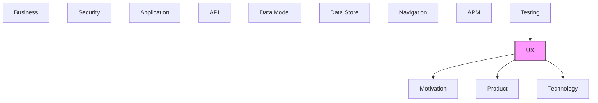

# UX

[← Back to README](../README.md)

User interface components, screens, and user experience elements.

## Report Index

- [Layer Introduction](#layer-introduction)
- [Intra-Layer Relationships](#intra-layer-relationships)
- [Inter-Layer Dependencies](#inter-layer-dependencies)
- [Inter-Layer Relationships Table](#inter-layer-relationships-table)
- [Element Reference](#element-reference)

## Layer Introduction

| Metric                    | Count |
| ------------------------- | ----- |
| Elements                  | 128   |
| Intra-Layer Relationships | 323   |
| Inter-Layer Relationships | 915   |
| Inbound Relationships     | 641   |
| Outbound Relationships    | 274   |

**Cross-Layer References**:

- **Upstream layers**: [Testing](./13-testing-layer-report.md)
- **Downstream layers**: [Motivation](./01-motivation-layer-report.md), [Product](./03-product-layer-report.md), [Technology](./06-technology-layer-report.md)

## Intra-Layer Relationships

*This layer has >30 elements. Summary table shown instead of diagram.*

| Element                                                              | Type               | Relationships |
| -------------------------------------------------------------------- | ------------------ | ------------- |
| `ux.actionpattern.collapseexpand-toggle-shiftenter-or-chevron-click` | `actionpattern`    | 3             |
| `ux.actionpattern.layer-stack-camera-orbit-and-presets`              | `actionpattern`    | 2             |
| `ux.actionpattern.link-navigation`                                   | `actionpattern`    | 4             |
| `ux.actionpattern.node-drag-reposition`                              | `actionpattern`    | 2             |
| `ux.actionpattern.node-select-on-click-or-enterspace`                | `actionpattern`    | 3             |
| `ux.actionpattern.panzoom-viewport-gesture`                          | `actionpattern`    | 2             |
| `ux.librarycomponent.activity-timeline`                              | `librarycomponent` | 2             |
| `ux.librarycomponent.adjacency-matrix`                               | `librarycomponent` | 9             |
| `ux.librarycomponent.alert-strip`                                    | `librarycomponent` | 3             |
| `ux.librarycomponent.app-title`                                      | `librarycomponent` | 3             |
| `ux.librarycomponent.asset-card`                                     | `librarycomponent` | 2             |
| `ux.librarycomponent.asset-grid`                                     | `librarycomponent` | 1             |
| `ux.librarycomponent.avatar`                                         | `librarycomponent` | 1             |
| `ux.librarycomponent.badge`                                          | `librarycomponent` | 3             |
| `ux.librarycomponent.bar-chart`                                      | `librarycomponent` | 1             |
| `ux.librarycomponent.bar-h`                                          | `librarycomponent` | 1             |
| `ux.librarycomponent.bar-v`                                          | `librarycomponent` | 1             |
| `ux.librarycomponent.branch-map`                                     | `librarycomponent` | 4             |
| `ux.librarycomponent.bridge-node-list`                               | `librarycomponent` | 8             |
| `ux.librarycomponent.button`                                         | `librarycomponent` | 19            |
| `ux.librarycomponent.calendar`                                       | `librarycomponent` | 5             |
| `ux.librarycomponent.camera-controls`                                | `librarycomponent` | 19            |
| `ux.librarycomponent.chart-wrapper`                                  | `librarycomponent` | 1             |
| `ux.librarycomponent.chat-composer`                                  | `librarycomponent` | 3             |
| `ux.librarycomponent.chat-container`                                 | `librarycomponent` | 1             |
| `ux.librarycomponent.chat-divider`                                   | `librarycomponent` | 1             |
| `ux.librarycomponent.chat-markdown-content`                          | `librarycomponent` | 1             |
| `ux.librarycomponent.chat-message`                                   | `librarycomponent` | 2             |
| `ux.librarycomponent.chat-suggestions`                               | `librarycomponent` | 1             |
| `ux.librarycomponent.chip`                                           | `librarycomponent` | 10            |
| `ux.librarycomponent.command-palette`                                | `librarycomponent` | 2             |
| `ux.librarycomponent.config-tile`                                    | `librarycomponent` | 2             |
| `ux.librarycomponent.confirm-dialog`                                 | `librarycomponent` | 4             |
| `ux.librarycomponent.detail-drawer`                                  | `librarycomponent` | 1             |
| `ux.librarycomponent.diff-viewer`                                    | `librarycomponent` | 4             |
| `ux.librarycomponent.donut`                                          | `librarycomponent` | 1             |
| `ux.librarycomponent.drawer`                                         | `librarycomponent` | 3             |
| `ux.librarycomponent.entity-picker`                                  | `librarycomponent` | 4             |
| `ux.librarycomponent.field`                                          | `librarycomponent` | 1             |
| `ux.librarycomponent.filter-bar`                                     | `librarycomponent` | 3             |
| `ux.librarycomponent.filter-dropdown`                                | `librarycomponent` | 2             |
| `ux.librarycomponent.follow-control`                                 | `librarycomponent` | 9             |
| `ux.librarycomponent.form-callout`                                   | `librarycomponent` | 2             |
| `ux.librarycomponent.graph-canvas-ux`                                | `librarycomponent` | 15            |
| `ux.librarycomponent.graph-collapse-control-ux`                      | `librarycomponent` | 4             |
| `ux.librarycomponent.graph-edge-inspector-ux`                        | `librarycomponent` | 3             |
| `ux.librarycomponent.graph-edge-shape-ux`                            | `librarycomponent` | 3             |
| `ux.librarycomponent.graph-edge-ux`                                  | `librarycomponent` | 5             |
| `ux.librarycomponent.graph-inspector-ux`                             | `librarycomponent` | 1             |
| `ux.librarycomponent.graph-node-ux`                                  | `librarycomponent` | 4             |
| `ux.librarycomponent.graph-toolbar-ux`                               | `librarycomponent` | 3             |
| `ux.librarycomponent.hash-set-diff`                                  | `librarycomponent` | 3             |
| `ux.librarycomponent.heatmap`                                        | `librarycomponent` | 1             |
| `ux.librarycomponent.hierarchy-row`                                  | `librarycomponent` | 1             |
| `ux.librarycomponent.hierarchy-tree`                                 | `librarycomponent` | 1             |
| `ux.librarycomponent.hive-plot`                                      | `librarycomponent` | 6             |
| `ux.librarycomponent.icon`                                           | `librarycomponent` | 51            |
| `ux.librarycomponent.inspector-panel`                                | `librarycomponent` | 2             |
| `ux.librarycomponent.kanban-board`                                   | `librarycomponent` | 5             |
| `ux.librarycomponent.key-value-editor`                               | `librarycomponent` | 5             |
| `ux.librarycomponent.kvgrid`                                         | `librarycomponent` | 1             |
| `ux.librarycomponent.layer-list`                                     | `librarycomponent` | 8             |
| `ux.librarycomponent.layer-pair-list`                                | `librarycomponent` | 8             |
| `ux.librarycomponent.layer-stack`                                    | `librarycomponent` | 7             |
| `ux.librarycomponent.layered-graph-context-ux`                       | `librarycomponent` | 15            |
| `ux.librarycomponent.layered-graph-explorer`                         | `librarycomponent` | 19            |
| `ux.librarycomponent.line-chart`                                     | `librarycomponent` | 1             |
| `ux.librarycomponent.lineage-rail`                                   | `librarycomponent` | 3             |
| `ux.librarycomponent.link-category-filter`                           | `librarycomponent` | 8             |
| `ux.librarycomponent.log-stream`                                     | `librarycomponent` | 1             |
| `ux.librarycomponent.map-canvas`                                     | `librarycomponent` | 1             |
| `ux.librarycomponent.metric-row`                                     | `librarycomponent` | 3             |
| `ux.librarycomponent.mini-calendar`                                  | `librarycomponent` | 1             |
| `ux.librarycomponent.modal`                                          | `librarycomponent` | 6             |
| `ux.librarycomponent.nav-item`                                       | `librarycomponent` | 3             |
| `ux.librarycomponent.number-input`                                   | `librarycomponent` | 1             |
| `ux.librarycomponent.ordered-list`                                   | `librarycomponent` | 3             |
| `ux.librarycomponent.page-header`                                    | `librarycomponent` | 2             |
| `ux.librarycomponent.pane-rail`                                      | `librarycomponent` | 2             |
| `ux.librarycomponent.panel`                                          | `librarycomponent` | 2             |
| `ux.librarycomponent.pipeline-card`                                  | `librarycomponent` | 3             |
| `ux.librarycomponent.plane-layout-control`                           | `librarycomponent` | 8             |
| `ux.librarycomponent.popover`                                        | `librarycomponent` | 1             |
| `ux.librarycomponent.predicate-label-control`                        | `librarycomponent` | 8             |
| `ux.librarycomponent.progress-bar`                                   | `librarycomponent` | 3             |
| `ux.librarycomponent.quick-access-grid`                              | `librarycomponent` | 4             |
| `ux.librarycomponent.quick-access-tile`                              | `librarycomponent` | 4             |
| `ux.librarycomponent.reach-inspector`                                | `librarycomponent` | 10            |
| `ux.librarycomponent.relationship-builder`                           | `librarycomponent` | 3             |
| `ux.librarycomponent.result-card`                                    | `librarycomponent` | 5             |
| `ux.librarycomponent.row-menu`                                       | `librarycomponent` | 2             |
| `ux.librarycomponent.segmented-control`                              | `librarycomponent` | 12            |
| `ux.librarycomponent.select`                                         | `librarycomponent` | 4             |
| `ux.librarycomponent.shell-layout`                                   | `librarycomponent` | 8             |
| `ux.librarycomponent.side-by-side-diff`                              | `librarycomponent` | 3             |
| `ux.librarycomponent.sidebar`                                        | `librarycomponent` | 5             |
| `ux.librarycomponent.sparkline`                                      | `librarycomponent` | 3             |
| `ux.librarycomponent.split-pane`                                     | `librarycomponent` | 1             |
| `ux.librarycomponent.stacked-bar`                                    | `librarycomponent` | 1             |
| `ux.librarycomponent.stat-grid`                                      | `librarycomponent` | 1             |
| `ux.librarycomponent.stat-tile`                                      | `librarycomponent` | 4             |
| `ux.librarycomponent.status-badge`                                   | `librarycomponent` | 1             |
| `ux.librarycomponent.status-timeline`                                | `librarycomponent` | 1             |
| `ux.librarycomponent.statusbar`                                      | `librarycomponent` | 3             |
| `ux.librarycomponent.tab-bar`                                        | `librarycomponent` | 2             |
| `ux.librarycomponent.table`                                          | `librarycomponent` | 2             |
| `ux.librarycomponent.text-area`                                      | `librarycomponent` | 1             |
| `ux.librarycomponent.text-input`                                     | `librarycomponent` | 2             |
| `ux.librarycomponent.thinking-block`                                 | `librarycomponent` | 2             |
| `ux.librarycomponent.titlebar`                                       | `librarycomponent` | 2             |
| `ux.librarycomponent.toast`                                          | `librarycomponent` | 2             |
| `ux.librarycomponent.tool-block`                                     | `librarycomponent` | 2             |
| `ux.librarycomponent.tooltip`                                        | `librarycomponent` | 1             |
| `ux.librarycomponent.topbar`                                         | `librarycomponent` | 2             |
| `ux.librarycomponent.topology-node`                                  | `librarycomponent` | 1             |
| `ux.librarycomponent.trace-viewer`                                   | `librarycomponent` | 2             |
| `ux.librarycomponent.tri-state`                                      | `librarycomponent` | 1             |
| `ux.librarycomponent.version-pill`                                   | `librarycomponent` | 8             |
| `ux.librarycomponent.version-timeline`                               | `librarycomponent` | 3             |
| `ux.librarycomponent.view-switcher`                                  | `librarycomponent` | 18            |
| `ux.librarycomponent.workspace-switcher-dialog`                      | `librarycomponent` | 4             |
| `ux.statepattern.canvas-theme-light-or-dark-canvas`                  | `statepattern`     | 2             |
| `ux.statepattern.collapsed-node-set-progressive-disclosure`          | `statepattern`     | 2             |
| `ux.statepattern.layered-selection-and-reach`                        | `statepattern`     | 5             |
| `ux.statepattern.layout-computation-state`                           | `statepattern`     | 1             |
| `ux.statepattern.live-simulation-vs-static-layout-state`             | `statepattern`     | 1             |
| `ux.statepattern.node-hover-and-selection-state`                     | `statepattern`     | 3             |
| `ux.uxlibrary.heimdall-ui`                                           | `uxlibrary`        | 115           |

## Inter-Layer Dependencies

## Inter-Layer Relationships Table

| Relationship ID                                            | Source Node                                                                                                                           | Dest Node                                                                                   | Dest Layer   | Predicate    | Cardinality  | Strength |
| ---------------------------------------------------------- | ------------------------------------------------------------------------------------------------------------------------------------- | ------------------------------------------------------------------------------------------- | ------------ | ------------ | ------------ | -------- |
| `testing.testcasesketch.tests.ux.librarycomponent`         | `testing.testcasesketch.adjacency-matrix-aggregatelayer-a-cross-layer-cell-toggles-the-layer-pair-filter-a-diagonal-cell-or-56bd1c22` | `ux.librarycomponent.adjacency-matrix`                                                      | `ux`         | `tests`      | many-to-many | medium   |
| `testing.testcasesketch.tests.ux.librarycomponent`         | `testing.testcasesketch.adjacency-matrix-aggregatelayer-draws-one-heat-cell-per-non-empty-layer-pair`                                 | `ux.librarycomponent.adjacency-matrix`                                                      | `ux`         | `tests`      | many-to-many | medium   |
| `testing.testcasesketch.tests.ux.librarycomponent`         | `testing.testcasesketch.adjacency-matrix-aggregatelayer-on-layer-cell-select-replaces-the-default-filter-and-focus-toggles`           | `ux.librarycomponent.adjacency-matrix`                                                      | `ux`         | `tests`      | many-to-many | medium   |
| `testing.testcasesketch.tests.ux.librarycomponent`         | `testing.testcasesketch.adjacency-matrix-aggregatelayer-symmetric-adds-both-directions-into-the-upper-triangle`                       | `ux.librarycomponent.adjacency-matrix`                                                      | `ux`         | `tests`      | many-to-many | medium   |
| `testing.testcasesketch.tests.ux.librarycomponent`         | `testing.testcasesketch.adjacency-matrix-aggregatelayer-visual-dark-canvas-heat-map-with-an-active-pair`                              | `ux.librarycomponent.adjacency-matrix`                                                      | `ux`         | `tests`      | many-to-many | medium   |
| `testing.testcasesketch.tests.ux.librarycomponent`         | `testing.testcasesketch.adjacency-matrix-aggregatelayer-visual-light-canvas-symmetric-heat-map-with-a-focused-layer`                  | `ux.librarycomponent.adjacency-matrix`                                                      | `ux`         | `tests`      | many-to-many | medium   |
| `testing.testcasesketch.tests.ux.librarycomponent`         | `testing.testcasesketch.adjacency-matrix-cell-click-selects-the-link-source`                                                          | `ux.librarycomponent.adjacency-matrix`                                                      | `ux`         | `tests`      | many-to-many | medium   |
| `testing.testcasesketch.tests.ux.librarycomponent`         | `testing.testcasesketch.adjacency-matrix-draws-one-cell-per-link-and-one-header-button-per-node`                                      | `ux.librarycomponent.adjacency-matrix`                                                      | `ux`         | `tests`      | many-to-many | medium   |
| `testing.testcasesketch.tests.ux.librarycomponent`         | `testing.testcasesketch.adjacency-matrix-grid-semantics-symmetric-cells-holding-both-directions-say-so`                               | `ux.librarycomponent.adjacency-matrix`                                                      | `ux`         | `tests`      | many-to-many | medium   |
| `testing.testcasesketch.tests.ux.librarycomponent`         | `testing.testcasesketch.adjacency-matrix-grid-semantics-the-cells-form-a-grid-with-row-and-column-headers-the-drawing-98466b8c`       | `ux.librarycomponent.adjacency-matrix`                                                      | `ux`         | `tests`      | many-to-many | medium   |
| `testing.testcasesketch.tests.ux.librarycomponent`         | `testing.testcasesketch.adjacency-matrix-header-click-and-keyboard-select-a-node-clicking-again-clears-it`                            | `ux.librarycomponent.adjacency-matrix`                                                      | `ux`         | `tests`      | many-to-many | medium   |
| `testing.testcasesketch.tests.ux.librarycomponent`         | `testing.testcasesketch.adjacency-matrix-keyboard-cells-focus-stays-in-the-grid-the-drawn-cell-shows-the-ring-and-the-74b0fc0c`       | `ux.librarycomponent.adjacency-matrix`                                                      | `ux`         | `tests`      | many-to-many | medium   |
| `testing.testcasesketch.tests.ux.librarycomponent`         | `testing.testcasesketch.adjacency-matrix-keyboard-cells-one-tab-stop-for-the-cells-arrows-move-enter-selects`                         | `ux.librarycomponent.adjacency-matrix`                                                      | `ux`         | `tests`      | many-to-many | medium   |
| `testing.testcasesketch.tests.ux.librarycomponent`         | `testing.testcasesketch.adjacency-matrix-on-cell-select-and-order-on-cell-select-gets-the-drawn-link-and-every-link-in-the-f20ec09e`  | `ux.librarycomponent.adjacency-matrix`                                                      | `ux`         | `tests`      | many-to-many | medium   |
| `testing.testcasesketch.tests.ux.librarycomponent`         | `testing.testcasesketch.adjacency-matrix-on-cell-select-and-order-ordercluster-puts-each-community-on-adjacent-rows-the-1e77a9db`     | `ux.librarycomponent.adjacency-matrix`                                                      | `ux`         | `tests`      | many-to-many | medium   |
| `testing.testcasesketch.tests.ux.librarycomponent`         | `testing.testcasesketch.adjacency-matrix-on-cell-select-and-order-visual-light-canvas-cluster-order`                                  | `ux.librarycomponent.adjacency-matrix`                                                      | `ux`         | `tests`      | many-to-many | medium   |
| `testing.testcasesketch.tests.ux.librarycomponent`         | `testing.testcasesketch.adjacency-matrix-selection-follows-cross-layer-links-per-the-follow-setting`                                  | `ux.librarycomponent.adjacency-matrix`                                                      | `ux`         | `tests`      | many-to-many | medium   |
| `testing.testcasesketch.tests.ux.librarycomponent`         | `testing.testcasesketch.adjacency-matrix-symmetric-clicking-a-cell-holding-both-directions-selects-its-drawn-link-source`             | `ux.librarycomponent.adjacency-matrix`                                                      | `ux`         | `tests`      | many-to-many | medium   |
| `testing.testcasesketch.tests.ux.librarycomponent`         | `testing.testcasesketch.adjacency-matrix-symmetric-merges-both-directions-into-one-cell-above-the-diagonal`                           | `ux.librarycomponent.adjacency-matrix`                                                      | `ux`         | `tests`      | many-to-many | medium   |
| `testing.testcasesketch.tests.ux.librarycomponent`         | `testing.testcasesketch.adjacency-matrix-symmetric-on-link-select-receives-the-drawn-link-and-both-links-of-a-merged-cell`            | `ux.librarycomponent.adjacency-matrix`                                                      | `ux`         | `tests`      | many-to-many | medium   |
| `testing.testcasesketch.tests.ux.librarycomponent`         | `testing.testcasesketch.adjacency-matrix-symmetric-visual-light-canvas-symmetric-with-a-selection`                                    | `ux.librarycomponent.adjacency-matrix`                                                      | `ux`         | `tests`      | many-to-many | medium   |
| `testing.testcasesketch.tests.ux.librarycomponent`         | `testing.testcasesketch.adjacency-matrix-virtualization-a-cell-in-the-last-visible-column-renders`                                    | `ux.librarycomponent.adjacency-matrix`                                                      | `ux`         | `tests`      | many-to-many | medium   |
| `testing.testcasesketch.tests.ux.librarycomponent`         | `testing.testcasesketch.adjacency-matrix-virtualization-a-focused-cell-keeps-focus-its-ring-and-its-indices-while-the-55a10509`       | `ux.librarycomponent.adjacency-matrix`                                                      | `ux`         | `tests`      | many-to-many | medium   |
| `testing.testcasesketch.tests.ux.librarycomponent`         | `testing.testcasesketch.adjacency-matrix-virtualization-a-selected-link-id-set-from-outside-scrolls-its-cell-into-view`               | `ux.librarycomponent.adjacency-matrix`                                                      | `ux`         | `tests`      | many-to-many | medium   |
| `testing.testcasesketch.tests.ux.librarycomponent`         | `testing.testcasesketch.adjacency-matrix-virtualization-in-a-fixed-height-explorer-the-matrix-is-the-only-scroll-area-and-a09aa20b`   | `ux.librarycomponent.adjacency-matrix`                                                      | `ux`         | `tests`      | many-to-many | medium   |
| `testing.testcasesketch.tests.ux.librarycomponent`         | `testing.testcasesketch.adjacency-matrix-virtualization-keyboard-focus-survives-scrolling-arrows-move-past-the-window-row-4a5df257`   | `ux.librarycomponent.adjacency-matrix`                                                      | `ux`         | `tests`      | many-to-many | medium   |
| `testing.testcasesketch.tests.ux.librarycomponent`         | `testing.testcasesketch.adjacency-matrix-virtualization-labels-stay-aligned-with-the-cells-while-scrolling-both-axes`                 | `ux.librarycomponent.adjacency-matrix`                                                      | `ux`         | `tests`      | many-to-many | medium   |
| `testing.testcasesketch.tests.ux.librarycomponent`         | `testing.testcasesketch.adjacency-matrix-virtualization-past-the-threshold-only-the-window-renders-and-the-dom-stays-bounded`         | `ux.librarycomponent.adjacency-matrix`                                                      | `ux`         | `tests`      | many-to-many | medium   |
| `testing.testcasesketch.tests.ux.librarycomponent`         | `testing.testcasesketch.adjacency-matrix-virtualization-the-grid-states-the-full-size-the-rendered-window-carries-its-row-238d3463`   | `ux.librarycomponent.adjacency-matrix`                                                      | `ux`         | `tests`      | many-to-many | medium   |
| `testing.testcasesketch.tests.ux.librarycomponent`         | `testing.testcasesketch.adjacency-matrix-virtualization-visual-dark-canvas-virtualized-and-scrolled`                                  | `ux.librarycomponent.adjacency-matrix`                                                      | `ux`         | `tests`      | many-to-many | medium   |
| `testing.testcasesketch.tests.ux.librarycomponent`         | `testing.testcasesketch.adjacency-matrix-virtualization-visual-light-canvas-virtualized-and-scrolled`                                 | `ux.librarycomponent.adjacency-matrix`                                                      | `ux`         | `tests`      | many-to-many | medium   |
| `testing.testcasesketch.tests.ux.librarycomponent`         | `testing.testcasesketch.adjacency-matrix-visual-dark-canvas-with-a-followed-selection`                                                | `ux.librarycomponent.adjacency-matrix`                                                      | `ux`         | `tests`      | many-to-many | medium   |
| `testing.testcasesketch.tests.ux.librarycomponent`         | `testing.testcasesketch.adjacency-matrix-visual-light-canvas-with-every-predicate-code`                                               | `ux.librarycomponent.adjacency-matrix`                                                      | `ux`         | `tests`      | many-to-many | medium   |
| `testing.testcasesketch.tests.ux.librarycomponent`         | `testing.testcasesketch.branch-map-click-and-keyboard-select-stations-and-lines-escape-clears`                                        | `ux.librarycomponent.branch-map`                                                            | `ux`         | `tests`      | many-to-many | medium   |
| `testing.testcasesketch.tests.ux.librarycomponent`         | `testing.testcasesketch.branch-map-on-house-data-a-bundle-expanded-through-the-expanded-prop-gets-a-collapse-that-re-44d61a7d`        | `ux.librarycomponent.branch-map`                                                            | `ux`         | `tests`      | many-to-many | medium   |
| `testing.testcasesketch.tests.ux.librarycomponent`         | `testing.testcasesketch.branch-map-on-house-data-click-selects-a-station-again-clears-the-inspector-shows-the-house-record`           | `ux.librarycomponent.branch-map`                                                            | `ux`         | `tests`      | many-to-many | medium   |
| `testing.testcasesketch.tests.ux.librarycomponent`         | `testing.testcasesketch.branch-map-on-house-data-documentation-robotics-bundles-past-the-lane-budget-a-bundle-and-the-group-84657fef` | `ux.librarycomponent.branch-map`                                                            | `ux`         | `tests`      | many-to-many | medium   |
| `testing.testcasesketch.tests.ux.librarycomponent`         | `testing.testcasesketch.branch-map-on-house-data-draws-the-three-projects-from-now-with-no-console-errors`                            | `ux.librarycomponent.branch-map`                                                            | `ux`         | `tests`      | many-to-many | medium   |
| `testing.testcasesketch.tests.ux.librarycomponent`         | `testing.testcasesketch.branch-map-on-house-data-the-inspector-links-to-what-a-station-waits-on-in-another-project`                   | `ux.librarycomponent.branch-map`                                                            | `ux`         | `tests`      | many-to-many | medium   |
| `testing.testcasesketch.tests.ux.librarycomponent`         | `testing.testcasesketch.branch-map-on-house-data-visual-documentation-robotics-expanded`                                              | `ux.librarycomponent.branch-map`                                                            | `ux`         | `tests`      | many-to-many | medium   |
| `testing.testcasesketch.tests.ux.librarycomponent`         | `testing.testcasesketch.branch-map-visual-documentation-robotics-bundled-and-expanded`                                                | `ux.librarycomponent.branch-map`                                                            | `ux`         | `tests`      | many-to-many | medium   |
| `testing.testcasesketch.tests.ux.librarycomponent`         | `testing.testcasesketch.branch-map-visual-theme-canvas-three-projects-from-now`                                                       | `ux.librarycomponent.branch-map`                                                            | `ux`         | `tests`      | many-to-many | medium   |
| `testing.testcasesketch.tests.ux.librarycomponent`         | `testing.testcasesketch.graph-canvas-accessible-names-304-edge-popover-dialog-is-named-by-edge-and-node-labels`                       | `ux.librarycomponent.graph-canvas-ux`                                                       | `ux`         | `tests`      | many-to-many | medium   |
| `testing.testcasesketch.tests.ux.librarycomponent`         | `testing.testcasesketch.graph-canvas-accessible-names-304-interactive-edges-are-named-by-node-labels-not-ids`                         | `ux.librarycomponent.graph-canvas-ux`                                                       | `ux`         | `tests`      | many-to-many | medium   |
| `testing.testcasesketch.tests.ux.librarycomponent`         | `testing.testcasesketch.graph-canvas-accessible-names-304-node-popover-dialog-is-named-by-the-node-label`                             | `ux.librarycomponent.graph-canvas-ux`                                                       | `ux`         | `tests`      | many-to-many | medium   |
| `testing.testcasesketch.tests.ux.librarycomponent`         | `testing.testcasesketch.graph-canvas-accessible-names-304-popover-dialog-for-an-unlabelled-edge-is-named-by-node-labels`              | `ux.librarycomponent.graph-canvas-ux`                                                       | `ux`         | `tests`      | many-to-many | medium   |
| `testing.testcasesketch.tests.ux.librarycomponent`         | `testing.testcasesketch.graph-canvas-hover-tooltip-placement-323-edge-tooltip-waits-for-tooltip-delay-before-showing`                 | `ux.librarycomponent.graph-canvas-ux`                                                       | `ux`         | `tests`      | many-to-many | medium   |
| `testing.testcasesketch.tests.ux.librarycomponent`         | `testing.testcasesketch.graph-canvas-hover-tooltip-placement-323-labelled-edge-near-the-canvas-top-tooltip-flips-below-the-2326f2d8`  | `ux.librarycomponent.graph-canvas-ux`                                                       | `ux`         | `tests`      | many-to-many | medium   |
| `testing.testcasesketch.tests.ux.librarycomponent`         | `testing.testcasesketch.graph-canvas-hover-tooltip-placement-323-labelled-edge-tooltip-sits-above-the-label-without-a1ce7be4`         | `ux.librarycomponent.graph-canvas-ux`                                                       | `ux`         | `tests`      | many-to-many | medium   |
| `testing.testcasesketch.tests.ux.librarycomponent`         | `testing.testcasesketch.graph-canvas-hover-tooltip-placement-323-labelled-vertical-edge-tooltip-clears-the-label-and-stays-35a5e023`  | `ux.librarycomponent.graph-canvas-ux`                                                       | `ux`         | `tests`      | many-to-many | medium   |
| `testing.testcasesketch.tests.ux.librarycomponent`         | `testing.testcasesketch.graph-canvas-hover-tooltip-placement-323-node-tooltip-uses-the-same-tooltip-delay`                            | `ux.librarycomponent.graph-canvas-ux`                                                       | `ux`         | `tests`      | many-to-many | medium   |
| `testing.testcasesketch.tests.ux.librarycomponent`         | `testing.testcasesketch.graph-canvas-hover-tooltip-placement-323-tooltip-stays-clear-of-the-label-while-the-canvas-zooms`             | `ux.librarycomponent.graph-canvas-ux`                                                       | `ux`         | `tests`      | many-to-many | medium   |
| `testing.testcasesketch.tests.ux.librarycomponent`         | `testing.testcasesketch.graph-canvas-hover-tooltip-placement-323-unlabelled-edge-tooltip-anchors-at-the-path-midpoint`                | `ux.librarycomponent.graph-canvas-ux`                                                       | `ux`         | `tests`      | many-to-many | medium   |
| `testing.testcasesketch.tests.ux.librarycomponent`         | `testing.testcasesketch.graph-canvas-hover-tooltip-placement-layer-lanes-323-link-with-a-predicate-pill-tooltip-sits-beside-742ff016` | `ux.librarycomponent.graph-canvas-ux`                                                       | `ux`         | `tests`      | many-to-many | medium   |
| `testing.testcasesketch.tests.ux.librarycomponent`         | `testing.testcasesketch.graph-canvas-hover-tooltip-placement-layer-lanes-323-link-without-a-pill-tooltip-anchors-on-the-208a5652`     | `ux.librarycomponent.graph-canvas-ux`                                                       | `ux`         | `tests`      | many-to-many | medium   |
| `testing.testcasesketch.tests.ux.librarycomponent`         | `testing.testcasesketch.graph-canvas-layer-lanes-a-cancelled-drag-releases-the-pill-hold`                                             | `ux.librarycomponent.graph-canvas-ux`                                                       | `ux`         | `tests`      | many-to-many | medium   |
| `testing.testcasesketch.tests.ux.librarycomponent`         | `testing.testcasesketch.graph-canvas-layer-lanes-a-custom-render-node-is-untouched-by-node-labels-reached`                            | `ux.librarycomponent.graph-canvas-ux`                                                       | `ux`         | `tests`      | many-to-many | medium   |
| `testing.testcasesketch.tests.ux.librarycomponent`         | `testing.testcasesketch.graph-canvas-layer-lanes-dragging-a-node-holds-the-pill-placement-and-moves-pills-along-their-links-b4f5df03` | `ux.librarycomponent.graph-canvas-ux`                                                       | `ux`         | `tests`      | many-to-many | medium   |
| `testing.testcasesketch.tests.ux.librarycomponent`         | `testing.testcasesketch.graph-canvas-layer-lanes-draws-one-lane-per-layer-every-node-and-every-link`                                  | `ux.librarycomponent.graph-canvas-ux`                                                       | `ux`         | `tests`      | many-to-many | medium   |
| `testing.testcasesketch.tests.ux.librarycomponent`         | `testing.testcasesketch.graph-canvas-layer-lanes-gutter-mode-a-category-filter-leaves-the-lanes-where-they-are`                       | `ux.librarycomponent.graph-canvas-ux`                                                       | `ux`         | `tests`      | many-to-many | medium   |
| `testing.testcasesketch.tests.ux.librarycomponent`         | `testing.testcasesketch.graph-canvas-layer-lanes-gutter-routes-follow-a-dragged-node-with-the-pill-placement-held`                    | `ux.librarycomponent.graph-canvas-ux`                                                       | `ux`         | `tests`      | many-to-many | medium   |
| `testing.testcasesketch.tests.ux.librarycomponent`         | `testing.testcasesketch.graph-canvas-layer-lanes-hover-pan-and-zoom-do-not-re-run-the-pill-placement`                                 | `ux.librarycomponent.graph-canvas-ux`                                                       | `ux`         | `tests`      | many-to-many | medium   |
| `testing.testcasesketch.tests.ux.librarycomponent`         | `testing.testcasesketch.graph-canvas-layer-lanes-intra-links-bundled-a-drag-keeps-links-bundled-and-holds-the-pill-placement`         | `ux.librarycomponent.graph-canvas-ux`                                                       | `ux`         | `tests`      | many-to-many | medium   |
| `testing.testcasesketch.tests.ux.librarycomponent`         | `testing.testcasesketch.graph-canvas-layer-lanes-intra-links-bundled-each-row-shares-one-trunk-the-reach-and-a-hovered-node-70d23eb9` | `ux.librarycomponent.graph-canvas-ux`                                                       | `ux`         | `tests`      | many-to-many | medium   |
| `testing.testcasesketch.tests.ux.librarycomponent`         | `testing.testcasesketch.graph-canvas-layer-lanes-intra-links-bundled-keyboard-focus-fans-a-node-out-trunk-links-get-no-hit-8e2c2683`  | `ux.librarycomponent.graph-canvas-ux`                                                       | `ux`         | `tests`      | many-to-many | medium   |
| `testing.testcasesketch.tests.ux.librarycomponent`         | `testing.testcasesketch.graph-canvas-layer-lanes-intra-links-bundled-works-with-gutter-routing-and-with-reached-chips-tags-8bfc42f3`  | `ux.librarycomponent.graph-canvas-ux`                                                       | `ux`         | `tests`      | many-to-many | medium   |
| `testing.testcasesketch.tests.ux.librarycomponent`         | `testing.testcasesketch.graph-canvas-layer-lanes-intra-links-none-draws-only-the-cross-layer-links`                                   | `ux.librarycomponent.graph-canvas-ux`                                                       | `ux`         | `tests`      | many-to-many | medium   |
| `testing.testcasesketch.tests.ux.librarycomponent`         | `testing.testcasesketch.graph-canvas-layer-lanes-keyboard-enter-on-a-focused-node-selects-it`                                         | `ux.librarycomponent.graph-canvas-ux`                                                       | `ux`         | `tests`      | many-to-many | medium   |
| `testing.testcasesketch.tests.ux.librarycomponent`         | `testing.testcasesketch.graph-canvas-layer-lanes-keyboard-focus-pans-an-off-screen-node-into-view-without-scrolling-the-15c05e96`     | `ux.librarycomponent.graph-canvas-ux`                                                       | `ux`         | `tests`      | many-to-many | medium   |
| `testing.testcasesketch.tests.ux.librarycomponent`         | `testing.testcasesketch.graph-canvas-layer-lanes-keyboard-hiding-the-focused-nodes-layer-moves-focus-to-a-neighbour`                  | `ux.librarycomponent.graph-canvas-ux`                                                       | `ux`         | `tests`      | many-to-many | medium   |
| `testing.testcasesketch.tests.ux.librarycomponent`         | `testing.testcasesketch.graph-canvas-layer-lanes-keyboard-home-and-end-in-vertical-lanes`                                             | `ux.librarycomponent.graph-canvas-ux`                                                       | `ux`         | `tests`      | many-to-many | medium   |
| `testing.testcasesketch.tests.ux.librarycomponent`         | `testing.testcasesketch.graph-canvas-layer-lanes-keyboard-in-bundled-mode-arrows-fan-out-the-focused-node-and-fold-the-one-a612b46f`  | `ux.librarycomponent.graph-canvas-ux`                                                       | `ux`         | `tests`      | many-to-many | medium   |
| `testing.testcasesketch.tests.ux.librarycomponent`         | `testing.testcasesketch.graph-canvas-layer-lanes-keyboard-left-right-along-a-lane-home-end-to-its-ends-up-down-to-a-linked-0922f825`  | `ux.librarycomponent.graph-canvas-ux`                                                       | `ux`         | `tests`      | many-to-many | medium   |
| `testing.testcasesketch.tests.ux.librarycomponent`         | `testing.testcasesketch.graph-canvas-layer-lanes-keyboard-one-tab-stop-for-the-lane-nodes-entering-at-the-first-node-or-the-ac21af87` | `ux.librarycomponent.graph-canvas-ux`                                                       | `ux`         | `tests`      | many-to-many | medium   |
| `testing.testcasesketch.tests.ux.librarycomponent`         | `testing.testcasesketch.graph-canvas-layer-lanes-keyboard-other-layouts-keep-one-tab-stop-per-node`                                   | `ux.librarycomponent.graph-canvas-ux`                                                       | `ux`         | `tests`      | many-to-many | medium   |
| `testing.testcasesketch.tests.ux.librarycomponent`         | `testing.testcasesketch.graph-canvas-layer-lanes-keyboard-space-selects-shifttab-comes-back-to-the-selection`                         | `ux.librarycomponent.graph-canvas-ux`                                                       | `ux`         | `tests`      | many-to-many | medium   |
| `testing.testcasesketch.tests.ux.librarycomponent`         | `testing.testcasesketch.graph-canvas-layer-lanes-keyboard-the-hint-is-visually-hidden-a-1px-box-but-names-space-and-escape`           | `ux.librarycomponent.graph-canvas-ux`                                                       | `ux`         | `tests`      | many-to-many | medium   |
| `testing.testcasesketch.tests.ux.librarycomponent`         | `testing.testcasesketch.graph-canvas-layer-lanes-keyboard-vertical-lanes-swap-the-axes-left-right-between-lanes-up-down-ba3a9ffc`     | `ux.librarycomponent.graph-canvas-ux`                                                       | `ux`         | `tests`      | many-to-many | medium   |
| `testing.testcasesketch.tests.ux.librarycomponent`         | `testing.testcasesketch.graph-canvas-layer-lanes-keyboard-works-with-reached-chips-focus-tag-follows-and-gutter-routing`              | `ux.librarycomponent.graph-canvas-ux`                                                       | `ux`         | `tests`      | many-to-many | medium   |
| `testing.testcasesketch.tests.ux.librarycomponent`         | `testing.testcasesketch.graph-canvas-layer-lanes-node-click-selects-through-the-layered-state-again-escape-or-the-b2c38dc0`           | `ux.librarycomponent.graph-canvas-ux`                                                       | `ux`         | `tests`      | many-to-many | medium   |
| `testing.testcasesketch.tests.ux.librarycomponent`         | `testing.testcasesketch.graph-canvas-layer-lanes-node-labels-follow-the-layered-label-toggle-reached-chips-name-the-cdf74296`         | `ux.librarycomponent.graph-canvas-ux`                                                       | `ux`         | `tests`      | many-to-many | medium   |
| `testing.testcasesketch.tests.ux.librarycomponent`         | `testing.testcasesketch.graph-canvas-layer-lanes-nodes-and-edges-are-optional-when-a-layered-graph-context-supplies-the-71a4fafe`     | `ux.librarycomponent.graph-canvas-ux`                                                       | `ux`         | `tests`      | many-to-many | medium   |
| `testing.testcasesketch.tests.ux.librarycomponent`         | `testing.testcasesketch.graph-canvas-layer-lanes-reached-dragging-the-selection-carries-its-tag-along`                                | `ux.librarycomponent.graph-canvas-ux`                                                       | `ux`         | `tests`      | many-to-many | medium   |
| `testing.testcasesketch.tests.ux.librarycomponent`         | `testing.testcasesketch.graph-canvas-layer-lanes-selection-follows-cross-layer-links-per-the-follow-setting-with-pills-and-bb91fe29`  | `ux.librarycomponent.graph-canvas-ux`                                                       | `ux`         | `tests`      | many-to-many | medium   |
| `testing.testcasesketch.tests.ux.librarycomponent`         | `testing.testcasesketch.graph-canvas-layer-lanes-skip-layer-routing-gutter-routes-the-links-that-skip-a-lane-outside-the-9061e8f1`    | `ux.librarycomponent.graph-canvas-ux`                                                       | `ux`         | `tests`      | many-to-many | medium   |
| `testing.testcasesketch.tests.ux.librarycomponent`         | `testing.testcasesketch.graph-canvas-layer-lanes-visual-bundled-intra-links-light-canvas`                                             | `ux.librarycomponent.graph-canvas-ux`                                                       | `ux`         | `tests`      | many-to-many | medium   |
| `testing.testcasesketch.tests.ux.librarycomponent`         | `testing.testcasesketch.graph-canvas-layer-lanes-visual-dark-canvas-with-a-followed-selection`                                        | `ux.librarycomponent.graph-canvas-ux`                                                       | `ux`         | `tests`      | many-to-many | medium   |
| `testing.testcasesketch.tests.ux.librarycomponent`         | `testing.testcasesketch.graph-canvas-layer-lanes-visual-gutter-routes-with-a-selection-light-canvas`                                  | `ux.librarycomponent.graph-canvas-ux`                                                       | `ux`         | `tests`      | many-to-many | medium   |
| `testing.testcasesketch.tests.ux.librarycomponent`         | `testing.testcasesketch.graph-canvas-layer-lanes-visual-light-canvas-heimdall-ux-model-with-every-predicate`                          | `ux.librarycomponent.graph-canvas-ux`                                                       | `ux`         | `tests`      | many-to-many | medium   |
| `testing.testcasesketch.tests.ux.librarycomponent`         | `testing.testcasesketch.graph-canvas-layer-lanes-visual-reached-chips-with-a-selection-light-canvas`                                  | `ux.librarycomponent.graph-canvas-ux`                                                       | `ux`         | `tests`      | many-to-many | medium   |
| `testing.testcasesketch.tests.ux.librarycomponent`         | `testing.testcasesketch.graph-canvas-layer-lanes-visual-vertical-bundled-intra-links-over-several-columns-dark-canvas`                | `ux.librarycomponent.graph-canvas-ux`                                                       | `ux`         | `tests`      | many-to-many | medium   |
| `testing.testcasesketch.tests.ux.librarycomponent`         | `testing.testcasesketch.graph-canvas-layer-lanes-visual-vertical-bundled-intra-links-with-a-selection-dark-canvas`                    | `ux.librarycomponent.graph-canvas-ux`                                                       | `ux`         | `tests`      | many-to-many | medium   |
| `testing.testcasesketch.tests.ux.librarycomponent`         | `testing.testcasesketch.graph-canvas-layer-lanes-visual-vertical-gutter-routes-with-reached-chips-dark-canvas`                        | `ux.librarycomponent.graph-canvas-ux`                                                       | `ux`         | `tests`      | many-to-many | medium   |
| `testing.testcasesketch.tests.ux.librarycomponent`         | `testing.testcasesketch.graph-canvas-layer-lanes-visual-vertical-lanes-light-canvas-with-a-selection`                                 | `ux.librarycomponent.graph-canvas-ux`                                                       | `ux`         | `tests`      | many-to-many | medium   |
| `testing.testcasesketch.tests.ux.librarycomponent`         | `testing.testcasesketch.graph-canvas-layer-lanes-visual-vertical-reached-chips-with-a-selection-dark-canvas`                          | `ux.librarycomponent.graph-canvas-ux`                                                       | `ux`         | `tests`      | many-to-many | medium   |
| `testing.testcasesketch.tests.ux.librarycomponent`         | `testing.testcasesketch.graph-canvas-node-measurement-331-a-custom-nodes-margins-stay-inside-its-foreign-object`                      | `ux.librarycomponent.graph-canvas-ux`                                                       | `ux`         | `tests`      | many-to-many | medium   |
| `testing.testcasesketch.tests.ux.librarycomponent`         | `testing.testcasesketch.graph-canvas-node-measurement-331-each-foreign-object-matches-its-rendered-node-in-world-units`               | `ux.librarycomponent.graph-canvas-ux`                                                       | `ux`         | `tests`      | many-to-many | medium   |
| `testing.testcasesketch.tests.ux.librarycomponent`         | `testing.testcasesketch.graph-canvas-node-measurement-331-edge-endpoints-land-on-the-node-outline`                                    | `ux.librarycomponent.graph-canvas-ux`                                                       | `ux`         | `tests`      | many-to-many | medium   |
| `testing.testcasesketch.tests.ux.librarycomponent`         | `testing.testcasesketch.graph-canvas-node-measurement-331-no-node-label-is-ellipsized-as-rendered-or-held-to-its-measured-7cf51b32`   | `ux.librarycomponent.graph-canvas-ux`                                                       | `ux`         | `tests`      | many-to-many | medium   |
| `testing.testcasesketch.tests.ux.librarycomponent`         | `testing.testcasesketch.hive-plot-a-selection-on-a-node-without-an-axis-is-named-as-not-shown`                                        | `ux.librarycomponent.hive-plot`                                                             | `ux`         | `tests`      | many-to-many | medium   |
| `testing.testcasesketch.tests.ux.librarycomponent`         | `testing.testcasesketch.hive-plot-axes-by-any-attribute-one-axis-per-value-sorted-titled-by-id`                                       | `ux.librarycomponent.hive-plot`                                                             | `ux`         | `tests`      | many-to-many | medium   |
| `testing.testcasesketch.tests.ux.librarycomponent`         | `testing.testcasesketch.hive-plot-axes-by-attribute-a-layer-filter-that-empties-an-axis-leaves-a-gap-the-rest-and-the-frame-55808548` | `ux.librarycomponent.hive-plot`                                                             | `ux`         | `tests`      | many-to-many | medium   |
| `testing.testcasesketch.tests.ux.librarycomponent`         | `testing.testcasesketch.hive-plot-axes-by-attribute-hiding-a-layer-hides-its-nodes-and-every-axis-stays-put`                          | `ux.librarycomponent.hive-plot`                                                             | `ux`         | `tests`      | many-to-many | medium   |
| `testing.testcasesketch.tests.ux.librarycomponent`         | `testing.testcasesketch.hive-plot-axis-order-puts-the-listed-axes-first`                                                              | `ux.librarycomponent.hive-plot`                                                             | `ux`         | `tests`      | many-to-many | medium   |
| `testing.testcasesketch.tests.ux.librarycomponent`         | `testing.testcasesketch.hive-plot-click-selects-clicking-again-and-escape-clear`                                                      | `ux.librarycomponent.hive-plot`                                                             | `ux`         | `tests`      | many-to-many | medium   |
| `testing.testcasesketch.tests.ux.librarycomponent`         | `testing.testcasesketch.hive-plot-draws-doubled-axes-every-link-and-one-focusable-button-per-node`                                    | `ux.librarycomponent.hive-plot`                                                             | `ux`         | `tests`      | many-to-many | medium   |
| `testing.testcasesketch.tests.ux.librarycomponent`         | `testing.testcasesketch.hive-plot-follow-changes-the-reach`                                                                           | `ux.librarycomponent.hive-plot`                                                             | `ux`         | `tests`      | many-to-many | medium   |
| `testing.testcasesketch.tests.ux.librarycomponent`         | `testing.testcasesketch.hive-plot-hiding-a-layer-leaves-a-gap-the-other-axes-and-the-frame-stay-put-split-unsplit`                    | `ux.librarycomponent.hive-plot`                                                             | `ux`         | `tests`      | many-to-many | medium   |
| `testing.testcasesketch.tests.ux.librarycomponent`         | `testing.testcasesketch.hive-plot-keyboard-one-tab-stop-arrows-move-along-and-across-axes-enter-selects`                              | `ux.librarycomponent.hive-plot`                                                             | `ux`         | `tests`      | many-to-many | medium   |
| `testing.testcasesketch.tests.ux.librarycomponent`         | `testing.testcasesketch.hive-plot-link-click-selects-its-source`                                                                      | `ux.librarycomponent.hive-plot`                                                             | `ux`         | `tests`      | many-to-many | medium   |
| `testing.testcasesketch.tests.ux.librarycomponent`         | `testing.testcasesketch.hive-plot-nodes-without-an-axis-are-not-drawn-with-a-dev-warning`                                             | `ux.librarycomponent.hive-plot`                                                             | `ux`         | `tests`      | many-to-many | medium   |
| `testing.testcasesketch.tests.ux.librarycomponent`         | `testing.testcasesketch.hive-plot-split0-draws-one-line-per-axis`                                                                     | `ux.librarycomponent.hive-plot`                                                             | `ux`         | `tests`      | many-to-many | medium   |
| `testing.testcasesketch.tests.ux.librarycomponent`         | `testing.testcasesketch.hive-plot-unsplit-hovering-a-node-never-moves-or-drops-another-label`                                         | `ux.librarycomponent.hive-plot`                                                             | `ux`         | `tests`      | many-to-many | medium   |
| `testing.testcasesketch.tests.ux.librarycomponent`         | `testing.testcasesketch.hive-plot-visual-theme-canvas-axes-by-attribute-with-a-selection`                                             | `ux.librarycomponent.hive-plot`                                                             | `ux`         | `tests`      | many-to-many | medium   |
| `testing.testcasesketch.tests.ux.librarycomponent`         | `testing.testcasesketch.hive-plot-visual-theme-canvas-no-selection`                                                                   | `ux.librarycomponent.hive-plot`                                                             | `ux`         | `tests`      | many-to-many | medium   |
| `testing.testcasesketch.tests.ux.librarycomponent`         | `testing.testcasesketch.hive-plot-visual-theme-canvas-selection-at-follow-1`                                                          | `ux.librarycomponent.hive-plot`                                                             | `ux`         | `tests`      | many-to-many | medium   |
| `testing.testcasesketch.tests.ux.librarycomponent`         | `testing.testcasesketch.hive-plot-visual-unsplit-loops-with-a-hidden-layer`                                                           | `ux.librarycomponent.hive-plot`                                                             | `ux`         | `tests`      | many-to-many | medium   |
| `testing.testcasesketch.tests.ux.librarycomponent`         | `testing.testcasesketch.integration-avatar-component-avatar-displays-status-indicator-when-provided`                                  | `ux.librarycomponent.avatar`                                                                | `ux`         | `tests`      | many-to-many | medium   |
| `testing.testcasesketch.tests.ux.librarycomponent`         | `testing.testcasesketch.integration-avatar-component-avatar-falls-back-to-initials-when-image-fails`                                  | `ux.librarycomponent.avatar`                                                                | `ux`         | `tests`      | many-to-many | medium   |
| `testing.testcasesketch.tests.ux.librarycomponent`         | `testing.testcasesketch.integration-avatar-component-avatar-image-is-displayed-when-src-is-provided`                                  | `ux.librarycomponent.avatar`                                                                | `ux`         | `tests`      | many-to-many | medium   |
| `testing.testcasesketch.tests.ux.librarycomponent`         | `testing.testcasesketch.integration-avatar-component-avatar-produces-deterministic-colors-for-same-name`                              | `ux.librarycomponent.avatar`                                                                | `ux`         | `tests`      | many-to-many | medium   |
| `testing.testcasesketch.tests.ux.librarycomponent`         | `testing.testcasesketch.integration-avatar-component-avatar-produces-different-colors-for-different-names`                            | `ux.librarycomponent.avatar`                                                                | `ux`         | `tests`      | many-to-many | medium   |
| `testing.testcasesketch.tests.ux.librarycomponent`         | `testing.testcasesketch.integration-avatar-component-avatar-renders-with-accessibility-attributes`                                    | `ux.librarycomponent.avatar`                                                                | `ux`         | `tests`      | many-to-many | medium   |
| `testing.testcasesketch.tests.ux.librarycomponent`         | `testing.testcasesketch.integration-avatar-component-avatar-renders-with-initials-for-various-names`                                  | `ux.librarycomponent.avatar`                                                                | `ux`         | `tests`      | many-to-many | medium   |
| `testing.testcasesketch.tests.ux.librarycomponent`         | `testing.testcasesketch.integration-avatar-component-avatar-respects-color-override-prop`                                             | `ux.librarycomponent.avatar`                                                                | `ux`         | `tests`      | many-to-many | medium   |
| `testing.testcasesketch.tests.ux.librarycomponent`         | `testing.testcasesketch.integration-avatar-component-avatar-sets-aria-hidden-for-decorative-mode`                                     | `ux.librarycomponent.avatar`                                                                | `ux`         | `tests`      | many-to-many | medium   |
| `testing.testcasesketch.tests.ux.librarycomponent`         | `testing.testcasesketch.integration-avatar-component-avatar-supports-all-sizes`                                                       | `ux.librarycomponent.avatar`                                                                | `ux`         | `tests`      | many-to-many | medium   |
| `testing.testcasesketch.tests.ux.librarycomponent`         | `testing.testcasesketch.integration-avatar-component-avatar-supports-different-shapes-circle-and-rounded`                             | `ux.librarycomponent.avatar`                                                                | `ux`         | `tests`      | many-to-many | medium   |
| `testing.testcasesketch.tests.ux.librarycomponent`         | `testing.testcasesketch.integration-calendar-components-accessibility-attributes-in-month-view`                                       | `ux.librarycomponent.calendar`                                                              | `ux`         | `tests`      | many-to-many | medium   |
| `testing.testcasesketch.tests.ux.librarycomponent`         | `testing.testcasesketch.integration-calendar-components-agenda-view-dark-canvas-snapshot`                                             | `ux.librarycomponent.calendar`                                                              | `ux`         | `tests`      | many-to-many | medium   |
| `testing.testcasesketch.tests.ux.librarycomponent`         | `testing.testcasesketch.integration-calendar-components-agenda-view-light-canvas-snapshot`                                            | `ux.librarycomponent.calendar`                                                              | `ux`         | `tests`      | many-to-many | medium   |
| `testing.testcasesketch.tests.ux.librarycomponent`         | `testing.testcasesketch.integration-calendar-components-date-selection-changes-focused-date`                                          | `ux.librarycomponent.calendar`                                                              | `ux`         | `tests`      | many-to-many | medium   |
| `testing.testcasesketch.tests.ux.librarycomponent`         | `testing.testcasesketch.integration-calendar-components-day-view-dark-canvas-snapshot`                                                | `ux.librarycomponent.calendar`                                                              | `ux`         | `tests`      | many-to-many | medium   |
| `testing.testcasesketch.tests.ux.librarycomponent`         | `testing.testcasesketch.integration-calendar-components-day-view-light-canvas-snapshot`                                               | `ux.librarycomponent.calendar`                                                              | `ux`         | `tests`      | many-to-many | medium   |
| `testing.testcasesketch.tests.ux.librarycomponent`         | `testing.testcasesketch.integration-calendar-components-event-selection-in-month-view`                                                | `ux.librarycomponent.calendar`                                                              | `ux`         | `tests`      | many-to-many | medium   |
| `testing.testcasesketch.tests.ux.librarycomponent`         | `testing.testcasesketch.integration-calendar-components-keyboard-navigation-in-month-view`                                            | `ux.librarycomponent.calendar`                                                              | `ux`         | `tests`      | many-to-many | medium   |
| `testing.testcasesketch.tests.ux.librarycomponent`         | `testing.testcasesketch.integration-calendar-components-keyboard-navigation-pgup-pgdn-in-month-view`                                  | `ux.librarycomponent.calendar`                                                              | `ux`         | `tests`      | many-to-many | medium   |
| `testing.testcasesketch.tests.ux.librarycomponent`         | `testing.testcasesketch.integration-calendar-components-mini-calendar-selection`                                                      | `ux.librarycomponent.calendar`                                                              | `ux`         | `tests`      | many-to-many | medium   |
| `testing.testcasesketch.tests.ux.librarycomponent`         | `testing.testcasesketch.integration-calendar-components-month-view-dark-canvas-snapshot`                                              | `ux.librarycomponent.calendar`                                                              | `ux`         | `tests`      | many-to-many | medium   |
| `testing.testcasesketch.tests.ux.librarycomponent`         | `testing.testcasesketch.integration-calendar-components-month-view-light-canvas-snapshot`                                             | `ux.librarycomponent.calendar`                                                              | `ux`         | `tests`      | many-to-many | medium   |
| `testing.testcasesketch.tests.ux.librarycomponent`         | `testing.testcasesketch.integration-calendar-components-navigation-buttons-have-accessible-labels`                                    | `ux.librarycomponent.calendar`                                                              | `ux`         | `tests`      | many-to-many | medium   |
| `testing.testcasesketch.tests.ux.librarycomponent`         | `testing.testcasesketch.integration-calendar-components-today-navigation-button`                                                      | `ux.librarycomponent.calendar`                                                              | `ux`         | `tests`      | many-to-many | medium   |
| `testing.testcasesketch.tests.ux.librarycomponent`         | `testing.testcasesketch.integration-calendar-components-week-view-dark-canvas-snapshot`                                               | `ux.librarycomponent.calendar`                                                              | `ux`         | `tests`      | many-to-many | medium   |
| `testing.testcasesketch.tests.ux.librarycomponent`         | `testing.testcasesketch.integration-calendar-components-week-view-light-canvas-snapshot`                                              | `ux.librarycomponent.calendar`                                                              | `ux`         | `tests`      | many-to-many | medium   |
| `testing.testcasesketch.tests.ux.librarycomponent`         | `testing.testcasesketch.integration-chart-components-heatmap-cell-fill-is-the-base-color-fill-opacity-is-in-0-12-1`                   | `ux.librarycomponent.heatmap`                                                               | `ux`         | `tests`      | many-to-many | medium   |
| `testing.testcasesketch.tests.ux.librarycomponent`         | `testing.testcasesketch.integration-chart-components-line-chart-feature-renders-multi-series-with-markers`                            | `ux.librarycomponent.line-chart`                                                            | `ux`         | `tests`      | many-to-many | medium   |
| `testing.testcasesketch.tests.ux.librarycomponent`         | `testing.testcasesketch.integration-chart-components-status-timeline-feature-renders-amber-event-marker`                              | `ux.librarycomponent.status-timeline`                                                       | `ux`         | `tests`      | many-to-many | medium   |
| `testing.testcasesketch.tests.ux.librarycomponent`         | `testing.testcasesketch.integration-chart-components-status-timeline-segment-rects-use-semantic-status-colors`                        | `ux.librarycomponent.status-timeline`                                                       | `ux`         | `tests`      | many-to-many | medium   |
| `testing.testcasesketch.tests.ux.librarycomponent`         | `testing.testcasesketch.integration-diff-viewer-components-dark-canvas-full-page-snapshot-covers-empty-small-overflow-63b1ace2`       | `ux.librarycomponent.diff-viewer`                                                           | `ux`         | `tests`      | many-to-many | medium   |
| `testing.testcasesketch.tests.ux.librarycomponent`         | `testing.testcasesketch.integration-diff-viewer-components-hash-set-diff-collapse-expand-interaction`                                 | `ux.librarycomponent.diff-viewer`                                                           | `ux`         | `tests`      | many-to-many | medium   |
| `testing.testcasesketch.tests.ux.librarycomponent`         | `testing.testcasesketch.integration-diff-viewer-components-light-canvas-full-page-snapshot-covers-empty-small-overflow-72616cee`      | `ux.librarycomponent.diff-viewer`                                                           | `ux`         | `tests`      | many-to-many | medium   |
| `testing.testcasesketch.tests.ux.librarycomponent`         | `testing.testcasesketch.integration-diff-viewer-components-side-by-side-diff-gutter-labels-are-visually-hidden`                       | `ux.librarycomponent.diff-viewer`                                                           | `ux`         | `tests`      | many-to-many | medium   |
| `testing.testcasesketch.tests.ux.librarycomponent`         | `testing.testcasesketch.integration-filter-dropdown-component-checkbox-mode-display-updates-selected-count-in-trigger-536ed848`       | `ux.librarycomponent.filter-dropdown`                                                       | `ux`         | `tests`      | many-to-many | medium   |
| `testing.testcasesketch.tests.ux.librarycomponent`         | `testing.testcasesketch.integration-filter-dropdown-component-checkbox-mode-multiple-selections-allowed`                              | `ux.librarycomponent.filter-dropdown`                                                       | `ux`         | `tests`      | many-to-many | medium   |
| `testing.testcasesketch.tests.ux.librarycomponent`         | `testing.testcasesketch.integration-filter-dropdown-component-checkbox-mode-unselecting-works-correctly`                              | `ux.librarycomponent.filter-dropdown`                                                       | `ux`         | `tests`      | many-to-many | medium   |
| `testing.testcasesketch.tests.ux.librarycomponent`         | `testing.testcasesketch.integration-filter-dropdown-component-closes-panel-when-clicking-outside`                                     | `ux.librarycomponent.filter-dropdown`                                                       | `ux`         | `tests`      | many-to-many | medium   |
| `testing.testcasesketch.tests.ux.librarycomponent`         | `testing.testcasesketch.integration-filter-dropdown-component-dark-canvas-visual-snapshot-of-checkbox-mode-dark`                      | `ux.librarycomponent.filter-dropdown`                                                       | `ux`         | `tests`      | many-to-many | medium   |
| `testing.testcasesketch.tests.ux.librarycomponent`         | `testing.testcasesketch.integration-filter-dropdown-component-dark-canvas-visual-snapshot-of-radio-mode-dark`                         | `ux.librarycomponent.filter-dropdown`                                                       | `ux`         | `tests`      | many-to-many | medium   |
| `testing.testcasesketch.tests.ux.librarycomponent`         | `testing.testcasesketch.integration-filter-dropdown-component-displays-checkbox-items`                                                | `ux.librarycomponent.filter-dropdown`                                                       | `ux`         | `tests`      | many-to-many | medium   |
| `testing.testcasesketch.tests.ux.librarycomponent`         | `testing.testcasesketch.integration-filter-dropdown-component-displays-section-with-title`                                            | `ux.librarycomponent.filter-dropdown`                                                       | `ux`         | `tests`      | many-to-many | medium   |
| `testing.testcasesketch.tests.ux.librarycomponent`         | `testing.testcasesketch.integration-filter-dropdown-component-keyboard-arrow-down-navigates-to-next-item-in-checkbox-mode`            | `ux.librarycomponent.filter-dropdown`                                                       | `ux`         | `tests`      | many-to-many | medium   |
| `testing.testcasesketch.tests.ux.librarycomponent`         | `testing.testcasesketch.integration-filter-dropdown-component-keyboard-arrow-down-navigates-to-next-item-in-radio-mode`               | `ux.librarycomponent.filter-dropdown`                                                       | `ux`         | `tests`      | many-to-many | medium   |
| `testing.testcasesketch.tests.ux.librarycomponent`         | `testing.testcasesketch.integration-filter-dropdown-component-keyboard-enter-selects-radio-option-and-closes-panel`                   | `ux.librarycomponent.filter-dropdown`                                                       | `ux`         | `tests`      | many-to-many | medium   |
| `testing.testcasesketch.tests.ux.librarycomponent`         | `testing.testcasesketch.integration-filter-dropdown-component-keyboard-enter-toggles-checkbox-selection`                              | `ux.librarycomponent.filter-dropdown`                                                       | `ux`         | `tests`      | many-to-many | medium   |
| `testing.testcasesketch.tests.ux.librarycomponent`         | `testing.testcasesketch.integration-filter-dropdown-component-keyboard-escape-closes-panel-and-returns-focus-to-trigger`              | `ux.librarycomponent.filter-dropdown`                                                       | `ux`         | `tests`      | many-to-many | medium   |
| `testing.testcasesketch.tests.ux.librarycomponent`         | `testing.testcasesketch.integration-filter-dropdown-component-keyboard-space-selects-radio-option-and-closes-panel`                   | `ux.librarycomponent.filter-dropdown`                                                       | `ux`         | `tests`      | many-to-many | medium   |
| `testing.testcasesketch.tests.ux.librarycomponent`         | `testing.testcasesketch.integration-filter-dropdown-component-keyboard-space-toggles-checkbox-selection`                              | `ux.librarycomponent.filter-dropdown`                                                       | `ux`         | `tests`      | many-to-many | medium   |
| `testing.testcasesketch.tests.ux.librarycomponent`         | `testing.testcasesketch.integration-filter-dropdown-component-keyboard-tab-navigates-forward-through-items-in-checkbox-mode`          | `ux.librarycomponent.filter-dropdown`                                                       | `ux`         | `tests`      | many-to-many | medium   |
| `testing.testcasesketch.tests.ux.librarycomponent`         | `testing.testcasesketch.integration-filter-dropdown-component-keyboard-tab-navigates-forward-through-items-in-radio-mode`             | `ux.librarycomponent.filter-dropdown`                                                       | `ux`         | `tests`      | many-to-many | medium   |
| `testing.testcasesketch.tests.ux.librarycomponent`         | `testing.testcasesketch.integration-filter-dropdown-component-opens-panel-when-trigger-is-clicked`                                    | `ux.librarycomponent.filter-dropdown`                                                       | `ux`         | `tests`      | many-to-many | medium   |
| `testing.testcasesketch.tests.ux.librarycomponent`         | `testing.testcasesketch.integration-filter-dropdown-component-radio-mode-only-one-selection-allowed`                                  | `ux.librarycomponent.filter-dropdown`                                                       | `ux`         | `tests`      | many-to-many | medium   |
| `testing.testcasesketch.tests.ux.librarycomponent`         | `testing.testcasesketch.integration-filter-dropdown-component-radio-mode-selection-changes-update-trigger-summary`                    | `ux.librarycomponent.filter-dropdown`                                                       | `ux`         | `tests`      | many-to-many | medium   |
| `testing.testcasesketch.tests.ux.librarycomponent`         | `testing.testcasesketch.integration-filter-dropdown-component-renders-trigger-button`                                                 | `ux.librarycomponent.filter-dropdown`                                                       | `ux`         | `tests`      | many-to-many | medium   |
| `testing.testcasesketch.tests.ux.librarycomponent`         | `testing.testcasesketch.integration-filter-dropdown-component-visual-snapshot-of-checkbox-mode`                                       | `ux.librarycomponent.filter-dropdown`                                                       | `ux`         | `tests`      | many-to-many | medium   |
| `testing.testcasesketch.tests.ux.librarycomponent`         | `testing.testcasesketch.integration-filter-dropdown-component-visual-snapshot-of-radio-mode`                                          | `ux.librarycomponent.filter-dropdown`                                                       | `ux`         | `tests`      | many-to-many | medium   |
| `testing.testcasesketch.tests.ux.librarycomponent`         | `testing.testcasesketch.integration-inspector-panel-kvgrid-components-dark-canvas-inspector-panel-full-page-dark-snapshot`            | `ux.librarycomponent.inspector-panel`                                                       | `ux`         | `tests`      | many-to-many | medium   |
| `testing.testcasesketch.tests.ux.librarycomponent`         | `testing.testcasesketch.integration-inspector-panel-kvgrid-components-inspector-panel-accessibility-semantic-structure`               | `ux.librarycomponent.inspector-panel`                                                       | `ux`         | `tests`      | many-to-many | medium   |
| `testing.testcasesketch.tests.ux.librarycomponent`         | `testing.testcasesketch.integration-inspector-panel-kvgrid-components-inspector-panel-head-displays-all-required-elements`            | `ux.librarycomponent.inspector-panel`                                                       | `ux`         | `tests`      | many-to-many | medium   |
| `testing.testcasesketch.tests.ux.librarycomponent`         | `testing.testcasesketch.integration-inspector-panel-kvgrid-components-inspector-panel-renders-with-head-content`                      | `ux.librarycomponent.inspector-panel`                                                       | `ux`         | `tests`      | many-to-many | medium   |
| `testing.testcasesketch.tests.ux.librarycomponent`         | `testing.testcasesketch.integration-inspector-panel-kvgrid-components-inspector-panel-scrolls-independently`                          | `ux.librarycomponent.inspector-panel`                                                       | `ux`         | `tests`      | many-to-many | medium   |
| `testing.testcasesketch.tests.ux.librarycomponent`         | `testing.testcasesketch.integration-inspector-panel-kvgrid-components-inspector-panel-section-renders-with-title-and-count`           | `ux.librarycomponent.inspector-panel`                                                       | `ux`         | `tests`      | many-to-many | medium   |
| `testing.testcasesketch.tests.ux.librarycomponent`         | `testing.testcasesketch.integration-inspector-panel-kvgrid-components-inspector-panel-sections-have-borders`                          | `ux.librarycomponent.inspector-panel`                                                       | `ux`         | `tests`      | many-to-many | medium   |
| `testing.testcasesketch.tests.ux.librarycomponent`         | `testing.testcasesketch.integration-inspector-panel-kvgrid-components-inspector-panel-visual-regression-full-page`                    | `ux.librarycomponent.inspector-panel`                                                       | `ux`         | `tests`      | many-to-many | medium   |
| `testing.testcasesketch.tests.ux.librarycomponent`         | `testing.testcasesketch.integration-inspector-panel-kvgrid-components-inspector-panel-with-section-actions-renders-buttons`           | `ux.librarycomponent.inspector-panel`                                                       | `ux`         | `tests`      | many-to-many | medium   |
| `testing.testcasesketch.tests.ux.librarycomponent`         | `testing.testcasesketch.integration-inspector-panel-kvgrid-components-inspector-panel-with-version-pill-renders-version`              | `ux.librarycomponent.inspector-panel`                                                       | `ux`         | `tests`      | many-to-many | medium   |
| `testing.testcasesketch.tests.ux.librarycomponent`         | `testing.testcasesketch.integration-inspector-panel-kvgrid-components-kvgrid-displays-key-value-pairs`                                | `ux.librarycomponent.inspector-panel`                                                       | `ux`         | `tests`      | many-to-many | medium   |
| `testing.testcasesketch.tests.ux.librarycomponent`         | `testing.testcasesketch.integration-inspector-panel-kvgrid-components-kvgrid-keys-are-styled-correctly`                               | `ux.librarycomponent.inspector-panel`                                                       | `ux`         | `tests`      | many-to-many | medium   |
| `testing.testcasesketch.tests.ux.librarycomponent`         | `testing.testcasesketch.integration-inspector-panel-kvgrid-components-kvgrid-with-long-values-breaks-properly`                        | `ux.librarycomponent.inspector-panel`                                                       | `ux`         | `tests`      | many-to-many | medium   |
| `testing.testcasesketch.tests.ux.librarycomponent`         | `testing.testcasesketch.integration-kanban-board-component-accessibility-should-announce-card-moves`                                  | `ux.librarycomponent.kanban-board`                                                          | `ux`         | `tests`      | many-to-many | medium   |
| `testing.testcasesketch.tests.ux.librarycomponent`         | `testing.testcasesketch.integration-kanban-board-component-accessibility-should-have-live-region-for-announcements`                   | `ux.librarycomponent.kanban-board`                                                          | `ux`         | `tests`      | many-to-many | medium   |
| `testing.testcasesketch.tests.ux.librarycomponent`         | `testing.testcasesketch.integration-kanban-board-component-accessibility-should-have-proper-aria-attributes-on-cards`                 | `ux.librarycomponent.kanban-board`                                                          | `ux`         | `tests`      | many-to-many | medium   |
| `testing.testcasesketch.tests.ux.librarycomponent`         | `testing.testcasesketch.integration-kanban-board-component-card-selection-should-clear-selection-when-clicking-clear-button`          | `ux.librarycomponent.kanban-board`                                                          | `ux`         | `tests`      | many-to-many | medium   |
| `testing.testcasesketch.tests.ux.librarycomponent`         | `testing.testcasesketch.integration-kanban-board-component-card-selection-should-focus-card-with-tab-key-and-space`                   | `ux.librarycomponent.kanban-board`                                                          | `ux`         | `tests`      | many-to-many | medium   |
| `testing.testcasesketch.tests.ux.librarycomponent`         | `testing.testcasesketch.integration-kanban-board-component-keyboard-navigation-should-support-escape-to-cancel-drag`                  | `ux.librarycomponent.kanban-board`                                                          | `ux`         | `tests`      | many-to-many | medium   |
| `testing.testcasesketch.tests.ux.librarycomponent`         | `testing.testcasesketch.integration-kanban-board-component-keyboard-navigation-should-support-tab-navigation-between-cards`           | `ux.librarycomponent.kanban-board`                                                          | `ux`         | `tests`      | many-to-many | medium   |
| `testing.testcasesketch.tests.ux.librarycomponent`         | `testing.testcasesketch.integration-kanban-board-component-pointer-reordering-within-a-column-dragging-down-drops-the-card-c67b132d`  | `ux.librarycomponent.kanban-board`                                                          | `ux`         | `tests`      | many-to-many | medium   |
| `testing.testcasesketch.tests.ux.librarycomponent`         | `testing.testcasesketch.integration-kanban-board-component-pointer-reordering-within-a-column-dragging-up-drops-the-card-in-053366e2` | `ux.librarycomponent.kanban-board`                                                          | `ux`         | `tests`      | many-to-many | medium   |
| `testing.testcasesketch.tests.ux.librarycomponent`         | `testing.testcasesketch.integration-kanban-board-component-rendering-and-layout-should-display-blocked-banner-on-blocked-cd6bb9c1`    | `ux.librarycomponent.kanban-board`                                                          | `ux`         | `tests`      | many-to-many | medium   |
| `testing.testcasesketch.tests.ux.librarycomponent`         | `testing.testcasesketch.integration-kanban-board-component-rendering-and-layout-should-display-done-styling-strikethrough-a6e6d9d1`   | `ux.librarycomponent.kanban-board`                                                          | `ux`         | `tests`      | many-to-many | medium   |
| `testing.testcasesketch.tests.ux.librarycomponent`         | `testing.testcasesketch.integration-kanban-board-component-rendering-and-layout-should-display-status-color-dots-in-column-a95562bf`  | `ux.librarycomponent.kanban-board`                                                          | `ux`         | `tests`      | many-to-many | medium   |
| `testing.testcasesketch.tests.ux.librarycomponent`         | `testing.testcasesketch.integration-kanban-board-component-rendering-and-layout-should-render-all-columns-with-headers-cb9c2a35`      | `ux.librarycomponent.kanban-board`                                                          | `ux`         | `tests`      | many-to-many | medium   |
| `testing.testcasesketch.tests.ux.librarycomponent`         | `testing.testcasesketch.integration-kanban-board-component-rendering-and-layout-should-render-cards-with-context-title-and-ada09ef5`  | `ux.librarycomponent.kanban-board`                                                          | `ux`         | `tests`      | many-to-many | medium   |
| `testing.testcasesketch.tests.ux.librarycomponent`         | `testing.testcasesketch.integration-kanban-board-component-rendering-and-layout-should-render-independent-scrollable-columns`         | `ux.librarycomponent.kanban-board`                                                          | `ux`         | `tests`      | many-to-many | medium   |
| `testing.testcasesketch.tests.ux.librarycomponent`         | `testing.testcasesketch.integration-kanban-board-component-rendering-and-layout-should-show-empty-column-placeholder`                 | `ux.librarycomponent.kanban-board`                                                          | `ux`         | `tests`      | many-to-many | medium   |
| `testing.testcasesketch.tests.ux.librarycomponent`         | `testing.testcasesketch.integration-kanban-board-component-rendering-and-layout-should-show-wip-limit-warning-when-cards-dd8d7b68`    | `ux.librarycomponent.kanban-board`                                                          | `ux`         | `tests`      | many-to-many | medium   |
| `testing.testcasesketch.tests.ux.librarycomponent`         | `testing.testcasesketch.integration-kanban-board-component-visual-regression-dark-canvas-should-match-blocked-card-in-dark-b968d35f`  | `ux.librarycomponent.kanban-board`                                                          | `ux`         | `tests`      | many-to-many | medium   |
| `testing.testcasesketch.tests.ux.librarycomponent`         | `testing.testcasesketch.integration-kanban-board-component-visual-regression-dark-canvas-should-match-default-state-in-dark-885ed38e` | `ux.librarycomponent.kanban-board`                                                          | `ux`         | `tests`      | many-to-many | medium   |
| `testing.testcasesketch.tests.ux.librarycomponent`         | `testing.testcasesketch.integration-kanban-board-component-visual-regression-dark-canvas-should-match-done-cards-in-dark-248e8486`    | `ux.librarycomponent.kanban-board`                                                          | `ux`         | `tests`      | many-to-many | medium   |
| `testing.testcasesketch.tests.ux.librarycomponent`         | `testing.testcasesketch.integration-kanban-board-component-visual-regression-dark-canvas-should-match-empty-column-state-in-1c7bce46` | `ux.librarycomponent.kanban-board`                                                          | `ux`         | `tests`      | many-to-many | medium   |
| `testing.testcasesketch.tests.ux.librarycomponent`         | `testing.testcasesketch.integration-kanban-board-component-visual-regression-dark-canvas-should-match-selected-card-in-dark-312a44b8` | `ux.librarycomponent.kanban-board`                                                          | `ux`         | `tests`      | many-to-many | medium   |
| `testing.testcasesketch.tests.ux.librarycomponent`         | `testing.testcasesketch.integration-kanban-board-component-visual-regression-light-canvas-should-match-blocked-card-state`            | `ux.librarycomponent.kanban-board`                                                          | `ux`         | `tests`      | many-to-many | medium   |
| `testing.testcasesketch.tests.ux.librarycomponent`         | `testing.testcasesketch.integration-kanban-board-component-visual-regression-light-canvas-should-match-default-state-b15c344d`        | `ux.librarycomponent.kanban-board`                                                          | `ux`         | `tests`      | many-to-many | medium   |
| `testing.testcasesketch.tests.ux.librarycomponent`         | `testing.testcasesketch.integration-kanban-board-component-visual-regression-light-canvas-should-match-done-cards-state`              | `ux.librarycomponent.kanban-board`                                                          | `ux`         | `tests`      | many-to-many | medium   |
| `testing.testcasesketch.tests.ux.librarycomponent`         | `testing.testcasesketch.integration-kanban-board-component-visual-regression-light-canvas-should-match-empty-column-state`            | `ux.librarycomponent.kanban-board`                                                          | `ux`         | `tests`      | many-to-many | medium   |
| `testing.testcasesketch.tests.ux.librarycomponent`         | `testing.testcasesketch.integration-kanban-board-component-visual-regression-light-canvas-should-match-state-with-selected-0fd08b4f`  | `ux.librarycomponent.kanban-board`                                                          | `ux`         | `tests`      | many-to-many | medium   |
| `testing.testcasesketch.tests.ux.librarycomponent`         | `testing.testcasesketch.integration-kanban-board-component-visual-regression-light-canvas-should-match-wip-limit-warning-d16dcc06`    | `ux.librarycomponent.kanban-board`                                                          | `ux`         | `tests`      | many-to-many | medium   |
| `testing.testcasesketch.tests.ux.librarycomponent`         | `testing.testcasesketch.integration-lineage-rail-component-accessibility-should-be-focusable-for-interactive-nodes-via-19531e3f`      | `ux.librarycomponent.lineage-rail`                                                          | `ux`         | `tests`      | many-to-many | medium   |
| `testing.testcasesketch.tests.ux.librarycomponent`         | `testing.testcasesketch.integration-lineage-rail-component-accessibility-should-have-aria-currentstep-on-head-node-in-multi-97cef293` | `ux.librarycomponent.lineage-rail`                                                          | `ux`         | `tests`      | many-to-many | medium   |
| `testing.testcasesketch.tests.ux.librarycomponent`         | `testing.testcasesketch.integration-lineage-rail-component-accessibility-should-have-aria-currentstep-on-head-node`                   | `ux.librarycomponent.lineage-rail`                                                          | `ux`         | `tests`      | many-to-many | medium   |
| `testing.testcasesketch.tests.ux.librarycomponent`         | `testing.testcasesketch.integration-lineage-rail-component-accessibility-should-not-be-focusable-for-non-interactive-nodes`           | `ux.librarycomponent.lineage-rail`                                                          | `ux`         | `tests`      | many-to-many | medium   |
| `testing.testcasesketch.tests.ux.librarycomponent`         | `testing.testcasesketch.integration-lineage-rail-component-accessibility-should-not-have-aria-current-on-non-head-nodes`              | `ux.librarycomponent.lineage-rail`                                                          | `ux`         | `tests`      | many-to-many | medium   |
| `testing.testcasesketch.tests.ux.librarycomponent`         | `testing.testcasesketch.integration-lineage-rail-component-head-node-styling-keeps-the-amber-head-and-canvas-surface-nodes-f202cd80`  | `ux.librarycomponent.lineage-rail`                                                          | `ux`         | `tests`      | many-to-many | medium   |
| `testing.testcasesketch.tests.ux.librarycomponent`         | `testing.testcasesketch.integration-lineage-rail-component-head-node-styling-should-apply-head-class-to-first-node`                   | `ux.librarycomponent.lineage-rail`                                                          | `ux`         | `tests`      | many-to-many | medium   |
| `testing.testcasesketch.tests.ux.librarycomponent`         | `testing.testcasesketch.integration-lineage-rail-component-head-node-styling-should-not-apply-head-class-to-non-first-nodes`          | `ux.librarycomponent.lineage-rail`                                                          | `ux`         | `tests`      | many-to-many | medium   |
| `testing.testcasesketch.tests.ux.librarycomponent`         | `testing.testcasesketch.integration-lineage-rail-component-interactive-nodes-should-apply-interactive-class-to-clickable-dcd7e70a`    | `ux.librarycomponent.lineage-rail`                                                          | `ux`         | `tests`      | many-to-many | medium   |
| `testing.testcasesketch.tests.ux.librarycomponent`         | `testing.testcasesketch.integration-lineage-rail-component-interactive-nodes-should-be-focusable-and-keyboard-accessible-on-0674a408` | `ux.librarycomponent.lineage-rail`                                                          | `ux`         | `tests`      | many-to-many | medium   |
| `testing.testcasesketch.tests.ux.librarycomponent`         | `testing.testcasesketch.integration-lineage-rail-component-interactive-nodes-should-not-set-tab-index-on-non-interactive-16926a0b`    | `ux.librarycomponent.lineage-rail`                                                          | `ux`         | `tests`      | many-to-many | medium   |
| `testing.testcasesketch.tests.ux.librarycomponent`         | `testing.testcasesketch.integration-lineage-rail-component-interactive-nodes-should-set-tab-index-on-interactive-nodes`               | `ux.librarycomponent.lineage-rail`                                                          | `ux`         | `tests`      | many-to-many | medium   |
| `testing.testcasesketch.tests.ux.librarycomponent`         | `testing.testcasesketch.integration-lineage-rail-component-interactive-nodes-should-support-click-on-interactive-node-6aaee98a`       | `ux.librarycomponent.lineage-rail`                                                          | `ux`         | `tests`      | many-to-many | medium   |
| `testing.testcasesketch.tests.ux.librarycomponent`         | `testing.testcasesketch.integration-lineage-rail-component-interactive-nodes-should-support-space-key-on-interactive-node`            | `ux.librarycomponent.lineage-rail`                                                          | `ux`         | `tests`      | many-to-many | medium   |
| `testing.testcasesketch.tests.ux.librarycomponent`         | `testing.testcasesketch.integration-lineage-rail-component-rendering-and-layout-should-display-labels-inside-nodes`                   | `ux.librarycomponent.lineage-rail`                                                          | `ux`         | `tests`      | many-to-many | medium   |
| `testing.testcasesketch.tests.ux.librarycomponent`         | `testing.testcasesketch.integration-lineage-rail-component-rendering-and-layout-should-handle-empty-nodes-array`                      | `ux.librarycomponent.lineage-rail`                                                          | `ux`         | `tests`      | many-to-many | medium   |
| `testing.testcasesketch.tests.ux.librarycomponent`         | `testing.testcasesketch.integration-lineage-rail-component-rendering-and-layout-should-have-aria-label-on-container`                  | `ux.librarycomponent.lineage-rail`                                                          | `ux`         | `tests`      | many-to-many | medium   |
| `testing.testcasesketch.tests.ux.librarycomponent`         | `testing.testcasesketch.integration-lineage-rail-component-rendering-and-layout-should-have-nodes-with-rolelistitem`                  | `ux.librarycomponent.lineage-rail`                                                          | `ux`         | `tests`      | many-to-many | medium   |
| `testing.testcasesketch.tests.ux.librarycomponent`         | `testing.testcasesketch.integration-lineage-rail-component-rendering-and-layout-should-have-proper-structure-with-rolelist`           | `ux.librarycomponent.lineage-rail`                                                          | `ux`         | `tests`      | many-to-many | medium   |
| `testing.testcasesketch.tests.ux.librarycomponent`         | `testing.testcasesketch.integration-lineage-rail-component-rendering-and-layout-should-not-render-arrows-for-single-node`             | `ux.librarycomponent.lineage-rail`                                                          | `ux`         | `tests`      | many-to-many | medium   |
| `testing.testcasesketch.tests.ux.librarycomponent`         | `testing.testcasesketch.integration-lineage-rail-component-rendering-and-layout-should-render-arrows-between-nodes`                   | `ux.librarycomponent.lineage-rail`                                                          | `ux`         | `tests`      | many-to-many | medium   |
| `testing.testcasesketch.tests.ux.librarycomponent`         | `testing.testcasesketch.integration-lineage-rail-component-rendering-and-layout-should-render-icons-when-provided`                    | `ux.librarycomponent.lineage-rail`                                                          | `ux`         | `tests`      | many-to-many | medium   |
| `testing.testcasesketch.tests.ux.librarycomponent`         | `testing.testcasesketch.integration-lineage-rail-component-rendering-and-layout-should-render-nodes-with-labels`                      | `ux.librarycomponent.lineage-rail`                                                          | `ux`         | `tests`      | many-to-many | medium   |
| `testing.testcasesketch.tests.ux.librarycomponent`         | `testing.testcasesketch.integration-lineage-rail-component-visual-regression-dark-canvas-dark-canvas-snapshot`                        | `ux.librarycomponent.lineage-rail`                                                          | `ux`         | `tests`      | many-to-many | medium   |
| `testing.testcasesketch.tests.ux.librarycomponent`         | `testing.testcasesketch.integration-lineage-rail-component-visual-regression-light-canvas-light-canvas-snapshot`                      | `ux.librarycomponent.lineage-rail`                                                          | `ux`         | `tests`      | many-to-many | medium   |
| `testing.testcasesketch.tests.ux.librarycomponent`         | `testing.testcasesketch.integration-lineage-rail-component-wrapping-behavior-should-have-wrap-class-when-wrap-prop-is-true`           | `ux.librarycomponent.lineage-rail`                                                          | `ux`         | `tests`      | many-to-many | medium   |
| `testing.testcasesketch.tests.ux.librarycomponent`         | `testing.testcasesketch.integration-lineage-rail-component-wrapping-behavior-should-not-have-wrap-class-when-wrap-prop-is-c3dc57ec`   | `ux.librarycomponent.lineage-rail`                                                          | `ux`         | `tests`      | many-to-many | medium   |
| `testing.testcasesketch.tests.ux.librarycomponent`         | `testing.testcasesketch.integration-map-canvas-component-grid-fallback-rendering-should-fill-entire-canvas-area-with-grid`            | `ux.librarycomponent.map-canvas`                                                            | `ux`         | `tests`      | many-to-many | medium   |
| `testing.testcasesketch.tests.ux.librarycomponent`         | `testing.testcasesketch.integration-map-canvas-component-grid-fallback-rendering-should-render-grid-pattern-without-tiles`            | `ux.librarycomponent.map-canvas`                                                            | `ux`         | `tests`      | many-to-many | medium   |
| `testing.testcasesketch.tests.ux.librarycomponent`         | `testing.testcasesketch.integration-map-canvas-component-heatmap-mode-heatmap-should-use-emerald-color-by-default`                    | `ux.librarycomponent.map-canvas`                                                            | `ux`         | `tests`      | many-to-many | medium   |
| `testing.testcasesketch.tests.ux.librarycomponent`         | `testing.testcasesketch.integration-map-canvas-component-heatmap-mode-should-display-legend-for-heatmap-mode`                         | `ux.librarycomponent.map-canvas`                                                            | `ux`         | `tests`      | many-to-many | medium   |
| `testing.testcasesketch.tests.ux.librarycomponent`         | `testing.testcasesketch.integration-map-canvas-component-heatmap-mode-should-render-heatmap-points-with-gradient-colors`              | `ux.librarycomponent.map-canvas`                                                            | `ux`         | `tests`      | many-to-many | medium   |
| `testing.testcasesketch.tests.ux.librarycomponent`         | `testing.testcasesketch.integration-map-canvas-component-initial-fit-heatmap-mode-frames-every-point`                                 | `ux.librarycomponent.map-canvas`                                                            | `ux`         | `tests`      | many-to-many | medium   |
| `testing.testcasesketch.tests.ux.librarycomponent`         | `testing.testcasesketch.integration-map-canvas-component-initial-fit-pins-mode-frames-every-pin-and-reports-a-centre-ddfac696`        | `ux.librarycomponent.map-canvas`                                                            | `ux`         | `tests`      | many-to-many | medium   |
| `testing.testcasesketch.tests.ux.librarycomponent`         | `testing.testcasesketch.integration-map-canvas-component-initial-fit-track-mode-frames-the-track`                                     | `ux.librarycomponent.map-canvas`                                                            | `ux`         | `tests`      | many-to-many | medium   |
| `testing.testcasesketch.tests.ux.librarycomponent`         | `testing.testcasesketch.integration-map-canvas-component-initial-fit-wheel-zoom-at-the-centre-keeps-the-view-centre-and-05270f1c`     | `ux.librarycomponent.map-canvas`                                                            | `ux`         | `tests`      | many-to-many | medium   |
| `testing.testcasesketch.tests.ux.librarycomponent`         | `testing.testcasesketch.integration-map-canvas-component-pan-and-zoom-arrow-keys-should-pan`                                          | `ux.librarycomponent.map-canvas`                                                            | `ux`         | `tests`      | many-to-many | medium   |
| `testing.testcasesketch.tests.ux.librarycomponent`         | `testing.testcasesketch.integration-map-canvas-component-pan-and-zoom-plus-minus-keys-should-zoom`                                    | `ux.librarycomponent.map-canvas`                                                            | `ux`         | `tests`      | many-to-many | medium   |
| `testing.testcasesketch.tests.ux.librarycomponent`         | `testing.testcasesketch.integration-map-canvas-component-pins-mode-clicking-pin-should-show-popover-with-details`                     | `ux.librarycomponent.map-canvas`                                                            | `ux`         | `tests`      | many-to-many | medium   |
| `testing.testcasesketch.tests.ux.librarycomponent`         | `testing.testcasesketch.integration-map-canvas-component-pins-mode-escape-key-should-close-popover`                                   | `ux.librarycomponent.map-canvas`                                                            | `ux`         | `tests`      | many-to-many | medium   |
| `testing.testcasesketch.tests.ux.librarycomponent`         | `testing.testcasesketch.integration-map-canvas-component-pins-mode-pin-should-have-aria-label-with-coordinates-and-timestamp`         | `ux.librarycomponent.map-canvas`                                                            | `ux`         | `tests`      | many-to-many | medium   |
| `testing.testcasesketch.tests.ux.librarycomponent`         | `testing.testcasesketch.integration-map-canvas-component-pins-mode-pulse-animation-should-be-suppressed-under-prefers-4842035f`       | `ux.librarycomponent.map-canvas`                                                            | `ux`         | `tests`      | many-to-many | medium   |
| `testing.testcasesketch.tests.ux.librarycomponent`         | `testing.testcasesketch.integration-map-canvas-component-pins-mode-selected-pin-should-display-pulse-animation`                       | `ux.librarycomponent.map-canvas`                                                            | `ux`         | `tests`      | many-to-many | medium   |
| `testing.testcasesketch.tests.ux.librarycomponent`         | `testing.testcasesketch.integration-map-canvas-component-pins-mode-should-render-all-pins-as-buttons`                                 | `ux.librarycomponent.map-canvas`                                                            | `ux`         | `tests`      | many-to-many | medium   |
| `testing.testcasesketch.tests.ux.librarycomponent`         | `testing.testcasesketch.integration-map-canvas-component-role-and-accessibility-canvas-should-be-keyboard-accessible-with-cf025b42`   | `ux.librarycomponent.map-canvas`                                                            | `ux`         | `tests`      | many-to-many | medium   |
| `testing.testcasesketch.tests.ux.librarycomponent`         | `testing.testcasesketch.integration-map-canvas-component-role-and-accessibility-canvas-should-have-application-role`                  | `ux.librarycomponent.map-canvas`                                                            | `ux`         | `tests`      | many-to-many | medium   |
| `testing.testcasesketch.tests.ux.librarycomponent`         | `testing.testcasesketch.integration-map-canvas-component-role-and-accessibility-pins-should-be-buttons-with-proper-semantics`         | `ux.librarycomponent.map-canvas`                                                            | `ux`         | `tests`      | many-to-many | medium   |
| `testing.testcasesketch.tests.ux.librarycomponent`         | `testing.testcasesketch.integration-map-canvas-component-scale-bar-scale-bar-label-should-display-current-zoom-level`                 | `ux.librarycomponent.map-canvas`                                                            | `ux`         | `tests`      | many-to-many | medium   |
| `testing.testcasesketch.tests.ux.librarycomponent`         | `testing.testcasesketch.integration-map-canvas-component-scale-bar-should-show-scale-bar-when-enabled`                                | `ux.librarycomponent.map-canvas`                                                            | `ux`         | `tests`      | many-to-many | medium   |
| `testing.testcasesketch.tests.ux.librarycomponent`         | `testing.testcasesketch.integration-map-canvas-component-track-mode-should-display-legend-for-track-mode`                             | `ux.librarycomponent.map-canvas`                                                            | `ux`         | `tests`      | many-to-many | medium   |
| `testing.testcasesketch.tests.ux.librarycomponent`         | `testing.testcasesketch.integration-map-canvas-component-track-mode-should-render-track-as-dashed-cyan-polyline`                      | `ux.librarycomponent.map-canvas`                                                            | `ux`         | `tests`      | many-to-many | medium   |
| `testing.testcasesketch.tests.ux.librarycomponent`         | `testing.testcasesketch.integration-map-canvas-component-visual-regression-dark-canvas-should-match-grid-only-state-in-dark-a80971cf` | `ux.librarycomponent.map-canvas`                                                            | `ux`         | `tests`      | many-to-many | medium   |
| `testing.testcasesketch.tests.ux.librarycomponent`         | `testing.testcasesketch.integration-map-canvas-component-visual-regression-dark-canvas-should-match-heatmap-mode-in-dark-332bd9df`    | `ux.librarycomponent.map-canvas`                                                            | `ux`         | `tests`      | many-to-many | medium   |
| `testing.testcasesketch.tests.ux.librarycomponent`         | `testing.testcasesketch.integration-map-canvas-component-visual-regression-dark-canvas-should-match-pins-mode-in-dark-canvas`         | `ux.librarycomponent.map-canvas`                                                            | `ux`         | `tests`      | many-to-many | medium   |
| `testing.testcasesketch.tests.ux.librarycomponent`         | `testing.testcasesketch.integration-map-canvas-component-visual-regression-dark-canvas-should-match-pins-mode-with-selected-6eec1db7` | `ux.librarycomponent.map-canvas`                                                            | `ux`         | `tests`      | many-to-many | medium   |
| `testing.testcasesketch.tests.ux.librarycomponent`         | `testing.testcasesketch.integration-map-canvas-component-visual-regression-dark-canvas-should-match-track-mode-in-dark-380050fd`      | `ux.librarycomponent.map-canvas`                                                            | `ux`         | `tests`      | many-to-many | medium   |
| `testing.testcasesketch.tests.ux.librarycomponent`         | `testing.testcasesketch.integration-map-canvas-component-visual-regression-light-canvas-should-match-default-grid-only-state`         | `ux.librarycomponent.map-canvas`                                                            | `ux`         | `tests`      | many-to-many | medium   |
| `testing.testcasesketch.tests.ux.librarycomponent`         | `testing.testcasesketch.integration-map-canvas-component-visual-regression-light-canvas-should-match-heatmap-mode-state`              | `ux.librarycomponent.map-canvas`                                                            | `ux`         | `tests`      | many-to-many | medium   |
| `testing.testcasesketch.tests.ux.librarycomponent`         | `testing.testcasesketch.integration-map-canvas-component-visual-regression-light-canvas-should-match-pins-mode-state`                 | `ux.librarycomponent.map-canvas`                                                            | `ux`         | `tests`      | many-to-many | medium   |
| `testing.testcasesketch.tests.ux.librarycomponent`         | `testing.testcasesketch.integration-map-canvas-component-visual-regression-light-canvas-should-match-pins-mode-with-36de1483`         | `ux.librarycomponent.map-canvas`                                                            | `ux`         | `tests`      | many-to-many | medium   |
| `testing.testcasesketch.tests.ux.librarycomponent`         | `testing.testcasesketch.integration-map-canvas-component-visual-regression-light-canvas-should-match-track-mode-state`                | `ux.librarycomponent.map-canvas`                                                            | `ux`         | `tests`      | many-to-many | medium   |
| `testing.testcasesketch.tests.ux.librarycomponent`         | `testing.testcasesketch.integration-pane-rail-component-accessibility-a-neighbours-hit-area-does-not-cover-a-visible-mark`            | `ux.librarycomponent.pane-rail`                                                             | `ux`         | `tests`      | many-to-many | medium   |
| `testing.testcasesketch.tests.ux.librarycomponent`         | `testing.testcasesketch.integration-pane-rail-component-accessibility-arrow-keys-home-and-end-move-focus-between-marks`               | `ux.librarycomponent.pane-rail`                                                             | `ux`         | `tests`      | many-to-many | medium   |
| `testing.testcasesketch.tests.ux.librarycomponent`         | `testing.testcasesketch.integration-pane-rail-component-accessibility-duplicate-mark-ids-render-every-mark-without-a-react-635fb30f`  | `ux.librarycomponent.pane-rail`                                                             | `ux`         | `tests`      | many-to-many | medium   |
| `testing.testcasesketch.tests.ux.librarycomponent`         | `testing.testcasesketch.integration-pane-rail-component-accessibility-each-mark-has-a-24px-hit-area-around-its-bar`                   | `ux.librarycomponent.pane-rail`                                                             | `ux`         | `tests`      | many-to-many | medium   |
| `testing.testcasesketch.tests.ux.librarycomponent`         | `testing.testcasesketch.integration-pane-rail-component-accessibility-expand-button-is-collapsed-named-and-carries-the-ecbb99b5`      | `ux.librarycomponent.pane-rail`                                                             | `ux`         | `tests`      | many-to-many | medium   |
| `testing.testcasesketch.tests.ux.librarycomponent`         | `testing.testcasesketch.integration-pane-rail-component-accessibility-leaving-the-toolbar-puts-the-tab-stop-back-on-the-c3fea6a3`     | `ux.librarycomponent.pane-rail`                                                             | `ux`         | `tests`      | many-to-many | medium   |
| `testing.testcasesketch.tests.ux.librarycomponent`         | `testing.testcasesketch.integration-pane-rail-component-accessibility-marks-are-named-buttons-in-a-labelled-vertical-toolbar`         | `ux.librarycomponent.pane-rail`                                                             | `ux`         | `tests`      | many-to-many | medium   |
| `testing.testcasesketch.tests.ux.librarycomponent`         | `testing.testcasesketch.integration-pane-rail-component-accessibility-marks-centre-line-and-notch-use-system-colours-in-150f88d8`     | `ux.librarycomponent.pane-rail`                                                             | `ux`         | `tests`      | many-to-many | medium   |
| `testing.testcasesketch.tests.ux.librarycomponent`         | `testing.testcasesketch.integration-pane-rail-component-accessibility-the-map-is-one-tab-stop-starting-at-the-mark-nearest-e1d7f978`  | `ux.librarycomponent.pane-rail`                                                             | `ux`         | `tests`      | many-to-many | medium   |
| `testing.testcasesketch.tests.ux.librarycomponent`         | `testing.testcasesketch.integration-pane-rail-component-callbacks-a-mark-click-calls-on-mark-click-not-on-expand`                     | `ux.librarycomponent.pane-rail`                                                             | `ux`         | `tests`      | many-to-many | medium   |
| `testing.testcasesketch.tests.ux.librarycomponent`         | `testing.testcasesketch.integration-pane-rail-component-callbacks-expand-button-calls-on-expand`                                      | `ux.librarycomponent.pane-rail`                                                             | `ux`         | `tests`      | many-to-many | medium   |
| `testing.testcasesketch.tests.ux.librarycomponent`         | `testing.testcasesketch.integration-pane-rail-component-callbacks-focus-and-blur-call-on-mark-hover-and-on-mark-leave`                | `ux.librarycomponent.pane-rail`                                                             | `ux`         | `tests`      | many-to-many | medium   |
| `testing.testcasesketch.tests.ux.librarycomponent`         | `testing.testcasesketch.integration-pane-rail-component-callbacks-hover-and-leave-call-on-mark-hover-with-the-anchor-then-97bf8e19`   | `ux.librarycomponent.pane-rail`                                                             | `ux`         | `tests`      | many-to-many | medium   |
| `testing.testcasesketch.tests.ux.librarycomponent`         | `testing.testcasesketch.integration-pane-rail-component-callbacks-the-rails-empty-area-calls-on-expand`                               | `ux.librarycomponent.pane-rail`                                                             | `ux`         | `tests`      | many-to-many | medium   |
| `testing.testcasesketch.tests.ux.librarycomponent`         | `testing.testcasesketch.integration-pane-rail-component-callbacks-without-on-mark-click-a-mark-click-expands-the-pane`                | `ux.librarycomponent.pane-rail`                                                             | `ux`         | `tests`      | many-to-many | medium   |
| `testing.testcasesketch.tests.ux.librarycomponent`         | `testing.testcasesketch.integration-pane-rail-component-rendering-draws-the-notch-at-the-selected-position`                           | `ux.librarycomponent.pane-rail`                                                             | `ux`         | `tests`      | many-to-many | medium   |
| `testing.testcasesketch.tests.ux.librarycomponent`         | `testing.testcasesketch.integration-pane-rail-component-rendering-is-a-40px-rail-as-tall-as-its-container`                            | `ux.librarycomponent.pane-rail`                                                             | `ux`         | `tests`      | many-to-many | medium   |
| `testing.testcasesketch.tests.ux.librarycomponent`         | `testing.testcasesketch.integration-pane-rail-component-rendering-renders-400-marks`                                                  | `ux.librarycomponent.pane-rail`                                                             | `ux`         | `tests`      | many-to-many | medium   |
| `testing.testcasesketch.tests.ux.librarycomponent`         | `testing.testcasesketch.integration-pane-rail-component-rendering-renders-no-map-toolbar-and-no-notch-without-marks-or-3b05cbc3`      | `ux.librarycomponent.pane-rail`                                                             | `ux`         | `tests`      | many-to-many | medium   |
| `testing.testcasesketch.tests.ux.librarycomponent`         | `testing.testcasesketch.integration-pane-rail-component-rendering-renders-one-mark-per-item-sorted-top-to-bottom-toned`               | `ux.librarycomponent.pane-rail`                                                             | `ux`         | `tests`      | many-to-many | medium   |
| `testing.testcasesketch.tests.ux.librarycomponent`         | `testing.testcasesketch.integration-pane-rail-component-rendering-shows-the-name-key-hint-and-position-label`                         | `ux.librarycomponent.pane-rail`                                                             | `ux`         | `tests`      | many-to-many | medium   |
| `testing.testcasesketch.tests.ux.librarycomponent`         | `testing.testcasesketch.integration-pane-rail-component-visual-regression-dark-canvas-snapshot`                                       | `ux.librarycomponent.pane-rail`                                                             | `ux`         | `tests`      | many-to-many | medium   |
| `testing.testcasesketch.tests.ux.librarycomponent`         | `testing.testcasesketch.integration-pane-rail-component-visual-regression-light-canvas-snapshot`                                      | `ux.librarycomponent.pane-rail`                                                             | `ux`         | `tests`      | many-to-many | medium   |
| `testing.testcasesketch.tests.ux.librarycomponent`         | `testing.testcasesketch.integration-trace-viewer-aws-x-ray-trace-renders-in-dark-canvas`                                              | `ux.librarycomponent.trace-viewer`                                                          | `ux`         | `tests`      | many-to-many | medium   |
| `testing.testcasesketch.tests.ux.librarycomponent`         | `testing.testcasesketch.integration-trace-viewer-aws-x-ray-trace-renders-with-the-fault-span-selected-light`                          | `ux.librarycomponent.trace-viewer`                                                          | `ux`         | `tests`      | many-to-many | medium   |
| `testing.testcasesketch.tests.ux.librarycomponent`         | `testing.testcasesketch.integration-trace-viewer-collapsed-subtree-renders-without-a-selection`                                       | `ux.librarycomponent.trace-viewer`                                                          | `ux`         | `tests`      | many-to-many | medium   |
| `testing.testcasesketch.tests.ux.librarycomponent`         | `testing.testcasesketch.integration-trace-viewer-interactions-clicking-a-tree-row-opens-repopulates-the-detail-panel`                 | `ux.librarycomponent.trace-viewer`                                                          | `ux`         | `tests`      | many-to-many | medium   |
| `testing.testcasesketch.tests.ux.librarycomponent`         | `testing.testcasesketch.integration-trace-viewer-interactions-escape-closes-the-detail-panel-and-the-close-button-also-works`         | `ux.librarycomponent.trace-viewer`                                                          | `ux`         | `tests`      | many-to-many | medium   |
| `testing.testcasesketch.tests.ux.librarycomponent`         | `testing.testcasesketch.integration-trace-viewer-interactions-expanding-a-collapsed-node-reveals-its-children`                        | `ux.librarycomponent.trace-viewer`                                                          | `ux`         | `tests`      | many-to-many | medium   |
| `testing.testcasesketch.tests.ux.librarycomponent`         | `testing.testcasesketch.integration-trace-viewer-interactions-keyboard-arrow-down-moves-the-selection`                                | `ux.librarycomponent.trace-viewer`                                                          | `ux`         | `tests`      | many-to-many | medium   |
| `testing.testcasesketch.tests.ux.librarycomponent`         | `testing.testcasesketch.integration-trace-viewer-interactions-long-attribute-keys-values-truncate-no-overlap-with-a-hover-35742fa3`   | `ux.librarycomponent.trace-viewer`                                                          | `ux`         | `tests`      | many-to-many | medium   |
| `testing.testcasesketch.tests.ux.librarycomponent`         | `testing.testcasesketch.integration-trace-viewer-otlp-trace-renders-in-dark-canvas`                                                   | `ux.librarycomponent.trace-viewer`                                                          | `ux`         | `tests`      | many-to-many | medium   |
| `testing.testcasesketch.tests.ux.librarycomponent`         | `testing.testcasesketch.integration-trace-viewer-otlp-trace-renders-with-the-error-span-selected-light`                               | `ux.librarycomponent.trace-viewer`                                                          | `ux`         | `tests`      | many-to-many | medium   |
| `testing.testcasesketch.tests.ux.librarycomponent`         | `testing.testcasesketch.integration-version-timeline-component-aria-listbox-semantics-are-applied`                                    | `ux.librarycomponent.version-timeline`                                                      | `ux`         | `tests`      | many-to-many | medium   |
| `testing.testcasesketch.tests.ux.librarycomponent`         | `testing.testcasesketch.integration-version-timeline-component-arrow-down-at-last-entry-does-not-navigate`                            | `ux.librarycomponent.version-timeline`                                                      | `ux`         | `tests`      | many-to-many | medium   |
| `testing.testcasesketch.tests.ux.librarycomponent`         | `testing.testcasesketch.integration-version-timeline-component-arrow-down-key-navigates-to-next-version`                              | `ux.librarycomponent.version-timeline`                                                      | `ux`         | `tests`      | many-to-many | medium   |
| `testing.testcasesketch.tests.ux.librarycomponent`         | `testing.testcasesketch.integration-version-timeline-component-arrow-up-at-first-entry-does-not-navigate`                             | `ux.librarycomponent.version-timeline`                                                      | `ux`         | `tests`      | many-to-many | medium   |
| `testing.testcasesketch.tests.ux.librarycomponent`         | `testing.testcasesketch.integration-version-timeline-component-arrow-up-key-navigates-to-previous-version`                            | `ux.librarycomponent.version-timeline`                                                      | `ux`         | `tests`      | many-to-many | medium   |
| `testing.testcasesketch.tests.ux.librarycomponent`         | `testing.testcasesketch.integration-version-timeline-component-click-selection-updates-on-select-callback`                            | `ux.librarycomponent.version-timeline`                                                      | `ux`         | `tests`      | many-to-many | medium   |
| `testing.testcasesketch.tests.ux.librarycomponent`         | `testing.testcasesketch.integration-version-timeline-component-dark-canvas-snapshot`                                                  | `ux.librarycomponent.version-timeline`                                                      | `ux`         | `tests`      | many-to-many | medium   |
| `testing.testcasesketch.tests.ux.librarycomponent`         | `testing.testcasesketch.integration-version-timeline-component-diff-stats-render-for-entries-with-stats`                              | `ux.librarycomponent.version-timeline`                                                      | `ux`         | `tests`      | many-to-many | medium   |
| `testing.testcasesketch.tests.ux.librarycomponent`         | `testing.testcasesketch.integration-version-timeline-component-empty-state-renders-when-no-entries-provided`                          | `ux.librarycomponent.version-timeline`                                                      | `ux`         | `tests`      | many-to-many | medium   |
| `testing.testcasesketch.tests.ux.librarycomponent`         | `testing.testcasesketch.integration-version-timeline-component-head-badge-renders-for-entries-with-head-flag`                         | `ux.librarycomponent.version-timeline`                                                      | `ux`         | `tests`      | many-to-many | medium   |
| `testing.testcasesketch.tests.ux.librarycomponent`         | `testing.testcasesketch.integration-version-timeline-component-light-canvas-snapshot`                                                 | `ux.librarycomponent.version-timeline`                                                      | `ux`         | `tests`      | many-to-many | medium   |
| `testing.testcasesketch.tests.ux.librarycomponent`         | `testing.testcasesketch.integration-version-timeline-component-multiple-entries-show-connector-rail`                                  | `ux.librarycomponent.version-timeline`                                                      | `ux`         | `tests`      | many-to-many | medium   |
| `testing.testcasesketch.tests.ux.librarycomponent`         | `testing.testcasesketch.integration-version-timeline-component-oldest-first-order-reverses-entry-order`                               | `ux.librarycomponent.version-timeline`                                                      | `ux`         | `tests`      | many-to-many | medium   |
| `testing.testcasesketch.tests.ux.librarycomponent`         | `testing.testcasesketch.integration-version-timeline-component-read-only-mode-no-on-select-is-not-interactive`                        | `ux.librarycomponent.version-timeline`                                                      | `ux`         | `tests`      | many-to-many | medium   |
| `testing.testcasesketch.tests.ux.librarycomponent`         | `testing.testcasesketch.integration-version-timeline-component-selected-entry-has-aria-selected-attribute`                            | `ux.librarycomponent.version-timeline`                                                      | `ux`         | `tests`      | many-to-many | medium   |
| `testing.testcasesketch.tests.ux.librarycomponent`         | `testing.testcasesketch.integration-version-timeline-component-selected-entry-has-head-dot-indicator-when-marked-as-head`             | `ux.librarycomponent.version-timeline`                                                      | `ux`         | `tests`      | many-to-many | medium   |
| `testing.testcasesketch.tests.ux.librarycomponent`         | `testing.testcasesketch.integration-version-timeline-component-single-entry-does-not-show-connector-rail`                             | `ux.librarycomponent.version-timeline`                                                      | `ux`         | `tests`      | many-to-many | medium   |
| `testing.testcasesketch.tests.ux.librarycomponent`         | `testing.testcasesketch.integration-version-timeline-component-transition-indicator-renders-for-entries-with-transition`              | `ux.librarycomponent.version-timeline`                                                      | `ux`         | `tests`      | many-to-many | medium   |
| `testing.testcasesketch.tests.ux.librarycomponent`         | `testing.testcasesketch.integration-version-timeline-component-visual-selection-state-changes-on-click`                               | `ux.librarycomponent.version-timeline`                                                      | `ux`         | `tests`      | many-to-many | medium   |
| `testing.testcasesketch.tests.ux.librarycomponent`         | `testing.testcasesketch.integration-workspace-switcher-dialog-dark-canvas-visual-snapshot-of-workspace-switcher-dialog-dark`          | `ux.librarycomponent.workspace-switcher-dialog`                                             | `ux`         | `tests`      | many-to-many | medium   |
| `testing.testcasesketch.tests.ux.librarycomponent`         | `testing.testcasesketch.integration-workspace-switcher-dialog-should-call-on-pick-recent-when-recent-workspace-is-clicked`            | `ux.librarycomponent.workspace-switcher-dialog`                                             | `ux`         | `tests`      | many-to-many | medium   |
| `testing.testcasesketch.tests.ux.librarycomponent`         | `testing.testcasesketch.integration-workspace-switcher-dialog-should-close-when-backdrop-is-clicked`                                  | `ux.librarycomponent.workspace-switcher-dialog`                                             | `ux`         | `tests`      | many-to-many | medium   |
| `testing.testcasesketch.tests.ux.librarycomponent`         | `testing.testcasesketch.integration-workspace-switcher-dialog-should-close-when-open-tile-is-clicked`                                 | `ux.librarycomponent.workspace-switcher-dialog`                                             | `ux`         | `tests`      | many-to-many | medium   |
| `testing.testcasesketch.tests.ux.librarycomponent`         | `testing.testcasesketch.integration-workspace-switcher-dialog-should-close-when-x-button-is-clicked`                                  | `ux.librarycomponent.workspace-switcher-dialog`                                             | `ux`         | `tests`      | many-to-many | medium   |
| `testing.testcasesketch.tests.ux.librarycomponent`         | `testing.testcasesketch.integration-workspace-switcher-dialog-should-display-recent-workspaces-list`                                  | `ux.librarycomponent.workspace-switcher-dialog`                                             | `ux`         | `tests`      | many-to-many | medium   |
| `testing.testcasesketch.tests.ux.librarycomponent`         | `testing.testcasesketch.integration-workspace-switcher-dialog-should-display-three-action-tiles`                                      | `ux.librarycomponent.workspace-switcher-dialog`                                             | `ux`         | `tests`      | many-to-many | medium   |
| `testing.testcasesketch.tests.ux.librarycomponent`         | `testing.testcasesketch.integration-workspace-switcher-dialog-should-display-title`                                                   | `ux.librarycomponent.workspace-switcher-dialog`                                             | `ux`         | `tests`      | many-to-many | medium   |
| `testing.testcasesketch.tests.ux.librarycomponent`         | `testing.testcasesketch.integration-workspace-switcher-dialog-should-not-be-visible-when-is-open-is-false`                            | `ux.librarycomponent.workspace-switcher-dialog`                                             | `ux`         | `tests`      | many-to-many | medium   |
| `testing.testcasesketch.tests.ux.librarycomponent`         | `testing.testcasesketch.integration-workspace-switcher-dialog-should-render-when-is-open-is-true`                                     | `ux.librarycomponent.workspace-switcher-dialog`                                             | `ux`         | `tests`      | many-to-many | medium   |
| `testing.testcasesketch.tests.ux.librarycomponent`         | `testing.testcasesketch.integration-workspace-switcher-dialog-visual-snapshot-of-workspace-switcher-dialog`                           | `ux.librarycomponent.workspace-switcher-dialog`                                             | `ux`         | `tests`      | many-to-many | medium   |
| `testing.testcasesketch.tests.ux.librarycomponent`         | `testing.testcasesketch.layer-stack-13-layers-frame-a-controlled-camera-is-never-fitted`                                              | `ux.librarycomponent.layer-stack`                                                           | `ux`         | `tests`      | many-to-many | medium   |
| `testing.testcasesketch.tests.ux.librarycomponent`         | `testing.testcasesketch.layer-stack-13-layers-frame-a-default-camera-zoom-over-the-preset-is-kept-no-fit`                             | `ux.librarycomponent.layer-stack`                                                           | `ux`         | `tests`      | many-to-many | medium   |
| `testing.testcasesketch.tests.ux.librarycomponent`         | `testing.testcasesketch.layer-stack-13-layers-frame-at-docs-width-870px-every-plane-title-of-the-13-sits-inside-the-scene-4477cf87`   | `ux.librarycomponent.layer-stack`                                                           | `ux`         | `tests`      | many-to-many | medium   |
| `testing.testcasesketch.tests.ux.librarycomponent`         | `testing.testcasesketch.layer-stack-13-layers-frame-data-that-loads-after-mount-takes-the-preset-gap-and-is-fitted-with-no-1c98b609`  | `ux.librarycomponent.layer-stack`                                                           | `ux`         | `tests`      | many-to-many | medium   |
| `testing.testcasesketch.tests.ux.librarycomponent`         | `testing.testcasesketch.layer-stack-13-layers-frame-every-preset-then-fit-keeps-all-13-planes-inside-the-scene`                       | `ux.librarycomponent.layer-stack`                                                           | `ux`         | `tests`      | many-to-many | medium   |
| `testing.testcasesketch.tests.ux.librarycomponent`         | `testing.testcasesketch.layer-stack-13-layers-frame-mounting-at-preset-fits-the-13-layer-stack-and-reports-it`                        | `ux.librarycomponent.layer-stack`                                                           | `ux`         | `tests`      | many-to-many | medium   |
| `testing.testcasesketch.tests.ux.librarycomponent`         | `testing.testcasesketch.layer-stack-13-layers-frame-picking-a-preset-on-13-layers-frames-it`                                          | `ux.librarycomponent.layer-stack`                                                           | `ux`         | `tests`      | many-to-many | medium   |
| `testing.testcasesketch.tests.ux.librarycomponent`         | `testing.testcasesketch.layer-stack-a-camera-preset-animates-to-it-ref-methods-move-the-camera`                                       | `ux.librarycomponent.layer-stack`                                                           | `ux`         | `tests`      | many-to-many | medium   |
| `testing.testcasesketch.tests.ux.librarycomponent`         | `testing.testcasesketch.layer-stack-a-controlled-camera-and-gap-are-held-interactions-only-report`                                    | `ux.librarycomponent.layer-stack`                                                           | `ux`         | `tests`      | many-to-many | medium   |
| `testing.testcasesketch.tests.ux.librarycomponent`         | `testing.testcasesketch.layer-stack-a-controlled-camera-and-gap-that-take-every-report-follow-each-frame`                             | `ux.librarycomponent.layer-stack`                                                           | `ux`         | `tests`      | many-to-many | medium   |
| `testing.testcasesketch.tests.ux.librarycomponent`         | `testing.testcasesketch.layer-stack-a-controlled-parent-that-echoes-reports-late-still-lets-a-preset-finish`                          | `ux.librarycomponent.layer-stack`                                                           | `ux`         | `tests`      | many-to-many | medium   |
| `testing.testcasesketch.tests.ux.librarycomponent`         | `testing.testcasesketch.layer-stack-a-drag-right-after-exiting-focus-still-lets-the-planes-close`                                     | `ux.librarycomponent.layer-stack`                                                           | `ux`         | `tests`      | many-to-many | medium   |
| `testing.testcasesketch.tests.ux.librarycomponent`         | `testing.testcasesketch.layer-stack-a-layer-focus-right-after-a-preset-keeps-the-preset-turning`                                      | `ux.librarycomponent.layer-stack`                                                           | `ux`         | `tests`      | many-to-many | medium   |
| `testing.testcasesketch.tests.ux.librarycomponent`         | `testing.testcasesketch.layer-stack-after-an-orbit-enter-on-a-node-label-still-selects-it`                                            | `ux.librarycomponent.layer-stack`                                                           | `ux`         | `tests`      | many-to-many | medium   |
| `testing.testcasesketch.tests.ux.librarycomponent`         | `testing.testcasesketch.layer-stack-an-asynchronous-layout-lands-on-the-same-positions-as-the-synchronous-one`                        | `ux.librarycomponent.layer-stack`                                                           | `ux`         | `tests`      | many-to-many | medium   |
| `testing.testcasesketch.tests.ux.librarycomponent`         | `testing.testcasesketch.layer-stack-an-orbit-fades-and-clears-labels-frame-by-frame-without-a-react-commit`                           | `ux.librarycomponent.layer-stack`                                                           | `ux`         | `tests`      | many-to-many | medium   |
| `testing.testcasesketch.tests.ux.librarycomponent`         | `testing.testcasesketch.layer-stack-clicking-a-node-selects-it-adds-the-drill-through-column-and-clicking-again-clears`               | `ux.librarycomponent.layer-stack`                                                           | `ux`         | `tests`      | many-to-many | medium   |
| `testing.testcasesketch.tests.ux.librarycomponent`         | `testing.testcasesketch.layer-stack-dragging-orbits-without-selecting`                                                                | `ux.librarycomponent.layer-stack`                                                           | `ux`         | `tests`      | many-to-many | medium   |
| `testing.testcasesketch.tests.ux.librarycomponent`         | `testing.testcasesketch.layer-stack-draws-a-plane-per-layer-a-disc-and-a-label-button-per-node`                                       | `ux.librarycomponent.layer-stack`                                                           | `ux`         | `tests`      | many-to-many | medium   |
| `testing.testcasesketch.tests.ux.librarycomponent`         | `testing.testcasesketch.layer-stack-full-dr-spec-a-turntable-frame-writes-link-paths-within-one-per-batch-plus-the-reach-81e72c99`    | `ux.librarycomponent.layer-stack`                                                           | `ux`         | `tests`      | many-to-many | medium   |
| `testing.testcasesketch.tests.ux.librarycomponent`         | `testing.testcasesketch.layer-stack-full-dr-spec-an-orbit-drag-re-renders-a-fixed-few-times-not-once-per-move`                        | `ux.librarycomponent.layer-stack`                                                           | `ux`         | `tests`      | many-to-many | medium   |
| `testing.testcasesketch.tests.ux.librarycomponent`         | `testing.testcasesketch.layer-stack-full-dr-spec-draws-every-layer-node-and-link-of-the-13-layer-spec`                                | `ux.librarycomponent.layer-stack`                                                           | `ux`         | `tests`      | many-to-many | medium   |
| `testing.testcasesketch.tests.ux.librarycomponent`         | `testing.testcasesketch.layer-stack-full-dr-spec-preset-tween-frames-paint-without-re-rendering-the-react-tree`                       | `ux.librarycomponent.layer-stack`                                                           | `ux`         | `tests`      | many-to-many | medium   |
| `testing.testcasesketch.tests.ux.librarycomponent`         | `testing.testcasesketch.layer-stack-full-dr-spec-turntable-frames-paint-without-re-rendering-the-react-tree`                          | `ux.librarycomponent.layer-stack`                                                           | `ux`         | `tests`      | many-to-many | medium   |
| `testing.testcasesketch.tests.ux.librarycomponent`         | `testing.testcasesketch.layer-stack-keyboard-arrows-move-between-nodes-and-layers-enter-selects-escape-clears`                        | `ux.librarycomponent.layer-stack`                                                           | `ux`         | `tests`      | many-to-many | medium   |
| `testing.testcasesketch.tests.ux.librarycomponent`         | `testing.testcasesketch.layer-stack-labels-behind-planes-a-focused-layer-reads-clearly-the-planes-dimmed-around-it-fade-no-5c4a61fc`  | `ux.librarycomponent.layer-stack`                                                           | `ux`         | `tests`      | many-to-many | medium   |
| `testing.testcasesketch.tests.ux.librarycomponent`         | `testing.testcasesketch.layer-stack-labels-behind-planes-profile-view-almost-side-on-nothing-sits-behind-a-plane`                     | `ux.librarycomponent.layer-stack`                                                           | `ux`         | `tests`      | many-to-many | medium   |
| `testing.testcasesketch.tests.ux.librarycomponent`         | `testing.testcasesketch.layer-stack-labels-behind-planes-stack-preset-labels-under-a-nearer-plane-fade-the-top-layer-stays-30a19309`  | `ux.librarycomponent.layer-stack`                                                           | `ux`         | `tests`      | many-to-many | medium   |
| `testing.testcasesketch.tests.ux.librarycomponent`         | `testing.testcasesketch.layer-stack-labels-behind-planes-the-selection-its-reach-and-the-hovered-node-are-never-faded`                | `ux.librarycomponent.layer-stack`                                                           | `ux`         | `tests`      | many-to-many | medium   |
| `testing.testcasesketch.tests.ux.librarycomponent`         | `testing.testcasesketch.layer-stack-labels-behind-planes-top-view-is-the-x-ray-no-label-fades`                                        | `ux.librarycomponent.layer-stack`                                                           | `ux`         | `tests`      | many-to-many | medium   |
| `testing.testcasesketch.tests.ux.librarycomponent`         | `testing.testcasesketch.layer-stack-pills-follow-the-camera-a-wheel-zoom-places-the-pills-again-with-no-parent-re-render`             | `ux.librarycomponent.layer-stack`                                                           | `ux`         | `tests`      | many-to-many | medium   |
| `testing.testcasesketch.tests.ux.librarycomponent`         | `testing.testcasesketch.layer-stack-pills-follow-the-camera-an-outside-camera-change-during-a-zoom-stops-it-and-brings-the-55fcaf7b`  | `ux.librarycomponent.layer-stack`                                                           | `ux`         | `tests`      | many-to-many | medium   |
| `testing.testcasesketch.tests.ux.librarycomponent`         | `testing.testcasesketch.layer-stack-pills-follow-the-camera-reduced-motion-a-jump-zoom-by-places-the-pills-again-with-no-ace4b863`    | `ux.librarycomponent.layer-stack`                                                           | `ux`         | `tests`      | many-to-many | medium   |
| `testing.testcasesketch.tests.ux.librarycomponent`         | `testing.testcasesketch.layer-stack-pinch-zooms-clamped-like-the-wheel`                                                               | `ux.librarycomponent.layer-stack`                                                           | `ux`         | `tests`      | many-to-many | medium   |
| `testing.testcasesketch.tests.ux.librarycomponent`         | `testing.testcasesketch.layer-stack-switching-focus-straight-to-another-layer-eases-the-planes-from-where-they-are`                   | `ux.librarycomponent.layer-stack`                                                           | `ux`         | `tests`      | many-to-many | medium   |
| `testing.testcasesketch.tests.ux.librarycomponent`         | `testing.testcasesketch.layer-stack-the-plane-title-focuses-its-layer-clicking-again-exits`                                           | `ux.librarycomponent.layer-stack`                                                           | `ux`         | `tests`      | many-to-many | medium   |
| `testing.testcasesketch.tests.ux.librarycomponent`         | `testing.testcasesketch.layer-stack-the-selections-reach-keeps-a-path-and-arrowhead-per-link-the-rest-stay-batched`                   | `ux.librarycomponent.layer-stack`                                                           | `ux`         | `tests`      | many-to-many | medium   |
| `testing.testcasesketch.tests.ux.librarycomponent`         | `testing.testcasesketch.layer-stack-touch-a-two-finger-touch-pinch-zooms-and-is-not-taken-as-a-page-scroll`                           | `ux.librarycomponent.layer-stack`                                                           | `ux`         | `tests`      | many-to-many | medium   |
| `testing.testcasesketch.tests.ux.librarycomponent`         | `testing.testcasesketch.layer-stack-visual-focused-layer-theme`                                                                       | `ux.librarycomponent.layer-stack`                                                           | `ux`         | `tests`      | many-to-many | medium   |
| `testing.testcasesketch.tests.ux.librarycomponent`         | `testing.testcasesketch.layer-stack-visual-stack-preset-labels-behind-planes-faded-theme`                                             | `ux.librarycomponent.layer-stack`                                                           | `ux`         | `tests`      | many-to-many | medium   |
| `testing.testcasesketch.tests.ux.librarycomponent`         | `testing.testcasesketch.layer-stack-visual-stack-preset-with-a-followed-selection-theme`                                              | `ux.librarycomponent.layer-stack`                                                           | `ux`         | `tests`      | many-to-many | medium   |
| `testing.testcasesketch.tests.ux.librarycomponent`         | `testing.testcasesketch.layer-stack-visual-top-preset-theme`                                                                          | `ux.librarycomponent.layer-stack`                                                           | `ux`         | `tests`      | many-to-many | medium   |
| `testing.testcasesketch.tests.ux.librarycomponent`         | `testing.testcasesketch.layer-stack-with-every-predicate-labelled-arrowheads-off-the-reach-are-batched-too`                           | `ux.librarycomponent.layer-stack`                                                           | `ux`         | `tests`      | many-to-many | medium   |
| `testing.testcasesketch.tests.ux.librarycomponent`         | `testing.testcasesketch.layered-graph-explorer-matrix-link-inspector-a-cell-click-shows-the-link-a-merged-cell-steps-6cc76233`        | `ux.librarycomponent.adjacency-matrix`                                                      | `ux`         | `tests`      | many-to-many | medium   |
| `testing.testcasesketch.tests.ux.librarycomponent`         | `testing.testcasesketch.layered-graph-explorer-matrix-link-inspector-a-filter-that-removes-the-focused-cell-keeps-focus-in-62f2a548`  | `ux.librarycomponent.adjacency-matrix`                                                      | `ux`         | `tests`      | many-to-many | medium   |
| `testing.testcasesketch.tests.ux.librarycomponent`         | `testing.testcasesketch.layered-graph-explorer-matrix-link-inspector-escape-closes-the-panel-and-returns-focus-to-the-60f0a0d2`       | `ux.librarycomponent.adjacency-matrix`                                                      | `ux`         | `tests`      | many-to-many | medium   |
| `testing.testcasesketch.tests.ux.librarycomponent`         | `testing.testcasesketch.layered-graph-explorer-matrix-link-inspector-hiding-the-links-category-drops-the-panel-and-the-70edbb4f`      | `ux.librarycomponent.adjacency-matrix`                                                      | `ux`         | `tests`      | many-to-many | medium   |
| `testing.testcasesketch.tests.ux.librarycomponent`         | `testing.testcasesketch.layered-graph-explorer-matrix-link-inspector-visual-link-inspector-panel`                                     | `ux.librarycomponent.adjacency-matrix`                                                      | `ux`         | `tests`      | many-to-many | medium   |
| `testing.testcasesketch.tests.ux.librarycomponent`         | `testing.testcasesketch.layered-graph-explorer-matrix-link-inspector-without-the-inspector-or-with-a-consumer-handler-a-3457ac3e`     | `ux.librarycomponent.adjacency-matrix`                                                      | `ux`         | `tests`      | many-to-many | medium   |
| `testing.testcoveragetarget.covers.ux.librarycomponent`    | `testing.testcoveragetarget.adjacency-matrix-view`                                                                                    | `ux.librarycomponent.adjacency-matrix`                                                      | `ux`         | `covers`     | many-to-many | medium   |
| `testing.testcoveragetarget.covers.ux.librarycomponent`    | `testing.testcoveragetarget.adjacency-matrix-view`                                                                                    | `ux.librarycomponent.layered-graph-explorer`                                                | `ux`         | `covers`     | many-to-many | medium   |
| `testing.testcoveragetarget.covers.ux.librarycomponent`    | `testing.testcoveragetarget.advanced-overlays`                                                                                        | `ux.librarycomponent.command-palette`                                                       | `ux`         | `covers`     | many-to-many | medium   |
| `testing.testcoveragetarget.covers.ux.librarycomponent`    | `testing.testcoveragetarget.advanced-overlays`                                                                                        | `ux.librarycomponent.detail-drawer`                                                         | `ux`         | `covers`     | many-to-many | medium   |
| `testing.testcoveragetarget.covers.ux.librarycomponent`    | `testing.testcoveragetarget.advanced-overlays`                                                                                        | `ux.librarycomponent.drawer`                                                                | `ux`         | `covers`     | many-to-many | medium   |
| `testing.testcoveragetarget.covers.ux.librarycomponent`    | `testing.testcoveragetarget.advanced-overlays`                                                                                        | `ux.librarycomponent.popover`                                                               | `ux`         | `covers`     | many-to-many | medium   |
| `testing.testcoveragetarget.covers.ux.librarycomponent`    | `testing.testcoveragetarget.advanced-overlays`                                                                                        | `ux.librarycomponent.select`                                                                | `ux`         | `covers`     | many-to-many | medium   |
| `testing.testcoveragetarget.covers.ux.librarycomponent`    | `testing.testcoveragetarget.advanced-overlays`                                                                                        | `ux.librarycomponent.split-pane`                                                            | `ux`         | `covers`     | many-to-many | medium   |
| `testing.testcoveragetarget.covers.ux.librarycomponent`    | `testing.testcoveragetarget.advanced-overlays`                                                                                        | `ux.librarycomponent.tooltip`                                                               | `ux`         | `covers`     | many-to-many | medium   |
| `testing.testcoveragetarget.covers.ux.librarycomponent`    | `testing.testcoveragetarget.avatar`                                                                                                   | `ux.librarycomponent.avatar`                                                                | `ux`         | `covers`     | many-to-many | medium   |
| `testing.testcoveragetarget.covers.ux.librarycomponent`    | `testing.testcoveragetarget.branch-map-layout-tests`                                                                                  | `ux.librarycomponent.branch-map`                                                            | `ux`         | `covers`     | many-to-many | medium   |
| `testing.testcoveragetarget.covers.ux.librarycomponent`    | `testing.testcoveragetarget.branch-map-view`                                                                                          | `ux.librarycomponent.branch-map`                                                            | `ux`         | `covers`     | many-to-many | medium   |
| `testing.testcoveragetarget.covers.ux.librarycomponent`    | `testing.testcoveragetarget.calendar-and-mini-calendar`                                                                               | `ux.librarycomponent.calendar`                                                              | `ux`         | `covers`     | many-to-many | medium   |
| `testing.testcoveragetarget.covers.ux.librarycomponent`    | `testing.testcoveragetarget.calendar-and-mini-calendar`                                                                               | `ux.librarycomponent.mini-calendar`                                                         | `ux`         | `covers`     | many-to-many | medium   |
| `testing.testcoveragetarget.covers.ux.librarycomponent`    | `testing.testcoveragetarget.calendar-and-mini-calendar`                                                                               | `ux.librarycomponent.select`                                                                | `ux`         | `covers`     | many-to-many | medium   |
| `testing.testcoveragetarget.covers.ux.librarycomponent`    | `testing.testcoveragetarget.cards-and-lists`                                                                                          | `ux.librarycomponent.asset-card`                                                            | `ux`         | `covers`     | many-to-many | medium   |
| `testing.testcoveragetarget.covers.ux.librarycomponent`    | `testing.testcoveragetarget.cards-and-lists`                                                                                          | `ux.librarycomponent.asset-grid`                                                            | `ux`         | `covers`     | many-to-many | medium   |
| `testing.testcoveragetarget.covers.ux.librarycomponent`    | `testing.testcoveragetarget.cards-and-lists`                                                                                          | `ux.librarycomponent.badge`                                                                 | `ux`         | `covers`     | many-to-many | medium   |
| `testing.testcoveragetarget.covers.ux.librarycomponent`    | `testing.testcoveragetarget.cards-and-lists`                                                                                          | `ux.librarycomponent.log-stream`                                                            | `ux`         | `covers`     | many-to-many | medium   |
| `testing.testcoveragetarget.covers.ux.librarycomponent`    | `testing.testcoveragetarget.cards-and-lists`                                                                                          | `ux.librarycomponent.ordered-list`                                                          | `ux`         | `covers`     | many-to-many | medium   |
| `testing.testcoveragetarget.covers.ux.librarycomponent`    | `testing.testcoveragetarget.cards-and-lists`                                                                                          | `ux.librarycomponent.progress-bar`                                                          | `ux`         | `covers`     | many-to-many | medium   |
| `testing.testcoveragetarget.covers.ux.librarycomponent`    | `testing.testcoveragetarget.cards-and-lists`                                                                                          | `ux.librarycomponent.result-card`                                                           | `ux`         | `covers`     | many-to-many | medium   |
| `testing.testcoveragetarget.covers.ux.librarycomponent`    | `testing.testcoveragetarget.chart-components`                                                                                         | `ux.librarycomponent.bar-chart`                                                             | `ux`         | `covers`     | many-to-many | medium   |
| `testing.testcoveragetarget.covers.ux.librarycomponent`    | `testing.testcoveragetarget.chart-components`                                                                                         | `ux.librarycomponent.bar-h`                                                                 | `ux`         | `covers`     | many-to-many | medium   |
| `testing.testcoveragetarget.covers.ux.librarycomponent`    | `testing.testcoveragetarget.chart-components`                                                                                         | `ux.librarycomponent.bar-v`                                                                 | `ux`         | `covers`     | many-to-many | medium   |
| `testing.testcoveragetarget.covers.ux.librarycomponent`    | `testing.testcoveragetarget.chart-components`                                                                                         | `ux.librarycomponent.chart-wrapper`                                                         | `ux`         | `covers`     | many-to-many | medium   |
| `testing.testcoveragetarget.covers.ux.librarycomponent`    | `testing.testcoveragetarget.chart-components`                                                                                         | `ux.librarycomponent.donut`                                                                 | `ux`         | `covers`     | many-to-many | medium   |
| `testing.testcoveragetarget.covers.ux.librarycomponent`    | `testing.testcoveragetarget.chart-components`                                                                                         | `ux.librarycomponent.heatmap`                                                               | `ux`         | `covers`     | many-to-many | medium   |
| `testing.testcoveragetarget.covers.ux.librarycomponent`    | `testing.testcoveragetarget.chart-components`                                                                                         | `ux.librarycomponent.line-chart`                                                            | `ux`         | `covers`     | many-to-many | medium   |
| `testing.testcoveragetarget.covers.ux.librarycomponent`    | `testing.testcoveragetarget.chart-components`                                                                                         | `ux.librarycomponent.metric-row`                                                            | `ux`         | `covers`     | many-to-many | medium   |
| `testing.testcoveragetarget.covers.ux.librarycomponent`    | `testing.testcoveragetarget.chart-components`                                                                                         | `ux.librarycomponent.progress-bar`                                                          | `ux`         | `covers`     | many-to-many | medium   |
| `testing.testcoveragetarget.covers.ux.librarycomponent`    | `testing.testcoveragetarget.chart-components`                                                                                         | `ux.librarycomponent.sparkline`                                                             | `ux`         | `covers`     | many-to-many | medium   |
| `testing.testcoveragetarget.covers.ux.librarycomponent`    | `testing.testcoveragetarget.chart-components`                                                                                         | `ux.librarycomponent.stacked-bar`                                                           | `ux`         | `covers`     | many-to-many | medium   |
| `testing.testcoveragetarget.covers.ux.librarycomponent`    | `testing.testcoveragetarget.chart-components`                                                                                         | `ux.librarycomponent.status-timeline`                                                       | `ux`         | `covers`     | many-to-many | medium   |
| `testing.testcoveragetarget.covers.ux.librarycomponent`    | `testing.testcoveragetarget.chat-components`                                                                                          | `ux.librarycomponent.chat-composer`                                                         | `ux`         | `covers`     | many-to-many | medium   |
| `testing.testcoveragetarget.covers.ux.librarycomponent`    | `testing.testcoveragetarget.chat-components`                                                                                          | `ux.librarycomponent.chat-container`                                                        | `ux`         | `covers`     | many-to-many | medium   |
| `testing.testcoveragetarget.covers.ux.librarycomponent`    | `testing.testcoveragetarget.chat-components`                                                                                          | `ux.librarycomponent.chat-divider`                                                          | `ux`         | `covers`     | many-to-many | medium   |
| `testing.testcoveragetarget.covers.ux.librarycomponent`    | `testing.testcoveragetarget.chat-components`                                                                                          | `ux.librarycomponent.chat-markdown-content`                                                 | `ux`         | `covers`     | many-to-many | medium   |
| `testing.testcoveragetarget.covers.ux.librarycomponent`    | `testing.testcoveragetarget.chat-components`                                                                                          | `ux.librarycomponent.chat-message`                                                          | `ux`         | `covers`     | many-to-many | medium   |
| `testing.testcoveragetarget.covers.ux.librarycomponent`    | `testing.testcoveragetarget.chat-components`                                                                                          | `ux.librarycomponent.chat-suggestions`                                                      | `ux`         | `covers`     | many-to-many | medium   |
| `testing.testcoveragetarget.covers.ux.librarycomponent`    | `testing.testcoveragetarget.chat-components`                                                                                          | `ux.librarycomponent.thinking-block`                                                        | `ux`         | `covers`     | many-to-many | medium   |
| `testing.testcoveragetarget.covers.ux.librarycomponent`    | `testing.testcoveragetarget.chat-components`                                                                                          | `ux.librarycomponent.tool-block`                                                            | `ux`         | `covers`     | many-to-many | medium   |
| `testing.testcoveragetarget.covers.ux.librarycomponent`    | `testing.testcoveragetarget.dark-canvas-semantic-tokens`                                                                              | `ux.librarycomponent.activity-timeline`                                                     | `ux`         | `covers`     | many-to-many | medium   |
| `testing.testcoveragetarget.covers.ux.librarycomponent`    | `testing.testcoveragetarget.dark-canvas-semantic-tokens`                                                                              | `ux.librarycomponent.chip`                                                                  | `ux`         | `covers`     | many-to-many | medium   |
| `testing.testcoveragetarget.covers.ux.librarycomponent`    | `testing.testcoveragetarget.dark-canvas-semantic-tokens`                                                                              | `ux.librarycomponent.form-callout`                                                          | `ux`         | `covers`     | many-to-many | medium   |
| `testing.testcoveragetarget.covers.ux.librarycomponent`    | `testing.testcoveragetarget.dark-canvas-semantic-tokens`                                                                              | `ux.librarycomponent.version-pill`                                                          | `ux`         | `covers`     | many-to-many | medium   |
| `testing.testcoveragetarget.covers.ux.librarycomponent`    | `testing.testcoveragetarget.data-display-components`                                                                                  | `ux.librarycomponent.hierarchy-row`                                                         | `ux`         | `covers`     | many-to-many | medium   |
| `testing.testcoveragetarget.covers.ux.librarycomponent`    | `testing.testcoveragetarget.data-display-components`                                                                                  | `ux.librarycomponent.hierarchy-tree`                                                        | `ux`         | `covers`     | many-to-many | medium   |
| `testing.testcoveragetarget.covers.ux.librarycomponent`    | `testing.testcoveragetarget.data-display-components`                                                                                  | `ux.librarycomponent.select`                                                                | `ux`         | `covers`     | many-to-many | medium   |
| `testing.testcoveragetarget.covers.ux.librarycomponent`    | `testing.testcoveragetarget.data-display-components`                                                                                  | `ux.librarycomponent.stat-grid`                                                             | `ux`         | `covers`     | many-to-many | medium   |
| `testing.testcoveragetarget.covers.ux.librarycomponent`    | `testing.testcoveragetarget.data-display-components`                                                                                  | `ux.librarycomponent.stat-tile`                                                             | `ux`         | `covers`     | many-to-many | medium   |
| `testing.testcoveragetarget.covers.ux.librarycomponent`    | `testing.testcoveragetarget.data-display-components`                                                                                  | `ux.librarycomponent.table`                                                                 | `ux`         | `covers`     | many-to-many | medium   |
| `testing.testcoveragetarget.covers.ux.librarycomponent`    | `testing.testcoveragetarget.data-display-components`                                                                                  | `ux.librarycomponent.topology-node`                                                         | `ux`         | `covers`     | many-to-many | medium   |
| `testing.testcoveragetarget.covers.ux.librarycomponent`    | `testing.testcoveragetarget.date-utilities`                                                                                           | `ux.librarycomponent.activity-timeline`                                                     | `ux`         | `covers`     | many-to-many | medium   |
| `testing.testcoveragetarget.covers.ux.librarycomponent`    | `testing.testcoveragetarget.date-utilities`                                                                                           | `ux.librarycomponent.calendar`                                                              | `ux`         | `covers`     | many-to-many | medium   |
| `testing.testcoveragetarget.covers.ux.librarycomponent`    | `testing.testcoveragetarget.date-utilities`                                                                                           | `ux.librarycomponent.mini-calendar`                                                         | `ux`         | `covers`     | many-to-many | medium   |
| `testing.testcoveragetarget.covers.ux.librarycomponent`    | `testing.testcoveragetarget.date-utilities`                                                                                           | `ux.librarycomponent.version-timeline`                                                      | `ux`         | `covers`     | many-to-many | medium   |
| `testing.testcoveragetarget.covers.ux.librarycomponent`    | `testing.testcoveragetarget.design-foundation-tokens-and-typography`                                                                  | `ux.librarycomponent.icon`                                                                  | `ux`         | `covers`     | many-to-many | medium   |
| `testing.testcoveragetarget.covers.ux.librarycomponent`    | `testing.testcoveragetarget.design-reference-comparison`                                                                              | `ux.librarycomponent.shell-layout`                                                          | `ux`         | `covers`     | many-to-many | medium   |
| `testing.testcoveragetarget.covers.ux.librarycomponent`    | `testing.testcoveragetarget.diff-viewer-components`                                                                                   | `ux.librarycomponent.diff-viewer`                                                           | `ux`         | `covers`     | many-to-many | medium   |
| `testing.testcoveragetarget.covers.ux.librarycomponent`    | `testing.testcoveragetarget.diff-viewer-components`                                                                                   | `ux.librarycomponent.hash-set-diff`                                                         | `ux`         | `covers`     | many-to-many | medium   |
| `testing.testcoveragetarget.covers.ux.librarycomponent`    | `testing.testcoveragetarget.diff-viewer-components`                                                                                   | `ux.librarycomponent.side-by-side-diff`                                                     | `ux`         | `covers`     | many-to-many | medium   |
| `testing.testcoveragetarget.covers.ux.librarycomponent`    | `testing.testcoveragetarget.dropdown-placement`                                                                                       | `ux.librarycomponent.filter-dropdown`                                                       | `ux`         | `covers`     | many-to-many | medium   |
| `testing.testcoveragetarget.covers.ux.librarycomponent`    | `testing.testcoveragetarget.dropdown-placement`                                                                                       | `ux.librarycomponent.panel`                                                                 | `ux`         | `covers`     | many-to-many | medium   |
| `testing.testcoveragetarget.covers.ux.librarycomponent`    | `testing.testcoveragetarget.dropdown-placement`                                                                                       | `ux.librarycomponent.row-menu`                                                              | `ux`         | `covers`     | many-to-many | medium   |
| `testing.testcoveragetarget.covers.ux.librarycomponent`    | `testing.testcoveragetarget.dropdown-placement`                                                                                       | `ux.librarycomponent.select`                                                                | `ux`         | `covers`     | many-to-many | medium   |
| `testing.testcoveragetarget.covers.ux.librarycomponent`    | `testing.testcoveragetarget.dropdown-portal`                                                                                          | `ux.librarycomponent.filter-dropdown`                                                       | `ux`         | `covers`     | many-to-many | medium   |
| `testing.testcoveragetarget.covers.ux.librarycomponent`    | `testing.testcoveragetarget.dropdown-portal`                                                                                          | `ux.librarycomponent.popover`                                                               | `ux`         | `covers`     | many-to-many | medium   |
| `testing.testcoveragetarget.covers.ux.librarycomponent`    | `testing.testcoveragetarget.dropdown-portal`                                                                                          | `ux.librarycomponent.row-menu`                                                              | `ux`         | `covers`     | many-to-many | medium   |
| `testing.testcoveragetarget.covers.ux.librarycomponent`    | `testing.testcoveragetarget.dropdown-portal`                                                                                          | `ux.librarycomponent.select`                                                                | `ux`         | `covers`     | many-to-many | medium   |
| `testing.testcoveragetarget.covers.ux.librarycomponent`    | `testing.testcoveragetarget.edge-label-placement-and-styling`                                                                         | `ux.librarycomponent.graph-canvas-ux`                                                       | `ux`         | `covers`     | many-to-many | medium   |
| `testing.testcoveragetarget.covers.ux.librarycomponent`    | `testing.testcoveragetarget.edge-label-placement-and-styling`                                                                         | `ux.librarycomponent.graph-node-ux`                                                         | `ux`         | `covers`     | many-to-many | medium   |
| `testing.testcoveragetarget.covers.ux.librarycomponent`    | `testing.testcoveragetarget.filter-dropdown`                                                                                          | `ux.librarycomponent.filter-dropdown`                                                       | `ux`         | `covers`     | many-to-many | medium   |
| `testing.testcoveragetarget.covers.ux.librarycomponent`    | `testing.testcoveragetarget.filter-dropdown`                                                                                          | `ux.librarycomponent.panel`                                                                 | `ux`         | `covers`     | many-to-many | medium   |
| `testing.testcoveragetarget.covers.ux.librarycomponent`    | `testing.testcoveragetarget.filter-dropdown`                                                                                          | `ux.librarycomponent.select`                                                                | `ux`         | `covers`     | many-to-many | medium   |
| `testing.testcoveragetarget.covers.ux.librarycomponent`    | `testing.testcoveragetarget.force-force-clustered-layout-algorithms`                                                                  | `ux.librarycomponent.graph-canvas-ux`                                                       | `ux`         | `covers`     | many-to-many | medium   |
| `testing.testcoveragetarget.covers.ux.librarycomponent`    | `testing.testcoveragetarget.force-force-clustered-layout-algorithms`                                                                  | `ux.librarycomponent.graph-node-ux`                                                         | `ux`         | `covers`     | many-to-many | medium   |
| `testing.testcoveragetarget.covers.ux.librarycomponent`    | `testing.testcoveragetarget.force-force-clustered-layout-algorithms`                                                                  | `ux.librarycomponent.topology-node`                                                         | `ux`         | `covers`     | many-to-many | medium   |
| `testing.testcoveragetarget.covers.ux.librarycomponent`    | `testing.testcoveragetarget.form-components`                                                                                          | `ux.librarycomponent.entity-picker`                                                         | `ux`         | `covers`     | many-to-many | medium   |
| `testing.testcoveragetarget.covers.ux.librarycomponent`    | `testing.testcoveragetarget.form-components`                                                                                          | `ux.librarycomponent.field`                                                                 | `ux`         | `covers`     | many-to-many | medium   |
| `testing.testcoveragetarget.covers.ux.librarycomponent`    | `testing.testcoveragetarget.form-components`                                                                                          | `ux.librarycomponent.form-callout`                                                          | `ux`         | `covers`     | many-to-many | medium   |
| `testing.testcoveragetarget.covers.ux.librarycomponent`    | `testing.testcoveragetarget.form-components`                                                                                          | `ux.librarycomponent.key-value-editor`                                                      | `ux`         | `covers`     | many-to-many | medium   |
| `testing.testcoveragetarget.covers.ux.librarycomponent`    | `testing.testcoveragetarget.form-components`                                                                                          | `ux.librarycomponent.number-input`                                                          | `ux`         | `covers`     | many-to-many | medium   |
| `testing.testcoveragetarget.covers.ux.librarycomponent`    | `testing.testcoveragetarget.form-components`                                                                                          | `ux.librarycomponent.ordered-list`                                                          | `ux`         | `covers`     | many-to-many | medium   |
| `testing.testcoveragetarget.covers.ux.librarycomponent`    | `testing.testcoveragetarget.form-components`                                                                                          | `ux.librarycomponent.pipeline-card`                                                         | `ux`         | `covers`     | many-to-many | medium   |
| `testing.testcoveragetarget.covers.ux.librarycomponent`    | `testing.testcoveragetarget.form-components`                                                                                          | `ux.librarycomponent.relationship-builder`                                                  | `ux`         | `covers`     | many-to-many | medium   |
| `testing.testcoveragetarget.covers.ux.librarycomponent`    | `testing.testcoveragetarget.form-components`                                                                                          | `ux.librarycomponent.row-menu`                                                              | `ux`         | `covers`     | many-to-many | medium   |
| `testing.testcoveragetarget.covers.ux.librarycomponent`    | `testing.testcoveragetarget.form-components`                                                                                          | `ux.librarycomponent.select`                                                                | `ux`         | `covers`     | many-to-many | medium   |
| `testing.testcoveragetarget.covers.ux.librarycomponent`    | `testing.testcoveragetarget.form-components`                                                                                          | `ux.librarycomponent.text-area`                                                             | `ux`         | `covers`     | many-to-many | medium   |
| `testing.testcoveragetarget.covers.ux.librarycomponent`    | `testing.testcoveragetarget.form-components`                                                                                          | `ux.librarycomponent.text-input`                                                            | `ux`         | `covers`     | many-to-many | medium   |
| `testing.testcoveragetarget.covers.ux.librarycomponent`    | `testing.testcoveragetarget.form-components`                                                                                          | `ux.librarycomponent.tri-state`                                                             | `ux`         | `covers`     | many-to-many | medium   |
| `testing.testcoveragetarget.covers.ux.librarycomponent`    | `testing.testcoveragetarget.galaxy-layout-algorithm-unit`                                                                             | `ux.librarycomponent.graph-canvas-ux`                                                       | `ux`         | `covers`     | many-to-many | medium   |
| `testing.testcoveragetarget.covers.ux.librarycomponent`    | `testing.testcoveragetarget.galaxy-layout-and-live-simulation`                                                                        | `ux.librarycomponent.graph-canvas-ux`                                                       | `ux`         | `covers`     | many-to-many | medium   |
| `testing.testcoveragetarget.covers.ux.librarycomponent`    | `testing.testcoveragetarget.galaxy-layout-collapse-and-expand`                                                                        | `ux.librarycomponent.badge`                                                                 | `ux`         | `covers`     | many-to-many | medium   |
| `testing.testcoveragetarget.covers.ux.librarycomponent`    | `testing.testcoveragetarget.galaxy-layout-collapse-and-expand`                                                                        | `ux.librarycomponent.graph-canvas-ux`                                                       | `ux`         | `covers`     | many-to-many | medium   |
| `testing.testcoveragetarget.covers.ux.librarycomponent`    | `testing.testcoveragetarget.galaxy-layout-collapse-and-expand`                                                                        | `ux.librarycomponent.graph-collapse-control-ux`                                             | `ux`         | `covers`     | many-to-many | medium   |
| `testing.testcoveragetarget.covers.ux.librarycomponent`    | `testing.testcoveragetarget.galaxy-layout-collapse-and-expand`                                                                        | `ux.librarycomponent.graph-node-ux`                                                         | `ux`         | `covers`     | many-to-many | medium   |
| `testing.testcoveragetarget.covers.ux.librarycomponent`    | `testing.testcoveragetarget.galaxy-layout-collapse-and-expand`                                                                        | `ux.librarycomponent.topology-node`                                                         | `ux`         | `covers`     | many-to-many | medium   |
| `testing.testcoveragetarget.covers.ux.librarycomponent`    | `testing.testcoveragetarget.galaxy-live-drag`                                                                                         | `ux.librarycomponent.graph-canvas-ux`                                                       | `ux`         | `covers`     | many-to-many | medium   |
| `testing.testcoveragetarget.covers.ux.librarycomponent`    | `testing.testcoveragetarget.graph-canvas-accessible-names`                                                                            | `ux.librarycomponent.graph-canvas-ux`                                                       | `ux`         | `covers`     | many-to-many | medium   |
| `testing.testcoveragetarget.covers.ux.librarycomponent`    | `testing.testcoveragetarget.graph-canvas-accessible-names`                                                                            | `ux.librarycomponent.graph-edge-shape-ux`                                                   | `ux`         | `covers`     | many-to-many | medium   |
| `testing.testcoveragetarget.covers.ux.librarycomponent`    | `testing.testcoveragetarget.graph-canvas-center-on-select`                                                                            | `ux.librarycomponent.graph-canvas-ux`                                                       | `ux`         | `covers`     | many-to-many | medium   |
| `testing.testcoveragetarget.covers.ux.librarycomponent`    | `testing.testcoveragetarget.graph-canvas-center-on-select`                                                                            | `ux.librarycomponent.graph-node-ux`                                                         | `ux`         | `covers`     | many-to-many | medium   |
| `testing.testcoveragetarget.covers.ux.librarycomponent`    | `testing.testcoveragetarget.graph-canvas-click-tooltips`                                                                              | `ux.librarycomponent.graph-canvas-ux`                                                       | `ux`         | `covers`     | many-to-many | medium   |
| `testing.testcoveragetarget.covers.ux.librarycomponent`    | `testing.testcoveragetarget.graph-canvas-click-tooltips`                                                                              | `ux.librarycomponent.popover`                                                               | `ux`         | `covers`     | many-to-many | medium   |
| `testing.testcoveragetarget.covers.ux.librarycomponent`    | `testing.testcoveragetarget.graph-canvas-click-tooltips`                                                                              | `ux.librarycomponent.tooltip`                                                               | `ux`         | `covers`     | many-to-many | medium   |
| `testing.testcoveragetarget.covers.ux.librarycomponent`    | `testing.testcoveragetarget.graph-canvas-fit-to-boundaries`                                                                           | `ux.librarycomponent.graph-canvas-ux`                                                       | `ux`         | `covers`     | many-to-many | medium   |
| `testing.testcoveragetarget.covers.ux.librarycomponent`    | `testing.testcoveragetarget.graph-canvas-fullscreen-container`                                                                        | `ux.librarycomponent.graph-canvas-ux`                                                       | `ux`         | `covers`     | many-to-many | medium   |
| `testing.testcoveragetarget.covers.ux.librarycomponent`    | `testing.testcoveragetarget.graph-canvas-hover-tooltip-placement`                                                                     | `ux.librarycomponent.graph-canvas-ux`                                                       | `ux`         | `covers`     | many-to-many | medium   |
| `testing.testcoveragetarget.covers.ux.librarycomponent`    | `testing.testcoveragetarget.graph-canvas-layer-lanes`                                                                                 | `ux.librarycomponent.graph-canvas-ux`                                                       | `ux`         | `covers`     | many-to-many | medium   |
| `testing.testcoveragetarget.covers.ux.librarycomponent`    | `testing.testcoveragetarget.graph-canvas-layer-lanes`                                                                                 | `ux.librarycomponent.layered-graph-context-ux`                                              | `ux`         | `covers`     | many-to-many | medium   |
| `testing.testcoveragetarget.covers.ux.librarycomponent`    | `testing.testcoveragetarget.graph-canvas-layout-busy-state`                                                                           | `ux.librarycomponent.graph-canvas-ux`                                                       | `ux`         | `covers`     | many-to-many | medium   |
| `testing.testcoveragetarget.covers.ux.librarycomponent`    | `testing.testcoveragetarget.graph-canvas-node-measurement`                                                                            | `ux.librarycomponent.graph-canvas-ux`                                                       | `ux`         | `covers`     | many-to-many | medium   |
| `testing.testcoveragetarget.covers.ux.librarycomponent`    | `testing.testcoveragetarget.graph-canvas-popovers`                                                                                    | `ux.librarycomponent.graph-canvas-ux`                                                       | `ux`         | `covers`     | many-to-many | medium   |
| `testing.testcoveragetarget.covers.ux.librarycomponent`    | `testing.testcoveragetarget.graph-canvas-popovers`                                                                                    | `ux.librarycomponent.popover`                                                               | `ux`         | `covers`     | many-to-many | medium   |
| `testing.testcoveragetarget.covers.ux.librarycomponent`    | `testing.testcoveragetarget.graph-canvas-popovers`                                                                                    | `ux.librarycomponent.tooltip`                                                               | `ux`         | `covers`     | many-to-many | medium   |
| `testing.testcoveragetarget.covers.ux.librarycomponent`    | `testing.testcoveragetarget.graph-canvas-rendering-and-interaction`                                                                   | `ux.librarycomponent.graph-canvas-ux`                                                       | `ux`         | `covers`     | many-to-many | medium   |
| `testing.testcoveragetarget.covers.ux.librarycomponent`    | `testing.testcoveragetarget.graph-canvas-rendering-and-interaction`                                                                   | `ux.librarycomponent.graph-edge-inspector-ux`                                               | `ux`         | `covers`     | many-to-many | medium   |
| `testing.testcoveragetarget.covers.ux.librarycomponent`    | `testing.testcoveragetarget.graph-canvas-rendering-and-interaction`                                                                   | `ux.librarycomponent.graph-edge-shape-ux`                                                   | `ux`         | `covers`     | many-to-many | medium   |
| `testing.testcoveragetarget.covers.ux.librarycomponent`    | `testing.testcoveragetarget.graph-canvas-rendering-and-interaction`                                                                   | `ux.librarycomponent.graph-edge-ux`                                                         | `ux`         | `covers`     | many-to-many | medium   |
| `testing.testcoveragetarget.covers.ux.librarycomponent`    | `testing.testcoveragetarget.graph-canvas-rendering-and-interaction`                                                                   | `ux.librarycomponent.graph-inspector-ux`                                                    | `ux`         | `covers`     | many-to-many | medium   |
| `testing.testcoveragetarget.covers.ux.librarycomponent`    | `testing.testcoveragetarget.graph-canvas-rendering-and-interaction`                                                                   | `ux.librarycomponent.graph-node-ux`                                                         | `ux`         | `covers`     | many-to-many | medium   |
| `testing.testcoveragetarget.covers.ux.librarycomponent`    | `testing.testcoveragetarget.graph-canvas-rendering-and-interaction`                                                                   | `ux.librarycomponent.graph-toolbar-ux`                                                      | `ux`         | `covers`     | many-to-many | medium   |
| `testing.testcoveragetarget.covers.ux.librarycomponent`    | `testing.testcoveragetarget.graph-canvas-rendering-and-interaction`                                                                   | `ux.librarycomponent.tooltip`                                                               | `ux`         | `covers`     | many-to-many | medium   |
| `testing.testcoveragetarget.covers.ux.librarycomponent`    | `testing.testcoveragetarget.graph-canvas-rendering-and-interaction`                                                                   | `ux.librarycomponent.topology-node`                                                         | `ux`         | `covers`     | many-to-many | medium   |
| `testing.testcoveragetarget.covers.ux.librarycomponent`    | `testing.testcoveragetarget.graph-canvas-viewport-history`                                                                            | `ux.librarycomponent.graph-canvas-ux`                                                       | `ux`         | `covers`     | many-to-many | medium   |
| `testing.testcoveragetarget.covers.ux.librarycomponent`    | `testing.testcoveragetarget.graph-edge-geometry-utilities`                                                                            | `ux.librarycomponent.graph-canvas-ux`                                                       | `ux`         | `covers`     | many-to-many | medium   |
| `testing.testcoveragetarget.covers.ux.librarycomponent`    | `testing.testcoveragetarget.graph-edge-style-utilities`                                                                               | `ux.librarycomponent.graph-edge-shape-ux`                                                   | `ux`         | `covers`     | many-to-many | medium   |
| `testing.testcoveragetarget.covers.ux.librarycomponent`    | `testing.testcoveragetarget.graph-geometry-and-joint-label-placement`                                                                 | `ux.librarycomponent.graph-canvas-ux`                                                       | `ux`         | `covers`     | many-to-many | medium   |
| `testing.testcoveragetarget.covers.ux.librarycomponent`    | `testing.testcoveragetarget.hive-plot-layout`                                                                                         | `ux.librarycomponent.hive-plot`                                                             | `ux`         | `covers`     | many-to-many | medium   |
| `testing.testcoveragetarget.covers.ux.librarycomponent`    | `testing.testcoveragetarget.hive-plot-view`                                                                                           | `ux.librarycomponent.hive-plot`                                                             | `ux`         | `covers`     | many-to-many | medium   |
| `testing.testcoveragetarget.covers.ux.librarycomponent`    | `testing.testcoveragetarget.inspector-panel-and-kvgrid`                                                                               | `ux.librarycomponent.inspector-panel`                                                       | `ux`         | `covers`     | many-to-many | medium   |
| `testing.testcoveragetarget.covers.ux.librarycomponent`    | `testing.testcoveragetarget.inspector-panel-and-kvgrid`                                                                               | `ux.librarycomponent.kvgrid`                                                                | `ux`         | `covers`     | many-to-many | medium   |
| `testing.testcoveragetarget.covers.ux.librarycomponent`    | `testing.testcoveragetarget.inspector-panel-and-kvgrid`                                                                               | `ux.librarycomponent.version-pill`                                                          | `ux`         | `covers`     | many-to-many | medium   |
| `testing.testcoveragetarget.covers.ux.librarycomponent`    | `testing.testcoveragetarget.kanban-board`                                                                                             | `ux.librarycomponent.kanban-board`                                                          | `ux`         | `covers`     | many-to-many | medium   |
| `testing.testcoveragetarget.covers.ux.librarycomponent`    | `testing.testcoveragetarget.lane-layout-and-gutter-routing`                                                                           | `ux.librarycomponent.graph-canvas-ux`                                                       | `ux`         | `covers`     | many-to-many | medium   |
| `testing.testcoveragetarget.covers.ux.librarycomponent`    | `testing.testcoveragetarget.layer-stack-projection`                                                                                   | `ux.librarycomponent.layer-stack`                                                           | `ux`         | `covers`     | many-to-many | medium   |
| `testing.testcoveragetarget.covers.ux.librarycomponent`    | `testing.testcoveragetarget.layer-stack-view`                                                                                         | `ux.librarycomponent.layer-stack`                                                           | `ux`         | `covers`     | many-to-many | medium   |
| `testing.testcoveragetarget.covers.ux.librarycomponent`    | `testing.testcoveragetarget.layered-adjacency-matrix-cells`                                                                           | `ux.librarycomponent.adjacency-matrix`                                                      | `ux`         | `covers`     | many-to-many | medium   |
| `testing.testcoveragetarget.covers.ux.librarycomponent`    | `testing.testcoveragetarget.layered-adjacency-matrix-cells`                                                                           | `ux.librarycomponent.graph-edge-inspector-ux`                                               | `ux`         | `covers`     | many-to-many | medium   |
| `testing.testcoveragetarget.covers.ux.librarycomponent`    | `testing.testcoveragetarget.layered-async-layout`                                                                                     | `ux.librarycomponent.graph-canvas-ux`                                                       | `ux`         | `covers`     | many-to-many | medium   |
| `testing.testcoveragetarget.covers.ux.librarycomponent`    | `testing.testcoveragetarget.layered-dom-order`                                                                                        | `ux.librarycomponent.layer-stack`                                                           | `ux`         | `covers`     | many-to-many | medium   |
| `testing.testcoveragetarget.covers.ux.librarycomponent`    | `testing.testcoveragetarget.layered-edge-labels`                                                                                      | `ux.librarycomponent.hive-plot`                                                             | `ux`         | `covers`     | many-to-many | medium   |
| `testing.testcoveragetarget.covers.ux.librarycomponent`    | `testing.testcoveragetarget.layered-edge-labels`                                                                                      | `ux.librarycomponent.layer-stack`                                                           | `ux`         | `covers`     | many-to-many | medium   |
| `testing.testcoveragetarget.covers.ux.librarycomponent`    | `testing.testcoveragetarget.layered-graph-chrome`                                                                                     | `ux.librarycomponent.adjacency-matrix`                                                      | `ux`         | `covers`     | many-to-many | medium   |
| `testing.testcoveragetarget.covers.ux.librarycomponent`    | `testing.testcoveragetarget.layered-graph-chrome`                                                                                     | `ux.librarycomponent.bridge-node-list`                                                      | `ux`         | `covers`     | many-to-many | medium   |
| `testing.testcoveragetarget.covers.ux.librarycomponent`    | `testing.testcoveragetarget.layered-graph-chrome`                                                                                     | `ux.librarycomponent.camera-controls`                                                       | `ux`         | `covers`     | many-to-many | medium   |
| `testing.testcoveragetarget.covers.ux.librarycomponent`    | `testing.testcoveragetarget.layered-graph-chrome`                                                                                     | `ux.librarycomponent.follow-control`                                                        | `ux`         | `covers`     | many-to-many | medium   |
| `testing.testcoveragetarget.covers.ux.librarycomponent`    | `testing.testcoveragetarget.layered-graph-chrome`                                                                                     | `ux.librarycomponent.layer-list`                                                            | `ux`         | `covers`     | many-to-many | medium   |
| `testing.testcoveragetarget.covers.ux.librarycomponent`    | `testing.testcoveragetarget.layered-graph-chrome`                                                                                     | `ux.librarycomponent.layer-pair-list`                                                       | `ux`         | `covers`     | many-to-many | medium   |
| `testing.testcoveragetarget.covers.ux.librarycomponent`    | `testing.testcoveragetarget.layered-graph-chrome`                                                                                     | `ux.librarycomponent.link-category-filter`                                                  | `ux`         | `covers`     | many-to-many | medium   |
| `testing.testcoveragetarget.covers.ux.librarycomponent`    | `testing.testcoveragetarget.layered-graph-chrome`                                                                                     | `ux.librarycomponent.plane-layout-control`                                                  | `ux`         | `covers`     | many-to-many | medium   |
| `testing.testcoveragetarget.covers.ux.librarycomponent`    | `testing.testcoveragetarget.layered-graph-chrome`                                                                                     | `ux.librarycomponent.predicate-label-control`                                               | `ux`         | `covers`     | many-to-many | medium   |
| `testing.testcoveragetarget.covers.ux.librarycomponent`    | `testing.testcoveragetarget.layered-graph-chrome`                                                                                     | `ux.librarycomponent.reach-inspector`                                                       | `ux`         | `covers`     | many-to-many | medium   |
| `testing.testcoveragetarget.covers.ux.librarycomponent`    | `testing.testcoveragetarget.layered-graph-chrome`                                                                                     | `ux.librarycomponent.view-switcher`                                                         | `ux`         | `covers`     | many-to-many | medium   |
| `testing.testcoveragetarget.covers.ux.librarycomponent`    | `testing.testcoveragetarget.layered-graph-explorer`                                                                                   | `ux.librarycomponent.camera-controls`                                                       | `ux`         | `covers`     | many-to-many | medium   |
| `testing.testcoveragetarget.covers.ux.librarycomponent`    | `testing.testcoveragetarget.layered-graph-explorer`                                                                                   | `ux.librarycomponent.layered-graph-explorer`                                                | `ux`         | `covers`     | many-to-many | medium   |
| `testing.testcoveragetarget.covers.ux.librarycomponent`    | `testing.testcoveragetarget.layered-graph-explorer`                                                                                   | `ux.librarycomponent.view-switcher`                                                         | `ux`         | `covers`     | many-to-many | medium   |
| `testing.testcoveragetarget.covers.ux.librarycomponent`    | `testing.testcoveragetarget.layered-graph-index-and-reach`                                                                            | `ux.librarycomponent.graph-canvas-ux`                                                       | `ux`         | `covers`     | many-to-many | medium   |
| `testing.testcoveragetarget.covers.ux.librarycomponent`    | `testing.testcoveragetarget.layered-link-batches`                                                                                     | `ux.librarycomponent.layer-stack`                                                           | `ux`         | `covers`     | many-to-many | medium   |
| `testing.testcoveragetarget.covers.ux.librarycomponent`    | `testing.testcoveragetarget.layered-snapshot-sanitization`                                                                            | `ux.librarycomponent.layered-graph-explorer`                                                | `ux`         | `covers`     | many-to-many | medium   |
| `testing.testcoveragetarget.covers.ux.librarycomponent`    | `testing.testcoveragetarget.line-chart-data-toggle`                                                                                   | `ux.librarycomponent.line-chart`                                                            | `ux`         | `covers`     | many-to-many | medium   |
| `testing.testcoveragetarget.covers.ux.librarycomponent`    | `testing.testcoveragetarget.lineage-rail`                                                                                             | `ux.librarycomponent.chip`                                                                  | `ux`         | `covers`     | many-to-many | medium   |
| `testing.testcoveragetarget.covers.ux.librarycomponent`    | `testing.testcoveragetarget.lineage-rail`                                                                                             | `ux.librarycomponent.lineage-rail`                                                          | `ux`         | `covers`     | many-to-many | medium   |
| `testing.testcoveragetarget.covers.ux.librarycomponent`    | `testing.testcoveragetarget.map-canvas`                                                                                               | `ux.librarycomponent.heatmap`                                                               | `ux`         | `covers`     | many-to-many | medium   |
| `testing.testcoveragetarget.covers.ux.librarycomponent`    | `testing.testcoveragetarget.map-canvas`                                                                                               | `ux.librarycomponent.map-canvas`                                                            | `ux`         | `covers`     | many-to-many | medium   |
| `testing.testcoveragetarget.covers.ux.librarycomponent`    | `testing.testcoveragetarget.map-canvas`                                                                                               | `ux.librarycomponent.select`                                                                | `ux`         | `covers`     | many-to-many | medium   |
| `testing.testcoveragetarget.covers.ux.librarycomponent`    | `testing.testcoveragetarget.navigation-edge-channel-routing-browser`                                                                  | `ux.librarycomponent.graph-canvas-ux`                                                       | `ux`         | `covers`     | many-to-many | medium   |
| `testing.testcoveragetarget.covers.ux.librarycomponent`    | `testing.testcoveragetarget.navigation-edge-channel-routing`                                                                          | `ux.librarycomponent.graph-canvas-ux`                                                       | `ux`         | `covers`     | many-to-many | medium   |
| `testing.testcoveragetarget.covers.ux.librarycomponent`    | `testing.testcoveragetarget.organic-layout-algorithm`                                                                                 | `ux.librarycomponent.graph-canvas-ux`                                                       | `ux`         | `covers`     | many-to-many | medium   |
| `testing.testcoveragetarget.covers.ux.librarycomponent`    | `testing.testcoveragetarget.organic-layout-browser`                                                                                   | `ux.librarycomponent.graph-canvas-ux`                                                       | `ux`         | `covers`     | many-to-many | medium   |
| `testing.testcoveragetarget.covers.ux.librarycomponent`    | `testing.testcoveragetarget.orthogonal-layout-algorithm-and-routers`                                                                  | `ux.librarycomponent.graph-canvas-ux`                                                       | `ux`         | `covers`     | many-to-many | medium   |
| `testing.testcoveragetarget.covers.ux.librarycomponent`    | `testing.testcoveragetarget.orthogonal-layout-browser`                                                                                | `ux.librarycomponent.graph-canvas-ux`                                                       | `ux`         | `covers`     | many-to-many | medium   |
| `testing.testcoveragetarget.covers.ux.librarycomponent`    | `testing.testcoveragetarget.overlay-components`                                                                                       | `ux.librarycomponent.confirm-dialog`                                                        | `ux`         | `covers`     | many-to-many | medium   |
| `testing.testcoveragetarget.covers.ux.librarycomponent`    | `testing.testcoveragetarget.overlay-components`                                                                                       | `ux.librarycomponent.drawer`                                                                | `ux`         | `covers`     | many-to-many | medium   |
| `testing.testcoveragetarget.covers.ux.librarycomponent`    | `testing.testcoveragetarget.overlay-components`                                                                                       | `ux.librarycomponent.modal`                                                                 | `ux`         | `covers`     | many-to-many | medium   |
| `testing.testcoveragetarget.covers.ux.librarycomponent`    | `testing.testcoveragetarget.overlay-components`                                                                                       | `ux.librarycomponent.popover`                                                               | `ux`         | `covers`     | many-to-many | medium   |
| `testing.testcoveragetarget.covers.ux.librarycomponent`    | `testing.testcoveragetarget.overlay-components`                                                                                       | `ux.librarycomponent.toast`                                                                 | `ux`         | `covers`     | many-to-many | medium   |
| `testing.testcoveragetarget.covers.ux.librarycomponent`    | `testing.testcoveragetarget.overlay-components`                                                                                       | `ux.librarycomponent.tooltip`                                                               | `ux`         | `covers`     | many-to-many | medium   |
| `testing.testcoveragetarget.covers.ux.librarycomponent`    | `testing.testcoveragetarget.page-pattern-components`                                                                                  | `ux.librarycomponent.activity-timeline`                                                     | `ux`         | `covers`     | many-to-many | medium   |
| `testing.testcoveragetarget.covers.ux.librarycomponent`    | `testing.testcoveragetarget.page-pattern-components`                                                                                  | `ux.librarycomponent.alert-strip`                                                           | `ux`         | `covers`     | many-to-many | medium   |
| `testing.testcoveragetarget.covers.ux.librarycomponent`    | `testing.testcoveragetarget.page-pattern-components`                                                                                  | `ux.librarycomponent.config-tile`                                                           | `ux`         | `covers`     | many-to-many | medium   |
| `testing.testcoveragetarget.covers.ux.librarycomponent`    | `testing.testcoveragetarget.page-pattern-components`                                                                                  | `ux.librarycomponent.filter-bar`                                                            | `ux`         | `covers`     | many-to-many | medium   |
| `testing.testcoveragetarget.covers.ux.librarycomponent`    | `testing.testcoveragetarget.page-pattern-components`                                                                                  | `ux.librarycomponent.form-callout`                                                          | `ux`         | `covers`     | many-to-many | medium   |
| `testing.testcoveragetarget.covers.ux.librarycomponent`    | `testing.testcoveragetarget.page-pattern-components`                                                                                  | `ux.librarycomponent.page-header`                                                           | `ux`         | `covers`     | many-to-many | medium   |
| `testing.testcoveragetarget.covers.ux.librarycomponent`    | `testing.testcoveragetarget.page-pattern-components`                                                                                  | `ux.librarycomponent.pipeline-card`                                                         | `ux`         | `covers`     | many-to-many | medium   |
| `testing.testcoveragetarget.covers.ux.librarycomponent`    | `testing.testcoveragetarget.page-pattern-components`                                                                                  | `ux.librarycomponent.quick-access-grid`                                                     | `ux`         | `covers`     | many-to-many | medium   |
| `testing.testcoveragetarget.covers.ux.librarycomponent`    | `testing.testcoveragetarget.page-pattern-components`                                                                                  | `ux.librarycomponent.quick-access-tile`                                                     | `ux`         | `covers`     | many-to-many | medium   |
| `testing.testcoveragetarget.covers.ux.librarycomponent`    | `testing.testcoveragetarget.page-pattern-components`                                                                                  | `ux.librarycomponent.row-menu`                                                              | `ux`         | `covers`     | many-to-many | medium   |
| `testing.testcoveragetarget.covers.ux.librarycomponent`    | `testing.testcoveragetarget.pan-and-zoom`                                                                                             | `ux.librarycomponent.graph-canvas-ux`                                                       | `ux`         | `covers`     | many-to-many | medium   |
| `testing.testcoveragetarget.covers.ux.librarycomponent`    | `testing.testcoveragetarget.pan-and-zoom`                                                                                             | `ux.librarycomponent.map-canvas`                                                            | `ux`         | `covers`     | many-to-many | medium   |
| `testing.testcoveragetarget.covers.ux.librarycomponent`    | `testing.testcoveragetarget.pan-inertia`                                                                                              | `ux.librarycomponent.graph-canvas-ux`                                                       | `ux`         | `covers`     | many-to-many | medium   |
| `testing.testcoveragetarget.covers.ux.librarycomponent`    | `testing.testcoveragetarget.pane-rail`                                                                                                | `ux.librarycomponent.pane-rail`                                                             | `ux`         | `covers`     | many-to-many | medium   |
| `testing.testcoveragetarget.covers.ux.librarycomponent`    | `testing.testcoveragetarget.pane-rail-marks`                                                                                          | `ux.librarycomponent.pane-rail`                                                             | `ux`         | `covers`     | many-to-many | medium   |
| `testing.testcoveragetarget.covers.ux.librarycomponent`    | `testing.testcoveragetarget.primitive-components`                                                                                     | `ux.librarycomponent.avatar`                                                                | `ux`         | `covers`     | many-to-many | medium   |
| `testing.testcoveragetarget.covers.ux.librarycomponent`    | `testing.testcoveragetarget.primitive-components`                                                                                     | `ux.librarycomponent.badge`                                                                 | `ux`         | `covers`     | many-to-many | medium   |
| `testing.testcoveragetarget.covers.ux.librarycomponent`    | `testing.testcoveragetarget.primitive-components`                                                                                     | `ux.librarycomponent.button`                                                                | `ux`         | `covers`     | many-to-many | medium   |
| `testing.testcoveragetarget.covers.ux.librarycomponent`    | `testing.testcoveragetarget.primitive-components`                                                                                     | `ux.librarycomponent.chip`                                                                  | `ux`         | `covers`     | many-to-many | medium   |
| `testing.testcoveragetarget.covers.ux.librarycomponent`    | `testing.testcoveragetarget.primitive-components`                                                                                     | `ux.librarycomponent.field`                                                                 | `ux`         | `covers`     | many-to-many | medium   |
| `testing.testcoveragetarget.covers.ux.librarycomponent`    | `testing.testcoveragetarget.primitive-components`                                                                                     | `ux.librarycomponent.icon`                                                                  | `ux`         | `covers`     | many-to-many | medium   |
| `testing.testcoveragetarget.covers.ux.librarycomponent`    | `testing.testcoveragetarget.primitive-components`                                                                                     | `ux.librarycomponent.number-input`                                                          | `ux`         | `covers`     | many-to-many | medium   |
| `testing.testcoveragetarget.covers.ux.librarycomponent`    | `testing.testcoveragetarget.primitive-components`                                                                                     | `ux.librarycomponent.panel`                                                                 | `ux`         | `covers`     | many-to-many | medium   |
| `testing.testcoveragetarget.covers.ux.librarycomponent`    | `testing.testcoveragetarget.primitive-components`                                                                                     | `ux.librarycomponent.segmented-control`                                                     | `ux`         | `covers`     | many-to-many | medium   |
| `testing.testcoveragetarget.covers.ux.librarycomponent`    | `testing.testcoveragetarget.primitive-components`                                                                                     | `ux.librarycomponent.select`                                                                | `ux`         | `covers`     | many-to-many | medium   |
| `testing.testcoveragetarget.covers.ux.librarycomponent`    | `testing.testcoveragetarget.primitive-components`                                                                                     | `ux.librarycomponent.status-badge`                                                          | `ux`         | `covers`     | many-to-many | medium   |
| `testing.testcoveragetarget.covers.ux.librarycomponent`    | `testing.testcoveragetarget.primitive-components`                                                                                     | `ux.librarycomponent.text-area`                                                             | `ux`         | `covers`     | many-to-many | medium   |
| `testing.testcoveragetarget.covers.ux.librarycomponent`    | `testing.testcoveragetarget.primitive-components`                                                                                     | `ux.librarycomponent.text-input`                                                            | `ux`         | `covers`     | many-to-many | medium   |
| `testing.testcoveragetarget.covers.ux.librarycomponent`    | `testing.testcoveragetarget.primitive-components`                                                                                     | `ux.librarycomponent.tri-state`                                                             | `ux`         | `covers`     | many-to-many | medium   |
| `testing.testcoveragetarget.covers.ux.librarycomponent`    | `testing.testcoveragetarget.primitive-components`                                                                                     | `ux.librarycomponent.version-pill`                                                          | `ux`         | `covers`     | many-to-many | medium   |
| `testing.testcoveragetarget.covers.ux.librarycomponent`    | `testing.testcoveragetarget.radial-tree-layout-algorithm`                                                                             | `ux.librarycomponent.graph-canvas-ux`                                                       | `ux`         | `covers`     | many-to-many | medium   |
| `testing.testcoveragetarget.covers.ux.librarycomponent`    | `testing.testcoveragetarget.radial-tree-layout-browser`                                                                               | `ux.librarycomponent.graph-canvas-ux`                                                       | `ux`         | `covers`     | many-to-many | medium   |
| `testing.testcoveragetarget.covers.ux.librarycomponent`    | `testing.testcoveragetarget.reach-inspector-relationships`                                                                            | `ux.librarycomponent.graph-canvas-ux`                                                       | `ux`         | `covers`     | many-to-many | medium   |
| `testing.testcoveragetarget.covers.ux.librarycomponent`    | `testing.testcoveragetarget.reach-inspector-relationships`                                                                            | `ux.librarycomponent.layered-graph-context-ux`                                              | `ux`         | `covers`     | many-to-many | medium   |
| `testing.testcoveragetarget.covers.ux.librarycomponent`    | `testing.testcoveragetarget.reach-inspector-relationships`                                                                            | `ux.librarycomponent.reach-inspector`                                                       | `ux`         | `covers`     | many-to-many | medium   |
| `testing.testcoveragetarget.covers.ux.librarycomponent`    | `testing.testcoveragetarget.responsive-shell`                                                                                         | `ux.librarycomponent.drawer`                                                                | `ux`         | `covers`     | many-to-many | medium   |
| `testing.testcoveragetarget.covers.ux.librarycomponent`    | `testing.testcoveragetarget.responsive-shell`                                                                                         | `ux.librarycomponent.shell-layout`                                                          | `ux`         | `covers`     | many-to-many | medium   |
| `testing.testcoveragetarget.covers.ux.librarycomponent`    | `testing.testcoveragetarget.responsive-shell`                                                                                         | `ux.librarycomponent.sidebar`                                                               | `ux`         | `covers`     | many-to-many | medium   |
| `testing.testcoveragetarget.covers.ux.librarycomponent`    | `testing.testcoveragetarget.responsive-shell`                                                                                         | `ux.librarycomponent.statusbar`                                                             | `ux`         | `covers`     | many-to-many | medium   |
| `testing.testcoveragetarget.covers.ux.librarycomponent`    | `testing.testcoveragetarget.responsive-shell`                                                                                         | `ux.librarycomponent.topbar`                                                                | `ux`         | `covers`     | many-to-many | medium   |
| `testing.testcoveragetarget.covers.ux.librarycomponent`    | `testing.testcoveragetarget.server-rendering`                                                                                         | `ux.librarycomponent.activity-timeline`                                                     | `ux`         | `covers`     | many-to-many | medium   |
| `testing.testcoveragetarget.covers.ux.librarycomponent`    | `testing.testcoveragetarget.server-rendering`                                                                                         | `ux.librarycomponent.mini-calendar`                                                         | `ux`         | `covers`     | many-to-many | medium   |
| `testing.testcoveragetarget.covers.ux.librarycomponent`    | `testing.testcoveragetarget.server-rendering`                                                                                         | `ux.librarycomponent.nav-item`                                                              | `ux`         | `covers`     | many-to-many | medium   |
| `testing.testcoveragetarget.covers.ux.librarycomponent`    | `testing.testcoveragetarget.server-rendering`                                                                                         | `ux.librarycomponent.quick-access-tile`                                                     | `ux`         | `covers`     | many-to-many | medium   |
| `testing.testcoveragetarget.covers.ux.librarycomponent`    | `testing.testcoveragetarget.server-rendering`                                                                                         | `ux.librarycomponent.shell-layout`                                                          | `ux`         | `covers`     | many-to-many | medium   |
| `testing.testcoveragetarget.covers.ux.librarycomponent`    | `testing.testcoveragetarget.server-rendering`                                                                                         | `ux.librarycomponent.version-timeline`                                                      | `ux`         | `covers`     | many-to-many | medium   |
| `testing.testcoveragetarget.covers.ux.librarycomponent`    | `testing.testcoveragetarget.shell-framework-components`                                                                               | `ux.librarycomponent.app-title`                                                             | `ux`         | `covers`     | many-to-many | medium   |
| `testing.testcoveragetarget.covers.ux.librarycomponent`    | `testing.testcoveragetarget.shell-framework-components`                                                                               | `ux.librarycomponent.chip`                                                                  | `ux`         | `covers`     | many-to-many | medium   |
| `testing.testcoveragetarget.covers.ux.librarycomponent`    | `testing.testcoveragetarget.shell-framework-components`                                                                               | `ux.librarycomponent.nav-item`                                                              | `ux`         | `covers`     | many-to-many | medium   |
| `testing.testcoveragetarget.covers.ux.librarycomponent`    | `testing.testcoveragetarget.shell-framework-components`                                                                               | `ux.librarycomponent.panel`                                                                 | `ux`         | `covers`     | many-to-many | medium   |
| `testing.testcoveragetarget.covers.ux.librarycomponent`    | `testing.testcoveragetarget.shell-framework-components`                                                                               | `ux.librarycomponent.shell-layout`                                                          | `ux`         | `covers`     | many-to-many | medium   |
| `testing.testcoveragetarget.covers.ux.librarycomponent`    | `testing.testcoveragetarget.shell-framework-components`                                                                               | `ux.librarycomponent.sidebar`                                                               | `ux`         | `covers`     | many-to-many | medium   |
| `testing.testcoveragetarget.covers.ux.librarycomponent`    | `testing.testcoveragetarget.shell-framework-components`                                                                               | `ux.librarycomponent.split-pane`                                                            | `ux`         | `covers`     | many-to-many | medium   |
| `testing.testcoveragetarget.covers.ux.librarycomponent`    | `testing.testcoveragetarget.shell-framework-components`                                                                               | `ux.librarycomponent.statusbar`                                                             | `ux`         | `covers`     | many-to-many | medium   |
| `testing.testcoveragetarget.covers.ux.librarycomponent`    | `testing.testcoveragetarget.shell-framework-components`                                                                               | `ux.librarycomponent.tab-bar`                                                               | `ux`         | `covers`     | many-to-many | medium   |
| `testing.testcoveragetarget.covers.ux.librarycomponent`    | `testing.testcoveragetarget.shell-framework-components`                                                                               | `ux.librarycomponent.titlebar`                                                              | `ux`         | `covers`     | many-to-many | medium   |
| `testing.testcoveragetarget.covers.ux.librarycomponent`    | `testing.testcoveragetarget.shell-framework-components`                                                                               | `ux.librarycomponent.topbar`                                                                | `ux`         | `covers`     | many-to-many | medium   |
| `testing.testcoveragetarget.covers.ux.librarycomponent`    | `testing.testcoveragetarget.static-site-link-variants`                                                                                | `ux.librarycomponent.activity-timeline`                                                     | `ux`         | `covers`     | many-to-many | medium   |
| `testing.testcoveragetarget.covers.ux.librarycomponent`    | `testing.testcoveragetarget.static-site-link-variants`                                                                                | `ux.librarycomponent.mini-calendar`                                                         | `ux`         | `covers`     | many-to-many | medium   |
| `testing.testcoveragetarget.covers.ux.librarycomponent`    | `testing.testcoveragetarget.static-site-link-variants`                                                                                | `ux.librarycomponent.nav-item`                                                              | `ux`         | `covers`     | many-to-many | medium   |
| `testing.testcoveragetarget.covers.ux.librarycomponent`    | `testing.testcoveragetarget.static-site-link-variants`                                                                                | `ux.librarycomponent.quick-access-grid`                                                     | `ux`         | `covers`     | many-to-many | medium   |
| `testing.testcoveragetarget.covers.ux.librarycomponent`    | `testing.testcoveragetarget.static-site-link-variants`                                                                                | `ux.librarycomponent.quick-access-tile`                                                     | `ux`         | `covers`     | many-to-many | medium   |
| `testing.testcoveragetarget.covers.ux.librarycomponent`    | `testing.testcoveragetarget.static-site-link-variants`                                                                                | `ux.librarycomponent.shell-layout`                                                          | `ux`         | `covers`     | many-to-many | medium   |
| `testing.testcoveragetarget.covers.ux.librarycomponent`    | `testing.testcoveragetarget.static-site-link-variants`                                                                                | `ux.librarycomponent.sidebar`                                                               | `ux`         | `covers`     | many-to-many | medium   |
| `testing.testcoveragetarget.covers.ux.librarycomponent`    | `testing.testcoveragetarget.tooltip-placement`                                                                                        | `ux.librarycomponent.tooltip`                                                               | `ux`         | `covers`     | many-to-many | medium   |
| `testing.testcoveragetarget.covers.ux.librarycomponent`    | `testing.testcoveragetarget.trace-adapters`                                                                                           | `ux.librarycomponent.trace-viewer`                                                          | `ux`         | `covers`     | many-to-many | medium   |
| `testing.testcoveragetarget.covers.ux.librarycomponent`    | `testing.testcoveragetarget.trace-viewer`                                                                                             | `ux.librarycomponent.trace-viewer`                                                          | `ux`         | `covers`     | many-to-many | medium   |
| `testing.testcoveragetarget.covers.ux.librarycomponent`    | `testing.testcoveragetarget.ux-navigation-edge-visibility`                                                                            | `ux.librarycomponent.graph-canvas-ux`                                                       | `ux`         | `covers`     | many-to-many | medium   |
| `testing.testcoveragetarget.covers.ux.librarycomponent`    | `testing.testcoveragetarget.ux-navigation-layout-algorithm`                                                                           | `ux.librarycomponent.graph-canvas-ux`                                                       | `ux`         | `covers`     | many-to-many | medium   |
| `testing.testcoveragetarget.covers.ux.librarycomponent`    | `testing.testcoveragetarget.ux-navigation-layout-browser`                                                                             | `ux.librarycomponent.graph-canvas-ux`                                                       | `ux`         | `covers`     | many-to-many | medium   |
| `testing.testcoveragetarget.covers.ux.librarycomponent`    | `testing.testcoveragetarget.version-timeline`                                                                                         | `ux.librarycomponent.version-timeline`                                                      | `ux`         | `covers`     | many-to-many | medium   |
| `testing.testcoveragetarget.covers.ux.librarycomponent`    | `testing.testcoveragetarget.workspace-switcher-dialog`                                                                                | `ux.librarycomponent.workspace-switcher-dialog`                                             | `ux`         | `covers`     | many-to-many | medium   |
| `testing.testcoveragetarget.covers.ux.librarycomponent`    | `testing.testcoveragetarget.yield-to-paint`                                                                                           | `ux.librarycomponent.graph-canvas-ux`                                                       | `ux`         | `covers`     | many-to-many | medium   |
| `ux.librarycomponent.depends-on.technology.systemsoftware` | `ux.librarycomponent.activity-timeline`                                                                                               | `technology.systemsoftware.web-browser`                                                     | `technology` | `depends-on` | many-to-many | medium   |
| `ux.librarycomponent.satisfies.motivation.principle`       | `ux.librarycomponent.activity-timeline`                                                                                               | `motivation.principle.two-surface-shell-and-canvas`                                         | `motivation` | `satisfies`  | many-to-many | medium   |
| `ux.librarycomponent.satisfies.motivation.requirement`     | `ux.librarycomponent.activity-timeline`                                                                                               | `motivation.requirement.server-rendered-output-hydrates-without-mismatch`                   | `motivation` | `satisfies`  | many-to-many | medium   |
| `ux.librarycomponent.depends-on.technology.systemsoftware` | `ux.librarycomponent.adjacency-matrix`                                                                                                | `technology.systemsoftware.web-browser`                                                     | `technology` | `depends-on` | many-to-many | medium   |
| `ux.librarycomponent.satisfies.motivation.principle`       | `ux.librarycomponent.adjacency-matrix`                                                                                                | `motivation.principle.two-surface-shell-and-canvas`                                         | `motivation` | `satisfies`  | many-to-many | medium   |
| `ux.librarycomponent.depends-on.technology.systemsoftware` | `ux.librarycomponent.alert-strip`                                                                                                     | `technology.systemsoftware.web-browser`                                                     | `technology` | `depends-on` | many-to-many | medium   |
| `ux.librarycomponent.satisfies.motivation.principle`       | `ux.librarycomponent.alert-strip`                                                                                                     | `motivation.principle.two-surface-shell-and-canvas`                                         | `motivation` | `satisfies`  | many-to-many | medium   |
| `ux.librarycomponent.depends-on.technology.systemsoftware` | `ux.librarycomponent.app-title`                                                                                                       | `technology.systemsoftware.web-browser`                                                     | `technology` | `depends-on` | many-to-many | medium   |
| `ux.librarycomponent.satisfies.motivation.principle`       | `ux.librarycomponent.app-title`                                                                                                       | `motivation.principle.every-component-color-comes-from-a-token`                             | `motivation` | `satisfies`  | many-to-many | medium   |
| `ux.librarycomponent.satisfies.motivation.principle`       | `ux.librarycomponent.app-title`                                                                                                       | `motivation.principle.two-surface-shell-and-canvas`                                         | `motivation` | `satisfies`  | many-to-many | medium   |
| `ux.librarycomponent.depends-on.technology.systemsoftware` | `ux.librarycomponent.asset-card`                                                                                                      | `technology.systemsoftware.web-browser`                                                     | `technology` | `depends-on` | many-to-many | medium   |
| `ux.librarycomponent.satisfies.motivation.principle`       | `ux.librarycomponent.asset-card`                                                                                                      | `motivation.principle.two-surface-shell-and-canvas`                                         | `motivation` | `satisfies`  | many-to-many | medium   |
| `ux.librarycomponent.depends-on.technology.systemsoftware` | `ux.librarycomponent.asset-grid`                                                                                                      | `technology.systemsoftware.web-browser`                                                     | `technology` | `depends-on` | many-to-many | medium   |
| `ux.librarycomponent.satisfies.motivation.principle`       | `ux.librarycomponent.asset-grid`                                                                                                      | `motivation.principle.two-surface-shell-and-canvas`                                         | `motivation` | `satisfies`  | many-to-many | medium   |
| `ux.librarycomponent.depends-on.technology.systemsoftware` | `ux.librarycomponent.avatar`                                                                                                          | `technology.systemsoftware.web-browser`                                                     | `technology` | `depends-on` | many-to-many | medium   |
| `ux.librarycomponent.satisfies.motivation.principle`       | `ux.librarycomponent.avatar`                                                                                                          | `motivation.principle.two-surface-shell-and-canvas`                                         | `motivation` | `satisfies`  | many-to-many | medium   |
| `ux.librarycomponent.depends-on.technology.systemsoftware` | `ux.librarycomponent.badge`                                                                                                           | `technology.systemsoftware.web-browser`                                                     | `technology` | `depends-on` | many-to-many | medium   |
| `ux.librarycomponent.satisfies.motivation.principle`       | `ux.librarycomponent.badge`                                                                                                           | `motivation.principle.two-surface-shell-and-canvas`                                         | `motivation` | `satisfies`  | many-to-many | medium   |
| `ux.librarycomponent.depends-on.technology.systemsoftware` | `ux.librarycomponent.bar-chart`                                                                                                       | `technology.systemsoftware.web-browser`                                                     | `technology` | `depends-on` | many-to-many | medium   |
| `ux.librarycomponent.satisfies.motivation.principle`       | `ux.librarycomponent.bar-chart`                                                                                                       | `motivation.principle.every-component-color-comes-from-a-token`                             | `motivation` | `satisfies`  | many-to-many | medium   |
| `ux.librarycomponent.satisfies.motivation.principle`       | `ux.librarycomponent.bar-chart`                                                                                                       | `motivation.principle.two-surface-shell-and-canvas`                                         | `motivation` | `satisfies`  | many-to-many | medium   |
| `ux.librarycomponent.depends-on.technology.systemsoftware` | `ux.librarycomponent.bar-h`                                                                                                           | `technology.systemsoftware.web-browser`                                                     | `technology` | `depends-on` | many-to-many | medium   |
| `ux.librarycomponent.satisfies.motivation.principle`       | `ux.librarycomponent.bar-h`                                                                                                           | `motivation.principle.every-component-color-comes-from-a-token`                             | `motivation` | `satisfies`  | many-to-many | medium   |
| `ux.librarycomponent.satisfies.motivation.principle`       | `ux.librarycomponent.bar-h`                                                                                                           | `motivation.principle.two-surface-shell-and-canvas`                                         | `motivation` | `satisfies`  | many-to-many | medium   |
| `ux.librarycomponent.depends-on.technology.systemsoftware` | `ux.librarycomponent.bar-v`                                                                                                           | `technology.systemsoftware.web-browser`                                                     | `technology` | `depends-on` | many-to-many | medium   |
| `ux.librarycomponent.satisfies.motivation.principle`       | `ux.librarycomponent.bar-v`                                                                                                           | `motivation.principle.two-surface-shell-and-canvas`                                         | `motivation` | `satisfies`  | many-to-many | medium   |
| `ux.librarycomponent.depends-on.technology.systemsoftware` | `ux.librarycomponent.branch-map`                                                                                                      | `technology.systemsoftware.web-browser`                                                     | `technology` | `depends-on` | many-to-many | medium   |
| `ux.librarycomponent.realizes.product.feature`             | `ux.librarycomponent.branch-map`                                                                                                      | `product.feature.branch-map`                                                                | `product`    | `realizes`   | many-to-many | medium   |
| `ux.librarycomponent.satisfies.motivation.principle`       | `ux.librarycomponent.branch-map`                                                                                                      | `motivation.principle.every-component-color-comes-from-a-token`                             | `motivation` | `satisfies`  | many-to-many | medium   |
| `ux.librarycomponent.satisfies.motivation.principle`       | `ux.librarycomponent.branch-map`                                                                                                      | `motivation.principle.two-surface-shell-and-canvas`                                         | `motivation` | `satisfies`  | many-to-many | medium   |
| `ux.librarycomponent.satisfies.motivation.requirement`     | `ux.librarycomponent.branch-map`                                                                                                      | `motivation.requirement.branch-map-labels-sit-beside-their-stations-without-overlap`        | `motivation` | `satisfies`  | many-to-many | medium   |
| `ux.librarycomponent.satisfies.motivation.requirement`     | `ux.librarycomponent.branch-map`                                                                                                      | `motivation.requirement.branch-map-library-stays-vocabulary-free`                           | `motivation` | `satisfies`  | many-to-many | medium   |
| `ux.librarycomponent.satisfies.motivation.requirement`     | `ux.librarycomponent.branch-map`                                                                                                      | `motivation.requirement.graph-nodes-and-edges-have-accessible-names`                        | `motivation` | `satisfies`  | many-to-many | medium   |
| `ux.librarycomponent.depends-on.technology.systemsoftware` | `ux.librarycomponent.bridge-node-list`                                                                                                | `technology.systemsoftware.web-browser`                                                     | `technology` | `depends-on` | many-to-many | medium   |
| `ux.librarycomponent.satisfies.motivation.principle`       | `ux.librarycomponent.bridge-node-list`                                                                                                | `motivation.principle.two-surface-shell-and-canvas`                                         | `motivation` | `satisfies`  | many-to-many | medium   |
| `ux.librarycomponent.depends-on.technology.systemsoftware` | `ux.librarycomponent.button`                                                                                                          | `technology.systemsoftware.web-browser`                                                     | `technology` | `depends-on` | many-to-many | medium   |
| `ux.librarycomponent.satisfies.motivation.principle`       | `ux.librarycomponent.button`                                                                                                          | `motivation.principle.two-surface-shell-and-canvas`                                         | `motivation` | `satisfies`  | many-to-many | medium   |
| `ux.librarycomponent.depends-on.technology.systemsoftware` | `ux.librarycomponent.calendar`                                                                                                        | `technology.systemsoftware.web-browser`                                                     | `technology` | `depends-on` | many-to-many | medium   |
| `ux.librarycomponent.satisfies.motivation.principle`       | `ux.librarycomponent.calendar`                                                                                                        | `motivation.principle.two-surface-shell-and-canvas`                                         | `motivation` | `satisfies`  | many-to-many | medium   |
| `ux.librarycomponent.satisfies.motivation.requirement`     | `ux.librarycomponent.calendar`                                                                                                        | `motivation.requirement.server-rendered-output-hydrates-without-mismatch`                   | `motivation` | `satisfies`  | many-to-many | medium   |
| `ux.librarycomponent.depends-on.technology.systemsoftware` | `ux.librarycomponent.camera-controls`                                                                                                 | `technology.systemsoftware.web-browser`                                                     | `technology` | `depends-on` | many-to-many | medium   |
| `ux.librarycomponent.satisfies.motivation.principle`       | `ux.librarycomponent.camera-controls`                                                                                                 | `motivation.principle.two-surface-shell-and-canvas`                                         | `motivation` | `satisfies`  | many-to-many | medium   |
| `ux.librarycomponent.depends-on.technology.systemsoftware` | `ux.librarycomponent.chart-wrapper`                                                                                                   | `technology.systemsoftware.web-browser`                                                     | `technology` | `depends-on` | many-to-many | medium   |
| `ux.librarycomponent.satisfies.motivation.principle`       | `ux.librarycomponent.chart-wrapper`                                                                                                   | `motivation.principle.two-surface-shell-and-canvas`                                         | `motivation` | `satisfies`  | many-to-many | medium   |
| `ux.librarycomponent.depends-on.technology.systemsoftware` | `ux.librarycomponent.chat-composer`                                                                                                   | `technology.systemsoftware.web-browser`                                                     | `technology` | `depends-on` | many-to-many | medium   |
| `ux.librarycomponent.satisfies.motivation.principle`       | `ux.librarycomponent.chat-composer`                                                                                                   | `motivation.principle.every-component-color-comes-from-a-token`                             | `motivation` | `satisfies`  | many-to-many | medium   |
| `ux.librarycomponent.satisfies.motivation.principle`       | `ux.librarycomponent.chat-composer`                                                                                                   | `motivation.principle.two-surface-shell-and-canvas`                                         | `motivation` | `satisfies`  | many-to-many | medium   |
| `ux.librarycomponent.depends-on.technology.systemsoftware` | `ux.librarycomponent.chat-container`                                                                                                  | `technology.systemsoftware.web-browser`                                                     | `technology` | `depends-on` | many-to-many | medium   |
| `ux.librarycomponent.satisfies.motivation.principle`       | `ux.librarycomponent.chat-container`                                                                                                  | `motivation.principle.every-component-color-comes-from-a-token`                             | `motivation` | `satisfies`  | many-to-many | medium   |
| `ux.librarycomponent.satisfies.motivation.principle`       | `ux.librarycomponent.chat-container`                                                                                                  | `motivation.principle.two-surface-shell-and-canvas`                                         | `motivation` | `satisfies`  | many-to-many | medium   |
| `ux.librarycomponent.depends-on.technology.systemsoftware` | `ux.librarycomponent.chat-divider`                                                                                                    | `technology.systemsoftware.web-browser`                                                     | `technology` | `depends-on` | many-to-many | medium   |
| `ux.librarycomponent.satisfies.motivation.principle`       | `ux.librarycomponent.chat-divider`                                                                                                    | `motivation.principle.every-component-color-comes-from-a-token`                             | `motivation` | `satisfies`  | many-to-many | medium   |
| `ux.librarycomponent.satisfies.motivation.principle`       | `ux.librarycomponent.chat-divider`                                                                                                    | `motivation.principle.two-surface-shell-and-canvas`                                         | `motivation` | `satisfies`  | many-to-many | medium   |
| `ux.librarycomponent.depends-on.technology.systemsoftware` | `ux.librarycomponent.chat-markdown-content`                                                                                           | `technology.systemsoftware.web-browser`                                                     | `technology` | `depends-on` | many-to-many | medium   |
| `ux.librarycomponent.satisfies.motivation.principle`       | `ux.librarycomponent.chat-markdown-content`                                                                                           | `motivation.principle.two-surface-shell-and-canvas`                                         | `motivation` | `satisfies`  | many-to-many | medium   |
| `ux.librarycomponent.depends-on.technology.systemsoftware` | `ux.librarycomponent.chat-message`                                                                                                    | `technology.systemsoftware.web-browser`                                                     | `technology` | `depends-on` | many-to-many | medium   |
| `ux.librarycomponent.satisfies.motivation.principle`       | `ux.librarycomponent.chat-message`                                                                                                    | `motivation.principle.every-component-color-comes-from-a-token`                             | `motivation` | `satisfies`  | many-to-many | medium   |
| `ux.librarycomponent.satisfies.motivation.principle`       | `ux.librarycomponent.chat-message`                                                                                                    | `motivation.principle.two-surface-shell-and-canvas`                                         | `motivation` | `satisfies`  | many-to-many | medium   |
| `ux.librarycomponent.depends-on.technology.systemsoftware` | `ux.librarycomponent.chat-suggestions`                                                                                                | `technology.systemsoftware.web-browser`                                                     | `technology` | `depends-on` | many-to-many | medium   |
| `ux.librarycomponent.satisfies.motivation.principle`       | `ux.librarycomponent.chat-suggestions`                                                                                                | `motivation.principle.every-component-color-comes-from-a-token`                             | `motivation` | `satisfies`  | many-to-many | medium   |
| `ux.librarycomponent.satisfies.motivation.principle`       | `ux.librarycomponent.chat-suggestions`                                                                                                | `motivation.principle.two-surface-shell-and-canvas`                                         | `motivation` | `satisfies`  | many-to-many | medium   |
| `ux.librarycomponent.depends-on.technology.systemsoftware` | `ux.librarycomponent.chip`                                                                                                            | `technology.systemsoftware.web-browser`                                                     | `technology` | `depends-on` | many-to-many | medium   |
| `ux.librarycomponent.satisfies.motivation.principle`       | `ux.librarycomponent.chip`                                                                                                            | `motivation.principle.two-surface-shell-and-canvas`                                         | `motivation` | `satisfies`  | many-to-many | medium   |
| `ux.librarycomponent.depends-on.technology.systemsoftware` | `ux.librarycomponent.command-palette`                                                                                                 | `technology.systemsoftware.web-browser`                                                     | `technology` | `depends-on` | many-to-many | medium   |
| `ux.librarycomponent.satisfies.motivation.principle`       | `ux.librarycomponent.command-palette`                                                                                                 | `motivation.principle.two-surface-shell-and-canvas`                                         | `motivation` | `satisfies`  | many-to-many | medium   |
| `ux.librarycomponent.depends-on.technology.systemsoftware` | `ux.librarycomponent.config-tile`                                                                                                     | `technology.systemsoftware.web-browser`                                                     | `technology` | `depends-on` | many-to-many | medium   |
| `ux.librarycomponent.satisfies.motivation.principle`       | `ux.librarycomponent.config-tile`                                                                                                     | `motivation.principle.two-surface-shell-and-canvas`                                         | `motivation` | `satisfies`  | many-to-many | medium   |
| `ux.librarycomponent.depends-on.technology.systemsoftware` | `ux.librarycomponent.confirm-dialog`                                                                                                  | `technology.systemsoftware.web-browser`                                                     | `technology` | `depends-on` | many-to-many | medium   |
| `ux.librarycomponent.satisfies.motivation.principle`       | `ux.librarycomponent.confirm-dialog`                                                                                                  | `motivation.principle.two-surface-shell-and-canvas`                                         | `motivation` | `satisfies`  | many-to-many | medium   |
| `ux.librarycomponent.depends-on.technology.systemsoftware` | `ux.librarycomponent.detail-drawer`                                                                                                   | `technology.systemsoftware.web-browser`                                                     | `technology` | `depends-on` | many-to-many | medium   |
| `ux.librarycomponent.satisfies.motivation.principle`       | `ux.librarycomponent.detail-drawer`                                                                                                   | `motivation.principle.two-surface-shell-and-canvas`                                         | `motivation` | `satisfies`  | many-to-many | medium   |
| `ux.librarycomponent.depends-on.technology.systemsoftware` | `ux.librarycomponent.diff-viewer`                                                                                                     | `technology.systemsoftware.web-browser`                                                     | `technology` | `depends-on` | many-to-many | medium   |
| `ux.librarycomponent.satisfies.motivation.principle`       | `ux.librarycomponent.diff-viewer`                                                                                                     | `motivation.principle.every-component-color-comes-from-a-token`                             | `motivation` | `satisfies`  | many-to-many | medium   |
| `ux.librarycomponent.satisfies.motivation.principle`       | `ux.librarycomponent.diff-viewer`                                                                                                     | `motivation.principle.two-surface-shell-and-canvas`                                         | `motivation` | `satisfies`  | many-to-many | medium   |
| `ux.librarycomponent.depends-on.technology.systemsoftware` | `ux.librarycomponent.donut`                                                                                                           | `technology.systemsoftware.web-browser`                                                     | `technology` | `depends-on` | many-to-many | medium   |
| `ux.librarycomponent.satisfies.motivation.principle`       | `ux.librarycomponent.donut`                                                                                                           | `motivation.principle.every-component-color-comes-from-a-token`                             | `motivation` | `satisfies`  | many-to-many | medium   |
| `ux.librarycomponent.satisfies.motivation.principle`       | `ux.librarycomponent.donut`                                                                                                           | `motivation.principle.two-surface-shell-and-canvas`                                         | `motivation` | `satisfies`  | many-to-many | medium   |
| `ux.librarycomponent.depends-on.technology.systemsoftware` | `ux.librarycomponent.drawer`                                                                                                          | `technology.systemsoftware.web-browser`                                                     | `technology` | `depends-on` | many-to-many | medium   |
| `ux.librarycomponent.satisfies.motivation.principle`       | `ux.librarycomponent.drawer`                                                                                                          | `motivation.principle.two-surface-shell-and-canvas`                                         | `motivation` | `satisfies`  | many-to-many | medium   |
| `ux.librarycomponent.depends-on.technology.systemsoftware` | `ux.librarycomponent.entity-picker`                                                                                                   | `technology.systemsoftware.web-browser`                                                     | `technology` | `depends-on` | many-to-many | medium   |
| `ux.librarycomponent.satisfies.motivation.principle`       | `ux.librarycomponent.entity-picker`                                                                                                   | `motivation.principle.two-surface-shell-and-canvas`                                         | `motivation` | `satisfies`  | many-to-many | medium   |
| `ux.librarycomponent.satisfies.motivation.requirement`     | `ux.librarycomponent.entity-picker`                                                                                                   | `motivation.requirement.dropdown-panels-render-in-a-portal-by-default`                      | `motivation` | `satisfies`  | many-to-many | medium   |
| `ux.librarycomponent.depends-on.technology.systemsoftware` | `ux.librarycomponent.field`                                                                                                           | `technology.systemsoftware.web-browser`                                                     | `technology` | `depends-on` | many-to-many | medium   |
| `ux.librarycomponent.satisfies.motivation.principle`       | `ux.librarycomponent.field`                                                                                                           | `motivation.principle.two-surface-shell-and-canvas`                                         | `motivation` | `satisfies`  | many-to-many | medium   |
| `ux.librarycomponent.depends-on.technology.systemsoftware` | `ux.librarycomponent.filter-bar`                                                                                                      | `technology.systemsoftware.web-browser`                                                     | `technology` | `depends-on` | many-to-many | medium   |
| `ux.librarycomponent.satisfies.motivation.principle`       | `ux.librarycomponent.filter-bar`                                                                                                      | `motivation.principle.two-surface-shell-and-canvas`                                         | `motivation` | `satisfies`  | many-to-many | medium   |
| `ux.librarycomponent.depends-on.technology.systemsoftware` | `ux.librarycomponent.filter-dropdown`                                                                                                 | `technology.systemsoftware.web-browser`                                                     | `technology` | `depends-on` | many-to-many | medium   |
| `ux.librarycomponent.satisfies.motivation.principle`       | `ux.librarycomponent.filter-dropdown`                                                                                                 | `motivation.principle.two-surface-shell-and-canvas`                                         | `motivation` | `satisfies`  | many-to-many | medium   |
| `ux.librarycomponent.satisfies.motivation.requirement`     | `ux.librarycomponent.filter-dropdown`                                                                                                 | `motivation.requirement.dropdown-panels-render-in-a-portal-by-default`                      | `motivation` | `satisfies`  | many-to-many | medium   |
| `ux.librarycomponent.depends-on.technology.systemsoftware` | `ux.librarycomponent.follow-control`                                                                                                  | `technology.systemsoftware.web-browser`                                                     | `technology` | `depends-on` | many-to-many | medium   |
| `ux.librarycomponent.satisfies.motivation.principle`       | `ux.librarycomponent.follow-control`                                                                                                  | `motivation.principle.two-surface-shell-and-canvas`                                         | `motivation` | `satisfies`  | many-to-many | medium   |
| `ux.librarycomponent.depends-on.technology.systemsoftware` | `ux.librarycomponent.form-callout`                                                                                                    | `technology.systemsoftware.web-browser`                                                     | `technology` | `depends-on` | many-to-many | medium   |
| `ux.librarycomponent.satisfies.motivation.principle`       | `ux.librarycomponent.form-callout`                                                                                                    | `motivation.principle.two-surface-shell-and-canvas`                                         | `motivation` | `satisfies`  | many-to-many | medium   |
| `ux.librarycomponent.depends-on.technology.systemsoftware` | `ux.librarycomponent.graph-canvas-ux`                                                                                                 | `technology.systemsoftware.web-browser`                                                     | `technology` | `depends-on` | many-to-many | medium   |
| `ux.librarycomponent.satisfies.motivation.principle`       | `ux.librarycomponent.graph-canvas-ux`                                                                                                 | `motivation.principle.two-surface-shell-and-canvas`                                         | `motivation` | `satisfies`  | many-to-many | medium   |
| `ux.librarycomponent.satisfies.motivation.requirement`     | `ux.librarycomponent.graph-canvas-ux`                                                                                                 | `motivation.requirement.graph-nodes-and-edges-have-accessible-names`                        | `motivation` | `satisfies`  | many-to-many | medium   |
| `ux.librarycomponent.satisfies.motivation.requirement`     | `ux.librarycomponent.graph-canvas-ux`                                                                                                 | `motivation.requirement.large-layouts-do-not-block-the-first-paint`                         | `motivation` | `satisfies`  | many-to-many | medium   |
| `ux.librarycomponent.satisfies.motivation.requirement`     | `ux.librarycomponent.graph-canvas-ux`                                                                                                 | `motivation.requirement.layout-engines-must-be-pluggable-without-breaking-existing-callers` | `motivation` | `satisfies`  | many-to-many | medium   |
| `ux.librarycomponent.satisfies.motivation.requirement`     | `ux.librarycomponent.graph-canvas-ux`                                                                                                 | `motivation.requirement.motion-honours-reduced-motion-preference`                           | `motivation` | `satisfies`  | many-to-many | medium   |
| `ux.librarycomponent.depends-on.technology.systemsoftware` | `ux.librarycomponent.graph-collapse-control-ux`                                                                                       | `technology.systemsoftware.web-browser`                                                     | `technology` | `depends-on` | many-to-many | medium   |
| `ux.librarycomponent.satisfies.motivation.principle`       | `ux.librarycomponent.graph-collapse-control-ux`                                                                                       | `motivation.principle.two-surface-shell-and-canvas`                                         | `motivation` | `satisfies`  | many-to-many | medium   |
| `ux.librarycomponent.depends-on.technology.systemsoftware` | `ux.librarycomponent.graph-edge-inspector-ux`                                                                                         | `technology.systemsoftware.web-browser`                                                     | `technology` | `depends-on` | many-to-many | medium   |
| `ux.librarycomponent.satisfies.motivation.principle`       | `ux.librarycomponent.graph-edge-inspector-ux`                                                                                         | `motivation.principle.two-surface-shell-and-canvas`                                         | `motivation` | `satisfies`  | many-to-many | medium   |
| `ux.librarycomponent.depends-on.technology.systemsoftware` | `ux.librarycomponent.graph-edge-shape-ux`                                                                                             | `technology.systemsoftware.web-browser`                                                     | `technology` | `depends-on` | many-to-many | medium   |
| `ux.librarycomponent.satisfies.motivation.principle`       | `ux.librarycomponent.graph-edge-shape-ux`                                                                                             | `motivation.principle.two-surface-shell-and-canvas`                                         | `motivation` | `satisfies`  | many-to-many | medium   |
| `ux.librarycomponent.depends-on.technology.systemsoftware` | `ux.librarycomponent.graph-edge-ux`                                                                                                   | `technology.systemsoftware.web-browser`                                                     | `technology` | `depends-on` | many-to-many | medium   |
| `ux.librarycomponent.satisfies.motivation.principle`       | `ux.librarycomponent.graph-edge-ux`                                                                                                   | `motivation.principle.two-surface-shell-and-canvas`                                         | `motivation` | `satisfies`  | many-to-many | medium   |
| `ux.librarycomponent.depends-on.technology.systemsoftware` | `ux.librarycomponent.graph-inspector-ux`                                                                                              | `technology.systemsoftware.web-browser`                                                     | `technology` | `depends-on` | many-to-many | medium   |
| `ux.librarycomponent.satisfies.motivation.principle`       | `ux.librarycomponent.graph-inspector-ux`                                                                                              | `motivation.principle.two-surface-shell-and-canvas`                                         | `motivation` | `satisfies`  | many-to-many | medium   |
| `ux.librarycomponent.depends-on.technology.systemsoftware` | `ux.librarycomponent.graph-node-ux`                                                                                                   | `technology.systemsoftware.web-browser`                                                     | `technology` | `depends-on` | many-to-many | medium   |
| `ux.librarycomponent.satisfies.motivation.principle`       | `ux.librarycomponent.graph-node-ux`                                                                                                   | `motivation.principle.every-component-color-comes-from-a-token`                             | `motivation` | `satisfies`  | many-to-many | medium   |
| `ux.librarycomponent.satisfies.motivation.principle`       | `ux.librarycomponent.graph-node-ux`                                                                                                   | `motivation.principle.two-surface-shell-and-canvas`                                         | `motivation` | `satisfies`  | many-to-many | medium   |
| `ux.librarycomponent.satisfies.motivation.requirement`     | `ux.librarycomponent.graph-node-ux`                                                                                                   | `motivation.requirement.graph-nodes-and-edges-have-accessible-names`                        | `motivation` | `satisfies`  | many-to-many | medium   |
| `ux.librarycomponent.depends-on.technology.systemsoftware` | `ux.librarycomponent.graph-toolbar-ux`                                                                                                | `technology.systemsoftware.web-browser`                                                     | `technology` | `depends-on` | many-to-many | medium   |
| `ux.librarycomponent.satisfies.motivation.principle`       | `ux.librarycomponent.graph-toolbar-ux`                                                                                                | `motivation.principle.two-surface-shell-and-canvas`                                         | `motivation` | `satisfies`  | many-to-many | medium   |
| `ux.librarycomponent.depends-on.technology.systemsoftware` | `ux.librarycomponent.hash-set-diff`                                                                                                   | `technology.systemsoftware.web-browser`                                                     | `technology` | `depends-on` | many-to-many | medium   |
| `ux.librarycomponent.satisfies.motivation.principle`       | `ux.librarycomponent.hash-set-diff`                                                                                                   | `motivation.principle.two-surface-shell-and-canvas`                                         | `motivation` | `satisfies`  | many-to-many | medium   |
| `ux.librarycomponent.depends-on.technology.systemsoftware` | `ux.librarycomponent.heatmap`                                                                                                         | `technology.systemsoftware.web-browser`                                                     | `technology` | `depends-on` | many-to-many | medium   |
| `ux.librarycomponent.satisfies.motivation.principle`       | `ux.librarycomponent.heatmap`                                                                                                         | `motivation.principle.every-component-color-comes-from-a-token`                             | `motivation` | `satisfies`  | many-to-many | medium   |
| `ux.librarycomponent.satisfies.motivation.principle`       | `ux.librarycomponent.heatmap`                                                                                                         | `motivation.principle.two-surface-shell-and-canvas`                                         | `motivation` | `satisfies`  | many-to-many | medium   |
| `ux.librarycomponent.depends-on.technology.systemsoftware` | `ux.librarycomponent.hierarchy-row`                                                                                                   | `technology.systemsoftware.web-browser`                                                     | `technology` | `depends-on` | many-to-many | medium   |
| `ux.librarycomponent.satisfies.motivation.principle`       | `ux.librarycomponent.hierarchy-row`                                                                                                   | `motivation.principle.two-surface-shell-and-canvas`                                         | `motivation` | `satisfies`  | many-to-many | medium   |
| `ux.librarycomponent.depends-on.technology.systemsoftware` | `ux.librarycomponent.hierarchy-tree`                                                                                                  | `technology.systemsoftware.web-browser`                                                     | `technology` | `depends-on` | many-to-many | medium   |
| `ux.librarycomponent.satisfies.motivation.principle`       | `ux.librarycomponent.hierarchy-tree`                                                                                                  | `motivation.principle.two-surface-shell-and-canvas`                                         | `motivation` | `satisfies`  | many-to-many | medium   |
| `ux.librarycomponent.depends-on.technology.systemsoftware` | `ux.librarycomponent.hive-plot`                                                                                                       | `technology.systemsoftware.web-browser`                                                     | `technology` | `depends-on` | many-to-many | medium   |
| `ux.librarycomponent.satisfies.motivation.principle`       | `ux.librarycomponent.hive-plot`                                                                                                       | `motivation.principle.two-surface-shell-and-canvas`                                         | `motivation` | `satisfies`  | many-to-many | medium   |
| `ux.librarycomponent.satisfies.motivation.requirement`     | `ux.librarycomponent.hive-plot`                                                                                                       | `motivation.requirement.hive-plot-keeps-axis-angles-stable-when-a-layer-is-hidden`          | `motivation` | `satisfies`  | many-to-many | medium   |
| `ux.librarycomponent.depends-on.technology.systemsoftware` | `ux.librarycomponent.icon`                                                                                                            | `technology.systemsoftware.web-browser`                                                     | `technology` | `depends-on` | many-to-many | medium   |
| `ux.librarycomponent.satisfies.motivation.principle`       | `ux.librarycomponent.icon`                                                                                                            | `motivation.principle.two-surface-shell-and-canvas`                                         | `motivation` | `satisfies`  | many-to-many | medium   |
| `ux.librarycomponent.depends-on.technology.systemsoftware` | `ux.librarycomponent.inspector-panel`                                                                                                 | `technology.systemsoftware.web-browser`                                                     | `technology` | `depends-on` | many-to-many | medium   |
| `ux.librarycomponent.satisfies.motivation.principle`       | `ux.librarycomponent.inspector-panel`                                                                                                 | `motivation.principle.two-surface-shell-and-canvas`                                         | `motivation` | `satisfies`  | many-to-many | medium   |
| `ux.librarycomponent.depends-on.technology.systemsoftware` | `ux.librarycomponent.kanban-board`                                                                                                    | `technology.systemsoftware.web-browser`                                                     | `technology` | `depends-on` | many-to-many | medium   |
| `ux.librarycomponent.satisfies.motivation.principle`       | `ux.librarycomponent.kanban-board`                                                                                                    | `motivation.principle.every-component-color-comes-from-a-token`                             | `motivation` | `satisfies`  | many-to-many | medium   |
| `ux.librarycomponent.satisfies.motivation.principle`       | `ux.librarycomponent.kanban-board`                                                                                                    | `motivation.principle.two-surface-shell-and-canvas`                                         | `motivation` | `satisfies`  | many-to-many | medium   |
| `ux.librarycomponent.depends-on.technology.systemsoftware` | `ux.librarycomponent.key-value-editor`                                                                                                | `technology.systemsoftware.web-browser`                                                     | `technology` | `depends-on` | many-to-many | medium   |
| `ux.librarycomponent.satisfies.motivation.principle`       | `ux.librarycomponent.key-value-editor`                                                                                                | `motivation.principle.two-surface-shell-and-canvas`                                         | `motivation` | `satisfies`  | many-to-many | medium   |
| `ux.librarycomponent.depends-on.technology.systemsoftware` | `ux.librarycomponent.kvgrid`                                                                                                          | `technology.systemsoftware.web-browser`                                                     | `technology` | `depends-on` | many-to-many | medium   |
| `ux.librarycomponent.satisfies.motivation.principle`       | `ux.librarycomponent.kvgrid`                                                                                                          | `motivation.principle.two-surface-shell-and-canvas`                                         | `motivation` | `satisfies`  | many-to-many | medium   |
| `ux.librarycomponent.depends-on.technology.systemsoftware` | `ux.librarycomponent.layer-list`                                                                                                      | `technology.systemsoftware.web-browser`                                                     | `technology` | `depends-on` | many-to-many | medium   |
| `ux.librarycomponent.satisfies.motivation.principle`       | `ux.librarycomponent.layer-list`                                                                                                      | `motivation.principle.two-surface-shell-and-canvas`                                         | `motivation` | `satisfies`  | many-to-many | medium   |
| `ux.librarycomponent.depends-on.technology.systemsoftware` | `ux.librarycomponent.layer-pair-list`                                                                                                 | `technology.systemsoftware.web-browser`                                                     | `technology` | `depends-on` | many-to-many | medium   |
| `ux.librarycomponent.satisfies.motivation.principle`       | `ux.librarycomponent.layer-pair-list`                                                                                                 | `motivation.principle.two-surface-shell-and-canvas`                                         | `motivation` | `satisfies`  | many-to-many | medium   |
| `ux.librarycomponent.depends-on.technology.systemsoftware` | `ux.librarycomponent.layer-stack`                                                                                                     | `technology.systemsoftware.web-browser`                                                     | `technology` | `depends-on` | many-to-many | medium   |
| `ux.librarycomponent.satisfies.motivation.principle`       | `ux.librarycomponent.layer-stack`                                                                                                     | `motivation.principle.two-surface-shell-and-canvas`                                         | `motivation` | `satisfies`  | many-to-many | medium   |
| `ux.librarycomponent.depends-on.technology.systemsoftware` | `ux.librarycomponent.layered-graph-context-ux`                                                                                        | `technology.systemsoftware.web-browser`                                                     | `technology` | `depends-on` | many-to-many | medium   |
| `ux.librarycomponent.satisfies.motivation.principle`       | `ux.librarycomponent.layered-graph-context-ux`                                                                                        | `motivation.principle.two-surface-shell-and-canvas`                                         | `motivation` | `satisfies`  | many-to-many | medium   |
| `ux.librarycomponent.depends-on.technology.systemsoftware` | `ux.librarycomponent.layered-graph-explorer`                                                                                          | `technology.systemsoftware.web-browser`                                                     | `technology` | `depends-on` | many-to-many | medium   |
| `ux.librarycomponent.satisfies.motivation.principle`       | `ux.librarycomponent.layered-graph-explorer`                                                                                          | `motivation.principle.two-surface-shell-and-canvas`                                         | `motivation` | `satisfies`  | many-to-many | medium   |
| `ux.librarycomponent.depends-on.technology.systemsoftware` | `ux.librarycomponent.line-chart`                                                                                                      | `technology.systemsoftware.web-browser`                                                     | `technology` | `depends-on` | many-to-many | medium   |
| `ux.librarycomponent.satisfies.motivation.principle`       | `ux.librarycomponent.line-chart`                                                                                                      | `motivation.principle.every-component-color-comes-from-a-token`                             | `motivation` | `satisfies`  | many-to-many | medium   |
| `ux.librarycomponent.satisfies.motivation.principle`       | `ux.librarycomponent.line-chart`                                                                                                      | `motivation.principle.two-surface-shell-and-canvas`                                         | `motivation` | `satisfies`  | many-to-many | medium   |
| `ux.librarycomponent.depends-on.technology.systemsoftware` | `ux.librarycomponent.lineage-rail`                                                                                                    | `technology.systemsoftware.web-browser`                                                     | `technology` | `depends-on` | many-to-many | medium   |
| `ux.librarycomponent.satisfies.motivation.principle`       | `ux.librarycomponent.lineage-rail`                                                                                                    | `motivation.principle.two-surface-shell-and-canvas`                                         | `motivation` | `satisfies`  | many-to-many | medium   |
| `ux.librarycomponent.depends-on.technology.systemsoftware` | `ux.librarycomponent.link-category-filter`                                                                                            | `technology.systemsoftware.web-browser`                                                     | `technology` | `depends-on` | many-to-many | medium   |
| `ux.librarycomponent.satisfies.motivation.principle`       | `ux.librarycomponent.link-category-filter`                                                                                            | `motivation.principle.two-surface-shell-and-canvas`                                         | `motivation` | `satisfies`  | many-to-many | medium   |
| `ux.librarycomponent.depends-on.technology.systemsoftware` | `ux.librarycomponent.log-stream`                                                                                                      | `technology.systemsoftware.web-browser`                                                     | `technology` | `depends-on` | many-to-many | medium   |
| `ux.librarycomponent.satisfies.motivation.principle`       | `ux.librarycomponent.log-stream`                                                                                                      | `motivation.principle.two-surface-shell-and-canvas`                                         | `motivation` | `satisfies`  | many-to-many | medium   |
| `ux.librarycomponent.depends-on.technology.systemsoftware` | `ux.librarycomponent.map-canvas`                                                                                                      | `technology.systemsoftware.web-browser`                                                     | `technology` | `depends-on` | many-to-many | medium   |
| `ux.librarycomponent.satisfies.motivation.principle`       | `ux.librarycomponent.map-canvas`                                                                                                      | `motivation.principle.every-component-color-comes-from-a-token`                             | `motivation` | `satisfies`  | many-to-many | medium   |
| `ux.librarycomponent.satisfies.motivation.principle`       | `ux.librarycomponent.map-canvas`                                                                                                      | `motivation.principle.two-surface-shell-and-canvas`                                         | `motivation` | `satisfies`  | many-to-many | medium   |
| `ux.librarycomponent.depends-on.technology.systemsoftware` | `ux.librarycomponent.metric-row`                                                                                                      | `technology.systemsoftware.web-browser`                                                     | `technology` | `depends-on` | many-to-many | medium   |
| `ux.librarycomponent.satisfies.motivation.principle`       | `ux.librarycomponent.metric-row`                                                                                                      | `motivation.principle.two-surface-shell-and-canvas`                                         | `motivation` | `satisfies`  | many-to-many | medium   |
| `ux.librarycomponent.depends-on.technology.systemsoftware` | `ux.librarycomponent.mini-calendar`                                                                                                   | `technology.systemsoftware.web-browser`                                                     | `technology` | `depends-on` | many-to-many | medium   |
| `ux.librarycomponent.satisfies.motivation.principle`       | `ux.librarycomponent.mini-calendar`                                                                                                   | `motivation.principle.two-surface-shell-and-canvas`                                         | `motivation` | `satisfies`  | many-to-many | medium   |
| `ux.librarycomponent.satisfies.motivation.requirement`     | `ux.librarycomponent.mini-calendar`                                                                                                   | `motivation.requirement.server-rendered-output-hydrates-without-mismatch`                   | `motivation` | `satisfies`  | many-to-many | medium   |
| `ux.librarycomponent.depends-on.technology.systemsoftware` | `ux.librarycomponent.modal`                                                                                                           | `technology.systemsoftware.web-browser`                                                     | `technology` | `depends-on` | many-to-many | medium   |
| `ux.librarycomponent.satisfies.motivation.principle`       | `ux.librarycomponent.modal`                                                                                                           | `motivation.principle.two-surface-shell-and-canvas`                                         | `motivation` | `satisfies`  | many-to-many | medium   |
| `ux.librarycomponent.depends-on.technology.systemsoftware` | `ux.librarycomponent.nav-item`                                                                                                        | `technology.systemsoftware.web-browser`                                                     | `technology` | `depends-on` | many-to-many | medium   |
| `ux.librarycomponent.satisfies.motivation.principle`       | `ux.librarycomponent.nav-item`                                                                                                        | `motivation.principle.two-surface-shell-and-canvas`                                         | `motivation` | `satisfies`  | many-to-many | medium   |
| `ux.librarycomponent.depends-on.technology.systemsoftware` | `ux.librarycomponent.number-input`                                                                                                    | `technology.systemsoftware.web-browser`                                                     | `technology` | `depends-on` | many-to-many | medium   |
| `ux.librarycomponent.satisfies.motivation.principle`       | `ux.librarycomponent.number-input`                                                                                                    | `motivation.principle.two-surface-shell-and-canvas`                                         | `motivation` | `satisfies`  | many-to-many | medium   |
| `ux.librarycomponent.depends-on.technology.systemsoftware` | `ux.librarycomponent.ordered-list`                                                                                                    | `technology.systemsoftware.web-browser`                                                     | `technology` | `depends-on` | many-to-many | medium   |
| `ux.librarycomponent.satisfies.motivation.principle`       | `ux.librarycomponent.ordered-list`                                                                                                    | `motivation.principle.two-surface-shell-and-canvas`                                         | `motivation` | `satisfies`  | many-to-many | medium   |
| `ux.librarycomponent.depends-on.technology.systemsoftware` | `ux.librarycomponent.page-header`                                                                                                     | `technology.systemsoftware.web-browser`                                                     | `technology` | `depends-on` | many-to-many | medium   |
| `ux.librarycomponent.satisfies.motivation.principle`       | `ux.librarycomponent.page-header`                                                                                                     | `motivation.principle.two-surface-shell-and-canvas`                                         | `motivation` | `satisfies`  | many-to-many | medium   |
| `ux.librarycomponent.satisfies.motivation.principle`       | `ux.librarycomponent.pane-rail`                                                                                                       | `motivation.principle.ide-density-and-terse-voice`                                          | `motivation` | `satisfies`  | many-to-many | medium   |
| `ux.librarycomponent.satisfies.motivation.principle`       | `ux.librarycomponent.pane-rail`                                                                                                       | `motivation.principle.two-surface-shell-and-canvas`                                         | `motivation` | `satisfies`  | many-to-many | medium   |
| `ux.librarycomponent.satisfies.motivation.requirement`     | `ux.librarycomponent.pane-rail`                                                                                                       | `motivation.requirement.every-public-export-is-documented-for-agents`                       | `motivation` | `satisfies`  | many-to-many | medium   |
| `ux.librarycomponent.depends-on.technology.systemsoftware` | `ux.librarycomponent.panel`                                                                                                           | `technology.systemsoftware.web-browser`                                                     | `technology` | `depends-on` | many-to-many | medium   |
| `ux.librarycomponent.satisfies.motivation.principle`       | `ux.librarycomponent.panel`                                                                                                           | `motivation.principle.two-surface-shell-and-canvas`                                         | `motivation` | `satisfies`  | many-to-many | medium   |
| `ux.librarycomponent.depends-on.technology.systemsoftware` | `ux.librarycomponent.pipeline-card`                                                                                                   | `technology.systemsoftware.web-browser`                                                     | `technology` | `depends-on` | many-to-many | medium   |
| `ux.librarycomponent.satisfies.motivation.principle`       | `ux.librarycomponent.pipeline-card`                                                                                                   | `motivation.principle.two-surface-shell-and-canvas`                                         | `motivation` | `satisfies`  | many-to-many | medium   |
| `ux.librarycomponent.depends-on.technology.systemsoftware` | `ux.librarycomponent.plane-layout-control`                                                                                            | `technology.systemsoftware.web-browser`                                                     | `technology` | `depends-on` | many-to-many | medium   |
| `ux.librarycomponent.satisfies.motivation.principle`       | `ux.librarycomponent.plane-layout-control`                                                                                            | `motivation.principle.two-surface-shell-and-canvas`                                         | `motivation` | `satisfies`  | many-to-many | medium   |
| `ux.librarycomponent.depends-on.technology.systemsoftware` | `ux.librarycomponent.popover`                                                                                                         | `technology.systemsoftware.web-browser`                                                     | `technology` | `depends-on` | many-to-many | medium   |
| `ux.librarycomponent.satisfies.motivation.principle`       | `ux.librarycomponent.popover`                                                                                                         | `motivation.principle.two-surface-shell-and-canvas`                                         | `motivation` | `satisfies`  | many-to-many | medium   |
| `ux.librarycomponent.depends-on.technology.systemsoftware` | `ux.librarycomponent.predicate-label-control`                                                                                         | `technology.systemsoftware.web-browser`                                                     | `technology` | `depends-on` | many-to-many | medium   |
| `ux.librarycomponent.satisfies.motivation.principle`       | `ux.librarycomponent.predicate-label-control`                                                                                         | `motivation.principle.two-surface-shell-and-canvas`                                         | `motivation` | `satisfies`  | many-to-many | medium   |
| `ux.librarycomponent.depends-on.technology.systemsoftware` | `ux.librarycomponent.progress-bar`                                                                                                    | `technology.systemsoftware.web-browser`                                                     | `technology` | `depends-on` | many-to-many | medium   |
| `ux.librarycomponent.satisfies.motivation.principle`       | `ux.librarycomponent.progress-bar`                                                                                                    | `motivation.principle.two-surface-shell-and-canvas`                                         | `motivation` | `satisfies`  | many-to-many | medium   |
| `ux.librarycomponent.depends-on.technology.systemsoftware` | `ux.librarycomponent.quick-access-grid`                                                                                               | `technology.systemsoftware.web-browser`                                                     | `technology` | `depends-on` | many-to-many | medium   |
| `ux.librarycomponent.satisfies.motivation.principle`       | `ux.librarycomponent.quick-access-grid`                                                                                               | `motivation.principle.two-surface-shell-and-canvas`                                         | `motivation` | `satisfies`  | many-to-many | medium   |
| `ux.librarycomponent.depends-on.technology.systemsoftware` | `ux.librarycomponent.quick-access-tile`                                                                                               | `technology.systemsoftware.web-browser`                                                     | `technology` | `depends-on` | many-to-many | medium   |
| `ux.librarycomponent.satisfies.motivation.principle`       | `ux.librarycomponent.quick-access-tile`                                                                                               | `motivation.principle.two-surface-shell-and-canvas`                                         | `motivation` | `satisfies`  | many-to-many | medium   |
| `ux.librarycomponent.depends-on.technology.systemsoftware` | `ux.librarycomponent.reach-inspector`                                                                                                 | `technology.systemsoftware.web-browser`                                                     | `technology` | `depends-on` | many-to-many | medium   |
| `ux.librarycomponent.satisfies.motivation.principle`       | `ux.librarycomponent.reach-inspector`                                                                                                 | `motivation.principle.two-surface-shell-and-canvas`                                         | `motivation` | `satisfies`  | many-to-many | medium   |
| `ux.librarycomponent.depends-on.technology.systemsoftware` | `ux.librarycomponent.relationship-builder`                                                                                            | `technology.systemsoftware.web-browser`                                                     | `technology` | `depends-on` | many-to-many | medium   |
| `ux.librarycomponent.satisfies.motivation.principle`       | `ux.librarycomponent.relationship-builder`                                                                                            | `motivation.principle.two-surface-shell-and-canvas`                                         | `motivation` | `satisfies`  | many-to-many | medium   |
| `ux.librarycomponent.depends-on.technology.systemsoftware` | `ux.librarycomponent.result-card`                                                                                                     | `technology.systemsoftware.web-browser`                                                     | `technology` | `depends-on` | many-to-many | medium   |
| `ux.librarycomponent.satisfies.motivation.principle`       | `ux.librarycomponent.result-card`                                                                                                     | `motivation.principle.two-surface-shell-and-canvas`                                         | `motivation` | `satisfies`  | many-to-many | medium   |
| `ux.librarycomponent.depends-on.technology.systemsoftware` | `ux.librarycomponent.row-menu`                                                                                                        | `technology.systemsoftware.web-browser`                                                     | `technology` | `depends-on` | many-to-many | medium   |
| `ux.librarycomponent.satisfies.motivation.principle`       | `ux.librarycomponent.row-menu`                                                                                                        | `motivation.principle.two-surface-shell-and-canvas`                                         | `motivation` | `satisfies`  | many-to-many | medium   |
| `ux.librarycomponent.satisfies.motivation.requirement`     | `ux.librarycomponent.row-menu`                                                                                                        | `motivation.requirement.dropdown-panels-render-in-a-portal-by-default`                      | `motivation` | `satisfies`  | many-to-many | medium   |
| `ux.librarycomponent.depends-on.technology.systemsoftware` | `ux.librarycomponent.segmented-control`                                                                                               | `technology.systemsoftware.web-browser`                                                     | `technology` | `depends-on` | many-to-many | medium   |
| `ux.librarycomponent.satisfies.motivation.principle`       | `ux.librarycomponent.segmented-control`                                                                                               | `motivation.principle.two-surface-shell-and-canvas`                                         | `motivation` | `satisfies`  | many-to-many | medium   |
| `ux.librarycomponent.depends-on.technology.systemsoftware` | `ux.librarycomponent.select`                                                                                                          | `technology.systemsoftware.web-browser`                                                     | `technology` | `depends-on` | many-to-many | medium   |
| `ux.librarycomponent.satisfies.motivation.principle`       | `ux.librarycomponent.select`                                                                                                          | `motivation.principle.two-surface-shell-and-canvas`                                         | `motivation` | `satisfies`  | many-to-many | medium   |
| `ux.librarycomponent.satisfies.motivation.requirement`     | `ux.librarycomponent.select`                                                                                                          | `motivation.requirement.dropdown-panels-render-in-a-portal-by-default`                      | `motivation` | `satisfies`  | many-to-many | medium   |
| `ux.librarycomponent.depends-on.technology.systemsoftware` | `ux.librarycomponent.shell-layout`                                                                                                    | `technology.systemsoftware.web-browser`                                                     | `technology` | `depends-on` | many-to-many | medium   |
| `ux.librarycomponent.satisfies.motivation.principle`       | `ux.librarycomponent.shell-layout`                                                                                                    | `motivation.principle.ide-density-and-terse-voice`                                          | `motivation` | `satisfies`  | many-to-many | medium   |
| `ux.librarycomponent.satisfies.motivation.principle`       | `ux.librarycomponent.shell-layout`                                                                                                    | `motivation.principle.two-surface-shell-and-canvas`                                         | `motivation` | `satisfies`  | many-to-many | medium   |
| `ux.librarycomponent.satisfies.motivation.requirement`     | `ux.librarycomponent.shell-layout`                                                                                                    | `motivation.requirement.server-rendered-output-hydrates-without-mismatch`                   | `motivation` | `satisfies`  | many-to-many | medium   |
| `ux.librarycomponent.depends-on.technology.systemsoftware` | `ux.librarycomponent.side-by-side-diff`                                                                                               | `technology.systemsoftware.web-browser`                                                     | `technology` | `depends-on` | many-to-many | medium   |
| `ux.librarycomponent.satisfies.motivation.principle`       | `ux.librarycomponent.side-by-side-diff`                                                                                               | `motivation.principle.two-surface-shell-and-canvas`                                         | `motivation` | `satisfies`  | many-to-many | medium   |
| `ux.librarycomponent.depends-on.technology.systemsoftware` | `ux.librarycomponent.sidebar`                                                                                                         | `technology.systemsoftware.web-browser`                                                     | `technology` | `depends-on` | many-to-many | medium   |
| `ux.librarycomponent.satisfies.motivation.principle`       | `ux.librarycomponent.sidebar`                                                                                                         | `motivation.principle.two-surface-shell-and-canvas`                                         | `motivation` | `satisfies`  | many-to-many | medium   |
| `ux.librarycomponent.depends-on.technology.systemsoftware` | `ux.librarycomponent.sparkline`                                                                                                       | `technology.systemsoftware.web-browser`                                                     | `technology` | `depends-on` | many-to-many | medium   |
| `ux.librarycomponent.satisfies.motivation.principle`       | `ux.librarycomponent.sparkline`                                                                                                       | `motivation.principle.every-component-color-comes-from-a-token`                             | `motivation` | `satisfies`  | many-to-many | medium   |
| `ux.librarycomponent.satisfies.motivation.principle`       | `ux.librarycomponent.sparkline`                                                                                                       | `motivation.principle.two-surface-shell-and-canvas`                                         | `motivation` | `satisfies`  | many-to-many | medium   |
| `ux.librarycomponent.depends-on.technology.systemsoftware` | `ux.librarycomponent.split-pane`                                                                                                      | `technology.systemsoftware.web-browser`                                                     | `technology` | `depends-on` | many-to-many | medium   |
| `ux.librarycomponent.satisfies.motivation.principle`       | `ux.librarycomponent.split-pane`                                                                                                      | `motivation.principle.two-surface-shell-and-canvas`                                         | `motivation` | `satisfies`  | many-to-many | medium   |
| `ux.librarycomponent.depends-on.technology.systemsoftware` | `ux.librarycomponent.stacked-bar`                                                                                                     | `technology.systemsoftware.web-browser`                                                     | `technology` | `depends-on` | many-to-many | medium   |
| `ux.librarycomponent.satisfies.motivation.principle`       | `ux.librarycomponent.stacked-bar`                                                                                                     | `motivation.principle.every-component-color-comes-from-a-token`                             | `motivation` | `satisfies`  | many-to-many | medium   |
| `ux.librarycomponent.satisfies.motivation.principle`       | `ux.librarycomponent.stacked-bar`                                                                                                     | `motivation.principle.two-surface-shell-and-canvas`                                         | `motivation` | `satisfies`  | many-to-many | medium   |
| `ux.librarycomponent.depends-on.technology.systemsoftware` | `ux.librarycomponent.stat-grid`                                                                                                       | `technology.systemsoftware.web-browser`                                                     | `technology` | `depends-on` | many-to-many | medium   |
| `ux.librarycomponent.satisfies.motivation.principle`       | `ux.librarycomponent.stat-grid`                                                                                                       | `motivation.principle.two-surface-shell-and-canvas`                                         | `motivation` | `satisfies`  | many-to-many | medium   |
| `ux.librarycomponent.depends-on.technology.systemsoftware` | `ux.librarycomponent.stat-tile`                                                                                                       | `technology.systemsoftware.web-browser`                                                     | `technology` | `depends-on` | many-to-many | medium   |
| `ux.librarycomponent.satisfies.motivation.principle`       | `ux.librarycomponent.stat-tile`                                                                                                       | `motivation.principle.two-surface-shell-and-canvas`                                         | `motivation` | `satisfies`  | many-to-many | medium   |
| `ux.librarycomponent.depends-on.technology.systemsoftware` | `ux.librarycomponent.status-badge`                                                                                                    | `technology.systemsoftware.web-browser`                                                     | `technology` | `depends-on` | many-to-many | medium   |
| `ux.librarycomponent.satisfies.motivation.principle`       | `ux.librarycomponent.status-badge`                                                                                                    | `motivation.principle.two-surface-shell-and-canvas`                                         | `motivation` | `satisfies`  | many-to-many | medium   |
| `ux.librarycomponent.depends-on.technology.systemsoftware` | `ux.librarycomponent.status-timeline`                                                                                                 | `technology.systemsoftware.web-browser`                                                     | `technology` | `depends-on` | many-to-many | medium   |
| `ux.librarycomponent.satisfies.motivation.principle`       | `ux.librarycomponent.status-timeline`                                                                                                 | `motivation.principle.every-component-color-comes-from-a-token`                             | `motivation` | `satisfies`  | many-to-many | medium   |
| `ux.librarycomponent.satisfies.motivation.principle`       | `ux.librarycomponent.status-timeline`                                                                                                 | `motivation.principle.two-surface-shell-and-canvas`                                         | `motivation` | `satisfies`  | many-to-many | medium   |
| `ux.librarycomponent.depends-on.technology.systemsoftware` | `ux.librarycomponent.statusbar`                                                                                                       | `technology.systemsoftware.web-browser`                                                     | `technology` | `depends-on` | many-to-many | medium   |
| `ux.librarycomponent.satisfies.motivation.principle`       | `ux.librarycomponent.statusbar`                                                                                                       | `motivation.principle.two-surface-shell-and-canvas`                                         | `motivation` | `satisfies`  | many-to-many | medium   |
| `ux.librarycomponent.satisfies.motivation.requirement`     | `ux.librarycomponent.statusbar`                                                                                                       | `motivation.requirement.server-rendered-output-hydrates-without-mismatch`                   | `motivation` | `satisfies`  | many-to-many | medium   |
| `ux.librarycomponent.depends-on.technology.systemsoftware` | `ux.librarycomponent.tab-bar`                                                                                                         | `technology.systemsoftware.web-browser`                                                     | `technology` | `depends-on` | many-to-many | medium   |
| `ux.librarycomponent.satisfies.motivation.principle`       | `ux.librarycomponent.tab-bar`                                                                                                         | `motivation.principle.two-surface-shell-and-canvas`                                         | `motivation` | `satisfies`  | many-to-many | medium   |
| `ux.librarycomponent.depends-on.technology.systemsoftware` | `ux.librarycomponent.table`                                                                                                           | `technology.systemsoftware.web-browser`                                                     | `technology` | `depends-on` | many-to-many | medium   |
| `ux.librarycomponent.satisfies.motivation.principle`       | `ux.librarycomponent.table`                                                                                                           | `motivation.principle.two-surface-shell-and-canvas`                                         | `motivation` | `satisfies`  | many-to-many | medium   |
| `ux.librarycomponent.depends-on.technology.systemsoftware` | `ux.librarycomponent.text-area`                                                                                                       | `technology.systemsoftware.web-browser`                                                     | `technology` | `depends-on` | many-to-many | medium   |
| `ux.librarycomponent.satisfies.motivation.principle`       | `ux.librarycomponent.text-area`                                                                                                       | `motivation.principle.two-surface-shell-and-canvas`                                         | `motivation` | `satisfies`  | many-to-many | medium   |
| `ux.librarycomponent.depends-on.technology.systemsoftware` | `ux.librarycomponent.text-input`                                                                                                      | `technology.systemsoftware.web-browser`                                                     | `technology` | `depends-on` | many-to-many | medium   |
| `ux.librarycomponent.satisfies.motivation.principle`       | `ux.librarycomponent.text-input`                                                                                                      | `motivation.principle.two-surface-shell-and-canvas`                                         | `motivation` | `satisfies`  | many-to-many | medium   |
| `ux.librarycomponent.depends-on.technology.systemsoftware` | `ux.librarycomponent.thinking-block`                                                                                                  | `technology.systemsoftware.web-browser`                                                     | `technology` | `depends-on` | many-to-many | medium   |
| `ux.librarycomponent.satisfies.motivation.principle`       | `ux.librarycomponent.thinking-block`                                                                                                  | `motivation.principle.two-surface-shell-and-canvas`                                         | `motivation` | `satisfies`  | many-to-many | medium   |
| `ux.librarycomponent.depends-on.technology.systemsoftware` | `ux.librarycomponent.titlebar`                                                                                                        | `technology.systemsoftware.web-browser`                                                     | `technology` | `depends-on` | many-to-many | medium   |
| `ux.librarycomponent.satisfies.motivation.principle`       | `ux.librarycomponent.titlebar`                                                                                                        | `motivation.principle.two-surface-shell-and-canvas`                                         | `motivation` | `satisfies`  | many-to-many | medium   |
| `ux.librarycomponent.depends-on.technology.systemsoftware` | `ux.librarycomponent.toast`                                                                                                           | `technology.systemsoftware.web-browser`                                                     | `technology` | `depends-on` | many-to-many | medium   |
| `ux.librarycomponent.satisfies.motivation.principle`       | `ux.librarycomponent.toast`                                                                                                           | `motivation.principle.two-surface-shell-and-canvas`                                         | `motivation` | `satisfies`  | many-to-many | medium   |
| `ux.librarycomponent.depends-on.technology.systemsoftware` | `ux.librarycomponent.tool-block`                                                                                                      | `technology.systemsoftware.web-browser`                                                     | `technology` | `depends-on` | many-to-many | medium   |
| `ux.librarycomponent.satisfies.motivation.principle`       | `ux.librarycomponent.tool-block`                                                                                                      | `motivation.principle.two-surface-shell-and-canvas`                                         | `motivation` | `satisfies`  | many-to-many | medium   |
| `ux.librarycomponent.depends-on.technology.systemsoftware` | `ux.librarycomponent.tooltip`                                                                                                         | `technology.systemsoftware.web-browser`                                                     | `technology` | `depends-on` | many-to-many | medium   |
| `ux.librarycomponent.satisfies.motivation.principle`       | `ux.librarycomponent.tooltip`                                                                                                         | `motivation.principle.two-surface-shell-and-canvas`                                         | `motivation` | `satisfies`  | many-to-many | medium   |
| `ux.librarycomponent.depends-on.technology.systemsoftware` | `ux.librarycomponent.topbar`                                                                                                          | `technology.systemsoftware.web-browser`                                                     | `technology` | `depends-on` | many-to-many | medium   |
| `ux.librarycomponent.satisfies.motivation.principle`       | `ux.librarycomponent.topbar`                                                                                                          | `motivation.principle.two-surface-shell-and-canvas`                                         | `motivation` | `satisfies`  | many-to-many | medium   |
| `ux.librarycomponent.satisfies.motivation.requirement`     | `ux.librarycomponent.topbar`                                                                                                          | `motivation.requirement.server-rendered-output-hydrates-without-mismatch`                   | `motivation` | `satisfies`  | many-to-many | medium   |
| `ux.librarycomponent.depends-on.technology.systemsoftware` | `ux.librarycomponent.topology-node`                                                                                                   | `technology.systemsoftware.web-browser`                                                     | `technology` | `depends-on` | many-to-many | medium   |
| `ux.librarycomponent.satisfies.motivation.principle`       | `ux.librarycomponent.topology-node`                                                                                                   | `motivation.principle.every-component-color-comes-from-a-token`                             | `motivation` | `satisfies`  | many-to-many | medium   |
| `ux.librarycomponent.satisfies.motivation.principle`       | `ux.librarycomponent.topology-node`                                                                                                   | `motivation.principle.two-surface-shell-and-canvas`                                         | `motivation` | `satisfies`  | many-to-many | medium   |
| `ux.librarycomponent.depends-on.technology.systemsoftware` | `ux.librarycomponent.trace-viewer`                                                                                                    | `technology.systemsoftware.web-browser`                                                     | `technology` | `depends-on` | many-to-many | medium   |
| `ux.librarycomponent.satisfies.motivation.principle`       | `ux.librarycomponent.trace-viewer`                                                                                                    | `motivation.principle.every-component-color-comes-from-a-token`                             | `motivation` | `satisfies`  | many-to-many | medium   |
| `ux.librarycomponent.satisfies.motivation.principle`       | `ux.librarycomponent.trace-viewer`                                                                                                    | `motivation.principle.two-surface-shell-and-canvas`                                         | `motivation` | `satisfies`  | many-to-many | medium   |
| `ux.librarycomponent.depends-on.technology.systemsoftware` | `ux.librarycomponent.tri-state`                                                                                                       | `technology.systemsoftware.web-browser`                                                     | `technology` | `depends-on` | many-to-many | medium   |
| `ux.librarycomponent.satisfies.motivation.principle`       | `ux.librarycomponent.tri-state`                                                                                                       | `motivation.principle.two-surface-shell-and-canvas`                                         | `motivation` | `satisfies`  | many-to-many | medium   |
| `ux.librarycomponent.depends-on.technology.systemsoftware` | `ux.librarycomponent.version-pill`                                                                                                    | `technology.systemsoftware.web-browser`                                                     | `technology` | `depends-on` | many-to-many | medium   |
| `ux.librarycomponent.satisfies.motivation.principle`       | `ux.librarycomponent.version-pill`                                                                                                    | `motivation.principle.two-surface-shell-and-canvas`                                         | `motivation` | `satisfies`  | many-to-many | medium   |
| `ux.librarycomponent.depends-on.technology.systemsoftware` | `ux.librarycomponent.version-timeline`                                                                                                | `technology.systemsoftware.web-browser`                                                     | `technology` | `depends-on` | many-to-many | medium   |
| `ux.librarycomponent.satisfies.motivation.principle`       | `ux.librarycomponent.version-timeline`                                                                                                | `motivation.principle.two-surface-shell-and-canvas`                                         | `motivation` | `satisfies`  | many-to-many | medium   |
| `ux.librarycomponent.satisfies.motivation.requirement`     | `ux.librarycomponent.version-timeline`                                                                                                | `motivation.requirement.server-rendered-output-hydrates-without-mismatch`                   | `motivation` | `satisfies`  | many-to-many | medium   |
| `ux.librarycomponent.depends-on.technology.systemsoftware` | `ux.librarycomponent.view-switcher`                                                                                                   | `technology.systemsoftware.web-browser`                                                     | `technology` | `depends-on` | many-to-many | medium   |
| `ux.librarycomponent.satisfies.motivation.principle`       | `ux.librarycomponent.view-switcher`                                                                                                   | `motivation.principle.two-surface-shell-and-canvas`                                         | `motivation` | `satisfies`  | many-to-many | medium   |
| `ux.librarycomponent.depends-on.technology.systemsoftware` | `ux.librarycomponent.workspace-switcher-dialog`                                                                                       | `technology.systemsoftware.web-browser`                                                     | `technology` | `depends-on` | many-to-many | medium   |
| `ux.librarycomponent.satisfies.motivation.principle`       | `ux.librarycomponent.workspace-switcher-dialog`                                                                                       | `motivation.principle.two-surface-shell-and-canvas`                                         | `motivation` | `satisfies`  | many-to-many | medium   |

## Element Reference

### Collapse/Expand Toggle (Shift+Enter or Chevron Click) {#collapse-expand-toggle-shift-enter-or-chevron-click}

**ID**: `ux.actionpattern.collapseexpand-toggle-shiftenter-or-chevron-click`

**Type**: `actionpattern`

Shift+Enter on a focused hierarchical node, or clicking its chevron button, toggles collapsed state via onToggleCollapse — progressive disclosure for dense hierarchies.

#### Attributes

| Name     | Value     |
| -------- | --------- |
| category | crud      |
| feedback | animation |
| trigger  | keyboard  |

#### Relationships

| Type        | Related Element                                             | Predicate         | Direction |
| ----------- | ----------------------------------------------------------- | ----------------- | --------- |
| intra-layer | `ux.statepattern.collapsed-node-set-progressive-disclosure` | `associated-with` | outbound  |
| intra-layer | `ux.librarycomponent.graph-collapse-control-ux`             | `uses`            | inbound   |
| intra-layer | `ux.librarycomponent.graph-node-ux`                         | `uses`            | inbound   |

### Layer Stack Camera Orbit and Presets {#layer-stack-camera-orbit-and-presets}

**ID**: `ux.actionpattern.layer-stack-camera-orbit-and-presets`

**Type**: `actionpattern`

Drag to orbit the layer stack (pitch clamped, 4px click threshold), wheel or pinch to zoom while focused, pick a stack, exploded, top or profile preset, or run the turntable; moves tween and jump under prefers-reduced-motion.

#### Relationships

| Type        | Related Element                       | Predicate | Direction |
| ----------- | ------------------------------------- | --------- | --------- |
| intra-layer | `ux.librarycomponent.camera-controls` | `uses`    | inbound   |
| intra-layer | `ux.librarycomponent.layer-stack`     | `uses`    | inbound   |

### Link Navigation {#link-navigation}

**ID**: `ux.actionpattern.link-navigation`

**Type**: `actionpattern`

A navigation item with href renders an anchor: a plain click runs onClick (client routing), a modified click opens a new tab or window as the browser does.

#### Relationships

| Type        | Related Element                         | Predicate | Direction |
| ----------- | --------------------------------------- | --------- | --------- |
| intra-layer | `ux.librarycomponent.nav-item`          | `uses`    | inbound   |
| intra-layer | `ux.librarycomponent.quick-access-grid` | `uses`    | inbound   |
| intra-layer | `ux.librarycomponent.quick-access-tile` | `uses`    | inbound   |
| intra-layer | `ux.librarycomponent.sidebar`           | `uses`    | inbound   |

### Node Drag Reposition {#node-drag-reposition}

**ID**: `ux.actionpattern.node-drag-reposition`

**Type**: `actionpattern`

Dragging a node past DRAG_THRESHOLD pixels repositions it, persisting locally until the node list changes; onNodeDragEnd lets the caller persist it elsewhere.

#### Attributes

| Name     | Value |
| -------- | ----- |
| category | crud  |
| feedback | none  |
| trigger  | click |

#### Relationships

| Type        | Related Element                                  | Predicate         | Direction |
| ----------- | ------------------------------------------------ | ----------------- | --------- |
| intra-layer | `ux.statepattern.node-hover-and-selection-state` | `associated-with` | outbound  |
| intra-layer | `ux.librarycomponent.graph-canvas-ux`            | `uses`            | inbound   |

### Node Select on Click or Enter/Space {#node-select-on-click-or-enter-space}

**ID**: `ux.actionpattern.node-select-on-click-or-enterspace`

**Type**: `actionpattern`

Clicking a node, or pressing Enter/Space while it's focused, fires onSelect — GraphNode's primary interaction.

#### Attributes

| Name     | Value          |
| -------- | -------------- |
| category | crud           |
| feedback | inline-message |
| trigger  | click          |

#### Relationships

| Type        | Related Element                                  | Predicate         | Direction |
| ----------- | ------------------------------------------------ | ----------------- | --------- |
| intra-layer | `ux.statepattern.node-hover-and-selection-state` | `associated-with` | outbound  |
| intra-layer | `ux.librarycomponent.branch-map`                 | `uses`            | inbound   |
| intra-layer | `ux.librarycomponent.graph-node-ux`              | `uses`            | inbound   |

### Pan/Zoom Viewport Gesture {#pan-zoom-viewport-gesture}

**ID**: `ux.actionpattern.panzoom-viewport-gesture`

**Type**: `actionpattern`

Wheel/pinch zoom (anchored under the cursor), pointer-drag pan with release inertia, and +/-/arrow-key shortcuts, via usePanZoom.

#### Attributes

| Name     | Value      |
| -------- | ---------- |
| category | navigation |
| feedback | none       |
| trigger  | swipe      |

#### Relationships

| Type        | Related Element                       | Predicate | Direction |
| ----------- | ------------------------------------- | --------- | --------- |
| intra-layer | `ux.librarycomponent.branch-map`      | `uses`    | inbound   |
| intra-layer | `ux.librarycomponent.graph-canvas-ux` | `uses`    | inbound   |

### ActivityTimeline {#activitytimeline}

**ID**: `ux.librarycomponent.activity-timeline`

**Type**: `librarycomponent`

Vertical feed of timestamped events with type-colored dots, optional kind tags, meta lines, and clickable rows.

#### Attributes

| Name     | Value                  |
| -------- | ---------------------- |
| category | heimdall-page-patterns |
| label    | ActivityTimeline       |
| type     | display                |

#### Relationships

| Type        | Related Element                                                           | Predicate    | Direction |
| ----------- | ------------------------------------------------------------------------- | ------------ | --------- |
| inter-layer | `testing.testcoveragetarget.dark-canvas-semantic-tokens`                  | `covers`     | inbound   |
| inter-layer | `testing.testcoveragetarget.date-utilities`                               | `covers`     | inbound   |
| inter-layer | `testing.testcoveragetarget.page-pattern-components`                      | `covers`     | inbound   |
| inter-layer | `testing.testcoveragetarget.server-rendering`                             | `covers`     | inbound   |
| inter-layer | `testing.testcoveragetarget.static-site-link-variants`                    | `covers`     | inbound   |
| inter-layer | `technology.systemsoftware.web-browser`                                   | `depends-on` | outbound  |
| inter-layer | `motivation.principle.two-surface-shell-and-canvas`                       | `satisfies`  | outbound  |
| inter-layer | `motivation.requirement.server-rendered-output-hydrates-without-mismatch` | `satisfies`  | outbound  |
| intra-layer | `ux.librarycomponent.badge`                                               | `composes`   | outbound  |
| intra-layer | `ux.uxlibrary.heimdall-ui`                                                | `aggregates` | inbound   |

### AdjacencyMatrix {#adjacencymatrix}

**ID**: `ux.librarycomponent.adjacency-matrix`

**Type**: `librarycomponent`

A directed block adjacency matrix of a layered graph. There is one row and one column per node, grouped by layer, and one cell per link (row = source, column = target).

#### Attributes

| Name     | Value           |
| -------- | --------------- |
| category | heimdall-graph  |
| label    | AdjacencyMatrix |
| type     | display         |

#### Relationships

| Type        | Related Element                                                                                                                       | Predicate    | Direction |
| ----------- | ------------------------------------------------------------------------------------------------------------------------------------- | ------------ | --------- |
| inter-layer | `testing.testcasesketch.adjacency-matrix-aggregatelayer-a-cross-layer-cell-toggles-the-layer-pair-filter-a-diagonal-cell-or-56bd1c22` | `tests`      | inbound   |
| inter-layer | `testing.testcasesketch.adjacency-matrix-aggregatelayer-draws-one-heat-cell-per-non-empty-layer-pair`                                 | `tests`      | inbound   |
| inter-layer | `testing.testcasesketch.adjacency-matrix-aggregatelayer-on-layer-cell-select-replaces-the-default-filter-and-focus-toggles`           | `tests`      | inbound   |
| inter-layer | `testing.testcasesketch.adjacency-matrix-aggregatelayer-symmetric-adds-both-directions-into-the-upper-triangle`                       | `tests`      | inbound   |
| inter-layer | `testing.testcasesketch.adjacency-matrix-aggregatelayer-visual-dark-canvas-heat-map-with-an-active-pair`                              | `tests`      | inbound   |
| inter-layer | `testing.testcasesketch.adjacency-matrix-aggregatelayer-visual-light-canvas-symmetric-heat-map-with-a-focused-layer`                  | `tests`      | inbound   |
| inter-layer | `testing.testcasesketch.adjacency-matrix-cell-click-selects-the-link-source`                                                          | `tests`      | inbound   |
| inter-layer | `testing.testcasesketch.adjacency-matrix-draws-one-cell-per-link-and-one-header-button-per-node`                                      | `tests`      | inbound   |
| inter-layer | `testing.testcasesketch.adjacency-matrix-grid-semantics-symmetric-cells-holding-both-directions-say-so`                               | `tests`      | inbound   |
| inter-layer | `testing.testcasesketch.adjacency-matrix-grid-semantics-the-cells-form-a-grid-with-row-and-column-headers-the-drawing-98466b8c`       | `tests`      | inbound   |
| inter-layer | `testing.testcasesketch.adjacency-matrix-header-click-and-keyboard-select-a-node-clicking-again-clears-it`                            | `tests`      | inbound   |
| inter-layer | `testing.testcasesketch.adjacency-matrix-keyboard-cells-focus-stays-in-the-grid-the-drawn-cell-shows-the-ring-and-the-74b0fc0c`       | `tests`      | inbound   |
| inter-layer | `testing.testcasesketch.adjacency-matrix-keyboard-cells-one-tab-stop-for-the-cells-arrows-move-enter-selects`                         | `tests`      | inbound   |
| inter-layer | `testing.testcasesketch.adjacency-matrix-on-cell-select-and-order-on-cell-select-gets-the-drawn-link-and-every-link-in-the-f20ec09e`  | `tests`      | inbound   |
| inter-layer | `testing.testcasesketch.adjacency-matrix-on-cell-select-and-order-ordercluster-puts-each-community-on-adjacent-rows-the-1e77a9db`     | `tests`      | inbound   |
| inter-layer | `testing.testcasesketch.adjacency-matrix-on-cell-select-and-order-visual-light-canvas-cluster-order`                                  | `tests`      | inbound   |
| inter-layer | `testing.testcasesketch.adjacency-matrix-selection-follows-cross-layer-links-per-the-follow-setting`                                  | `tests`      | inbound   |
| inter-layer | `testing.testcasesketch.adjacency-matrix-symmetric-clicking-a-cell-holding-both-directions-selects-its-drawn-link-source`             | `tests`      | inbound   |
| inter-layer | `testing.testcasesketch.adjacency-matrix-symmetric-merges-both-directions-into-one-cell-above-the-diagonal`                           | `tests`      | inbound   |
| inter-layer | `testing.testcasesketch.adjacency-matrix-symmetric-on-link-select-receives-the-drawn-link-and-both-links-of-a-merged-cell`            | `tests`      | inbound   |
| inter-layer | `testing.testcasesketch.adjacency-matrix-symmetric-visual-light-canvas-symmetric-with-a-selection`                                    | `tests`      | inbound   |
| inter-layer | `testing.testcasesketch.adjacency-matrix-virtualization-a-cell-in-the-last-visible-column-renders`                                    | `tests`      | inbound   |
| inter-layer | `testing.testcasesketch.adjacency-matrix-virtualization-a-focused-cell-keeps-focus-its-ring-and-its-indices-while-the-55a10509`       | `tests`      | inbound   |
| inter-layer | `testing.testcasesketch.adjacency-matrix-virtualization-a-selected-link-id-set-from-outside-scrolls-its-cell-into-view`               | `tests`      | inbound   |
| inter-layer | `testing.testcasesketch.adjacency-matrix-virtualization-in-a-fixed-height-explorer-the-matrix-is-the-only-scroll-area-and-a09aa20b`   | `tests`      | inbound   |
| inter-layer | `testing.testcasesketch.adjacency-matrix-virtualization-keyboard-focus-survives-scrolling-arrows-move-past-the-window-row-4a5df257`   | `tests`      | inbound   |
| inter-layer | `testing.testcasesketch.adjacency-matrix-virtualization-labels-stay-aligned-with-the-cells-while-scrolling-both-axes`                 | `tests`      | inbound   |
| inter-layer | `testing.testcasesketch.adjacency-matrix-virtualization-past-the-threshold-only-the-window-renders-and-the-dom-stays-bounded`         | `tests`      | inbound   |
| inter-layer | `testing.testcasesketch.adjacency-matrix-virtualization-the-grid-states-the-full-size-the-rendered-window-carries-its-row-238d3463`   | `tests`      | inbound   |
| inter-layer | `testing.testcasesketch.adjacency-matrix-virtualization-visual-dark-canvas-virtualized-and-scrolled`                                  | `tests`      | inbound   |
| inter-layer | `testing.testcasesketch.adjacency-matrix-virtualization-visual-light-canvas-virtualized-and-scrolled`                                 | `tests`      | inbound   |
| inter-layer | `testing.testcasesketch.adjacency-matrix-visual-dark-canvas-with-a-followed-selection`                                                | `tests`      | inbound   |
| inter-layer | `testing.testcasesketch.adjacency-matrix-visual-light-canvas-with-every-predicate-code`                                               | `tests`      | inbound   |
| inter-layer | `testing.testcasesketch.layered-graph-explorer-matrix-link-inspector-a-cell-click-shows-the-link-a-merged-cell-steps-6cc76233`        | `tests`      | inbound   |
| inter-layer | `testing.testcasesketch.layered-graph-explorer-matrix-link-inspector-a-filter-that-removes-the-focused-cell-keeps-focus-in-62f2a548`  | `tests`      | inbound   |
| inter-layer | `testing.testcasesketch.layered-graph-explorer-matrix-link-inspector-escape-closes-the-panel-and-returns-focus-to-the-60f0a0d2`       | `tests`      | inbound   |
| inter-layer | `testing.testcasesketch.layered-graph-explorer-matrix-link-inspector-hiding-the-links-category-drops-the-panel-and-the-70edbb4f`      | `tests`      | inbound   |
| inter-layer | `testing.testcasesketch.layered-graph-explorer-matrix-link-inspector-visual-link-inspector-panel`                                     | `tests`      | inbound   |
| inter-layer | `testing.testcasesketch.layered-graph-explorer-matrix-link-inspector-without-the-inspector-or-with-a-consumer-handler-a-3457ac3e`     | `tests`      | inbound   |
| inter-layer | `testing.testcoveragetarget.adjacency-matrix-view`                                                                                    | `covers`     | inbound   |
| inter-layer | `testing.testcoveragetarget.layered-adjacency-matrix-cells`                                                                           | `covers`     | inbound   |
| inter-layer | `testing.testcoveragetarget.layered-graph-chrome`                                                                                     | `covers`     | inbound   |
| inter-layer | `technology.systemsoftware.web-browser`                                                                                               | `depends-on` | outbound  |
| inter-layer | `motivation.principle.two-surface-shell-and-canvas`                                                                                   | `satisfies`  | outbound  |
| intra-layer | `ux.librarycomponent.button`                                                                                                          | `composes`   | outbound  |
| intra-layer | `ux.librarycomponent.graph-edge-inspector-ux`                                                                                         | `composes`   | outbound  |
| intra-layer | `ux.librarycomponent.icon`                                                                                                            | `composes`   | outbound  |
| intra-layer | `ux.librarycomponent.layered-graph-context-ux`                                                                                        | `composes`   | outbound  |
| intra-layer | `ux.statepattern.layered-selection-and-reach`                                                                                         | `uses`       | outbound  |
| intra-layer | `ux.librarycomponent.camera-controls`                                                                                                 | `composes`   | inbound   |
| intra-layer | `ux.librarycomponent.layered-graph-explorer`                                                                                          | `composes`   | inbound   |
| intra-layer | `ux.librarycomponent.view-switcher`                                                                                                   | `composes`   | inbound   |
| intra-layer | `ux.uxlibrary.heimdall-ui`                                                                                                            | `aggregates` | inbound   |

### AlertStrip {#alertstrip}

**ID**: `ux.librarycomponent.alert-strip`

**Type**: `librarycomponent`

Stacked list of compact severity alerts, each with a colored dot, message, and optional dismiss button.

#### Attributes

| Name     | Value                  |
| -------- | ---------------------- |
| category | heimdall-page-patterns |
| label    | AlertStrip             |
| type     | feedback               |

#### Relationships

| Type        | Related Element                                      | Predicate    | Direction |
| ----------- | ---------------------------------------------------- | ------------ | --------- |
| inter-layer | `testing.testcoveragetarget.page-pattern-components` | `covers`     | inbound   |
| inter-layer | `technology.systemsoftware.web-browser`              | `depends-on` | outbound  |
| inter-layer | `motivation.principle.two-surface-shell-and-canvas`  | `satisfies`  | outbound  |
| intra-layer | `ux.librarycomponent.badge`                          | `composes`   | outbound  |
| intra-layer | `ux.librarycomponent.icon`                           | `composes`   | outbound  |
| intra-layer | `ux.uxlibrary.heimdall-ui`                           | `aggregates` | inbound   |

### AppTitle {#apptitle}

**ID**: `ux.librarycomponent.app-title`

**Type**: `librarycomponent`

Brand row with the amber mark, application name, optional version tag, and an optional trailing action; sits at the top of the sidebar column.

#### Attributes

| Name     | Value          |
| -------- | -------------- |
| category | heimdall-shell |
| label    | AppTitle       |
| type     | display        |

#### Relationships

| Type        | Related Element                                                 | Predicate    | Direction |
| ----------- | --------------------------------------------------------------- | ------------ | --------- |
| inter-layer | `testing.testcoveragetarget.shell-framework-components`         | `covers`     | inbound   |
| inter-layer | `technology.systemsoftware.web-browser`                         | `depends-on` | outbound  |
| inter-layer | `motivation.principle.every-component-color-comes-from-a-token` | `satisfies`  | outbound  |
| inter-layer | `motivation.principle.two-surface-shell-and-canvas`             | `satisfies`  | outbound  |
| intra-layer | `ux.librarycomponent.shell-layout`                              | `composes`   | inbound   |
| intra-layer | `ux.librarycomponent.sidebar`                                   | `composes`   | inbound   |
| intra-layer | `ux.uxlibrary.heimdall-ui`                                      | `aggregates` | inbound   |

### AssetCard {#assetcard}

**ID**: `ux.librarycomponent.asset-card`

**Type**: `librarycomponent`

Thumbnail card for a document, image or cover asset, with title, subtitle, meta and an optional corner badge.

#### Attributes

| Name     | Value                 |
| -------- | --------------------- |
| category | heimdall-data-display |
| label    | AssetCard             |
| type     | display               |

#### Relationships

| Type        | Related Element                                     | Predicate    | Direction |
| ----------- | --------------------------------------------------- | ------------ | --------- |
| inter-layer | `testing.testcoveragetarget.cards-and-lists`        | `covers`     | inbound   |
| inter-layer | `technology.systemsoftware.web-browser`             | `depends-on` | outbound  |
| inter-layer | `motivation.principle.two-surface-shell-and-canvas` | `satisfies`  | outbound  |
| intra-layer | `ux.librarycomponent.icon`                          | `composes`   | outbound  |
| intra-layer | `ux.uxlibrary.heimdall-ui`                          | `aggregates` | inbound   |

### AssetGrid {#assetgrid}

**ID**: `ux.librarycomponent.asset-grid`

**Type**: `librarycomponent`

Responsive grid container for `AssetCard`s.

#### Attributes

| Name     | Value                 |
| -------- | --------------------- |
| category | heimdall-data-display |
| label    | AssetGrid             |
| type     | display               |

#### Relationships

| Type        | Related Element                                     | Predicate    | Direction |
| ----------- | --------------------------------------------------- | ------------ | --------- |
| inter-layer | `testing.testcoveragetarget.cards-and-lists`        | `covers`     | inbound   |
| inter-layer | `technology.systemsoftware.web-browser`             | `depends-on` | outbound  |
| inter-layer | `motivation.principle.two-surface-shell-and-canvas` | `satisfies`  | outbound  |
| intra-layer | `ux.uxlibrary.heimdall-ui`                          | `aggregates` | inbound   |

### Avatar {#avatar}

**ID**: `ux.librarycomponent.avatar`

**Type**: `librarycomponent`

People identifier: renders a photo, or initials on a deterministic gradient, with an optional presence dot.

#### Attributes

| Name     | Value               |
| -------- | ------------------- |
| category | heimdall-primitives |
| label    | Avatar              |
| type     | display             |

#### Relationships

| Type        | Related Element                                                                                            | Predicate    | Direction |
| ----------- | ---------------------------------------------------------------------------------------------------------- | ------------ | --------- |
| inter-layer | `testing.testcasesketch.integration-avatar-component-avatar-displays-status-indicator-when-provided`       | `tests`      | inbound   |
| inter-layer | `testing.testcasesketch.integration-avatar-component-avatar-falls-back-to-initials-when-image-fails`       | `tests`      | inbound   |
| inter-layer | `testing.testcasesketch.integration-avatar-component-avatar-image-is-displayed-when-src-is-provided`       | `tests`      | inbound   |
| inter-layer | `testing.testcasesketch.integration-avatar-component-avatar-produces-deterministic-colors-for-same-name`   | `tests`      | inbound   |
| inter-layer | `testing.testcasesketch.integration-avatar-component-avatar-produces-different-colors-for-different-names` | `tests`      | inbound   |
| inter-layer | `testing.testcasesketch.integration-avatar-component-avatar-renders-with-accessibility-attributes`         | `tests`      | inbound   |
| inter-layer | `testing.testcasesketch.integration-avatar-component-avatar-renders-with-initials-for-various-names`       | `tests`      | inbound   |
| inter-layer | `testing.testcasesketch.integration-avatar-component-avatar-respects-color-override-prop`                  | `tests`      | inbound   |
| inter-layer | `testing.testcasesketch.integration-avatar-component-avatar-sets-aria-hidden-for-decorative-mode`          | `tests`      | inbound   |
| inter-layer | `testing.testcasesketch.integration-avatar-component-avatar-supports-all-sizes`                            | `tests`      | inbound   |
| inter-layer | `testing.testcasesketch.integration-avatar-component-avatar-supports-different-shapes-circle-and-rounded`  | `tests`      | inbound   |
| inter-layer | `testing.testcoveragetarget.avatar`                                                                        | `covers`     | inbound   |
| inter-layer | `testing.testcoveragetarget.primitive-components`                                                          | `covers`     | inbound   |
| inter-layer | `technology.systemsoftware.web-browser`                                                                    | `depends-on` | outbound  |
| inter-layer | `motivation.principle.two-surface-shell-and-canvas`                                                        | `satisfies`  | outbound  |
| intra-layer | `ux.uxlibrary.heimdall-ui`                                                                                 | `aggregates` | inbound   |

### Badge {#badge}

**ID**: `ux.librarycomponent.badge`

**Type**: `librarycomponent`

A static 8px colored dot for inline use beside text.

#### Attributes

| Name     | Value               |
| -------- | ------------------- |
| category | heimdall-primitives |
| label    | Badge               |
| type     | display             |

#### Relationships

| Type        | Related Element                                                | Predicate    | Direction |
| ----------- | -------------------------------------------------------------- | ------------ | --------- |
| inter-layer | `testing.testcoveragetarget.cards-and-lists`                   | `covers`     | inbound   |
| inter-layer | `testing.testcoveragetarget.galaxy-layout-collapse-and-expand` | `covers`     | inbound   |
| inter-layer | `testing.testcoveragetarget.primitive-components`              | `covers`     | inbound   |
| inter-layer | `technology.systemsoftware.web-browser`                        | `depends-on` | outbound  |
| inter-layer | `motivation.principle.two-surface-shell-and-canvas`            | `satisfies`  | outbound  |
| intra-layer | `ux.librarycomponent.activity-timeline`                        | `composes`   | inbound   |
| intra-layer | `ux.librarycomponent.alert-strip`                              | `composes`   | inbound   |
| intra-layer | `ux.uxlibrary.heimdall-ui`                                     | `aggregates` | inbound   |

### BarChart {#barchart}

**ID**: `ux.librarycomponent.bar-chart`

**Type**: `librarycomponent`

Grouped multi-series vertical bar chart with built-in axes and an optional legend. Older API; for a single series prefer `BarV`, for composition `StackedBar`.

#### Attributes

| Name     | Value           |
| -------- | --------------- |
| category | heimdall-charts |
| label    | BarChart        |
| type     | chart           |

#### Relationships

| Type        | Related Element                                                 | Predicate    | Direction |
| ----------- | --------------------------------------------------------------- | ------------ | --------- |
| inter-layer | `testing.testcoveragetarget.chart-components`                   | `covers`     | inbound   |
| inter-layer | `technology.systemsoftware.web-browser`                         | `depends-on` | outbound  |
| inter-layer | `motivation.principle.every-component-color-comes-from-a-token` | `satisfies`  | outbound  |
| inter-layer | `motivation.principle.two-surface-shell-and-canvas`             | `satisfies`  | outbound  |
| intra-layer | `ux.uxlibrary.heimdall-ui`                                      | `aggregates` | inbound   |

### BarH {#barh}

**ID**: `ux.librarycomponent.bar-h`

**Type**: `librarycomponent`

Horizontal bar chart for ranked categories: a label column, an inset track and a filled bar per item, with an optional value at the bar's end.

#### Attributes

| Name     | Value           |
| -------- | --------------- |
| category | heimdall-charts |
| label    | BarH            |
| type     | chart           |

#### Relationships

| Type        | Related Element                                                 | Predicate    | Direction |
| ----------- | --------------------------------------------------------------- | ------------ | --------- |
| inter-layer | `testing.testcoveragetarget.chart-components`                   | `covers`     | inbound   |
| inter-layer | `technology.systemsoftware.web-browser`                         | `depends-on` | outbound  |
| inter-layer | `motivation.principle.every-component-color-comes-from-a-token` | `satisfies`  | outbound  |
| inter-layer | `motivation.principle.two-surface-shell-and-canvas`             | `satisfies`  | outbound  |
| intra-layer | `ux.uxlibrary.heimdall-ui`                                      | `aggregates` | inbound   |

### BarV {#barv}

**ID**: `ux.librarycomponent.bar-v`

**Type**: `librarycomponent`

Single-series vertical bar chart with a zero baseline.

#### Attributes

| Name     | Value           |
| -------- | --------------- |
| category | heimdall-charts |
| label    | BarV            |
| type     | chart           |

#### Relationships

| Type        | Related Element                                     | Predicate    | Direction |
| ----------- | --------------------------------------------------- | ------------ | --------- |
| inter-layer | `testing.testcoveragetarget.chart-components`       | `covers`     | inbound   |
| inter-layer | `technology.systemsoftware.web-browser`             | `depends-on` | outbound  |
| inter-layer | `motivation.principle.two-surface-shell-and-canvas` | `satisfies`  | outbound  |
| intra-layer | `ux.uxlibrary.heimdall-ui`                          | `aggregates` | inbound   |

### BranchMap {#branchmap}

**ID**: `ux.librarycomponent.branch-map`

**Type**: `librarycomponent`

A standalone SVG view of a branch map: it runs branchMapScene, draws groups, trunks, lines, stations, ticks, links and placed labels in --graph-layer-\* colours, and handles direct manipulation only (no chrome). Selection is controllable (selectedId, onSelect(id, item); uncontrolled when selectedId is unset; Escape clears), hover and keyboard focus set hoveredId (onHoverChange), pan and zoom come from usePanZoom, stations and lines are one roving tab stop with accessible names, a bundle or 'N more' line expands when activated (expanded, defaultExpanded, onExpandedChange) and a group with bundled or expanded lines has an expand or collapse toggle, startLabel names the start markers, and renderTooltip draws hover detail. Layout options are individual props. Links are mouse-only.

#### Attributes

| Name     | Value          |
| -------- | -------------- |
| category | heimdall-graph |
| label    | BranchMap      |
| type     | display        |

#### Relationships

| Type        | Related Element                                                                                                                       | Predicate    | Direction |
| ----------- | ------------------------------------------------------------------------------------------------------------------------------------- | ------------ | --------- |
| inter-layer | `testing.testcasesketch.branch-map-click-and-keyboard-select-stations-and-lines-escape-clears`                                        | `tests`      | inbound   |
| inter-layer | `testing.testcasesketch.branch-map-on-house-data-a-bundle-expanded-through-the-expanded-prop-gets-a-collapse-that-re-44d61a7d`        | `tests`      | inbound   |
| inter-layer | `testing.testcasesketch.branch-map-on-house-data-click-selects-a-station-again-clears-the-inspector-shows-the-house-record`           | `tests`      | inbound   |
| inter-layer | `testing.testcasesketch.branch-map-on-house-data-documentation-robotics-bundles-past-the-lane-budget-a-bundle-and-the-group-84657fef` | `tests`      | inbound   |
| inter-layer | `testing.testcasesketch.branch-map-on-house-data-draws-the-three-projects-from-now-with-no-console-errors`                            | `tests`      | inbound   |
| inter-layer | `testing.testcasesketch.branch-map-on-house-data-the-inspector-links-to-what-a-station-waits-on-in-another-project`                   | `tests`      | inbound   |
| inter-layer | `testing.testcasesketch.branch-map-on-house-data-visual-documentation-robotics-expanded`                                              | `tests`      | inbound   |
| inter-layer | `testing.testcasesketch.branch-map-visual-documentation-robotics-bundled-and-expanded`                                                | `tests`      | inbound   |
| inter-layer | `testing.testcasesketch.branch-map-visual-theme-canvas-three-projects-from-now`                                                       | `tests`      | inbound   |
| inter-layer | `testing.testcoveragetarget.branch-map-layout-tests`                                                                                  | `covers`     | inbound   |
| inter-layer | `testing.testcoveragetarget.branch-map-view`                                                                                          | `covers`     | inbound   |
| inter-layer | `technology.systemsoftware.web-browser`                                                                                               | `depends-on` | outbound  |
| inter-layer | `product.feature.branch-map`                                                                                                          | `realizes`   | outbound  |
| inter-layer | `motivation.principle.every-component-color-comes-from-a-token`                                                                       | `satisfies`  | outbound  |
| inter-layer | `motivation.principle.two-surface-shell-and-canvas`                                                                                   | `satisfies`  | outbound  |
| inter-layer | `motivation.requirement.branch-map-labels-sit-beside-their-stations-without-overlap`                                                  | `satisfies`  | outbound  |
| inter-layer | `motivation.requirement.branch-map-library-stays-vocabulary-free`                                                                     | `satisfies`  | outbound  |
| inter-layer | `motivation.requirement.graph-nodes-and-edges-have-accessible-names`                                                                  | `satisfies`  | outbound  |
| intra-layer | `ux.actionpattern.node-select-on-click-or-enterspace`                                                                                 | `uses`       | outbound  |
| intra-layer | `ux.actionpattern.panzoom-viewport-gesture`                                                                                           | `uses`       | outbound  |
| intra-layer | `ux.statepattern.canvas-theme-light-or-dark-canvas`                                                                                   | `uses`       | outbound  |
| intra-layer | `ux.uxlibrary.heimdall-ui`                                                                                                            | `aggregates` | inbound   |

### BridgeNodeList {#bridgenodelist}

**ID**: `ux.librarycomponent.bridge-node-list`

**Type**: `librarycomponent`

The nodes with the most cross-layer links (ties by total degree), skipping hidden layers. A row selects the node.

#### Attributes

| Name     | Value          |
| -------- | -------------- |
| category | heimdall-graph |
| label    | BridgeNodeList |
| type     | navigation     |

#### Relationships

| Type        | Related Element                                     | Predicate    | Direction |
| ----------- | --------------------------------------------------- | ------------ | --------- |
| inter-layer | `testing.testcoveragetarget.layered-graph-chrome`   | `covers`     | inbound   |
| inter-layer | `technology.systemsoftware.web-browser`             | `depends-on` | outbound  |
| inter-layer | `motivation.principle.two-surface-shell-and-canvas` | `satisfies`  | outbound  |
| intra-layer | `ux.librarycomponent.button`                        | `composes`   | outbound  |
| intra-layer | `ux.librarycomponent.icon`                          | `composes`   | outbound  |
| intra-layer | `ux.librarycomponent.layered-graph-context-ux`      | `composes`   | outbound  |
| intra-layer | `ux.librarycomponent.segmented-control`             | `composes`   | outbound  |
| intra-layer | `ux.librarycomponent.camera-controls`               | `composes`   | inbound   |
| intra-layer | `ux.librarycomponent.layered-graph-explorer`        | `composes`   | inbound   |
| intra-layer | `ux.librarycomponent.view-switcher`                 | `composes`   | inbound   |
| intra-layer | `ux.uxlibrary.heimdall-ui`                          | `aggregates` | inbound   |

### Button {#button}

**ID**: `ux.librarycomponent.button`

**Type**: `librarycomponent`

Standard action button with six variants and two sizes.

#### Attributes

| Name     | Value               |
| -------- | ------------------- |
| category | heimdall-primitives |
| label    | Button              |
| type     | input               |

#### Relationships

| Type        | Related Element                                     | Predicate    | Direction |
| ----------- | --------------------------------------------------- | ------------ | --------- |
| inter-layer | `testing.testcoveragetarget.primitive-components`   | `covers`     | inbound   |
| inter-layer | `technology.systemsoftware.web-browser`             | `depends-on` | outbound  |
| inter-layer | `motivation.principle.two-surface-shell-and-canvas` | `satisfies`  | outbound  |
| intra-layer | `ux.librarycomponent.adjacency-matrix`              | `composes`   | inbound   |
| intra-layer | `ux.librarycomponent.bridge-node-list`              | `composes`   | inbound   |
| intra-layer | `ux.librarycomponent.calendar`                      | `composes`   | inbound   |
| intra-layer | `ux.librarycomponent.camera-controls`               | `composes`   | inbound   |
| intra-layer | `ux.librarycomponent.chat-composer`                 | `composes`   | inbound   |
| intra-layer | `ux.librarycomponent.confirm-dialog`                | `composes`   | inbound   |
| intra-layer | `ux.librarycomponent.follow-control`                | `composes`   | inbound   |
| intra-layer | `ux.librarycomponent.key-value-editor`              | `composes`   | inbound   |
| intra-layer | `ux.librarycomponent.layer-list`                    | `composes`   | inbound   |
| intra-layer | `ux.librarycomponent.layer-pair-list`               | `composes`   | inbound   |
| intra-layer | `ux.librarycomponent.layered-graph-explorer`        | `composes`   | inbound   |
| intra-layer | `ux.librarycomponent.link-category-filter`          | `composes`   | inbound   |
| intra-layer | `ux.librarycomponent.ordered-list`                  | `composes`   | inbound   |
| intra-layer | `ux.librarycomponent.plane-layout-control`          | `composes`   | inbound   |
| intra-layer | `ux.librarycomponent.predicate-label-control`       | `composes`   | inbound   |
| intra-layer | `ux.librarycomponent.reach-inspector`               | `composes`   | inbound   |
| intra-layer | `ux.librarycomponent.result-card`                   | `composes`   | inbound   |
| intra-layer | `ux.librarycomponent.view-switcher`                 | `composes`   | inbound   |
| intra-layer | `ux.uxlibrary.heimdall-ui`                          | `aggregates` | inbound   |

### Calendar {#calendar}

**ID**: `ux.librarycomponent.calendar`

**Type**: `librarycomponent`

Controlled date-based event calendar with month, week, day and agenda views, a header with previous / Today / next buttons, and a view switcher.

#### Attributes

| Name     | Value             |
| -------- | ----------------- |
| category | heimdall-planning |
| label    | Calendar          |
| type     | display           |

#### Relationships

| Type        | Related Element                                                                                      | Predicate    | Direction |
| ----------- | ---------------------------------------------------------------------------------------------------- | ------------ | --------- |
| inter-layer | `testing.testcasesketch.integration-calendar-components-accessibility-attributes-in-month-view`      | `tests`      | inbound   |
| inter-layer | `testing.testcasesketch.integration-calendar-components-agenda-view-dark-canvas-snapshot`            | `tests`      | inbound   |
| inter-layer | `testing.testcasesketch.integration-calendar-components-agenda-view-light-canvas-snapshot`           | `tests`      | inbound   |
| inter-layer | `testing.testcasesketch.integration-calendar-components-date-selection-changes-focused-date`         | `tests`      | inbound   |
| inter-layer | `testing.testcasesketch.integration-calendar-components-day-view-dark-canvas-snapshot`               | `tests`      | inbound   |
| inter-layer | `testing.testcasesketch.integration-calendar-components-day-view-light-canvas-snapshot`              | `tests`      | inbound   |
| inter-layer | `testing.testcasesketch.integration-calendar-components-event-selection-in-month-view`               | `tests`      | inbound   |
| inter-layer | `testing.testcasesketch.integration-calendar-components-keyboard-navigation-in-month-view`           | `tests`      | inbound   |
| inter-layer | `testing.testcasesketch.integration-calendar-components-keyboard-navigation-pgup-pgdn-in-month-view` | `tests`      | inbound   |
| inter-layer | `testing.testcasesketch.integration-calendar-components-mini-calendar-selection`                     | `tests`      | inbound   |
| inter-layer | `testing.testcasesketch.integration-calendar-components-month-view-dark-canvas-snapshot`             | `tests`      | inbound   |
| inter-layer | `testing.testcasesketch.integration-calendar-components-month-view-light-canvas-snapshot`            | `tests`      | inbound   |
| inter-layer | `testing.testcasesketch.integration-calendar-components-navigation-buttons-have-accessible-labels`   | `tests`      | inbound   |
| inter-layer | `testing.testcasesketch.integration-calendar-components-today-navigation-button`                     | `tests`      | inbound   |
| inter-layer | `testing.testcasesketch.integration-calendar-components-week-view-dark-canvas-snapshot`              | `tests`      | inbound   |
| inter-layer | `testing.testcasesketch.integration-calendar-components-week-view-light-canvas-snapshot`             | `tests`      | inbound   |
| inter-layer | `testing.testcoveragetarget.calendar-and-mini-calendar`                                              | `covers`     | inbound   |
| inter-layer | `testing.testcoveragetarget.date-utilities`                                                          | `covers`     | inbound   |
| inter-layer | `technology.systemsoftware.web-browser`                                                              | `depends-on` | outbound  |
| inter-layer | `motivation.principle.two-surface-shell-and-canvas`                                                  | `satisfies`  | outbound  |
| inter-layer | `motivation.requirement.server-rendered-output-hydrates-without-mismatch`                            | `satisfies`  | outbound  |
| intra-layer | `ux.librarycomponent.button`                                                                         | `composes`   | outbound  |
| intra-layer | `ux.librarycomponent.chip`                                                                           | `composes`   | outbound  |
| intra-layer | `ux.librarycomponent.icon`                                                                           | `composes`   | outbound  |
| intra-layer | `ux.librarycomponent.segmented-control`                                                              | `composes`   | outbound  |
| intra-layer | `ux.uxlibrary.heimdall-ui`                                                                           | `aggregates` | inbound   |

### CameraControls {#cameracontrols}

**ID**: `ux.librarycomponent.camera-controls`

**Type**: `librarycomponent`

Camera chrome for `LayerStack`: preset segmented control, zoom in and out, fit and the turntable toggle, driven by a LayerStack ref or controlled props.

#### Attributes

| Name     | Value          |
| -------- | -------------- |
| category | heimdall-graph |
| label    | CameraControls |
| type     | input          |

#### Relationships

| Type        | Related Element                                         | Predicate    | Direction |
| ----------- | ------------------------------------------------------- | ------------ | --------- |
| inter-layer | `testing.testcoveragetarget.layered-graph-chrome`       | `covers`     | inbound   |
| inter-layer | `testing.testcoveragetarget.layered-graph-explorer`     | `covers`     | inbound   |
| inter-layer | `technology.systemsoftware.web-browser`                 | `depends-on` | outbound  |
| inter-layer | `motivation.principle.two-surface-shell-and-canvas`     | `satisfies`  | outbound  |
| intra-layer | `ux.librarycomponent.adjacency-matrix`                  | `composes`   | outbound  |
| intra-layer | `ux.librarycomponent.bridge-node-list`                  | `composes`   | outbound  |
| intra-layer | `ux.librarycomponent.button`                            | `composes`   | outbound  |
| intra-layer | `ux.librarycomponent.follow-control`                    | `composes`   | outbound  |
| intra-layer | `ux.librarycomponent.graph-canvas-ux`                   | `composes`   | outbound  |
| intra-layer | `ux.librarycomponent.graph-edge-ux`                     | `composes`   | outbound  |
| intra-layer | `ux.librarycomponent.hive-plot`                         | `composes`   | outbound  |
| intra-layer | `ux.librarycomponent.icon`                              | `composes`   | outbound  |
| intra-layer | `ux.librarycomponent.layer-list`                        | `composes`   | outbound  |
| intra-layer | `ux.librarycomponent.layer-pair-list`                   | `composes`   | outbound  |
| intra-layer | `ux.librarycomponent.layer-stack`                       | `composes`   | outbound  |
| intra-layer | `ux.librarycomponent.layered-graph-context-ux`          | `composes`   | outbound  |
| intra-layer | `ux.librarycomponent.link-category-filter`              | `composes`   | outbound  |
| intra-layer | `ux.librarycomponent.plane-layout-control`              | `composes`   | outbound  |
| intra-layer | `ux.librarycomponent.predicate-label-control`           | `composes`   | outbound  |
| intra-layer | `ux.librarycomponent.reach-inspector`                   | `composes`   | outbound  |
| intra-layer | `ux.librarycomponent.segmented-control`                 | `composes`   | outbound  |
| intra-layer | `ux.actionpattern.layer-stack-camera-orbit-and-presets` | `uses`       | outbound  |
| intra-layer | `ux.uxlibrary.heimdall-ui`                              | `aggregates` | inbound   |

### ChartWrapper {#chartwrapper}

**ID**: `ux.librarycomponent.chart-wrapper`

**Type**: `librarycomponent`

Accessible `&lt;svg&gt;` container (`role="img"` plus `aria-label`) for hand-drawn custom charts.

#### Attributes

| Name     | Value           |
| -------- | --------------- |
| category | heimdall-charts |
| label    | ChartWrapper    |
| type     | chart           |

#### Relationships

| Type        | Related Element                                     | Predicate    | Direction |
| ----------- | --------------------------------------------------- | ------------ | --------- |
| inter-layer | `testing.testcoveragetarget.chart-components`       | `covers`     | inbound   |
| inter-layer | `technology.systemsoftware.web-browser`             | `depends-on` | outbound  |
| inter-layer | `motivation.principle.two-surface-shell-and-canvas` | `satisfies`  | outbound  |
| intra-layer | `ux.uxlibrary.heimdall-ui`                          | `aggregates` | inbound   |

### ChatComposer {#chatcomposer}

**ID**: `ux.librarycomponent.chat-composer`

**Type**: `librarycomponent`

Controlled message input with context chips, attachment chips, a file picker and a send button.

#### Attributes

| Name     | Value         |
| -------- | ------------- |
| category | heimdall-chat |
| label    | ChatComposer  |
| type     | input         |

#### Relationships

| Type        | Related Element                                                 | Predicate    | Direction |
| ----------- | --------------------------------------------------------------- | ------------ | --------- |
| inter-layer | `testing.testcoveragetarget.chat-components`                    | `covers`     | inbound   |
| inter-layer | `technology.systemsoftware.web-browser`                         | `depends-on` | outbound  |
| inter-layer | `motivation.principle.every-component-color-comes-from-a-token` | `satisfies`  | outbound  |
| inter-layer | `motivation.principle.two-surface-shell-and-canvas`             | `satisfies`  | outbound  |
| intra-layer | `ux.librarycomponent.button`                                    | `composes`   | outbound  |
| intra-layer | `ux.librarycomponent.icon`                                      | `composes`   | outbound  |
| intra-layer | `ux.uxlibrary.heimdall-ui`                                      | `aggregates` | inbound   |

### ChatContainer {#chatcontainer}

**ID**: `ux.librarycomponent.chat-container`

**Type**: `librarycomponent`

Chat panel composing optional bot tabs, a scrolling message thread and a composer slot.

#### Attributes

| Name     | Value         |
| -------- | ------------- |
| category | heimdall-chat |
| label    | ChatContainer |
| type     | layout        |

#### Relationships

| Type        | Related Element                                                 | Predicate    | Direction |
| ----------- | --------------------------------------------------------------- | ------------ | --------- |
| inter-layer | `testing.testcoveragetarget.chat-components`                    | `covers`     | inbound   |
| inter-layer | `technology.systemsoftware.web-browser`                         | `depends-on` | outbound  |
| inter-layer | `motivation.principle.every-component-color-comes-from-a-token` | `satisfies`  | outbound  |
| inter-layer | `motivation.principle.two-surface-shell-and-canvas`             | `satisfies`  | outbound  |
| intra-layer | `ux.uxlibrary.heimdall-ui`                                      | `aggregates` | inbound   |

### ChatDivider {#chatdivider}

**ID**: `ux.librarycomponent.chat-divider`

**Type**: `librarycomponent`

Horizontal rule with a centered label for separating conversation sections (dates, sessions).

#### Attributes

| Name     | Value         |
| -------- | ------------- |
| category | heimdall-chat |
| label    | ChatDivider   |
| type     | display       |

#### Relationships

| Type        | Related Element                                                 | Predicate    | Direction |
| ----------- | --------------------------------------------------------------- | ------------ | --------- |
| inter-layer | `testing.testcoveragetarget.chat-components`                    | `covers`     | inbound   |
| inter-layer | `technology.systemsoftware.web-browser`                         | `depends-on` | outbound  |
| inter-layer | `motivation.principle.every-component-color-comes-from-a-token` | `satisfies`  | outbound  |
| inter-layer | `motivation.principle.two-surface-shell-and-canvas`             | `satisfies`  | outbound  |
| intra-layer | `ux.uxlibrary.heimdall-ui`                                      | `aggregates` | inbound   |

### ChatMarkdownContent {#chatmarkdowncontent}

**ID**: `ux.librarycomponent.chat-markdown-content`

**Type**: `librarycomponent`

Renders a markdown string (GitHub-flavored) with Heimdall chat typography; the standard renderer for model output in a message body.

#### Attributes

| Name     | Value               |
| -------- | ------------------- |
| category | heimdall-chat       |
| label    | ChatMarkdownContent |
| type     | display             |

#### Relationships

| Type        | Related Element                                     | Predicate    | Direction |
| ----------- | --------------------------------------------------- | ------------ | --------- |
| inter-layer | `testing.testcoveragetarget.chat-components`        | `covers`     | inbound   |
| inter-layer | `technology.systemsoftware.web-browser`             | `depends-on` | outbound  |
| inter-layer | `motivation.principle.two-surface-shell-and-canvas` | `satisfies`  | outbound  |
| intra-layer | `ux.uxlibrary.heimdall-ui`                          | `aggregates` | inbound   |

### ChatMessage {#chatmessage}

**ID**: `ux.librarycomponent.chat-message`

**Type**: `librarycomponent`

A single chat turn (user or bot) with an optional inline tool call and reasoning block.

#### Attributes

| Name     | Value         |
| -------- | ------------- |
| category | heimdall-chat |
| label    | ChatMessage   |
| type     | display       |

#### Relationships

| Type        | Related Element                                                 | Predicate    | Direction |
| ----------- | --------------------------------------------------------------- | ------------ | --------- |
| inter-layer | `testing.testcoveragetarget.chat-components`                    | `covers`     | inbound   |
| inter-layer | `technology.systemsoftware.web-browser`                         | `depends-on` | outbound  |
| inter-layer | `motivation.principle.every-component-color-comes-from-a-token` | `satisfies`  | outbound  |
| inter-layer | `motivation.principle.two-surface-shell-and-canvas`             | `satisfies`  | outbound  |
| intra-layer | `ux.librarycomponent.icon`                                      | `composes`   | outbound  |
| intra-layer | `ux.uxlibrary.heimdall-ui`                                      | `aggregates` | inbound   |

### ChatSuggestions {#chatsuggestions}

**ID**: `ux.librarycomponent.chat-suggestions`

**Type**: `librarycomponent`

Row of quick-reply chips. Once one is selected, the others are disabled.

#### Attributes

| Name     | Value           |
| -------- | --------------- |
| category | heimdall-chat   |
| label    | ChatSuggestions |
| type     | input           |

#### Relationships

| Type        | Related Element                                                 | Predicate    | Direction |
| ----------- | --------------------------------------------------------------- | ------------ | --------- |
| inter-layer | `testing.testcoveragetarget.chat-components`                    | `covers`     | inbound   |
| inter-layer | `technology.systemsoftware.web-browser`                         | `depends-on` | outbound  |
| inter-layer | `motivation.principle.every-component-color-comes-from-a-token` | `satisfies`  | outbound  |
| inter-layer | `motivation.principle.two-surface-shell-and-canvas`             | `satisfies`  | outbound  |
| intra-layer | `ux.uxlibrary.heimdall-ui`                                      | `aggregates` | inbound   |

### Chip {#chip}

**ID**: `ux.librarycomponent.chip`

**Type**: `librarycomponent`

Inline tag for statuses, identifiers, versions, environments and inferred values.

#### Attributes

| Name     | Value               |
| -------- | ------------------- |
| category | heimdall-primitives |
| label    | Chip                |
| type     | display             |

#### Relationships

| Type        | Related Element                                          | Predicate    | Direction |
| ----------- | -------------------------------------------------------- | ------------ | --------- |
| inter-layer | `testing.testcoveragetarget.dark-canvas-semantic-tokens` | `covers`     | inbound   |
| inter-layer | `testing.testcoveragetarget.lineage-rail`                | `covers`     | inbound   |
| inter-layer | `testing.testcoveragetarget.primitive-components`        | `covers`     | inbound   |
| inter-layer | `testing.testcoveragetarget.shell-framework-components`  | `covers`     | inbound   |
| inter-layer | `technology.systemsoftware.web-browser`                  | `depends-on` | outbound  |
| inter-layer | `motivation.principle.two-surface-shell-and-canvas`      | `satisfies`  | outbound  |
| intra-layer | `ux.librarycomponent.calendar`                           | `composes`   | inbound   |
| intra-layer | `ux.librarycomponent.entity-picker`                      | `composes`   | inbound   |
| intra-layer | `ux.librarycomponent.filter-bar`                         | `composes`   | inbound   |
| intra-layer | `ux.librarycomponent.kanban-board`                       | `composes`   | inbound   |
| intra-layer | `ux.librarycomponent.lineage-rail`                       | `composes`   | inbound   |
| intra-layer | `ux.librarycomponent.page-header`                        | `composes`   | inbound   |
| intra-layer | `ux.librarycomponent.pipeline-card`                      | `composes`   | inbound   |
| intra-layer | `ux.librarycomponent.tab-bar`                            | `composes`   | inbound   |
| intra-layer | `ux.librarycomponent.version-timeline`                   | `composes`   | inbound   |
| intra-layer | `ux.uxlibrary.heimdall-ui`                               | `aggregates` | inbound   |

### CommandPalette {#commandpalette}

**ID**: `ux.librarycomponent.command-palette`

**Type**: `librarycomponent`

Keyboard-driven command launcher with substring search and optional groups.

#### Attributes

| Name     | Value             |
| -------- | ----------------- |
| category | heimdall-overlays |
| label    | CommandPalette    |
| type     | navigation        |

#### Relationships

| Type        | Related Element                                     | Predicate    | Direction |
| ----------- | --------------------------------------------------- | ------------ | --------- |
| inter-layer | `testing.testcoveragetarget.advanced-overlays`      | `covers`     | inbound   |
| inter-layer | `technology.systemsoftware.web-browser`             | `depends-on` | outbound  |
| inter-layer | `motivation.principle.two-surface-shell-and-canvas` | `satisfies`  | outbound  |
| intra-layer | `ux.librarycomponent.icon`                          | `composes`   | outbound  |
| intra-layer | `ux.uxlibrary.heimdall-ui`                          | `aggregates` | inbound   |

### ConfigTile {#configtile}

**ID**: `ux.librarycomponent.config-tile`

**Type**: `librarycomponent`

Settings-page tile button with a 24px icon, title, description, a key/value summary grid, and trailing chevron.

#### Attributes

| Name     | Value                  |
| -------- | ---------------------- |
| category | heimdall-page-patterns |
| label    | ConfigTile             |
| type     | display                |

#### Relationships

| Type        | Related Element                                      | Predicate    | Direction |
| ----------- | ---------------------------------------------------- | ------------ | --------- |
| inter-layer | `testing.testcoveragetarget.page-pattern-components` | `covers`     | inbound   |
| inter-layer | `technology.systemsoftware.web-browser`              | `depends-on` | outbound  |
| inter-layer | `motivation.principle.two-surface-shell-and-canvas`  | `satisfies`  | outbound  |
| intra-layer | `ux.librarycomponent.icon`                           | `composes`   | outbound  |
| intra-layer | `ux.uxlibrary.heimdall-ui`                           | `aggregates` | inbound   |

### ConfirmDialog {#confirmdialog}

**ID**: `ux.librarycomponent.confirm-dialog`

**Type**: `librarycomponent`

Two-button confirmation built on `Modal`. Defaults to the `danger` variant.

#### Attributes

| Name     | Value             |
| -------- | ----------------- |
| category | heimdall-overlays |
| label    | ConfirmDialog     |
| type     | feedback          |

#### Relationships

| Type        | Related Element                                     | Predicate     | Direction |
| ----------- | --------------------------------------------------- | ------------- | --------- |
| inter-layer | `testing.testcoveragetarget.overlay-components`     | `covers`      | inbound   |
| inter-layer | `technology.systemsoftware.web-browser`             | `depends-on`  | outbound  |
| inter-layer | `motivation.principle.two-surface-shell-and-canvas` | `satisfies`   | outbound  |
| intra-layer | `ux.librarycomponent.button`                        | `composes`    | outbound  |
| intra-layer | `ux.librarycomponent.modal`                         | `composes`    | outbound  |
| intra-layer | `ux.librarycomponent.modal`                         | `specializes` | outbound  |
| intra-layer | `ux.uxlibrary.heimdall-ui`                          | `aggregates`  | inbound   |

### DetailDrawer {#detaildrawer}

**ID**: `ux.librarycomponent.detail-drawer`

**Type**: `librarycomponent`

Non-modal translucent panel that slides over the right edge of its nearest positioned ancestor, opening when `open` is true and collapsing to zero width otherwise.

#### Attributes

| Name     | Value          |
| -------- | -------------- |
| category | heimdall-graph |
| label    | DetailDrawer   |
| type     | layout         |

#### Relationships

| Type        | Related Element                                     | Predicate    | Direction |
| ----------- | --------------------------------------------------- | ------------ | --------- |
| inter-layer | `testing.testcoveragetarget.advanced-overlays`      | `covers`     | inbound   |
| inter-layer | `technology.systemsoftware.web-browser`             | `depends-on` | outbound  |
| inter-layer | `motivation.principle.two-surface-shell-and-canvas` | `satisfies`  | outbound  |
| intra-layer | `ux.uxlibrary.heimdall-ui`                          | `aggregates` | inbound   |

### DiffViewer {#diffviewer}

**ID**: `ux.librarycomponent.diff-viewer`

**Type**: `librarycomponent`

Tabbed diff panel that switches between a set diff (`DiffViewer.HashSet`, added / removed / kept items) and a line diff (`DiffViewer.SideBySide`).

#### Attributes

| Name     | Value                  |
| -------- | ---------------------- |
| category | heimdall-observability |
| label    | DiffViewer             |
| type     | display                |

#### Relationships

| Type        | Related Element                                                                                                                  | Predicate    | Direction |
| ----------- | -------------------------------------------------------------------------------------------------------------------------------- | ------------ | --------- |
| inter-layer | `testing.testcasesketch.integration-diff-viewer-components-dark-canvas-full-page-snapshot-covers-empty-small-overflow-63b1ace2`  | `tests`      | inbound   |
| inter-layer | `testing.testcasesketch.integration-diff-viewer-components-hash-set-diff-collapse-expand-interaction`                            | `tests`      | inbound   |
| inter-layer | `testing.testcasesketch.integration-diff-viewer-components-light-canvas-full-page-snapshot-covers-empty-small-overflow-72616cee` | `tests`      | inbound   |
| inter-layer | `testing.testcasesketch.integration-diff-viewer-components-side-by-side-diff-gutter-labels-are-visually-hidden`                  | `tests`      | inbound   |
| inter-layer | `testing.testcoveragetarget.diff-viewer-components`                                                                              | `covers`     | inbound   |
| inter-layer | `technology.systemsoftware.web-browser`                                                                                          | `depends-on` | outbound  |
| inter-layer | `motivation.principle.every-component-color-comes-from-a-token`                                                                  | `satisfies`  | outbound  |
| inter-layer | `motivation.principle.two-surface-shell-and-canvas`                                                                              | `satisfies`  | outbound  |
| intra-layer | `ux.librarycomponent.hash-set-diff`                                                                                              | `composes`   | outbound  |
| intra-layer | `ux.librarycomponent.side-by-side-diff`                                                                                          | `composes`   | outbound  |
| intra-layer | `ux.librarycomponent.version-pill`                                                                                               | `composes`   | outbound  |
| intra-layer | `ux.uxlibrary.heimdall-ui`                                                                                                       | `aggregates` | inbound   |

### Donut {#donut}

**ID**: `ux.librarycomponent.donut`

**Type**: `librarycomponent`

Ring chart for composition, with optional center value and eyebrow label. No legend.

#### Attributes

| Name     | Value           |
| -------- | --------------- |
| category | heimdall-charts |
| label    | Donut           |
| type     | chart           |

#### Relationships

| Type        | Related Element                                                 | Predicate    | Direction |
| ----------- | --------------------------------------------------------------- | ------------ | --------- |
| inter-layer | `testing.testcoveragetarget.chart-components`                   | `covers`     | inbound   |
| inter-layer | `technology.systemsoftware.web-browser`                         | `depends-on` | outbound  |
| inter-layer | `motivation.principle.every-component-color-comes-from-a-token` | `satisfies`  | outbound  |
| inter-layer | `motivation.principle.two-surface-shell-and-canvas`             | `satisfies`  | outbound  |
| intra-layer | `ux.uxlibrary.heimdall-ui`                                      | `aggregates` | inbound   |

### Drawer {#drawer}

**ID**: `ux.librarycomponent.drawer`

**Type**: `librarycomponent`

Modal slide-in side panel with backdrop, optional title, and configurable edge and width.

#### Attributes

| Name     | Value             |
| -------- | ----------------- |
| category | heimdall-overlays |
| label    | Drawer            |
| type     | layout            |

#### Relationships

| Type        | Related Element                                     | Predicate    | Direction |
| ----------- | --------------------------------------------------- | ------------ | --------- |
| inter-layer | `testing.testcoveragetarget.advanced-overlays`      | `covers`     | inbound   |
| inter-layer | `testing.testcoveragetarget.overlay-components`     | `covers`     | inbound   |
| inter-layer | `testing.testcoveragetarget.responsive-shell`       | `covers`     | inbound   |
| inter-layer | `technology.systemsoftware.web-browser`             | `depends-on` | outbound  |
| inter-layer | `motivation.principle.two-surface-shell-and-canvas` | `satisfies`  | outbound  |
| intra-layer | `ux.librarycomponent.icon`                          | `composes`   | outbound  |
| intra-layer | `ux.librarycomponent.shell-layout`                  | `composes`   | inbound   |
| intra-layer | `ux.uxlibrary.heimdall-ui`                          | `aggregates` | inbound   |

### EntityPicker {#entitypicker}

**ID**: `ux.librarycomponent.entity-picker`

**Type**: `librarycomponent`

Search-as-you-type combobox that lists entity results with optional domain chips. The parent owns the query and does the filtering.

#### Attributes

| Name     | Value           |
| -------- | --------------- |
| category | heimdall-inputs |
| label    | EntityPicker    |
| type     | input           |

#### Relationships

| Type        | Related Element                                                        | Predicate    | Direction |
| ----------- | ---------------------------------------------------------------------- | ------------ | --------- |
| inter-layer | `testing.testcoveragetarget.form-components`                           | `covers`     | inbound   |
| inter-layer | `technology.systemsoftware.web-browser`                                | `depends-on` | outbound  |
| inter-layer | `motivation.principle.two-surface-shell-and-canvas`                    | `satisfies`  | outbound  |
| inter-layer | `motivation.requirement.dropdown-panels-render-in-a-portal-by-default` | `satisfies`  | outbound  |
| intra-layer | `ux.librarycomponent.chip`                                             | `composes`   | outbound  |
| intra-layer | `ux.librarycomponent.icon`                                             | `composes`   | outbound  |
| intra-layer | `ux.librarycomponent.relationship-builder`                             | `composes`   | inbound   |
| intra-layer | `ux.uxlibrary.heimdall-ui`                                             | `aggregates` | inbound   |

### Field {#field}

**ID**: `ux.librarycomponent.field`

**Type**: `librarycomponent`

Layout wrapper that adds a label, required marker, inline hint and error message around any input.

#### Attributes

| Name     | Value           |
| -------- | --------------- |
| category | heimdall-inputs |
| label    | Field           |
| type     | form            |

#### Relationships

| Type        | Related Element                                     | Predicate    | Direction |
| ----------- | --------------------------------------------------- | ------------ | --------- |
| inter-layer | `testing.testcoveragetarget.form-components`        | `covers`     | inbound   |
| inter-layer | `testing.testcoveragetarget.primitive-components`   | `covers`     | inbound   |
| inter-layer | `technology.systemsoftware.web-browser`             | `depends-on` | outbound  |
| inter-layer | `motivation.principle.two-surface-shell-and-canvas` | `satisfies`  | outbound  |
| intra-layer | `ux.uxlibrary.heimdall-ui`                          | `aggregates` | inbound   |

### FilterBar {#filterbar}

**ID**: `ux.librarycomponent.filter-bar`

**Type**: `librarycomponent`

Search input with optional inline controls, a "Showing X of Y" caption, and a row of removable filter chips.

#### Attributes

| Name     | Value                  |
| -------- | ---------------------- |
| category | heimdall-page-patterns |
| label    | FilterBar              |
| type     | input                  |

#### Relationships

| Type        | Related Element                                      | Predicate    | Direction |
| ----------- | ---------------------------------------------------- | ------------ | --------- |
| inter-layer | `testing.testcoveragetarget.page-pattern-components` | `covers`     | inbound   |
| inter-layer | `technology.systemsoftware.web-browser`              | `depends-on` | outbound  |
| inter-layer | `motivation.principle.two-surface-shell-and-canvas`  | `satisfies`  | outbound  |
| intra-layer | `ux.librarycomponent.chip`                           | `composes`   | outbound  |
| intra-layer | `ux.librarycomponent.icon`                           | `composes`   | outbound  |
| intra-layer | `ux.uxlibrary.heimdall-ui`                           | `aggregates` | inbound   |

### FilterDropdown {#filterdropdown}

**ID**: `ux.librarycomponent.filter-dropdown`

**Type**: `librarycomponent`

Compound dropdown for filter bars: a trigger with an eyebrow label and summary, and a panel of checkbox (multi) or radio (single) options.

#### Attributes

| Name     | Value           |
| -------- | --------------- |
| category | heimdall-inputs |
| label    | FilterDropdown  |
| type     | input           |

#### Relationships

| Type        | Related Element                                                                                                                 | Predicate    | Direction |
| ----------- | ------------------------------------------------------------------------------------------------------------------------------- | ------------ | --------- |
| inter-layer | `testing.testcasesketch.integration-filter-dropdown-component-checkbox-mode-display-updates-selected-count-in-trigger-536ed848` | `tests`      | inbound   |
| inter-layer | `testing.testcasesketch.integration-filter-dropdown-component-checkbox-mode-multiple-selections-allowed`                        | `tests`      | inbound   |
| inter-layer | `testing.testcasesketch.integration-filter-dropdown-component-checkbox-mode-unselecting-works-correctly`                        | `tests`      | inbound   |
| inter-layer | `testing.testcasesketch.integration-filter-dropdown-component-closes-panel-when-clicking-outside`                               | `tests`      | inbound   |
| inter-layer | `testing.testcasesketch.integration-filter-dropdown-component-dark-canvas-visual-snapshot-of-checkbox-mode-dark`                | `tests`      | inbound   |
| inter-layer | `testing.testcasesketch.integration-filter-dropdown-component-dark-canvas-visual-snapshot-of-radio-mode-dark`                   | `tests`      | inbound   |
| inter-layer | `testing.testcasesketch.integration-filter-dropdown-component-displays-checkbox-items`                                          | `tests`      | inbound   |
| inter-layer | `testing.testcasesketch.integration-filter-dropdown-component-displays-section-with-title`                                      | `tests`      | inbound   |
| inter-layer | `testing.testcasesketch.integration-filter-dropdown-component-keyboard-arrow-down-navigates-to-next-item-in-checkbox-mode`      | `tests`      | inbound   |
| inter-layer | `testing.testcasesketch.integration-filter-dropdown-component-keyboard-arrow-down-navigates-to-next-item-in-radio-mode`         | `tests`      | inbound   |
| inter-layer | `testing.testcasesketch.integration-filter-dropdown-component-keyboard-enter-selects-radio-option-and-closes-panel`             | `tests`      | inbound   |
| inter-layer | `testing.testcasesketch.integration-filter-dropdown-component-keyboard-enter-toggles-checkbox-selection`                        | `tests`      | inbound   |
| inter-layer | `testing.testcasesketch.integration-filter-dropdown-component-keyboard-escape-closes-panel-and-returns-focus-to-trigger`        | `tests`      | inbound   |
| inter-layer | `testing.testcasesketch.integration-filter-dropdown-component-keyboard-space-selects-radio-option-and-closes-panel`             | `tests`      | inbound   |
| inter-layer | `testing.testcasesketch.integration-filter-dropdown-component-keyboard-space-toggles-checkbox-selection`                        | `tests`      | inbound   |
| inter-layer | `testing.testcasesketch.integration-filter-dropdown-component-keyboard-tab-navigates-forward-through-items-in-checkbox-mode`    | `tests`      | inbound   |
| inter-layer | `testing.testcasesketch.integration-filter-dropdown-component-keyboard-tab-navigates-forward-through-items-in-radio-mode`       | `tests`      | inbound   |
| inter-layer | `testing.testcasesketch.integration-filter-dropdown-component-opens-panel-when-trigger-is-clicked`                              | `tests`      | inbound   |
| inter-layer | `testing.testcasesketch.integration-filter-dropdown-component-radio-mode-only-one-selection-allowed`                            | `tests`      | inbound   |
| inter-layer | `testing.testcasesketch.integration-filter-dropdown-component-radio-mode-selection-changes-update-trigger-summary`              | `tests`      | inbound   |
| inter-layer | `testing.testcasesketch.integration-filter-dropdown-component-renders-trigger-button`                                           | `tests`      | inbound   |
| inter-layer | `testing.testcasesketch.integration-filter-dropdown-component-visual-snapshot-of-checkbox-mode`                                 | `tests`      | inbound   |
| inter-layer | `testing.testcasesketch.integration-filter-dropdown-component-visual-snapshot-of-radio-mode`                                    | `tests`      | inbound   |
| inter-layer | `testing.testcoveragetarget.dropdown-placement`                                                                                 | `covers`     | inbound   |
| inter-layer | `testing.testcoveragetarget.dropdown-portal`                                                                                    | `covers`     | inbound   |
| inter-layer | `testing.testcoveragetarget.filter-dropdown`                                                                                    | `covers`     | inbound   |
| inter-layer | `technology.systemsoftware.web-browser`                                                                                         | `depends-on` | outbound  |
| inter-layer | `motivation.principle.two-surface-shell-and-canvas`                                                                             | `satisfies`  | outbound  |
| inter-layer | `motivation.requirement.dropdown-panels-render-in-a-portal-by-default`                                                          | `satisfies`  | outbound  |
| intra-layer | `ux.librarycomponent.icon`                                                                                                      | `composes`   | outbound  |
| intra-layer | `ux.uxlibrary.heimdall-ui`                                                                                                      | `aggregates` | inbound   |

### FollowControl {#followcontrol}

**ID**: `ux.librarycomponent.follow-control`

**Type**: `librarycomponent`

Segmented control for how far the selection's reach follows cross-layer links: Direct / +1 layer / +2 layers. Writes `follow` on the shared `useLayeredGraph` state.

#### Attributes

| Name     | Value          |
| -------- | -------------- |
| category | heimdall-graph |
| label    | FollowControl  |
| type     | input          |

#### Relationships

| Type        | Related Element                                     | Predicate    | Direction |
| ----------- | --------------------------------------------------- | ------------ | --------- |
| inter-layer | `testing.testcoveragetarget.layered-graph-chrome`   | `covers`     | inbound   |
| inter-layer | `technology.systemsoftware.web-browser`             | `depends-on` | outbound  |
| inter-layer | `motivation.principle.two-surface-shell-and-canvas` | `satisfies`  | outbound  |
| intra-layer | `ux.librarycomponent.camera-controls`               | `composes`   | inbound   |
| intra-layer | `ux.librarycomponent.button`                        | `composes`   | outbound  |
| intra-layer | `ux.librarycomponent.icon`                          | `composes`   | outbound  |
| intra-layer | `ux.librarycomponent.layered-graph-context-ux`      | `composes`   | outbound  |
| intra-layer | `ux.librarycomponent.segmented-control`             | `composes`   | outbound  |
| intra-layer | `ux.librarycomponent.layered-graph-explorer`        | `composes`   | inbound   |
| intra-layer | `ux.librarycomponent.reach-inspector`               | `composes`   | inbound   |
| intra-layer | `ux.librarycomponent.view-switcher`                 | `composes`   | inbound   |
| intra-layer | `ux.uxlibrary.heimdall-ui`                          | `aggregates` | inbound   |

### FormCallout {#formcallout}

**ID**: `ux.librarycomponent.form-callout`

**Type**: `librarycomponent`

Inline info, warning, or error block inside forms, with backtick-delimited code rendered as `&lt;code&gt;`.

#### Attributes

| Name     | Value                  |
| -------- | ---------------------- |
| category | heimdall-page-patterns |
| label    | FormCallout            |
| type     | feedback               |

#### Relationships

| Type        | Related Element                                          | Predicate    | Direction |
| ----------- | -------------------------------------------------------- | ------------ | --------- |
| inter-layer | `testing.testcoveragetarget.dark-canvas-semantic-tokens` | `covers`     | inbound   |
| inter-layer | `testing.testcoveragetarget.form-components`             | `covers`     | inbound   |
| inter-layer | `testing.testcoveragetarget.page-pattern-components`     | `covers`     | inbound   |
| inter-layer | `technology.systemsoftware.web-browser`                  | `depends-on` | outbound  |
| inter-layer | `motivation.principle.two-surface-shell-and-canvas`      | `satisfies`  | outbound  |
| intra-layer | `ux.librarycomponent.icon`                               | `composes`   | outbound  |
| intra-layer | `ux.uxlibrary.heimdall-ui`                               | `aggregates` | inbound   |

### GraphCanvas (UX) {#graphcanvas-ux}

**ID**: `ux.librarycomponent.graph-canvas-ux`

**Type**: `librarycomponent`

Interactive graph canvas: pan/zoom viewport with history, selectable, hoverable and draggable nodes and edges, jointly placed edge labels, tooltips and popovers, toolbar, and progressive-disclosure collapse controls, over nine layouts.

#### Attributes

| Name | Value   |
| ---- | ------- |
| type | display |

#### Relationships

| Type        | Related Element                                                                                                                       | Predicate    | Direction |
| ----------- | ------------------------------------------------------------------------------------------------------------------------------------- | ------------ | --------- |
| inter-layer | `testing.testcasesketch.graph-canvas-accessible-names-304-edge-popover-dialog-is-named-by-edge-and-node-labels`                       | `tests`      | inbound   |
| inter-layer | `testing.testcasesketch.graph-canvas-accessible-names-304-interactive-edges-are-named-by-node-labels-not-ids`                         | `tests`      | inbound   |
| inter-layer | `testing.testcasesketch.graph-canvas-accessible-names-304-node-popover-dialog-is-named-by-the-node-label`                             | `tests`      | inbound   |
| inter-layer | `testing.testcasesketch.graph-canvas-accessible-names-304-popover-dialog-for-an-unlabelled-edge-is-named-by-node-labels`              | `tests`      | inbound   |
| inter-layer | `testing.testcasesketch.graph-canvas-hover-tooltip-placement-323-edge-tooltip-waits-for-tooltip-delay-before-showing`                 | `tests`      | inbound   |
| inter-layer | `testing.testcasesketch.graph-canvas-hover-tooltip-placement-323-labelled-edge-near-the-canvas-top-tooltip-flips-below-the-2326f2d8`  | `tests`      | inbound   |
| inter-layer | `testing.testcasesketch.graph-canvas-hover-tooltip-placement-323-labelled-edge-tooltip-sits-above-the-label-without-a1ce7be4`         | `tests`      | inbound   |
| inter-layer | `testing.testcasesketch.graph-canvas-hover-tooltip-placement-323-labelled-vertical-edge-tooltip-clears-the-label-and-stays-35a5e023`  | `tests`      | inbound   |
| inter-layer | `testing.testcasesketch.graph-canvas-hover-tooltip-placement-323-node-tooltip-uses-the-same-tooltip-delay`                            | `tests`      | inbound   |
| inter-layer | `testing.testcasesketch.graph-canvas-hover-tooltip-placement-323-tooltip-stays-clear-of-the-label-while-the-canvas-zooms`             | `tests`      | inbound   |
| inter-layer | `testing.testcasesketch.graph-canvas-hover-tooltip-placement-323-unlabelled-edge-tooltip-anchors-at-the-path-midpoint`                | `tests`      | inbound   |
| inter-layer | `testing.testcasesketch.graph-canvas-hover-tooltip-placement-layer-lanes-323-link-with-a-predicate-pill-tooltip-sits-beside-742ff016` | `tests`      | inbound   |
| inter-layer | `testing.testcasesketch.graph-canvas-hover-tooltip-placement-layer-lanes-323-link-without-a-pill-tooltip-anchors-on-the-208a5652`     | `tests`      | inbound   |
| inter-layer | `testing.testcasesketch.graph-canvas-layer-lanes-a-cancelled-drag-releases-the-pill-hold`                                             | `tests`      | inbound   |
| inter-layer | `testing.testcasesketch.graph-canvas-layer-lanes-a-custom-render-node-is-untouched-by-node-labels-reached`                            | `tests`      | inbound   |
| inter-layer | `testing.testcasesketch.graph-canvas-layer-lanes-dragging-a-node-holds-the-pill-placement-and-moves-pills-along-their-links-b4f5df03` | `tests`      | inbound   |
| inter-layer | `testing.testcasesketch.graph-canvas-layer-lanes-draws-one-lane-per-layer-every-node-and-every-link`                                  | `tests`      | inbound   |
| inter-layer | `testing.testcasesketch.graph-canvas-layer-lanes-gutter-mode-a-category-filter-leaves-the-lanes-where-they-are`                       | `tests`      | inbound   |
| inter-layer | `testing.testcasesketch.graph-canvas-layer-lanes-gutter-routes-follow-a-dragged-node-with-the-pill-placement-held`                    | `tests`      | inbound   |
| inter-layer | `testing.testcasesketch.graph-canvas-layer-lanes-hover-pan-and-zoom-do-not-re-run-the-pill-placement`                                 | `tests`      | inbound   |
| inter-layer | `testing.testcasesketch.graph-canvas-layer-lanes-intra-links-bundled-a-drag-keeps-links-bundled-and-holds-the-pill-placement`         | `tests`      | inbound   |
| inter-layer | `testing.testcasesketch.graph-canvas-layer-lanes-intra-links-bundled-each-row-shares-one-trunk-the-reach-and-a-hovered-node-70d23eb9` | `tests`      | inbound   |
| inter-layer | `testing.testcasesketch.graph-canvas-layer-lanes-intra-links-bundled-keyboard-focus-fans-a-node-out-trunk-links-get-no-hit-8e2c2683`  | `tests`      | inbound   |
| inter-layer | `testing.testcasesketch.graph-canvas-layer-lanes-intra-links-bundled-works-with-gutter-routing-and-with-reached-chips-tags-8bfc42f3`  | `tests`      | inbound   |
| inter-layer | `testing.testcasesketch.graph-canvas-layer-lanes-intra-links-none-draws-only-the-cross-layer-links`                                   | `tests`      | inbound   |
| inter-layer | `testing.testcasesketch.graph-canvas-layer-lanes-keyboard-enter-on-a-focused-node-selects-it`                                         | `tests`      | inbound   |
| inter-layer | `testing.testcasesketch.graph-canvas-layer-lanes-keyboard-focus-pans-an-off-screen-node-into-view-without-scrolling-the-15c05e96`     | `tests`      | inbound   |
| inter-layer | `testing.testcasesketch.graph-canvas-layer-lanes-keyboard-hiding-the-focused-nodes-layer-moves-focus-to-a-neighbour`                  | `tests`      | inbound   |
| inter-layer | `testing.testcasesketch.graph-canvas-layer-lanes-keyboard-home-and-end-in-vertical-lanes`                                             | `tests`      | inbound   |
| inter-layer | `testing.testcasesketch.graph-canvas-layer-lanes-keyboard-in-bundled-mode-arrows-fan-out-the-focused-node-and-fold-the-one-a612b46f`  | `tests`      | inbound   |
| inter-layer | `testing.testcasesketch.graph-canvas-layer-lanes-keyboard-left-right-along-a-lane-home-end-to-its-ends-up-down-to-a-linked-0922f825`  | `tests`      | inbound   |
| inter-layer | `testing.testcasesketch.graph-canvas-layer-lanes-keyboard-one-tab-stop-for-the-lane-nodes-entering-at-the-first-node-or-the-ac21af87` | `tests`      | inbound   |
| inter-layer | `testing.testcasesketch.graph-canvas-layer-lanes-keyboard-other-layouts-keep-one-tab-stop-per-node`                                   | `tests`      | inbound   |
| inter-layer | `testing.testcasesketch.graph-canvas-layer-lanes-keyboard-space-selects-shifttab-comes-back-to-the-selection`                         | `tests`      | inbound   |
| inter-layer | `testing.testcasesketch.graph-canvas-layer-lanes-keyboard-the-hint-is-visually-hidden-a-1px-box-but-names-space-and-escape`           | `tests`      | inbound   |
| inter-layer | `testing.testcasesketch.graph-canvas-layer-lanes-keyboard-vertical-lanes-swap-the-axes-left-right-between-lanes-up-down-ba3a9ffc`     | `tests`      | inbound   |
| inter-layer | `testing.testcasesketch.graph-canvas-layer-lanes-keyboard-works-with-reached-chips-focus-tag-follows-and-gutter-routing`              | `tests`      | inbound   |
| inter-layer | `testing.testcasesketch.graph-canvas-layer-lanes-node-click-selects-through-the-layered-state-again-escape-or-the-b2c38dc0`           | `tests`      | inbound   |
| inter-layer | `testing.testcasesketch.graph-canvas-layer-lanes-node-labels-follow-the-layered-label-toggle-reached-chips-name-the-cdf74296`         | `tests`      | inbound   |
| inter-layer | `testing.testcasesketch.graph-canvas-layer-lanes-nodes-and-edges-are-optional-when-a-layered-graph-context-supplies-the-71a4fafe`     | `tests`      | inbound   |
| inter-layer | `testing.testcasesketch.graph-canvas-layer-lanes-reached-dragging-the-selection-carries-its-tag-along`                                | `tests`      | inbound   |
| inter-layer | `testing.testcasesketch.graph-canvas-layer-lanes-selection-follows-cross-layer-links-per-the-follow-setting-with-pills-and-bb91fe29`  | `tests`      | inbound   |
| inter-layer | `testing.testcasesketch.graph-canvas-layer-lanes-skip-layer-routing-gutter-routes-the-links-that-skip-a-lane-outside-the-9061e8f1`    | `tests`      | inbound   |
| inter-layer | `testing.testcasesketch.graph-canvas-layer-lanes-visual-bundled-intra-links-light-canvas`                                             | `tests`      | inbound   |
| inter-layer | `testing.testcasesketch.graph-canvas-layer-lanes-visual-dark-canvas-with-a-followed-selection`                                        | `tests`      | inbound   |
| inter-layer | `testing.testcasesketch.graph-canvas-layer-lanes-visual-gutter-routes-with-a-selection-light-canvas`                                  | `tests`      | inbound   |
| inter-layer | `testing.testcasesketch.graph-canvas-layer-lanes-visual-light-canvas-heimdall-ux-model-with-every-predicate`                          | `tests`      | inbound   |
| inter-layer | `testing.testcasesketch.graph-canvas-layer-lanes-visual-reached-chips-with-a-selection-light-canvas`                                  | `tests`      | inbound   |
| inter-layer | `testing.testcasesketch.graph-canvas-layer-lanes-visual-vertical-bundled-intra-links-over-several-columns-dark-canvas`                | `tests`      | inbound   |
| inter-layer | `testing.testcasesketch.graph-canvas-layer-lanes-visual-vertical-bundled-intra-links-with-a-selection-dark-canvas`                    | `tests`      | inbound   |
| inter-layer | `testing.testcasesketch.graph-canvas-layer-lanes-visual-vertical-gutter-routes-with-reached-chips-dark-canvas`                        | `tests`      | inbound   |
| inter-layer | `testing.testcasesketch.graph-canvas-layer-lanes-visual-vertical-lanes-light-canvas-with-a-selection`                                 | `tests`      | inbound   |
| inter-layer | `testing.testcasesketch.graph-canvas-layer-lanes-visual-vertical-reached-chips-with-a-selection-dark-canvas`                          | `tests`      | inbound   |
| inter-layer | `testing.testcasesketch.graph-canvas-node-measurement-331-a-custom-nodes-margins-stay-inside-its-foreign-object`                      | `tests`      | inbound   |
| inter-layer | `testing.testcasesketch.graph-canvas-node-measurement-331-each-foreign-object-matches-its-rendered-node-in-world-units`               | `tests`      | inbound   |
| inter-layer | `testing.testcasesketch.graph-canvas-node-measurement-331-edge-endpoints-land-on-the-node-outline`                                    | `tests`      | inbound   |
| inter-layer | `testing.testcasesketch.graph-canvas-node-measurement-331-no-node-label-is-ellipsized-as-rendered-or-held-to-its-measured-7cf51b32`   | `tests`      | inbound   |
| inter-layer | `testing.testcoveragetarget.edge-label-placement-and-styling`                                                                         | `covers`     | inbound   |
| inter-layer | `testing.testcoveragetarget.force-force-clustered-layout-algorithms`                                                                  | `covers`     | inbound   |
| inter-layer | `testing.testcoveragetarget.galaxy-layout-algorithm-unit`                                                                             | `covers`     | inbound   |
| inter-layer | `testing.testcoveragetarget.galaxy-layout-and-live-simulation`                                                                        | `covers`     | inbound   |
| inter-layer | `testing.testcoveragetarget.galaxy-layout-collapse-and-expand`                                                                        | `covers`     | inbound   |
| inter-layer | `testing.testcoveragetarget.galaxy-live-drag`                                                                                         | `covers`     | inbound   |
| inter-layer | `testing.testcoveragetarget.graph-canvas-accessible-names`                                                                            | `covers`     | inbound   |
| inter-layer | `testing.testcoveragetarget.graph-canvas-center-on-select`                                                                            | `covers`     | inbound   |
| inter-layer | `testing.testcoveragetarget.graph-canvas-click-tooltips`                                                                              | `covers`     | inbound   |
| inter-layer | `testing.testcoveragetarget.graph-canvas-fit-to-boundaries`                                                                           | `covers`     | inbound   |
| inter-layer | `testing.testcoveragetarget.graph-canvas-fullscreen-container`                                                                        | `covers`     | inbound   |
| inter-layer | `testing.testcoveragetarget.graph-canvas-hover-tooltip-placement`                                                                     | `covers`     | inbound   |
| inter-layer | `testing.testcoveragetarget.graph-canvas-layer-lanes`                                                                                 | `covers`     | inbound   |
| inter-layer | `testing.testcoveragetarget.graph-canvas-layout-busy-state`                                                                           | `covers`     | inbound   |
| inter-layer | `testing.testcoveragetarget.graph-canvas-node-measurement`                                                                            | `covers`     | inbound   |
| inter-layer | `testing.testcoveragetarget.graph-canvas-popovers`                                                                                    | `covers`     | inbound   |
| inter-layer | `testing.testcoveragetarget.graph-canvas-rendering-and-interaction`                                                                   | `covers`     | inbound   |
| inter-layer | `testing.testcoveragetarget.graph-canvas-viewport-history`                                                                            | `covers`     | inbound   |
| inter-layer | `testing.testcoveragetarget.graph-edge-geometry-utilities`                                                                            | `covers`     | inbound   |
| inter-layer | `testing.testcoveragetarget.graph-geometry-and-joint-label-placement`                                                                 | `covers`     | inbound   |
| inter-layer | `testing.testcoveragetarget.lane-layout-and-gutter-routing`                                                                           | `covers`     | inbound   |
| inter-layer | `testing.testcoveragetarget.layered-async-layout`                                                                                     | `covers`     | inbound   |
| inter-layer | `testing.testcoveragetarget.layered-graph-index-and-reach`                                                                            | `covers`     | inbound   |
| inter-layer | `testing.testcoveragetarget.navigation-edge-channel-routing-browser`                                                                  | `covers`     | inbound   |
| inter-layer | `testing.testcoveragetarget.navigation-edge-channel-routing`                                                                          | `covers`     | inbound   |
| inter-layer | `testing.testcoveragetarget.organic-layout-algorithm`                                                                                 | `covers`     | inbound   |
| inter-layer | `testing.testcoveragetarget.organic-layout-browser`                                                                                   | `covers`     | inbound   |
| inter-layer | `testing.testcoveragetarget.orthogonal-layout-algorithm-and-routers`                                                                  | `covers`     | inbound   |
| inter-layer | `testing.testcoveragetarget.orthogonal-layout-browser`                                                                                | `covers`     | inbound   |
| inter-layer | `testing.testcoveragetarget.pan-and-zoom`                                                                                             | `covers`     | inbound   |
| inter-layer | `testing.testcoveragetarget.pan-inertia`                                                                                              | `covers`     | inbound   |
| inter-layer | `testing.testcoveragetarget.radial-tree-layout-algorithm`                                                                             | `covers`     | inbound   |
| inter-layer | `testing.testcoveragetarget.radial-tree-layout-browser`                                                                               | `covers`     | inbound   |
| inter-layer | `testing.testcoveragetarget.reach-inspector-relationships`                                                                            | `covers`     | inbound   |
| inter-layer | `testing.testcoveragetarget.ux-navigation-edge-visibility`                                                                            | `covers`     | inbound   |
| inter-layer | `testing.testcoveragetarget.ux-navigation-layout-algorithm`                                                                           | `covers`     | inbound   |
| inter-layer | `testing.testcoveragetarget.ux-navigation-layout-browser`                                                                             | `covers`     | inbound   |
| inter-layer | `testing.testcoveragetarget.yield-to-paint`                                                                                           | `covers`     | inbound   |
| inter-layer | `technology.systemsoftware.web-browser`                                                                                               | `depends-on` | outbound  |
| inter-layer | `motivation.principle.two-surface-shell-and-canvas`                                                                                   | `satisfies`  | outbound  |
| inter-layer | `motivation.requirement.graph-nodes-and-edges-have-accessible-names`                                                                  | `satisfies`  | outbound  |
| inter-layer | `motivation.requirement.large-layouts-do-not-block-the-first-paint`                                                                   | `satisfies`  | outbound  |
| inter-layer | `motivation.requirement.layout-engines-must-be-pluggable-without-breaking-existing-callers`                                           | `satisfies`  | outbound  |
| inter-layer | `motivation.requirement.motion-honours-reduced-motion-preference`                                                                     | `satisfies`  | outbound  |
| intra-layer | `ux.librarycomponent.camera-controls`                                                                                                 | `composes`   | inbound   |
| intra-layer | `ux.librarycomponent.graph-collapse-control-ux`                                                                                       | `composes`   | outbound  |
| intra-layer | `ux.librarycomponent.graph-edge-shape-ux`                                                                                             | `composes`   | outbound  |
| intra-layer | `ux.librarycomponent.graph-node-ux`                                                                                                   | `composes`   | outbound  |
| intra-layer | `ux.librarycomponent.graph-toolbar-ux`                                                                                                | `composes`   | outbound  |
| intra-layer | `ux.actionpattern.node-drag-reposition`                                                                                               | `uses`       | outbound  |
| intra-layer | `ux.actionpattern.panzoom-viewport-gesture`                                                                                           | `uses`       | outbound  |
| intra-layer | `ux.statepattern.canvas-theme-light-or-dark-canvas`                                                                                   | `uses`       | outbound  |
| intra-layer | `ux.statepattern.collapsed-node-set-progressive-disclosure`                                                                           | `uses`       | outbound  |
| intra-layer | `ux.statepattern.layout-computation-state`                                                                                            | `uses`       | outbound  |
| intra-layer | `ux.statepattern.live-simulation-vs-static-layout-state`                                                                              | `uses`       | outbound  |
| intra-layer | `ux.statepattern.node-hover-and-selection-state`                                                                                      | `uses`       | outbound  |
| intra-layer | `ux.librarycomponent.layered-graph-explorer`                                                                                          | `composes`   | inbound   |
| intra-layer | `ux.librarycomponent.view-switcher`                                                                                                   | `composes`   | inbound   |
| intra-layer | `ux.uxlibrary.heimdall-ui`                                                                                                            | `aggregates` | inbound   |

### GraphCollapseControl (UX) {#graphcollapsecontrol-ux}

**ID**: `ux.librarycomponent.graph-collapse-control-ux`

**Type**: `librarycomponent`

Small floating button anchored to a node's right edge for toggling structural collapse/expand, with a hidden-descendant-count badge when collapsed.

#### Attributes

| Name | Value    |
| ---- | -------- |
| type | feedback |

#### Relationships

| Type        | Related Element                                                      | Predicate    | Direction |
| ----------- | -------------------------------------------------------------------- | ------------ | --------- |
| inter-layer | `testing.testcoveragetarget.galaxy-layout-collapse-and-expand`       | `covers`     | inbound   |
| inter-layer | `technology.systemsoftware.web-browser`                              | `depends-on` | outbound  |
| inter-layer | `motivation.principle.two-surface-shell-and-canvas`                  | `satisfies`  | outbound  |
| intra-layer | `ux.librarycomponent.graph-canvas-ux`                                | `composes`   | inbound   |
| intra-layer | `ux.librarycomponent.icon`                                           | `composes`   | outbound  |
| intra-layer | `ux.actionpattern.collapseexpand-toggle-shiftenter-or-chevron-click` | `uses`       | outbound  |
| intra-layer | `ux.uxlibrary.heimdall-ui`                                           | `aggregates` | inbound   |

### GraphEdgeInspector (UX) {#graphedgeinspector-ux}

**ID**: `ux.librarycomponent.graph-edge-inspector-ux`

**Type**: `librarycomponent`

Detail panel for a selected edge: predicate or title, source and target endpoint buttons, weight and scalar metadata.

#### Attributes

| Name | Value   |
| ---- | ------- |
| type | display |

#### Relationships

| Type        | Related Element                                                     | Predicate    | Direction |
| ----------- | ------------------------------------------------------------------- | ------------ | --------- |
| inter-layer | `testing.testcoveragetarget.graph-canvas-rendering-and-interaction` | `covers`     | inbound   |
| inter-layer | `testing.testcoveragetarget.layered-adjacency-matrix-cells`         | `covers`     | inbound   |
| inter-layer | `technology.systemsoftware.web-browser`                             | `depends-on` | outbound  |
| inter-layer | `motivation.principle.two-surface-shell-and-canvas`                 | `satisfies`  | outbound  |
| intra-layer | `ux.librarycomponent.adjacency-matrix`                              | `composes`   | inbound   |
| intra-layer | `ux.librarycomponent.icon`                                          | `composes`   | outbound  |
| intra-layer | `ux.uxlibrary.heimdall-ui`                                          | `aggregates` | inbound   |

### GraphEdgeShape (UX) {#graphedgeshape-ux}

**ID**: `ux.librarycomponent.graph-edge-shape-ux`

**Type**: `librarycomponent`

Low-level SVG edge drawing: line or curve, arrow markers per variant, hit-target path and a collision-cleared label pill; used by GraphCanvas and GraphEdge, and by custom renderEdge callbacks.

#### Attributes

| Name | Value   |
| ---- | ------- |
| type | display |

#### Relationships

| Type        | Related Element                                                     | Predicate    | Direction |
| ----------- | ------------------------------------------------------------------- | ------------ | --------- |
| inter-layer | `testing.testcoveragetarget.graph-canvas-accessible-names`          | `covers`     | inbound   |
| inter-layer | `testing.testcoveragetarget.graph-canvas-rendering-and-interaction` | `covers`     | inbound   |
| inter-layer | `testing.testcoveragetarget.graph-edge-style-utilities`             | `covers`     | inbound   |
| inter-layer | `technology.systemsoftware.web-browser`                             | `depends-on` | outbound  |
| inter-layer | `motivation.principle.two-surface-shell-and-canvas`                 | `satisfies`  | outbound  |
| intra-layer | `ux.librarycomponent.graph-canvas-ux`                               | `composes`   | inbound   |
| intra-layer | `ux.librarycomponent.graph-edge-ux`                                 | `composes`   | inbound   |
| intra-layer | `ux.uxlibrary.heimdall-ui`                                          | `aggregates` | inbound   |

### GraphEdge (UX) {#graphedge-ux}

**ID**: `ux.librarycomponent.graph-edge-ux`

**Type**: `librarycomponent`

Standalone edge component for use outside GraphCanvas's own edge renderer: computes its own path and draws it with GraphEdgeShape.

#### Attributes

| Name | Value   |
| ---- | ------- |
| type | display |

#### Relationships

| Type        | Related Element                                                     | Predicate    | Direction |
| ----------- | ------------------------------------------------------------------- | ------------ | --------- |
| inter-layer | `testing.testcoveragetarget.graph-canvas-rendering-and-interaction` | `covers`     | inbound   |
| inter-layer | `technology.systemsoftware.web-browser`                             | `depends-on` | outbound  |
| inter-layer | `motivation.principle.two-surface-shell-and-canvas`                 | `satisfies`  | outbound  |
| intra-layer | `ux.librarycomponent.camera-controls`                               | `composes`   | inbound   |
| intra-layer | `ux.librarycomponent.graph-edge-shape-ux`                           | `composes`   | outbound  |
| intra-layer | `ux.librarycomponent.layered-graph-explorer`                        | `composes`   | inbound   |
| intra-layer | `ux.librarycomponent.view-switcher`                                 | `composes`   | inbound   |
| intra-layer | `ux.uxlibrary.heimdall-ui`                                          | `aggregates` | inbound   |

### GraphInspector (UX) {#graphinspector-ux}

**ID**: `ux.librarycomponent.graph-inspector-ux`

**Type**: `librarycomponent`

Detail panel for a selected node: title, kind and domain badges, description, key-value metadata, and outgoing and incoming relationship links.

#### Attributes

| Name | Value   |
| ---- | ------- |
| type | display |

#### Relationships

| Type        | Related Element                                                     | Predicate    | Direction |
| ----------- | ------------------------------------------------------------------- | ------------ | --------- |
| inter-layer | `testing.testcoveragetarget.graph-canvas-rendering-and-interaction` | `covers`     | inbound   |
| inter-layer | `technology.systemsoftware.web-browser`                             | `depends-on` | outbound  |
| inter-layer | `motivation.principle.two-surface-shell-and-canvas`                 | `satisfies`  | outbound  |
| intra-layer | `ux.uxlibrary.heimdall-ui`                                          | `aggregates` | inbound   |

### GraphNode (UX) {#graphnode-ux}

**ID**: `ux.librarycomponent.graph-node-ux`

**Type**: `librarycomponent`

Default node visual: label, kind badge, domain-color swatch, selection ring, and (when hierarchical) a collapse/expand chevron with hidden-descendant-count badge.

#### Attributes

| Name | Value   |
| ---- | ------- |
| type | display |

#### Relationships

| Type        | Related Element                                                      | Predicate    | Direction |
| ----------- | -------------------------------------------------------------------- | ------------ | --------- |
| inter-layer | `testing.testcoveragetarget.edge-label-placement-and-styling`        | `covers`     | inbound   |
| inter-layer | `testing.testcoveragetarget.force-force-clustered-layout-algorithms` | `covers`     | inbound   |
| inter-layer | `testing.testcoveragetarget.galaxy-layout-collapse-and-expand`       | `covers`     | inbound   |
| inter-layer | `testing.testcoveragetarget.graph-canvas-center-on-select`           | `covers`     | inbound   |
| inter-layer | `testing.testcoveragetarget.graph-canvas-rendering-and-interaction`  | `covers`     | inbound   |
| inter-layer | `technology.systemsoftware.web-browser`                              | `depends-on` | outbound  |
| inter-layer | `motivation.principle.every-component-color-comes-from-a-token`      | `satisfies`  | outbound  |
| inter-layer | `motivation.principle.two-surface-shell-and-canvas`                  | `satisfies`  | outbound  |
| inter-layer | `motivation.requirement.graph-nodes-and-edges-have-accessible-names` | `satisfies`  | outbound  |
| intra-layer | `ux.librarycomponent.graph-canvas-ux`                                | `composes`   | inbound   |
| intra-layer | `ux.actionpattern.collapseexpand-toggle-shiftenter-or-chevron-click` | `uses`       | outbound  |
| intra-layer | `ux.actionpattern.node-select-on-click-or-enterspace`                | `uses`       | outbound  |
| intra-layer | `ux.uxlibrary.heimdall-ui`                                           | `aggregates` | inbound   |

### GraphToolbar (UX) {#graphtoolbar-ux}

**ID**: `ux.librarycomponent.graph-toolbar-ux`

**Type**: `librarycomponent`

Floating control cluster: zoom in/out/fit, pan-lock toggle, fullscreen toggle, and (galaxy layout only) live-simulation toggle.

#### Attributes

| Name | Value      |
| ---- | ---------- |
| type | navigation |

#### Relationships

| Type        | Related Element                                                     | Predicate    | Direction |
| ----------- | ------------------------------------------------------------------- | ------------ | --------- |
| inter-layer | `testing.testcoveragetarget.graph-canvas-rendering-and-interaction` | `covers`     | inbound   |
| inter-layer | `technology.systemsoftware.web-browser`                             | `depends-on` | outbound  |
| inter-layer | `motivation.principle.two-surface-shell-and-canvas`                 | `satisfies`  | outbound  |
| intra-layer | `ux.librarycomponent.graph-canvas-ux`                               | `composes`   | inbound   |
| intra-layer | `ux.librarycomponent.icon`                                          | `composes`   | outbound  |
| intra-layer | `ux.uxlibrary.heimdall-ui`                                          | `aggregates` | inbound   |

### HashSetDiff {#hashsetdiff}

**ID**: `ux.librarycomponent.hash-set-diff`

**Type**: `librarycomponent`

Three-column set diff (Added / Removed / Kept, with counts) for comparing two versions of a set of identifiers. Standalone version of `DiffViewer.HashSet` without the label pill.

#### Attributes

| Name     | Value                  |
| -------- | ---------------------- |
| category | heimdall-observability |
| label    | HashSetDiff            |
| type     | display                |

#### Relationships

| Type        | Related Element                                     | Predicate    | Direction |
| ----------- | --------------------------------------------------- | ------------ | --------- |
| inter-layer | `testing.testcoveragetarget.diff-viewer-components` | `covers`     | inbound   |
| inter-layer | `technology.systemsoftware.web-browser`             | `depends-on` | outbound  |
| inter-layer | `motivation.principle.two-surface-shell-and-canvas` | `satisfies`  | outbound  |
| intra-layer | `ux.librarycomponent.diff-viewer`                   | `composes`   | inbound   |
| intra-layer | `ux.librarycomponent.version-pill`                  | `composes`   | outbound  |
| intra-layer | `ux.uxlibrary.heimdall-ui`                          | `aggregates` | inbound   |

### Heatmap {#heatmap}

**ID**: `ux.librarycomponent.heatmap`

**Type**: `librarycomponent`

2-D density grid on a single-hue alpha scale, for hour-by-day activity or host-by-metric matrices.

#### Attributes

| Name     | Value           |
| -------- | --------------- |
| category | heimdall-charts |
| label    | Heatmap         |
| type     | chart           |

#### Relationships

| Type        | Related Element                                                                                                     | Predicate    | Direction |
| ----------- | ------------------------------------------------------------------------------------------------------------------- | ------------ | --------- |
| inter-layer | `testing.testcasesketch.integration-chart-components-heatmap-cell-fill-is-the-base-color-fill-opacity-is-in-0-12-1` | `tests`      | inbound   |
| inter-layer | `testing.testcoveragetarget.chart-components`                                                                       | `covers`     | inbound   |
| inter-layer | `testing.testcoveragetarget.map-canvas`                                                                             | `covers`     | inbound   |
| inter-layer | `technology.systemsoftware.web-browser`                                                                             | `depends-on` | outbound  |
| inter-layer | `motivation.principle.every-component-color-comes-from-a-token`                                                     | `satisfies`  | outbound  |
| inter-layer | `motivation.principle.two-surface-shell-and-canvas`                                                                 | `satisfies`  | outbound  |
| intra-layer | `ux.uxlibrary.heimdall-ui`                                                                                          | `aggregates` | inbound   |

### HierarchyRow {#hierarchyrow}

**ID**: `ux.librarycomponent.hierarchy-row`

**Type**: `librarycomponent`

A single row in a taxonomy/hierarchy list with depth indentation, connector, domain color swatch, kind badge and right-hand description.

#### Attributes

| Name     | Value          |
| -------- | -------------- |
| category | heimdall-graph |
| label    | HierarchyRow   |
| type     | display        |

#### Relationships

| Type        | Related Element                                      | Predicate    | Direction |
| ----------- | ---------------------------------------------------- | ------------ | --------- |
| inter-layer | `testing.testcoveragetarget.data-display-components` | `covers`     | inbound   |
| inter-layer | `technology.systemsoftware.web-browser`              | `depends-on` | outbound  |
| inter-layer | `motivation.principle.two-surface-shell-and-canvas`  | `satisfies`  | outbound  |
| intra-layer | `ux.uxlibrary.heimdall-ui`                           | `aggregates` | inbound   |

### HierarchyTree {#hierarchytree}

**ID**: `ux.librarycomponent.hierarchy-tree`

**Type**: `librarycomponent`

Plain container for `HierarchyRow` items.

#### Attributes

| Name     | Value          |
| -------- | -------------- |
| category | heimdall-graph |
| label    | HierarchyTree  |
| type     | display        |

#### Relationships

| Type        | Related Element                                      | Predicate    | Direction |
| ----------- | ---------------------------------------------------- | ------------ | --------- |
| inter-layer | `testing.testcoveragetarget.data-display-components` | `covers`     | inbound   |
| inter-layer | `technology.systemsoftware.web-browser`              | `depends-on` | outbound  |
| inter-layer | `motivation.principle.two-surface-shell-and-canvas`  | `satisfies`  | outbound  |
| intra-layer | `ux.uxlibrary.heimdall-ui`                           | `aggregates` | inbound   |

### HivePlot {#hiveplot}

**ID**: `ux.librarycomponent.hive-plot`

**Type**: `librarycomponent`

A hive plot of a layered graph: one radial axis per layer at evenly divided angles, nodes placed outward along their axis by rank (degree by default, busiest farthest out), and links drawn as curves between axes.

#### Attributes

| Name     | Value          |
| -------- | -------------- |
| category | heimdall-graph |
| label    | HivePlot       |
| type     | display        |

#### Relationships

| Type        | Related Element                                                                                                                       | Predicate    | Direction |
| ----------- | ------------------------------------------------------------------------------------------------------------------------------------- | ------------ | --------- |
| inter-layer | `testing.testcasesketch.hive-plot-a-selection-on-a-node-without-an-axis-is-named-as-not-shown`                                        | `tests`      | inbound   |
| inter-layer | `testing.testcasesketch.hive-plot-axes-by-any-attribute-one-axis-per-value-sorted-titled-by-id`                                       | `tests`      | inbound   |
| inter-layer | `testing.testcasesketch.hive-plot-axes-by-attribute-a-layer-filter-that-empties-an-axis-leaves-a-gap-the-rest-and-the-frame-55808548` | `tests`      | inbound   |
| inter-layer | `testing.testcasesketch.hive-plot-axes-by-attribute-hiding-a-layer-hides-its-nodes-and-every-axis-stays-put`                          | `tests`      | inbound   |
| inter-layer | `testing.testcasesketch.hive-plot-axis-order-puts-the-listed-axes-first`                                                              | `tests`      | inbound   |
| inter-layer | `testing.testcasesketch.hive-plot-click-selects-clicking-again-and-escape-clear`                                                      | `tests`      | inbound   |
| inter-layer | `testing.testcasesketch.hive-plot-draws-doubled-axes-every-link-and-one-focusable-button-per-node`                                    | `tests`      | inbound   |
| inter-layer | `testing.testcasesketch.hive-plot-follow-changes-the-reach`                                                                           | `tests`      | inbound   |
| inter-layer | `testing.testcasesketch.hive-plot-hiding-a-layer-leaves-a-gap-the-other-axes-and-the-frame-stay-put-split-unsplit`                    | `tests`      | inbound   |
| inter-layer | `testing.testcasesketch.hive-plot-keyboard-one-tab-stop-arrows-move-along-and-across-axes-enter-selects`                              | `tests`      | inbound   |
| inter-layer | `testing.testcasesketch.hive-plot-link-click-selects-its-source`                                                                      | `tests`      | inbound   |
| inter-layer | `testing.testcasesketch.hive-plot-nodes-without-an-axis-are-not-drawn-with-a-dev-warning`                                             | `tests`      | inbound   |
| inter-layer | `testing.testcasesketch.hive-plot-split0-draws-one-line-per-axis`                                                                     | `tests`      | inbound   |
| inter-layer | `testing.testcasesketch.hive-plot-unsplit-hovering-a-node-never-moves-or-drops-another-label`                                         | `tests`      | inbound   |
| inter-layer | `testing.testcasesketch.hive-plot-visual-theme-canvas-axes-by-attribute-with-a-selection`                                             | `tests`      | inbound   |
| inter-layer | `testing.testcasesketch.hive-plot-visual-theme-canvas-no-selection`                                                                   | `tests`      | inbound   |
| inter-layer | `testing.testcasesketch.hive-plot-visual-theme-canvas-selection-at-follow-1`                                                          | `tests`      | inbound   |
| inter-layer | `testing.testcasesketch.hive-plot-visual-unsplit-loops-with-a-hidden-layer`                                                           | `tests`      | inbound   |
| inter-layer | `testing.testcoveragetarget.hive-plot-layout`                                                                                         | `covers`     | inbound   |
| inter-layer | `testing.testcoveragetarget.hive-plot-view`                                                                                           | `covers`     | inbound   |
| inter-layer | `testing.testcoveragetarget.layered-edge-labels`                                                                                      | `covers`     | inbound   |
| inter-layer | `technology.systemsoftware.web-browser`                                                                                               | `depends-on` | outbound  |
| inter-layer | `motivation.principle.two-surface-shell-and-canvas`                                                                                   | `satisfies`  | outbound  |
| inter-layer | `motivation.requirement.hive-plot-keeps-axis-angles-stable-when-a-layer-is-hidden`                                                    | `satisfies`  | outbound  |
| intra-layer | `ux.librarycomponent.camera-controls`                                                                                                 | `composes`   | inbound   |
| intra-layer | `ux.librarycomponent.layered-graph-context-ux`                                                                                        | `composes`   | outbound  |
| intra-layer | `ux.statepattern.layered-selection-and-reach`                                                                                         | `uses`       | outbound  |
| intra-layer | `ux.librarycomponent.layered-graph-explorer`                                                                                          | `composes`   | inbound   |
| intra-layer | `ux.librarycomponent.view-switcher`                                                                                                   | `composes`   | inbound   |
| intra-layer | `ux.uxlibrary.heimdall-ui`                                                                                                            | `aggregates` | inbound   |

### Icon {#icon}

**ID**: `ux.librarycomponent.icon`

**Type**: `librarycomponent`

Renders a named outline icon from the Heimdall icon set. Use it for every icon; never paste raw SVG.

#### Attributes

| Name     | Value               |
| -------- | ------------------- |
| category | heimdall-primitives |
| label    | Icon                |
| type     | display             |

#### Relationships

| Type        | Related Element                                                      | Predicate    | Direction |
| ----------- | -------------------------------------------------------------------- | ------------ | --------- |
| inter-layer | `testing.testcoveragetarget.design-foundation-tokens-and-typography` | `covers`     | inbound   |
| inter-layer | `testing.testcoveragetarget.primitive-components`                    | `covers`     | inbound   |
| inter-layer | `technology.systemsoftware.web-browser`                              | `depends-on` | outbound  |
| inter-layer | `motivation.principle.two-surface-shell-and-canvas`                  | `satisfies`  | outbound  |
| intra-layer | `ux.librarycomponent.adjacency-matrix`                               | `composes`   | inbound   |
| intra-layer | `ux.librarycomponent.alert-strip`                                    | `composes`   | inbound   |
| intra-layer | `ux.librarycomponent.asset-card`                                     | `composes`   | inbound   |
| intra-layer | `ux.librarycomponent.bridge-node-list`                               | `composes`   | inbound   |
| intra-layer | `ux.librarycomponent.calendar`                                       | `composes`   | inbound   |
| intra-layer | `ux.librarycomponent.camera-controls`                                | `composes`   | inbound   |
| intra-layer | `ux.librarycomponent.chat-composer`                                  | `composes`   | inbound   |
| intra-layer | `ux.librarycomponent.chat-message`                                   | `composes`   | inbound   |
| intra-layer | `ux.librarycomponent.command-palette`                                | `composes`   | inbound   |
| intra-layer | `ux.librarycomponent.config-tile`                                    | `composes`   | inbound   |
| intra-layer | `ux.librarycomponent.drawer`                                         | `composes`   | inbound   |
| intra-layer | `ux.librarycomponent.entity-picker`                                  | `composes`   | inbound   |
| intra-layer | `ux.librarycomponent.filter-bar`                                     | `composes`   | inbound   |
| intra-layer | `ux.librarycomponent.filter-dropdown`                                | `composes`   | inbound   |
| intra-layer | `ux.librarycomponent.follow-control`                                 | `composes`   | inbound   |
| intra-layer | `ux.librarycomponent.form-callout`                                   | `composes`   | inbound   |
| intra-layer | `ux.librarycomponent.graph-collapse-control-ux`                      | `composes`   | inbound   |
| intra-layer | `ux.librarycomponent.graph-edge-inspector-ux`                        | `composes`   | inbound   |
| intra-layer | `ux.librarycomponent.graph-toolbar-ux`                               | `composes`   | inbound   |
| intra-layer | `ux.librarycomponent.kanban-board`                                   | `composes`   | inbound   |
| intra-layer | `ux.librarycomponent.key-value-editor`                               | `composes`   | inbound   |
| intra-layer | `ux.librarycomponent.layer-list`                                     | `composes`   | inbound   |
| intra-layer | `ux.librarycomponent.layer-pair-list`                                | `composes`   | inbound   |
| intra-layer | `ux.librarycomponent.layered-graph-explorer`                         | `composes`   | inbound   |
| intra-layer | `ux.librarycomponent.lineage-rail`                                   | `composes`   | inbound   |
| intra-layer | `ux.librarycomponent.link-category-filter`                           | `composes`   | inbound   |
| intra-layer | `ux.librarycomponent.modal`                                          | `composes`   | inbound   |
| intra-layer | `ux.librarycomponent.nav-item`                                       | `composes`   | inbound   |
| intra-layer | `ux.librarycomponent.ordered-list`                                   | `composes`   | inbound   |
| intra-layer | `ux.librarycomponent.pane-rail`                                      | `composes`   | inbound   |
| intra-layer | `ux.librarycomponent.pipeline-card`                                  | `composes`   | inbound   |
| intra-layer | `ux.librarycomponent.plane-layout-control`                           | `composes`   | inbound   |
| intra-layer | `ux.librarycomponent.predicate-label-control`                        | `composes`   | inbound   |
| intra-layer | `ux.librarycomponent.quick-access-grid`                              | `composes`   | inbound   |
| intra-layer | `ux.librarycomponent.quick-access-tile`                              | `composes`   | inbound   |
| intra-layer | `ux.librarycomponent.reach-inspector`                                | `composes`   | inbound   |
| intra-layer | `ux.librarycomponent.result-card`                                    | `composes`   | inbound   |
| intra-layer | `ux.librarycomponent.row-menu`                                       | `composes`   | inbound   |
| intra-layer | `ux.librarycomponent.select`                                         | `composes`   | inbound   |
| intra-layer | `ux.librarycomponent.shell-layout`                                   | `composes`   | inbound   |
| intra-layer | `ux.librarycomponent.sidebar`                                        | `composes`   | inbound   |
| intra-layer | `ux.librarycomponent.stat-tile`                                      | `composes`   | inbound   |
| intra-layer | `ux.librarycomponent.statusbar`                                      | `composes`   | inbound   |
| intra-layer | `ux.librarycomponent.table`                                          | `composes`   | inbound   |
| intra-layer | `ux.librarycomponent.thinking-block`                                 | `composes`   | inbound   |
| intra-layer | `ux.librarycomponent.toast`                                          | `composes`   | inbound   |
| intra-layer | `ux.librarycomponent.tool-block`                                     | `composes`   | inbound   |
| intra-layer | `ux.librarycomponent.trace-viewer`                                   | `composes`   | inbound   |
| intra-layer | `ux.librarycomponent.view-switcher`                                  | `composes`   | inbound   |
| intra-layer | `ux.librarycomponent.workspace-switcher-dialog`                      | `composes`   | inbound   |
| intra-layer | `ux.uxlibrary.heimdall-ui`                                           | `aggregates` | inbound   |

### InspectorPanel {#inspectorpanel}

**ID**: `ux.librarycomponent.inspector-panel`

**Type**: `librarycomponent`

Full-height details panel for one entity: eyebrow, title, id, version pill, header actions, and a scrolling body of sections.

#### Attributes

| Name     | Value                 |
| -------- | --------------------- |
| category | heimdall-data-display |
| label    | InspectorPanel        |
| type     | display               |

#### Relationships

| Type        | Related Element                                                                                                             | Predicate    | Direction |
| ----------- | --------------------------------------------------------------------------------------------------------------------------- | ------------ | --------- |
| inter-layer | `testing.testcasesketch.integration-inspector-panel-kvgrid-components-dark-canvas-inspector-panel-full-page-dark-snapshot`  | `tests`      | inbound   |
| inter-layer | `testing.testcasesketch.integration-inspector-panel-kvgrid-components-inspector-panel-accessibility-semantic-structure`     | `tests`      | inbound   |
| inter-layer | `testing.testcasesketch.integration-inspector-panel-kvgrid-components-inspector-panel-head-displays-all-required-elements`  | `tests`      | inbound   |
| inter-layer | `testing.testcasesketch.integration-inspector-panel-kvgrid-components-inspector-panel-renders-with-head-content`            | `tests`      | inbound   |
| inter-layer | `testing.testcasesketch.integration-inspector-panel-kvgrid-components-inspector-panel-scrolls-independently`                | `tests`      | inbound   |
| inter-layer | `testing.testcasesketch.integration-inspector-panel-kvgrid-components-inspector-panel-section-renders-with-title-and-count` | `tests`      | inbound   |
| inter-layer | `testing.testcasesketch.integration-inspector-panel-kvgrid-components-inspector-panel-sections-have-borders`                | `tests`      | inbound   |
| inter-layer | `testing.testcasesketch.integration-inspector-panel-kvgrid-components-inspector-panel-visual-regression-full-page`          | `tests`      | inbound   |
| inter-layer | `testing.testcasesketch.integration-inspector-panel-kvgrid-components-inspector-panel-with-section-actions-renders-buttons` | `tests`      | inbound   |
| inter-layer | `testing.testcasesketch.integration-inspector-panel-kvgrid-components-inspector-panel-with-version-pill-renders-version`    | `tests`      | inbound   |
| inter-layer | `testing.testcasesketch.integration-inspector-panel-kvgrid-components-kvgrid-displays-key-value-pairs`                      | `tests`      | inbound   |
| inter-layer | `testing.testcasesketch.integration-inspector-panel-kvgrid-components-kvgrid-keys-are-styled-correctly`                     | `tests`      | inbound   |
| inter-layer | `testing.testcasesketch.integration-inspector-panel-kvgrid-components-kvgrid-with-long-values-breaks-properly`              | `tests`      | inbound   |
| inter-layer | `testing.testcoveragetarget.inspector-panel-and-kvgrid`                                                                     | `covers`     | inbound   |
| inter-layer | `technology.systemsoftware.web-browser`                                                                                     | `depends-on` | outbound  |
| inter-layer | `motivation.principle.two-surface-shell-and-canvas`                                                                         | `satisfies`  | outbound  |
| intra-layer | `ux.librarycomponent.version-pill`                                                                                          | `composes`   | outbound  |
| intra-layer | `ux.uxlibrary.heimdall-ui`                                                                                                  | `aggregates` | inbound   |

### KanbanBoard {#kanbanboard}

**ID**: `ux.librarycomponent.kanban-board`

**Type**: `librarycomponent`

Column board of cards with pointer drag-and-drop, keyboard moves, per-column counts, WIP-limit warnings and controlled selection.

#### Attributes

| Name     | Value             |
| -------- | ----------------- |
| category | heimdall-planning |
| label    | KanbanBoard       |
| type     | display           |

#### Relationships

| Type        | Related Element                                                                                                                       | Predicate    | Direction |
| ----------- | ------------------------------------------------------------------------------------------------------------------------------------- | ------------ | --------- |
| inter-layer | `testing.testcasesketch.integration-kanban-board-component-accessibility-should-announce-card-moves`                                  | `tests`      | inbound   |
| inter-layer | `testing.testcasesketch.integration-kanban-board-component-accessibility-should-have-live-region-for-announcements`                   | `tests`      | inbound   |
| inter-layer | `testing.testcasesketch.integration-kanban-board-component-accessibility-should-have-proper-aria-attributes-on-cards`                 | `tests`      | inbound   |
| inter-layer | `testing.testcasesketch.integration-kanban-board-component-card-selection-should-clear-selection-when-clicking-clear-button`          | `tests`      | inbound   |
| inter-layer | `testing.testcasesketch.integration-kanban-board-component-card-selection-should-focus-card-with-tab-key-and-space`                   | `tests`      | inbound   |
| inter-layer | `testing.testcasesketch.integration-kanban-board-component-keyboard-navigation-should-support-escape-to-cancel-drag`                  | `tests`      | inbound   |
| inter-layer | `testing.testcasesketch.integration-kanban-board-component-keyboard-navigation-should-support-tab-navigation-between-cards`           | `tests`      | inbound   |
| inter-layer | `testing.testcasesketch.integration-kanban-board-component-pointer-reordering-within-a-column-dragging-down-drops-the-card-c67b132d`  | `tests`      | inbound   |
| inter-layer | `testing.testcasesketch.integration-kanban-board-component-pointer-reordering-within-a-column-dragging-up-drops-the-card-in-053366e2` | `tests`      | inbound   |
| inter-layer | `testing.testcasesketch.integration-kanban-board-component-rendering-and-layout-should-display-blocked-banner-on-blocked-cd6bb9c1`    | `tests`      | inbound   |
| inter-layer | `testing.testcasesketch.integration-kanban-board-component-rendering-and-layout-should-display-done-styling-strikethrough-a6e6d9d1`   | `tests`      | inbound   |
| inter-layer | `testing.testcasesketch.integration-kanban-board-component-rendering-and-layout-should-display-status-color-dots-in-column-a95562bf`  | `tests`      | inbound   |
| inter-layer | `testing.testcasesketch.integration-kanban-board-component-rendering-and-layout-should-render-all-columns-with-headers-cb9c2a35`      | `tests`      | inbound   |
| inter-layer | `testing.testcasesketch.integration-kanban-board-component-rendering-and-layout-should-render-cards-with-context-title-and-ada09ef5`  | `tests`      | inbound   |
| inter-layer | `testing.testcasesketch.integration-kanban-board-component-rendering-and-layout-should-render-independent-scrollable-columns`         | `tests`      | inbound   |
| inter-layer | `testing.testcasesketch.integration-kanban-board-component-rendering-and-layout-should-show-empty-column-placeholder`                 | `tests`      | inbound   |
| inter-layer | `testing.testcasesketch.integration-kanban-board-component-rendering-and-layout-should-show-wip-limit-warning-when-cards-dd8d7b68`    | `tests`      | inbound   |
| inter-layer | `testing.testcasesketch.integration-kanban-board-component-visual-regression-dark-canvas-should-match-blocked-card-in-dark-b968d35f`  | `tests`      | inbound   |
| inter-layer | `testing.testcasesketch.integration-kanban-board-component-visual-regression-dark-canvas-should-match-default-state-in-dark-885ed38e` | `tests`      | inbound   |
| inter-layer | `testing.testcasesketch.integration-kanban-board-component-visual-regression-dark-canvas-should-match-done-cards-in-dark-248e8486`    | `tests`      | inbound   |
| inter-layer | `testing.testcasesketch.integration-kanban-board-component-visual-regression-dark-canvas-should-match-empty-column-state-in-1c7bce46` | `tests`      | inbound   |
| inter-layer | `testing.testcasesketch.integration-kanban-board-component-visual-regression-dark-canvas-should-match-selected-card-in-dark-312a44b8` | `tests`      | inbound   |
| inter-layer | `testing.testcasesketch.integration-kanban-board-component-visual-regression-light-canvas-should-match-blocked-card-state`            | `tests`      | inbound   |
| inter-layer | `testing.testcasesketch.integration-kanban-board-component-visual-regression-light-canvas-should-match-default-state-b15c344d`        | `tests`      | inbound   |
| inter-layer | `testing.testcasesketch.integration-kanban-board-component-visual-regression-light-canvas-should-match-done-cards-state`              | `tests`      | inbound   |
| inter-layer | `testing.testcasesketch.integration-kanban-board-component-visual-regression-light-canvas-should-match-empty-column-state`            | `tests`      | inbound   |
| inter-layer | `testing.testcasesketch.integration-kanban-board-component-visual-regression-light-canvas-should-match-state-with-selected-0fd08b4f`  | `tests`      | inbound   |
| inter-layer | `testing.testcasesketch.integration-kanban-board-component-visual-regression-light-canvas-should-match-wip-limit-warning-d16dcc06`    | `tests`      | inbound   |
| inter-layer | `testing.testcoveragetarget.kanban-board`                                                                                             | `covers`     | inbound   |
| inter-layer | `technology.systemsoftware.web-browser`                                                                                               | `depends-on` | outbound  |
| inter-layer | `motivation.principle.every-component-color-comes-from-a-token`                                                                       | `satisfies`  | outbound  |
| inter-layer | `motivation.principle.two-surface-shell-and-canvas`                                                                                   | `satisfies`  | outbound  |
| intra-layer | `ux.librarycomponent.chip`                                                                                                            | `composes`   | outbound  |
| intra-layer | `ux.librarycomponent.icon`                                                                                                            | `composes`   | outbound  |
| intra-layer | `ux.librarycomponent.panel`                                                                                                           | `composes`   | outbound  |
| intra-layer | `ux.librarycomponent.version-pill`                                                                                                    | `composes`   | outbound  |
| intra-layer | `ux.uxlibrary.heimdall-ui`                                                                                                            | `aggregates` | inbound   |

### KeyValueEditor {#keyvalueeditor}

**ID**: `ux.librarycomponent.key-value-editor`

**Type**: `librarycomponent`

Editable table of key/value rows with an optional datatype column and add/remove controls.

#### Attributes

| Name     | Value           |
| -------- | --------------- |
| category | heimdall-inputs |
| label    | KeyValueEditor  |
| type     | form            |

#### Relationships

| Type        | Related Element                                     | Predicate    | Direction |
| ----------- | --------------------------------------------------- | ------------ | --------- |
| inter-layer | `testing.testcoveragetarget.form-components`        | `covers`     | inbound   |
| inter-layer | `technology.systemsoftware.web-browser`             | `depends-on` | outbound  |
| inter-layer | `motivation.principle.two-surface-shell-and-canvas` | `satisfies`  | outbound  |
| intra-layer | `ux.librarycomponent.button`                        | `composes`   | outbound  |
| intra-layer | `ux.librarycomponent.icon`                          | `composes`   | outbound  |
| intra-layer | `ux.librarycomponent.select`                        | `composes`   | outbound  |
| intra-layer | `ux.librarycomponent.text-input`                    | `composes`   | outbound  |
| intra-layer | `ux.uxlibrary.heimdall-ui`                          | `aggregates` | inbound   |

### KVGrid {#kvgrid}

**ID**: `ux.librarycomponent.kvgrid`

**Type**: `librarycomponent`

Two-column key/value list for entity metadata, rendered as `&lt;dl&gt;`/`&lt;dt&gt;`/`&lt;dd&gt;`.

#### Attributes

| Name     | Value                 |
| -------- | --------------------- |
| category | heimdall-data-display |
| label    | KVGrid                |
| type     | display               |

#### Relationships

| Type        | Related Element                                         | Predicate    | Direction |
| ----------- | ------------------------------------------------------- | ------------ | --------- |
| inter-layer | `testing.testcoveragetarget.inspector-panel-and-kvgrid` | `covers`     | inbound   |
| inter-layer | `technology.systemsoftware.web-browser`                 | `depends-on` | outbound  |
| inter-layer | `motivation.principle.two-surface-shell-and-canvas`     | `satisfies`  | outbound  |
| intra-layer | `ux.uxlibrary.heimdall-ui`                              | `aggregates` | inbound   |

### LayerList {#layerlist}

**ID**: `ux.librarycomponent.layer-list`

**Type**: `librarycomponent`

One row per layer: colour swatch, name, and `nodes · links within` counts. The row is a button that focuses the layer (again to clear); the eye button hides or shows it.

#### Attributes

| Name     | Value          |
| -------- | -------------- |
| category | heimdall-graph |
| label    | LayerList      |
| type     | navigation     |

#### Relationships

| Type        | Related Element                                     | Predicate    | Direction |
| ----------- | --------------------------------------------------- | ------------ | --------- |
| inter-layer | `testing.testcoveragetarget.layered-graph-chrome`   | `covers`     | inbound   |
| inter-layer | `technology.systemsoftware.web-browser`             | `depends-on` | outbound  |
| inter-layer | `motivation.principle.two-surface-shell-and-canvas` | `satisfies`  | outbound  |
| intra-layer | `ux.librarycomponent.camera-controls`               | `composes`   | inbound   |
| intra-layer | `ux.librarycomponent.button`                        | `composes`   | outbound  |
| intra-layer | `ux.librarycomponent.icon`                          | `composes`   | outbound  |
| intra-layer | `ux.librarycomponent.layered-graph-context-ux`      | `composes`   | outbound  |
| intra-layer | `ux.librarycomponent.segmented-control`             | `composes`   | outbound  |
| intra-layer | `ux.librarycomponent.layered-graph-explorer`        | `composes`   | inbound   |
| intra-layer | `ux.librarycomponent.view-switcher`                 | `composes`   | inbound   |
| intra-layer | `ux.uxlibrary.heimdall-ui`                          | `aggregates` | inbound   |

### LayerPairList {#layerpairlist}

**ID**: `ux.librarycomponent.layer-pair-list`

**Type**: `librarycomponent`

One row per layer pair with cross-layer links: both swatches, the names and the link count. A row toggles layer-pair focus (only that pair's cross-layer links show) and by default clears the selection.

#### Attributes

| Name     | Value          |
| -------- | -------------- |
| category | heimdall-graph |
| label    | LayerPairList  |
| type     | navigation     |

#### Relationships

| Type        | Related Element                                     | Predicate    | Direction |
| ----------- | --------------------------------------------------- | ------------ | --------- |
| inter-layer | `testing.testcoveragetarget.layered-graph-chrome`   | `covers`     | inbound   |
| inter-layer | `technology.systemsoftware.web-browser`             | `depends-on` | outbound  |
| inter-layer | `motivation.principle.two-surface-shell-and-canvas` | `satisfies`  | outbound  |
| intra-layer | `ux.librarycomponent.camera-controls`               | `composes`   | inbound   |
| intra-layer | `ux.librarycomponent.button`                        | `composes`   | outbound  |
| intra-layer | `ux.librarycomponent.icon`                          | `composes`   | outbound  |
| intra-layer | `ux.librarycomponent.layered-graph-context-ux`      | `composes`   | outbound  |
| intra-layer | `ux.librarycomponent.segmented-control`             | `composes`   | outbound  |
| intra-layer | `ux.librarycomponent.layered-graph-explorer`        | `composes`   | inbound   |
| intra-layer | `ux.librarycomponent.view-switcher`                 | `composes`   | inbound   |
| intra-layer | `ux.uxlibrary.heimdall-ui`                          | `aggregates` | inbound   |

### LayerStack {#layerstack}

**ID**: `ux.librarycomponent.layer-stack`

**Type**: `librarycomponent`

The layered graph as a 3D stack: one translucent plane per layer (with a grid and a clickable title showing node and link counts), nodes as layer-coloured discs sized by degree, intra-layer links on their plane and cross-layer links between planes.

#### Attributes

| Name     | Value          |
| -------- | -------------- |
| category | heimdall-graph |
| label    | LayerStack     |
| type     | display        |

#### Relationships

| Type        | Related Element                                                                                                                      | Predicate    | Direction |
| ----------- | ------------------------------------------------------------------------------------------------------------------------------------ | ------------ | --------- |
| inter-layer | `testing.testcasesketch.layer-stack-13-layers-frame-a-controlled-camera-is-never-fitted`                                             | `tests`      | inbound   |
| inter-layer | `testing.testcasesketch.layer-stack-13-layers-frame-a-default-camera-zoom-over-the-preset-is-kept-no-fit`                            | `tests`      | inbound   |
| inter-layer | `testing.testcasesketch.layer-stack-13-layers-frame-at-docs-width-870px-every-plane-title-of-the-13-sits-inside-the-scene-4477cf87`  | `tests`      | inbound   |
| inter-layer | `testing.testcasesketch.layer-stack-13-layers-frame-data-that-loads-after-mount-takes-the-preset-gap-and-is-fitted-with-no-1c98b609` | `tests`      | inbound   |
| inter-layer | `testing.testcasesketch.layer-stack-13-layers-frame-every-preset-then-fit-keeps-all-13-planes-inside-the-scene`                      | `tests`      | inbound   |
| inter-layer | `testing.testcasesketch.layer-stack-13-layers-frame-mounting-at-preset-fits-the-13-layer-stack-and-reports-it`                       | `tests`      | inbound   |
| inter-layer | `testing.testcasesketch.layer-stack-13-layers-frame-picking-a-preset-on-13-layers-frames-it`                                         | `tests`      | inbound   |
| inter-layer | `testing.testcasesketch.layer-stack-a-camera-preset-animates-to-it-ref-methods-move-the-camera`                                      | `tests`      | inbound   |
| inter-layer | `testing.testcasesketch.layer-stack-a-controlled-camera-and-gap-are-held-interactions-only-report`                                   | `tests`      | inbound   |
| inter-layer | `testing.testcasesketch.layer-stack-a-controlled-camera-and-gap-that-take-every-report-follow-each-frame`                            | `tests`      | inbound   |
| inter-layer | `testing.testcasesketch.layer-stack-a-controlled-parent-that-echoes-reports-late-still-lets-a-preset-finish`                         | `tests`      | inbound   |
| inter-layer | `testing.testcasesketch.layer-stack-a-drag-right-after-exiting-focus-still-lets-the-planes-close`                                    | `tests`      | inbound   |
| inter-layer | `testing.testcasesketch.layer-stack-a-layer-focus-right-after-a-preset-keeps-the-preset-turning`                                     | `tests`      | inbound   |
| inter-layer | `testing.testcasesketch.layer-stack-after-an-orbit-enter-on-a-node-label-still-selects-it`                                           | `tests`      | inbound   |
| inter-layer | `testing.testcasesketch.layer-stack-an-asynchronous-layout-lands-on-the-same-positions-as-the-synchronous-one`                       | `tests`      | inbound   |
| inter-layer | `testing.testcasesketch.layer-stack-an-orbit-fades-and-clears-labels-frame-by-frame-without-a-react-commit`                          | `tests`      | inbound   |
| inter-layer | `testing.testcasesketch.layer-stack-clicking-a-node-selects-it-adds-the-drill-through-column-and-clicking-again-clears`              | `tests`      | inbound   |
| inter-layer | `testing.testcasesketch.layer-stack-dragging-orbits-without-selecting`                                                               | `tests`      | inbound   |
| inter-layer | `testing.testcasesketch.layer-stack-draws-a-plane-per-layer-a-disc-and-a-label-button-per-node`                                      | `tests`      | inbound   |
| inter-layer | `testing.testcasesketch.layer-stack-full-dr-spec-a-turntable-frame-writes-link-paths-within-one-per-batch-plus-the-reach-81e72c99`   | `tests`      | inbound   |
| inter-layer | `testing.testcasesketch.layer-stack-full-dr-spec-an-orbit-drag-re-renders-a-fixed-few-times-not-once-per-move`                       | `tests`      | inbound   |
| inter-layer | `testing.testcasesketch.layer-stack-full-dr-spec-draws-every-layer-node-and-link-of-the-13-layer-spec`                               | `tests`      | inbound   |
| inter-layer | `testing.testcasesketch.layer-stack-full-dr-spec-preset-tween-frames-paint-without-re-rendering-the-react-tree`                      | `tests`      | inbound   |
| inter-layer | `testing.testcasesketch.layer-stack-full-dr-spec-turntable-frames-paint-without-re-rendering-the-react-tree`                         | `tests`      | inbound   |
| inter-layer | `testing.testcasesketch.layer-stack-keyboard-arrows-move-between-nodes-and-layers-enter-selects-escape-clears`                       | `tests`      | inbound   |
| inter-layer | `testing.testcasesketch.layer-stack-labels-behind-planes-a-focused-layer-reads-clearly-the-planes-dimmed-around-it-fade-no-5c4a61fc` | `tests`      | inbound   |
| inter-layer | `testing.testcasesketch.layer-stack-labels-behind-planes-profile-view-almost-side-on-nothing-sits-behind-a-plane`                    | `tests`      | inbound   |
| inter-layer | `testing.testcasesketch.layer-stack-labels-behind-planes-stack-preset-labels-under-a-nearer-plane-fade-the-top-layer-stays-30a19309` | `tests`      | inbound   |
| inter-layer | `testing.testcasesketch.layer-stack-labels-behind-planes-the-selection-its-reach-and-the-hovered-node-are-never-faded`               | `tests`      | inbound   |
| inter-layer | `testing.testcasesketch.layer-stack-labels-behind-planes-top-view-is-the-x-ray-no-label-fades`                                       | `tests`      | inbound   |
| inter-layer | `testing.testcasesketch.layer-stack-pills-follow-the-camera-a-wheel-zoom-places-the-pills-again-with-no-parent-re-render`            | `tests`      | inbound   |
| inter-layer | `testing.testcasesketch.layer-stack-pills-follow-the-camera-an-outside-camera-change-during-a-zoom-stops-it-and-brings-the-55fcaf7b` | `tests`      | inbound   |
| inter-layer | `testing.testcasesketch.layer-stack-pills-follow-the-camera-reduced-motion-a-jump-zoom-by-places-the-pills-again-with-no-ace4b863`   | `tests`      | inbound   |
| inter-layer | `testing.testcasesketch.layer-stack-pinch-zooms-clamped-like-the-wheel`                                                              | `tests`      | inbound   |
| inter-layer | `testing.testcasesketch.layer-stack-switching-focus-straight-to-another-layer-eases-the-planes-from-where-they-are`                  | `tests`      | inbound   |
| inter-layer | `testing.testcasesketch.layer-stack-the-plane-title-focuses-its-layer-clicking-again-exits`                                          | `tests`      | inbound   |
| inter-layer | `testing.testcasesketch.layer-stack-the-selections-reach-keeps-a-path-and-arrowhead-per-link-the-rest-stay-batched`                  | `tests`      | inbound   |
| inter-layer | `testing.testcasesketch.layer-stack-touch-a-two-finger-touch-pinch-zooms-and-is-not-taken-as-a-page-scroll`                          | `tests`      | inbound   |
| inter-layer | `testing.testcasesketch.layer-stack-visual-focused-layer-theme`                                                                      | `tests`      | inbound   |
| inter-layer | `testing.testcasesketch.layer-stack-visual-stack-preset-labels-behind-planes-faded-theme`                                            | `tests`      | inbound   |
| inter-layer | `testing.testcasesketch.layer-stack-visual-stack-preset-with-a-followed-selection-theme`                                             | `tests`      | inbound   |
| inter-layer | `testing.testcasesketch.layer-stack-visual-top-preset-theme`                                                                         | `tests`      | inbound   |
| inter-layer | `testing.testcasesketch.layer-stack-with-every-predicate-labelled-arrowheads-off-the-reach-are-batched-too`                          | `tests`      | inbound   |
| inter-layer | `testing.testcoveragetarget.layer-stack-projection`                                                                                  | `covers`     | inbound   |
| inter-layer | `testing.testcoveragetarget.layer-stack-view`                                                                                        | `covers`     | inbound   |
| inter-layer | `testing.testcoveragetarget.layered-dom-order`                                                                                       | `covers`     | inbound   |
| inter-layer | `testing.testcoveragetarget.layered-edge-labels`                                                                                     | `covers`     | inbound   |
| inter-layer | `testing.testcoveragetarget.layered-link-batches`                                                                                    | `covers`     | inbound   |
| inter-layer | `technology.systemsoftware.web-browser`                                                                                              | `depends-on` | outbound  |
| inter-layer | `motivation.principle.two-surface-shell-and-canvas`                                                                                  | `satisfies`  | outbound  |
| intra-layer | `ux.librarycomponent.camera-controls`                                                                                                | `composes`   | inbound   |
| intra-layer | `ux.librarycomponent.layered-graph-context-ux`                                                                                       | `composes`   | outbound  |
| intra-layer | `ux.actionpattern.layer-stack-camera-orbit-and-presets`                                                                              | `uses`       | outbound  |
| intra-layer | `ux.statepattern.layered-selection-and-reach`                                                                                        | `uses`       | outbound  |
| intra-layer | `ux.librarycomponent.layered-graph-explorer`                                                                                         | `composes`   | inbound   |
| intra-layer | `ux.librarycomponent.view-switcher`                                                                                                  | `composes`   | inbound   |
| intra-layer | `ux.uxlibrary.heimdall-ui`                                                                                                           | `aggregates` | inbound   |

### LayeredGraphContext (UX) {#layeredgraphcontext-ux}

**ID**: `ux.librarycomponent.layered-graph-context-ux`

**Type**: `librarycomponent`

A React context that shares one useLayeredGraph result with every layered view and control below it, so they show the same selection, filters and follow depth.

#### Attributes

| Name | Value   |
| ---- | ------- |
| type | display |

#### Relationships

| Type        | Related Element                                            | Predicate    | Direction |
| ----------- | ---------------------------------------------------------- | ------------ | --------- |
| inter-layer | `testing.testcoveragetarget.graph-canvas-layer-lanes`      | `covers`     | inbound   |
| inter-layer | `testing.testcoveragetarget.reach-inspector-relationships` | `covers`     | inbound   |
| inter-layer | `technology.systemsoftware.web-browser`                    | `depends-on` | outbound  |
| inter-layer | `motivation.principle.two-surface-shell-and-canvas`        | `satisfies`  | outbound  |
| intra-layer | `ux.librarycomponent.adjacency-matrix`                     | `composes`   | inbound   |
| intra-layer | `ux.librarycomponent.bridge-node-list`                     | `composes`   | inbound   |
| intra-layer | `ux.librarycomponent.camera-controls`                      | `composes`   | inbound   |
| intra-layer | `ux.librarycomponent.follow-control`                       | `composes`   | inbound   |
| intra-layer | `ux.librarycomponent.hive-plot`                            | `composes`   | inbound   |
| intra-layer | `ux.librarycomponent.layer-list`                           | `composes`   | inbound   |
| intra-layer | `ux.librarycomponent.layer-pair-list`                      | `composes`   | inbound   |
| intra-layer | `ux.librarycomponent.layer-stack`                          | `composes`   | inbound   |
| intra-layer | `ux.librarycomponent.layered-graph-explorer`               | `composes`   | inbound   |
| intra-layer | `ux.librarycomponent.link-category-filter`                 | `composes`   | inbound   |
| intra-layer | `ux.librarycomponent.plane-layout-control`                 | `composes`   | inbound   |
| intra-layer | `ux.librarycomponent.predicate-label-control`              | `composes`   | inbound   |
| intra-layer | `ux.librarycomponent.reach-inspector`                      | `composes`   | inbound   |
| intra-layer | `ux.librarycomponent.view-switcher`                        | `composes`   | inbound   |
| intra-layer | `ux.uxlibrary.heimdall-ui`                                 | `aggregates` | inbound   |

### LayeredGraphExplorer {#layeredgraphexplorer}

**ID**: `ux.librarycomponent.layered-graph-explorer`

**Type**: `librarycomponent`

The ready-made layered graph explorer: every layered view and its chrome in one component.

#### Attributes

| Name     | Value                |
| -------- | -------------------- |
| category | heimdall-graph       |
| label    | LayeredGraphExplorer |
| type     | display              |

#### Relationships

| Type        | Related Element                                            | Predicate    | Direction |
| ----------- | ---------------------------------------------------------- | ------------ | --------- |
| inter-layer | `testing.testcoveragetarget.adjacency-matrix-view`         | `covers`     | inbound   |
| inter-layer | `testing.testcoveragetarget.layered-graph-explorer`        | `covers`     | inbound   |
| inter-layer | `testing.testcoveragetarget.layered-snapshot-sanitization` | `covers`     | inbound   |
| inter-layer | `technology.systemsoftware.web-browser`                    | `depends-on` | outbound  |
| inter-layer | `motivation.principle.two-surface-shell-and-canvas`        | `satisfies`  | outbound  |
| intra-layer | `ux.librarycomponent.adjacency-matrix`                     | `composes`   | outbound  |
| intra-layer | `ux.librarycomponent.bridge-node-list`                     | `composes`   | outbound  |
| intra-layer | `ux.librarycomponent.button`                               | `composes`   | outbound  |
| intra-layer | `ux.librarycomponent.follow-control`                       | `composes`   | outbound  |
| intra-layer | `ux.librarycomponent.graph-canvas-ux`                      | `composes`   | outbound  |
| intra-layer | `ux.librarycomponent.graph-edge-ux`                        | `composes`   | outbound  |
| intra-layer | `ux.librarycomponent.hive-plot`                            | `composes`   | outbound  |
| intra-layer | `ux.librarycomponent.icon`                                 | `composes`   | outbound  |
| intra-layer | `ux.librarycomponent.layer-list`                           | `composes`   | outbound  |
| intra-layer | `ux.librarycomponent.layer-pair-list`                      | `composes`   | outbound  |
| intra-layer | `ux.librarycomponent.layer-stack`                          | `composes`   | outbound  |
| intra-layer | `ux.librarycomponent.layered-graph-context-ux`             | `composes`   | outbound  |
| intra-layer | `ux.librarycomponent.link-category-filter`                 | `composes`   | outbound  |
| intra-layer | `ux.librarycomponent.plane-layout-control`                 | `composes`   | outbound  |
| intra-layer | `ux.librarycomponent.predicate-label-control`              | `composes`   | outbound  |
| intra-layer | `ux.librarycomponent.reach-inspector`                      | `composes`   | outbound  |
| intra-layer | `ux.librarycomponent.segmented-control`                    | `composes`   | outbound  |
| intra-layer | `ux.statepattern.layered-selection-and-reach`              | `uses`       | outbound  |
| intra-layer | `ux.uxlibrary.heimdall-ui`                                 | `aggregates` | inbound   |

### LineChart {#linechart}

**ID**: `ux.librarycomponent.line-chart`

**Type**: `librarycomponent`

Multi-series line chart with optional area fill, axes, grid, threshold line, event markers and hover tooltip.

#### Attributes

| Name     | Value           |
| -------- | --------------- |
| category | heimdall-charts |
| label    | LineChart       |
| type     | chart           |

#### Relationships

| Type        | Related Element                                                                                            | Predicate    | Direction |
| ----------- | ---------------------------------------------------------------------------------------------------------- | ------------ | --------- |
| inter-layer | `testing.testcasesketch.integration-chart-components-line-chart-feature-renders-multi-series-with-markers` | `tests`      | inbound   |
| inter-layer | `testing.testcoveragetarget.chart-components`                                                              | `covers`     | inbound   |
| inter-layer | `testing.testcoveragetarget.line-chart-data-toggle`                                                        | `covers`     | inbound   |
| inter-layer | `technology.systemsoftware.web-browser`                                                                    | `depends-on` | outbound  |
| inter-layer | `motivation.principle.every-component-color-comes-from-a-token`                                            | `satisfies`  | outbound  |
| inter-layer | `motivation.principle.two-surface-shell-and-canvas`                                                        | `satisfies`  | outbound  |
| intra-layer | `ux.uxlibrary.heimdall-ui`                                                                                 | `aggregates` | inbound   |

### LineageRail {#lineagerail}

**ID**: `ux.librarycomponent.lineage-rail`

**Type**: `librarycomponent`

Horizontal chain of chips joined by arrows, showing the lineage of a dataset, run, or entity. The first node is styled as the head.

#### Attributes

| Name     | Value                  |
| -------- | ---------------------- |
| category | heimdall-observability |
| label    | LineageRail            |
| type     | display                |

#### Relationships

| Type        | Related Element                                                                                                                       | Predicate    | Direction |
| ----------- | ------------------------------------------------------------------------------------------------------------------------------------- | ------------ | --------- |
| inter-layer | `testing.testcasesketch.integration-lineage-rail-component-accessibility-should-be-focusable-for-interactive-nodes-via-19531e3f`      | `tests`      | inbound   |
| inter-layer | `testing.testcasesketch.integration-lineage-rail-component-accessibility-should-have-aria-currentstep-on-head-node-in-multi-97cef293` | `tests`      | inbound   |
| inter-layer | `testing.testcasesketch.integration-lineage-rail-component-accessibility-should-have-aria-currentstep-on-head-node`                   | `tests`      | inbound   |
| inter-layer | `testing.testcasesketch.integration-lineage-rail-component-accessibility-should-not-be-focusable-for-non-interactive-nodes`           | `tests`      | inbound   |
| inter-layer | `testing.testcasesketch.integration-lineage-rail-component-accessibility-should-not-have-aria-current-on-non-head-nodes`              | `tests`      | inbound   |
| inter-layer | `testing.testcasesketch.integration-lineage-rail-component-head-node-styling-keeps-the-amber-head-and-canvas-surface-nodes-f202cd80`  | `tests`      | inbound   |
| inter-layer | `testing.testcasesketch.integration-lineage-rail-component-head-node-styling-should-apply-head-class-to-first-node`                   | `tests`      | inbound   |
| inter-layer | `testing.testcasesketch.integration-lineage-rail-component-head-node-styling-should-not-apply-head-class-to-non-first-nodes`          | `tests`      | inbound   |
| inter-layer | `testing.testcasesketch.integration-lineage-rail-component-interactive-nodes-should-apply-interactive-class-to-clickable-dcd7e70a`    | `tests`      | inbound   |
| inter-layer | `testing.testcasesketch.integration-lineage-rail-component-interactive-nodes-should-be-focusable-and-keyboard-accessible-on-0674a408` | `tests`      | inbound   |
| inter-layer | `testing.testcasesketch.integration-lineage-rail-component-interactive-nodes-should-not-set-tab-index-on-non-interactive-16926a0b`    | `tests`      | inbound   |
| inter-layer | `testing.testcasesketch.integration-lineage-rail-component-interactive-nodes-should-set-tab-index-on-interactive-nodes`               | `tests`      | inbound   |
| inter-layer | `testing.testcasesketch.integration-lineage-rail-component-interactive-nodes-should-support-click-on-interactive-node-6aaee98a`       | `tests`      | inbound   |
| inter-layer | `testing.testcasesketch.integration-lineage-rail-component-interactive-nodes-should-support-space-key-on-interactive-node`            | `tests`      | inbound   |
| inter-layer | `testing.testcasesketch.integration-lineage-rail-component-rendering-and-layout-should-display-labels-inside-nodes`                   | `tests`      | inbound   |
| inter-layer | `testing.testcasesketch.integration-lineage-rail-component-rendering-and-layout-should-handle-empty-nodes-array`                      | `tests`      | inbound   |
| inter-layer | `testing.testcasesketch.integration-lineage-rail-component-rendering-and-layout-should-have-aria-label-on-container`                  | `tests`      | inbound   |
| inter-layer | `testing.testcasesketch.integration-lineage-rail-component-rendering-and-layout-should-have-nodes-with-rolelistitem`                  | `tests`      | inbound   |
| inter-layer | `testing.testcasesketch.integration-lineage-rail-component-rendering-and-layout-should-have-proper-structure-with-rolelist`           | `tests`      | inbound   |
| inter-layer | `testing.testcasesketch.integration-lineage-rail-component-rendering-and-layout-should-not-render-arrows-for-single-node`             | `tests`      | inbound   |
| inter-layer | `testing.testcasesketch.integration-lineage-rail-component-rendering-and-layout-should-render-arrows-between-nodes`                   | `tests`      | inbound   |
| inter-layer | `testing.testcasesketch.integration-lineage-rail-component-rendering-and-layout-should-render-icons-when-provided`                    | `tests`      | inbound   |
| inter-layer | `testing.testcasesketch.integration-lineage-rail-component-rendering-and-layout-should-render-nodes-with-labels`                      | `tests`      | inbound   |
| inter-layer | `testing.testcasesketch.integration-lineage-rail-component-visual-regression-dark-canvas-dark-canvas-snapshot`                        | `tests`      | inbound   |
| inter-layer | `testing.testcasesketch.integration-lineage-rail-component-visual-regression-light-canvas-light-canvas-snapshot`                      | `tests`      | inbound   |
| inter-layer | `testing.testcasesketch.integration-lineage-rail-component-wrapping-behavior-should-have-wrap-class-when-wrap-prop-is-true`           | `tests`      | inbound   |
| inter-layer | `testing.testcasesketch.integration-lineage-rail-component-wrapping-behavior-should-not-have-wrap-class-when-wrap-prop-is-c3dc57ec`   | `tests`      | inbound   |
| inter-layer | `testing.testcoveragetarget.lineage-rail`                                                                                             | `covers`     | inbound   |
| inter-layer | `technology.systemsoftware.web-browser`                                                                                               | `depends-on` | outbound  |
| inter-layer | `motivation.principle.two-surface-shell-and-canvas`                                                                                   | `satisfies`  | outbound  |
| intra-layer | `ux.librarycomponent.chip`                                                                                                            | `composes`   | outbound  |
| intra-layer | `ux.librarycomponent.icon`                                                                                                            | `composes`   | outbound  |
| intra-layer | `ux.uxlibrary.heimdall-ui`                                                                                                            | `aggregates` | inbound   |

### LinkCategoryFilter {#linkcategoryfilter}

**ID**: `ux.librarycomponent.link-category-filter`

**Type**: `librarycomponent`

The link bar: one toggle button per link category, each with its dash sample (from `linkCategoryStyle`) and link count, then optional intra-layer and node-label toggles.

#### Attributes

| Name     | Value              |
| -------- | ------------------ |
| category | heimdall-graph     |
| label    | LinkCategoryFilter |
| type     | input              |

#### Relationships

| Type        | Related Element                                     | Predicate    | Direction |
| ----------- | --------------------------------------------------- | ------------ | --------- |
| inter-layer | `testing.testcoveragetarget.layered-graph-chrome`   | `covers`     | inbound   |
| inter-layer | `technology.systemsoftware.web-browser`             | `depends-on` | outbound  |
| inter-layer | `motivation.principle.two-surface-shell-and-canvas` | `satisfies`  | outbound  |
| intra-layer | `ux.librarycomponent.camera-controls`               | `composes`   | inbound   |
| intra-layer | `ux.librarycomponent.layered-graph-explorer`        | `composes`   | inbound   |
| intra-layer | `ux.librarycomponent.button`                        | `composes`   | outbound  |
| intra-layer | `ux.librarycomponent.icon`                          | `composes`   | outbound  |
| intra-layer | `ux.librarycomponent.layered-graph-context-ux`      | `composes`   | outbound  |
| intra-layer | `ux.librarycomponent.segmented-control`             | `composes`   | outbound  |
| intra-layer | `ux.librarycomponent.view-switcher`                 | `composes`   | inbound   |
| intra-layer | `ux.uxlibrary.heimdall-ui`                          | `aggregates` | inbound   |

### LogStream {#logstream}

**ID**: `ux.librarycomponent.log-stream`

**Type**: `librarycomponent`

Monospace, auto-following log tail with timestamp and level columns, and optional operation / target columns.

#### Attributes

| Name     | Value                  |
| -------- | ---------------------- |
| category | heimdall-observability |
| label    | LogStream              |
| type     | display                |

#### Relationships

| Type        | Related Element                                     | Predicate    | Direction |
| ----------- | --------------------------------------------------- | ------------ | --------- |
| inter-layer | `testing.testcoveragetarget.cards-and-lists`        | `covers`     | inbound   |
| inter-layer | `technology.systemsoftware.web-browser`             | `depends-on` | outbound  |
| inter-layer | `motivation.principle.two-surface-shell-and-canvas` | `satisfies`  | outbound  |
| intra-layer | `ux.uxlibrary.heimdall-ui`                          | `aggregates` | inbound   |

### MapCanvas {#mapcanvas}

**ID**: `ux.librarycomponent.map-canvas`

**Type**: `librarycomponent`

Pan/zoom Web Mercator map that renders pins, a track polyline, or a heatmap, over a grid or optional raster tiles.

#### Attributes

| Name     | Value                 |
| -------- | --------------------- |
| category | heimdall-data-display |
| label    | MapCanvas             |
| type     | display               |

#### Relationships

| Type        | Related Element                                                                                                                       | Predicate    | Direction |
| ----------- | ------------------------------------------------------------------------------------------------------------------------------------- | ------------ | --------- |
| inter-layer | `testing.testcasesketch.integration-map-canvas-component-grid-fallback-rendering-should-fill-entire-canvas-area-with-grid`            | `tests`      | inbound   |
| inter-layer | `testing.testcasesketch.integration-map-canvas-component-grid-fallback-rendering-should-render-grid-pattern-without-tiles`            | `tests`      | inbound   |
| inter-layer | `testing.testcasesketch.integration-map-canvas-component-heatmap-mode-heatmap-should-use-emerald-color-by-default`                    | `tests`      | inbound   |
| inter-layer | `testing.testcasesketch.integration-map-canvas-component-heatmap-mode-should-display-legend-for-heatmap-mode`                         | `tests`      | inbound   |
| inter-layer | `testing.testcasesketch.integration-map-canvas-component-heatmap-mode-should-render-heatmap-points-with-gradient-colors`              | `tests`      | inbound   |
| inter-layer | `testing.testcasesketch.integration-map-canvas-component-initial-fit-heatmap-mode-frames-every-point`                                 | `tests`      | inbound   |
| inter-layer | `testing.testcasesketch.integration-map-canvas-component-initial-fit-pins-mode-frames-every-pin-and-reports-a-centre-ddfac696`        | `tests`      | inbound   |
| inter-layer | `testing.testcasesketch.integration-map-canvas-component-initial-fit-track-mode-frames-the-track`                                     | `tests`      | inbound   |
| inter-layer | `testing.testcasesketch.integration-map-canvas-component-initial-fit-wheel-zoom-at-the-centre-keeps-the-view-centre-and-05270f1c`     | `tests`      | inbound   |
| inter-layer | `testing.testcasesketch.integration-map-canvas-component-pan-and-zoom-arrow-keys-should-pan`                                          | `tests`      | inbound   |
| inter-layer | `testing.testcasesketch.integration-map-canvas-component-pan-and-zoom-plus-minus-keys-should-zoom`                                    | `tests`      | inbound   |
| inter-layer | `testing.testcasesketch.integration-map-canvas-component-pins-mode-clicking-pin-should-show-popover-with-details`                     | `tests`      | inbound   |
| inter-layer | `testing.testcasesketch.integration-map-canvas-component-pins-mode-escape-key-should-close-popover`                                   | `tests`      | inbound   |
| inter-layer | `testing.testcasesketch.integration-map-canvas-component-pins-mode-pin-should-have-aria-label-with-coordinates-and-timestamp`         | `tests`      | inbound   |
| inter-layer | `testing.testcasesketch.integration-map-canvas-component-pins-mode-pulse-animation-should-be-suppressed-under-prefers-4842035f`       | `tests`      | inbound   |
| inter-layer | `testing.testcasesketch.integration-map-canvas-component-pins-mode-selected-pin-should-display-pulse-animation`                       | `tests`      | inbound   |
| inter-layer | `testing.testcasesketch.integration-map-canvas-component-pins-mode-should-render-all-pins-as-buttons`                                 | `tests`      | inbound   |
| inter-layer | `testing.testcasesketch.integration-map-canvas-component-role-and-accessibility-canvas-should-be-keyboard-accessible-with-cf025b42`   | `tests`      | inbound   |
| inter-layer | `testing.testcasesketch.integration-map-canvas-component-role-and-accessibility-canvas-should-have-application-role`                  | `tests`      | inbound   |
| inter-layer | `testing.testcasesketch.integration-map-canvas-component-role-and-accessibility-pins-should-be-buttons-with-proper-semantics`         | `tests`      | inbound   |
| inter-layer | `testing.testcasesketch.integration-map-canvas-component-scale-bar-scale-bar-label-should-display-current-zoom-level`                 | `tests`      | inbound   |
| inter-layer | `testing.testcasesketch.integration-map-canvas-component-scale-bar-should-show-scale-bar-when-enabled`                                | `tests`      | inbound   |
| inter-layer | `testing.testcasesketch.integration-map-canvas-component-track-mode-should-display-legend-for-track-mode`                             | `tests`      | inbound   |
| inter-layer | `testing.testcasesketch.integration-map-canvas-component-track-mode-should-render-track-as-dashed-cyan-polyline`                      | `tests`      | inbound   |
| inter-layer | `testing.testcasesketch.integration-map-canvas-component-visual-regression-dark-canvas-should-match-grid-only-state-in-dark-a80971cf` | `tests`      | inbound   |
| inter-layer | `testing.testcasesketch.integration-map-canvas-component-visual-regression-dark-canvas-should-match-heatmap-mode-in-dark-332bd9df`    | `tests`      | inbound   |
| inter-layer | `testing.testcasesketch.integration-map-canvas-component-visual-regression-dark-canvas-should-match-pins-mode-in-dark-canvas`         | `tests`      | inbound   |
| inter-layer | `testing.testcasesketch.integration-map-canvas-component-visual-regression-dark-canvas-should-match-pins-mode-with-selected-6eec1db7` | `tests`      | inbound   |
| inter-layer | `testing.testcasesketch.integration-map-canvas-component-visual-regression-dark-canvas-should-match-track-mode-in-dark-380050fd`      | `tests`      | inbound   |
| inter-layer | `testing.testcasesketch.integration-map-canvas-component-visual-regression-light-canvas-should-match-default-grid-only-state`         | `tests`      | inbound   |
| inter-layer | `testing.testcasesketch.integration-map-canvas-component-visual-regression-light-canvas-should-match-heatmap-mode-state`              | `tests`      | inbound   |
| inter-layer | `testing.testcasesketch.integration-map-canvas-component-visual-regression-light-canvas-should-match-pins-mode-state`                 | `tests`      | inbound   |
| inter-layer | `testing.testcasesketch.integration-map-canvas-component-visual-regression-light-canvas-should-match-pins-mode-with-36de1483`         | `tests`      | inbound   |
| inter-layer | `testing.testcasesketch.integration-map-canvas-component-visual-regression-light-canvas-should-match-track-mode-state`                | `tests`      | inbound   |
| inter-layer | `testing.testcoveragetarget.map-canvas`                                                                                               | `covers`     | inbound   |
| inter-layer | `testing.testcoveragetarget.pan-and-zoom`                                                                                             | `covers`     | inbound   |
| inter-layer | `technology.systemsoftware.web-browser`                                                                                               | `depends-on` | outbound  |
| inter-layer | `motivation.principle.every-component-color-comes-from-a-token`                                                                       | `satisfies`  | outbound  |
| inter-layer | `motivation.principle.two-surface-shell-and-canvas`                                                                                   | `satisfies`  | outbound  |
| intra-layer | `ux.uxlibrary.heimdall-ui`                                                                                                            | `aggregates` | inbound   |

### MetricRow {#metricrow}

**ID**: `ux.librarycomponent.metric-row`

**Type**: `librarycomponent`

One dashboard row combining a label, a progress bar, a 60 × 18 sparkline and a value with unit.

#### Attributes

| Name     | Value           |
| -------- | --------------- |
| category | heimdall-charts |
| label    | MetricRow       |
| type     | chart           |

#### Relationships

| Type        | Related Element                                     | Predicate    | Direction |
| ----------- | --------------------------------------------------- | ------------ | --------- |
| inter-layer | `testing.testcoveragetarget.chart-components`       | `covers`     | inbound   |
| inter-layer | `technology.systemsoftware.web-browser`             | `depends-on` | outbound  |
| inter-layer | `motivation.principle.two-surface-shell-and-canvas` | `satisfies`  | outbound  |
| intra-layer | `ux.librarycomponent.progress-bar`                  | `composes`   | outbound  |
| intra-layer | `ux.librarycomponent.sparkline`                     | `composes`   | outbound  |
| intra-layer | `ux.uxlibrary.heimdall-ui`                          | `aggregates` | inbound   |

### MiniCalendar {#minicalendar}

**ID**: `ux.librarycomponent.mini-calendar`

**Type**: `librarycomponent`

Compact single-month date picker for sidebars, with today and selected-day highlighting and dot markers for days that have events.

#### Attributes

| Name     | Value             |
| -------- | ----------------- |
| category | heimdall-planning |
| label    | MiniCalendar      |
| type     | display           |

#### Relationships

| Type        | Related Element                                                           | Predicate    | Direction |
| ----------- | ------------------------------------------------------------------------- | ------------ | --------- |
| inter-layer | `testing.testcoveragetarget.calendar-and-mini-calendar`                   | `covers`     | inbound   |
| inter-layer | `testing.testcoveragetarget.date-utilities`                               | `covers`     | inbound   |
| inter-layer | `testing.testcoveragetarget.server-rendering`                             | `covers`     | inbound   |
| inter-layer | `testing.testcoveragetarget.static-site-link-variants`                    | `covers`     | inbound   |
| inter-layer | `technology.systemsoftware.web-browser`                                   | `depends-on` | outbound  |
| inter-layer | `motivation.principle.two-surface-shell-and-canvas`                       | `satisfies`  | outbound  |
| inter-layer | `motivation.requirement.server-rendered-output-hydrates-without-mismatch` | `satisfies`  | outbound  |
| intra-layer | `ux.uxlibrary.heimdall-ui`                                                | `aggregates` | inbound   |

### Modal {#modal}

**ID**: `ux.librarycomponent.modal`

**Type**: `librarycomponent`

General-purpose dialog with header, body, footer, and optional hint strip.

#### Attributes

| Name     | Value             |
| -------- | ----------------- |
| category | heimdall-overlays |
| label    | Modal             |
| type     | layout            |

#### Relationships

| Type        | Related Element                                     | Predicate     | Direction |
| ----------- | --------------------------------------------------- | ------------- | --------- |
| inter-layer | `testing.testcoveragetarget.overlay-components`     | `covers`      | inbound   |
| inter-layer | `technology.systemsoftware.web-browser`             | `depends-on`  | outbound  |
| inter-layer | `motivation.principle.two-surface-shell-and-canvas` | `satisfies`   | outbound  |
| intra-layer | `ux.librarycomponent.confirm-dialog`                | `composes`    | inbound   |
| intra-layer | `ux.librarycomponent.confirm-dialog`                | `specializes` | inbound   |
| intra-layer | `ux.librarycomponent.icon`                          | `composes`    | outbound  |
| intra-layer | `ux.librarycomponent.workspace-switcher-dialog`     | `composes`    | inbound   |
| intra-layer | `ux.librarycomponent.workspace-switcher-dialog`     | `specializes` | inbound   |
| intra-layer | `ux.uxlibrary.heimdall-ui`                          | `aggregates`  | inbound   |

### NavItem {#navitem}

**ID**: `ux.librarycomponent.nav-item`

**Type**: `librarycomponent`

Single shell-surface navigation button (or link, with `href`) with optional icon, count, and active marker; use it to build a custom nav column when `Sidebar` does not fit.

#### Attributes

| Name     | Value               |
| -------- | ------------------- |
| category | heimdall-navigation |
| label    | NavItem             |
| type     | navigation          |

#### Relationships

| Type        | Related Element                                         | Predicate    | Direction |
| ----------- | ------------------------------------------------------- | ------------ | --------- |
| inter-layer | `testing.testcoveragetarget.server-rendering`           | `covers`     | inbound   |
| inter-layer | `testing.testcoveragetarget.shell-framework-components` | `covers`     | inbound   |
| inter-layer | `testing.testcoveragetarget.static-site-link-variants`  | `covers`     | inbound   |
| inter-layer | `technology.systemsoftware.web-browser`                 | `depends-on` | outbound  |
| inter-layer | `motivation.principle.two-surface-shell-and-canvas`     | `satisfies`  | outbound  |
| intra-layer | `ux.librarycomponent.icon`                              | `composes`   | outbound  |
| intra-layer | `ux.actionpattern.link-navigation`                      | `uses`       | outbound  |
| intra-layer | `ux.uxlibrary.heimdall-ui`                              | `aggregates` | inbound   |

### NumberInput {#numberinput}

**ID**: `ux.librarycomponent.number-input`

**Type**: `librarycomponent`

Numeric input rendered as `&lt;input type="number"&gt;`.

#### Attributes

| Name     | Value           |
| -------- | --------------- |
| category | heimdall-inputs |
| label    | NumberInput     |
| type     | input           |

#### Relationships

| Type        | Related Element                                     | Predicate    | Direction |
| ----------- | --------------------------------------------------- | ------------ | --------- |
| inter-layer | `testing.testcoveragetarget.form-components`        | `covers`     | inbound   |
| inter-layer | `testing.testcoveragetarget.primitive-components`   | `covers`     | inbound   |
| inter-layer | `technology.systemsoftware.web-browser`             | `depends-on` | outbound  |
| inter-layer | `motivation.principle.two-surface-shell-and-canvas` | `satisfies`  | outbound  |
| intra-layer | `ux.uxlibrary.heimdall-ui`                          | `aggregates` | inbound   |

### OrderedList {#orderedlist}

**ID**: `ux.librarycomponent.ordered-list`

**Type**: `librarycomponent`

Ranked list with move-up / move-down buttons and an optional star marker on a primary item.

#### Attributes

| Name     | Value           |
| -------- | --------------- |
| category | heimdall-inputs |
| label    | OrderedList     |
| type     | form            |

#### Relationships

| Type        | Related Element                                     | Predicate    | Direction |
| ----------- | --------------------------------------------------- | ------------ | --------- |
| inter-layer | `testing.testcoveragetarget.cards-and-lists`        | `covers`     | inbound   |
| inter-layer | `testing.testcoveragetarget.form-components`        | `covers`     | inbound   |
| inter-layer | `technology.systemsoftware.web-browser`             | `depends-on` | outbound  |
| inter-layer | `motivation.principle.two-surface-shell-and-canvas` | `satisfies`  | outbound  |
| intra-layer | `ux.librarycomponent.button`                        | `composes`   | outbound  |
| intra-layer | `ux.librarycomponent.icon`                          | `composes`   | outbound  |
| intra-layer | `ux.uxlibrary.heimdall-ui`                          | `aggregates` | inbound   |

### PageHeader {#pageheader}

**ID**: `ux.librarycomponent.page-header`

**Type**: `librarycomponent`

Page title block: `&lt;h1&gt;` title with optional eyebrow row, identifier chip, subtitle, and right-aligned action slot.

#### Attributes

| Name     | Value                  |
| -------- | ---------------------- |
| category | heimdall-page-patterns |
| label    | PageHeader             |
| type     | layout                 |

#### Relationships

| Type        | Related Element                                      | Predicate    | Direction |
| ----------- | ---------------------------------------------------- | ------------ | --------- |
| inter-layer | `testing.testcoveragetarget.page-pattern-components` | `covers`     | inbound   |
| inter-layer | `technology.systemsoftware.web-browser`              | `depends-on` | outbound  |
| inter-layer | `motivation.principle.two-surface-shell-and-canvas`  | `satisfies`  | outbound  |
| intra-layer | `ux.librarycomponent.chip`                           | `composes`   | outbound  |
| intra-layer | `ux.uxlibrary.heimdall-ui`                           | `aggregates` | inbound   |

### PaneRail {#panerail}

**ID**: `ux.librarycomponent.pane-rail`

**Type**: `librarycomponent`

A folded pane shown as a 40px vertical rail: an expand button (aria-expanded false, aria-keyshortcuts when a key is given), a map of the pane's items as toned marks at 0..1 positions (buttons with accessible names, one tab stop with arrow-key roving), an amber notch at the selection's position, an optional position label, the pane's name written up the rail and its key hint. Clicking the button or the rail's empty area calls onExpand; a mark calls onMarkClick, and hover/focus call onMarkHover/onMarkLeave with the mark's anchor element so the app can show its own hover card. Holds no folding state: the app decides when to show it.

#### Attributes

| Name     | Value           |
| -------- | --------------- |
| category | heimdall-layout |
| label    | PaneRail        |
| type     | layout          |

#### Relationships

| Type        | Related Element                                                                                                                      | Predicate    | Direction |
| ----------- | ------------------------------------------------------------------------------------------------------------------------------------ | ------------ | --------- |
| inter-layer | `testing.testcasesketch.integration-pane-rail-component-accessibility-a-neighbours-hit-area-does-not-cover-a-visible-mark`           | `tests`      | inbound   |
| inter-layer | `testing.testcasesketch.integration-pane-rail-component-accessibility-arrow-keys-home-and-end-move-focus-between-marks`              | `tests`      | inbound   |
| inter-layer | `testing.testcasesketch.integration-pane-rail-component-accessibility-duplicate-mark-ids-render-every-mark-without-a-react-635fb30f` | `tests`      | inbound   |
| inter-layer | `testing.testcasesketch.integration-pane-rail-component-accessibility-each-mark-has-a-24px-hit-area-around-its-bar`                  | `tests`      | inbound   |
| inter-layer | `testing.testcasesketch.integration-pane-rail-component-accessibility-expand-button-is-collapsed-named-and-carries-the-ecbb99b5`     | `tests`      | inbound   |
| inter-layer | `testing.testcasesketch.integration-pane-rail-component-accessibility-leaving-the-toolbar-puts-the-tab-stop-back-on-the-c3fea6a3`    | `tests`      | inbound   |
| inter-layer | `testing.testcasesketch.integration-pane-rail-component-accessibility-marks-are-named-buttons-in-a-labelled-vertical-toolbar`        | `tests`      | inbound   |
| inter-layer | `testing.testcasesketch.integration-pane-rail-component-accessibility-marks-centre-line-and-notch-use-system-colours-in-150f88d8`    | `tests`      | inbound   |
| inter-layer | `testing.testcasesketch.integration-pane-rail-component-accessibility-the-map-is-one-tab-stop-starting-at-the-mark-nearest-e1d7f978` | `tests`      | inbound   |
| inter-layer | `testing.testcasesketch.integration-pane-rail-component-callbacks-a-mark-click-calls-on-mark-click-not-on-expand`                    | `tests`      | inbound   |
| inter-layer | `testing.testcasesketch.integration-pane-rail-component-callbacks-expand-button-calls-on-expand`                                     | `tests`      | inbound   |
| inter-layer | `testing.testcasesketch.integration-pane-rail-component-callbacks-focus-and-blur-call-on-mark-hover-and-on-mark-leave`               | `tests`      | inbound   |
| inter-layer | `testing.testcasesketch.integration-pane-rail-component-callbacks-hover-and-leave-call-on-mark-hover-with-the-anchor-then-97bf8e19`  | `tests`      | inbound   |
| inter-layer | `testing.testcasesketch.integration-pane-rail-component-callbacks-the-rails-empty-area-calls-on-expand`                              | `tests`      | inbound   |
| inter-layer | `testing.testcasesketch.integration-pane-rail-component-callbacks-without-on-mark-click-a-mark-click-expands-the-pane`               | `tests`      | inbound   |
| inter-layer | `testing.testcasesketch.integration-pane-rail-component-rendering-draws-the-notch-at-the-selected-position`                          | `tests`      | inbound   |
| inter-layer | `testing.testcasesketch.integration-pane-rail-component-rendering-is-a-40px-rail-as-tall-as-its-container`                           | `tests`      | inbound   |
| inter-layer | `testing.testcasesketch.integration-pane-rail-component-rendering-renders-400-marks`                                                 | `tests`      | inbound   |
| inter-layer | `testing.testcasesketch.integration-pane-rail-component-rendering-renders-no-map-toolbar-and-no-notch-without-marks-or-3b05cbc3`     | `tests`      | inbound   |
| inter-layer | `testing.testcasesketch.integration-pane-rail-component-rendering-renders-one-mark-per-item-sorted-top-to-bottom-toned`              | `tests`      | inbound   |
| inter-layer | `testing.testcasesketch.integration-pane-rail-component-rendering-shows-the-name-key-hint-and-position-label`                        | `tests`      | inbound   |
| inter-layer | `testing.testcasesketch.integration-pane-rail-component-visual-regression-dark-canvas-snapshot`                                      | `tests`      | inbound   |
| inter-layer | `testing.testcasesketch.integration-pane-rail-component-visual-regression-light-canvas-snapshot`                                     | `tests`      | inbound   |
| inter-layer | `testing.testcoveragetarget.pane-rail`                                                                                               | `covers`     | inbound   |
| inter-layer | `testing.testcoveragetarget.pane-rail-marks`                                                                                         | `covers`     | inbound   |
| inter-layer | `motivation.principle.ide-density-and-terse-voice`                                                                                   | `satisfies`  | outbound  |
| inter-layer | `motivation.principle.two-surface-shell-and-canvas`                                                                                  | `satisfies`  | outbound  |
| inter-layer | `motivation.requirement.every-public-export-is-documented-for-agents`                                                                | `satisfies`  | outbound  |
| intra-layer | `ux.librarycomponent.icon`                                                                                                           | `composes`   | outbound  |
| intra-layer | `ux.uxlibrary.heimdall-ui`                                                                                                           | `aggregates` | inbound   |

### Panel {#panel}

**ID**: `ux.librarycomponent.panel`

**Type**: `librarycomponent`

Bordered content card with optional header (title, subtitle, trailing action) and footer.

#### Attributes

| Name     | Value           |
| -------- | --------------- |
| category | heimdall-layout |
| label    | Panel           |
| type     | layout          |

#### Relationships

| Type        | Related Element                                         | Predicate    | Direction |
| ----------- | ------------------------------------------------------- | ------------ | --------- |
| inter-layer | `testing.testcoveragetarget.dropdown-placement`         | `covers`     | inbound   |
| inter-layer | `testing.testcoveragetarget.filter-dropdown`            | `covers`     | inbound   |
| inter-layer | `testing.testcoveragetarget.primitive-components`       | `covers`     | inbound   |
| inter-layer | `testing.testcoveragetarget.shell-framework-components` | `covers`     | inbound   |
| inter-layer | `technology.systemsoftware.web-browser`                 | `depends-on` | outbound  |
| inter-layer | `motivation.principle.two-surface-shell-and-canvas`     | `satisfies`  | outbound  |
| intra-layer | `ux.librarycomponent.kanban-board`                      | `composes`   | inbound   |
| intra-layer | `ux.uxlibrary.heimdall-ui`                              | `aggregates` | inbound   |

### PipelineCard {#pipelinecard}

**ID**: `ux.librarycomponent.pipeline-card`

**Type**: `librarycomponent`

Pipeline status card: name, id, status/target/tag chips, run controls, a stage flow strip, and a recent-stats footer.

#### Attributes

| Name     | Value                  |
| -------- | ---------------------- |
| category | heimdall-page-patterns |
| label    | PipelineCard           |
| type     | display                |

#### Relationships

| Type        | Related Element                                      | Predicate    | Direction |
| ----------- | ---------------------------------------------------- | ------------ | --------- |
| inter-layer | `testing.testcoveragetarget.form-components`         | `covers`     | inbound   |
| inter-layer | `testing.testcoveragetarget.page-pattern-components` | `covers`     | inbound   |
| inter-layer | `technology.systemsoftware.web-browser`              | `depends-on` | outbound  |
| inter-layer | `motivation.principle.two-surface-shell-and-canvas`  | `satisfies`  | outbound  |
| intra-layer | `ux.librarycomponent.chip`                           | `composes`   | outbound  |
| intra-layer | `ux.librarycomponent.icon`                           | `composes`   | outbound  |
| intra-layer | `ux.uxlibrary.heimdall-ui`                           | `aggregates` | inbound   |

### PlaneLayoutControl {#planelayoutcontrol}

**ID**: `ux.librarycomponent.plane-layout-control`

**Type**: `librarycomponent`

Segmented control for Independent (each layer laid out on its own) or Coupled (cross-layer neighbours aligned). Writes `planeLayout`; views that position nodes per layer read it.

#### Attributes

| Name     | Value              |
| -------- | ------------------ |
| category | heimdall-graph     |
| label    | PlaneLayoutControl |
| type     | input              |

#### Relationships

| Type        | Related Element                                     | Predicate    | Direction |
| ----------- | --------------------------------------------------- | ------------ | --------- |
| inter-layer | `testing.testcoveragetarget.layered-graph-chrome`   | `covers`     | inbound   |
| inter-layer | `technology.systemsoftware.web-browser`             | `depends-on` | outbound  |
| inter-layer | `motivation.principle.two-surface-shell-and-canvas` | `satisfies`  | outbound  |
| intra-layer | `ux.librarycomponent.camera-controls`               | `composes`   | inbound   |
| intra-layer | `ux.librarycomponent.layered-graph-explorer`        | `composes`   | inbound   |
| intra-layer | `ux.librarycomponent.button`                        | `composes`   | outbound  |
| intra-layer | `ux.librarycomponent.icon`                          | `composes`   | outbound  |
| intra-layer | `ux.librarycomponent.layered-graph-context-ux`      | `composes`   | outbound  |
| intra-layer | `ux.librarycomponent.segmented-control`             | `composes`   | outbound  |
| intra-layer | `ux.librarycomponent.view-switcher`                 | `composes`   | inbound   |
| intra-layer | `ux.uxlibrary.heimdall-ui`                          | `aggregates` | inbound   |

### Popover {#popover}

**ID**: `ux.librarycomponent.popover`

**Type**: `librarycomponent`

Click-to-open non-modal panel anchored to a trigger. Compound component: `Popover` + `Popover.Trigger` + `Popover.Panel`.

#### Attributes

| Name     | Value             |
| -------- | ----------------- |
| category | heimdall-overlays |
| label    | Popover           |
| type     | layout            |

#### Relationships

| Type        | Related Element                                          | Predicate    | Direction |
| ----------- | -------------------------------------------------------- | ------------ | --------- |
| inter-layer | `testing.testcoveragetarget.advanced-overlays`           | `covers`     | inbound   |
| inter-layer | `testing.testcoveragetarget.dropdown-portal`             | `covers`     | inbound   |
| inter-layer | `testing.testcoveragetarget.graph-canvas-click-tooltips` | `covers`     | inbound   |
| inter-layer | `testing.testcoveragetarget.graph-canvas-popovers`       | `covers`     | inbound   |
| inter-layer | `testing.testcoveragetarget.overlay-components`          | `covers`     | inbound   |
| inter-layer | `technology.systemsoftware.web-browser`                  | `depends-on` | outbound  |
| inter-layer | `motivation.principle.two-surface-shell-and-canvas`      | `satisfies`  | outbound  |
| intra-layer | `ux.uxlibrary.heimdall-ui`                               | `aggregates` | inbound   |

### PredicateLabelControl {#predicatelabelcontrol}

**ID**: `ux.librarycomponent.predicate-label-control`

**Type**: `librarycomponent`

Segmented control for which links show predicate labels: Off / Highlighted (reached links and the active layer pair) / All.

#### Attributes

| Name     | Value                 |
| -------- | --------------------- |
| category | heimdall-graph        |
| label    | PredicateLabelControl |
| type     | input                 |

#### Relationships

| Type        | Related Element                                     | Predicate    | Direction |
| ----------- | --------------------------------------------------- | ------------ | --------- |
| inter-layer | `testing.testcoveragetarget.layered-graph-chrome`   | `covers`     | inbound   |
| inter-layer | `technology.systemsoftware.web-browser`             | `depends-on` | outbound  |
| inter-layer | `motivation.principle.two-surface-shell-and-canvas` | `satisfies`  | outbound  |
| intra-layer | `ux.librarycomponent.camera-controls`               | `composes`   | inbound   |
| intra-layer | `ux.librarycomponent.layered-graph-explorer`        | `composes`   | inbound   |
| intra-layer | `ux.librarycomponent.button`                        | `composes`   | outbound  |
| intra-layer | `ux.librarycomponent.icon`                          | `composes`   | outbound  |
| intra-layer | `ux.librarycomponent.layered-graph-context-ux`      | `composes`   | outbound  |
| intra-layer | `ux.librarycomponent.segmented-control`             | `composes`   | outbound  |
| intra-layer | `ux.librarycomponent.view-switcher`                 | `composes`   | inbound   |
| intra-layer | `ux.uxlibrary.heimdall-ui`                          | `aggregates` | inbound   |

### ProgressBar {#progressbar}

**ID**: `ux.librarycomponent.progress-bar`

**Type**: `librarycomponent`

Thin horizontal fill bar for progress, quota or utilization, with `role="progressbar"`.

#### Attributes

| Name     | Value           |
| -------- | --------------- |
| category | heimdall-charts |
| label    | ProgressBar     |
| type     | chart           |

#### Relationships

| Type        | Related Element                                     | Predicate    | Direction |
| ----------- | --------------------------------------------------- | ------------ | --------- |
| inter-layer | `testing.testcoveragetarget.cards-and-lists`        | `covers`     | inbound   |
| inter-layer | `testing.testcoveragetarget.chart-components`       | `covers`     | inbound   |
| inter-layer | `technology.systemsoftware.web-browser`             | `depends-on` | outbound  |
| inter-layer | `motivation.principle.two-surface-shell-and-canvas` | `satisfies`  | outbound  |
| intra-layer | `ux.librarycomponent.metric-row`                    | `composes`   | inbound   |
| intra-layer | `ux.librarycomponent.result-card`                   | `composes`   | inbound   |
| intra-layer | `ux.uxlibrary.heimdall-ui`                          | `aggregates` | inbound   |

### QuickAccessGrid {#quickaccessgrid}

**ID**: `ux.librarycomponent.quick-access-grid`

**Type**: `librarycomponent`

Grid of `QuickAccessTile` buttons (or links, with `href`) driven by a data array, for landing-page shortcuts.

#### Attributes

| Name     | Value                  |
| -------- | ---------------------- |
| category | heimdall-page-patterns |
| label    | QuickAccessGrid        |
| type     | display                |

#### Relationships

| Type        | Related Element                                        | Predicate    | Direction |
| ----------- | ------------------------------------------------------ | ------------ | --------- |
| inter-layer | `testing.testcoveragetarget.page-pattern-components`   | `covers`     | inbound   |
| inter-layer | `testing.testcoveragetarget.static-site-link-variants` | `covers`     | inbound   |
| inter-layer | `technology.systemsoftware.web-browser`                | `depends-on` | outbound  |
| inter-layer | `motivation.principle.two-surface-shell-and-canvas`    | `satisfies`  | outbound  |
| intra-layer | `ux.librarycomponent.icon`                             | `composes`   | outbound  |
| intra-layer | `ux.librarycomponent.quick-access-tile`                | `composes`   | outbound  |
| intra-layer | `ux.actionpattern.link-navigation`                     | `uses`       | outbound  |
| intra-layer | `ux.uxlibrary.heimdall-ui`                             | `aggregates` | inbound   |

### QuickAccessTile {#quickaccesstile}

**ID**: `ux.librarycomponent.quick-access-tile`

**Type**: `librarycomponent`

Single shortcut button (or link, with `href`) with an icon tile, title, optional description, and trailing chevron.

#### Attributes

| Name     | Value                  |
| -------- | ---------------------- |
| category | heimdall-page-patterns |
| label    | QuickAccessTile        |
| type     | display                |

#### Relationships

| Type        | Related Element                                        | Predicate    | Direction |
| ----------- | ------------------------------------------------------ | ------------ | --------- |
| inter-layer | `testing.testcoveragetarget.page-pattern-components`   | `covers`     | inbound   |
| inter-layer | `testing.testcoveragetarget.server-rendering`          | `covers`     | inbound   |
| inter-layer | `testing.testcoveragetarget.static-site-link-variants` | `covers`     | inbound   |
| inter-layer | `technology.systemsoftware.web-browser`                | `depends-on` | outbound  |
| inter-layer | `motivation.principle.two-surface-shell-and-canvas`    | `satisfies`  | outbound  |
| intra-layer | `ux.librarycomponent.quick-access-grid`                | `composes`   | inbound   |
| intra-layer | `ux.librarycomponent.icon`                             | `composes`   | outbound  |
| intra-layer | `ux.actionpattern.link-navigation`                     | `uses`       | outbound  |
| intra-layer | `ux.uxlibrary.heimdall-ui`                             | `aggregates` | inbound   |

### ReachInspector {#reachinspector}

**ID**: `ux.librarycomponent.reach-inspector`

**Type**: `librarycomponent`

Inspector for the layered views' selection: the selected node's direct links split into cross-layer and intra-layer rows (direction, predicate, layer) and the nodes its reach followed, with hop and the node and predicate each came through; reads the enclosing LayeredGraphContext or a graph prop.

#### Attributes

| Name     | Value          |
| -------- | -------------- |
| category | heimdall-graph |
| label    | ReachInspector |
| type     | display        |

#### Relationships

| Type        | Related Element                                            | Predicate    | Direction |
| ----------- | ---------------------------------------------------------- | ------------ | --------- |
| inter-layer | `testing.testcoveragetarget.layered-graph-chrome`          | `covers`     | inbound   |
| inter-layer | `testing.testcoveragetarget.reach-inspector-relationships` | `covers`     | inbound   |
| inter-layer | `technology.systemsoftware.web-browser`                    | `depends-on` | outbound  |
| inter-layer | `motivation.principle.two-surface-shell-and-canvas`        | `satisfies`  | outbound  |
| intra-layer | `ux.librarycomponent.camera-controls`                      | `composes`   | inbound   |
| intra-layer | `ux.librarycomponent.layered-graph-explorer`               | `composes`   | inbound   |
| intra-layer | `ux.librarycomponent.button`                               | `composes`   | outbound  |
| intra-layer | `ux.librarycomponent.follow-control`                       | `composes`   | outbound  |
| intra-layer | `ux.librarycomponent.icon`                                 | `composes`   | outbound  |
| intra-layer | `ux.librarycomponent.layered-graph-context-ux`             | `composes`   | outbound  |
| intra-layer | `ux.librarycomponent.stat-tile`                            | `composes`   | outbound  |
| intra-layer | `ux.statepattern.layered-selection-and-reach`              | `uses`       | outbound  |
| intra-layer | `ux.librarycomponent.view-switcher`                        | `composes`   | inbound   |
| intra-layer | `ux.uxlibrary.heimdall-ui`                                 | `aggregates` | inbound   |

### RelationshipBuilder {#relationshipbuilder}

**ID**: `ux.librarycomponent.relationship-builder`

**Type**: `librarycomponent`

Three-column form (Source / Predicate / Target) composing two `EntityPicker`s and a `Select` into one relationship value.

#### Attributes

| Name     | Value               |
| -------- | ------------------- |
| category | heimdall-inputs     |
| label    | RelationshipBuilder |
| type     | form                |

#### Relationships

| Type        | Related Element                                     | Predicate    | Direction |
| ----------- | --------------------------------------------------- | ------------ | --------- |
| inter-layer | `testing.testcoveragetarget.form-components`        | `covers`     | inbound   |
| inter-layer | `technology.systemsoftware.web-browser`             | `depends-on` | outbound  |
| inter-layer | `motivation.principle.two-surface-shell-and-canvas` | `satisfies`  | outbound  |
| intra-layer | `ux.librarycomponent.entity-picker`                 | `composes`   | outbound  |
| intra-layer | `ux.librarycomponent.select`                        | `composes`   | outbound  |
| intra-layer | `ux.uxlibrary.heimdall-ui`                          | `aggregates` | inbound   |

### ResultCard {#resultcard}

**ID**: `ux.librarycomponent.result-card`

**Type**: `librarycomponent`

Search or retrieval result: source, version, relevance score bar, snippet, provenance and row actions.

#### Attributes

| Name     | Value                 |
| -------- | --------------------- |
| category | heimdall-data-display |
| label    | ResultCard            |
| type     | display               |

#### Relationships

| Type        | Related Element                                     | Predicate    | Direction |
| ----------- | --------------------------------------------------- | ------------ | --------- |
| inter-layer | `testing.testcoveragetarget.cards-and-lists`        | `covers`     | inbound   |
| inter-layer | `technology.systemsoftware.web-browser`             | `depends-on` | outbound  |
| inter-layer | `motivation.principle.two-surface-shell-and-canvas` | `satisfies`  | outbound  |
| intra-layer | `ux.librarycomponent.button`                        | `composes`   | outbound  |
| intra-layer | `ux.librarycomponent.icon`                          | `composes`   | outbound  |
| intra-layer | `ux.librarycomponent.progress-bar`                  | `composes`   | outbound  |
| intra-layer | `ux.librarycomponent.version-pill`                  | `composes`   | outbound  |
| intra-layer | `ux.uxlibrary.heimdall-ui`                          | `aggregates` | inbound   |

### RowMenu {#rowmenu}

**ID**: `ux.librarycomponent.row-menu`

**Type**: `librarycomponent`

Kebab trigger that opens a dropdown of row actions, with separators, danger and disabled items, and full keyboard navigation.

#### Attributes

| Name     | Value                  |
| -------- | ---------------------- |
| category | heimdall-page-patterns |
| label    | RowMenu                |
| type     | navigation             |

#### Relationships

| Type        | Related Element                                                        | Predicate    | Direction |
| ----------- | ---------------------------------------------------------------------- | ------------ | --------- |
| inter-layer | `testing.testcoveragetarget.dropdown-placement`                        | `covers`     | inbound   |
| inter-layer | `testing.testcoveragetarget.dropdown-portal`                           | `covers`     | inbound   |
| inter-layer | `testing.testcoveragetarget.form-components`                           | `covers`     | inbound   |
| inter-layer | `testing.testcoveragetarget.page-pattern-components`                   | `covers`     | inbound   |
| inter-layer | `technology.systemsoftware.web-browser`                                | `depends-on` | outbound  |
| inter-layer | `motivation.principle.two-surface-shell-and-canvas`                    | `satisfies`  | outbound  |
| inter-layer | `motivation.requirement.dropdown-panels-render-in-a-portal-by-default` | `satisfies`  | outbound  |
| intra-layer | `ux.librarycomponent.icon`                                             | `composes`   | outbound  |
| intra-layer | `ux.uxlibrary.heimdall-ui`                                             | `aggregates` | inbound   |

### SegmentedControl {#segmentedcontrol}

**ID**: `ux.librarycomponent.segmented-control`

**Type**: `librarycomponent`

Radio group rendered as a connected row of segments, for mutually exclusive view or filter selection.

#### Attributes

| Name     | Value               |
| -------- | ------------------- |
| category | heimdall-primitives |
| label    | SegmentedControl    |
| type     | input               |

#### Relationships

| Type        | Related Element                                     | Predicate    | Direction |
| ----------- | --------------------------------------------------- | ------------ | --------- |
| inter-layer | `testing.testcoveragetarget.primitive-components`   | `covers`     | inbound   |
| inter-layer | `technology.systemsoftware.web-browser`             | `depends-on` | outbound  |
| inter-layer | `motivation.principle.two-surface-shell-and-canvas` | `satisfies`  | outbound  |
| intra-layer | `ux.librarycomponent.bridge-node-list`              | `composes`   | inbound   |
| intra-layer | `ux.librarycomponent.calendar`                      | `composes`   | inbound   |
| intra-layer | `ux.librarycomponent.camera-controls`               | `composes`   | inbound   |
| intra-layer | `ux.librarycomponent.follow-control`                | `composes`   | inbound   |
| intra-layer | `ux.librarycomponent.layer-list`                    | `composes`   | inbound   |
| intra-layer | `ux.librarycomponent.layer-pair-list`               | `composes`   | inbound   |
| intra-layer | `ux.librarycomponent.layered-graph-explorer`        | `composes`   | inbound   |
| intra-layer | `ux.librarycomponent.link-category-filter`          | `composes`   | inbound   |
| intra-layer | `ux.librarycomponent.plane-layout-control`          | `composes`   | inbound   |
| intra-layer | `ux.librarycomponent.predicate-label-control`       | `composes`   | inbound   |
| intra-layer | `ux.librarycomponent.view-switcher`                 | `composes`   | inbound   |
| intra-layer | `ux.uxlibrary.heimdall-ui`                          | `aggregates` | inbound   |

### Select {#select}

**ID**: `ux.librarycomponent.select`

**Type**: `librarycomponent`

Custom dropdown (not a native `&lt;select&gt;`) with single and multi-select modes, compound item children, icons, descriptions, separators and section titles.

#### Attributes

| Name     | Value           |
| -------- | --------------- |
| category | heimdall-inputs |
| label    | Select          |
| type     | input           |

#### Relationships

| Type        | Related Element                                                        | Predicate    | Direction |
| ----------- | ---------------------------------------------------------------------- | ------------ | --------- |
| inter-layer | `testing.testcoveragetarget.advanced-overlays`                         | `covers`     | inbound   |
| inter-layer | `testing.testcoveragetarget.calendar-and-mini-calendar`                | `covers`     | inbound   |
| inter-layer | `testing.testcoveragetarget.data-display-components`                   | `covers`     | inbound   |
| inter-layer | `testing.testcoveragetarget.dropdown-placement`                        | `covers`     | inbound   |
| inter-layer | `testing.testcoveragetarget.dropdown-portal`                           | `covers`     | inbound   |
| inter-layer | `testing.testcoveragetarget.filter-dropdown`                           | `covers`     | inbound   |
| inter-layer | `testing.testcoveragetarget.form-components`                           | `covers`     | inbound   |
| inter-layer | `testing.testcoveragetarget.map-canvas`                                | `covers`     | inbound   |
| inter-layer | `testing.testcoveragetarget.primitive-components`                      | `covers`     | inbound   |
| inter-layer | `technology.systemsoftware.web-browser`                                | `depends-on` | outbound  |
| inter-layer | `motivation.principle.two-surface-shell-and-canvas`                    | `satisfies`  | outbound  |
| inter-layer | `motivation.requirement.dropdown-panels-render-in-a-portal-by-default` | `satisfies`  | outbound  |
| intra-layer | `ux.librarycomponent.key-value-editor`                                 | `composes`   | inbound   |
| intra-layer | `ux.librarycomponent.relationship-builder`                             | `composes`   | inbound   |
| intra-layer | `ux.librarycomponent.icon`                                             | `composes`   | outbound  |
| intra-layer | `ux.uxlibrary.heimdall-ui`                                             | `aggregates` | inbound   |

### ShellLayout {#shelllayout}

**ID**: `ux.librarycomponent.shell-layout`

**Type**: `librarycomponent`

Full-viewport IDE chrome: optional Titlebar on top, Sidebar (with AppTitle) on the left, Topbar above a scrolling canvas `&lt;main&gt;`, optional Statusbar at the bottom, and a drawer-based sidebar below a mobile breakpoint.

#### Attributes

| Name     | Value          |
| -------- | -------------- |
| category | heimdall-shell |
| label    | ShellLayout    |
| type     | layout         |

#### Relationships

| Type        | Related Element                                                           | Predicate    | Direction |
| ----------- | ------------------------------------------------------------------------- | ------------ | --------- |
| inter-layer | `testing.testcoveragetarget.design-reference-comparison`                  | `covers`     | inbound   |
| inter-layer | `testing.testcoveragetarget.responsive-shell`                             | `covers`     | inbound   |
| inter-layer | `testing.testcoveragetarget.server-rendering`                             | `covers`     | inbound   |
| inter-layer | `testing.testcoveragetarget.shell-framework-components`                   | `covers`     | inbound   |
| inter-layer | `testing.testcoveragetarget.static-site-link-variants`                    | `covers`     | inbound   |
| inter-layer | `technology.systemsoftware.web-browser`                                   | `depends-on` | outbound  |
| inter-layer | `motivation.principle.ide-density-and-terse-voice`                        | `satisfies`  | outbound  |
| inter-layer | `motivation.principle.two-surface-shell-and-canvas`                       | `satisfies`  | outbound  |
| inter-layer | `motivation.requirement.server-rendered-output-hydrates-without-mismatch` | `satisfies`  | outbound  |
| intra-layer | `ux.librarycomponent.app-title`                                           | `composes`   | outbound  |
| intra-layer | `ux.librarycomponent.drawer`                                              | `composes`   | outbound  |
| intra-layer | `ux.librarycomponent.icon`                                                | `composes`   | outbound  |
| intra-layer | `ux.librarycomponent.sidebar`                                             | `composes`   | outbound  |
| intra-layer | `ux.librarycomponent.statusbar`                                           | `composes`   | outbound  |
| intra-layer | `ux.librarycomponent.titlebar`                                            | `composes`   | outbound  |
| intra-layer | `ux.librarycomponent.topbar`                                              | `composes`   | outbound  |
| intra-layer | `ux.uxlibrary.heimdall-ui`                                                | `aggregates` | inbound   |

### SideBySideDiff {#sidebysidediff}

**ID**: `ux.librarycomponent.side-by-side-diff`

**Type**: `librarycomponent`

Virtualized line diff with +/− gutter markers, tinted added and removed rows, and full-width hunk headers. Lines render in one column in the order given (a unified diff), under a fixed "Version 2 (Added)" / "Version 1 (Removed)" header.

#### Attributes

| Name     | Value                  |
| -------- | ---------------------- |
| category | heimdall-observability |
| label    | SideBySideDiff         |
| type     | display                |

#### Relationships

| Type        | Related Element                                     | Predicate    | Direction |
| ----------- | --------------------------------------------------- | ------------ | --------- |
| inter-layer | `testing.testcoveragetarget.diff-viewer-components` | `covers`     | inbound   |
| inter-layer | `technology.systemsoftware.web-browser`             | `depends-on` | outbound  |
| inter-layer | `motivation.principle.two-surface-shell-and-canvas` | `satisfies`  | outbound  |
| intra-layer | `ux.librarycomponent.diff-viewer`                   | `composes`   | inbound   |
| intra-layer | `ux.librarycomponent.version-pill`                  | `composes`   | outbound  |
| intra-layer | `ux.uxlibrary.heimdall-ui`                          | `aggregates` | inbound   |

### Sidebar {#sidebar}

**ID**: `ux.librarycomponent.sidebar`

**Type**: `librarycomponent`

Left navigation column with titled sections, expandable parent items, a 256px/64px collapse toggle, an optional `AppTitle` header, and a footer slot.

#### Attributes

| Name     | Value               |
| -------- | ------------------- |
| category | heimdall-navigation |
| label    | Sidebar             |
| type     | navigation          |

#### Relationships

| Type        | Related Element                                         | Predicate    | Direction |
| ----------- | ------------------------------------------------------- | ------------ | --------- |
| inter-layer | `testing.testcoveragetarget.responsive-shell`           | `covers`     | inbound   |
| inter-layer | `testing.testcoveragetarget.shell-framework-components` | `covers`     | inbound   |
| inter-layer | `testing.testcoveragetarget.static-site-link-variants`  | `covers`     | inbound   |
| inter-layer | `technology.systemsoftware.web-browser`                 | `depends-on` | outbound  |
| inter-layer | `motivation.principle.two-surface-shell-and-canvas`     | `satisfies`  | outbound  |
| intra-layer | `ux.librarycomponent.shell-layout`                      | `composes`   | inbound   |
| intra-layer | `ux.librarycomponent.app-title`                         | `composes`   | outbound  |
| intra-layer | `ux.librarycomponent.icon`                              | `composes`   | outbound  |
| intra-layer | `ux.actionpattern.link-navigation`                      | `uses`       | outbound  |
| intra-layer | `ux.uxlibrary.heimdall-ui`                              | `aggregates` | inbound   |

### Sparkline {#sparkline}

**ID**: `ux.librarycomponent.sparkline`

**Type**: `librarycomponent`

Shape-only trend line (88 × 28 by default) for tiles, table cells and cards. No axes, labels or tooltip.

#### Attributes

| Name     | Value           |
| -------- | --------------- |
| category | heimdall-charts |
| label    | Sparkline       |
| type     | chart           |

#### Relationships

| Type        | Related Element                                                 | Predicate    | Direction |
| ----------- | --------------------------------------------------------------- | ------------ | --------- |
| inter-layer | `testing.testcoveragetarget.chart-components`                   | `covers`     | inbound   |
| inter-layer | `technology.systemsoftware.web-browser`                         | `depends-on` | outbound  |
| inter-layer | `motivation.principle.every-component-color-comes-from-a-token` | `satisfies`  | outbound  |
| inter-layer | `motivation.principle.two-surface-shell-and-canvas`             | `satisfies`  | outbound  |
| intra-layer | `ux.librarycomponent.metric-row`                                | `composes`   | inbound   |
| intra-layer | `ux.librarycomponent.stat-tile`                                 | `composes`   | inbound   |
| intra-layer | `ux.uxlibrary.heimdall-ui`                                      | `aggregates` | inbound   |

### SplitPane {#splitpane}

**ID**: `ux.librarycomponent.split-pane`

**Type**: `librarycomponent`

Resizable two-pane split with a draggable, keyboard-focusable divider. Controlled or uncontrolled.

#### Attributes

| Name     | Value           |
| -------- | --------------- |
| category | heimdall-layout |
| label    | SplitPane       |
| type     | layout          |

#### Relationships

| Type        | Related Element                                         | Predicate    | Direction |
| ----------- | ------------------------------------------------------- | ------------ | --------- |
| inter-layer | `testing.testcoveragetarget.advanced-overlays`          | `covers`     | inbound   |
| inter-layer | `testing.testcoveragetarget.shell-framework-components` | `covers`     | inbound   |
| inter-layer | `technology.systemsoftware.web-browser`                 | `depends-on` | outbound  |
| inter-layer | `motivation.principle.two-surface-shell-and-canvas`     | `satisfies`  | outbound  |
| intra-layer | `ux.uxlibrary.heimdall-ui`                              | `aggregates` | inbound   |

### StackedBar {#stackedbar}

**ID**: `ux.librarycomponent.stacked-bar`

**Type**: `librarycomponent`

Vertical stacked bars, one stack per category, with optional 100% normalized mode and per-stack labels.

#### Attributes

| Name     | Value           |
| -------- | --------------- |
| category | heimdall-charts |
| label    | StackedBar      |
| type     | chart           |

#### Relationships

| Type        | Related Element                                                 | Predicate    | Direction |
| ----------- | --------------------------------------------------------------- | ------------ | --------- |
| inter-layer | `testing.testcoveragetarget.chart-components`                   | `covers`     | inbound   |
| inter-layer | `technology.systemsoftware.web-browser`                         | `depends-on` | outbound  |
| inter-layer | `motivation.principle.every-component-color-comes-from-a-token` | `satisfies`  | outbound  |
| inter-layer | `motivation.principle.two-surface-shell-and-canvas`             | `satisfies`  | outbound  |
| intra-layer | `ux.uxlibrary.heimdall-ui`                                      | `aggregates` | inbound   |

### StatGrid {#statgrid}

**ID**: `ux.librarycomponent.stat-grid`

**Type**: `librarycomponent`

Responsive grid for a row of `StatTile`s (14px gap).

#### Attributes

| Name     | Value                 |
| -------- | --------------------- |
| category | heimdall-data-display |
| label    | StatGrid              |
| type     | display               |

#### Relationships

| Type        | Related Element                                      | Predicate    | Direction |
| ----------- | ---------------------------------------------------- | ------------ | --------- |
| inter-layer | `testing.testcoveragetarget.data-display-components` | `covers`     | inbound   |
| inter-layer | `technology.systemsoftware.web-browser`              | `depends-on` | outbound  |
| inter-layer | `motivation.principle.two-surface-shell-and-canvas`  | `satisfies`  | outbound  |
| intra-layer | `ux.uxlibrary.heimdall-ui`                           | `aggregates` | inbound   |

### StatTile {#stattile}

**ID**: `ux.librarycomponent.stat-tile`

**Type**: `librarycomponent`

KPI tile with a colored left bar, optional delta, sparkline, icon and meta line.

#### Attributes

| Name     | Value                 |
| -------- | --------------------- |
| category | heimdall-data-display |
| label    | StatTile              |
| type     | display               |

#### Relationships

| Type        | Related Element                                      | Predicate    | Direction |
| ----------- | ---------------------------------------------------- | ------------ | --------- |
| inter-layer | `testing.testcoveragetarget.data-display-components` | `covers`     | inbound   |
| inter-layer | `technology.systemsoftware.web-browser`              | `depends-on` | outbound  |
| inter-layer | `motivation.principle.two-surface-shell-and-canvas`  | `satisfies`  | outbound  |
| intra-layer | `ux.librarycomponent.reach-inspector`                | `composes`   | inbound   |
| intra-layer | `ux.librarycomponent.icon`                           | `composes`   | outbound  |
| intra-layer | `ux.librarycomponent.sparkline`                      | `composes`   | outbound  |
| intra-layer | `ux.uxlibrary.heimdall-ui`                           | `aggregates` | inbound   |

### StatusBadge {#statusbadge}

**ID**: `ux.librarycomponent.status-badge`

**Type**: `librarycomponent`

Solid 8px dot with an optional pulsing halo, for live status indicators.

#### Attributes

| Name     | Value               |
| -------- | ------------------- |
| category | heimdall-primitives |
| label    | StatusBadge         |
| type     | display             |

#### Relationships

| Type        | Related Element                                     | Predicate    | Direction |
| ----------- | --------------------------------------------------- | ------------ | --------- |
| inter-layer | `testing.testcoveragetarget.primitive-components`   | `covers`     | inbound   |
| inter-layer | `technology.systemsoftware.web-browser`             | `depends-on` | outbound  |
| inter-layer | `motivation.principle.two-surface-shell-and-canvas` | `satisfies`  | outbound  |
| intra-layer | `ux.uxlibrary.heimdall-ui`                          | `aggregates` | inbound   |

### StatusTimeline {#statustimeline}

**ID**: `ux.librarycomponent.status-timeline`

**Type**: `librarycomponent`

Gantt-style status history: one horizontal track per service, colored segments across a time window, optional amber event marker.

#### Attributes

| Name     | Value           |
| -------- | --------------- |
| category | heimdall-charts |
| label    | StatusTimeline  |
| type     | chart           |

#### Relationships

| Type        | Related Element                                                                                                | Predicate    | Direction |
| ----------- | -------------------------------------------------------------------------------------------------------------- | ------------ | --------- |
| inter-layer | `testing.testcasesketch.integration-chart-components-status-timeline-feature-renders-amber-event-marker`       | `tests`      | inbound   |
| inter-layer | `testing.testcasesketch.integration-chart-components-status-timeline-segment-rects-use-semantic-status-colors` | `tests`      | inbound   |
| inter-layer | `testing.testcoveragetarget.chart-components`                                                                  | `covers`     | inbound   |
| inter-layer | `technology.systemsoftware.web-browser`                                                                        | `depends-on` | outbound  |
| inter-layer | `motivation.principle.every-component-color-comes-from-a-token`                                                | `satisfies`  | outbound  |
| inter-layer | `motivation.principle.two-surface-shell-and-canvas`                                                            | `satisfies`  | outbound  |
| intra-layer | `ux.uxlibrary.heimdall-ui`                                                                                     | `aggregates` | inbound   |

### Statusbar {#statusbar}

**ID**: `ux.librarycomponent.statusbar`

**Type**: `librarycomponent`

27px bottom bar with left, center, and right slots; each slot takes React nodes or a typed `StatusbarItem\[\]` of pulses, icons, and dividers.

#### Attributes

| Name     | Value          |
| -------- | -------------- |
| category | heimdall-shell |
| label    | Statusbar      |
| type     | layout         |

#### Relationships

| Type        | Related Element                                                           | Predicate    | Direction |
| ----------- | ------------------------------------------------------------------------- | ------------ | --------- |
| inter-layer | `testing.testcoveragetarget.responsive-shell`                             | `covers`     | inbound   |
| inter-layer | `testing.testcoveragetarget.shell-framework-components`                   | `covers`     | inbound   |
| inter-layer | `technology.systemsoftware.web-browser`                                   | `depends-on` | outbound  |
| inter-layer | `motivation.principle.two-surface-shell-and-canvas`                       | `satisfies`  | outbound  |
| inter-layer | `motivation.requirement.server-rendered-output-hydrates-without-mismatch` | `satisfies`  | outbound  |
| intra-layer | `ux.librarycomponent.shell-layout`                                        | `composes`   | inbound   |
| intra-layer | `ux.librarycomponent.icon`                                                | `composes`   | outbound  |
| intra-layer | `ux.uxlibrary.heimdall-ui`                                                | `aggregates` | inbound   |

### TabBar {#tabbar}

**ID**: `ux.librarycomponent.tab-bar`

**Type**: `librarycomponent`

Canvas-surface horizontal tab strip with an amber underline on the active tab, optional count chips, and roving-focus keyboard navigation.

#### Attributes

| Name     | Value               |
| -------- | ------------------- |
| category | heimdall-navigation |
| label    | TabBar              |
| type     | navigation          |

#### Relationships

| Type        | Related Element                                         | Predicate    | Direction |
| ----------- | ------------------------------------------------------- | ------------ | --------- |
| inter-layer | `testing.testcoveragetarget.shell-framework-components` | `covers`     | inbound   |
| inter-layer | `technology.systemsoftware.web-browser`                 | `depends-on` | outbound  |
| inter-layer | `motivation.principle.two-surface-shell-and-canvas`     | `satisfies`  | outbound  |
| intra-layer | `ux.librarycomponent.chip`                              | `composes`   | outbound  |
| intra-layer | `ux.uxlibrary.heimdall-ui`                              | `aggregates` | inbound   |

### Table {#table}

**ID**: `ux.librarycomponent.table`

**Type**: `librarycomponent`

Generic data table with sortable headers, checkbox selection, clickable rows and custom cell rendering.

#### Attributes

| Name     | Value                 |
| -------- | --------------------- |
| category | heimdall-data-display |
| label    | Table                 |
| type     | table                 |

#### Relationships

| Type        | Related Element                                      | Predicate    | Direction |
| ----------- | ---------------------------------------------------- | ------------ | --------- |
| inter-layer | `testing.testcoveragetarget.data-display-components` | `covers`     | inbound   |
| inter-layer | `technology.systemsoftware.web-browser`              | `depends-on` | outbound  |
| inter-layer | `motivation.principle.two-surface-shell-and-canvas`  | `satisfies`  | outbound  |
| intra-layer | `ux.librarycomponent.icon`                           | `composes`   | outbound  |
| intra-layer | `ux.uxlibrary.heimdall-ui`                           | `aggregates` | inbound   |

### TextArea {#textarea}

**ID**: `ux.librarycomponent.text-area`

**Type**: `librarycomponent`

Multi-line text input with optional monospace font and error state.

#### Attributes

| Name     | Value           |
| -------- | --------------- |
| category | heimdall-inputs |
| label    | TextArea        |
| type     | input           |

#### Relationships

| Type        | Related Element                                     | Predicate    | Direction |
| ----------- | --------------------------------------------------- | ------------ | --------- |
| inter-layer | `testing.testcoveragetarget.form-components`        | `covers`     | inbound   |
| inter-layer | `testing.testcoveragetarget.primitive-components`   | `covers`     | inbound   |
| inter-layer | `technology.systemsoftware.web-browser`             | `depends-on` | outbound  |
| inter-layer | `motivation.principle.two-surface-shell-and-canvas` | `satisfies`  | outbound  |
| intra-layer | `ux.uxlibrary.heimdall-ui`                          | `aggregates` | inbound   |

### TextInput {#textinput}

**ID**: `ux.librarycomponent.text-input`

**Type**: `librarycomponent`

Single-line text input with optional monospace font and error state.

#### Attributes

| Name     | Value           |
| -------- | --------------- |
| category | heimdall-inputs |
| label    | TextInput       |
| type     | input           |

#### Relationships

| Type        | Related Element                                     | Predicate    | Direction |
| ----------- | --------------------------------------------------- | ------------ | --------- |
| inter-layer | `testing.testcoveragetarget.form-components`        | `covers`     | inbound   |
| inter-layer | `testing.testcoveragetarget.primitive-components`   | `covers`     | inbound   |
| inter-layer | `technology.systemsoftware.web-browser`             | `depends-on` | outbound  |
| inter-layer | `motivation.principle.two-surface-shell-and-canvas` | `satisfies`  | outbound  |
| intra-layer | `ux.librarycomponent.key-value-editor`              | `composes`   | inbound   |
| intra-layer | `ux.uxlibrary.heimdall-ui`                          | `aggregates` | inbound   |

### ThinkingBlock {#thinkingblock}

**ID**: `ux.librarycomponent.thinking-block`

**Type**: `librarycomponent`

Collapsible monospace block for model reasoning or step-by-step thought text.

#### Attributes

| Name     | Value         |
| -------- | ------------- |
| category | heimdall-chat |
| label    | ThinkingBlock |
| type     | display       |

#### Relationships

| Type        | Related Element                                     | Predicate    | Direction |
| ----------- | --------------------------------------------------- | ------------ | --------- |
| inter-layer | `testing.testcoveragetarget.chat-components`        | `covers`     | inbound   |
| inter-layer | `technology.systemsoftware.web-browser`             | `depends-on` | outbound  |
| inter-layer | `motivation.principle.two-surface-shell-and-canvas` | `satisfies`  | outbound  |
| intra-layer | `ux.librarycomponent.icon`                          | `composes`   | outbound  |
| intra-layer | `ux.uxlibrary.heimdall-ui`                          | `aggregates` | inbound   |

### Titlebar {#titlebar}

**ID**: `ux.librarycomponent.titlebar`

**Type**: `librarycomponent`

48px full-width chrome bar with left, center, and right slots, rendered above the sidebar and content.

#### Attributes

| Name     | Value          |
| -------- | -------------- |
| category | heimdall-shell |
| label    | Titlebar       |
| type     | layout         |

#### Relationships

| Type        | Related Element                                         | Predicate    | Direction |
| ----------- | ------------------------------------------------------- | ------------ | --------- |
| inter-layer | `testing.testcoveragetarget.shell-framework-components` | `covers`     | inbound   |
| inter-layer | `technology.systemsoftware.web-browser`                 | `depends-on` | outbound  |
| inter-layer | `motivation.principle.two-surface-shell-and-canvas`     | `satisfies`  | outbound  |
| intra-layer | `ux.librarycomponent.shell-layout`                      | `composes`   | inbound   |
| intra-layer | `ux.uxlibrary.heimdall-ui`                              | `aggregates` | inbound   |

### Toast {#toast}

**ID**: `ux.librarycomponent.toast`

**Type**: `librarycomponent`

Single dismissible notification with optional auto-dismiss. Does not position itself.

#### Attributes

| Name     | Value             |
| -------- | ----------------- |
| category | heimdall-overlays |
| label    | Toast             |
| type     | feedback          |

#### Relationships

| Type        | Related Element                                     | Predicate    | Direction |
| ----------- | --------------------------------------------------- | ------------ | --------- |
| inter-layer | `testing.testcoveragetarget.overlay-components`     | `covers`     | inbound   |
| inter-layer | `technology.systemsoftware.web-browser`             | `depends-on` | outbound  |
| inter-layer | `motivation.principle.two-surface-shell-and-canvas` | `satisfies`  | outbound  |
| intra-layer | `ux.librarycomponent.icon`                          | `composes`   | outbound  |
| intra-layer | `ux.uxlibrary.heimdall-ui`                          | `aggregates` | inbound   |

### ToolBlock {#toolblock}

**ID**: `ux.librarycomponent.tool-block`

**Type**: `librarycomponent`

Collapsible block showing a tool call name, execution status, and optional key/value output rows.

#### Attributes

| Name     | Value         |
| -------- | ------------- |
| category | heimdall-chat |
| label    | ToolBlock     |
| type     | display       |

#### Relationships

| Type        | Related Element                                     | Predicate    | Direction |
| ----------- | --------------------------------------------------- | ------------ | --------- |
| inter-layer | `testing.testcoveragetarget.chat-components`        | `covers`     | inbound   |
| inter-layer | `technology.systemsoftware.web-browser`             | `depends-on` | outbound  |
| inter-layer | `motivation.principle.two-surface-shell-and-canvas` | `satisfies`  | outbound  |
| intra-layer | `ux.librarycomponent.icon`                          | `composes`   | outbound  |
| intra-layer | `ux.uxlibrary.heimdall-ui`                          | `aggregates` | inbound   |

### Tooltip {#tooltip}

**ID**: `ux.librarycomponent.tooltip`

**Type**: `librarycomponent`

Short hover/focus hint attached to a single child element.

#### Attributes

| Name     | Value             |
| -------- | ----------------- |
| category | heimdall-overlays |
| label    | Tooltip           |
| type     | display           |

#### Relationships

| Type        | Related Element                                                     | Predicate    | Direction |
| ----------- | ------------------------------------------------------------------- | ------------ | --------- |
| inter-layer | `testing.testcoveragetarget.advanced-overlays`                      | `covers`     | inbound   |
| inter-layer | `testing.testcoveragetarget.graph-canvas-click-tooltips`            | `covers`     | inbound   |
| inter-layer | `testing.testcoveragetarget.graph-canvas-popovers`                  | `covers`     | inbound   |
| inter-layer | `testing.testcoveragetarget.graph-canvas-rendering-and-interaction` | `covers`     | inbound   |
| inter-layer | `testing.testcoveragetarget.overlay-components`                     | `covers`     | inbound   |
| inter-layer | `testing.testcoveragetarget.tooltip-placement`                      | `covers`     | inbound   |
| inter-layer | `technology.systemsoftware.web-browser`                             | `depends-on` | outbound  |
| inter-layer | `motivation.principle.two-surface-shell-and-canvas`                 | `satisfies`  | outbound  |
| intra-layer | `ux.uxlibrary.heimdall-ui`                                          | `aggregates` | inbound   |

### Topbar {#topbar}

**ID**: `ux.librarycomponent.topbar`

**Type**: `librarycomponent`

48px bar above the canvas with breadcrumbs, a leading slot, an optional search box with a shortcut hint, and a right-side actions slot.

#### Attributes

| Name     | Value               |
| -------- | ------------------- |
| category | heimdall-navigation |
| label    | Topbar              |
| type     | navigation          |

#### Relationships

| Type        | Related Element                                                           | Predicate    | Direction |
| ----------- | ------------------------------------------------------------------------- | ------------ | --------- |
| inter-layer | `testing.testcoveragetarget.responsive-shell`                             | `covers`     | inbound   |
| inter-layer | `testing.testcoveragetarget.shell-framework-components`                   | `covers`     | inbound   |
| inter-layer | `technology.systemsoftware.web-browser`                                   | `depends-on` | outbound  |
| inter-layer | `motivation.principle.two-surface-shell-and-canvas`                       | `satisfies`  | outbound  |
| inter-layer | `motivation.requirement.server-rendered-output-hydrates-without-mismatch` | `satisfies`  | outbound  |
| intra-layer | `ux.librarycomponent.shell-layout`                                        | `composes`   | inbound   |
| intra-layer | `ux.uxlibrary.heimdall-ui`                                                | `aggregates` | inbound   |

### TopologyNode {#topologynode}

**ID**: `ux.librarycomponent.topology-node`

**Type**: `librarycomponent`

Infrastructure/service node card with status dot and metric progress bars. Supports absolute positioning for hand-placed diagrams, and works as `renderNode` content in `GraphCanvas`.

#### Attributes

| Name     | Value          |
| -------- | -------------- |
| category | heimdall-graph |
| label    | TopologyNode   |
| type     | display        |

#### Relationships

| Type        | Related Element                                                      | Predicate    | Direction |
| ----------- | -------------------------------------------------------------------- | ------------ | --------- |
| inter-layer | `testing.testcoveragetarget.data-display-components`                 | `covers`     | inbound   |
| inter-layer | `testing.testcoveragetarget.force-force-clustered-layout-algorithms` | `covers`     | inbound   |
| inter-layer | `testing.testcoveragetarget.galaxy-layout-collapse-and-expand`       | `covers`     | inbound   |
| inter-layer | `testing.testcoveragetarget.graph-canvas-rendering-and-interaction`  | `covers`     | inbound   |
| inter-layer | `technology.systemsoftware.web-browser`                              | `depends-on` | outbound  |
| inter-layer | `motivation.principle.every-component-color-comes-from-a-token`      | `satisfies`  | outbound  |
| inter-layer | `motivation.principle.two-surface-shell-and-canvas`                  | `satisfies`  | outbound  |
| intra-layer | `ux.uxlibrary.heimdall-ui`                                           | `aggregates` | inbound   |

### TraceViewer {#traceviewer}

**ID**: `ux.librarycomponent.trace-viewer`

**Type**: `librarycomponent`

Distributed-trace waterfall: span tree, service-colored timeline with parent-to-child connectors, summary strip, toolbar, and a fly-out span detail panel.

#### Attributes

| Name     | Value                  |
| -------- | ---------------------- |
| category | heimdall-observability |
| label    | TraceViewer            |
| type     | display                |

#### Relationships

| Type        | Related Element                                                                                                                     | Predicate    | Direction |
| ----------- | ----------------------------------------------------------------------------------------------------------------------------------- | ------------ | --------- |
| inter-layer | `testing.testcasesketch.integration-trace-viewer-aws-x-ray-trace-renders-in-dark-canvas`                                            | `tests`      | inbound   |
| inter-layer | `testing.testcasesketch.integration-trace-viewer-aws-x-ray-trace-renders-with-the-fault-span-selected-light`                        | `tests`      | inbound   |
| inter-layer | `testing.testcasesketch.integration-trace-viewer-collapsed-subtree-renders-without-a-selection`                                     | `tests`      | inbound   |
| inter-layer | `testing.testcasesketch.integration-trace-viewer-interactions-clicking-a-tree-row-opens-repopulates-the-detail-panel`               | `tests`      | inbound   |
| inter-layer | `testing.testcasesketch.integration-trace-viewer-interactions-escape-closes-the-detail-panel-and-the-close-button-also-works`       | `tests`      | inbound   |
| inter-layer | `testing.testcasesketch.integration-trace-viewer-interactions-expanding-a-collapsed-node-reveals-its-children`                      | `tests`      | inbound   |
| inter-layer | `testing.testcasesketch.integration-trace-viewer-interactions-keyboard-arrow-down-moves-the-selection`                              | `tests`      | inbound   |
| inter-layer | `testing.testcasesketch.integration-trace-viewer-interactions-long-attribute-keys-values-truncate-no-overlap-with-a-hover-35742fa3` | `tests`      | inbound   |
| inter-layer | `testing.testcasesketch.integration-trace-viewer-otlp-trace-renders-in-dark-canvas`                                                 | `tests`      | inbound   |
| inter-layer | `testing.testcasesketch.integration-trace-viewer-otlp-trace-renders-with-the-error-span-selected-light`                             | `tests`      | inbound   |
| inter-layer | `testing.testcoveragetarget.trace-adapters`                                                                                         | `covers`     | inbound   |
| inter-layer | `testing.testcoveragetarget.trace-viewer`                                                                                           | `covers`     | inbound   |
| inter-layer | `technology.systemsoftware.web-browser`                                                                                             | `depends-on` | outbound  |
| inter-layer | `motivation.principle.every-component-color-comes-from-a-token`                                                                     | `satisfies`  | outbound  |
| inter-layer | `motivation.principle.two-surface-shell-and-canvas`                                                                                 | `satisfies`  | outbound  |
| intra-layer | `ux.librarycomponent.icon`                                                                                                          | `composes`   | outbound  |
| intra-layer | `ux.uxlibrary.heimdall-ui`                                                                                                          | `aggregates` | inbound   |

### TriState {#tristate}

**ID**: `ux.librarycomponent.tri-state`

**Type**: `librarycomponent`

Checkbox with three visual states: unchecked, indeterminate (dash) and checked. Used for select-all rows.

#### Attributes

| Name     | Value           |
| -------- | --------------- |
| category | heimdall-inputs |
| label    | TriState        |
| type     | input           |

#### Relationships

| Type        | Related Element                                     | Predicate    | Direction |
| ----------- | --------------------------------------------------- | ------------ | --------- |
| inter-layer | `testing.testcoveragetarget.form-components`        | `covers`     | inbound   |
| inter-layer | `testing.testcoveragetarget.primitive-components`   | `covers`     | inbound   |
| inter-layer | `technology.systemsoftware.web-browser`             | `depends-on` | outbound  |
| inter-layer | `motivation.principle.two-surface-shell-and-canvas` | `satisfies`  | outbound  |
| intra-layer | `ux.uxlibrary.heimdall-ui`                          | `aggregates` | inbound   |

### VersionPill {#versionpill}

**ID**: `ux.librarycomponent.version-pill`

**Type**: `librarycomponent`

Compact monospace tag for version strings, tinted by tone.

#### Attributes

| Name     | Value               |
| -------- | ------------------- |
| category | heimdall-primitives |
| label    | VersionPill         |
| type     | display             |

#### Relationships

| Type        | Related Element                                          | Predicate    | Direction |
| ----------- | -------------------------------------------------------- | ------------ | --------- |
| inter-layer | `testing.testcoveragetarget.dark-canvas-semantic-tokens` | `covers`     | inbound   |
| inter-layer | `testing.testcoveragetarget.inspector-panel-and-kvgrid`  | `covers`     | inbound   |
| inter-layer | `testing.testcoveragetarget.primitive-components`        | `covers`     | inbound   |
| inter-layer | `technology.systemsoftware.web-browser`                  | `depends-on` | outbound  |
| inter-layer | `motivation.principle.two-surface-shell-and-canvas`      | `satisfies`  | outbound  |
| intra-layer | `ux.librarycomponent.diff-viewer`                        | `composes`   | inbound   |
| intra-layer | `ux.librarycomponent.hash-set-diff`                      | `composes`   | inbound   |
| intra-layer | `ux.librarycomponent.inspector-panel`                    | `composes`   | inbound   |
| intra-layer | `ux.librarycomponent.kanban-board`                       | `composes`   | inbound   |
| intra-layer | `ux.librarycomponent.result-card`                        | `composes`   | inbound   |
| intra-layer | `ux.librarycomponent.side-by-side-diff`                  | `composes`   | inbound   |
| intra-layer | `ux.librarycomponent.version-timeline`                   | `composes`   | inbound   |
| intra-layer | `ux.uxlibrary.heimdall-ui`                               | `aggregates` | inbound   |

### VersionTimeline {#versiontimeline}

**ID**: `ux.librarycomponent.version-timeline`

**Type**: `librarycomponent`

Vertical, selectable version history: amber version pill, optional headline, diff stats or a state transition, and a relative timestamp per entry, with a filled dot and `head` chip on the current version.

#### Attributes

| Name     | Value                  |
| -------- | ---------------------- |
| category | heimdall-observability |
| label    | VersionTimeline        |
| type     | display                |

#### Relationships

| Type        | Related Element                                                                                                           | Predicate    | Direction |
| ----------- | ------------------------------------------------------------------------------------------------------------------------- | ------------ | --------- |
| inter-layer | `testing.testcasesketch.integration-version-timeline-component-aria-listbox-semantics-are-applied`                        | `tests`      | inbound   |
| inter-layer | `testing.testcasesketch.integration-version-timeline-component-arrow-down-at-last-entry-does-not-navigate`                | `tests`      | inbound   |
| inter-layer | `testing.testcasesketch.integration-version-timeline-component-arrow-down-key-navigates-to-next-version`                  | `tests`      | inbound   |
| inter-layer | `testing.testcasesketch.integration-version-timeline-component-arrow-up-at-first-entry-does-not-navigate`                 | `tests`      | inbound   |
| inter-layer | `testing.testcasesketch.integration-version-timeline-component-arrow-up-key-navigates-to-previous-version`                | `tests`      | inbound   |
| inter-layer | `testing.testcasesketch.integration-version-timeline-component-click-selection-updates-on-select-callback`                | `tests`      | inbound   |
| inter-layer | `testing.testcasesketch.integration-version-timeline-component-dark-canvas-snapshot`                                      | `tests`      | inbound   |
| inter-layer | `testing.testcasesketch.integration-version-timeline-component-diff-stats-render-for-entries-with-stats`                  | `tests`      | inbound   |
| inter-layer | `testing.testcasesketch.integration-version-timeline-component-empty-state-renders-when-no-entries-provided`              | `tests`      | inbound   |
| inter-layer | `testing.testcasesketch.integration-version-timeline-component-head-badge-renders-for-entries-with-head-flag`             | `tests`      | inbound   |
| inter-layer | `testing.testcasesketch.integration-version-timeline-component-light-canvas-snapshot`                                     | `tests`      | inbound   |
| inter-layer | `testing.testcasesketch.integration-version-timeline-component-multiple-entries-show-connector-rail`                      | `tests`      | inbound   |
| inter-layer | `testing.testcasesketch.integration-version-timeline-component-oldest-first-order-reverses-entry-order`                   | `tests`      | inbound   |
| inter-layer | `testing.testcasesketch.integration-version-timeline-component-read-only-mode-no-on-select-is-not-interactive`            | `tests`      | inbound   |
| inter-layer | `testing.testcasesketch.integration-version-timeline-component-selected-entry-has-aria-selected-attribute`                | `tests`      | inbound   |
| inter-layer | `testing.testcasesketch.integration-version-timeline-component-selected-entry-has-head-dot-indicator-when-marked-as-head` | `tests`      | inbound   |
| inter-layer | `testing.testcasesketch.integration-version-timeline-component-single-entry-does-not-show-connector-rail`                 | `tests`      | inbound   |
| inter-layer | `testing.testcasesketch.integration-version-timeline-component-transition-indicator-renders-for-entries-with-transition`  | `tests`      | inbound   |
| inter-layer | `testing.testcasesketch.integration-version-timeline-component-visual-selection-state-changes-on-click`                   | `tests`      | inbound   |
| inter-layer | `testing.testcoveragetarget.date-utilities`                                                                               | `covers`     | inbound   |
| inter-layer | `testing.testcoveragetarget.server-rendering`                                                                             | `covers`     | inbound   |
| inter-layer | `testing.testcoveragetarget.version-timeline`                                                                             | `covers`     | inbound   |
| inter-layer | `technology.systemsoftware.web-browser`                                                                                   | `depends-on` | outbound  |
| inter-layer | `motivation.principle.two-surface-shell-and-canvas`                                                                       | `satisfies`  | outbound  |
| inter-layer | `motivation.requirement.server-rendered-output-hydrates-without-mismatch`                                                 | `satisfies`  | outbound  |
| intra-layer | `ux.librarycomponent.chip`                                                                                                | `composes`   | outbound  |
| intra-layer | `ux.librarycomponent.version-pill`                                                                                        | `composes`   | outbound  |
| intra-layer | `ux.uxlibrary.heimdall-ui`                                                                                                | `aggregates` | inbound   |

### ViewSwitcher {#viewswitcher}

**ID**: `ux.librarycomponent.view-switcher`

**Type**: `librarycomponent`

Segmented control for the explorer's view (3D stack, Lanes, Matrix, Hive). Use it to build your own explorer layout; `LAYERED_GRAPH_VIEWS` and `LAYERED_GRAPH_VIEW_LABELS` list the views and their default labels.

#### Attributes

| Name     | Value          |
| -------- | -------------- |
| category | heimdall-graph |
| label    | ViewSwitcher   |
| type     | input          |

#### Relationships

| Type        | Related Element                                     | Predicate    | Direction |
| ----------- | --------------------------------------------------- | ------------ | --------- |
| inter-layer | `testing.testcoveragetarget.layered-graph-chrome`   | `covers`     | inbound   |
| inter-layer | `testing.testcoveragetarget.layered-graph-explorer` | `covers`     | inbound   |
| inter-layer | `technology.systemsoftware.web-browser`             | `depends-on` | outbound  |
| inter-layer | `motivation.principle.two-surface-shell-and-canvas` | `satisfies`  | outbound  |
| intra-layer | `ux.librarycomponent.adjacency-matrix`              | `composes`   | outbound  |
| intra-layer | `ux.librarycomponent.bridge-node-list`              | `composes`   | outbound  |
| intra-layer | `ux.librarycomponent.button`                        | `composes`   | outbound  |
| intra-layer | `ux.librarycomponent.follow-control`                | `composes`   | outbound  |
| intra-layer | `ux.librarycomponent.graph-canvas-ux`               | `composes`   | outbound  |
| intra-layer | `ux.librarycomponent.graph-edge-ux`                 | `composes`   | outbound  |
| intra-layer | `ux.librarycomponent.hive-plot`                     | `composes`   | outbound  |
| intra-layer | `ux.librarycomponent.icon`                          | `composes`   | outbound  |
| intra-layer | `ux.librarycomponent.layer-list`                    | `composes`   | outbound  |
| intra-layer | `ux.librarycomponent.layer-pair-list`               | `composes`   | outbound  |
| intra-layer | `ux.librarycomponent.layer-stack`                   | `composes`   | outbound  |
| intra-layer | `ux.librarycomponent.layered-graph-context-ux`      | `composes`   | outbound  |
| intra-layer | `ux.librarycomponent.link-category-filter`          | `composes`   | outbound  |
| intra-layer | `ux.librarycomponent.plane-layout-control`          | `composes`   | outbound  |
| intra-layer | `ux.librarycomponent.predicate-label-control`       | `composes`   | outbound  |
| intra-layer | `ux.librarycomponent.reach-inspector`               | `composes`   | outbound  |
| intra-layer | `ux.librarycomponent.segmented-control`             | `composes`   | outbound  |
| intra-layer | `ux.uxlibrary.heimdall-ui`                          | `aggregates` | inbound   |

### WorkspaceSwitcherDialog {#workspaceswitcherdialog}

**ID**: `ux.librarycomponent.workspace-switcher-dialog`

**Type**: `librarycomponent`

Modal for switching workspaces: optional action tiles plus a recent-workspace list.

#### Attributes

| Name     | Value                   |
| -------- | ----------------------- |
| category | heimdall-overlays       |
| label    | WorkspaceSwitcherDialog |
| type     | layout                  |

#### Relationships

| Type        | Related Element                                                                                                              | Predicate     | Direction |
| ----------- | ---------------------------------------------------------------------------------------------------------------------------- | ------------- | --------- |
| inter-layer | `testing.testcasesketch.integration-workspace-switcher-dialog-dark-canvas-visual-snapshot-of-workspace-switcher-dialog-dark` | `tests`       | inbound   |
| inter-layer | `testing.testcasesketch.integration-workspace-switcher-dialog-should-call-on-pick-recent-when-recent-workspace-is-clicked`   | `tests`       | inbound   |
| inter-layer | `testing.testcasesketch.integration-workspace-switcher-dialog-should-close-when-backdrop-is-clicked`                         | `tests`       | inbound   |
| inter-layer | `testing.testcasesketch.integration-workspace-switcher-dialog-should-close-when-open-tile-is-clicked`                        | `tests`       | inbound   |
| inter-layer | `testing.testcasesketch.integration-workspace-switcher-dialog-should-close-when-x-button-is-clicked`                         | `tests`       | inbound   |
| inter-layer | `testing.testcasesketch.integration-workspace-switcher-dialog-should-display-recent-workspaces-list`                         | `tests`       | inbound   |
| inter-layer | `testing.testcasesketch.integration-workspace-switcher-dialog-should-display-three-action-tiles`                             | `tests`       | inbound   |
| inter-layer | `testing.testcasesketch.integration-workspace-switcher-dialog-should-display-title`                                          | `tests`       | inbound   |
| inter-layer | `testing.testcasesketch.integration-workspace-switcher-dialog-should-not-be-visible-when-is-open-is-false`                   | `tests`       | inbound   |
| inter-layer | `testing.testcasesketch.integration-workspace-switcher-dialog-should-render-when-is-open-is-true`                            | `tests`       | inbound   |
| inter-layer | `testing.testcasesketch.integration-workspace-switcher-dialog-visual-snapshot-of-workspace-switcher-dialog`                  | `tests`       | inbound   |
| inter-layer | `testing.testcoveragetarget.workspace-switcher-dialog`                                                                       | `covers`      | inbound   |
| inter-layer | `technology.systemsoftware.web-browser`                                                                                      | `depends-on`  | outbound  |
| inter-layer | `motivation.principle.two-surface-shell-and-canvas`                                                                          | `satisfies`   | outbound  |
| intra-layer | `ux.librarycomponent.icon`                                                                                                   | `composes`    | outbound  |
| intra-layer | `ux.librarycomponent.modal`                                                                                                  | `composes`    | outbound  |
| intra-layer | `ux.librarycomponent.modal`                                                                                                  | `specializes` | outbound  |
| intra-layer | `ux.uxlibrary.heimdall-ui`                                                                                                   | `aggregates`  | inbound   |

### Canvas Theme (Light or Dark Canvas) {#canvas-theme-light-or-dark-canvas}

**ID**: `ux.statepattern.canvas-theme-light-or-dark-canvas`

**Type**: `statepattern`

Light canvas by default; the consumer adds dark-canvas to body and every --canvas-\* token switches to its explicit dark value (no filter or invert). The shell surface stays dark in both.

#### Relationships

| Type        | Related Element                       | Predicate | Direction |
| ----------- | ------------------------------------- | --------- | --------- |
| intra-layer | `ux.librarycomponent.branch-map`      | `uses`    | inbound   |
| intra-layer | `ux.librarycomponent.graph-canvas-ux` | `uses`    | inbound   |

### Collapsed Node Set (Progressive Disclosure) {#collapsed-node-set-progressive-disclosure}

**ID**: `ux.statepattern.collapsed-node-set-progressive-disclosure`

**Type**: `statepattern`

collapsedNodeIds (controlled by the caller) hides a collapsed node's structural descendants and any edge touching one, while the collapsed node itself keeps rendering.

#### Attributes

| Name     | Value        |
| -------- | ------------ |
| category | data-loading |

#### Relationships

| Type        | Related Element                                                      | Predicate         | Direction |
| ----------- | -------------------------------------------------------------------- | ----------------- | --------- |
| intra-layer | `ux.actionpattern.collapseexpand-toggle-shiftenter-or-chevron-click` | `associated-with` | inbound   |
| intra-layer | `ux.librarycomponent.graph-canvas-ux`                                | `uses`            | inbound   |

### Layered Selection and Reach {#layered-selection-and-reach}

**ID**: `ux.statepattern.layered-selection-and-reach`

**Type**: `statepattern`

The layered views share one selection and its reach (followed across up to two layers, lit in the amber hop ramp), plus link-category filters, hidden and focused layers, predicate label mode and plane layout, held by useLayeredGraph and restorable from a snapshot.

#### Relationships

| Type        | Related Element                              | Predicate | Direction |
| ----------- | -------------------------------------------- | --------- | --------- |
| intra-layer | `ux.librarycomponent.adjacency-matrix`       | `uses`    | inbound   |
| intra-layer | `ux.librarycomponent.hive-plot`              | `uses`    | inbound   |
| intra-layer | `ux.librarycomponent.layer-stack`            | `uses`    | inbound   |
| intra-layer | `ux.librarycomponent.layered-graph-explorer` | `uses`    | inbound   |
| intra-layer | `ux.librarycomponent.reach-inspector`        | `uses`    | inbound   |

### Layout Computation State {#layout-computation-state}

**ID**: `ux.statepattern.layout-computation-state`

**Type**: `statepattern`

idle -&gt; computing -&gt; idle (or simulating for live galaxy): GraphCanvas renders computing first, yields a frame (yieldToPaint), then runs the engine, so the indicator paints before the main thread blocks.

#### Relationships

| Type        | Related Element                       | Predicate | Direction |
| ----------- | ------------------------------------- | --------- | --------- |
| intra-layer | `ux.librarycomponent.graph-canvas-ux` | `uses`    | inbound   |

### Live Simulation vs. Static Layout State {#live-simulation-vs-static-layout-state}

**ID**: `ux.statepattern.live-simulation-vs-static-layout-state`

**Type**: `statepattern`

liveSimulation (galaxy layout only) switches GraphCanvas between a one-shot computed-then-frozen layout and a continuous, draggable elastic simulation.

#### Attributes

| Name     | Value        |
| -------- | ------------ |
| category | data-loading |

#### Relationships

| Type        | Related Element                       | Predicate | Direction |
| ----------- | ------------------------------------- | --------- | --------- |
| intra-layer | `ux.librarycomponent.graph-canvas-ux` | `uses`    | inbound   |

### Node Hover and Selection State {#node-hover-and-selection-state}

**ID**: `ux.statepattern.node-hover-and-selection-state`

**Type**: `statepattern`

hoveredNodeId/selectedNodeId (and their edge equivalents) tracked in GraphCanvasContext, driving highlighting, tooltip/popover visibility, and structural/relational edge reveal.

#### Attributes

| Name     | Value        |
| -------- | ------------ |
| category | data-loading |

#### Relationships

| Type        | Related Element                                       | Predicate         | Direction |
| ----------- | ----------------------------------------------------- | ----------------- | --------- |
| intra-layer | `ux.actionpattern.node-drag-reposition`               | `associated-with` | inbound   |
| intra-layer | `ux.actionpattern.node-select-on-click-or-enterspace` | `associated-with` | inbound   |
| intra-layer | `ux.librarycomponent.graph-canvas-ux`                 | `uses`            | inbound   |

### Heimdall UI {#heimdall-ui}

**ID**: `ux.uxlibrary.heimdall-ui`

**Type**: `uxlibrary`

The @tinkermonkey/heimdall-ui package: the full public component inventory exported from src/index.ts (primitives, inputs, data display, navigation, shell, overlays, layout, charts, page patterns, chat, graph and layered graph, observability, planning), with design tokens and Tailwind theme.

#### Attributes

| Name    | Value  |
| ------- | ------ |
| license | MIT    |
| version | 0.14.0 |

#### Relationships

| Type        | Related Element                                 | Predicate    | Direction |
| ----------- | ----------------------------------------------- | ------------ | --------- |
| intra-layer | `ux.librarycomponent.activity-timeline`         | `aggregates` | outbound  |
| intra-layer | `ux.librarycomponent.adjacency-matrix`          | `aggregates` | outbound  |
| intra-layer | `ux.librarycomponent.alert-strip`               | `aggregates` | outbound  |
| intra-layer | `ux.librarycomponent.app-title`                 | `aggregates` | outbound  |
| intra-layer | `ux.librarycomponent.asset-card`                | `aggregates` | outbound  |
| intra-layer | `ux.librarycomponent.asset-grid`                | `aggregates` | outbound  |
| intra-layer | `ux.librarycomponent.avatar`                    | `aggregates` | outbound  |
| intra-layer | `ux.librarycomponent.badge`                     | `aggregates` | outbound  |
| intra-layer | `ux.librarycomponent.bar-chart`                 | `aggregates` | outbound  |
| intra-layer | `ux.librarycomponent.bar-h`                     | `aggregates` | outbound  |
| intra-layer | `ux.librarycomponent.bar-v`                     | `aggregates` | outbound  |
| intra-layer | `ux.librarycomponent.branch-map`                | `aggregates` | outbound  |
| intra-layer | `ux.librarycomponent.bridge-node-list`          | `aggregates` | outbound  |
| intra-layer | `ux.librarycomponent.button`                    | `aggregates` | outbound  |
| intra-layer | `ux.librarycomponent.calendar`                  | `aggregates` | outbound  |
| intra-layer | `ux.librarycomponent.camera-controls`           | `aggregates` | outbound  |
| intra-layer | `ux.librarycomponent.chart-wrapper`             | `aggregates` | outbound  |
| intra-layer | `ux.librarycomponent.chat-composer`             | `aggregates` | outbound  |
| intra-layer | `ux.librarycomponent.chat-container`            | `aggregates` | outbound  |
| intra-layer | `ux.librarycomponent.chat-divider`              | `aggregates` | outbound  |
| intra-layer | `ux.librarycomponent.chat-markdown-content`     | `aggregates` | outbound  |
| intra-layer | `ux.librarycomponent.chat-message`              | `aggregates` | outbound  |
| intra-layer | `ux.librarycomponent.chat-suggestions`          | `aggregates` | outbound  |
| intra-layer | `ux.librarycomponent.chip`                      | `aggregates` | outbound  |
| intra-layer | `ux.librarycomponent.command-palette`           | `aggregates` | outbound  |
| intra-layer | `ux.librarycomponent.config-tile`               | `aggregates` | outbound  |
| intra-layer | `ux.librarycomponent.confirm-dialog`            | `aggregates` | outbound  |
| intra-layer | `ux.librarycomponent.detail-drawer`             | `aggregates` | outbound  |
| intra-layer | `ux.librarycomponent.diff-viewer`               | `aggregates` | outbound  |
| intra-layer | `ux.librarycomponent.donut`                     | `aggregates` | outbound  |
| intra-layer | `ux.librarycomponent.drawer`                    | `aggregates` | outbound  |
| intra-layer | `ux.librarycomponent.entity-picker`             | `aggregates` | outbound  |
| intra-layer | `ux.librarycomponent.field`                     | `aggregates` | outbound  |
| intra-layer | `ux.librarycomponent.filter-bar`                | `aggregates` | outbound  |
| intra-layer | `ux.librarycomponent.filter-dropdown`           | `aggregates` | outbound  |
| intra-layer | `ux.librarycomponent.follow-control`            | `aggregates` | outbound  |
| intra-layer | `ux.librarycomponent.form-callout`              | `aggregates` | outbound  |
| intra-layer | `ux.librarycomponent.graph-canvas-ux`           | `aggregates` | outbound  |
| intra-layer | `ux.librarycomponent.graph-collapse-control-ux` | `aggregates` | outbound  |
| intra-layer | `ux.librarycomponent.graph-edge-inspector-ux`   | `aggregates` | outbound  |
| intra-layer | `ux.librarycomponent.graph-edge-shape-ux`       | `aggregates` | outbound  |
| intra-layer | `ux.librarycomponent.graph-edge-ux`             | `aggregates` | outbound  |
| intra-layer | `ux.librarycomponent.graph-inspector-ux`        | `aggregates` | outbound  |
| intra-layer | `ux.librarycomponent.graph-node-ux`             | `aggregates` | outbound  |
| intra-layer | `ux.librarycomponent.graph-toolbar-ux`          | `aggregates` | outbound  |
| intra-layer | `ux.librarycomponent.hash-set-diff`             | `aggregates` | outbound  |
| intra-layer | `ux.librarycomponent.heatmap`                   | `aggregates` | outbound  |
| intra-layer | `ux.librarycomponent.hierarchy-row`             | `aggregates` | outbound  |
| intra-layer | `ux.librarycomponent.hierarchy-tree`            | `aggregates` | outbound  |
| intra-layer | `ux.librarycomponent.hive-plot`                 | `aggregates` | outbound  |
| intra-layer | `ux.librarycomponent.icon`                      | `aggregates` | outbound  |
| intra-layer | `ux.librarycomponent.inspector-panel`           | `aggregates` | outbound  |
| intra-layer | `ux.librarycomponent.kanban-board`              | `aggregates` | outbound  |
| intra-layer | `ux.librarycomponent.key-value-editor`          | `aggregates` | outbound  |
| intra-layer | `ux.librarycomponent.kvgrid`                    | `aggregates` | outbound  |
| intra-layer | `ux.librarycomponent.layer-list`                | `aggregates` | outbound  |
| intra-layer | `ux.librarycomponent.layer-pair-list`           | `aggregates` | outbound  |
| intra-layer | `ux.librarycomponent.layer-stack`               | `aggregates` | outbound  |
| intra-layer | `ux.librarycomponent.layered-graph-context-ux`  | `aggregates` | outbound  |
| intra-layer | `ux.librarycomponent.layered-graph-explorer`    | `aggregates` | outbound  |
| intra-layer | `ux.librarycomponent.line-chart`                | `aggregates` | outbound  |
| intra-layer | `ux.librarycomponent.lineage-rail`              | `aggregates` | outbound  |
| intra-layer | `ux.librarycomponent.link-category-filter`      | `aggregates` | outbound  |
| intra-layer | `ux.librarycomponent.log-stream`                | `aggregates` | outbound  |
| intra-layer | `ux.librarycomponent.map-canvas`                | `aggregates` | outbound  |
| intra-layer | `ux.librarycomponent.metric-row`                | `aggregates` | outbound  |
| intra-layer | `ux.librarycomponent.mini-calendar`             | `aggregates` | outbound  |
| intra-layer | `ux.librarycomponent.modal`                     | `aggregates` | outbound  |
| intra-layer | `ux.librarycomponent.nav-item`                  | `aggregates` | outbound  |
| intra-layer | `ux.librarycomponent.number-input`              | `aggregates` | outbound  |
| intra-layer | `ux.librarycomponent.ordered-list`              | `aggregates` | outbound  |
| intra-layer | `ux.librarycomponent.page-header`               | `aggregates` | outbound  |
| intra-layer | `ux.librarycomponent.pane-rail`                 | `aggregates` | outbound  |
| intra-layer | `ux.librarycomponent.panel`                     | `aggregates` | outbound  |
| intra-layer | `ux.librarycomponent.pipeline-card`             | `aggregates` | outbound  |
| intra-layer | `ux.librarycomponent.plane-layout-control`      | `aggregates` | outbound  |
| intra-layer | `ux.librarycomponent.popover`                   | `aggregates` | outbound  |
| intra-layer | `ux.librarycomponent.predicate-label-control`   | `aggregates` | outbound  |
| intra-layer | `ux.librarycomponent.progress-bar`              | `aggregates` | outbound  |
| intra-layer | `ux.librarycomponent.quick-access-grid`         | `aggregates` | outbound  |
| intra-layer | `ux.librarycomponent.quick-access-tile`         | `aggregates` | outbound  |
| intra-layer | `ux.librarycomponent.reach-inspector`           | `aggregates` | outbound  |
| intra-layer | `ux.librarycomponent.relationship-builder`      | `aggregates` | outbound  |
| intra-layer | `ux.librarycomponent.result-card`               | `aggregates` | outbound  |
| intra-layer | `ux.librarycomponent.row-menu`                  | `aggregates` | outbound  |
| intra-layer | `ux.librarycomponent.segmented-control`         | `aggregates` | outbound  |
| intra-layer | `ux.librarycomponent.select`                    | `aggregates` | outbound  |
| intra-layer | `ux.librarycomponent.shell-layout`              | `aggregates` | outbound  |
| intra-layer | `ux.librarycomponent.side-by-side-diff`         | `aggregates` | outbound  |
| intra-layer | `ux.librarycomponent.sidebar`                   | `aggregates` | outbound  |
| intra-layer | `ux.librarycomponent.sparkline`                 | `aggregates` | outbound  |
| intra-layer | `ux.librarycomponent.split-pane`                | `aggregates` | outbound  |
| intra-layer | `ux.librarycomponent.stacked-bar`               | `aggregates` | outbound  |
| intra-layer | `ux.librarycomponent.stat-grid`                 | `aggregates` | outbound  |
| intra-layer | `ux.librarycomponent.stat-tile`                 | `aggregates` | outbound  |
| intra-layer | `ux.librarycomponent.status-badge`              | `aggregates` | outbound  |
| intra-layer | `ux.librarycomponent.status-timeline`           | `aggregates` | outbound  |
| intra-layer | `ux.librarycomponent.statusbar`                 | `aggregates` | outbound  |
| intra-layer | `ux.librarycomponent.tab-bar`                   | `aggregates` | outbound  |
| intra-layer | `ux.librarycomponent.table`                     | `aggregates` | outbound  |
| intra-layer | `ux.librarycomponent.text-area`                 | `aggregates` | outbound  |
| intra-layer | `ux.librarycomponent.text-input`                | `aggregates` | outbound  |
| intra-layer | `ux.librarycomponent.thinking-block`            | `aggregates` | outbound  |
| intra-layer | `ux.librarycomponent.titlebar`                  | `aggregates` | outbound  |
| intra-layer | `ux.librarycomponent.toast`                     | `aggregates` | outbound  |
| intra-layer | `ux.librarycomponent.tool-block`                | `aggregates` | outbound  |
| intra-layer | `ux.librarycomponent.tooltip`                   | `aggregates` | outbound  |
| intra-layer | `ux.librarycomponent.topbar`                    | `aggregates` | outbound  |
| intra-layer | `ux.librarycomponent.topology-node`             | `aggregates` | outbound  |
| intra-layer | `ux.librarycomponent.trace-viewer`              | `aggregates` | outbound  |
| intra-layer | `ux.librarycomponent.tri-state`                 | `aggregates` | outbound  |
| intra-layer | `ux.librarycomponent.version-pill`              | `aggregates` | outbound  |
| intra-layer | `ux.librarycomponent.version-timeline`          | `aggregates` | outbound  |
| intra-layer | `ux.librarycomponent.view-switcher`             | `aggregates` | outbound  |
| intra-layer | `ux.librarycomponent.workspace-switcher-dialog` | `aggregates` | outbound  |

---

Generated: 2026-11-26T13:40:58.223Z | Model Version: 0.1.0
