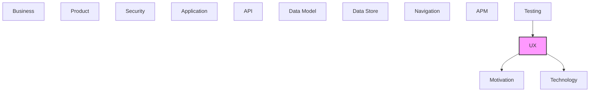

# UX

[← Back to README](../README.md)

User interface components, screens, and user experience elements.

## Report Index

- [Layer Introduction](#layer-introduction)
- [Intra-Layer Relationships](#intra-layer-relationships)
- [Inter-Layer Dependencies](#inter-layer-dependencies)
- [Inter-Layer Relationships Table](#inter-layer-relationships-table)
- [Element Reference](#element-reference)

## Layer Introduction

| Metric                    | Count |
| ------------------------- | ----- |
| Elements                  | 121   |
| Intra-Layer Relationships | 280   |
| Inter-Layer Relationships | 423   |
| Inbound Relationships     | 191   |
| Outbound Relationships    | 232   |

**Cross-Layer References**:

- **Upstream layers**: [Testing](./13-testing-layer-report.md)
- **Downstream layers**: [Motivation](./01-motivation-layer-report.md), [Technology](./06-technology-layer-report.md)

## Intra-Layer Relationships

*This layer has >30 elements. Summary table shown instead of diagram.*

| Element                                                              | Type               | Relationships |
| -------------------------------------------------------------------- | ------------------ | ------------- |
| `ux.actionpattern.collapseexpand-toggle-shiftenter-or-chevron-click` | `actionpattern`    | 3             |
| `ux.actionpattern.node-drag-reposition`                              | `actionpattern`    | 2             |
| `ux.actionpattern.node-select-on-click-or-enterspace`                | `actionpattern`    | 2             |
| `ux.actionpattern.panzoom-viewport-gesture`                          | `actionpattern`    | 1             |
| `ux.librarycomponent.activity-timeline-ux`                           | `librarycomponent` | 2             |
| `ux.librarycomponent.adjacency-matrix-ux`                            | `librarycomponent` | 8             |
| `ux.librarycomponent.alert-strip-ux`                                 | `librarycomponent` | 3             |
| `ux.librarycomponent.app-title-ux`                                   | `librarycomponent` | 3             |
| `ux.librarycomponent.asset-card-ux`                                  | `librarycomponent` | 2             |
| `ux.librarycomponent.asset-grid-ux`                                  | `librarycomponent` | 1             |
| `ux.librarycomponent.avatar-ux`                                      | `librarycomponent` | 1             |
| `ux.librarycomponent.badge-ux`                                       | `librarycomponent` | 3             |
| `ux.librarycomponent.bar-chart-ux`                                   | `librarycomponent` | 1             |
| `ux.librarycomponent.bar-h-ux`                                       | `librarycomponent` | 1             |
| `ux.librarycomponent.bar-v-ux`                                       | `librarycomponent` | 1             |
| `ux.librarycomponent.bridge-node-list-ux`                            | `librarycomponent` | 5             |
| `ux.librarycomponent.button-ux`                                      | `librarycomponent` | 19            |
| `ux.librarycomponent.calendar-ux`                                    | `librarycomponent` | 5             |
| `ux.librarycomponent.camera-controls-ux`                             | `librarycomponent` | 10            |
| `ux.librarycomponent.chart-wrapper-ux`                               | `librarycomponent` | 1             |
| `ux.librarycomponent.chat-composer-ux`                               | `librarycomponent` | 3             |
| `ux.librarycomponent.chat-container-ux`                              | `librarycomponent` | 1             |
| `ux.librarycomponent.chat-divider-ux`                                | `librarycomponent` | 1             |
| `ux.librarycomponent.chat-markdown-content-ux`                       | `librarycomponent` | 1             |
| `ux.librarycomponent.chat-message-ux`                                | `librarycomponent` | 2             |
| `ux.librarycomponent.chat-suggestions-ux`                            | `librarycomponent` | 1             |
| `ux.librarycomponent.chip-ux`                                        | `librarycomponent` | 10            |
| `ux.librarycomponent.command-palette-ux`                             | `librarycomponent` | 2             |
| `ux.librarycomponent.config-tile-ux`                                 | `librarycomponent` | 2             |
| `ux.librarycomponent.confirm-dialog-ux`                              | `librarycomponent` | 4             |
| `ux.librarycomponent.detail-drawer-ux`                               | `librarycomponent` | 1             |
| `ux.librarycomponent.diff-viewer-ux`                                 | `librarycomponent` | 4             |
| `ux.librarycomponent.donut-ux`                                       | `librarycomponent` | 1             |
| `ux.librarycomponent.drawer-ux`                                      | `librarycomponent` | 3             |
| `ux.librarycomponent.entity-picker-ux`                               | `librarycomponent` | 4             |
| `ux.librarycomponent.field-ux`                                       | `librarycomponent` | 1             |
| `ux.librarycomponent.filter-bar-ux`                                  | `librarycomponent` | 3             |
| `ux.librarycomponent.filter-dropdown-ux`                             | `librarycomponent` | 2             |
| `ux.librarycomponent.follow-control-ux`                              | `librarycomponent` | 9             |
| `ux.librarycomponent.form-callout-ux`                                | `librarycomponent` | 2             |
| `ux.librarycomponent.graph-canvas-ux`                                | `librarycomponent` | 12            |
| `ux.librarycomponent.graph-collapse-control-ux`                      | `librarycomponent` | 4             |
| `ux.librarycomponent.graph-edgegraph-edge-shape-ux`                  | `librarycomponent` | 2             |
| `ux.librarycomponent.graph-inspector-graph-edge-inspector-ux`        | `librarycomponent` | 4             |
| `ux.librarycomponent.graph-node-ux`                                  | `librarycomponent` | 4             |
| `ux.librarycomponent.graph-toolbar-ux`                               | `librarycomponent` | 3             |
| `ux.librarycomponent.hash-set-diff-ux`                               | `librarycomponent` | 3             |
| `ux.librarycomponent.heatmap-ux`                                     | `librarycomponent` | 1             |
| `ux.librarycomponent.hierarchy-row-ux`                               | `librarycomponent` | 1             |
| `ux.librarycomponent.hierarchy-tree-ux`                              | `librarycomponent` | 1             |
| `ux.librarycomponent.hive-plot-ux`                                   | `librarycomponent` | 5             |
| `ux.librarycomponent.icon-ux`                                        | `librarycomponent` | 50            |
| `ux.librarycomponent.inspector-panel-ux`                             | `librarycomponent` | 2             |
| `ux.librarycomponent.kanban-board-ux`                                | `librarycomponent` | 5             |
| `ux.librarycomponent.key-value-editor-ux`                            | `librarycomponent` | 5             |
| `ux.librarycomponent.kvgrid-ux`                                      | `librarycomponent` | 1             |
| `ux.librarycomponent.layer-list-ux`                                  | `librarycomponent` | 5             |
| `ux.librarycomponent.layer-pair-list-ux`                             | `librarycomponent` | 5             |
| `ux.librarycomponent.layer-stack-ux`                                 | `librarycomponent` | 5             |
| `ux.librarycomponent.layered-graph-context-ux`                       | `librarycomponent` | 15            |
| `ux.librarycomponent.layered-graph-explorer-ux`                      | `librarycomponent` | 10            |
| `ux.librarycomponent.line-chart-ux`                                  | `librarycomponent` | 1             |
| `ux.librarycomponent.lineage-rail-ux`                                | `librarycomponent` | 3             |
| `ux.librarycomponent.link-category-filter-ux`                        | `librarycomponent` | 5             |
| `ux.librarycomponent.log-stream-ux`                                  | `librarycomponent` | 1             |
| `ux.librarycomponent.map-canvas-ux`                                  | `librarycomponent` | 1             |
| `ux.librarycomponent.metric-row-ux`                                  | `librarycomponent` | 3             |
| `ux.librarycomponent.mini-calendar-ux`                               | `librarycomponent` | 1             |
| `ux.librarycomponent.modal-ux`                                       | `librarycomponent` | 6             |
| `ux.librarycomponent.nav-item-ux`                                    | `librarycomponent` | 2             |
| `ux.librarycomponent.number-input-ux`                                | `librarycomponent` | 1             |
| `ux.librarycomponent.ordered-list-ux`                                | `librarycomponent` | 3             |
| `ux.librarycomponent.page-header-ux`                                 | `librarycomponent` | 2             |
| `ux.librarycomponent.panel-ux`                                       | `librarycomponent` | 2             |
| `ux.librarycomponent.pipeline-card-ux`                               | `librarycomponent` | 3             |
| `ux.librarycomponent.plane-layout-control-ux`                        | `librarycomponent` | 5             |
| `ux.librarycomponent.popover-ux`                                     | `librarycomponent` | 1             |
| `ux.librarycomponent.predicate-label-control-ux`                     | `librarycomponent` | 5             |
| `ux.librarycomponent.progress-bar-ux`                                | `librarycomponent` | 3             |
| `ux.librarycomponent.quick-access-grid-ux`                           | `librarycomponent` | 3             |
| `ux.librarycomponent.quick-access-tile-ux`                           | `librarycomponent` | 3             |
| `ux.librarycomponent.reach-inspector-ux`                             | `librarycomponent` | 10            |
| `ux.librarycomponent.relationship-builder-ux`                        | `librarycomponent` | 3             |
| `ux.librarycomponent.result-card-ux`                                 | `librarycomponent` | 5             |
| `ux.librarycomponent.row-menu-ux`                                    | `librarycomponent` | 2             |
| `ux.librarycomponent.segmented-control-ux`                           | `librarycomponent` | 12            |
| `ux.librarycomponent.select-ux`                                      | `librarycomponent` | 4             |
| `ux.librarycomponent.shell-layout-ux`                                | `librarycomponent` | 8             |
| `ux.librarycomponent.side-by-side-diff-ux`                           | `librarycomponent` | 3             |
| `ux.librarycomponent.sidebar-ux`                                     | `librarycomponent` | 4             |
| `ux.librarycomponent.sparkline-ux`                                   | `librarycomponent` | 3             |
| `ux.librarycomponent.split-pane-ux`                                  | `librarycomponent` | 1             |
| `ux.librarycomponent.stacked-bar-ux`                                 | `librarycomponent` | 1             |
| `ux.librarycomponent.stat-grid-ux`                                   | `librarycomponent` | 1             |
| `ux.librarycomponent.stat-tile-ux`                                   | `librarycomponent` | 4             |
| `ux.librarycomponent.status-badge-ux`                                | `librarycomponent` | 1             |
| `ux.librarycomponent.status-timeline-ux`                             | `librarycomponent` | 1             |
| `ux.librarycomponent.statusbar-ux`                                   | `librarycomponent` | 3             |
| `ux.librarycomponent.tab-bar-ux`                                     | `librarycomponent` | 2             |
| `ux.librarycomponent.table-ux`                                       | `librarycomponent` | 2             |
| `ux.librarycomponent.text-area-ux`                                   | `librarycomponent` | 1             |
| `ux.librarycomponent.text-input-ux`                                  | `librarycomponent` | 2             |
| `ux.librarycomponent.thinking-block-ux`                              | `librarycomponent` | 2             |
| `ux.librarycomponent.titlebar-ux`                                    | `librarycomponent` | 2             |
| `ux.librarycomponent.toast-ux`                                       | `librarycomponent` | 2             |
| `ux.librarycomponent.tool-block-ux`                                  | `librarycomponent` | 2             |
| `ux.librarycomponent.tooltip-ux`                                     | `librarycomponent` | 1             |
| `ux.librarycomponent.topbar-ux`                                      | `librarycomponent` | 2             |
| `ux.librarycomponent.topology-node-ux`                               | `librarycomponent` | 1             |
| `ux.librarycomponent.trace-viewer-ux`                                | `librarycomponent` | 2             |
| `ux.librarycomponent.tri-state-ux`                                   | `librarycomponent` | 1             |
| `ux.librarycomponent.version-pill-ux`                                | `librarycomponent` | 8             |
| `ux.librarycomponent.version-timeline-ux`                            | `librarycomponent` | 3             |
| `ux.librarycomponent.view-switcher-ux`                               | `librarycomponent` | 10            |
| `ux.librarycomponent.workspace-switcher-dialog-ux`                   | `librarycomponent` | 4             |
| `ux.statepattern.canvas-theme-light-or-dark-canvas`                  | `statepattern`     | 1             |
| `ux.statepattern.collapsed-node-set-progressive-disclosure`          | `statepattern`     | 2             |
| `ux.statepattern.layout-computation-state`                           | `statepattern`     | 1             |
| `ux.statepattern.live-simulation-vs-static-layout-state`             | `statepattern`     | 1             |
| `ux.statepattern.node-hover-and-selection-state`                     | `statepattern`     | 3             |
| `ux.uxlibrary.heimdall-graph-visualization-ux-library`               | `uxlibrary`        | 111           |

## Inter-Layer Dependencies

## Inter-Layer Relationships Table

| Relationship ID                                            | Source Node                                                          | Dest Node                                                                                   | Dest Layer   | Predicate    | Cardinality  | Strength |
| ---------------------------------------------------------- | -------------------------------------------------------------------- | ------------------------------------------------------------------------------------------- | ------------ | ------------ | ------------ | -------- |
| `testing.testcoveragetarget.covers.ux.librarycomponent`    | `testing.testcoveragetarget.adjacency-matrix-tests`                  | `ux.librarycomponent.adjacency-matrix-ux`                                                   | `ux`         | `covers`     | many-to-many | medium   |
| `testing.testcoveragetarget.covers.ux.librarycomponent`    | `testing.testcoveragetarget.adjacency-matrix-tests`                  | `ux.librarycomponent.layered-graph-explorer-ux`                                             | `ux`         | `covers`     | many-to-many | medium   |
| `testing.testcoveragetarget.covers.ux.librarycomponent`    | `testing.testcoveragetarget.avatar-tests`                            | `ux.librarycomponent.avatar-ux`                                                             | `ux`         | `covers`     | many-to-many | medium   |
| `testing.testcoveragetarget.covers.ux.librarycomponent`    | `testing.testcoveragetarget.calendar-tests`                          | `ux.librarycomponent.calendar-ux`                                                           | `ux`         | `covers`     | many-to-many | medium   |
| `testing.testcoveragetarget.covers.ux.librarycomponent`    | `testing.testcoveragetarget.calendar-tests`                          | `ux.librarycomponent.select-ux`                                                             | `ux`         | `covers`     | many-to-many | medium   |
| `testing.testcoveragetarget.covers.ux.librarycomponent`    | `testing.testcoveragetarget.cards-and-lists-tests`                   | `ux.librarycomponent.asset-card-ux`                                                         | `ux`         | `covers`     | many-to-many | medium   |
| `testing.testcoveragetarget.covers.ux.librarycomponent`    | `testing.testcoveragetarget.cards-and-lists-tests`                   | `ux.librarycomponent.asset-grid-ux`                                                         | `ux`         | `covers`     | many-to-many | medium   |
| `testing.testcoveragetarget.covers.ux.librarycomponent`    | `testing.testcoveragetarget.cards-and-lists-tests`                   | `ux.librarycomponent.badge-ux`                                                              | `ux`         | `covers`     | many-to-many | medium   |
| `testing.testcoveragetarget.covers.ux.librarycomponent`    | `testing.testcoveragetarget.cards-and-lists-tests`                   | `ux.librarycomponent.log-stream-ux`                                                         | `ux`         | `covers`     | many-to-many | medium   |
| `testing.testcoveragetarget.covers.ux.librarycomponent`    | `testing.testcoveragetarget.cards-and-lists-tests`                   | `ux.librarycomponent.progress-bar-ux`                                                       | `ux`         | `covers`     | many-to-many | medium   |
| `testing.testcoveragetarget.covers.ux.librarycomponent`    | `testing.testcoveragetarget.cards-and-lists-tests`                   | `ux.librarycomponent.result-card-ux`                                                        | `ux`         | `covers`     | many-to-many | medium   |
| `testing.testcoveragetarget.covers.ux.librarycomponent`    | `testing.testcoveragetarget.center-on-select-tests`                  | `ux.librarycomponent.graph-canvas-ux`                                                       | `ux`         | `covers`     | many-to-many | medium   |
| `testing.testcoveragetarget.covers.ux.librarycomponent`    | `testing.testcoveragetarget.center-on-select-tests`                  | `ux.librarycomponent.graph-node-ux`                                                         | `ux`         | `covers`     | many-to-many | medium   |
| `testing.testcoveragetarget.covers.ux.librarycomponent`    | `testing.testcoveragetarget.channel-router-tests`                    | `ux.librarycomponent.graph-canvas-ux`                                                       | `ux`         | `covers`     | many-to-many | medium   |
| `testing.testcoveragetarget.covers.ux.librarycomponent`    | `testing.testcoveragetarget.charts-showcase-tests`                   | `ux.librarycomponent.bar-h-ux`                                                              | `ux`         | `covers`     | many-to-many | medium   |
| `testing.testcoveragetarget.covers.ux.librarycomponent`    | `testing.testcoveragetarget.charts-showcase-tests`                   | `ux.librarycomponent.bar-v-ux`                                                              | `ux`         | `covers`     | many-to-many | medium   |
| `testing.testcoveragetarget.covers.ux.librarycomponent`    | `testing.testcoveragetarget.charts-showcase-tests`                   | `ux.librarycomponent.donut-ux`                                                              | `ux`         | `covers`     | many-to-many | medium   |
| `testing.testcoveragetarget.covers.ux.librarycomponent`    | `testing.testcoveragetarget.charts-showcase-tests`                   | `ux.librarycomponent.heatmap-ux`                                                            | `ux`         | `covers`     | many-to-many | medium   |
| `testing.testcoveragetarget.covers.ux.librarycomponent`    | `testing.testcoveragetarget.charts-showcase-tests`                   | `ux.librarycomponent.line-chart-ux`                                                         | `ux`         | `covers`     | many-to-many | medium   |
| `testing.testcoveragetarget.covers.ux.librarycomponent`    | `testing.testcoveragetarget.charts-showcase-tests`                   | `ux.librarycomponent.metric-row-ux`                                                         | `ux`         | `covers`     | many-to-many | medium   |
| `testing.testcoveragetarget.covers.ux.librarycomponent`    | `testing.testcoveragetarget.charts-showcase-tests`                   | `ux.librarycomponent.progress-bar-ux`                                                       | `ux`         | `covers`     | many-to-many | medium   |
| `testing.testcoveragetarget.covers.ux.librarycomponent`    | `testing.testcoveragetarget.charts-showcase-tests`                   | `ux.librarycomponent.sparkline-ux`                                                          | `ux`         | `covers`     | many-to-many | medium   |
| `testing.testcoveragetarget.covers.ux.librarycomponent`    | `testing.testcoveragetarget.charts-showcase-tests`                   | `ux.librarycomponent.stacked-bar-ux`                                                        | `ux`         | `covers`     | many-to-many | medium   |
| `testing.testcoveragetarget.covers.ux.librarycomponent`    | `testing.testcoveragetarget.charts-showcase-tests`                   | `ux.librarycomponent.status-timeline-ux`                                                    | `ux`         | `covers`     | many-to-many | medium   |
| `testing.testcoveragetarget.covers.ux.librarycomponent`    | `testing.testcoveragetarget.chat-components-tests`                   | `ux.librarycomponent.chat-composer-ux`                                                      | `ux`         | `covers`     | many-to-many | medium   |
| `testing.testcoveragetarget.covers.ux.librarycomponent`    | `testing.testcoveragetarget.chat-components-tests`                   | `ux.librarycomponent.chat-container-ux`                                                     | `ux`         | `covers`     | many-to-many | medium   |
| `testing.testcoveragetarget.covers.ux.librarycomponent`    | `testing.testcoveragetarget.chat-components-tests`                   | `ux.librarycomponent.chat-divider-ux`                                                       | `ux`         | `covers`     | many-to-many | medium   |
| `testing.testcoveragetarget.covers.ux.librarycomponent`    | `testing.testcoveragetarget.chat-components-tests`                   | `ux.librarycomponent.chat-message-ux`                                                       | `ux`         | `covers`     | many-to-many | medium   |
| `testing.testcoveragetarget.covers.ux.librarycomponent`    | `testing.testcoveragetarget.chat-components-tests`                   | `ux.librarycomponent.chat-suggestions-ux`                                                   | `ux`         | `covers`     | many-to-many | medium   |
| `testing.testcoveragetarget.covers.ux.librarycomponent`    | `testing.testcoveragetarget.chat-components-tests`                   | `ux.librarycomponent.thinking-block-ux`                                                     | `ux`         | `covers`     | many-to-many | medium   |
| `testing.testcoveragetarget.covers.ux.librarycomponent`    | `testing.testcoveragetarget.chat-components-tests`                   | `ux.librarycomponent.tool-block-ux`                                                         | `ux`         | `covers`     | many-to-many | medium   |
| `testing.testcoveragetarget.covers.ux.librarycomponent`    | `testing.testcoveragetarget.dark-canvas-semantic-tests`              | `ux.librarycomponent.activity-timeline-ux`                                                  | `ux`         | `covers`     | many-to-many | medium   |
| `testing.testcoveragetarget.covers.ux.librarycomponent`    | `testing.testcoveragetarget.dark-canvas-semantic-tests`              | `ux.librarycomponent.chip-ux`                                                               | `ux`         | `covers`     | many-to-many | medium   |
| `testing.testcoveragetarget.covers.ux.librarycomponent`    | `testing.testcoveragetarget.dark-canvas-semantic-tests`              | `ux.librarycomponent.form-callout-ux`                                                       | `ux`         | `covers`     | many-to-many | medium   |
| `testing.testcoveragetarget.covers.ux.librarycomponent`    | `testing.testcoveragetarget.dark-canvas-semantic-tests`              | `ux.librarycomponent.version-pill-ux`                                                       | `ux`         | `covers`     | many-to-many | medium   |
| `testing.testcoveragetarget.covers.ux.librarycomponent`    | `testing.testcoveragetarget.data-display-tests`                      | `ux.librarycomponent.hierarchy-row-ux`                                                      | `ux`         | `covers`     | many-to-many | medium   |
| `testing.testcoveragetarget.covers.ux.librarycomponent`    | `testing.testcoveragetarget.data-display-tests`                      | `ux.librarycomponent.hierarchy-tree-ux`                                                     | `ux`         | `covers`     | many-to-many | medium   |
| `testing.testcoveragetarget.covers.ux.librarycomponent`    | `testing.testcoveragetarget.data-display-tests`                      | `ux.librarycomponent.select-ux`                                                             | `ux`         | `covers`     | many-to-many | medium   |
| `testing.testcoveragetarget.covers.ux.librarycomponent`    | `testing.testcoveragetarget.data-display-tests`                      | `ux.librarycomponent.stat-grid-ux`                                                          | `ux`         | `covers`     | many-to-many | medium   |
| `testing.testcoveragetarget.covers.ux.librarycomponent`    | `testing.testcoveragetarget.data-display-tests`                      | `ux.librarycomponent.stat-tile-ux`                                                          | `ux`         | `covers`     | many-to-many | medium   |
| `testing.testcoveragetarget.covers.ux.librarycomponent`    | `testing.testcoveragetarget.data-display-tests`                      | `ux.librarycomponent.table-ux`                                                              | `ux`         | `covers`     | many-to-many | medium   |
| `testing.testcoveragetarget.covers.ux.librarycomponent`    | `testing.testcoveragetarget.date-utils-tests`                        | `ux.librarycomponent.activity-timeline-ux`                                                  | `ux`         | `covers`     | many-to-many | medium   |
| `testing.testcoveragetarget.covers.ux.librarycomponent`    | `testing.testcoveragetarget.date-utils-tests`                        | `ux.librarycomponent.mini-calendar-ux`                                                      | `ux`         | `covers`     | many-to-many | medium   |
| `testing.testcoveragetarget.covers.ux.librarycomponent`    | `testing.testcoveragetarget.diff-viewer-tests`                       | `ux.librarycomponent.diff-viewer-ux`                                                        | `ux`         | `covers`     | many-to-many | medium   |
| `testing.testcoveragetarget.covers.ux.librarycomponent`    | `testing.testcoveragetarget.diff-viewer-tests`                       | `ux.librarycomponent.hash-set-diff-ux`                                                      | `ux`         | `covers`     | many-to-many | medium   |
| `testing.testcoveragetarget.covers.ux.librarycomponent`    | `testing.testcoveragetarget.diff-viewer-tests`                       | `ux.librarycomponent.side-by-side-diff-ux`                                                  | `ux`         | `covers`     | many-to-many | medium   |
| `testing.testcoveragetarget.covers.ux.librarycomponent`    | `testing.testcoveragetarget.dropdown-placement-tests`                | `ux.librarycomponent.panel-ux`                                                              | `ux`         | `covers`     | many-to-many | medium   |
| `testing.testcoveragetarget.covers.ux.librarycomponent`    | `testing.testcoveragetarget.dropdown-portal-tests`                   | `ux.librarycomponent.popover-ux`                                                            | `ux`         | `covers`     | many-to-many | medium   |
| `testing.testcoveragetarget.covers.ux.librarycomponent`    | `testing.testcoveragetarget.dropdown-portal-tests`                   | `ux.librarycomponent.row-menu-ux`                                                           | `ux`         | `covers`     | many-to-many | medium   |
| `testing.testcoveragetarget.covers.ux.librarycomponent`    | `testing.testcoveragetarget.dropdown-portal-tests`                   | `ux.librarycomponent.select-ux`                                                             | `ux`         | `covers`     | many-to-many | medium   |
| `testing.testcoveragetarget.covers.ux.librarycomponent`    | `testing.testcoveragetarget.filter-dropdown-tests`                   | `ux.librarycomponent.filter-dropdown-ux`                                                    | `ux`         | `covers`     | many-to-many | medium   |
| `testing.testcoveragetarget.covers.ux.librarycomponent`    | `testing.testcoveragetarget.filter-dropdown-tests`                   | `ux.librarycomponent.panel-ux`                                                              | `ux`         | `covers`     | many-to-many | medium   |
| `testing.testcoveragetarget.covers.ux.librarycomponent`    | `testing.testcoveragetarget.filter-dropdown-tests`                   | `ux.librarycomponent.select-ux`                                                             | `ux`         | `covers`     | many-to-many | medium   |
| `testing.testcoveragetarget.covers.ux.librarycomponent`    | `testing.testcoveragetarget.force-force-clustered-layout-algorithms` | `ux.librarycomponent.graph-canvas-ux`                                                       | `ux`         | `covers`     | many-to-many | medium   |
| `testing.testcoveragetarget.covers.ux.librarycomponent`    | `testing.testcoveragetarget.force-force-clustered-layout-algorithms` | `ux.librarycomponent.graph-node-ux`                                                         | `ux`         | `covers`     | many-to-many | medium   |
| `testing.testcoveragetarget.covers.ux.librarycomponent`    | `testing.testcoveragetarget.force-force-clustered-layout-algorithms` | `ux.librarycomponent.topology-node-ux`                                                      | `ux`         | `covers`     | many-to-many | medium   |
| `testing.testcoveragetarget.covers.ux.librarycomponent`    | `testing.testcoveragetarget.forms-components-tests`                  | `ux.librarycomponent.entity-picker-ux`                                                      | `ux`         | `covers`     | many-to-many | medium   |
| `testing.testcoveragetarget.covers.ux.librarycomponent`    | `testing.testcoveragetarget.forms-components-tests`                  | `ux.librarycomponent.form-callout-ux`                                                       | `ux`         | `covers`     | many-to-many | medium   |
| `testing.testcoveragetarget.covers.ux.librarycomponent`    | `testing.testcoveragetarget.forms-components-tests`                  | `ux.librarycomponent.key-value-editor-ux`                                                   | `ux`         | `covers`     | many-to-many | medium   |
| `testing.testcoveragetarget.covers.ux.librarycomponent`    | `testing.testcoveragetarget.forms-components-tests`                  | `ux.librarycomponent.ordered-list-ux`                                                       | `ux`         | `covers`     | many-to-many | medium   |
| `testing.testcoveragetarget.covers.ux.librarycomponent`    | `testing.testcoveragetarget.forms-components-tests`                  | `ux.librarycomponent.pipeline-card-ux`                                                      | `ux`         | `covers`     | many-to-many | medium   |
| `testing.testcoveragetarget.covers.ux.librarycomponent`    | `testing.testcoveragetarget.forms-components-tests`                  | `ux.librarycomponent.relationship-builder-ux`                                               | `ux`         | `covers`     | many-to-many | medium   |
| `testing.testcoveragetarget.covers.ux.librarycomponent`    | `testing.testcoveragetarget.forms-components-tests`                  | `ux.librarycomponent.row-menu-ux`                                                           | `ux`         | `covers`     | many-to-many | medium   |
| `testing.testcoveragetarget.covers.ux.librarycomponent`    | `testing.testcoveragetarget.fullscreen-container-ref-tests`          | `ux.librarycomponent.graph-canvas-ux`                                                       | `ux`         | `covers`     | many-to-many | medium   |
| `testing.testcoveragetarget.covers.ux.librarycomponent`    | `testing.testcoveragetarget.galaxy-layout-browser-tests`             | `ux.librarycomponent.graph-canvas-ux`                                                       | `ux`         | `covers`     | many-to-many | medium   |
| `testing.testcoveragetarget.covers.ux.librarycomponent`    | `testing.testcoveragetarget.galaxy-layout-collapse-tests`            | `ux.librarycomponent.badge-ux`                                                              | `ux`         | `covers`     | many-to-many | medium   |
| `testing.testcoveragetarget.covers.ux.librarycomponent`    | `testing.testcoveragetarget.galaxy-layout-collapse-tests`            | `ux.librarycomponent.graph-collapse-control-ux`                                             | `ux`         | `covers`     | many-to-many | medium   |
| `testing.testcoveragetarget.covers.ux.librarycomponent`    | `testing.testcoveragetarget.galaxy-layout-collapse-tests`            | `ux.librarycomponent.graph-node-ux`                                                         | `ux`         | `covers`     | many-to-many | medium   |
| `testing.testcoveragetarget.covers.ux.librarycomponent`    | `testing.testcoveragetarget.galaxy-layout-collapse-tests`            | `ux.librarycomponent.topology-node-ux`                                                      | `ux`         | `covers`     | many-to-many | medium   |
| `testing.testcoveragetarget.covers.ux.librarycomponent`    | `testing.testcoveragetarget.galaxy-layout-tests`                     | `ux.librarycomponent.graph-canvas-ux`                                                       | `ux`         | `covers`     | many-to-many | medium   |
| `testing.testcoveragetarget.covers.ux.librarycomponent`    | `testing.testcoveragetarget.galaxy-live-drag-tests`                  | `ux.librarycomponent.graph-canvas-ux`                                                       | `ux`         | `covers`     | many-to-many | medium   |
| `testing.testcoveragetarget.covers.ux.librarycomponent`    | `testing.testcoveragetarget.graph-a11y-names-tests`                  | `ux.librarycomponent.graph-canvas-ux`                                                       | `ux`         | `covers`     | many-to-many | medium   |
| `testing.testcoveragetarget.covers.ux.librarycomponent`    | `testing.testcoveragetarget.graph-a11y-names-tests`                  | `ux.librarycomponent.graph-edgegraph-edge-shape-ux`                                         | `ux`         | `covers`     | many-to-many | medium   |
| `testing.testcoveragetarget.covers.ux.librarycomponent`    | `testing.testcoveragetarget.graph-canvas-click-tooltip-tests`        | `ux.librarycomponent.graph-canvas-ux`                                                       | `ux`         | `covers`     | many-to-many | medium   |
| `testing.testcoveragetarget.covers.ux.librarycomponent`    | `testing.testcoveragetarget.graph-canvas-click-tooltip-tests`        | `ux.librarycomponent.popover-ux`                                                            | `ux`         | `covers`     | many-to-many | medium   |
| `testing.testcoveragetarget.covers.ux.librarycomponent`    | `testing.testcoveragetarget.graph-canvas-click-tooltip-tests`        | `ux.librarycomponent.tooltip-ux`                                                            | `ux`         | `covers`     | many-to-many | medium   |
| `testing.testcoveragetarget.covers.ux.librarycomponent`    | `testing.testcoveragetarget.graph-canvas-popover-tests`              | `ux.librarycomponent.graph-canvas-ux`                                                       | `ux`         | `covers`     | many-to-many | medium   |
| `testing.testcoveragetarget.covers.ux.librarycomponent`    | `testing.testcoveragetarget.graph-canvas-popover-tests`              | `ux.librarycomponent.popover-ux`                                                            | `ux`         | `covers`     | many-to-many | medium   |
| `testing.testcoveragetarget.covers.ux.librarycomponent`    | `testing.testcoveragetarget.graph-canvas-popover-tests`              | `ux.librarycomponent.tooltip-ux`                                                            | `ux`         | `covers`     | many-to-many | medium   |
| `testing.testcoveragetarget.covers.ux.librarycomponent`    | `testing.testcoveragetarget.graph-canvas-rendering-and-interaction`  | `ux.librarycomponent.graph-canvas-ux`                                                       | `ux`         | `covers`     | many-to-many | medium   |
| `testing.testcoveragetarget.covers.ux.librarycomponent`    | `testing.testcoveragetarget.graph-canvas-rendering-and-interaction`  | `ux.librarycomponent.graph-edgegraph-edge-shape-ux`                                         | `ux`         | `covers`     | many-to-many | medium   |
| `testing.testcoveragetarget.covers.ux.librarycomponent`    | `testing.testcoveragetarget.graph-canvas-rendering-and-interaction`  | `ux.librarycomponent.graph-inspector-graph-edge-inspector-ux`                               | `ux`         | `covers`     | many-to-many | medium   |
| `testing.testcoveragetarget.covers.ux.librarycomponent`    | `testing.testcoveragetarget.graph-canvas-rendering-and-interaction`  | `ux.librarycomponent.graph-node-ux`                                                         | `ux`         | `covers`     | many-to-many | medium   |
| `testing.testcoveragetarget.covers.ux.librarycomponent`    | `testing.testcoveragetarget.graph-canvas-rendering-and-interaction`  | `ux.librarycomponent.graph-toolbar-ux`                                                      | `ux`         | `covers`     | many-to-many | medium   |
| `testing.testcoveragetarget.covers.ux.librarycomponent`    | `testing.testcoveragetarget.graph-canvas-rendering-and-interaction`  | `ux.librarycomponent.tooltip-ux`                                                            | `ux`         | `covers`     | many-to-many | medium   |
| `testing.testcoveragetarget.covers.ux.librarycomponent`    | `testing.testcoveragetarget.graph-canvas-rendering-and-interaction`  | `ux.librarycomponent.topology-node-ux`                                                      | `ux`         | `covers`     | many-to-many | medium   |
| `testing.testcoveragetarget.covers.ux.librarycomponent`    | `testing.testcoveragetarget.graph-edge-label-tests`                  | `ux.librarycomponent.graph-node-ux`                                                         | `ux`         | `covers`     | many-to-many | medium   |
| `testing.testcoveragetarget.covers.ux.librarycomponent`    | `testing.testcoveragetarget.graph-fit-boundaries-tests`              | `ux.librarycomponent.graph-canvas-ux`                                                       | `ux`         | `covers`     | many-to-many | medium   |
| `testing.testcoveragetarget.covers.ux.librarycomponent`    | `testing.testcoveragetarget.graph-layout-busy-tests`                 | `ux.librarycomponent.graph-canvas-ux`                                                       | `ux`         | `covers`     | many-to-many | medium   |
| `testing.testcoveragetarget.covers.ux.librarycomponent`    | `testing.testcoveragetarget.graph-node-measure-tests`                | `ux.librarycomponent.graph-canvas-ux`                                                       | `ux`         | `covers`     | many-to-many | medium   |
| `testing.testcoveragetarget.covers.ux.librarycomponent`    | `testing.testcoveragetarget.graph-tooltip-placement-tests`           | `ux.librarycomponent.graph-canvas-ux`                                                       | `ux`         | `covers`     | many-to-many | medium   |
| `testing.testcoveragetarget.covers.ux.librarycomponent`    | `testing.testcoveragetarget.graph-viewport-history-tests`            | `ux.librarycomponent.graph-canvas-ux`                                                       | `ux`         | `covers`     | many-to-many | medium   |
| `testing.testcoveragetarget.covers.ux.librarycomponent`    | `testing.testcoveragetarget.hive-plot-tests`                         | `ux.librarycomponent.hive-plot-ux`                                                          | `ux`         | `covers`     | many-to-many | medium   |
| `testing.testcoveragetarget.covers.ux.librarycomponent`    | `testing.testcoveragetarget.inspector-panel-tests`                   | `ux.librarycomponent.inspector-panel-ux`                                                    | `ux`         | `covers`     | many-to-many | medium   |
| `testing.testcoveragetarget.covers.ux.librarycomponent`    | `testing.testcoveragetarget.inspector-panel-tests`                   | `ux.librarycomponent.kvgrid-ux`                                                             | `ux`         | `covers`     | many-to-many | medium   |
| `testing.testcoveragetarget.covers.ux.librarycomponent`    | `testing.testcoveragetarget.inspector-panel-tests`                   | `ux.librarycomponent.version-pill-ux`                                                       | `ux`         | `covers`     | many-to-many | medium   |
| `testing.testcoveragetarget.covers.ux.librarycomponent`    | `testing.testcoveragetarget.kanban-board-tests`                      | `ux.librarycomponent.kanban-board-ux`                                                       | `ux`         | `covers`     | many-to-many | medium   |
| `testing.testcoveragetarget.covers.ux.librarycomponent`    | `testing.testcoveragetarget.layer-lanes-tests`                       | `ux.librarycomponent.graph-canvas-ux`                                                       | `ux`         | `covers`     | many-to-many | medium   |
| `testing.testcoveragetarget.covers.ux.librarycomponent`    | `testing.testcoveragetarget.layer-lanes-tests`                       | `ux.librarycomponent.layered-graph-context-ux`                                              | `ux`         | `covers`     | many-to-many | medium   |
| `testing.testcoveragetarget.covers.ux.librarycomponent`    | `testing.testcoveragetarget.layer-stack-tests`                       | `ux.librarycomponent.layer-stack-ux`                                                        | `ux`         | `covers`     | many-to-many | medium   |
| `testing.testcoveragetarget.covers.ux.librarycomponent`    | `testing.testcoveragetarget.layered-async-layout-tests`              | `ux.librarycomponent.graph-canvas-ux`                                                       | `ux`         | `covers`     | many-to-many | medium   |
| `testing.testcoveragetarget.covers.ux.librarycomponent`    | `testing.testcoveragetarget.layered-dom-order-tests`                 | `ux.librarycomponent.layer-stack-ux`                                                        | `ux`         | `covers`     | many-to-many | medium   |
| `testing.testcoveragetarget.covers.ux.librarycomponent`    | `testing.testcoveragetarget.layered-graph-chrome-tests`              | `ux.librarycomponent.adjacency-matrix-ux`                                                   | `ux`         | `covers`     | many-to-many | medium   |
| `testing.testcoveragetarget.covers.ux.librarycomponent`    | `testing.testcoveragetarget.layered-graph-chrome-tests`              | `ux.librarycomponent.bridge-node-list-ux`                                                   | `ux`         | `covers`     | many-to-many | medium   |
| `testing.testcoveragetarget.covers.ux.librarycomponent`    | `testing.testcoveragetarget.layered-graph-chrome-tests`              | `ux.librarycomponent.follow-control-ux`                                                     | `ux`         | `covers`     | many-to-many | medium   |
| `testing.testcoveragetarget.covers.ux.librarycomponent`    | `testing.testcoveragetarget.layered-graph-chrome-tests`              | `ux.librarycomponent.layer-list-ux`                                                         | `ux`         | `covers`     | many-to-many | medium   |
| `testing.testcoveragetarget.covers.ux.librarycomponent`    | `testing.testcoveragetarget.layered-graph-chrome-tests`              | `ux.librarycomponent.layer-pair-list-ux`                                                    | `ux`         | `covers`     | many-to-many | medium   |
| `testing.testcoveragetarget.covers.ux.librarycomponent`    | `testing.testcoveragetarget.layered-graph-chrome-tests`              | `ux.librarycomponent.link-category-filter-ux`                                               | `ux`         | `covers`     | many-to-many | medium   |
| `testing.testcoveragetarget.covers.ux.librarycomponent`    | `testing.testcoveragetarget.layered-graph-chrome-tests`              | `ux.librarycomponent.plane-layout-control-ux`                                               | `ux`         | `covers`     | many-to-many | medium   |
| `testing.testcoveragetarget.covers.ux.librarycomponent`    | `testing.testcoveragetarget.layered-graph-chrome-tests`              | `ux.librarycomponent.predicate-label-control-ux`                                            | `ux`         | `covers`     | many-to-many | medium   |
| `testing.testcoveragetarget.covers.ux.librarycomponent`    | `testing.testcoveragetarget.layered-graph-chrome-tests`              | `ux.librarycomponent.reach-inspector-ux`                                                    | `ux`         | `covers`     | many-to-many | medium   |
| `testing.testcoveragetarget.covers.ux.librarycomponent`    | `testing.testcoveragetarget.layered-graph-explorer-tests`            | `ux.librarycomponent.layered-graph-explorer-ux`                                             | `ux`         | `covers`     | many-to-many | medium   |
| `testing.testcoveragetarget.covers.ux.librarycomponent`    | `testing.testcoveragetarget.layered-link-batches-tests`              | `ux.librarycomponent.layer-stack-ux`                                                        | `ux`         | `covers`     | many-to-many | medium   |
| `testing.testcoveragetarget.covers.ux.librarycomponent`    | `testing.testcoveragetarget.layered-matrix-tests`                    | `ux.librarycomponent.adjacency-matrix-ux`                                                   | `ux`         | `covers`     | many-to-many | medium   |
| `testing.testcoveragetarget.covers.ux.librarycomponent`    | `testing.testcoveragetarget.layered-matrix-tests`                    | `ux.librarycomponent.graph-inspector-graph-edge-inspector-ux`                               | `ux`         | `covers`     | many-to-many | medium   |
| `testing.testcoveragetarget.covers.ux.librarycomponent`    | `testing.testcoveragetarget.layered-snapshot-tests`                  | `ux.librarycomponent.layered-graph-explorer-ux`                                             | `ux`         | `covers`     | many-to-many | medium   |
| `testing.testcoveragetarget.covers.ux.librarycomponent`    | `testing.testcoveragetarget.layered-tests`                           | `ux.librarycomponent.graph-canvas-ux`                                                       | `ux`         | `covers`     | many-to-many | medium   |
| `testing.testcoveragetarget.covers.ux.librarycomponent`    | `testing.testcoveragetarget.layered-tests`                           | `ux.librarycomponent.graph-edgegraph-edge-shape-ux`                                         | `ux`         | `covers`     | many-to-many | medium   |
| `testing.testcoveragetarget.covers.ux.librarycomponent`    | `testing.testcoveragetarget.line-chart-data-toggle-tests`            | `ux.librarycomponent.line-chart-ux`                                                         | `ux`         | `covers`     | many-to-many | medium   |
| `testing.testcoveragetarget.covers.ux.librarycomponent`    | `testing.testcoveragetarget.lineage-rail-tests`                      | `ux.librarycomponent.chip-ux`                                                               | `ux`         | `covers`     | many-to-many | medium   |
| `testing.testcoveragetarget.covers.ux.librarycomponent`    | `testing.testcoveragetarget.lineage-rail-tests`                      | `ux.librarycomponent.lineage-rail-ux`                                                       | `ux`         | `covers`     | many-to-many | medium   |
| `testing.testcoveragetarget.covers.ux.librarycomponent`    | `testing.testcoveragetarget.map-canvas-tests`                        | `ux.librarycomponent.heatmap-ux`                                                            | `ux`         | `covers`     | many-to-many | medium   |
| `testing.testcoveragetarget.covers.ux.librarycomponent`    | `testing.testcoveragetarget.map-canvas-tests`                        | `ux.librarycomponent.map-canvas-ux`                                                         | `ux`         | `covers`     | many-to-many | medium   |
| `testing.testcoveragetarget.covers.ux.librarycomponent`    | `testing.testcoveragetarget.map-canvas-tests`                        | `ux.librarycomponent.select-ux`                                                             | `ux`         | `covers`     | many-to-many | medium   |
| `testing.testcoveragetarget.covers.ux.librarycomponent`    | `testing.testcoveragetarget.organic-layout-browser-tests`            | `ux.librarycomponent.graph-canvas-ux`                                                       | `ux`         | `covers`     | many-to-many | medium   |
| `testing.testcoveragetarget.covers.ux.librarycomponent`    | `testing.testcoveragetarget.organic-layout-tests`                    | `ux.librarycomponent.graph-canvas-ux`                                                       | `ux`         | `covers`     | many-to-many | medium   |
| `testing.testcoveragetarget.covers.ux.librarycomponent`    | `testing.testcoveragetarget.orthogonal-layout-browser-tests`         | `ux.librarycomponent.graph-canvas-ux`                                                       | `ux`         | `covers`     | many-to-many | medium   |
| `testing.testcoveragetarget.covers.ux.librarycomponent`    | `testing.testcoveragetarget.orthogonal-layout-tests`                 | `ux.librarycomponent.graph-canvas-ux`                                                       | `ux`         | `covers`     | many-to-many | medium   |
| `testing.testcoveragetarget.covers.ux.librarycomponent`    | `testing.testcoveragetarget.overlay-advanced-tests`                  | `ux.librarycomponent.command-palette-ux`                                                    | `ux`         | `covers`     | many-to-many | medium   |
| `testing.testcoveragetarget.covers.ux.librarycomponent`    | `testing.testcoveragetarget.overlay-advanced-tests`                  | `ux.librarycomponent.drawer-ux`                                                             | `ux`         | `covers`     | many-to-many | medium   |
| `testing.testcoveragetarget.covers.ux.librarycomponent`    | `testing.testcoveragetarget.overlay-advanced-tests`                  | `ux.librarycomponent.select-ux`                                                             | `ux`         | `covers`     | many-to-many | medium   |
| `testing.testcoveragetarget.covers.ux.librarycomponent`    | `testing.testcoveragetarget.overlay-advanced-tests`                  | `ux.librarycomponent.split-pane-ux`                                                         | `ux`         | `covers`     | many-to-many | medium   |
| `testing.testcoveragetarget.covers.ux.librarycomponent`    | `testing.testcoveragetarget.overlay-components-tests`                | `ux.librarycomponent.confirm-dialog-ux`                                                     | `ux`         | `covers`     | many-to-many | medium   |
| `testing.testcoveragetarget.covers.ux.librarycomponent`    | `testing.testcoveragetarget.overlay-components-tests`                | `ux.librarycomponent.modal-ux`                                                              | `ux`         | `covers`     | many-to-many | medium   |
| `testing.testcoveragetarget.covers.ux.librarycomponent`    | `testing.testcoveragetarget.overlay-components-tests`                | `ux.librarycomponent.popover-ux`                                                            | `ux`         | `covers`     | many-to-many | medium   |
| `testing.testcoveragetarget.covers.ux.librarycomponent`    | `testing.testcoveragetarget.overlay-components-tests`                | `ux.librarycomponent.toast-ux`                                                              | `ux`         | `covers`     | many-to-many | medium   |
| `testing.testcoveragetarget.covers.ux.librarycomponent`    | `testing.testcoveragetarget.overlay-components-tests`                | `ux.librarycomponent.tooltip-ux`                                                            | `ux`         | `covers`     | many-to-many | medium   |
| `testing.testcoveragetarget.covers.ux.librarycomponent`    | `testing.testcoveragetarget.page-patterns-tests`                     | `ux.librarycomponent.activity-timeline-ux`                                                  | `ux`         | `covers`     | many-to-many | medium   |
| `testing.testcoveragetarget.covers.ux.librarycomponent`    | `testing.testcoveragetarget.page-patterns-tests`                     | `ux.librarycomponent.alert-strip-ux`                                                        | `ux`         | `covers`     | many-to-many | medium   |
| `testing.testcoveragetarget.covers.ux.librarycomponent`    | `testing.testcoveragetarget.page-patterns-tests`                     | `ux.librarycomponent.config-tile-ux`                                                        | `ux`         | `covers`     | many-to-many | medium   |
| `testing.testcoveragetarget.covers.ux.librarycomponent`    | `testing.testcoveragetarget.page-patterns-tests`                     | `ux.librarycomponent.filter-bar-ux`                                                         | `ux`         | `covers`     | many-to-many | medium   |
| `testing.testcoveragetarget.covers.ux.librarycomponent`    | `testing.testcoveragetarget.page-patterns-tests`                     | `ux.librarycomponent.page-header-ux`                                                        | `ux`         | `covers`     | many-to-many | medium   |
| `testing.testcoveragetarget.covers.ux.librarycomponent`    | `testing.testcoveragetarget.page-patterns-tests`                     | `ux.librarycomponent.quick-access-grid-ux`                                                  | `ux`         | `covers`     | many-to-many | medium   |
| `testing.testcoveragetarget.covers.ux.librarycomponent`    | `testing.testcoveragetarget.page-patterns-tests`                     | `ux.librarycomponent.quick-access-tile-ux`                                                  | `ux`         | `covers`     | many-to-many | medium   |
| `testing.testcoveragetarget.covers.ux.librarycomponent`    | `testing.testcoveragetarget.pan-zoom-tests`                          | `ux.librarycomponent.graph-canvas-ux`                                                       | `ux`         | `covers`     | many-to-many | medium   |
| `testing.testcoveragetarget.covers.ux.librarycomponent`    | `testing.testcoveragetarget.pan-zoom-tests`                          | `ux.librarycomponent.map-canvas-ux`                                                         | `ux`         | `covers`     | many-to-many | medium   |
| `testing.testcoveragetarget.covers.ux.librarycomponent`    | `testing.testcoveragetarget.primitives-tests`                        | `ux.librarycomponent.badge-ux`                                                              | `ux`         | `covers`     | many-to-many | medium   |
| `testing.testcoveragetarget.covers.ux.librarycomponent`    | `testing.testcoveragetarget.primitives-tests`                        | `ux.librarycomponent.button-ux`                                                             | `ux`         | `covers`     | many-to-many | medium   |
| `testing.testcoveragetarget.covers.ux.librarycomponent`    | `testing.testcoveragetarget.primitives-tests`                        | `ux.librarycomponent.chip-ux`                                                               | `ux`         | `covers`     | many-to-many | medium   |
| `testing.testcoveragetarget.covers.ux.librarycomponent`    | `testing.testcoveragetarget.primitives-tests`                        | `ux.librarycomponent.field-ux`                                                              | `ux`         | `covers`     | many-to-many | medium   |
| `testing.testcoveragetarget.covers.ux.librarycomponent`    | `testing.testcoveragetarget.primitives-tests`                        | `ux.librarycomponent.icon-ux`                                                               | `ux`         | `covers`     | many-to-many | medium   |
| `testing.testcoveragetarget.covers.ux.librarycomponent`    | `testing.testcoveragetarget.primitives-tests`                        | `ux.librarycomponent.number-input-ux`                                                       | `ux`         | `covers`     | many-to-many | medium   |
| `testing.testcoveragetarget.covers.ux.librarycomponent`    | `testing.testcoveragetarget.primitives-tests`                        | `ux.librarycomponent.panel-ux`                                                              | `ux`         | `covers`     | many-to-many | medium   |
| `testing.testcoveragetarget.covers.ux.librarycomponent`    | `testing.testcoveragetarget.primitives-tests`                        | `ux.librarycomponent.segmented-control-ux`                                                  | `ux`         | `covers`     | many-to-many | medium   |
| `testing.testcoveragetarget.covers.ux.librarycomponent`    | `testing.testcoveragetarget.primitives-tests`                        | `ux.librarycomponent.select-ux`                                                             | `ux`         | `covers`     | many-to-many | medium   |
| `testing.testcoveragetarget.covers.ux.librarycomponent`    | `testing.testcoveragetarget.primitives-tests`                        | `ux.librarycomponent.text-area-ux`                                                          | `ux`         | `covers`     | many-to-many | medium   |
| `testing.testcoveragetarget.covers.ux.librarycomponent`    | `testing.testcoveragetarget.primitives-tests`                        | `ux.librarycomponent.text-input-ux`                                                         | `ux`         | `covers`     | many-to-many | medium   |
| `testing.testcoveragetarget.covers.ux.librarycomponent`    | `testing.testcoveragetarget.primitives-tests`                        | `ux.librarycomponent.tri-state-ux`                                                          | `ux`         | `covers`     | many-to-many | medium   |
| `testing.testcoveragetarget.covers.ux.librarycomponent`    | `testing.testcoveragetarget.primitives-tests`                        | `ux.librarycomponent.version-pill-ux`                                                       | `ux`         | `covers`     | many-to-many | medium   |
| `testing.testcoveragetarget.covers.ux.librarycomponent`    | `testing.testcoveragetarget.radial-tree-layout-algorithm`            | `ux.librarycomponent.graph-canvas-ux`                                                       | `ux`         | `covers`     | many-to-many | medium   |
| `testing.testcoveragetarget.covers.ux.librarycomponent`    | `testing.testcoveragetarget.reach-inspector-tests`                   | `ux.librarycomponent.graph-canvas-ux`                                                       | `ux`         | `covers`     | many-to-many | medium   |
| `testing.testcoveragetarget.covers.ux.librarycomponent`    | `testing.testcoveragetarget.reach-inspector-tests`                   | `ux.librarycomponent.graph-edgegraph-edge-shape-ux`                                         | `ux`         | `covers`     | many-to-many | medium   |
| `testing.testcoveragetarget.covers.ux.librarycomponent`    | `testing.testcoveragetarget.reach-inspector-tests`                   | `ux.librarycomponent.layered-graph-context-ux`                                              | `ux`         | `covers`     | many-to-many | medium   |
| `testing.testcoveragetarget.covers.ux.librarycomponent`    | `testing.testcoveragetarget.reach-inspector-tests`                   | `ux.librarycomponent.reach-inspector-ux`                                                    | `ux`         | `covers`     | many-to-many | medium   |
| `testing.testcoveragetarget.covers.ux.librarycomponent`    | `testing.testcoveragetarget.responsive-shell-tests`                  | `ux.librarycomponent.drawer-ux`                                                             | `ux`         | `covers`     | many-to-many | medium   |
| `testing.testcoveragetarget.covers.ux.librarycomponent`    | `testing.testcoveragetarget.responsive-shell-tests`                  | `ux.librarycomponent.sidebar-ux`                                                            | `ux`         | `covers`     | many-to-many | medium   |
| `testing.testcoveragetarget.covers.ux.librarycomponent`    | `testing.testcoveragetarget.responsive-shell-tests`                  | `ux.librarycomponent.statusbar-ux`                                                          | `ux`         | `covers`     | many-to-many | medium   |
| `testing.testcoveragetarget.covers.ux.librarycomponent`    | `testing.testcoveragetarget.responsive-shell-tests`                  | `ux.librarycomponent.topbar-ux`                                                             | `ux`         | `covers`     | many-to-many | medium   |
| `testing.testcoveragetarget.covers.ux.librarycomponent`    | `testing.testcoveragetarget.server-render-tests`                     | `ux.librarycomponent.activity-timeline-ux`                                                  | `ux`         | `covers`     | many-to-many | medium   |
| `testing.testcoveragetarget.covers.ux.librarycomponent`    | `testing.testcoveragetarget.server-render-tests`                     | `ux.librarycomponent.mini-calendar-ux`                                                      | `ux`         | `covers`     | many-to-many | medium   |
| `testing.testcoveragetarget.covers.ux.librarycomponent`    | `testing.testcoveragetarget.server-render-tests`                     | `ux.librarycomponent.nav-item-ux`                                                           | `ux`         | `covers`     | many-to-many | medium   |
| `testing.testcoveragetarget.covers.ux.librarycomponent`    | `testing.testcoveragetarget.server-render-tests`                     | `ux.librarycomponent.quick-access-tile-ux`                                                  | `ux`         | `covers`     | many-to-many | medium   |
| `testing.testcoveragetarget.covers.ux.librarycomponent`    | `testing.testcoveragetarget.server-render-tests`                     | `ux.librarycomponent.shell-layout-ux`                                                       | `ux`         | `covers`     | many-to-many | medium   |
| `testing.testcoveragetarget.covers.ux.librarycomponent`    | `testing.testcoveragetarget.server-render-tests`                     | `ux.librarycomponent.version-timeline-ux`                                                   | `ux`         | `covers`     | many-to-many | medium   |
| `testing.testcoveragetarget.covers.ux.librarycomponent`    | `testing.testcoveragetarget.shell-framework-tests`                   | `ux.librarycomponent.chip-ux`                                                               | `ux`         | `covers`     | many-to-many | medium   |
| `testing.testcoveragetarget.covers.ux.librarycomponent`    | `testing.testcoveragetarget.shell-framework-tests`                   | `ux.librarycomponent.shell-layout-ux`                                                       | `ux`         | `covers`     | many-to-many | medium   |
| `testing.testcoveragetarget.covers.ux.librarycomponent`    | `testing.testcoveragetarget.shell-framework-tests`                   | `ux.librarycomponent.statusbar-ux`                                                          | `ux`         | `covers`     | many-to-many | medium   |
| `testing.testcoveragetarget.covers.ux.librarycomponent`    | `testing.testcoveragetarget.shell-framework-tests`                   | `ux.librarycomponent.tab-bar-ux`                                                            | `ux`         | `covers`     | many-to-many | medium   |
| `testing.testcoveragetarget.covers.ux.librarycomponent`    | `testing.testcoveragetarget.shell-framework-tests`                   | `ux.librarycomponent.topbar-ux`                                                             | `ux`         | `covers`     | many-to-many | medium   |
| `testing.testcoveragetarget.covers.ux.librarycomponent`    | `testing.testcoveragetarget.static-links-tests`                      | `ux.librarycomponent.activity-timeline-ux`                                                  | `ux`         | `covers`     | many-to-many | medium   |
| `testing.testcoveragetarget.covers.ux.librarycomponent`    | `testing.testcoveragetarget.static-links-tests`                      | `ux.librarycomponent.mini-calendar-ux`                                                      | `ux`         | `covers`     | many-to-many | medium   |
| `testing.testcoveragetarget.covers.ux.librarycomponent`    | `testing.testcoveragetarget.static-links-tests`                      | `ux.librarycomponent.nav-item-ux`                                                           | `ux`         | `covers`     | many-to-many | medium   |
| `testing.testcoveragetarget.covers.ux.librarycomponent`    | `testing.testcoveragetarget.static-links-tests`                      | `ux.librarycomponent.quick-access-tile-ux`                                                  | `ux`         | `covers`     | many-to-many | medium   |
| `testing.testcoveragetarget.covers.ux.librarycomponent`    | `testing.testcoveragetarget.static-links-tests`                      | `ux.librarycomponent.shell-layout-ux`                                                       | `ux`         | `covers`     | many-to-many | medium   |
| `testing.testcoveragetarget.covers.ux.librarycomponent`    | `testing.testcoveragetarget.static-links-tests`                      | `ux.librarycomponent.sidebar-ux`                                                            | `ux`         | `covers`     | many-to-many | medium   |
| `testing.testcoveragetarget.covers.ux.librarycomponent`    | `testing.testcoveragetarget.trace-viewer-tests`                      | `ux.librarycomponent.trace-viewer-ux`                                                       | `ux`         | `covers`     | many-to-many | medium   |
| `testing.testcoveragetarget.covers.ux.librarycomponent`    | `testing.testcoveragetarget.ux-nav-edge-visibility-tests`            | `ux.librarycomponent.graph-canvas-ux`                                                       | `ux`         | `covers`     | many-to-many | medium   |
| `testing.testcoveragetarget.covers.ux.librarycomponent`    | `testing.testcoveragetarget.ux-nav-edge-visibility-tests`            | `ux.librarycomponent.graph-edgegraph-edge-shape-ux`                                         | `ux`         | `covers`     | many-to-many | medium   |
| `testing.testcoveragetarget.covers.ux.librarycomponent`    | `testing.testcoveragetarget.ux-nav-layout-tests`                     | `ux.librarycomponent.graph-canvas-ux`                                                       | `ux`         | `covers`     | many-to-many | medium   |
| `testing.testcoveragetarget.covers.ux.librarycomponent`    | `testing.testcoveragetarget.version-timeline-tests`                  | `ux.librarycomponent.version-timeline-ux`                                                   | `ux`         | `covers`     | many-to-many | medium   |
| `testing.testcoveragetarget.covers.ux.librarycomponent`    | `testing.testcoveragetarget.workspace-switcher-dialog-tests`         | `ux.librarycomponent.workspace-switcher-dialog-ux`                                          | `ux`         | `covers`     | many-to-many | medium   |
| `ux.librarycomponent.depends-on.technology.systemsoftware` | `ux.librarycomponent.activity-timeline-ux`                           | `technology.systemsoftware.web-browser`                                                     | `technology` | `depends-on` | many-to-many | medium   |
| `ux.librarycomponent.satisfies.motivation.principle`       | `ux.librarycomponent.activity-timeline-ux`                           | `motivation.principle.theme-through-tokens-on-two-surfaces-never-color-filters`             | `motivation` | `satisfies`  | many-to-many | medium   |
| `ux.librarycomponent.depends-on.technology.systemsoftware` | `ux.librarycomponent.adjacency-matrix-ux`                            | `technology.systemsoftware.web-browser`                                                     | `technology` | `depends-on` | many-to-many | medium   |
| `ux.librarycomponent.satisfies.motivation.principle`       | `ux.librarycomponent.adjacency-matrix-ux`                            | `motivation.principle.theme-through-tokens-on-two-surfaces-never-color-filters`             | `motivation` | `satisfies`  | many-to-many | medium   |
| `ux.librarycomponent.depends-on.technology.systemsoftware` | `ux.librarycomponent.alert-strip-ux`                                 | `technology.systemsoftware.web-browser`                                                     | `technology` | `depends-on` | many-to-many | medium   |
| `ux.librarycomponent.satisfies.motivation.principle`       | `ux.librarycomponent.alert-strip-ux`                                 | `motivation.principle.theme-through-tokens-on-two-surfaces-never-color-filters`             | `motivation` | `satisfies`  | many-to-many | medium   |
| `ux.librarycomponent.depends-on.technology.systemsoftware` | `ux.librarycomponent.app-title-ux`                                   | `technology.systemsoftware.web-browser`                                                     | `technology` | `depends-on` | many-to-many | medium   |
| `ux.librarycomponent.satisfies.motivation.principle`       | `ux.librarycomponent.app-title-ux`                                   | `motivation.principle.theme-through-tokens-on-two-surfaces-never-color-filters`             | `motivation` | `satisfies`  | many-to-many | medium   |
| `ux.librarycomponent.depends-on.technology.systemsoftware` | `ux.librarycomponent.asset-card-ux`                                  | `technology.systemsoftware.web-browser`                                                     | `technology` | `depends-on` | many-to-many | medium   |
| `ux.librarycomponent.satisfies.motivation.principle`       | `ux.librarycomponent.asset-card-ux`                                  | `motivation.principle.theme-through-tokens-on-two-surfaces-never-color-filters`             | `motivation` | `satisfies`  | many-to-many | medium   |
| `ux.librarycomponent.depends-on.technology.systemsoftware` | `ux.librarycomponent.asset-grid-ux`                                  | `technology.systemsoftware.web-browser`                                                     | `technology` | `depends-on` | many-to-many | medium   |
| `ux.librarycomponent.satisfies.motivation.principle`       | `ux.librarycomponent.asset-grid-ux`                                  | `motivation.principle.theme-through-tokens-on-two-surfaces-never-color-filters`             | `motivation` | `satisfies`  | many-to-many | medium   |
| `ux.librarycomponent.depends-on.technology.systemsoftware` | `ux.librarycomponent.avatar-ux`                                      | `technology.systemsoftware.web-browser`                                                     | `technology` | `depends-on` | many-to-many | medium   |
| `ux.librarycomponent.satisfies.motivation.principle`       | `ux.librarycomponent.avatar-ux`                                      | `motivation.principle.theme-through-tokens-on-two-surfaces-never-color-filters`             | `motivation` | `satisfies`  | many-to-many | medium   |
| `ux.librarycomponent.depends-on.technology.systemsoftware` | `ux.librarycomponent.badge-ux`                                       | `technology.systemsoftware.web-browser`                                                     | `technology` | `depends-on` | many-to-many | medium   |
| `ux.librarycomponent.satisfies.motivation.principle`       | `ux.librarycomponent.badge-ux`                                       | `motivation.principle.theme-through-tokens-on-two-surfaces-never-color-filters`             | `motivation` | `satisfies`  | many-to-many | medium   |
| `ux.librarycomponent.depends-on.technology.systemsoftware` | `ux.librarycomponent.bar-chart-ux`                                   | `technology.systemsoftware.web-browser`                                                     | `technology` | `depends-on` | many-to-many | medium   |
| `ux.librarycomponent.satisfies.motivation.principle`       | `ux.librarycomponent.bar-chart-ux`                                   | `motivation.principle.theme-through-tokens-on-two-surfaces-never-color-filters`             | `motivation` | `satisfies`  | many-to-many | medium   |
| `ux.librarycomponent.depends-on.technology.systemsoftware` | `ux.librarycomponent.bar-h-ux`                                       | `technology.systemsoftware.web-browser`                                                     | `technology` | `depends-on` | many-to-many | medium   |
| `ux.librarycomponent.satisfies.motivation.principle`       | `ux.librarycomponent.bar-h-ux`                                       | `motivation.principle.theme-through-tokens-on-two-surfaces-never-color-filters`             | `motivation` | `satisfies`  | many-to-many | medium   |
| `ux.librarycomponent.depends-on.technology.systemsoftware` | `ux.librarycomponent.bar-v-ux`                                       | `technology.systemsoftware.web-browser`                                                     | `technology` | `depends-on` | many-to-many | medium   |
| `ux.librarycomponent.satisfies.motivation.principle`       | `ux.librarycomponent.bar-v-ux`                                       | `motivation.principle.theme-through-tokens-on-two-surfaces-never-color-filters`             | `motivation` | `satisfies`  | many-to-many | medium   |
| `ux.librarycomponent.depends-on.technology.systemsoftware` | `ux.librarycomponent.bridge-node-list-ux`                            | `technology.systemsoftware.web-browser`                                                     | `technology` | `depends-on` | many-to-many | medium   |
| `ux.librarycomponent.satisfies.motivation.principle`       | `ux.librarycomponent.bridge-node-list-ux`                            | `motivation.principle.theme-through-tokens-on-two-surfaces-never-color-filters`             | `motivation` | `satisfies`  | many-to-many | medium   |
| `ux.librarycomponent.depends-on.technology.systemsoftware` | `ux.librarycomponent.button-ux`                                      | `technology.systemsoftware.web-browser`                                                     | `technology` | `depends-on` | many-to-many | medium   |
| `ux.librarycomponent.satisfies.motivation.principle`       | `ux.librarycomponent.button-ux`                                      | `motivation.principle.theme-through-tokens-on-two-surfaces-never-color-filters`             | `motivation` | `satisfies`  | many-to-many | medium   |
| `ux.librarycomponent.depends-on.technology.systemsoftware` | `ux.librarycomponent.calendar-ux`                                    | `technology.systemsoftware.web-browser`                                                     | `technology` | `depends-on` | many-to-many | medium   |
| `ux.librarycomponent.satisfies.motivation.principle`       | `ux.librarycomponent.calendar-ux`                                    | `motivation.principle.theme-through-tokens-on-two-surfaces-never-color-filters`             | `motivation` | `satisfies`  | many-to-many | medium   |
| `ux.librarycomponent.depends-on.technology.systemsoftware` | `ux.librarycomponent.camera-controls-ux`                             | `technology.systemsoftware.web-browser`                                                     | `technology` | `depends-on` | many-to-many | medium   |
| `ux.librarycomponent.satisfies.motivation.principle`       | `ux.librarycomponent.camera-controls-ux`                             | `motivation.principle.theme-through-tokens-on-two-surfaces-never-color-filters`             | `motivation` | `satisfies`  | many-to-many | medium   |
| `ux.librarycomponent.depends-on.technology.systemsoftware` | `ux.librarycomponent.chart-wrapper-ux`                               | `technology.systemsoftware.web-browser`                                                     | `technology` | `depends-on` | many-to-many | medium   |
| `ux.librarycomponent.satisfies.motivation.principle`       | `ux.librarycomponent.chart-wrapper-ux`                               | `motivation.principle.theme-through-tokens-on-two-surfaces-never-color-filters`             | `motivation` | `satisfies`  | many-to-many | medium   |
| `ux.librarycomponent.depends-on.technology.systemsoftware` | `ux.librarycomponent.chat-composer-ux`                               | `technology.systemsoftware.web-browser`                                                     | `technology` | `depends-on` | many-to-many | medium   |
| `ux.librarycomponent.satisfies.motivation.principle`       | `ux.librarycomponent.chat-composer-ux`                               | `motivation.principle.theme-through-tokens-on-two-surfaces-never-color-filters`             | `motivation` | `satisfies`  | many-to-many | medium   |
| `ux.librarycomponent.depends-on.technology.systemsoftware` | `ux.librarycomponent.chat-container-ux`                              | `technology.systemsoftware.web-browser`                                                     | `technology` | `depends-on` | many-to-many | medium   |
| `ux.librarycomponent.satisfies.motivation.principle`       | `ux.librarycomponent.chat-container-ux`                              | `motivation.principle.theme-through-tokens-on-two-surfaces-never-color-filters`             | `motivation` | `satisfies`  | many-to-many | medium   |
| `ux.librarycomponent.depends-on.technology.systemsoftware` | `ux.librarycomponent.chat-divider-ux`                                | `technology.systemsoftware.web-browser`                                                     | `technology` | `depends-on` | many-to-many | medium   |
| `ux.librarycomponent.satisfies.motivation.principle`       | `ux.librarycomponent.chat-divider-ux`                                | `motivation.principle.theme-through-tokens-on-two-surfaces-never-color-filters`             | `motivation` | `satisfies`  | many-to-many | medium   |
| `ux.librarycomponent.depends-on.technology.systemsoftware` | `ux.librarycomponent.chat-markdown-content-ux`                       | `technology.systemsoftware.web-browser`                                                     | `technology` | `depends-on` | many-to-many | medium   |
| `ux.librarycomponent.satisfies.motivation.principle`       | `ux.librarycomponent.chat-markdown-content-ux`                       | `motivation.principle.theme-through-tokens-on-two-surfaces-never-color-filters`             | `motivation` | `satisfies`  | many-to-many | medium   |
| `ux.librarycomponent.depends-on.technology.systemsoftware` | `ux.librarycomponent.chat-message-ux`                                | `technology.systemsoftware.web-browser`                                                     | `technology` | `depends-on` | many-to-many | medium   |
| `ux.librarycomponent.satisfies.motivation.principle`       | `ux.librarycomponent.chat-message-ux`                                | `motivation.principle.theme-through-tokens-on-two-surfaces-never-color-filters`             | `motivation` | `satisfies`  | many-to-many | medium   |
| `ux.librarycomponent.depends-on.technology.systemsoftware` | `ux.librarycomponent.chat-suggestions-ux`                            | `technology.systemsoftware.web-browser`                                                     | `technology` | `depends-on` | many-to-many | medium   |
| `ux.librarycomponent.satisfies.motivation.principle`       | `ux.librarycomponent.chat-suggestions-ux`                            | `motivation.principle.theme-through-tokens-on-two-surfaces-never-color-filters`             | `motivation` | `satisfies`  | many-to-many | medium   |
| `ux.librarycomponent.depends-on.technology.systemsoftware` | `ux.librarycomponent.chip-ux`                                        | `technology.systemsoftware.web-browser`                                                     | `technology` | `depends-on` | many-to-many | medium   |
| `ux.librarycomponent.satisfies.motivation.principle`       | `ux.librarycomponent.chip-ux`                                        | `motivation.principle.theme-through-tokens-on-two-surfaces-never-color-filters`             | `motivation` | `satisfies`  | many-to-many | medium   |
| `ux.librarycomponent.depends-on.technology.systemsoftware` | `ux.librarycomponent.command-palette-ux`                             | `technology.systemsoftware.web-browser`                                                     | `technology` | `depends-on` | many-to-many | medium   |
| `ux.librarycomponent.satisfies.motivation.principle`       | `ux.librarycomponent.command-palette-ux`                             | `motivation.principle.theme-through-tokens-on-two-surfaces-never-color-filters`             | `motivation` | `satisfies`  | many-to-many | medium   |
| `ux.librarycomponent.depends-on.technology.systemsoftware` | `ux.librarycomponent.config-tile-ux`                                 | `technology.systemsoftware.web-browser`                                                     | `technology` | `depends-on` | many-to-many | medium   |
| `ux.librarycomponent.satisfies.motivation.principle`       | `ux.librarycomponent.config-tile-ux`                                 | `motivation.principle.theme-through-tokens-on-two-surfaces-never-color-filters`             | `motivation` | `satisfies`  | many-to-many | medium   |
| `ux.librarycomponent.depends-on.technology.systemsoftware` | `ux.librarycomponent.confirm-dialog-ux`                              | `technology.systemsoftware.web-browser`                                                     | `technology` | `depends-on` | many-to-many | medium   |
| `ux.librarycomponent.satisfies.motivation.principle`       | `ux.librarycomponent.confirm-dialog-ux`                              | `motivation.principle.theme-through-tokens-on-two-surfaces-never-color-filters`             | `motivation` | `satisfies`  | many-to-many | medium   |
| `ux.librarycomponent.depends-on.technology.systemsoftware` | `ux.librarycomponent.detail-drawer-ux`                               | `technology.systemsoftware.web-browser`                                                     | `technology` | `depends-on` | many-to-many | medium   |
| `ux.librarycomponent.satisfies.motivation.principle`       | `ux.librarycomponent.detail-drawer-ux`                               | `motivation.principle.theme-through-tokens-on-two-surfaces-never-color-filters`             | `motivation` | `satisfies`  | many-to-many | medium   |
| `ux.librarycomponent.depends-on.technology.systemsoftware` | `ux.librarycomponent.diff-viewer-ux`                                 | `technology.systemsoftware.web-browser`                                                     | `technology` | `depends-on` | many-to-many | medium   |
| `ux.librarycomponent.satisfies.motivation.principle`       | `ux.librarycomponent.diff-viewer-ux`                                 | `motivation.principle.theme-through-tokens-on-two-surfaces-never-color-filters`             | `motivation` | `satisfies`  | many-to-many | medium   |
| `ux.librarycomponent.depends-on.technology.systemsoftware` | `ux.librarycomponent.donut-ux`                                       | `technology.systemsoftware.web-browser`                                                     | `technology` | `depends-on` | many-to-many | medium   |
| `ux.librarycomponent.satisfies.motivation.principle`       | `ux.librarycomponent.donut-ux`                                       | `motivation.principle.theme-through-tokens-on-two-surfaces-never-color-filters`             | `motivation` | `satisfies`  | many-to-many | medium   |
| `ux.librarycomponent.depends-on.technology.systemsoftware` | `ux.librarycomponent.drawer-ux`                                      | `technology.systemsoftware.web-browser`                                                     | `technology` | `depends-on` | many-to-many | medium   |
| `ux.librarycomponent.satisfies.motivation.principle`       | `ux.librarycomponent.drawer-ux`                                      | `motivation.principle.theme-through-tokens-on-two-surfaces-never-color-filters`             | `motivation` | `satisfies`  | many-to-many | medium   |
| `ux.librarycomponent.depends-on.technology.systemsoftware` | `ux.librarycomponent.entity-picker-ux`                               | `technology.systemsoftware.web-browser`                                                     | `technology` | `depends-on` | many-to-many | medium   |
| `ux.librarycomponent.satisfies.motivation.principle`       | `ux.librarycomponent.entity-picker-ux`                               | `motivation.principle.theme-through-tokens-on-two-surfaces-never-color-filters`             | `motivation` | `satisfies`  | many-to-many | medium   |
| `ux.librarycomponent.satisfies.motivation.requirement`     | `ux.librarycomponent.entity-picker-ux`                               | `motivation.requirement.dropdown-panels-render-in-a-portal-by-default`                      | `motivation` | `satisfies`  | many-to-many | medium   |
| `ux.librarycomponent.depends-on.technology.systemsoftware` | `ux.librarycomponent.field-ux`                                       | `technology.systemsoftware.web-browser`                                                     | `technology` | `depends-on` | many-to-many | medium   |
| `ux.librarycomponent.satisfies.motivation.principle`       | `ux.librarycomponent.field-ux`                                       | `motivation.principle.theme-through-tokens-on-two-surfaces-never-color-filters`             | `motivation` | `satisfies`  | many-to-many | medium   |
| `ux.librarycomponent.depends-on.technology.systemsoftware` | `ux.librarycomponent.filter-bar-ux`                                  | `technology.systemsoftware.web-browser`                                                     | `technology` | `depends-on` | many-to-many | medium   |
| `ux.librarycomponent.satisfies.motivation.principle`       | `ux.librarycomponent.filter-bar-ux`                                  | `motivation.principle.theme-through-tokens-on-two-surfaces-never-color-filters`             | `motivation` | `satisfies`  | many-to-many | medium   |
| `ux.librarycomponent.depends-on.technology.systemsoftware` | `ux.librarycomponent.filter-dropdown-ux`                             | `technology.systemsoftware.web-browser`                                                     | `technology` | `depends-on` | many-to-many | medium   |
| `ux.librarycomponent.satisfies.motivation.principle`       | `ux.librarycomponent.filter-dropdown-ux`                             | `motivation.principle.theme-through-tokens-on-two-surfaces-never-color-filters`             | `motivation` | `satisfies`  | many-to-many | medium   |
| `ux.librarycomponent.satisfies.motivation.requirement`     | `ux.librarycomponent.filter-dropdown-ux`                             | `motivation.requirement.dropdown-panels-render-in-a-portal-by-default`                      | `motivation` | `satisfies`  | many-to-many | medium   |
| `ux.librarycomponent.depends-on.technology.systemsoftware` | `ux.librarycomponent.follow-control-ux`                              | `technology.systemsoftware.web-browser`                                                     | `technology` | `depends-on` | many-to-many | medium   |
| `ux.librarycomponent.satisfies.motivation.principle`       | `ux.librarycomponent.follow-control-ux`                              | `motivation.principle.theme-through-tokens-on-two-surfaces-never-color-filters`             | `motivation` | `satisfies`  | many-to-many | medium   |
| `ux.librarycomponent.depends-on.technology.systemsoftware` | `ux.librarycomponent.form-callout-ux`                                | `technology.systemsoftware.web-browser`                                                     | `technology` | `depends-on` | many-to-many | medium   |
| `ux.librarycomponent.satisfies.motivation.principle`       | `ux.librarycomponent.form-callout-ux`                                | `motivation.principle.theme-through-tokens-on-two-surfaces-never-color-filters`             | `motivation` | `satisfies`  | many-to-many | medium   |
| `ux.librarycomponent.depends-on.technology.systemsoftware` | `ux.librarycomponent.graph-canvas-ux`                                | `technology.systemsoftware.web-browser`                                                     | `technology` | `depends-on` | many-to-many | medium   |
| `ux.librarycomponent.satisfies.motivation.principle`       | `ux.librarycomponent.graph-canvas-ux`                                | `motivation.principle.theme-through-tokens-on-two-surfaces-never-color-filters`             | `motivation` | `satisfies`  | many-to-many | medium   |
| `ux.librarycomponent.satisfies.motivation.requirement`     | `ux.librarycomponent.graph-canvas-ux`                                | `motivation.requirement.graph-nodes-and-edges-have-accessible-names`                        | `motivation` | `satisfies`  | many-to-many | medium   |
| `ux.librarycomponent.satisfies.motivation.requirement`     | `ux.librarycomponent.graph-canvas-ux`                                | `motivation.requirement.large-layouts-do-not-block-the-first-paint`                         | `motivation` | `satisfies`  | many-to-many | medium   |
| `ux.librarycomponent.satisfies.motivation.requirement`     | `ux.librarycomponent.graph-canvas-ux`                                | `motivation.requirement.layout-engines-must-be-pluggable-without-breaking-existing-callers` | `motivation` | `satisfies`  | many-to-many | medium   |
| `ux.librarycomponent.satisfies.motivation.requirement`     | `ux.librarycomponent.graph-canvas-ux`                                | `motivation.requirement.motion-honours-reduced-motion-preference`                           | `motivation` | `satisfies`  | many-to-many | medium   |
| `ux.librarycomponent.depends-on.technology.systemsoftware` | `ux.librarycomponent.graph-collapse-control-ux`                      | `technology.systemsoftware.web-browser`                                                     | `technology` | `depends-on` | many-to-many | medium   |
| `ux.librarycomponent.satisfies.motivation.principle`       | `ux.librarycomponent.graph-collapse-control-ux`                      | `motivation.principle.theme-through-tokens-on-two-surfaces-never-color-filters`             | `motivation` | `satisfies`  | many-to-many | medium   |
| `ux.librarycomponent.depends-on.technology.systemsoftware` | `ux.librarycomponent.graph-edgegraph-edge-shape-ux`                  | `technology.systemsoftware.web-browser`                                                     | `technology` | `depends-on` | many-to-many | medium   |
| `ux.librarycomponent.satisfies.motivation.principle`       | `ux.librarycomponent.graph-edgegraph-edge-shape-ux`                  | `motivation.principle.theme-through-tokens-on-two-surfaces-never-color-filters`             | `motivation` | `satisfies`  | many-to-many | medium   |
| `ux.librarycomponent.depends-on.technology.systemsoftware` | `ux.librarycomponent.graph-inspector-graph-edge-inspector-ux`        | `technology.systemsoftware.web-browser`                                                     | `technology` | `depends-on` | many-to-many | medium   |
| `ux.librarycomponent.satisfies.motivation.principle`       | `ux.librarycomponent.graph-inspector-graph-edge-inspector-ux`        | `motivation.principle.theme-through-tokens-on-two-surfaces-never-color-filters`             | `motivation` | `satisfies`  | many-to-many | medium   |
| `ux.librarycomponent.depends-on.technology.systemsoftware` | `ux.librarycomponent.graph-node-ux`                                  | `technology.systemsoftware.web-browser`                                                     | `technology` | `depends-on` | many-to-many | medium   |
| `ux.librarycomponent.satisfies.motivation.principle`       | `ux.librarycomponent.graph-node-ux`                                  | `motivation.principle.theme-through-tokens-on-two-surfaces-never-color-filters`             | `motivation` | `satisfies`  | many-to-many | medium   |
| `ux.librarycomponent.satisfies.motivation.requirement`     | `ux.librarycomponent.graph-node-ux`                                  | `motivation.requirement.graph-nodes-and-edges-have-accessible-names`                        | `motivation` | `satisfies`  | many-to-many | medium   |
| `ux.librarycomponent.depends-on.technology.systemsoftware` | `ux.librarycomponent.graph-toolbar-ux`                               | `technology.systemsoftware.web-browser`                                                     | `technology` | `depends-on` | many-to-many | medium   |
| `ux.librarycomponent.satisfies.motivation.principle`       | `ux.librarycomponent.graph-toolbar-ux`                               | `motivation.principle.theme-through-tokens-on-two-surfaces-never-color-filters`             | `motivation` | `satisfies`  | many-to-many | medium   |
| `ux.librarycomponent.depends-on.technology.systemsoftware` | `ux.librarycomponent.hash-set-diff-ux`                               | `technology.systemsoftware.web-browser`                                                     | `technology` | `depends-on` | many-to-many | medium   |
| `ux.librarycomponent.satisfies.motivation.principle`       | `ux.librarycomponent.hash-set-diff-ux`                               | `motivation.principle.theme-through-tokens-on-two-surfaces-never-color-filters`             | `motivation` | `satisfies`  | many-to-many | medium   |
| `ux.librarycomponent.depends-on.technology.systemsoftware` | `ux.librarycomponent.heatmap-ux`                                     | `technology.systemsoftware.web-browser`                                                     | `technology` | `depends-on` | many-to-many | medium   |
| `ux.librarycomponent.satisfies.motivation.principle`       | `ux.librarycomponent.heatmap-ux`                                     | `motivation.principle.theme-through-tokens-on-two-surfaces-never-color-filters`             | `motivation` | `satisfies`  | many-to-many | medium   |
| `ux.librarycomponent.depends-on.technology.systemsoftware` | `ux.librarycomponent.hierarchy-row-ux`                               | `technology.systemsoftware.web-browser`                                                     | `technology` | `depends-on` | many-to-many | medium   |
| `ux.librarycomponent.satisfies.motivation.principle`       | `ux.librarycomponent.hierarchy-row-ux`                               | `motivation.principle.theme-through-tokens-on-two-surfaces-never-color-filters`             | `motivation` | `satisfies`  | many-to-many | medium   |
| `ux.librarycomponent.depends-on.technology.systemsoftware` | `ux.librarycomponent.hierarchy-tree-ux`                              | `technology.systemsoftware.web-browser`                                                     | `technology` | `depends-on` | many-to-many | medium   |
| `ux.librarycomponent.satisfies.motivation.principle`       | `ux.librarycomponent.hierarchy-tree-ux`                              | `motivation.principle.theme-through-tokens-on-two-surfaces-never-color-filters`             | `motivation` | `satisfies`  | many-to-many | medium   |
| `ux.librarycomponent.depends-on.technology.systemsoftware` | `ux.librarycomponent.hive-plot-ux`                                   | `technology.systemsoftware.web-browser`                                                     | `technology` | `depends-on` | many-to-many | medium   |
| `ux.librarycomponent.satisfies.motivation.principle`       | `ux.librarycomponent.hive-plot-ux`                                   | `motivation.principle.theme-through-tokens-on-two-surfaces-never-color-filters`             | `motivation` | `satisfies`  | many-to-many | medium   |
| `ux.librarycomponent.satisfies.motivation.requirement`     | `ux.librarycomponent.hive-plot-ux`                                   | `motivation.requirement.hive-plot-keeps-axis-angles-stable-when-a-layer-is-hidden`          | `motivation` | `satisfies`  | many-to-many | medium   |
| `ux.librarycomponent.depends-on.technology.systemsoftware` | `ux.librarycomponent.icon-ux`                                        | `technology.systemsoftware.web-browser`                                                     | `technology` | `depends-on` | many-to-many | medium   |
| `ux.librarycomponent.satisfies.motivation.principle`       | `ux.librarycomponent.icon-ux`                                        | `motivation.principle.theme-through-tokens-on-two-surfaces-never-color-filters`             | `motivation` | `satisfies`  | many-to-many | medium   |
| `ux.librarycomponent.depends-on.technology.systemsoftware` | `ux.librarycomponent.inspector-panel-ux`                             | `technology.systemsoftware.web-browser`                                                     | `technology` | `depends-on` | many-to-many | medium   |
| `ux.librarycomponent.satisfies.motivation.principle`       | `ux.librarycomponent.inspector-panel-ux`                             | `motivation.principle.theme-through-tokens-on-two-surfaces-never-color-filters`             | `motivation` | `satisfies`  | many-to-many | medium   |
| `ux.librarycomponent.depends-on.technology.systemsoftware` | `ux.librarycomponent.kanban-board-ux`                                | `technology.systemsoftware.web-browser`                                                     | `technology` | `depends-on` | many-to-many | medium   |
| `ux.librarycomponent.satisfies.motivation.principle`       | `ux.librarycomponent.kanban-board-ux`                                | `motivation.principle.theme-through-tokens-on-two-surfaces-never-color-filters`             | `motivation` | `satisfies`  | many-to-many | medium   |
| `ux.librarycomponent.depends-on.technology.systemsoftware` | `ux.librarycomponent.key-value-editor-ux`                            | `technology.systemsoftware.web-browser`                                                     | `technology` | `depends-on` | many-to-many | medium   |
| `ux.librarycomponent.satisfies.motivation.principle`       | `ux.librarycomponent.key-value-editor-ux`                            | `motivation.principle.theme-through-tokens-on-two-surfaces-never-color-filters`             | `motivation` | `satisfies`  | many-to-many | medium   |
| `ux.librarycomponent.depends-on.technology.systemsoftware` | `ux.librarycomponent.kvgrid-ux`                                      | `technology.systemsoftware.web-browser`                                                     | `technology` | `depends-on` | many-to-many | medium   |
| `ux.librarycomponent.satisfies.motivation.principle`       | `ux.librarycomponent.kvgrid-ux`                                      | `motivation.principle.theme-through-tokens-on-two-surfaces-never-color-filters`             | `motivation` | `satisfies`  | many-to-many | medium   |
| `ux.librarycomponent.depends-on.technology.systemsoftware` | `ux.librarycomponent.layer-list-ux`                                  | `technology.systemsoftware.web-browser`                                                     | `technology` | `depends-on` | many-to-many | medium   |
| `ux.librarycomponent.satisfies.motivation.principle`       | `ux.librarycomponent.layer-list-ux`                                  | `motivation.principle.theme-through-tokens-on-two-surfaces-never-color-filters`             | `motivation` | `satisfies`  | many-to-many | medium   |
| `ux.librarycomponent.depends-on.technology.systemsoftware` | `ux.librarycomponent.layer-pair-list-ux`                             | `technology.systemsoftware.web-browser`                                                     | `technology` | `depends-on` | many-to-many | medium   |
| `ux.librarycomponent.satisfies.motivation.principle`       | `ux.librarycomponent.layer-pair-list-ux`                             | `motivation.principle.theme-through-tokens-on-two-surfaces-never-color-filters`             | `motivation` | `satisfies`  | many-to-many | medium   |
| `ux.librarycomponent.depends-on.technology.systemsoftware` | `ux.librarycomponent.layer-stack-ux`                                 | `technology.systemsoftware.web-browser`                                                     | `technology` | `depends-on` | many-to-many | medium   |
| `ux.librarycomponent.satisfies.motivation.principle`       | `ux.librarycomponent.layer-stack-ux`                                 | `motivation.principle.theme-through-tokens-on-two-surfaces-never-color-filters`             | `motivation` | `satisfies`  | many-to-many | medium   |
| `ux.librarycomponent.depends-on.technology.systemsoftware` | `ux.librarycomponent.layered-graph-context-ux`                       | `technology.systemsoftware.web-browser`                                                     | `technology` | `depends-on` | many-to-many | medium   |
| `ux.librarycomponent.satisfies.motivation.principle`       | `ux.librarycomponent.layered-graph-context-ux`                       | `motivation.principle.theme-through-tokens-on-two-surfaces-never-color-filters`             | `motivation` | `satisfies`  | many-to-many | medium   |
| `ux.librarycomponent.depends-on.technology.systemsoftware` | `ux.librarycomponent.layered-graph-explorer-ux`                      | `technology.systemsoftware.web-browser`                                                     | `technology` | `depends-on` | many-to-many | medium   |
| `ux.librarycomponent.satisfies.motivation.principle`       | `ux.librarycomponent.layered-graph-explorer-ux`                      | `motivation.principle.theme-through-tokens-on-two-surfaces-never-color-filters`             | `motivation` | `satisfies`  | many-to-many | medium   |
| `ux.librarycomponent.depends-on.technology.systemsoftware` | `ux.librarycomponent.line-chart-ux`                                  | `technology.systemsoftware.web-browser`                                                     | `technology` | `depends-on` | many-to-many | medium   |
| `ux.librarycomponent.satisfies.motivation.principle`       | `ux.librarycomponent.line-chart-ux`                                  | `motivation.principle.theme-through-tokens-on-two-surfaces-never-color-filters`             | `motivation` | `satisfies`  | many-to-many | medium   |
| `ux.librarycomponent.depends-on.technology.systemsoftware` | `ux.librarycomponent.lineage-rail-ux`                                | `technology.systemsoftware.web-browser`                                                     | `technology` | `depends-on` | many-to-many | medium   |
| `ux.librarycomponent.satisfies.motivation.principle`       | `ux.librarycomponent.lineage-rail-ux`                                | `motivation.principle.theme-through-tokens-on-two-surfaces-never-color-filters`             | `motivation` | `satisfies`  | many-to-many | medium   |
| `ux.librarycomponent.depends-on.technology.systemsoftware` | `ux.librarycomponent.link-category-filter-ux`                        | `technology.systemsoftware.web-browser`                                                     | `technology` | `depends-on` | many-to-many | medium   |
| `ux.librarycomponent.satisfies.motivation.principle`       | `ux.librarycomponent.link-category-filter-ux`                        | `motivation.principle.theme-through-tokens-on-two-surfaces-never-color-filters`             | `motivation` | `satisfies`  | many-to-many | medium   |
| `ux.librarycomponent.depends-on.technology.systemsoftware` | `ux.librarycomponent.log-stream-ux`                                  | `technology.systemsoftware.web-browser`                                                     | `technology` | `depends-on` | many-to-many | medium   |
| `ux.librarycomponent.satisfies.motivation.principle`       | `ux.librarycomponent.log-stream-ux`                                  | `motivation.principle.theme-through-tokens-on-two-surfaces-never-color-filters`             | `motivation` | `satisfies`  | many-to-many | medium   |
| `ux.librarycomponent.depends-on.technology.systemsoftware` | `ux.librarycomponent.map-canvas-ux`                                  | `technology.systemsoftware.web-browser`                                                     | `technology` | `depends-on` | many-to-many | medium   |
| `ux.librarycomponent.satisfies.motivation.principle`       | `ux.librarycomponent.map-canvas-ux`                                  | `motivation.principle.theme-through-tokens-on-two-surfaces-never-color-filters`             | `motivation` | `satisfies`  | many-to-many | medium   |
| `ux.librarycomponent.depends-on.technology.systemsoftware` | `ux.librarycomponent.metric-row-ux`                                  | `technology.systemsoftware.web-browser`                                                     | `technology` | `depends-on` | many-to-many | medium   |
| `ux.librarycomponent.satisfies.motivation.principle`       | `ux.librarycomponent.metric-row-ux`                                  | `motivation.principle.theme-through-tokens-on-two-surfaces-never-color-filters`             | `motivation` | `satisfies`  | many-to-many | medium   |
| `ux.librarycomponent.depends-on.technology.systemsoftware` | `ux.librarycomponent.mini-calendar-ux`                               | `technology.systemsoftware.web-browser`                                                     | `technology` | `depends-on` | many-to-many | medium   |
| `ux.librarycomponent.satisfies.motivation.principle`       | `ux.librarycomponent.mini-calendar-ux`                               | `motivation.principle.theme-through-tokens-on-two-surfaces-never-color-filters`             | `motivation` | `satisfies`  | many-to-many | medium   |
| `ux.librarycomponent.depends-on.technology.systemsoftware` | `ux.librarycomponent.modal-ux`                                       | `technology.systemsoftware.web-browser`                                                     | `technology` | `depends-on` | many-to-many | medium   |
| `ux.librarycomponent.satisfies.motivation.principle`       | `ux.librarycomponent.modal-ux`                                       | `motivation.principle.theme-through-tokens-on-two-surfaces-never-color-filters`             | `motivation` | `satisfies`  | many-to-many | medium   |
| `ux.librarycomponent.depends-on.technology.systemsoftware` | `ux.librarycomponent.nav-item-ux`                                    | `technology.systemsoftware.web-browser`                                                     | `technology` | `depends-on` | many-to-many | medium   |
| `ux.librarycomponent.satisfies.motivation.principle`       | `ux.librarycomponent.nav-item-ux`                                    | `motivation.principle.theme-through-tokens-on-two-surfaces-never-color-filters`             | `motivation` | `satisfies`  | many-to-many | medium   |
| `ux.librarycomponent.depends-on.technology.systemsoftware` | `ux.librarycomponent.number-input-ux`                                | `technology.systemsoftware.web-browser`                                                     | `technology` | `depends-on` | many-to-many | medium   |
| `ux.librarycomponent.satisfies.motivation.principle`       | `ux.librarycomponent.number-input-ux`                                | `motivation.principle.theme-through-tokens-on-two-surfaces-never-color-filters`             | `motivation` | `satisfies`  | many-to-many | medium   |
| `ux.librarycomponent.depends-on.technology.systemsoftware` | `ux.librarycomponent.ordered-list-ux`                                | `technology.systemsoftware.web-browser`                                                     | `technology` | `depends-on` | many-to-many | medium   |
| `ux.librarycomponent.satisfies.motivation.principle`       | `ux.librarycomponent.ordered-list-ux`                                | `motivation.principle.theme-through-tokens-on-two-surfaces-never-color-filters`             | `motivation` | `satisfies`  | many-to-many | medium   |
| `ux.librarycomponent.depends-on.technology.systemsoftware` | `ux.librarycomponent.page-header-ux`                                 | `technology.systemsoftware.web-browser`                                                     | `technology` | `depends-on` | many-to-many | medium   |
| `ux.librarycomponent.satisfies.motivation.principle`       | `ux.librarycomponent.page-header-ux`                                 | `motivation.principle.theme-through-tokens-on-two-surfaces-never-color-filters`             | `motivation` | `satisfies`  | many-to-many | medium   |
| `ux.librarycomponent.depends-on.technology.systemsoftware` | `ux.librarycomponent.panel-ux`                                       | `technology.systemsoftware.web-browser`                                                     | `technology` | `depends-on` | many-to-many | medium   |
| `ux.librarycomponent.satisfies.motivation.principle`       | `ux.librarycomponent.panel-ux`                                       | `motivation.principle.theme-through-tokens-on-two-surfaces-never-color-filters`             | `motivation` | `satisfies`  | many-to-many | medium   |
| `ux.librarycomponent.depends-on.technology.systemsoftware` | `ux.librarycomponent.pipeline-card-ux`                               | `technology.systemsoftware.web-browser`                                                     | `technology` | `depends-on` | many-to-many | medium   |
| `ux.librarycomponent.satisfies.motivation.principle`       | `ux.librarycomponent.pipeline-card-ux`                               | `motivation.principle.theme-through-tokens-on-two-surfaces-never-color-filters`             | `motivation` | `satisfies`  | many-to-many | medium   |
| `ux.librarycomponent.depends-on.technology.systemsoftware` | `ux.librarycomponent.plane-layout-control-ux`                        | `technology.systemsoftware.web-browser`                                                     | `technology` | `depends-on` | many-to-many | medium   |
| `ux.librarycomponent.satisfies.motivation.principle`       | `ux.librarycomponent.plane-layout-control-ux`                        | `motivation.principle.theme-through-tokens-on-two-surfaces-never-color-filters`             | `motivation` | `satisfies`  | many-to-many | medium   |
| `ux.librarycomponent.depends-on.technology.systemsoftware` | `ux.librarycomponent.popover-ux`                                     | `technology.systemsoftware.web-browser`                                                     | `technology` | `depends-on` | many-to-many | medium   |
| `ux.librarycomponent.satisfies.motivation.principle`       | `ux.librarycomponent.popover-ux`                                     | `motivation.principle.theme-through-tokens-on-two-surfaces-never-color-filters`             | `motivation` | `satisfies`  | many-to-many | medium   |
| `ux.librarycomponent.depends-on.technology.systemsoftware` | `ux.librarycomponent.predicate-label-control-ux`                     | `technology.systemsoftware.web-browser`                                                     | `technology` | `depends-on` | many-to-many | medium   |
| `ux.librarycomponent.satisfies.motivation.principle`       | `ux.librarycomponent.predicate-label-control-ux`                     | `motivation.principle.theme-through-tokens-on-two-surfaces-never-color-filters`             | `motivation` | `satisfies`  | many-to-many | medium   |
| `ux.librarycomponent.depends-on.technology.systemsoftware` | `ux.librarycomponent.progress-bar-ux`                                | `technology.systemsoftware.web-browser`                                                     | `technology` | `depends-on` | many-to-many | medium   |
| `ux.librarycomponent.satisfies.motivation.principle`       | `ux.librarycomponent.progress-bar-ux`                                | `motivation.principle.theme-through-tokens-on-two-surfaces-never-color-filters`             | `motivation` | `satisfies`  | many-to-many | medium   |
| `ux.librarycomponent.depends-on.technology.systemsoftware` | `ux.librarycomponent.quick-access-grid-ux`                           | `technology.systemsoftware.web-browser`                                                     | `technology` | `depends-on` | many-to-many | medium   |
| `ux.librarycomponent.satisfies.motivation.principle`       | `ux.librarycomponent.quick-access-grid-ux`                           | `motivation.principle.theme-through-tokens-on-two-surfaces-never-color-filters`             | `motivation` | `satisfies`  | many-to-many | medium   |
| `ux.librarycomponent.depends-on.technology.systemsoftware` | `ux.librarycomponent.quick-access-tile-ux`                           | `technology.systemsoftware.web-browser`                                                     | `technology` | `depends-on` | many-to-many | medium   |
| `ux.librarycomponent.satisfies.motivation.principle`       | `ux.librarycomponent.quick-access-tile-ux`                           | `motivation.principle.theme-through-tokens-on-two-surfaces-never-color-filters`             | `motivation` | `satisfies`  | many-to-many | medium   |
| `ux.librarycomponent.depends-on.technology.systemsoftware` | `ux.librarycomponent.reach-inspector-ux`                             | `technology.systemsoftware.web-browser`                                                     | `technology` | `depends-on` | many-to-many | medium   |
| `ux.librarycomponent.satisfies.motivation.principle`       | `ux.librarycomponent.reach-inspector-ux`                             | `motivation.principle.theme-through-tokens-on-two-surfaces-never-color-filters`             | `motivation` | `satisfies`  | many-to-many | medium   |
| `ux.librarycomponent.depends-on.technology.systemsoftware` | `ux.librarycomponent.relationship-builder-ux`                        | `technology.systemsoftware.web-browser`                                                     | `technology` | `depends-on` | many-to-many | medium   |
| `ux.librarycomponent.satisfies.motivation.principle`       | `ux.librarycomponent.relationship-builder-ux`                        | `motivation.principle.theme-through-tokens-on-two-surfaces-never-color-filters`             | `motivation` | `satisfies`  | many-to-many | medium   |
| `ux.librarycomponent.depends-on.technology.systemsoftware` | `ux.librarycomponent.result-card-ux`                                 | `technology.systemsoftware.web-browser`                                                     | `technology` | `depends-on` | many-to-many | medium   |
| `ux.librarycomponent.satisfies.motivation.principle`       | `ux.librarycomponent.result-card-ux`                                 | `motivation.principle.theme-through-tokens-on-two-surfaces-never-color-filters`             | `motivation` | `satisfies`  | many-to-many | medium   |
| `ux.librarycomponent.depends-on.technology.systemsoftware` | `ux.librarycomponent.row-menu-ux`                                    | `technology.systemsoftware.web-browser`                                                     | `technology` | `depends-on` | many-to-many | medium   |
| `ux.librarycomponent.satisfies.motivation.principle`       | `ux.librarycomponent.row-menu-ux`                                    | `motivation.principle.theme-through-tokens-on-two-surfaces-never-color-filters`             | `motivation` | `satisfies`  | many-to-many | medium   |
| `ux.librarycomponent.satisfies.motivation.requirement`     | `ux.librarycomponent.row-menu-ux`                                    | `motivation.requirement.dropdown-panels-render-in-a-portal-by-default`                      | `motivation` | `satisfies`  | many-to-many | medium   |
| `ux.librarycomponent.depends-on.technology.systemsoftware` | `ux.librarycomponent.segmented-control-ux`                           | `technology.systemsoftware.web-browser`                                                     | `technology` | `depends-on` | many-to-many | medium   |
| `ux.librarycomponent.satisfies.motivation.principle`       | `ux.librarycomponent.segmented-control-ux`                           | `motivation.principle.theme-through-tokens-on-two-surfaces-never-color-filters`             | `motivation` | `satisfies`  | many-to-many | medium   |
| `ux.librarycomponent.depends-on.technology.systemsoftware` | `ux.librarycomponent.select-ux`                                      | `technology.systemsoftware.web-browser`                                                     | `technology` | `depends-on` | many-to-many | medium   |
| `ux.librarycomponent.satisfies.motivation.principle`       | `ux.librarycomponent.select-ux`                                      | `motivation.principle.theme-through-tokens-on-two-surfaces-never-color-filters`             | `motivation` | `satisfies`  | many-to-many | medium   |
| `ux.librarycomponent.satisfies.motivation.requirement`     | `ux.librarycomponent.select-ux`                                      | `motivation.requirement.dropdown-panels-render-in-a-portal-by-default`                      | `motivation` | `satisfies`  | many-to-many | medium   |
| `ux.librarycomponent.depends-on.technology.systemsoftware` | `ux.librarycomponent.shell-layout-ux`                                | `technology.systemsoftware.web-browser`                                                     | `technology` | `depends-on` | many-to-many | medium   |
| `ux.librarycomponent.satisfies.motivation.principle`       | `ux.librarycomponent.shell-layout-ux`                                | `motivation.principle.theme-through-tokens-on-two-surfaces-never-color-filters`             | `motivation` | `satisfies`  | many-to-many | medium   |
| `ux.librarycomponent.depends-on.technology.systemsoftware` | `ux.librarycomponent.side-by-side-diff-ux`                           | `technology.systemsoftware.web-browser`                                                     | `technology` | `depends-on` | many-to-many | medium   |
| `ux.librarycomponent.satisfies.motivation.principle`       | `ux.librarycomponent.side-by-side-diff-ux`                           | `motivation.principle.theme-through-tokens-on-two-surfaces-never-color-filters`             | `motivation` | `satisfies`  | many-to-many | medium   |
| `ux.librarycomponent.depends-on.technology.systemsoftware` | `ux.librarycomponent.sidebar-ux`                                     | `technology.systemsoftware.web-browser`                                                     | `technology` | `depends-on` | many-to-many | medium   |
| `ux.librarycomponent.satisfies.motivation.principle`       | `ux.librarycomponent.sidebar-ux`                                     | `motivation.principle.theme-through-tokens-on-two-surfaces-never-color-filters`             | `motivation` | `satisfies`  | many-to-many | medium   |
| `ux.librarycomponent.depends-on.technology.systemsoftware` | `ux.librarycomponent.sparkline-ux`                                   | `technology.systemsoftware.web-browser`                                                     | `technology` | `depends-on` | many-to-many | medium   |
| `ux.librarycomponent.satisfies.motivation.principle`       | `ux.librarycomponent.sparkline-ux`                                   | `motivation.principle.theme-through-tokens-on-two-surfaces-never-color-filters`             | `motivation` | `satisfies`  | many-to-many | medium   |
| `ux.librarycomponent.depends-on.technology.systemsoftware` | `ux.librarycomponent.split-pane-ux`                                  | `technology.systemsoftware.web-browser`                                                     | `technology` | `depends-on` | many-to-many | medium   |
| `ux.librarycomponent.satisfies.motivation.principle`       | `ux.librarycomponent.split-pane-ux`                                  | `motivation.principle.theme-through-tokens-on-two-surfaces-never-color-filters`             | `motivation` | `satisfies`  | many-to-many | medium   |
| `ux.librarycomponent.depends-on.technology.systemsoftware` | `ux.librarycomponent.stacked-bar-ux`                                 | `technology.systemsoftware.web-browser`                                                     | `technology` | `depends-on` | many-to-many | medium   |
| `ux.librarycomponent.satisfies.motivation.principle`       | `ux.librarycomponent.stacked-bar-ux`                                 | `motivation.principle.theme-through-tokens-on-two-surfaces-never-color-filters`             | `motivation` | `satisfies`  | many-to-many | medium   |
| `ux.librarycomponent.depends-on.technology.systemsoftware` | `ux.librarycomponent.stat-grid-ux`                                   | `technology.systemsoftware.web-browser`                                                     | `technology` | `depends-on` | many-to-many | medium   |
| `ux.librarycomponent.satisfies.motivation.principle`       | `ux.librarycomponent.stat-grid-ux`                                   | `motivation.principle.theme-through-tokens-on-two-surfaces-never-color-filters`             | `motivation` | `satisfies`  | many-to-many | medium   |
| `ux.librarycomponent.depends-on.technology.systemsoftware` | `ux.librarycomponent.stat-tile-ux`                                   | `technology.systemsoftware.web-browser`                                                     | `technology` | `depends-on` | many-to-many | medium   |
| `ux.librarycomponent.satisfies.motivation.principle`       | `ux.librarycomponent.stat-tile-ux`                                   | `motivation.principle.theme-through-tokens-on-two-surfaces-never-color-filters`             | `motivation` | `satisfies`  | many-to-many | medium   |
| `ux.librarycomponent.depends-on.technology.systemsoftware` | `ux.librarycomponent.status-badge-ux`                                | `technology.systemsoftware.web-browser`                                                     | `technology` | `depends-on` | many-to-many | medium   |
| `ux.librarycomponent.satisfies.motivation.principle`       | `ux.librarycomponent.status-badge-ux`                                | `motivation.principle.theme-through-tokens-on-two-surfaces-never-color-filters`             | `motivation` | `satisfies`  | many-to-many | medium   |
| `ux.librarycomponent.depends-on.technology.systemsoftware` | `ux.librarycomponent.status-timeline-ux`                             | `technology.systemsoftware.web-browser`                                                     | `technology` | `depends-on` | many-to-many | medium   |
| `ux.librarycomponent.satisfies.motivation.principle`       | `ux.librarycomponent.status-timeline-ux`                             | `motivation.principle.theme-through-tokens-on-two-surfaces-never-color-filters`             | `motivation` | `satisfies`  | many-to-many | medium   |
| `ux.librarycomponent.depends-on.technology.systemsoftware` | `ux.librarycomponent.statusbar-ux`                                   | `technology.systemsoftware.web-browser`                                                     | `technology` | `depends-on` | many-to-many | medium   |
| `ux.librarycomponent.satisfies.motivation.principle`       | `ux.librarycomponent.statusbar-ux`                                   | `motivation.principle.theme-through-tokens-on-two-surfaces-never-color-filters`             | `motivation` | `satisfies`  | many-to-many | medium   |
| `ux.librarycomponent.depends-on.technology.systemsoftware` | `ux.librarycomponent.tab-bar-ux`                                     | `technology.systemsoftware.web-browser`                                                     | `technology` | `depends-on` | many-to-many | medium   |
| `ux.librarycomponent.satisfies.motivation.principle`       | `ux.librarycomponent.tab-bar-ux`                                     | `motivation.principle.theme-through-tokens-on-two-surfaces-never-color-filters`             | `motivation` | `satisfies`  | many-to-many | medium   |
| `ux.librarycomponent.depends-on.technology.systemsoftware` | `ux.librarycomponent.table-ux`                                       | `technology.systemsoftware.web-browser`                                                     | `technology` | `depends-on` | many-to-many | medium   |
| `ux.librarycomponent.satisfies.motivation.principle`       | `ux.librarycomponent.table-ux`                                       | `motivation.principle.theme-through-tokens-on-two-surfaces-never-color-filters`             | `motivation` | `satisfies`  | many-to-many | medium   |
| `ux.librarycomponent.depends-on.technology.systemsoftware` | `ux.librarycomponent.text-area-ux`                                   | `technology.systemsoftware.web-browser`                                                     | `technology` | `depends-on` | many-to-many | medium   |
| `ux.librarycomponent.satisfies.motivation.principle`       | `ux.librarycomponent.text-area-ux`                                   | `motivation.principle.theme-through-tokens-on-two-surfaces-never-color-filters`             | `motivation` | `satisfies`  | many-to-many | medium   |
| `ux.librarycomponent.depends-on.technology.systemsoftware` | `ux.librarycomponent.text-input-ux`                                  | `technology.systemsoftware.web-browser`                                                     | `technology` | `depends-on` | many-to-many | medium   |
| `ux.librarycomponent.satisfies.motivation.principle`       | `ux.librarycomponent.text-input-ux`                                  | `motivation.principle.theme-through-tokens-on-two-surfaces-never-color-filters`             | `motivation` | `satisfies`  | many-to-many | medium   |
| `ux.librarycomponent.depends-on.technology.systemsoftware` | `ux.librarycomponent.thinking-block-ux`                              | `technology.systemsoftware.web-browser`                                                     | `technology` | `depends-on` | many-to-many | medium   |
| `ux.librarycomponent.satisfies.motivation.principle`       | `ux.librarycomponent.thinking-block-ux`                              | `motivation.principle.theme-through-tokens-on-two-surfaces-never-color-filters`             | `motivation` | `satisfies`  | many-to-many | medium   |
| `ux.librarycomponent.depends-on.technology.systemsoftware` | `ux.librarycomponent.titlebar-ux`                                    | `technology.systemsoftware.web-browser`                                                     | `technology` | `depends-on` | many-to-many | medium   |
| `ux.librarycomponent.satisfies.motivation.principle`       | `ux.librarycomponent.titlebar-ux`                                    | `motivation.principle.theme-through-tokens-on-two-surfaces-never-color-filters`             | `motivation` | `satisfies`  | many-to-many | medium   |
| `ux.librarycomponent.depends-on.technology.systemsoftware` | `ux.librarycomponent.toast-ux`                                       | `technology.systemsoftware.web-browser`                                                     | `technology` | `depends-on` | many-to-many | medium   |
| `ux.librarycomponent.satisfies.motivation.principle`       | `ux.librarycomponent.toast-ux`                                       | `motivation.principle.theme-through-tokens-on-two-surfaces-never-color-filters`             | `motivation` | `satisfies`  | many-to-many | medium   |
| `ux.librarycomponent.depends-on.technology.systemsoftware` | `ux.librarycomponent.tool-block-ux`                                  | `technology.systemsoftware.web-browser`                                                     | `technology` | `depends-on` | many-to-many | medium   |
| `ux.librarycomponent.satisfies.motivation.principle`       | `ux.librarycomponent.tool-block-ux`                                  | `motivation.principle.theme-through-tokens-on-two-surfaces-never-color-filters`             | `motivation` | `satisfies`  | many-to-many | medium   |
| `ux.librarycomponent.depends-on.technology.systemsoftware` | `ux.librarycomponent.tooltip-ux`                                     | `technology.systemsoftware.web-browser`                                                     | `technology` | `depends-on` | many-to-many | medium   |
| `ux.librarycomponent.satisfies.motivation.principle`       | `ux.librarycomponent.tooltip-ux`                                     | `motivation.principle.theme-through-tokens-on-two-surfaces-never-color-filters`             | `motivation` | `satisfies`  | many-to-many | medium   |
| `ux.librarycomponent.depends-on.technology.systemsoftware` | `ux.librarycomponent.topbar-ux`                                      | `technology.systemsoftware.web-browser`                                                     | `technology` | `depends-on` | many-to-many | medium   |
| `ux.librarycomponent.satisfies.motivation.principle`       | `ux.librarycomponent.topbar-ux`                                      | `motivation.principle.theme-through-tokens-on-two-surfaces-never-color-filters`             | `motivation` | `satisfies`  | many-to-many | medium   |
| `ux.librarycomponent.depends-on.technology.systemsoftware` | `ux.librarycomponent.topology-node-ux`                               | `technology.systemsoftware.web-browser`                                                     | `technology` | `depends-on` | many-to-many | medium   |
| `ux.librarycomponent.satisfies.motivation.principle`       | `ux.librarycomponent.topology-node-ux`                               | `motivation.principle.theme-through-tokens-on-two-surfaces-never-color-filters`             | `motivation` | `satisfies`  | many-to-many | medium   |
| `ux.librarycomponent.depends-on.technology.systemsoftware` | `ux.librarycomponent.trace-viewer-ux`                                | `technology.systemsoftware.web-browser`                                                     | `technology` | `depends-on` | many-to-many | medium   |
| `ux.librarycomponent.satisfies.motivation.principle`       | `ux.librarycomponent.trace-viewer-ux`                                | `motivation.principle.theme-through-tokens-on-two-surfaces-never-color-filters`             | `motivation` | `satisfies`  | many-to-many | medium   |
| `ux.librarycomponent.depends-on.technology.systemsoftware` | `ux.librarycomponent.tri-state-ux`                                   | `technology.systemsoftware.web-browser`                                                     | `technology` | `depends-on` | many-to-many | medium   |
| `ux.librarycomponent.satisfies.motivation.principle`       | `ux.librarycomponent.tri-state-ux`                                   | `motivation.principle.theme-through-tokens-on-two-surfaces-never-color-filters`             | `motivation` | `satisfies`  | many-to-many | medium   |
| `ux.librarycomponent.depends-on.technology.systemsoftware` | `ux.librarycomponent.version-pill-ux`                                | `technology.systemsoftware.web-browser`                                                     | `technology` | `depends-on` | many-to-many | medium   |
| `ux.librarycomponent.satisfies.motivation.principle`       | `ux.librarycomponent.version-pill-ux`                                | `motivation.principle.theme-through-tokens-on-two-surfaces-never-color-filters`             | `motivation` | `satisfies`  | many-to-many | medium   |
| `ux.librarycomponent.depends-on.technology.systemsoftware` | `ux.librarycomponent.version-timeline-ux`                            | `technology.systemsoftware.web-browser`                                                     | `technology` | `depends-on` | many-to-many | medium   |
| `ux.librarycomponent.satisfies.motivation.principle`       | `ux.librarycomponent.version-timeline-ux`                            | `motivation.principle.theme-through-tokens-on-two-surfaces-never-color-filters`             | `motivation` | `satisfies`  | many-to-many | medium   |
| `ux.librarycomponent.depends-on.technology.systemsoftware` | `ux.librarycomponent.view-switcher-ux`                               | `technology.systemsoftware.web-browser`                                                     | `technology` | `depends-on` | many-to-many | medium   |
| `ux.librarycomponent.satisfies.motivation.principle`       | `ux.librarycomponent.view-switcher-ux`                               | `motivation.principle.theme-through-tokens-on-two-surfaces-never-color-filters`             | `motivation` | `satisfies`  | many-to-many | medium   |
| `ux.librarycomponent.depends-on.technology.systemsoftware` | `ux.librarycomponent.workspace-switcher-dialog-ux`                   | `technology.systemsoftware.web-browser`                                                     | `technology` | `depends-on` | many-to-many | medium   |
| `ux.librarycomponent.satisfies.motivation.principle`       | `ux.librarycomponent.workspace-switcher-dialog-ux`                   | `motivation.principle.theme-through-tokens-on-two-surfaces-never-color-filters`             | `motivation` | `satisfies`  | many-to-many | medium   |

## Element Reference

### Collapse/Expand Toggle (Shift+Enter or Chevron Click) {#collapse-expand-toggle-shift-enter-or-chevron-click}

**ID**: `ux.actionpattern.collapseexpand-toggle-shiftenter-or-chevron-click`

**Type**: `actionpattern`

Shift+Enter on a focused hierarchical node, or clicking its chevron button, toggles collapsed state via onToggleCollapse — progressive disclosure for dense hierarchies.

#### Attributes

| Name     | Value     |
| -------- | --------- |
| category | crud      |
| feedback | animation |
| trigger  | keyboard  |

#### Relationships

| Type        | Related Element                                             | Predicate         | Direction |
| ----------- | ----------------------------------------------------------- | ----------------- | --------- |
| intra-layer | `ux.statepattern.collapsed-node-set-progressive-disclosure` | `associated-with` | outbound  |
| intra-layer | `ux.librarycomponent.graph-collapse-control-ux`             | `uses`            | inbound   |
| intra-layer | `ux.librarycomponent.graph-node-ux`                         | `uses`            | inbound   |

### Node Drag Reposition {#node-drag-reposition}

**ID**: `ux.actionpattern.node-drag-reposition`

**Type**: `actionpattern`

Dragging a node past DRAG_THRESHOLD pixels repositions it, persisting locally until the node list changes; onNodeDragEnd lets the caller persist it elsewhere.

#### Attributes

| Name     | Value |
| -------- | ----- |
| category | crud  |
| feedback | none  |
| trigger  | click |

#### Relationships

| Type        | Related Element                                  | Predicate         | Direction |
| ----------- | ------------------------------------------------ | ----------------- | --------- |
| intra-layer | `ux.statepattern.node-hover-and-selection-state` | `associated-with` | outbound  |
| intra-layer | `ux.librarycomponent.graph-canvas-ux`            | `uses`            | inbound   |

### Node Select on Click or Enter/Space {#node-select-on-click-or-enter-space}

**ID**: `ux.actionpattern.node-select-on-click-or-enterspace`

**Type**: `actionpattern`

Clicking a node, or pressing Enter/Space while it's focused, fires onSelect — GraphNode's primary interaction.

#### Attributes

| Name     | Value          |
| -------- | -------------- |
| category | crud           |
| feedback | inline-message |
| trigger  | click          |

#### Relationships

| Type        | Related Element                                  | Predicate         | Direction |
| ----------- | ------------------------------------------------ | ----------------- | --------- |
| intra-layer | `ux.statepattern.node-hover-and-selection-state` | `associated-with` | outbound  |
| intra-layer | `ux.librarycomponent.graph-node-ux`              | `uses`            | inbound   |

### Pan/Zoom Viewport Gesture {#pan-zoom-viewport-gesture}

**ID**: `ux.actionpattern.panzoom-viewport-gesture`

**Type**: `actionpattern`

Wheel/pinch zoom (anchored under the cursor), pointer-drag pan with release inertia, and +/-/arrow-key shortcuts, via usePanZoom.

#### Attributes

| Name     | Value      |
| -------- | ---------- |
| category | navigation |
| feedback | none       |
| trigger  | swipe      |

#### Relationships

| Type        | Related Element                       | Predicate | Direction |
| ----------- | ------------------------------------- | --------- | --------- |
| intra-layer | `ux.librarycomponent.graph-canvas-ux` | `uses`    | inbound   |

### ActivityTimeline (UX) {#activitytimeline-ux}

**ID**: `ux.librarycomponent.activity-timeline-ux`

**Type**: `librarycomponent`

Vertical feed of timestamped events with type-colored dots, optional kind tags, meta lines, and clickable rows.

#### Attributes

| Name | Value   |
| ---- | ------- |
| type | display |

#### Relationships

| Type        | Related Element                                                                 | Predicate    | Direction |
| ----------- | ------------------------------------------------------------------------------- | ------------ | --------- |
| inter-layer | `testing.testcoveragetarget.dark-canvas-semantic-tests`                         | `covers`     | inbound   |
| inter-layer | `testing.testcoveragetarget.date-utils-tests`                                   | `covers`     | inbound   |
| inter-layer | `testing.testcoveragetarget.page-patterns-tests`                                | `covers`     | inbound   |
| inter-layer | `testing.testcoveragetarget.server-render-tests`                                | `covers`     | inbound   |
| inter-layer | `testing.testcoveragetarget.static-links-tests`                                 | `covers`     | inbound   |
| inter-layer | `technology.systemsoftware.web-browser`                                         | `depends-on` | outbound  |
| inter-layer | `motivation.principle.theme-through-tokens-on-two-surfaces-never-color-filters` | `satisfies`  | outbound  |
| intra-layer | `ux.librarycomponent.badge-ux`                                                  | `composes`   | outbound  |
| intra-layer | `ux.uxlibrary.heimdall-graph-visualization-ux-library`                          | `aggregates` | inbound   |

### AdjacencyMatrix (UX) {#adjacencymatrix-ux}

**ID**: `ux.librarycomponent.adjacency-matrix-ux`

**Type**: `librarycomponent`

A directed block adjacency matrix of a layered graph. There is one row and one column per node, grouped by layer, and one cell per link (row = source, column = target). Diagonal blocks hold links within a layer; off-diagonal blocks hold links between two layers, with a count in the corner. Every link is visible and nothing crosses, so it stays readable on dense graphs where node-link drawings tang

#### Attributes

| Name | Value   |
| ---- | ------- |
| type | display |

#### Relationships

| Type        | Related Element                                                                 | Predicate    | Direction |
| ----------- | ------------------------------------------------------------------------------- | ------------ | --------- |
| inter-layer | `testing.testcoveragetarget.adjacency-matrix-tests`                             | `covers`     | inbound   |
| inter-layer | `testing.testcoveragetarget.layered-graph-chrome-tests`                         | `covers`     | inbound   |
| inter-layer | `testing.testcoveragetarget.layered-matrix-tests`                               | `covers`     | inbound   |
| inter-layer | `technology.systemsoftware.web-browser`                                         | `depends-on` | outbound  |
| inter-layer | `motivation.principle.theme-through-tokens-on-two-surfaces-never-color-filters` | `satisfies`  | outbound  |
| intra-layer | `ux.librarycomponent.button-ux`                                                 | `composes`   | outbound  |
| intra-layer | `ux.librarycomponent.graph-inspector-graph-edge-inspector-ux`                   | `composes`   | outbound  |
| intra-layer | `ux.librarycomponent.icon-ux`                                                   | `composes`   | outbound  |
| intra-layer | `ux.librarycomponent.layered-graph-context-ux`                                  | `composes`   | outbound  |
| intra-layer | `ux.librarycomponent.camera-controls-ux`                                        | `composes`   | inbound   |
| intra-layer | `ux.librarycomponent.layered-graph-explorer-ux`                                 | `composes`   | inbound   |
| intra-layer | `ux.librarycomponent.view-switcher-ux`                                          | `composes`   | inbound   |
| intra-layer | `ux.uxlibrary.heimdall-graph-visualization-ux-library`                          | `aggregates` | inbound   |

### AlertStrip (UX) {#alertstrip-ux}

**ID**: `ux.librarycomponent.alert-strip-ux`

**Type**: `librarycomponent`

Stacked list of compact severity alerts, each with a colored dot, message, and optional dismiss button.

#### Attributes

| Name | Value    |
| ---- | -------- |
| type | feedback |

#### Relationships

| Type        | Related Element                                                                 | Predicate    | Direction |
| ----------- | ------------------------------------------------------------------------------- | ------------ | --------- |
| inter-layer | `testing.testcoveragetarget.page-patterns-tests`                                | `covers`     | inbound   |
| inter-layer | `technology.systemsoftware.web-browser`                                         | `depends-on` | outbound  |
| inter-layer | `motivation.principle.theme-through-tokens-on-two-surfaces-never-color-filters` | `satisfies`  | outbound  |
| intra-layer | `ux.librarycomponent.badge-ux`                                                  | `composes`   | outbound  |
| intra-layer | `ux.librarycomponent.icon-ux`                                                   | `composes`   | outbound  |
| intra-layer | `ux.uxlibrary.heimdall-graph-visualization-ux-library`                          | `aggregates` | inbound   |

### AppTitle (UX) {#apptitle-ux}

**ID**: `ux.librarycomponent.app-title-ux`

**Type**: `librarycomponent`

Brand row with the amber mark, application name, optional version tag, and an optional trailing action; sits at the top of the sidebar column.

#### Attributes

| Name | Value  |
| ---- | ------ |
| type | layout |

#### Relationships

| Type        | Related Element                                                                 | Predicate    | Direction |
| ----------- | ------------------------------------------------------------------------------- | ------------ | --------- |
| inter-layer | `technology.systemsoftware.web-browser`                                         | `depends-on` | outbound  |
| inter-layer | `motivation.principle.theme-through-tokens-on-two-surfaces-never-color-filters` | `satisfies`  | outbound  |
| intra-layer | `ux.librarycomponent.shell-layout-ux`                                           | `composes`   | inbound   |
| intra-layer | `ux.librarycomponent.sidebar-ux`                                                | `composes`   | inbound   |
| intra-layer | `ux.uxlibrary.heimdall-graph-visualization-ux-library`                          | `aggregates` | inbound   |

### AssetCard (UX) {#assetcard-ux}

**ID**: `ux.librarycomponent.asset-card-ux`

**Type**: `librarycomponent`

Thumbnail card for a document, image or cover asset, with title, subtitle, meta and an optional corner badge.

#### Attributes

| Name | Value   |
| ---- | ------- |
| type | display |

#### Relationships

| Type        | Related Element                                                                 | Predicate    | Direction |
| ----------- | ------------------------------------------------------------------------------- | ------------ | --------- |
| inter-layer | `testing.testcoveragetarget.cards-and-lists-tests`                              | `covers`     | inbound   |
| inter-layer | `technology.systemsoftware.web-browser`                                         | `depends-on` | outbound  |
| inter-layer | `motivation.principle.theme-through-tokens-on-two-surfaces-never-color-filters` | `satisfies`  | outbound  |
| intra-layer | `ux.librarycomponent.icon-ux`                                                   | `composes`   | outbound  |
| intra-layer | `ux.uxlibrary.heimdall-graph-visualization-ux-library`                          | `aggregates` | inbound   |

### AssetGrid (UX) {#assetgrid-ux}

**ID**: `ux.librarycomponent.asset-grid-ux`

**Type**: `librarycomponent`

Responsive grid container for AssetCards.

#### Attributes

| Name | Value   |
| ---- | ------- |
| type | display |

#### Relationships

| Type        | Related Element                                                                 | Predicate    | Direction |
| ----------- | ------------------------------------------------------------------------------- | ------------ | --------- |
| inter-layer | `testing.testcoveragetarget.cards-and-lists-tests`                              | `covers`     | inbound   |
| inter-layer | `technology.systemsoftware.web-browser`                                         | `depends-on` | outbound  |
| inter-layer | `motivation.principle.theme-through-tokens-on-two-surfaces-never-color-filters` | `satisfies`  | outbound  |
| intra-layer | `ux.uxlibrary.heimdall-graph-visualization-ux-library`                          | `aggregates` | inbound   |

### Avatar (UX) {#avatar-ux}

**ID**: `ux.librarycomponent.avatar-ux`

**Type**: `librarycomponent`

People identifier: renders a photo, or initials on a deterministic gradient, with an optional presence dot.

#### Attributes

| Name | Value   |
| ---- | ------- |
| type | display |

#### Relationships

| Type        | Related Element                                                                 | Predicate    | Direction |
| ----------- | ------------------------------------------------------------------------------- | ------------ | --------- |
| inter-layer | `testing.testcoveragetarget.avatar-tests`                                       | `covers`     | inbound   |
| inter-layer | `technology.systemsoftware.web-browser`                                         | `depends-on` | outbound  |
| inter-layer | `motivation.principle.theme-through-tokens-on-two-surfaces-never-color-filters` | `satisfies`  | outbound  |
| intra-layer | `ux.uxlibrary.heimdall-graph-visualization-ux-library`                          | `aggregates` | inbound   |

### Badge (UX) {#badge-ux}

**ID**: `ux.librarycomponent.badge-ux`

**Type**: `librarycomponent`

A static 8px colored dot for inline use beside text.

#### Attributes

| Name | Value   |
| ---- | ------- |
| type | display |

#### Relationships

| Type        | Related Element                                                                 | Predicate    | Direction |
| ----------- | ------------------------------------------------------------------------------- | ------------ | --------- |
| inter-layer | `testing.testcoveragetarget.cards-and-lists-tests`                              | `covers`     | inbound   |
| inter-layer | `testing.testcoveragetarget.galaxy-layout-collapse-tests`                       | `covers`     | inbound   |
| inter-layer | `testing.testcoveragetarget.primitives-tests`                                   | `covers`     | inbound   |
| inter-layer | `technology.systemsoftware.web-browser`                                         | `depends-on` | outbound  |
| inter-layer | `motivation.principle.theme-through-tokens-on-two-surfaces-never-color-filters` | `satisfies`  | outbound  |
| intra-layer | `ux.librarycomponent.activity-timeline-ux`                                      | `composes`   | inbound   |
| intra-layer | `ux.librarycomponent.alert-strip-ux`                                            | `composes`   | inbound   |
| intra-layer | `ux.uxlibrary.heimdall-graph-visualization-ux-library`                          | `aggregates` | inbound   |

### BarChart (UX) {#barchart-ux}

**ID**: `ux.librarycomponent.bar-chart-ux`

**Type**: `librarycomponent`

Grouped multi-series vertical bar chart with built-in axes and an optional legend. Older API; for a single series prefer BarV, for composition StackedBar.

#### Attributes

| Name | Value |
| ---- | ----- |
| type | chart |

#### Relationships

| Type        | Related Element                                                                 | Predicate    | Direction |
| ----------- | ------------------------------------------------------------------------------- | ------------ | --------- |
| inter-layer | `technology.systemsoftware.web-browser`                                         | `depends-on` | outbound  |
| inter-layer | `motivation.principle.theme-through-tokens-on-two-surfaces-never-color-filters` | `satisfies`  | outbound  |
| intra-layer | `ux.uxlibrary.heimdall-graph-visualization-ux-library`                          | `aggregates` | inbound   |

### BarH (UX) {#barh-ux}

**ID**: `ux.librarycomponent.bar-h-ux`

**Type**: `librarycomponent`

Horizontal bar chart for ranked categories: a label column, an inset track and a filled bar per item, with an optional value at the bar's end.

#### Attributes

| Name | Value |
| ---- | ----- |
| type | chart |

#### Relationships

| Type        | Related Element                                                                 | Predicate    | Direction |
| ----------- | ------------------------------------------------------------------------------- | ------------ | --------- |
| inter-layer | `testing.testcoveragetarget.charts-showcase-tests`                              | `covers`     | inbound   |
| inter-layer | `technology.systemsoftware.web-browser`                                         | `depends-on` | outbound  |
| inter-layer | `motivation.principle.theme-through-tokens-on-two-surfaces-never-color-filters` | `satisfies`  | outbound  |
| intra-layer | `ux.uxlibrary.heimdall-graph-visualization-ux-library`                          | `aggregates` | inbound   |

### BarV (UX) {#barv-ux}

**ID**: `ux.librarycomponent.bar-v-ux`

**Type**: `librarycomponent`

Single-series vertical bar chart with a zero baseline.

#### Attributes

| Name | Value |
| ---- | ----- |
| type | chart |

#### Relationships

| Type        | Related Element                                                                 | Predicate    | Direction |
| ----------- | ------------------------------------------------------------------------------- | ------------ | --------- |
| inter-layer | `testing.testcoveragetarget.charts-showcase-tests`                              | `covers`     | inbound   |
| inter-layer | `technology.systemsoftware.web-browser`                                         | `depends-on` | outbound  |
| inter-layer | `motivation.principle.theme-through-tokens-on-two-surfaces-never-color-filters` | `satisfies`  | outbound  |
| intra-layer | `ux.uxlibrary.heimdall-graph-visualization-ux-library`                          | `aggregates` | inbound   |

### BridgeNodeList (UX) {#bridgenodelist-ux}

**ID**: `ux.librarycomponent.bridge-node-list-ux`

**Type**: `librarycomponent`

The nodes with the most cross-layer links (ties by total degree), skipping hidden layers. A row selects the node.

#### Attributes

| Name | Value   |
| ---- | ------- |
| type | display |

#### Relationships

| Type        | Related Element                                                                 | Predicate    | Direction |
| ----------- | ------------------------------------------------------------------------------- | ------------ | --------- |
| inter-layer | `testing.testcoveragetarget.layered-graph-chrome-tests`                         | `covers`     | inbound   |
| inter-layer | `technology.systemsoftware.web-browser`                                         | `depends-on` | outbound  |
| inter-layer | `motivation.principle.theme-through-tokens-on-two-surfaces-never-color-filters` | `satisfies`  | outbound  |
| intra-layer | `ux.librarycomponent.button-ux`                                                 | `composes`   | outbound  |
| intra-layer | `ux.librarycomponent.icon-ux`                                                   | `composes`   | outbound  |
| intra-layer | `ux.librarycomponent.layered-graph-context-ux`                                  | `composes`   | outbound  |
| intra-layer | `ux.librarycomponent.segmented-control-ux`                                      | `composes`   | outbound  |
| intra-layer | `ux.uxlibrary.heimdall-graph-visualization-ux-library`                          | `aggregates` | inbound   |

### Button (UX) {#button-ux}

**ID**: `ux.librarycomponent.button-ux`

**Type**: `librarycomponent`

Standard action button with six variants and two sizes.

#### Attributes

| Name | Value |
| ---- | ----- |
| type | input |

#### Relationships

| Type        | Related Element                                                                 | Predicate    | Direction |
| ----------- | ------------------------------------------------------------------------------- | ------------ | --------- |
| inter-layer | `testing.testcoveragetarget.primitives-tests`                                   | `covers`     | inbound   |
| inter-layer | `technology.systemsoftware.web-browser`                                         | `depends-on` | outbound  |
| inter-layer | `motivation.principle.theme-through-tokens-on-two-surfaces-never-color-filters` | `satisfies`  | outbound  |
| intra-layer | `ux.librarycomponent.adjacency-matrix-ux`                                       | `composes`   | inbound   |
| intra-layer | `ux.librarycomponent.bridge-node-list-ux`                                       | `composes`   | inbound   |
| intra-layer | `ux.librarycomponent.calendar-ux`                                               | `composes`   | inbound   |
| intra-layer | `ux.librarycomponent.camera-controls-ux`                                        | `composes`   | inbound   |
| intra-layer | `ux.librarycomponent.chat-composer-ux`                                          | `composes`   | inbound   |
| intra-layer | `ux.librarycomponent.confirm-dialog-ux`                                         | `composes`   | inbound   |
| intra-layer | `ux.librarycomponent.follow-control-ux`                                         | `composes`   | inbound   |
| intra-layer | `ux.librarycomponent.key-value-editor-ux`                                       | `composes`   | inbound   |
| intra-layer | `ux.librarycomponent.layer-list-ux`                                             | `composes`   | inbound   |
| intra-layer | `ux.librarycomponent.layer-pair-list-ux`                                        | `composes`   | inbound   |
| intra-layer | `ux.librarycomponent.layered-graph-explorer-ux`                                 | `composes`   | inbound   |
| intra-layer | `ux.librarycomponent.link-category-filter-ux`                                   | `composes`   | inbound   |
| intra-layer | `ux.librarycomponent.ordered-list-ux`                                           | `composes`   | inbound   |
| intra-layer | `ux.librarycomponent.plane-layout-control-ux`                                   | `composes`   | inbound   |
| intra-layer | `ux.librarycomponent.predicate-label-control-ux`                                | `composes`   | inbound   |
| intra-layer | `ux.librarycomponent.reach-inspector-ux`                                        | `composes`   | inbound   |
| intra-layer | `ux.librarycomponent.result-card-ux`                                            | `composes`   | inbound   |
| intra-layer | `ux.librarycomponent.view-switcher-ux`                                          | `composes`   | inbound   |
| intra-layer | `ux.uxlibrary.heimdall-graph-visualization-ux-library`                          | `aggregates` | inbound   |

### Calendar (UX) {#calendar-ux}

**ID**: `ux.librarycomponent.calendar-ux`

**Type**: `librarycomponent`

Controlled date-based event calendar with month, week, day and agenda views, a header with previous / Today / next buttons, and a view switcher.

#### Attributes

| Name | Value   |
| ---- | ------- |
| type | display |

#### Relationships

| Type        | Related Element                                                                 | Predicate    | Direction |
| ----------- | ------------------------------------------------------------------------------- | ------------ | --------- |
| inter-layer | `testing.testcoveragetarget.calendar-tests`                                     | `covers`     | inbound   |
| inter-layer | `technology.systemsoftware.web-browser`                                         | `depends-on` | outbound  |
| inter-layer | `motivation.principle.theme-through-tokens-on-two-surfaces-never-color-filters` | `satisfies`  | outbound  |
| intra-layer | `ux.librarycomponent.button-ux`                                                 | `composes`   | outbound  |
| intra-layer | `ux.librarycomponent.chip-ux`                                                   | `composes`   | outbound  |
| intra-layer | `ux.librarycomponent.icon-ux`                                                   | `composes`   | outbound  |
| intra-layer | `ux.librarycomponent.segmented-control-ux`                                      | `composes`   | outbound  |
| intra-layer | `ux.uxlibrary.heimdall-graph-visualization-ux-library`                          | `aggregates` | inbound   |

### CameraControls (UX) {#cameracontrols-ux}

**ID**: `ux.librarycomponent.camera-controls-ux`

**Type**: `librarycomponent`

Camera chrome for LayerStack: preset segmented control, zoom in and out, fit and the turntable toggle, driven by a LayerStack ref or controlled props.

#### Attributes

| Name | Value   |
| ---- | ------- |
| type | display |

#### Relationships

| Type        | Related Element                                                                 | Predicate    | Direction |
| ----------- | ------------------------------------------------------------------------------- | ------------ | --------- |
| inter-layer | `technology.systemsoftware.web-browser`                                         | `depends-on` | outbound  |
| inter-layer | `motivation.principle.theme-through-tokens-on-two-surfaces-never-color-filters` | `satisfies`  | outbound  |
| intra-layer | `ux.librarycomponent.adjacency-matrix-ux`                                       | `composes`   | outbound  |
| intra-layer | `ux.librarycomponent.button-ux`                                                 | `composes`   | outbound  |
| intra-layer | `ux.librarycomponent.follow-control-ux`                                         | `composes`   | outbound  |
| intra-layer | `ux.librarycomponent.hive-plot-ux`                                              | `composes`   | outbound  |
| intra-layer | `ux.librarycomponent.icon-ux`                                                   | `composes`   | outbound  |
| intra-layer | `ux.librarycomponent.layer-stack-ux`                                            | `composes`   | outbound  |
| intra-layer | `ux.librarycomponent.layered-graph-context-ux`                                  | `composes`   | outbound  |
| intra-layer | `ux.librarycomponent.reach-inspector-ux`                                        | `composes`   | outbound  |
| intra-layer | `ux.librarycomponent.segmented-control-ux`                                      | `composes`   | outbound  |
| intra-layer | `ux.uxlibrary.heimdall-graph-visualization-ux-library`                          | `aggregates` | inbound   |

### ChartWrapper (UX) {#chartwrapper-ux}

**ID**: `ux.librarycomponent.chart-wrapper-ux`

**Type**: `librarycomponent`

Accessible &lt;svg&gt; container (role="img" plus aria-label) for hand-drawn custom charts.

#### Attributes

| Name | Value |
| ---- | ----- |
| type | chart |

#### Relationships

| Type        | Related Element                                                                 | Predicate    | Direction |
| ----------- | ------------------------------------------------------------------------------- | ------------ | --------- |
| inter-layer | `technology.systemsoftware.web-browser`                                         | `depends-on` | outbound  |
| inter-layer | `motivation.principle.theme-through-tokens-on-two-surfaces-never-color-filters` | `satisfies`  | outbound  |
| intra-layer | `ux.uxlibrary.heimdall-graph-visualization-ux-library`                          | `aggregates` | inbound   |

### ChatComposer (UX) {#chatcomposer-ux}

**ID**: `ux.librarycomponent.chat-composer-ux`

**Type**: `librarycomponent`

Controlled message input with context chips, attachment chips, a file picker and a send button.

#### Attributes

| Name | Value |
| ---- | ----- |
| type | input |

#### Relationships

| Type        | Related Element                                                                 | Predicate    | Direction |
| ----------- | ------------------------------------------------------------------------------- | ------------ | --------- |
| inter-layer | `testing.testcoveragetarget.chat-components-tests`                              | `covers`     | inbound   |
| inter-layer | `technology.systemsoftware.web-browser`                                         | `depends-on` | outbound  |
| inter-layer | `motivation.principle.theme-through-tokens-on-two-surfaces-never-color-filters` | `satisfies`  | outbound  |
| intra-layer | `ux.librarycomponent.button-ux`                                                 | `composes`   | outbound  |
| intra-layer | `ux.librarycomponent.icon-ux`                                                   | `composes`   | outbound  |
| intra-layer | `ux.uxlibrary.heimdall-graph-visualization-ux-library`                          | `aggregates` | inbound   |

### ChatContainer (UX) {#chatcontainer-ux}

**ID**: `ux.librarycomponent.chat-container-ux`

**Type**: `librarycomponent`

Chat panel composing optional bot tabs, a scrolling message thread and a composer slot.

#### Attributes

| Name | Value   |
| ---- | ------- |
| type | display |

#### Relationships

| Type        | Related Element                                                                 | Predicate    | Direction |
| ----------- | ------------------------------------------------------------------------------- | ------------ | --------- |
| inter-layer | `testing.testcoveragetarget.chat-components-tests`                              | `covers`     | inbound   |
| inter-layer | `technology.systemsoftware.web-browser`                                         | `depends-on` | outbound  |
| inter-layer | `motivation.principle.theme-through-tokens-on-two-surfaces-never-color-filters` | `satisfies`  | outbound  |
| intra-layer | `ux.uxlibrary.heimdall-graph-visualization-ux-library`                          | `aggregates` | inbound   |

### ChatDivider (UX) {#chatdivider-ux}

**ID**: `ux.librarycomponent.chat-divider-ux`

**Type**: `librarycomponent`

Horizontal rule with a centered label for separating conversation sections (dates, sessions).

#### Attributes

| Name | Value   |
| ---- | ------- |
| type | display |

#### Relationships

| Type        | Related Element                                                                 | Predicate    | Direction |
| ----------- | ------------------------------------------------------------------------------- | ------------ | --------- |
| inter-layer | `testing.testcoveragetarget.chat-components-tests`                              | `covers`     | inbound   |
| inter-layer | `technology.systemsoftware.web-browser`                                         | `depends-on` | outbound  |
| inter-layer | `motivation.principle.theme-through-tokens-on-two-surfaces-never-color-filters` | `satisfies`  | outbound  |
| intra-layer | `ux.uxlibrary.heimdall-graph-visualization-ux-library`                          | `aggregates` | inbound   |

### ChatMarkdownContent (UX) {#chatmarkdowncontent-ux}

**ID**: `ux.librarycomponent.chat-markdown-content-ux`

**Type**: `librarycomponent`

Renders a markdown string (GitHub-flavored) with Heimdall chat typography; the standard renderer for model output in a message body.

#### Attributes

| Name | Value   |
| ---- | ------- |
| type | display |

#### Relationships

| Type        | Related Element                                                                 | Predicate    | Direction |
| ----------- | ------------------------------------------------------------------------------- | ------------ | --------- |
| inter-layer | `technology.systemsoftware.web-browser`                                         | `depends-on` | outbound  |
| inter-layer | `motivation.principle.theme-through-tokens-on-two-surfaces-never-color-filters` | `satisfies`  | outbound  |
| intra-layer | `ux.uxlibrary.heimdall-graph-visualization-ux-library`                          | `aggregates` | inbound   |

### ChatMessage (UX) {#chatmessage-ux}

**ID**: `ux.librarycomponent.chat-message-ux`

**Type**: `librarycomponent`

A single chat turn (user or bot) with an optional inline tool call and reasoning block.

#### Attributes

| Name | Value   |
| ---- | ------- |
| type | display |

#### Relationships

| Type        | Related Element                                                                 | Predicate    | Direction |
| ----------- | ------------------------------------------------------------------------------- | ------------ | --------- |
| inter-layer | `testing.testcoveragetarget.chat-components-tests`                              | `covers`     | inbound   |
| inter-layer | `technology.systemsoftware.web-browser`                                         | `depends-on` | outbound  |
| inter-layer | `motivation.principle.theme-through-tokens-on-two-surfaces-never-color-filters` | `satisfies`  | outbound  |
| intra-layer | `ux.librarycomponent.icon-ux`                                                   | `composes`   | outbound  |
| intra-layer | `ux.uxlibrary.heimdall-graph-visualization-ux-library`                          | `aggregates` | inbound   |

### ChatSuggestions (UX) {#chatsuggestions-ux}

**ID**: `ux.librarycomponent.chat-suggestions-ux`

**Type**: `librarycomponent`

Row of quick-reply chips. Once one is selected, the others are disabled.

#### Attributes

| Name | Value   |
| ---- | ------- |
| type | display |

#### Relationships

| Type        | Related Element                                                                 | Predicate    | Direction |
| ----------- | ------------------------------------------------------------------------------- | ------------ | --------- |
| inter-layer | `testing.testcoveragetarget.chat-components-tests`                              | `covers`     | inbound   |
| inter-layer | `technology.systemsoftware.web-browser`                                         | `depends-on` | outbound  |
| inter-layer | `motivation.principle.theme-through-tokens-on-two-surfaces-never-color-filters` | `satisfies`  | outbound  |
| intra-layer | `ux.uxlibrary.heimdall-graph-visualization-ux-library`                          | `aggregates` | inbound   |

### Chip (UX) {#chip-ux}

**ID**: `ux.librarycomponent.chip-ux`

**Type**: `librarycomponent`

Inline tag for statuses, identifiers, versions, environments and inferred values.

#### Attributes

| Name | Value   |
| ---- | ------- |
| type | display |

#### Relationships

| Type        | Related Element                                                                 | Predicate    | Direction |
| ----------- | ------------------------------------------------------------------------------- | ------------ | --------- |
| inter-layer | `testing.testcoveragetarget.dark-canvas-semantic-tests`                         | `covers`     | inbound   |
| inter-layer | `testing.testcoveragetarget.lineage-rail-tests`                                 | `covers`     | inbound   |
| inter-layer | `testing.testcoveragetarget.primitives-tests`                                   | `covers`     | inbound   |
| inter-layer | `testing.testcoveragetarget.shell-framework-tests`                              | `covers`     | inbound   |
| inter-layer | `technology.systemsoftware.web-browser`                                         | `depends-on` | outbound  |
| inter-layer | `motivation.principle.theme-through-tokens-on-two-surfaces-never-color-filters` | `satisfies`  | outbound  |
| intra-layer | `ux.librarycomponent.calendar-ux`                                               | `composes`   | inbound   |
| intra-layer | `ux.librarycomponent.entity-picker-ux`                                          | `composes`   | inbound   |
| intra-layer | `ux.librarycomponent.filter-bar-ux`                                             | `composes`   | inbound   |
| intra-layer | `ux.librarycomponent.kanban-board-ux`                                           | `composes`   | inbound   |
| intra-layer | `ux.librarycomponent.lineage-rail-ux`                                           | `composes`   | inbound   |
| intra-layer | `ux.librarycomponent.page-header-ux`                                            | `composes`   | inbound   |
| intra-layer | `ux.librarycomponent.pipeline-card-ux`                                          | `composes`   | inbound   |
| intra-layer | `ux.librarycomponent.tab-bar-ux`                                                | `composes`   | inbound   |
| intra-layer | `ux.librarycomponent.version-timeline-ux`                                       | `composes`   | inbound   |
| intra-layer | `ux.uxlibrary.heimdall-graph-visualization-ux-library`                          | `aggregates` | inbound   |

### CommandPalette (UX) {#commandpalette-ux}

**ID**: `ux.librarycomponent.command-palette-ux`

**Type**: `librarycomponent`

Keyboard-driven command launcher with substring search and optional groups.

#### Attributes

| Name | Value    |
| ---- | -------- |
| type | feedback |

#### Relationships

| Type        | Related Element                                                                 | Predicate    | Direction |
| ----------- | ------------------------------------------------------------------------------- | ------------ | --------- |
| inter-layer | `testing.testcoveragetarget.overlay-advanced-tests`                             | `covers`     | inbound   |
| inter-layer | `technology.systemsoftware.web-browser`                                         | `depends-on` | outbound  |
| inter-layer | `motivation.principle.theme-through-tokens-on-two-surfaces-never-color-filters` | `satisfies`  | outbound  |
| intra-layer | `ux.librarycomponent.icon-ux`                                                   | `composes`   | outbound  |
| intra-layer | `ux.uxlibrary.heimdall-graph-visualization-ux-library`                          | `aggregates` | inbound   |

### ConfigTile (UX) {#configtile-ux}

**ID**: `ux.librarycomponent.config-tile-ux`

**Type**: `librarycomponent`

Settings-page tile button with a 24px icon, title, description, a key/value summary grid, and trailing chevron.

#### Attributes

| Name | Value   |
| ---- | ------- |
| type | display |

#### Relationships

| Type        | Related Element                                                                 | Predicate    | Direction |
| ----------- | ------------------------------------------------------------------------------- | ------------ | --------- |
| inter-layer | `testing.testcoveragetarget.page-patterns-tests`                                | `covers`     | inbound   |
| inter-layer | `technology.systemsoftware.web-browser`                                         | `depends-on` | outbound  |
| inter-layer | `motivation.principle.theme-through-tokens-on-two-surfaces-never-color-filters` | `satisfies`  | outbound  |
| intra-layer | `ux.librarycomponent.icon-ux`                                                   | `composes`   | outbound  |
| intra-layer | `ux.uxlibrary.heimdall-graph-visualization-ux-library`                          | `aggregates` | inbound   |

### ConfirmDialog (UX) {#confirmdialog-ux}

**ID**: `ux.librarycomponent.confirm-dialog-ux`

**Type**: `librarycomponent`

Two-button confirmation built on Modal. Defaults to the danger variant.

#### Attributes

| Name | Value    |
| ---- | -------- |
| type | feedback |

#### Relationships

| Type        | Related Element                                                                 | Predicate     | Direction |
| ----------- | ------------------------------------------------------------------------------- | ------------- | --------- |
| inter-layer | `testing.testcoveragetarget.overlay-components-tests`                           | `covers`      | inbound   |
| inter-layer | `technology.systemsoftware.web-browser`                                         | `depends-on`  | outbound  |
| inter-layer | `motivation.principle.theme-through-tokens-on-two-surfaces-never-color-filters` | `satisfies`   | outbound  |
| intra-layer | `ux.librarycomponent.button-ux`                                                 | `composes`    | outbound  |
| intra-layer | `ux.librarycomponent.modal-ux`                                                  | `composes`    | outbound  |
| intra-layer | `ux.librarycomponent.modal-ux`                                                  | `specializes` | outbound  |
| intra-layer | `ux.uxlibrary.heimdall-graph-visualization-ux-library`                          | `aggregates`  | inbound   |

### DetailDrawer (UX) {#detaildrawer-ux}

**ID**: `ux.librarycomponent.detail-drawer-ux`

**Type**: `librarycomponent`

Non-modal translucent panel that slides over the right edge of its nearest positioned ancestor, opening when open is true and collapsing to zero width otherwise. Use it for selection-driven detail (a graph node or edge, a list row) without reserving layout space.

#### Attributes

| Name | Value   |
| ---- | ------- |
| type | display |

#### Relationships

| Type        | Related Element                                                                 | Predicate    | Direction |
| ----------- | ------------------------------------------------------------------------------- | ------------ | --------- |
| inter-layer | `technology.systemsoftware.web-browser`                                         | `depends-on` | outbound  |
| inter-layer | `motivation.principle.theme-through-tokens-on-two-surfaces-never-color-filters` | `satisfies`  | outbound  |
| intra-layer | `ux.uxlibrary.heimdall-graph-visualization-ux-library`                          | `aggregates` | inbound   |

### DiffViewer (UX) {#diffviewer-ux}

**ID**: `ux.librarycomponent.diff-viewer-ux`

**Type**: `librarycomponent`

Tabbed diff panel that switches between a set diff (DiffViewer.HashSet, added / removed / kept items) and a line diff (DiffViewer.SideBySide). mode selects which child renders.

#### Attributes

| Name | Value   |
| ---- | ------- |
| type | display |

#### Relationships

| Type        | Related Element                                                                 | Predicate    | Direction |
| ----------- | ------------------------------------------------------------------------------- | ------------ | --------- |
| inter-layer | `testing.testcoveragetarget.diff-viewer-tests`                                  | `covers`     | inbound   |
| inter-layer | `technology.systemsoftware.web-browser`                                         | `depends-on` | outbound  |
| inter-layer | `motivation.principle.theme-through-tokens-on-two-surfaces-never-color-filters` | `satisfies`  | outbound  |
| intra-layer | `ux.librarycomponent.hash-set-diff-ux`                                          | `composes`   | outbound  |
| intra-layer | `ux.librarycomponent.side-by-side-diff-ux`                                      | `composes`   | outbound  |
| intra-layer | `ux.librarycomponent.version-pill-ux`                                           | `composes`   | outbound  |
| intra-layer | `ux.uxlibrary.heimdall-graph-visualization-ux-library`                          | `aggregates` | inbound   |

### Donut (UX) {#donut-ux}

**ID**: `ux.librarycomponent.donut-ux`

**Type**: `librarycomponent`

Ring chart for composition, with optional center value and eyebrow label. No legend. There is no separate pie component; see Gotchas for a pie.

#### Attributes

| Name | Value |
| ---- | ----- |
| type | chart |

#### Relationships

| Type        | Related Element                                                                 | Predicate    | Direction |
| ----------- | ------------------------------------------------------------------------------- | ------------ | --------- |
| inter-layer | `testing.testcoveragetarget.charts-showcase-tests`                              | `covers`     | inbound   |
| inter-layer | `technology.systemsoftware.web-browser`                                         | `depends-on` | outbound  |
| inter-layer | `motivation.principle.theme-through-tokens-on-two-surfaces-never-color-filters` | `satisfies`  | outbound  |
| intra-layer | `ux.uxlibrary.heimdall-graph-visualization-ux-library`                          | `aggregates` | inbound   |

### Drawer (UX) {#drawer-ux}

**ID**: `ux.librarycomponent.drawer-ux`

**Type**: `librarycomponent`

Modal slide-in side panel with backdrop, optional title, and configurable edge and width.

#### Attributes

| Name | Value    |
| ---- | -------- |
| type | feedback |

#### Relationships

| Type        | Related Element                                                                 | Predicate    | Direction |
| ----------- | ------------------------------------------------------------------------------- | ------------ | --------- |
| inter-layer | `testing.testcoveragetarget.overlay-advanced-tests`                             | `covers`     | inbound   |
| inter-layer | `testing.testcoveragetarget.responsive-shell-tests`                             | `covers`     | inbound   |
| inter-layer | `technology.systemsoftware.web-browser`                                         | `depends-on` | outbound  |
| inter-layer | `motivation.principle.theme-through-tokens-on-two-surfaces-never-color-filters` | `satisfies`  | outbound  |
| intra-layer | `ux.librarycomponent.icon-ux`                                                   | `composes`   | outbound  |
| intra-layer | `ux.librarycomponent.shell-layout-ux`                                           | `composes`   | inbound   |
| intra-layer | `ux.uxlibrary.heimdall-graph-visualization-ux-library`                          | `aggregates` | inbound   |

### EntityPicker (UX) {#entitypicker-ux}

**ID**: `ux.librarycomponent.entity-picker-ux`

**Type**: `librarycomponent`

Search-as-you-type combobox that lists entity results with optional domain chips. The parent owns the query and does the filtering.

#### Attributes

| Name | Value |
| ---- | ----- |
| type | input |

#### Relationships

| Type        | Related Element                                                                 | Predicate    | Direction |
| ----------- | ------------------------------------------------------------------------------- | ------------ | --------- |
| inter-layer | `testing.testcoveragetarget.forms-components-tests`                             | `covers`     | inbound   |
| inter-layer | `technology.systemsoftware.web-browser`                                         | `depends-on` | outbound  |
| inter-layer | `motivation.principle.theme-through-tokens-on-two-surfaces-never-color-filters` | `satisfies`  | outbound  |
| inter-layer | `motivation.requirement.dropdown-panels-render-in-a-portal-by-default`          | `satisfies`  | outbound  |
| intra-layer | `ux.librarycomponent.chip-ux`                                                   | `composes`   | outbound  |
| intra-layer | `ux.librarycomponent.icon-ux`                                                   | `composes`   | outbound  |
| intra-layer | `ux.librarycomponent.relationship-builder-ux`                                   | `composes`   | inbound   |
| intra-layer | `ux.uxlibrary.heimdall-graph-visualization-ux-library`                          | `aggregates` | inbound   |

### Field (UX) {#field-ux}

**ID**: `ux.librarycomponent.field-ux`

**Type**: `librarycomponent`

Layout wrapper that adds a label, required marker, inline hint and error message around any input.

#### Attributes

| Name | Value |
| ---- | ----- |
| type | form  |

#### Relationships

| Type        | Related Element                                                                 | Predicate    | Direction |
| ----------- | ------------------------------------------------------------------------------- | ------------ | --------- |
| inter-layer | `testing.testcoveragetarget.primitives-tests`                                   | `covers`     | inbound   |
| inter-layer | `technology.systemsoftware.web-browser`                                         | `depends-on` | outbound  |
| inter-layer | `motivation.principle.theme-through-tokens-on-two-surfaces-never-color-filters` | `satisfies`  | outbound  |
| intra-layer | `ux.uxlibrary.heimdall-graph-visualization-ux-library`                          | `aggregates` | inbound   |

### FilterBar (UX) {#filterbar-ux}

**ID**: `ux.librarycomponent.filter-bar-ux`

**Type**: `librarycomponent`

Search input with optional inline controls, a "Showing X of Y" caption, and a row of removable filter chips.

#### Attributes

| Name | Value   |
| ---- | ------- |
| type | display |

#### Relationships

| Type        | Related Element                                                                 | Predicate    | Direction |
| ----------- | ------------------------------------------------------------------------------- | ------------ | --------- |
| inter-layer | `testing.testcoveragetarget.page-patterns-tests`                                | `covers`     | inbound   |
| inter-layer | `technology.systemsoftware.web-browser`                                         | `depends-on` | outbound  |
| inter-layer | `motivation.principle.theme-through-tokens-on-two-surfaces-never-color-filters` | `satisfies`  | outbound  |
| intra-layer | `ux.librarycomponent.chip-ux`                                                   | `composes`   | outbound  |
| intra-layer | `ux.librarycomponent.icon-ux`                                                   | `composes`   | outbound  |
| intra-layer | `ux.uxlibrary.heimdall-graph-visualization-ux-library`                          | `aggregates` | inbound   |

### FilterDropdown (UX) {#filterdropdown-ux}

**ID**: `ux.librarycomponent.filter-dropdown-ux`

**Type**: `librarycomponent`

Compound dropdown for filter bars: a trigger with an eyebrow label and summary, and a panel of checkbox (multi) or radio (single) options.

#### Attributes

| Name | Value |
| ---- | ----- |
| type | input |

#### Relationships

| Type        | Related Element                                                                 | Predicate    | Direction |
| ----------- | ------------------------------------------------------------------------------- | ------------ | --------- |
| inter-layer | `testing.testcoveragetarget.filter-dropdown-tests`                              | `covers`     | inbound   |
| inter-layer | `technology.systemsoftware.web-browser`                                         | `depends-on` | outbound  |
| inter-layer | `motivation.principle.theme-through-tokens-on-two-surfaces-never-color-filters` | `satisfies`  | outbound  |
| inter-layer | `motivation.requirement.dropdown-panels-render-in-a-portal-by-default`          | `satisfies`  | outbound  |
| intra-layer | `ux.librarycomponent.icon-ux`                                                   | `composes`   | outbound  |
| intra-layer | `ux.uxlibrary.heimdall-graph-visualization-ux-library`                          | `aggregates` | inbound   |

### FollowControl (UX) {#followcontrol-ux}

**ID**: `ux.librarycomponent.follow-control-ux`

**Type**: `librarycomponent`

Segmented control for how far the selection's reach follows cross-layer links: Direct / +1 layer / +2 layers. Writes follow on the shared useLayeredGraph state. Like every layered chrome control, it reads the graph prop, else the enclosing LayeredGraphContext, and throws a clear error with neither (useLayeredGraphProp(graph, name) is the same lookup for your own chrome). followOptionLabel(n) gives

#### Attributes

| Name | Value   |
| ---- | ------- |
| type | display |

#### Relationships

| Type        | Related Element                                                                 | Predicate    | Direction |
| ----------- | ------------------------------------------------------------------------------- | ------------ | --------- |
| inter-layer | `testing.testcoveragetarget.layered-graph-chrome-tests`                         | `covers`     | inbound   |
| inter-layer | `technology.systemsoftware.web-browser`                                         | `depends-on` | outbound  |
| inter-layer | `motivation.principle.theme-through-tokens-on-two-surfaces-never-color-filters` | `satisfies`  | outbound  |
| intra-layer | `ux.librarycomponent.camera-controls-ux`                                        | `composes`   | inbound   |
| intra-layer | `ux.librarycomponent.button-ux`                                                 | `composes`   | outbound  |
| intra-layer | `ux.librarycomponent.icon-ux`                                                   | `composes`   | outbound  |
| intra-layer | `ux.librarycomponent.layered-graph-context-ux`                                  | `composes`   | outbound  |
| intra-layer | `ux.librarycomponent.segmented-control-ux`                                      | `composes`   | outbound  |
| intra-layer | `ux.librarycomponent.layered-graph-explorer-ux`                                 | `composes`   | inbound   |
| intra-layer | `ux.librarycomponent.reach-inspector-ux`                                        | `composes`   | inbound   |
| intra-layer | `ux.librarycomponent.view-switcher-ux`                                          | `composes`   | inbound   |
| intra-layer | `ux.uxlibrary.heimdall-graph-visualization-ux-library`                          | `aggregates` | inbound   |

### FormCallout (UX) {#formcallout-ux}

**ID**: `ux.librarycomponent.form-callout-ux`

**Type**: `librarycomponent`

Inline info, warning, or error block inside forms, with backtick-delimited code rendered as &lt;code&gt;.

#### Attributes

| Name | Value    |
| ---- | -------- |
| type | feedback |

#### Relationships

| Type        | Related Element                                                                 | Predicate    | Direction |
| ----------- | ------------------------------------------------------------------------------- | ------------ | --------- |
| inter-layer | `testing.testcoveragetarget.dark-canvas-semantic-tests`                         | `covers`     | inbound   |
| inter-layer | `testing.testcoveragetarget.forms-components-tests`                             | `covers`     | inbound   |
| inter-layer | `technology.systemsoftware.web-browser`                                         | `depends-on` | outbound  |
| inter-layer | `motivation.principle.theme-through-tokens-on-two-surfaces-never-color-filters` | `satisfies`  | outbound  |
| intra-layer | `ux.librarycomponent.icon-ux`                                                   | `composes`   | outbound  |
| intra-layer | `ux.uxlibrary.heimdall-graph-visualization-ux-library`                          | `aggregates` | inbound   |

### GraphCanvas (UX) {#graphcanvas-ux}

**ID**: `ux.librarycomponent.graph-canvas-ux`

**Type**: `librarycomponent`

Interactive graph canvas: pan/zoom viewport, selectable/hoverable/draggable nodes and edges, tooltips/popovers, toolbar, and progressive-disclosure collapse controls.

#### Attributes

| Name | Value   |
| ---- | ------- |
| type | display |

#### Relationships

| Type        | Related Element                                                                             | Predicate    | Direction |
| ----------- | ------------------------------------------------------------------------------------------- | ------------ | --------- |
| inter-layer | `testing.testcoveragetarget.center-on-select-tests`                                         | `covers`     | inbound   |
| inter-layer | `testing.testcoveragetarget.channel-router-tests`                                           | `covers`     | inbound   |
| inter-layer | `testing.testcoveragetarget.force-force-clustered-layout-algorithms`                        | `covers`     | inbound   |
| inter-layer | `testing.testcoveragetarget.fullscreen-container-ref-tests`                                 | `covers`     | inbound   |
| inter-layer | `testing.testcoveragetarget.galaxy-layout-browser-tests`                                    | `covers`     | inbound   |
| inter-layer | `testing.testcoveragetarget.galaxy-layout-tests`                                            | `covers`     | inbound   |
| inter-layer | `testing.testcoveragetarget.galaxy-live-drag-tests`                                         | `covers`     | inbound   |
| inter-layer | `testing.testcoveragetarget.graph-a11y-names-tests`                                         | `covers`     | inbound   |
| inter-layer | `testing.testcoveragetarget.graph-canvas-click-tooltip-tests`                               | `covers`     | inbound   |
| inter-layer | `testing.testcoveragetarget.graph-canvas-popover-tests`                                     | `covers`     | inbound   |
| inter-layer | `testing.testcoveragetarget.graph-canvas-rendering-and-interaction`                         | `covers`     | inbound   |
| inter-layer | `testing.testcoveragetarget.graph-fit-boundaries-tests`                                     | `covers`     | inbound   |
| inter-layer | `testing.testcoveragetarget.graph-layout-busy-tests`                                        | `covers`     | inbound   |
| inter-layer | `testing.testcoveragetarget.graph-node-measure-tests`                                       | `covers`     | inbound   |
| inter-layer | `testing.testcoveragetarget.graph-tooltip-placement-tests`                                  | `covers`     | inbound   |
| inter-layer | `testing.testcoveragetarget.graph-viewport-history-tests`                                   | `covers`     | inbound   |
| inter-layer | `testing.testcoveragetarget.layer-lanes-tests`                                              | `covers`     | inbound   |
| inter-layer | `testing.testcoveragetarget.layered-async-layout-tests`                                     | `covers`     | inbound   |
| inter-layer | `testing.testcoveragetarget.layered-tests`                                                  | `covers`     | inbound   |
| inter-layer | `testing.testcoveragetarget.organic-layout-browser-tests`                                   | `covers`     | inbound   |
| inter-layer | `testing.testcoveragetarget.organic-layout-tests`                                           | `covers`     | inbound   |
| inter-layer | `testing.testcoveragetarget.orthogonal-layout-browser-tests`                                | `covers`     | inbound   |
| inter-layer | `testing.testcoveragetarget.orthogonal-layout-tests`                                        | `covers`     | inbound   |
| inter-layer | `testing.testcoveragetarget.pan-zoom-tests`                                                 | `covers`     | inbound   |
| inter-layer | `testing.testcoveragetarget.radial-tree-layout-algorithm`                                   | `covers`     | inbound   |
| inter-layer | `testing.testcoveragetarget.reach-inspector-tests`                                          | `covers`     | inbound   |
| inter-layer | `testing.testcoveragetarget.ux-nav-edge-visibility-tests`                                   | `covers`     | inbound   |
| inter-layer | `testing.testcoveragetarget.ux-nav-layout-tests`                                            | `covers`     | inbound   |
| inter-layer | `technology.systemsoftware.web-browser`                                                     | `depends-on` | outbound  |
| inter-layer | `motivation.principle.theme-through-tokens-on-two-surfaces-never-color-filters`             | `satisfies`  | outbound  |
| inter-layer | `motivation.requirement.graph-nodes-and-edges-have-accessible-names`                        | `satisfies`  | outbound  |
| inter-layer | `motivation.requirement.large-layouts-do-not-block-the-first-paint`                         | `satisfies`  | outbound  |
| inter-layer | `motivation.requirement.layout-engines-must-be-pluggable-without-breaking-existing-callers` | `satisfies`  | outbound  |
| inter-layer | `motivation.requirement.motion-honours-reduced-motion-preference`                           | `satisfies`  | outbound  |
| intra-layer | `ux.librarycomponent.graph-collapse-control-ux`                                             | `composes`   | outbound  |
| intra-layer | `ux.librarycomponent.graph-edgegraph-edge-shape-ux`                                         | `composes`   | outbound  |
| intra-layer | `ux.librarycomponent.graph-node-ux`                                                         | `composes`   | outbound  |
| intra-layer | `ux.librarycomponent.graph-toolbar-ux`                                                      | `composes`   | outbound  |
| intra-layer | `ux.actionpattern.node-drag-reposition`                                                     | `uses`       | outbound  |
| intra-layer | `ux.actionpattern.panzoom-viewport-gesture`                                                 | `uses`       | outbound  |
| intra-layer | `ux.statepattern.canvas-theme-light-or-dark-canvas`                                         | `uses`       | outbound  |
| intra-layer | `ux.statepattern.collapsed-node-set-progressive-disclosure`                                 | `uses`       | outbound  |
| intra-layer | `ux.statepattern.layout-computation-state`                                                  | `uses`       | outbound  |
| intra-layer | `ux.statepattern.live-simulation-vs-static-layout-state`                                    | `uses`       | outbound  |
| intra-layer | `ux.statepattern.node-hover-and-selection-state`                                            | `uses`       | outbound  |
| intra-layer | `ux.uxlibrary.heimdall-graph-visualization-ux-library`                                      | `aggregates` | inbound   |

### GraphCollapseControl (UX) {#graphcollapsecontrol-ux}

**ID**: `ux.librarycomponent.graph-collapse-control-ux`

**Type**: `librarycomponent`

Small floating button anchored to a node's right edge for toggling structural collapse/expand, with a hidden-descendant-count badge when collapsed.

#### Attributes

| Name | Value    |
| ---- | -------- |
| type | feedback |

#### Relationships

| Type        | Related Element                                                                 | Predicate    | Direction |
| ----------- | ------------------------------------------------------------------------------- | ------------ | --------- |
| inter-layer | `testing.testcoveragetarget.galaxy-layout-collapse-tests`                       | `covers`     | inbound   |
| inter-layer | `technology.systemsoftware.web-browser`                                         | `depends-on` | outbound  |
| inter-layer | `motivation.principle.theme-through-tokens-on-two-surfaces-never-color-filters` | `satisfies`  | outbound  |
| intra-layer | `ux.librarycomponent.graph-canvas-ux`                                           | `composes`   | inbound   |
| intra-layer | `ux.librarycomponent.icon-ux`                                                   | `composes`   | outbound  |
| intra-layer | `ux.actionpattern.collapseexpand-toggle-shiftenter-or-chevron-click`            | `uses`       | outbound  |
| intra-layer | `ux.uxlibrary.heimdall-graph-visualization-ux-library`                          | `aggregates` | inbound   |

### GraphEdge/GraphEdgeShape (UX) {#graphedge-graphedgeshape-ux}

**ID**: `ux.librarycomponent.graph-edgegraph-edge-shape-ux`

**Type**: `librarycomponent`

Default edge visual: curved or orthogonal line, directional arrow marker, optional collision-cleared label pill, variant-based (default/hot/irrelevant) styling.

#### Attributes

| Name | Value   |
| ---- | ------- |
| type | display |

#### Relationships

| Type        | Related Element                                                                 | Predicate    | Direction |
| ----------- | ------------------------------------------------------------------------------- | ------------ | --------- |
| inter-layer | `testing.testcoveragetarget.graph-a11y-names-tests`                             | `covers`     | inbound   |
| inter-layer | `testing.testcoveragetarget.graph-canvas-rendering-and-interaction`             | `covers`     | inbound   |
| inter-layer | `testing.testcoveragetarget.layered-tests`                                      | `covers`     | inbound   |
| inter-layer | `testing.testcoveragetarget.reach-inspector-tests`                              | `covers`     | inbound   |
| inter-layer | `testing.testcoveragetarget.ux-nav-edge-visibility-tests`                       | `covers`     | inbound   |
| inter-layer | `technology.systemsoftware.web-browser`                                         | `depends-on` | outbound  |
| inter-layer | `motivation.principle.theme-through-tokens-on-two-surfaces-never-color-filters` | `satisfies`  | outbound  |
| intra-layer | `ux.librarycomponent.graph-canvas-ux`                                           | `composes`   | inbound   |
| intra-layer | `ux.uxlibrary.heimdall-graph-visualization-ux-library`                          | `aggregates` | inbound   |

### GraphInspector / GraphEdgeInspector (UX) {#graphinspector-graphedgeinspector-ux}

**ID**: `ux.librarycomponent.graph-inspector-graph-edge-inspector-ux`

**Type**: `librarycomponent`

Detail-panel pair for a selected node or edge: title/badges, description, key-value metadata, and (node) outgoing/incoming relationship navigation links.

#### Attributes

| Name | Value   |
| ---- | ------- |
| type | display |

#### Relationships

| Type        | Related Element                                                                 | Predicate    | Direction |
| ----------- | ------------------------------------------------------------------------------- | ------------ | --------- |
| inter-layer | `testing.testcoveragetarget.graph-canvas-rendering-and-interaction`             | `covers`     | inbound   |
| inter-layer | `testing.testcoveragetarget.layered-matrix-tests`                               | `covers`     | inbound   |
| inter-layer | `technology.systemsoftware.web-browser`                                         | `depends-on` | outbound  |
| inter-layer | `motivation.principle.theme-through-tokens-on-two-surfaces-never-color-filters` | `satisfies`  | outbound  |
| intra-layer | `ux.librarycomponent.adjacency-matrix-ux`                                       | `composes`   | inbound   |
| intra-layer | `ux.librarycomponent.icon-ux`                                                   | `composes`   | outbound  |
| intra-layer | `ux.librarycomponent.reach-inspector-ux`                                        | `composes`   | inbound   |
| intra-layer | `ux.uxlibrary.heimdall-graph-visualization-ux-library`                          | `aggregates` | inbound   |

### GraphNode (UX) {#graphnode-ux}

**ID**: `ux.librarycomponent.graph-node-ux`

**Type**: `librarycomponent`

Default node visual: label, kind badge, domain-color swatch, selection ring, and (when hierarchical) a collapse/expand chevron with hidden-descendant-count badge.

#### Attributes

| Name | Value   |
| ---- | ------- |
| type | display |

#### Relationships

| Type        | Related Element                                                                 | Predicate    | Direction |
| ----------- | ------------------------------------------------------------------------------- | ------------ | --------- |
| inter-layer | `testing.testcoveragetarget.center-on-select-tests`                             | `covers`     | inbound   |
| inter-layer | `testing.testcoveragetarget.force-force-clustered-layout-algorithms`            | `covers`     | inbound   |
| inter-layer | `testing.testcoveragetarget.galaxy-layout-collapse-tests`                       | `covers`     | inbound   |
| inter-layer | `testing.testcoveragetarget.graph-canvas-rendering-and-interaction`             | `covers`     | inbound   |
| inter-layer | `testing.testcoveragetarget.graph-edge-label-tests`                             | `covers`     | inbound   |
| inter-layer | `technology.systemsoftware.web-browser`                                         | `depends-on` | outbound  |
| inter-layer | `motivation.principle.theme-through-tokens-on-two-surfaces-never-color-filters` | `satisfies`  | outbound  |
| inter-layer | `motivation.requirement.graph-nodes-and-edges-have-accessible-names`            | `satisfies`  | outbound  |
| intra-layer | `ux.librarycomponent.graph-canvas-ux`                                           | `composes`   | inbound   |
| intra-layer | `ux.actionpattern.collapseexpand-toggle-shiftenter-or-chevron-click`            | `uses`       | outbound  |
| intra-layer | `ux.actionpattern.node-select-on-click-or-enterspace`                           | `uses`       | outbound  |
| intra-layer | `ux.uxlibrary.heimdall-graph-visualization-ux-library`                          | `aggregates` | inbound   |

### GraphToolbar (UX) {#graphtoolbar-ux}

**ID**: `ux.librarycomponent.graph-toolbar-ux`

**Type**: `librarycomponent`

Floating control cluster: zoom in/out/fit, pan-lock toggle, fullscreen toggle, and (galaxy layout only) live-simulation toggle.

#### Attributes

| Name | Value      |
| ---- | ---------- |
| type | navigation |

#### Relationships

| Type        | Related Element                                                                 | Predicate    | Direction |
| ----------- | ------------------------------------------------------------------------------- | ------------ | --------- |
| inter-layer | `testing.testcoveragetarget.graph-canvas-rendering-and-interaction`             | `covers`     | inbound   |
| inter-layer | `technology.systemsoftware.web-browser`                                         | `depends-on` | outbound  |
| inter-layer | `motivation.principle.theme-through-tokens-on-two-surfaces-never-color-filters` | `satisfies`  | outbound  |
| intra-layer | `ux.librarycomponent.graph-canvas-ux`                                           | `composes`   | inbound   |
| intra-layer | `ux.librarycomponent.icon-ux`                                                   | `composes`   | outbound  |
| intra-layer | `ux.uxlibrary.heimdall-graph-visualization-ux-library`                          | `aggregates` | inbound   |

### HashSetDiff (UX) {#hashsetdiff-ux}

**ID**: `ux.librarycomponent.hash-set-diff-ux`

**Type**: `librarycomponent`

Three-column set diff (Added / Removed / Kept, with counts) for comparing two versions of a set of identifiers. Standalone version of DiffViewer.HashSet without the label pill.

#### Attributes

| Name | Value   |
| ---- | ------- |
| type | display |

#### Relationships

| Type        | Related Element                                                                 | Predicate    | Direction |
| ----------- | ------------------------------------------------------------------------------- | ------------ | --------- |
| inter-layer | `testing.testcoveragetarget.diff-viewer-tests`                                  | `covers`     | inbound   |
| inter-layer | `technology.systemsoftware.web-browser`                                         | `depends-on` | outbound  |
| inter-layer | `motivation.principle.theme-through-tokens-on-two-surfaces-never-color-filters` | `satisfies`  | outbound  |
| intra-layer | `ux.librarycomponent.diff-viewer-ux`                                            | `composes`   | inbound   |
| intra-layer | `ux.librarycomponent.version-pill-ux`                                           | `composes`   | outbound  |
| intra-layer | `ux.uxlibrary.heimdall-graph-visualization-ux-library`                          | `aggregates` | inbound   |

### Heatmap (UX) {#heatmap-ux}

**ID**: `ux.librarycomponent.heatmap-ux`

**Type**: `librarycomponent`

2-D density grid on a single-hue alpha scale, for hour-by-day activity or host-by-metric matrices.

#### Attributes

| Name | Value |
| ---- | ----- |
| type | chart |

#### Relationships

| Type        | Related Element                                                                 | Predicate    | Direction |
| ----------- | ------------------------------------------------------------------------------- | ------------ | --------- |
| inter-layer | `testing.testcoveragetarget.charts-showcase-tests`                              | `covers`     | inbound   |
| inter-layer | `testing.testcoveragetarget.map-canvas-tests`                                   | `covers`     | inbound   |
| inter-layer | `technology.systemsoftware.web-browser`                                         | `depends-on` | outbound  |
| inter-layer | `motivation.principle.theme-through-tokens-on-two-surfaces-never-color-filters` | `satisfies`  | outbound  |
| intra-layer | `ux.uxlibrary.heimdall-graph-visualization-ux-library`                          | `aggregates` | inbound   |

### HierarchyRow (UX) {#hierarchyrow-ux}

**ID**: `ux.librarycomponent.hierarchy-row-ux`

**Type**: `librarycomponent`

A single row in a taxonomy/hierarchy list with depth indentation, connector, domain color swatch, kind badge and right-hand description.

#### Attributes

| Name | Value   |
| ---- | ------- |
| type | display |

#### Relationships

| Type        | Related Element                                                                 | Predicate    | Direction |
| ----------- | ------------------------------------------------------------------------------- | ------------ | --------- |
| inter-layer | `testing.testcoveragetarget.data-display-tests`                                 | `covers`     | inbound   |
| inter-layer | `technology.systemsoftware.web-browser`                                         | `depends-on` | outbound  |
| inter-layer | `motivation.principle.theme-through-tokens-on-two-surfaces-never-color-filters` | `satisfies`  | outbound  |
| intra-layer | `ux.uxlibrary.heimdall-graph-visualization-ux-library`                          | `aggregates` | inbound   |

### HierarchyTree (UX) {#hierarchytree-ux}

**ID**: `ux.librarycomponent.hierarchy-tree-ux`

**Type**: `librarycomponent`

Plain container for HierarchyRow items.

#### Attributes

| Name | Value   |
| ---- | ------- |
| type | display |

#### Relationships

| Type        | Related Element                                                                 | Predicate    | Direction |
| ----------- | ------------------------------------------------------------------------------- | ------------ | --------- |
| inter-layer | `testing.testcoveragetarget.data-display-tests`                                 | `covers`     | inbound   |
| inter-layer | `technology.systemsoftware.web-browser`                                         | `depends-on` | outbound  |
| inter-layer | `motivation.principle.theme-through-tokens-on-two-surfaces-never-color-filters` | `satisfies`  | outbound  |
| intra-layer | `ux.uxlibrary.heimdall-graph-visualization-ux-library`                          | `aggregates` | inbound   |

### HivePlot (UX) {#hiveplot-ux}

**ID**: `ux.librarycomponent.hive-plot-ux`

**Type**: `librarycomponent`

A hive plot of a layered graph: one radial axis per layer at evenly divided angles, nodes placed outward along their axis by rank (degree by default, busiest farthest out), and links drawn as curves between axes. Each axis is doubled (±13° by default) so links within a layer span the gap between the two copies; cross-layer links run between the facing copies of two axes. It compares how the layers

#### Attributes

| Name | Value   |
| ---- | ------- |
| type | display |

#### Relationships

| Type        | Related Element                                                                    | Predicate    | Direction |
| ----------- | ---------------------------------------------------------------------------------- | ------------ | --------- |
| inter-layer | `testing.testcoveragetarget.hive-plot-tests`                                       | `covers`     | inbound   |
| inter-layer | `technology.systemsoftware.web-browser`                                            | `depends-on` | outbound  |
| inter-layer | `motivation.principle.theme-through-tokens-on-two-surfaces-never-color-filters`    | `satisfies`  | outbound  |
| inter-layer | `motivation.requirement.hive-plot-keeps-axis-angles-stable-when-a-layer-is-hidden` | `satisfies`  | outbound  |
| intra-layer | `ux.librarycomponent.camera-controls-ux`                                           | `composes`   | inbound   |
| intra-layer | `ux.librarycomponent.layered-graph-context-ux`                                     | `composes`   | outbound  |
| intra-layer | `ux.librarycomponent.layered-graph-explorer-ux`                                    | `composes`   | inbound   |
| intra-layer | `ux.librarycomponent.view-switcher-ux`                                             | `composes`   | inbound   |
| intra-layer | `ux.uxlibrary.heimdall-graph-visualization-ux-library`                             | `aggregates` | inbound   |

### Icon (UX) {#icon-ux}

**ID**: `ux.librarycomponent.icon-ux`

**Type**: `librarycomponent`

Renders a named outline icon from the Heimdall icon set. Use it for every icon; never paste raw SVG.

#### Attributes

| Name | Value   |
| ---- | ------- |
| type | display |

#### Relationships

| Type        | Related Element                                                                 | Predicate    | Direction |
| ----------- | ------------------------------------------------------------------------------- | ------------ | --------- |
| inter-layer | `testing.testcoveragetarget.primitives-tests`                                   | `covers`     | inbound   |
| inter-layer | `technology.systemsoftware.web-browser`                                         | `depends-on` | outbound  |
| inter-layer | `motivation.principle.theme-through-tokens-on-two-surfaces-never-color-filters` | `satisfies`  | outbound  |
| intra-layer | `ux.librarycomponent.adjacency-matrix-ux`                                       | `composes`   | inbound   |
| intra-layer | `ux.librarycomponent.alert-strip-ux`                                            | `composes`   | inbound   |
| intra-layer | `ux.librarycomponent.asset-card-ux`                                             | `composes`   | inbound   |
| intra-layer | `ux.librarycomponent.bridge-node-list-ux`                                       | `composes`   | inbound   |
| intra-layer | `ux.librarycomponent.calendar-ux`                                               | `composes`   | inbound   |
| intra-layer | `ux.librarycomponent.camera-controls-ux`                                        | `composes`   | inbound   |
| intra-layer | `ux.librarycomponent.chat-composer-ux`                                          | `composes`   | inbound   |
| intra-layer | `ux.librarycomponent.chat-message-ux`                                           | `composes`   | inbound   |
| intra-layer | `ux.librarycomponent.command-palette-ux`                                        | `composes`   | inbound   |
| intra-layer | `ux.librarycomponent.config-tile-ux`                                            | `composes`   | inbound   |
| intra-layer | `ux.librarycomponent.drawer-ux`                                                 | `composes`   | inbound   |
| intra-layer | `ux.librarycomponent.entity-picker-ux`                                          | `composes`   | inbound   |
| intra-layer | `ux.librarycomponent.filter-bar-ux`                                             | `composes`   | inbound   |
| intra-layer | `ux.librarycomponent.filter-dropdown-ux`                                        | `composes`   | inbound   |
| intra-layer | `ux.librarycomponent.follow-control-ux`                                         | `composes`   | inbound   |
| intra-layer | `ux.librarycomponent.form-callout-ux`                                           | `composes`   | inbound   |
| intra-layer | `ux.librarycomponent.graph-collapse-control-ux`                                 | `composes`   | inbound   |
| intra-layer | `ux.librarycomponent.graph-inspector-graph-edge-inspector-ux`                   | `composes`   | inbound   |
| intra-layer | `ux.librarycomponent.graph-toolbar-ux`                                          | `composes`   | inbound   |
| intra-layer | `ux.librarycomponent.kanban-board-ux`                                           | `composes`   | inbound   |
| intra-layer | `ux.librarycomponent.key-value-editor-ux`                                       | `composes`   | inbound   |
| intra-layer | `ux.librarycomponent.layer-list-ux`                                             | `composes`   | inbound   |
| intra-layer | `ux.librarycomponent.layer-pair-list-ux`                                        | `composes`   | inbound   |
| intra-layer | `ux.librarycomponent.layered-graph-explorer-ux`                                 | `composes`   | inbound   |
| intra-layer | `ux.librarycomponent.lineage-rail-ux`                                           | `composes`   | inbound   |
| intra-layer | `ux.librarycomponent.link-category-filter-ux`                                   | `composes`   | inbound   |
| intra-layer | `ux.librarycomponent.modal-ux`                                                  | `composes`   | inbound   |
| intra-layer | `ux.librarycomponent.nav-item-ux`                                               | `composes`   | inbound   |
| intra-layer | `ux.librarycomponent.ordered-list-ux`                                           | `composes`   | inbound   |
| intra-layer | `ux.librarycomponent.pipeline-card-ux`                                          | `composes`   | inbound   |
| intra-layer | `ux.librarycomponent.plane-layout-control-ux`                                   | `composes`   | inbound   |
| intra-layer | `ux.librarycomponent.predicate-label-control-ux`                                | `composes`   | inbound   |
| intra-layer | `ux.librarycomponent.quick-access-grid-ux`                                      | `composes`   | inbound   |
| intra-layer | `ux.librarycomponent.quick-access-tile-ux`                                      | `composes`   | inbound   |
| intra-layer | `ux.librarycomponent.reach-inspector-ux`                                        | `composes`   | inbound   |
| intra-layer | `ux.librarycomponent.result-card-ux`                                            | `composes`   | inbound   |
| intra-layer | `ux.librarycomponent.row-menu-ux`                                               | `composes`   | inbound   |
| intra-layer | `ux.librarycomponent.select-ux`                                                 | `composes`   | inbound   |
| intra-layer | `ux.librarycomponent.shell-layout-ux`                                           | `composes`   | inbound   |
| intra-layer | `ux.librarycomponent.sidebar-ux`                                                | `composes`   | inbound   |
| intra-layer | `ux.librarycomponent.stat-tile-ux`                                              | `composes`   | inbound   |
| intra-layer | `ux.librarycomponent.statusbar-ux`                                              | `composes`   | inbound   |
| intra-layer | `ux.librarycomponent.table-ux`                                                  | `composes`   | inbound   |
| intra-layer | `ux.librarycomponent.thinking-block-ux`                                         | `composes`   | inbound   |
| intra-layer | `ux.librarycomponent.toast-ux`                                                  | `composes`   | inbound   |
| intra-layer | `ux.librarycomponent.tool-block-ux`                                             | `composes`   | inbound   |
| intra-layer | `ux.librarycomponent.trace-viewer-ux`                                           | `composes`   | inbound   |
| intra-layer | `ux.librarycomponent.view-switcher-ux`                                          | `composes`   | inbound   |
| intra-layer | `ux.librarycomponent.workspace-switcher-dialog-ux`                              | `composes`   | inbound   |
| intra-layer | `ux.uxlibrary.heimdall-graph-visualization-ux-library`                          | `aggregates` | inbound   |

### InspectorPanel (UX) {#inspectorpanel-ux}

**ID**: `ux.librarycomponent.inspector-panel-ux`

**Type**: `librarycomponent`

Full-height details panel for one entity: eyebrow, title, id, version pill, header actions, and a scrolling body of sections.

#### Attributes

| Name | Value   |
| ---- | ------- |
| type | display |

#### Relationships

| Type        | Related Element                                                                 | Predicate    | Direction |
| ----------- | ------------------------------------------------------------------------------- | ------------ | --------- |
| inter-layer | `testing.testcoveragetarget.inspector-panel-tests`                              | `covers`     | inbound   |
| inter-layer | `technology.systemsoftware.web-browser`                                         | `depends-on` | outbound  |
| inter-layer | `motivation.principle.theme-through-tokens-on-two-surfaces-never-color-filters` | `satisfies`  | outbound  |
| intra-layer | `ux.librarycomponent.version-pill-ux`                                           | `composes`   | outbound  |
| intra-layer | `ux.uxlibrary.heimdall-graph-visualization-ux-library`                          | `aggregates` | inbound   |

### KanbanBoard (UX) {#kanbanboard-ux}

**ID**: `ux.librarycomponent.kanban-board-ux`

**Type**: `librarycomponent`

Column board of cards with pointer drag-and-drop, keyboard moves, per-column counts, WIP-limit warnings and controlled selection.

#### Attributes

| Name | Value   |
| ---- | ------- |
| type | display |

#### Relationships

| Type        | Related Element                                                                 | Predicate    | Direction |
| ----------- | ------------------------------------------------------------------------------- | ------------ | --------- |
| inter-layer | `testing.testcoveragetarget.kanban-board-tests`                                 | `covers`     | inbound   |
| inter-layer | `technology.systemsoftware.web-browser`                                         | `depends-on` | outbound  |
| inter-layer | `motivation.principle.theme-through-tokens-on-two-surfaces-never-color-filters` | `satisfies`  | outbound  |
| intra-layer | `ux.librarycomponent.chip-ux`                                                   | `composes`   | outbound  |
| intra-layer | `ux.librarycomponent.icon-ux`                                                   | `composes`   | outbound  |
| intra-layer | `ux.librarycomponent.panel-ux`                                                  | `composes`   | outbound  |
| intra-layer | `ux.librarycomponent.version-pill-ux`                                           | `composes`   | outbound  |
| intra-layer | `ux.uxlibrary.heimdall-graph-visualization-ux-library`                          | `aggregates` | inbound   |

### KeyValueEditor (UX) {#keyvalueeditor-ux}

**ID**: `ux.librarycomponent.key-value-editor-ux`

**Type**: `librarycomponent`

Editable table of key/value rows with an optional datatype column and add/remove controls.

#### Attributes

| Name | Value |
| ---- | ----- |
| type | form  |

#### Relationships

| Type        | Related Element                                                                 | Predicate    | Direction |
| ----------- | ------------------------------------------------------------------------------- | ------------ | --------- |
| inter-layer | `testing.testcoveragetarget.forms-components-tests`                             | `covers`     | inbound   |
| inter-layer | `technology.systemsoftware.web-browser`                                         | `depends-on` | outbound  |
| inter-layer | `motivation.principle.theme-through-tokens-on-two-surfaces-never-color-filters` | `satisfies`  | outbound  |
| intra-layer | `ux.librarycomponent.button-ux`                                                 | `composes`   | outbound  |
| intra-layer | `ux.librarycomponent.icon-ux`                                                   | `composes`   | outbound  |
| intra-layer | `ux.librarycomponent.select-ux`                                                 | `composes`   | outbound  |
| intra-layer | `ux.librarycomponent.text-input-ux`                                             | `composes`   | outbound  |
| intra-layer | `ux.uxlibrary.heimdall-graph-visualization-ux-library`                          | `aggregates` | inbound   |

### KVGrid (UX) {#kvgrid-ux}

**ID**: `ux.librarycomponent.kvgrid-ux`

**Type**: `librarycomponent`

Two-column key/value list for entity metadata, rendered as &lt;dl&gt;/&lt;dt&gt;/&lt;dd&gt;.

#### Attributes

| Name | Value   |
| ---- | ------- |
| type | display |

#### Relationships

| Type        | Related Element                                                                 | Predicate    | Direction |
| ----------- | ------------------------------------------------------------------------------- | ------------ | --------- |
| inter-layer | `testing.testcoveragetarget.inspector-panel-tests`                              | `covers`     | inbound   |
| inter-layer | `technology.systemsoftware.web-browser`                                         | `depends-on` | outbound  |
| inter-layer | `motivation.principle.theme-through-tokens-on-two-surfaces-never-color-filters` | `satisfies`  | outbound  |
| intra-layer | `ux.uxlibrary.heimdall-graph-visualization-ux-library`                          | `aggregates` | inbound   |

### LayerList (UX) {#layerlist-ux}

**ID**: `ux.librarycomponent.layer-list-ux`

**Type**: `librarycomponent`

One row per layer: colour swatch, name, and nodes · links within counts. The row is a button that focuses the layer (again to clear); the eye button hides or shows it.

#### Attributes

| Name | Value   |
| ---- | ------- |
| type | display |

#### Relationships

| Type        | Related Element                                                                 | Predicate    | Direction |
| ----------- | ------------------------------------------------------------------------------- | ------------ | --------- |
| inter-layer | `testing.testcoveragetarget.layered-graph-chrome-tests`                         | `covers`     | inbound   |
| inter-layer | `technology.systemsoftware.web-browser`                                         | `depends-on` | outbound  |
| inter-layer | `motivation.principle.theme-through-tokens-on-two-surfaces-never-color-filters` | `satisfies`  | outbound  |
| intra-layer | `ux.librarycomponent.button-ux`                                                 | `composes`   | outbound  |
| intra-layer | `ux.librarycomponent.icon-ux`                                                   | `composes`   | outbound  |
| intra-layer | `ux.librarycomponent.layered-graph-context-ux`                                  | `composes`   | outbound  |
| intra-layer | `ux.librarycomponent.segmented-control-ux`                                      | `composes`   | outbound  |
| intra-layer | `ux.uxlibrary.heimdall-graph-visualization-ux-library`                          | `aggregates` | inbound   |

### LayerPairList (UX) {#layerpairlist-ux}

**ID**: `ux.librarycomponent.layer-pair-list-ux`

**Type**: `librarycomponent`

One row per layer pair with cross-layer links: both swatches, the names and the link count. A row toggles layer-pair focus (only that pair's cross-layer links show) and by default clears the selection.

#### Attributes

| Name | Value   |
| ---- | ------- |
| type | display |

#### Relationships

| Type        | Related Element                                                                 | Predicate    | Direction |
| ----------- | ------------------------------------------------------------------------------- | ------------ | --------- |
| inter-layer | `testing.testcoveragetarget.layered-graph-chrome-tests`                         | `covers`     | inbound   |
| inter-layer | `technology.systemsoftware.web-browser`                                         | `depends-on` | outbound  |
| inter-layer | `motivation.principle.theme-through-tokens-on-two-surfaces-never-color-filters` | `satisfies`  | outbound  |
| intra-layer | `ux.librarycomponent.button-ux`                                                 | `composes`   | outbound  |
| intra-layer | `ux.librarycomponent.icon-ux`                                                   | `composes`   | outbound  |
| intra-layer | `ux.librarycomponent.layered-graph-context-ux`                                  | `composes`   | outbound  |
| intra-layer | `ux.librarycomponent.segmented-control-ux`                                      | `composes`   | outbound  |
| intra-layer | `ux.uxlibrary.heimdall-graph-visualization-ux-library`                          | `aggregates` | inbound   |

### LayerStack (UX) {#layerstack-ux}

**ID**: `ux.librarycomponent.layer-stack-ux`

**Type**: `librarycomponent`

The layered graph as a 3D stack: one translucent plane per layer (with a grid and a clickable title showing node and link counts), nodes as layer-coloured discs sized by degree, intra-layer links on their plane and cross-layer links between planes. Drawn as SVG with a perspective projection, so it stays crisp, accessible and snapshot-testable; tested at the full DR spec (13 layers, 193 nodes, abou

#### Attributes

| Name | Value   |
| ---- | ------- |
| type | display |

#### Relationships

| Type        | Related Element                                                                 | Predicate    | Direction |
| ----------- | ------------------------------------------------------------------------------- | ------------ | --------- |
| inter-layer | `testing.testcoveragetarget.layer-stack-tests`                                  | `covers`     | inbound   |
| inter-layer | `testing.testcoveragetarget.layered-dom-order-tests`                            | `covers`     | inbound   |
| inter-layer | `testing.testcoveragetarget.layered-link-batches-tests`                         | `covers`     | inbound   |
| inter-layer | `technology.systemsoftware.web-browser`                                         | `depends-on` | outbound  |
| inter-layer | `motivation.principle.theme-through-tokens-on-two-surfaces-never-color-filters` | `satisfies`  | outbound  |
| intra-layer | `ux.librarycomponent.camera-controls-ux`                                        | `composes`   | inbound   |
| intra-layer | `ux.librarycomponent.layered-graph-context-ux`                                  | `composes`   | outbound  |
| intra-layer | `ux.librarycomponent.layered-graph-explorer-ux`                                 | `composes`   | inbound   |
| intra-layer | `ux.librarycomponent.view-switcher-ux`                                          | `composes`   | inbound   |
| intra-layer | `ux.uxlibrary.heimdall-graph-visualization-ux-library`                          | `aggregates` | inbound   |

### LayeredGraphContext (UX) {#layeredgraphcontext-ux}

**ID**: `ux.librarycomponent.layered-graph-context-ux`

**Type**: `librarycomponent`

A React context that shares one useLayeredGraph result with every layered view and control below it, so they show the same selection, filters and follow depth.

#### Attributes

| Name | Value   |
| ---- | ------- |
| type | display |

#### Relationships

| Type        | Related Element                                                                 | Predicate    | Direction |
| ----------- | ------------------------------------------------------------------------------- | ------------ | --------- |
| inter-layer | `testing.testcoveragetarget.layer-lanes-tests`                                  | `covers`     | inbound   |
| inter-layer | `testing.testcoveragetarget.reach-inspector-tests`                              | `covers`     | inbound   |
| inter-layer | `technology.systemsoftware.web-browser`                                         | `depends-on` | outbound  |
| inter-layer | `motivation.principle.theme-through-tokens-on-two-surfaces-never-color-filters` | `satisfies`  | outbound  |
| intra-layer | `ux.librarycomponent.adjacency-matrix-ux`                                       | `composes`   | inbound   |
| intra-layer | `ux.librarycomponent.bridge-node-list-ux`                                       | `composes`   | inbound   |
| intra-layer | `ux.librarycomponent.camera-controls-ux`                                        | `composes`   | inbound   |
| intra-layer | `ux.librarycomponent.follow-control-ux`                                         | `composes`   | inbound   |
| intra-layer | `ux.librarycomponent.hive-plot-ux`                                              | `composes`   | inbound   |
| intra-layer | `ux.librarycomponent.layer-list-ux`                                             | `composes`   | inbound   |
| intra-layer | `ux.librarycomponent.layer-pair-list-ux`                                        | `composes`   | inbound   |
| intra-layer | `ux.librarycomponent.layer-stack-ux`                                            | `composes`   | inbound   |
| intra-layer | `ux.librarycomponent.layered-graph-explorer-ux`                                 | `composes`   | inbound   |
| intra-layer | `ux.librarycomponent.link-category-filter-ux`                                   | `composes`   | inbound   |
| intra-layer | `ux.librarycomponent.plane-layout-control-ux`                                   | `composes`   | inbound   |
| intra-layer | `ux.librarycomponent.predicate-label-control-ux`                                | `composes`   | inbound   |
| intra-layer | `ux.librarycomponent.reach-inspector-ux`                                        | `composes`   | inbound   |
| intra-layer | `ux.librarycomponent.view-switcher-ux`                                          | `composes`   | inbound   |
| intra-layer | `ux.uxlibrary.heimdall-graph-visualization-ux-library`                          | `aggregates` | inbound   |

### LayeredGraphExplorer (UX) {#layeredgraphexplorer-ux}

**ID**: `ux.librarycomponent.layered-graph-explorer-ux`

**Type**: `librarycomponent`

The ready-made layered graph explorer: every layered view and its chrome in one component.

#### Attributes

| Name | Value   |
| ---- | ------- |
| type | display |

#### Relationships

| Type        | Related Element                                                                 | Predicate    | Direction |
| ----------- | ------------------------------------------------------------------------------- | ------------ | --------- |
| inter-layer | `testing.testcoveragetarget.adjacency-matrix-tests`                             | `covers`     | inbound   |
| inter-layer | `testing.testcoveragetarget.layered-graph-explorer-tests`                       | `covers`     | inbound   |
| inter-layer | `testing.testcoveragetarget.layered-snapshot-tests`                             | `covers`     | inbound   |
| inter-layer | `technology.systemsoftware.web-browser`                                         | `depends-on` | outbound  |
| inter-layer | `motivation.principle.theme-through-tokens-on-two-surfaces-never-color-filters` | `satisfies`  | outbound  |
| intra-layer | `ux.librarycomponent.adjacency-matrix-ux`                                       | `composes`   | outbound  |
| intra-layer | `ux.librarycomponent.button-ux`                                                 | `composes`   | outbound  |
| intra-layer | `ux.librarycomponent.follow-control-ux`                                         | `composes`   | outbound  |
| intra-layer | `ux.librarycomponent.hive-plot-ux`                                              | `composes`   | outbound  |
| intra-layer | `ux.librarycomponent.icon-ux`                                                   | `composes`   | outbound  |
| intra-layer | `ux.librarycomponent.layer-stack-ux`                                            | `composes`   | outbound  |
| intra-layer | `ux.librarycomponent.layered-graph-context-ux`                                  | `composes`   | outbound  |
| intra-layer | `ux.librarycomponent.reach-inspector-ux`                                        | `composes`   | outbound  |
| intra-layer | `ux.librarycomponent.segmented-control-ux`                                      | `composes`   | outbound  |
| intra-layer | `ux.uxlibrary.heimdall-graph-visualization-ux-library`                          | `aggregates` | inbound   |

### LineChart (UX) {#linechart-ux}

**ID**: `ux.librarycomponent.line-chart-ux`

**Type**: `librarycomponent`

Multi-series line chart with optional area fill, axes, grid, threshold line, event markers and hover tooltip.

#### Attributes

| Name | Value |
| ---- | ----- |
| type | chart |

#### Relationships

| Type        | Related Element                                                                 | Predicate    | Direction |
| ----------- | ------------------------------------------------------------------------------- | ------------ | --------- |
| inter-layer | `testing.testcoveragetarget.charts-showcase-tests`                              | `covers`     | inbound   |
| inter-layer | `testing.testcoveragetarget.line-chart-data-toggle-tests`                       | `covers`     | inbound   |
| inter-layer | `technology.systemsoftware.web-browser`                                         | `depends-on` | outbound  |
| inter-layer | `motivation.principle.theme-through-tokens-on-two-surfaces-never-color-filters` | `satisfies`  | outbound  |
| intra-layer | `ux.uxlibrary.heimdall-graph-visualization-ux-library`                          | `aggregates` | inbound   |

### LineageRail (UX) {#lineagerail-ux}

**ID**: `ux.librarycomponent.lineage-rail-ux`

**Type**: `librarycomponent`

Horizontal chain of chips joined by arrows, showing the lineage of a dataset, run, or entity. The first node is styled as the head.

#### Attributes

| Name | Value   |
| ---- | ------- |
| type | display |

#### Relationships

| Type        | Related Element                                                                 | Predicate    | Direction |
| ----------- | ------------------------------------------------------------------------------- | ------------ | --------- |
| inter-layer | `testing.testcoveragetarget.lineage-rail-tests`                                 | `covers`     | inbound   |
| inter-layer | `technology.systemsoftware.web-browser`                                         | `depends-on` | outbound  |
| inter-layer | `motivation.principle.theme-through-tokens-on-two-surfaces-never-color-filters` | `satisfies`  | outbound  |
| intra-layer | `ux.librarycomponent.chip-ux`                                                   | `composes`   | outbound  |
| intra-layer | `ux.librarycomponent.icon-ux`                                                   | `composes`   | outbound  |
| intra-layer | `ux.uxlibrary.heimdall-graph-visualization-ux-library`                          | `aggregates` | inbound   |

### LinkCategoryFilter (UX) {#linkcategoryfilter-ux}

**ID**: `ux.librarycomponent.link-category-filter-ux`

**Type**: `librarycomponent`

The link bar: one toggle button per link category, each with its dash sample (from linkCategoryStyle) and link count, then optional intra-layer and node-label toggles. Category and intra toggles write filters; the node-label toggle writes the graph's nodeLabels (or calls onNodeLabelsChange with a controlled nodeLabels). children render after a divider at the end of the bar. Each divider is glued t

#### Attributes

| Name | Value   |
| ---- | ------- |
| type | display |

#### Relationships

| Type        | Related Element                                                                 | Predicate    | Direction |
| ----------- | ------------------------------------------------------------------------------- | ------------ | --------- |
| inter-layer | `testing.testcoveragetarget.layered-graph-chrome-tests`                         | `covers`     | inbound   |
| inter-layer | `technology.systemsoftware.web-browser`                                         | `depends-on` | outbound  |
| inter-layer | `motivation.principle.theme-through-tokens-on-two-surfaces-never-color-filters` | `satisfies`  | outbound  |
| intra-layer | `ux.librarycomponent.button-ux`                                                 | `composes`   | outbound  |
| intra-layer | `ux.librarycomponent.icon-ux`                                                   | `composes`   | outbound  |
| intra-layer | `ux.librarycomponent.layered-graph-context-ux`                                  | `composes`   | outbound  |
| intra-layer | `ux.librarycomponent.segmented-control-ux`                                      | `composes`   | outbound  |
| intra-layer | `ux.uxlibrary.heimdall-graph-visualization-ux-library`                          | `aggregates` | inbound   |

### LogStream (UX) {#logstream-ux}

**ID**: `ux.librarycomponent.log-stream-ux`

**Type**: `librarycomponent`

Monospace, auto-following log tail with timestamp and level columns, and optional operation / target columns.

#### Attributes

| Name | Value   |
| ---- | ------- |
| type | display |

#### Relationships

| Type        | Related Element                                                                 | Predicate    | Direction |
| ----------- | ------------------------------------------------------------------------------- | ------------ | --------- |
| inter-layer | `testing.testcoveragetarget.cards-and-lists-tests`                              | `covers`     | inbound   |
| inter-layer | `technology.systemsoftware.web-browser`                                         | `depends-on` | outbound  |
| inter-layer | `motivation.principle.theme-through-tokens-on-two-surfaces-never-color-filters` | `satisfies`  | outbound  |
| intra-layer | `ux.uxlibrary.heimdall-graph-visualization-ux-library`                          | `aggregates` | inbound   |

### MapCanvas (UX) {#mapcanvas-ux}

**ID**: `ux.librarycomponent.map-canvas-ux`

**Type**: `librarycomponent`

Pan/zoom Web Mercator map that renders pins, a track polyline, or a heatmap, over a grid or optional raster tiles.

#### Attributes

| Name | Value   |
| ---- | ------- |
| type | display |

#### Relationships

| Type        | Related Element                                                                 | Predicate    | Direction |
| ----------- | ------------------------------------------------------------------------------- | ------------ | --------- |
| inter-layer | `testing.testcoveragetarget.map-canvas-tests`                                   | `covers`     | inbound   |
| inter-layer | `testing.testcoveragetarget.pan-zoom-tests`                                     | `covers`     | inbound   |
| inter-layer | `technology.systemsoftware.web-browser`                                         | `depends-on` | outbound  |
| inter-layer | `motivation.principle.theme-through-tokens-on-two-surfaces-never-color-filters` | `satisfies`  | outbound  |
| intra-layer | `ux.uxlibrary.heimdall-graph-visualization-ux-library`                          | `aggregates` | inbound   |

### MetricRow (UX) {#metricrow-ux}

**ID**: `ux.librarycomponent.metric-row-ux`

**Type**: `librarycomponent`

One dashboard row combining a label, a progress bar, a 60 × 18 sparkline and a value with unit.

#### Attributes

| Name | Value |
| ---- | ----- |
| type | chart |

#### Relationships

| Type        | Related Element                                                                 | Predicate    | Direction |
| ----------- | ------------------------------------------------------------------------------- | ------------ | --------- |
| inter-layer | `testing.testcoveragetarget.charts-showcase-tests`                              | `covers`     | inbound   |
| inter-layer | `technology.systemsoftware.web-browser`                                         | `depends-on` | outbound  |
| inter-layer | `motivation.principle.theme-through-tokens-on-two-surfaces-never-color-filters` | `satisfies`  | outbound  |
| intra-layer | `ux.librarycomponent.progress-bar-ux`                                           | `composes`   | outbound  |
| intra-layer | `ux.librarycomponent.sparkline-ux`                                              | `composes`   | outbound  |
| intra-layer | `ux.uxlibrary.heimdall-graph-visualization-ux-library`                          | `aggregates` | inbound   |

### MiniCalendar (UX) {#minicalendar-ux}

**ID**: `ux.librarycomponent.mini-calendar-ux`

**Type**: `librarycomponent`

Compact single-month date picker for sidebars, with today and selected-day highlighting and dot markers for days that have events.

#### Attributes

| Name | Value   |
| ---- | ------- |
| type | display |

#### Relationships

| Type        | Related Element                                                                 | Predicate    | Direction |
| ----------- | ------------------------------------------------------------------------------- | ------------ | --------- |
| inter-layer | `testing.testcoveragetarget.date-utils-tests`                                   | `covers`     | inbound   |
| inter-layer | `testing.testcoveragetarget.server-render-tests`                                | `covers`     | inbound   |
| inter-layer | `testing.testcoveragetarget.static-links-tests`                                 | `covers`     | inbound   |
| inter-layer | `technology.systemsoftware.web-browser`                                         | `depends-on` | outbound  |
| inter-layer | `motivation.principle.theme-through-tokens-on-two-surfaces-never-color-filters` | `satisfies`  | outbound  |
| intra-layer | `ux.uxlibrary.heimdall-graph-visualization-ux-library`                          | `aggregates` | inbound   |

### Modal (UX) {#modal-ux}

**ID**: `ux.librarycomponent.modal-ux`

**Type**: `librarycomponent`

General-purpose dialog with header, body, footer, and optional hint strip.

#### Attributes

| Name | Value    |
| ---- | -------- |
| type | feedback |

#### Relationships

| Type        | Related Element                                                                 | Predicate     | Direction |
| ----------- | ------------------------------------------------------------------------------- | ------------- | --------- |
| inter-layer | `testing.testcoveragetarget.overlay-components-tests`                           | `covers`      | inbound   |
| inter-layer | `technology.systemsoftware.web-browser`                                         | `depends-on`  | outbound  |
| inter-layer | `motivation.principle.theme-through-tokens-on-two-surfaces-never-color-filters` | `satisfies`   | outbound  |
| intra-layer | `ux.librarycomponent.confirm-dialog-ux`                                         | `composes`    | inbound   |
| intra-layer | `ux.librarycomponent.confirm-dialog-ux`                                         | `specializes` | inbound   |
| intra-layer | `ux.librarycomponent.icon-ux`                                                   | `composes`    | outbound  |
| intra-layer | `ux.librarycomponent.workspace-switcher-dialog-ux`                              | `composes`    | inbound   |
| intra-layer | `ux.librarycomponent.workspace-switcher-dialog-ux`                              | `specializes` | inbound   |
| intra-layer | `ux.uxlibrary.heimdall-graph-visualization-ux-library`                          | `aggregates`  | inbound   |

### NavItem (UX) {#navitem-ux}

**ID**: `ux.librarycomponent.nav-item-ux`

**Type**: `librarycomponent`

Single shell-surface navigation button (or link, with href) with optional icon, count, and active marker; use it to build a custom nav column when Sidebar does not fit.

#### Attributes

| Name | Value      |
| ---- | ---------- |
| type | navigation |

#### Relationships

| Type        | Related Element                                                                 | Predicate    | Direction |
| ----------- | ------------------------------------------------------------------------------- | ------------ | --------- |
| inter-layer | `testing.testcoveragetarget.server-render-tests`                                | `covers`     | inbound   |
| inter-layer | `testing.testcoveragetarget.static-links-tests`                                 | `covers`     | inbound   |
| inter-layer | `technology.systemsoftware.web-browser`                                         | `depends-on` | outbound  |
| inter-layer | `motivation.principle.theme-through-tokens-on-two-surfaces-never-color-filters` | `satisfies`  | outbound  |
| intra-layer | `ux.librarycomponent.icon-ux`                                                   | `composes`   | outbound  |
| intra-layer | `ux.uxlibrary.heimdall-graph-visualization-ux-library`                          | `aggregates` | inbound   |

### NumberInput (UX) {#numberinput-ux}

**ID**: `ux.librarycomponent.number-input-ux`

**Type**: `librarycomponent`

Numeric input rendered as &lt;input type="number"&gt;.

#### Attributes

| Name | Value |
| ---- | ----- |
| type | input |

#### Relationships

| Type        | Related Element                                                                 | Predicate    | Direction |
| ----------- | ------------------------------------------------------------------------------- | ------------ | --------- |
| inter-layer | `testing.testcoveragetarget.primitives-tests`                                   | `covers`     | inbound   |
| inter-layer | `technology.systemsoftware.web-browser`                                         | `depends-on` | outbound  |
| inter-layer | `motivation.principle.theme-through-tokens-on-two-surfaces-never-color-filters` | `satisfies`  | outbound  |
| intra-layer | `ux.uxlibrary.heimdall-graph-visualization-ux-library`                          | `aggregates` | inbound   |

### OrderedList (UX) {#orderedlist-ux}

**ID**: `ux.librarycomponent.ordered-list-ux`

**Type**: `librarycomponent`

Ranked list with move-up / move-down buttons and an optional star marker on a primary item.

#### Attributes

| Name | Value |
| ---- | ----- |
| type | input |

#### Relationships

| Type        | Related Element                                                                 | Predicate    | Direction |
| ----------- | ------------------------------------------------------------------------------- | ------------ | --------- |
| inter-layer | `testing.testcoveragetarget.forms-components-tests`                             | `covers`     | inbound   |
| inter-layer | `technology.systemsoftware.web-browser`                                         | `depends-on` | outbound  |
| inter-layer | `motivation.principle.theme-through-tokens-on-two-surfaces-never-color-filters` | `satisfies`  | outbound  |
| intra-layer | `ux.librarycomponent.button-ux`                                                 | `composes`   | outbound  |
| intra-layer | `ux.librarycomponent.icon-ux`                                                   | `composes`   | outbound  |
| intra-layer | `ux.uxlibrary.heimdall-graph-visualization-ux-library`                          | `aggregates` | inbound   |

### PageHeader (UX) {#pageheader-ux}

**ID**: `ux.librarycomponent.page-header-ux`

**Type**: `librarycomponent`

Page title block: &lt;h1&gt; title with optional eyebrow row, identifier chip, subtitle, and right-aligned action slot.

#### Attributes

| Name | Value   |
| ---- | ------- |
| type | display |

#### Relationships

| Type        | Related Element                                                                 | Predicate    | Direction |
| ----------- | ------------------------------------------------------------------------------- | ------------ | --------- |
| inter-layer | `testing.testcoveragetarget.page-patterns-tests`                                | `covers`     | inbound   |
| inter-layer | `technology.systemsoftware.web-browser`                                         | `depends-on` | outbound  |
| inter-layer | `motivation.principle.theme-through-tokens-on-two-surfaces-never-color-filters` | `satisfies`  | outbound  |
| intra-layer | `ux.librarycomponent.chip-ux`                                                   | `composes`   | outbound  |
| intra-layer | `ux.uxlibrary.heimdall-graph-visualization-ux-library`                          | `aggregates` | inbound   |

### Panel (UX) {#panel-ux}

**ID**: `ux.librarycomponent.panel-ux`

**Type**: `librarycomponent`

Bordered content card with optional header (title, subtitle, trailing action) and footer.

#### Attributes

| Name | Value  |
| ---- | ------ |
| type | layout |

#### Relationships

| Type        | Related Element                                                                 | Predicate    | Direction |
| ----------- | ------------------------------------------------------------------------------- | ------------ | --------- |
| inter-layer | `testing.testcoveragetarget.dropdown-placement-tests`                           | `covers`     | inbound   |
| inter-layer | `testing.testcoveragetarget.filter-dropdown-tests`                              | `covers`     | inbound   |
| inter-layer | `testing.testcoveragetarget.primitives-tests`                                   | `covers`     | inbound   |
| inter-layer | `technology.systemsoftware.web-browser`                                         | `depends-on` | outbound  |
| inter-layer | `motivation.principle.theme-through-tokens-on-two-surfaces-never-color-filters` | `satisfies`  | outbound  |
| intra-layer | `ux.librarycomponent.kanban-board-ux`                                           | `composes`   | inbound   |
| intra-layer | `ux.uxlibrary.heimdall-graph-visualization-ux-library`                          | `aggregates` | inbound   |

### PipelineCard (UX) {#pipelinecard-ux}

**ID**: `ux.librarycomponent.pipeline-card-ux`

**Type**: `librarycomponent`

Pipeline status card: name, id, status/target/tag chips, run controls, a stage flow strip, and a recent-stats footer.

#### Attributes

| Name | Value   |
| ---- | ------- |
| type | display |

#### Relationships

| Type        | Related Element                                                                 | Predicate    | Direction |
| ----------- | ------------------------------------------------------------------------------- | ------------ | --------- |
| inter-layer | `testing.testcoveragetarget.forms-components-tests`                             | `covers`     | inbound   |
| inter-layer | `technology.systemsoftware.web-browser`                                         | `depends-on` | outbound  |
| inter-layer | `motivation.principle.theme-through-tokens-on-two-surfaces-never-color-filters` | `satisfies`  | outbound  |
| intra-layer | `ux.librarycomponent.chip-ux`                                                   | `composes`   | outbound  |
| intra-layer | `ux.librarycomponent.icon-ux`                                                   | `composes`   | outbound  |
| intra-layer | `ux.uxlibrary.heimdall-graph-visualization-ux-library`                          | `aggregates` | inbound   |

### PlaneLayoutControl (UX) {#planelayoutcontrol-ux}

**ID**: `ux.librarycomponent.plane-layout-control-ux`

**Type**: `librarycomponent`

Segmented control for Independent (each layer laid out on its own) or Coupled (cross-layer neighbours aligned). Writes planeLayout; views that position nodes per layer read it.

#### Attributes

| Name | Value   |
| ---- | ------- |
| type | display |

#### Relationships

| Type        | Related Element                                                                 | Predicate    | Direction |
| ----------- | ------------------------------------------------------------------------------- | ------------ | --------- |
| inter-layer | `testing.testcoveragetarget.layered-graph-chrome-tests`                         | `covers`     | inbound   |
| inter-layer | `technology.systemsoftware.web-browser`                                         | `depends-on` | outbound  |
| inter-layer | `motivation.principle.theme-through-tokens-on-two-surfaces-never-color-filters` | `satisfies`  | outbound  |
| intra-layer | `ux.librarycomponent.button-ux`                                                 | `composes`   | outbound  |
| intra-layer | `ux.librarycomponent.icon-ux`                                                   | `composes`   | outbound  |
| intra-layer | `ux.librarycomponent.layered-graph-context-ux`                                  | `composes`   | outbound  |
| intra-layer | `ux.librarycomponent.segmented-control-ux`                                      | `composes`   | outbound  |
| intra-layer | `ux.uxlibrary.heimdall-graph-visualization-ux-library`                          | `aggregates` | inbound   |

### Popover (UX) {#popover-ux}

**ID**: `ux.librarycomponent.popover-ux`

**Type**: `librarycomponent`

Click-to-open non-modal panel anchored to a trigger. Compound component: Popover + Popover.Trigger + Popover.Panel.

#### Attributes

| Name | Value    |
| ---- | -------- |
| type | feedback |

#### Relationships

| Type        | Related Element                                                                 | Predicate    | Direction |
| ----------- | ------------------------------------------------------------------------------- | ------------ | --------- |
| inter-layer | `testing.testcoveragetarget.dropdown-portal-tests`                              | `covers`     | inbound   |
| inter-layer | `testing.testcoveragetarget.graph-canvas-click-tooltip-tests`                   | `covers`     | inbound   |
| inter-layer | `testing.testcoveragetarget.graph-canvas-popover-tests`                         | `covers`     | inbound   |
| inter-layer | `testing.testcoveragetarget.overlay-components-tests`                           | `covers`     | inbound   |
| inter-layer | `technology.systemsoftware.web-browser`                                         | `depends-on` | outbound  |
| inter-layer | `motivation.principle.theme-through-tokens-on-two-surfaces-never-color-filters` | `satisfies`  | outbound  |
| intra-layer | `ux.uxlibrary.heimdall-graph-visualization-ux-library`                          | `aggregates` | inbound   |

### PredicateLabelControl (UX) {#predicatelabelcontrol-ux}

**ID**: `ux.librarycomponent.predicate-label-control-ux`

**Type**: `librarycomponent`

Segmented control for which links show predicate labels: Off / Highlighted (reached links and the active layer pair) / All. Writes predicateLabels.

#### Attributes

| Name | Value   |
| ---- | ------- |
| type | display |

#### Relationships

| Type        | Related Element                                                                 | Predicate    | Direction |
| ----------- | ------------------------------------------------------------------------------- | ------------ | --------- |
| inter-layer | `testing.testcoveragetarget.layered-graph-chrome-tests`                         | `covers`     | inbound   |
| inter-layer | `technology.systemsoftware.web-browser`                                         | `depends-on` | outbound  |
| inter-layer | `motivation.principle.theme-through-tokens-on-two-surfaces-never-color-filters` | `satisfies`  | outbound  |
| intra-layer | `ux.librarycomponent.button-ux`                                                 | `composes`   | outbound  |
| intra-layer | `ux.librarycomponent.icon-ux`                                                   | `composes`   | outbound  |
| intra-layer | `ux.librarycomponent.layered-graph-context-ux`                                  | `composes`   | outbound  |
| intra-layer | `ux.librarycomponent.segmented-control-ux`                                      | `composes`   | outbound  |
| intra-layer | `ux.uxlibrary.heimdall-graph-visualization-ux-library`                          | `aggregates` | inbound   |

### ProgressBar (UX) {#progressbar-ux}

**ID**: `ux.librarycomponent.progress-bar-ux`

**Type**: `librarycomponent`

Thin horizontal fill bar for progress, quota or utilization, with role="progressbar".

#### Attributes

| Name | Value    |
| ---- | -------- |
| type | feedback |

#### Relationships

| Type        | Related Element                                                                 | Predicate    | Direction |
| ----------- | ------------------------------------------------------------------------------- | ------------ | --------- |
| inter-layer | `testing.testcoveragetarget.cards-and-lists-tests`                              | `covers`     | inbound   |
| inter-layer | `testing.testcoveragetarget.charts-showcase-tests`                              | `covers`     | inbound   |
| inter-layer | `technology.systemsoftware.web-browser`                                         | `depends-on` | outbound  |
| inter-layer | `motivation.principle.theme-through-tokens-on-two-surfaces-never-color-filters` | `satisfies`  | outbound  |
| intra-layer | `ux.librarycomponent.metric-row-ux`                                             | `composes`   | inbound   |
| intra-layer | `ux.librarycomponent.result-card-ux`                                            | `composes`   | inbound   |
| intra-layer | `ux.uxlibrary.heimdall-graph-visualization-ux-library`                          | `aggregates` | inbound   |

### QuickAccessGrid (UX) {#quickaccessgrid-ux}

**ID**: `ux.librarycomponent.quick-access-grid-ux`

**Type**: `librarycomponent`

Grid of QuickAccessTile buttons (or links, with href) driven by a data array, for landing-page shortcuts.

#### Attributes

| Name | Value   |
| ---- | ------- |
| type | display |

#### Relationships

| Type        | Related Element                                                                 | Predicate    | Direction |
| ----------- | ------------------------------------------------------------------------------- | ------------ | --------- |
| inter-layer | `testing.testcoveragetarget.page-patterns-tests`                                | `covers`     | inbound   |
| inter-layer | `technology.systemsoftware.web-browser`                                         | `depends-on` | outbound  |
| inter-layer | `motivation.principle.theme-through-tokens-on-two-surfaces-never-color-filters` | `satisfies`  | outbound  |
| intra-layer | `ux.librarycomponent.icon-ux`                                                   | `composes`   | outbound  |
| intra-layer | `ux.librarycomponent.quick-access-tile-ux`                                      | `composes`   | outbound  |
| intra-layer | `ux.uxlibrary.heimdall-graph-visualization-ux-library`                          | `aggregates` | inbound   |

### QuickAccessTile (UX) {#quickaccesstile-ux}

**ID**: `ux.librarycomponent.quick-access-tile-ux`

**Type**: `librarycomponent`

Single shortcut button (or link, with href) with an icon tile, title, optional description, and trailing chevron.

#### Attributes

| Name | Value   |
| ---- | ------- |
| type | display |

#### Relationships

| Type        | Related Element                                                                 | Predicate    | Direction |
| ----------- | ------------------------------------------------------------------------------- | ------------ | --------- |
| inter-layer | `testing.testcoveragetarget.page-patterns-tests`                                | `covers`     | inbound   |
| inter-layer | `testing.testcoveragetarget.server-render-tests`                                | `covers`     | inbound   |
| inter-layer | `testing.testcoveragetarget.static-links-tests`                                 | `covers`     | inbound   |
| inter-layer | `technology.systemsoftware.web-browser`                                         | `depends-on` | outbound  |
| inter-layer | `motivation.principle.theme-through-tokens-on-two-surfaces-never-color-filters` | `satisfies`  | outbound  |
| intra-layer | `ux.librarycomponent.quick-access-grid-ux`                                      | `composes`   | inbound   |
| intra-layer | `ux.librarycomponent.icon-ux`                                                   | `composes`   | outbound  |
| intra-layer | `ux.uxlibrary.heimdall-graph-visualization-ux-library`                          | `aggregates` | inbound   |

### ReachInspector (UX) {#reachinspector-ux}

**ID**: `ux.librarycomponent.reach-inspector-ux`

**Type**: `librarycomponent`

Inspector for the layered views' selection:

#### Attributes

| Name | Value   |
| ---- | ------- |
| type | display |

#### Relationships

| Type        | Related Element                                                                 | Predicate    | Direction |
| ----------- | ------------------------------------------------------------------------------- | ------------ | --------- |
| inter-layer | `testing.testcoveragetarget.layered-graph-chrome-tests`                         | `covers`     | inbound   |
| inter-layer | `testing.testcoveragetarget.reach-inspector-tests`                              | `covers`     | inbound   |
| inter-layer | `technology.systemsoftware.web-browser`                                         | `depends-on` | outbound  |
| inter-layer | `motivation.principle.theme-through-tokens-on-two-surfaces-never-color-filters` | `satisfies`  | outbound  |
| intra-layer | `ux.librarycomponent.camera-controls-ux`                                        | `composes`   | inbound   |
| intra-layer | `ux.librarycomponent.layered-graph-explorer-ux`                                 | `composes`   | inbound   |
| intra-layer | `ux.librarycomponent.button-ux`                                                 | `composes`   | outbound  |
| intra-layer | `ux.librarycomponent.follow-control-ux`                                         | `composes`   | outbound  |
| intra-layer | `ux.librarycomponent.graph-inspector-graph-edge-inspector-ux`                   | `composes`   | outbound  |
| intra-layer | `ux.librarycomponent.icon-ux`                                                   | `composes`   | outbound  |
| intra-layer | `ux.librarycomponent.layered-graph-context-ux`                                  | `composes`   | outbound  |
| intra-layer | `ux.librarycomponent.stat-tile-ux`                                              | `composes`   | outbound  |
| intra-layer | `ux.librarycomponent.view-switcher-ux`                                          | `composes`   | inbound   |
| intra-layer | `ux.uxlibrary.heimdall-graph-visualization-ux-library`                          | `aggregates` | inbound   |

### RelationshipBuilder (UX) {#relationshipbuilder-ux}

**ID**: `ux.librarycomponent.relationship-builder-ux`

**Type**: `librarycomponent`

Three-column form (Source / Predicate / Target) composing two EntityPickers and a Select into one relationship value.

#### Attributes

| Name | Value |
| ---- | ----- |
| type | form  |

#### Relationships

| Type        | Related Element                                                                 | Predicate    | Direction |
| ----------- | ------------------------------------------------------------------------------- | ------------ | --------- |
| inter-layer | `testing.testcoveragetarget.forms-components-tests`                             | `covers`     | inbound   |
| inter-layer | `technology.systemsoftware.web-browser`                                         | `depends-on` | outbound  |
| inter-layer | `motivation.principle.theme-through-tokens-on-two-surfaces-never-color-filters` | `satisfies`  | outbound  |
| intra-layer | `ux.librarycomponent.entity-picker-ux`                                          | `composes`   | outbound  |
| intra-layer | `ux.librarycomponent.select-ux`                                                 | `composes`   | outbound  |
| intra-layer | `ux.uxlibrary.heimdall-graph-visualization-ux-library`                          | `aggregates` | inbound   |

### ResultCard (UX) {#resultcard-ux}

**ID**: `ux.librarycomponent.result-card-ux`

**Type**: `librarycomponent`

Search or retrieval result: source, version, relevance score bar, snippet, provenance and row actions.

#### Attributes

| Name | Value   |
| ---- | ------- |
| type | display |

#### Relationships

| Type        | Related Element                                                                 | Predicate    | Direction |
| ----------- | ------------------------------------------------------------------------------- | ------------ | --------- |
| inter-layer | `testing.testcoveragetarget.cards-and-lists-tests`                              | `covers`     | inbound   |
| inter-layer | `technology.systemsoftware.web-browser`                                         | `depends-on` | outbound  |
| inter-layer | `motivation.principle.theme-through-tokens-on-two-surfaces-never-color-filters` | `satisfies`  | outbound  |
| intra-layer | `ux.librarycomponent.button-ux`                                                 | `composes`   | outbound  |
| intra-layer | `ux.librarycomponent.icon-ux`                                                   | `composes`   | outbound  |
| intra-layer | `ux.librarycomponent.progress-bar-ux`                                           | `composes`   | outbound  |
| intra-layer | `ux.librarycomponent.version-pill-ux`                                           | `composes`   | outbound  |
| intra-layer | `ux.uxlibrary.heimdall-graph-visualization-ux-library`                          | `aggregates` | inbound   |

### RowMenu (UX) {#rowmenu-ux}

**ID**: `ux.librarycomponent.row-menu-ux`

**Type**: `librarycomponent`

Kebab trigger that opens a dropdown of row actions, with separators, danger and disabled items, and full keyboard navigation.

#### Attributes

| Name | Value   |
| ---- | ------- |
| type | display |

#### Relationships

| Type        | Related Element                                                                 | Predicate    | Direction |
| ----------- | ------------------------------------------------------------------------------- | ------------ | --------- |
| inter-layer | `testing.testcoveragetarget.dropdown-portal-tests`                              | `covers`     | inbound   |
| inter-layer | `testing.testcoveragetarget.forms-components-tests`                             | `covers`     | inbound   |
| inter-layer | `technology.systemsoftware.web-browser`                                         | `depends-on` | outbound  |
| inter-layer | `motivation.principle.theme-through-tokens-on-two-surfaces-never-color-filters` | `satisfies`  | outbound  |
| inter-layer | `motivation.requirement.dropdown-panels-render-in-a-portal-by-default`          | `satisfies`  | outbound  |
| intra-layer | `ux.librarycomponent.icon-ux`                                                   | `composes`   | outbound  |
| intra-layer | `ux.uxlibrary.heimdall-graph-visualization-ux-library`                          | `aggregates` | inbound   |

### SegmentedControl (UX) {#segmentedcontrol-ux}

**ID**: `ux.librarycomponent.segmented-control-ux`

**Type**: `librarycomponent`

Radio group rendered as a connected row of segments, for mutually exclusive view or filter selection.

#### Attributes

| Name | Value |
| ---- | ----- |
| type | input |

#### Relationships

| Type        | Related Element                                                                 | Predicate    | Direction |
| ----------- | ------------------------------------------------------------------------------- | ------------ | --------- |
| inter-layer | `testing.testcoveragetarget.primitives-tests`                                   | `covers`     | inbound   |
| inter-layer | `technology.systemsoftware.web-browser`                                         | `depends-on` | outbound  |
| inter-layer | `motivation.principle.theme-through-tokens-on-two-surfaces-never-color-filters` | `satisfies`  | outbound  |
| intra-layer | `ux.librarycomponent.bridge-node-list-ux`                                       | `composes`   | inbound   |
| intra-layer | `ux.librarycomponent.calendar-ux`                                               | `composes`   | inbound   |
| intra-layer | `ux.librarycomponent.camera-controls-ux`                                        | `composes`   | inbound   |
| intra-layer | `ux.librarycomponent.follow-control-ux`                                         | `composes`   | inbound   |
| intra-layer | `ux.librarycomponent.layer-list-ux`                                             | `composes`   | inbound   |
| intra-layer | `ux.librarycomponent.layer-pair-list-ux`                                        | `composes`   | inbound   |
| intra-layer | `ux.librarycomponent.layered-graph-explorer-ux`                                 | `composes`   | inbound   |
| intra-layer | `ux.librarycomponent.link-category-filter-ux`                                   | `composes`   | inbound   |
| intra-layer | `ux.librarycomponent.plane-layout-control-ux`                                   | `composes`   | inbound   |
| intra-layer | `ux.librarycomponent.predicate-label-control-ux`                                | `composes`   | inbound   |
| intra-layer | `ux.librarycomponent.view-switcher-ux`                                          | `composes`   | inbound   |
| intra-layer | `ux.uxlibrary.heimdall-graph-visualization-ux-library`                          | `aggregates` | inbound   |

### Select (UX) {#select-ux}

**ID**: `ux.librarycomponent.select-ux`

**Type**: `librarycomponent`

Custom dropdown (not a native &lt;select&gt;) with single and multi-select modes, compound item children, icons, descriptions, separators and section titles.

#### Attributes

| Name | Value |
| ---- | ----- |
| type | input |

#### Relationships

| Type        | Related Element                                                                 | Predicate    | Direction |
| ----------- | ------------------------------------------------------------------------------- | ------------ | --------- |
| inter-layer | `testing.testcoveragetarget.calendar-tests`                                     | `covers`     | inbound   |
| inter-layer | `testing.testcoveragetarget.data-display-tests`                                 | `covers`     | inbound   |
| inter-layer | `testing.testcoveragetarget.dropdown-portal-tests`                              | `covers`     | inbound   |
| inter-layer | `testing.testcoveragetarget.filter-dropdown-tests`                              | `covers`     | inbound   |
| inter-layer | `testing.testcoveragetarget.map-canvas-tests`                                   | `covers`     | inbound   |
| inter-layer | `testing.testcoveragetarget.overlay-advanced-tests`                             | `covers`     | inbound   |
| inter-layer | `testing.testcoveragetarget.primitives-tests`                                   | `covers`     | inbound   |
| inter-layer | `technology.systemsoftware.web-browser`                                         | `depends-on` | outbound  |
| inter-layer | `motivation.principle.theme-through-tokens-on-two-surfaces-never-color-filters` | `satisfies`  | outbound  |
| inter-layer | `motivation.requirement.dropdown-panels-render-in-a-portal-by-default`          | `satisfies`  | outbound  |
| intra-layer | `ux.librarycomponent.key-value-editor-ux`                                       | `composes`   | inbound   |
| intra-layer | `ux.librarycomponent.relationship-builder-ux`                                   | `composes`   | inbound   |
| intra-layer | `ux.librarycomponent.icon-ux`                                                   | `composes`   | outbound  |
| intra-layer | `ux.uxlibrary.heimdall-graph-visualization-ux-library`                          | `aggregates` | inbound   |

### ShellLayout (UX) {#shelllayout-ux}

**ID**: `ux.librarycomponent.shell-layout-ux`

**Type**: `librarycomponent`

Full-viewport IDE chrome: optional Titlebar on top, Sidebar (with AppTitle) on the left, Topbar above a scrolling canvas &lt;main&gt;, optional Statusbar at the bottom, and a drawer-based sidebar below a mobile breakpoint.

#### Attributes

| Name | Value  |
| ---- | ------ |
| type | layout |

#### Relationships

| Type        | Related Element                                                                 | Predicate    | Direction |
| ----------- | ------------------------------------------------------------------------------- | ------------ | --------- |
| inter-layer | `testing.testcoveragetarget.server-render-tests`                                | `covers`     | inbound   |
| inter-layer | `testing.testcoveragetarget.shell-framework-tests`                              | `covers`     | inbound   |
| inter-layer | `testing.testcoveragetarget.static-links-tests`                                 | `covers`     | inbound   |
| inter-layer | `technology.systemsoftware.web-browser`                                         | `depends-on` | outbound  |
| inter-layer | `motivation.principle.theme-through-tokens-on-two-surfaces-never-color-filters` | `satisfies`  | outbound  |
| intra-layer | `ux.librarycomponent.app-title-ux`                                              | `composes`   | outbound  |
| intra-layer | `ux.librarycomponent.drawer-ux`                                                 | `composes`   | outbound  |
| intra-layer | `ux.librarycomponent.icon-ux`                                                   | `composes`   | outbound  |
| intra-layer | `ux.librarycomponent.sidebar-ux`                                                | `composes`   | outbound  |
| intra-layer | `ux.librarycomponent.statusbar-ux`                                              | `composes`   | outbound  |
| intra-layer | `ux.librarycomponent.titlebar-ux`                                               | `composes`   | outbound  |
| intra-layer | `ux.librarycomponent.topbar-ux`                                                 | `composes`   | outbound  |
| intra-layer | `ux.uxlibrary.heimdall-graph-visualization-ux-library`                          | `aggregates` | inbound   |

### SideBySideDiff (UX) {#sidebysidediff-ux}

**ID**: `ux.librarycomponent.side-by-side-diff-ux`

**Type**: `librarycomponent`

Virtualized line diff with +/− gutter markers, tinted added and removed rows, and full-width hunk headers. Lines render in one column in the order given (a unified diff), under a fixed "Version 2 (Added)" / "Version 1 (Removed)" header.

#### Attributes

| Name | Value   |
| ---- | ------- |
| type | display |

#### Relationships

| Type        | Related Element                                                                 | Predicate    | Direction |
| ----------- | ------------------------------------------------------------------------------- | ------------ | --------- |
| inter-layer | `testing.testcoveragetarget.diff-viewer-tests`                                  | `covers`     | inbound   |
| inter-layer | `technology.systemsoftware.web-browser`                                         | `depends-on` | outbound  |
| inter-layer | `motivation.principle.theme-through-tokens-on-two-surfaces-never-color-filters` | `satisfies`  | outbound  |
| intra-layer | `ux.librarycomponent.diff-viewer-ux`                                            | `composes`   | inbound   |
| intra-layer | `ux.librarycomponent.version-pill-ux`                                           | `composes`   | outbound  |
| intra-layer | `ux.uxlibrary.heimdall-graph-visualization-ux-library`                          | `aggregates` | inbound   |

### Sidebar (UX) {#sidebar-ux}

**ID**: `ux.librarycomponent.sidebar-ux`

**Type**: `librarycomponent`

Left navigation column with titled sections, expandable parent items, a 256px/64px collapse toggle, an optional AppTitle header, and a footer slot.

#### Attributes

| Name | Value      |
| ---- | ---------- |
| type | navigation |

#### Relationships

| Type        | Related Element                                                                 | Predicate    | Direction |
| ----------- | ------------------------------------------------------------------------------- | ------------ | --------- |
| inter-layer | `testing.testcoveragetarget.responsive-shell-tests`                             | `covers`     | inbound   |
| inter-layer | `testing.testcoveragetarget.static-links-tests`                                 | `covers`     | inbound   |
| inter-layer | `technology.systemsoftware.web-browser`                                         | `depends-on` | outbound  |
| inter-layer | `motivation.principle.theme-through-tokens-on-two-surfaces-never-color-filters` | `satisfies`  | outbound  |
| intra-layer | `ux.librarycomponent.shell-layout-ux`                                           | `composes`   | inbound   |
| intra-layer | `ux.librarycomponent.app-title-ux`                                              | `composes`   | outbound  |
| intra-layer | `ux.librarycomponent.icon-ux`                                                   | `composes`   | outbound  |
| intra-layer | `ux.uxlibrary.heimdall-graph-visualization-ux-library`                          | `aggregates` | inbound   |

### Sparkline (UX) {#sparkline-ux}

**ID**: `ux.librarycomponent.sparkline-ux`

**Type**: `librarycomponent`

Shape-only trend line (88 × 28 by default) for tiles, table cells and cards. No axes, labels or tooltip.

#### Attributes

| Name | Value |
| ---- | ----- |
| type | chart |

#### Relationships

| Type        | Related Element                                                                 | Predicate    | Direction |
| ----------- | ------------------------------------------------------------------------------- | ------------ | --------- |
| inter-layer | `testing.testcoveragetarget.charts-showcase-tests`                              | `covers`     | inbound   |
| inter-layer | `technology.systemsoftware.web-browser`                                         | `depends-on` | outbound  |
| inter-layer | `motivation.principle.theme-through-tokens-on-two-surfaces-never-color-filters` | `satisfies`  | outbound  |
| intra-layer | `ux.librarycomponent.metric-row-ux`                                             | `composes`   | inbound   |
| intra-layer | `ux.librarycomponent.stat-tile-ux`                                              | `composes`   | inbound   |
| intra-layer | `ux.uxlibrary.heimdall-graph-visualization-ux-library`                          | `aggregates` | inbound   |

### SplitPane (UX) {#splitpane-ux}

**ID**: `ux.librarycomponent.split-pane-ux`

**Type**: `librarycomponent`

Resizable two-pane split with a draggable, keyboard-focusable divider. Controlled or uncontrolled.

#### Attributes

| Name | Value  |
| ---- | ------ |
| type | layout |

#### Relationships

| Type        | Related Element                                                                 | Predicate    | Direction |
| ----------- | ------------------------------------------------------------------------------- | ------------ | --------- |
| inter-layer | `testing.testcoveragetarget.overlay-advanced-tests`                             | `covers`     | inbound   |
| inter-layer | `technology.systemsoftware.web-browser`                                         | `depends-on` | outbound  |
| inter-layer | `motivation.principle.theme-through-tokens-on-two-surfaces-never-color-filters` | `satisfies`  | outbound  |
| intra-layer | `ux.uxlibrary.heimdall-graph-visualization-ux-library`                          | `aggregates` | inbound   |

### StackedBar (UX) {#stackedbar-ux}

**ID**: `ux.librarycomponent.stacked-bar-ux`

**Type**: `librarycomponent`

Vertical stacked bars, one stack per category, with optional 100% normalized mode and per-stack labels.

#### Attributes

| Name | Value |
| ---- | ----- |
| type | chart |

#### Relationships

| Type        | Related Element                                                                 | Predicate    | Direction |
| ----------- | ------------------------------------------------------------------------------- | ------------ | --------- |
| inter-layer | `testing.testcoveragetarget.charts-showcase-tests`                              | `covers`     | inbound   |
| inter-layer | `technology.systemsoftware.web-browser`                                         | `depends-on` | outbound  |
| inter-layer | `motivation.principle.theme-through-tokens-on-two-surfaces-never-color-filters` | `satisfies`  | outbound  |
| intra-layer | `ux.uxlibrary.heimdall-graph-visualization-ux-library`                          | `aggregates` | inbound   |

### StatGrid (UX) {#statgrid-ux}

**ID**: `ux.librarycomponent.stat-grid-ux`

**Type**: `librarycomponent`

Responsive grid for a row of StatTiles (14px gap).

#### Attributes

| Name | Value   |
| ---- | ------- |
| type | display |

#### Relationships

| Type        | Related Element                                                                 | Predicate    | Direction |
| ----------- | ------------------------------------------------------------------------------- | ------------ | --------- |
| inter-layer | `testing.testcoveragetarget.data-display-tests`                                 | `covers`     | inbound   |
| inter-layer | `technology.systemsoftware.web-browser`                                         | `depends-on` | outbound  |
| inter-layer | `motivation.principle.theme-through-tokens-on-two-surfaces-never-color-filters` | `satisfies`  | outbound  |
| intra-layer | `ux.uxlibrary.heimdall-graph-visualization-ux-library`                          | `aggregates` | inbound   |

### StatTile (UX) {#stattile-ux}

**ID**: `ux.librarycomponent.stat-tile-ux`

**Type**: `librarycomponent`

KPI tile with a colored left bar, optional delta, sparkline, icon and meta line.

#### Attributes

| Name | Value   |
| ---- | ------- |
| type | display |

#### Relationships

| Type        | Related Element                                                                 | Predicate    | Direction |
| ----------- | ------------------------------------------------------------------------------- | ------------ | --------- |
| inter-layer | `testing.testcoveragetarget.data-display-tests`                                 | `covers`     | inbound   |
| inter-layer | `technology.systemsoftware.web-browser`                                         | `depends-on` | outbound  |
| inter-layer | `motivation.principle.theme-through-tokens-on-two-surfaces-never-color-filters` | `satisfies`  | outbound  |
| intra-layer | `ux.librarycomponent.reach-inspector-ux`                                        | `composes`   | inbound   |
| intra-layer | `ux.librarycomponent.icon-ux`                                                   | `composes`   | outbound  |
| intra-layer | `ux.librarycomponent.sparkline-ux`                                              | `composes`   | outbound  |
| intra-layer | `ux.uxlibrary.heimdall-graph-visualization-ux-library`                          | `aggregates` | inbound   |

### StatusBadge (UX) {#statusbadge-ux}

**ID**: `ux.librarycomponent.status-badge-ux`

**Type**: `librarycomponent`

Solid 8px dot with an optional pulsing halo, for live status indicators.

#### Attributes

| Name | Value   |
| ---- | ------- |
| type | display |

#### Relationships

| Type        | Related Element                                                                 | Predicate    | Direction |
| ----------- | ------------------------------------------------------------------------------- | ------------ | --------- |
| inter-layer | `technology.systemsoftware.web-browser`                                         | `depends-on` | outbound  |
| inter-layer | `motivation.principle.theme-through-tokens-on-two-surfaces-never-color-filters` | `satisfies`  | outbound  |
| intra-layer | `ux.uxlibrary.heimdall-graph-visualization-ux-library`                          | `aggregates` | inbound   |

### StatusTimeline (UX) {#statustimeline-ux}

**ID**: `ux.librarycomponent.status-timeline-ux`

**Type**: `librarycomponent`

Gantt-style status history: one horizontal track per service, colored segments across a time window, optional amber event marker.

#### Attributes

| Name | Value |
| ---- | ----- |
| type | chart |

#### Relationships

| Type        | Related Element                                                                 | Predicate    | Direction |
| ----------- | ------------------------------------------------------------------------------- | ------------ | --------- |
| inter-layer | `testing.testcoveragetarget.charts-showcase-tests`                              | `covers`     | inbound   |
| inter-layer | `technology.systemsoftware.web-browser`                                         | `depends-on` | outbound  |
| inter-layer | `motivation.principle.theme-through-tokens-on-two-surfaces-never-color-filters` | `satisfies`  | outbound  |
| intra-layer | `ux.uxlibrary.heimdall-graph-visualization-ux-library`                          | `aggregates` | inbound   |

### Statusbar (UX) {#statusbar-ux}

**ID**: `ux.librarycomponent.statusbar-ux`

**Type**: `librarycomponent`

27px bottom bar with left, center, and right slots; each slot takes React nodes or a typed StatusbarItem\[\] of pulses, icons, and dividers.

#### Attributes

| Name | Value  |
| ---- | ------ |
| type | layout |

#### Relationships

| Type        | Related Element                                                                 | Predicate    | Direction |
| ----------- | ------------------------------------------------------------------------------- | ------------ | --------- |
| inter-layer | `testing.testcoveragetarget.responsive-shell-tests`                             | `covers`     | inbound   |
| inter-layer | `testing.testcoveragetarget.shell-framework-tests`                              | `covers`     | inbound   |
| inter-layer | `technology.systemsoftware.web-browser`                                         | `depends-on` | outbound  |
| inter-layer | `motivation.principle.theme-through-tokens-on-two-surfaces-never-color-filters` | `satisfies`  | outbound  |
| intra-layer | `ux.librarycomponent.shell-layout-ux`                                           | `composes`   | inbound   |
| intra-layer | `ux.librarycomponent.icon-ux`                                                   | `composes`   | outbound  |
| intra-layer | `ux.uxlibrary.heimdall-graph-visualization-ux-library`                          | `aggregates` | inbound   |

### TabBar (UX) {#tabbar-ux}

**ID**: `ux.librarycomponent.tab-bar-ux`

**Type**: `librarycomponent`

Canvas-surface horizontal tab strip with an amber underline on the active tab, optional count chips, and roving-focus keyboard navigation.

#### Attributes

| Name | Value      |
| ---- | ---------- |
| type | navigation |

#### Relationships

| Type        | Related Element                                                                 | Predicate    | Direction |
| ----------- | ------------------------------------------------------------------------------- | ------------ | --------- |
| inter-layer | `testing.testcoveragetarget.shell-framework-tests`                              | `covers`     | inbound   |
| inter-layer | `technology.systemsoftware.web-browser`                                         | `depends-on` | outbound  |
| inter-layer | `motivation.principle.theme-through-tokens-on-two-surfaces-never-color-filters` | `satisfies`  | outbound  |
| intra-layer | `ux.librarycomponent.chip-ux`                                                   | `composes`   | outbound  |
| intra-layer | `ux.uxlibrary.heimdall-graph-visualization-ux-library`                          | `aggregates` | inbound   |

### Table (UX) {#table-ux}

**ID**: `ux.librarycomponent.table-ux`

**Type**: `librarycomponent`

Generic data table with sortable headers, checkbox selection, clickable rows and custom cell rendering.

#### Attributes

| Name | Value |
| ---- | ----- |
| type | table |

#### Relationships

| Type        | Related Element                                                                 | Predicate    | Direction |
| ----------- | ------------------------------------------------------------------------------- | ------------ | --------- |
| inter-layer | `testing.testcoveragetarget.data-display-tests`                                 | `covers`     | inbound   |
| inter-layer | `technology.systemsoftware.web-browser`                                         | `depends-on` | outbound  |
| inter-layer | `motivation.principle.theme-through-tokens-on-two-surfaces-never-color-filters` | `satisfies`  | outbound  |
| intra-layer | `ux.librarycomponent.icon-ux`                                                   | `composes`   | outbound  |
| intra-layer | `ux.uxlibrary.heimdall-graph-visualization-ux-library`                          | `aggregates` | inbound   |

### TextArea (UX) {#textarea-ux}

**ID**: `ux.librarycomponent.text-area-ux`

**Type**: `librarycomponent`

Multi-line text input with optional monospace font and error state.

#### Attributes

| Name | Value |
| ---- | ----- |
| type | input |

#### Relationships

| Type        | Related Element                                                                 | Predicate    | Direction |
| ----------- | ------------------------------------------------------------------------------- | ------------ | --------- |
| inter-layer | `testing.testcoveragetarget.primitives-tests`                                   | `covers`     | inbound   |
| inter-layer | `technology.systemsoftware.web-browser`                                         | `depends-on` | outbound  |
| inter-layer | `motivation.principle.theme-through-tokens-on-two-surfaces-never-color-filters` | `satisfies`  | outbound  |
| intra-layer | `ux.uxlibrary.heimdall-graph-visualization-ux-library`                          | `aggregates` | inbound   |

### TextInput (UX) {#textinput-ux}

**ID**: `ux.librarycomponent.text-input-ux`

**Type**: `librarycomponent`

Single-line text input with optional monospace font and error state.

#### Attributes

| Name | Value |
| ---- | ----- |
| type | input |

#### Relationships

| Type        | Related Element                                                                 | Predicate    | Direction |
| ----------- | ------------------------------------------------------------------------------- | ------------ | --------- |
| inter-layer | `testing.testcoveragetarget.primitives-tests`                                   | `covers`     | inbound   |
| inter-layer | `technology.systemsoftware.web-browser`                                         | `depends-on` | outbound  |
| inter-layer | `motivation.principle.theme-through-tokens-on-two-surfaces-never-color-filters` | `satisfies`  | outbound  |
| intra-layer | `ux.librarycomponent.key-value-editor-ux`                                       | `composes`   | inbound   |
| intra-layer | `ux.uxlibrary.heimdall-graph-visualization-ux-library`                          | `aggregates` | inbound   |

### ThinkingBlock (UX) {#thinkingblock-ux}

**ID**: `ux.librarycomponent.thinking-block-ux`

**Type**: `librarycomponent`

Collapsible monospace block for model reasoning or step-by-step thought text.

#### Attributes

| Name | Value   |
| ---- | ------- |
| type | display |

#### Relationships

| Type        | Related Element                                                                 | Predicate    | Direction |
| ----------- | ------------------------------------------------------------------------------- | ------------ | --------- |
| inter-layer | `testing.testcoveragetarget.chat-components-tests`                              | `covers`     | inbound   |
| inter-layer | `technology.systemsoftware.web-browser`                                         | `depends-on` | outbound  |
| inter-layer | `motivation.principle.theme-through-tokens-on-two-surfaces-never-color-filters` | `satisfies`  | outbound  |
| intra-layer | `ux.librarycomponent.icon-ux`                                                   | `composes`   | outbound  |
| intra-layer | `ux.uxlibrary.heimdall-graph-visualization-ux-library`                          | `aggregates` | inbound   |

### Titlebar (UX) {#titlebar-ux}

**ID**: `ux.librarycomponent.titlebar-ux`

**Type**: `librarycomponent`

48px full-width chrome bar with left, center, and right slots, rendered above the sidebar and content.

#### Attributes

| Name | Value  |
| ---- | ------ |
| type | layout |

#### Relationships

| Type        | Related Element                                                                 | Predicate    | Direction |
| ----------- | ------------------------------------------------------------------------------- | ------------ | --------- |
| inter-layer | `technology.systemsoftware.web-browser`                                         | `depends-on` | outbound  |
| inter-layer | `motivation.principle.theme-through-tokens-on-two-surfaces-never-color-filters` | `satisfies`  | outbound  |
| intra-layer | `ux.librarycomponent.shell-layout-ux`                                           | `composes`   | inbound   |
| intra-layer | `ux.uxlibrary.heimdall-graph-visualization-ux-library`                          | `aggregates` | inbound   |

### Toast (UX) {#toast-ux}

**ID**: `ux.librarycomponent.toast-ux`

**Type**: `librarycomponent`

Single dismissible notification with optional auto-dismiss. Does not position itself.

#### Attributes

| Name | Value    |
| ---- | -------- |
| type | feedback |

#### Relationships

| Type        | Related Element                                                                 | Predicate    | Direction |
| ----------- | ------------------------------------------------------------------------------- | ------------ | --------- |
| inter-layer | `testing.testcoveragetarget.overlay-components-tests`                           | `covers`     | inbound   |
| inter-layer | `technology.systemsoftware.web-browser`                                         | `depends-on` | outbound  |
| inter-layer | `motivation.principle.theme-through-tokens-on-two-surfaces-never-color-filters` | `satisfies`  | outbound  |
| intra-layer | `ux.librarycomponent.icon-ux`                                                   | `composes`   | outbound  |
| intra-layer | `ux.uxlibrary.heimdall-graph-visualization-ux-library`                          | `aggregates` | inbound   |

### ToolBlock (UX) {#toolblock-ux}

**ID**: `ux.librarycomponent.tool-block-ux`

**Type**: `librarycomponent`

Collapsible block showing a tool call name, execution status, and optional key/value output rows.

#### Attributes

| Name | Value   |
| ---- | ------- |
| type | display |

#### Relationships

| Type        | Related Element                                                                 | Predicate    | Direction |
| ----------- | ------------------------------------------------------------------------------- | ------------ | --------- |
| inter-layer | `testing.testcoveragetarget.chat-components-tests`                              | `covers`     | inbound   |
| inter-layer | `technology.systemsoftware.web-browser`                                         | `depends-on` | outbound  |
| inter-layer | `motivation.principle.theme-through-tokens-on-two-surfaces-never-color-filters` | `satisfies`  | outbound  |
| intra-layer | `ux.librarycomponent.icon-ux`                                                   | `composes`   | outbound  |
| intra-layer | `ux.uxlibrary.heimdall-graph-visualization-ux-library`                          | `aggregates` | inbound   |

### Tooltip (UX) {#tooltip-ux}

**ID**: `ux.librarycomponent.tooltip-ux`

**Type**: `librarycomponent`

Short hover/focus hint attached to a single child element.

#### Attributes

| Name | Value    |
| ---- | -------- |
| type | feedback |

#### Relationships

| Type        | Related Element                                                                 | Predicate    | Direction |
| ----------- | ------------------------------------------------------------------------------- | ------------ | --------- |
| inter-layer | `testing.testcoveragetarget.graph-canvas-click-tooltip-tests`                   | `covers`     | inbound   |
| inter-layer | `testing.testcoveragetarget.graph-canvas-popover-tests`                         | `covers`     | inbound   |
| inter-layer | `testing.testcoveragetarget.graph-canvas-rendering-and-interaction`             | `covers`     | inbound   |
| inter-layer | `testing.testcoveragetarget.overlay-components-tests`                           | `covers`     | inbound   |
| inter-layer | `technology.systemsoftware.web-browser`                                         | `depends-on` | outbound  |
| inter-layer | `motivation.principle.theme-through-tokens-on-two-surfaces-never-color-filters` | `satisfies`  | outbound  |
| intra-layer | `ux.uxlibrary.heimdall-graph-visualization-ux-library`                          | `aggregates` | inbound   |

### Topbar (UX) {#topbar-ux}

**ID**: `ux.librarycomponent.topbar-ux`

**Type**: `librarycomponent`

48px bar above the canvas with breadcrumbs, a leading slot, an optional search box with a shortcut hint, and a right-side actions slot.

#### Attributes

| Name | Value      |
| ---- | ---------- |
| type | navigation |

#### Relationships

| Type        | Related Element                                                                 | Predicate    | Direction |
| ----------- | ------------------------------------------------------------------------------- | ------------ | --------- |
| inter-layer | `testing.testcoveragetarget.responsive-shell-tests`                             | `covers`     | inbound   |
| inter-layer | `testing.testcoveragetarget.shell-framework-tests`                              | `covers`     | inbound   |
| inter-layer | `technology.systemsoftware.web-browser`                                         | `depends-on` | outbound  |
| inter-layer | `motivation.principle.theme-through-tokens-on-two-surfaces-never-color-filters` | `satisfies`  | outbound  |
| intra-layer | `ux.librarycomponent.shell-layout-ux`                                           | `composes`   | inbound   |
| intra-layer | `ux.uxlibrary.heimdall-graph-visualization-ux-library`                          | `aggregates` | inbound   |

### TopologyNode (UX) {#topologynode-ux}

**ID**: `ux.librarycomponent.topology-node-ux`

**Type**: `librarycomponent`

Infrastructure/service node card with status dot and metric progress bars. Supports absolute positioning for hand-placed diagrams, and works as renderNode content in GraphCanvas.

#### Attributes

| Name | Value   |
| ---- | ------- |
| type | display |

#### Relationships

| Type        | Related Element                                                                 | Predicate    | Direction |
| ----------- | ------------------------------------------------------------------------------- | ------------ | --------- |
| inter-layer | `testing.testcoveragetarget.force-force-clustered-layout-algorithms`            | `covers`     | inbound   |
| inter-layer | `testing.testcoveragetarget.galaxy-layout-collapse-tests`                       | `covers`     | inbound   |
| inter-layer | `testing.testcoveragetarget.graph-canvas-rendering-and-interaction`             | `covers`     | inbound   |
| inter-layer | `technology.systemsoftware.web-browser`                                         | `depends-on` | outbound  |
| inter-layer | `motivation.principle.theme-through-tokens-on-two-surfaces-never-color-filters` | `satisfies`  | outbound  |
| intra-layer | `ux.uxlibrary.heimdall-graph-visualization-ux-library`                          | `aggregates` | inbound   |

### TraceViewer (UX) {#traceviewer-ux}

**ID**: `ux.librarycomponent.trace-viewer-ux`

**Type**: `librarycomponent`

Distributed-trace waterfall: span tree, service-colored timeline with parent-to-child connectors, summary strip, toolbar, and a fly-out span detail panel. Accepts raw OTLP/JSON or AWS X-Ray documents directly, or a normalized Trace.

#### Attributes

| Name | Value   |
| ---- | ------- |
| type | display |

#### Relationships

| Type        | Related Element                                                                 | Predicate    | Direction |
| ----------- | ------------------------------------------------------------------------------- | ------------ | --------- |
| inter-layer | `testing.testcoveragetarget.trace-viewer-tests`                                 | `covers`     | inbound   |
| inter-layer | `technology.systemsoftware.web-browser`                                         | `depends-on` | outbound  |
| inter-layer | `motivation.principle.theme-through-tokens-on-two-surfaces-never-color-filters` | `satisfies`  | outbound  |
| intra-layer | `ux.librarycomponent.icon-ux`                                                   | `composes`   | outbound  |
| intra-layer | `ux.uxlibrary.heimdall-graph-visualization-ux-library`                          | `aggregates` | inbound   |

### TriState (UX) {#tristate-ux}

**ID**: `ux.librarycomponent.tri-state-ux`

**Type**: `librarycomponent`

Checkbox with three visual states: unchecked, indeterminate (dash) and checked. Used for select-all rows.

#### Attributes

| Name | Value |
| ---- | ----- |
| type | input |

#### Relationships

| Type        | Related Element                                                                 | Predicate    | Direction |
| ----------- | ------------------------------------------------------------------------------- | ------------ | --------- |
| inter-layer | `testing.testcoveragetarget.primitives-tests`                                   | `covers`     | inbound   |
| inter-layer | `technology.systemsoftware.web-browser`                                         | `depends-on` | outbound  |
| inter-layer | `motivation.principle.theme-through-tokens-on-two-surfaces-never-color-filters` | `satisfies`  | outbound  |
| intra-layer | `ux.uxlibrary.heimdall-graph-visualization-ux-library`                          | `aggregates` | inbound   |

### VersionPill (UX) {#versionpill-ux}

**ID**: `ux.librarycomponent.version-pill-ux`

**Type**: `librarycomponent`

Compact monospace tag for version strings, tinted by tone.

#### Attributes

| Name | Value   |
| ---- | ------- |
| type | display |

#### Relationships

| Type        | Related Element                                                                 | Predicate    | Direction |
| ----------- | ------------------------------------------------------------------------------- | ------------ | --------- |
| inter-layer | `testing.testcoveragetarget.dark-canvas-semantic-tests`                         | `covers`     | inbound   |
| inter-layer | `testing.testcoveragetarget.inspector-panel-tests`                              | `covers`     | inbound   |
| inter-layer | `testing.testcoveragetarget.primitives-tests`                                   | `covers`     | inbound   |
| inter-layer | `technology.systemsoftware.web-browser`                                         | `depends-on` | outbound  |
| inter-layer | `motivation.principle.theme-through-tokens-on-two-surfaces-never-color-filters` | `satisfies`  | outbound  |
| intra-layer | `ux.librarycomponent.diff-viewer-ux`                                            | `composes`   | inbound   |
| intra-layer | `ux.librarycomponent.hash-set-diff-ux`                                          | `composes`   | inbound   |
| intra-layer | `ux.librarycomponent.inspector-panel-ux`                                        | `composes`   | inbound   |
| intra-layer | `ux.librarycomponent.kanban-board-ux`                                           | `composes`   | inbound   |
| intra-layer | `ux.librarycomponent.result-card-ux`                                            | `composes`   | inbound   |
| intra-layer | `ux.librarycomponent.side-by-side-diff-ux`                                      | `composes`   | inbound   |
| intra-layer | `ux.librarycomponent.version-timeline-ux`                                       | `composes`   | inbound   |
| intra-layer | `ux.uxlibrary.heimdall-graph-visualization-ux-library`                          | `aggregates` | inbound   |

### VersionTimeline (UX) {#versiontimeline-ux}

**ID**: `ux.librarycomponent.version-timeline-ux`

**Type**: `librarycomponent`

Vertical, selectable version history: amber version pill, optional headline, diff stats or a state transition, and a relative timestamp per entry, with a filled dot and head chip on the current version.

#### Attributes

| Name | Value   |
| ---- | ------- |
| type | display |

#### Relationships

| Type        | Related Element                                                                 | Predicate    | Direction |
| ----------- | ------------------------------------------------------------------------------- | ------------ | --------- |
| inter-layer | `testing.testcoveragetarget.server-render-tests`                                | `covers`     | inbound   |
| inter-layer | `testing.testcoveragetarget.version-timeline-tests`                             | `covers`     | inbound   |
| inter-layer | `technology.systemsoftware.web-browser`                                         | `depends-on` | outbound  |
| inter-layer | `motivation.principle.theme-through-tokens-on-two-surfaces-never-color-filters` | `satisfies`  | outbound  |
| intra-layer | `ux.librarycomponent.chip-ux`                                                   | `composes`   | outbound  |
| intra-layer | `ux.librarycomponent.version-pill-ux`                                           | `composes`   | outbound  |
| intra-layer | `ux.uxlibrary.heimdall-graph-visualization-ux-library`                          | `aggregates` | inbound   |

### ViewSwitcher (UX) {#viewswitcher-ux}

**ID**: `ux.librarycomponent.view-switcher-ux`

**Type**: `librarycomponent`

Segmented control for the explorer's view (3D stack, Lanes, Matrix, Hive). Use it to build your own explorer layout; LAYERED_GRAPH_VIEWS and LAYERED_GRAPH_VIEW_LABELS list the views and their default labels.

#### Attributes

| Name | Value   |
| ---- | ------- |
| type | display |

#### Relationships

| Type        | Related Element                                                                 | Predicate    | Direction |
| ----------- | ------------------------------------------------------------------------------- | ------------ | --------- |
| inter-layer | `technology.systemsoftware.web-browser`                                         | `depends-on` | outbound  |
| inter-layer | `motivation.principle.theme-through-tokens-on-two-surfaces-never-color-filters` | `satisfies`  | outbound  |
| intra-layer | `ux.librarycomponent.adjacency-matrix-ux`                                       | `composes`   | outbound  |
| intra-layer | `ux.librarycomponent.button-ux`                                                 | `composes`   | outbound  |
| intra-layer | `ux.librarycomponent.follow-control-ux`                                         | `composes`   | outbound  |
| intra-layer | `ux.librarycomponent.hive-plot-ux`                                              | `composes`   | outbound  |
| intra-layer | `ux.librarycomponent.icon-ux`                                                   | `composes`   | outbound  |
| intra-layer | `ux.librarycomponent.layer-stack-ux`                                            | `composes`   | outbound  |
| intra-layer | `ux.librarycomponent.layered-graph-context-ux`                                  | `composes`   | outbound  |
| intra-layer | `ux.librarycomponent.reach-inspector-ux`                                        | `composes`   | outbound  |
| intra-layer | `ux.librarycomponent.segmented-control-ux`                                      | `composes`   | outbound  |
| intra-layer | `ux.uxlibrary.heimdall-graph-visualization-ux-library`                          | `aggregates` | inbound   |

### WorkspaceSwitcherDialog (UX) {#workspaceswitcherdialog-ux}

**ID**: `ux.librarycomponent.workspace-switcher-dialog-ux`

**Type**: `librarycomponent`

Modal for switching workspaces: optional action tiles plus a recent-workspace list.

#### Attributes

| Name | Value    |
| ---- | -------- |
| type | feedback |

#### Relationships

| Type        | Related Element                                                                 | Predicate     | Direction |
| ----------- | ------------------------------------------------------------------------------- | ------------- | --------- |
| inter-layer | `testing.testcoveragetarget.workspace-switcher-dialog-tests`                    | `covers`      | inbound   |
| inter-layer | `technology.systemsoftware.web-browser`                                         | `depends-on`  | outbound  |
| inter-layer | `motivation.principle.theme-through-tokens-on-two-surfaces-never-color-filters` | `satisfies`   | outbound  |
| intra-layer | `ux.librarycomponent.icon-ux`                                                   | `composes`    | outbound  |
| intra-layer | `ux.librarycomponent.modal-ux`                                                  | `composes`    | outbound  |
| intra-layer | `ux.librarycomponent.modal-ux`                                                  | `specializes` | outbound  |
| intra-layer | `ux.uxlibrary.heimdall-graph-visualization-ux-library`                          | `aggregates`  | inbound   |

### Canvas Theme (Light or Dark Canvas) {#canvas-theme-light-or-dark-canvas}

**ID**: `ux.statepattern.canvas-theme-light-or-dark-canvas`

**Type**: `statepattern`

Light canvas by default; the consumer adds dark-canvas to body and every --canvas-\* token switches to its explicit dark value (no filter or invert). The shell surface stays dark in both.

#### Relationships

| Type        | Related Element                       | Predicate | Direction |
| ----------- | ------------------------------------- | --------- | --------- |
| intra-layer | `ux.librarycomponent.graph-canvas-ux` | `uses`    | inbound   |

### Collapsed Node Set (Progressive Disclosure) {#collapsed-node-set-progressive-disclosure}

**ID**: `ux.statepattern.collapsed-node-set-progressive-disclosure`

**Type**: `statepattern`

collapsedNodeIds (controlled by the caller) hides a collapsed node's structural descendants and any edge touching one, while the collapsed node itself keeps rendering.

#### Attributes

| Name     | Value        |
| -------- | ------------ |
| category | data-loading |

#### Relationships

| Type        | Related Element                                                      | Predicate         | Direction |
| ----------- | -------------------------------------------------------------------- | ----------------- | --------- |
| intra-layer | `ux.actionpattern.collapseexpand-toggle-shiftenter-or-chevron-click` | `associated-with` | inbound   |
| intra-layer | `ux.librarycomponent.graph-canvas-ux`                                | `uses`            | inbound   |

### Layout Computation State {#layout-computation-state}

**ID**: `ux.statepattern.layout-computation-state`

**Type**: `statepattern`

idle -&gt; computing -&gt; idle (or simulating for live galaxy): GraphCanvas renders computing first, yields a frame (yieldToPaint), then runs the engine, so the indicator paints before the main thread blocks.

#### Relationships

| Type        | Related Element                       | Predicate | Direction |
| ----------- | ------------------------------------- | --------- | --------- |
| intra-layer | `ux.librarycomponent.graph-canvas-ux` | `uses`    | inbound   |

### Live Simulation vs. Static Layout State {#live-simulation-vs-static-layout-state}

**ID**: `ux.statepattern.live-simulation-vs-static-layout-state`

**Type**: `statepattern`

liveSimulation (galaxy layout only) switches GraphCanvas between a one-shot computed-then-frozen layout and a continuous, draggable elastic simulation.

#### Attributes

| Name     | Value        |
| -------- | ------------ |
| category | data-loading |

#### Relationships

| Type        | Related Element                       | Predicate | Direction |
| ----------- | ------------------------------------- | --------- | --------- |
| intra-layer | `ux.librarycomponent.graph-canvas-ux` | `uses`    | inbound   |

### Node Hover and Selection State {#node-hover-and-selection-state}

**ID**: `ux.statepattern.node-hover-and-selection-state`

**Type**: `statepattern`

hoveredNodeId/selectedNodeId (and their edge equivalents) tracked in GraphCanvasContext, driving highlighting, tooltip/popover visibility, and structural/relational edge reveal.

#### Attributes

| Name     | Value        |
| -------- | ------------ |
| category | data-loading |

#### Relationships

| Type        | Related Element                                       | Predicate         | Direction |
| ----------- | ----------------------------------------------------- | ----------------- | --------- |
| intra-layer | `ux.actionpattern.node-drag-reposition`               | `associated-with` | inbound   |
| intra-layer | `ux.actionpattern.node-select-on-click-or-enterspace` | `associated-with` | inbound   |
| intra-layer | `ux.librarycomponent.graph-canvas-ux`                 | `uses`            | inbound   |

### Heimdall Graph Visualization UX Library {#heimdall-graph-visualization-ux-library}

**ID**: `ux.uxlibrary.heimdall-graph-visualization-ux-library`

**Type**: `uxlibrary`

The UX library of @tinkermonkey/heimdall-ui (0.13.0): GraphCanvas and its supporting components, and, since the review-questions changeset, every exported component. Was: the graph-visualization subset at v0.8.0.

#### Attributes

| Name    | Value  |
| ------- | ------ |
| version | 0.13.0 |

#### Relationships

| Type        | Related Element                                               | Predicate    | Direction |
| ----------- | ------------------------------------------------------------- | ------------ | --------- |
| intra-layer | `ux.librarycomponent.activity-timeline-ux`                    | `aggregates` | outbound  |
| intra-layer | `ux.librarycomponent.adjacency-matrix-ux`                     | `aggregates` | outbound  |
| intra-layer | `ux.librarycomponent.alert-strip-ux`                          | `aggregates` | outbound  |
| intra-layer | `ux.librarycomponent.app-title-ux`                            | `aggregates` | outbound  |
| intra-layer | `ux.librarycomponent.asset-card-ux`                           | `aggregates` | outbound  |
| intra-layer | `ux.librarycomponent.asset-grid-ux`                           | `aggregates` | outbound  |
| intra-layer | `ux.librarycomponent.avatar-ux`                               | `aggregates` | outbound  |
| intra-layer | `ux.librarycomponent.badge-ux`                                | `aggregates` | outbound  |
| intra-layer | `ux.librarycomponent.bar-chart-ux`                            | `aggregates` | outbound  |
| intra-layer | `ux.librarycomponent.bar-h-ux`                                | `aggregates` | outbound  |
| intra-layer | `ux.librarycomponent.bar-v-ux`                                | `aggregates` | outbound  |
| intra-layer | `ux.librarycomponent.bridge-node-list-ux`                     | `aggregates` | outbound  |
| intra-layer | `ux.librarycomponent.button-ux`                               | `aggregates` | outbound  |
| intra-layer | `ux.librarycomponent.calendar-ux`                             | `aggregates` | outbound  |
| intra-layer | `ux.librarycomponent.camera-controls-ux`                      | `aggregates` | outbound  |
| intra-layer | `ux.librarycomponent.chart-wrapper-ux`                        | `aggregates` | outbound  |
| intra-layer | `ux.librarycomponent.chat-composer-ux`                        | `aggregates` | outbound  |
| intra-layer | `ux.librarycomponent.chat-container-ux`                       | `aggregates` | outbound  |
| intra-layer | `ux.librarycomponent.chat-divider-ux`                         | `aggregates` | outbound  |
| intra-layer | `ux.librarycomponent.chat-markdown-content-ux`                | `aggregates` | outbound  |
| intra-layer | `ux.librarycomponent.chat-message-ux`                         | `aggregates` | outbound  |
| intra-layer | `ux.librarycomponent.chat-suggestions-ux`                     | `aggregates` | outbound  |
| intra-layer | `ux.librarycomponent.chip-ux`                                 | `aggregates` | outbound  |
| intra-layer | `ux.librarycomponent.command-palette-ux`                      | `aggregates` | outbound  |
| intra-layer | `ux.librarycomponent.config-tile-ux`                          | `aggregates` | outbound  |
| intra-layer | `ux.librarycomponent.confirm-dialog-ux`                       | `aggregates` | outbound  |
| intra-layer | `ux.librarycomponent.detail-drawer-ux`                        | `aggregates` | outbound  |
| intra-layer | `ux.librarycomponent.diff-viewer-ux`                          | `aggregates` | outbound  |
| intra-layer | `ux.librarycomponent.donut-ux`                                | `aggregates` | outbound  |
| intra-layer | `ux.librarycomponent.drawer-ux`                               | `aggregates` | outbound  |
| intra-layer | `ux.librarycomponent.entity-picker-ux`                        | `aggregates` | outbound  |
| intra-layer | `ux.librarycomponent.field-ux`                                | `aggregates` | outbound  |
| intra-layer | `ux.librarycomponent.filter-bar-ux`                           | `aggregates` | outbound  |
| intra-layer | `ux.librarycomponent.filter-dropdown-ux`                      | `aggregates` | outbound  |
| intra-layer | `ux.librarycomponent.follow-control-ux`                       | `aggregates` | outbound  |
| intra-layer | `ux.librarycomponent.form-callout-ux`                         | `aggregates` | outbound  |
| intra-layer | `ux.librarycomponent.graph-canvas-ux`                         | `aggregates` | outbound  |
| intra-layer | `ux.librarycomponent.graph-collapse-control-ux`               | `aggregates` | outbound  |
| intra-layer | `ux.librarycomponent.graph-edgegraph-edge-shape-ux`           | `aggregates` | outbound  |
| intra-layer | `ux.librarycomponent.graph-inspector-graph-edge-inspector-ux` | `aggregates` | outbound  |
| intra-layer | `ux.librarycomponent.graph-node-ux`                           | `aggregates` | outbound  |
| intra-layer | `ux.librarycomponent.graph-toolbar-ux`                        | `aggregates` | outbound  |
| intra-layer | `ux.librarycomponent.hash-set-diff-ux`                        | `aggregates` | outbound  |
| intra-layer | `ux.librarycomponent.heatmap-ux`                              | `aggregates` | outbound  |
| intra-layer | `ux.librarycomponent.hierarchy-row-ux`                        | `aggregates` | outbound  |
| intra-layer | `ux.librarycomponent.hierarchy-tree-ux`                       | `aggregates` | outbound  |
| intra-layer | `ux.librarycomponent.hive-plot-ux`                            | `aggregates` | outbound  |
| intra-layer | `ux.librarycomponent.icon-ux`                                 | `aggregates` | outbound  |
| intra-layer | `ux.librarycomponent.inspector-panel-ux`                      | `aggregates` | outbound  |
| intra-layer | `ux.librarycomponent.kanban-board-ux`                         | `aggregates` | outbound  |
| intra-layer | `ux.librarycomponent.key-value-editor-ux`                     | `aggregates` | outbound  |
| intra-layer | `ux.librarycomponent.kvgrid-ux`                               | `aggregates` | outbound  |
| intra-layer | `ux.librarycomponent.layer-list-ux`                           | `aggregates` | outbound  |
| intra-layer | `ux.librarycomponent.layer-pair-list-ux`                      | `aggregates` | outbound  |
| intra-layer | `ux.librarycomponent.layer-stack-ux`                          | `aggregates` | outbound  |
| intra-layer | `ux.librarycomponent.layered-graph-context-ux`                | `aggregates` | outbound  |
| intra-layer | `ux.librarycomponent.layered-graph-explorer-ux`               | `aggregates` | outbound  |
| intra-layer | `ux.librarycomponent.line-chart-ux`                           | `aggregates` | outbound  |
| intra-layer | `ux.librarycomponent.lineage-rail-ux`                         | `aggregates` | outbound  |
| intra-layer | `ux.librarycomponent.link-category-filter-ux`                 | `aggregates` | outbound  |
| intra-layer | `ux.librarycomponent.log-stream-ux`                           | `aggregates` | outbound  |
| intra-layer | `ux.librarycomponent.map-canvas-ux`                           | `aggregates` | outbound  |
| intra-layer | `ux.librarycomponent.metric-row-ux`                           | `aggregates` | outbound  |
| intra-layer | `ux.librarycomponent.mini-calendar-ux`                        | `aggregates` | outbound  |
| intra-layer | `ux.librarycomponent.modal-ux`                                | `aggregates` | outbound  |
| intra-layer | `ux.librarycomponent.nav-item-ux`                             | `aggregates` | outbound  |
| intra-layer | `ux.librarycomponent.number-input-ux`                         | `aggregates` | outbound  |
| intra-layer | `ux.librarycomponent.ordered-list-ux`                         | `aggregates` | outbound  |
| intra-layer | `ux.librarycomponent.page-header-ux`                          | `aggregates` | outbound  |
| intra-layer | `ux.librarycomponent.panel-ux`                                | `aggregates` | outbound  |
| intra-layer | `ux.librarycomponent.pipeline-card-ux`                        | `aggregates` | outbound  |
| intra-layer | `ux.librarycomponent.plane-layout-control-ux`                 | `aggregates` | outbound  |
| intra-layer | `ux.librarycomponent.popover-ux`                              | `aggregates` | outbound  |
| intra-layer | `ux.librarycomponent.predicate-label-control-ux`              | `aggregates` | outbound  |
| intra-layer | `ux.librarycomponent.progress-bar-ux`                         | `aggregates` | outbound  |
| intra-layer | `ux.librarycomponent.quick-access-grid-ux`                    | `aggregates` | outbound  |
| intra-layer | `ux.librarycomponent.quick-access-tile-ux`                    | `aggregates` | outbound  |
| intra-layer | `ux.librarycomponent.reach-inspector-ux`                      | `aggregates` | outbound  |
| intra-layer | `ux.librarycomponent.relationship-builder-ux`                 | `aggregates` | outbound  |
| intra-layer | `ux.librarycomponent.result-card-ux`                          | `aggregates` | outbound  |
| intra-layer | `ux.librarycomponent.row-menu-ux`                             | `aggregates` | outbound  |
| intra-layer | `ux.librarycomponent.segmented-control-ux`                    | `aggregates` | outbound  |
| intra-layer | `ux.librarycomponent.select-ux`                               | `aggregates` | outbound  |
| intra-layer | `ux.librarycomponent.shell-layout-ux`                         | `aggregates` | outbound  |
| intra-layer | `ux.librarycomponent.side-by-side-diff-ux`                    | `aggregates` | outbound  |
| intra-layer | `ux.librarycomponent.sidebar-ux`                              | `aggregates` | outbound  |
| intra-layer | `ux.librarycomponent.sparkline-ux`                            | `aggregates` | outbound  |
| intra-layer | `ux.librarycomponent.split-pane-ux`                           | `aggregates` | outbound  |
| intra-layer | `ux.librarycomponent.stacked-bar-ux`                          | `aggregates` | outbound  |
| intra-layer | `ux.librarycomponent.stat-grid-ux`                            | `aggregates` | outbound  |
| intra-layer | `ux.librarycomponent.stat-tile-ux`                            | `aggregates` | outbound  |
| intra-layer | `ux.librarycomponent.status-badge-ux`                         | `aggregates` | outbound  |
| intra-layer | `ux.librarycomponent.status-timeline-ux`                      | `aggregates` | outbound  |
| intra-layer | `ux.librarycomponent.statusbar-ux`                            | `aggregates` | outbound  |
| intra-layer | `ux.librarycomponent.tab-bar-ux`                              | `aggregates` | outbound  |
| intra-layer | `ux.librarycomponent.table-ux`                                | `aggregates` | outbound  |
| intra-layer | `ux.librarycomponent.text-area-ux`                            | `aggregates` | outbound  |
| intra-layer | `ux.librarycomponent.text-input-ux`                           | `aggregates` | outbound  |
| intra-layer | `ux.librarycomponent.thinking-block-ux`                       | `aggregates` | outbound  |
| intra-layer | `ux.librarycomponent.titlebar-ux`                             | `aggregates` | outbound  |
| intra-layer | `ux.librarycomponent.toast-ux`                                | `aggregates` | outbound  |
| intra-layer | `ux.librarycomponent.tool-block-ux`                           | `aggregates` | outbound  |
| intra-layer | `ux.librarycomponent.tooltip-ux`                              | `aggregates` | outbound  |
| intra-layer | `ux.librarycomponent.topbar-ux`                               | `aggregates` | outbound  |
| intra-layer | `ux.librarycomponent.topology-node-ux`                        | `aggregates` | outbound  |
| intra-layer | `ux.librarycomponent.trace-viewer-ux`                         | `aggregates` | outbound  |
| intra-layer | `ux.librarycomponent.tri-state-ux`                            | `aggregates` | outbound  |
| intra-layer | `ux.librarycomponent.version-pill-ux`                         | `aggregates` | outbound  |
| intra-layer | `ux.librarycomponent.version-timeline-ux`                     | `aggregates` | outbound  |
| intra-layer | `ux.librarycomponent.view-switcher-ux`                        | `aggregates` | outbound  |
| intra-layer | `ux.librarycomponent.workspace-switcher-dialog-ux`            | `aggregates` | outbound  |

---

Generated: 2026-11-24T15:11:54.119Z | Model Version: 0.1.0
