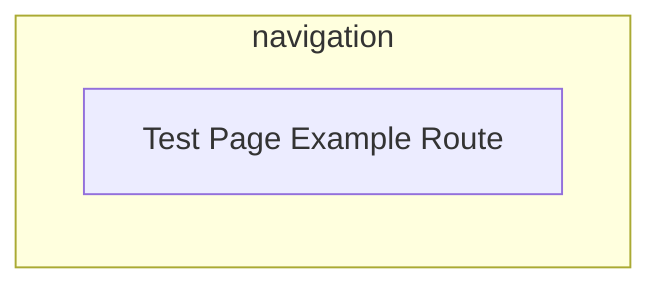
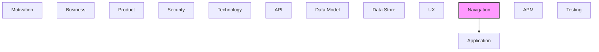

# Navigation

[← Back to README](../README.md)

Application routing, navigation flows, and page structures.

## Report Index

- [Layer Introduction](#layer-introduction)
- [Intra-Layer Relationships](#intra-layer-relationships)
- [Inter-Layer Dependencies](#inter-layer-dependencies)
- [Inter-Layer Relationships Table](#inter-layer-relationships-table)
- [Element Reference](#element-reference)

## Layer Introduction

| Metric                    | Count |
| ------------------------- | ----- |
| Elements                  | 1     |
| Intra-Layer Relationships | 0     |
| Inter-Layer Relationships | 1     |
| Inbound Relationships     | 0     |
| Outbound Relationships    | 1     |

**Cross-Layer References**:

- **Downstream layers**: [Application](./05-application-layer-report.md)

## Intra-Layer Relationships

## Inter-Layer Dependencies

## Inter-Layer Relationships Table

| Relationship ID                                                | Source Node                                | Dest Node                                             | Dest Layer    | Predicate    | Cardinality  | Strength |
| -------------------------------------------------------------- | ------------------------------------------ | ----------------------------------------------------- | ------------- | ------------ | ------------ | -------- |
| `navigation.route.depends-on.application.applicationcomponent` | `navigation.route.test-page-example-route` | `application.applicationcomponent.test-page-host-app` | `application` | `depends-on` | many-to-many | medium   |

## Element Reference

### Test Page Example Route {#test-page-example-route}

**ID**: `navigation.route.test-page-example-route`

**Type**: `route`

/?example=&lt;name&gt;: selects which test page the host app renders; the address every Playwright spec opens (e.g. /?example=primitives).

#### Attributes

| Name  | Value     |
| ----- | --------- |
| title | Test page |
| type  | public    |

#### Relationships

| Type        | Related Element                                       | Predicate    | Direction |
| ----------- | ----------------------------------------------------- | ------------ | --------- |
| inter-layer | `application.applicationcomponent.test-page-host-app` | `depends-on` | outbound  |

---

Generated: 2026-11-24T13:25:05.973Z | Model Version: 0.1.0
