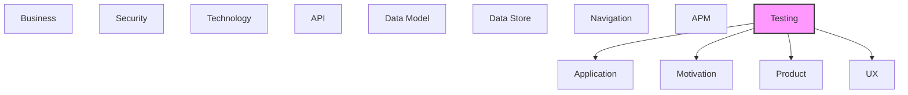

# Testing

[← Back to README](../README.md)

Test strategies, test cases, test data, and test coverage.

## Report Index

- [Layer Introduction](#layer-introduction)
- [Intra-Layer Relationships](#intra-layer-relationships)
- [Inter-Layer Dependencies](#inter-layer-dependencies)
- [Inter-Layer Relationships Table](#inter-layer-relationships-table)
- [Element Reference](#element-reference)

## Layer Introduction

| Metric                    | Count |
| ------------------------- | ----- |
| Elements                  | 97    |
| Intra-Layer Relationships | 94    |
| Inter-Layer Relationships | 215   |
| Inbound Relationships     | 0     |
| Outbound Relationships    | 215   |

**Cross-Layer References**:

- **Downstream layers**: [Application](./05-application-layer-report.md), [Motivation](./01-motivation-layer-report.md), [Product](./03-product-layer-report.md), [UX](./10-ux-layer-report.md)

## Intra-Layer Relationships

*This layer has >30 elements. Summary table shown instead of diagram.*

| Element                                                                                          | Type                  | Relationships |
| ------------------------------------------------------------------------------------------------ | --------------------- | ------------- |
| `testing.coveragerequirement.zero-literal-node-overlap-under-layout-simulation`                  | `coveragerequirement` | 3             |
| `testing.coveragesummary.graph-layout-rendering-test-coverage-summary`                           | `coveragesummary`     | 1             |
| `testing.testcasesketch.chart-fills-resolve-from-tokens`                                         | `testcasesketch`      | 1             |
| `testing.testcasesketch.clustered-view-bubble-packing-integration`                               | `testcasesketch`      | 1             |
| `testing.testcasesketch.color-literal-check-rejects-a-component-literal`                         | `testcasesketch`      | 0             |
| `testing.testcasesketch.galaxy-layout-lab-poc-dataset-stress-test`                               | `testcasesketch`      | 1             |
| `testing.testcasesketch.large-card-nodes-stay-non-overlapping-in-a-bushy-hub-and-spoke-topology` | `testcasesketch`      | 1             |
| `testing.testcasesketch.radial-tree-layout-collapsed-nodes`                                      | `testcasesketch`      | 1             |
| `testing.testcasesketch.route-navigation-edge-avoids-obstacles`                                  | `testcasesketch`      | 1             |
| `testing.testcasesketch.theme-override-ships-after-the-tokens`                                   | `testcasesketch`      | 0             |
| `testing.testcoveragemodel.heimdall-graph-layout-test-coverage`                                  | `testcoveragemodel`   | 8             |
| `testing.testcoveragemodel.heimdall-ui-test-coverage`                                            | `testcoveragemodel`   | 78            |
| `testing.testcoveragetarget.adjacency-matrix-view`                                               | `testcoveragetarget`  | 1             |
| `testing.testcoveragetarget.advanced-overlays`                                                   | `testcoveragetarget`  | 1             |
| `testing.testcoveragetarget.avatar`                                                              | `testcoveragetarget`  | 1             |
| `testing.testcoveragetarget.calendar-and-mini-calendar`                                          | `testcoveragetarget`  | 1             |
| `testing.testcoveragetarget.cards-and-lists`                                                     | `testcoveragetarget`  | 1             |
| `testing.testcoveragetarget.chart-components`                                                    | `testcoveragetarget`  | 2             |
| `testing.testcoveragetarget.chat-components`                                                     | `testcoveragetarget`  | 1             |
| `testing.testcoveragetarget.dark-canvas-semantic-tokens`                                         | `testcoveragetarget`  | 1             |
| `testing.testcoveragetarget.data-display-components`                                             | `testcoveragetarget`  | 1             |
| `testing.testcoveragetarget.date-utilities`                                                      | `testcoveragetarget`  | 1             |
| `testing.testcoveragetarget.design-foundation-tokens-and-typography`                             | `testcoveragetarget`  | 1             |
| `testing.testcoveragetarget.design-reference-comparison`                                         | `testcoveragetarget`  | 1             |
| `testing.testcoveragetarget.diff-viewer-components`                                              | `testcoveragetarget`  | 1             |
| `testing.testcoveragetarget.dropdown-placement`                                                  | `testcoveragetarget`  | 1             |
| `testing.testcoveragetarget.dropdown-portal`                                                     | `testcoveragetarget`  | 1             |
| `testing.testcoveragetarget.edge-label-placement-and-styling`                                    | `testcoveragetarget`  | 1             |
| `testing.testcoveragetarget.filter-dropdown`                                                     | `testcoveragetarget`  | 1             |
| `testing.testcoveragetarget.force-force-clustered-layout-algorithms`                             | `testcoveragetarget`  | 3             |
| `testing.testcoveragetarget.form-components`                                                     | `testcoveragetarget`  | 1             |
| `testing.testcoveragetarget.galaxy-layout-algorithm-unit`                                        | `testcoveragetarget`  | 1             |
| `testing.testcoveragetarget.galaxy-layout-and-live-simulation`                                   | `testcoveragetarget`  | 2             |
| `testing.testcoveragetarget.galaxy-layout-collapse-and-expand`                                   | `testcoveragetarget`  | 1             |
| `testing.testcoveragetarget.galaxy-live-drag`                                                    | `testcoveragetarget`  | 1             |
| `testing.testcoveragetarget.graph-canvas-accessible-names`                                       | `testcoveragetarget`  | 1             |
| `testing.testcoveragetarget.graph-canvas-center-on-select`                                       | `testcoveragetarget`  | 1             |
| `testing.testcoveragetarget.graph-canvas-click-tooltips`                                         | `testcoveragetarget`  | 1             |
| `testing.testcoveragetarget.graph-canvas-fit-to-boundaries`                                      | `testcoveragetarget`  | 1             |
| `testing.testcoveragetarget.graph-canvas-fullscreen-container`                                   | `testcoveragetarget`  | 1             |
| `testing.testcoveragetarget.graph-canvas-hover-tooltip-placement`                                | `testcoveragetarget`  | 1             |
| `testing.testcoveragetarget.graph-canvas-layer-lanes`                                            | `testcoveragetarget`  | 1             |
| `testing.testcoveragetarget.graph-canvas-layout-busy-state`                                      | `testcoveragetarget`  | 1             |
| `testing.testcoveragetarget.graph-canvas-node-measurement`                                       | `testcoveragetarget`  | 1             |
| `testing.testcoveragetarget.graph-canvas-popovers`                                               | `testcoveragetarget`  | 1             |
| `testing.testcoveragetarget.graph-canvas-rendering-and-interaction`                              | `testcoveragetarget`  | 1             |
| `testing.testcoveragetarget.graph-canvas-viewport-history`                                       | `testcoveragetarget`  | 1             |
| `testing.testcoveragetarget.graph-edge-geometry-utilities`                                       | `testcoveragetarget`  | 1             |
| `testing.testcoveragetarget.graph-edge-style-utilities`                                          | `testcoveragetarget`  | 1             |
| `testing.testcoveragetarget.graph-geometry-and-joint-label-placement`                            | `testcoveragetarget`  | 1             |
| `testing.testcoveragetarget.hive-plot-layout`                                                    | `testcoveragetarget`  | 1             |
| `testing.testcoveragetarget.hive-plot-view`                                                      | `testcoveragetarget`  | 1             |
| `testing.testcoveragetarget.inspector-panel-and-kvgrid`                                          | `testcoveragetarget`  | 1             |
| `testing.testcoveragetarget.kanban-board`                                                        | `testcoveragetarget`  | 1             |
| `testing.testcoveragetarget.lane-layout-and-gutter-routing`                                      | `testcoveragetarget`  | 1             |
| `testing.testcoveragetarget.layer-stack-projection`                                              | `testcoveragetarget`  | 1             |
| `testing.testcoveragetarget.layer-stack-view`                                                    | `testcoveragetarget`  | 1             |
| `testing.testcoveragetarget.layered-adjacency-matrix-cells`                                      | `testcoveragetarget`  | 1             |
| `testing.testcoveragetarget.layered-async-layout`                                                | `testcoveragetarget`  | 1             |
| `testing.testcoveragetarget.layered-dom-order`                                                   | `testcoveragetarget`  | 1             |
| `testing.testcoveragetarget.layered-edge-labels`                                                 | `testcoveragetarget`  | 1             |
| `testing.testcoveragetarget.layered-graph-chrome`                                                | `testcoveragetarget`  | 1             |
| `testing.testcoveragetarget.layered-graph-explorer`                                              | `testcoveragetarget`  | 1             |
| `testing.testcoveragetarget.layered-graph-index-and-reach`                                       | `testcoveragetarget`  | 1             |
| `testing.testcoveragetarget.layered-link-batches`                                                | `testcoveragetarget`  | 1             |
| `testing.testcoveragetarget.layered-selection-and-emphasis`                                      | `testcoveragetarget`  | 1             |
| `testing.testcoveragetarget.layered-snapshot-sanitization`                                       | `testcoveragetarget`  | 1             |
| `testing.testcoveragetarget.line-chart-data-toggle`                                              | `testcoveragetarget`  | 1             |
| `testing.testcoveragetarget.lineage-rail`                                                        | `testcoveragetarget`  | 1             |
| `testing.testcoveragetarget.map-canvas`                                                          | `testcoveragetarget`  | 1             |
| `testing.testcoveragetarget.navigation-edge-channel-routing`                                     | `testcoveragetarget`  | 2             |
| `testing.testcoveragetarget.navigation-edge-channel-routing-browser`                             | `testcoveragetarget`  | 1             |
| `testing.testcoveragetarget.organic-layout-algorithm`                                            | `testcoveragetarget`  | 1             |
| `testing.testcoveragetarget.organic-layout-browser`                                              | `testcoveragetarget`  | 1             |
| `testing.testcoveragetarget.orthogonal-layout-algorithm-and-routers`                             | `testcoveragetarget`  | 1             |
| `testing.testcoveragetarget.orthogonal-layout-browser`                                           | `testcoveragetarget`  | 1             |
| `testing.testcoveragetarget.overlay-components`                                                  | `testcoveragetarget`  | 1             |
| `testing.testcoveragetarget.page-pattern-components`                                             | `testcoveragetarget`  | 1             |
| `testing.testcoveragetarget.pan-and-zoom`                                                        | `testcoveragetarget`  | 1             |
| `testing.testcoveragetarget.pan-inertia`                                                         | `testcoveragetarget`  | 1             |
| `testing.testcoveragetarget.primitive-components`                                                | `testcoveragetarget`  | 1             |
| `testing.testcoveragetarget.radial-tree-layout-algorithm`                                        | `testcoveragetarget`  | 3             |
| `testing.testcoveragetarget.radial-tree-layout-browser`                                          | `testcoveragetarget`  | 1             |
| `testing.testcoveragetarget.reach-inspector-relationships`                                       | `testcoveragetarget`  | 1             |
| `testing.testcoveragetarget.responsive-shell`                                                    | `testcoveragetarget`  | 1             |
| `testing.testcoveragetarget.server-rendering`                                                    | `testcoveragetarget`  | 1             |
| `testing.testcoveragetarget.shell-framework-components`                                          | `testcoveragetarget`  | 1             |
| `testing.testcoveragetarget.static-site-link-variants`                                           | `testcoveragetarget`  | 1             |
| `testing.testcoveragetarget.tooltip-placement`                                                   | `testcoveragetarget`  | 1             |
| `testing.testcoveragetarget.trace-adapters`                                                      | `testcoveragetarget`  | 1             |
| `testing.testcoveragetarget.trace-viewer`                                                        | `testcoveragetarget`  | 1             |
| `testing.testcoveragetarget.ux-navigation-edge-visibility`                                       | `testcoveragetarget`  | 1             |
| `testing.testcoveragetarget.ux-navigation-layout-algorithm`                                      | `testcoveragetarget`  | 1             |
| `testing.testcoveragetarget.ux-navigation-layout-browser`                                        | `testcoveragetarget`  | 1             |
| `testing.testcoveragetarget.version-timeline`                                                    | `testcoveragetarget`  | 1             |
| `testing.testcoveragetarget.workspace-switcher-dialog`                                           | `testcoveragetarget`  | 1             |
| `testing.testcoveragetarget.yield-to-paint`                                                      | `testcoveragetarget`  | 1             |

## Inter-Layer Dependencies

## Inter-Layer Relationships Table

| Relationship ID                                                      | Source Node                                                                                      | Dest Node                                                               | Dest Layer    | Predicate   | Cardinality  | Strength |
| -------------------------------------------------------------------- | ------------------------------------------------------------------------------------------------ | ----------------------------------------------------------------------- | ------------- | ----------- | ------------ | -------- |
| `testing.testcasesketch.satisfies.motivation.requirement`            | `testing.testcasesketch.chart-fills-resolve-from-tokens`                                         | `motivation.requirement.a-mirror-can-restyle-the-library-from-one-file` | `motivation`  | `satisfies` | many-to-many | high     |
| `testing.testcasesketch.tests.product.feature`                       | `testing.testcasesketch.chart-fills-resolve-from-tokens`                                         | `product.feature.theme-slot`                                            | `product`     | `tests`     | many-to-many | medium   |
| `testing.testcasesketch.tests.ux.librarycomponent`                   | `testing.testcasesketch.chart-fills-resolve-from-tokens`                                         | `ux.librarycomponent.heatmap`                                           | `ux`          | `tests`     | many-to-many | medium   |
| `testing.testcasesketch.tests.ux.librarycomponent`                   | `testing.testcasesketch.chart-fills-resolve-from-tokens`                                         | `ux.librarycomponent.line-chart`                                        | `ux`          | `tests`     | many-to-many | medium   |
| `testing.testcasesketch.tests.ux.librarycomponent`                   | `testing.testcasesketch.chart-fills-resolve-from-tokens`                                         | `ux.librarycomponent.status-timeline`                                   | `ux`          | `tests`     | many-to-many | medium   |
| `testing.testcasesketch.tests.application.applicationfunction`       | `testing.testcasesketch.clustered-view-bubble-packing-integration`                               | `application.applicationfunction.clustered-force-layout-algorithm`      | `application` | `tests`     | many-to-many | medium   |
| `testing.testcasesketch.satisfies.motivation.requirement`            | `testing.testcasesketch.color-literal-check-rejects-a-component-literal`                         | `motivation.requirement.a-mirror-can-restyle-the-library-from-one-file` | `motivation`  | `satisfies` | many-to-many | high     |
| `testing.testcasesketch.tests.product.feature`                       | `testing.testcasesketch.color-literal-check-rejects-a-component-literal`                         | `product.feature.theme-slot`                                            | `product`     | `tests`     | many-to-many | medium   |
| `testing.testcasesketch.tests.application.applicationfunction`       | `testing.testcasesketch.galaxy-layout-lab-poc-dataset-stress-test`                               | `application.applicationfunction.galaxy-radial-orbit-layout-algorithm`  | `application` | `tests`     | many-to-many | medium   |
| `testing.testcasesketch.tests.application.applicationfunction`       | `testing.testcasesketch.large-card-nodes-stay-non-overlapping-in-a-bushy-hub-and-spoke-topology` | `application.applicationfunction.force-directed-layout-algorithm`       | `application` | `tests`     | many-to-many | medium   |
| `testing.testcasesketch.tests.application.applicationfunction`       | `testing.testcasesketch.radial-tree-layout-collapsed-nodes`                                      | `application.applicationfunction.radial-tree-layout-algorithm`          | `application` | `tests`     | many-to-many | medium   |
| `testing.testcasesketch.tests.application.applicationfunction`       | `testing.testcasesketch.radial-tree-layout-collapsed-nodes`                                      | `application.applicationfunction.structural-forest-construction`        | `application` | `tests`     | many-to-many | medium   |
| `testing.testcasesketch.tests.application.applicationfunction`       | `testing.testcasesketch.route-navigation-edge-avoids-obstacles`                                  | `application.applicationfunction.navigation-edge-orthogonal-routing`    | `application` | `tests`     | many-to-many | medium   |
| `testing.testcasesketch.satisfies.motivation.requirement`            | `testing.testcasesketch.theme-override-ships-after-the-tokens`                                   | `motivation.requirement.a-mirror-can-restyle-the-library-from-one-file` | `motivation`  | `satisfies` | many-to-many | high     |
| `testing.testcasesketch.tests.product.feature`                       | `testing.testcasesketch.theme-override-ships-after-the-tokens`                                   | `product.feature.theme-slot`                                            | `product`     | `tests`     | many-to-many | medium   |
| `testing.testcoveragemodel.covers.application.applicationcomponent`  | `testing.testcoveragemodel.heimdall-graph-layout-test-coverage`                                  | `application.applicationcomponent.graph-canvas-component`               | `application` | `covers`    | many-to-many | medium   |
| `testing.testcoveragetarget.covers.application.applicationcomponent` | `testing.testcoveragetarget.adjacency-matrix-view`                                               | `application.applicationcomponent.adjacency-matrix-component`           | `application` | `covers`    | many-to-many | medium   |
| `testing.testcoveragetarget.covers.ux.librarycomponent`              | `testing.testcoveragetarget.adjacency-matrix-view`                                               | `ux.librarycomponent.adjacency-matrix`                                  | `ux`          | `covers`    | many-to-many | medium   |
| `testing.testcoveragetarget.covers.ux.librarycomponent`              | `testing.testcoveragetarget.advanced-overlays`                                                   | `ux.librarycomponent.command-palette`                                   | `ux`          | `covers`    | many-to-many | medium   |
| `testing.testcoveragetarget.covers.ux.librarycomponent`              | `testing.testcoveragetarget.advanced-overlays`                                                   | `ux.librarycomponent.detail-drawer`                                     | `ux`          | `covers`    | many-to-many | medium   |
| `testing.testcoveragetarget.covers.ux.librarycomponent`              | `testing.testcoveragetarget.advanced-overlays`                                                   | `ux.librarycomponent.drawer`                                            | `ux`          | `covers`    | many-to-many | medium   |
| `testing.testcoveragetarget.covers.ux.librarycomponent`              | `testing.testcoveragetarget.advanced-overlays`                                                   | `ux.librarycomponent.popover`                                           | `ux`          | `covers`    | many-to-many | medium   |
| `testing.testcoveragetarget.covers.ux.librarycomponent`              | `testing.testcoveragetarget.advanced-overlays`                                                   | `ux.librarycomponent.tooltip`                                           | `ux`          | `covers`    | many-to-many | medium   |
| `testing.testcoveragetarget.covers.ux.librarycomponent`              | `testing.testcoveragetarget.avatar`                                                              | `ux.librarycomponent.avatar`                                            | `ux`          | `covers`    | many-to-many | medium   |
| `testing.testcoveragetarget.covers.ux.librarycomponent`              | `testing.testcoveragetarget.calendar-and-mini-calendar`                                          | `ux.librarycomponent.calendar`                                          | `ux`          | `covers`    | many-to-many | medium   |
| `testing.testcoveragetarget.covers.ux.librarycomponent`              | `testing.testcoveragetarget.calendar-and-mini-calendar`                                          | `ux.librarycomponent.mini-calendar`                                     | `ux`          | `covers`    | many-to-many | medium   |
| `testing.testcoveragetarget.covers.ux.librarycomponent`              | `testing.testcoveragetarget.cards-and-lists`                                                     | `ux.librarycomponent.asset-card`                                        | `ux`          | `covers`    | many-to-many | medium   |
| `testing.testcoveragetarget.covers.ux.librarycomponent`              | `testing.testcoveragetarget.cards-and-lists`                                                     | `ux.librarycomponent.asset-grid`                                        | `ux`          | `covers`    | many-to-many | medium   |
| `testing.testcoveragetarget.covers.ux.librarycomponent`              | `testing.testcoveragetarget.cards-and-lists`                                                     | `ux.librarycomponent.log-stream`                                        | `ux`          | `covers`    | many-to-many | medium   |
| `testing.testcoveragetarget.covers.ux.librarycomponent`              | `testing.testcoveragetarget.cards-and-lists`                                                     | `ux.librarycomponent.ordered-list`                                      | `ux`          | `covers`    | many-to-many | medium   |
| `testing.testcoveragetarget.covers.ux.librarycomponent`              | `testing.testcoveragetarget.cards-and-lists`                                                     | `ux.librarycomponent.result-card`                                       | `ux`          | `covers`    | many-to-many | medium   |
| `testing.testcoveragetarget.covers.ux.librarycomponent`              | `testing.testcoveragetarget.chart-components`                                                    | `ux.librarycomponent.bar-chart`                                         | `ux`          | `covers`    | many-to-many | medium   |
| `testing.testcoveragetarget.covers.ux.librarycomponent`              | `testing.testcoveragetarget.chart-components`                                                    | `ux.librarycomponent.bar-h`                                             | `ux`          | `covers`    | many-to-many | medium   |
| `testing.testcoveragetarget.covers.ux.librarycomponent`              | `testing.testcoveragetarget.chart-components`                                                    | `ux.librarycomponent.bar-v`                                             | `ux`          | `covers`    | many-to-many | medium   |
| `testing.testcoveragetarget.covers.ux.librarycomponent`              | `testing.testcoveragetarget.chart-components`                                                    | `ux.librarycomponent.chart-wrapper`                                     | `ux`          | `covers`    | many-to-many | medium   |
| `testing.testcoveragetarget.covers.ux.librarycomponent`              | `testing.testcoveragetarget.chart-components`                                                    | `ux.librarycomponent.donut`                                             | `ux`          | `covers`    | many-to-many | medium   |
| `testing.testcoveragetarget.covers.ux.librarycomponent`              | `testing.testcoveragetarget.chart-components`                                                    | `ux.librarycomponent.heatmap`                                           | `ux`          | `covers`    | many-to-many | medium   |
| `testing.testcoveragetarget.covers.ux.librarycomponent`              | `testing.testcoveragetarget.chart-components`                                                    | `ux.librarycomponent.line-chart`                                        | `ux`          | `covers`    | many-to-many | medium   |
| `testing.testcoveragetarget.covers.ux.librarycomponent`              | `testing.testcoveragetarget.chart-components`                                                    | `ux.librarycomponent.metric-row`                                        | `ux`          | `covers`    | many-to-many | medium   |
| `testing.testcoveragetarget.covers.ux.librarycomponent`              | `testing.testcoveragetarget.chart-components`                                                    | `ux.librarycomponent.progress-bar`                                      | `ux`          | `covers`    | many-to-many | medium   |
| `testing.testcoveragetarget.covers.ux.librarycomponent`              | `testing.testcoveragetarget.chart-components`                                                    | `ux.librarycomponent.sparkline`                                         | `ux`          | `covers`    | many-to-many | medium   |
| `testing.testcoveragetarget.covers.ux.librarycomponent`              | `testing.testcoveragetarget.chart-components`                                                    | `ux.librarycomponent.stacked-bar`                                       | `ux`          | `covers`    | many-to-many | medium   |
| `testing.testcoveragetarget.covers.ux.librarycomponent`              | `testing.testcoveragetarget.chart-components`                                                    | `ux.librarycomponent.status-timeline`                                   | `ux`          | `covers`    | many-to-many | medium   |
| `testing.testcoveragetarget.covers.ux.librarycomponent`              | `testing.testcoveragetarget.chat-components`                                                     | `ux.librarycomponent.chat-composer`                                     | `ux`          | `covers`    | many-to-many | medium   |
| `testing.testcoveragetarget.covers.ux.librarycomponent`              | `testing.testcoveragetarget.chat-components`                                                     | `ux.librarycomponent.chat-container`                                    | `ux`          | `covers`    | many-to-many | medium   |
| `testing.testcoveragetarget.covers.ux.librarycomponent`              | `testing.testcoveragetarget.chat-components`                                                     | `ux.librarycomponent.chat-divider`                                      | `ux`          | `covers`    | many-to-many | medium   |
| `testing.testcoveragetarget.covers.ux.librarycomponent`              | `testing.testcoveragetarget.chat-components`                                                     | `ux.librarycomponent.chat-markdown-content`                             | `ux`          | `covers`    | many-to-many | medium   |
| `testing.testcoveragetarget.covers.ux.librarycomponent`              | `testing.testcoveragetarget.chat-components`                                                     | `ux.librarycomponent.chat-message`                                      | `ux`          | `covers`    | many-to-many | medium   |
| `testing.testcoveragetarget.covers.ux.librarycomponent`              | `testing.testcoveragetarget.chat-components`                                                     | `ux.librarycomponent.chat-suggestions`                                  | `ux`          | `covers`    | many-to-many | medium   |
| `testing.testcoveragetarget.covers.ux.librarycomponent`              | `testing.testcoveragetarget.chat-components`                                                     | `ux.librarycomponent.thinking-block`                                    | `ux`          | `covers`    | many-to-many | medium   |
| `testing.testcoveragetarget.covers.ux.librarycomponent`              | `testing.testcoveragetarget.chat-components`                                                     | `ux.librarycomponent.tool-block`                                        | `ux`          | `covers`    | many-to-many | medium   |
| `testing.testcoveragetarget.covers.ux.librarycomponent`              | `testing.testcoveragetarget.dark-canvas-semantic-tokens`                                         | `ux.librarycomponent.activity-timeline`                                 | `ux`          | `covers`    | many-to-many | medium   |
| `testing.testcoveragetarget.covers.ux.librarycomponent`              | `testing.testcoveragetarget.dark-canvas-semantic-tokens`                                         | `ux.librarycomponent.chip`                                              | `ux`          | `covers`    | many-to-many | medium   |
| `testing.testcoveragetarget.covers.ux.librarycomponent`              | `testing.testcoveragetarget.dark-canvas-semantic-tokens`                                         | `ux.librarycomponent.form-callout`                                      | `ux`          | `covers`    | many-to-many | medium   |
| `testing.testcoveragetarget.covers.ux.librarycomponent`              | `testing.testcoveragetarget.dark-canvas-semantic-tokens`                                         | `ux.librarycomponent.version-pill`                                      | `ux`          | `covers`    | many-to-many | medium   |
| `testing.testcoveragetarget.covers.ux.librarycomponent`              | `testing.testcoveragetarget.data-display-components`                                             | `ux.librarycomponent.hierarchy-row`                                     | `ux`          | `covers`    | many-to-many | medium   |
| `testing.testcoveragetarget.covers.ux.librarycomponent`              | `testing.testcoveragetarget.data-display-components`                                             | `ux.librarycomponent.hierarchy-tree`                                    | `ux`          | `covers`    | many-to-many | medium   |
| `testing.testcoveragetarget.covers.ux.librarycomponent`              | `testing.testcoveragetarget.data-display-components`                                             | `ux.librarycomponent.stat-grid`                                         | `ux`          | `covers`    | many-to-many | medium   |
| `testing.testcoveragetarget.covers.ux.librarycomponent`              | `testing.testcoveragetarget.data-display-components`                                             | `ux.librarycomponent.stat-tile`                                         | `ux`          | `covers`    | many-to-many | medium   |
| `testing.testcoveragetarget.covers.ux.librarycomponent`              | `testing.testcoveragetarget.data-display-components`                                             | `ux.librarycomponent.table`                                             | `ux`          | `covers`    | many-to-many | medium   |
| `testing.testcoveragetarget.covers.ux.librarycomponent`              | `testing.testcoveragetarget.data-display-components`                                             | `ux.librarycomponent.topology-node`                                     | `ux`          | `covers`    | many-to-many | medium   |
| `testing.testcoveragetarget.covers.ux.librarycomponent`              | `testing.testcoveragetarget.date-utilities`                                                      | `ux.librarycomponent.activity-timeline`                                 | `ux`          | `covers`    | many-to-many | medium   |
| `testing.testcoveragetarget.covers.ux.librarycomponent`              | `testing.testcoveragetarget.date-utilities`                                                      | `ux.librarycomponent.calendar`                                          | `ux`          | `covers`    | many-to-many | medium   |
| `testing.testcoveragetarget.covers.ux.librarycomponent`              | `testing.testcoveragetarget.date-utilities`                                                      | `ux.librarycomponent.mini-calendar`                                     | `ux`          | `covers`    | many-to-many | medium   |
| `testing.testcoveragetarget.covers.ux.librarycomponent`              | `testing.testcoveragetarget.date-utilities`                                                      | `ux.librarycomponent.version-timeline`                                  | `ux`          | `covers`    | many-to-many | medium   |
| `testing.testcoveragetarget.covers.ux.librarycomponent`              | `testing.testcoveragetarget.design-foundation-tokens-and-typography`                             | `ux.librarycomponent.icon`                                              | `ux`          | `covers`    | many-to-many | medium   |
| `testing.testcoveragetarget.covers.ux.librarycomponent`              | `testing.testcoveragetarget.design-reference-comparison`                                         | `ux.librarycomponent.shell-layout`                                      | `ux`          | `covers`    | many-to-many | medium   |
| `testing.testcoveragetarget.covers.ux.librarycomponent`              | `testing.testcoveragetarget.diff-viewer-components`                                              | `ux.librarycomponent.diff-viewer`                                       | `ux`          | `covers`    | many-to-many | medium   |
| `testing.testcoveragetarget.covers.ux.librarycomponent`              | `testing.testcoveragetarget.diff-viewer-components`                                              | `ux.librarycomponent.hash-set-diff`                                     | `ux`          | `covers`    | many-to-many | medium   |
| `testing.testcoveragetarget.covers.ux.librarycomponent`              | `testing.testcoveragetarget.diff-viewer-components`                                              | `ux.librarycomponent.side-by-side-diff`                                 | `ux`          | `covers`    | many-to-many | medium   |
| `testing.testcoveragetarget.covers.ux.librarycomponent`              | `testing.testcoveragetarget.dropdown-placement`                                                  | `ux.librarycomponent.filter-dropdown`                                   | `ux`          | `covers`    | many-to-many | medium   |
| `testing.testcoveragetarget.covers.ux.librarycomponent`              | `testing.testcoveragetarget.dropdown-placement`                                                  | `ux.librarycomponent.row-menu`                                          | `ux`          | `covers`    | many-to-many | medium   |
| `testing.testcoveragetarget.covers.ux.librarycomponent`              | `testing.testcoveragetarget.dropdown-placement`                                                  | `ux.librarycomponent.select`                                            | `ux`          | `covers`    | many-to-many | medium   |
| `testing.testcoveragetarget.covers.ux.librarycomponent`              | `testing.testcoveragetarget.dropdown-portal`                                                     | `ux.librarycomponent.filter-dropdown`                                   | `ux`          | `covers`    | many-to-many | medium   |
| `testing.testcoveragetarget.covers.ux.librarycomponent`              | `testing.testcoveragetarget.dropdown-portal`                                                     | `ux.librarycomponent.row-menu`                                          | `ux`          | `covers`    | many-to-many | medium   |
| `testing.testcoveragetarget.covers.ux.librarycomponent`              | `testing.testcoveragetarget.dropdown-portal`                                                     | `ux.librarycomponent.select`                                            | `ux`          | `covers`    | many-to-many | medium   |
| `testing.testcoveragetarget.covers.application.applicationcomponent` | `testing.testcoveragetarget.edge-label-placement-and-styling`                                    | `application.applicationcomponent.graph-canvas-component`               | `application` | `covers`    | many-to-many | medium   |
| `testing.testcoveragetarget.covers.ux.librarycomponent`              | `testing.testcoveragetarget.filter-dropdown`                                                     | `ux.librarycomponent.filter-dropdown`                                   | `ux`          | `covers`    | many-to-many | medium   |
| `testing.testcoveragetarget.covers.application.applicationservice`   | `testing.testcoveragetarget.force-force-clustered-layout-algorithms`                             | `application.applicationservice.graph-layout-engine-service`            | `application` | `covers`    | many-to-many | medium   |
| `testing.testcoveragetarget.covers.ux.librarycomponent`              | `testing.testcoveragetarget.form-components`                                                     | `ux.librarycomponent.entity-picker`                                     | `ux`          | `covers`    | many-to-many | medium   |
| `testing.testcoveragetarget.covers.ux.librarycomponent`              | `testing.testcoveragetarget.form-components`                                                     | `ux.librarycomponent.field`                                             | `ux`          | `covers`    | many-to-many | medium   |
| `testing.testcoveragetarget.covers.ux.librarycomponent`              | `testing.testcoveragetarget.form-components`                                                     | `ux.librarycomponent.key-value-editor`                                  | `ux`          | `covers`    | many-to-many | medium   |
| `testing.testcoveragetarget.covers.ux.librarycomponent`              | `testing.testcoveragetarget.form-components`                                                     | `ux.librarycomponent.number-input`                                      | `ux`          | `covers`    | many-to-many | medium   |
| `testing.testcoveragetarget.covers.ux.librarycomponent`              | `testing.testcoveragetarget.form-components`                                                     | `ux.librarycomponent.relationship-builder`                              | `ux`          | `covers`    | many-to-many | medium   |
| `testing.testcoveragetarget.covers.ux.librarycomponent`              | `testing.testcoveragetarget.form-components`                                                     | `ux.librarycomponent.select`                                            | `ux`          | `covers`    | many-to-many | medium   |
| `testing.testcoveragetarget.covers.ux.librarycomponent`              | `testing.testcoveragetarget.form-components`                                                     | `ux.librarycomponent.text-area`                                         | `ux`          | `covers`    | many-to-many | medium   |
| `testing.testcoveragetarget.covers.ux.librarycomponent`              | `testing.testcoveragetarget.form-components`                                                     | `ux.librarycomponent.text-input`                                        | `ux`          | `covers`    | many-to-many | medium   |
| `testing.testcoveragetarget.covers.ux.librarycomponent`              | `testing.testcoveragetarget.form-components`                                                     | `ux.librarycomponent.tri-state`                                         | `ux`          | `covers`    | many-to-many | medium   |
| `testing.testcoveragetarget.covers.application.applicationservice`   | `testing.testcoveragetarget.galaxy-layout-algorithm-unit`                                        | `application.applicationservice.graph-layout-engine-service`            | `application` | `covers`    | many-to-many | medium   |
| `testing.testcoveragetarget.covers.application.applicationservice`   | `testing.testcoveragetarget.galaxy-layout-algorithm-unit`                                        | `application.applicationservice.live-galaxy-simulation-service`         | `application` | `covers`    | many-to-many | medium   |
| `testing.testcoveragetarget.covers.application.applicationservice`   | `testing.testcoveragetarget.galaxy-layout-and-live-simulation`                                   | `application.applicationservice.live-galaxy-simulation-service`         | `application` | `covers`    | many-to-many | medium   |
| `testing.testcoveragetarget.covers.application.applicationcomponent` | `testing.testcoveragetarget.galaxy-layout-collapse-and-expand`                                   | `application.applicationcomponent.graph-canvas-component`               | `application` | `covers`    | many-to-many | medium   |
| `testing.testcoveragetarget.covers.application.applicationservice`   | `testing.testcoveragetarget.galaxy-live-drag`                                                    | `application.applicationservice.live-galaxy-simulation-service`         | `application` | `covers`    | many-to-many | medium   |
| `testing.testcoveragetarget.covers.application.applicationcomponent` | `testing.testcoveragetarget.graph-canvas-accessible-names`                                       | `application.applicationcomponent.graph-canvas-component`               | `application` | `covers`    | many-to-many | medium   |
| `testing.testcoveragetarget.covers.application.applicationcomponent` | `testing.testcoveragetarget.graph-canvas-center-on-select`                                       | `application.applicationcomponent.graph-canvas-component`               | `application` | `covers`    | many-to-many | medium   |
| `testing.testcoveragetarget.covers.application.applicationcomponent` | `testing.testcoveragetarget.graph-canvas-click-tooltips`                                         | `application.applicationcomponent.graph-canvas-component`               | `application` | `covers`    | many-to-many | medium   |
| `testing.testcoveragetarget.covers.application.applicationcomponent` | `testing.testcoveragetarget.graph-canvas-fit-to-boundaries`                                      | `application.applicationcomponent.graph-canvas-component`               | `application` | `covers`    | many-to-many | medium   |
| `testing.testcoveragetarget.covers.application.applicationcomponent` | `testing.testcoveragetarget.graph-canvas-fullscreen-container`                                   | `application.applicationcomponent.graph-canvas-component`               | `application` | `covers`    | many-to-many | medium   |
| `testing.testcoveragetarget.covers.application.applicationcomponent` | `testing.testcoveragetarget.graph-canvas-hover-tooltip-placement`                                | `application.applicationcomponent.graph-canvas-component`               | `application` | `covers`    | many-to-many | medium   |
| `testing.testcoveragetarget.covers.application.applicationcomponent` | `testing.testcoveragetarget.graph-canvas-layer-lanes`                                            | `application.applicationcomponent.graph-canvas-component`               | `application` | `covers`    | many-to-many | medium   |
| `testing.testcoveragetarget.covers.application.applicationcomponent` | `testing.testcoveragetarget.graph-canvas-layout-busy-state`                                      | `application.applicationcomponent.graph-canvas-component`               | `application` | `covers`    | many-to-many | medium   |
| `testing.testcoveragetarget.covers.application.applicationcomponent` | `testing.testcoveragetarget.graph-canvas-node-measurement`                                       | `application.applicationcomponent.graph-canvas-component`               | `application` | `covers`    | many-to-many | medium   |
| `testing.testcoveragetarget.covers.application.applicationcomponent` | `testing.testcoveragetarget.graph-canvas-popovers`                                               | `application.applicationcomponent.graph-canvas-component`               | `application` | `covers`    | many-to-many | medium   |
| `testing.testcoveragetarget.covers.application.applicationcomponent` | `testing.testcoveragetarget.graph-canvas-rendering-and-interaction`                              | `application.applicationcomponent.graph-canvas-component`               | `application` | `covers`    | many-to-many | medium   |
| `testing.testcoveragetarget.covers.application.applicationcomponent` | `testing.testcoveragetarget.graph-canvas-viewport-history`                                       | `application.applicationcomponent.graph-canvas-component`               | `application` | `covers`    | many-to-many | medium   |
| `testing.testcoveragetarget.covers.application.applicationcomponent` | `testing.testcoveragetarget.graph-edge-geometry-utilities`                                       | `application.applicationcomponent.graph-canvas-component`               | `application` | `covers`    | many-to-many | medium   |
| `testing.testcoveragetarget.covers.application.applicationcomponent` | `testing.testcoveragetarget.graph-edge-style-utilities`                                          | `application.applicationcomponent.graph-edge-shape-component`           | `application` | `covers`    | many-to-many | medium   |
| `testing.testcoveragetarget.covers.application.applicationcomponent` | `testing.testcoveragetarget.graph-geometry-and-joint-label-placement`                            | `application.applicationcomponent.graph-canvas-component`               | `application` | `covers`    | many-to-many | medium   |
| `testing.testcoveragetarget.covers.product.feature`                  | `testing.testcoveragetarget.graph-geometry-and-joint-label-placement`                            | `product.feature.joint-edge-label-placement`                            | `product`     | `covers`    | many-to-many | medium   |
| `testing.testcoveragetarget.covers.application.applicationcomponent` | `testing.testcoveragetarget.hive-plot-layout`                                                    | `application.applicationcomponent.hive-plot-component`                  | `application` | `covers`    | many-to-many | medium   |
| `testing.testcoveragetarget.covers.application.applicationcomponent` | `testing.testcoveragetarget.hive-plot-view`                                                      | `application.applicationcomponent.hive-plot-component`                  | `application` | `covers`    | many-to-many | medium   |
| `testing.testcoveragetarget.covers.ux.librarycomponent`              | `testing.testcoveragetarget.hive-plot-view`                                                      | `ux.librarycomponent.hive-plot`                                         | `ux`          | `covers`    | many-to-many | medium   |
| `testing.testcoveragetarget.covers.ux.librarycomponent`              | `testing.testcoveragetarget.inspector-panel-and-kvgrid`                                          | `ux.librarycomponent.inspector-panel`                                   | `ux`          | `covers`    | many-to-many | medium   |
| `testing.testcoveragetarget.covers.ux.librarycomponent`              | `testing.testcoveragetarget.inspector-panel-and-kvgrid`                                          | `ux.librarycomponent.kvgrid`                                            | `ux`          | `covers`    | many-to-many | medium   |
| `testing.testcoveragetarget.covers.ux.librarycomponent`              | `testing.testcoveragetarget.kanban-board`                                                        | `ux.librarycomponent.kanban-board`                                      | `ux`          | `covers`    | many-to-many | medium   |
| `testing.testcoveragetarget.covers.application.applicationcomponent` | `testing.testcoveragetarget.lane-layout-and-gutter-routing`                                      | `application.applicationcomponent.graph-canvas-component`               | `application` | `covers`    | many-to-many | medium   |
| `testing.testcoveragetarget.covers.application.applicationservice`   | `testing.testcoveragetarget.lane-layout-and-gutter-routing`                                      | `application.applicationservice.graph-layout-engine-service`            | `application` | `covers`    | many-to-many | medium   |
| `testing.testcoveragetarget.covers.application.applicationcomponent` | `testing.testcoveragetarget.layer-stack-projection`                                              | `application.applicationcomponent.layer-stack-component`                | `application` | `covers`    | many-to-many | medium   |
| `testing.testcoveragetarget.covers.application.applicationcomponent` | `testing.testcoveragetarget.layer-stack-view`                                                    | `application.applicationcomponent.layer-stack-component`                | `application` | `covers`    | many-to-many | medium   |
| `testing.testcoveragetarget.covers.ux.librarycomponent`              | `testing.testcoveragetarget.layer-stack-view`                                                    | `ux.librarycomponent.layer-stack`                                       | `ux`          | `covers`    | many-to-many | medium   |
| `testing.testcoveragetarget.covers.application.applicationcomponent` | `testing.testcoveragetarget.layered-adjacency-matrix-cells`                                      | `application.applicationcomponent.adjacency-matrix-component`           | `application` | `covers`    | many-to-many | medium   |
| `testing.testcoveragetarget.covers.application.applicationservice`   | `testing.testcoveragetarget.layered-async-layout`                                                | `application.applicationservice.layered-graph-framework-service`        | `application` | `covers`    | many-to-many | medium   |
| `testing.testcoveragetarget.covers.application.applicationcomponent` | `testing.testcoveragetarget.layered-dom-order`                                                   | `application.applicationcomponent.layer-stack-component`                | `application` | `covers`    | many-to-many | medium   |
| `testing.testcoveragetarget.covers.application.applicationcomponent` | `testing.testcoveragetarget.layered-edge-labels`                                                 | `application.applicationcomponent.hive-plot-component`                  | `application` | `covers`    | many-to-many | medium   |
| `testing.testcoveragetarget.covers.application.applicationcomponent` | `testing.testcoveragetarget.layered-edge-labels`                                                 | `application.applicationcomponent.layer-stack-component`                | `application` | `covers`    | many-to-many | medium   |
| `testing.testcoveragetarget.covers.ux.librarycomponent`              | `testing.testcoveragetarget.layered-graph-chrome`                                                | `ux.librarycomponent.bridge-node-list`                                  | `ux`          | `covers`    | many-to-many | medium   |
| `testing.testcoveragetarget.covers.ux.librarycomponent`              | `testing.testcoveragetarget.layered-graph-chrome`                                                | `ux.librarycomponent.camera-controls`                                   | `ux`          | `covers`    | many-to-many | medium   |
| `testing.testcoveragetarget.covers.ux.librarycomponent`              | `testing.testcoveragetarget.layered-graph-chrome`                                                | `ux.librarycomponent.follow-control`                                    | `ux`          | `covers`    | many-to-many | medium   |
| `testing.testcoveragetarget.covers.ux.librarycomponent`              | `testing.testcoveragetarget.layered-graph-chrome`                                                | `ux.librarycomponent.layer-list`                                        | `ux`          | `covers`    | many-to-many | medium   |
| `testing.testcoveragetarget.covers.ux.librarycomponent`              | `testing.testcoveragetarget.layered-graph-chrome`                                                | `ux.librarycomponent.layer-pair-list`                                   | `ux`          | `covers`    | many-to-many | medium   |
| `testing.testcoveragetarget.covers.ux.librarycomponent`              | `testing.testcoveragetarget.layered-graph-chrome`                                                | `ux.librarycomponent.link-category-filter`                              | `ux`          | `covers`    | many-to-many | medium   |
| `testing.testcoveragetarget.covers.ux.librarycomponent`              | `testing.testcoveragetarget.layered-graph-chrome`                                                | `ux.librarycomponent.plane-layout-control`                              | `ux`          | `covers`    | many-to-many | medium   |
| `testing.testcoveragetarget.covers.ux.librarycomponent`              | `testing.testcoveragetarget.layered-graph-chrome`                                                | `ux.librarycomponent.predicate-label-control`                           | `ux`          | `covers`    | many-to-many | medium   |
| `testing.testcoveragetarget.covers.ux.librarycomponent`              | `testing.testcoveragetarget.layered-graph-chrome`                                                | `ux.librarycomponent.view-switcher`                                     | `ux`          | `covers`    | many-to-many | medium   |
| `testing.testcoveragetarget.covers.application.applicationcomponent` | `testing.testcoveragetarget.layered-graph-explorer`                                              | `application.applicationcomponent.layered-graph-explorer-component`     | `application` | `covers`    | many-to-many | medium   |
| `testing.testcoveragetarget.covers.product.feature`                  | `testing.testcoveragetarget.layered-graph-explorer`                                              | `product.feature.layered-graph-explorer`                                | `product`     | `covers`    | many-to-many | medium   |
| `testing.testcoveragetarget.covers.ux.librarycomponent`              | `testing.testcoveragetarget.layered-graph-explorer`                                              | `ux.librarycomponent.layered-graph-explorer`                            | `ux`          | `covers`    | many-to-many | medium   |
| `testing.testcoveragetarget.covers.application.applicationservice`   | `testing.testcoveragetarget.layered-graph-index-and-reach`                                       | `application.applicationservice.layered-graph-framework-service`        | `application` | `covers`    | many-to-many | medium   |
| `testing.testcoveragetarget.covers.application.applicationcomponent` | `testing.testcoveragetarget.layered-link-batches`                                                | `application.applicationcomponent.layer-stack-component`                | `application` | `covers`    | many-to-many | medium   |
| `testing.testcoveragetarget.covers.application.applicationservice`   | `testing.testcoveragetarget.layered-selection-and-emphasis`                                      | `application.applicationservice.layered-graph-framework-service`        | `application` | `covers`    | many-to-many | medium   |
| `testing.testcoveragetarget.covers.application.applicationservice`   | `testing.testcoveragetarget.layered-snapshot-sanitization`                                       | `application.applicationservice.layered-graph-framework-service`        | `application` | `covers`    | many-to-many | medium   |
| `testing.testcoveragetarget.covers.ux.librarycomponent`              | `testing.testcoveragetarget.line-chart-data-toggle`                                              | `ux.librarycomponent.line-chart`                                        | `ux`          | `covers`    | many-to-many | medium   |
| `testing.testcoveragetarget.covers.ux.librarycomponent`              | `testing.testcoveragetarget.lineage-rail`                                                        | `ux.librarycomponent.lineage-rail`                                      | `ux`          | `covers`    | many-to-many | medium   |
| `testing.testcoveragetarget.covers.ux.librarycomponent`              | `testing.testcoveragetarget.map-canvas`                                                          | `ux.librarycomponent.map-canvas`                                        | `ux`          | `covers`    | many-to-many | medium   |
| `testing.testcoveragetarget.covers.application.applicationcomponent` | `testing.testcoveragetarget.navigation-edge-channel-routing-browser`                             | `application.applicationcomponent.graph-canvas-component`               | `application` | `covers`    | many-to-many | medium   |
| `testing.testcoveragetarget.covers.application.applicationcomponent` | `testing.testcoveragetarget.navigation-edge-channel-routing`                                     | `application.applicationcomponent.graph-canvas-component`               | `application` | `covers`    | many-to-many | medium   |
| `testing.testcoveragetarget.covers.application.applicationservice`   | `testing.testcoveragetarget.organic-layout-algorithm`                                            | `application.applicationservice.graph-layout-engine-service`            | `application` | `covers`    | many-to-many | medium   |
| `testing.testcoveragetarget.covers.application.applicationcomponent` | `testing.testcoveragetarget.organic-layout-browser`                                              | `application.applicationcomponent.graph-canvas-component`               | `application` | `covers`    | many-to-many | medium   |
| `testing.testcoveragetarget.covers.application.applicationservice`   | `testing.testcoveragetarget.organic-layout-browser`                                              | `application.applicationservice.graph-layout-engine-service`            | `application` | `covers`    | many-to-many | medium   |
| `testing.testcoveragetarget.covers.application.applicationservice`   | `testing.testcoveragetarget.orthogonal-layout-algorithm-and-routers`                             | `application.applicationservice.graph-layout-engine-service`            | `application` | `covers`    | many-to-many | medium   |
| `testing.testcoveragetarget.covers.application.applicationcomponent` | `testing.testcoveragetarget.orthogonal-layout-browser`                                           | `application.applicationcomponent.graph-canvas-component`               | `application` | `covers`    | many-to-many | medium   |
| `testing.testcoveragetarget.covers.application.applicationservice`   | `testing.testcoveragetarget.orthogonal-layout-browser`                                           | `application.applicationservice.graph-layout-engine-service`            | `application` | `covers`    | many-to-many | medium   |
| `testing.testcoveragetarget.covers.ux.librarycomponent`              | `testing.testcoveragetarget.overlay-components`                                                  | `ux.librarycomponent.confirm-dialog`                                    | `ux`          | `covers`    | many-to-many | medium   |
| `testing.testcoveragetarget.covers.ux.librarycomponent`              | `testing.testcoveragetarget.overlay-components`                                                  | `ux.librarycomponent.drawer`                                            | `ux`          | `covers`    | many-to-many | medium   |
| `testing.testcoveragetarget.covers.ux.librarycomponent`              | `testing.testcoveragetarget.overlay-components`                                                  | `ux.librarycomponent.modal`                                             | `ux`          | `covers`    | many-to-many | medium   |
| `testing.testcoveragetarget.covers.ux.librarycomponent`              | `testing.testcoveragetarget.overlay-components`                                                  | `ux.librarycomponent.toast`                                             | `ux`          | `covers`    | many-to-many | medium   |
| `testing.testcoveragetarget.covers.ux.librarycomponent`              | `testing.testcoveragetarget.page-pattern-components`                                             | `ux.librarycomponent.activity-timeline`                                 | `ux`          | `covers`    | many-to-many | medium   |
| `testing.testcoveragetarget.covers.ux.librarycomponent`              | `testing.testcoveragetarget.page-pattern-components`                                             | `ux.librarycomponent.alert-strip`                                       | `ux`          | `covers`    | many-to-many | medium   |
| `testing.testcoveragetarget.covers.ux.librarycomponent`              | `testing.testcoveragetarget.page-pattern-components`                                             | `ux.librarycomponent.config-tile`                                       | `ux`          | `covers`    | many-to-many | medium   |
| `testing.testcoveragetarget.covers.ux.librarycomponent`              | `testing.testcoveragetarget.page-pattern-components`                                             | `ux.librarycomponent.filter-bar`                                        | `ux`          | `covers`    | many-to-many | medium   |
| `testing.testcoveragetarget.covers.ux.librarycomponent`              | `testing.testcoveragetarget.page-pattern-components`                                             | `ux.librarycomponent.form-callout`                                      | `ux`          | `covers`    | many-to-many | medium   |
| `testing.testcoveragetarget.covers.ux.librarycomponent`              | `testing.testcoveragetarget.page-pattern-components`                                             | `ux.librarycomponent.page-header`                                       | `ux`          | `covers`    | many-to-many | medium   |
| `testing.testcoveragetarget.covers.ux.librarycomponent`              | `testing.testcoveragetarget.page-pattern-components`                                             | `ux.librarycomponent.pipeline-card`                                     | `ux`          | `covers`    | many-to-many | medium   |
| `testing.testcoveragetarget.covers.ux.librarycomponent`              | `testing.testcoveragetarget.page-pattern-components`                                             | `ux.librarycomponent.quick-access-grid`                                 | `ux`          | `covers`    | many-to-many | medium   |
| `testing.testcoveragetarget.covers.ux.librarycomponent`              | `testing.testcoveragetarget.page-pattern-components`                                             | `ux.librarycomponent.quick-access-tile`                                 | `ux`          | `covers`    | many-to-many | medium   |
| `testing.testcoveragetarget.covers.ux.librarycomponent`              | `testing.testcoveragetarget.page-pattern-components`                                             | `ux.librarycomponent.row-menu`                                          | `ux`          | `covers`    | many-to-many | medium   |
| `testing.testcoveragetarget.covers.application.applicationcomponent` | `testing.testcoveragetarget.pan-and-zoom`                                                        | `application.applicationcomponent.graph-canvas-component`               | `application` | `covers`    | many-to-many | medium   |
| `testing.testcoveragetarget.covers.application.applicationcomponent` | `testing.testcoveragetarget.pan-inertia`                                                         | `application.applicationcomponent.graph-canvas-component`               | `application` | `covers`    | many-to-many | medium   |
| `testing.testcoveragetarget.covers.ux.librarycomponent`              | `testing.testcoveragetarget.primitive-components`                                                | `ux.librarycomponent.avatar`                                            | `ux`          | `covers`    | many-to-many | medium   |
| `testing.testcoveragetarget.covers.ux.librarycomponent`              | `testing.testcoveragetarget.primitive-components`                                                | `ux.librarycomponent.badge`                                             | `ux`          | `covers`    | many-to-many | medium   |
| `testing.testcoveragetarget.covers.ux.librarycomponent`              | `testing.testcoveragetarget.primitive-components`                                                | `ux.librarycomponent.button`                                            | `ux`          | `covers`    | many-to-many | medium   |
| `testing.testcoveragetarget.covers.ux.librarycomponent`              | `testing.testcoveragetarget.primitive-components`                                                | `ux.librarycomponent.chip`                                              | `ux`          | `covers`    | many-to-many | medium   |
| `testing.testcoveragetarget.covers.ux.librarycomponent`              | `testing.testcoveragetarget.primitive-components`                                                | `ux.librarycomponent.icon`                                              | `ux`          | `covers`    | many-to-many | medium   |
| `testing.testcoveragetarget.covers.ux.librarycomponent`              | `testing.testcoveragetarget.primitive-components`                                                | `ux.librarycomponent.segmented-control`                                 | `ux`          | `covers`    | many-to-many | medium   |
| `testing.testcoveragetarget.covers.ux.librarycomponent`              | `testing.testcoveragetarget.primitive-components`                                                | `ux.librarycomponent.status-badge`                                      | `ux`          | `covers`    | many-to-many | medium   |
| `testing.testcoveragetarget.covers.ux.librarycomponent`              | `testing.testcoveragetarget.primitive-components`                                                | `ux.librarycomponent.version-pill`                                      | `ux`          | `covers`    | many-to-many | medium   |
| `testing.testcoveragetarget.covers.application.applicationservice`   | `testing.testcoveragetarget.radial-tree-layout-algorithm`                                        | `application.applicationservice.graph-layout-engine-service`            | `application` | `covers`    | many-to-many | medium   |
| `testing.testcoveragetarget.covers.application.applicationcomponent` | `testing.testcoveragetarget.radial-tree-layout-browser`                                          | `application.applicationcomponent.graph-canvas-component`               | `application` | `covers`    | many-to-many | medium   |
| `testing.testcoveragetarget.covers.application.applicationservice`   | `testing.testcoveragetarget.radial-tree-layout-browser`                                          | `application.applicationservice.graph-layout-engine-service`            | `application` | `covers`    | many-to-many | medium   |
| `testing.testcoveragetarget.covers.ux.librarycomponent`              | `testing.testcoveragetarget.reach-inspector-relationships`                                       | `ux.librarycomponent.reach-inspector`                                   | `ux`          | `covers`    | many-to-many | medium   |
| `testing.testcoveragetarget.covers.ux.librarycomponent`              | `testing.testcoveragetarget.responsive-shell`                                                    | `ux.librarycomponent.shell-layout`                                      | `ux`          | `covers`    | many-to-many | medium   |
| `testing.testcoveragetarget.covers.ux.librarycomponent`              | `testing.testcoveragetarget.responsive-shell`                                                    | `ux.librarycomponent.sidebar`                                           | `ux`          | `covers`    | many-to-many | medium   |
| `testing.testcoveragetarget.covers.ux.librarycomponent`              | `testing.testcoveragetarget.responsive-shell`                                                    | `ux.librarycomponent.statusbar`                                         | `ux`          | `covers`    | many-to-many | medium   |
| `testing.testcoveragetarget.covers.ux.librarycomponent`              | `testing.testcoveragetarget.responsive-shell`                                                    | `ux.librarycomponent.topbar`                                            | `ux`          | `covers`    | many-to-many | medium   |
| `testing.testcoveragetarget.covers.product.feature`                  | `testing.testcoveragetarget.server-rendering`                                                    | `product.feature.server-side-rendering-support`                         | `product`     | `covers`    | many-to-many | medium   |
| `testing.testcoveragetarget.covers.ux.librarycomponent`              | `testing.testcoveragetarget.server-rendering`                                                    | `ux.librarycomponent.mini-calendar`                                     | `ux`          | `covers`    | many-to-many | medium   |
| `testing.testcoveragetarget.covers.ux.librarycomponent`              | `testing.testcoveragetarget.server-rendering`                                                    | `ux.librarycomponent.nav-item`                                          | `ux`          | `covers`    | many-to-many | medium   |
| `testing.testcoveragetarget.covers.ux.librarycomponent`              | `testing.testcoveragetarget.server-rendering`                                                    | `ux.librarycomponent.quick-access-tile`                                 | `ux`          | `covers`    | many-to-many | medium   |
| `testing.testcoveragetarget.covers.ux.librarycomponent`              | `testing.testcoveragetarget.server-rendering`                                                    | `ux.librarycomponent.shell-layout`                                      | `ux`          | `covers`    | many-to-many | medium   |
| `testing.testcoveragetarget.covers.ux.librarycomponent`              | `testing.testcoveragetarget.shell-framework-components`                                          | `ux.librarycomponent.app-title`                                         | `ux`          | `covers`    | many-to-many | medium   |
| `testing.testcoveragetarget.covers.ux.librarycomponent`              | `testing.testcoveragetarget.shell-framework-components`                                          | `ux.librarycomponent.nav-item`                                          | `ux`          | `covers`    | many-to-many | medium   |
| `testing.testcoveragetarget.covers.ux.librarycomponent`              | `testing.testcoveragetarget.shell-framework-components`                                          | `ux.librarycomponent.panel`                                             | `ux`          | `covers`    | many-to-many | medium   |
| `testing.testcoveragetarget.covers.ux.librarycomponent`              | `testing.testcoveragetarget.shell-framework-components`                                          | `ux.librarycomponent.shell-layout`                                      | `ux`          | `covers`    | many-to-many | medium   |
| `testing.testcoveragetarget.covers.ux.librarycomponent`              | `testing.testcoveragetarget.shell-framework-components`                                          | `ux.librarycomponent.sidebar`                                           | `ux`          | `covers`    | many-to-many | medium   |
| `testing.testcoveragetarget.covers.ux.librarycomponent`              | `testing.testcoveragetarget.shell-framework-components`                                          | `ux.librarycomponent.split-pane`                                        | `ux`          | `covers`    | many-to-many | medium   |
| `testing.testcoveragetarget.covers.ux.librarycomponent`              | `testing.testcoveragetarget.shell-framework-components`                                          | `ux.librarycomponent.statusbar`                                         | `ux`          | `covers`    | many-to-many | medium   |
| `testing.testcoveragetarget.covers.ux.librarycomponent`              | `testing.testcoveragetarget.shell-framework-components`                                          | `ux.librarycomponent.tab-bar`                                           | `ux`          | `covers`    | many-to-many | medium   |
| `testing.testcoveragetarget.covers.ux.librarycomponent`              | `testing.testcoveragetarget.shell-framework-components`                                          | `ux.librarycomponent.titlebar`                                          | `ux`          | `covers`    | many-to-many | medium   |
| `testing.testcoveragetarget.covers.ux.librarycomponent`              | `testing.testcoveragetarget.shell-framework-components`                                          | `ux.librarycomponent.topbar`                                            | `ux`          | `covers`    | many-to-many | medium   |
| `testing.testcoveragetarget.covers.product.feature`                  | `testing.testcoveragetarget.static-site-link-variants`                                           | `product.feature.link-navigation-with-href`                             | `product`     | `covers`    | many-to-many | medium   |
| `testing.testcoveragetarget.covers.ux.librarycomponent`              | `testing.testcoveragetarget.static-site-link-variants`                                           | `ux.librarycomponent.nav-item`                                          | `ux`          | `covers`    | many-to-many | medium   |
| `testing.testcoveragetarget.covers.ux.librarycomponent`              | `testing.testcoveragetarget.static-site-link-variants`                                           | `ux.librarycomponent.quick-access-grid`                                 | `ux`          | `covers`    | many-to-many | medium   |
| `testing.testcoveragetarget.covers.ux.librarycomponent`              | `testing.testcoveragetarget.static-site-link-variants`                                           | `ux.librarycomponent.quick-access-tile`                                 | `ux`          | `covers`    | many-to-many | medium   |
| `testing.testcoveragetarget.covers.ux.librarycomponent`              | `testing.testcoveragetarget.static-site-link-variants`                                           | `ux.librarycomponent.sidebar`                                           | `ux`          | `covers`    | many-to-many | medium   |
| `testing.testcoveragetarget.covers.ux.librarycomponent`              | `testing.testcoveragetarget.tooltip-placement`                                                   | `ux.librarycomponent.tooltip`                                           | `ux`          | `covers`    | many-to-many | medium   |
| `testing.testcoveragetarget.covers.application.applicationcomponent` | `testing.testcoveragetarget.trace-adapters`                                                      | `application.applicationcomponent.trace-viewer-component`               | `application` | `covers`    | many-to-many | medium   |
| `testing.testcoveragetarget.covers.application.applicationcomponent` | `testing.testcoveragetarget.trace-viewer`                                                        | `application.applicationcomponent.trace-viewer-component`               | `application` | `covers`    | many-to-many | medium   |
| `testing.testcoveragetarget.covers.ux.librarycomponent`              | `testing.testcoveragetarget.trace-viewer`                                                        | `ux.librarycomponent.trace-viewer`                                      | `ux`          | `covers`    | many-to-many | medium   |
| `testing.testcoveragetarget.covers.application.applicationcomponent` | `testing.testcoveragetarget.ux-navigation-edge-visibility`                                       | `application.applicationcomponent.graph-canvas-component`               | `application` | `covers`    | many-to-many | medium   |
| `testing.testcoveragetarget.covers.application.applicationservice`   | `testing.testcoveragetarget.ux-navigation-layout-algorithm`                                      | `application.applicationservice.graph-layout-engine-service`            | `application` | `covers`    | many-to-many | medium   |
| `testing.testcoveragetarget.covers.application.applicationcomponent` | `testing.testcoveragetarget.ux-navigation-layout-browser`                                        | `application.applicationcomponent.graph-canvas-component`               | `application` | `covers`    | many-to-many | medium   |
| `testing.testcoveragetarget.covers.application.applicationservice`   | `testing.testcoveragetarget.ux-navigation-layout-browser`                                        | `application.applicationservice.graph-layout-engine-service`            | `application` | `covers`    | many-to-many | medium   |
| `testing.testcoveragetarget.covers.ux.librarycomponent`              | `testing.testcoveragetarget.version-timeline`                                                    | `ux.librarycomponent.version-timeline`                                  | `ux`          | `covers`    | many-to-many | medium   |
| `testing.testcoveragetarget.covers.ux.librarycomponent`              | `testing.testcoveragetarget.workspace-switcher-dialog`                                           | `ux.librarycomponent.workspace-switcher-dialog`                         | `ux`          | `covers`    | many-to-many | medium   |
| `testing.testcoveragetarget.covers.application.applicationcomponent` | `testing.testcoveragetarget.yield-to-paint`                                                      | `application.applicationcomponent.graph-canvas-component`               | `application` | `covers`    | many-to-many | medium   |

## Element Reference

### Zero Literal Node-Overlap Under Layout Simulation {#zero-literal-node-overlap-under-layout-simulation}

**ID**: `testing.coveragerequirement.zero-literal-node-overlap-under-layout-simulation`

**Type**: `coveragerequirement`

Every layout engine's output must keep rendered node bounding boxes non-overlapping (within a small documented tolerance — see OVERLAP_TOLERANCE in tests/graph-layout.spec.ts) across default chip-sized and larger card-sized nodes.

#### Attributes

| Name             | Value           |
| ---------------- | --------------- |
| coverageCriteria | boundary-values |
| priority         | critical        |

#### Relationships

| Type        | Related Element                                                                                  | Predicate   | Direction |
| ----------- | ------------------------------------------------------------------------------------------------ | ----------- | --------- |
| intra-layer | `testing.testcasesketch.large-card-nodes-stay-non-overlapping-in-a-bushy-hub-and-spoke-topology` | `validates` | inbound   |
| intra-layer | `testing.testcoveragetarget.force-force-clustered-layout-algorithms`                             | `composes`  | inbound   |
| intra-layer | `testing.testcoveragetarget.radial-tree-layout-algorithm`                                        | `composes`  | inbound   |

### Graph Layout & Rendering Test Coverage Summary {#graph-layout-rendering-test-coverage-summary}

**ID**: `testing.coveragesummary.graph-layout-rendering-test-coverage-summary`

**Type**: `coveragesummary`

Roll-up counts for this extraction's testing-layer coverage of heimdall's graph-visualization surface.

#### Attributes

| Name              | Value |
| ----------------- | ----- |
| totalRequirements | 1     |
| totalSketches     | 5     |
| totalTargets      | 7     |

#### Relationships

| Type        | Related Element                                                 | Predicate  | Direction |
| ----------- | --------------------------------------------------------------- | ---------- | --------- |
| intra-layer | `testing.testcoveragemodel.heimdall-graph-layout-test-coverage` | `composes` | inbound   |

### Chart Fills Resolve From Tokens {#chart-fills-resolve-from-tokens}

**ID**: `testing.testcasesketch.chart-fills-resolve-from-tokens`

**Type**: `testcasesketch`

tests/charts-showcase.spec.ts, updated: the LineChart and StatusTimeline marker circles carry rgb(var(--accent-primary-hover)) instead of #F59E0B; StatusTimeline segment fills are status-token references; Heatmap cells fill with the base color and a fill-opacity in \[0.12, 1\] (was: non-empty hex fills). Screenshots stay identical to the existing baselines.

#### Attributes

| Name   | Value     |
| ------ | --------- |
| status | automated |

#### Relationships

| Type        | Related Element                                                         | Predicate   | Direction |
| ----------- | ----------------------------------------------------------------------- | ----------- | --------- |
| inter-layer | `motivation.requirement.a-mirror-can-restyle-the-library-from-one-file` | `satisfies` | outbound  |
| inter-layer | `product.feature.theme-slot`                                            | `tests`     | outbound  |
| inter-layer | `ux.librarycomponent.heatmap`                                           | `tests`     | outbound  |
| inter-layer | `ux.librarycomponent.line-chart`                                        | `tests`     | outbound  |
| inter-layer | `ux.librarycomponent.status-timeline`                                   | `tests`     | outbound  |
| intra-layer | `testing.testcoveragetarget.chart-components`                           | `composes`  | inbound   |

### Clustered View Bubble Packing Integration {#clustered-view-bubble-packing-integration}

**ID**: `testing.testcasesketch.clustered-view-bubble-packing-integration`

**Type**: `testcasesketch`

Integration test suite for layout="force-clustered": nested bubble boundaries render and separate correctly per top-level Louvain cluster.

#### Attributes

| Name                 | Value     |
| -------------------- | --------- |
| implementationFormat | automated |
| status               | automated |

#### Relationships

| Type        | Related Element                                                      | Predicate  | Direction |
| ----------- | -------------------------------------------------------------------- | ---------- | --------- |
| inter-layer | `application.applicationfunction.clustered-force-layout-algorithm`   | `tests`    | outbound  |
| intra-layer | `testing.testcoveragetarget.force-force-clustered-layout-algorithms` | `composes` | inbound   |

### Color Literal Check Rejects a Component Literal {#color-literal-check-rejects-a-component-literal}

**ID**: `testing.testcasesketch.color-literal-check-rejects-a-component-literal`

**Type**: `testcasesketch`

npm run check:colors passes on the branch and fails when a literal such as #f59e0b is added to any component file; pure black and white, URL fragments and issue references in comments (#320) pass.

#### Attributes

| Name   | Value |
| ------ | ----- |
| status | draft |

#### Relationships

| Type        | Related Element                                                         | Predicate   | Direction |
| ----------- | ----------------------------------------------------------------------- | ----------- | --------- |
| inter-layer | `motivation.requirement.a-mirror-can-restyle-the-library-from-one-file` | `satisfies` | outbound  |
| inter-layer | `product.feature.theme-slot`                                            | `tests`     | outbound  |

### Galaxy Layout Lab POC Dataset Stress Test {#galaxy-layout-lab-poc-dataset-stress-test}

**ID**: `testing.testcasesketch.galaxy-layout-lab-poc-dataset-stress-test`

**Type**: `testcasesketch`

Integration stress test exercising galaxy layout against a larger proof-of-concept dataset.

#### Attributes

| Name                 | Value     |
| -------------------- | --------- |
| implementationFormat | automated |
| status               | automated |

#### Relationships

| Type        | Related Element                                                        | Predicate  | Direction |
| ----------- | ---------------------------------------------------------------------- | ---------- | --------- |
| inter-layer | `application.applicationfunction.galaxy-radial-orbit-layout-algorithm` | `tests`    | outbound  |
| intra-layer | `testing.testcoveragetarget.galaxy-layout-and-live-simulation`         | `composes` | inbound   |

### Large Card Nodes Stay Non-Overlapping in a Bushy Hub-and-Spoke Topology {#large-card-nodes-stay-non-overlapping-in-a-bushy-hub-and-spoke-topology}

**ID**: `testing.testcasesketch.large-card-nodes-stay-non-overlapping-in-a-bushy-hub-and-spoke-topology`

**Type**: `testcasesketch`

forceLayout regression test verifying card-sized (not just default chip-sized) nodes resolve to non-overlapping positions in a hub-and-spoke graph.

#### Attributes

| Name                 | Value     |
| -------------------- | --------- |
| implementationFormat | automated |
| status               | automated |

#### Relationships

| Type        | Related Element                                                                 | Predicate   | Direction |
| ----------- | ------------------------------------------------------------------------------- | ----------- | --------- |
| inter-layer | `application.applicationfunction.force-directed-layout-algorithm`               | `tests`     | outbound  |
| intra-layer | `testing.coveragerequirement.zero-literal-node-overlap-under-layout-simulation` | `validates` | outbound  |

### radialTreeLayout Collapsed Nodes {#radialtreelayout-collapsed-nodes}

**ID**: `testing.testcasesketch.radial-tree-layout-collapsed-nodes`

**Type**: `testcasesketch`

Verifies radialTreeLayout positions only currently-visible (non-collapsed) nodes while still sizing trunk bubbles from the full tree.

#### Attributes

| Name                 | Value     |
| -------------------- | --------- |
| implementationFormat | automated |
| status               | automated |

#### Relationships

| Type        | Related Element                                                  | Predicate  | Direction |
| ----------- | ---------------------------------------------------------------- | ---------- | --------- |
| inter-layer | `application.applicationfunction.radial-tree-layout-algorithm`   | `tests`    | outbound  |
| inter-layer | `application.applicationfunction.structural-forest-construction` | `tests`    | outbound  |
| intra-layer | `testing.testcoveragetarget.radial-tree-layout-algorithm`        | `composes` | inbound   |

### routeNavigationEdge Avoids Obstacles {#routenavigationedge-avoids-obstacles}

**ID**: `testing.testcasesketch.route-navigation-edge-avoids-obstacles`

**Type**: `testcasesketch`

Verifies orthogonal navigation-edge routing detours around obstacle rectangles instead of crossing them.

#### Attributes

| Name                 | Value     |
| -------------------- | --------- |
| implementationFormat | automated |
| status               | automated |

#### Relationships

| Type        | Related Element                                                      | Predicate  | Direction |
| ----------- | -------------------------------------------------------------------- | ---------- | --------- |
| inter-layer | `application.applicationfunction.navigation-edge-orthogonal-routing` | `tests`    | outbound  |
| intra-layer | `testing.testcoveragetarget.navigation-edge-channel-routing`         | `composes` | inbound   |

### Theme Override Ships After the Tokens {#theme-override-ships-after-the-tokens}

**ID**: `testing.testcasesketch.theme-override-ships-after-the-tokens`

**Type**: `testcasesketch`

With :root \{ --accent-primary: 37 99 235; \} in src/tokens/theme.css, npm run build puts that declaration after --accent-primary: 251 191 36 in dist/style.css and dist/css/base.css; check:sheets passes.

#### Attributes

| Name   | Value |
| ------ | ----- |
| status | draft |

#### Relationships

| Type        | Related Element                                                         | Predicate   | Direction |
| ----------- | ----------------------------------------------------------------------- | ----------- | --------- |
| inter-layer | `motivation.requirement.a-mirror-can-restyle-the-library-from-one-file` | `satisfies` | outbound  |
| inter-layer | `product.feature.theme-slot`                                            | `tests`     | outbound  |

### Heimdall Graph Layout Test Coverage {#heimdall-graph-layout-test-coverage}

**ID**: `testing.testcoveragemodel.heimdall-graph-layout-test-coverage`

**Type**: `testcoveragemodel`

Coverage model for heimdall's graph-visualization surface: Playwright browser tests (tests/graph-\*.spec.ts) plus Vitest pure-function unit tests (src/utils/\*.test.ts).

#### Attributes

| Name        | Value       |
| ----------- | ----------- |
| application | heimdall-ui |
| version     | 0.8.0       |

#### Relationships

| Type        | Related Element                                                        | Predicate  | Direction |
| ----------- | ---------------------------------------------------------------------- | ---------- | --------- |
| inter-layer | `application.applicationcomponent.graph-canvas-component`              | `covers`   | outbound  |
| intra-layer | `testing.coveragesummary.graph-layout-rendering-test-coverage-summary` | `composes` | outbound  |
| intra-layer | `testing.testcoveragetarget.edge-label-placement-and-styling`          | `composes` | outbound  |
| intra-layer | `testing.testcoveragetarget.force-force-clustered-layout-algorithms`   | `composes` | outbound  |
| intra-layer | `testing.testcoveragetarget.galaxy-layout-and-live-simulation`         | `composes` | outbound  |
| intra-layer | `testing.testcoveragetarget.graph-canvas-rendering-and-interaction`    | `composes` | outbound  |
| intra-layer | `testing.testcoveragetarget.graph-edge-geometry-utilities`             | `composes` | outbound  |
| intra-layer | `testing.testcoveragetarget.navigation-edge-channel-routing`           | `composes` | outbound  |
| intra-layer | `testing.testcoveragetarget.radial-tree-layout-algorithm`              | `composes` | outbound  |

### Heimdall UI Test Coverage {#heimdall-ui-test-coverage}

**ID**: `testing.testcoveragemodel.heimdall-ui-test-coverage`

**Type**: `testcoveragemodel`

Coverage model for the whole @tinkermonkey/heimdall-ui package beyond the graph-layout surface: one target per Playwright spec (tests/\*.spec.ts, visual and behavioural, run by npm test) and per Vitest file (src/\*\*/\*.test.ts, run by npm run test:unit).

#### Attributes

| Name        | Value                     |
| ----------- | ------------------------- |
| application | @tinkermonkey/heimdall-ui |
| version     | 0.13.0                    |

#### Relationships

| Type        | Related Element                                                       | Predicate  | Direction |
| ----------- | --------------------------------------------------------------------- | ---------- | --------- |
| intra-layer | `testing.testcoveragetarget.adjacency-matrix-view`                    | `composes` | outbound  |
| intra-layer | `testing.testcoveragetarget.advanced-overlays`                        | `composes` | outbound  |
| intra-layer | `testing.testcoveragetarget.avatar`                                   | `composes` | outbound  |
| intra-layer | `testing.testcoveragetarget.calendar-and-mini-calendar`               | `composes` | outbound  |
| intra-layer | `testing.testcoveragetarget.cards-and-lists`                          | `composes` | outbound  |
| intra-layer | `testing.testcoveragetarget.chart-components`                         | `composes` | outbound  |
| intra-layer | `testing.testcoveragetarget.chat-components`                          | `composes` | outbound  |
| intra-layer | `testing.testcoveragetarget.dark-canvas-semantic-tokens`              | `composes` | outbound  |
| intra-layer | `testing.testcoveragetarget.data-display-components`                  | `composes` | outbound  |
| intra-layer | `testing.testcoveragetarget.date-utilities`                           | `composes` | outbound  |
| intra-layer | `testing.testcoveragetarget.design-foundation-tokens-and-typography`  | `composes` | outbound  |
| intra-layer | `testing.testcoveragetarget.design-reference-comparison`              | `composes` | outbound  |
| intra-layer | `testing.testcoveragetarget.diff-viewer-components`                   | `composes` | outbound  |
| intra-layer | `testing.testcoveragetarget.dropdown-placement`                       | `composes` | outbound  |
| intra-layer | `testing.testcoveragetarget.dropdown-portal`                          | `composes` | outbound  |
| intra-layer | `testing.testcoveragetarget.filter-dropdown`                          | `composes` | outbound  |
| intra-layer | `testing.testcoveragetarget.form-components`                          | `composes` | outbound  |
| intra-layer | `testing.testcoveragetarget.galaxy-layout-algorithm-unit`             | `composes` | outbound  |
| intra-layer | `testing.testcoveragetarget.galaxy-layout-collapse-and-expand`        | `composes` | outbound  |
| intra-layer | `testing.testcoveragetarget.galaxy-live-drag`                         | `composes` | outbound  |
| intra-layer | `testing.testcoveragetarget.graph-canvas-accessible-names`            | `composes` | outbound  |
| intra-layer | `testing.testcoveragetarget.graph-canvas-center-on-select`            | `composes` | outbound  |
| intra-layer | `testing.testcoveragetarget.graph-canvas-click-tooltips`              | `composes` | outbound  |
| intra-layer | `testing.testcoveragetarget.graph-canvas-fit-to-boundaries`           | `composes` | outbound  |
| intra-layer | `testing.testcoveragetarget.graph-canvas-fullscreen-container`        | `composes` | outbound  |
| intra-layer | `testing.testcoveragetarget.graph-canvas-hover-tooltip-placement`     | `composes` | outbound  |
| intra-layer | `testing.testcoveragetarget.graph-canvas-layer-lanes`                 | `composes` | outbound  |
| intra-layer | `testing.testcoveragetarget.graph-canvas-layout-busy-state`           | `composes` | outbound  |
| intra-layer | `testing.testcoveragetarget.graph-canvas-node-measurement`            | `composes` | outbound  |
| intra-layer | `testing.testcoveragetarget.graph-canvas-popovers`                    | `composes` | outbound  |
| intra-layer | `testing.testcoveragetarget.graph-canvas-viewport-history`            | `composes` | outbound  |
| intra-layer | `testing.testcoveragetarget.graph-edge-style-utilities`               | `composes` | outbound  |
| intra-layer | `testing.testcoveragetarget.graph-geometry-and-joint-label-placement` | `composes` | outbound  |
| intra-layer | `testing.testcoveragetarget.hive-plot-layout`                         | `composes` | outbound  |
| intra-layer | `testing.testcoveragetarget.hive-plot-view`                           | `composes` | outbound  |
| intra-layer | `testing.testcoveragetarget.inspector-panel-and-kvgrid`               | `composes` | outbound  |
| intra-layer | `testing.testcoveragetarget.kanban-board`                             | `composes` | outbound  |
| intra-layer | `testing.testcoveragetarget.lane-layout-and-gutter-routing`           | `composes` | outbound  |
| intra-layer | `testing.testcoveragetarget.layer-stack-projection`                   | `composes` | outbound  |
| intra-layer | `testing.testcoveragetarget.layer-stack-view`                         | `composes` | outbound  |
| intra-layer | `testing.testcoveragetarget.layered-adjacency-matrix-cells`           | `composes` | outbound  |
| intra-layer | `testing.testcoveragetarget.layered-async-layout`                     | `composes` | outbound  |
| intra-layer | `testing.testcoveragetarget.layered-dom-order`                        | `composes` | outbound  |
| intra-layer | `testing.testcoveragetarget.layered-edge-labels`                      | `composes` | outbound  |
| intra-layer | `testing.testcoveragetarget.layered-graph-chrome`                     | `composes` | outbound  |
| intra-layer | `testing.testcoveragetarget.layered-graph-explorer`                   | `composes` | outbound  |
| intra-layer | `testing.testcoveragetarget.layered-graph-index-and-reach`            | `composes` | outbound  |
| intra-layer | `testing.testcoveragetarget.layered-link-batches`                     | `composes` | outbound  |
| intra-layer | `testing.testcoveragetarget.layered-selection-and-emphasis`           | `composes` | outbound  |
| intra-layer | `testing.testcoveragetarget.layered-snapshot-sanitization`            | `composes` | outbound  |
| intra-layer | `testing.testcoveragetarget.line-chart-data-toggle`                   | `composes` | outbound  |
| intra-layer | `testing.testcoveragetarget.lineage-rail`                             | `composes` | outbound  |
| intra-layer | `testing.testcoveragetarget.map-canvas`                               | `composes` | outbound  |
| intra-layer | `testing.testcoveragetarget.navigation-edge-channel-routing-browser`  | `composes` | outbound  |
| intra-layer | `testing.testcoveragetarget.organic-layout-algorithm`                 | `composes` | outbound  |
| intra-layer | `testing.testcoveragetarget.organic-layout-browser`                   | `composes` | outbound  |
| intra-layer | `testing.testcoveragetarget.orthogonal-layout-algorithm-and-routers`  | `composes` | outbound  |
| intra-layer | `testing.testcoveragetarget.orthogonal-layout-browser`                | `composes` | outbound  |
| intra-layer | `testing.testcoveragetarget.overlay-components`                       | `composes` | outbound  |
| intra-layer | `testing.testcoveragetarget.page-pattern-components`                  | `composes` | outbound  |
| intra-layer | `testing.testcoveragetarget.pan-and-zoom`                             | `composes` | outbound  |
| intra-layer | `testing.testcoveragetarget.pan-inertia`                              | `composes` | outbound  |
| intra-layer | `testing.testcoveragetarget.primitive-components`                     | `composes` | outbound  |
| intra-layer | `testing.testcoveragetarget.radial-tree-layout-browser`               | `composes` | outbound  |
| intra-layer | `testing.testcoveragetarget.reach-inspector-relationships`            | `composes` | outbound  |
| intra-layer | `testing.testcoveragetarget.responsive-shell`                         | `composes` | outbound  |
| intra-layer | `testing.testcoveragetarget.server-rendering`                         | `composes` | outbound  |
| intra-layer | `testing.testcoveragetarget.shell-framework-components`               | `composes` | outbound  |
| intra-layer | `testing.testcoveragetarget.static-site-link-variants`                | `composes` | outbound  |
| intra-layer | `testing.testcoveragetarget.tooltip-placement`                        | `composes` | outbound  |
| intra-layer | `testing.testcoveragetarget.trace-adapters`                           | `composes` | outbound  |
| intra-layer | `testing.testcoveragetarget.trace-viewer`                             | `composes` | outbound  |
| intra-layer | `testing.testcoveragetarget.ux-navigation-edge-visibility`            | `composes` | outbound  |
| intra-layer | `testing.testcoveragetarget.ux-navigation-layout-algorithm`           | `composes` | outbound  |
| intra-layer | `testing.testcoveragetarget.ux-navigation-layout-browser`             | `composes` | outbound  |
| intra-layer | `testing.testcoveragetarget.version-timeline`                         | `composes` | outbound  |
| intra-layer | `testing.testcoveragetarget.workspace-switcher-dialog`                | `composes` | outbound  |
| intra-layer | `testing.testcoveragetarget.yield-to-paint`                           | `composes` | outbound  |

### AdjacencyMatrix View {#adjacencymatrix-view}

**ID**: `testing.testcoveragetarget.adjacency-matrix-view`

**Type**: `testcoveragetarget`

Playwright spec tests/adjacency-matrix.spec.ts.

#### Attributes

| Name       | Value        |
| ---------- | ------------ |
| priority   | high         |
| targetType | ui-component |

#### Relationships

| Type        | Related Element                                               | Predicate  | Direction |
| ----------- | ------------------------------------------------------------- | ---------- | --------- |
| inter-layer | `application.applicationcomponent.adjacency-matrix-component` | `covers`   | outbound  |
| inter-layer | `ux.librarycomponent.adjacency-matrix`                        | `covers`   | outbound  |
| intra-layer | `testing.testcoveragemodel.heimdall-ui-test-coverage`         | `composes` | inbound   |

### Advanced Overlays {#advanced-overlays}

**ID**: `testing.testcoveragetarget.advanced-overlays`

**Type**: `testcoveragetarget`

Playwright spec tests/overlay-advanced.spec.ts.

#### Attributes

| Name       | Value        |
| ---------- | ------------ |
| priority   | medium       |
| targetType | ui-component |

#### Relationships

| Type        | Related Element                                       | Predicate  | Direction |
| ----------- | ----------------------------------------------------- | ---------- | --------- |
| inter-layer | `ux.librarycomponent.command-palette`                 | `covers`   | outbound  |
| inter-layer | `ux.librarycomponent.detail-drawer`                   | `covers`   | outbound  |
| inter-layer | `ux.librarycomponent.drawer`                          | `covers`   | outbound  |
| inter-layer | `ux.librarycomponent.popover`                         | `covers`   | outbound  |
| inter-layer | `ux.librarycomponent.tooltip`                         | `covers`   | outbound  |
| intra-layer | `testing.testcoveragemodel.heimdall-ui-test-coverage` | `composes` | inbound   |

### Avatar {#avatar}

**ID**: `testing.testcoveragetarget.avatar`

**Type**: `testcoveragetarget`

Playwright spec tests/avatar.spec.ts.

#### Attributes

| Name       | Value        |
| ---------- | ------------ |
| priority   | low          |
| targetType | ui-component |

#### Relationships

| Type        | Related Element                                       | Predicate  | Direction |
| ----------- | ----------------------------------------------------- | ---------- | --------- |
| inter-layer | `ux.librarycomponent.avatar`                          | `covers`   | outbound  |
| intra-layer | `testing.testcoveragemodel.heimdall-ui-test-coverage` | `composes` | inbound   |

### Calendar and MiniCalendar {#calendar-and-minicalendar}

**ID**: `testing.testcoveragetarget.calendar-and-mini-calendar`

**Type**: `testcoveragetarget`

Playwright spec tests/calendar.spec.ts.

#### Attributes

| Name       | Value        |
| ---------- | ------------ |
| priority   | medium       |
| targetType | ui-component |

#### Relationships

| Type        | Related Element                                       | Predicate  | Direction |
| ----------- | ----------------------------------------------------- | ---------- | --------- |
| inter-layer | `ux.librarycomponent.calendar`                        | `covers`   | outbound  |
| inter-layer | `ux.librarycomponent.mini-calendar`                   | `covers`   | outbound  |
| intra-layer | `testing.testcoveragemodel.heimdall-ui-test-coverage` | `composes` | inbound   |

### Cards and Lists {#cards-and-lists}

**ID**: `testing.testcoveragetarget.cards-and-lists`

**Type**: `testcoveragetarget`

Playwright spec tests/cards-and-lists.spec.ts.

#### Attributes

| Name       | Value        |
| ---------- | ------------ |
| priority   | medium       |
| targetType | ui-component |

#### Relationships

| Type        | Related Element                                       | Predicate  | Direction |
| ----------- | ----------------------------------------------------- | ---------- | --------- |
| inter-layer | `ux.librarycomponent.asset-card`                      | `covers`   | outbound  |
| inter-layer | `ux.librarycomponent.asset-grid`                      | `covers`   | outbound  |
| inter-layer | `ux.librarycomponent.log-stream`                      | `covers`   | outbound  |
| inter-layer | `ux.librarycomponent.ordered-list`                    | `covers`   | outbound  |
| inter-layer | `ux.librarycomponent.result-card`                     | `covers`   | outbound  |
| intra-layer | `testing.testcoveragemodel.heimdall-ui-test-coverage` | `composes` | inbound   |

### Chart Components {#chart-components}

**ID**: `testing.testcoveragetarget.chart-components`

**Type**: `testcoveragetarget`

Playwright spec tests/charts-showcase.spec.ts.

#### Attributes

| Name       | Value        |
| ---------- | ------------ |
| priority   | high         |
| targetType | ui-component |

#### Relationships

| Type        | Related Element                                          | Predicate  | Direction |
| ----------- | -------------------------------------------------------- | ---------- | --------- |
| inter-layer | `ux.librarycomponent.bar-chart`                          | `covers`   | outbound  |
| inter-layer | `ux.librarycomponent.bar-h`                              | `covers`   | outbound  |
| inter-layer | `ux.librarycomponent.bar-v`                              | `covers`   | outbound  |
| inter-layer | `ux.librarycomponent.chart-wrapper`                      | `covers`   | outbound  |
| inter-layer | `ux.librarycomponent.donut`                              | `covers`   | outbound  |
| inter-layer | `ux.librarycomponent.heatmap`                            | `covers`   | outbound  |
| inter-layer | `ux.librarycomponent.line-chart`                         | `covers`   | outbound  |
| inter-layer | `ux.librarycomponent.metric-row`                         | `covers`   | outbound  |
| inter-layer | `ux.librarycomponent.progress-bar`                       | `covers`   | outbound  |
| inter-layer | `ux.librarycomponent.sparkline`                          | `covers`   | outbound  |
| inter-layer | `ux.librarycomponent.stacked-bar`                        | `covers`   | outbound  |
| inter-layer | `ux.librarycomponent.status-timeline`                    | `covers`   | outbound  |
| intra-layer | `testing.testcoveragemodel.heimdall-ui-test-coverage`    | `composes` | inbound   |
| intra-layer | `testing.testcasesketch.chart-fills-resolve-from-tokens` | `composes` | outbound  |

### Chat Components {#chat-components}

**ID**: `testing.testcoveragetarget.chat-components`

**Type**: `testcoveragetarget`

Playwright spec tests/chat-components.spec.ts.

#### Attributes

| Name       | Value        |
| ---------- | ------------ |
| priority   | high         |
| targetType | ui-component |

#### Relationships

| Type        | Related Element                                       | Predicate  | Direction |
| ----------- | ----------------------------------------------------- | ---------- | --------- |
| inter-layer | `ux.librarycomponent.chat-composer`                   | `covers`   | outbound  |
| inter-layer | `ux.librarycomponent.chat-container`                  | `covers`   | outbound  |
| inter-layer | `ux.librarycomponent.chat-divider`                    | `covers`   | outbound  |
| inter-layer | `ux.librarycomponent.chat-markdown-content`           | `covers`   | outbound  |
| inter-layer | `ux.librarycomponent.chat-message`                    | `covers`   | outbound  |
| inter-layer | `ux.librarycomponent.chat-suggestions`                | `covers`   | outbound  |
| inter-layer | `ux.librarycomponent.thinking-block`                  | `covers`   | outbound  |
| inter-layer | `ux.librarycomponent.tool-block`                      | `covers`   | outbound  |
| intra-layer | `testing.testcoveragemodel.heimdall-ui-test-coverage` | `composes` | inbound   |

### Dark-Canvas Semantic Tokens {#dark-canvas-semantic-tokens}

**ID**: `testing.testcoveragetarget.dark-canvas-semantic-tokens`

**Type**: `testcoveragetarget`

Playwright spec tests/dark-canvas-semantic.spec.ts.

#### Attributes

| Name       | Value        |
| ---------- | ------------ |
| priority   | medium       |
| targetType | ui-component |

#### Relationships

| Type        | Related Element                                       | Predicate  | Direction |
| ----------- | ----------------------------------------------------- | ---------- | --------- |
| inter-layer | `ux.librarycomponent.activity-timeline`               | `covers`   | outbound  |
| inter-layer | `ux.librarycomponent.chip`                            | `covers`   | outbound  |
| inter-layer | `ux.librarycomponent.form-callout`                    | `covers`   | outbound  |
| inter-layer | `ux.librarycomponent.version-pill`                    | `covers`   | outbound  |
| intra-layer | `testing.testcoveragemodel.heimdall-ui-test-coverage` | `composes` | inbound   |

### Data Display Components {#data-display-components}

**ID**: `testing.testcoveragetarget.data-display-components`

**Type**: `testcoveragetarget`

Playwright spec tests/data-display.spec.ts.

#### Attributes

| Name       | Value        |
| ---------- | ------------ |
| priority   | high         |
| targetType | ui-component |

#### Relationships

| Type        | Related Element                                       | Predicate  | Direction |
| ----------- | ----------------------------------------------------- | ---------- | --------- |
| inter-layer | `ux.librarycomponent.hierarchy-row`                   | `covers`   | outbound  |
| inter-layer | `ux.librarycomponent.hierarchy-tree`                  | `covers`   | outbound  |
| inter-layer | `ux.librarycomponent.stat-grid`                       | `covers`   | outbound  |
| inter-layer | `ux.librarycomponent.stat-tile`                       | `covers`   | outbound  |
| inter-layer | `ux.librarycomponent.table`                           | `covers`   | outbound  |
| inter-layer | `ux.librarycomponent.topology-node`                   | `covers`   | outbound  |
| intra-layer | `testing.testcoveragemodel.heimdall-ui-test-coverage` | `composes` | inbound   |

### Date Utilities {#date-utilities}

**ID**: `testing.testcoveragetarget.date-utilities`

**Type**: `testcoveragetarget`

Vitest unit test src/utils/dateUtils.test.ts.

#### Attributes

| Name       | Value                 |
| ---------- | --------------------- |
| priority   | high                  |
| targetType | application-component |

#### Relationships

| Type        | Related Element                                       | Predicate  | Direction |
| ----------- | ----------------------------------------------------- | ---------- | --------- |
| inter-layer | `ux.librarycomponent.activity-timeline`               | `covers`   | outbound  |
| inter-layer | `ux.librarycomponent.calendar`                        | `covers`   | outbound  |
| inter-layer | `ux.librarycomponent.mini-calendar`                   | `covers`   | outbound  |
| inter-layer | `ux.librarycomponent.version-timeline`                | `covers`   | outbound  |
| intra-layer | `testing.testcoveragemodel.heimdall-ui-test-coverage` | `composes` | inbound   |

### Design Foundation (Tokens and Typography) {#design-foundation-tokens-and-typography}

**ID**: `testing.testcoveragetarget.design-foundation-tokens-and-typography`

**Type**: `testcoveragetarget`

Playwright spec tests/foundation.spec.ts.

#### Attributes

| Name       | Value   |
| ---------- | ------- |
| priority   | high    |
| targetType | library |

#### Relationships

| Type        | Related Element                                       | Predicate  | Direction |
| ----------- | ----------------------------------------------------- | ---------- | --------- |
| inter-layer | `ux.librarycomponent.icon`                            | `covers`   | outbound  |
| intra-layer | `testing.testcoveragemodel.heimdall-ui-test-coverage` | `composes` | inbound   |

### Design Reference Comparison {#design-reference-comparison}

**ID**: `testing.testcoveragetarget.design-reference-comparison`

**Type**: `testcoveragetarget`

Playwright spec tests/design-comparison.spec.ts.

#### Attributes

| Name       | Value        |
| ---------- | ------------ |
| priority   | low          |
| targetType | ui-component |

#### Relationships

| Type        | Related Element                                       | Predicate  | Direction |
| ----------- | ----------------------------------------------------- | ---------- | --------- |
| inter-layer | `ux.librarycomponent.shell-layout`                    | `covers`   | outbound  |
| intra-layer | `testing.testcoveragemodel.heimdall-ui-test-coverage` | `composes` | inbound   |

### Diff Viewer Components {#diff-viewer-components}

**ID**: `testing.testcoveragetarget.diff-viewer-components`

**Type**: `testcoveragetarget`

Playwright spec tests/diff-viewer.spec.ts.

#### Attributes

| Name       | Value        |
| ---------- | ------------ |
| priority   | medium       |
| targetType | ui-component |

#### Relationships

| Type        | Related Element                                       | Predicate  | Direction |
| ----------- | ----------------------------------------------------- | ---------- | --------- |
| inter-layer | `ux.librarycomponent.diff-viewer`                     | `covers`   | outbound  |
| inter-layer | `ux.librarycomponent.hash-set-diff`                   | `covers`   | outbound  |
| inter-layer | `ux.librarycomponent.side-by-side-diff`               | `covers`   | outbound  |
| intra-layer | `testing.testcoveragemodel.heimdall-ui-test-coverage` | `composes` | inbound   |

### Dropdown Placement {#dropdown-placement}

**ID**: `testing.testcoveragetarget.dropdown-placement`

**Type**: `testcoveragetarget`

Vitest unit test src/components/dropdownPlacement.test.ts.

#### Attributes

| Name       | Value                 |
| ---------- | --------------------- |
| priority   | medium                |
| targetType | application-component |

#### Relationships

| Type        | Related Element                                       | Predicate  | Direction |
| ----------- | ----------------------------------------------------- | ---------- | --------- |
| inter-layer | `ux.librarycomponent.filter-dropdown`                 | `covers`   | outbound  |
| inter-layer | `ux.librarycomponent.row-menu`                        | `covers`   | outbound  |
| inter-layer | `ux.librarycomponent.select`                          | `covers`   | outbound  |
| intra-layer | `testing.testcoveragemodel.heimdall-ui-test-coverage` | `composes` | inbound   |

### Dropdown Portal {#dropdown-portal}

**ID**: `testing.testcoveragetarget.dropdown-portal`

**Type**: `testcoveragetarget`

Playwright spec tests/dropdown-portal.spec.ts.

#### Attributes

| Name       | Value        |
| ---------- | ------------ |
| priority   | medium       |
| targetType | ui-component |

#### Relationships

| Type        | Related Element                                       | Predicate  | Direction |
| ----------- | ----------------------------------------------------- | ---------- | --------- |
| inter-layer | `ux.librarycomponent.filter-dropdown`                 | `covers`   | outbound  |
| inter-layer | `ux.librarycomponent.row-menu`                        | `covers`   | outbound  |
| inter-layer | `ux.librarycomponent.select`                          | `covers`   | outbound  |
| intra-layer | `testing.testcoveragemodel.heimdall-ui-test-coverage` | `composes` | inbound   |

### Edge Label Placement and Styling {#edge-label-placement-and-styling}

**ID**: `testing.testcoveragetarget.edge-label-placement-and-styling`

**Type**: `testcoveragetarget`

Unit coverage for findClearLabelPosition (collision-avoidance label placement) and the weight/marker/dash edge-style utilities.

#### Attributes

| Name       | Value        |
| ---------- | ------------ |
| priority   | low          |
| targetType | ui-component |

#### Relationships

| Type        | Related Element                                                 | Predicate  | Direction |
| ----------- | --------------------------------------------------------------- | ---------- | --------- |
| inter-layer | `application.applicationcomponent.graph-canvas-component`       | `covers`   | outbound  |
| intra-layer | `testing.testcoveragemodel.heimdall-graph-layout-test-coverage` | `composes` | inbound   |

### FilterDropdown {#filterdropdown}

**ID**: `testing.testcoveragetarget.filter-dropdown`

**Type**: `testcoveragetarget`

Playwright spec tests/filter-dropdown.spec.ts.

#### Attributes

| Name       | Value        |
| ---------- | ------------ |
| priority   | medium       |
| targetType | ui-component |

#### Relationships

| Type        | Related Element                                       | Predicate  | Direction |
| ----------- | ----------------------------------------------------- | ---------- | --------- |
| inter-layer | `ux.librarycomponent.filter-dropdown`                 | `covers`   | outbound  |
| intra-layer | `testing.testcoveragemodel.heimdall-ui-test-coverage` | `composes` | inbound   |

### Force / Force-Clustered Layout Algorithms {#force-force-clustered-layout-algorithms}

**ID**: `testing.testcoveragetarget.force-force-clustered-layout-algorithms`

**Type**: `testcoveragetarget`

Unit + integration coverage for forceLayout/clusteredForceLayout: pinned-node behavior, non-overlap under chip and card-sized nodes, nodeMargin defaults, and the Clustered View bubble-packing integration suite.

#### Attributes

| Name       | Value        |
| ---------- | ------------ |
| priority   | critical     |
| targetType | ui-component |

#### Relationships

| Type        | Related Element                                                                 | Predicate  | Direction |
| ----------- | ------------------------------------------------------------------------------- | ---------- | --------- |
| inter-layer | `application.applicationservice.graph-layout-engine-service`                    | `covers`   | outbound  |
| intra-layer | `testing.testcoveragemodel.heimdall-graph-layout-test-coverage`                 | `composes` | inbound   |
| intra-layer | `testing.coveragerequirement.zero-literal-node-overlap-under-layout-simulation` | `composes` | outbound  |
| intra-layer | `testing.testcasesketch.clustered-view-bubble-packing-integration`              | `composes` | outbound  |

### Form Components {#form-components}

**ID**: `testing.testcoveragetarget.form-components`

**Type**: `testcoveragetarget`

Playwright spec tests/forms-components.spec.ts.

#### Attributes

| Name       | Value        |
| ---------- | ------------ |
| priority   | high         |
| targetType | ui-component |

#### Relationships

| Type        | Related Element                                       | Predicate  | Direction |
| ----------- | ----------------------------------------------------- | ---------- | --------- |
| inter-layer | `ux.librarycomponent.entity-picker`                   | `covers`   | outbound  |
| inter-layer | `ux.librarycomponent.field`                           | `covers`   | outbound  |
| inter-layer | `ux.librarycomponent.key-value-editor`                | `covers`   | outbound  |
| inter-layer | `ux.librarycomponent.number-input`                    | `covers`   | outbound  |
| inter-layer | `ux.librarycomponent.relationship-builder`            | `covers`   | outbound  |
| inter-layer | `ux.librarycomponent.select`                          | `covers`   | outbound  |
| inter-layer | `ux.librarycomponent.text-area`                       | `covers`   | outbound  |
| inter-layer | `ux.librarycomponent.text-input`                      | `covers`   | outbound  |
| inter-layer | `ux.librarycomponent.tri-state`                       | `covers`   | outbound  |
| intra-layer | `testing.testcoveragemodel.heimdall-ui-test-coverage` | `composes` | inbound   |

### Galaxy Layout Algorithm (Unit) {#galaxy-layout-algorithm-unit}

**ID**: `testing.testcoveragetarget.galaxy-layout-algorithm-unit`

**Type**: `testcoveragetarget`

Vitest unit test src/utils/__tests__/galaxyLayout.test.ts.

#### Attributes

| Name       | Value                 |
| ---------- | --------------------- |
| priority   | high                  |
| targetType | application-component |

#### Relationships

| Type        | Related Element                                                 | Predicate  | Direction |
| ----------- | --------------------------------------------------------------- | ---------- | --------- |
| inter-layer | `application.applicationservice.graph-layout-engine-service`    | `covers`   | outbound  |
| inter-layer | `application.applicationservice.live-galaxy-simulation-service` | `covers`   | outbound  |
| intra-layer | `testing.testcoveragemodel.heimdall-ui-test-coverage`           | `composes` | inbound   |

### Galaxy Layout and Live Simulation {#galaxy-layout-and-live-simulation}

**ID**: `testing.testcoveragetarget.galaxy-layout-and-live-simulation`

**Type**: `testcoveragetarget`

Coverage for galaxy layout: galaxyLayout, galaxySimulationStep and aspect-ratio warp (tests/galaxy-layout.spec.ts), the Galaxy View and Galaxy Layout Lab stress suites in tests/graph-components.spec.ts, and live drag.

#### Attributes

| Name       | Value        |
| ---------- | ------------ |
| priority   | high         |
| targetType | ui-component |

#### Relationships

| Type        | Related Element                                                    | Predicate  | Direction |
| ----------- | ------------------------------------------------------------------ | ---------- | --------- |
| inter-layer | `application.applicationservice.live-galaxy-simulation-service`    | `covers`   | outbound  |
| intra-layer | `testing.testcoveragemodel.heimdall-graph-layout-test-coverage`    | `composes` | inbound   |
| intra-layer | `testing.testcasesketch.galaxy-layout-lab-poc-dataset-stress-test` | `composes` | outbound  |

### Galaxy Layout Collapse and Expand {#galaxy-layout-collapse-and-expand}

**ID**: `testing.testcoveragetarget.galaxy-layout-collapse-and-expand`

**Type**: `testcoveragetarget`

Playwright spec tests/galaxy-layout-collapse.spec.ts.

#### Attributes

| Name       | Value        |
| ---------- | ------------ |
| priority   | medium       |
| targetType | ui-component |

#### Relationships

| Type        | Related Element                                           | Predicate  | Direction |
| ----------- | --------------------------------------------------------- | ---------- | --------- |
| inter-layer | `application.applicationcomponent.graph-canvas-component` | `covers`   | outbound  |
| intra-layer | `testing.testcoveragemodel.heimdall-ui-test-coverage`     | `composes` | inbound   |

### Galaxy Live Drag {#galaxy-live-drag}

**ID**: `testing.testcoveragetarget.galaxy-live-drag`

**Type**: `testcoveragetarget`

Vitest unit test src/utils/__tests__/galaxyLiveDrag.test.ts.

#### Attributes

| Name       | Value                 |
| ---------- | --------------------- |
| priority   | medium                |
| targetType | application-component |

#### Relationships

| Type        | Related Element                                                 | Predicate  | Direction |
| ----------- | --------------------------------------------------------------- | ---------- | --------- |
| inter-layer | `application.applicationservice.live-galaxy-simulation-service` | `covers`   | outbound  |
| intra-layer | `testing.testcoveragemodel.heimdall-ui-test-coverage`           | `composes` | inbound   |

### GraphCanvas Accessible Names {#graphcanvas-accessible-names}

**ID**: `testing.testcoveragetarget.graph-canvas-accessible-names`

**Type**: `testcoveragetarget`

Playwright spec tests/graph-a11y-names.spec.ts.

#### Attributes

| Name       | Value        |
| ---------- | ------------ |
| priority   | medium       |
| targetType | ui-component |

#### Relationships

| Type        | Related Element                                           | Predicate  | Direction |
| ----------- | --------------------------------------------------------- | ---------- | --------- |
| inter-layer | `application.applicationcomponent.graph-canvas-component` | `covers`   | outbound  |
| intra-layer | `testing.testcoveragemodel.heimdall-ui-test-coverage`     | `composes` | inbound   |

### GraphCanvas Center on Select {#graphcanvas-center-on-select}

**ID**: `testing.testcoveragetarget.graph-canvas-center-on-select`

**Type**: `testcoveragetarget`

Playwright spec tests/center-on-select.spec.ts.

#### Attributes

| Name       | Value        |
| ---------- | ------------ |
| priority   | medium       |
| targetType | ui-component |

#### Relationships

| Type        | Related Element                                           | Predicate  | Direction |
| ----------- | --------------------------------------------------------- | ---------- | --------- |
| inter-layer | `application.applicationcomponent.graph-canvas-component` | `covers`   | outbound  |
| intra-layer | `testing.testcoveragemodel.heimdall-ui-test-coverage`     | `composes` | inbound   |

### GraphCanvas Click Tooltips {#graphcanvas-click-tooltips}

**ID**: `testing.testcoveragetarget.graph-canvas-click-tooltips`

**Type**: `testcoveragetarget`

Playwright spec tests/graph-canvas-click-tooltip.spec.ts.

#### Attributes

| Name       | Value        |
| ---------- | ------------ |
| priority   | medium       |
| targetType | ui-component |

#### Relationships

| Type        | Related Element                                           | Predicate  | Direction |
| ----------- | --------------------------------------------------------- | ---------- | --------- |
| inter-layer | `application.applicationcomponent.graph-canvas-component` | `covers`   | outbound  |
| intra-layer | `testing.testcoveragemodel.heimdall-ui-test-coverage`     | `composes` | inbound   |

### GraphCanvas Fit to Boundaries {#graphcanvas-fit-to-boundaries}

**ID**: `testing.testcoveragetarget.graph-canvas-fit-to-boundaries`

**Type**: `testcoveragetarget`

Playwright spec tests/graph-fit-boundaries.spec.ts.

#### Attributes

| Name       | Value        |
| ---------- | ------------ |
| priority   | medium       |
| targetType | ui-component |

#### Relationships

| Type        | Related Element                                           | Predicate  | Direction |
| ----------- | --------------------------------------------------------- | ---------- | --------- |
| inter-layer | `application.applicationcomponent.graph-canvas-component` | `covers`   | outbound  |
| intra-layer | `testing.testcoveragemodel.heimdall-ui-test-coverage`     | `composes` | inbound   |

### GraphCanvas Fullscreen Container {#graphcanvas-fullscreen-container}

**ID**: `testing.testcoveragetarget.graph-canvas-fullscreen-container`

**Type**: `testcoveragetarget`

Playwright spec tests/fullscreen-container-ref.spec.ts.

#### Attributes

| Name       | Value        |
| ---------- | ------------ |
| priority   | low          |
| targetType | ui-component |

#### Relationships

| Type        | Related Element                                           | Predicate  | Direction |
| ----------- | --------------------------------------------------------- | ---------- | --------- |
| inter-layer | `application.applicationcomponent.graph-canvas-component` | `covers`   | outbound  |
| intra-layer | `testing.testcoveragemodel.heimdall-ui-test-coverage`     | `composes` | inbound   |

### GraphCanvas Hover Tooltip Placement {#graphcanvas-hover-tooltip-placement}

**ID**: `testing.testcoveragetarget.graph-canvas-hover-tooltip-placement`

**Type**: `testcoveragetarget`

Playwright spec tests/graph-tooltip-placement.spec.ts.

#### Attributes

| Name       | Value        |
| ---------- | ------------ |
| priority   | medium       |
| targetType | ui-component |

#### Relationships

| Type        | Related Element                                           | Predicate  | Direction |
| ----------- | --------------------------------------------------------- | ---------- | --------- |
| inter-layer | `application.applicationcomponent.graph-canvas-component` | `covers`   | outbound  |
| intra-layer | `testing.testcoveragemodel.heimdall-ui-test-coverage`     | `composes` | inbound   |

### GraphCanvas Layer Lanes {#graphcanvas-layer-lanes}

**ID**: `testing.testcoveragetarget.graph-canvas-layer-lanes`

**Type**: `testcoveragetarget`

Playwright spec tests/layer-lanes.spec.ts.

#### Attributes

| Name       | Value        |
| ---------- | ------------ |
| priority   | high         |
| targetType | ui-component |

#### Relationships

| Type        | Related Element                                           | Predicate  | Direction |
| ----------- | --------------------------------------------------------- | ---------- | --------- |
| inter-layer | `application.applicationcomponent.graph-canvas-component` | `covers`   | outbound  |
| intra-layer | `testing.testcoveragemodel.heimdall-ui-test-coverage`     | `composes` | inbound   |

### GraphCanvas Layout Busy State {#graphcanvas-layout-busy-state}

**ID**: `testing.testcoveragetarget.graph-canvas-layout-busy-state`

**Type**: `testcoveragetarget`

Playwright spec tests/graph-layout-busy.spec.ts.

#### Attributes

| Name       | Value        |
| ---------- | ------------ |
| priority   | medium       |
| targetType | ui-component |

#### Relationships

| Type        | Related Element                                           | Predicate  | Direction |
| ----------- | --------------------------------------------------------- | ---------- | --------- |
| inter-layer | `application.applicationcomponent.graph-canvas-component` | `covers`   | outbound  |
| intra-layer | `testing.testcoveragemodel.heimdall-ui-test-coverage`     | `composes` | inbound   |

### GraphCanvas Node Measurement {#graphcanvas-node-measurement}

**ID**: `testing.testcoveragetarget.graph-canvas-node-measurement`

**Type**: `testcoveragetarget`

Playwright spec tests/graph-node-measure.spec.ts.

#### Attributes

| Name       | Value        |
| ---------- | ------------ |
| priority   | medium       |
| targetType | ui-component |

#### Relationships

| Type        | Related Element                                           | Predicate  | Direction |
| ----------- | --------------------------------------------------------- | ---------- | --------- |
| inter-layer | `application.applicationcomponent.graph-canvas-component` | `covers`   | outbound  |
| intra-layer | `testing.testcoveragemodel.heimdall-ui-test-coverage`     | `composes` | inbound   |

### GraphCanvas Popovers {#graphcanvas-popovers}

**ID**: `testing.testcoveragetarget.graph-canvas-popovers`

**Type**: `testcoveragetarget`

Playwright spec tests/graph-canvas-popover.spec.ts.

#### Attributes

| Name       | Value        |
| ---------- | ------------ |
| priority   | medium       |
| targetType | ui-component |

#### Relationships

| Type        | Related Element                                           | Predicate  | Direction |
| ----------- | --------------------------------------------------------- | ---------- | --------- |
| inter-layer | `application.applicationcomponent.graph-canvas-component` | `covers`   | outbound  |
| intra-layer | `testing.testcoveragemodel.heimdall-ui-test-coverage`     | `composes` | inbound   |

### GraphCanvas Rendering and Interaction {#graphcanvas-rendering-and-interaction}

**ID**: `testing.testcoveragetarget.graph-canvas-rendering-and-interaction`

**Type**: `testcoveragetarget`

Integration coverage for GraphCanvas: fit-view/viewport controls, tooltips/popovers, bus-view edge anchors, hover-state cleanup, custom renderEdge.

#### Attributes

| Name       | Value        |
| ---------- | ------------ |
| priority   | critical     |
| targetType | ui-component |

#### Relationships

| Type        | Related Element                                                 | Predicate  | Direction |
| ----------- | --------------------------------------------------------------- | ---------- | --------- |
| inter-layer | `application.applicationcomponent.graph-canvas-component`       | `covers`   | outbound  |
| intra-layer | `testing.testcoveragemodel.heimdall-graph-layout-test-coverage` | `composes` | inbound   |

### GraphCanvas Viewport History {#graphcanvas-viewport-history}

**ID**: `testing.testcoveragetarget.graph-canvas-viewport-history`

**Type**: `testcoveragetarget`

Playwright spec tests/graph-viewport-history.spec.ts.

#### Attributes

| Name       | Value        |
| ---------- | ------------ |
| priority   | medium       |
| targetType | ui-component |

#### Relationships

| Type        | Related Element                                           | Predicate  | Direction |
| ----------- | --------------------------------------------------------- | ---------- | --------- |
| inter-layer | `application.applicationcomponent.graph-canvas-component` | `covers`   | outbound  |
| intra-layer | `testing.testcoveragemodel.heimdall-ui-test-coverage`     | `composes` | inbound   |

### Graph Edge Geometry Utilities {#graph-edge-geometry-utilities}

**ID**: `testing.testcoveragetarget.graph-edge-geometry-utilities`

**Type**: `testcoveragetarget`

Unit coverage for rectEdgePoint/bezierPath/anchoredEdgePoint/cubicBezierPath/computeEdgePath/computeFitViewport.

#### Attributes

| Name       | Value        |
| ---------- | ------------ |
| priority   | medium       |
| targetType | ui-component |

#### Relationships

| Type        | Related Element                                                 | Predicate  | Direction |
| ----------- | --------------------------------------------------------------- | ---------- | --------- |
| inter-layer | `application.applicationcomponent.graph-canvas-component`       | `covers`   | outbound  |
| intra-layer | `testing.testcoveragemodel.heimdall-graph-layout-test-coverage` | `composes` | inbound   |

### Graph Edge Style Utilities {#graph-edge-style-utilities}

**ID**: `testing.testcoveragetarget.graph-edge-style-utilities`

**Type**: `testcoveragetarget`

Playwright spec tests/graph-edge-style.spec.ts.

#### Attributes

| Name       | Value                 |
| ---------- | --------------------- |
| priority   | medium                |
| targetType | application-component |

#### Relationships

| Type        | Related Element                                               | Predicate  | Direction |
| ----------- | ------------------------------------------------------------- | ---------- | --------- |
| inter-layer | `application.applicationcomponent.graph-edge-shape-component` | `covers`   | outbound  |
| intra-layer | `testing.testcoveragemodel.heimdall-ui-test-coverage`         | `composes` | inbound   |

### Graph Geometry and Joint Label Placement {#graph-geometry-and-joint-label-placement}

**ID**: `testing.testcoveragetarget.graph-geometry-and-joint-label-placement`

**Type**: `testcoveragetarget`

Vitest unit test src/utils/graph.test.ts.

#### Attributes

| Name       | Value                 |
| ---------- | --------------------- |
| priority   | high                  |
| targetType | application-component |

#### Relationships

| Type        | Related Element                                           | Predicate  | Direction |
| ----------- | --------------------------------------------------------- | ---------- | --------- |
| inter-layer | `application.applicationcomponent.graph-canvas-component` | `covers`   | outbound  |
| inter-layer | `product.feature.joint-edge-label-placement`              | `covers`   | outbound  |
| intra-layer | `testing.testcoveragemodel.heimdall-ui-test-coverage`     | `composes` | inbound   |

### Hive Plot Layout {#hive-plot-layout}

**ID**: `testing.testcoveragetarget.hive-plot-layout`

**Type**: `testcoveragetarget`

Vitest unit test src/utils/__tests__/hivePlot.test.ts.

#### Attributes

| Name       | Value                 |
| ---------- | --------------------- |
| priority   | high                  |
| targetType | application-component |

#### Relationships

| Type        | Related Element                                        | Predicate  | Direction |
| ----------- | ------------------------------------------------------ | ---------- | --------- |
| inter-layer | `application.applicationcomponent.hive-plot-component` | `covers`   | outbound  |
| intra-layer | `testing.testcoveragemodel.heimdall-ui-test-coverage`  | `composes` | inbound   |

### HivePlot View {#hiveplot-view}

**ID**: `testing.testcoveragetarget.hive-plot-view`

**Type**: `testcoveragetarget`

Playwright spec tests/hive-plot.spec.ts.

#### Attributes

| Name       | Value        |
| ---------- | ------------ |
| priority   | high         |
| targetType | ui-component |

#### Relationships

| Type        | Related Element                                        | Predicate  | Direction |
| ----------- | ------------------------------------------------------ | ---------- | --------- |
| inter-layer | `application.applicationcomponent.hive-plot-component` | `covers`   | outbound  |
| inter-layer | `ux.librarycomponent.hive-plot`                        | `covers`   | outbound  |
| intra-layer | `testing.testcoveragemodel.heimdall-ui-test-coverage`  | `composes` | inbound   |

### InspectorPanel and KVGrid {#inspectorpanel-and-kvgrid}

**ID**: `testing.testcoveragetarget.inspector-panel-and-kvgrid`

**Type**: `testcoveragetarget`

Playwright spec tests/inspector-panel.spec.ts.

#### Attributes

| Name       | Value        |
| ---------- | ------------ |
| priority   | medium       |
| targetType | ui-component |

#### Relationships

| Type        | Related Element                                       | Predicate  | Direction |
| ----------- | ----------------------------------------------------- | ---------- | --------- |
| inter-layer | `ux.librarycomponent.inspector-panel`                 | `covers`   | outbound  |
| inter-layer | `ux.librarycomponent.kvgrid`                          | `covers`   | outbound  |
| intra-layer | `testing.testcoveragemodel.heimdall-ui-test-coverage` | `composes` | inbound   |

### KanbanBoard {#kanbanboard}

**ID**: `testing.testcoveragetarget.kanban-board`

**Type**: `testcoveragetarget`

Playwright spec tests/kanban-board.spec.ts.

#### Attributes

| Name       | Value        |
| ---------- | ------------ |
| priority   | medium       |
| targetType | ui-component |

#### Relationships

| Type        | Related Element                                       | Predicate  | Direction |
| ----------- | ----------------------------------------------------- | ---------- | --------- |
| inter-layer | `ux.librarycomponent.kanban-board`                    | `covers`   | outbound  |
| intra-layer | `testing.testcoveragemodel.heimdall-ui-test-coverage` | `composes` | inbound   |

### Lane Layout and Gutter Routing {#lane-layout-and-gutter-routing}

**ID**: `testing.testcoveragetarget.lane-layout-and-gutter-routing`

**Type**: `testcoveragetarget`

Vitest unit test src/utils/__tests__/laneLayout.test.ts.

#### Attributes

| Name       | Value                 |
| ---------- | --------------------- |
| priority   | high                  |
| targetType | application-component |

#### Relationships

| Type        | Related Element                                              | Predicate  | Direction |
| ----------- | ------------------------------------------------------------ | ---------- | --------- |
| inter-layer | `application.applicationcomponent.graph-canvas-component`    | `covers`   | outbound  |
| inter-layer | `application.applicationservice.graph-layout-engine-service` | `covers`   | outbound  |
| intra-layer | `testing.testcoveragemodel.heimdall-ui-test-coverage`        | `composes` | inbound   |

### Layer Stack Projection {#layer-stack-projection}

**ID**: `testing.testcoveragetarget.layer-stack-projection`

**Type**: `testcoveragetarget`

Vitest unit test src/utils/__tests__/layerStackProjection.test.ts.

#### Attributes

| Name       | Value                 |
| ---------- | --------------------- |
| priority   | high                  |
| targetType | application-component |

#### Relationships

| Type        | Related Element                                          | Predicate  | Direction |
| ----------- | -------------------------------------------------------- | ---------- | --------- |
| inter-layer | `application.applicationcomponent.layer-stack-component` | `covers`   | outbound  |
| intra-layer | `testing.testcoveragemodel.heimdall-ui-test-coverage`    | `composes` | inbound   |

### LayerStack View {#layerstack-view}

**ID**: `testing.testcoveragetarget.layer-stack-view`

**Type**: `testcoveragetarget`

Playwright spec tests/layer-stack.spec.ts.

#### Attributes

| Name       | Value        |
| ---------- | ------------ |
| priority   | high         |
| targetType | ui-component |

#### Relationships

| Type        | Related Element                                          | Predicate  | Direction |
| ----------- | -------------------------------------------------------- | ---------- | --------- |
| inter-layer | `application.applicationcomponent.layer-stack-component` | `covers`   | outbound  |
| inter-layer | `ux.librarycomponent.layer-stack`                        | `covers`   | outbound  |
| intra-layer | `testing.testcoveragemodel.heimdall-ui-test-coverage`    | `composes` | inbound   |

### Layered Adjacency Matrix Cells {#layered-adjacency-matrix-cells}

**ID**: `testing.testcoveragetarget.layered-adjacency-matrix-cells`

**Type**: `testcoveragetarget`

Vitest unit test src/utils/__tests__/layeredMatrix.test.ts.

#### Attributes

| Name       | Value                 |
| ---------- | --------------------- |
| priority   | high                  |
| targetType | application-component |

#### Relationships

| Type        | Related Element                                               | Predicate  | Direction |
| ----------- | ------------------------------------------------------------- | ---------- | --------- |
| inter-layer | `application.applicationcomponent.adjacency-matrix-component` | `covers`   | outbound  |
| intra-layer | `testing.testcoveragemodel.heimdall-ui-test-coverage`         | `composes` | inbound   |

### Layered Async Layout {#layered-async-layout}

**ID**: `testing.testcoveragetarget.layered-async-layout`

**Type**: `testcoveragetarget`

Vitest unit test src/utils/__tests__/layeredAsyncLayout.test.ts.

#### Attributes

| Name       | Value                 |
| ---------- | --------------------- |
| priority   | medium                |
| targetType | application-component |

#### Relationships

| Type        | Related Element                                                  | Predicate  | Direction |
| ----------- | ---------------------------------------------------------------- | ---------- | --------- |
| inter-layer | `application.applicationservice.layered-graph-framework-service` | `covers`   | outbound  |
| intra-layer | `testing.testcoveragemodel.heimdall-ui-test-coverage`            | `composes` | inbound   |

### Layered DOM Order {#layered-dom-order}

**ID**: `testing.testcoveragetarget.layered-dom-order`

**Type**: `testcoveragetarget`

Vitest unit test src/utils/__tests__/layeredDomOrder.test.ts.

#### Attributes

| Name       | Value                 |
| ---------- | --------------------- |
| priority   | low                   |
| targetType | application-component |

#### Relationships

| Type        | Related Element                                          | Predicate  | Direction |
| ----------- | -------------------------------------------------------- | ---------- | --------- |
| inter-layer | `application.applicationcomponent.layer-stack-component` | `covers`   | outbound  |
| intra-layer | `testing.testcoveragemodel.heimdall-ui-test-coverage`    | `composes` | inbound   |

### Layered Edge Labels {#layered-edge-labels}

**ID**: `testing.testcoveragetarget.layered-edge-labels`

**Type**: `testcoveragetarget`

Vitest unit test src/utils/__tests__/layeredEdgeLabels.test.ts.

#### Attributes

| Name       | Value                 |
| ---------- | --------------------- |
| priority   | medium                |
| targetType | application-component |

#### Relationships

| Type        | Related Element                                          | Predicate  | Direction |
| ----------- | -------------------------------------------------------- | ---------- | --------- |
| inter-layer | `application.applicationcomponent.hive-plot-component`   | `covers`   | outbound  |
| inter-layer | `application.applicationcomponent.layer-stack-component` | `covers`   | outbound  |
| intra-layer | `testing.testcoveragemodel.heimdall-ui-test-coverage`    | `composes` | inbound   |

### Layered Graph Chrome {#layered-graph-chrome}

**ID**: `testing.testcoveragetarget.layered-graph-chrome`

**Type**: `testcoveragetarget`

Playwright spec tests/layered-graph-chrome.spec.ts.

#### Attributes

| Name       | Value        |
| ---------- | ------------ |
| priority   | medium       |
| targetType | ui-component |

#### Relationships

| Type        | Related Element                                       | Predicate  | Direction |
| ----------- | ----------------------------------------------------- | ---------- | --------- |
| inter-layer | `ux.librarycomponent.bridge-node-list`                | `covers`   | outbound  |
| inter-layer | `ux.librarycomponent.camera-controls`                 | `covers`   | outbound  |
| inter-layer | `ux.librarycomponent.follow-control`                  | `covers`   | outbound  |
| inter-layer | `ux.librarycomponent.layer-list`                      | `covers`   | outbound  |
| inter-layer | `ux.librarycomponent.layer-pair-list`                 | `covers`   | outbound  |
| inter-layer | `ux.librarycomponent.link-category-filter`            | `covers`   | outbound  |
| inter-layer | `ux.librarycomponent.plane-layout-control`            | `covers`   | outbound  |
| inter-layer | `ux.librarycomponent.predicate-label-control`         | `covers`   | outbound  |
| inter-layer | `ux.librarycomponent.view-switcher`                   | `covers`   | outbound  |
| intra-layer | `testing.testcoveragemodel.heimdall-ui-test-coverage` | `composes` | inbound   |

### LayeredGraphExplorer {#layeredgraphexplorer}

**ID**: `testing.testcoveragetarget.layered-graph-explorer`

**Type**: `testcoveragetarget`

Playwright spec tests/layered-graph-explorer.spec.ts.

#### Attributes

| Name       | Value        |
| ---------- | ------------ |
| priority   | high         |
| targetType | ui-component |

#### Relationships

| Type        | Related Element                                                     | Predicate  | Direction |
| ----------- | ------------------------------------------------------------------- | ---------- | --------- |
| inter-layer | `application.applicationcomponent.layered-graph-explorer-component` | `covers`   | outbound  |
| inter-layer | `product.feature.layered-graph-explorer`                            | `covers`   | outbound  |
| inter-layer | `ux.librarycomponent.layered-graph-explorer`                        | `covers`   | outbound  |
| intra-layer | `testing.testcoveragemodel.heimdall-ui-test-coverage`               | `composes` | inbound   |

### Layered Graph Index and Reach {#layered-graph-index-and-reach}

**ID**: `testing.testcoveragetarget.layered-graph-index-and-reach`

**Type**: `testcoveragetarget`

Vitest unit test src/utils/__tests__/layered.test.ts.

#### Attributes

| Name       | Value                 |
| ---------- | --------------------- |
| priority   | critical              |
| targetType | application-component |

#### Relationships

| Type        | Related Element                                                  | Predicate  | Direction |
| ----------- | ---------------------------------------------------------------- | ---------- | --------- |
| inter-layer | `application.applicationservice.layered-graph-framework-service` | `covers`   | outbound  |
| intra-layer | `testing.testcoveragemodel.heimdall-ui-test-coverage`            | `composes` | inbound   |

### Layered Link Batches {#layered-link-batches}

**ID**: `testing.testcoveragetarget.layered-link-batches`

**Type**: `testcoveragetarget`

Vitest unit test src/utils/__tests__/layeredLinkBatches.test.ts.

#### Attributes

| Name       | Value                 |
| ---------- | --------------------- |
| priority   | low                   |
| targetType | application-component |

#### Relationships

| Type        | Related Element                                          | Predicate  | Direction |
| ----------- | -------------------------------------------------------- | ---------- | --------- |
| inter-layer | `application.applicationcomponent.layer-stack-component` | `covers`   | outbound  |
| intra-layer | `testing.testcoveragemodel.heimdall-ui-test-coverage`    | `composes` | inbound   |

### Layered Selection and Emphasis {#layered-selection-and-emphasis}

**ID**: `testing.testcoveragetarget.layered-selection-and-emphasis`

**Type**: `testcoveragetarget`

Vitest unit test src/utils/__tests__/layeredSelection.test.ts.

#### Attributes

| Name       | Value                 |
| ---------- | --------------------- |
| priority   | high                  |
| targetType | application-component |

#### Relationships

| Type        | Related Element                                                  | Predicate  | Direction |
| ----------- | ---------------------------------------------------------------- | ---------- | --------- |
| inter-layer | `application.applicationservice.layered-graph-framework-service` | `covers`   | outbound  |
| intra-layer | `testing.testcoveragemodel.heimdall-ui-test-coverage`            | `composes` | inbound   |

### Layered Snapshot Sanitization {#layered-snapshot-sanitization}

**ID**: `testing.testcoveragetarget.layered-snapshot-sanitization`

**Type**: `testcoveragetarget`

Vitest unit test src/utils/__tests__/layeredSnapshot.test.ts.

#### Attributes

| Name       | Value                 |
| ---------- | --------------------- |
| priority   | medium                |
| targetType | application-component |

#### Relationships

| Type        | Related Element                                                  | Predicate  | Direction |
| ----------- | ---------------------------------------------------------------- | ---------- | --------- |
| inter-layer | `application.applicationservice.layered-graph-framework-service` | `covers`   | outbound  |
| intra-layer | `testing.testcoveragemodel.heimdall-ui-test-coverage`            | `composes` | inbound   |

### LineChart Data Toggle {#linechart-data-toggle}

**ID**: `testing.testcoveragetarget.line-chart-data-toggle`

**Type**: `testcoveragetarget`

Playwright spec tests/line-chart-data-toggle.spec.ts.

#### Attributes

| Name       | Value        |
| ---------- | ------------ |
| priority   | low          |
| targetType | ui-component |

#### Relationships

| Type        | Related Element                                       | Predicate  | Direction |
| ----------- | ----------------------------------------------------- | ---------- | --------- |
| inter-layer | `ux.librarycomponent.line-chart`                      | `covers`   | outbound  |
| intra-layer | `testing.testcoveragemodel.heimdall-ui-test-coverage` | `composes` | inbound   |

### LineageRail {#lineagerail}

**ID**: `testing.testcoveragetarget.lineage-rail`

**Type**: `testcoveragetarget`

Playwright spec tests/lineage-rail.spec.ts.

#### Attributes

| Name       | Value        |
| ---------- | ------------ |
| priority   | medium       |
| targetType | ui-component |

#### Relationships

| Type        | Related Element                                       | Predicate  | Direction |
| ----------- | ----------------------------------------------------- | ---------- | --------- |
| inter-layer | `ux.librarycomponent.lineage-rail`                    | `covers`   | outbound  |
| intra-layer | `testing.testcoveragemodel.heimdall-ui-test-coverage` | `composes` | inbound   |

### MapCanvas {#mapcanvas}

**ID**: `testing.testcoveragetarget.map-canvas`

**Type**: `testcoveragetarget`

Playwright spec tests/map-canvas.spec.ts.

#### Attributes

| Name       | Value        |
| ---------- | ------------ |
| priority   | medium       |
| targetType | ui-component |

#### Relationships

| Type        | Related Element                                       | Predicate  | Direction |
| ----------- | ----------------------------------------------------- | ---------- | --------- |
| inter-layer | `ux.librarycomponent.map-canvas`                      | `covers`   | outbound  |
| intra-layer | `testing.testcoveragemodel.heimdall-ui-test-coverage` | `composes` | inbound   |

### Navigation Edge Channel Routing {#navigation-edge-channel-routing}

**ID**: `testing.testcoveragetarget.navigation-edge-channel-routing`

**Type**: `testcoveragetarget`

Unit coverage for routeNavigationEdge/routeNavigationEdges: obstacle avoidance and multi-edge nudge-apart routing.

#### Attributes

| Name       | Value        |
| ---------- | ------------ |
| priority   | medium       |
| targetType | ui-component |

#### Relationships

| Type        | Related Element                                                 | Predicate  | Direction |
| ----------- | --------------------------------------------------------------- | ---------- | --------- |
| inter-layer | `application.applicationcomponent.graph-canvas-component`       | `covers`   | outbound  |
| intra-layer | `testing.testcoveragemodel.heimdall-graph-layout-test-coverage` | `composes` | inbound   |
| intra-layer | `testing.testcasesketch.route-navigation-edge-avoids-obstacles` | `composes` | outbound  |

### Navigation Edge Channel Routing (Browser) {#navigation-edge-channel-routing-browser}

**ID**: `testing.testcoveragetarget.navigation-edge-channel-routing-browser`

**Type**: `testcoveragetarget`

Playwright spec tests/channelRouter.spec.ts.

#### Attributes

| Name       | Value                 |
| ---------- | --------------------- |
| priority   | medium                |
| targetType | application-component |

#### Relationships

| Type        | Related Element                                           | Predicate  | Direction |
| ----------- | --------------------------------------------------------- | ---------- | --------- |
| inter-layer | `application.applicationcomponent.graph-canvas-component` | `covers`   | outbound  |
| intra-layer | `testing.testcoveragemodel.heimdall-ui-test-coverage`     | `composes` | inbound   |

### Organic Layout Algorithm {#organic-layout-algorithm}

**ID**: `testing.testcoveragetarget.organic-layout-algorithm`

**Type**: `testcoveragetarget`

Vitest unit test src/utils/__tests__/organicLayout.test.ts.

#### Attributes

| Name       | Value                 |
| ---------- | --------------------- |
| priority   | critical              |
| targetType | application-component |

#### Relationships

| Type        | Related Element                                              | Predicate  | Direction |
| ----------- | ------------------------------------------------------------ | ---------- | --------- |
| inter-layer | `application.applicationservice.graph-layout-engine-service` | `covers`   | outbound  |
| intra-layer | `testing.testcoveragemodel.heimdall-ui-test-coverage`        | `composes` | inbound   |

### Organic Layout (Browser) {#organic-layout-browser}

**ID**: `testing.testcoveragetarget.organic-layout-browser`

**Type**: `testcoveragetarget`

Playwright spec tests/organic-layout.spec.ts.

#### Attributes

| Name       | Value        |
| ---------- | ------------ |
| priority   | high         |
| targetType | ui-component |

#### Relationships

| Type        | Related Element                                              | Predicate  | Direction |
| ----------- | ------------------------------------------------------------ | ---------- | --------- |
| inter-layer | `application.applicationcomponent.graph-canvas-component`    | `covers`   | outbound  |
| inter-layer | `application.applicationservice.graph-layout-engine-service` | `covers`   | outbound  |
| intra-layer | `testing.testcoveragemodel.heimdall-ui-test-coverage`        | `composes` | inbound   |

### Orthogonal Layout Algorithm and Routers {#orthogonal-layout-algorithm-and-routers}

**ID**: `testing.testcoveragetarget.orthogonal-layout-algorithm-and-routers`

**Type**: `testcoveragetarget`

Vitest unit test src/utils/__tests__/orthogonalLayout.test.ts.

#### Attributes

| Name       | Value                 |
| ---------- | --------------------- |
| priority   | critical              |
| targetType | application-component |

#### Relationships

| Type        | Related Element                                              | Predicate  | Direction |
| ----------- | ------------------------------------------------------------ | ---------- | --------- |
| inter-layer | `application.applicationservice.graph-layout-engine-service` | `covers`   | outbound  |
| intra-layer | `testing.testcoveragemodel.heimdall-ui-test-coverage`        | `composes` | inbound   |

### Orthogonal Layout (Browser) {#orthogonal-layout-browser}

**ID**: `testing.testcoveragetarget.orthogonal-layout-browser`

**Type**: `testcoveragetarget`

Playwright spec tests/orthogonal-layout.spec.ts.

#### Attributes

| Name       | Value        |
| ---------- | ------------ |
| priority   | high         |
| targetType | ui-component |

#### Relationships

| Type        | Related Element                                              | Predicate  | Direction |
| ----------- | ------------------------------------------------------------ | ---------- | --------- |
| inter-layer | `application.applicationcomponent.graph-canvas-component`    | `covers`   | outbound  |
| inter-layer | `application.applicationservice.graph-layout-engine-service` | `covers`   | outbound  |
| intra-layer | `testing.testcoveragemodel.heimdall-ui-test-coverage`        | `composes` | inbound   |

### Overlay Components {#overlay-components}

**ID**: `testing.testcoveragetarget.overlay-components`

**Type**: `testcoveragetarget`

Playwright spec tests/overlay-components.spec.ts.

#### Attributes

| Name       | Value        |
| ---------- | ------------ |
| priority   | high         |
| targetType | ui-component |

#### Relationships

| Type        | Related Element                                       | Predicate  | Direction |
| ----------- | ----------------------------------------------------- | ---------- | --------- |
| inter-layer | `ux.librarycomponent.confirm-dialog`                  | `covers`   | outbound  |
| inter-layer | `ux.librarycomponent.drawer`                          | `covers`   | outbound  |
| inter-layer | `ux.librarycomponent.modal`                           | `covers`   | outbound  |
| inter-layer | `ux.librarycomponent.toast`                           | `covers`   | outbound  |
| intra-layer | `testing.testcoveragemodel.heimdall-ui-test-coverage` | `composes` | inbound   |

### Page Pattern Components {#page-pattern-components}

**ID**: `testing.testcoveragetarget.page-pattern-components`

**Type**: `testcoveragetarget`

Playwright spec tests/page-patterns.spec.ts.

#### Attributes

| Name       | Value        |
| ---------- | ------------ |
| priority   | high         |
| targetType | ui-component |

#### Relationships

| Type        | Related Element                                       | Predicate  | Direction |
| ----------- | ----------------------------------------------------- | ---------- | --------- |
| inter-layer | `ux.librarycomponent.activity-timeline`               | `covers`   | outbound  |
| inter-layer | `ux.librarycomponent.alert-strip`                     | `covers`   | outbound  |
| inter-layer | `ux.librarycomponent.config-tile`                     | `covers`   | outbound  |
| inter-layer | `ux.librarycomponent.filter-bar`                      | `covers`   | outbound  |
| inter-layer | `ux.librarycomponent.form-callout`                    | `covers`   | outbound  |
| inter-layer | `ux.librarycomponent.page-header`                     | `covers`   | outbound  |
| inter-layer | `ux.librarycomponent.pipeline-card`                   | `covers`   | outbound  |
| inter-layer | `ux.librarycomponent.quick-access-grid`               | `covers`   | outbound  |
| inter-layer | `ux.librarycomponent.quick-access-tile`               | `covers`   | outbound  |
| inter-layer | `ux.librarycomponent.row-menu`                        | `covers`   | outbound  |
| intra-layer | `testing.testcoveragemodel.heimdall-ui-test-coverage` | `composes` | inbound   |

### Pan and Zoom {#pan-and-zoom}

**ID**: `testing.testcoveragetarget.pan-and-zoom`

**Type**: `testcoveragetarget`

Playwright spec tests/pan-zoom.spec.ts.

#### Attributes

| Name       | Value        |
| ---------- | ------------ |
| priority   | high         |
| targetType | ui-component |

#### Relationships

| Type        | Related Element                                           | Predicate  | Direction |
| ----------- | --------------------------------------------------------- | ---------- | --------- |
| inter-layer | `application.applicationcomponent.graph-canvas-component` | `covers`   | outbound  |
| intra-layer | `testing.testcoveragemodel.heimdall-ui-test-coverage`     | `composes` | inbound   |

### Pan Inertia {#pan-inertia}

**ID**: `testing.testcoveragetarget.pan-inertia`

**Type**: `testcoveragetarget`

Vitest unit test src/utils/__tests__/panInertia.test.ts.

#### Attributes

| Name       | Value                 |
| ---------- | --------------------- |
| priority   | low                   |
| targetType | application-component |

#### Relationships

| Type        | Related Element                                           | Predicate  | Direction |
| ----------- | --------------------------------------------------------- | ---------- | --------- |
| inter-layer | `application.applicationcomponent.graph-canvas-component` | `covers`   | outbound  |
| intra-layer | `testing.testcoveragemodel.heimdall-ui-test-coverage`     | `composes` | inbound   |

### Primitive Components {#primitive-components}

**ID**: `testing.testcoveragetarget.primitive-components`

**Type**: `testcoveragetarget`

Playwright spec tests/primitives.spec.ts.

#### Attributes

| Name       | Value        |
| ---------- | ------------ |
| priority   | high         |
| targetType | ui-component |

#### Relationships

| Type        | Related Element                                       | Predicate  | Direction |
| ----------- | ----------------------------------------------------- | ---------- | --------- |
| inter-layer | `ux.librarycomponent.avatar`                          | `covers`   | outbound  |
| inter-layer | `ux.librarycomponent.badge`                           | `covers`   | outbound  |
| inter-layer | `ux.librarycomponent.button`                          | `covers`   | outbound  |
| inter-layer | `ux.librarycomponent.chip`                            | `covers`   | outbound  |
| inter-layer | `ux.librarycomponent.icon`                            | `covers`   | outbound  |
| inter-layer | `ux.librarycomponent.segmented-control`               | `covers`   | outbound  |
| inter-layer | `ux.librarycomponent.status-badge`                    | `covers`   | outbound  |
| inter-layer | `ux.librarycomponent.version-pill`                    | `covers`   | outbound  |
| intra-layer | `testing.testcoveragemodel.heimdall-ui-test-coverage` | `composes` | inbound   |

### Radial Tree Layout Algorithm {#radial-tree-layout-algorithm}

**ID**: `testing.testcoveragetarget.radial-tree-layout-algorithm`

**Type**: `testcoveragetarget`

Unit coverage for radialTreeLayout: single-node/multi-level/multiple-trunk trees, collapsed nodes, ring geometry, empty graphs, non-structural edges.

#### Attributes

| Name       | Value        |
| ---------- | ------------ |
| priority   | high         |
| targetType | ui-component |

#### Relationships

| Type        | Related Element                                                                 | Predicate  | Direction |
| ----------- | ------------------------------------------------------------------------------- | ---------- | --------- |
| inter-layer | `application.applicationservice.graph-layout-engine-service`                    | `covers`   | outbound  |
| intra-layer | `testing.testcoveragemodel.heimdall-graph-layout-test-coverage`                 | `composes` | inbound   |
| intra-layer | `testing.coveragerequirement.zero-literal-node-overlap-under-layout-simulation` | `composes` | outbound  |
| intra-layer | `testing.testcasesketch.radial-tree-layout-collapsed-nodes`                     | `composes` | outbound  |

### Radial Tree Layout (Browser) {#radial-tree-layout-browser}

**ID**: `testing.testcoveragetarget.radial-tree-layout-browser`

**Type**: `testcoveragetarget`

Playwright spec tests/radial-tree.spec.ts.

#### Attributes

| Name       | Value        |
| ---------- | ------------ |
| priority   | medium       |
| targetType | ui-component |

#### Relationships

| Type        | Related Element                                              | Predicate  | Direction |
| ----------- | ------------------------------------------------------------ | ---------- | --------- |
| inter-layer | `application.applicationcomponent.graph-canvas-component`    | `covers`   | outbound  |
| inter-layer | `application.applicationservice.graph-layout-engine-service` | `covers`   | outbound  |
| intra-layer | `testing.testcoveragemodel.heimdall-ui-test-coverage`        | `composes` | inbound   |

### ReachInspector Relationships {#reachinspector-relationships}

**ID**: `testing.testcoveragetarget.reach-inspector-relationships`

**Type**: `testcoveragetarget`

Vitest unit test src/components/__tests__/ReachInspector.test.ts.

#### Attributes

| Name       | Value        |
| ---------- | ------------ |
| priority   | medium       |
| targetType | ui-component |

#### Relationships

| Type        | Related Element                                       | Predicate  | Direction |
| ----------- | ----------------------------------------------------- | ---------- | --------- |
| inter-layer | `ux.librarycomponent.reach-inspector`                 | `covers`   | outbound  |
| intra-layer | `testing.testcoveragemodel.heimdall-ui-test-coverage` | `composes` | inbound   |

### Responsive Shell {#responsive-shell}

**ID**: `testing.testcoveragetarget.responsive-shell`

**Type**: `testcoveragetarget`

Playwright spec tests/responsive-shell.spec.ts.

#### Attributes

| Name       | Value        |
| ---------- | ------------ |
| priority   | high         |
| targetType | ui-component |

#### Relationships

| Type        | Related Element                                       | Predicate  | Direction |
| ----------- | ----------------------------------------------------- | ---------- | --------- |
| inter-layer | `ux.librarycomponent.shell-layout`                    | `covers`   | outbound  |
| inter-layer | `ux.librarycomponent.sidebar`                         | `covers`   | outbound  |
| inter-layer | `ux.librarycomponent.statusbar`                       | `covers`   | outbound  |
| inter-layer | `ux.librarycomponent.topbar`                          | `covers`   | outbound  |
| intra-layer | `testing.testcoveragemodel.heimdall-ui-test-coverage` | `composes` | inbound   |

### Server Rendering {#server-rendering}

**ID**: `testing.testcoveragetarget.server-rendering`

**Type**: `testcoveragetarget`

Vitest unit test src/components/__tests__/serverRender.test.ts.

#### Attributes

| Name       | Value    |
| ---------- | -------- |
| priority   | critical |
| targetType | library  |

#### Relationships

| Type        | Related Element                                       | Predicate  | Direction |
| ----------- | ----------------------------------------------------- | ---------- | --------- |
| inter-layer | `product.feature.server-side-rendering-support`       | `covers`   | outbound  |
| inter-layer | `ux.librarycomponent.mini-calendar`                   | `covers`   | outbound  |
| inter-layer | `ux.librarycomponent.nav-item`                        | `covers`   | outbound  |
| inter-layer | `ux.librarycomponent.quick-access-tile`               | `covers`   | outbound  |
| inter-layer | `ux.librarycomponent.shell-layout`                    | `covers`   | outbound  |
| intra-layer | `testing.testcoveragemodel.heimdall-ui-test-coverage` | `composes` | inbound   |

### Shell Framework Components {#shell-framework-components}

**ID**: `testing.testcoveragetarget.shell-framework-components`

**Type**: `testcoveragetarget`

Playwright spec tests/shell-framework.spec.ts.

#### Attributes

| Name       | Value        |
| ---------- | ------------ |
| priority   | high         |
| targetType | ui-component |

#### Relationships

| Type        | Related Element                                       | Predicate  | Direction |
| ----------- | ----------------------------------------------------- | ---------- | --------- |
| inter-layer | `ux.librarycomponent.app-title`                       | `covers`   | outbound  |
| inter-layer | `ux.librarycomponent.nav-item`                        | `covers`   | outbound  |
| inter-layer | `ux.librarycomponent.panel`                           | `covers`   | outbound  |
| inter-layer | `ux.librarycomponent.shell-layout`                    | `covers`   | outbound  |
| inter-layer | `ux.librarycomponent.sidebar`                         | `covers`   | outbound  |
| inter-layer | `ux.librarycomponent.split-pane`                      | `covers`   | outbound  |
| inter-layer | `ux.librarycomponent.statusbar`                       | `covers`   | outbound  |
| inter-layer | `ux.librarycomponent.tab-bar`                         | `covers`   | outbound  |
| inter-layer | `ux.librarycomponent.titlebar`                        | `covers`   | outbound  |
| inter-layer | `ux.librarycomponent.topbar`                          | `covers`   | outbound  |
| intra-layer | `testing.testcoveragemodel.heimdall-ui-test-coverage` | `composes` | inbound   |

### Static-Site Link Variants {#static-site-link-variants}

**ID**: `testing.testcoveragetarget.static-site-link-variants`

**Type**: `testcoveragetarget`

Playwright spec tests/static-links.spec.ts.

#### Attributes

| Name       | Value        |
| ---------- | ------------ |
| priority   | high         |
| targetType | ui-component |

#### Relationships

| Type        | Related Element                                       | Predicate  | Direction |
| ----------- | ----------------------------------------------------- | ---------- | --------- |
| inter-layer | `product.feature.link-navigation-with-href`           | `covers`   | outbound  |
| inter-layer | `ux.librarycomponent.nav-item`                        | `covers`   | outbound  |
| inter-layer | `ux.librarycomponent.quick-access-grid`               | `covers`   | outbound  |
| inter-layer | `ux.librarycomponent.quick-access-tile`               | `covers`   | outbound  |
| inter-layer | `ux.librarycomponent.sidebar`                         | `covers`   | outbound  |
| intra-layer | `testing.testcoveragemodel.heimdall-ui-test-coverage` | `composes` | inbound   |

### Tooltip Placement {#tooltip-placement}

**ID**: `testing.testcoveragetarget.tooltip-placement`

**Type**: `testcoveragetarget`

Vitest unit test src/components/tooltipPlacement.test.ts.

#### Attributes

| Name       | Value                 |
| ---------- | --------------------- |
| priority   | medium                |
| targetType | application-component |

#### Relationships

| Type        | Related Element                                       | Predicate  | Direction |
| ----------- | ----------------------------------------------------- | ---------- | --------- |
| inter-layer | `ux.librarycomponent.tooltip`                         | `covers`   | outbound  |
| intra-layer | `testing.testcoveragemodel.heimdall-ui-test-coverage` | `composes` | inbound   |

### Trace Adapters {#trace-adapters}

**ID**: `testing.testcoveragetarget.trace-adapters`

**Type**: `testcoveragetarget`

Playwright spec tests/trace-adapters.spec.ts.

#### Attributes

| Name       | Value                 |
| ---------- | --------------------- |
| priority   | high                  |
| targetType | application-component |

#### Relationships

| Type        | Related Element                                           | Predicate  | Direction |
| ----------- | --------------------------------------------------------- | ---------- | --------- |
| inter-layer | `application.applicationcomponent.trace-viewer-component` | `covers`   | outbound  |
| intra-layer | `testing.testcoveragemodel.heimdall-ui-test-coverage`     | `composes` | inbound   |

### TraceViewer {#traceviewer}

**ID**: `testing.testcoveragetarget.trace-viewer`

**Type**: `testcoveragetarget`

Playwright spec tests/trace-viewer.spec.ts.

#### Attributes

| Name       | Value        |
| ---------- | ------------ |
| priority   | high         |
| targetType | ui-component |

#### Relationships

| Type        | Related Element                                           | Predicate  | Direction |
| ----------- | --------------------------------------------------------- | ---------- | --------- |
| inter-layer | `application.applicationcomponent.trace-viewer-component` | `covers`   | outbound  |
| inter-layer | `ux.librarycomponent.trace-viewer`                        | `covers`   | outbound  |
| intra-layer | `testing.testcoveragemodel.heimdall-ui-test-coverage`     | `composes` | inbound   |

### UX Navigation Edge Visibility {#ux-navigation-edge-visibility}

**ID**: `testing.testcoveragetarget.ux-navigation-edge-visibility`

**Type**: `testcoveragetarget`

Playwright spec tests/uxNavEdgeVisibility.spec.ts.

#### Attributes

| Name       | Value                 |
| ---------- | --------------------- |
| priority   | medium                |
| targetType | application-component |

#### Relationships

| Type        | Related Element                                           | Predicate  | Direction |
| ----------- | --------------------------------------------------------- | ---------- | --------- |
| inter-layer | `application.applicationcomponent.graph-canvas-component` | `covers`   | outbound  |
| intra-layer | `testing.testcoveragemodel.heimdall-ui-test-coverage`     | `composes` | inbound   |

### UX Navigation Layout Algorithm {#ux-navigation-layout-algorithm}

**ID**: `testing.testcoveragetarget.ux-navigation-layout-algorithm`

**Type**: `testcoveragetarget`

Playwright spec tests/uxNavLayout.spec.ts.

#### Attributes

| Name       | Value                 |
| ---------- | --------------------- |
| priority   | medium                |
| targetType | application-component |

#### Relationships

| Type        | Related Element                                              | Predicate  | Direction |
| ----------- | ------------------------------------------------------------ | ---------- | --------- |
| inter-layer | `application.applicationservice.graph-layout-engine-service` | `covers`   | outbound  |
| intra-layer | `testing.testcoveragemodel.heimdall-ui-test-coverage`        | `composes` | inbound   |

### UX Navigation Layout (Browser) {#ux-navigation-layout-browser}

**ID**: `testing.testcoveragetarget.ux-navigation-layout-browser`

**Type**: `testcoveragetarget`

Playwright spec tests/ux-navigation-layout.spec.ts.

#### Attributes

| Name       | Value        |
| ---------- | ------------ |
| priority   | medium       |
| targetType | ui-component |

#### Relationships

| Type        | Related Element                                              | Predicate  | Direction |
| ----------- | ------------------------------------------------------------ | ---------- | --------- |
| inter-layer | `application.applicationcomponent.graph-canvas-component`    | `covers`   | outbound  |
| inter-layer | `application.applicationservice.graph-layout-engine-service` | `covers`   | outbound  |
| intra-layer | `testing.testcoveragemodel.heimdall-ui-test-coverage`        | `composes` | inbound   |

### VersionTimeline {#versiontimeline}

**ID**: `testing.testcoveragetarget.version-timeline`

**Type**: `testcoveragetarget`

Playwright spec tests/version-timeline.spec.ts.

#### Attributes

| Name       | Value        |
| ---------- | ------------ |
| priority   | medium       |
| targetType | ui-component |

#### Relationships

| Type        | Related Element                                       | Predicate  | Direction |
| ----------- | ----------------------------------------------------- | ---------- | --------- |
| inter-layer | `ux.librarycomponent.version-timeline`                | `covers`   | outbound  |
| intra-layer | `testing.testcoveragemodel.heimdall-ui-test-coverage` | `composes` | inbound   |

### WorkspaceSwitcherDialog {#workspaceswitcherdialog}

**ID**: `testing.testcoveragetarget.workspace-switcher-dialog`

**Type**: `testcoveragetarget`

Playwright spec tests/workspace-switcher-dialog.spec.ts.

#### Attributes

| Name       | Value        |
| ---------- | ------------ |
| priority   | low          |
| targetType | ui-component |

#### Relationships

| Type        | Related Element                                       | Predicate  | Direction |
| ----------- | ----------------------------------------------------- | ---------- | --------- |
| inter-layer | `ux.librarycomponent.workspace-switcher-dialog`       | `covers`   | outbound  |
| intra-layer | `testing.testcoveragemodel.heimdall-ui-test-coverage` | `composes` | inbound   |

### Yield to Paint {#yield-to-paint}

**ID**: `testing.testcoveragetarget.yield-to-paint`

**Type**: `testcoveragetarget`

Vitest unit test src/utils/__tests__/yieldToPaint.test.ts.

#### Attributes

| Name       | Value                 |
| ---------- | --------------------- |
| priority   | low                   |
| targetType | application-component |

#### Relationships

| Type        | Related Element                                           | Predicate  | Direction |
| ----------- | --------------------------------------------------------- | ---------- | --------- |
| inter-layer | `application.applicationcomponent.graph-canvas-component` | `covers`   | outbound  |
| intra-layer | `testing.testcoveragemodel.heimdall-ui-test-coverage`     | `composes` | inbound   |

---

Generated: 2026-11-24T20:14:36.659Z | Model Version: 0.1.0
