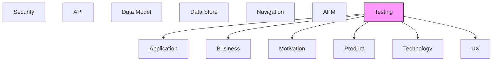

# Testing

[← Back to README](../README.md)

Test strategies, test cases, test data, and test coverage.

## Report Index

- [Layer Introduction](#layer-introduction)
- [Intra-Layer Relationships](#intra-layer-relationships)
- [Inter-Layer Dependencies](#inter-layer-dependencies)
- [Inter-Layer Relationships Table](#inter-layer-relationships-table)
- [Element Reference](#element-reference)

## Layer Introduction

| Metric                    | Count |
| ------------------------- | ----- |
| Elements                  | 1796  |
| Intra-Layer Relationships | 1882  |
| Inter-Layer Relationships | 576   |
| Inbound Relationships     | 0     |
| Outbound Relationships    | 576   |

**Cross-Layer References**:

- **Downstream layers**: [Application](./05-application-layer-report.md), [Business](./02-business-layer-report.md), [Motivation](./01-motivation-layer-report.md), [Product](./03-product-layer-report.md), [Technology](./06-technology-layer-report.md), [UX](./10-ux-layer-report.md)

## Intra-Layer Relationships

*This layer has >30 elements. Summary table shown instead of diagram.*

| Element                                                                                                                               | Type                      | Relationships |
| ------------------------------------------------------------------------------------------------------------------------------------- | ------------------------- | ------------- |
| `testing.contextvariation.visual-regression`                                                                                          | `contextvariation`        | 2             |
| `testing.coveragerequirement.edge-endpoints-at-rect-sides-and-corners`                                                                | `coveragerequirement`     | 1             |
| `testing.coveragerequirement.every-canvas-control-and-overlay-exercised`                                                              | `coveragerequirement`     | 1             |
| `testing.coveragerequirement.galaxy-across-relation-aspect-and-live-modes`                                                            | `coveragerequirement`     | 1             |
| `testing.coveragerequirement.label-placement-clear-and-fallback`                                                                      | `coveragerequirement`     | 1             |
| `testing.coveragerequirement.routing-with-and-without-obstacles`                                                                      | `coveragerequirement`     | 1             |
| `testing.coveragerequirement.zero-literal-node-overlap-under-layout-simulation`                                                       | `coveragerequirement`     | 5             |
| `testing.coveragesummary.graph-layout-rendering-test-coverage-summary`                                                                | `coveragesummary`         | 1             |
| `testing.environmentfactor.ci-chromium-rendering-environment`                                                                         | `environmentfactor`       | 2             |
| `testing.inputpartitionselection.all-graph-topologies`                                                                                | `inputpartitionselection` | 3             |
| `testing.inputpartitionselection.all-node-size-classes`                                                                               | `inputpartitionselection` | 3             |
| `testing.inputspacepartition.graph-topology`                                                                                          | `inputspacepartition`     | 4             |
| `testing.inputspacepartition.node-size-class`                                                                                         | `inputspacepartition`     | 4             |
| `testing.partitionvalue.card-sized-node`                                                                                              | `partitionvalue`          | 2             |
| `testing.partitionvalue.chain-topology`                                                                                               | `partitionvalue`          | 2             |
| `testing.partitionvalue.chip-sized-node`                                                                                              | `partitionvalue`          | 2             |
| `testing.partitionvalue.hub-and-spoke-topology`                                                                                       | `partitionvalue`          | 2             |
| `testing.targetinputfield.graph-edge-set-field`                                                                                       | `targetinputfield`        | 2             |
| `testing.targetinputfield.layout-node-size-field`                                                                                     | `targetinputfield`        | 2             |
| `testing.testcasesketch.adjacency-matrix-aggregatelayer-a-cross-layer-cell-toggles-the-layer-pair-filter-a-diagonal-cell-or-56bd1c22` | `testcasesketch`          | 1             |
| `testing.testcasesketch.adjacency-matrix-aggregatelayer-draws-one-heat-cell-per-non-empty-layer-pair`                                 | `testcasesketch`          | 1             |
| `testing.testcasesketch.adjacency-matrix-aggregatelayer-on-layer-cell-select-replaces-the-default-filter-and-focus-toggles`           | `testcasesketch`          | 1             |
| `testing.testcasesketch.adjacency-matrix-aggregatelayer-symmetric-adds-both-directions-into-the-upper-triangle`                       | `testcasesketch`          | 1             |
| `testing.testcasesketch.adjacency-matrix-aggregatelayer-visual-dark-canvas-heat-map-with-an-active-pair`                              | `testcasesketch`          | 1             |
| `testing.testcasesketch.adjacency-matrix-aggregatelayer-visual-light-canvas-symmetric-heat-map-with-a-focused-layer`                  | `testcasesketch`          | 1             |
| `testing.testcasesketch.adjacency-matrix-cell-click-selects-the-link-source`                                                          | `testcasesketch`          | 1             |
| `testing.testcasesketch.adjacency-matrix-draws-one-cell-per-link-and-one-header-button-per-node`                                      | `testcasesketch`          | 1             |
| `testing.testcasesketch.adjacency-matrix-grid-semantics-symmetric-cells-holding-both-directions-say-so`                               | `testcasesketch`          | 1             |
| `testing.testcasesketch.adjacency-matrix-grid-semantics-the-cells-form-a-grid-with-row-and-column-headers-the-drawing-98466b8c`       | `testcasesketch`          | 1             |
| `testing.testcasesketch.adjacency-matrix-header-click-and-keyboard-select-a-node-clicking-again-clears-it`                            | `testcasesketch`          | 1             |
| `testing.testcasesketch.adjacency-matrix-keyboard-cells-focus-stays-in-the-grid-the-drawn-cell-shows-the-ring-and-the-74b0fc0c`       | `testcasesketch`          | 1             |
| `testing.testcasesketch.adjacency-matrix-keyboard-cells-one-tab-stop-for-the-cells-arrows-move-enter-selects`                         | `testcasesketch`          | 1             |
| `testing.testcasesketch.adjacency-matrix-on-cell-select-and-order-on-cell-select-gets-the-drawn-link-and-every-link-in-the-f20ec09e`  | `testcasesketch`          | 1             |
| `testing.testcasesketch.adjacency-matrix-on-cell-select-and-order-ordercluster-puts-each-community-on-adjacent-rows-the-1e77a9db`     | `testcasesketch`          | 1             |
| `testing.testcasesketch.adjacency-matrix-on-cell-select-and-order-visual-light-canvas-cluster-order`                                  | `testcasesketch`          | 1             |
| `testing.testcasesketch.adjacency-matrix-selection-follows-cross-layer-links-per-the-follow-setting`                                  | `testcasesketch`          | 1             |
| `testing.testcasesketch.adjacency-matrix-symmetric-clicking-a-cell-holding-both-directions-selects-its-drawn-link-source`             | `testcasesketch`          | 1             |
| `testing.testcasesketch.adjacency-matrix-symmetric-merges-both-directions-into-one-cell-above-the-diagonal`                           | `testcasesketch`          | 1             |
| `testing.testcasesketch.adjacency-matrix-symmetric-on-link-select-receives-the-drawn-link-and-both-links-of-a-merged-cell`            | `testcasesketch`          | 1             |
| `testing.testcasesketch.adjacency-matrix-symmetric-visual-light-canvas-symmetric-with-a-selection`                                    | `testcasesketch`          | 1             |
| `testing.testcasesketch.adjacency-matrix-virtualization-a-cell-in-the-last-visible-column-renders`                                    | `testcasesketch`          | 1             |
| `testing.testcasesketch.adjacency-matrix-virtualization-a-focused-cell-keeps-focus-its-ring-and-its-indices-while-the-55a10509`       | `testcasesketch`          | 1             |
| `testing.testcasesketch.adjacency-matrix-virtualization-a-selected-link-id-set-from-outside-scrolls-its-cell-into-view`               | `testcasesketch`          | 1             |
| `testing.testcasesketch.adjacency-matrix-virtualization-in-a-fixed-height-explorer-the-matrix-is-the-only-scroll-area-and-a09aa20b`   | `testcasesketch`          | 1             |
| `testing.testcasesketch.adjacency-matrix-virtualization-keyboard-focus-survives-scrolling-arrows-move-past-the-window-row-4a5df257`   | `testcasesketch`          | 1             |
| `testing.testcasesketch.adjacency-matrix-virtualization-labels-stay-aligned-with-the-cells-while-scrolling-both-axes`                 | `testcasesketch`          | 1             |
| `testing.testcasesketch.adjacency-matrix-virtualization-past-the-threshold-only-the-window-renders-and-the-dom-stays-bounded`         | `testcasesketch`          | 1             |
| `testing.testcasesketch.adjacency-matrix-virtualization-the-grid-states-the-full-size-the-rendered-window-carries-its-row-238d3463`   | `testcasesketch`          | 1             |
| `testing.testcasesketch.adjacency-matrix-virtualization-visual-dark-canvas-virtualized-and-scrolled`                                  | `testcasesketch`          | 1             |
| `testing.testcasesketch.adjacency-matrix-virtualization-visual-light-canvas-virtualized-and-scrolled`                                 | `testcasesketch`          | 1             |
| `testing.testcasesketch.adjacency-matrix-visual-dark-canvas-with-a-followed-selection`                                                | `testcasesketch`          | 1             |
| `testing.testcasesketch.adjacency-matrix-visual-light-canvas-with-every-predicate-code`                                               | `testcasesketch`          | 1             |
| `testing.testcasesketch.aspect-ratio-elliptical-warp-a-na-n-aspect-ratio-e-g-from-an-unmeasured-0-0-container-is-treated-as-ef780c32` | `testcasesketch`          | 1             |
| `testing.testcasesketch.aspect-ratio-elliptical-warp-a-single-galaxy-is-never-squashed-to-fit-a-wide-aspect-ratio-its-ab5d27dd`       | `testcasesketch`          | 1             |
| `testing.testcasesketch.aspect-ratio-elliptical-warp-a-wide-aspect-ratio-spreads-a-forests-galaxies-into-a-measurably-wider-839831ad` | `testcasesketch`          | 1             |
| `testing.testcasesketch.aspect-ratio-elliptical-warp-composes-with-separate-groups-group-boundaries-stay-non-overlapping-ff23cd4d`    | `testcasesketch`          | 1             |
| `testing.testcasesketch.aspect-ratio-elliptical-warp-formula-the-warp-scales-the-root-ring-offset-by-resolve-aspect-ratio-726fb4bc`   | `testcasesketch`          | 1             |
| `testing.testcasesketch.aspect-ratio-elliptical-warp-leaning-a-forest-wide-never-makes-galaxies-overlap`                              | `testcasesketch`          | 1             |
| `testing.testcasesketch.aspect-ratio-elliptical-warp-omitted-and-1-produce-identical-positions-backward-compatible-with-the-c84e0a36` | `testcasesketch`          | 1             |
| `testing.testcasesketch.aspect-ratio-elliptical-warp-pinned-coordinates-are-unaffected-by-aspect-ratio`                               | `testcasesketch`          | 1             |
| `testing.testcasesketch.aspect-ratio-elliptical-warp-the-ratio-is-clamped-to-1-8-8-extreme-values-beyond-the-clamp-are-e11f0212`      | `testcasesketch`          | 1             |
| `testing.testcasesketch.batch-links-arrowheads-width-0-batch-by-colour-and-opacity-only`                                              | `testcasesketch`          | 1             |
| `testing.testcasesketch.batch-links-keys-a-style-the-same-from-frame-to-frame-so-its-path-is-reused`                                  | `testcasesketch`          | 1             |
| `testing.testcasesketch.batch-links-paints-lower-z-first-then-farther-batches-first-and-is-stable`                                    | `testcasesketch`          | 1             |
| `testing.testcasesketch.batch-links-puts-links-of-one-style-into-one-path-segments-concatenated-in-order`                             | `testcasesketch`          | 1             |
| `testing.testcasesketch.batch-links-returns-nothing-for-no-links`                                                                     | `testcasesketch`          | 1             |
| `testing.testcasesketch.batch-links-splits-by-colour-opacity-dash-z-and-width-step`                                                   | `testcasesketch`          | 1             |
| `testing.testcasesketch.batch-links-widths-within-one-step-share-a-path-drawn-at-the-step`                                            | `testcasesketch`          | 1             |
| `testing.testcasesketch.build-layered-index-applies-the-multi-value-policies`                                                         | `testcasesketch`          | 1             |
| `testing.testcasesketch.build-layered-index-bundles-parallel-edges-per-direction-and-keeps-reverse-edges-separate`                    | `testcasesketch`          | 1             |
| `testing.testcasesketch.build-layered-index-excludes-or-collects-nodes-with-no-layer-value`                                           | `testcasesketch`          | 1             |
| `testing.testcasesketch.build-layered-index-gives-every-predicate-a-unique-two-letter-code-catalog-codes-first`                       | `testcasesketch`          | 1             |
| `testing.testcasesketch.build-layered-index-indexes-the-dr-spec-fixture-layers-in-order-bundled-links-cross-layer-counts`             | `testcasesketch`          | 1             |
| `testing.testcasesketch.build-layered-index-keeps-derived-instance-and-link-ids-unique-when-input-ids-already-use-them`               | `testcasesketch`          | 1             |
| `testing.testcasesketch.build-layered-index-reads-the-layer-from-an-attribute-kind-or-an-accessor`                                    | `testcasesketch`          | 1             |
| `testing.testcasesketch.build-layered-index-reports-dangling-edges-and-takes-categories-from-attributes-then-the-catalog`             | `testcasesketch`          | 1             |
| `testing.testcasesketch.bundled-intra-links-between-neighbouring-rows-leaves-the-upper-node-from-its-bottom-edge-into-the-2682b803`   | `testcasesketch`          | 1             |
| `testing.testcasesketch.bundled-intra-links-gives-a-row-one-trunk-above-it-neighbouring-rows-share-the-lower-trunk-rows-d4889bb9`     | `testcasesketch`          | 1             |
| `testing.testcasesketch.bundled-intra-links-horizontal-wrapped-rows-no-bundled-path-crosses-a-node-including-links-between-a9d45313`  | `testcasesketch`          | 1             |
| `testing.testcasesketch.bundled-intra-links-runs-up-to-the-trunk-along-it-and-down-into-the-target-arrow-pointing-in`                 | `testcasesketch`          | 1             |
| `testing.testcasesketch.bundled-intra-links-vertical-leaves-the-left-edge-to-a-trunk-left-of-the-column`                              | `testcasesketch`          | 1             |
| `testing.testcasesketch.bundled-intra-links-vertical-several-columns-per-lane-no-bundled-path-crosses-a-node`                         | `testcasesketch`          | 1             |
| `testing.testcasesketch.camera-helpers-clamp-camera-clamps-pitch-and-zoom-only`                                                       | `testcasesketch`          | 1             |
| `testing.testcasesketch.camera-helpers-lerp-camera-interpolates-every-field-yaw-via-the-shortest-arc`                                 | `testcasesketch`          | 1             |
| `testing.testcasesketch.camera-helpers-presets-are-within-range-and-camera-from-preset-centers-the-target`                            | `testcasesketch`          | 1             |
| `testing.testcasesketch.camera-helpers-wrap-angle-and-nearest-yaw-turn-the-short-way`                                                 | `testcasesketch`          | 1             |
| `testing.testcasesketch.channel-router-batch-cost-400-boxes-and-400-routes-route-in-well-under-1-5-s-of-cpu-time`                     | `testcasesketch`          | 1             |
| `testing.testcasesketch.channel-router-edge-cases-large-rectangles`                                                                   | `testcasesketch`          | 1             |
| `testing.testcasesketch.channel-router-edge-cases-small-rectangles`                                                                   | `testcasesketch`          | 1             |
| `testing.testcasesketch.channel-router-edge-cases-source-and-target-at-same-location`                                                 | `testcasesketch`          | 1             |
| `testing.testcasesketch.channel-router-edge-cases-very-large-offset-between-source-and-target`                                        | `testcasesketch`          | 1             |
| `testing.testcasesketch.channel-router-edge-cases-zero-size-boxes-still-get-an-orthogonal-route`                                      | `testcasesketch`          | 1             |
| `testing.testcasesketch.channel-router-heimdall-test-page-rendered-boxes-2026-11-04-dashboard-settings-stays-inside-the-6de777f8`     | `testcasesketch`          | 1             |
| `testing.testcasesketch.channel-router-heimdall-test-page-rendered-boxes-2026-11-04-every-route-arrives-perpendicular-to-74fc7d43`    | `testcasesketch`          | 1             |
| `testing.testcasesketch.channel-router-path-string-format-path-coordinates-are-integers`                                              | `testcasesketch`          | 1             |
| `testing.testcasesketch.channel-router-path-string-format-svg-path-string-starts-with-m-and-uses-l-commands`                          | `testcasesketch`          | 1             |
| `testing.testcasesketch.channel-router-route-navigation-edge-avoids-obstacles-by-routing-around-them`                                 | `testcasesketch`          | 1             |
| `testing.testcasesketch.channel-router-route-navigation-edge-computes-midpoint-and-angle-for-label-placement`                         | `testcasesketch`          | 1             |
| `testing.testcasesketch.channel-router-route-navigation-edge-creates-orthogonal-paths-with-no-obstacles`                              | `testcasesketch`          | 1             |
| `testing.testcasesketch.channel-router-route-navigation-edge-creates-path-from-source-to-target-without-obstacles`                    | `testcasesketch`          | 1             |
| `testing.testcasesketch.channel-router-route-navigation-edge-handles-target-directly-above-source`                                    | `testcasesketch`          | 1             |
| `testing.testcasesketch.channel-router-route-navigation-edge-handles-target-directly-below-source`                                    | `testcasesketch`          | 1             |
| `testing.testcasesketch.channel-router-route-navigation-edge-handles-target-to-the-left-of-source`                                    | `testcasesketch`          | 1             |
| `testing.testcasesketch.channel-router-route-navigation-edge-maintains-orthogonality-without-obstacles`                               | `testcasesketch`          | 1             |
| `testing.testcasesketch.channel-router-route-navigation-edge-path-is-orthogonal-only-horizontal-and-vertical-segments`                | `testcasesketch`          | 1             |
| `testing.testcasesketch.channel-router-route-navigation-edge-route-starts-at-source-exit-point-and-ends-at-target-entry-6bd9ffa1`     | `testcasesketch`          | 1             |
| `testing.testcasesketch.channel-router-route-navigation-edges-applies-nudge-pass-to-spread-overlapping-segments`                      | `testcasesketch`          | 1             |
| `testing.testcasesketch.channel-router-route-navigation-edges-considers-all-obstacles-when-routing`                                   | `testcasesketch`          | 1             |
| `testing.testcasesketch.channel-router-route-navigation-edges-each-routed-edge-has-valid-path-data`                                   | `testcasesketch`          | 1             |
| `testing.testcasesketch.channel-router-route-navigation-edges-generates-valid-svg-path-strings`                                       | `testcasesketch`          | 1             |
| `testing.testcasesketch.channel-router-route-navigation-edges-handles-empty-edge-list`                                                | `testcasesketch`          | 1             |
| `testing.testcasesketch.channel-router-route-navigation-edges-handles-single-edge`                                                    | `testcasesketch`          | 1             |
| `testing.testcasesketch.channel-router-route-navigation-edges-nudges-overlapping-segments-while-maintaining-orthogonality`            | `testcasesketch`          | 1             |
| `testing.testcasesketch.channel-router-route-navigation-edges-respects-custom-trace-spacing`                                          | `testcasesketch`          | 1             |
| `testing.testcasesketch.channel-router-route-navigation-edges-routes-multiple-edges-without-breaking-polylines`                       | `testcasesketch`          | 1             |
| `testing.testcasesketch.channel-router-route-navigation-edges-routes-multiple-edges-without-obstacles`                                | `testcasesketch`          | 1             |
| `testing.testcasesketch.channel-router-route-navigation-edges-routes-single-edge-with-specified-trace-spacing`                        | `testcasesketch`          | 1             |
| `testing.testcasesketch.cluster-order-breaks-degree-and-label-ties-by-id-not-input-order`                                             | `testcasesketch`          | 1             |
| `testing.testcasesketch.cluster-order-is-a-permutation-of-every-node-grouped-by-layer`                                                | `testcasesketch`          | 1             |
| `testing.testcasesketch.cluster-order-is-deterministic-same-result-on-every-run-and-for-any-input-order`                              | `testcasesketch`          | 1             |
| `testing.testcasesketch.cluster-order-keeps-each-community-together-within-its-layer-layers-in-rank-order`                            | `testcasesketch`          | 1             |
| `testing.testcasesketch.clustered-view-bubble-packing-integration`                                                                    | `testcasesketch`          | 2             |
| `testing.testcasesketch.compute-dropdown-position-anchors-a-top-panel-that-is-shorter-than-its-content-to-the-available-de6cb29b`     | `testcasesketch`          | 1             |
| `testing.testcasesketch.compute-dropdown-position-clamps-inside-the-viewport-when-neither-alignment-fits`                             | `testcasesketch`          | 1             |
| `testing.testcasesketch.compute-dropdown-position-clamps-to-the-margin-when-the-trigger-is-scrolled-past-the-left-edge`               | `testcasesketch`          | 1             |
| `testing.testcasesketch.compute-dropdown-position-flips-bottom-to-top-when-there-is-no-room-below-and-more-room-above`                | `testcasesketch`          | 1             |
| `testing.testcasesketch.compute-dropdown-position-flips-end-to-start-when-the-panel-would-cross-the-left-edge`                        | `testcasesketch`          | 1             |
| `testing.testcasesketch.compute-dropdown-position-flips-start-to-end-when-the-panel-would-cross-the-right-edge`                       | `testcasesketch`          | 1             |
| `testing.testcasesketch.compute-dropdown-position-flips-top-to-bottom-when-there-is-no-room-above-and-more-room-below`                | `testcasesketch`          | 1             |
| `testing.testcasesketch.compute-dropdown-position-honours-a-custom-offset-and-margin`                                                 | `testcasesketch`          | 1             |
| `testing.testcasesketch.compute-dropdown-position-keeps-the-requested-side-when-neither-side-fits-but-it-has-more-room`               | `testcasesketch`          | 1             |
| `testing.testcasesketch.compute-dropdown-position-never-reports-negative-available-height`                                            | `testcasesketch`          | 1             |
| `testing.testcasesketch.compute-dropdown-position-places-bottom-end-with-right-edges-aligned`                                         | `testcasesketch`          | 1             |
| `testing.testcasesketch.compute-dropdown-position-places-bottom-start-below-the-trigger-left-edges-aligned`                           | `testcasesketch`          | 1             |
| `testing.testcasesketch.compute-dropdown-position-places-top-start-above-the-trigger`                                                 | `testcasesketch`          | 1             |
| `testing.testcasesketch.compute-reach-continues-only-from-nodes-reached-over-cross-layer-links`                                       | `testcasesketch`          | 1             |
| `testing.testcasesketch.compute-reach-does-not-traverse-hidden-layers-or-categories-and-honours-follow-categories`                    | `testcasesketch`          | 1             |
| `testing.testcasesketch.compute-reach-matches-the-prototype-application-component-reaches-10-13-14-nodes-at-follow-0-1-2`             | `testcasesketch`          | 1             |
| `testing.testcasesketch.compute-reach-never-follows-back-into-the-origin-layer-and-records-the-chain`                                 | `testcasesketch`          | 1             |
| `testing.testcasesketch.compute-reach-with-several-origins-is-the-union-of-each-origins-reach-lowest-hop-first`                       | `testcasesketch`          | 1             |
| `testing.testcasesketch.compute-reach-with-several-origins-skips-missing-duplicate-and-hidden-origins-one-left-is-a-plain-392bd695`   | `testcasesketch`          | 1             |
| `testing.testcasesketch.compute-reach-with-several-origins-walks-a-reached-node-back-to-the-origin-that-reached-it`                   | `testcasesketch`          | 1             |
| `testing.testcasesketch.compute-tooltip-position-clamps-along-the-cross-axis-near-a-side-edge`                                        | `testcasesketch`          | 1             |
| `testing.testcasesketch.compute-tooltip-position-falls-back-to-a-perpendicular-side-when-neither-vertical-side-has-room`              | `testcasesketch`          | 1             |
| `testing.testcasesketch.compute-tooltip-position-flips-above-from-a-bottom-preference-when-there-is-no-room-below`                    | `testcasesketch`          | 1             |
| `testing.testcasesketch.compute-tooltip-position-flips-below-when-there-is-no-room-above`                                             | `testcasesketch`          | 1             |
| `testing.testcasesketch.compute-tooltip-position-places-the-card-above-the-anchor-centred-with-the-gap`                               | `testcasesketch`          | 1             |
| `testing.testcasesketch.compute-tooltip-position-respects-custom-offset-and-margin`                                                   | `testcasesketch`          | 1             |
| `testing.testcasesketch.compute-tooltip-position-takes-the-left-side-when-the-right-has-no-room-either`                               | `testcasesketch`          | 1             |
| `testing.testcasesketch.compute-tooltip-position-treats-a-zero-size-anchor-as-a-point`                                                | `testcasesketch`          | 1             |
| `testing.testcasesketch.compute-tooltip-position-uses-the-least-overflowing-side-and-stays-inside-bounds-when-nothing-fits`           | `testcasesketch`          | 1             |
| `testing.testcasesketch.create-projector-farther-points-have-larger-depth-and-smaller-scale-perspective-divide`                       | `testcasesketch`          | 1             |
| `testing.testcasesketch.create-projector-maps-the-target-to-the-screen-origin-plus-offset-at-scale-zoom`                              | `testcasesketch`          | 1             |
| `testing.testcasesketch.create-projector-side-on-world-up-is-screen-up-and-x-maps-to-x`                                               | `testcasesketch`          | 1             |
| `testing.testcasesketch.create-projector-stays-finite-for-points-behind-the-camera`                                                   | `testcasesketch`          | 1             |
| `testing.testcasesketch.create-projector-target-y-moves-the-look-at-height`                                                           | `testcasesketch`          | 1             |
| `testing.testcasesketch.create-projector-top-down-depth-ignores-in-plane-position-and-higher-planes-are-nearer`                       | `testcasesketch`          | 1             |
| `testing.testcasesketch.create-projector-yaw-rotates-about-the-vertical-axis`                                                         | `testcasesketch`          | 1             |
| `testing.testcasesketch.create-tween-channels-a-later-move-replaces-only-the-channels-it-names-the-others-keep-running`               | `testcasesketch`          | 1             |
| `testing.testcasesketch.create-tween-channels-a-replaced-channel-continues-from-the-value-it-was-given-without-a-jump`                | `testcasesketch`          | 1             |
| `testing.testcasesketch.create-tween-channels-cancel-stops-the-named-channels-where-they-are-and-drops-their-on-done`                 | `testcasesketch`          | 1             |
| `testing.testcasesketch.create-tween-channels-jumps-under-reduced-motion-in-one-synchronous-frame`                                    | `testcasesketch`          | 1             |
| `testing.testcasesketch.create-tween-channels-runs-a-move-to-its-target-and-reports-idle-on-the-last-frame`                           | `testcasesketch`          | 1             |
| `testing.testcasesketch.curve-end-boxes-covers-the-first-px-of-a-long-route-not-one-t-step-of-it`                                     | `testcasesketch`          | 1             |
| `testing.testcasesketch.date-utils-format-timestamp-takes-a-fixed-now`                                                                | `testcasesketch`          | 1             |
| `testing.testcasesketch.date-utils-is-today-takes-a-fixed-today-a-date-date-utils-test-ts-covers-timezones`                           | `testcasesketch`          | 1             |
| `testing.testcasesketch.edge-curves-hit-their-endpoints-and-report-unit-tangents`                                                     | `testcasesketch`          | 1             |
| `testing.testcasesketch.emphasis-builds-labels-and-arrowheads`                                                                        | `testcasesketch`          | 1             |
| `testing.testcasesketch.emphasis-ramps-reached-links-by-hop-and-dims-the-rest`                                                        | `testcasesketch`          | 1             |
| `testing.testcasesketch.emphasis-styles-categories-by-position-with-overrides`                                                        | `testcasesketch`          | 1             |
| `testing.testcasesketch.extend-bounding-box-by-circles-covers-several-circles-at-once-and-skips-non-finite-ones`                      | `testcasesketch`          | 1             |
| `testing.testcasesketch.extend-bounding-box-by-circles-grows-each-side-to-cover-a-circle-reaching-past-it`                            | `testcasesketch`          | 1             |
| `testing.testcasesketch.extend-bounding-box-by-circles-leaves-the-box-alone-for-circles-already-inside-it`                            | `testcasesketch`          | 1             |
| `testing.testcasesketch.extend-bounding-box-by-circles-returns-the-same-box-when-there-are-no-circles`                                | `testcasesketch`          | 1             |
| `testing.testcasesketch.filters-hides-by-layer-category-predicate-intra-layer-and-layer-pair`                                         | `testcasesketch`          | 1             |
| `testing.testcasesketch.filters-shows-unlabeled-links-while-their-category-is-visible`                                                | `testcasesketch`          | 1             |
| `testing.testcasesketch.find-clear-label-position-clears-an-obstacle-sitting-on-the-midpoint-of-a-cubic-anchored-edge`                | `testcasesketch`          | 1             |
| `testing.testcasesketch.find-clear-label-position-falls-back-to-the-exact-midpoint-when-every-candidate-collides`                     | `testcasesketch`          | 1             |
| `testing.testcasesketch.find-clear-label-position-handles-orthogonal-polyline-paths-5-waypoints-for-navigation-edges`                 | `testcasesketch`          | 1             |
| `testing.testcasesketch.find-clear-label-position-keeps-the-default-midpoint-when-nothing-is-in-the-way`                              | `testcasesketch`          | 1             |
| `testing.testcasesketch.find-clear-label-position-never-needs-to-consider-a-fourth-candidate-when-the-midpoint-is-already-532dd688`   | `testcasesketch`          | 1             |
| `testing.testcasesketch.find-clear-label-position-steps-away-from-the-midpoint-when-a-third-node-sits-on-top-of-it`                   | `testcasesketch`          | 1             |
| `testing.testcasesketch.force-layout-keeps-default-sized-chip-nodes-non-overlapping-in-a-simple-chain`                                | `testcasesketch`          | 1             |
| `testing.testcasesketch.force-layout-node-margin-0-packs-connected-nodes-tighter-than-the-default-per-node-width-margin`              | `testcasesketch`          | 1             |
| `testing.testcasesketch.force-layout-node-margin-a-fixed-number-overrides-the-per-node-width-default-for-every-node`                  | `testcasesketch`          | 1             |
| `testing.testcasesketch.force-layout-node-margin-defaults-to-each-nodes-own-width-leaving-a-visible-gap-for-the-edge-91adce52`        | `testcasesketch`          | 1             |
| `testing.testcasesketch.force-layout-positions-every-node`                                                                            | `testcasesketch`          | 1             |
| `testing.testcasesketch.force-layout-respects-pinned-nodes-their-position-never-changes`                                              | `testcasesketch`          | 1             |
| `testing.testcasesketch.format-timestamp-with-a-fixed-now-activity-timeline-server-html-is-the-same-in-every-timezone`                | `testcasesketch`          | 1             |
| `testing.testcasesketch.format-timestamp-with-a-fixed-now-prints-dates-past-a-week-as-en-us-in-utc-whatever-the-timezone`             | `testcasesketch`          | 1             |
| `testing.testcasesketch.format-timestamp-with-a-fixed-now-relative-labels-depend-only-on-the-two-instants`                            | `testcasesketch`          | 1             |
| `testing.testcasesketch.format-timestamp-with-a-fixed-now-runs-under-the-zones-it-claims-to-the-tz-switch-takes-effect`               | `testcasesketch`          | 1             |
| `testing.testcasesketch.from-otlp-accepts-span-kind-status-code-name-strings`                                                         | `testcasesketch`          | 1             |
| `testing.testcasesketch.from-otlp-classifies-a-stringified-status-code-2-as-error`                                                    | `testcasesketch`          | 1             |
| `testing.testcasesketch.from-otlp-coerces-int-value-bool-value-attributes-to-js-primitives`                                           | `testcasesketch`          | 1             |
| `testing.testcasesketch.from-otlp-computes-ms-offsets-durations-from-nanosecond-strings-via-big-int`                                  | `testcasesketch`          | 1             |
| `testing.testcasesketch.from-otlp-extracts-status-code-from-http-response-status-code-int-value-string`                               | `testcasesketch`          | 1             |
| `testing.testcasesketch.from-otlp-flattens-every-span-across-resource-spans`                                                          | `testcasesketch`          | 1             |
| `testing.testcasesketch.from-otlp-inherits-service-name-per-resource-for-non-root-spans`                                              | `testcasesketch`          | 1             |
| `testing.testcasesketch.from-otlp-links-parent-ids-as-lowercase-hex-16-chars`                                                         | `testcasesketch`          | 1             |
| `testing.testcasesketch.from-otlp-maps-a-numeric-string-span-kind-3-to-client`                                                        | `testcasesketch`          | 1             |
| `testing.testcasesketch.from-otlp-maps-status-code-error-error-and-extracts-the-exception-event`                                      | `testcasesketch`          | 1             |
| `testing.testcasesketch.from-otlp-normalizes-hex-and-base64-ids-to-the-same-lowercase-hex`                                            | `testcasesketch`          | 1             |
| `testing.testcasesketch.from-otlp-resolves-the-root-span-and-service-name-from-resource-attributes`                                   | `testcasesketch`          | 1             |
| `testing.testcasesketch.from-otlp-tolerates-a-malformed-unix-nano-without-throwing-or-corrupting-trace-start`                         | `testcasesketch`          | 1             |
| `testing.testcasesketch.from-otlp-unset-status-maps-to-ok-otlp-has-no-warn`                                                           | `testcasesketch`          | 1             |
| `testing.testcasesketch.from-xray-a-subsegment-missing-start-time-does-not-poison-the-trace-with-na-n`                                | `testcasesketch`          | 1             |
| `testing.testcasesketch.from-xray-coerces-numeric-id-parent-id-and-tolerates-a-missing-id`                                            | `testcasesketch`          | 1             |
| `testing.testcasesketch.from-xray-converts-epoch-seconds-to-ms-offsets-durations`                                                     | `testcasesketch`          | 1             |
| `testing.testcasesketch.from-xray-fault-error-status-with-cause-exceptions-exception`                                                 | `testcasesketch`          | 1             |
| `testing.testcasesketch.from-xray-handles-in-progress-spans-no-end-time-by-clamping-to-trace-end`                                     | `testcasesketch`          | 1             |
| `testing.testcasesketch.from-xray-maps-namespace-remote-aws-client-plain-subsegment-internal`                                         | `testcasesketch`          | 1             |
| `testing.testcasesketch.from-xray-maps-sql-to-db-attributes`                                                                          | `testcasesketch`          | 1             |
| `testing.testcasesketch.from-xray-nests-parent-id-by-subsegment-containment`                                                          | `testcasesketch`          | 1             |
| `testing.testcasesketch.from-xray-reformats-the-x-ray-trace-id-to-32-hex`                                                             | `testcasesketch`          | 1             |
| `testing.testcasesketch.from-xray-root-segment-becomes-a-server-span-name-service`                                                    | `testcasesketch`          | 1             |
| `testing.testcasesketch.from-xray-surfaces-a-string-cause-bare-exception-id-as-an-exception`                                          | `testcasesketch`          | 1             |
| `testing.testcasesketch.from-xray-walks-the-subsegment-tree-into-a-flat-span-list`                                                    | `testcasesketch`          | 1             |
| `testing.testcasesketch.galaxy-body-radii-gives-all-equal-weights-the-middle-area-instead-of-dividing-by-zero`                        | `testcasesketch`          | 1             |
| `testing.testcasesketch.galaxy-body-radii-keeps-small-weights-distinguishable-across-a-wide-range`                                    | `testcasesketch`          | 1             |
| `testing.testcasesketch.galaxy-body-radii-maps-the-square-root-of-weight-to-area-between-the-min-and-max-radius`                      | `testcasesketch`          | 1             |
| `testing.testcasesketch.galaxy-effective-weights-sums-children-for-an-unweighted-parent-and-a-given-weight-wins-over-the-sum`         | `testcasesketch`          | 1             |
| `testing.testcasesketch.galaxy-effective-weights-treats-na-n-negative-and-missing-weights-as-missing-unweighted-leaf-0-once-12871752` | `testcasesketch`          | 1             |
| `testing.testcasesketch.galaxy-effective-weights-uses-subtree-leaf-counts-when-no-node-has-a-weight`                                  | `testcasesketch`          | 1             |
| `testing.testcasesketch.galaxy-layout-a-root-with-exactly-one-child-stays-in-that-childs-group-delegating-headship-to-a-348660e4`     | `testcasesketch`          | 1             |
| `testing.testcasesketch.galaxy-layout-a-root-with-more-than-one-child-a-genuinely-delegating-root-still-travels-with-its-8a9b2d33`    | `testcasesketch`          | 1             |
| `testing.testcasesketch.galaxy-layout-a-single-root-tree-has-nothing-to-separate-separate-groups-is-a-no-op`                          | `testcasesketch`          | 1             |
| `testing.testcasesketch.galaxy-layout-galaxies-in-a-busy-forest-never-overlap-packed-by-system-circles`                               | `testcasesketch`          | 1             |
| `testing.testcasesketch.galaxy-layout-galaxy-layout-the-batch-entry-point-respects-a-pinned-node-even-when-separate-groups-d80e2ae5`  | `testcasesketch`          | 1             |
| `testing.testcasesketch.galaxy-layout-independent-galaxies-never-overlap-whatever-their-depth`                                        | `testcasesketch`          | 1             |
| `testing.testcasesketch.galaxy-layout-lab-poc-dataset-stress-test`                                                                    | `testcasesketch`          | 1             |
| `testing.testcasesketch.galaxy-layout-ordering-and-shape-does-not-squash-a-single-root-tree-to-fit-a-wide-aspect-ratio`               | `testcasesketch`          | 1             |
| `testing.testcasesketch.galaxy-layout-ordering-and-shape-places-the-heaviest-satellite-closest-to-the-parents-outward-e22c7c0e`       | `testcasesketch`          | 1             |
| `testing.testcasesketch.galaxy-layout-pinning-a-non-leaf-node-repositions-its-children-relative-to-the-pin-not-the-original-7a0b3c87` | `testcasesketch`          | 1             |
| `testing.testcasesketch.galaxy-layout-positions-every-node`                                                                           | `testcasesketch`          | 1             |
| `testing.testcasesketch.galaxy-layout-respects-pinned-nodes-their-position-never-changes`                                             | `testcasesketch`          | 1             |
| `testing.testcasesketch.galaxy-layout-the-layout-is-deterministic`                                                                    | `testcasesketch`          | 1             |
| `testing.testcasesketch.galaxy-live-drag-287-a-flare-drag-frame-resolves-overlaps-with-grid-local-work-not-all-pairs-every-d4f70636`  | `testcasesketch`          | 1             |
| `testing.testcasesketch.galaxy-live-drag-287-caps-a-drag-frame-on-a-large-graph-and-finishes-the-separation-over-the-94fcbcce`        | `testcasesketch`          | 1             |
| `testing.testcasesketch.galaxy-live-drag-287-reports-settling-only-for-the-tick-that-left-separation-unfinished`                      | `testcasesketch`          | 1             |
| `testing.testcasesketch.galaxy-live-drag-287-settles-with-no-overlapping-bodies-the-dropped-node-exactly-on-its-pin-its-e250ab4d`     | `testcasesketch`          | 1             |
| `testing.testcasesketch.galaxy-live-drag-287-the-settled-live-target-is-exactly-galaxy-layout-for-the-same-pins-however-the-ca1a9823` | `testcasesketch`          | 1             |
| `testing.testcasesketch.galaxy-radius-of-prefers-an-explicit-radius-over-the-box-half-diagonal`                                       | `testcasesketch`          | 1             |
| `testing.testcasesketch.galaxy-simulation-step-a-held-drag-carries-its-subtree-settles-and-leaves-no-overlap`                         | `testcasesketch`          | 1             |
| `testing.testcasesketch.galaxy-simulation-step-one-step-nudges-toward-home-without-fully-arriving-unless-already-there`               | `testcasesketch`          | 1             |
| `testing.testcasesketch.galaxy-simulation-step-repeated-calls-converge-toward-the-same-result-galaxy-layout-produces`                 | `testcasesketch`          | 1             |
| `testing.testcasesketch.galaxy-simulation-step-running-many-ticks-with-no-user-interaction-does-not-erode-group-separation-ffdb4a3c`  | `testcasesketch`          | 1             |
| `testing.testcasesketch.galaxy-simulation-step-separate-groups-false-opts-the-per-tick-home-out-of-group-separation-too`              | `testcasesketch`          | 1             |
| `testing.testcasesketch.glide-end-320-does-not-start-a-glide-for-a-release-that-would-travel-under-half-a-pixel`                      | `testcasesketch`          | 1             |
| `testing.testcasesketch.glide-end-320-ends-a-2000px-s-flick-in-about-2-3s-skipping-under-a-pixel-of-travel`                           | `testcasesketch`          | 1             |
| `testing.testcasesketch.glide-end-320-stops-once-under-half-a-pixel-of-travel-is-left`                                                | `testcasesketch`          | 1             |
| `testing.testcasesketch.graph-canvas-accessible-names-304-edge-popover-dialog-is-named-by-edge-and-node-labels`                       | `testcasesketch`          | 1             |
| `testing.testcasesketch.graph-canvas-accessible-names-304-interactive-edges-are-named-by-node-labels-not-ids`                         | `testcasesketch`          | 1             |
| `testing.testcasesketch.graph-canvas-accessible-names-304-node-popover-dialog-is-named-by-the-node-label`                             | `testcasesketch`          | 1             |
| `testing.testcasesketch.graph-canvas-accessible-names-304-popover-dialog-for-an-unlabelled-edge-is-named-by-node-labels`              | `testcasesketch`          | 1             |
| `testing.testcasesketch.graph-canvas-hover-tooltip-placement-323-edge-tooltip-waits-for-tooltip-delay-before-showing`                 | `testcasesketch`          | 1             |
| `testing.testcasesketch.graph-canvas-hover-tooltip-placement-323-labelled-edge-near-the-canvas-top-tooltip-flips-below-the-2326f2d8`  | `testcasesketch`          | 1             |
| `testing.testcasesketch.graph-canvas-hover-tooltip-placement-323-labelled-edge-tooltip-sits-above-the-label-without-a1ce7be4`         | `testcasesketch`          | 1             |
| `testing.testcasesketch.graph-canvas-hover-tooltip-placement-323-labelled-vertical-edge-tooltip-clears-the-label-and-stays-35a5e023`  | `testcasesketch`          | 1             |
| `testing.testcasesketch.graph-canvas-hover-tooltip-placement-323-node-tooltip-uses-the-same-tooltip-delay`                            | `testcasesketch`          | 1             |
| `testing.testcasesketch.graph-canvas-hover-tooltip-placement-323-tooltip-stays-clear-of-the-label-while-the-canvas-zooms`             | `testcasesketch`          | 1             |
| `testing.testcasesketch.graph-canvas-hover-tooltip-placement-323-unlabelled-edge-tooltip-anchors-at-the-path-midpoint`                | `testcasesketch`          | 1             |
| `testing.testcasesketch.graph-canvas-hover-tooltip-placement-layer-lanes-323-link-with-a-predicate-pill-tooltip-sits-beside-742ff016` | `testcasesketch`          | 1             |
| `testing.testcasesketch.graph-canvas-hover-tooltip-placement-layer-lanes-323-link-without-a-pill-tooltip-anchors-on-the-208a5652`     | `testcasesketch`          | 1             |
| `testing.testcasesketch.graph-canvas-layer-lanes-a-cancelled-drag-releases-the-pill-hold`                                             | `testcasesketch`          | 1             |
| `testing.testcasesketch.graph-canvas-layer-lanes-a-custom-render-node-is-untouched-by-node-labels-reached`                            | `testcasesketch`          | 1             |
| `testing.testcasesketch.graph-canvas-layer-lanes-dragging-a-node-holds-the-pill-placement-and-moves-pills-along-their-links-b4f5df03` | `testcasesketch`          | 1             |
| `testing.testcasesketch.graph-canvas-layer-lanes-draws-one-lane-per-layer-every-node-and-every-link`                                  | `testcasesketch`          | 1             |
| `testing.testcasesketch.graph-canvas-layer-lanes-gutter-mode-a-category-filter-leaves-the-lanes-where-they-are`                       | `testcasesketch`          | 1             |
| `testing.testcasesketch.graph-canvas-layer-lanes-gutter-routes-follow-a-dragged-node-with-the-pill-placement-held`                    | `testcasesketch`          | 1             |
| `testing.testcasesketch.graph-canvas-layer-lanes-hover-pan-and-zoom-do-not-re-run-the-pill-placement`                                 | `testcasesketch`          | 1             |
| `testing.testcasesketch.graph-canvas-layer-lanes-intra-links-bundled-a-drag-keeps-links-bundled-and-holds-the-pill-placement`         | `testcasesketch`          | 1             |
| `testing.testcasesketch.graph-canvas-layer-lanes-intra-links-bundled-each-row-shares-one-trunk-the-reach-and-a-hovered-node-70d23eb9` | `testcasesketch`          | 1             |
| `testing.testcasesketch.graph-canvas-layer-lanes-intra-links-bundled-keyboard-focus-fans-a-node-out-trunk-links-get-no-hit-8e2c2683`  | `testcasesketch`          | 1             |
| `testing.testcasesketch.graph-canvas-layer-lanes-intra-links-bundled-works-with-gutter-routing-and-with-reached-chips-tags-8bfc42f3`  | `testcasesketch`          | 1             |
| `testing.testcasesketch.graph-canvas-layer-lanes-intra-links-none-draws-only-the-cross-layer-links`                                   | `testcasesketch`          | 1             |
| `testing.testcasesketch.graph-canvas-layer-lanes-keyboard-enter-on-a-focused-node-selects-it`                                         | `testcasesketch`          | 1             |
| `testing.testcasesketch.graph-canvas-layer-lanes-keyboard-focus-pans-an-off-screen-node-into-view-without-scrolling-the-15c05e96`     | `testcasesketch`          | 1             |
| `testing.testcasesketch.graph-canvas-layer-lanes-keyboard-hiding-the-focused-nodes-layer-moves-focus-to-a-neighbour`                  | `testcasesketch`          | 1             |
| `testing.testcasesketch.graph-canvas-layer-lanes-keyboard-home-and-end-in-vertical-lanes`                                             | `testcasesketch`          | 1             |
| `testing.testcasesketch.graph-canvas-layer-lanes-keyboard-in-bundled-mode-arrows-fan-out-the-focused-node-and-fold-the-one-a612b46f`  | `testcasesketch`          | 1             |
| `testing.testcasesketch.graph-canvas-layer-lanes-keyboard-left-right-along-a-lane-home-end-to-its-ends-up-down-to-a-linked-0922f825`  | `testcasesketch`          | 1             |
| `testing.testcasesketch.graph-canvas-layer-lanes-keyboard-one-tab-stop-for-the-lane-nodes-entering-at-the-first-node-or-the-ac21af87` | `testcasesketch`          | 1             |
| `testing.testcasesketch.graph-canvas-layer-lanes-keyboard-other-layouts-keep-one-tab-stop-per-node`                                   | `testcasesketch`          | 1             |
| `testing.testcasesketch.graph-canvas-layer-lanes-keyboard-space-selects-shifttab-comes-back-to-the-selection`                         | `testcasesketch`          | 1             |
| `testing.testcasesketch.graph-canvas-layer-lanes-keyboard-the-hint-is-visually-hidden-a-1px-box-but-names-space-and-escape`           | `testcasesketch`          | 1             |
| `testing.testcasesketch.graph-canvas-layer-lanes-keyboard-vertical-lanes-swap-the-axes-left-right-between-lanes-up-down-ba3a9ffc`     | `testcasesketch`          | 1             |
| `testing.testcasesketch.graph-canvas-layer-lanes-keyboard-works-with-reached-chips-focus-tag-follows-and-gutter-routing`              | `testcasesketch`          | 1             |
| `testing.testcasesketch.graph-canvas-layer-lanes-node-click-selects-through-the-layered-state-again-escape-or-the-b2c38dc0`           | `testcasesketch`          | 1             |
| `testing.testcasesketch.graph-canvas-layer-lanes-node-labels-follow-the-layered-label-toggle-reached-chips-name-the-cdf74296`         | `testcasesketch`          | 1             |
| `testing.testcasesketch.graph-canvas-layer-lanes-nodes-and-edges-are-optional-when-a-layered-graph-context-supplies-the-71a4fafe`     | `testcasesketch`          | 1             |
| `testing.testcasesketch.graph-canvas-layer-lanes-reached-dragging-the-selection-carries-its-tag-along`                                | `testcasesketch`          | 1             |
| `testing.testcasesketch.graph-canvas-layer-lanes-selection-follows-cross-layer-links-per-the-follow-setting-with-pills-and-bb91fe29`  | `testcasesketch`          | 1             |
| `testing.testcasesketch.graph-canvas-layer-lanes-skip-layer-routing-gutter-routes-the-links-that-skip-a-lane-outside-the-9061e8f1`    | `testcasesketch`          | 1             |
| `testing.testcasesketch.graph-canvas-layer-lanes-visual-bundled-intra-links-light-canvas`                                             | `testcasesketch`          | 1             |
| `testing.testcasesketch.graph-canvas-layer-lanes-visual-dark-canvas-with-a-followed-selection`                                        | `testcasesketch`          | 1             |
| `testing.testcasesketch.graph-canvas-layer-lanes-visual-gutter-routes-with-a-selection-light-canvas`                                  | `testcasesketch`          | 1             |
| `testing.testcasesketch.graph-canvas-layer-lanes-visual-light-canvas-heimdall-ux-model-with-every-predicate`                          | `testcasesketch`          | 1             |
| `testing.testcasesketch.graph-canvas-layer-lanes-visual-reached-chips-with-a-selection-light-canvas`                                  | `testcasesketch`          | 1             |
| `testing.testcasesketch.graph-canvas-layer-lanes-visual-vertical-bundled-intra-links-over-several-columns-dark-canvas`                | `testcasesketch`          | 1             |
| `testing.testcasesketch.graph-canvas-layer-lanes-visual-vertical-bundled-intra-links-with-a-selection-dark-canvas`                    | `testcasesketch`          | 1             |
| `testing.testcasesketch.graph-canvas-layer-lanes-visual-vertical-gutter-routes-with-reached-chips-dark-canvas`                        | `testcasesketch`          | 1             |
| `testing.testcasesketch.graph-canvas-layer-lanes-visual-vertical-lanes-light-canvas-with-a-selection`                                 | `testcasesketch`          | 1             |
| `testing.testcasesketch.graph-canvas-layer-lanes-visual-vertical-reached-chips-with-a-selection-dark-canvas`                          | `testcasesketch`          | 1             |
| `testing.testcasesketch.graph-canvas-node-measurement-331-a-custom-nodes-margins-stay-inside-its-foreign-object`                      | `testcasesketch`          | 1             |
| `testing.testcasesketch.graph-canvas-node-measurement-331-each-foreign-object-matches-its-rendered-node-in-world-units`               | `testcasesketch`          | 1             |
| `testing.testcasesketch.graph-canvas-node-measurement-331-edge-endpoints-land-on-the-node-outline`                                    | `testcasesketch`          | 1             |
| `testing.testcasesketch.graph-canvas-node-measurement-331-no-node-label-is-ellipsized-as-rendered-or-held-to-its-measured-7cf51b32`   | `testcasesketch`          | 1             |
| `testing.testcasesketch.graph-edge-style-utilities-marker-size-for-stroke-width-caps-scaled-size-at-the-sane-maximum`                 | `testcasesketch`          | 1             |
| `testing.testcasesketch.graph-edge-style-utilities-marker-size-for-stroke-width-scales-proportionally-with-stroke-width`              | `testcasesketch`          | 1             |
| `testing.testcasesketch.graph-edge-style-utilities-stroke-dash-to-dasharray-produces-an-asymmetric-pattern-from-a-dash-gap-fb455362`  | `testcasesketch`          | 1             |
| `testing.testcasesketch.graph-edge-style-utilities-stroke-dash-to-dasharray-produces-an-equal-dash-gap-pattern-from-a-0a8f74f8`       | `testcasesketch`          | 1             |
| `testing.testcasesketch.graph-edge-style-utilities-weight-to-stroke-width-clamps-out-of-range-weights`                                | `testcasesketch`          | 1             |
| `testing.testcasesketch.graph-edge-style-utilities-weight-to-stroke-width-falls-back-to-the-1px-minimum-instead-of-na-n-for-b8e9cced` | `testcasesketch`          | 1             |
| `testing.testcasesketch.graph-edge-style-utilities-weight-to-stroke-width-keeps-low-end-weight-differences-visually-2a16af01`         | `testcasesketch`          | 1             |
| `testing.testcasesketch.graph-edge-style-utilities-weight-to-stroke-width-maps-weight-0-to-the-1px-minimum`                           | `testcasesketch`          | 1             |
| `testing.testcasesketch.graph-edge-style-utilities-weight-to-stroke-width-maps-weight-100-to-the-8px-maximum`                         | `testcasesketch`          | 1             |
| `testing.testcasesketch.graph-edge-style-utilities-weight-to-stroke-width-maps-weight-25-via-the-sqrt-curve`                          | `testcasesketch`          | 1             |
| `testing.testcasesketch.graph-edge-style-utilities-weight-to-stroke-width-maps-weight-50-via-the-sqrt-curve`                          | `testcasesketch`          | 1             |
| `testing.testcasesketch.graph-edge-style-utilities-weight-to-stroke-width-maps-weight-75-via-the-sqrt-curve`                          | `testcasesketch`          | 1             |
| `testing.testcasesketch.graph-utilities-anchored-edge-point-falls-through-to-rect-edge-point-for-auto`                                | `testcasesketch`          | 1             |
| `testing.testcasesketch.graph-utilities-anchored-edge-point-fixed-anchors-ignore-the-other-point-entirely`                            | `testcasesketch`          | 1             |
| `testing.testcasesketch.graph-utilities-anchored-edge-point-returns-bottom-side-midpoint`                                             | `testcasesketch`          | 1             |
| `testing.testcasesketch.graph-utilities-anchored-edge-point-returns-left-side-midpoint`                                               | `testcasesketch`          | 1             |
| `testing.testcasesketch.graph-utilities-anchored-edge-point-returns-right-side-midpoint`                                              | `testcasesketch`          | 1             |
| `testing.testcasesketch.graph-utilities-anchored-edge-point-returns-top-side-midpoint`                                                | `testcasesketch`          | 1             |
| `testing.testcasesketch.graph-utilities-bezier-path-calculates-angle-for-line-going-right-and-down`                                   | `testcasesketch`          | 1             |
| `testing.testcasesketch.graph-utilities-bezier-path-calculates-midpoint-for-straight-horizontal-line`                                 | `testcasesketch`          | 1             |
| `testing.testcasesketch.graph-utilities-bezier-path-calculates-midpoint-for-straight-vertical-line`                                   | `testcasesketch`          | 1             |
| `testing.testcasesketch.graph-utilities-bezier-path-creates-a-valid-path-string`                                                      | `testcasesketch`          | 1             |
| `testing.testcasesketch.graph-utilities-bezier-path-curvature0-produces-a-straight-line-path-with-control-point-at-the-44e62599`      | `testcasesketch`          | 1             |
| `testing.testcasesketch.graph-utilities-bezier-path-handles-negative-coordinates`                                                     | `testcasesketch`          | 1             |
| `testing.testcasesketch.graph-utilities-bezier-path-handles-zero-length-path`                                                         | `testcasesketch`          | 1             |
| `testing.testcasesketch.graph-utilities-bezier-path-path-d-attribute-has-correct-format`                                              | `testcasesketch`          | 1             |
| `testing.testcasesketch.graph-utilities-bezier-path-produces-symmetric-paths-for-symmetric-inputs`                                    | `testcasesketch`          | 1             |
| `testing.testcasesketch.graph-utilities-bezier-path-respects-curvature-parameter`                                                     | `testcasesketch`          | 1             |
| `testing.testcasesketch.graph-utilities-bezier-path-uses-default-curvature-when-not-provided`                                         | `testcasesketch`          | 1             |
| `testing.testcasesketch.graph-utilities-compute-edge-path-auto-auto-with-no-curvature-override-matches-todays-quadratic-a49774f4`     | `testcasesketch`          | 1             |
| `testing.testcasesketch.graph-utilities-compute-edge-path-both-anchors-fixed-pin-endpoints-regardless-of-vertical-offset`             | `testcasesketch`          | 1             |
| `testing.testcasesketch.graph-utilities-compute-edge-path-either-anchor-being-fixed-selects-the-cubic-bezier-renderer`                | `testcasesketch`          | 1             |
| `testing.testcasesketch.graph-utilities-compute-fit-viewport-centers-pan-on-the-bounding-box-centroid-at-the-computed-zoom`           | `testcasesketch`          | 1             |
| `testing.testcasesketch.graph-utilities-compute-fit-viewport-clamps-the-computed-zoom-to-max-zoom-when-the-bounding-box-is-7a48024e`  | `testcasesketch`          | 1             |
| `testing.testcasesketch.graph-utilities-compute-fit-viewport-clamps-the-computed-zoom-to-min-zoom-when-the-bounding-box-is-db2900d0`  | `testcasesketch`          | 1             |
| `testing.testcasesketch.graph-utilities-compute-fit-viewport-fits-a-bounding-box-narrower-than-the-container-by-centering-59264311`   | `testcasesketch`          | 1             |
| `testing.testcasesketch.graph-utilities-compute-fit-viewport-handles-a-zero-area-bounding-box-without-producing-na-n-or-92402f18`     | `testcasesketch`          | 1             |
| `testing.testcasesketch.graph-utilities-compute-fit-viewport-respects-a-larger-padding-by-leaving-more-room-around-the-598534c7`      | `testcasesketch`          | 1             |
| `testing.testcasesketch.graph-utilities-compute-fit-viewport-zooms-out-so-a-bounding-box-larger-than-the-container-fits-c23492ba`     | `testcasesketch`          | 1             |
| `testing.testcasesketch.graph-utilities-cubic-bezier-path-computes-the-true-midpoint-via-de-casteljau-subdivision-at-t0-5`            | `testcasesketch`          | 1             |
| `testing.testcasesketch.graph-utilities-cubic-bezier-path-defaults-to-auto-auto-with-the-default-curvature-when-anchors-are-df60bf4a` | `testcasesketch`          | 1             |
| `testing.testcasesketch.graph-utilities-cubic-bezier-path-mixed-anchor-the-auto-endpoint-uses-the-perpendicular-offset-not-fde2e112`  | `testcasesketch`          | 1             |
| `testing.testcasesketch.graph-utilities-cubic-bezier-path-produces-a-cubic-bezier-path-string`                                        | `testcasesketch`          | 1             |
| `testing.testcasesketch.graph-utilities-cubic-bezier-path-right-left-anchors-project-control-points-outward-on-the-x-axis`            | `testcasesketch`          | 1             |
| `testing.testcasesketch.graph-utilities-cubic-bezier-path-top-bottom-anchors-project-control-points-outward-on-the-y-axis`            | `testcasesketch`          | 1             |
| `testing.testcasesketch.graph-utilities-cubic-bezier-path-two-edges-between-the-same-points-with-different-curvature-render-00a7d089` | `testcasesketch`          | 1             |
| `testing.testcasesketch.graph-utilities-integration-rect-edge-point-bezier-path-creates-valid-paths-between-two-rectangles`           | `testcasesketch`          | 1             |
| `testing.testcasesketch.graph-utilities-integration-rect-edge-point-bezier-path-edge-points-are-on-the-rectangle-boundaries`          | `testcasesketch`          | 1             |
| `testing.testcasesketch.graph-utilities-rect-edge-point-handles-dx0-vertical-alignment`                                               | `testcasesketch`          | 1             |
| `testing.testcasesketch.graph-utilities-rect-edge-point-handles-dy0-horizontal-alignment`                                             | `testcasesketch`          | 1             |
| `testing.testcasesketch.graph-utilities-rect-edge-point-handles-zero-dimensions-gracefully`                                           | `testcasesketch`          | 1             |
| `testing.testcasesketch.graph-utilities-rect-edge-point-maintains-correct-aspect-ratio-for-non-square-targets`                        | `testcasesketch`          | 1             |
| `testing.testcasesketch.graph-utilities-rect-edge-point-returns-bottom-edge-point-when-target-is-below`                               | `testcasesketch`          | 1             |
| `testing.testcasesketch.graph-utilities-rect-edge-point-returns-center-point-when-source-and-target-are-the-same`                     | `testcasesketch`          | 1             |
| `testing.testcasesketch.graph-utilities-rect-edge-point-returns-corner-adjacent-point-for-diagonal-target`                            | `testcasesketch`          | 1             |
| `testing.testcasesketch.graph-utilities-rect-edge-point-returns-left-edge-point-when-target-is-to-the-left`                           | `testcasesketch`          | 1             |
| `testing.testcasesketch.graph-utilities-rect-edge-point-returns-right-edge-point-when-target-is-to-the-right`                         | `testcasesketch`          | 1             |
| `testing.testcasesketch.graph-utilities-rect-edge-point-returns-top-edge-point-when-target-is-above`                                  | `testcasesketch`          | 1             |
| `testing.testcasesketch.hive-axis-groups-defaults-to-one-axis-per-layer-in-layer-order`                                               | `testcasesketch`          | 1             |
| `testing.testcasesketch.hive-axis-groups-groups-by-any-value-sorted-by-code-point-and-leaves-null-or-undefined-unassigned`            | `testcasesketch`          | 1             |
| `testing.testcasesketch.hive-axis-groups-lays-the-groups-out-like-layers-with-stable-slots`                                           | `testcasesketch`          | 1             |
| `testing.testcasesketch.hive-axis-groups-orders-axes-by-a-list-the-rest-follow-or-a-comparator`                                       | `testcasesketch`          | 1             |
| `testing.testcasesketch.hive-axis-groups-ranks-within-the-axis-groups`                                                                | `testcasesketch`          | 1             |
| `testing.testcasesketch.hive-axis-groups-tells-structurally-equal-groupings-apart-from-changed-ones`                                  | `testcasesketch`          | 1             |
| `testing.testcasesketch.hive-geometry-clamps-the-split-so-copies-of-neighbouring-axes-do-not-meet`                                    | `testcasesketch`          | 1             |
| `testing.testcasesketch.hive-geometry-divides-axis-angles-evenly-from-the-start-angle`                                                | `testcasesketch`          | 1             |
| `testing.testcasesketch.hive-geometry-draws-unsplit-intra-layer-links-as-arcs-whose-side-encodes-direction`                           | `testcasesketch`          | 1             |
| `testing.testcasesketch.hive-geometry-hive-point-measures-clockwise-from-x`                                                           | `testcasesketch`          | 1             |
| `testing.testcasesketch.hive-geometry-keeps-a-loop-between-near-neighbours-wide-enough-for-its-arrowhead`                             | `testcasesketch`          | 1             |
| `testing.testcasesketch.hive-geometry-keeps-angles-stable-when-a-layer-is-hidden`                                                     | `testcasesketch`          | 1             |
| `testing.testcasesketch.hive-geometry-keeps-angles-stable-when-the-first-layer-or-all-but-one-is-hidden`                              | `testcasesketch`          | 1             |
| `testing.testcasesketch.hive-geometry-labels-the-copy-whose-text-reads-clear-of-the-gap`                                              | `testcasesketch`          | 1             |
| `testing.testcasesketch.hive-geometry-places-nodes-outward-by-rank`                                                                   | `testcasesketch`          | 1             |
| `testing.testcasesketch.hive-geometry-returns-null-for-a-layer-without-an-axis`                                                       | `testcasesketch`          | 1             |
| `testing.testcasesketch.hive-geometry-runs-cross-layer-links-between-the-facing-copies`                                               | `testcasesketch`          | 1             |
| `testing.testcasesketch.hive-geometry-runs-intra-layer-links-between-the-two-copies-of-the-axis`                                      | `testcasesketch`          | 1             |
| `testing.testcasesketch.hive-geometry-sends-links-between-opposite-axes-to-either-side-by-direction`                                  | `testcasesketch`          | 1             |
| `testing.testcasesketch.hive-plot-a-selection-on-a-node-without-an-axis-is-named-as-not-shown`                                        | `testcasesketch`          | 1             |
| `testing.testcasesketch.hive-plot-axes-by-any-attribute-one-axis-per-value-sorted-titled-by-id`                                       | `testcasesketch`          | 1             |
| `testing.testcasesketch.hive-plot-axes-by-attribute-a-layer-filter-that-empties-an-axis-leaves-a-gap-the-rest-and-the-frame-55808548` | `testcasesketch`          | 1             |
| `testing.testcasesketch.hive-plot-axes-by-attribute-hiding-a-layer-hides-its-nodes-and-every-axis-stays-put`                          | `testcasesketch`          | 1             |
| `testing.testcasesketch.hive-plot-axis-order-puts-the-listed-axes-first`                                                              | `testcasesketch`          | 1             |
| `testing.testcasesketch.hive-plot-click-selects-clicking-again-and-escape-clear`                                                      | `testcasesketch`          | 1             |
| `testing.testcasesketch.hive-plot-draws-doubled-axes-every-link-and-one-focusable-button-per-node`                                    | `testcasesketch`          | 1             |
| `testing.testcasesketch.hive-plot-follow-changes-the-reach`                                                                           | `testcasesketch`          | 1             |
| `testing.testcasesketch.hive-plot-hiding-a-layer-leaves-a-gap-the-other-axes-and-the-frame-stay-put-split-unsplit`                    | `testcasesketch`          | 1             |
| `testing.testcasesketch.hive-plot-keyboard-one-tab-stop-arrows-move-along-and-across-axes-enter-selects`                              | `testcasesketch`          | 1             |
| `testing.testcasesketch.hive-plot-link-click-selects-its-source`                                                                      | `testcasesketch`          | 1             |
| `testing.testcasesketch.hive-plot-nodes-without-an-axis-are-not-drawn-with-a-dev-warning`                                             | `testcasesketch`          | 1             |
| `testing.testcasesketch.hive-plot-split0-draws-one-line-per-axis`                                                                     | `testcasesketch`          | 1             |
| `testing.testcasesketch.hive-plot-unsplit-hovering-a-node-never-moves-or-drops-another-label`                                         | `testcasesketch`          | 1             |
| `testing.testcasesketch.hive-plot-visual-theme-canvas-axes-by-attribute-with-a-selection`                                             | `testcasesketch`          | 1             |
| `testing.testcasesketch.hive-plot-visual-theme-canvas-no-selection`                                                                   | `testcasesketch`          | 1             |
| `testing.testcasesketch.hive-plot-visual-theme-canvas-selection-at-follow-1`                                                          | `testcasesketch`          | 1             |
| `testing.testcasesketch.hive-plot-visual-unsplit-loops-with-a-hidden-layer`                                                           | `testcasesketch`          | 1             |
| `testing.testcasesketch.integration-advanced-overlay-components-command-palette-component-should-auto-focus-input-on-open`            | `testcasesketch`          | 1             |
| `testing.testcasesketch.integration-advanced-overlay-components-command-palette-component-should-close-when-backdrop-is-d583a212`     | `testcasesketch`          | 1             |
| `testing.testcasesketch.integration-advanced-overlay-components-command-palette-component-should-close-when-escape-key-is-d4e66364`   | `testcasesketch`          | 1             |
| `testing.testcasesketch.integration-advanced-overlay-components-command-palette-component-should-execute-command-on-enter-e157be9a`   | `testcasesketch`          | 1             |
| `testing.testcasesketch.integration-advanced-overlay-components-command-palette-component-should-filter-commands-by-search-ef062026`  | `testcasesketch`          | 1             |
| `testing.testcasesketch.integration-advanced-overlay-components-command-palette-component-should-navigate-commands-with-7ebf1eff`     | `testcasesketch`          | 1             |
| `testing.testcasesketch.integration-advanced-overlay-components-command-palette-component-should-render-when-is-open-is-true`         | `testcasesketch`          | 1             |
| `testing.testcasesketch.integration-advanced-overlay-components-dark-canvas-command-palette-dark-snapshot`                            | `testcasesketch`          | 1             |
| `testing.testcasesketch.integration-advanced-overlay-components-dark-canvas-drawer-dark-snapshot`                                     | `testcasesketch`          | 1             |
| `testing.testcasesketch.integration-advanced-overlay-components-dark-canvas-split-pane-dark-snapshot`                                 | `testcasesketch`          | 1             |
| `testing.testcasesketch.integration-advanced-overlay-components-drawer-component-should-close-when-backdrop-is-clicked`               | `testcasesketch`          | 1             |
| `testing.testcasesketch.integration-advanced-overlay-components-drawer-component-should-close-when-close-button-is-clicked`           | `testcasesketch`          | 1             |
| `testing.testcasesketch.integration-advanced-overlay-components-drawer-component-should-close-when-escape-key-is-pressed`             | `testcasesketch`          | 1             |
| `testing.testcasesketch.integration-advanced-overlay-components-drawer-component-should-lock-body-overflow-when-open`                 | `testcasesketch`          | 1             |
| `testing.testcasesketch.integration-advanced-overlay-components-drawer-component-should-render-when-is-open-is-true`                  | `testcasesketch`          | 1             |
| `testing.testcasesketch.integration-advanced-overlay-components-drawer-component-should-support-different-positions-left-686b3a50`    | `testcasesketch`          | 1             |
| `testing.testcasesketch.integration-advanced-overlay-components-split-pane-component-should-have-a-draggable-divider`                 | `testcasesketch`          | 1             |
| `testing.testcasesketch.integration-advanced-overlay-components-split-pane-component-should-render-both-sections`                     | `testcasesketch`          | 1             |
| `testing.testcasesketch.integration-advanced-overlay-components-split-pane-component-should-respect-min-and-max-size-9acec70b`        | `testcasesketch`          | 1             |
| `testing.testcasesketch.integration-advanced-overlay-components-split-pane-component-should-support-horizontal-and-vertical-db7fdfb3` | `testcasesketch`          | 1             |
| `testing.testcasesketch.integration-advanced-overlay-components-split-pane-component-should-update-pane-sizes-when-divider-7a219284`  | `testcasesketch`          | 1             |
| `testing.testcasesketch.integration-asset-card-component-asset-card-cover-thumbnail-snapshot-dark-canvas`                             | `testcasesketch`          | 1             |
| `testing.testcasesketch.integration-asset-card-component-asset-card-cover-thumbnail-snapshot-light-canvas`                            | `testcasesketch`          | 1             |
| `testing.testcasesketch.integration-asset-card-component-asset-card-doc-thumbnail-snapshot-dark-canvas`                               | `testcasesketch`          | 1             |
| `testing.testcasesketch.integration-asset-card-component-asset-card-doc-thumbnail-snapshot-light-canvas`                              | `testcasesketch`          | 1             |
| `testing.testcasesketch.integration-asset-card-component-asset-card-image-fallback-snapshot-dark-canvas`                              | `testcasesketch`          | 1             |
| `testing.testcasesketch.integration-asset-card-component-asset-card-image-fallback-snapshot-light-canvas`                             | `testcasesketch`          | 1             |
| `testing.testcasesketch.integration-asset-card-component-asset-card-image-loads-successfully`                                         | `testcasesketch`          | 1             |
| `testing.testcasesketch.integration-asset-card-component-asset-card-image-thumbnail-snapshot-dark-canvas`                             | `testcasesketch`          | 1             |
| `testing.testcasesketch.integration-asset-card-component-asset-card-image-thumbnail-snapshot-light-canvas`                            | `testcasesketch`          | 1             |
| `testing.testcasesketch.integration-asset-card-component-asset-card-renders-badge-correctly`                                          | `testcasesketch`          | 1             |
| `testing.testcasesketch.integration-asset-card-component-asset-card-renders-subtitle-correctly`                                       | `testcasesketch`          | 1             |
| `testing.testcasesketch.integration-asset-card-component-asset-card-renders-title-correctly`                                          | `testcasesketch`          | 1             |
| `testing.testcasesketch.integration-asset-card-component-asset-card-selected-state-has-aria-selected-attribute`                       | `testcasesketch`          | 1             |
| `testing.testcasesketch.integration-asset-card-component-asset-card-selected-state-snapshot-dark-canvas`                              | `testcasesketch`          | 1             |
| `testing.testcasesketch.integration-asset-card-component-asset-card-selected-state-snapshot-light-canvas`                             | `testcasesketch`          | 1             |
| `testing.testcasesketch.integration-asset-card-component-asset-card-with-badge-snapshot-dark-canvas`                                  | `testcasesketch`          | 1             |
| `testing.testcasesketch.integration-asset-card-component-asset-card-with-badge-snapshot-light-canvas`                                 | `testcasesketch`          | 1             |
| `testing.testcasesketch.integration-asset-card-component-asset-grid-layout-snapshot-dark-canvas`                                      | `testcasesketch`          | 1             |
| `testing.testcasesketch.integration-asset-card-component-asset-grid-layout-snapshot-light-canvas`                                     | `testcasesketch`          | 1             |
| `testing.testcasesketch.integration-avatar-component-avatar-displays-status-indicator-when-provided`                                  | `testcasesketch`          | 1             |
| `testing.testcasesketch.integration-avatar-component-avatar-falls-back-to-initials-when-image-fails`                                  | `testcasesketch`          | 1             |
| `testing.testcasesketch.integration-avatar-component-avatar-image-is-displayed-when-src-is-provided`                                  | `testcasesketch`          | 1             |
| `testing.testcasesketch.integration-avatar-component-avatar-produces-deterministic-colors-for-same-name`                              | `testcasesketch`          | 1             |
| `testing.testcasesketch.integration-avatar-component-avatar-produces-different-colors-for-different-names`                            | `testcasesketch`          | 1             |
| `testing.testcasesketch.integration-avatar-component-avatar-renders-with-accessibility-attributes`                                    | `testcasesketch`          | 1             |
| `testing.testcasesketch.integration-avatar-component-avatar-renders-with-initials-for-various-names`                                  | `testcasesketch`          | 1             |
| `testing.testcasesketch.integration-avatar-component-avatar-respects-color-override-prop`                                             | `testcasesketch`          | 1             |
| `testing.testcasesketch.integration-avatar-component-avatar-sets-aria-hidden-for-decorative-mode`                                     | `testcasesketch`          | 1             |
| `testing.testcasesketch.integration-avatar-component-avatar-supports-all-sizes`                                                       | `testcasesketch`          | 1             |
| `testing.testcasesketch.integration-avatar-component-avatar-supports-different-shapes-circle-and-rounded`                             | `testcasesketch`          | 1             |
| `testing.testcasesketch.integration-calendar-components-accessibility-attributes-in-month-view`                                       | `testcasesketch`          | 1             |
| `testing.testcasesketch.integration-calendar-components-agenda-view-dark-canvas-snapshot`                                             | `testcasesketch`          | 1             |
| `testing.testcasesketch.integration-calendar-components-agenda-view-light-canvas-snapshot`                                            | `testcasesketch`          | 1             |
| `testing.testcasesketch.integration-calendar-components-date-selection-changes-focused-date`                                          | `testcasesketch`          | 1             |
| `testing.testcasesketch.integration-calendar-components-day-view-dark-canvas-snapshot`                                                | `testcasesketch`          | 1             |
| `testing.testcasesketch.integration-calendar-components-day-view-light-canvas-snapshot`                                               | `testcasesketch`          | 1             |
| `testing.testcasesketch.integration-calendar-components-event-selection-in-month-view`                                                | `testcasesketch`          | 1             |
| `testing.testcasesketch.integration-calendar-components-keyboard-navigation-in-month-view`                                            | `testcasesketch`          | 1             |
| `testing.testcasesketch.integration-calendar-components-keyboard-navigation-pgup-pgdn-in-month-view`                                  | `testcasesketch`          | 1             |
| `testing.testcasesketch.integration-calendar-components-mini-calendar-selection`                                                      | `testcasesketch`          | 1             |
| `testing.testcasesketch.integration-calendar-components-month-view-dark-canvas-snapshot`                                              | `testcasesketch`          | 1             |
| `testing.testcasesketch.integration-calendar-components-month-view-light-canvas-snapshot`                                             | `testcasesketch`          | 1             |
| `testing.testcasesketch.integration-calendar-components-navigation-buttons-have-accessible-labels`                                    | `testcasesketch`          | 1             |
| `testing.testcasesketch.integration-calendar-components-today-navigation-button`                                                      | `testcasesketch`          | 1             |
| `testing.testcasesketch.integration-calendar-components-week-view-dark-canvas-snapshot`                                               | `testcasesketch`          | 1             |
| `testing.testcasesketch.integration-calendar-components-week-view-light-canvas-snapshot`                                              | `testcasesketch`          | 1             |
| `testing.testcasesketch.integration-chart-components-bar-h-feature-renders-wider-than-standard`                                       | `testcasesketch`          | 1             |
| `testing.testcasesketch.integration-chart-components-bar-h-standard-renders-with-bars-and-labels`                                     | `testcasesketch`          | 1             |
| `testing.testcasesketch.integration-chart-components-bar-v-bar-rects-have-non-zero-height`                                            | `testcasesketch`          | 1             |
| `testing.testcasesketch.integration-chart-components-bar-v-micro-renders-rect-bars`                                                   | `testcasesketch`          | 1             |
| `testing.testcasesketch.integration-chart-components-bar-v-standard-renders-axes-threshold-line`                                      | `testcasesketch`          | 1             |
| `testing.testcasesketch.integration-chart-components-donut-micro-renders-arc-paths`                                                   | `testcasesketch`          | 1             |
| `testing.testcasesketch.integration-chart-components-donut-paths-have-valid-d-attributes-no-na-n`                                     | `testcasesketch`          | 1             |
| `testing.testcasesketch.integration-chart-components-donut-single-full-circle-slice-renders-visible-path`                             | `testcasesketch`          | 1             |
| `testing.testcasesketch.integration-chart-components-donut-standard-shows-center-value-text`                                          | `testcasesketch`          | 1             |
| `testing.testcasesketch.integration-chart-components-heatmap-cell-fills-are-non-empty-hex-colors`                                     | `testcasesketch`          | 1             |
| `testing.testcasesketch.integration-chart-components-heatmap-feature-renders-with-axis-labels`                                        | `testcasesketch`          | 1             |
| `testing.testcasesketch.integration-chart-components-heatmap-show-values-does-not-render-na-n-values`                                 | `testcasesketch`          | 1             |
| `testing.testcasesketch.integration-chart-components-heatmap-show-values-renders-numeric-values-in-cells`                             | `testcasesketch`          | 1             |
| `testing.testcasesketch.integration-chart-components-heatmap-standard-renders-724-168-cells`                                          | `testcasesketch`          | 1             |
| `testing.testcasesketch.integration-chart-components-heatmap-value-format-custom-function-is-applied-to-cell-values`                  | `testcasesketch`          | 1             |
| `testing.testcasesketch.integration-chart-components-line-chart-area-fill-uses-linear-gradient`                                       | `testcasesketch`          | 1             |
| `testing.testcasesketch.integration-chart-components-line-chart-dark-canvas-variant-is-visible`                                       | `testcasesketch`          | 1             |
| `testing.testcasesketch.integration-chart-components-line-chart-feature-renders-multi-series-with-markers`                            | `testcasesketch`          | 1             |
| `testing.testcasesketch.integration-chart-components-line-chart-micro-renders-without-axes`                                           | `testcasesketch`          | 1             |
| `testing.testcasesketch.integration-chart-components-line-chart-standard-renders-with-axes-grid-and-threshold`                        | `testcasesketch`          | 1             |
| `testing.testcasesketch.integration-chart-components-line-chart-standard-uses-path-not-polyline-for-series`                           | `testcasesketch`          | 1             |
| `testing.testcasesketch.integration-chart-components-metric-row-each-row-has-a-sparkline-svg`                                         | `testcasesketch`          | 1             |
| `testing.testcasesketch.integration-chart-components-metric-row-renders-all-four-rows`                                                | `testcasesketch`          | 1             |
| `testing.testcasesketch.integration-chart-components-page-loads-with-chart-svgs`                                                      | `testcasesketch`          | 1             |
| `testing.testcasesketch.integration-chart-components-progress-bar-0-bar-has-empty-fill`                                               | `testcasesketch`          | 1             |
| `testing.testcasesketch.integration-chart-components-progress-bar-100-bar-has-full-fill`                                              | `testcasesketch`          | 1             |
| `testing.testcasesketch.integration-chart-components-progress-bar-has-wai-aria-progressbar-attributes`                                | `testcasesketch`          | 1             |
| `testing.testcasesketch.integration-chart-components-progress-bar-na-n-defaults-to-0`                                                 | `testcasesketch`          | 1             |
| `testing.testcasesketch.integration-chart-components-progress-bar-renders-all-percent-variants`                                       | `testcasesketch`          | 1             |
| `testing.testcasesketch.integration-chart-components-sparkline-area-fill-uses-linear-gradient`                                        | `testcasesketch`          | 1             |
| `testing.testcasesketch.integration-chart-components-sparkline-default-dimensions-are-8828`                                           | `testcasesketch`          | 1             |
| `testing.testcasesketch.integration-chart-components-sparkline-no-area-variant-has-one-path`                                          | `testcasesketch`          | 1             |
| `testing.testcasesketch.integration-chart-components-sparkline-renders-all-canonical-hex-color-variants`                              | `testcasesketch`          | 1             |
| `testing.testcasesketch.integration-chart-components-sparkline-renders-status-color-backward-compat-variants`                         | `testcasesketch`          | 1             |
| `testing.testcasesketch.integration-chart-components-sparkline-uses-path-elements-not-polylines`                                      | `testcasesketch`          | 1             |
| `testing.testcasesketch.integration-chart-components-stacked-bar-does-not-render-na-n-labels-for-stacks-with-na-n-parts`              | `testcasesketch`          | 1             |
| `testing.testcasesketch.integration-chart-components-stacked-bar-na-n-stacks-with-normalized-mode-render-proportionally-29bd78e2`     | `testcasesketch`          | 1             |
| `testing.testcasesketch.integration-chart-components-stacked-bar-normalized-variant-has-percentage-y-labels`                          | `testcasesketch`          | 1             |
| `testing.testcasesketch.integration-chart-components-stacked-bar-renders-0-label-for-zero-sum-stacks`                                 | `testcasesketch`          | 1             |
| `testing.testcasesketch.integration-chart-components-stacked-bar-stack-label-positions-above-each-bar-proportionally`                 | `testcasesketch`          | 1             |
| `testing.testcasesketch.integration-chart-components-stacked-bar-stack-label-with-custom-function-renders-formatted-labels`           | `testcasesketch`          | 1             |
| `testing.testcasesketch.integration-chart-components-stacked-bar-stack-labeltotal-renders-stack-totals-above-columns`                 | `testcasesketch`          | 1             |
| `testing.testcasesketch.integration-chart-components-stacked-bar-stack-labeltotal-with-normalized-shows-raw-counts-not-cbcacd92`      | `testcasesketch`          | 1             |
| `testing.testcasesketch.integration-chart-components-stacked-bar-standard-renders-multi-color-rect-stacks`                            | `testcasesketch`          | 1             |
| `testing.testcasesketch.integration-chart-components-status-timeline-feature-renders-amber-event-marker`                              | `testcasesketch`          | 1             |
| `testing.testcasesketch.integration-chart-components-status-timeline-segment-rects-use-semantic-status-colors`                        | `testcasesketch`          | 1             |
| `testing.testcasesketch.integration-chart-components-status-timeline-standard-renders-4-track-labels`                                 | `testcasesketch`          | 1             |
| `testing.testcasesketch.integration-chart-components-visual-regression-dark-canvas-bar-h-dark-snapshot`                               | `testcasesketch`          | 1             |
| `testing.testcasesketch.integration-chart-components-visual-regression-dark-canvas-bar-v-dark-snapshot`                               | `testcasesketch`          | 1             |
| `testing.testcasesketch.integration-chart-components-visual-regression-dark-canvas-donut-dark-snapshot`                               | `testcasesketch`          | 1             |
| `testing.testcasesketch.integration-chart-components-visual-regression-dark-canvas-heatmap-cell-mark-dark-snapshot`                   | `testcasesketch`          | 1             |
| `testing.testcasesketch.integration-chart-components-visual-regression-dark-canvas-heatmap-combined-dark-snapshot`                    | `testcasesketch`          | 1             |
| `testing.testcasesketch.integration-chart-components-visual-regression-dark-canvas-heatmap-dark-snapshot`                             | `testcasesketch`          | 1             |
| `testing.testcasesketch.integration-chart-components-visual-regression-dark-canvas-heatmap-show-values-dark-snapshot`                 | `testcasesketch`          | 1             |
| `testing.testcasesketch.integration-chart-components-visual-regression-dark-canvas-line-chart-dark-snapshot`                          | `testcasesketch`          | 1             |
| `testing.testcasesketch.integration-chart-components-visual-regression-dark-canvas-metric-row-dark-snapshot`                          | `testcasesketch`          | 1             |
| `testing.testcasesketch.integration-chart-components-visual-regression-dark-canvas-sparkline-dark-snapshot`                           | `testcasesketch`          | 1             |
| `testing.testcasesketch.integration-chart-components-visual-regression-dark-canvas-stacked-bar-dark-snapshot`                         | `testcasesketch`          | 1             |
| `testing.testcasesketch.integration-chart-components-visual-regression-dark-canvas-stacked-bar-na-n-with-normalized-dark-f17317e4`    | `testcasesketch`          | 1             |
| `testing.testcasesketch.integration-chart-components-visual-regression-dark-canvas-stacked-bar-stack-label-custom-function-2354fa6f`  | `testcasesketch`          | 1             |
| `testing.testcasesketch.integration-chart-components-visual-regression-dark-canvas-stacked-bar-stack-labeltotal-dark-61f5d9fb`        | `testcasesketch`          | 1             |
| `testing.testcasesketch.integration-chart-components-visual-regression-dark-canvas-stacked-bar-stack-labeltotal-normalized-66f69244`  | `testcasesketch`          | 1             |
| `testing.testcasesketch.integration-chart-components-visual-regression-dark-canvas-status-timeline-dark-snapshot`                     | `testcasesketch`          | 1             |
| `testing.testcasesketch.integration-chart-components-visual-regression-light-canvas-bar-h-standard-snapshot`                          | `testcasesketch`          | 1             |
| `testing.testcasesketch.integration-chart-components-visual-regression-light-canvas-bar-v-standard-snapshot`                          | `testcasesketch`          | 1             |
| `testing.testcasesketch.integration-chart-components-visual-regression-light-canvas-donut-standard-snapshot`                          | `testcasesketch`          | 1             |
| `testing.testcasesketch.integration-chart-components-visual-regression-light-canvas-heatmap-cell-mark-snapshot`                       | `testcasesketch`          | 1             |
| `testing.testcasesketch.integration-chart-components-visual-regression-light-canvas-heatmap-combined-snapshot`                        | `testcasesketch`          | 1             |
| `testing.testcasesketch.integration-chart-components-visual-regression-light-canvas-heatmap-show-values-snapshot`                     | `testcasesketch`          | 1             |
| `testing.testcasesketch.integration-chart-components-visual-regression-light-canvas-heatmap-standard-snapshot`                        | `testcasesketch`          | 1             |
| `testing.testcasesketch.integration-chart-components-visual-regression-light-canvas-line-chart-feature-snapshot`                      | `testcasesketch`          | 1             |
| `testing.testcasesketch.integration-chart-components-visual-regression-light-canvas-line-chart-standard-snapshot`                     | `testcasesketch`          | 1             |
| `testing.testcasesketch.integration-chart-components-visual-regression-light-canvas-metric-row-snapshot`                              | `testcasesketch`          | 1             |
| `testing.testcasesketch.integration-chart-components-visual-regression-light-canvas-sparkline-snapshot`                               | `testcasesketch`          | 1             |
| `testing.testcasesketch.integration-chart-components-visual-regression-light-canvas-stacked-bar-na-n-with-normalized-87d438c9`        | `testcasesketch`          | 1             |
| `testing.testcasesketch.integration-chart-components-visual-regression-light-canvas-stacked-bar-stack-label-custom-function-29d9aeea` | `testcasesketch`          | 1             |
| `testing.testcasesketch.integration-chart-components-visual-regression-light-canvas-stacked-bar-stack-labeltotal-normalized-6ebbb05d` | `testcasesketch`          | 1             |
| `testing.testcasesketch.integration-chart-components-visual-regression-light-canvas-stacked-bar-stack-labeltotal-snapshot`            | `testcasesketch`          | 1             |
| `testing.testcasesketch.integration-chart-components-visual-regression-light-canvas-stacked-bar-standard-snapshot`                    | `testcasesketch`          | 1             |
| `testing.testcasesketch.integration-chart-components-visual-regression-light-canvas-status-timeline-standard-snapshot`                | `testcasesketch`          | 1             |
| `testing.testcasesketch.integration-chat-components-all-chat-components-render-in-dark-canvas-mode`                                   | `testcasesketch`          | 1             |
| `testing.testcasesketch.integration-chat-components-all-chat-components-render-in-light-canvas-mode`                                  | `testcasesketch`          | 1             |
| `testing.testcasesketch.integration-chat-components-chat-composer-component-renders`                                                  | `testcasesketch`          | 1             |
| `testing.testcasesketch.integration-chat-components-chat-composer-context-pill-removal`                                               | `testcasesketch`          | 1             |
| `testing.testcasesketch.integration-chat-components-chat-composer-displays-context-pills`                                             | `testcasesketch`          | 1             |
| `testing.testcasesketch.integration-chat-components-chat-composer-keyboard-interaction-enter-submits`                                 | `testcasesketch`          | 1             |
| `testing.testcasesketch.integration-chat-components-chat-composer-keyboard-interaction-shiftenter-inserts-newline`                    | `testcasesketch`          | 1             |
| `testing.testcasesketch.integration-chat-components-chat-container-bot-tab-switching`                                                 | `testcasesketch`          | 1             |
| `testing.testcasesketch.integration-chat-components-chat-container-component-renders-bot-tabs`                                        | `testcasesketch`          | 1             |
| `testing.testcasesketch.integration-chat-components-chat-container-status-indicators-display-correctly`                               | `testcasesketch`          | 1             |
| `testing.testcasesketch.integration-chat-components-chat-divider-component-renders`                                                   | `testcasesketch`          | 1             |
| `testing.testcasesketch.integration-chat-components-chat-message-component-renders-bot-message`                                       | `testcasesketch`          | 1             |
| `testing.testcasesketch.integration-chat-components-chat-message-component-renders-user-message`                                      | `testcasesketch`          | 1             |
| `testing.testcasesketch.integration-chat-components-chat-suggestions-component-click-interaction`                                     | `testcasesketch`          | 1             |
| `testing.testcasesketch.integration-chat-components-chat-suggestions-component-renders-pills`                                         | `testcasesketch`          | 1             |
| `testing.testcasesketch.integration-chat-components-chat-suggestions-renders-nothing-when-empty`                                      | `testcasesketch`          | 1             |
| `testing.testcasesketch.integration-chat-components-thinking-block-component-expands-to-show-content`                                 | `testcasesketch`          | 1             |
| `testing.testcasesketch.integration-chat-components-thinking-block-component-renders`                                                 | `testcasesketch`          | 1             |
| `testing.testcasesketch.integration-chat-components-thinking-block-content-visibility-toggles`                                        | `testcasesketch`          | 1             |
| `testing.testcasesketch.integration-chat-components-tool-block-component-expands-to-show-output`                                      | `testcasesketch`          | 1             |
| `testing.testcasesketch.integration-chat-components-tool-block-component-renders-in-collapsed-state`                                  | `testcasesketch`          | 1             |
| `testing.testcasesketch.integration-chat-components-visual-regression-dark-canvas-chat-composer-component-visual-snapshot-789b5e65`   | `testcasesketch`          | 1             |
| `testing.testcasesketch.integration-chat-components-visual-regression-dark-canvas-chat-container-component-visual-snapshot-fe434567`  | `testcasesketch`          | 1             |
| `testing.testcasesketch.integration-chat-components-visual-regression-dark-canvas-chat-divider-component-visual-snapshot-in-70cbd3fd` | `testcasesketch`          | 1             |
| `testing.testcasesketch.integration-chat-components-visual-regression-dark-canvas-chat-message-bot-variant-visual-snapshot-ab524c98`  | `testcasesketch`          | 1             |
| `testing.testcasesketch.integration-chat-components-visual-regression-dark-canvas-chat-message-user-variant-visual-snapshot-5c52cef5` | `testcasesketch`          | 1             |
| `testing.testcasesketch.integration-chat-components-visual-regression-dark-canvas-thinking-block-component-visual-snapshot-c8d4bc40`  | `testcasesketch`          | 1             |
| `testing.testcasesketch.integration-chat-components-visual-regression-dark-canvas-tool-block-error-status-visual-snapshot-273cfce3`   | `testcasesketch`          | 1             |
| `testing.testcasesketch.integration-chat-components-visual-regression-dark-canvas-tool-block-running-status-visual-snapshot-b9a2b232` | `testcasesketch`          | 1             |
| `testing.testcasesketch.integration-chat-components-visual-regression-dark-canvas-tool-block-success-status-visual-snapshot-c8a7b983` | `testcasesketch`          | 1             |
| `testing.testcasesketch.integration-chat-components-visual-regression-light-canvas-chat-composer-component-visual-snapshot`           | `testcasesketch`          | 1             |
| `testing.testcasesketch.integration-chat-components-visual-regression-light-canvas-chat-container-component-visual-snapshot`          | `testcasesketch`          | 1             |
| `testing.testcasesketch.integration-chat-components-visual-regression-light-canvas-chat-divider-component-visual-snapshot`            | `testcasesketch`          | 1             |
| `testing.testcasesketch.integration-chat-components-visual-regression-light-canvas-chat-message-bot-variant-visual-snapshot`          | `testcasesketch`          | 1             |
| `testing.testcasesketch.integration-chat-components-visual-regression-light-canvas-chat-message-user-variant-visual-snapshot`         | `testcasesketch`          | 1             |
| `testing.testcasesketch.integration-chat-components-visual-regression-light-canvas-thinking-block-component-visual-snapshot`          | `testcasesketch`          | 1             |
| `testing.testcasesketch.integration-chat-components-visual-regression-light-canvas-tool-block-error-status-visual-snapshot`           | `testcasesketch`          | 1             |
| `testing.testcasesketch.integration-chat-components-visual-regression-light-canvas-tool-block-running-status-visual-snapshot`         | `testcasesketch`          | 1             |
| `testing.testcasesketch.integration-chat-components-visual-regression-light-canvas-tool-block-success-status-visual-snapshot`         | `testcasesketch`          | 1             |
| `testing.testcasesketch.integration-data-display-components-dark-canvas-hierarchy-tree-dark-snapshot`                                 | `testcasesketch`          | 1             |
| `testing.testcasesketch.integration-data-display-components-dark-canvas-stat-tile-dark-snapshot`                                      | `testcasesketch`          | 1             |
| `testing.testcasesketch.integration-data-display-components-dark-canvas-stat-tile-extended-dark-snapshot`                             | `testcasesketch`          | 1             |
| `testing.testcasesketch.integration-data-display-components-dark-canvas-table-dark-snapshot`                                          | `testcasesketch`          | 1             |
| `testing.testcasesketch.integration-data-display-components-hierarchy-tree-renders-hierarchy-rows`                                    | `testcasesketch`          | 1             |
| `testing.testcasesketch.integration-data-display-components-hierarchy-tree-row-selection`                                             | `testcasesketch`          | 1             |
| `testing.testcasesketch.integration-data-display-components-hierarchy-tree-static-snapshot`                                           | `testcasesketch`          | 1             |
| `testing.testcasesketch.integration-data-display-components-stat-grid-component-renders-multiple-tiles`                               | `testcasesketch`          | 1             |
| `testing.testcasesketch.integration-data-display-components-stat-tile-component-all-variants`                                         | `testcasesketch`          | 1             |
| `testing.testcasesketch.integration-data-display-components-stat-tile-component-displays-label-and-value`                             | `testcasesketch`          | 1             |
| `testing.testcasesketch.integration-data-display-components-stat-tile-extended-variants-snapshot`                                     | `testcasesketch`          | 1             |
| `testing.testcasesketch.integration-data-display-components-stat-tile-visual-regression`                                              | `testcasesketch`          | 1             |
| `testing.testcasesketch.integration-data-display-components-stat-tile-with-icon-displays-icon-element`                                | `testcasesketch`          | 1             |
| `testing.testcasesketch.integration-data-display-components-stat-tile-with-meta-information-displays-meta-text`                       | `testcasesketch`          | 1             |
| `testing.testcasesketch.integration-data-display-components-stat-tile-with-spark-data-renders-spark-chart`                            | `testcasesketch`          | 1             |
| `testing.testcasesketch.integration-data-display-components-table-accessibility-checkbox-labels`                                      | `testcasesketch`          | 1             |
| `testing.testcasesketch.integration-data-display-components-table-column-headers-are-properly-labeled`                                | `testcasesketch`          | 1             |
| `testing.testcasesketch.integration-data-display-components-table-component-renders-with-data`                                        | `testcasesketch`          | 1             |
| `testing.testcasesketch.integration-data-display-components-table-data-rows-contain-expected-content`                                 | `testcasesketch`          | 1             |
| `testing.testcasesketch.integration-data-display-components-table-interactive-behavior-individual-row-selection`                      | `testcasesketch`          | 1             |
| `testing.testcasesketch.integration-data-display-components-table-interactive-behavior-row-key-resolution`                            | `testcasesketch`          | 1             |
| `testing.testcasesketch.integration-data-display-components-table-interactive-behavior-row-selection`                                 | `testcasesketch`          | 1             |
| `testing.testcasesketch.integration-data-display-components-table-interactive-behavior-sort-cycling-asc-desc-clear`                   | `testcasesketch`          | 1             |
| `testing.testcasesketch.integration-data-display-components-table-response-to-keyboard-interaction`                                   | `testcasesketch`          | 1             |
| `testing.testcasesketch.integration-data-display-components-table-static-snapshot`                                                    | `testcasesketch`          | 1             |
| `testing.testcasesketch.integration-data-display-components-table-with-no-selection`                                                  | `testcasesketch`          | 1             |
| `testing.testcasesketch.integration-diff-viewer-components-dark-canvas-full-page-snapshot-covers-empty-small-overflow-63b1ace2`       | `testcasesketch`          | 1             |
| `testing.testcasesketch.integration-diff-viewer-components-hash-set-diff-collapse-expand-interaction`                                 | `testcasesketch`          | 1             |
| `testing.testcasesketch.integration-diff-viewer-components-light-canvas-full-page-snapshot-covers-empty-small-overflow-72616cee`      | `testcasesketch`          | 1             |
| `testing.testcasesketch.integration-diff-viewer-components-side-by-side-diff-gutter-labels-are-visually-hidden`                       | `testcasesketch`          | 1             |
| `testing.testcasesketch.integration-dropdown-portal-flips-up-and-left-when-there-is-no-room-below-or-to-the-right`                    | `testcasesketch`          | 1             |
| `testing.testcasesketch.integration-dropdown-portal-keyboard-navigation-escape-and-focus-return-work-through-the-portal`              | `testcasesketch`          | 1             |
| `testing.testcasesketch.integration-dropdown-portal-outside-click-closes-the-portal-panel`                                            | `testcasesketch`          | 1             |
| `testing.testcasesketch.integration-dropdown-portal-picking-from-a-select-inside-a-popover-keeps-the-popover-open`                    | `testcasesketch`          | 1             |
| `testing.testcasesketch.integration-dropdown-portal-portal-panel-follows-the-trigger-when-the-frame-scrolls`                          | `testcasesketch`          | 1             |
| `testing.testcasesketch.integration-dropdown-portal-portal-panel-picks-up-dark-canvas-tokens`                                         | `testcasesketch`          | 1             |
| `testing.testcasesketch.integration-dropdown-portal-row-menu-panel-escapes-an-overflowauto-frame`                                     | `testcasesketch`          | 1             |
| `testing.testcasesketch.integration-dropdown-portal-row-menu-panel-stays-clipped-with-portal-false`                                   | `testcasesketch`          | 1             |
| `testing.testcasesketch.integration-dropdown-portal-screenshot-portal-false-panel-clipped-by-the-frame`                               | `testcasesketch`          | 1             |
| `testing.testcasesketch.integration-dropdown-portal-screenshot-portal-panel-over-the-frame`                                           | `testcasesketch`          | 1             |
| `testing.testcasesketch.integration-dropdown-portal-select-panel-escapes-an-overflowhidden-frame-and-keeps-the-trigger-width`         | `testcasesketch`          | 1             |
| `testing.testcasesketch.integration-filter-dropdown-component-checkbox-mode-display-updates-selected-count-in-trigger-536ed848`       | `testcasesketch`          | 1             |
| `testing.testcasesketch.integration-filter-dropdown-component-checkbox-mode-multiple-selections-allowed`                              | `testcasesketch`          | 1             |
| `testing.testcasesketch.integration-filter-dropdown-component-checkbox-mode-unselecting-works-correctly`                              | `testcasesketch`          | 1             |
| `testing.testcasesketch.integration-filter-dropdown-component-closes-panel-when-clicking-outside`                                     | `testcasesketch`          | 1             |
| `testing.testcasesketch.integration-filter-dropdown-component-dark-canvas-visual-snapshot-of-checkbox-mode-dark`                      | `testcasesketch`          | 1             |
| `testing.testcasesketch.integration-filter-dropdown-component-dark-canvas-visual-snapshot-of-radio-mode-dark`                         | `testcasesketch`          | 1             |
| `testing.testcasesketch.integration-filter-dropdown-component-displays-checkbox-items`                                                | `testcasesketch`          | 1             |
| `testing.testcasesketch.integration-filter-dropdown-component-displays-section-with-title`                                            | `testcasesketch`          | 1             |
| `testing.testcasesketch.integration-filter-dropdown-component-keyboard-arrow-down-navigates-to-next-item-in-checkbox-mode`            | `testcasesketch`          | 1             |
| `testing.testcasesketch.integration-filter-dropdown-component-keyboard-arrow-down-navigates-to-next-item-in-radio-mode`               | `testcasesketch`          | 1             |
| `testing.testcasesketch.integration-filter-dropdown-component-keyboard-enter-selects-radio-option-and-closes-panel`                   | `testcasesketch`          | 1             |
| `testing.testcasesketch.integration-filter-dropdown-component-keyboard-enter-toggles-checkbox-selection`                              | `testcasesketch`          | 1             |
| `testing.testcasesketch.integration-filter-dropdown-component-keyboard-escape-closes-panel-and-returns-focus-to-trigger`              | `testcasesketch`          | 1             |
| `testing.testcasesketch.integration-filter-dropdown-component-keyboard-space-selects-radio-option-and-closes-panel`                   | `testcasesketch`          | 1             |
| `testing.testcasesketch.integration-filter-dropdown-component-keyboard-space-toggles-checkbox-selection`                              | `testcasesketch`          | 1             |
| `testing.testcasesketch.integration-filter-dropdown-component-keyboard-tab-navigates-forward-through-items-in-checkbox-mode`          | `testcasesketch`          | 1             |
| `testing.testcasesketch.integration-filter-dropdown-component-keyboard-tab-navigates-forward-through-items-in-radio-mode`             | `testcasesketch`          | 1             |
| `testing.testcasesketch.integration-filter-dropdown-component-opens-panel-when-trigger-is-clicked`                                    | `testcasesketch`          | 1             |
| `testing.testcasesketch.integration-filter-dropdown-component-radio-mode-only-one-selection-allowed`                                  | `testcasesketch`          | 1             |
| `testing.testcasesketch.integration-filter-dropdown-component-radio-mode-selection-changes-update-trigger-summary`                    | `testcasesketch`          | 1             |
| `testing.testcasesketch.integration-filter-dropdown-component-renders-trigger-button`                                                 | `testcasesketch`          | 1             |
| `testing.testcasesketch.integration-filter-dropdown-component-visual-snapshot-of-checkbox-mode`                                       | `testcasesketch`          | 1             |
| `testing.testcasesketch.integration-filter-dropdown-component-visual-snapshot-of-radio-mode`                                          | `testcasesketch`          | 1             |
| `testing.testcasesketch.integration-fit-frames-boundary-circles-305-force-clustered-mount-fit-cluster-bubbles-stay-in-frame`          | `testcasesketch`          | 1             |
| `testing.testcasesketch.integration-fit-frames-boundary-circles-305-radial-tree-mount-fit-boundaries-and-rings-together-4fe0a2b0`     | `testcasesketch`          | 1             |
| `testing.testcasesketch.integration-fit-frames-boundary-circles-305-radial-tree-mount-fit-hierarchy-rings-stay-in-frame-1ae6f9e0`     | `testcasesketch`          | 1             |
| `testing.testcasesketch.integration-fit-frames-boundary-circles-305-radial-tree-mount-fit-trunk-boundaries-stay-in-frame-823dd5c1`    | `testcasesketch`          | 1             |
| `testing.testcasesketch.integration-fit-frames-boundary-circles-305-radial-tree-mount-fit-with-no-circles-shown-the-fit-5eccfe58`     | `testcasesketch`          | 1             |
| `testing.testcasesketch.integration-fit-frames-boundary-circles-305-toolbar-zoom-to-fit-frames-force-clustered-bubbles-a6cbf6db`      | `testcasesketch`          | 1             |
| `testing.testcasesketch.integration-fit-frames-boundary-circles-305-toolbar-zoom-to-fit-frames-trunk-boundaries-and-rings-3210fc53`   | `testcasesketch`          | 1             |
| `testing.testcasesketch.integration-fit-frames-boundary-circles-305-toolbar-zoom-to-fit-re-frames-a-fit-view-canvas-tightly-3fa1fef8` | `testcasesketch`          | 1             |
| `testing.testcasesketch.integration-fixture-label-fixture-id-design-reference`                                                        | `testcasesketch`          | 1             |
| `testing.testcasesketch.integration-fixture-label-fixture-id-react-implementation`                                                    | `testcasesketch`          | 1             |
| `testing.testcasesketch.integration-forms-components-dark-canvas-mode-entity-picker-renders-in-dark-mode`                             | `testcasesketch`          | 1             |
| `testing.testcasesketch.integration-forms-components-dark-canvas-mode-entity-picker-visual-snapshot-in-dark-mode`                     | `testcasesketch`          | 1             |
| `testing.testcasesketch.integration-forms-components-dark-canvas-mode-form-callout-renders-in-dark-mode`                              | `testcasesketch`          | 1             |
| `testing.testcasesketch.integration-forms-components-dark-canvas-mode-form-callout-visual-snapshot-in-dark-mode`                      | `testcasesketch`          | 1             |
| `testing.testcasesketch.integration-forms-components-dark-canvas-mode-key-value-editor-renders-in-dark-mode`                          | `testcasesketch`          | 1             |
| `testing.testcasesketch.integration-forms-components-dark-canvas-mode-key-value-editor-visual-snapshot-in-dark-mode`                  | `testcasesketch`          | 1             |
| `testing.testcasesketch.integration-forms-components-dark-canvas-mode-ordered-list-renders-in-dark-mode`                              | `testcasesketch`          | 1             |
| `testing.testcasesketch.integration-forms-components-dark-canvas-mode-ordered-list-visual-snapshot-in-dark-mode`                      | `testcasesketch`          | 1             |
| `testing.testcasesketch.integration-forms-components-dark-canvas-mode-pipeline-card-renders-in-dark-mode`                             | `testcasesketch`          | 1             |
| `testing.testcasesketch.integration-forms-components-dark-canvas-mode-pipeline-card-visual-snapshot-in-dark-mode`                     | `testcasesketch`          | 1             |
| `testing.testcasesketch.integration-forms-components-dark-canvas-mode-row-menu-opened-visual-snapshot-in-dark-mode`                   | `testcasesketch`          | 1             |
| `testing.testcasesketch.integration-forms-components-dark-canvas-mode-row-menu-renders-in-dark-mode`                                  | `testcasesketch`          | 1             |
| `testing.testcasesketch.integration-forms-components-entity-picker-clear-button-empties-input`                                        | `testcasesketch`          | 1             |
| `testing.testcasesketch.integration-forms-components-entity-picker-closes-dropdown-on-result-selection`                               | `testcasesketch`          | 1             |
| `testing.testcasesketch.integration-forms-components-entity-picker-filters-results-on-input-change`                                   | `testcasesketch`          | 1             |
| `testing.testcasesketch.integration-forms-components-entity-picker-keyboard-navigation-arrow-down`                                    | `testcasesketch`          | 1             |
| `testing.testcasesketch.integration-forms-components-entity-picker-keyboard-navigation-arrow-up-cycles`                               | `testcasesketch`          | 1             |
| `testing.testcasesketch.integration-forms-components-entity-picker-keyboard-navigation-enter-selects`                                 | `testcasesketch`          | 1             |
| `testing.testcasesketch.integration-forms-components-entity-picker-keyboard-navigation-escape-closes`                                 | `testcasesketch`          | 1             |
| `testing.testcasesketch.integration-forms-components-entity-picker-opens-dropdown-on-input-with-results`                              | `testcasesketch`          | 1             |
| `testing.testcasesketch.integration-forms-components-entity-picker-renders-input-field-with-placeholder`                              | `testcasesketch`          | 1             |
| `testing.testcasesketch.integration-forms-components-entity-picker-shows-clear-button-when-input-has-text`                            | `testcasesketch`          | 1             |
| `testing.testcasesketch.integration-forms-components-entity-picker-shows-domain-badges-in-results`                                    | `testcasesketch`          | 1             |
| `testing.testcasesketch.integration-forms-components-form-callout-code-elements-use-monospace-font`                                   | `testcasesketch`          | 1             |
| `testing.testcasesketch.integration-forms-components-form-callout-renders-backtick-segments-as-code`                                  | `testcasesketch`          | 1             |
| `testing.testcasesketch.integration-forms-components-form-callout-renders-body-text`                                                  | `testcasesketch`          | 1             |
| `testing.testcasesketch.integration-forms-components-form-callout-renders-callout-with-icon`                                          | `testcasesketch`          | 1             |
| `testing.testcasesketch.integration-forms-components-form-callout-renders-callout-without-icon-gap-when-no-icon`                      | `testcasesketch`          | 1             |
| `testing.testcasesketch.integration-forms-components-form-callout-renders-icon-element`                                               | `testcasesketch`          | 1             |
| `testing.testcasesketch.integration-forms-components-key-value-editor-add-row-button-is-visible`                                      | `testcasesketch`          | 1             |
| `testing.testcasesketch.integration-forms-components-key-value-editor-edits-key-value`                                                | `testcasesketch`          | 1             |
| `testing.testcasesketch.integration-forms-components-key-value-editor-renders-datatype-selector-column-when-enabled`                  | `testcasesketch`          | 1             |
| `testing.testcasesketch.integration-forms-components-key-value-editor-renders-key-and-value-inputs-per-row`                           | `testcasesketch`          | 1             |
| `testing.testcasesketch.integration-forms-components-key-value-editor-renders-remove-button-per-row`                                  | `testcasesketch`          | 1             |
| `testing.testcasesketch.integration-forms-components-key-value-editor-renders-with-initial-rows`                                      | `testcasesketch`          | 1             |
| `testing.testcasesketch.integration-forms-components-ordered-list-move-down-button-is-disabled-on-last-item`                          | `testcasesketch`          | 1             |
| `testing.testcasesketch.integration-forms-components-ordered-list-move-down-reorders-items-correctly`                                 | `testcasesketch`          | 1             |
| `testing.testcasesketch.integration-forms-components-ordered-list-move-up-button-is-disabled-on-first-item`                           | `testcasesketch`          | 1             |
| `testing.testcasesketch.integration-forms-components-ordered-list-move-up-reorders-items-correctly`                                   | `testcasesketch`          | 1             |
| `testing.testcasesketch.integration-forms-components-ordered-list-renders-items-with-rank-numbers`                                    | `testcasesketch`          | 1             |
| `testing.testcasesketch.integration-forms-components-ordered-list-shows-primary-item-indicator`                                       | `testcasesketch`          | 1             |
| `testing.testcasesketch.integration-forms-components-pipeline-card-renders-all-pipeline-flow-nodes`                                   | `testcasesketch`          | 1             |
| `testing.testcasesketch.integration-forms-components-pipeline-card-renders-arrow-connectors-between-nodes`                            | `testcasesketch`          | 1             |
| `testing.testcasesketch.integration-forms-components-pipeline-card-renders-card-name`                                                 | `testcasesketch`          | 1             |
| `testing.testcasesketch.integration-forms-components-pipeline-card-renders-failed-status-correctly`                                   | `testcasesketch`          | 1             |
| `testing.testcasesketch.integration-forms-components-pipeline-card-renders-footer-with-statistics`                                    | `testcasesketch`          | 1             |
| `testing.testcasesketch.integration-forms-components-pipeline-card-renders-icon-tiles`                                                | `testcasesketch`          | 1             |
| `testing.testcasesketch.integration-forms-components-pipeline-card-renders-idle-status-correctly`                                     | `testcasesketch`          | 1             |
| `testing.testcasesketch.integration-forms-components-pipeline-card-renders-node-names-and-labels`                                     | `testcasesketch`          | 1             |
| `testing.testcasesketch.integration-forms-components-pipeline-card-renders-pipeline-card`                                             | `testcasesketch`          | 1             |
| `testing.testcasesketch.integration-forms-components-pipeline-card-renders-running-status-correctly`                                  | `testcasesketch`          | 1             |
| `testing.testcasesketch.integration-forms-components-pipeline-card-renders-status-chip`                                               | `testcasesketch`          | 1             |
| `testing.testcasesketch.integration-forms-components-pipeline-card-renders-success-status-correctly`                                  | `testcasesketch`          | 1             |
| `testing.testcasesketch.integration-forms-components-relationship-builder-displays-selected-source-entity`                            | `testcasesketch`          | 1             |
| `testing.testcasesketch.integration-forms-components-relationship-builder-displays-selected-target-entity`                            | `testcasesketch`          | 1             |
| `testing.testcasesketch.integration-forms-components-relationship-builder-renders-source-predicate-and-target-columns`                | `testcasesketch`          | 1             |
| `testing.testcasesketch.integration-forms-components-relationship-builder-renders-three-column-layout`                                | `testcasesketch`          | 1             |
| `testing.testcasesketch.integration-forms-components-row-menu-closes-dropdown-on-action-selection`                                    | `testcasesketch`          | 1             |
| `testing.testcasesketch.integration-forms-components-row-menu-closes-dropdown-on-escape-key`                                          | `testcasesketch`          | 1             |
| `testing.testcasesketch.integration-forms-components-row-menu-closes-dropdown-on-outside-click`                                       | `testcasesketch`          | 1             |
| `testing.testcasesketch.integration-forms-components-row-menu-opens-dropdown-on-trigger-click`                                        | `testcasesketch`          | 1             |
| `testing.testcasesketch.integration-forms-components-row-menu-renders-action-items`                                                   | `testcasesketch`          | 1             |
| `testing.testcasesketch.integration-forms-components-row-menu-renders-danger-items-in-rose-text`                                      | `testcasesketch`          | 1             |
| `testing.testcasesketch.integration-forms-components-row-menu-renders-trigger-button`                                                 | `testcasesketch`          | 1             |
| `testing.testcasesketch.integration-forms-components-visual-regression-light-canvas-entity-picker-visual-snapshot`                    | `testcasesketch`          | 1             |
| `testing.testcasesketch.integration-forms-components-visual-regression-light-canvas-form-callout-visual-snapshot`                     | `testcasesketch`          | 1             |
| `testing.testcasesketch.integration-forms-components-visual-regression-light-canvas-key-value-editor-visual-snapshot`                 | `testcasesketch`          | 1             |
| `testing.testcasesketch.integration-forms-components-visual-regression-light-canvas-ordered-list-visual-snapshot`                     | `testcasesketch`          | 1             |
| `testing.testcasesketch.integration-forms-components-visual-regression-light-canvas-pipeline-card-visual-snapshot`                    | `testcasesketch`          | 1             |
| `testing.testcasesketch.integration-forms-components-visual-regression-light-canvas-row-menu-opened-visual-snapshot`                  | `testcasesketch`          | 1             |
| `testing.testcasesketch.integration-foundation-tests-should-allow-animation-freezing`                                                 | `testcasesketch`          | 1             |
| `testing.testcasesketch.integration-foundation-tests-should-apply-light-canvas-tokens-by-default`                                     | `testcasesketch`          | 1             |
| `testing.testcasesketch.integration-foundation-tests-should-have-amber-accent-as-primary-color`                                       | `testcasesketch`          | 1             |
| `testing.testcasesketch.integration-foundation-tests-should-have-amber-accent-deep-state`                                             | `testcasesketch`          | 1             |
| `testing.testcasesketch.integration-foundation-tests-should-have-amber-accent-hover-state`                                            | `testcasesketch`          | 1             |
| `testing.testcasesketch.integration-foundation-tests-should-have-light-canvas-as-default-background-color`                            | `testcasesketch`          | 1             |
| `testing.testcasesketch.integration-foundation-tests-should-have-radius-tokens`                                                       | `testcasesketch`          | 1             |
| `testing.testcasesketch.integration-foundation-tests-should-have-shell-background-always-dark`                                        | `testcasesketch`          | 1             |
| `testing.testcasesketch.integration-foundation-tests-should-support-dark-canvas-class-toggle`                                         | `testcasesketch`          | 1             |
| `testing.testcasesketch.integration-foundation-tests-should-support-semantic-status-colors`                                           | `testcasesketch`          | 1             |
| `testing.testcasesketch.integration-foundation-tests-should-use-amber-accent-color`                                                   | `testcasesketch`          | 1             |
| `testing.testcasesketch.integration-galaxy-layout-collapse-expand-cards-mode-renders-without-overlaps-after-collapse`                 | `testcasesketch`          | 1             |
| `testing.testcasesketch.integration-galaxy-layout-collapse-expand-collapse-maintains-zero-overlap-guarantee-for-galaxy-f1dd0343`      | `testcasesketch`          | 1             |
| `testing.testcasesketch.integration-galaxy-layout-collapse-expand-collapse-toggle-is-visible-and-functional-for-parent-nodes`         | `testcasesketch`          | 1             |
| `testing.testcasesketch.integration-galaxy-layout-collapse-expand-collapsing-a-node-hides-its-structural-descendants-and-113521f3`    | `testcasesketch`          | 1             |
| `testing.testcasesketch.integration-galaxy-layout-collapse-expand-edges-connected-to-collapsed-subtree-are-not-rendered`              | `testcasesketch`          | 1             |
| `testing.testcasesketch.integration-galaxy-layout-collapse-expand-expand-after-collapse-maintains-zero-overlap-guarantee`             | `testcasesketch`          | 1             |
| `testing.testcasesketch.integration-galaxy-layout-collapse-expand-expanding-a-collapsed-node-restores-its-structural-e8c5dd9e`        | `testcasesketch`          | 1             |
| `testing.testcasesketch.integration-galaxy-layout-collapse-expand-galaxy-layout-collapse-visual-snapshot`                             | `testcasesketch`          | 1             |
| `testing.testcasesketch.integration-galaxy-layout-collapse-expand-galaxy-layout-collapse-works-in-dark-mode`                          | `testcasesketch`          | 1             |
| `testing.testcasesketch.integration-galaxy-layout-collapse-expand-galaxy-layout-expand-visual-snapshot`                               | `testcasesketch`          | 1             |
| `testing.testcasesketch.integration-galaxy-layout-collapse-expand-hidden-badge-shows-correct-descendant-count`                        | `testcasesketch`          | 1             |
| `testing.testcasesketch.integration-galaxy-layout-collapse-expand-inline-chevron-icon-points-right-when-collapsed-and-down-ace90c94`  | `testcasesketch`          | 1             |
| `testing.testcasesketch.integration-galaxy-layout-collapse-expand-inline-collapse-toggle-has-correct-aria-expanded-and-aria-73cde9e1` | `testcasesketch`          | 1             |
| `testing.testcasesketch.integration-galaxy-layout-collapse-expand-inline-collapse-toggle-updates-aria-expanded-and-aria-80bf398c`     | `testcasesketch`          | 1             |
| `testing.testcasesketch.integration-galaxy-layout-collapse-expand-inline-hidden-badge-displays-with-correct-count-when-5959e4e8`      | `testcasesketch`          | 1             |
| `testing.testcasesketch.integration-galaxy-layout-collapse-expand-multiple-collapses-maintain-zero-overlap-guarantee`                 | `testcasesketch`          | 1             |
| `testing.testcasesketch.integration-galaxy-layout-collapse-expand-nodes-without-structural-children-render-no-collapse-b051d33e`      | `testcasesketch`          | 1             |
| `testing.testcasesketch.integration-galaxy-layout-collapse-expand-renders-every-node-with-no-overlapping-bounding-boxes`              | `testcasesketch`          | 1             |
| `testing.testcasesketch.integration-galaxy-layout-collapse-expand-restored-features-work-in-dark-canvas-mode`                         | `testcasesketch`          | 1             |
| `testing.testcasesketch.integration-galaxy-layout-lab-poc-dataset-stress-test-renders-every-node-with-no-overlapping-7d5e01b7`        | `testcasesketch`          | 1             |
| `testing.testcasesketch.integration-graph-canvas-center-on-select-fit-view-a-selection-already-set-at-mount-centers-using-7410b88d`   | `testcasesketch`          | 1             |
| `testing.testcasesketch.integration-graph-canvas-center-on-select-is-off-by-default-selecting-an-off-screen-node-does-not-6dadbcf4`   | `testcasesketch`          | 1             |
| `testing.testcasesketch.integration-graph-canvas-center-on-select-with-center-on-select-enabled-clicking-an-already-d55ca7dc`         | `testcasesketch`          | 1             |
| `testing.testcasesketch.integration-graph-canvas-center-on-select-with-center-on-select-enabled-does-not-pan-while-pan-zoom-d22dba30` | `testcasesketch`          | 1             |
| `testing.testcasesketch.integration-graph-canvas-center-on-select-with-center-on-select-enabled-pans-only-zoom-level-is-63ba50b2`     | `testcasesketch`          | 1             |
| `testing.testcasesketch.integration-graph-canvas-center-on-select-with-center-on-select-enabled-pans-to-center-a-node-9082418f`       | `testcasesketch`          | 1             |
| `testing.testcasesketch.integration-graph-canvas-center-on-select-with-center-on-select-enabled-re-centers-again-when-a-1f695b3c`     | `testcasesketch`          | 1             |
| `testing.testcasesketch.integration-graph-canvas-center-on-select-with-center-on-select-enabled-selecting-an-id-with-no-422582ce`     | `testcasesketch`          | 1             |
| `testing.testcasesketch.integration-graph-canvas-center-on-select-with-center-on-select-enabled-selecting-an-off-screen-e9be8808`     | `testcasesketch`          | 1             |
| `testing.testcasesketch.integration-graph-canvas-click-triggered-tooltips-accessibility-click-tooltips-edge-tooltip-1c7b4a8b`         | `testcasesketch`          | 1             |
| `testing.testcasesketch.integration-graph-canvas-click-triggered-tooltips-accessibility-click-tooltips-node-tooltip-d96b5908`         | `testcasesketch`          | 1             |
| `testing.testcasesketch.integration-graph-canvas-click-triggered-tooltips-edge-click-triggered-tooltip-edge-tooltip-010240b0`         | `testcasesketch`          | 1             |
| `testing.testcasesketch.integration-graph-canvas-click-triggered-tooltips-edge-click-triggered-tooltip-edge-tooltip-8fa2ed26`         | `testcasesketch`          | 1             |
| `testing.testcasesketch.integration-graph-canvas-click-triggered-tooltips-edge-click-triggered-tooltip-edge-tooltip-bba8bea1`         | `testcasesketch`          | 1             |
| `testing.testcasesketch.integration-graph-canvas-click-triggered-tooltips-edge-click-triggered-tooltip-edge-tooltip-bddcdc0f`         | `testcasesketch`          | 1             |
| `testing.testcasesketch.integration-graph-canvas-click-triggered-tooltips-edge-click-triggered-tooltip-edge-tooltip-d0be90d5`         | `testcasesketch`          | 1             |
| `testing.testcasesketch.integration-graph-canvas-click-triggered-tooltips-edge-click-triggered-tooltip-edge-tooltip-d8faa9f5`         | `testcasesketch`          | 1             |
| `testing.testcasesketch.integration-graph-canvas-click-triggered-tooltips-fallback-logic-verification-edge-tooltip-2824a7e1`          | `testcasesketch`          | 1             |
| `testing.testcasesketch.integration-graph-canvas-click-triggered-tooltips-fallback-logic-verification-node-tooltip-92229b2c`          | `testcasesketch`          | 1             |
| `testing.testcasesketch.integration-graph-canvas-click-triggered-tooltips-node-and-edge-click-interaction-clicking-a-node-36f273d4`   | `testcasesketch`          | 1             |
| `testing.testcasesketch.integration-graph-canvas-click-triggered-tooltips-node-and-edge-click-interaction-clicking-an-edge-7c445a59`  | `testcasesketch`          | 1             |
| `testing.testcasesketch.integration-graph-canvas-click-triggered-tooltips-node-click-triggered-tooltip-node-tooltip-139567d4`         | `testcasesketch`          | 1             |
| `testing.testcasesketch.integration-graph-canvas-click-triggered-tooltips-node-click-triggered-tooltip-node-tooltip-1ad18bf2`         | `testcasesketch`          | 1             |
| `testing.testcasesketch.integration-graph-canvas-click-triggered-tooltips-node-click-triggered-tooltip-node-tooltip-2f81a513`         | `testcasesketch`          | 1             |
| `testing.testcasesketch.integration-graph-canvas-click-triggered-tooltips-node-click-triggered-tooltip-node-tooltip-4e5faaa0`         | `testcasesketch`          | 1             |
| `testing.testcasesketch.integration-graph-canvas-click-triggered-tooltips-node-click-triggered-tooltip-node-tooltip-c1e53013`         | `testcasesketch`          | 1             |
| `testing.testcasesketch.integration-graph-canvas-click-triggered-tooltips-visual-regression-dark-canvas-edge-tooltip-3ee5cdec`        | `testcasesketch`          | 1             |
| `testing.testcasesketch.integration-graph-canvas-click-triggered-tooltips-visual-regression-dark-canvas-node-tooltip-ae769ce1`        | `testcasesketch`          | 1             |
| `testing.testcasesketch.integration-graph-canvas-click-triggered-tooltips-visual-regression-light-canvas-edge-tooltip-586b3611`       | `testcasesketch`          | 1             |
| `testing.testcasesketch.integration-graph-canvas-click-triggered-tooltips-visual-regression-light-canvas-node-tooltip-c7a8ef84`       | `testcasesketch`          | 1             |
| `testing.testcasesketch.integration-graph-canvas-components-a-background-pan-drag-does-not-deselect-the-node-or-close-the-de0bc2ee`   | `testcasesketch`          | 1             |
| `testing.testcasesketch.integration-graph-canvas-components-a-drag-interrupted-by-pointercancel-does-not-swallow-the-next-7e328c5a`   | `testcasesketch`          | 1             |
| `testing.testcasesketch.integration-graph-canvas-components-a-label-with-no-clear-spot-hides-during-the-drag-stays-hidden-82a8c24a`   | `testcasesketch`          | 1             |
| `testing.testcasesketch.integration-graph-canvas-components-a-real-drag-does-not-also-fire-node-selection`                            | `testcasesketch`          | 1             |
| `testing.testcasesketch.integration-graph-canvas-components-bus-view-edge-anchors-curvature-anchored-edges-enter-the-target-d19b337f` | `testcasesketch`          | 1             |
| `testing.testcasesketch.integration-graph-canvas-components-bus-view-edge-anchors-curvature-anchored-edges-exit-the-source-45f0fc49`  | `testcasesketch`          | 1             |
| `testing.testcasesketch.integration-graph-canvas-components-bus-view-edge-anchors-curvature-bus-view-visual-snapshot`                 | `testcasesketch`          | 1             |
| `testing.testcasesketch.integration-graph-canvas-components-bus-view-edge-anchors-curvature-bus-view-visual-snapshot-in-6c3f29d7`     | `testcasesketch`          | 1             |
| `testing.testcasesketch.integration-graph-canvas-components-bus-view-edge-anchors-curvature-labeled-anchored-edge-places-ac778be6`    | `testcasesketch`          | 1             |
| `testing.testcasesketch.integration-graph-canvas-components-bus-view-edge-anchors-curvature-mixed-anchors-pin-only-the-e4bade07`      | `testcasesketch`          | 1             |
| `testing.testcasesketch.integration-graph-canvas-components-bus-view-edge-anchors-curvature-two-edges-between-the-same-node-0c36bb99` | `testcasesketch`          | 1             |
| `testing.testcasesketch.integration-graph-canvas-components-canvas-background-grid-is-visible`                                        | `testcasesketch`          | 1             |
| `testing.testcasesketch.integration-graph-canvas-components-clicking-an-edge-label-selects-the-same-edge-as-clicking-its-b5f85cd9`    | `testcasesketch`          | 1             |
| `testing.testcasesketch.integration-graph-canvas-components-clicking-an-edge-line-selects-it-and-shows-the-source-edge-e4988ded`      | `testcasesketch`          | 1             |
| `testing.testcasesketch.integration-graph-canvas-components-clicking-the-canvas-background-deselects-the-node-and-closes-f3ef1ad7`    | `testcasesketch`          | 1             |
| `testing.testcasesketch.integration-graph-canvas-components-clustered-view-bubble-packing-layoutforce-clustered-clustered-aefe75c3`   | `testcasesketch`          | 1             |
| `testing.testcasesketch.integration-graph-canvas-components-clustered-view-bubble-packing-layoutforce-clustered-clustered-bced0dcf`   | `testcasesketch`          | 1             |
| `testing.testcasesketch.integration-graph-canvas-components-clustered-view-bubble-packing-layoutforce-clustered-the-two-44d0f9bb`     | `testcasesketch`          | 1             |
| `testing.testcasesketch.integration-graph-canvas-components-detail-drawer-is-hidden-until-a-node-is-selected`                         | `testcasesketch`          | 1             |
| `testing.testcasesketch.integration-graph-canvas-components-draggablefalse-disables-node-dragging-without-affecting-click-5f75a55a`   | `testcasesketch`          | 1             |
| `testing.testcasesketch.integration-graph-canvas-components-fit-view-and-viewport-controls-fit-view-demo-visual-snapshot`             | `testcasesketch`          | 1             |
| `testing.testcasesketch.integration-graph-canvas-components-fit-view-and-viewport-controls-fit-zoom-is-clamped-within-min-e4b3ba3c`   | `testcasesketch`          | 1             |
| `testing.testcasesketch.integration-graph-canvas-components-fit-view-and-viewport-controls-fits-the-full-node-bounding-box-fa8341e3`  | `testcasesketch`          | 1             |
| `testing.testcasesketch.integration-graph-canvas-components-fit-view-and-viewport-controls-set-pan-changes-only-pan-leaving-68cd0b41` | `testcasesketch`          | 1             |
| `testing.testcasesketch.integration-graph-canvas-components-fit-view-and-viewport-controls-set-zoom-changes-only-zoom-dcd71cbb`       | `testcasesketch`          | 1             |
| `testing.testcasesketch.integration-graph-canvas-components-fit-view-and-viewport-controls-zoom-to-fit-recomputes-and-0d70e48a`       | `testcasesketch`          | 1             |
| `testing.testcasesketch.integration-graph-canvas-components-galaxy-view-layout-relations-an-orphan-node-renders-on-its-own-e58606d6`  | `testcasesketch`          | 1             |
| `testing.testcasesketch.integration-graph-canvas-components-galaxy-view-layout-relations-aspect-ratio-aware-layout-ca3d390e`          | `testcasesketch`          | 1             |
| `testing.testcasesketch.integration-graph-canvas-components-galaxy-view-layout-relations-aspect-ratio-aware-layout-live-dde0e8ae`     | `testcasesketch`          | 1             |
| `testing.testcasesketch.integration-graph-canvas-components-galaxy-view-layout-relations-aspect-ratio-aware-layout-locking-a28e4430`  | `testcasesketch`          | 1             |
| `testing.testcasesketch.integration-graph-canvas-components-galaxy-view-layout-relations-aspect-ratio-aware-layout-the-ab54c9a4`      | `testcasesketch`          | 1             |
| `testing.testcasesketch.integration-graph-canvas-components-galaxy-view-layout-relations-cards-mode-renders-substantial-13266211`     | `testcasesketch`          | 1             |
| `testing.testcasesketch.integration-graph-canvas-components-galaxy-view-layout-relations-cards-mode-supports-collapse-cc94f7f2`       | `testcasesketch`          | 1             |
| `testing.testcasesketch.integration-graph-canvas-components-galaxy-view-layout-relations-collapse-toggle-is-keyboard-9005fd41`        | `testcasesketch`          | 1             |
| `testing.testcasesketch.integration-graph-canvas-components-galaxy-view-layout-relations-galaxy-view-cards-mode-visual-688b79b5`      | `testcasesketch`          | 1             |
| `testing.testcasesketch.integration-graph-canvas-components-galaxy-view-layout-relations-galaxy-view-visual-snapshot`                 | `testcasesketch`          | 1             |
| `testing.testcasesketch.integration-graph-canvas-components-galaxy-view-layout-relations-galaxy-view-visual-snapshot-in-254c6b51`     | `testcasesketch`          | 1             |
| `testing.testcasesketch.integration-graph-canvas-components-galaxy-view-layout-relations-hovering-a-node-reveals-its-hidden-3533bd52` | `testcasesketch`          | 1             |
| `testing.testcasesketch.integration-graph-canvas-components-galaxy-view-layout-relations-hovering-any-body-shows-its-orbit-378f0ade`  | `testcasesketch`          | 1             |
| `testing.testcasesketch.integration-graph-canvas-components-galaxy-view-layout-relations-live-simulation-the-simulation-5a5e51f9`     | `testcasesketch`          | 1             |
| `testing.testcasesketch.integration-graph-canvas-components-galaxy-view-layout-relations-nodes-without-structural-children-83a54773`  | `testcasesketch`          | 1             |
| `testing.testcasesketch.integration-graph-canvas-components-galaxy-view-layout-relations-non-structural-edges-are-hidden-by-b07587b4` | `testcasesketch`          | 1             |
| `testing.testcasesketch.integration-graph-canvas-components-galaxy-view-layout-relations-show-all-relations-renders-every-7f4962cb`   | `testcasesketch`          | 1             |
| `testing.testcasesketch.integration-graph-canvas-components-galaxy-view-layout-relations-structural-edges-render-at-full-5c023c68`    | `testcasesketch`          | 1             |
| `testing.testcasesketch.integration-graph-canvas-components-galaxy-view-layout-relations-toolbar-zoom-in-out-buttons-anchor-e1575089` | `testcasesketch`          | 1             |
| `testing.testcasesketch.integration-graph-canvas-components-graph-canvas-panning-works-on-mouse-drag`                                 | `testcasesketch`          | 1             |
| `testing.testcasesketch.integration-graph-canvas-components-graph-canvas-renders-with-nodes`                                          | `testcasesketch`          | 1             |
| `testing.testcasesketch.integration-graph-canvas-components-graph-canvas-zoom-works-with-scroll`                                      | `testcasesketch`          | 1             |
| `testing.testcasesketch.integration-graph-canvas-components-graph-edge-opacity-applies-to-the-line-and-marker-not-the-label-ae6018a2` | `testcasesketch`          | 1             |
| `testing.testcasesketch.integration-graph-canvas-components-graph-edge-renders-with-correct-path`                                     | `testcasesketch`          | 1             |
| `testing.testcasesketch.integration-graph-canvas-components-graph-edge-stroke-dash-overrides-variant-based-dashing`                   | `testcasesketch`          | 1             |
| `testing.testcasesketch.integration-graph-canvas-components-graph-edge-weight-maps-to-stroke-width-via-the-sqrt-curve`                | `testcasesketch`          | 1             |
| `testing.testcasesketch.integration-graph-canvas-components-graph-inspector-shows-node-metadata`                                      | `testcasesketch`          | 1             |
| `testing.testcasesketch.integration-graph-canvas-components-graph-inspector-shows-relationships`                                      | `testcasesketch`          | 1             |
| `testing.testcasesketch.integration-graph-canvas-components-graph-node-domain-color-is-applied-correctly`                             | `testcasesketch`          | 1             |
| `testing.testcasesketch.integration-graph-canvas-components-graph-node-selection-applies-selected-state`                              | `testcasesketch`          | 1             |
| `testing.testcasesketch.integration-graph-canvas-components-graph-nodes-are-positioned-correctly`                                     | `testcasesketch`          | 1             |
| `testing.testcasesketch.integration-graph-canvas-components-hover-state-cleanup-on-edge-hover-fires-with-undefined-when-a-b8d380eb`   | `testcasesketch`          | 1             |
| `testing.testcasesketch.integration-graph-canvas-components-hover-state-cleanup-on-node-hover-fires-with-undefined-when-a-bd987714`   | `testcasesketch`          | 1             |
| `testing.testcasesketch.integration-graph-canvas-components-node-edge-tooltips-aria-describedby-is-present-only-while-9e2e4afa`       | `testcasesketch`          | 1             |
| `testing.testcasesketch.integration-graph-canvas-components-node-edge-tooltips-edge-tooltip-aria-describedby-points-to-c0879e90`      | `testcasesketch`          | 1             |
| `testing.testcasesketch.integration-graph-canvas-components-node-edge-tooltips-edge-tooltip-shows-content-near-the-hovered-0a4d2cf4`  | `testcasesketch`          | 1             |
| `testing.testcasesketch.integration-graph-canvas-components-node-edge-tooltips-node-tooltip-aria-describedby-points-to-3c57563c`      | `testcasesketch`          | 1             |
| `testing.testcasesketch.integration-graph-canvas-components-node-edge-tooltips-node-tooltip-shows-content-near-the-hovered-9c851af1`  | `testcasesketch`          | 1             |
| `testing.testcasesketch.integration-graph-canvas-components-node-edge-tooltips-only-one-tooltip-renders-at-a-time`                    | `testcasesketch`          | 1             |
| `testing.testcasesketch.integration-graph-canvas-components-node-edge-tooltips-tooltip-position-tracks-pan-and-zoom-while-41225bd2`   | `testcasesketch`          | 1             |
| `testing.testcasesketch.integration-graph-canvas-components-node-selection-persists-across-canvas-interactions`                       | `testcasesketch`          | 1             |
| `testing.testcasesketch.integration-graph-canvas-components-render-edge-custom-callback-custom-render-edge-angle-indicator-e136f2f1`  | `testcasesketch`          | 1             |
| `testing.testcasesketch.integration-graph-canvas-components-render-edge-custom-callback-custom-render-edge-receives-correct-eb860c63` | `testcasesketch`          | 1             |
| `testing.testcasesketch.integration-graph-canvas-components-render-edge-custom-callback-custom-render-edge-renders-hovered-3dbb875a`  | `testcasesketch`          | 1             |
| `testing.testcasesketch.integration-graph-canvas-components-render-edge-custom-callback-custom-render-edge-renders-svg-024b58c2`      | `testcasesketch`          | 1             |
| `testing.testcasesketch.integration-graph-canvas-components-render-edge-custom-callback-hit-target-remains-interactive-with-5707e066` | `testcasesketch`          | 1             |
| `testing.testcasesketch.integration-graph-canvas-components-selecting-a-different-edge-deselects-the-previous-one`                    | `testcasesketch`          | 1             |
| `testing.testcasesketch.integration-graph-canvas-components-selecting-a-node-clears-any-selected-edge`                                | `testcasesketch`          | 1             |
| `testing.testcasesketch.integration-graph-canvas-components-the-toolbar-fullscreen-button-toggles-the-canvas-into-and-out-eb2b5938`   | `testcasesketch`          | 1             |
| `testing.testcasesketch.integration-graph-canvas-components-the-toolbar-live-simulation-button-only-appears-for-0dc4810c`             | `testcasesketch`          | 1             |
| `testing.testcasesketch.integration-graph-canvas-components-toggling-draggable-off-mid-drag-leaves-the-node-in-a-normal-c909b1b1`     | `testcasesketch`          | 1             |
| `testing.testcasesketch.integration-graph-canvas-components-topology-node-displays-status-dot`                                        | `testcasesketch`          | 1             |
| `testing.testcasesketch.integration-graph-canvas-components-topology-node-renders-in-topology-view`                                   | `testcasesketch`          | 1             |
| `testing.testcasesketch.integration-graph-canvas-components-topology-node-status-variants-dark-canvas-topology-node-error-4c733023`   | `testcasesketch`          | 1             |
| `testing.testcasesketch.integration-graph-canvas-components-topology-node-status-variants-dark-canvas-topology-node-idle-11c8bc05`    | `testcasesketch`          | 1             |
| `testing.testcasesketch.integration-graph-canvas-components-topology-node-status-variants-dark-canvas-topology-node-ok-3c0d2ecf`      | `testcasesketch`          | 1             |
| `testing.testcasesketch.integration-graph-canvas-components-topology-node-status-variants-dark-canvas-topology-node-warning-6eae66a1` | `testcasesketch`          | 1             |
| `testing.testcasesketch.integration-graph-canvas-components-topology-node-status-variants-topology-node-error-status-visual-fb593623` | `testcasesketch`          | 1             |
| `testing.testcasesketch.integration-graph-canvas-components-topology-node-status-variants-topology-node-idle-status-visual-89b71e24`  | `testcasesketch`          | 1             |
| `testing.testcasesketch.integration-graph-canvas-components-topology-node-status-variants-topology-node-ok-status-visual-9c21eca8`    | `testcasesketch`          | 1             |
| `testing.testcasesketch.integration-graph-canvas-components-topology-node-status-variants-topology-node-warning-status-99080e1d`      | `testcasesketch`          | 1             |
| `testing.testcasesketch.integration-graph-canvas-components-visual-regression-dark-canvas-graph-canvas-with-nodes-visual-78db1273`    | `testcasesketch`          | 1             |
| `testing.testcasesketch.integration-graph-canvas-components-visual-regression-dark-canvas-graph-edge-component-visual-b07d6085`       | `testcasesketch`          | 1             |
| `testing.testcasesketch.integration-graph-canvas-components-visual-regression-dark-canvas-graph-inspector-panel-visual-c23e69c7`      | `testcasesketch`          | 1             |
| `testing.testcasesketch.integration-graph-canvas-components-visual-regression-dark-canvas-graph-node-component-visual-efdbe45d`       | `testcasesketch`          | 1             |
| `testing.testcasesketch.integration-graph-canvas-components-visual-regression-dark-canvas-node-hover-border-color-still-78a99130`     | `testcasesketch`          | 1             |
| `testing.testcasesketch.integration-graph-canvas-components-visual-regression-dark-canvas-node-selected-border-color-still-ed12ae0a`  | `testcasesketch`          | 1             |
| `testing.testcasesketch.integration-graph-canvas-components-visual-regression-dark-canvas-weighted-graph-edge-visual-30c6fdf8`        | `testcasesketch`          | 1             |
| `testing.testcasesketch.integration-graph-canvas-components-visual-regression-light-canvas-graph-canvas-with-nodes-visual-ccdfa533`   | `testcasesketch`          | 1             |
| `testing.testcasesketch.integration-graph-canvas-components-visual-regression-light-canvas-graph-edge-component-visual-0aa182d4`      | `testcasesketch`          | 1             |
| `testing.testcasesketch.integration-graph-canvas-components-visual-regression-light-canvas-graph-inspector-panel-visual-fe3bddeb`     | `testcasesketch`          | 1             |
| `testing.testcasesketch.integration-graph-canvas-components-visual-regression-light-canvas-graph-node-component-visual-80b2a66a`      | `testcasesketch`          | 1             |
| `testing.testcasesketch.integration-graph-canvas-components-visual-regression-light-canvas-weighted-graph-edge-visual-4beebb99`       | `testcasesketch`          | 1             |
| `testing.testcasesketch.integration-graph-canvas-fullscreen-container-ref-an-unrelated-resize-well-after-a-no-resize-85618c40`        | `testcasesketch`          | 1             |
| `testing.testcasesketch.integration-graph-canvas-fullscreen-container-ref-fullscreens-the-passed-ancestor-not-graph-canvass-f3a86e5d` | `testcasesketch`          | 1             |
| `testing.testcasesketch.integration-graph-canvas-fullscreen-container-ref-omitting-the-prop-falls-back-to-fullscreening-f4e210a6`     | `testcasesketch`          | 1             |
| `testing.testcasesketch.integration-graph-canvas-layout-busy-state-a-fast-layout-never-shows-the-chip`                                | `testcasesketch`          | 1             |
| `testing.testcasesketch.integration-graph-canvas-layout-busy-state-galaxy-live-simulation-reports-simulating-and-again-300896ba`      | `testcasesketch`          | 1             |
| `testing.testcasesketch.integration-graph-canvas-layout-busy-state-initial-slow-layout-reports-computing-then-idle-hides-e11c6d34`    | `testcasesketch`          | 1             |
| `testing.testcasesketch.integration-graph-canvas-layout-busy-state-switching-to-a-slow-layout-paints-the-busy-state-first-21ffd7a7`   | `testcasesketch`          | 1             |
| `testing.testcasesketch.integration-graph-canvas-layout-busy-state-the-chip-clears-a-position-toolbar`                                | `testcasesketch`          | 1             |
| `testing.testcasesketch.integration-graph-canvas-layout-busy-state-the-indicator-is-a-polite-status-region-that-waits-out-01c5392c`   | `testcasesketch`          | 1             |
| `testing.testcasesketch.integration-graph-canvas-popover-components-accessibility-edge-popover-has-accessible-aria-label-on-958dbc53` | `testcasesketch`          | 1             |
| `testing.testcasesketch.integration-graph-canvas-popover-components-accessibility-node-popover-has-accessible-aria-label-on-544f53ae` | `testcasesketch`          | 1             |
| `testing.testcasesketch.integration-graph-canvas-popover-components-backward-compatibility-tooltips-edge-tooltip-still-d63b1bac`      | `testcasesketch`          | 1             |
| `testing.testcasesketch.integration-graph-canvas-popover-components-backward-compatibility-tooltips-node-tooltip-still-22884350`      | `testcasesketch`          | 1             |
| `testing.testcasesketch.integration-graph-canvas-popover-components-backward-compatibility-tooltips-only-one-tooltip-2e9122a7`        | `testcasesketch`          | 1             |
| `testing.testcasesketch.integration-graph-canvas-popover-components-backward-compatibility-tooltips-tooltip-position-c11997c1`        | `testcasesketch`          | 1             |
| `testing.testcasesketch.integration-graph-canvas-popover-components-edge-popover-edge-popover-closes-when-clicking-a-node`            | `testcasesketch`          | 1             |
| `testing.testcasesketch.integration-graph-canvas-popover-components-edge-popover-edge-popover-closes-when-clicking-another-63b0fcf7`  | `testcasesketch`          | 1             |
| `testing.testcasesketch.integration-graph-canvas-popover-components-edge-popover-edge-popover-contains-interactive-button`            | `testcasesketch`          | 1             |
| `testing.testcasesketch.integration-graph-canvas-popover-components-edge-popover-edge-popover-displays-edge-label-and-743f38ad`       | `testcasesketch`          | 1             |
| `testing.testcasesketch.integration-graph-canvas-popover-components-edge-popover-edge-popover-displays-weight-when-present`           | `testcasesketch`          | 1             |
| `testing.testcasesketch.integration-graph-canvas-popover-components-edge-popover-edge-popover-renders-when-an-edge-is-938fe22f`       | `testcasesketch`          | 1             |
| `testing.testcasesketch.integration-graph-canvas-popover-components-node-popover-node-popover-closes-when-clicking-the-d81099de`      | `testcasesketch`          | 1             |
| `testing.testcasesketch.integration-graph-canvas-popover-components-node-popover-node-popover-contains-interactive-button`            | `testcasesketch`          | 1             |
| `testing.testcasesketch.integration-graph-canvas-popover-components-node-popover-node-popover-contains-interactive-link`              | `testcasesketch`          | 1             |
| `testing.testcasesketch.integration-graph-canvas-popover-components-node-popover-node-popover-displays-node-title-and-44358bc6`       | `testcasesketch`          | 1             |
| `testing.testcasesketch.integration-graph-canvas-popover-components-node-popover-node-popover-renders-when-a-node-is-clicked`         | `testcasesketch`          | 1             |
| `testing.testcasesketch.integration-graph-canvas-popover-components-node-popover-node-popover-tracks-pan-and-zoom-while-open`         | `testcasesketch`          | 1             |
| `testing.testcasesketch.integration-graph-canvas-popover-components-popover-keyboard-outside-click-dismissal-edge-popover-dd4564ba`   | `testcasesketch`          | 1             |
| `testing.testcasesketch.integration-graph-canvas-popover-components-popover-keyboard-outside-click-dismissal-node-popover-661e32ad`   | `testcasesketch`          | 1             |
| `testing.testcasesketch.integration-graph-canvas-popover-components-popover-keyboard-outside-click-dismissal-node-popover-7d21f442`   | `testcasesketch`          | 1             |
| `testing.testcasesketch.integration-graph-canvas-popover-components-popover-keyboard-outside-click-dismissal-node-popover-97016af2`   | `testcasesketch`          | 1             |
| `testing.testcasesketch.integration-graph-canvas-popover-components-popover-keyboard-outside-click-dismissal-node-popover-f85a87d0`   | `testcasesketch`          | 1             |
| `testing.testcasesketch.integration-graph-canvas-popover-components-tooltip-vs-popover-coexistence-hovering-tooltip-does-fb6f1d3c`    | `testcasesketch`          | 1             |
| `testing.testcasesketch.integration-graph-canvas-popover-components-tooltip-vs-popover-coexistence-popover-remains-stable-cc31f11a`   | `testcasesketch`          | 1             |
| `testing.testcasesketch.integration-graph-canvas-popover-components-visual-regression-dark-canvas-edge-popover-open-state-b4721989`   | `testcasesketch`          | 1             |
| `testing.testcasesketch.integration-graph-canvas-popover-components-visual-regression-dark-canvas-node-popover-open-state-52aaca16`   | `testcasesketch`          | 1             |
| `testing.testcasesketch.integration-graph-canvas-popover-components-visual-regression-dark-canvas-popover-with-interactive-27b51672`  | `testcasesketch`          | 1             |
| `testing.testcasesketch.integration-graph-canvas-popover-components-visual-regression-light-canvas-edge-popover-open-state-5d301594`  | `testcasesketch`          | 1             |
| `testing.testcasesketch.integration-graph-canvas-popover-components-visual-regression-light-canvas-node-popover-open-state-edd72184`  | `testcasesketch`          | 1             |
| `testing.testcasesketch.integration-graph-canvas-popover-components-visual-regression-light-canvas-popover-with-interactive-505b383d` | `testcasesketch`          | 1             |
| `testing.testcasesketch.integration-graph-canvas-viewport-history-a-drag-held-still-before-the-release-does-not-glide`                | `testcasesketch`          | 1             |
| `testing.testcasesketch.integration-graph-canvas-viewport-history-a-snapshot-round-trips-through-set-viewport`                        | `testcasesketch`          | 1             |
| `testing.testcasesketch.integration-graph-canvas-viewport-history-center-on-select-reports-a-center-on-select-navigation-a4796f46`    | `testcasesketch`          | 1             |
| `testing.testcasesketch.integration-graph-canvas-viewport-history-dwell-does-not-fire-during-a-continuous-drag-or-wheel-d6c2bae7`     | `testcasesketch`          | 1             |
| `testing.testcasesketch.integration-graph-canvas-viewport-history-dwell-fires-once-after-a-drag-only-after-its-inertia-bf5fb70b`      | `testcasesketch`          | 1             |
| `testing.testcasesketch.integration-graph-canvas-viewport-history-dwell-follows-the-glide-visibly-stopping-not-its-sub-ac72a9a2`      | `testcasesketch`          | 1             |
| `testing.testcasesketch.integration-graph-canvas-viewport-history-initial-viewport-replaces-the-fit-view-fit-at-mount-and-9c0a2d06`   | `testcasesketch`          | 1             |
| `testing.testcasesketch.integration-graph-canvas-viewport-history-set-viewport-moves-the-view-silent-suppresses-the-08cbf9f6`         | `testcasesketch`          | 1             |
| `testing.testcasesketch.integration-graph-canvas-viewport-history-set-viewport-with-animate-eases-to-the-target-and-reports-8b6453e4` | `testcasesketch`          | 1             |
| `testing.testcasesketch.integration-graph-canvas-viewport-history-the-mount-centre-without-fit-view-also-reports-fit-mount`           | `testcasesketch`          | 1             |
| `testing.testcasesketch.integration-graph-canvas-viewport-history-the-mount-fit-reports-fit-mount-and-the-toolbar-zoom-to-904a7a48`   | `testcasesketch`          | 1             |
| `testing.testcasesketch.integration-graph-canvas-viewport-history-the-toolbar-zoom-buttons-count-as-user-moves-a-dwell-not-9b0b5e09`  | `testcasesketch`          | 1             |
| `testing.testcasesketch.integration-inspector-panel-kvgrid-components-dark-canvas-inspector-panel-full-page-dark-snapshot`            | `testcasesketch`          | 1             |
| `testing.testcasesketch.integration-inspector-panel-kvgrid-components-inspector-panel-accessibility-semantic-structure`               | `testcasesketch`          | 1             |
| `testing.testcasesketch.integration-inspector-panel-kvgrid-components-inspector-panel-head-displays-all-required-elements`            | `testcasesketch`          | 1             |
| `testing.testcasesketch.integration-inspector-panel-kvgrid-components-inspector-panel-renders-with-head-content`                      | `testcasesketch`          | 1             |
| `testing.testcasesketch.integration-inspector-panel-kvgrid-components-inspector-panel-scrolls-independently`                          | `testcasesketch`          | 1             |
| `testing.testcasesketch.integration-inspector-panel-kvgrid-components-inspector-panel-section-renders-with-title-and-count`           | `testcasesketch`          | 1             |
| `testing.testcasesketch.integration-inspector-panel-kvgrid-components-inspector-panel-sections-have-borders`                          | `testcasesketch`          | 1             |
| `testing.testcasesketch.integration-inspector-panel-kvgrid-components-inspector-panel-visual-regression-full-page`                    | `testcasesketch`          | 1             |
| `testing.testcasesketch.integration-inspector-panel-kvgrid-components-inspector-panel-with-section-actions-renders-buttons`           | `testcasesketch`          | 1             |
| `testing.testcasesketch.integration-inspector-panel-kvgrid-components-inspector-panel-with-version-pill-renders-version`              | `testcasesketch`          | 1             |
| `testing.testcasesketch.integration-inspector-panel-kvgrid-components-kvgrid-displays-key-value-pairs`                                | `testcasesketch`          | 1             |
| `testing.testcasesketch.integration-inspector-panel-kvgrid-components-kvgrid-keys-are-styled-correctly`                               | `testcasesketch`          | 1             |
| `testing.testcasesketch.integration-inspector-panel-kvgrid-components-kvgrid-with-long-values-breaks-properly`                        | `testcasesketch`          | 1             |
| `testing.testcasesketch.integration-kanban-board-component-accessibility-should-announce-card-moves`                                  | `testcasesketch`          | 1             |
| `testing.testcasesketch.integration-kanban-board-component-accessibility-should-have-live-region-for-announcements`                   | `testcasesketch`          | 1             |
| `testing.testcasesketch.integration-kanban-board-component-accessibility-should-have-proper-aria-attributes-on-cards`                 | `testcasesketch`          | 1             |
| `testing.testcasesketch.integration-kanban-board-component-card-selection-should-clear-selection-when-clicking-clear-button`          | `testcasesketch`          | 1             |
| `testing.testcasesketch.integration-kanban-board-component-card-selection-should-focus-card-with-tab-key-and-space`                   | `testcasesketch`          | 1             |
| `testing.testcasesketch.integration-kanban-board-component-keyboard-navigation-should-support-escape-to-cancel-drag`                  | `testcasesketch`          | 1             |
| `testing.testcasesketch.integration-kanban-board-component-keyboard-navigation-should-support-tab-navigation-between-cards`           | `testcasesketch`          | 1             |
| `testing.testcasesketch.integration-kanban-board-component-pointer-reordering-within-a-column-dragging-down-drops-the-card-c67b132d`  | `testcasesketch`          | 1             |
| `testing.testcasesketch.integration-kanban-board-component-pointer-reordering-within-a-column-dragging-up-drops-the-card-in-053366e2` | `testcasesketch`          | 1             |
| `testing.testcasesketch.integration-kanban-board-component-rendering-and-layout-should-display-blocked-banner-on-blocked-cd6bb9c1`    | `testcasesketch`          | 1             |
| `testing.testcasesketch.integration-kanban-board-component-rendering-and-layout-should-display-done-styling-strikethrough-a6e6d9d1`   | `testcasesketch`          | 1             |
| `testing.testcasesketch.integration-kanban-board-component-rendering-and-layout-should-display-status-color-dots-in-column-a95562bf`  | `testcasesketch`          | 1             |
| `testing.testcasesketch.integration-kanban-board-component-rendering-and-layout-should-render-all-columns-with-headers-cb9c2a35`      | `testcasesketch`          | 1             |
| `testing.testcasesketch.integration-kanban-board-component-rendering-and-layout-should-render-cards-with-context-title-and-ada09ef5`  | `testcasesketch`          | 1             |
| `testing.testcasesketch.integration-kanban-board-component-rendering-and-layout-should-render-independent-scrollable-columns`         | `testcasesketch`          | 1             |
| `testing.testcasesketch.integration-kanban-board-component-rendering-and-layout-should-show-empty-column-placeholder`                 | `testcasesketch`          | 1             |
| `testing.testcasesketch.integration-kanban-board-component-rendering-and-layout-should-show-wip-limit-warning-when-cards-dd8d7b68`    | `testcasesketch`          | 1             |
| `testing.testcasesketch.integration-kanban-board-component-visual-regression-dark-canvas-should-match-blocked-card-in-dark-b968d35f`  | `testcasesketch`          | 1             |
| `testing.testcasesketch.integration-kanban-board-component-visual-regression-dark-canvas-should-match-default-state-in-dark-885ed38e` | `testcasesketch`          | 1             |
| `testing.testcasesketch.integration-kanban-board-component-visual-regression-dark-canvas-should-match-done-cards-in-dark-248e8486`    | `testcasesketch`          | 1             |
| `testing.testcasesketch.integration-kanban-board-component-visual-regression-dark-canvas-should-match-empty-column-state-in-1c7bce46` | `testcasesketch`          | 1             |
| `testing.testcasesketch.integration-kanban-board-component-visual-regression-dark-canvas-should-match-selected-card-in-dark-312a44b8` | `testcasesketch`          | 1             |
| `testing.testcasesketch.integration-kanban-board-component-visual-regression-light-canvas-should-match-blocked-card-state`            | `testcasesketch`          | 1             |
| `testing.testcasesketch.integration-kanban-board-component-visual-regression-light-canvas-should-match-default-state-b15c344d`        | `testcasesketch`          | 1             |
| `testing.testcasesketch.integration-kanban-board-component-visual-regression-light-canvas-should-match-done-cards-state`              | `testcasesketch`          | 1             |
| `testing.testcasesketch.integration-kanban-board-component-visual-regression-light-canvas-should-match-empty-column-state`            | `testcasesketch`          | 1             |
| `testing.testcasesketch.integration-kanban-board-component-visual-regression-light-canvas-should-match-state-with-selected-0fd08b4f`  | `testcasesketch`          | 1             |
| `testing.testcasesketch.integration-kanban-board-component-visual-regression-light-canvas-should-match-wip-limit-warning-d16dcc06`    | `testcasesketch`          | 1             |
| `testing.testcasesketch.integration-line-chart-data-toggle-keeps-rendering-as-series-data-switches-between-empty-and-non-6a596451`    | `testcasesketch`          | 1             |
| `testing.testcasesketch.integration-lineage-rail-component-accessibility-should-be-focusable-for-interactive-nodes-via-19531e3f`      | `testcasesketch`          | 1             |
| `testing.testcasesketch.integration-lineage-rail-component-accessibility-should-have-aria-currentstep-on-head-node`                   | `testcasesketch`          | 1             |
| `testing.testcasesketch.integration-lineage-rail-component-accessibility-should-have-aria-currentstep-on-head-node-in-multi-97cef293` | `testcasesketch`          | 1             |
| `testing.testcasesketch.integration-lineage-rail-component-accessibility-should-not-be-focusable-for-non-interactive-nodes`           | `testcasesketch`          | 1             |
| `testing.testcasesketch.integration-lineage-rail-component-accessibility-should-not-have-aria-current-on-non-head-nodes`              | `testcasesketch`          | 1             |
| `testing.testcasesketch.integration-lineage-rail-component-head-node-styling-keeps-the-amber-head-and-canvas-surface-nodes-f202cd80`  | `testcasesketch`          | 1             |
| `testing.testcasesketch.integration-lineage-rail-component-head-node-styling-should-apply-head-class-to-first-node`                   | `testcasesketch`          | 1             |
| `testing.testcasesketch.integration-lineage-rail-component-head-node-styling-should-not-apply-head-class-to-non-first-nodes`          | `testcasesketch`          | 1             |
| `testing.testcasesketch.integration-lineage-rail-component-interactive-nodes-should-apply-interactive-class-to-clickable-dcd7e70a`    | `testcasesketch`          | 1             |
| `testing.testcasesketch.integration-lineage-rail-component-interactive-nodes-should-be-focusable-and-keyboard-accessible-on-0674a408` | `testcasesketch`          | 1             |
| `testing.testcasesketch.integration-lineage-rail-component-interactive-nodes-should-not-set-tab-index-on-non-interactive-16926a0b`    | `testcasesketch`          | 1             |
| `testing.testcasesketch.integration-lineage-rail-component-interactive-nodes-should-set-tab-index-on-interactive-nodes`               | `testcasesketch`          | 1             |
| `testing.testcasesketch.integration-lineage-rail-component-interactive-nodes-should-support-click-on-interactive-node-6aaee98a`       | `testcasesketch`          | 1             |
| `testing.testcasesketch.integration-lineage-rail-component-interactive-nodes-should-support-space-key-on-interactive-node`            | `testcasesketch`          | 1             |
| `testing.testcasesketch.integration-lineage-rail-component-rendering-and-layout-should-display-labels-inside-nodes`                   | `testcasesketch`          | 1             |
| `testing.testcasesketch.integration-lineage-rail-component-rendering-and-layout-should-handle-empty-nodes-array`                      | `testcasesketch`          | 1             |
| `testing.testcasesketch.integration-lineage-rail-component-rendering-and-layout-should-have-aria-label-on-container`                  | `testcasesketch`          | 1             |
| `testing.testcasesketch.integration-lineage-rail-component-rendering-and-layout-should-have-nodes-with-rolelistitem`                  | `testcasesketch`          | 1             |
| `testing.testcasesketch.integration-lineage-rail-component-rendering-and-layout-should-have-proper-structure-with-rolelist`           | `testcasesketch`          | 1             |
| `testing.testcasesketch.integration-lineage-rail-component-rendering-and-layout-should-not-render-arrows-for-single-node`             | `testcasesketch`          | 1             |
| `testing.testcasesketch.integration-lineage-rail-component-rendering-and-layout-should-render-arrows-between-nodes`                   | `testcasesketch`          | 1             |
| `testing.testcasesketch.integration-lineage-rail-component-rendering-and-layout-should-render-icons-when-provided`                    | `testcasesketch`          | 1             |
| `testing.testcasesketch.integration-lineage-rail-component-rendering-and-layout-should-render-nodes-with-labels`                      | `testcasesketch`          | 1             |
| `testing.testcasesketch.integration-lineage-rail-component-visual-regression-dark-canvas-dark-canvas-snapshot`                        | `testcasesketch`          | 1             |
| `testing.testcasesketch.integration-lineage-rail-component-visual-regression-light-canvas-light-canvas-snapshot`                      | `testcasesketch`          | 1             |
| `testing.testcasesketch.integration-lineage-rail-component-wrapping-behavior-should-have-wrap-class-when-wrap-prop-is-true`           | `testcasesketch`          | 1             |
| `testing.testcasesketch.integration-lineage-rail-component-wrapping-behavior-should-not-have-wrap-class-when-wrap-prop-is-c3dc57ec`   | `testcasesketch`          | 1             |
| `testing.testcasesketch.integration-log-stream-component-log-stream-applies-overflow-anchor-auto`                                     | `testcasesketch`          | 1             |
| `testing.testcasesketch.integration-log-stream-component-log-stream-default-state-snapshot-dark-canvas`                               | `testcasesketch`          | 1             |
| `testing.testcasesketch.integration-log-stream-component-log-stream-default-state-snapshot-light-canvas`                              | `testcasesketch`          | 1             |
| `testing.testcasesketch.integration-log-stream-component-log-stream-displays-debug-level-with-fg-3-color`                             | `testcasesketch`          | 1             |
| `testing.testcasesketch.integration-log-stream-component-log-stream-displays-error-level-with-rose-color`                             | `testcasesketch`          | 1             |
| `testing.testcasesketch.integration-log-stream-component-log-stream-displays-info-level-with-correct-color`                           | `testcasesketch`          | 1             |
| `testing.testcasesketch.integration-log-stream-component-log-stream-displays-timestamp-in-hhmmss-format`                              | `testcasesketch`          | 1             |
| `testing.testcasesketch.integration-log-stream-component-log-stream-displays-warn-level-with-amber-color`                             | `testcasesketch`          | 1             |
| `testing.testcasesketch.integration-log-stream-component-log-stream-does-not-have-aria-live-when-follow-is-inactive`                  | `testcasesketch`          | 1             |
| `testing.testcasesketch.integration-log-stream-component-log-stream-empty-state-shows-correct-message`                                | `testcasesketch`          | 1             |
| `testing.testcasesketch.integration-log-stream-component-log-stream-empty-state-snapshot-dark-canvas`                                 | `testcasesketch`          | 1             |
| `testing.testcasesketch.integration-log-stream-component-log-stream-empty-state-snapshot-light-canvas`                                | `testcasesketch`          | 1             |
| `testing.testcasesketch.integration-log-stream-component-log-stream-has-aria-live-when-follow-is-active`                              | `testcasesketch`          | 1             |
| `testing.testcasesketch.integration-log-stream-component-log-stream-has-correct-role-attribute`                                       | `testcasesketch`          | 1             |
| `testing.testcasesketch.integration-log-stream-component-log-stream-shows-op-and-target-columns-when-show-ops-is-true`                | `testcasesketch`          | 1             |
| `testing.testcasesketch.integration-log-stream-component-log-stream-with-op-target-columns-snapshot-dark-canvas`                      | `testcasesketch`          | 1             |
| `testing.testcasesketch.integration-log-stream-component-log-stream-with-op-target-columns-snapshot-light-canvas`                     | `testcasesketch`          | 1             |
| `testing.testcasesketch.integration-map-canvas-component-grid-fallback-rendering-should-fill-entire-canvas-area-with-grid`            | `testcasesketch`          | 1             |
| `testing.testcasesketch.integration-map-canvas-component-grid-fallback-rendering-should-render-grid-pattern-without-tiles`            | `testcasesketch`          | 1             |
| `testing.testcasesketch.integration-map-canvas-component-heatmap-mode-heatmap-should-use-emerald-color-by-default`                    | `testcasesketch`          | 1             |
| `testing.testcasesketch.integration-map-canvas-component-heatmap-mode-should-display-legend-for-heatmap-mode`                         | `testcasesketch`          | 1             |
| `testing.testcasesketch.integration-map-canvas-component-heatmap-mode-should-render-heatmap-points-with-gradient-colors`              | `testcasesketch`          | 1             |
| `testing.testcasesketch.integration-map-canvas-component-initial-fit-a-caller-re-rendering-from-on-viewport-change-does-not-95d47740` | `testcasesketch`          | 1             |
| `testing.testcasesketch.integration-map-canvas-component-initial-fit-heatmap-mode-frames-every-point`                                 | `testcasesketch`          | 1             |
| `testing.testcasesketch.integration-map-canvas-component-initial-fit-pins-mode-frames-every-pin-and-reports-a-centre-ddfac696`        | `testcasesketch`          | 1             |
| `testing.testcasesketch.integration-map-canvas-component-initial-fit-track-mode-frames-the-track`                                     | `testcasesketch`          | 1             |
| `testing.testcasesketch.integration-map-canvas-component-initial-fit-wheel-zoom-at-the-centre-keeps-the-view-centre-and-05270f1c`     | `testcasesketch`          | 1             |
| `testing.testcasesketch.integration-map-canvas-component-pan-and-zoom-arrow-keys-should-pan`                                          | `testcasesketch`          | 1             |
| `testing.testcasesketch.integration-map-canvas-component-pan-and-zoom-plus-minus-keys-should-zoom`                                    | `testcasesketch`          | 1             |
| `testing.testcasesketch.integration-map-canvas-component-pins-mode-clicking-pin-should-show-popover-with-details`                     | `testcasesketch`          | 1             |
| `testing.testcasesketch.integration-map-canvas-component-pins-mode-escape-key-should-close-popover`                                   | `testcasesketch`          | 1             |
| `testing.testcasesketch.integration-map-canvas-component-pins-mode-pin-should-have-aria-label-with-coordinates-and-timestamp`         | `testcasesketch`          | 1             |
| `testing.testcasesketch.integration-map-canvas-component-pins-mode-pulse-animation-should-be-suppressed-under-prefers-4842035f`       | `testcasesketch`          | 1             |
| `testing.testcasesketch.integration-map-canvas-component-pins-mode-selected-pin-should-display-pulse-animation`                       | `testcasesketch`          | 1             |
| `testing.testcasesketch.integration-map-canvas-component-pins-mode-should-render-all-pins-as-buttons`                                 | `testcasesketch`          | 1             |
| `testing.testcasesketch.integration-map-canvas-component-role-and-accessibility-canvas-should-be-keyboard-accessible-with-cf025b42`   | `testcasesketch`          | 1             |
| `testing.testcasesketch.integration-map-canvas-component-role-and-accessibility-canvas-should-have-application-role`                  | `testcasesketch`          | 1             |
| `testing.testcasesketch.integration-map-canvas-component-role-and-accessibility-pins-should-be-buttons-with-proper-semantics`         | `testcasesketch`          | 1             |
| `testing.testcasesketch.integration-map-canvas-component-scale-bar-scale-bar-label-should-display-current-zoom-level`                 | `testcasesketch`          | 1             |
| `testing.testcasesketch.integration-map-canvas-component-scale-bar-should-show-scale-bar-when-enabled`                                | `testcasesketch`          | 1             |
| `testing.testcasesketch.integration-map-canvas-component-track-mode-should-display-legend-for-track-mode`                             | `testcasesketch`          | 1             |
| `testing.testcasesketch.integration-map-canvas-component-track-mode-should-render-track-as-dashed-cyan-polyline`                      | `testcasesketch`          | 1             |
| `testing.testcasesketch.integration-map-canvas-component-visual-regression-dark-canvas-should-match-grid-only-state-in-dark-a80971cf` | `testcasesketch`          | 1             |
| `testing.testcasesketch.integration-map-canvas-component-visual-regression-dark-canvas-should-match-heatmap-mode-in-dark-332bd9df`    | `testcasesketch`          | 1             |
| `testing.testcasesketch.integration-map-canvas-component-visual-regression-dark-canvas-should-match-pins-mode-in-dark-canvas`         | `testcasesketch`          | 1             |
| `testing.testcasesketch.integration-map-canvas-component-visual-regression-dark-canvas-should-match-pins-mode-with-selected-6eec1db7` | `testcasesketch`          | 1             |
| `testing.testcasesketch.integration-map-canvas-component-visual-regression-dark-canvas-should-match-track-mode-in-dark-380050fd`      | `testcasesketch`          | 1             |
| `testing.testcasesketch.integration-map-canvas-component-visual-regression-light-canvas-should-match-default-grid-only-state`         | `testcasesketch`          | 1             |
| `testing.testcasesketch.integration-map-canvas-component-visual-regression-light-canvas-should-match-heatmap-mode-state`              | `testcasesketch`          | 1             |
| `testing.testcasesketch.integration-map-canvas-component-visual-regression-light-canvas-should-match-pins-mode-state`                 | `testcasesketch`          | 1             |
| `testing.testcasesketch.integration-map-canvas-component-visual-regression-light-canvas-should-match-pins-mode-with-36de1483`         | `testcasesketch`          | 1             |
| `testing.testcasesketch.integration-map-canvas-component-visual-regression-light-canvas-should-match-track-mode-state`                | `testcasesketch`          | 1             |
| `testing.testcasesketch.integration-organic-layout-is-deterministic-across-reloads`                                                   | `testcasesketch`          | 1             |
| `testing.testcasesketch.integration-organic-layout-renders-every-node-without-overlapping-bounding-boxes`                             | `testcasesketch`          | 1             |
| `testing.testcasesketch.integration-orthogonal-layout-is-deterministic-across-reloads`                                                | `testcasesketch`          | 1             |
| `testing.testcasesketch.integration-orthogonal-layout-renders-every-node-without-overlapping-bounding-boxes`                          | `testcasesketch`          | 1             |
| `testing.testcasesketch.integration-overlay-components-confirm-dialog-component-should-call-on-confirm-and-close-when-48fdbec5`       | `testcasesketch`          | 1             |
| `testing.testcasesketch.integration-overlay-components-confirm-dialog-component-should-close-without-confirming-when-cancel-bf5ea780` | `testcasesketch`          | 1             |
| `testing.testcasesketch.integration-overlay-components-confirm-dialog-component-should-render-confirm-dialog-with-title-and-b6afeba2` | `testcasesketch`          | 1             |
| `testing.testcasesketch.integration-overlay-components-confirm-dialog-component-should-support-danger-variant-styling`                | `testcasesketch`          | 1             |
| `testing.testcasesketch.integration-overlay-components-confirm-dialog-dark-canvas-confirm-dialog-dark-snapshot`                       | `testcasesketch`          | 1             |
| `testing.testcasesketch.integration-overlay-components-modal-component-should-close-when-backdrop-is-clicked`                         | `testcasesketch`          | 1             |
| `testing.testcasesketch.integration-overlay-components-modal-component-should-close-when-close-button-is-clicked`                     | `testcasesketch`          | 1             |
| `testing.testcasesketch.integration-overlay-components-modal-component-should-close-when-escape-key-is-pressed`                       | `testcasesketch`          | 1             |
| `testing.testcasesketch.integration-overlay-components-modal-component-should-display-title-and-subtitle-when-provided`               | `testcasesketch`          | 1             |
| `testing.testcasesketch.integration-overlay-components-modal-component-should-lock-body-overflow-when-open`                           | `testcasesketch`          | 1             |
| `testing.testcasesketch.integration-overlay-components-modal-component-should-render-when-is-open-is-true`                            | `testcasesketch`          | 1             |
| `testing.testcasesketch.integration-overlay-components-modal-component-should-restore-body-overflow-when-closed`                      | `testcasesketch`          | 1             |
| `testing.testcasesketch.integration-overlay-components-modal-component-should-restore-focus-to-triggering-element-when-31a5a33e`      | `testcasesketch`          | 1             |
| `testing.testcasesketch.integration-overlay-components-modal-component-should-trap-focus-shifttab-from-first-focusable-fe1993d7`      | `testcasesketch`          | 1             |
| `testing.testcasesketch.integration-overlay-components-modal-component-should-trap-focus-tab-from-last-focusable-element-e885e317`    | `testcasesketch`          | 1             |
| `testing.testcasesketch.integration-overlay-components-modal-dark-canvas-modal-dark-snapshot`                                         | `testcasesketch`          | 1             |
| `testing.testcasesketch.integration-overlay-components-nested-overlay-behavior-should-maintain-body-overflow-hidden-with-42ceb29d`    | `testcasesketch`          | 1             |
| `testing.testcasesketch.integration-overlay-components-popover-component-controlled-mode-should-open-and-close-via-external-a55386b1` | `testcasesketch`          | 1             |
| `testing.testcasesketch.integration-overlay-components-popover-component-controlled-mode-should-respond-to-external-state-896be237`   | `testcasesketch`          | 1             |
| `testing.testcasesketch.integration-overlay-components-popover-component-panel-should-have-correct-role`                              | `testcasesketch`          | 1             |
| `testing.testcasesketch.integration-overlay-components-popover-component-panel-should-not-be-inside-aria-hidden-ancestor-a23b774a`    | `testcasesketch`          | 1             |
| `testing.testcasesketch.integration-overlay-components-popover-component-should-close-on-escape-key`                                  | `testcasesketch`          | 1             |
| `testing.testcasesketch.integration-overlay-components-popover-component-should-close-on-outside-click`                               | `testcasesketch`          | 1             |
| `testing.testcasesketch.integration-overlay-components-popover-component-should-open-on-trigger-click`                                | `testcasesketch`          | 1             |
| `testing.testcasesketch.integration-overlay-components-popover-component-should-open-via-keyboard-activation-enter`                   | `testcasesketch`          | 1             |
| `testing.testcasesketch.integration-overlay-components-popover-component-should-open-via-keyboard-activation-space`                   | `testcasesketch`          | 1             |
| `testing.testcasesketch.integration-overlay-components-popover-component-should-return-focus-to-trigger-on-close`                     | `testcasesketch`          | 1             |
| `testing.testcasesketch.integration-overlay-components-popover-component-should-support-bottom-placement`                             | `testcasesketch`          | 1             |
| `testing.testcasesketch.integration-overlay-components-popover-component-should-support-interactive-content-without-closing`          | `testcasesketch`          | 1             |
| `testing.testcasesketch.integration-overlay-components-popover-component-trigger-should-have-correct-aria-attributes`                 | `testcasesketch`          | 1             |
| `testing.testcasesketch.integration-overlay-components-popover-dark-canvas-popover-dark-snapshot`                                     | `testcasesketch`          | 1             |
| `testing.testcasesketch.integration-overlay-components-toast-component-should-auto-dismiss-after-duration`                            | `testcasesketch`          | 1             |
| `testing.testcasesketch.integration-overlay-components-toast-component-should-close-immediately-when-close-button-is-clicked`         | `testcasesketch`          | 1             |
| `testing.testcasesketch.integration-overlay-components-toast-component-should-display-title-and-subtitle`                             | `testcasesketch`          | 1             |
| `testing.testcasesketch.integration-overlay-components-toast-component-should-render-when-is-open-is-true`                            | `testcasesketch`          | 1             |
| `testing.testcasesketch.integration-overlay-components-toast-component-should-support-different-variants-with-appropriate-b0a788c9`   | `testcasesketch`          | 1             |
| `testing.testcasesketch.integration-overlay-components-toast-dark-canvas-toast-dark-snapshot`                                         | `testcasesketch`          | 1             |
| `testing.testcasesketch.integration-overlay-components-tooltip-component-should-associate-the-trigger-with-the-tooltip-via-a94989c9`  | `testcasesketch`          | 1             |
| `testing.testcasesketch.integration-overlay-components-tooltip-component-should-not-show-when-disabled`                               | `testcasesketch`          | 1             |
| `testing.testcasesketch.integration-overlay-components-tooltip-component-should-show-on-hover-after-the-configured-delay-e5878fda`    | `testcasesketch`          | 1             |
| `testing.testcasesketch.integration-overlay-components-tooltip-component-should-stay-visible-when-the-pointer-moves-from-8a0a782a`    | `testcasesketch`          | 1             |
| `testing.testcasesketch.integration-overlay-components-tooltip-component-should-support-bottom-left-and-right-placements`             | `testcasesketch`          | 1             |
| `testing.testcasesketch.integration-overlay-components-tooltip-dark-canvas-tooltip-dark-snapshot`                                     | `testcasesketch`          | 1             |
| `testing.testcasesketch.integration-page-pattern-components-activity-timeline-displays-empty-state-when-no-events`                    | `testcasesketch`          | 1             |
| `testing.testcasesketch.integration-page-pattern-components-activity-timeline-handles-invalid-timestamps-gracefully-without-dc6b72c9` | `testcasesketch`          | 1             |
| `testing.testcasesketch.integration-page-pattern-components-activity-timeline-renders-color-coded-dots-for-each-event-type`           | `testcasesketch`          | 1             |
| `testing.testcasesketch.integration-page-pattern-components-activity-timeline-renders-event-list-with-dots-subjects-and-ea6f1dca`     | `testcasesketch`          | 1             |
| `testing.testcasesketch.integration-page-pattern-components-activity-timeline-renders-event-subject-and-timestamp`                    | `testcasesketch`          | 1             |
| `testing.testcasesketch.integration-page-pattern-components-alert-strip-dismisses-alert-when-close-button-clicked`                    | `testcasesketch`          | 1             |
| `testing.testcasesketch.integration-page-pattern-components-alert-strip-hides-alert-strip-when-all-alerts-are-dismissed`              | `testcasesketch`          | 1             |
| `testing.testcasesketch.integration-page-pattern-components-alert-strip-renders-alert-messages`                                       | `testcasesketch`          | 1             |
| `testing.testcasesketch.integration-page-pattern-components-alert-strip-renders-all-alerts-with-severity-badges`                      | `testcasesketch`          | 1             |
| `testing.testcasesketch.integration-page-pattern-components-alert-strip-renders-correct-severity-badge-colors`                        | `testcasesketch`          | 1             |
| `testing.testcasesketch.integration-page-pattern-components-config-tile-is-clickable-and-responds-to-click`                           | `testcasesketch`          | 1             |
| `testing.testcasesketch.integration-page-pattern-components-config-tile-renders-tile-with-icon-title-description-and-summary`         | `testcasesketch`          | 1             |
| `testing.testcasesketch.integration-page-pattern-components-config-tile-visual-snapshot-of-config-tile`                               | `testcasesketch`          | 1             |
| `testing.testcasesketch.integration-page-pattern-components-dark-canvas-mode-alert-severity-variants-render-correctly-in-13202f8d`    | `testcasesketch`          | 1             |
| `testing.testcasesketch.integration-page-pattern-components-dark-canvas-mode-filter-chips-and-interactions-work-in-dark-6acdffda`     | `testcasesketch`          | 1             |
| `testing.testcasesketch.integration-page-pattern-components-dark-canvas-mode-other-components-render-correctly-in-dark-512c5e8a`      | `testcasesketch`          | 1             |
| `testing.testcasesketch.integration-page-pattern-components-filter-bar-calls-on-search-change-when-search-input-changes`              | `testcasesketch`          | 1             |
| `testing.testcasesketch.integration-page-pattern-components-filter-bar-filter-bar-children-snapshot`                                  | `testcasesketch`          | 1             |
| `testing.testcasesketch.integration-page-pattern-components-filter-bar-filter-bar-with-children-elements-renders-correctly`           | `testcasesketch`          | 1             |
| `testing.testcasesketch.integration-page-pattern-components-filter-bar-removes-filter-chip-when-close-button-clicked`                 | `testcasesketch`          | 1             |
| `testing.testcasesketch.integration-page-pattern-components-filter-bar-renders-filter-chips`                                          | `testcasesketch`          | 1             |
| `testing.testcasesketch.integration-page-pattern-components-filter-bar-renders-search-input`                                          | `testcasesketch`          | 1             |
| `testing.testcasesketch.integration-page-pattern-components-page-header-renders-action-slot-when-provided`                            | `testcasesketch`          | 1             |
| `testing.testcasesketch.integration-page-pattern-components-page-header-renders-eyebrow-title-and-subtitle`                           | `testcasesketch`          | 1             |
| `testing.testcasesketch.integration-page-pattern-components-page-header-renders-id-chip-inline-with-title`                            | `testcasesketch`          | 1             |
| `testing.testcasesketch.integration-page-pattern-components-quick-access-grid-is-clickable-and-calls-on-action`                       | `testcasesketch`          | 1             |
| `testing.testcasesketch.integration-page-pattern-components-quick-access-grid-renders-4-column-grid-layout`                           | `testcasesketch`          | 1             |
| `testing.testcasesketch.integration-page-pattern-components-quick-access-grid-renders-grid-of-tiles-with-icons-titles-and-25bcf73f`   | `testcasesketch`          | 1             |
| `testing.testcasesketch.integration-page-pattern-components-quick-access-grid-renders-tile-content-correctly`                         | `testcasesketch`          | 1             |
| `testing.testcasesketch.integration-page-pattern-components-quick-access-tile-is-clickable-and-responds-to-click`                     | `testcasesketch`          | 1             |
| `testing.testcasesketch.integration-page-pattern-components-quick-access-tile-renders-tile-with-icon-title-and-description`           | `testcasesketch`          | 1             |
| `testing.testcasesketch.integration-page-pattern-components-quick-access-tile-visual-snapshot-of-quick-access-tile-variants`          | `testcasesketch`          | 1             |
| `testing.testcasesketch.integration-page-pattern-components-visual-regression-dark-canvas-activity-timeline-component-d9138d93`       | `testcasesketch`          | 1             |
| `testing.testcasesketch.integration-page-pattern-components-visual-regression-dark-canvas-alert-strip-component-visual-c6932eaf`      | `testcasesketch`          | 1             |
| `testing.testcasesketch.integration-page-pattern-components-visual-regression-dark-canvas-config-tile-components-visual-91d51ea2`     | `testcasesketch`          | 1             |
| `testing.testcasesketch.integration-page-pattern-components-visual-regression-dark-canvas-filter-bar-component-visual-8aff25c9`       | `testcasesketch`          | 1             |
| `testing.testcasesketch.integration-page-pattern-components-visual-regression-dark-canvas-page-header-component-visual-08fe35fb`      | `testcasesketch`          | 1             |
| `testing.testcasesketch.integration-page-pattern-components-visual-regression-dark-canvas-quick-access-grid-component-34d6d875`       | `testcasesketch`          | 1             |
| `testing.testcasesketch.integration-page-pattern-components-visual-regression-dark-canvas-quick-access-tile-components-1179ef6b`      | `testcasesketch`          | 1             |
| `testing.testcasesketch.integration-page-pattern-components-visual-regression-light-canvas-activity-timeline-component-84bfb03d`      | `testcasesketch`          | 1             |
| `testing.testcasesketch.integration-page-pattern-components-visual-regression-light-canvas-alert-strip-component-visual-f4f646f0`     | `testcasesketch`          | 1             |
| `testing.testcasesketch.integration-page-pattern-components-visual-regression-light-canvas-config-tile-components-visual-87dd7af9`    | `testcasesketch`          | 1             |
| `testing.testcasesketch.integration-page-pattern-components-visual-regression-light-canvas-filter-bar-component-visual-4c66840d`      | `testcasesketch`          | 1             |
| `testing.testcasesketch.integration-page-pattern-components-visual-regression-light-canvas-page-header-component-visual-17f77c5c`     | `testcasesketch`          | 1             |
| `testing.testcasesketch.integration-page-pattern-components-visual-regression-light-canvas-quick-access-grid-component-9cb997a6`      | `testcasesketch`          | 1             |
| `testing.testcasesketch.integration-page-pattern-components-visual-regression-light-canvas-quick-access-tile-components-a0ec9db4`     | `testcasesketch`          | 1             |
| `testing.testcasesketch.integration-primitive-components-badge-component-status-dots`                                                 | `testcasesketch`          | 1             |
| `testing.testcasesketch.integration-primitive-components-button-component-all-variants`                                               | `testcasesketch`          | 1             |
| `testing.testcasesketch.integration-primitive-components-button-component-click-interaction`                                          | `testcasesketch`          | 1             |
| `testing.testcasesketch.integration-primitive-components-button-component-disabled-state`                                             | `testcasesketch`          | 1             |
| `testing.testcasesketch.integration-primitive-components-button-component-hover-state`                                                | `testcasesketch`          | 1             |
| `testing.testcasesketch.integration-primitive-components-button-component-primary-variant`                                            | `testcasesketch`          | 1             |
| `testing.testcasesketch.integration-primitive-components-chip-component-forms`                                                        | `testcasesketch`          | 1             |
| `testing.testcasesketch.integration-primitive-components-chip-component-forms-visual-snapshot`                                        | `testcasesketch`          | 1             |
| `testing.testcasesketch.integration-primitive-components-chip-component-inferred-form-ignores-variant`                                | `testcasesketch`          | 1             |
| `testing.testcasesketch.integration-primitive-components-chip-component-semantic-color-variants`                                      | `testcasesketch`          | 1             |
| `testing.testcasesketch.integration-primitive-components-dark-canvas-chip-forms-dark-snapshot`                                        | `testcasesketch`          | 1             |
| `testing.testcasesketch.integration-primitive-components-dark-canvas-segmented-control-dark-snapshot`                                 | `testcasesketch`          | 1             |
| `testing.testcasesketch.integration-primitive-components-dark-canvas-version-pill-dark-snapshot`                                      | `testcasesketch`          | 1             |
| `testing.testcasesketch.integration-primitive-components-field-wrapper-component-label-required-indicator-error-message`              | `testcasesketch`          | 1             |
| `testing.testcasesketch.integration-primitive-components-icon-component-renders-correctly`                                            | `testcasesketch`          | 1             |
| `testing.testcasesketch.integration-primitive-components-number-input-component-default-focus-error-states`                           | `testcasesketch`          | 1             |
| `testing.testcasesketch.integration-primitive-components-segmented-control-component-aria-accessibility-attributes`                   | `testcasesketch`          | 1             |
| `testing.testcasesketch.integration-primitive-components-segmented-control-component-renders-and-is-interactive`                      | `testcasesketch`          | 1             |
| `testing.testcasesketch.integration-primitive-components-segmented-control-component-visual-snapshot`                                 | `testcasesketch`          | 1             |
| `testing.testcasesketch.integration-primitive-components-segmented-control-surfaceshell-arrow-keys-skip-a-disabled-segment-1c9c09af`  | `testcasesketch`          | 1             |
| `testing.testcasesketch.integration-primitive-components-segmented-control-surfaceshell-reads-the-shell-tokens-in-both-a396c9dd`      | `testcasesketch`          | 1             |
| `testing.testcasesketch.integration-primitive-components-segmented-control-surfaceshell-states-theme-canvas`                          | `testcasesketch`          | 1             |
| `testing.testcasesketch.integration-primitive-components-select-component-default-focus-error-states`                                 | `testcasesketch`          | 1             |
| `testing.testcasesketch.integration-primitive-components-select-component-option-selection`                                           | `testcasesketch`          | 1             |
| `testing.testcasesketch.integration-primitive-components-text-area-component-default-focus-error-states`                              | `testcasesketch`          | 1             |
| `testing.testcasesketch.integration-primitive-components-text-input-component-default-focus-error-states`                             | `testcasesketch`          | 1             |
| `testing.testcasesketch.integration-primitive-components-text-input-component-keyboard-interaction`                                   | `testcasesketch`          | 1             |
| `testing.testcasesketch.integration-primitive-components-tri-state-checkbox-component-checked-unchecked-indeterminate-states`         | `testcasesketch`          | 1             |
| `testing.testcasesketch.integration-primitive-components-version-pill-component-renders`                                              | `testcasesketch`          | 1             |
| `testing.testcasesketch.integration-primitive-components-version-pill-component-visual-snapshot`                                      | `testcasesketch`          | 1             |
| `testing.testcasesketch.integration-radial-tree-layout-cross-trunk-relational-edges-are-visible`                                      | `testcasesketch`          | 1             |
| `testing.testcasesketch.integration-radial-tree-layout-custom-collapse-control-dark-mode`                                             | `testcasesketch`          | 1             |
| `testing.testcasesketch.integration-radial-tree-layout-custom-collapse-control-light-mode`                                            | `testcasesketch`          | 1             |
| `testing.testcasesketch.integration-radial-tree-layout-custom-collapse-control-view`                                                  | `testcasesketch`          | 1             |
| `testing.testcasesketch.integration-radial-tree-layout-galaxy-layout-with-collapse-control-cross-layout-consistency`                  | `testcasesketch`          | 1             |
| `testing.testcasesketch.integration-radial-tree-layout-galaxy-layout-with-collapse-control-dark-mode-cross-layout`                    | `testcasesketch`          | 1             |
| `testing.testcasesketch.integration-radial-tree-layout-mixed-view-combining-single-and-multi-trunk`                                   | `testcasesketch`          | 1             |
| `testing.testcasesketch.integration-radial-tree-layout-multi-trunk-layout-in-dark-canvas-mode`                                        | `testcasesketch`          | 1             |
| `testing.testcasesketch.integration-radial-tree-layout-multi-trunk-layout-with-orphan-nodes`                                          | `testcasesketch`          | 1             |
| `testing.testcasesketch.integration-radial-tree-layout-multi-trunk-orphan-nodes-are-distinct`                                         | `testcasesketch`          | 1             |
| `testing.testcasesketch.integration-radial-tree-layout-node-selection-and-interaction`                                                | `testcasesketch`          | 1             |
| `testing.testcasesketch.integration-radial-tree-layout-single-trunk-radial-tree-in-dark-canvas-mode`                                  | `testcasesketch`          | 1             |
| `testing.testcasesketch.integration-radial-tree-layout-single-trunk-radial-tree-with-3-levels-renders-correctly`                      | `testcasesketch`          | 1             |
| `testing.testcasesketch.integration-radial-tree-layout-single-trunk-radial-tree-with-rings-disabled`                                  | `testcasesketch`          | 1             |
| `testing.testcasesketch.integration-radial-tree-layout-single-trunk-radial-tree-with-rings-enabled`                                   | `testcasesketch`          | 1             |
| `testing.testcasesketch.integration-radial-tree-layout-trunk-bubble-stability-verification`                                           | `testcasesketch`          | 1             |
| `testing.testcasesketch.integration-result-card-component-result-card-action-button-click-handler`                                    | `testcasesketch`          | 1             |
| `testing.testcasesketch.integration-result-card-component-result-card-action-button-prevents-event-propagation`                       | `testcasesketch`          | 1             |
| `testing.testcasesketch.integration-result-card-component-result-card-action-buttons-are-keyboard-accessible`                         | `testcasesketch`          | 1             |
| `testing.testcasesketch.integration-result-card-component-result-card-default-state-snapshot-dark-canvas`                             | `testcasesketch`          | 1             |
| `testing.testcasesketch.integration-result-card-component-result-card-default-state-snapshot-light-canvas`                            | `testcasesketch`          | 1             |
| `testing.testcasesketch.integration-result-card-component-result-card-displays-all-domains-correctly`                                 | `testcasesketch`          | 1             |
| `testing.testcasesketch.integration-result-card-component-result-card-focus-ring-appears-on-tab`                                      | `testcasesketch`          | 1             |
| `testing.testcasesketch.integration-result-card-component-result-card-hover-state-changes-border`                                     | `testcasesketch`          | 1             |
| `testing.testcasesketch.integration-result-card-component-result-card-keyboard-navigation-enter-key-fires-on-open`                    | `testcasesketch`          | 1             |
| `testing.testcasesketch.integration-result-card-component-result-card-keyboard-navigation-space-key-fires-on-open`                    | `testcasesketch`          | 1             |
| `testing.testcasesketch.integration-result-card-component-result-card-no-score-state-snapshot-dark-canvas`                            | `testcasesketch`          | 1             |
| `testing.testcasesketch.integration-result-card-component-result-card-no-score-state-snapshot-light-canvas`                           | `testcasesketch`          | 1             |
| `testing.testcasesketch.integration-result-card-component-result-card-progress-bar-width-matches-score-percentage`                    | `testcasesketch`          | 1             |
| `testing.testcasesketch.integration-result-card-component-result-card-provenance-fields-render-only-when-present`                     | `testcasesketch`          | 1             |
| `testing.testcasesketch.integration-result-card-component-result-card-renders-aria-label-correctly`                                   | `testcasesketch`          | 1             |
| `testing.testcasesketch.integration-result-card-component-result-card-score-is-formatted-to-2-decimal-places`                         | `testcasesketch`          | 1             |
| `testing.testcasesketch.integration-result-card-component-result-card-selected-state-snapshot-dark-canvas`                            | `testcasesketch`          | 1             |
| `testing.testcasesketch.integration-result-card-component-result-card-selected-state-snapshot-light-canvas`                           | `testcasesketch`          | 1             |
| `testing.testcasesketch.integration-result-card-component-result-card-selection-state-applies-styling`                                | `testcasesketch`          | 1             |
| `testing.testcasesketch.integration-result-card-component-result-card-with-mark-elements-have-amber-tint`                             | `testcasesketch`          | 1             |
| `testing.testcasesketch.integration-result-card-component-result-card-with-mark-elements-snapshot-dark-canvas`                        | `testcasesketch`          | 1             |
| `testing.testcasesketch.integration-result-card-component-result-card-with-mark-elements-snapshot-light-canvas`                       | `testcasesketch`          | 1             |
| `testing.testcasesketch.integration-result-card-component-result-card-with-score-snapshot-dark-canvas`                                | `testcasesketch`          | 1             |
| `testing.testcasesketch.integration-result-card-component-result-card-with-score-snapshot-light-canvas`                               | `testcasesketch`          | 1             |
| `testing.testcasesketch.integration-result-card-component-result-card-without-score-hides-progress-bar`                               | `testcasesketch`          | 1             |
| `testing.testcasesketch.integration-result-card-component-result-card-without-version-has-correct-aria-label`                         | `testcasesketch`          | 1             |
| `testing.testcasesketch.integration-shell-components-responsive-behavior-desktop-viewport-at-1200px-topbar-gap-should-be-2ec6d8b4`    | `testcasesketch`          | 1             |
| `testing.testcasesketch.integration-shell-components-responsive-behavior-desktop-viewport-at-1200px-topbar-search-input-80712761`     | `testcasesketch`          | 1             |
| `testing.testcasesketch.integration-shell-components-responsive-behavior-hamburger-toggle-hidden-at-desktop-hamburger-95603414`       | `testcasesketch`          | 1             |
| `testing.testcasesketch.integration-shell-components-responsive-behavior-hamburger-toggle-hidden-at-desktop-sidebar-column-370ab04f`  | `testcasesketch`          | 1             |
| `testing.testcasesketch.integration-shell-components-responsive-behavior-mobile-sidebar-overlay-behavior-at-640px-clicking-9b89d9f1`  | `testcasesketch`          | 1             |
| `testing.testcasesketch.integration-shell-components-responsive-behavior-mobile-sidebar-overlay-behavior-at-640px-clicking-e72fc5e2`  | `testcasesketch`          | 1             |
| `testing.testcasesketch.integration-shell-components-responsive-behavior-mobile-sidebar-overlay-behavior-at-640px-drawer-eaf5413e`    | `testcasesketch`          | 1             |
| `testing.testcasesketch.integration-shell-components-responsive-behavior-mobile-sidebar-overlay-behavior-at-640px-hamburger-6abe37c0` | `testcasesketch`          | 1             |
| `testing.testcasesketch.integration-shell-components-responsive-behavior-mobile-sidebar-overlay-behavior-at-640px-hamburger-e826be7d` | `testcasesketch`          | 1             |
| `testing.testcasesketch.integration-shell-components-responsive-behavior-mobile-sidebar-overlay-behavior-at-640px-pressing-01cb9824`  | `testcasesketch`          | 1             |
| `testing.testcasesketch.integration-shell-components-responsive-behavior-mobile-sidebar-overlay-behavior-at-640px-selecting-976e4747` | `testcasesketch`          | 1             |
| `testing.testcasesketch.integration-shell-components-responsive-behavior-mobile-sidebar-overlay-behavior-at-640px-selecting-b8ef4af4` | `testcasesketch`          | 1             |
| `testing.testcasesketch.integration-shell-components-responsive-behavior-mobile-sidebar-overlay-behavior-at-640px-sidebar-0692b407`   | `testcasesketch`          | 1             |
| `testing.testcasesketch.integration-shell-components-responsive-behavior-mobile-viewport-at-414px-statusbar-should-not-c334c393`      | `testcasesketch`          | 1             |
| `testing.testcasesketch.integration-shell-components-responsive-behavior-mobile-viewport-at-414px-topbar-should-not-cause-71c87fdf`   | `testcasesketch`          | 1             |
| `testing.testcasesketch.integration-shell-components-responsive-behavior-mobile-viewport-at-640px-breadcrumbs-should-be-15fbdebb`     | `testcasesketch`          | 1             |
| `testing.testcasesketch.integration-shell-components-responsive-behavior-mobile-viewport-at-640px-statusbar-items-should-cc9cddd7`    | `testcasesketch`          | 1             |
| `testing.testcasesketch.integration-shell-components-responsive-behavior-mobile-viewport-at-640px-statusbar-items-should-ef79a54b`    | `testcasesketch`          | 1             |
| `testing.testcasesketch.integration-shell-components-responsive-behavior-mobile-viewport-at-640px-topbar-gap-should-be-97988c01`      | `testcasesketch`          | 1             |
| `testing.testcasesketch.integration-shell-components-responsive-behavior-mobile-viewport-at-640px-topbar-search-input-dbe6e103`       | `testcasesketch`          | 1             |
| `testing.testcasesketch.integration-shell-framework-components-topbar-and-tab-bar-components-visual-regression-dark-canvas-2c3d4fc5`  | `testcasesketch`          | 1             |
| `testing.testcasesketch.integration-shell-framework-components-topbar-and-tab-bar-components-visual-regression-dark-canvas-41f4ada7`  | `testcasesketch`          | 1             |
| `testing.testcasesketch.integration-shell-framework-components-topbar-and-tab-bar-components-visual-regression-dark-canvas-52ba933d`  | `testcasesketch`          | 1             |
| `testing.testcasesketch.integration-shell-framework-components-topbar-and-tab-bar-components-visual-regression-dark-canvas-55a47ead`  | `testcasesketch`          | 1             |
| `testing.testcasesketch.integration-shell-framework-components-topbar-and-tab-bar-components-visual-regression-dark-canvas-7028e043`  | `testcasesketch`          | 1             |
| `testing.testcasesketch.integration-shell-framework-components-topbar-and-tab-bar-components-visual-regression-statusbar-1f89b55d`    | `testcasesketch`          | 1             |
| `testing.testcasesketch.integration-shell-framework-components-topbar-and-tab-bar-components-visual-regression-statusbar-2fa9a7cf`    | `testcasesketch`          | 1             |
| `testing.testcasesketch.integration-shell-framework-components-topbar-and-tab-bar-components-visual-regression-statusbar-cb6318ee`    | `testcasesketch`          | 1             |
| `testing.testcasesketch.integration-shell-framework-components-topbar-and-tab-bar-components-visual-regression-tab-bar-83405ea2`      | `testcasesketch`          | 1             |
| `testing.testcasesketch.integration-shell-framework-components-topbar-and-tab-bar-components-visual-regression-tab-bar-a70700cb`      | `testcasesketch`          | 1             |
| `testing.testcasesketch.integration-shell-framework-components-topbar-and-tab-bar-components-visual-regression-tab-bar-tab-eeb4a37a`  | `testcasesketch`          | 1             |
| `testing.testcasesketch.integration-shell-framework-components-topbar-and-tab-bar-components-visual-regression-tab-bar-with-93338ad6` | `testcasesketch`          | 1             |
| `testing.testcasesketch.integration-shell-framework-components-topbar-and-tab-bar-components-visual-regression-topbar-36d19ddd`       | `testcasesketch`          | 1             |
| `testing.testcasesketch.integration-shell-framework-components-topbar-and-tab-bar-components-visual-regression-topbar-8bf3520a`       | `testcasesketch`          | 1             |
| `testing.testcasesketch.integration-shell-framework-components-topbar-and-tab-bar-components-visual-regression-topbar-and-85a5a919`   | `testcasesketch`          | 1             |
| `testing.testcasesketch.integration-shell-framework-components-topbar-and-tab-bar-components-visual-regression-topbar-f9c950c5`       | `testcasesketch`          | 1             |
| `testing.testcasesketch.integration-shell-framework-components-topbar-and-tab-bar-components-visual-regression-topbar-with-67f4dd11`  | `testcasesketch`          | 1             |
| `testing.testcasesketch.integration-trace-viewer-aws-x-ray-trace-renders-in-dark-canvas`                                              | `testcasesketch`          | 1             |
| `testing.testcasesketch.integration-trace-viewer-aws-x-ray-trace-renders-with-the-fault-span-selected-light`                          | `testcasesketch`          | 1             |
| `testing.testcasesketch.integration-trace-viewer-collapsed-subtree-renders-without-a-selection`                                       | `testcasesketch`          | 1             |
| `testing.testcasesketch.integration-trace-viewer-interactions-clicking-a-tree-row-opens-repopulates-the-detail-panel`                 | `testcasesketch`          | 1             |
| `testing.testcasesketch.integration-trace-viewer-interactions-escape-closes-the-detail-panel-and-the-close-button-also-works`         | `testcasesketch`          | 1             |
| `testing.testcasesketch.integration-trace-viewer-interactions-expanding-a-collapsed-node-reveals-its-children`                        | `testcasesketch`          | 1             |
| `testing.testcasesketch.integration-trace-viewer-interactions-keyboard-arrow-down-moves-the-selection`                                | `testcasesketch`          | 1             |
| `testing.testcasesketch.integration-trace-viewer-interactions-long-attribute-keys-values-truncate-no-overlap-with-a-hover-35742fa3`   | `testcasesketch`          | 1             |
| `testing.testcasesketch.integration-trace-viewer-otlp-trace-renders-in-dark-canvas`                                                   | `testcasesketch`          | 1             |
| `testing.testcasesketch.integration-trace-viewer-otlp-trace-renders-with-the-error-span-selected-light`                               | `testcasesketch`          | 1             |
| `testing.testcasesketch.integration-use-pan-zoom-graph-canvas-and-zoom-about-the-view-centre-by-a-fixed-factor`                       | `testcasesketch`          | 1             |
| `testing.testcasesketch.integration-use-pan-zoom-graph-canvas-wheel-events-within-one-frame-compound`                                 | `testcasesketch`          | 1             |
| `testing.testcasesketch.integration-use-pan-zoom-graph-canvas-wheel-zoom-during-pan-inertia-keeps-the-point-under-the-7a0c359c`       | `testcasesketch`          | 1             |
| `testing.testcasesketch.integration-use-pan-zoom-map-canvas-and-keep-the-reported-centre-fixed`                                       | `testcasesketch`          | 1             |
| `testing.testcasesketch.integration-ux-navigation-layout-dark-canvas-mode`                                                            | `testcasesketch`          | 1             |
| `testing.testcasesketch.integration-ux-navigation-layout-default-state-with-curved-edges`                                             | `testcasesketch`          | 1             |
| `testing.testcasesketch.integration-ux-navigation-layout-edge-style-toggle-functionality`                                             | `testcasesketch`          | 1             |
| `testing.testcasesketch.integration-ux-navigation-layout-multiple-page-trees-layout`                                                  | `testcasesketch`          | 1             |
| `testing.testcasesketch.integration-ux-navigation-layout-page-tree-structure-renders-correctly`                                       | `testcasesketch`          | 1             |
| `testing.testcasesketch.integration-ux-navigation-layout-straight-edges-layout`                                                       | `testcasesketch`          | 1             |
| `testing.testcasesketch.integration-ux-navigation-layout-view-fan-layout`                                                             | `testcasesketch`          | 1             |
| `testing.testcasesketch.integration-version-timeline-component-aria-listbox-semantics-are-applied`                                    | `testcasesketch`          | 1             |
| `testing.testcasesketch.integration-version-timeline-component-arrow-down-at-last-entry-does-not-navigate`                            | `testcasesketch`          | 1             |
| `testing.testcasesketch.integration-version-timeline-component-arrow-down-key-navigates-to-next-version`                              | `testcasesketch`          | 1             |
| `testing.testcasesketch.integration-version-timeline-component-arrow-up-at-first-entry-does-not-navigate`                             | `testcasesketch`          | 1             |
| `testing.testcasesketch.integration-version-timeline-component-arrow-up-key-navigates-to-previous-version`                            | `testcasesketch`          | 1             |
| `testing.testcasesketch.integration-version-timeline-component-click-selection-updates-on-select-callback`                            | `testcasesketch`          | 1             |
| `testing.testcasesketch.integration-version-timeline-component-dark-canvas-snapshot`                                                  | `testcasesketch`          | 1             |
| `testing.testcasesketch.integration-version-timeline-component-diff-stats-render-for-entries-with-stats`                              | `testcasesketch`          | 1             |
| `testing.testcasesketch.integration-version-timeline-component-empty-state-renders-when-no-entries-provided`                          | `testcasesketch`          | 1             |
| `testing.testcasesketch.integration-version-timeline-component-head-badge-renders-for-entries-with-head-flag`                         | `testcasesketch`          | 1             |
| `testing.testcasesketch.integration-version-timeline-component-light-canvas-snapshot`                                                 | `testcasesketch`          | 1             |
| `testing.testcasesketch.integration-version-timeline-component-multiple-entries-show-connector-rail`                                  | `testcasesketch`          | 1             |
| `testing.testcasesketch.integration-version-timeline-component-oldest-first-order-reverses-entry-order`                               | `testcasesketch`          | 1             |
| `testing.testcasesketch.integration-version-timeline-component-read-only-mode-no-on-select-is-not-interactive`                        | `testcasesketch`          | 1             |
| `testing.testcasesketch.integration-version-timeline-component-selected-entry-has-aria-selected-attribute`                            | `testcasesketch`          | 1             |
| `testing.testcasesketch.integration-version-timeline-component-selected-entry-has-head-dot-indicator-when-marked-as-head`             | `testcasesketch`          | 1             |
| `testing.testcasesketch.integration-version-timeline-component-single-entry-does-not-show-connector-rail`                             | `testcasesketch`          | 1             |
| `testing.testcasesketch.integration-version-timeline-component-transition-indicator-renders-for-entries-with-transition`              | `testcasesketch`          | 1             |
| `testing.testcasesketch.integration-version-timeline-component-visual-selection-state-changes-on-click`                               | `testcasesketch`          | 1             |
| `testing.testcasesketch.integration-workspace-switcher-dialog-dark-canvas-visual-snapshot-of-workspace-switcher-dialog-dark`          | `testcasesketch`          | 1             |
| `testing.testcasesketch.integration-workspace-switcher-dialog-should-call-on-pick-recent-when-recent-workspace-is-clicked`            | `testcasesketch`          | 1             |
| `testing.testcasesketch.integration-workspace-switcher-dialog-should-close-when-backdrop-is-clicked`                                  | `testcasesketch`          | 1             |
| `testing.testcasesketch.integration-workspace-switcher-dialog-should-close-when-open-tile-is-clicked`                                 | `testcasesketch`          | 1             |
| `testing.testcasesketch.integration-workspace-switcher-dialog-should-close-when-x-button-is-clicked`                                  | `testcasesketch`          | 1             |
| `testing.testcasesketch.integration-workspace-switcher-dialog-should-display-recent-workspaces-list`                                  | `testcasesketch`          | 1             |
| `testing.testcasesketch.integration-workspace-switcher-dialog-should-display-three-action-tiles`                                      | `testcasesketch`          | 1             |
| `testing.testcasesketch.integration-workspace-switcher-dialog-should-display-title`                                                   | `testcasesketch`          | 1             |
| `testing.testcasesketch.integration-workspace-switcher-dialog-should-not-be-visible-when-is-open-is-false`                            | `testcasesketch`          | 1             |
| `testing.testcasesketch.integration-workspace-switcher-dialog-should-render-when-is-open-is-true`                                     | `testcasesketch`          | 1             |
| `testing.testcasesketch.integration-workspace-switcher-dialog-visual-snapshot-of-workspace-switcher-dialog`                           | `testcasesketch`          | 1             |
| `testing.testcasesketch.is-today-with-a-fixed-today-a-yyyy-mm-dd-string-names-the-day-in-every-timezone`                              | `testcasesketch`          | 1             |
| `testing.testcasesketch.is-today-with-a-fixed-today-an-instant-counts-as-its-utc-day-not-the-local-one`                               | `testcasesketch`          | 1             |
| `testing.testcasesketch.is-today-with-a-fixed-today-mini-calendar-highlights-the-same-day-in-every-timezone`                          | `testcasesketch`          | 1             |
| `testing.testcasesketch.is-today-with-a-fixed-today-without-today-compares-against-the-local-clock-unchanged`                         | `testcasesketch`          | 1             |
| `testing.testcasesketch.lane-keyboard-navigation-crosses-lanes-to-the-nearest-linked-node-else-the-nearest-node-preferring-5bb4dd3f`  | `testcasesketch`          | 1             |
| `testing.testcasesketch.lane-keyboard-navigation-maps-keys-by-screen-direction-in-each-orientation`                                   | `testcasesketch`          | 1             |
| `testing.testcasesketch.lane-keyboard-navigation-moves-along-a-lane-and-to-its-ends-stopping-at-them`                                 | `testcasesketch`          | 1             |
| `testing.testcasesketch.lane-keyboard-navigation-orders-each-lane-by-rows-then-along-the-row`                                         | `testcasesketch`          | 1             |
| `testing.testcasesketch.lane-keyboard-navigation-skips-an-empty-lane`                                                                 | `testcasesketch`          | 1             |
| `testing.testcasesketch.lane-link-curve-cross-layer-runs-from-the-bottom-of-the-upper-box-to-the-top-of-the-lower-one-arrow-efda0944` | `testcasesketch`          | 1             |
| `testing.testcasesketch.lane-link-curve-intra-layer-an-arc-above-the-row-between-the-top-edges`                                       | `testcasesketch`          | 1             |
| `testing.testcasesketch.lane-link-curve-vertical-cross-links-leave-the-facing-side-intra-arcs-bulge-left`                             | `testcasesketch`          | 1             |
| `testing.testcasesketch.large-card-nodes-stay-non-overlapping-in-a-bushy-hub-and-spoke-topology`                                      | `testcasesketch`          | 2             |
| `testing.testcasesketch.layer-matrix-cells-counts-links-per-source-layer-target-layer`                                                | `testcasesketch`          | 1             |
| `testing.testcasesketch.layer-matrix-cells-leaves-out-hidden-layers-and-adds-up-to-the-visible-link-count`                            | `testcasesketch`          | 1             |
| `testing.testcasesketch.layer-matrix-cells-symmetric-both-directions-add-into-the-upper-triangle`                                     | `testcasesketch`          | 1             |
| `testing.testcasesketch.layer-stack-13-layers-frame-a-controlled-camera-is-never-fitted`                                              | `testcasesketch`          | 1             |
| `testing.testcasesketch.layer-stack-13-layers-frame-a-default-camera-zoom-over-the-preset-is-kept-no-fit`                             | `testcasesketch`          | 1             |
| `testing.testcasesketch.layer-stack-13-layers-frame-at-docs-width-870px-every-plane-title-of-the-13-sits-inside-the-scene-4477cf87`   | `testcasesketch`          | 1             |
| `testing.testcasesketch.layer-stack-13-layers-frame-data-that-loads-after-mount-takes-the-preset-gap-and-is-fitted-with-no-1c98b609`  | `testcasesketch`          | 1             |
| `testing.testcasesketch.layer-stack-13-layers-frame-every-preset-then-fit-keeps-all-13-planes-inside-the-scene`                       | `testcasesketch`          | 1             |
| `testing.testcasesketch.layer-stack-13-layers-frame-mounting-at-preset-fits-the-13-layer-stack-and-reports-it`                        | `testcasesketch`          | 1             |
| `testing.testcasesketch.layer-stack-13-layers-frame-picking-a-preset-on-13-layers-frames-it`                                          | `testcasesketch`          | 1             |
| `testing.testcasesketch.layer-stack-a-camera-preset-animates-to-it-ref-methods-move-the-camera`                                       | `testcasesketch`          | 1             |
| `testing.testcasesketch.layer-stack-a-controlled-camera-and-gap-are-held-interactions-only-report`                                    | `testcasesketch`          | 1             |
| `testing.testcasesketch.layer-stack-a-controlled-camera-and-gap-that-take-every-report-follow-each-frame`                             | `testcasesketch`          | 1             |
| `testing.testcasesketch.layer-stack-a-controlled-parent-that-echoes-reports-late-still-lets-a-preset-finish`                          | `testcasesketch`          | 1             |
| `testing.testcasesketch.layer-stack-a-drag-right-after-exiting-focus-still-lets-the-planes-close`                                     | `testcasesketch`          | 1             |
| `testing.testcasesketch.layer-stack-a-layer-focus-right-after-a-preset-keeps-the-preset-turning`                                      | `testcasesketch`          | 1             |
| `testing.testcasesketch.layer-stack-after-an-orbit-enter-on-a-node-label-still-selects-it`                                            | `testcasesketch`          | 1             |
| `testing.testcasesketch.layer-stack-an-asynchronous-layout-lands-on-the-same-positions-as-the-synchronous-one`                        | `testcasesketch`          | 1             |
| `testing.testcasesketch.layer-stack-an-orbit-fades-and-clears-labels-frame-by-frame-without-a-react-commit`                           | `testcasesketch`          | 1             |
| `testing.testcasesketch.layer-stack-clicking-a-node-selects-it-adds-the-drill-through-column-and-clicking-again-clears`               | `testcasesketch`          | 1             |
| `testing.testcasesketch.layer-stack-dragging-orbits-without-selecting`                                                                | `testcasesketch`          | 1             |
| `testing.testcasesketch.layer-stack-draws-a-plane-per-layer-a-disc-and-a-label-button-per-node`                                       | `testcasesketch`          | 1             |
| `testing.testcasesketch.layer-stack-full-dr-spec-a-turntable-frame-writes-link-paths-within-one-per-batch-plus-the-reach-81e72c99`    | `testcasesketch`          | 1             |
| `testing.testcasesketch.layer-stack-full-dr-spec-an-orbit-drag-re-renders-a-fixed-few-times-not-once-per-move`                        | `testcasesketch`          | 1             |
| `testing.testcasesketch.layer-stack-full-dr-spec-draws-every-layer-node-and-link-of-the-13-layer-spec`                                | `testcasesketch`          | 1             |
| `testing.testcasesketch.layer-stack-full-dr-spec-preset-tween-frames-paint-without-re-rendering-the-react-tree`                       | `testcasesketch`          | 1             |
| `testing.testcasesketch.layer-stack-full-dr-spec-turntable-frames-paint-without-re-rendering-the-react-tree`                          | `testcasesketch`          | 1             |
| `testing.testcasesketch.layer-stack-keyboard-arrows-move-between-nodes-and-layers-enter-selects-escape-clears`                        | `testcasesketch`          | 1             |
| `testing.testcasesketch.layer-stack-labels-behind-planes-a-focused-layer-reads-clearly-the-planes-dimmed-around-it-fade-no-5c4a61fc`  | `testcasesketch`          | 1             |
| `testing.testcasesketch.layer-stack-labels-behind-planes-profile-view-almost-side-on-nothing-sits-behind-a-plane`                     | `testcasesketch`          | 1             |
| `testing.testcasesketch.layer-stack-labels-behind-planes-stack-preset-labels-under-a-nearer-plane-fade-the-top-layer-stays-30a19309`  | `testcasesketch`          | 1             |
| `testing.testcasesketch.layer-stack-labels-behind-planes-the-selection-its-reach-and-the-hovered-node-are-never-faded`                | `testcasesketch`          | 1             |
| `testing.testcasesketch.layer-stack-labels-behind-planes-top-view-is-the-x-ray-no-label-fades`                                        | `testcasesketch`          | 1             |
| `testing.testcasesketch.layer-stack-pills-follow-the-camera-a-wheel-zoom-places-the-pills-again-with-no-parent-re-render`             | `testcasesketch`          | 1             |
| `testing.testcasesketch.layer-stack-pills-follow-the-camera-an-outside-camera-change-during-a-zoom-stops-it-and-brings-the-55fcaf7b`  | `testcasesketch`          | 1             |
| `testing.testcasesketch.layer-stack-pills-follow-the-camera-reduced-motion-a-jump-zoom-by-places-the-pills-again-with-no-ace4b863`    | `testcasesketch`          | 1             |
| `testing.testcasesketch.layer-stack-pinch-zooms-clamped-like-the-wheel`                                                               | `testcasesketch`          | 1             |
| `testing.testcasesketch.layer-stack-switching-focus-straight-to-another-layer-eases-the-planes-from-where-they-are`                   | `testcasesketch`          | 1             |
| `testing.testcasesketch.layer-stack-the-plane-title-focuses-its-layer-clicking-again-exits`                                           | `testcasesketch`          | 1             |
| `testing.testcasesketch.layer-stack-the-selections-reach-keeps-a-path-and-arrowhead-per-link-the-rest-stay-batched`                   | `testcasesketch`          | 1             |
| `testing.testcasesketch.layer-stack-touch-a-two-finger-touch-pinch-zooms-and-is-not-taken-as-a-page-scroll`                           | `testcasesketch`          | 1             |
| `testing.testcasesketch.layer-stack-visual-focused-layer-theme`                                                                       | `testcasesketch`          | 1             |
| `testing.testcasesketch.layer-stack-visual-stack-preset-labels-behind-planes-faded-theme`                                             | `testcasesketch`          | 1             |
| `testing.testcasesketch.layer-stack-visual-stack-preset-with-a-followed-selection-theme`                                              | `testcasesketch`          | 1             |
| `testing.testcasesketch.layer-stack-visual-top-preset-theme`                                                                          | `testcasesketch`          | 1             |
| `testing.testcasesketch.layer-stack-with-every-predicate-labelled-arrowheads-off-the-reach-are-batched-too`                           | `testcasesketch`          | 1             |
| `testing.testcasesketch.layered-graph-chrome-a-multi-selection-reaches-the-union-and-the-inspector-shows-the-primary`                 | `testcasesketch`          | 1             |
| `testing.testcasesketch.layered-graph-chrome-bridge-node-list-selects-inspector-rows-navigate-and-clear`                              | `testcasesketch`          | 1             |
| `testing.testcasesketch.layered-graph-chrome-follow-control-sets-follow-the-reach-and-the-inspector-follow-it`                        | `testcasesketch`          | 1             |
| `testing.testcasesketch.layered-graph-chrome-layer-list-focuses-and-hides-layers`                                                     | `testcasesketch`          | 1             |
| `testing.testcasesketch.layered-graph-chrome-layer-pair-list-toggles-layer-pair-focus`                                                | `testcasesketch`          | 1             |
| `testing.testcasesketch.layered-graph-chrome-link-category-filter-a-re-render-with-unchanged-widths-leaves-the-dividers-203cdada`     | `testcasesketch`          | 1             |
| `testing.testcasesketch.layered-graph-chrome-link-category-filter-a-wrapped-line-never-starts-or-ends-with-a-divider`                 | `testcasesketch`          | 1             |
| `testing.testcasesketch.layered-graph-chrome-link-category-filter-toggles-categories-intra-layer-links-and-node-labels`               | `testcasesketch`          | 1             |
| `testing.testcasesketch.layered-graph-chrome-plane-layout-control-sets-the-plane-layout`                                              | `testcasesketch`          | 1             |
| `testing.testcasesketch.layered-graph-chrome-predicate-label-control-sets-the-label-mode-the-matrix-codes-follow-it`                  | `testcasesketch`          | 1             |
| `testing.testcasesketch.layered-graph-chrome-renders-every-control-and-an-empty-inspector`                                            | `testcasesketch`          | 1             |
| `testing.testcasesketch.layered-graph-chrome-shell-surface-the-controls-read-the-shell-tokens-and-still-drive-the-graph`              | `testcasesketch`          | 1             |
| `testing.testcasesketch.layered-graph-chrome-visual-controls-and-inspector-with-a-selection-theme`                                    | `testcasesketch`          | 1             |
| `testing.testcasesketch.layered-graph-chrome-visual-shell-surface-controls-theme-canvas`                                              | `testcasesketch`          | 1             |
| `testing.testcasesketch.layered-graph-explorer-a-graph-that-loads-after-mount-keeps-its-preset-at-the-13-layer-gap-and-its-569454b9`  | `testcasesketch`          | 1             |
| `testing.testcasesketch.layered-graph-explorer-a-malformed-snapshot-in-the-url-loads-with-sane-defaults`                              | `testcasesketch`          | 1             |
| `testing.testcasesketch.layered-graph-explorer-a-preset-with-other-camera-fields-restores-the-camera-and-drops-the-preset`            | `testcasesketch`          | 1             |
| `testing.testcasesketch.layered-graph-explorer-a-stack-props-gap-override-is-what-the-snapshot-reports-and-round-trips`               | `testcasesketch`          | 1             |
| `testing.testcasesketch.layered-graph-explorer-below-the-stacking-width-the-inspector-moves-under-the-scene`                          | `testcasesketch`          | 1             |
| `testing.testcasesketch.layered-graph-explorer-camera-controls-move-the-stack-and-the-camera-is-remembered-across-view-1439bdbf`      | `testcasesketch`          | 1             |
| `testing.testcasesketch.layered-graph-explorer-each-preset-click-reports-exactly-one-snapshot-already-settled`                        | `testcasesketch`          | 1             |
| `testing.testcasesketch.layered-graph-explorer-layer-focus-round-trips-through-the-url`                                               | `testcasesketch`          | 1             |
| `testing.testcasesketch.layered-graph-explorer-matrix-link-inspector-a-cell-click-shows-the-link-a-merged-cell-steps-6cc76233`        | `testcasesketch`          | 1             |
| `testing.testcasesketch.layered-graph-explorer-matrix-link-inspector-a-filter-that-removes-the-focused-cell-keeps-focus-in-62f2a548`  | `testcasesketch`          | 1             |
| `testing.testcasesketch.layered-graph-explorer-matrix-link-inspector-escape-closes-the-panel-and-returns-focus-to-the-60f0a0d2`       | `testcasesketch`          | 1             |
| `testing.testcasesketch.layered-graph-explorer-matrix-link-inspector-hiding-the-links-category-drops-the-panel-and-the-70edbb4f`      | `testcasesketch`          | 1             |
| `testing.testcasesketch.layered-graph-explorer-matrix-link-inspector-visual-link-inspector-panel`                                     | `testcasesketch`          | 1             |
| `testing.testcasesketch.layered-graph-explorer-matrix-link-inspector-without-the-inspector-or-with-a-consumer-handler-a-3457ac3e`     | `testcasesketch`          | 1             |
| `testing.testcasesketch.layered-graph-explorer-renders-the-header-stack-link-bar-inspector-and-status-line`                           | `testcasesketch`          | 1             |
| `testing.testcasesketch.layered-graph-explorer-restore-keeps-the-stack-when-the-camera-is-unchanged-and-wins-over-a-running-e58f795b` | `testcasesketch`          | 1             |
| `testing.testcasesketch.layered-graph-explorer-screenshots-narrow-width-stacks-the-inspector-light`                                   | `testcasesketch`          | 1             |
| `testing.testcasesketch.layered-graph-explorer-screenshots-stack-with-a-selection-light`                                              | `testcasesketch`          | 1             |
| `testing.testcasesketch.layered-graph-explorer-screenshots-view-with-a-selection-dark`                                                | `testcasesketch`          | 1             |
| `testing.testcasesketch.layered-graph-explorer-switching-views-keeps-the-selection-and-follow`                                        | `testcasesketch`          | 1             |
| `testing.testcasesketch.layered-graph-explorer-the-controls-prop-hides-chrome-a-single-view-hides-the-switcher`                       | `testcasesketch`          | 1             |
| `testing.testcasesketch.layered-graph-explorer-the-handle-saves-a-snapshot-with-the-live-camera-and-gap-and-restores-it`              | `testcasesketch`          | 1             |
| `testing.testcasesketch.layered-graph-explorer-the-node-label-toggle-drives-the-stack-and-lane-labels-and-only-shows-for-a1879e62`    | `testcasesketch`          | 1             |
| `testing.testcasesketch.layered-graph-explorer-the-snapshot-round-trips-the-whole-explorer-through-the-url`                           | `testcasesketch`          | 1             |
| `testing.testcasesketch.layered-graph-explorer-with-external-state-the-graph-prop-drives-every-view`                                  | `testcasesketch`          | 1             |
| `testing.testcasesketch.layered-graph-snapshot-defaults-maps-each-snapshot-field-to-its-default-option-leaving-out-what-the-ebf0be87` | `testcasesketch`          | 1             |
| `testing.testcasesketch.layered-graph-snapshot-defaults-round-trips-a-snapshot-through-json-into-a-fresh-hook`                        | `testcasesketch`          | 1             |
| `testing.testcasesketch.layout-lanes-is-deterministic`                                                                                | `testcasesketch`          | 1             |
| `testing.testcasesketch.layout-lanes-leaves-hidden-layers-out`                                                                        | `testcasesketch`          | 1             |
| `testing.testcasesketch.layout-lanes-places-every-node-inside-its-own-band-one-band-per-layer-in-rank-order`                          | `testcasesketch`          | 1             |
| `testing.testcasesketch.layout-lanes-stacks-bands-without-overlap-and-no-two-nodes-overlap`                                           | `testcasesketch`          | 1             |
| `testing.testcasesketch.layout-lanes-vertical-chips-side-room-of-keeps-room-for-each-nodes-tag-inside-its-band`                       | `testcasesketch`          | 1             |
| `testing.testcasesketch.layout-lanes-vertical-one-column-band-per-layer-side-by-side-all-the-same-height`                             | `testcasesketch`          | 1             |
| `testing.testcasesketch.layout-lanes-wraps-rows-at-max-row-width-and-orders-each-row-by-coupled-x`                                    | `testcasesketch`          | 1             |
| `testing.testcasesketch.layout-layers-async-rejects-with-a-solves-error`                                                              | `testcasesketch`          | 1             |
| `testing.testcasesketch.layout-layers-async-rejects-with-an-abort-error-when-aborted-before-or-during-the-run`                        | `testcasesketch`          | 1             |
| `testing.testcasesketch.layout-layers-async-resolves-to-the-same-result-as-layout-layers`                                             | `testcasesketch`          | 1             |
| `testing.testcasesketch.layout-layers-async-yields-before-solving-nothing-runs-in-the-calling-tick`                                   | `testcasesketch`          | 1             |
| `testing.testcasesketch.layout-layers-normalizes-into-1-1-is-deterministic-and-coupled-shortens-cross-layer-links`                    | `testcasesketch`          | 1             |
| `testing.testcasesketch.layout-layers-orders-nodes-within-and-across-layers-and-ranks-them-for-axes`                                  | `testcasesketch`          | 1             |
| `testing.testcasesketch.layout-request-equality-compares-options-field-by-field`                                                      | `testcasesketch`          | 1             |
| `testing.testcasesketch.layout-request-equality-keys-an-index-by-content`                                                             | `testcasesketch`          | 1             |
| `testing.testcasesketch.link-edge-metadata-maps-a-link-to-graph-edge-inspector-metadata`                                              | `testcasesketch`          | 1             |
| `testing.testcasesketch.longest-increasing-a-reversed-sequence-keeps-one-element`                                                     | `testcasesketch`          | 1             |
| `testing.testcasesketch.longest-increasing-handles-empty-input`                                                                       | `testcasesketch`          | 1             |
| `testing.testcasesketch.longest-increasing-keeps-an-already-sorted-sequence-whole`                                                    | `testcasesketch`          | 1             |
| `testing.testcasesketch.longest-increasing-one-element-moved-from-front-to-back-every-other-element-stays`                            | `testcasesketch`          | 1             |
| `testing.testcasesketch.longest-increasing-returns-a-valid-longest-run-on-a-shuffled-sequence`                                        | `testcasesketch`          | 1             |
| `testing.testcasesketch.matrix-cell-step-home-and-end-go-to-the-ends-of-the-row-other-keys-do-nothing`                                | `testcasesketch`          | 1             |
| `testing.testcasesketch.matrix-cell-step-left-and-right-walk-every-cell-in-reading-order`                                             | `testcasesketch`          | 1             |
| `testing.testcasesketch.matrix-cell-step-up-and-down-skip-empty-rows-and-keep-the-closest-column-the-left-one-on-a-tie`               | `testcasesketch`          | 1             |
| `testing.testcasesketch.matrix-cells-directed-one-cell-per-link-at-source-target`                                                     | `testcasesketch`          | 1             |
| `testing.testcasesketch.matrix-cells-skips-links-whose-ends-are-not-in-the-order`                                                     | `testcasesketch`          | 1             |
| `testing.testcasesketch.matrix-cells-symmetric-both-directions-share-one-cell-above-the-diagonal-row-column-first`                    | `testcasesketch`          | 1             |
| `testing.testcasesketch.matrix-cells-symmetric-keeps-row-column-first-whichever-direction-comes-first`                                | `testcasesketch`          | 1             |
| `testing.testcasesketch.matrix-cells-symmetric-on-the-spec-fixture-every-cell-sits-on-or-above-the-diagonal-and-every-link-8410b5e8`  | `testcasesketch`          | 1             |
| `testing.testcasesketch.matrix-grid-semantics-groups-cells-under-their-rows-keeps-empty-rows-and-drops-cells-outside-the-c4261fd8`    | `testcasesketch`          | 1             |
| `testing.testcasesketch.matrix-grid-semantics-names-a-cell-by-its-row-column-link-state-and-links`                                    | `testcasesketch`          | 1             |
| `testing.testcasesketch.matrix-grid-semantics-row-and-column-0-sit-after-the-header-row-and-the-row-header-column`                    | `testcasesketch`          | 1             |
| `testing.testcasesketch.matrix-window-clamps-to-the-matrix`                                                                           | `testcasesketch`          | 1             |
| `testing.testcasesketch.matrix-window-covers-the-rows-and-columns-in-view-plus-overscan-clear-of-the-sticky-labels`                   | `testcasesketch`          | 1             |
| `testing.testcasesketch.matrix-window-with-no-overscan-ends-exactly-at-the-last-row-and-column-in-view`                               | `testcasesketch`          | 1             |
| `testing.testcasesketch.next-matrix-window-does-not-move-at-the-ends-of-the-matrix`                                                   | `testcasesketch`          | 1             |
| `testing.testcasesketch.next-matrix-window-keeps-the-window-while-the-view-stays-more-than-half-the-overscan-inside-it`               | `testcasesketch`          | 1             |
| `testing.testcasesketch.nudge-overlapping-segments-does-not-move-a-segment-onto-another-routes-line`                                  | `testcasesketch`          | 1             |
| `testing.testcasesketch.organic-layout-anchors-a-component-onto-two-pins-and-keeps-the-other-components-clear-of-it`                  | `testcasesketch`          | 1             |
| `testing.testcasesketch.organic-layout-edge-hints-floors-adjacent-ideal-distances-at-an-edges-preferred-length`                       | `testcasesketch`          | 1             |
| `testing.testcasesketch.organic-layout-edge-hints-keeps-a-labelled-hubs-labels-clear-of-both-endpoints-and-of-each-other`             | `testcasesketch`          | 1             |
| `testing.testcasesketch.organic-layout-edge-hints-re-running-a-labelled-layout-on-its-own-output-moves-nothing`                       | `testcasesketch`          | 1             |
| `testing.testcasesketch.organic-layout-edge-hints-stays-finite-when-a-labelled-sketch-is-re-solved-in-full-with-a-new-node`           | `testcasesketch`          | 1             |
| `testing.testcasesketch.organic-layout-ignores-self-loops-duplicate-edges-and-edges-to-unknown-nodes`                                 | `testcasesketch`          | 1             |
| `testing.testcasesketch.organic-layout-is-deterministic-identical-input-gives-identical-output`                                       | `testcasesketch`          | 1             |
| `testing.testcasesketch.organic-layout-keeps-a-pinned-node-exactly-where-it-was-pinned-on-a-cold-start`                               | `testcasesketch`          | 1             |
| `testing.testcasesketch.organic-layout-keeps-hub-graphs-finite-and-compact-where-the-force-layout-diverged`                           | `testcasesketch`          | 1             |
| `testing.testcasesketch.organic-layout-keeps-the-post-conditions-when-a-sketch-is-re-solved-in-full-on-its-own-output`                | `testcasesketch`          | 1             |
| `testing.testcasesketch.organic-layout-lays-a-star-far-past-its-ring-capacity-out-as-a-halo-of-the-view-aspect`                       | `testcasesketch`          | 1             |
| `testing.testcasesketch.organic-layout-never-overlaps-nodes-and-honors-minimum-node-distance-as-a-post-condition`                     | `testcasesketch`          | 1             |
| `testing.testcasesketch.organic-layout-packs-disconnected-components-and-isolates-without-overlap`                                    | `testcasesketch`          | 1             |
| `testing.testcasesketch.organic-layout-places-new-nodes-into-a-sketch-without-disturbing-the-rest`                                    | `testcasesketch`          | 1             |
| `testing.testcasesketch.organic-layout-places-several-new-isolates-into-a-sketch-without-producing-na-n`                              | `testcasesketch`          | 1             |
| `testing.testcasesketch.organic-layout-polish-and-incremental-stability-an-affected-ids-re-solve-with-no-graph-change-keeps-d5119dee` | `testcasesketch`          | 1             |
| `testing.testcasesketch.organic-layout-polish-and-incremental-stability-runs-the-polish-on-a-component-of-up-to-300-nodes-0485b771`   | `testcasesketch`          | 1             |
| `testing.testcasesketch.organic-layout-polish-and-incremental-stability-the-polish-never-moves-a-pinned-node`                         | `testcasesketch`          | 1             |
| `testing.testcasesketch.organic-layout-re-running-on-its-own-output-moves-nothing-warm-start-idempotence`                             | `testcasesketch`          | 1             |
| `testing.testcasesketch.organic-layout-re-settles-the-nodes-named-in-affected-ids-and-their-neighbors-on-a-valid-sketch`              | `testcasesketch`          | 1             |
| `testing.testcasesketch.organic-layout-re-solves-a-sketch-in-full-with-scope-all-including-a-new-node-and-stays-finite-and-a9a701f9`  | `testcasesketch`          | 1             |
| `testing.testcasesketch.organic-layout-shelf-packs-components-into-a-block-near-the-view-aspect-and-grids-the-isolates-327dc9df`      | `testcasesketch`          | 1             |
| `testing.testcasesketch.organic-layout-stress-never-increases-between-majorization-sweeps`                                            | `testcasesketch`          | 1             |
| `testing.testcasesketch.organic-layout-treats-a-circle-seed-as-a-cold-start-not-a-sketch`                                             | `testcasesketch`          | 1             |
| `testing.testcasesketch.organic-layout-treats-a-tiny-circle-seed-that-already-honors-the-post-conditions-as-a-sketch-587b9453`        | `testcasesketch`          | 1             |
| `testing.testcasesketch.organic-layout-uses-pivot-mds-above-600-nodes-and-seeds-at-the-ideal-scale`                                   | `testcasesketch`          | 1             |
| `testing.testcasesketch.orthogonal-layout-channel-router-graphs-the-lattice-router-cannot-route-gives-a-hub-more-edges-than-c8f2845b` | `testcasesketch`          | 1             |
| `testing.testcasesketch.orthogonal-layout-channel-router-graphs-the-lattice-router-cannot-route-holds-pins-taken-from-its-3cf356c4`   | `testcasesketch`          | 1             |
| `testing.testcasesketch.orthogonal-layout-channel-router-graphs-the-lattice-router-cannot-route-is-deterministic-on-the-ec86bc78`     | `testcasesketch`          | 1             |
| `testing.testcasesketch.orthogonal-layout-channel-router-graphs-the-lattice-router-cannot-route-keeps-every-cell-when-re-32f1da2a`    | `testcasesketch`          | 1             |
| `testing.testcasesketch.orthogonal-layout-channel-router-graphs-the-lattice-router-cannot-route-keeps-the-lattice-result-on-c7417d3f` | `testcasesketch`          | 1             |
| `testing.testcasesketch.orthogonal-layout-channel-router-graphs-the-lattice-router-cannot-route-lays-out-a-400-node-7695b2cd`         | `testcasesketch`          | 1             |
| `testing.testcasesketch.orthogonal-layout-channel-router-graphs-the-lattice-router-cannot-route-lets-bus-members-share-only-1acbb144` | `testcasesketch`          | 1             |
| `testing.testcasesketch.orthogonal-layout-channel-router-graphs-the-lattice-router-cannot-route-never-puts-two-pinned-nodes-5d79576a` | `testcasesketch`          | 1             |
| `testing.testcasesketch.orthogonal-layout-channel-router-graphs-the-lattice-router-cannot-route-routes-a-large-hub-graph-63326143`    | `testcasesketch`          | 1             |
| `testing.testcasesketch.orthogonal-layout-channel-router-graphs-the-lattice-router-cannot-route-routes-every-edge-with-fbf7d59f`      | `testcasesketch`          | 1             |
| `testing.testcasesketch.orthogonal-layout-channel-router-graphs-the-lattice-router-cannot-route-survives-a-one-node-drag-db1bbe53`    | `testcasesketch`          | 1             |
| `testing.testcasesketch.orthogonal-layout-channel-router-graphs-the-lattice-router-cannot-route-switches-to-the-channel-dd4c5c1b`     | `testcasesketch`          | 1             |
| `testing.testcasesketch.orthogonal-layout-channel-router-graphs-the-lattice-router-cannot-route-widens-the-uniform-pitch-to-d46978bf` | `testcasesketch`          | 1             |
| `testing.testcasesketch.orthogonal-layout-fans-a-pages-views-to-its-right-in-the-same-row-ux-navigation-shape`                        | `testcasesketch`          | 1             |
| `testing.testcasesketch.orthogonal-layout-golden-output-keeps-a-layout-whose-rows-are-longer-than-8-the-insertion-search-a15b5bcb`    | `testcasesketch`          | 1             |
| `testing.testcasesketch.orthogonal-layout-golden-output-keeps-a-layout-with-more-than-64-root-candidates-the-cap-decides-b85f7a89`    | `testcasesketch`          | 1             |
| `testing.testcasesketch.orthogonal-layout-golden-output-keeps-the-tree-layout`                                                        | `testcasesketch`          | 1             |
| `testing.testcasesketch.orthogonal-layout-handles-self-loops-duplicates-and-unknown-endpoints-without-throwing`                       | `testcasesketch`          | 1             |
| `testing.testcasesketch.orthogonal-layout-handles-the-empty-graph-and-a-single-node`                                                  | `testcasesketch`          | 1             |
| `testing.testcasesketch.orthogonal-layout-holds-a-pinned-node-exactly-on-its-pin-and-keeps-every-anchor-on-the-grid`                  | `testcasesketch`          | 1             |
| `testing.testcasesketch.orthogonal-layout-is-deterministic-identical-input-gives-identical-positions-and-routes`                      | `testcasesketch`          | 1             |
| `testing.testcasesketch.orthogonal-layout-keeps-bidirectional-pairs-on-separate-ports-and-segments`                                   | `testcasesketch`          | 1             |
| `testing.testcasesketch.orthogonal-layout-keeps-every-cell-when-re-run-on-its-own-output-and-places-a-new-node-near-its-294e46d4`     | `testcasesketch`          | 1             |
| `testing.testcasesketch.orthogonal-layout-layers-by-the-structural-forest-when-edges-are-flagged-with-relational-edges-8737d8d5`      | `testcasesketch`          | 1             |
| `testing.testcasesketch.orthogonal-layout-lays-out-components-side-by-side-and-isolates-in-a-block-all-on-the-grid`                   | `testcasesketch`          | 1             |
| `testing.testcasesketch.orthogonal-layout-never-routes-an-edge-through-another-node-or-over-another-edge`                             | `testcasesketch`          | 1             |
| `testing.testcasesketch.orthogonal-layout-places-every-node-on-the-reported-cell-grid-with-no-overlaps`                               | `testcasesketch`          | 1             |
| `testing.testcasesketch.orthogonal-layout-returns-one-finite-axis-parallel-route-per-edge-index-aligned-boundary-to-boundary`         | `testcasesketch`          | 1             |
| `testing.testcasesketch.orthogonal-layout-routes-navigation-routes-last-and-keeps-them-clear-of-nodes-and-other-routes`               | `testcasesketch`          | 1             |
| `testing.testcasesketch.orthogonal-layout-shares-one-trunk-per-parent-with-bus-tree-edges-and-reports-the-groups`                     | `testcasesketch`          | 1             |
| `testing.testcasesketch.orthogonal-layout-sizes-cells-from-the-largest-node-and-honors-mixed-node-sizes`                              | `testcasesketch`          | 1             |
| `testing.testcasesketch.otlp-and-x-ray-normalize-to-the-same-shape-both-yield-spans-with-the-required-model-fields`                   | `testcasesketch`          | 1             |
| `testing.testcasesketch.place-edge-labels-drops-a-pill-with-no-clear-position`                                                        | `testcasesketch`          | 1             |
| `testing.testcasesketch.place-edge-labels-jointly-bounds-the-repair-work-on-a-hub-with-hundreds-of-labelled-spokes`                   | `testcasesketch`          | 1             |
| `testing.testcasesketch.place-edge-labels-jointly-builds-requests-with-a-line-only-for-polyline-routes-so-bezier-labels-d58fffc3`     | `testcasesketch`          | 1             |
| `testing.testcasesketch.place-edge-labels-jointly-is-deterministic-and-leaves-unplaceable-input-alone`                                | `testcasesketch`          | 1             |
| `testing.testcasesketch.place-edge-labels-jointly-keeps-a-label-on-its-line-when-the-parallel-track-is-not-labelled-or-the-696be7d5`  | `testcasesketch`          | 1             |
| `testing.testcasesketch.place-edge-labels-jointly-marks-a-label-with-no-clear-spot-as-no-room-only-when-asked`                        | `testcasesketch`          | 1             |
| `testing.testcasesketch.place-edge-labels-jointly-never-trades-two-stacked-labels-for-a-label-over-a-card`                            | `testcasesketch`          | 1             |
| `testing.testcasesketch.place-edge-labels-jointly-of-two-labels-that-cannot-clear-each-other-marks-the-later-one-no-room-89df3f86`    | `testcasesketch`          | 1             |
| `testing.testcasesketch.place-edge-labels-jointly-offsets-the-labels-of-parallel-labelled-tracks-to-the-outside-of-their-ca99cd41`    | `testcasesketch`          | 1             |
| `testing.testcasesketch.place-edge-labels-jointly-places-revealed-labels-against-fixed-resting-labels-without-moving-or-e4eec4f3`     | `testcasesketch`          | 1             |
| `testing.testcasesketch.place-edge-labels-jointly-puts-a-label-that-collides-with-nothing-where-find-clear-label-position-16f07cc2`   | `testcasesketch`          | 1             |
| `testing.testcasesketch.place-edge-labels-jointly-staggers-the-labels-of-two-parallel-edges-instead-of-stacking-them`                 | `testcasesketch`          | 1             |
| `testing.testcasesketch.place-edge-labels-jointly-takes-the-least-covered-spot-when-no-spot-clears-the-nodes-not-the-8dd0613e`        | `testcasesketch`          | 1             |
| `testing.testcasesketch.place-edge-labels-keeps-input-order-on-equal-priority`                                                        | `testcasesketch`          | 1             |
| `testing.testcasesketch.place-edge-labels-places-in-priority-order-and-slides-along-the-edge-to-avoid-overlap`                        | `testcasesketch`          | 1             |
| `testing.testcasesketch.place-edge-labels-ranks-direct-cross-layer-links-first`                                                       | `testcasesketch`          | 1             |
| `testing.testcasesketch.place-lane-tags-always-places-a-forced-tag-at-its-first-spot-when-nothing-is-clear`                           | `testcasesketch`          | 1             |
| `testing.testcasesketch.place-lane-tags-horizontal-puts-a-tag-above-its-chip-clear-of-the-chips`                                      | `testcasesketch`          | 1             |
| `testing.testcasesketch.place-lane-tags-keeps-an-unforced-tag-inside-its-lane-band`                                                   | `testcasesketch`          | 1             |
| `testing.testcasesketch.place-lane-tags-places-forced-tags-first-so-the-others-keep-clear-of-them-and-of-each-other`                  | `testcasesketch`          | 1             |
| `testing.testcasesketch.place-lane-tags-places-tags-clear-of-each-other-and-the-obstacles-dropping-unforced-ones-with-no-97b4fdc3`    | `testcasesketch`          | 1             |
| `testing.testcasesketch.place-lane-tags-takes-the-side-its-link-ends-leave-free`                                                      | `testcasesketch`          | 1             |
| `testing.testcasesketch.place-lane-tags-vertical-a-tag-whose-links-leave-on-the-right-sits-past-their-ends-inside-the-2b3cbf2f`       | `testcasesketch`          | 1             |
| `testing.testcasesketch.place-lane-tags-vertical-puts-a-tag-right-of-its-chip`                                                        | `testcasesketch`          | 1             |
| `testing.testcasesketch.points-to-path-closes-an-arrowhead-polygon-as-path-data`                                                      | `testcasesketch`          | 1             |
| `testing.testcasesketch.polyline-curve-walks-the-straight-segments-by-length-and-rounds-the-corners-in-the-path`                      | `testcasesketch`          | 1             |
| `testing.testcasesketch.polyline-to-routed-edge-anchors-the-label-on-the-longest-straight-segment-never-on-a-bend-corner`             | `testcasesketch`          | 1             |
| `testing.testcasesketch.polyline-to-routed-edge-blocked-routes-does-not-search-for-routes-between-close-diagonal-neighbours`          | `testcasesketch`          | 1             |
| `testing.testcasesketch.polyline-to-routed-edge-blocked-routes-finds-the-middle-of-a-narrow-gap-that-another-rows-box-edge-44913c5f`  | `testcasesketch`          | 1             |
| `testing.testcasesketch.polyline-to-routed-edge-blocked-routes-gives-up-quickly-on-a-target-no-route-can-reach`                       | `testcasesketch`          | 1             |
| `testing.testcasesketch.polyline-to-routed-edge-blocked-routes-leaves-a-wide-box-off-centre-straight-down-through-a-gap`              | `testcasesketch`          | 1             |
| `testing.testcasesketch.polyline-to-routed-edge-blocked-routes-searches-for-a-shorter-route-when-the-cheapest-clear-shape-7dbaf1fe`   | `testcasesketch`          | 1             |
| `testing.testcasesketch.polyline-to-routed-edge-blocked-routes-searches-the-whole-drawing-when-the-window-round-the-two-94f33105`     | `testcasesketch`          | 1             |
| `testing.testcasesketch.polyline-to-routed-edge-blocked-routes-steps-through-staggered-row-gaps-instead-of-crossing-a-box`            | `testcasesketch`          | 1             |
| `testing.testcasesketch.prune-samples-keeps-the-sample-before-the-window-so-release-velocity-is-unchanged`                            | `testcasesketch`          | 1             |
| `testing.testcasesketch.radial-tree-layout-collapse-stability-does-not-move-any-visible-node-when-a-subtree-is-collapsed`             | `testcasesketch`          | 1             |
| `testing.testcasesketch.radial-tree-layout-collapse-stability-sizes-unmeasured-hidden-nodes-like-the-largest-measured-node`           | `testcasesketch`          | 1             |
| `testing.testcasesketch.radial-tree-layout-collapsed-nodes`                                                                           | `testcasesketch`          | 1             |
| `testing.testcasesketch.radial-tree-layout-collapsed-nodes-maintains-stable-trunk-size-for-fully-expanded-tree`                       | `testcasesketch`          | 1             |
| `testing.testcasesketch.radial-tree-layout-empty-graphs-returns-empty-result-for-empty-node-list`                                     | `testcasesketch`          | 1             |
| `testing.testcasesketch.radial-tree-layout-multi-level-single-trunk-does-not-overlap-sibling-nodes-at-the-same-depth`                 | `testcasesketch`          | 1             |
| `testing.testcasesketch.radial-tree-layout-multi-level-single-trunk-places-root-at-trunk-origin-with-descendants-on-4fb962d5`         | `testcasesketch`          | 1             |
| `testing.testcasesketch.radial-tree-layout-multiple-disconnected-trunks-arranges-multiple-trunks-without-overlap`                     | `testcasesketch`          | 1             |
| `testing.testcasesketch.radial-tree-layout-multiple-disconnected-trunks-handles-mixed-single-node-and-multi-node-trunks`              | `testcasesketch`          | 1             |
| `testing.testcasesketch.radial-tree-layout-non-structural-edges-ignores-non-structural-edges`                                         | `testcasesketch`          | 1             |
| `testing.testcasesketch.radial-tree-layout-ring-geometry-produces-ring-geometry-for-occupied-depth-levels`                            | `testcasesketch`          | 1             |
| `testing.testcasesketch.radial-tree-layout-ring-sizing-does-not-overlap-nodes-along-a-chain`                                          | `testcasesketch`          | 1             |
| `testing.testcasesketch.radial-tree-layout-ring-sizing-keeps-adjacent-rings-at-least-ring-spacing-apart-beyond-the-node-3fbc9075`     | `testcasesketch`          | 1             |
| `testing.testcasesketch.radial-tree-layout-ring-sizing-keeps-every-node-of-a-depth-on-one-ring-around-the-root`                       | `testcasesketch`          | 1             |
| `testing.testcasesketch.radial-tree-layout-ring-sizing-sizes-rings-from-their-own-population-keeping-a-30-node-tree-legible-2bee72de` | `testcasesketch`          | 1             |
| `testing.testcasesketch.radial-tree-layout-single-node-trunk-places-a-single-orphan-node-at-its-trunk-origin`                         | `testcasesketch`          | 1             |
| `testing.testcasesketch.radial-tree-layout-trunk-boundaries-does-not-overlap-boundaries-of-packed-trunks`                             | `testcasesketch`          | 1             |
| `testing.testcasesketch.reach-inspector-renders-from-the-enclosing-provider`                                                          | `testcasesketch`          | 1             |
| `testing.testcasesketch.reach-inspector-throws-without-a-graph-prop-or-a-layered-graph-context-provider`                              | `testcasesketch`          | 1             |
| `testing.testcasesketch.reach-relationships-is-null-without-a-selection-or-with-an-unknown-one`                                       | `testcasesketch`          | 1             |
| `testing.testcasesketch.reach-relationships-labels-a-bundled-link-with-its-visible-predicates-only`                                   | `testcasesketch`          | 1             |
| `testing.testcasesketch.reach-relationships-leaves-out-links-the-filters-make-untraversable`                                          | `testcasesketch`          | 1             |
| `testing.testcasesketch.reach-relationships-lists-followed-nodes-with-their-hop-and-the-node-and-predicate-they-came-through`         | `testcasesketch`          | 1             |
| `testing.testcasesketch.reach-relationships-lists-no-followed-nodes-when-the-reach-belongs-to-another-node`                           | `testcasesketch`          | 1             |
| `testing.testcasesketch.reach-relationships-orders-followed-nodes-by-hop-then-layer-then-name-spec-fixture`                           | `testcasesketch`          | 1             |
| `testing.testcasesketch.reach-relationships-splits-direct-links-into-cross-layer-and-intra-layer-rows-with-direction-7cc209eb`        | `testcasesketch`          | 1             |
| `testing.testcasesketch.reach-summary-text-counts-nodes-and-layers-and-names-the-follow-depth`                                        | `testcasesketch`          | 1             |
| `testing.testcasesketch.release-velocity-counts-a-short-hold-against-the-velocity`                                                    | `testcasesketch`          | 1             |
| `testing.testcasesketch.release-velocity-counts-a-slowdown-just-before-the-release`                                                   | `testcasesketch`          | 1             |
| `testing.testcasesketch.release-velocity-gives-no-velocity-for-a-press-with-no-moves`                                                 | `testcasesketch`          | 1             |
| `testing.testcasesketch.release-velocity-gives-no-velocity-when-the-pointer-was-held-still-for-the-whole-window-321`                  | `testcasesketch`          | 1             |
| `testing.testcasesketch.release-velocity-interpolates-the-window-start-between-sparse-samples`                                        | `testcasesketch`          | 1             |
| `testing.testcasesketch.release-velocity-measures-a-steady-drag-released-straight-away`                                               | `testcasesketch`          | 1             |
| `testing.testcasesketch.release-velocity-uses-the-press-as-the-start-of-a-drag-shorter-than-the-window`                               | `testcasesketch`          | 1             |
| `testing.testcasesketch.reorder-a-reversal-reaches-the-reversed-order`                                                                | `testcasesketch`          | 1             |
| `testing.testcasesketch.reorder-an-unchanged-order-since-the-last-call-does-nothing`                                                  | `testcasesketch`          | 1             |
| `testing.testcasesketch.reorder-one-element-from-the-front-to-the-back-is-one-move-not-n-1`                                           | `testcasesketch`          | 1             |
| `testing.testcasesketch.reorder-reaches-the-wanted-order-moving-only-what-lies-outside-the-longest-kept-run`                          | `testcasesketch`          | 1             |
| `testing.testcasesketch.retrace-labels-keeps-each-pill-at-its-t-on-the-live-curve-and-drops-pills-whose-link-is-gone`                 | `testcasesketch`          | 1             |
| `testing.testcasesketch.route-lane-gutters-at-dr-scale-synthetic-13-lanes-a-drag-keeps-every-other-route-where-it-was`                | `testcasesketch`          | 1             |
| `testing.testcasesketch.route-lane-gutters-at-dr-scale-synthetic-13-lanes-orientation-keeps-gap-tracks-at-least-3px-apart`            | `testcasesketch`          | 1             |
| `testing.testcasesketch.route-lane-gutters-at-dr-scale-synthetic-13-lanes-orientation-no-two-routes-share-a-gap-or-gutter-92bbfc1e`   | `testcasesketch`          | 1             |
| `testing.testcasesketch.route-lane-gutters-at-dr-scale-synthetic-13-lanes-orientation-routes-every-skip-link`                         | `testcasesketch`          | 1             |
| `testing.testcasesketch.route-lane-gutters-at-dr-scale-synthetic-13-lanes-orientation-uses-about-as-many-gutter-tracks-as-997b2fe9`   | `testcasesketch`          | 1             |
| `testing.testcasesketch.route-lane-gutters-at-dr-scale-synthetic-13-lanes-widens-a-gap-for-its-tracks-only-under-gutter-efbaf15c`     | `testcasesketch`          | 1             |
| `testing.testcasesketch.route-lane-gutters-gives-each-stub-its-own-gap-track-and-overlapping-routes-their-own-gutter-tracks-51c767b0` | `testcasesketch`          | 1             |
| `testing.testcasesketch.route-lane-gutters-horizontal-leaves-the-source-toward-the-next-lane-runs-outside-the-bands-arrives-e8e1325a` | `testcasesketch`          | 1             |
| `testing.testcasesketch.route-lane-gutters-routes-exactly-the-links-that-skip-a-lane`                                                 | `testcasesketch`          | 1             |
| `testing.testcasesketch.route-lane-gutters-routes-nothing-with-fewer-than-three-lanes`                                                | `testcasesketch`          | 1             |
| `testing.testcasesketch.route-lane-gutters-track-order-gives-the-same-routes-whatever-order-the-links-come-in`                        | `testcasesketch`          | 1             |
| `testing.testcasesketch.route-lane-gutters-track-order-puts-a-route-that-contains-another-further-out-and-lets-disjoint-21a8482c`     | `testcasesketch`          | 1             |
| `testing.testcasesketch.route-lane-gutters-vertical-the-gutter-runs-above-or-below-the-lanes`                                         | `testcasesketch`          | 1             |
| `testing.testcasesketch.route-navigation-edge-avoids-obstacles`                                                                       | `testcasesketch`          | 1             |
| `testing.testcasesketch.row-pair-crossings-matches-the-pairwise-count-on-random-rows-shared-ends-included`                            | `testcasesketch`          | 1             |
| `testing.testcasesketch.sanitize-layered-graph-explorer-snapshot-checks-the-view-labels-and-stack-camera`                             | `testcasesketch`          | 1             |
| `testing.testcasesketch.sanitize-layered-graph-snapshot-completes-partial-filters-from-the-defaults-and-type-checks-each-defdb059`    | `testcasesketch`          | 1             |
| `testing.testcasesketch.sanitize-layered-graph-snapshot-keeps-well-formed-fields-and-drops-the-rest`                                  | `testcasesketch`          | 1             |
| `testing.testcasesketch.sanitize-layered-graph-snapshot-makes-layered-graph-snapshot-defaults-safe-on-malformed-input`                | `testcasesketch`          | 1             |
| `testing.testcasesketch.semantic-tokens-chip-form-callout-activity-timeline-version-pill-dark-canvas-every-semantic-and-0044af4f`     | `testcasesketch`          | 1             |
| `testing.testcasesketch.semantic-tokens-chip-form-callout-activity-timeline-version-pill-dark-canvas-kind-label-and-neutral-23732df0` | `testcasesketch`          | 1             |
| `testing.testcasesketch.semantic-tokens-chip-form-callout-activity-timeline-version-pill-dark-canvas-snapshot`                        | `testcasesketch`          | 1             |
| `testing.testcasesketch.semantic-tokens-chip-form-callout-activity-timeline-version-pill-light-canvas-snapshot`                       | `testcasesketch`          | 1             |
| `testing.testcasesketch.separation-job-falls-back-to-separation-pass-for-positions-the-grid-cannot-hold`                              | `testcasesketch`          | 1             |
| `testing.testcasesketch.separation-job-matches-the-plain-separation-pass-loop-bit-for-bit-s-label`                                    | `testcasesketch`          | 1             |
| `testing.testcasesketch.server-rendering-has-no-window-to-read`                                                                       | `testcasesketch`          | 1             |
| `testing.testcasesketch.server-rendering-highlights-today-in-mini-calendar`                                                           | `testcasesketch`          | 1             |
| `testing.testcasesketch.server-rendering-measures-relative-times-from-now-or-uses-format-timestamp`                                   | `testcasesketch`          | 1             |
| `testing.testcasesketch.server-rendering-renders-nav-item-and-quick-access-tile-as-links-with-href-buttons-without`                   | `testcasesketch`          | 1             |
| `testing.testcasesketch.server-rendering-renders-shell-layout-without-data-mobile-leaving-the-layout-to-css-until-hydration`          | `testcasesketch`          | 1             |
| `testing.testcasesketch.stack-geometry-a-focused-layer-pushes-the-others-apart-by-push-amount-and-stays-put-itself`                   | `testcasesketch`          | 1             |
| `testing.testcasesketch.stack-geometry-depth-sort-is-painter-order-far-first-and-stable`                                              | `testcasesketch`          | 1             |
| `testing.testcasesketch.stack-geometry-fit-title-column-a-column-off-the-bottom-moves-back-up-a-taller-one-spreads-evenly`            | `testcasesketch`          | 1             |
| `testing.testcasesketch.stack-geometry-fit-title-column-a-column-that-fits-is-only-pushed-apart`                                      | `testcasesketch`          | 1             |
| `testing.testcasesketch.stack-geometry-fit-zoom-fits-the-projected-stack-in-the-viewport-with-the-margin`                             | `testcasesketch`          | 1             |
| `testing.testcasesketch.stack-geometry-inside-polygon-inside-outside-and-on-a-projected-quad`                                         | `testcasesketch`          | 1             |
| `testing.testcasesketch.stack-geometry-leftmost-point-screen-bounds-svg-points-and-title-rail`                                        | `testcasesketch`          | 1             |
| `testing.testcasesketch.stack-geometry-planes-share-one-square-extent`                                                                | `testcasesketch`          | 1             |
| `testing.testcasesketch.stack-geometry-preset-layer-gap-keeps-the-preset-gap-up-to-five-layers-and-the-five-layer-height-6cfc2bbb`    | `testcasesketch`          | 1             |
| `testing.testcasesketch.stack-geometry-ring-points-closes-the-circle-at-the-given-radius`                                             | `testcasesketch`          | 1             |
| `testing.testcasesketch.stack-geometry-several-focus-entries-add-up-so-a-switch-between-layers-blends`                                | `testcasesketch`          | 1             |
| `testing.testcasesketch.stack-geometry-stack-plane-y-spreads-ranks-evenly-about-0-rank-0-on-top`                                      | `testcasesketch`          | 1             |
| `testing.testcasesketch.static-sites-link-variants-clicking-a-sidebar-link-calls-on-select-item-and-follows-the-link`                 | `testcasesketch`          | 1             |
| `testing.testcasesketch.static-sites-link-variants-dark-canvas-link-variants-keep-the-button-variants-colours-at-rest-and-4b7325cb`   | `testcasesketch`          | 1             |
| `testing.testcasesketch.static-sites-link-variants-modifier-clicks-on-links-leave-the-select-callbacks-alone-a-callback-can-d49bfff0` | `testcasesketch`          | 1             |
| `testing.testcasesketch.static-sites-link-variants-nav-item-with-href-renders-a-link-matching-the-button`                             | `testcasesketch`          | 1             |
| `testing.testcasesketch.static-sites-link-variants-quick-access-tile-with-href-renders-a-link-matching-the-button`                    | `testcasesketch`          | 1             |
| `testing.testcasesketch.static-sites-link-variants-sidebar-items-with-href-render-links-with-the-same-box-as-the-buttons`             | `testcasesketch`          | 1             |
| `testing.testcasesketch.static-sites-server-render-hydration-desktop-hydrates-without-mismatches-with-fixed-relative-times`           | `testcasesketch`          | 1             |
| `testing.testcasesketch.static-sites-server-render-hydration-mobile-before-hydration-css-alone-hides-the-desktop-sidebar-cc86453e`    | `testcasesketch`          | 1             |
| `testing.testcasesketch.static-sites-server-render-hydration-mobile-hydrates-without-mismatches-then-switches-to-the-drawer-4443b6e2` | `testcasesketch`          | 1             |
| `testing.testcasesketch.tween-math-ease-in-out-cubic-is-symmetric-and-pinned-at-the-ends`                                             | `testcasesketch`          | 1             |
| `testing.testcasesketch.tween-math-interpolate-values-moves-only-the-keys-in-to`                                                      | `testcasesketch`          | 1             |
| `testing.testcasesketch.use-controllable-holds-its-own-state-seeded-from-the-default-when-uncontrolled`                               | `testcasesketch`          | 1             |
| `testing.testcasesketch.use-controllable-returns-the-controlled-value-and-only-reports-changes`                                       | `testcasesketch`          | 1             |
| `testing.testcasesketch.use-layered-graph-asynchronous-layout-is-opt-in-synchronous-by-default-as-before`                             | `testcasesketch`          | 1             |
| `testing.testcasesketch.use-layered-graph-asynchronous-layout-opted-in-is-pending-with-no-layout-from-the-threshold-up-92878da3`      | `testcasesketch`          | 1             |
| `testing.testcasesketch.use-layered-graph-asynchronous-layout-rendered-a-failed-run-reaches-an-error-boundary`                        | `testcasesketch`          | 1             |
| `testing.testcasesketch.use-layered-graph-asynchronous-layout-rendered-a-newer-index-supersedes-the-older-one-keeping-the-dc0f12ac`   | `testcasesketch`          | 1             |
| `testing.testcasesketch.use-layered-graph-asynchronous-layout-rendered-converges-with-unmemoized-nodes-edges-and-layout-83c810e7`     | `testcasesketch`          | 1             |
| `testing.testcasesketch.use-layered-graph-asynchronous-layout-rendered-lands-pending-with-no-layout-first-then-the-same-2902daf1`     | `testcasesketch`          | 1             |
| `testing.testcasesketch.use-layered-graph-asynchronous-layout-rendered-lands-under-strict-mode-double-effects`                        | `testcasesketch`          | 1             |
| `testing.testcasesketch.use-layered-graph-asynchronous-layout-rendered-unmounting-aborts-the-run`                                     | `testcasesketch`          | 1             |
| `testing.testcasesketch.use-layered-graph-asynchronous-layout-rendered-warns-in-development-when-the-layout-options-change-72505aa7`  | `testcasesketch`          | 1             |
| `testing.testcasesketch.use-layered-graph-asynchronous-layout-rendered-with-a-custom-node-size-rebuilt-data-with-an-equal-1a827aca`   | `testcasesketch`          | 1             |
| `testing.testcasesketch.use-layered-graph-derives-index-layout-and-reach-from-controlled-state`                                       | `testcasesketch`          | 1             |
| `testing.testcasesketch.use-layered-graph-drops-a-selection-that-is-not-in-the-graph-and-uses-defaults-when-uncontrolled`             | `testcasesketch`          | 1             |
| `testing.testcasesketch.use-layered-graph-node-labels-defaults-on-is-controllable-and-is-in-the-snapshot`                             | `testcasesketch`          | 1             |
| `testing.testcasesketch.use-layered-graph-restore-and-set-filters-review-cycle-2-applies-whichever-selection-field-the-19033d4a`      | `testcasesketch`          | 1             |
| `testing.testcasesketch.use-layered-graph-restore-and-set-filters-review-cycle-2-restore-changes-nothing-restore-selected-a60dcf21`   | `testcasesketch`          | 1             |
| `testing.testcasesketch.use-layered-graph-restore-and-set-filters-review-cycle-2-restore-with-filters-and-a-selection-5114a254`       | `testcasesketch`          | 1             |
| `testing.testcasesketch.use-layered-graph-restore-and-set-filters-review-cycle-2-set-filters-reports-a-visible-primary-1b75f72c`      | `testcasesketch`          | 1             |
| `testing.testcasesketch.use-layered-graph-selection-a-controlled-selected-id-alone-reports-changes-through-on-select`                 | `testcasesketch`          | 1             |
| `testing.testcasesketch.use-layered-graph-selection-hiding-a-layer-drops-the-selected-nodes-on-it`                                    | `testcasesketch`          | 1             |
| `testing.testcasesketch.use-layered-graph-selection-leaves-out-ids-not-in-the-graph-or-on-a-hidden-layer`                             | `testcasesketch`          | 1             |
| `testing.testcasesketch.use-layered-graph-selection-multi-select-the-primary-is-the-first-id-and-reach-is-the-union`                  | `testcasesketch`          | 1             |
| `testing.testcasesketch.use-layered-graph-selection-on-select-reports-the-visible-primary-skipping-ids-hidden-or-not-in-the-dacd5a05` | `testcasesketch`          | 1             |
| `testing.testcasesketch.use-layered-graph-selection-rendered-an-inline-follow-categories-array-keeps-reach-and-emphasis-5e21803f`     | `testcasesketch`          | 1             |
| `testing.testcasesketch.use-layered-graph-selection-rendered-set-node-labels-updates-the-shared-state`                                | `testcasesketch`          | 1             |
| `testing.testcasesketch.use-layered-graph-selection-rendered-toggle-layer-reports-the-primary-change-once-rendered`                   | `testcasesketch`          | 1             |
| `testing.testcasesketch.use-layered-graph-selection-rendered-toggle-selected-and-set-selected-ids-update-selected-ids-and-3a0aca2d`   | `testcasesketch`          | 1             |
| `testing.testcasesketch.use-layered-graph-selection-rendered-use-controllable-uncontrolled-updates-setter-identity-and-baf53ddd`      | `testcasesketch`          | 1             |
| `testing.testcasesketch.use-layered-graph-selection-restore-a-changed-selected-id-over-a-carried-along-selected-ids-wins-83a64158`    | `testcasesketch`          | 1             |
| `testing.testcasesketch.use-layered-graph-selection-restore-uses-selected-ids-when-it-agrees-with-selected-id-or-that-is-1181d2c9`    | `testcasesketch`          | 1             |
| `testing.testcasesketch.use-layered-graph-selection-select-replaces-the-selection-and-always-reports-the-primary`                     | `testcasesketch`          | 1             |
| `testing.testcasesketch.use-layered-graph-selection-single-select-selected-ids-mirrors-selected-id`                                   | `testcasesketch`          | 1             |
| `testing.testcasesketch.use-layered-graph-selection-toggle-selected-and-set-selected-ids-compose-and-report-the-primary-1e1192ec`     | `testcasesketch`          | 1             |
| `testing.testcasesketch.use-layered-graph-treats-a-selection-on-a-hidden-layer-as-no-selection`                                       | `testcasesketch`          | 1             |
| `testing.testcasesketch.ux-nav-layout-handles-complex-multi-parent-view-scenario`                                                     | `testcasesketch`          | 1             |
| `testing.testcasesketch.ux-nav-layout-handles-custom-dimensions`                                                                      | `testcasesketch`          | 1             |
| `testing.testcasesketch.ux-nav-layout-handles-deeply-nested-page-hierarchies`                                                         | `testcasesketch`          | 1             |
| `testing.testcasesketch.ux-nav-layout-handles-mixed-tree-structures-with-multiple-levels-and-views`                                   | `testcasesketch`          | 1             |
| `testing.testcasesketch.ux-nav-layout-handles-second-parent-fan-with-shared-and-unique-views-no-phantom-gap`                          | `testcasesketch`          | 1             |
| `testing.testcasesketch.ux-nav-layout-positions-a-page-disconnected-view-instead-of-leaving-it-unpositioned`                          | `testcasesketch`          | 1             |
| `testing.testcasesketch.ux-nav-layout-positions-all-nodes-without-gaps`                                                               | `testcasesketch`          | 1             |
| `testing.testcasesketch.ux-nav-layout-positions-independent-page-trees-with-spacing`                                                  | `testcasesketch`          | 1             |
| `testing.testcasesketch.ux-nav-layout-positions-multi-level-page-tree-pages-with-child-pages`                                         | `testcasesketch`          | 1             |
| `testing.testcasesketch.ux-nav-layout-positions-multiple-views-as-horizontal-fan`                                                     | `testcasesketch`          | 1             |
| `testing.testcasesketch.ux-nav-layout-positions-reused-views-under-multiple-parent-pages`                                             | `testcasesketch`          | 1             |
| `testing.testcasesketch.ux-nav-layout-positions-single-page-node`                                                                     | `testcasesketch`          | 1             |
| `testing.testcasesketch.ux-nav-layout-positions-single-view-node-relative-to-page-parent`                                             | `testcasesketch`          | 1             |
| `testing.testcasesketch.ux-nav-layout-respects-custom-row-spacing-option`                                                             | `testcasesketch`          | 1             |
| `testing.testcasesketch.ux-nav-layout-respects-custom-view-fan-gap-option`                                                            | `testcasesketch`          | 1             |
| `testing.testcasesketch.ux-nav-layout-respects-custom-view-spacing-option`                                                            | `testcasesketch`          | 1             |
| `testing.testcasesketch.ux-nav-layout-respects-trunk-spacing-for-independent-trees`                                                   | `testcasesketch`          | 1             |
| `testing.testcasesketch.ux-nav-layout-returns-empty-map-for-empty-nodes`                                                              | `testcasesketch`          | 1             |
| `testing.testcasesketch.ux-nav-layout-two-page-disconnected-views-do-not-overlap-each-other`                                          | `testcasesketch`          | 1             |
| `testing.testcasesketch.ux-nav-layout-uses-default-dimensions-for-nodes-without-custom-dims`                                          | `testcasesketch`          | 1             |
| `testing.testcasesketch.ux-nav-layout-view-targeted-only-by-another-views-structural-edge-still-gets-a-position`                      | `testcasesketch`          | 1             |
| `testing.testcasesketch.ux-nav-layout-view-wider-than-2x-view-fan-gap-does-not-overlap-its-parent-page`                               | `testcasesketch`          | 1             |
| `testing.testcasesketch.visible-navigation-edge-ids-collapsed-page-with-multiple-views-includes-all-child-views`                      | `testcasesketch`          | 1             |
| `testing.testcasesketch.visible-navigation-edge-ids-hovering-a-collapsed-page-shows-routes-from-page-and-child-views`                 | `testcasesketch`          | 1             |
| `testing.testcasesketch.visible-navigation-edge-ids-hovering-a-node-that-is-the-target-of-an-edge-shows-edges-where-hovered-22422714` | `testcasesketch`          | 1             |
| `testing.testcasesketch.visible-navigation-edge-ids-hovering-a-view-shows-only-that-view-routes`                                      | `testcasesketch`          | 1             |
| `testing.testcasesketch.visible-navigation-edge-ids-hovering-an-expanded-page-shows-only-page-routes-not-child-view-routes`           | `testcasesketch`          | 1             |
| `testing.testcasesketch.visible-navigation-edge-ids-no-hover-no-navigation-routes-are-visible`                                        | `testcasesketch`          | 1             |
| `testing.testcasesketch.visible-navigation-edge-ids-only-edges-matching-is-navigation-route-predicate-are-considered`                 | `testcasesketch`          | 1             |
| `testing.testcasesketch.yield-to-paint-never-runs-once-cancelled-at-any-stage`                                                        | `testcasesketch`          | 1             |
| `testing.testcasesketch.yield-to-paint-runs-only-after-an-animation-frame-and-one-more-macrotask`                                     | `testcasesketch`          | 1             |
| `testing.testcasesketch.yield-to-paint-still-runs-when-no-frame-arrives-a-background-tab-pauses-r-af`                                 | `testcasesketch`          | 1             |
| `testing.testcoveragemodel.heimdall-graph-layout-test-coverage`                                                                       | `testcoveragemodel`       | 90            |
| `testing.testcoveragemodel.heimdall-ui-test-coverage`                                                                                 | `testcoveragemodel`       | 78            |
| `testing.testcoveragetarget.adjacency-matrix-view`                                                                                    | `testcoveragetarget`      | 41            |
| `testing.testcoveragetarget.advanced-overlays`                                                                                        | `testcoveragetarget`      | 23            |
| `testing.testcoveragetarget.avatar`                                                                                                   | `testcoveragetarget`      | 13            |
| `testing.testcoveragetarget.calendar-and-mini-calendar`                                                                               | `testcoveragetarget`      | 18            |
| `testing.testcoveragetarget.cards-and-lists`                                                                                          | `testcoveragetarget`      | 64            |
| `testing.testcoveragetarget.chart-components`                                                                                         | `testcoveragetarget`      | 82            |
| `testing.testcoveragetarget.chat-components`                                                                                          | `testcoveragetarget`      | 41            |
| `testing.testcoveragetarget.dark-canvas-semantic-tokens`                                                                              | `testcoveragetarget`      | 6             |
| `testing.testcoveragetarget.data-display-components`                                                                                  | `testcoveragetarget`      | 28            |
| `testing.testcoveragetarget.date-utilities`                                                                                           | `testcoveragetarget`      | 10            |
| `testing.testcoveragetarget.design-foundation-tokens-and-typography`                                                                  | `testcoveragetarget`      | 13            |
| `testing.testcoveragetarget.design-reference-comparison`                                                                              | `testcoveragetarget`      | 4             |
| `testing.testcoveragetarget.diff-viewer-components`                                                                                   | `testcoveragetarget`      | 6             |
| `testing.testcoveragetarget.dropdown-placement`                                                                                       | `testcoveragetarget`      | 15            |
| `testing.testcoveragetarget.dropdown-portal`                                                                                          | `testcoveragetarget`      | 13            |
| `testing.testcoveragetarget.edge-label-placement-and-styling`                                                                         | `testcoveragetarget`      | 8             |
| `testing.testcoveragetarget.filter-dropdown`                                                                                          | `testcoveragetarget`      | 25            |
| `testing.testcoveragetarget.force-force-clustered-layout-algorithms`                                                                  | `testcoveragetarget`      | 12            |
| `testing.testcoveragetarget.form-components`                                                                                          | `testcoveragetarget`      | 72            |
| `testing.testcoveragetarget.galaxy-layout-algorithm-unit`                                                                             | `testcoveragetarget`      | 11            |
| `testing.testcoveragetarget.galaxy-layout-and-live-simulation`                                                                        | `testcoveragetarget`      | 27            |
| `testing.testcoveragetarget.galaxy-layout-collapse-and-expand`                                                                        | `testcoveragetarget`      | 21            |
| `testing.testcoveragetarget.galaxy-live-drag`                                                                                         | `testcoveragetarget`      | 9             |
| `testing.testcoveragetarget.graph-canvas-accessible-names`                                                                            | `testcoveragetarget`      | 6             |
| `testing.testcoveragetarget.graph-canvas-center-on-select`                                                                            | `testcoveragetarget`      | 11            |
| `testing.testcoveragetarget.graph-canvas-click-tooltips`                                                                              | `testcoveragetarget`      | 23            |
| `testing.testcoveragetarget.graph-canvas-fit-to-boundaries`                                                                           | `testcoveragetarget`      | 10            |
| `testing.testcoveragetarget.graph-canvas-fullscreen-container`                                                                        | `testcoveragetarget`      | 5             |
| `testing.testcoveragetarget.graph-canvas-hover-tooltip-placement`                                                                     | `testcoveragetarget`      | 11            |
| `testing.testcoveragetarget.graph-canvas-layer-lanes`                                                                                 | `testcoveragetarget`      | 42            |
| `testing.testcoveragetarget.graph-canvas-layout-busy-state`                                                                           | `testcoveragetarget`      | 8             |
| `testing.testcoveragetarget.graph-canvas-node-measurement`                                                                            | `testcoveragetarget`      | 6             |
| `testing.testcoveragetarget.graph-canvas-popovers`                                                                                    | `testcoveragetarget`      | 33            |
| `testing.testcoveragetarget.graph-canvas-rendering-and-interaction`                                                                   | `testcoveragetarget`      | 103           |
| `testing.testcoveragetarget.graph-canvas-viewport-history`                                                                            | `testcoveragetarget`      | 14            |
| `testing.testcoveragetarget.graph-edge-geometry-utilities`                                                                            | `testcoveragetarget`      | 48            |
| `testing.testcoveragetarget.graph-edge-style-utilities`                                                                               | `testcoveragetarget`      | 14            |
| `testing.testcoveragetarget.graph-geometry-and-joint-label-placement`                                                                 | `testcoveragetarget`      | 18            |
| `testing.testcoveragetarget.hive-plot-layout`                                                                                         | `testcoveragetarget`      | 21            |
| `testing.testcoveragetarget.hive-plot-view`                                                                                           | `testcoveragetarget`      | 20            |
| `testing.testcoveragetarget.inspector-panel-and-kvgrid`                                                                               | `testcoveragetarget`      | 15            |
| `testing.testcoveragetarget.kanban-board`                                                                                             | `testcoveragetarget`      | 30            |
| `testing.testcoveragetarget.lane-layout-and-gutter-routing`                                                                           | `testcoveragetarget`      | 47            |
| `testing.testcoveragetarget.layer-stack-projection`                                                                                   | `testcoveragetarget`      | 32            |
| `testing.testcoveragetarget.layer-stack-view`                                                                                         | `testcoveragetarget`      | 45            |
| `testing.testcoveragetarget.layered-adjacency-matrix-cells`                                                                           | `testcoveragetarget`      | 26            |
| `testing.testcoveragetarget.layered-async-layout`                                                                                     | `testcoveragetarget`      | 18            |
| `testing.testcoveragetarget.layered-dom-order`                                                                                        | `testcoveragetarget`      | 11            |
| `testing.testcoveragetarget.layered-edge-labels`                                                                                      | `testcoveragetarget`      | 7             |
| `testing.testcoveragetarget.layered-graph-chrome`                                                                                     | `testcoveragetarget`      | 16            |
| `testing.testcoveragetarget.layered-graph-explorer`                                                                                   | `testcoveragetarget`      | 21            |
| `testing.testcoveragetarget.layered-graph-index-and-reach`                                                                            | `testcoveragetarget`      | 24            |
| `testing.testcoveragetarget.layered-link-batches`                                                                                     | `testcoveragetarget`      | 10            |
| `testing.testcoveragetarget.layered-selection-and-emphasis`                                                                           | `testcoveragetarget`      | 27            |
| `testing.testcoveragetarget.layered-snapshot-sanitization`                                                                            | `testcoveragetarget`      | 8             |
| `testing.testcoveragetarget.line-chart-data-toggle`                                                                                   | `testcoveragetarget`      | 3             |
| `testing.testcoveragetarget.lineage-rail`                                                                                             | `testcoveragetarget`      | 29            |
| `testing.testcoveragetarget.map-canvas`                                                                                               | `testcoveragetarget`      | 37            |
| `testing.testcoveragetarget.navigation-edge-channel-routing`                                                                          | `testcoveragetarget`      | 18            |
| `testing.testcoveragetarget.navigation-edge-channel-routing-browser`                                                                  | `testcoveragetarget`      | 27            |
| `testing.testcoveragetarget.organic-layout-algorithm`                                                                                 | `testcoveragetarget`      | 28            |
| `testing.testcoveragetarget.organic-layout-browser`                                                                                   | `testcoveragetarget`      | 4             |
| `testing.testcoveragetarget.orthogonal-layout-algorithm-and-routers`                                                                  | `testcoveragetarget`      | 34            |
| `testing.testcoveragetarget.orthogonal-layout-browser`                                                                                | `testcoveragetarget`      | 4             |
| `testing.testcoveragetarget.overlay-components`                                                                                       | `testcoveragetarget`      | 45            |
| `testing.testcoveragetarget.page-pattern-components`                                                                                  | `testcoveragetarget`      | 48            |
| `testing.testcoveragetarget.pan-and-zoom`                                                                                             | `testcoveragetarget`      | 6             |
| `testing.testcoveragetarget.pan-inertia`                                                                                              | `testcoveragetarget`      | 13            |
| `testing.testcoveragetarget.primitive-components`                                                                                     | `testcoveragetarget`      | 32            |
| `testing.testcoveragetarget.radial-tree-layout-algorithm`                                                                             | `testcoveragetarget`      | 19            |
| `testing.testcoveragetarget.radial-tree-layout-browser`                                                                               | `testcoveragetarget`      | 18            |
| `testing.testcoveragetarget.reach-inspector-relationships`                                                                            | `testcoveragetarget`      | 12            |
| `testing.testcoveragetarget.responsive-shell`                                                                                         | `testcoveragetarget`      | 22            |
| `testing.testcoveragetarget.server-rendering`                                                                                         | `testcoveragetarget`      | 9             |
| `testing.testcoveragetarget.shell-framework-components`                                                                               | `testcoveragetarget`      | 19            |
| `testing.testcoveragetarget.static-site-link-variants`                                                                                | `testcoveragetarget`      | 11            |
| `testing.testcoveragetarget.tooltip-placement`                                                                                        | `testcoveragetarget`      | 11            |
| `testing.testcoveragetarget.trace-adapters`                                                                                           | `testcoveragetarget`      | 29            |
| `testing.testcoveragetarget.trace-viewer`                                                                                             | `testcoveragetarget`      | 12            |
| `testing.testcoveragetarget.ux-navigation-edge-visibility`                                                                            | `testcoveragetarget`      | 9             |
| `testing.testcoveragetarget.ux-navigation-layout-algorithm`                                                                           | `testcoveragetarget`      | 24            |
| `testing.testcoveragetarget.ux-navigation-layout-browser`                                                                             | `testcoveragetarget`      | 9             |
| `testing.testcoveragetarget.version-timeline`                                                                                         | `testcoveragetarget`      | 21            |
| `testing.testcoveragetarget.workspace-switcher-dialog`                                                                                | `testcoveragetarget`      | 13            |
| `testing.testcoveragetarget.yield-to-paint`                                                                                           | `testcoveragetarget`      | 5             |

## Inter-Layer Dependencies

## Inter-Layer Relationships Table

| Relationship ID                                                     | Source Node                                                                                                                           | Dest Node                                                                            | Dest Layer    | Predicate    | Cardinality  | Strength |
| ------------------------------------------------------------------- | ------------------------------------------------------------------------------------------------------------------------------------- | ------------------------------------------------------------------------------------ | ------------- | ------------ | ------------ | -------- |
| `testing.environmentfactor.references.technology.node`              | `testing.environmentfactor.ci-chromium-rendering-environment`                                                                         | `technology.node.git-hub-actions-ubuntu-latest-runner`                               | `technology`  | `references` | many-to-many | medium   |
| `testing.environmentfactor.references.technology.systemsoftware`    | `testing.environmentfactor.ci-chromium-rendering-environment`                                                                         | `technology.systemsoftware.web-browser`                                              | `technology`  | `references` | many-to-many | medium   |
| `testing.testcasesketch.tests.application.applicationfunction`      | `testing.testcasesketch.aspect-ratio-elliptical-warp-a-na-n-aspect-ratio-e-g-from-an-unmeasured-0-0-container-is-treated-as-ef780c32` | `application.applicationfunction.galaxy-aspect-ratio-resolution`                     | `application` | `tests`      | many-to-many | medium   |
| `testing.testcasesketch.satisfies.motivation.requirement`           | `testing.testcasesketch.aspect-ratio-elliptical-warp-composes-with-separate-groups-group-boundaries-stay-non-overlapping-ff23cd4d`    | `motivation.requirement.no-two-node-boxes-overlap-after-any-layout-engine-runs`      | `motivation`  | `satisfies`  | many-to-many | high     |
| `testing.testcasesketch.tests.application.applicationfunction`      | `testing.testcasesketch.aspect-ratio-elliptical-warp-composes-with-separate-groups-group-boundaries-stay-non-overlapping-ff23cd4d`    | `application.applicationfunction.structural-forest-construction`                     | `application` | `tests`      | many-to-many | medium   |
| `testing.testcasesketch.tests.application.applicationfunction`      | `testing.testcasesketch.aspect-ratio-elliptical-warp-formula-the-warp-scales-the-root-ring-offset-by-resolve-aspect-ratio-726fb4bc`   | `application.applicationfunction.galaxy-aspect-ratio-resolution`                     | `application` | `tests`      | many-to-many | medium   |
| `testing.testcasesketch.satisfies.motivation.requirement`           | `testing.testcasesketch.aspect-ratio-elliptical-warp-leaning-a-forest-wide-never-makes-galaxies-overlap`                              | `motivation.requirement.no-two-node-boxes-overlap-after-any-layout-engine-runs`      | `motivation`  | `satisfies`  | many-to-many | high     |
| `testing.testcasesketch.tests.application.applicationfunction`      | `testing.testcasesketch.aspect-ratio-elliptical-warp-leaning-a-forest-wide-never-makes-galaxies-overlap`                              | `application.applicationfunction.structural-forest-construction`                     | `application` | `tests`      | many-to-many | medium   |
| `testing.testcasesketch.tests.application.applicationfunction`      | `testing.testcasesketch.channel-router-batch-cost-400-boxes-and-400-routes-route-in-well-under-1-5-s-of-cpu-time`                     | `application.applicationfunction.navigation-edge-orthogonal-routing`                 | `application` | `tests`      | many-to-many | medium   |
| `testing.testcasesketch.tests.application.applicationfunction`      | `testing.testcasesketch.channel-router-edge-cases-large-rectangles`                                                                   | `application.applicationfunction.navigation-edge-orthogonal-routing`                 | `application` | `tests`      | many-to-many | medium   |
| `testing.testcasesketch.tests.application.applicationfunction`      | `testing.testcasesketch.channel-router-edge-cases-small-rectangles`                                                                   | `application.applicationfunction.navigation-edge-orthogonal-routing`                 | `application` | `tests`      | many-to-many | medium   |
| `testing.testcasesketch.tests.application.applicationfunction`      | `testing.testcasesketch.channel-router-edge-cases-source-and-target-at-same-location`                                                 | `application.applicationfunction.navigation-edge-orthogonal-routing`                 | `application` | `tests`      | many-to-many | medium   |
| `testing.testcasesketch.tests.application.applicationfunction`      | `testing.testcasesketch.channel-router-edge-cases-very-large-offset-between-source-and-target`                                        | `application.applicationfunction.navigation-edge-orthogonal-routing`                 | `application` | `tests`      | many-to-many | medium   |
| `testing.testcasesketch.tests.application.applicationfunction`      | `testing.testcasesketch.channel-router-edge-cases-zero-size-boxes-still-get-an-orthogonal-route`                                      | `application.applicationfunction.navigation-edge-orthogonal-routing`                 | `application` | `tests`      | many-to-many | medium   |
| `testing.testcasesketch.tests.application.applicationfunction`      | `testing.testcasesketch.channel-router-heimdall-test-page-rendered-boxes-2026-11-04-dashboard-settings-stays-inside-the-6de777f8`     | `application.applicationfunction.navigation-edge-orthogonal-routing`                 | `application` | `tests`      | many-to-many | medium   |
| `testing.testcasesketch.tests.application.applicationfunction`      | `testing.testcasesketch.channel-router-heimdall-test-page-rendered-boxes-2026-11-04-every-route-arrives-perpendicular-to-74fc7d43`    | `application.applicationfunction.navigation-edge-orthogonal-routing`                 | `application` | `tests`      | many-to-many | medium   |
| `testing.testcasesketch.tests.application.applicationfunction`      | `testing.testcasesketch.channel-router-path-string-format-path-coordinates-are-integers`                                              | `application.applicationfunction.navigation-edge-orthogonal-routing`                 | `application` | `tests`      | many-to-many | medium   |
| `testing.testcasesketch.tests.application.applicationfunction`      | `testing.testcasesketch.channel-router-path-string-format-svg-path-string-starts-with-m-and-uses-l-commands`                          | `application.applicationfunction.navigation-edge-orthogonal-routing`                 | `application` | `tests`      | many-to-many | medium   |
| `testing.testcasesketch.tests.application.applicationfunction`      | `testing.testcasesketch.channel-router-route-navigation-edge-avoids-obstacles-by-routing-around-them`                                 | `application.applicationfunction.navigation-edge-orthogonal-routing`                 | `application` | `tests`      | many-to-many | medium   |
| `testing.testcasesketch.tests.application.applicationfunction`      | `testing.testcasesketch.channel-router-route-navigation-edge-computes-midpoint-and-angle-for-label-placement`                         | `application.applicationfunction.navigation-edge-orthogonal-routing`                 | `application` | `tests`      | many-to-many | medium   |
| `testing.testcasesketch.tests.application.applicationfunction`      | `testing.testcasesketch.channel-router-route-navigation-edge-creates-orthogonal-paths-with-no-obstacles`                              | `application.applicationfunction.navigation-edge-orthogonal-routing`                 | `application` | `tests`      | many-to-many | medium   |
| `testing.testcasesketch.tests.application.applicationfunction`      | `testing.testcasesketch.channel-router-route-navigation-edge-creates-path-from-source-to-target-without-obstacles`                    | `application.applicationfunction.navigation-edge-orthogonal-routing`                 | `application` | `tests`      | many-to-many | medium   |
| `testing.testcasesketch.tests.application.applicationfunction`      | `testing.testcasesketch.channel-router-route-navigation-edge-handles-target-directly-above-source`                                    | `application.applicationfunction.navigation-edge-orthogonal-routing`                 | `application` | `tests`      | many-to-many | medium   |
| `testing.testcasesketch.tests.application.applicationfunction`      | `testing.testcasesketch.channel-router-route-navigation-edge-handles-target-directly-below-source`                                    | `application.applicationfunction.navigation-edge-orthogonal-routing`                 | `application` | `tests`      | many-to-many | medium   |
| `testing.testcasesketch.tests.application.applicationfunction`      | `testing.testcasesketch.channel-router-route-navigation-edge-handles-target-to-the-left-of-source`                                    | `application.applicationfunction.navigation-edge-orthogonal-routing`                 | `application` | `tests`      | many-to-many | medium   |
| `testing.testcasesketch.tests.application.applicationfunction`      | `testing.testcasesketch.channel-router-route-navigation-edge-maintains-orthogonality-without-obstacles`                               | `application.applicationfunction.navigation-edge-orthogonal-routing`                 | `application` | `tests`      | many-to-many | medium   |
| `testing.testcasesketch.tests.application.applicationfunction`      | `testing.testcasesketch.channel-router-route-navigation-edge-path-is-orthogonal-only-horizontal-and-vertical-segments`                | `application.applicationfunction.navigation-edge-orthogonal-routing`                 | `application` | `tests`      | many-to-many | medium   |
| `testing.testcasesketch.tests.application.applicationfunction`      | `testing.testcasesketch.channel-router-route-navigation-edge-route-starts-at-source-exit-point-and-ends-at-target-entry-6bd9ffa1`     | `application.applicationfunction.navigation-edge-orthogonal-routing`                 | `application` | `tests`      | many-to-many | medium   |
| `testing.testcasesketch.satisfies.motivation.requirement`           | `testing.testcasesketch.channel-router-route-navigation-edges-applies-nudge-pass-to-spread-overlapping-segments`                      | `motivation.requirement.no-two-node-boxes-overlap-after-any-layout-engine-runs`      | `motivation`  | `satisfies`  | many-to-many | high     |
| `testing.testcasesketch.tests.application.applicationfunction`      | `testing.testcasesketch.channel-router-route-navigation-edges-applies-nudge-pass-to-spread-overlapping-segments`                      | `application.applicationfunction.navigation-edge-orthogonal-routing`                 | `application` | `tests`      | many-to-many | medium   |
| `testing.testcasesketch.tests.application.applicationfunction`      | `testing.testcasesketch.channel-router-route-navigation-edges-considers-all-obstacles-when-routing`                                   | `application.applicationfunction.navigation-edge-orthogonal-routing`                 | `application` | `tests`      | many-to-many | medium   |
| `testing.testcasesketch.tests.application.applicationfunction`      | `testing.testcasesketch.channel-router-route-navigation-edges-each-routed-edge-has-valid-path-data`                                   | `application.applicationfunction.navigation-edge-orthogonal-routing`                 | `application` | `tests`      | many-to-many | medium   |
| `testing.testcasesketch.tests.application.applicationfunction`      | `testing.testcasesketch.channel-router-route-navigation-edges-generates-valid-svg-path-strings`                                       | `application.applicationfunction.navigation-edge-orthogonal-routing`                 | `application` | `tests`      | many-to-many | medium   |
| `testing.testcasesketch.tests.application.applicationfunction`      | `testing.testcasesketch.channel-router-route-navigation-edges-handles-empty-edge-list`                                                | `application.applicationfunction.navigation-edge-orthogonal-routing`                 | `application` | `tests`      | many-to-many | medium   |
| `testing.testcasesketch.tests.application.applicationfunction`      | `testing.testcasesketch.channel-router-route-navigation-edges-handles-single-edge`                                                    | `application.applicationfunction.navigation-edge-orthogonal-routing`                 | `application` | `tests`      | many-to-many | medium   |
| `testing.testcasesketch.satisfies.motivation.requirement`           | `testing.testcasesketch.channel-router-route-navigation-edges-nudges-overlapping-segments-while-maintaining-orthogonality`            | `motivation.requirement.no-two-node-boxes-overlap-after-any-layout-engine-runs`      | `motivation`  | `satisfies`  | many-to-many | high     |
| `testing.testcasesketch.tests.application.applicationfunction`      | `testing.testcasesketch.channel-router-route-navigation-edges-nudges-overlapping-segments-while-maintaining-orthogonality`            | `application.applicationfunction.navigation-edge-orthogonal-routing`                 | `application` | `tests`      | many-to-many | medium   |
| `testing.testcasesketch.tests.application.applicationfunction`      | `testing.testcasesketch.channel-router-route-navigation-edges-respects-custom-trace-spacing`                                          | `application.applicationfunction.navigation-edge-orthogonal-routing`                 | `application` | `tests`      | many-to-many | medium   |
| `testing.testcasesketch.tests.application.applicationfunction`      | `testing.testcasesketch.channel-router-route-navigation-edges-routes-multiple-edges-without-breaking-polylines`                       | `application.applicationfunction.navigation-edge-orthogonal-routing`                 | `application` | `tests`      | many-to-many | medium   |
| `testing.testcasesketch.tests.application.applicationfunction`      | `testing.testcasesketch.channel-router-route-navigation-edges-routes-multiple-edges-without-obstacles`                                | `application.applicationfunction.navigation-edge-orthogonal-routing`                 | `application` | `tests`      | many-to-many | medium   |
| `testing.testcasesketch.tests.application.applicationfunction`      | `testing.testcasesketch.channel-router-route-navigation-edges-routes-single-edge-with-specified-trace-spacing`                        | `application.applicationfunction.navigation-edge-orthogonal-routing`                 | `application` | `tests`      | many-to-many | medium   |
| `testing.testcasesketch.tests.application.applicationfunction`      | `testing.testcasesketch.clustered-view-bubble-packing-integration`                                                                    | `application.applicationfunction.clustered-force-layout-algorithm`                   | `application` | `tests`      | many-to-many | medium   |
| `testing.testcasesketch.tests.application.applicationfunction`      | `testing.testcasesketch.find-clear-label-position-clears-an-obstacle-sitting-on-the-midpoint-of-a-cubic-anchored-edge`                | `application.applicationfunction.edge-label-clear-position-search`                   | `application` | `tests`      | many-to-many | medium   |
| `testing.testcasesketch.tests.application.applicationfunction`      | `testing.testcasesketch.find-clear-label-position-falls-back-to-the-exact-midpoint-when-every-candidate-collides`                     | `application.applicationfunction.edge-label-clear-position-search`                   | `application` | `tests`      | many-to-many | medium   |
| `testing.testcasesketch.tests.application.applicationfunction`      | `testing.testcasesketch.find-clear-label-position-handles-orthogonal-polyline-paths-5-waypoints-for-navigation-edges`                 | `application.applicationfunction.edge-label-clear-position-search`                   | `application` | `tests`      | many-to-many | medium   |
| `testing.testcasesketch.tests.application.applicationfunction`      | `testing.testcasesketch.find-clear-label-position-keeps-the-default-midpoint-when-nothing-is-in-the-way`                              | `application.applicationfunction.edge-label-clear-position-search`                   | `application` | `tests`      | many-to-many | medium   |
| `testing.testcasesketch.tests.application.applicationfunction`      | `testing.testcasesketch.find-clear-label-position-never-needs-to-consider-a-fourth-candidate-when-the-midpoint-is-already-532dd688`   | `application.applicationfunction.edge-label-clear-position-search`                   | `application` | `tests`      | many-to-many | medium   |
| `testing.testcasesketch.tests.application.applicationfunction`      | `testing.testcasesketch.find-clear-label-position-steps-away-from-the-midpoint-when-a-third-node-sits-on-top-of-it`                   | `application.applicationfunction.edge-label-clear-position-search`                   | `application` | `tests`      | many-to-many | medium   |
| `testing.testcasesketch.satisfies.motivation.requirement`           | `testing.testcasesketch.force-layout-keeps-default-sized-chip-nodes-non-overlapping-in-a-simple-chain`                                | `motivation.requirement.no-two-node-boxes-overlap-after-any-layout-engine-runs`      | `motivation`  | `satisfies`  | many-to-many | high     |
| `testing.testcasesketch.tests.application.applicationfunction`      | `testing.testcasesketch.galaxy-layout-a-root-with-exactly-one-child-stays-in-that-childs-group-delegating-headship-to-a-348660e4`     | `application.applicationfunction.structural-forest-construction`                     | `application` | `tests`      | many-to-many | medium   |
| `testing.testcasesketch.tests.application.applicationfunction`      | `testing.testcasesketch.galaxy-layout-a-root-with-more-than-one-child-a-genuinely-delegating-root-still-travels-with-its-8a9b2d33`    | `application.applicationfunction.structural-forest-construction`                     | `application` | `tests`      | many-to-many | medium   |
| `testing.testcasesketch.satisfies.motivation.requirement`           | `testing.testcasesketch.galaxy-layout-galaxies-in-a-busy-forest-never-overlap-packed-by-system-circles`                               | `motivation.requirement.no-two-node-boxes-overlap-after-any-layout-engine-runs`      | `motivation`  | `satisfies`  | many-to-many | high     |
| `testing.testcasesketch.tests.application.applicationfunction`      | `testing.testcasesketch.galaxy-layout-galaxies-in-a-busy-forest-never-overlap-packed-by-system-circles`                               | `application.applicationfunction.structural-forest-construction`                     | `application` | `tests`      | many-to-many | medium   |
| `testing.testcasesketch.satisfies.motivation.requirement`           | `testing.testcasesketch.galaxy-layout-independent-galaxies-never-overlap-whatever-their-depth`                                        | `motivation.requirement.no-two-node-boxes-overlap-after-any-layout-engine-runs`      | `motivation`  | `satisfies`  | many-to-many | high     |
| `testing.testcasesketch.tests.application.applicationfunction`      | `testing.testcasesketch.galaxy-layout-lab-poc-dataset-stress-test`                                                                    | `application.applicationfunction.galaxy-radial-orbit-layout-algorithm`               | `application` | `tests`      | many-to-many | medium   |
| `testing.testcasesketch.satisfies.motivation.requirement`           | `testing.testcasesketch.galaxy-live-drag-287-a-flare-drag-frame-resolves-overlaps-with-grid-local-work-not-all-pairs-every-d4f70636`  | `motivation.requirement.no-two-node-boxes-overlap-after-any-layout-engine-runs`      | `motivation`  | `satisfies`  | many-to-many | high     |
| `testing.testcasesketch.tests.application.applicationfunction`      | `testing.testcasesketch.galaxy-live-drag-287-a-flare-drag-frame-resolves-overlaps-with-grid-local-work-not-all-pairs-every-d4f70636`  | `application.applicationfunction.galaxy-live-simulation-step`                        | `application` | `tests`      | many-to-many | medium   |
| `testing.testcasesketch.tests.application.applicationfunction`      | `testing.testcasesketch.galaxy-live-drag-287-caps-a-drag-frame-on-a-large-graph-and-finishes-the-separation-over-the-94fcbcce`        | `application.applicationfunction.galaxy-live-simulation-step`                        | `application` | `tests`      | many-to-many | medium   |
| `testing.testcasesketch.tests.application.applicationfunction`      | `testing.testcasesketch.galaxy-live-drag-287-reports-settling-only-for-the-tick-that-left-separation-unfinished`                      | `application.applicationfunction.galaxy-live-simulation-step`                        | `application` | `tests`      | many-to-many | medium   |
| `testing.testcasesketch.satisfies.motivation.requirement`           | `testing.testcasesketch.galaxy-live-drag-287-settles-with-no-overlapping-bodies-the-dropped-node-exactly-on-its-pin-its-e250ab4d`     | `motivation.requirement.no-two-node-boxes-overlap-after-any-layout-engine-runs`      | `motivation`  | `satisfies`  | many-to-many | high     |
| `testing.testcasesketch.tests.application.applicationfunction`      | `testing.testcasesketch.galaxy-live-drag-287-settles-with-no-overlapping-bodies-the-dropped-node-exactly-on-its-pin-its-e250ab4d`     | `application.applicationfunction.galaxy-live-simulation-step`                        | `application` | `tests`      | many-to-many | medium   |
| `testing.testcasesketch.tests.application.applicationfunction`      | `testing.testcasesketch.galaxy-live-drag-287-the-settled-live-target-is-exactly-galaxy-layout-for-the-same-pins-however-the-ca1a9823` | `application.applicationfunction.galaxy-live-simulation-step`                        | `application` | `tests`      | many-to-many | medium   |
| `testing.testcasesketch.satisfies.motivation.requirement`           | `testing.testcasesketch.galaxy-simulation-step-a-held-drag-carries-its-subtree-settles-and-leaves-no-overlap`                         | `motivation.requirement.no-two-node-boxes-overlap-after-any-layout-engine-runs`      | `motivation`  | `satisfies`  | many-to-many | high     |
| `testing.testcasesketch.tests.application.applicationfunction`      | `testing.testcasesketch.galaxy-simulation-step-a-held-drag-carries-its-subtree-settles-and-leaves-no-overlap`                         | `application.applicationfunction.galaxy-live-simulation-step`                        | `application` | `tests`      | many-to-many | medium   |
| `testing.testcasesketch.tests.application.applicationfunction`      | `testing.testcasesketch.galaxy-simulation-step-one-step-nudges-toward-home-without-fully-arriving-unless-already-there`               | `application.applicationfunction.galaxy-live-simulation-step`                        | `application` | `tests`      | many-to-many | medium   |
| `testing.testcasesketch.tests.application.applicationfunction`      | `testing.testcasesketch.galaxy-simulation-step-repeated-calls-converge-toward-the-same-result-galaxy-layout-produces`                 | `application.applicationfunction.galaxy-live-simulation-step`                        | `application` | `tests`      | many-to-many | medium   |
| `testing.testcasesketch.tests.application.applicationfunction`      | `testing.testcasesketch.galaxy-simulation-step-running-many-ticks-with-no-user-interaction-does-not-erode-group-separation-ffdb4a3c`  | `application.applicationfunction.galaxy-live-simulation-step`                        | `application` | `tests`      | many-to-many | medium   |
| `testing.testcasesketch.tests.application.applicationfunction`      | `testing.testcasesketch.galaxy-simulation-step-running-many-ticks-with-no-user-interaction-does-not-erode-group-separation-ffdb4a3c`  | `application.applicationfunction.structural-forest-construction`                     | `application` | `tests`      | many-to-many | medium   |
| `testing.testcasesketch.tests.application.applicationfunction`      | `testing.testcasesketch.galaxy-simulation-step-separate-groups-false-opts-the-per-tick-home-out-of-group-separation-too`              | `application.applicationfunction.galaxy-live-simulation-step`                        | `application` | `tests`      | many-to-many | medium   |
| `testing.testcasesketch.tests.ux.librarycomponent`                  | `testing.testcasesketch.graph-canvas-accessible-names-304-edge-popover-dialog-is-named-by-edge-and-node-labels`                       | `ux.librarycomponent.graph-canvas-ux`                                                | `ux`          | `tests`      | many-to-many | medium   |
| `testing.testcasesketch.tests.ux.librarycomponent`                  | `testing.testcasesketch.graph-canvas-accessible-names-304-interactive-edges-are-named-by-node-labels-not-ids`                         | `ux.librarycomponent.graph-canvas-ux`                                                | `ux`          | `tests`      | many-to-many | medium   |
| `testing.testcasesketch.tests.ux.librarycomponent`                  | `testing.testcasesketch.graph-canvas-accessible-names-304-node-popover-dialog-is-named-by-the-node-label`                             | `ux.librarycomponent.graph-canvas-ux`                                                | `ux`          | `tests`      | many-to-many | medium   |
| `testing.testcasesketch.tests.ux.librarycomponent`                  | `testing.testcasesketch.graph-canvas-accessible-names-304-popover-dialog-for-an-unlabelled-edge-is-named-by-node-labels`              | `ux.librarycomponent.graph-canvas-ux`                                                | `ux`          | `tests`      | many-to-many | medium   |
| `testing.testcasesketch.tests.product.feature`                      | `testing.testcasesketch.graph-canvas-hover-tooltip-placement-323-edge-tooltip-waits-for-tooltip-delay-before-showing`                 | `product.feature.node-and-edge-tooltips-and-popovers`                                | `product`     | `tests`      | many-to-many | medium   |
| `testing.testcasesketch.tests.ux.librarycomponent`                  | `testing.testcasesketch.graph-canvas-hover-tooltip-placement-323-edge-tooltip-waits-for-tooltip-delay-before-showing`                 | `ux.librarycomponent.graph-canvas-ux`                                                | `ux`          | `tests`      | many-to-many | medium   |
| `testing.testcasesketch.tests.product.feature`                      | `testing.testcasesketch.graph-canvas-hover-tooltip-placement-323-labelled-edge-near-the-canvas-top-tooltip-flips-below-the-2326f2d8`  | `product.feature.node-and-edge-tooltips-and-popovers`                                | `product`     | `tests`      | many-to-many | medium   |
| `testing.testcasesketch.tests.ux.librarycomponent`                  | `testing.testcasesketch.graph-canvas-hover-tooltip-placement-323-labelled-edge-near-the-canvas-top-tooltip-flips-below-the-2326f2d8`  | `ux.librarycomponent.graph-canvas-ux`                                                | `ux`          | `tests`      | many-to-many | medium   |
| `testing.testcasesketch.tests.product.feature`                      | `testing.testcasesketch.graph-canvas-hover-tooltip-placement-323-labelled-edge-tooltip-sits-above-the-label-without-a1ce7be4`         | `product.feature.node-and-edge-tooltips-and-popovers`                                | `product`     | `tests`      | many-to-many | medium   |
| `testing.testcasesketch.tests.ux.librarycomponent`                  | `testing.testcasesketch.graph-canvas-hover-tooltip-placement-323-labelled-edge-tooltip-sits-above-the-label-without-a1ce7be4`         | `ux.librarycomponent.graph-canvas-ux`                                                | `ux`          | `tests`      | many-to-many | medium   |
| `testing.testcasesketch.tests.product.feature`                      | `testing.testcasesketch.graph-canvas-hover-tooltip-placement-323-labelled-vertical-edge-tooltip-clears-the-label-and-stays-35a5e023`  | `product.feature.node-and-edge-tooltips-and-popovers`                                | `product`     | `tests`      | many-to-many | medium   |
| `testing.testcasesketch.tests.ux.librarycomponent`                  | `testing.testcasesketch.graph-canvas-hover-tooltip-placement-323-labelled-vertical-edge-tooltip-clears-the-label-and-stays-35a5e023`  | `ux.librarycomponent.graph-canvas-ux`                                                | `ux`          | `tests`      | many-to-many | medium   |
| `testing.testcasesketch.tests.product.feature`                      | `testing.testcasesketch.graph-canvas-hover-tooltip-placement-323-node-tooltip-uses-the-same-tooltip-delay`                            | `product.feature.node-and-edge-tooltips-and-popovers`                                | `product`     | `tests`      | many-to-many | medium   |
| `testing.testcasesketch.tests.ux.librarycomponent`                  | `testing.testcasesketch.graph-canvas-hover-tooltip-placement-323-node-tooltip-uses-the-same-tooltip-delay`                            | `ux.librarycomponent.graph-canvas-ux`                                                | `ux`          | `tests`      | many-to-many | medium   |
| `testing.testcasesketch.tests.product.feature`                      | `testing.testcasesketch.graph-canvas-hover-tooltip-placement-323-tooltip-stays-clear-of-the-label-while-the-canvas-zooms`             | `product.feature.node-and-edge-tooltips-and-popovers`                                | `product`     | `tests`      | many-to-many | medium   |
| `testing.testcasesketch.tests.ux.librarycomponent`                  | `testing.testcasesketch.graph-canvas-hover-tooltip-placement-323-tooltip-stays-clear-of-the-label-while-the-canvas-zooms`             | `ux.librarycomponent.graph-canvas-ux`                                                | `ux`          | `tests`      | many-to-many | medium   |
| `testing.testcasesketch.tests.product.feature`                      | `testing.testcasesketch.graph-canvas-hover-tooltip-placement-323-unlabelled-edge-tooltip-anchors-at-the-path-midpoint`                | `product.feature.node-and-edge-tooltips-and-popovers`                                | `product`     | `tests`      | many-to-many | medium   |
| `testing.testcasesketch.tests.ux.librarycomponent`                  | `testing.testcasesketch.graph-canvas-hover-tooltip-placement-323-unlabelled-edge-tooltip-anchors-at-the-path-midpoint`                | `ux.librarycomponent.graph-canvas-ux`                                                | `ux`          | `tests`      | many-to-many | medium   |
| `testing.testcasesketch.tests.product.feature`                      | `testing.testcasesketch.graph-canvas-hover-tooltip-placement-layer-lanes-323-link-with-a-predicate-pill-tooltip-sits-beside-742ff016` | `product.feature.node-and-edge-tooltips-and-popovers`                                | `product`     | `tests`      | many-to-many | medium   |
| `testing.testcasesketch.tests.ux.librarycomponent`                  | `testing.testcasesketch.graph-canvas-hover-tooltip-placement-layer-lanes-323-link-with-a-predicate-pill-tooltip-sits-beside-742ff016` | `ux.librarycomponent.graph-canvas-ux`                                                | `ux`          | `tests`      | many-to-many | medium   |
| `testing.testcasesketch.tests.product.feature`                      | `testing.testcasesketch.graph-canvas-hover-tooltip-placement-layer-lanes-323-link-without-a-pill-tooltip-anchors-on-the-208a5652`     | `product.feature.node-and-edge-tooltips-and-popovers`                                | `product`     | `tests`      | many-to-many | medium   |
| `testing.testcasesketch.tests.ux.librarycomponent`                  | `testing.testcasesketch.graph-canvas-hover-tooltip-placement-layer-lanes-323-link-without-a-pill-tooltip-anchors-on-the-208a5652`     | `ux.librarycomponent.graph-canvas-ux`                                                | `ux`          | `tests`      | many-to-many | medium   |
| `testing.testcasesketch.tests.ux.librarycomponent`                  | `testing.testcasesketch.graph-canvas-layer-lanes-a-cancelled-drag-releases-the-pill-hold`                                             | `ux.librarycomponent.graph-canvas-ux`                                                | `ux`          | `tests`      | many-to-many | medium   |
| `testing.testcasesketch.tests.ux.librarycomponent`                  | `testing.testcasesketch.graph-canvas-layer-lanes-a-custom-render-node-is-untouched-by-node-labels-reached`                            | `ux.librarycomponent.graph-canvas-ux`                                                | `ux`          | `tests`      | many-to-many | medium   |
| `testing.testcasesketch.tests.ux.librarycomponent`                  | `testing.testcasesketch.graph-canvas-layer-lanes-dragging-a-node-holds-the-pill-placement-and-moves-pills-along-their-links-b4f5df03` | `ux.librarycomponent.graph-canvas-ux`                                                | `ux`          | `tests`      | many-to-many | medium   |
| `testing.testcasesketch.tests.ux.librarycomponent`                  | `testing.testcasesketch.graph-canvas-layer-lanes-draws-one-lane-per-layer-every-node-and-every-link`                                  | `ux.librarycomponent.graph-canvas-ux`                                                | `ux`          | `tests`      | many-to-many | medium   |
| `testing.testcasesketch.tests.ux.librarycomponent`                  | `testing.testcasesketch.graph-canvas-layer-lanes-gutter-mode-a-category-filter-leaves-the-lanes-where-they-are`                       | `ux.librarycomponent.graph-canvas-ux`                                                | `ux`          | `tests`      | many-to-many | medium   |
| `testing.testcasesketch.tests.ux.librarycomponent`                  | `testing.testcasesketch.graph-canvas-layer-lanes-gutter-routes-follow-a-dragged-node-with-the-pill-placement-held`                    | `ux.librarycomponent.graph-canvas-ux`                                                | `ux`          | `tests`      | many-to-many | medium   |
| `testing.testcasesketch.tests.ux.librarycomponent`                  | `testing.testcasesketch.graph-canvas-layer-lanes-hover-pan-and-zoom-do-not-re-run-the-pill-placement`                                 | `ux.librarycomponent.graph-canvas-ux`                                                | `ux`          | `tests`      | many-to-many | medium   |
| `testing.testcasesketch.tests.ux.librarycomponent`                  | `testing.testcasesketch.graph-canvas-layer-lanes-intra-links-bundled-a-drag-keeps-links-bundled-and-holds-the-pill-placement`         | `ux.librarycomponent.graph-canvas-ux`                                                | `ux`          | `tests`      | many-to-many | medium   |
| `testing.testcasesketch.tests.ux.librarycomponent`                  | `testing.testcasesketch.graph-canvas-layer-lanes-intra-links-bundled-each-row-shares-one-trunk-the-reach-and-a-hovered-node-70d23eb9` | `ux.librarycomponent.graph-canvas-ux`                                                | `ux`          | `tests`      | many-to-many | medium   |
| `testing.testcasesketch.tests.ux.librarycomponent`                  | `testing.testcasesketch.graph-canvas-layer-lanes-intra-links-bundled-keyboard-focus-fans-a-node-out-trunk-links-get-no-hit-8e2c2683`  | `ux.librarycomponent.graph-canvas-ux`                                                | `ux`          | `tests`      | many-to-many | medium   |
| `testing.testcasesketch.tests.ux.librarycomponent`                  | `testing.testcasesketch.graph-canvas-layer-lanes-intra-links-bundled-works-with-gutter-routing-and-with-reached-chips-tags-8bfc42f3`  | `ux.librarycomponent.graph-canvas-ux`                                                | `ux`          | `tests`      | many-to-many | medium   |
| `testing.testcasesketch.tests.ux.librarycomponent`                  | `testing.testcasesketch.graph-canvas-layer-lanes-intra-links-none-draws-only-the-cross-layer-links`                                   | `ux.librarycomponent.graph-canvas-ux`                                                | `ux`          | `tests`      | many-to-many | medium   |
| `testing.testcasesketch.tests.ux.librarycomponent`                  | `testing.testcasesketch.graph-canvas-layer-lanes-keyboard-enter-on-a-focused-node-selects-it`                                         | `ux.librarycomponent.graph-canvas-ux`                                                | `ux`          | `tests`      | many-to-many | medium   |
| `testing.testcasesketch.tests.ux.librarycomponent`                  | `testing.testcasesketch.graph-canvas-layer-lanes-keyboard-focus-pans-an-off-screen-node-into-view-without-scrolling-the-15c05e96`     | `ux.librarycomponent.graph-canvas-ux`                                                | `ux`          | `tests`      | many-to-many | medium   |
| `testing.testcasesketch.tests.ux.librarycomponent`                  | `testing.testcasesketch.graph-canvas-layer-lanes-keyboard-hiding-the-focused-nodes-layer-moves-focus-to-a-neighbour`                  | `ux.librarycomponent.graph-canvas-ux`                                                | `ux`          | `tests`      | many-to-many | medium   |
| `testing.testcasesketch.tests.ux.librarycomponent`                  | `testing.testcasesketch.graph-canvas-layer-lanes-keyboard-home-and-end-in-vertical-lanes`                                             | `ux.librarycomponent.graph-canvas-ux`                                                | `ux`          | `tests`      | many-to-many | medium   |
| `testing.testcasesketch.tests.ux.librarycomponent`                  | `testing.testcasesketch.graph-canvas-layer-lanes-keyboard-in-bundled-mode-arrows-fan-out-the-focused-node-and-fold-the-one-a612b46f`  | `ux.librarycomponent.graph-canvas-ux`                                                | `ux`          | `tests`      | many-to-many | medium   |
| `testing.testcasesketch.tests.ux.librarycomponent`                  | `testing.testcasesketch.graph-canvas-layer-lanes-keyboard-left-right-along-a-lane-home-end-to-its-ends-up-down-to-a-linked-0922f825`  | `ux.librarycomponent.graph-canvas-ux`                                                | `ux`          | `tests`      | many-to-many | medium   |
| `testing.testcasesketch.tests.ux.librarycomponent`                  | `testing.testcasesketch.graph-canvas-layer-lanes-keyboard-one-tab-stop-for-the-lane-nodes-entering-at-the-first-node-or-the-ac21af87` | `ux.librarycomponent.graph-canvas-ux`                                                | `ux`          | `tests`      | many-to-many | medium   |
| `testing.testcasesketch.tests.ux.librarycomponent`                  | `testing.testcasesketch.graph-canvas-layer-lanes-keyboard-other-layouts-keep-one-tab-stop-per-node`                                   | `ux.librarycomponent.graph-canvas-ux`                                                | `ux`          | `tests`      | many-to-many | medium   |
| `testing.testcasesketch.tests.ux.librarycomponent`                  | `testing.testcasesketch.graph-canvas-layer-lanes-keyboard-space-selects-shifttab-comes-back-to-the-selection`                         | `ux.librarycomponent.graph-canvas-ux`                                                | `ux`          | `tests`      | many-to-many | medium   |
| `testing.testcasesketch.tests.ux.librarycomponent`                  | `testing.testcasesketch.graph-canvas-layer-lanes-keyboard-the-hint-is-visually-hidden-a-1px-box-but-names-space-and-escape`           | `ux.librarycomponent.graph-canvas-ux`                                                | `ux`          | `tests`      | many-to-many | medium   |
| `testing.testcasesketch.tests.ux.librarycomponent`                  | `testing.testcasesketch.graph-canvas-layer-lanes-keyboard-vertical-lanes-swap-the-axes-left-right-between-lanes-up-down-ba3a9ffc`     | `ux.librarycomponent.graph-canvas-ux`                                                | `ux`          | `tests`      | many-to-many | medium   |
| `testing.testcasesketch.tests.ux.librarycomponent`                  | `testing.testcasesketch.graph-canvas-layer-lanes-keyboard-works-with-reached-chips-focus-tag-follows-and-gutter-routing`              | `ux.librarycomponent.graph-canvas-ux`                                                | `ux`          | `tests`      | many-to-many | medium   |
| `testing.testcasesketch.tests.ux.librarycomponent`                  | `testing.testcasesketch.graph-canvas-layer-lanes-node-click-selects-through-the-layered-state-again-escape-or-the-b2c38dc0`           | `ux.librarycomponent.graph-canvas-ux`                                                | `ux`          | `tests`      | many-to-many | medium   |
| `testing.testcasesketch.tests.ux.librarycomponent`                  | `testing.testcasesketch.graph-canvas-layer-lanes-node-labels-follow-the-layered-label-toggle-reached-chips-name-the-cdf74296`         | `ux.librarycomponent.graph-canvas-ux`                                                | `ux`          | `tests`      | many-to-many | medium   |
| `testing.testcasesketch.tests.ux.librarycomponent`                  | `testing.testcasesketch.graph-canvas-layer-lanes-nodes-and-edges-are-optional-when-a-layered-graph-context-supplies-the-71a4fafe`     | `ux.librarycomponent.graph-canvas-ux`                                                | `ux`          | `tests`      | many-to-many | medium   |
| `testing.testcasesketch.tests.ux.librarycomponent`                  | `testing.testcasesketch.graph-canvas-layer-lanes-reached-dragging-the-selection-carries-its-tag-along`                                | `ux.librarycomponent.graph-canvas-ux`                                                | `ux`          | `tests`      | many-to-many | medium   |
| `testing.testcasesketch.tests.ux.librarycomponent`                  | `testing.testcasesketch.graph-canvas-layer-lanes-selection-follows-cross-layer-links-per-the-follow-setting-with-pills-and-bb91fe29`  | `ux.librarycomponent.graph-canvas-ux`                                                | `ux`          | `tests`      | many-to-many | medium   |
| `testing.testcasesketch.tests.ux.librarycomponent`                  | `testing.testcasesketch.graph-canvas-layer-lanes-skip-layer-routing-gutter-routes-the-links-that-skip-a-lane-outside-the-9061e8f1`    | `ux.librarycomponent.graph-canvas-ux`                                                | `ux`          | `tests`      | many-to-many | medium   |
| `testing.testcasesketch.tests.ux.librarycomponent`                  | `testing.testcasesketch.graph-canvas-layer-lanes-visual-bundled-intra-links-light-canvas`                                             | `ux.librarycomponent.graph-canvas-ux`                                                | `ux`          | `tests`      | many-to-many | medium   |
| `testing.testcasesketch.tests.ux.librarycomponent`                  | `testing.testcasesketch.graph-canvas-layer-lanes-visual-dark-canvas-with-a-followed-selection`                                        | `ux.librarycomponent.graph-canvas-ux`                                                | `ux`          | `tests`      | many-to-many | medium   |
| `testing.testcasesketch.tests.ux.librarycomponent`                  | `testing.testcasesketch.graph-canvas-layer-lanes-visual-gutter-routes-with-a-selection-light-canvas`                                  | `ux.librarycomponent.graph-canvas-ux`                                                | `ux`          | `tests`      | many-to-many | medium   |
| `testing.testcasesketch.tests.ux.librarycomponent`                  | `testing.testcasesketch.graph-canvas-layer-lanes-visual-light-canvas-heimdall-ux-model-with-every-predicate`                          | `ux.librarycomponent.graph-canvas-ux`                                                | `ux`          | `tests`      | many-to-many | medium   |
| `testing.testcasesketch.tests.ux.librarycomponent`                  | `testing.testcasesketch.graph-canvas-layer-lanes-visual-reached-chips-with-a-selection-light-canvas`                                  | `ux.librarycomponent.graph-canvas-ux`                                                | `ux`          | `tests`      | many-to-many | medium   |
| `testing.testcasesketch.tests.ux.librarycomponent`                  | `testing.testcasesketch.graph-canvas-layer-lanes-visual-vertical-bundled-intra-links-over-several-columns-dark-canvas`                | `ux.librarycomponent.graph-canvas-ux`                                                | `ux`          | `tests`      | many-to-many | medium   |
| `testing.testcasesketch.tests.ux.librarycomponent`                  | `testing.testcasesketch.graph-canvas-layer-lanes-visual-vertical-bundled-intra-links-with-a-selection-dark-canvas`                    | `ux.librarycomponent.graph-canvas-ux`                                                | `ux`          | `tests`      | many-to-many | medium   |
| `testing.testcasesketch.tests.ux.librarycomponent`                  | `testing.testcasesketch.graph-canvas-layer-lanes-visual-vertical-gutter-routes-with-reached-chips-dark-canvas`                        | `ux.librarycomponent.graph-canvas-ux`                                                | `ux`          | `tests`      | many-to-many | medium   |
| `testing.testcasesketch.tests.ux.librarycomponent`                  | `testing.testcasesketch.graph-canvas-layer-lanes-visual-vertical-lanes-light-canvas-with-a-selection`                                 | `ux.librarycomponent.graph-canvas-ux`                                                | `ux`          | `tests`      | many-to-many | medium   |
| `testing.testcasesketch.tests.ux.librarycomponent`                  | `testing.testcasesketch.graph-canvas-layer-lanes-visual-vertical-reached-chips-with-a-selection-dark-canvas`                          | `ux.librarycomponent.graph-canvas-ux`                                                | `ux`          | `tests`      | many-to-many | medium   |
| `testing.testcasesketch.tests.ux.librarycomponent`                  | `testing.testcasesketch.graph-canvas-node-measurement-331-a-custom-nodes-margins-stay-inside-its-foreign-object`                      | `ux.librarycomponent.graph-canvas-ux`                                                | `ux`          | `tests`      | many-to-many | medium   |
| `testing.testcasesketch.tests.ux.librarycomponent`                  | `testing.testcasesketch.graph-canvas-node-measurement-331-each-foreign-object-matches-its-rendered-node-in-world-units`               | `ux.librarycomponent.graph-canvas-ux`                                                | `ux`          | `tests`      | many-to-many | medium   |
| `testing.testcasesketch.tests.ux.librarycomponent`                  | `testing.testcasesketch.graph-canvas-node-measurement-331-edge-endpoints-land-on-the-node-outline`                                    | `ux.librarycomponent.graph-canvas-ux`                                                | `ux`          | `tests`      | many-to-many | medium   |
| `testing.testcasesketch.tests.ux.librarycomponent`                  | `testing.testcasesketch.graph-canvas-node-measurement-331-no-node-label-is-ellipsized-as-rendered-or-held-to-its-measured-7cf51b32`   | `ux.librarycomponent.graph-canvas-ux`                                                | `ux`          | `tests`      | many-to-many | medium   |
| `testing.testcasesketch.tests.application.applicationfunction`      | `testing.testcasesketch.graph-utilities-compute-edge-path-auto-auto-with-no-curvature-override-matches-todays-quadratic-a49774f4`     | `application.applicationfunction.bezier-edge-path-computation`                       | `application` | `tests`      | many-to-many | medium   |
| `testing.testcasesketch.tests.application.applicationfunction`      | `testing.testcasesketch.graph-utilities-compute-edge-path-both-anchors-fixed-pin-endpoints-regardless-of-vertical-offset`             | `application.applicationfunction.bezier-edge-path-computation`                       | `application` | `tests`      | many-to-many | medium   |
| `testing.testcasesketch.tests.application.applicationfunction`      | `testing.testcasesketch.graph-utilities-compute-edge-path-either-anchor-being-fixed-selects-the-cubic-bezier-renderer`                | `application.applicationfunction.bezier-edge-path-computation`                       | `application` | `tests`      | many-to-many | medium   |
| `testing.testcasesketch.satisfies.motivation.requirement`           | `testing.testcasesketch.integration-galaxy-layout-collapse-expand-cards-mode-renders-without-overlaps-after-collapse`                 | `motivation.requirement.no-two-node-boxes-overlap-after-any-layout-engine-runs`      | `motivation`  | `satisfies`  | many-to-many | high     |
| `testing.testcasesketch.satisfies.motivation.requirement`           | `testing.testcasesketch.integration-galaxy-layout-collapse-expand-collapse-maintains-zero-overlap-guarantee-for-galaxy-f1dd0343`      | `motivation.requirement.no-two-node-boxes-overlap-after-any-layout-engine-runs`      | `motivation`  | `satisfies`  | many-to-many | high     |
| `testing.testcasesketch.satisfies.motivation.requirement`           | `testing.testcasesketch.integration-galaxy-layout-collapse-expand-expand-after-collapse-maintains-zero-overlap-guarantee`             | `motivation.requirement.no-two-node-boxes-overlap-after-any-layout-engine-runs`      | `motivation`  | `satisfies`  | many-to-many | high     |
| `testing.testcasesketch.satisfies.motivation.requirement`           | `testing.testcasesketch.integration-galaxy-layout-collapse-expand-multiple-collapses-maintain-zero-overlap-guarantee`                 | `motivation.requirement.no-two-node-boxes-overlap-after-any-layout-engine-runs`      | `motivation`  | `satisfies`  | many-to-many | high     |
| `testing.testcasesketch.satisfies.motivation.requirement`           | `testing.testcasesketch.integration-galaxy-layout-collapse-expand-renders-every-node-with-no-overlapping-bounding-boxes`              | `motivation.requirement.no-two-node-boxes-overlap-after-any-layout-engine-runs`      | `motivation`  | `satisfies`  | many-to-many | high     |
| `testing.testcasesketch.satisfies.motivation.requirement`           | `testing.testcasesketch.integration-galaxy-layout-lab-poc-dataset-stress-test-renders-every-node-with-no-overlapping-7d5e01b7`        | `motivation.requirement.no-two-node-boxes-overlap-after-any-layout-engine-runs`      | `motivation`  | `satisfies`  | many-to-many | high     |
| `testing.testcasesketch.tests.product.feature`                      | `testing.testcasesketch.integration-graph-canvas-click-triggered-tooltips-accessibility-click-tooltips-edge-tooltip-1c7b4a8b`         | `product.feature.node-and-edge-tooltips-and-popovers`                                | `product`     | `tests`      | many-to-many | medium   |
| `testing.testcasesketch.tests.product.feature`                      | `testing.testcasesketch.integration-graph-canvas-click-triggered-tooltips-accessibility-click-tooltips-node-tooltip-d96b5908`         | `product.feature.node-and-edge-tooltips-and-popovers`                                | `product`     | `tests`      | many-to-many | medium   |
| `testing.testcasesketch.tests.product.feature`                      | `testing.testcasesketch.integration-graph-canvas-click-triggered-tooltips-edge-click-triggered-tooltip-edge-tooltip-010240b0`         | `product.feature.node-and-edge-tooltips-and-popovers`                                | `product`     | `tests`      | many-to-many | medium   |
| `testing.testcasesketch.tests.product.feature`                      | `testing.testcasesketch.integration-graph-canvas-click-triggered-tooltips-edge-click-triggered-tooltip-edge-tooltip-8fa2ed26`         | `product.feature.node-and-edge-tooltips-and-popovers`                                | `product`     | `tests`      | many-to-many | medium   |
| `testing.testcasesketch.tests.product.feature`                      | `testing.testcasesketch.integration-graph-canvas-click-triggered-tooltips-edge-click-triggered-tooltip-edge-tooltip-bba8bea1`         | `product.feature.node-and-edge-tooltips-and-popovers`                                | `product`     | `tests`      | many-to-many | medium   |
| `testing.testcasesketch.tests.product.feature`                      | `testing.testcasesketch.integration-graph-canvas-click-triggered-tooltips-edge-click-triggered-tooltip-edge-tooltip-bddcdc0f`         | `product.feature.node-and-edge-tooltips-and-popovers`                                | `product`     | `tests`      | many-to-many | medium   |
| `testing.testcasesketch.tests.product.feature`                      | `testing.testcasesketch.integration-graph-canvas-click-triggered-tooltips-edge-click-triggered-tooltip-edge-tooltip-d0be90d5`         | `product.feature.node-and-edge-tooltips-and-popovers`                                | `product`     | `tests`      | many-to-many | medium   |
| `testing.testcasesketch.tests.product.feature`                      | `testing.testcasesketch.integration-graph-canvas-click-triggered-tooltips-edge-click-triggered-tooltip-edge-tooltip-d8faa9f5`         | `product.feature.node-and-edge-tooltips-and-popovers`                                | `product`     | `tests`      | many-to-many | medium   |
| `testing.testcasesketch.tests.product.feature`                      | `testing.testcasesketch.integration-graph-canvas-click-triggered-tooltips-fallback-logic-verification-edge-tooltip-2824a7e1`          | `product.feature.node-and-edge-tooltips-and-popovers`                                | `product`     | `tests`      | many-to-many | medium   |
| `testing.testcasesketch.tests.product.feature`                      | `testing.testcasesketch.integration-graph-canvas-click-triggered-tooltips-fallback-logic-verification-node-tooltip-92229b2c`          | `product.feature.node-and-edge-tooltips-and-popovers`                                | `product`     | `tests`      | many-to-many | medium   |
| `testing.testcasesketch.tests.product.feature`                      | `testing.testcasesketch.integration-graph-canvas-click-triggered-tooltips-node-and-edge-click-interaction-clicking-a-node-36f273d4`   | `product.feature.node-and-edge-tooltips-and-popovers`                                | `product`     | `tests`      | many-to-many | medium   |
| `testing.testcasesketch.tests.product.feature`                      | `testing.testcasesketch.integration-graph-canvas-click-triggered-tooltips-node-and-edge-click-interaction-clicking-an-edge-7c445a59`  | `product.feature.node-and-edge-tooltips-and-popovers`                                | `product`     | `tests`      | many-to-many | medium   |
| `testing.testcasesketch.tests.product.feature`                      | `testing.testcasesketch.integration-graph-canvas-click-triggered-tooltips-node-click-triggered-tooltip-node-tooltip-139567d4`         | `product.feature.node-and-edge-tooltips-and-popovers`                                | `product`     | `tests`      | many-to-many | medium   |
| `testing.testcasesketch.tests.product.feature`                      | `testing.testcasesketch.integration-graph-canvas-click-triggered-tooltips-node-click-triggered-tooltip-node-tooltip-1ad18bf2`         | `product.feature.node-and-edge-tooltips-and-popovers`                                | `product`     | `tests`      | many-to-many | medium   |
| `testing.testcasesketch.tests.product.feature`                      | `testing.testcasesketch.integration-graph-canvas-click-triggered-tooltips-node-click-triggered-tooltip-node-tooltip-2f81a513`         | `product.feature.node-and-edge-tooltips-and-popovers`                                | `product`     | `tests`      | many-to-many | medium   |
| `testing.testcasesketch.tests.product.feature`                      | `testing.testcasesketch.integration-graph-canvas-click-triggered-tooltips-node-click-triggered-tooltip-node-tooltip-4e5faaa0`         | `product.feature.node-and-edge-tooltips-and-popovers`                                | `product`     | `tests`      | many-to-many | medium   |
| `testing.testcasesketch.tests.product.feature`                      | `testing.testcasesketch.integration-graph-canvas-click-triggered-tooltips-node-click-triggered-tooltip-node-tooltip-c1e53013`         | `product.feature.node-and-edge-tooltips-and-popovers`                                | `product`     | `tests`      | many-to-many | medium   |
| `testing.testcasesketch.tests.product.feature`                      | `testing.testcasesketch.integration-graph-canvas-click-triggered-tooltips-visual-regression-dark-canvas-edge-tooltip-3ee5cdec`        | `product.feature.node-and-edge-tooltips-and-popovers`                                | `product`     | `tests`      | many-to-many | medium   |
| `testing.testcasesketch.tests.product.feature`                      | `testing.testcasesketch.integration-graph-canvas-click-triggered-tooltips-visual-regression-dark-canvas-node-tooltip-ae769ce1`        | `product.feature.node-and-edge-tooltips-and-popovers`                                | `product`     | `tests`      | many-to-many | medium   |
| `testing.testcasesketch.tests.product.feature`                      | `testing.testcasesketch.integration-graph-canvas-click-triggered-tooltips-visual-regression-light-canvas-edge-tooltip-586b3611`       | `product.feature.node-and-edge-tooltips-and-popovers`                                | `product`     | `tests`      | many-to-many | medium   |
| `testing.testcasesketch.tests.product.feature`                      | `testing.testcasesketch.integration-graph-canvas-click-triggered-tooltips-visual-regression-light-canvas-node-tooltip-c7a8ef84`       | `product.feature.node-and-edge-tooltips-and-popovers`                                | `product`     | `tests`      | many-to-many | medium   |
| `testing.testcasesketch.satisfies.motivation.requirement`           | `testing.testcasesketch.integration-graph-canvas-components-bus-view-edge-anchors-curvature-two-edges-between-the-same-node-0c36bb99` | `motivation.requirement.no-two-node-boxes-overlap-after-any-layout-engine-runs`      | `motivation`  | `satisfies`  | many-to-many | high     |
| `testing.testcasesketch.satisfies.motivation.requirement`           | `testing.testcasesketch.integration-graph-canvas-components-galaxy-view-layout-relations-cards-mode-renders-substantial-13266211`     | `motivation.requirement.no-two-node-boxes-overlap-after-any-layout-engine-runs`      | `motivation`  | `satisfies`  | many-to-many | high     |
| `testing.testcasesketch.satisfies.motivation.requirement`           | `testing.testcasesketch.integration-graph-canvas-components-galaxy-view-layout-relations-hovering-any-body-shows-its-orbit-378f0ade`  | `motivation.requirement.no-two-node-boxes-overlap-after-any-layout-engine-runs`      | `motivation`  | `satisfies`  | many-to-many | high     |
| `testing.testcasesketch.tests.application.applicationfunction`      | `testing.testcasesketch.integration-graph-canvas-components-hover-state-cleanup-on-edge-hover-fires-with-undefined-when-a-b8d380eb`   | `application.applicationfunction.edge-pointer-handling`                              | `application` | `tests`      | many-to-many | medium   |
| `testing.testcasesketch.tests.product.feature`                      | `testing.testcasesketch.integration-graph-canvas-popover-components-accessibility-edge-popover-has-accessible-aria-label-on-958dbc53` | `product.feature.node-and-edge-tooltips-and-popovers`                                | `product`     | `tests`      | many-to-many | medium   |
| `testing.testcasesketch.tests.product.feature`                      | `testing.testcasesketch.integration-graph-canvas-popover-components-accessibility-node-popover-has-accessible-aria-label-on-544f53ae` | `product.feature.node-and-edge-tooltips-and-popovers`                                | `product`     | `tests`      | many-to-many | medium   |
| `testing.testcasesketch.tests.product.feature`                      | `testing.testcasesketch.integration-graph-canvas-popover-components-backward-compatibility-tooltips-edge-tooltip-still-d63b1bac`      | `product.feature.node-and-edge-tooltips-and-popovers`                                | `product`     | `tests`      | many-to-many | medium   |
| `testing.testcasesketch.tests.product.feature`                      | `testing.testcasesketch.integration-graph-canvas-popover-components-backward-compatibility-tooltips-node-tooltip-still-22884350`      | `product.feature.node-and-edge-tooltips-and-popovers`                                | `product`     | `tests`      | many-to-many | medium   |
| `testing.testcasesketch.tests.product.feature`                      | `testing.testcasesketch.integration-graph-canvas-popover-components-backward-compatibility-tooltips-only-one-tooltip-2e9122a7`        | `product.feature.node-and-edge-tooltips-and-popovers`                                | `product`     | `tests`      | many-to-many | medium   |
| `testing.testcasesketch.tests.product.feature`                      | `testing.testcasesketch.integration-graph-canvas-popover-components-backward-compatibility-tooltips-tooltip-position-c11997c1`        | `product.feature.node-and-edge-tooltips-and-popovers`                                | `product`     | `tests`      | many-to-many | medium   |
| `testing.testcasesketch.tests.product.feature`                      | `testing.testcasesketch.integration-graph-canvas-popover-components-edge-popover-edge-popover-closes-when-clicking-a-node`            | `product.feature.node-and-edge-tooltips-and-popovers`                                | `product`     | `tests`      | many-to-many | medium   |
| `testing.testcasesketch.tests.product.feature`                      | `testing.testcasesketch.integration-graph-canvas-popover-components-edge-popover-edge-popover-closes-when-clicking-another-63b0fcf7`  | `product.feature.node-and-edge-tooltips-and-popovers`                                | `product`     | `tests`      | many-to-many | medium   |
| `testing.testcasesketch.tests.product.feature`                      | `testing.testcasesketch.integration-graph-canvas-popover-components-edge-popover-edge-popover-contains-interactive-button`            | `product.feature.node-and-edge-tooltips-and-popovers`                                | `product`     | `tests`      | many-to-many | medium   |
| `testing.testcasesketch.tests.product.feature`                      | `testing.testcasesketch.integration-graph-canvas-popover-components-edge-popover-edge-popover-displays-edge-label-and-743f38ad`       | `product.feature.node-and-edge-tooltips-and-popovers`                                | `product`     | `tests`      | many-to-many | medium   |
| `testing.testcasesketch.tests.product.feature`                      | `testing.testcasesketch.integration-graph-canvas-popover-components-edge-popover-edge-popover-displays-weight-when-present`           | `product.feature.node-and-edge-tooltips-and-popovers`                                | `product`     | `tests`      | many-to-many | medium   |
| `testing.testcasesketch.tests.product.feature`                      | `testing.testcasesketch.integration-graph-canvas-popover-components-edge-popover-edge-popover-renders-when-an-edge-is-938fe22f`       | `product.feature.node-and-edge-tooltips-and-popovers`                                | `product`     | `tests`      | many-to-many | medium   |
| `testing.testcasesketch.tests.product.feature`                      | `testing.testcasesketch.integration-graph-canvas-popover-components-node-popover-node-popover-closes-when-clicking-the-d81099de`      | `product.feature.node-and-edge-tooltips-and-popovers`                                | `product`     | `tests`      | many-to-many | medium   |
| `testing.testcasesketch.tests.product.feature`                      | `testing.testcasesketch.integration-graph-canvas-popover-components-node-popover-node-popover-contains-interactive-button`            | `product.feature.node-and-edge-tooltips-and-popovers`                                | `product`     | `tests`      | many-to-many | medium   |
| `testing.testcasesketch.tests.product.feature`                      | `testing.testcasesketch.integration-graph-canvas-popover-components-node-popover-node-popover-contains-interactive-link`              | `product.feature.node-and-edge-tooltips-and-popovers`                                | `product`     | `tests`      | many-to-many | medium   |
| `testing.testcasesketch.tests.product.feature`                      | `testing.testcasesketch.integration-graph-canvas-popover-components-node-popover-node-popover-displays-node-title-and-44358bc6`       | `product.feature.node-and-edge-tooltips-and-popovers`                                | `product`     | `tests`      | many-to-many | medium   |
| `testing.testcasesketch.tests.product.feature`                      | `testing.testcasesketch.integration-graph-canvas-popover-components-node-popover-node-popover-renders-when-a-node-is-clicked`         | `product.feature.node-and-edge-tooltips-and-popovers`                                | `product`     | `tests`      | many-to-many | medium   |
| `testing.testcasesketch.tests.product.feature`                      | `testing.testcasesketch.integration-graph-canvas-popover-components-node-popover-node-popover-tracks-pan-and-zoom-while-open`         | `product.feature.node-and-edge-tooltips-and-popovers`                                | `product`     | `tests`      | many-to-many | medium   |
| `testing.testcasesketch.tests.product.feature`                      | `testing.testcasesketch.integration-graph-canvas-popover-components-popover-keyboard-outside-click-dismissal-edge-popover-dd4564ba`   | `product.feature.node-and-edge-tooltips-and-popovers`                                | `product`     | `tests`      | many-to-many | medium   |
| `testing.testcasesketch.tests.product.feature`                      | `testing.testcasesketch.integration-graph-canvas-popover-components-popover-keyboard-outside-click-dismissal-node-popover-661e32ad`   | `product.feature.node-and-edge-tooltips-and-popovers`                                | `product`     | `tests`      | many-to-many | medium   |
| `testing.testcasesketch.tests.product.feature`                      | `testing.testcasesketch.integration-graph-canvas-popover-components-popover-keyboard-outside-click-dismissal-node-popover-7d21f442`   | `product.feature.node-and-edge-tooltips-and-popovers`                                | `product`     | `tests`      | many-to-many | medium   |
| `testing.testcasesketch.tests.product.feature`                      | `testing.testcasesketch.integration-graph-canvas-popover-components-popover-keyboard-outside-click-dismissal-node-popover-97016af2`   | `product.feature.node-and-edge-tooltips-and-popovers`                                | `product`     | `tests`      | many-to-many | medium   |
| `testing.testcasesketch.tests.product.feature`                      | `testing.testcasesketch.integration-graph-canvas-popover-components-popover-keyboard-outside-click-dismissal-node-popover-f85a87d0`   | `product.feature.node-and-edge-tooltips-and-popovers`                                | `product`     | `tests`      | many-to-many | medium   |
| `testing.testcasesketch.tests.product.feature`                      | `testing.testcasesketch.integration-graph-canvas-popover-components-tooltip-vs-popover-coexistence-hovering-tooltip-does-fb6f1d3c`    | `product.feature.node-and-edge-tooltips-and-popovers`                                | `product`     | `tests`      | many-to-many | medium   |
| `testing.testcasesketch.tests.product.feature`                      | `testing.testcasesketch.integration-graph-canvas-popover-components-tooltip-vs-popover-coexistence-popover-remains-stable-cc31f11a`   | `product.feature.node-and-edge-tooltips-and-popovers`                                | `product`     | `tests`      | many-to-many | medium   |
| `testing.testcasesketch.tests.product.feature`                      | `testing.testcasesketch.integration-graph-canvas-popover-components-visual-regression-dark-canvas-edge-popover-open-state-b4721989`   | `product.feature.node-and-edge-tooltips-and-popovers`                                | `product`     | `tests`      | many-to-many | medium   |
| `testing.testcasesketch.tests.product.feature`                      | `testing.testcasesketch.integration-graph-canvas-popover-components-visual-regression-dark-canvas-node-popover-open-state-52aaca16`   | `product.feature.node-and-edge-tooltips-and-popovers`                                | `product`     | `tests`      | many-to-many | medium   |
| `testing.testcasesketch.tests.product.feature`                      | `testing.testcasesketch.integration-graph-canvas-popover-components-visual-regression-dark-canvas-popover-with-interactive-27b51672`  | `product.feature.node-and-edge-tooltips-and-popovers`                                | `product`     | `tests`      | many-to-many | medium   |
| `testing.testcasesketch.tests.product.feature`                      | `testing.testcasesketch.integration-graph-canvas-popover-components-visual-regression-light-canvas-edge-popover-open-state-5d301594`  | `product.feature.node-and-edge-tooltips-and-popovers`                                | `product`     | `tests`      | many-to-many | medium   |
| `testing.testcasesketch.tests.product.feature`                      | `testing.testcasesketch.integration-graph-canvas-popover-components-visual-regression-light-canvas-node-popover-open-state-edd72184`  | `product.feature.node-and-edge-tooltips-and-popovers`                                | `product`     | `tests`      | many-to-many | medium   |
| `testing.testcasesketch.tests.product.feature`                      | `testing.testcasesketch.integration-graph-canvas-popover-components-visual-regression-light-canvas-popover-with-interactive-505b383d` | `product.feature.node-and-edge-tooltips-and-popovers`                                | `product`     | `tests`      | many-to-many | medium   |
| `testing.testcasesketch.tests.application.applicationfunction`      | `testing.testcasesketch.integration-graph-canvas-viewport-history-center-on-select-reports-a-center-on-select-navigation-a4796f46`    | `application.applicationfunction.programmatic-viewport-move-reporting`               | `application` | `tests`      | many-to-many | medium   |
| `testing.testcasesketch.tests.application.applicationfunction`      | `testing.testcasesketch.integration-graph-canvas-viewport-history-set-viewport-moves-the-view-silent-suppresses-the-08cbf9f6`         | `application.applicationfunction.programmatic-viewport-move-reporting`               | `application` | `tests`      | many-to-many | medium   |
| `testing.testcasesketch.satisfies.motivation.requirement`           | `testing.testcasesketch.integration-organic-layout-renders-every-node-without-overlapping-bounding-boxes`                             | `motivation.requirement.no-two-node-boxes-overlap-after-any-layout-engine-runs`      | `motivation`  | `satisfies`  | many-to-many | high     |
| `testing.testcasesketch.satisfies.motivation.requirement`           | `testing.testcasesketch.integration-orthogonal-layout-renders-every-node-without-overlapping-bounding-boxes`                          | `motivation.requirement.no-two-node-boxes-overlap-after-any-layout-engine-runs`      | `motivation`  | `satisfies`  | many-to-many | high     |
| `testing.testcasesketch.satisfies.motivation.requirement`           | `testing.testcasesketch.integration-trace-viewer-interactions-long-attribute-keys-values-truncate-no-overlap-with-a-hover-35742fa3`   | `motivation.requirement.no-two-node-boxes-overlap-after-any-layout-engine-runs`      | `motivation`  | `satisfies`  | many-to-many | high     |
| `testing.testcasesketch.satisfies.motivation.requirement`           | `testing.testcasesketch.large-card-nodes-stay-non-overlapping-in-a-bushy-hub-and-spoke-topology`                                      | `motivation.requirement.no-two-node-boxes-overlap-after-any-layout-engine-runs`      | `motivation`  | `satisfies`  | many-to-many | high     |
| `testing.testcasesketch.tests.application.applicationfunction`      | `testing.testcasesketch.large-card-nodes-stay-non-overlapping-in-a-bushy-hub-and-spoke-topology`                                      | `application.applicationfunction.force-directed-layout-algorithm`                    | `application` | `tests`      | many-to-many | medium   |
| `testing.testcasesketch.satisfies.motivation.requirement`           | `testing.testcasesketch.layout-lanes-stacks-bands-without-overlap-and-no-two-nodes-overlap`                                           | `motivation.requirement.no-two-node-boxes-overlap-after-any-layout-engine-runs`      | `motivation`  | `satisfies`  | many-to-many | high     |
| `testing.testcasesketch.satisfies.motivation.requirement`           | `testing.testcasesketch.nudge-overlapping-segments-does-not-move-a-segment-onto-another-routes-line`                                  | `motivation.requirement.no-two-node-boxes-overlap-after-any-layout-engine-runs`      | `motivation`  | `satisfies`  | many-to-many | high     |
| `testing.testcasesketch.tests.application.applicationfunction`      | `testing.testcasesketch.nudge-overlapping-segments-does-not-move-a-segment-onto-another-routes-line`                                  | `application.applicationfunction.navigation-edge-orthogonal-routing`                 | `application` | `tests`      | many-to-many | medium   |
| `testing.testcasesketch.satisfies.motivation.requirement`           | `testing.testcasesketch.organic-layout-never-overlaps-nodes-and-honors-minimum-node-distance-as-a-post-condition`                     | `motivation.requirement.no-two-node-boxes-overlap-after-any-layout-engine-runs`      | `motivation`  | `satisfies`  | many-to-many | high     |
| `testing.testcasesketch.satisfies.motivation.requirement`           | `testing.testcasesketch.organic-layout-packs-disconnected-components-and-isolates-without-overlap`                                    | `motivation.requirement.no-two-node-boxes-overlap-after-any-layout-engine-runs`      | `motivation`  | `satisfies`  | many-to-many | high     |
| `testing.testcasesketch.satisfies.motivation.requirement`           | `testing.testcasesketch.orthogonal-layout-channel-router-graphs-the-lattice-router-cannot-route-survives-a-one-node-drag-db1bbe53`    | `motivation.requirement.no-two-node-boxes-overlap-after-any-layout-engine-runs`      | `motivation`  | `satisfies`  | many-to-many | high     |
| `testing.testcasesketch.satisfies.motivation.requirement`           | `testing.testcasesketch.orthogonal-layout-places-every-node-on-the-reported-cell-grid-with-no-overlaps`                               | `motivation.requirement.no-two-node-boxes-overlap-after-any-layout-engine-runs`      | `motivation`  | `satisfies`  | many-to-many | high     |
| `testing.testcasesketch.tests.application.applicationfunction`      | `testing.testcasesketch.place-edge-labels-jointly-puts-a-label-that-collides-with-nothing-where-find-clear-label-position-16f07cc2`   | `application.applicationfunction.edge-label-clear-position-search`                   | `application` | `tests`      | many-to-many | medium   |
| `testing.testcasesketch.satisfies.motivation.requirement`           | `testing.testcasesketch.place-edge-labels-places-in-priority-order-and-slides-along-the-edge-to-avoid-overlap`                        | `motivation.requirement.no-two-node-boxes-overlap-after-any-layout-engine-runs`      | `motivation`  | `satisfies`  | many-to-many | high     |
| `testing.testcasesketch.tests.application.applicationfunction`      | `testing.testcasesketch.polyline-to-routed-edge-anchors-the-label-on-the-longest-straight-segment-never-on-a-bend-corner`             | `application.applicationfunction.navigation-edge-orthogonal-routing`                 | `application` | `tests`      | many-to-many | medium   |
| `testing.testcasesketch.tests.application.applicationfunction`      | `testing.testcasesketch.polyline-to-routed-edge-blocked-routes-does-not-search-for-routes-between-close-diagonal-neighbours`          | `application.applicationfunction.navigation-edge-orthogonal-routing`                 | `application` | `tests`      | many-to-many | medium   |
| `testing.testcasesketch.tests.application.applicationfunction`      | `testing.testcasesketch.polyline-to-routed-edge-blocked-routes-finds-the-middle-of-a-narrow-gap-that-another-rows-box-edge-44913c5f`  | `application.applicationfunction.navigation-edge-orthogonal-routing`                 | `application` | `tests`      | many-to-many | medium   |
| `testing.testcasesketch.tests.application.applicationfunction`      | `testing.testcasesketch.polyline-to-routed-edge-blocked-routes-gives-up-quickly-on-a-target-no-route-can-reach`                       | `application.applicationfunction.navigation-edge-orthogonal-routing`                 | `application` | `tests`      | many-to-many | medium   |
| `testing.testcasesketch.tests.application.applicationfunction`      | `testing.testcasesketch.polyline-to-routed-edge-blocked-routes-leaves-a-wide-box-off-centre-straight-down-through-a-gap`              | `application.applicationfunction.navigation-edge-orthogonal-routing`                 | `application` | `tests`      | many-to-many | medium   |
| `testing.testcasesketch.tests.application.applicationfunction`      | `testing.testcasesketch.polyline-to-routed-edge-blocked-routes-searches-for-a-shorter-route-when-the-cheapest-clear-shape-7dbaf1fe`   | `application.applicationfunction.navigation-edge-orthogonal-routing`                 | `application` | `tests`      | many-to-many | medium   |
| `testing.testcasesketch.tests.application.applicationfunction`      | `testing.testcasesketch.polyline-to-routed-edge-blocked-routes-searches-the-whole-drawing-when-the-window-round-the-two-94f33105`     | `application.applicationfunction.navigation-edge-orthogonal-routing`                 | `application` | `tests`      | many-to-many | medium   |
| `testing.testcasesketch.tests.application.applicationfunction`      | `testing.testcasesketch.polyline-to-routed-edge-blocked-routes-steps-through-staggered-row-gaps-instead-of-crossing-a-box`            | `application.applicationfunction.navigation-edge-orthogonal-routing`                 | `application` | `tests`      | many-to-many | medium   |
| `testing.testcasesketch.tests.application.applicationfunction`      | `testing.testcasesketch.radial-tree-layout-collapse-stability-does-not-move-any-visible-node-when-a-subtree-is-collapsed`             | `application.applicationfunction.structural-forest-construction`                     | `application` | `tests`      | many-to-many | medium   |
| `testing.testcasesketch.tests.application.applicationfunction`      | `testing.testcasesketch.radial-tree-layout-collapse-stability-sizes-unmeasured-hidden-nodes-like-the-largest-measured-node`           | `application.applicationfunction.structural-forest-construction`                     | `application` | `tests`      | many-to-many | medium   |
| `testing.testcasesketch.tests.application.applicationfunction`      | `testing.testcasesketch.radial-tree-layout-collapsed-nodes-maintains-stable-trunk-size-for-fully-expanded-tree`                       | `application.applicationfunction.structural-forest-construction`                     | `application` | `tests`      | many-to-many | medium   |
| `testing.testcasesketch.tests.application.applicationfunction`      | `testing.testcasesketch.radial-tree-layout-collapsed-nodes`                                                                           | `application.applicationfunction.radial-tree-layout-algorithm`                       | `application` | `tests`      | many-to-many | medium   |
| `testing.testcasesketch.tests.application.applicationfunction`      | `testing.testcasesketch.radial-tree-layout-collapsed-nodes`                                                                           | `application.applicationfunction.structural-forest-construction`                     | `application` | `tests`      | many-to-many | medium   |
| `testing.testcasesketch.tests.application.applicationfunction`      | `testing.testcasesketch.radial-tree-layout-empty-graphs-returns-empty-result-for-empty-node-list`                                     | `application.applicationfunction.structural-forest-construction`                     | `application` | `tests`      | many-to-many | medium   |
| `testing.testcasesketch.satisfies.motivation.requirement`           | `testing.testcasesketch.radial-tree-layout-multi-level-single-trunk-does-not-overlap-sibling-nodes-at-the-same-depth`                 | `motivation.requirement.no-two-node-boxes-overlap-after-any-layout-engine-runs`      | `motivation`  | `satisfies`  | many-to-many | high     |
| `testing.testcasesketch.tests.application.applicationfunction`      | `testing.testcasesketch.radial-tree-layout-multi-level-single-trunk-does-not-overlap-sibling-nodes-at-the-same-depth`                 | `application.applicationfunction.structural-forest-construction`                     | `application` | `tests`      | many-to-many | medium   |
| `testing.testcasesketch.tests.application.applicationfunction`      | `testing.testcasesketch.radial-tree-layout-multi-level-single-trunk-places-root-at-trunk-origin-with-descendants-on-4fb962d5`         | `application.applicationfunction.structural-forest-construction`                     | `application` | `tests`      | many-to-many | medium   |
| `testing.testcasesketch.satisfies.motivation.requirement`           | `testing.testcasesketch.radial-tree-layout-multiple-disconnected-trunks-arranges-multiple-trunks-without-overlap`                     | `motivation.requirement.no-two-node-boxes-overlap-after-any-layout-engine-runs`      | `motivation`  | `satisfies`  | many-to-many | high     |
| `testing.testcasesketch.tests.application.applicationfunction`      | `testing.testcasesketch.radial-tree-layout-multiple-disconnected-trunks-arranges-multiple-trunks-without-overlap`                     | `application.applicationfunction.structural-forest-construction`                     | `application` | `tests`      | many-to-many | medium   |
| `testing.testcasesketch.tests.application.applicationfunction`      | `testing.testcasesketch.radial-tree-layout-multiple-disconnected-trunks-handles-mixed-single-node-and-multi-node-trunks`              | `application.applicationfunction.structural-forest-construction`                     | `application` | `tests`      | many-to-many | medium   |
| `testing.testcasesketch.tests.application.applicationfunction`      | `testing.testcasesketch.radial-tree-layout-non-structural-edges-ignores-non-structural-edges`                                         | `application.applicationfunction.structural-forest-construction`                     | `application` | `tests`      | many-to-many | medium   |
| `testing.testcasesketch.tests.application.applicationfunction`      | `testing.testcasesketch.radial-tree-layout-ring-geometry-produces-ring-geometry-for-occupied-depth-levels`                            | `application.applicationfunction.structural-forest-construction`                     | `application` | `tests`      | many-to-many | medium   |
| `testing.testcasesketch.satisfies.motivation.requirement`           | `testing.testcasesketch.radial-tree-layout-ring-sizing-does-not-overlap-nodes-along-a-chain`                                          | `motivation.requirement.no-two-node-boxes-overlap-after-any-layout-engine-runs`      | `motivation`  | `satisfies`  | many-to-many | high     |
| `testing.testcasesketch.tests.application.applicationfunction`      | `testing.testcasesketch.radial-tree-layout-ring-sizing-does-not-overlap-nodes-along-a-chain`                                          | `application.applicationfunction.structural-forest-construction`                     | `application` | `tests`      | many-to-many | medium   |
| `testing.testcasesketch.tests.application.applicationfunction`      | `testing.testcasesketch.radial-tree-layout-ring-sizing-keeps-adjacent-rings-at-least-ring-spacing-apart-beyond-the-node-3fbc9075`     | `application.applicationfunction.structural-forest-construction`                     | `application` | `tests`      | many-to-many | medium   |
| `testing.testcasesketch.tests.application.applicationfunction`      | `testing.testcasesketch.radial-tree-layout-ring-sizing-keeps-every-node-of-a-depth-on-one-ring-around-the-root`                       | `application.applicationfunction.structural-forest-construction`                     | `application` | `tests`      | many-to-many | medium   |
| `testing.testcasesketch.tests.application.applicationfunction`      | `testing.testcasesketch.radial-tree-layout-ring-sizing-sizes-rings-from-their-own-population-keeping-a-30-node-tree-legible-2bee72de` | `application.applicationfunction.structural-forest-construction`                     | `application` | `tests`      | many-to-many | medium   |
| `testing.testcasesketch.tests.application.applicationfunction`      | `testing.testcasesketch.radial-tree-layout-single-node-trunk-places-a-single-orphan-node-at-its-trunk-origin`                         | `application.applicationfunction.structural-forest-construction`                     | `application` | `tests`      | many-to-many | medium   |
| `testing.testcasesketch.satisfies.motivation.requirement`           | `testing.testcasesketch.radial-tree-layout-trunk-boundaries-does-not-overlap-boundaries-of-packed-trunks`                             | `motivation.requirement.no-two-node-boxes-overlap-after-any-layout-engine-runs`      | `motivation`  | `satisfies`  | many-to-many | high     |
| `testing.testcasesketch.tests.application.applicationfunction`      | `testing.testcasesketch.radial-tree-layout-trunk-boundaries-does-not-overlap-boundaries-of-packed-trunks`                             | `application.applicationfunction.structural-forest-construction`                     | `application` | `tests`      | many-to-many | medium   |
| `testing.testcasesketch.satisfies.motivation.requirement`           | `testing.testcasesketch.route-lane-gutters-at-dr-scale-synthetic-13-lanes-orientation-uses-about-as-many-gutter-tracks-as-997b2fe9`   | `motivation.requirement.no-two-node-boxes-overlap-after-any-layout-engine-runs`      | `motivation`  | `satisfies`  | many-to-many | high     |
| `testing.testcasesketch.satisfies.motivation.requirement`           | `testing.testcasesketch.route-lane-gutters-gives-each-stub-its-own-gap-track-and-overlapping-routes-their-own-gutter-tracks-51c767b0` | `motivation.requirement.no-two-node-boxes-overlap-after-any-layout-engine-runs`      | `motivation`  | `satisfies`  | many-to-many | high     |
| `testing.testcasesketch.tests.application.applicationfunction`      | `testing.testcasesketch.route-navigation-edge-avoids-obstacles`                                                                       | `application.applicationfunction.navigation-edge-orthogonal-routing`                 | `application` | `tests`      | many-to-many | medium   |
| `testing.testcasesketch.tests.application.applicationfunction`      | `testing.testcasesketch.separation-job-falls-back-to-separation-pass-for-positions-the-grid-cannot-hold`                              | `application.applicationfunction.node-overlap-separation-pass`                       | `application` | `tests`      | many-to-many | medium   |
| `testing.testcasesketch.tests.application.applicationfunction`      | `testing.testcasesketch.separation-job-matches-the-plain-separation-pass-loop-bit-for-bit-s-label`                                    | `application.applicationfunction.node-overlap-separation-pass`                       | `application` | `tests`      | many-to-many | medium   |
| `testing.testcasesketch.tests.application.applicationfunction`      | `testing.testcasesketch.ux-nav-layout-handles-complex-multi-parent-view-scenario`                                                     | `application.applicationfunction.ux-navigation-tree-layout-algorithm`                | `application` | `tests`      | many-to-many | medium   |
| `testing.testcasesketch.tests.application.applicationfunction`      | `testing.testcasesketch.ux-nav-layout-handles-custom-dimensions`                                                                      | `application.applicationfunction.ux-navigation-tree-layout-algorithm`                | `application` | `tests`      | many-to-many | medium   |
| `testing.testcasesketch.tests.application.applicationfunction`      | `testing.testcasesketch.ux-nav-layout-handles-deeply-nested-page-hierarchies`                                                         | `application.applicationfunction.ux-navigation-tree-layout-algorithm`                | `application` | `tests`      | many-to-many | medium   |
| `testing.testcasesketch.tests.application.applicationfunction`      | `testing.testcasesketch.ux-nav-layout-handles-mixed-tree-structures-with-multiple-levels-and-views`                                   | `application.applicationfunction.ux-navigation-tree-layout-algorithm`                | `application` | `tests`      | many-to-many | medium   |
| `testing.testcasesketch.tests.application.applicationfunction`      | `testing.testcasesketch.ux-nav-layout-handles-second-parent-fan-with-shared-and-unique-views-no-phantom-gap`                          | `application.applicationfunction.ux-navigation-tree-layout-algorithm`                | `application` | `tests`      | many-to-many | medium   |
| `testing.testcasesketch.tests.application.applicationfunction`      | `testing.testcasesketch.ux-nav-layout-positions-a-page-disconnected-view-instead-of-leaving-it-unpositioned`                          | `application.applicationfunction.ux-navigation-tree-layout-algorithm`                | `application` | `tests`      | many-to-many | medium   |
| `testing.testcasesketch.tests.application.applicationfunction`      | `testing.testcasesketch.ux-nav-layout-positions-all-nodes-without-gaps`                                                               | `application.applicationfunction.ux-navigation-tree-layout-algorithm`                | `application` | `tests`      | many-to-many | medium   |
| `testing.testcasesketch.tests.application.applicationfunction`      | `testing.testcasesketch.ux-nav-layout-positions-independent-page-trees-with-spacing`                                                  | `application.applicationfunction.ux-navigation-tree-layout-algorithm`                | `application` | `tests`      | many-to-many | medium   |
| `testing.testcasesketch.tests.application.applicationfunction`      | `testing.testcasesketch.ux-nav-layout-positions-multi-level-page-tree-pages-with-child-pages`                                         | `application.applicationfunction.ux-navigation-tree-layout-algorithm`                | `application` | `tests`      | many-to-many | medium   |
| `testing.testcasesketch.tests.application.applicationfunction`      | `testing.testcasesketch.ux-nav-layout-positions-multiple-views-as-horizontal-fan`                                                     | `application.applicationfunction.ux-navigation-tree-layout-algorithm`                | `application` | `tests`      | many-to-many | medium   |
| `testing.testcasesketch.tests.application.applicationfunction`      | `testing.testcasesketch.ux-nav-layout-positions-reused-views-under-multiple-parent-pages`                                             | `application.applicationfunction.ux-navigation-tree-layout-algorithm`                | `application` | `tests`      | many-to-many | medium   |
| `testing.testcasesketch.tests.application.applicationfunction`      | `testing.testcasesketch.ux-nav-layout-positions-single-page-node`                                                                     | `application.applicationfunction.ux-navigation-tree-layout-algorithm`                | `application` | `tests`      | many-to-many | medium   |
| `testing.testcasesketch.tests.application.applicationfunction`      | `testing.testcasesketch.ux-nav-layout-positions-single-view-node-relative-to-page-parent`                                             | `application.applicationfunction.ux-navigation-tree-layout-algorithm`                | `application` | `tests`      | many-to-many | medium   |
| `testing.testcasesketch.tests.application.applicationfunction`      | `testing.testcasesketch.ux-nav-layout-respects-custom-row-spacing-option`                                                             | `application.applicationfunction.ux-navigation-tree-layout-algorithm`                | `application` | `tests`      | many-to-many | medium   |
| `testing.testcasesketch.tests.application.applicationfunction`      | `testing.testcasesketch.ux-nav-layout-respects-custom-view-fan-gap-option`                                                            | `application.applicationfunction.ux-navigation-tree-layout-algorithm`                | `application` | `tests`      | many-to-many | medium   |
| `testing.testcasesketch.tests.application.applicationfunction`      | `testing.testcasesketch.ux-nav-layout-respects-custom-view-spacing-option`                                                            | `application.applicationfunction.ux-navigation-tree-layout-algorithm`                | `application` | `tests`      | many-to-many | medium   |
| `testing.testcasesketch.tests.application.applicationfunction`      | `testing.testcasesketch.ux-nav-layout-respects-trunk-spacing-for-independent-trees`                                                   | `application.applicationfunction.ux-navigation-tree-layout-algorithm`                | `application` | `tests`      | many-to-many | medium   |
| `testing.testcasesketch.tests.application.applicationfunction`      | `testing.testcasesketch.ux-nav-layout-returns-empty-map-for-empty-nodes`                                                              | `application.applicationfunction.ux-navigation-tree-layout-algorithm`                | `application` | `tests`      | many-to-many | medium   |
| `testing.testcasesketch.satisfies.motivation.requirement`           | `testing.testcasesketch.ux-nav-layout-two-page-disconnected-views-do-not-overlap-each-other`                                          | `motivation.requirement.no-two-node-boxes-overlap-after-any-layout-engine-runs`      | `motivation`  | `satisfies`  | many-to-many | high     |
| `testing.testcasesketch.tests.application.applicationfunction`      | `testing.testcasesketch.ux-nav-layout-two-page-disconnected-views-do-not-overlap-each-other`                                          | `application.applicationfunction.ux-navigation-tree-layout-algorithm`                | `application` | `tests`      | many-to-many | medium   |
| `testing.testcasesketch.tests.application.applicationfunction`      | `testing.testcasesketch.ux-nav-layout-uses-default-dimensions-for-nodes-without-custom-dims`                                          | `application.applicationfunction.ux-navigation-tree-layout-algorithm`                | `application` | `tests`      | many-to-many | medium   |
| `testing.testcasesketch.tests.application.applicationfunction`      | `testing.testcasesketch.ux-nav-layout-view-targeted-only-by-another-views-structural-edge-still-gets-a-position`                      | `application.applicationfunction.ux-navigation-tree-layout-algorithm`                | `application` | `tests`      | many-to-many | medium   |
| `testing.testcasesketch.satisfies.motivation.requirement`           | `testing.testcasesketch.ux-nav-layout-view-wider-than-2x-view-fan-gap-does-not-overlap-its-parent-page`                               | `motivation.requirement.no-two-node-boxes-overlap-after-any-layout-engine-runs`      | `motivation`  | `satisfies`  | many-to-many | high     |
| `testing.testcasesketch.tests.application.applicationfunction`      | `testing.testcasesketch.ux-nav-layout-view-wider-than-2x-view-fan-gap-does-not-overlap-its-parent-page`                               | `application.applicationfunction.ux-navigation-tree-layout-algorithm`                | `application` | `tests`      | many-to-many | medium   |
| `testing.testcasesketch.tests.application.applicationfunction`      | `testing.testcasesketch.visible-navigation-edge-ids-collapsed-page-with-multiple-views-includes-all-child-views`                      | `application.applicationfunction.structural-forest-construction`                     | `application` | `tests`      | many-to-many | medium   |
| `testing.testcasesketch.tests.application.applicationfunction`      | `testing.testcasesketch.visible-navigation-edge-ids-hovering-a-collapsed-page-shows-routes-from-page-and-child-views`                 | `application.applicationfunction.structural-forest-construction`                     | `application` | `tests`      | many-to-many | medium   |
| `testing.testcasesketch.tests.application.applicationfunction`      | `testing.testcasesketch.visible-navigation-edge-ids-hovering-a-node-that-is-the-target-of-an-edge-shows-edges-where-hovered-22422714` | `application.applicationfunction.structural-forest-construction`                     | `application` | `tests`      | many-to-many | medium   |
| `testing.testcasesketch.tests.application.applicationfunction`      | `testing.testcasesketch.visible-navigation-edge-ids-hovering-a-view-shows-only-that-view-routes`                                      | `application.applicationfunction.structural-forest-construction`                     | `application` | `tests`      | many-to-many | medium   |
| `testing.testcasesketch.tests.application.applicationfunction`      | `testing.testcasesketch.visible-navigation-edge-ids-hovering-an-expanded-page-shows-only-page-routes-not-child-view-routes`           | `application.applicationfunction.structural-forest-construction`                     | `application` | `tests`      | many-to-many | medium   |
| `testing.testcasesketch.tests.application.applicationfunction`      | `testing.testcasesketch.visible-navigation-edge-ids-no-hover-no-navigation-routes-are-visible`                                        | `application.applicationfunction.structural-forest-construction`                     | `application` | `tests`      | many-to-many | medium   |
| `testing.testcasesketch.tests.application.applicationfunction`      | `testing.testcasesketch.visible-navigation-edge-ids-only-edges-matching-is-navigation-route-predicate-are-considered`                 | `application.applicationfunction.structural-forest-construction`                     | `application` | `tests`      | many-to-many | medium   |
| `testing.testcoveragemodel.covers.application.applicationcomponent` | `testing.testcoveragemodel.heimdall-graph-layout-test-coverage`                                                                       | `application.applicationcomponent.heimdall-ui-library-module`                        | `application` | `covers`     | many-to-many | medium   |
| `testing.testcoveragemodel.satisfies.motivation.constraint`         | `testing.testcoveragemodel.heimdall-graph-layout-test-coverage`                                                                       | `motivation.constraint.visual-changes-pass-per-os-screenshot-baselines`              | `motivation`  | `satisfies`  | many-to-many | medium   |
| `testing.testcoveragemodel.satisfies.motivation.principle`          | `testing.testcoveragemodel.heimdall-graph-layout-test-coverage`                                                                       | `motivation.principle.zero-literal-node-overlap-guarantee`                           | `motivation`  | `satisfies`  | many-to-many | high     |
| `testing.testcoveragemodel.satisfies.motivation.requirement`        | `testing.testcoveragemodel.heimdall-graph-layout-test-coverage`                                                                       | `motivation.requirement.no-two-node-boxes-overlap-after-any-layout-engine-runs`      | `motivation`  | `satisfies`  | many-to-many | high     |
| `testing.testcoveragemodel.supports.motivation.goal`                | `testing.testcoveragemodel.heimdall-graph-layout-test-coverage`                                                                       | `motivation.goal.consistent-component-library-for-data-dense-ide-style-applications` | `motivation`  | `supports`   | many-to-many | high     |
| `testing.testcoveragetarget.covers.ux.librarycomponent`             | `testing.testcoveragetarget.adjacency-matrix-view`                                                                                    | `ux.librarycomponent.adjacency-matrix`                                               | `ux`          | `covers`     | many-to-many | medium   |
| `testing.testcoveragetarget.covers.ux.librarycomponent`             | `testing.testcoveragetarget.adjacency-matrix-view`                                                                                    | `ux.librarycomponent.layered-graph-explorer`                                         | `ux`          | `covers`     | many-to-many | medium   |
| `testing.testcoveragetarget.covers.ux.librarycomponent`             | `testing.testcoveragetarget.advanced-overlays`                                                                                        | `ux.librarycomponent.command-palette`                                                | `ux`          | `covers`     | many-to-many | medium   |
| `testing.testcoveragetarget.covers.ux.librarycomponent`             | `testing.testcoveragetarget.advanced-overlays`                                                                                        | `ux.librarycomponent.detail-drawer`                                                  | `ux`          | `covers`     | many-to-many | medium   |
| `testing.testcoveragetarget.covers.ux.librarycomponent`             | `testing.testcoveragetarget.advanced-overlays`                                                                                        | `ux.librarycomponent.drawer`                                                         | `ux`          | `covers`     | many-to-many | medium   |
| `testing.testcoveragetarget.covers.ux.librarycomponent`             | `testing.testcoveragetarget.advanced-overlays`                                                                                        | `ux.librarycomponent.popover`                                                        | `ux`          | `covers`     | many-to-many | medium   |
| `testing.testcoveragetarget.covers.ux.librarycomponent`             | `testing.testcoveragetarget.advanced-overlays`                                                                                        | `ux.librarycomponent.select`                                                         | `ux`          | `covers`     | many-to-many | medium   |
| `testing.testcoveragetarget.covers.ux.librarycomponent`             | `testing.testcoveragetarget.advanced-overlays`                                                                                        | `ux.librarycomponent.split-pane`                                                     | `ux`          | `covers`     | many-to-many | medium   |
| `testing.testcoveragetarget.covers.ux.librarycomponent`             | `testing.testcoveragetarget.advanced-overlays`                                                                                        | `ux.librarycomponent.tooltip`                                                        | `ux`          | `covers`     | many-to-many | medium   |
| `testing.testcoveragetarget.covers.ux.librarycomponent`             | `testing.testcoveragetarget.avatar`                                                                                                   | `ux.librarycomponent.avatar`                                                         | `ux`          | `covers`     | many-to-many | medium   |
| `testing.testcoveragetarget.covers.ux.librarycomponent`             | `testing.testcoveragetarget.calendar-and-mini-calendar`                                                                               | `ux.librarycomponent.calendar`                                                       | `ux`          | `covers`     | many-to-many | medium   |
| `testing.testcoveragetarget.covers.ux.librarycomponent`             | `testing.testcoveragetarget.calendar-and-mini-calendar`                                                                               | `ux.librarycomponent.mini-calendar`                                                  | `ux`          | `covers`     | many-to-many | medium   |
| `testing.testcoveragetarget.covers.ux.librarycomponent`             | `testing.testcoveragetarget.calendar-and-mini-calendar`                                                                               | `ux.librarycomponent.select`                                                         | `ux`          | `covers`     | many-to-many | medium   |
| `testing.testcoveragetarget.covers.ux.librarycomponent`             | `testing.testcoveragetarget.cards-and-lists`                                                                                          | `ux.librarycomponent.asset-card`                                                     | `ux`          | `covers`     | many-to-many | medium   |
| `testing.testcoveragetarget.covers.ux.librarycomponent`             | `testing.testcoveragetarget.cards-and-lists`                                                                                          | `ux.librarycomponent.asset-grid`                                                     | `ux`          | `covers`     | many-to-many | medium   |
| `testing.testcoveragetarget.covers.ux.librarycomponent`             | `testing.testcoveragetarget.cards-and-lists`                                                                                          | `ux.librarycomponent.badge`                                                          | `ux`          | `covers`     | many-to-many | medium   |
| `testing.testcoveragetarget.covers.ux.librarycomponent`             | `testing.testcoveragetarget.cards-and-lists`                                                                                          | `ux.librarycomponent.log-stream`                                                     | `ux`          | `covers`     | many-to-many | medium   |
| `testing.testcoveragetarget.covers.ux.librarycomponent`             | `testing.testcoveragetarget.cards-and-lists`                                                                                          | `ux.librarycomponent.ordered-list`                                                   | `ux`          | `covers`     | many-to-many | medium   |
| `testing.testcoveragetarget.covers.ux.librarycomponent`             | `testing.testcoveragetarget.cards-and-lists`                                                                                          | `ux.librarycomponent.progress-bar`                                                   | `ux`          | `covers`     | many-to-many | medium   |
| `testing.testcoveragetarget.covers.ux.librarycomponent`             | `testing.testcoveragetarget.cards-and-lists`                                                                                          | `ux.librarycomponent.result-card`                                                    | `ux`          | `covers`     | many-to-many | medium   |
| `testing.testcoveragetarget.covers.ux.librarycomponent`             | `testing.testcoveragetarget.chart-components`                                                                                         | `ux.librarycomponent.bar-chart`                                                      | `ux`          | `covers`     | many-to-many | medium   |
| `testing.testcoveragetarget.covers.ux.librarycomponent`             | `testing.testcoveragetarget.chart-components`                                                                                         | `ux.librarycomponent.bar-h`                                                          | `ux`          | `covers`     | many-to-many | medium   |
| `testing.testcoveragetarget.covers.ux.librarycomponent`             | `testing.testcoveragetarget.chart-components`                                                                                         | `ux.librarycomponent.bar-v`                                                          | `ux`          | `covers`     | many-to-many | medium   |
| `testing.testcoveragetarget.covers.ux.librarycomponent`             | `testing.testcoveragetarget.chart-components`                                                                                         | `ux.librarycomponent.chart-wrapper`                                                  | `ux`          | `covers`     | many-to-many | medium   |
| `testing.testcoveragetarget.covers.ux.librarycomponent`             | `testing.testcoveragetarget.chart-components`                                                                                         | `ux.librarycomponent.donut`                                                          | `ux`          | `covers`     | many-to-many | medium   |
| `testing.testcoveragetarget.covers.ux.librarycomponent`             | `testing.testcoveragetarget.chart-components`                                                                                         | `ux.librarycomponent.heatmap`                                                        | `ux`          | `covers`     | many-to-many | medium   |
| `testing.testcoveragetarget.covers.ux.librarycomponent`             | `testing.testcoveragetarget.chart-components`                                                                                         | `ux.librarycomponent.line-chart`                                                     | `ux`          | `covers`     | many-to-many | medium   |
| `testing.testcoveragetarget.covers.ux.librarycomponent`             | `testing.testcoveragetarget.chart-components`                                                                                         | `ux.librarycomponent.metric-row`                                                     | `ux`          | `covers`     | many-to-many | medium   |
| `testing.testcoveragetarget.covers.ux.librarycomponent`             | `testing.testcoveragetarget.chart-components`                                                                                         | `ux.librarycomponent.progress-bar`                                                   | `ux`          | `covers`     | many-to-many | medium   |
| `testing.testcoveragetarget.covers.ux.librarycomponent`             | `testing.testcoveragetarget.chart-components`                                                                                         | `ux.librarycomponent.sparkline`                                                      | `ux`          | `covers`     | many-to-many | medium   |
| `testing.testcoveragetarget.covers.ux.librarycomponent`             | `testing.testcoveragetarget.chart-components`                                                                                         | `ux.librarycomponent.stacked-bar`                                                    | `ux`          | `covers`     | many-to-many | medium   |
| `testing.testcoveragetarget.covers.ux.librarycomponent`             | `testing.testcoveragetarget.chart-components`                                                                                         | `ux.librarycomponent.status-timeline`                                                | `ux`          | `covers`     | many-to-many | medium   |
| `testing.testcoveragetarget.covers.ux.librarycomponent`             | `testing.testcoveragetarget.chat-components`                                                                                          | `ux.librarycomponent.chat-composer`                                                  | `ux`          | `covers`     | many-to-many | medium   |
| `testing.testcoveragetarget.covers.ux.librarycomponent`             | `testing.testcoveragetarget.chat-components`                                                                                          | `ux.librarycomponent.chat-container`                                                 | `ux`          | `covers`     | many-to-many | medium   |
| `testing.testcoveragetarget.covers.ux.librarycomponent`             | `testing.testcoveragetarget.chat-components`                                                                                          | `ux.librarycomponent.chat-divider`                                                   | `ux`          | `covers`     | many-to-many | medium   |
| `testing.testcoveragetarget.covers.ux.librarycomponent`             | `testing.testcoveragetarget.chat-components`                                                                                          | `ux.librarycomponent.chat-markdown-content`                                          | `ux`          | `covers`     | many-to-many | medium   |
| `testing.testcoveragetarget.covers.ux.librarycomponent`             | `testing.testcoveragetarget.chat-components`                                                                                          | `ux.librarycomponent.chat-message`                                                   | `ux`          | `covers`     | many-to-many | medium   |
| `testing.testcoveragetarget.covers.ux.librarycomponent`             | `testing.testcoveragetarget.chat-components`                                                                                          | `ux.librarycomponent.chat-suggestions`                                               | `ux`          | `covers`     | many-to-many | medium   |
| `testing.testcoveragetarget.covers.ux.librarycomponent`             | `testing.testcoveragetarget.chat-components`                                                                                          | `ux.librarycomponent.thinking-block`                                                 | `ux`          | `covers`     | many-to-many | medium   |
| `testing.testcoveragetarget.covers.ux.librarycomponent`             | `testing.testcoveragetarget.chat-components`                                                                                          | `ux.librarycomponent.tool-block`                                                     | `ux`          | `covers`     | many-to-many | medium   |
| `testing.testcoveragetarget.covers.ux.librarycomponent`             | `testing.testcoveragetarget.dark-canvas-semantic-tokens`                                                                              | `ux.librarycomponent.activity-timeline`                                              | `ux`          | `covers`     | many-to-many | medium   |
| `testing.testcoveragetarget.covers.ux.librarycomponent`             | `testing.testcoveragetarget.dark-canvas-semantic-tokens`                                                                              | `ux.librarycomponent.chip`                                                           | `ux`          | `covers`     | many-to-many | medium   |
| `testing.testcoveragetarget.covers.ux.librarycomponent`             | `testing.testcoveragetarget.dark-canvas-semantic-tokens`                                                                              | `ux.librarycomponent.form-callout`                                                   | `ux`          | `covers`     | many-to-many | medium   |
| `testing.testcoveragetarget.covers.ux.librarycomponent`             | `testing.testcoveragetarget.dark-canvas-semantic-tokens`                                                                              | `ux.librarycomponent.version-pill`                                                   | `ux`          | `covers`     | many-to-many | medium   |
| `testing.testcoveragetarget.covers.ux.librarycomponent`             | `testing.testcoveragetarget.data-display-components`                                                                                  | `ux.librarycomponent.hierarchy-row`                                                  | `ux`          | `covers`     | many-to-many | medium   |
| `testing.testcoveragetarget.covers.ux.librarycomponent`             | `testing.testcoveragetarget.data-display-components`                                                                                  | `ux.librarycomponent.hierarchy-tree`                                                 | `ux`          | `covers`     | many-to-many | medium   |
| `testing.testcoveragetarget.covers.ux.librarycomponent`             | `testing.testcoveragetarget.data-display-components`                                                                                  | `ux.librarycomponent.select`                                                         | `ux`          | `covers`     | many-to-many | medium   |
| `testing.testcoveragetarget.covers.ux.librarycomponent`             | `testing.testcoveragetarget.data-display-components`                                                                                  | `ux.librarycomponent.stat-grid`                                                      | `ux`          | `covers`     | many-to-many | medium   |
| `testing.testcoveragetarget.covers.ux.librarycomponent`             | `testing.testcoveragetarget.data-display-components`                                                                                  | `ux.librarycomponent.stat-tile`                                                      | `ux`          | `covers`     | many-to-many | medium   |
| `testing.testcoveragetarget.covers.ux.librarycomponent`             | `testing.testcoveragetarget.data-display-components`                                                                                  | `ux.librarycomponent.table`                                                          | `ux`          | `covers`     | many-to-many | medium   |
| `testing.testcoveragetarget.covers.ux.librarycomponent`             | `testing.testcoveragetarget.data-display-components`                                                                                  | `ux.librarycomponent.topology-node`                                                  | `ux`          | `covers`     | many-to-many | medium   |
| `testing.testcoveragetarget.covers.ux.librarycomponent`             | `testing.testcoveragetarget.date-utilities`                                                                                           | `ux.librarycomponent.activity-timeline`                                              | `ux`          | `covers`     | many-to-many | medium   |
| `testing.testcoveragetarget.covers.ux.librarycomponent`             | `testing.testcoveragetarget.date-utilities`                                                                                           | `ux.librarycomponent.calendar`                                                       | `ux`          | `covers`     | many-to-many | medium   |
| `testing.testcoveragetarget.covers.ux.librarycomponent`             | `testing.testcoveragetarget.date-utilities`                                                                                           | `ux.librarycomponent.mini-calendar`                                                  | `ux`          | `covers`     | many-to-many | medium   |
| `testing.testcoveragetarget.covers.ux.librarycomponent`             | `testing.testcoveragetarget.date-utilities`                                                                                           | `ux.librarycomponent.version-timeline`                                               | `ux`          | `covers`     | many-to-many | medium   |
| `testing.testcoveragetarget.covers.ux.librarycomponent`             | `testing.testcoveragetarget.design-foundation-tokens-and-typography`                                                                  | `ux.librarycomponent.icon`                                                           | `ux`          | `covers`     | many-to-many | medium   |
| `testing.testcoveragetarget.covers.ux.librarycomponent`             | `testing.testcoveragetarget.design-reference-comparison`                                                                              | `ux.librarycomponent.shell-layout`                                                   | `ux`          | `covers`     | many-to-many | medium   |
| `testing.testcoveragetarget.covers.ux.librarycomponent`             | `testing.testcoveragetarget.diff-viewer-components`                                                                                   | `ux.librarycomponent.diff-viewer`                                                    | `ux`          | `covers`     | many-to-many | medium   |
| `testing.testcoveragetarget.covers.ux.librarycomponent`             | `testing.testcoveragetarget.diff-viewer-components`                                                                                   | `ux.librarycomponent.hash-set-diff`                                                  | `ux`          | `covers`     | many-to-many | medium   |
| `testing.testcoveragetarget.covers.ux.librarycomponent`             | `testing.testcoveragetarget.diff-viewer-components`                                                                                   | `ux.librarycomponent.side-by-side-diff`                                              | `ux`          | `covers`     | many-to-many | medium   |
| `testing.testcoveragetarget.covers.ux.librarycomponent`             | `testing.testcoveragetarget.dropdown-placement`                                                                                       | `ux.librarycomponent.filter-dropdown`                                                | `ux`          | `covers`     | many-to-many | medium   |
| `testing.testcoveragetarget.covers.ux.librarycomponent`             | `testing.testcoveragetarget.dropdown-placement`                                                                                       | `ux.librarycomponent.panel`                                                          | `ux`          | `covers`     | many-to-many | medium   |
| `testing.testcoveragetarget.covers.ux.librarycomponent`             | `testing.testcoveragetarget.dropdown-placement`                                                                                       | `ux.librarycomponent.row-menu`                                                       | `ux`          | `covers`     | many-to-many | medium   |
| `testing.testcoveragetarget.covers.ux.librarycomponent`             | `testing.testcoveragetarget.dropdown-placement`                                                                                       | `ux.librarycomponent.select`                                                         | `ux`          | `covers`     | many-to-many | medium   |
| `testing.testcoveragetarget.covers.ux.librarycomponent`             | `testing.testcoveragetarget.dropdown-portal`                                                                                          | `ux.librarycomponent.filter-dropdown`                                                | `ux`          | `covers`     | many-to-many | medium   |
| `testing.testcoveragetarget.covers.ux.librarycomponent`             | `testing.testcoveragetarget.dropdown-portal`                                                                                          | `ux.librarycomponent.popover`                                                        | `ux`          | `covers`     | many-to-many | medium   |
| `testing.testcoveragetarget.covers.ux.librarycomponent`             | `testing.testcoveragetarget.dropdown-portal`                                                                                          | `ux.librarycomponent.row-menu`                                                       | `ux`          | `covers`     | many-to-many | medium   |
| `testing.testcoveragetarget.covers.ux.librarycomponent`             | `testing.testcoveragetarget.dropdown-portal`                                                                                          | `ux.librarycomponent.select`                                                         | `ux`          | `covers`     | many-to-many | medium   |
| `testing.testcoveragetarget.covers.application.applicationservice`  | `testing.testcoveragetarget.edge-label-placement-and-styling`                                                                         | `application.applicationservice.force-layout`                                        | `application` | `covers`     | many-to-many | medium   |
| `testing.testcoveragetarget.covers.ux.librarycomponent`             | `testing.testcoveragetarget.edge-label-placement-and-styling`                                                                         | `ux.librarycomponent.graph-canvas-ux`                                                | `ux`          | `covers`     | many-to-many | medium   |
| `testing.testcoveragetarget.covers.ux.librarycomponent`             | `testing.testcoveragetarget.edge-label-placement-and-styling`                                                                         | `ux.librarycomponent.graph-node-ux`                                                  | `ux`          | `covers`     | many-to-many | medium   |
| `testing.testcoveragetarget.covers.ux.librarycomponent`             | `testing.testcoveragetarget.filter-dropdown`                                                                                          | `ux.librarycomponent.filter-dropdown`                                                | `ux`          | `covers`     | many-to-many | medium   |
| `testing.testcoveragetarget.covers.ux.librarycomponent`             | `testing.testcoveragetarget.filter-dropdown`                                                                                          | `ux.librarycomponent.panel`                                                          | `ux`          | `covers`     | many-to-many | medium   |
| `testing.testcoveragetarget.covers.ux.librarycomponent`             | `testing.testcoveragetarget.filter-dropdown`                                                                                          | `ux.librarycomponent.select`                                                         | `ux`          | `covers`     | many-to-many | medium   |
| `testing.testcoveragetarget.covers.application.applicationservice`  | `testing.testcoveragetarget.force-force-clustered-layout-algorithms`                                                                  | `application.applicationservice.force-layout`                                        | `application` | `covers`     | many-to-many | medium   |
| `testing.testcoveragetarget.covers.application.applicationservice`  | `testing.testcoveragetarget.force-force-clustered-layout-algorithms`                                                                  | `application.applicationservice.graph-layout-engine-service`                         | `application` | `covers`     | many-to-many | medium   |
| `testing.testcoveragetarget.covers.ux.librarycomponent`             | `testing.testcoveragetarget.force-force-clustered-layout-algorithms`                                                                  | `ux.librarycomponent.graph-canvas-ux`                                                | `ux`          | `covers`     | many-to-many | medium   |
| `testing.testcoveragetarget.covers.ux.librarycomponent`             | `testing.testcoveragetarget.force-force-clustered-layout-algorithms`                                                                  | `ux.librarycomponent.graph-node-ux`                                                  | `ux`          | `covers`     | many-to-many | medium   |
| `testing.testcoveragetarget.covers.ux.librarycomponent`             | `testing.testcoveragetarget.force-force-clustered-layout-algorithms`                                                                  | `ux.librarycomponent.topology-node`                                                  | `ux`          | `covers`     | many-to-many | medium   |
| `testing.testcoveragetarget.covers.ux.librarycomponent`             | `testing.testcoveragetarget.form-components`                                                                                          | `ux.librarycomponent.entity-picker`                                                  | `ux`          | `covers`     | many-to-many | medium   |
| `testing.testcoveragetarget.covers.ux.librarycomponent`             | `testing.testcoveragetarget.form-components`                                                                                          | `ux.librarycomponent.field`                                                          | `ux`          | `covers`     | many-to-many | medium   |
| `testing.testcoveragetarget.covers.ux.librarycomponent`             | `testing.testcoveragetarget.form-components`                                                                                          | `ux.librarycomponent.form-callout`                                                   | `ux`          | `covers`     | many-to-many | medium   |
| `testing.testcoveragetarget.covers.ux.librarycomponent`             | `testing.testcoveragetarget.form-components`                                                                                          | `ux.librarycomponent.key-value-editor`                                               | `ux`          | `covers`     | many-to-many | medium   |
| `testing.testcoveragetarget.covers.ux.librarycomponent`             | `testing.testcoveragetarget.form-components`                                                                                          | `ux.librarycomponent.number-input`                                                   | `ux`          | `covers`     | many-to-many | medium   |
| `testing.testcoveragetarget.covers.ux.librarycomponent`             | `testing.testcoveragetarget.form-components`                                                                                          | `ux.librarycomponent.ordered-list`                                                   | `ux`          | `covers`     | many-to-many | medium   |
| `testing.testcoveragetarget.covers.ux.librarycomponent`             | `testing.testcoveragetarget.form-components`                                                                                          | `ux.librarycomponent.pipeline-card`                                                  | `ux`          | `covers`     | many-to-many | medium   |
| `testing.testcoveragetarget.covers.ux.librarycomponent`             | `testing.testcoveragetarget.form-components`                                                                                          | `ux.librarycomponent.relationship-builder`                                           | `ux`          | `covers`     | many-to-many | medium   |
| `testing.testcoveragetarget.covers.ux.librarycomponent`             | `testing.testcoveragetarget.form-components`                                                                                          | `ux.librarycomponent.row-menu`                                                       | `ux`          | `covers`     | many-to-many | medium   |
| `testing.testcoveragetarget.covers.ux.librarycomponent`             | `testing.testcoveragetarget.form-components`                                                                                          | `ux.librarycomponent.select`                                                         | `ux`          | `covers`     | many-to-many | medium   |
| `testing.testcoveragetarget.covers.ux.librarycomponent`             | `testing.testcoveragetarget.form-components`                                                                                          | `ux.librarycomponent.text-area`                                                      | `ux`          | `covers`     | many-to-many | medium   |
| `testing.testcoveragetarget.covers.ux.librarycomponent`             | `testing.testcoveragetarget.form-components`                                                                                          | `ux.librarycomponent.text-input`                                                     | `ux`          | `covers`     | many-to-many | medium   |
| `testing.testcoveragetarget.covers.ux.librarycomponent`             | `testing.testcoveragetarget.form-components`                                                                                          | `ux.librarycomponent.tri-state`                                                      | `ux`          | `covers`     | many-to-many | medium   |
| `testing.testcoveragetarget.covers.application.applicationservice`  | `testing.testcoveragetarget.galaxy-layout-algorithm-unit`                                                                             | `application.applicationservice.galaxy-layout`                                       | `application` | `covers`     | many-to-many | medium   |
| `testing.testcoveragetarget.covers.application.applicationservice`  | `testing.testcoveragetarget.galaxy-layout-algorithm-unit`                                                                             | `application.applicationservice.graph-layout-engine-service`                         | `application` | `covers`     | many-to-many | medium   |
| `testing.testcoveragetarget.covers.application.applicationservice`  | `testing.testcoveragetarget.galaxy-layout-algorithm-unit`                                                                             | `application.applicationservice.live-galaxy-simulation-service`                      | `application` | `covers`     | many-to-many | medium   |
| `testing.testcoveragetarget.covers.ux.librarycomponent`             | `testing.testcoveragetarget.galaxy-layout-algorithm-unit`                                                                             | `ux.librarycomponent.graph-canvas-ux`                                                | `ux`          | `covers`     | many-to-many | medium   |
| `testing.testcoveragetarget.covers.application.applicationservice`  | `testing.testcoveragetarget.galaxy-layout-and-live-simulation`                                                                        | `application.applicationservice.galaxy-layout`                                       | `application` | `covers`     | many-to-many | medium   |
| `testing.testcoveragetarget.covers.application.applicationservice`  | `testing.testcoveragetarget.galaxy-layout-and-live-simulation`                                                                        | `application.applicationservice.live-galaxy-simulation-service`                      | `application` | `covers`     | many-to-many | medium   |
| `testing.testcoveragetarget.covers.application.applicationservice`  | `testing.testcoveragetarget.galaxy-layout-and-live-simulation`                                                                        | `application.applicationservice.structural-hierarchy`                                | `application` | `covers`     | many-to-many | medium   |
| `testing.testcoveragetarget.covers.product.feature`                 | `testing.testcoveragetarget.galaxy-layout-and-live-simulation`                                                                        | `product.feature.live-draggable-galaxy-simulation`                                   | `product`     | `covers`     | many-to-many | medium   |
| `testing.testcoveragetarget.covers.ux.librarycomponent`             | `testing.testcoveragetarget.galaxy-layout-and-live-simulation`                                                                        | `ux.librarycomponent.graph-canvas-ux`                                                | `ux`          | `covers`     | many-to-many | medium   |
| `testing.testcoveragetarget.covers.ux.librarycomponent`             | `testing.testcoveragetarget.galaxy-layout-collapse-and-expand`                                                                        | `ux.librarycomponent.badge`                                                          | `ux`          | `covers`     | many-to-many | medium   |
| `testing.testcoveragetarget.covers.ux.librarycomponent`             | `testing.testcoveragetarget.galaxy-layout-collapse-and-expand`                                                                        | `ux.librarycomponent.graph-canvas-ux`                                                | `ux`          | `covers`     | many-to-many | medium   |
| `testing.testcoveragetarget.covers.ux.librarycomponent`             | `testing.testcoveragetarget.galaxy-layout-collapse-and-expand`                                                                        | `ux.librarycomponent.graph-collapse-control-ux`                                      | `ux`          | `covers`     | many-to-many | medium   |
| `testing.testcoveragetarget.covers.ux.librarycomponent`             | `testing.testcoveragetarget.galaxy-layout-collapse-and-expand`                                                                        | `ux.librarycomponent.graph-node-ux`                                                  | `ux`          | `covers`     | many-to-many | medium   |
| `testing.testcoveragetarget.covers.ux.librarycomponent`             | `testing.testcoveragetarget.galaxy-layout-collapse-and-expand`                                                                        | `ux.librarycomponent.topology-node`                                                  | `ux`          | `covers`     | many-to-many | medium   |
| `testing.testcoveragetarget.covers.application.applicationservice`  | `testing.testcoveragetarget.galaxy-live-drag`                                                                                         | `application.applicationservice.galaxy-layout`                                       | `application` | `covers`     | many-to-many | medium   |
| `testing.testcoveragetarget.covers.application.applicationservice`  | `testing.testcoveragetarget.galaxy-live-drag`                                                                                         | `application.applicationservice.live-galaxy-simulation-service`                      | `application` | `covers`     | many-to-many | medium   |
| `testing.testcoveragetarget.covers.ux.librarycomponent`             | `testing.testcoveragetarget.galaxy-live-drag`                                                                                         | `ux.librarycomponent.graph-canvas-ux`                                                | `ux`          | `covers`     | many-to-many | medium   |
| `testing.testcoveragetarget.covers.ux.librarycomponent`             | `testing.testcoveragetarget.graph-canvas-accessible-names`                                                                            | `ux.librarycomponent.graph-canvas-ux`                                                | `ux`          | `covers`     | many-to-many | medium   |
| `testing.testcoveragetarget.covers.ux.librarycomponent`             | `testing.testcoveragetarget.graph-canvas-accessible-names`                                                                            | `ux.librarycomponent.graph-edge-shape-ux`                                            | `ux`          | `covers`     | many-to-many | medium   |
| `testing.testcoveragetarget.covers.ux.librarycomponent`             | `testing.testcoveragetarget.graph-canvas-center-on-select`                                                                            | `ux.librarycomponent.graph-canvas-ux`                                                | `ux`          | `covers`     | many-to-many | medium   |
| `testing.testcoveragetarget.covers.ux.librarycomponent`             | `testing.testcoveragetarget.graph-canvas-center-on-select`                                                                            | `ux.librarycomponent.graph-node-ux`                                                  | `ux`          | `covers`     | many-to-many | medium   |
| `testing.testcoveragetarget.covers.ux.librarycomponent`             | `testing.testcoveragetarget.graph-canvas-click-tooltips`                                                                              | `ux.librarycomponent.graph-canvas-ux`                                                | `ux`          | `covers`     | many-to-many | medium   |
| `testing.testcoveragetarget.covers.ux.librarycomponent`             | `testing.testcoveragetarget.graph-canvas-click-tooltips`                                                                              | `ux.librarycomponent.popover`                                                        | `ux`          | `covers`     | many-to-many | medium   |
| `testing.testcoveragetarget.covers.ux.librarycomponent`             | `testing.testcoveragetarget.graph-canvas-click-tooltips`                                                                              | `ux.librarycomponent.tooltip`                                                        | `ux`          | `covers`     | many-to-many | medium   |
| `testing.testcoveragetarget.covers.ux.librarycomponent`             | `testing.testcoveragetarget.graph-canvas-fit-to-boundaries`                                                                           | `ux.librarycomponent.graph-canvas-ux`                                                | `ux`          | `covers`     | many-to-many | medium   |
| `testing.testcoveragetarget.covers.ux.librarycomponent`             | `testing.testcoveragetarget.graph-canvas-fullscreen-container`                                                                        | `ux.librarycomponent.graph-canvas-ux`                                                | `ux`          | `covers`     | many-to-many | medium   |
| `testing.testcoveragetarget.covers.ux.librarycomponent`             | `testing.testcoveragetarget.graph-canvas-hover-tooltip-placement`                                                                     | `ux.librarycomponent.graph-canvas-ux`                                                | `ux`          | `covers`     | many-to-many | medium   |
| `testing.testcoveragetarget.covers.ux.librarycomponent`             | `testing.testcoveragetarget.graph-canvas-layer-lanes`                                                                                 | `ux.librarycomponent.graph-canvas-ux`                                                | `ux`          | `covers`     | many-to-many | medium   |
| `testing.testcoveragetarget.covers.ux.librarycomponent`             | `testing.testcoveragetarget.graph-canvas-layer-lanes`                                                                                 | `ux.librarycomponent.layered-graph-context-ux`                                       | `ux`          | `covers`     | many-to-many | medium   |
| `testing.testcoveragetarget.covers.ux.librarycomponent`             | `testing.testcoveragetarget.graph-canvas-layout-busy-state`                                                                           | `ux.librarycomponent.graph-canvas-ux`                                                | `ux`          | `covers`     | many-to-many | medium   |
| `testing.testcoveragetarget.covers.ux.librarycomponent`             | `testing.testcoveragetarget.graph-canvas-node-measurement`                                                                            | `ux.librarycomponent.graph-canvas-ux`                                                | `ux`          | `covers`     | many-to-many | medium   |
| `testing.testcoveragetarget.covers.ux.librarycomponent`             | `testing.testcoveragetarget.graph-canvas-popovers`                                                                                    | `ux.librarycomponent.graph-canvas-ux`                                                | `ux`          | `covers`     | many-to-many | medium   |
| `testing.testcoveragetarget.covers.ux.librarycomponent`             | `testing.testcoveragetarget.graph-canvas-popovers`                                                                                    | `ux.librarycomponent.popover`                                                        | `ux`          | `covers`     | many-to-many | medium   |
| `testing.testcoveragetarget.covers.ux.librarycomponent`             | `testing.testcoveragetarget.graph-canvas-popovers`                                                                                    | `ux.librarycomponent.tooltip`                                                        | `ux`          | `covers`     | many-to-many | medium   |
| `testing.testcoveragetarget.covers.application.applicationservice`  | `testing.testcoveragetarget.graph-canvas-rendering-and-interaction`                                                                   | `application.applicationservice.force-layout`                                        | `application` | `covers`     | many-to-many | medium   |
| `testing.testcoveragetarget.covers.application.applicationservice`  | `testing.testcoveragetarget.graph-canvas-rendering-and-interaction`                                                                   | `application.applicationservice.galaxy-layout`                                       | `application` | `covers`     | many-to-many | medium   |
| `testing.testcoveragetarget.covers.business.businessprocess`        | `testing.testcoveragetarget.graph-canvas-rendering-and-interaction`                                                                   | `business.businessprocess.render-graph-from-domain-data-to-interactive-view`         | `business`    | `covers`     | many-to-many | medium   |
| `testing.testcoveragetarget.covers.product.feature`                 | `testing.testcoveragetarget.graph-canvas-rendering-and-interaction`                                                                   | `product.feature.node-and-edge-tooltips-and-popovers`                                | `product`     | `covers`     | many-to-many | medium   |
| `testing.testcoveragetarget.covers.ux.librarycomponent`             | `testing.testcoveragetarget.graph-canvas-rendering-and-interaction`                                                                   | `ux.librarycomponent.graph-canvas-ux`                                                | `ux`          | `covers`     | many-to-many | medium   |
| `testing.testcoveragetarget.covers.ux.librarycomponent`             | `testing.testcoveragetarget.graph-canvas-rendering-and-interaction`                                                                   | `ux.librarycomponent.graph-edge-inspector-ux`                                        | `ux`          | `covers`     | many-to-many | medium   |
| `testing.testcoveragetarget.covers.ux.librarycomponent`             | `testing.testcoveragetarget.graph-canvas-rendering-and-interaction`                                                                   | `ux.librarycomponent.graph-edge-shape-ux`                                            | `ux`          | `covers`     | many-to-many | medium   |
| `testing.testcoveragetarget.covers.ux.librarycomponent`             | `testing.testcoveragetarget.graph-canvas-rendering-and-interaction`                                                                   | `ux.librarycomponent.graph-edge-ux`                                                  | `ux`          | `covers`     | many-to-many | medium   |
| `testing.testcoveragetarget.covers.ux.librarycomponent`             | `testing.testcoveragetarget.graph-canvas-rendering-and-interaction`                                                                   | `ux.librarycomponent.graph-inspector-ux`                                             | `ux`          | `covers`     | many-to-many | medium   |
| `testing.testcoveragetarget.covers.ux.librarycomponent`             | `testing.testcoveragetarget.graph-canvas-rendering-and-interaction`                                                                   | `ux.librarycomponent.graph-node-ux`                                                  | `ux`          | `covers`     | many-to-many | medium   |
| `testing.testcoveragetarget.covers.ux.librarycomponent`             | `testing.testcoveragetarget.graph-canvas-rendering-and-interaction`                                                                   | `ux.librarycomponent.graph-toolbar-ux`                                               | `ux`          | `covers`     | many-to-many | medium   |
| `testing.testcoveragetarget.covers.ux.librarycomponent`             | `testing.testcoveragetarget.graph-canvas-rendering-and-interaction`                                                                   | `ux.librarycomponent.tooltip`                                                        | `ux`          | `covers`     | many-to-many | medium   |
| `testing.testcoveragetarget.covers.ux.librarycomponent`             | `testing.testcoveragetarget.graph-canvas-rendering-and-interaction`                                                                   | `ux.librarycomponent.topology-node`                                                  | `ux`          | `covers`     | many-to-many | medium   |
| `testing.testcoveragetarget.covers.ux.librarycomponent`             | `testing.testcoveragetarget.graph-canvas-viewport-history`                                                                            | `ux.librarycomponent.graph-canvas-ux`                                                | `ux`          | `covers`     | many-to-many | medium   |
| `testing.testcoveragetarget.covers.ux.librarycomponent`             | `testing.testcoveragetarget.graph-edge-geometry-utilities`                                                                            | `ux.librarycomponent.graph-canvas-ux`                                                | `ux`          | `covers`     | many-to-many | medium   |
| `testing.testcoveragetarget.covers.ux.librarycomponent`             | `testing.testcoveragetarget.graph-edge-style-utilities`                                                                               | `ux.librarycomponent.graph-edge-shape-ux`                                            | `ux`          | `covers`     | many-to-many | medium   |
| `testing.testcoveragetarget.covers.product.feature`                 | `testing.testcoveragetarget.graph-geometry-and-joint-label-placement`                                                                 | `product.feature.joint-edge-label-placement`                                         | `product`     | `covers`     | many-to-many | medium   |
| `testing.testcoveragetarget.covers.ux.librarycomponent`             | `testing.testcoveragetarget.graph-geometry-and-joint-label-placement`                                                                 | `ux.librarycomponent.graph-canvas-ux`                                                | `ux`          | `covers`     | many-to-many | medium   |
| `testing.testcoveragetarget.covers.ux.librarycomponent`             | `testing.testcoveragetarget.hive-plot-layout`                                                                                         | `ux.librarycomponent.hive-plot`                                                      | `ux`          | `covers`     | many-to-many | medium   |
| `testing.testcoveragetarget.covers.ux.librarycomponent`             | `testing.testcoveragetarget.hive-plot-view`                                                                                           | `ux.librarycomponent.hive-plot`                                                      | `ux`          | `covers`     | many-to-many | medium   |
| `testing.testcoveragetarget.covers.ux.librarycomponent`             | `testing.testcoveragetarget.inspector-panel-and-kvgrid`                                                                               | `ux.librarycomponent.inspector-panel`                                                | `ux`          | `covers`     | many-to-many | medium   |
| `testing.testcoveragetarget.covers.ux.librarycomponent`             | `testing.testcoveragetarget.inspector-panel-and-kvgrid`                                                                               | `ux.librarycomponent.kvgrid`                                                         | `ux`          | `covers`     | many-to-many | medium   |
| `testing.testcoveragetarget.covers.ux.librarycomponent`             | `testing.testcoveragetarget.inspector-panel-and-kvgrid`                                                                               | `ux.librarycomponent.version-pill`                                                   | `ux`          | `covers`     | many-to-many | medium   |
| `testing.testcoveragetarget.covers.ux.librarycomponent`             | `testing.testcoveragetarget.kanban-board`                                                                                             | `ux.librarycomponent.kanban-board`                                                   | `ux`          | `covers`     | many-to-many | medium   |
| `testing.testcoveragetarget.covers.application.applicationservice`  | `testing.testcoveragetarget.lane-layout-and-gutter-routing`                                                                           | `application.applicationservice.graph-layout-engine-service`                         | `application` | `covers`     | many-to-many | medium   |
| `testing.testcoveragetarget.covers.ux.librarycomponent`             | `testing.testcoveragetarget.lane-layout-and-gutter-routing`                                                                           | `ux.librarycomponent.graph-canvas-ux`                                                | `ux`          | `covers`     | many-to-many | medium   |
| `testing.testcoveragetarget.covers.ux.librarycomponent`             | `testing.testcoveragetarget.layer-stack-projection`                                                                                   | `ux.librarycomponent.layer-stack`                                                    | `ux`          | `covers`     | many-to-many | medium   |
| `testing.testcoveragetarget.covers.ux.librarycomponent`             | `testing.testcoveragetarget.layer-stack-view`                                                                                         | `ux.librarycomponent.layer-stack`                                                    | `ux`          | `covers`     | many-to-many | medium   |
| `testing.testcoveragetarget.covers.ux.librarycomponent`             | `testing.testcoveragetarget.layered-adjacency-matrix-cells`                                                                           | `ux.librarycomponent.adjacency-matrix`                                               | `ux`          | `covers`     | many-to-many | medium   |
| `testing.testcoveragetarget.covers.ux.librarycomponent`             | `testing.testcoveragetarget.layered-adjacency-matrix-cells`                                                                           | `ux.librarycomponent.graph-edge-inspector-ux`                                        | `ux`          | `covers`     | many-to-many | medium   |
| `testing.testcoveragetarget.covers.application.applicationservice`  | `testing.testcoveragetarget.layered-async-layout`                                                                                     | `application.applicationservice.layered-graph-framework-service`                     | `application` | `covers`     | many-to-many | medium   |
| `testing.testcoveragetarget.covers.ux.librarycomponent`             | `testing.testcoveragetarget.layered-async-layout`                                                                                     | `ux.librarycomponent.graph-canvas-ux`                                                | `ux`          | `covers`     | many-to-many | medium   |
| `testing.testcoveragetarget.covers.ux.librarycomponent`             | `testing.testcoveragetarget.layered-dom-order`                                                                                        | `ux.librarycomponent.layer-stack`                                                    | `ux`          | `covers`     | many-to-many | medium   |
| `testing.testcoveragetarget.covers.ux.librarycomponent`             | `testing.testcoveragetarget.layered-edge-labels`                                                                                      | `ux.librarycomponent.hive-plot`                                                      | `ux`          | `covers`     | many-to-many | medium   |
| `testing.testcoveragetarget.covers.ux.librarycomponent`             | `testing.testcoveragetarget.layered-edge-labels`                                                                                      | `ux.librarycomponent.layer-stack`                                                    | `ux`          | `covers`     | many-to-many | medium   |
| `testing.testcoveragetarget.covers.ux.librarycomponent`             | `testing.testcoveragetarget.layered-graph-chrome`                                                                                     | `ux.librarycomponent.adjacency-matrix`                                               | `ux`          | `covers`     | many-to-many | medium   |
| `testing.testcoveragetarget.covers.ux.librarycomponent`             | `testing.testcoveragetarget.layered-graph-chrome`                                                                                     | `ux.librarycomponent.bridge-node-list`                                               | `ux`          | `covers`     | many-to-many | medium   |
| `testing.testcoveragetarget.covers.ux.librarycomponent`             | `testing.testcoveragetarget.layered-graph-chrome`                                                                                     | `ux.librarycomponent.camera-controls`                                                | `ux`          | `covers`     | many-to-many | medium   |
| `testing.testcoveragetarget.covers.ux.librarycomponent`             | `testing.testcoveragetarget.layered-graph-chrome`                                                                                     | `ux.librarycomponent.follow-control`                                                 | `ux`          | `covers`     | many-to-many | medium   |
| `testing.testcoveragetarget.covers.ux.librarycomponent`             | `testing.testcoveragetarget.layered-graph-chrome`                                                                                     | `ux.librarycomponent.layer-list`                                                     | `ux`          | `covers`     | many-to-many | medium   |
| `testing.testcoveragetarget.covers.ux.librarycomponent`             | `testing.testcoveragetarget.layered-graph-chrome`                                                                                     | `ux.librarycomponent.layer-pair-list`                                                | `ux`          | `covers`     | many-to-many | medium   |
| `testing.testcoveragetarget.covers.ux.librarycomponent`             | `testing.testcoveragetarget.layered-graph-chrome`                                                                                     | `ux.librarycomponent.link-category-filter`                                           | `ux`          | `covers`     | many-to-many | medium   |
| `testing.testcoveragetarget.covers.ux.librarycomponent`             | `testing.testcoveragetarget.layered-graph-chrome`                                                                                     | `ux.librarycomponent.plane-layout-control`                                           | `ux`          | `covers`     | many-to-many | medium   |
| `testing.testcoveragetarget.covers.ux.librarycomponent`             | `testing.testcoveragetarget.layered-graph-chrome`                                                                                     | `ux.librarycomponent.predicate-label-control`                                        | `ux`          | `covers`     | many-to-many | medium   |
| `testing.testcoveragetarget.covers.ux.librarycomponent`             | `testing.testcoveragetarget.layered-graph-chrome`                                                                                     | `ux.librarycomponent.reach-inspector`                                                | `ux`          | `covers`     | many-to-many | medium   |
| `testing.testcoveragetarget.covers.ux.librarycomponent`             | `testing.testcoveragetarget.layered-graph-chrome`                                                                                     | `ux.librarycomponent.view-switcher`                                                  | `ux`          | `covers`     | many-to-many | medium   |
| `testing.testcoveragetarget.covers.product.feature`                 | `testing.testcoveragetarget.layered-graph-explorer`                                                                                   | `product.feature.layered-graph-explorer`                                             | `product`     | `covers`     | many-to-many | medium   |
| `testing.testcoveragetarget.covers.ux.librarycomponent`             | `testing.testcoveragetarget.layered-graph-explorer`                                                                                   | `ux.librarycomponent.camera-controls`                                                | `ux`          | `covers`     | many-to-many | medium   |
| `testing.testcoveragetarget.covers.ux.librarycomponent`             | `testing.testcoveragetarget.layered-graph-explorer`                                                                                   | `ux.librarycomponent.layered-graph-explorer`                                         | `ux`          | `covers`     | many-to-many | medium   |
| `testing.testcoveragetarget.covers.ux.librarycomponent`             | `testing.testcoveragetarget.layered-graph-explorer`                                                                                   | `ux.librarycomponent.view-switcher`                                                  | `ux`          | `covers`     | many-to-many | medium   |
| `testing.testcoveragetarget.covers.application.applicationservice`  | `testing.testcoveragetarget.layered-graph-index-and-reach`                                                                            | `application.applicationservice.layered-graph-framework-service`                     | `application` | `covers`     | many-to-many | medium   |
| `testing.testcoveragetarget.covers.ux.librarycomponent`             | `testing.testcoveragetarget.layered-graph-index-and-reach`                                                                            | `ux.librarycomponent.graph-canvas-ux`                                                | `ux`          | `covers`     | many-to-many | medium   |
| `testing.testcoveragetarget.covers.ux.librarycomponent`             | `testing.testcoveragetarget.layered-link-batches`                                                                                     | `ux.librarycomponent.layer-stack`                                                    | `ux`          | `covers`     | many-to-many | medium   |
| `testing.testcoveragetarget.covers.application.applicationservice`  | `testing.testcoveragetarget.layered-selection-and-emphasis`                                                                           | `application.applicationservice.layered-graph-framework-service`                     | `application` | `covers`     | many-to-many | medium   |
| `testing.testcoveragetarget.covers.application.applicationservice`  | `testing.testcoveragetarget.layered-snapshot-sanitization`                                                                            | `application.applicationservice.layered-graph-framework-service`                     | `application` | `covers`     | many-to-many | medium   |
| `testing.testcoveragetarget.covers.ux.librarycomponent`             | `testing.testcoveragetarget.layered-snapshot-sanitization`                                                                            | `ux.librarycomponent.layered-graph-explorer`                                         | `ux`          | `covers`     | many-to-many | medium   |
| `testing.testcoveragetarget.covers.ux.librarycomponent`             | `testing.testcoveragetarget.line-chart-data-toggle`                                                                                   | `ux.librarycomponent.line-chart`                                                     | `ux`          | `covers`     | many-to-many | medium   |
| `testing.testcoveragetarget.covers.ux.librarycomponent`             | `testing.testcoveragetarget.lineage-rail`                                                                                             | `ux.librarycomponent.chip`                                                           | `ux`          | `covers`     | many-to-many | medium   |
| `testing.testcoveragetarget.covers.ux.librarycomponent`             | `testing.testcoveragetarget.lineage-rail`                                                                                             | `ux.librarycomponent.lineage-rail`                                                   | `ux`          | `covers`     | many-to-many | medium   |
| `testing.testcoveragetarget.covers.application.applicationservice`  | `testing.testcoveragetarget.map-canvas`                                                                                               | `application.applicationservice.pan-and-zoom-hook`                                   | `application` | `covers`     | many-to-many | medium   |
| `testing.testcoveragetarget.covers.ux.librarycomponent`             | `testing.testcoveragetarget.map-canvas`                                                                                               | `ux.librarycomponent.heatmap`                                                        | `ux`          | `covers`     | many-to-many | medium   |
| `testing.testcoveragetarget.covers.ux.librarycomponent`             | `testing.testcoveragetarget.map-canvas`                                                                                               | `ux.librarycomponent.map-canvas`                                                     | `ux`          | `covers`     | many-to-many | medium   |
| `testing.testcoveragetarget.covers.ux.librarycomponent`             | `testing.testcoveragetarget.map-canvas`                                                                                               | `ux.librarycomponent.select`                                                         | `ux`          | `covers`     | many-to-many | medium   |
| `testing.testcoveragetarget.covers.ux.librarycomponent`             | `testing.testcoveragetarget.navigation-edge-channel-routing-browser`                                                                  | `ux.librarycomponent.graph-canvas-ux`                                                | `ux`          | `covers`     | many-to-many | medium   |
| `testing.testcoveragetarget.covers.ux.librarycomponent`             | `testing.testcoveragetarget.navigation-edge-channel-routing`                                                                          | `ux.librarycomponent.graph-canvas-ux`                                                | `ux`          | `covers`     | many-to-many | medium   |
| `testing.testcoveragetarget.covers.application.applicationservice`  | `testing.testcoveragetarget.organic-layout-algorithm`                                                                                 | `application.applicationservice.graph-layout-engine-service`                         | `application` | `covers`     | many-to-many | medium   |
| `testing.testcoveragetarget.covers.ux.librarycomponent`             | `testing.testcoveragetarget.organic-layout-algorithm`                                                                                 | `ux.librarycomponent.graph-canvas-ux`                                                | `ux`          | `covers`     | many-to-many | medium   |
| `testing.testcoveragetarget.covers.application.applicationservice`  | `testing.testcoveragetarget.organic-layout-browser`                                                                                   | `application.applicationservice.graph-layout-engine-service`                         | `application` | `covers`     | many-to-many | medium   |
| `testing.testcoveragetarget.covers.ux.librarycomponent`             | `testing.testcoveragetarget.organic-layout-browser`                                                                                   | `ux.librarycomponent.graph-canvas-ux`                                                | `ux`          | `covers`     | many-to-many | medium   |
| `testing.testcoveragetarget.covers.application.applicationservice`  | `testing.testcoveragetarget.orthogonal-layout-algorithm-and-routers`                                                                  | `application.applicationservice.graph-layout-engine-service`                         | `application` | `covers`     | many-to-many | medium   |
| `testing.testcoveragetarget.covers.ux.librarycomponent`             | `testing.testcoveragetarget.orthogonal-layout-algorithm-and-routers`                                                                  | `ux.librarycomponent.graph-canvas-ux`                                                | `ux`          | `covers`     | many-to-many | medium   |
| `testing.testcoveragetarget.covers.application.applicationservice`  | `testing.testcoveragetarget.orthogonal-layout-browser`                                                                                | `application.applicationservice.graph-layout-engine-service`                         | `application` | `covers`     | many-to-many | medium   |
| `testing.testcoveragetarget.covers.ux.librarycomponent`             | `testing.testcoveragetarget.orthogonal-layout-browser`                                                                                | `ux.librarycomponent.graph-canvas-ux`                                                | `ux`          | `covers`     | many-to-many | medium   |
| `testing.testcoveragetarget.covers.ux.librarycomponent`             | `testing.testcoveragetarget.overlay-components`                                                                                       | `ux.librarycomponent.confirm-dialog`                                                 | `ux`          | `covers`     | many-to-many | medium   |
| `testing.testcoveragetarget.covers.ux.librarycomponent`             | `testing.testcoveragetarget.overlay-components`                                                                                       | `ux.librarycomponent.drawer`                                                         | `ux`          | `covers`     | many-to-many | medium   |
| `testing.testcoveragetarget.covers.ux.librarycomponent`             | `testing.testcoveragetarget.overlay-components`                                                                                       | `ux.librarycomponent.modal`                                                          | `ux`          | `covers`     | many-to-many | medium   |
| `testing.testcoveragetarget.covers.ux.librarycomponent`             | `testing.testcoveragetarget.overlay-components`                                                                                       | `ux.librarycomponent.popover`                                                        | `ux`          | `covers`     | many-to-many | medium   |
| `testing.testcoveragetarget.covers.ux.librarycomponent`             | `testing.testcoveragetarget.overlay-components`                                                                                       | `ux.librarycomponent.toast`                                                          | `ux`          | `covers`     | many-to-many | medium   |
| `testing.testcoveragetarget.covers.ux.librarycomponent`             | `testing.testcoveragetarget.overlay-components`                                                                                       | `ux.librarycomponent.tooltip`                                                        | `ux`          | `covers`     | many-to-many | medium   |
| `testing.testcoveragetarget.covers.ux.librarycomponent`             | `testing.testcoveragetarget.page-pattern-components`                                                                                  | `ux.librarycomponent.activity-timeline`                                              | `ux`          | `covers`     | many-to-many | medium   |
| `testing.testcoveragetarget.covers.ux.librarycomponent`             | `testing.testcoveragetarget.page-pattern-components`                                                                                  | `ux.librarycomponent.alert-strip`                                                    | `ux`          | `covers`     | many-to-many | medium   |
| `testing.testcoveragetarget.covers.ux.librarycomponent`             | `testing.testcoveragetarget.page-pattern-components`                                                                                  | `ux.librarycomponent.config-tile`                                                    | `ux`          | `covers`     | many-to-many | medium   |
| `testing.testcoveragetarget.covers.ux.librarycomponent`             | `testing.testcoveragetarget.page-pattern-components`                                                                                  | `ux.librarycomponent.filter-bar`                                                     | `ux`          | `covers`     | many-to-many | medium   |
| `testing.testcoveragetarget.covers.ux.librarycomponent`             | `testing.testcoveragetarget.page-pattern-components`                                                                                  | `ux.librarycomponent.form-callout`                                                   | `ux`          | `covers`     | many-to-many | medium   |
| `testing.testcoveragetarget.covers.ux.librarycomponent`             | `testing.testcoveragetarget.page-pattern-components`                                                                                  | `ux.librarycomponent.page-header`                                                    | `ux`          | `covers`     | many-to-many | medium   |
| `testing.testcoveragetarget.covers.ux.librarycomponent`             | `testing.testcoveragetarget.page-pattern-components`                                                                                  | `ux.librarycomponent.pipeline-card`                                                  | `ux`          | `covers`     | many-to-many | medium   |
| `testing.testcoveragetarget.covers.ux.librarycomponent`             | `testing.testcoveragetarget.page-pattern-components`                                                                                  | `ux.librarycomponent.quick-access-grid`                                              | `ux`          | `covers`     | many-to-many | medium   |
| `testing.testcoveragetarget.covers.ux.librarycomponent`             | `testing.testcoveragetarget.page-pattern-components`                                                                                  | `ux.librarycomponent.quick-access-tile`                                              | `ux`          | `covers`     | many-to-many | medium   |
| `testing.testcoveragetarget.covers.ux.librarycomponent`             | `testing.testcoveragetarget.page-pattern-components`                                                                                  | `ux.librarycomponent.row-menu`                                                       | `ux`          | `covers`     | many-to-many | medium   |
| `testing.testcoveragetarget.covers.application.applicationservice`  | `testing.testcoveragetarget.pan-and-zoom`                                                                                             | `application.applicationservice.pan-and-zoom-hook`                                   | `application` | `covers`     | many-to-many | medium   |
| `testing.testcoveragetarget.covers.ux.librarycomponent`             | `testing.testcoveragetarget.pan-and-zoom`                                                                                             | `ux.librarycomponent.graph-canvas-ux`                                                | `ux`          | `covers`     | many-to-many | medium   |
| `testing.testcoveragetarget.covers.ux.librarycomponent`             | `testing.testcoveragetarget.pan-and-zoom`                                                                                             | `ux.librarycomponent.map-canvas`                                                     | `ux`          | `covers`     | many-to-many | medium   |
| `testing.testcoveragetarget.covers.application.applicationservice`  | `testing.testcoveragetarget.pan-inertia`                                                                                              | `application.applicationservice.pan-and-zoom-hook`                                   | `application` | `covers`     | many-to-many | medium   |
| `testing.testcoveragetarget.covers.ux.librarycomponent`             | `testing.testcoveragetarget.pan-inertia`                                                                                              | `ux.librarycomponent.graph-canvas-ux`                                                | `ux`          | `covers`     | many-to-many | medium   |
| `testing.testcoveragetarget.covers.ux.librarycomponent`             | `testing.testcoveragetarget.primitive-components`                                                                                     | `ux.librarycomponent.avatar`                                                         | `ux`          | `covers`     | many-to-many | medium   |
| `testing.testcoveragetarget.covers.ux.librarycomponent`             | `testing.testcoveragetarget.primitive-components`                                                                                     | `ux.librarycomponent.badge`                                                          | `ux`          | `covers`     | many-to-many | medium   |
| `testing.testcoveragetarget.covers.ux.librarycomponent`             | `testing.testcoveragetarget.primitive-components`                                                                                     | `ux.librarycomponent.button`                                                         | `ux`          | `covers`     | many-to-many | medium   |
| `testing.testcoveragetarget.covers.ux.librarycomponent`             | `testing.testcoveragetarget.primitive-components`                                                                                     | `ux.librarycomponent.chip`                                                           | `ux`          | `covers`     | many-to-many | medium   |
| `testing.testcoveragetarget.covers.ux.librarycomponent`             | `testing.testcoveragetarget.primitive-components`                                                                                     | `ux.librarycomponent.field`                                                          | `ux`          | `covers`     | many-to-many | medium   |
| `testing.testcoveragetarget.covers.ux.librarycomponent`             | `testing.testcoveragetarget.primitive-components`                                                                                     | `ux.librarycomponent.icon`                                                           | `ux`          | `covers`     | many-to-many | medium   |
| `testing.testcoveragetarget.covers.ux.librarycomponent`             | `testing.testcoveragetarget.primitive-components`                                                                                     | `ux.librarycomponent.number-input`                                                   | `ux`          | `covers`     | many-to-many | medium   |
| `testing.testcoveragetarget.covers.ux.librarycomponent`             | `testing.testcoveragetarget.primitive-components`                                                                                     | `ux.librarycomponent.panel`                                                          | `ux`          | `covers`     | many-to-many | medium   |
| `testing.testcoveragetarget.covers.ux.librarycomponent`             | `testing.testcoveragetarget.primitive-components`                                                                                     | `ux.librarycomponent.segmented-control`                                              | `ux`          | `covers`     | many-to-many | medium   |
| `testing.testcoveragetarget.covers.ux.librarycomponent`             | `testing.testcoveragetarget.primitive-components`                                                                                     | `ux.librarycomponent.select`                                                         | `ux`          | `covers`     | many-to-many | medium   |
| `testing.testcoveragetarget.covers.ux.librarycomponent`             | `testing.testcoveragetarget.primitive-components`                                                                                     | `ux.librarycomponent.status-badge`                                                   | `ux`          | `covers`     | many-to-many | medium   |
| `testing.testcoveragetarget.covers.ux.librarycomponent`             | `testing.testcoveragetarget.primitive-components`                                                                                     | `ux.librarycomponent.text-area`                                                      | `ux`          | `covers`     | many-to-many | medium   |
| `testing.testcoveragetarget.covers.ux.librarycomponent`             | `testing.testcoveragetarget.primitive-components`                                                                                     | `ux.librarycomponent.text-input`                                                     | `ux`          | `covers`     | many-to-many | medium   |
| `testing.testcoveragetarget.covers.ux.librarycomponent`             | `testing.testcoveragetarget.primitive-components`                                                                                     | `ux.librarycomponent.tri-state`                                                      | `ux`          | `covers`     | many-to-many | medium   |
| `testing.testcoveragetarget.covers.ux.librarycomponent`             | `testing.testcoveragetarget.primitive-components`                                                                                     | `ux.librarycomponent.version-pill`                                                   | `ux`          | `covers`     | many-to-many | medium   |
| `testing.testcoveragetarget.covers.application.applicationservice`  | `testing.testcoveragetarget.radial-tree-layout-algorithm`                                                                             | `application.applicationservice.graph-layout-engine-service`                         | `application` | `covers`     | many-to-many | medium   |
| `testing.testcoveragetarget.covers.application.applicationservice`  | `testing.testcoveragetarget.radial-tree-layout-algorithm`                                                                             | `application.applicationservice.radial-tree-layout`                                  | `application` | `covers`     | many-to-many | medium   |
| `testing.testcoveragetarget.covers.application.applicationservice`  | `testing.testcoveragetarget.radial-tree-layout-algorithm`                                                                             | `application.applicationservice.structural-hierarchy`                                | `application` | `covers`     | many-to-many | medium   |
| `testing.testcoveragetarget.covers.ux.librarycomponent`             | `testing.testcoveragetarget.radial-tree-layout-algorithm`                                                                             | `ux.librarycomponent.graph-canvas-ux`                                                | `ux`          | `covers`     | many-to-many | medium   |
| `testing.testcoveragetarget.covers.application.applicationservice`  | `testing.testcoveragetarget.radial-tree-layout-browser`                                                                               | `application.applicationservice.graph-layout-engine-service`                         | `application` | `covers`     | many-to-many | medium   |
| `testing.testcoveragetarget.covers.ux.librarycomponent`             | `testing.testcoveragetarget.radial-tree-layout-browser`                                                                               | `ux.librarycomponent.graph-canvas-ux`                                                | `ux`          | `covers`     | many-to-many | medium   |
| `testing.testcoveragetarget.covers.ux.librarycomponent`             | `testing.testcoveragetarget.reach-inspector-relationships`                                                                            | `ux.librarycomponent.graph-canvas-ux`                                                | `ux`          | `covers`     | many-to-many | medium   |
| `testing.testcoveragetarget.covers.ux.librarycomponent`             | `testing.testcoveragetarget.reach-inspector-relationships`                                                                            | `ux.librarycomponent.layered-graph-context-ux`                                       | `ux`          | `covers`     | many-to-many | medium   |
| `testing.testcoveragetarget.covers.ux.librarycomponent`             | `testing.testcoveragetarget.reach-inspector-relationships`                                                                            | `ux.librarycomponent.reach-inspector`                                                | `ux`          | `covers`     | many-to-many | medium   |
| `testing.testcoveragetarget.covers.ux.librarycomponent`             | `testing.testcoveragetarget.responsive-shell`                                                                                         | `ux.librarycomponent.drawer`                                                         | `ux`          | `covers`     | many-to-many | medium   |
| `testing.testcoveragetarget.covers.ux.librarycomponent`             | `testing.testcoveragetarget.responsive-shell`                                                                                         | `ux.librarycomponent.shell-layout`                                                   | `ux`          | `covers`     | many-to-many | medium   |
| `testing.testcoveragetarget.covers.ux.librarycomponent`             | `testing.testcoveragetarget.responsive-shell`                                                                                         | `ux.librarycomponent.sidebar`                                                        | `ux`          | `covers`     | many-to-many | medium   |
| `testing.testcoveragetarget.covers.ux.librarycomponent`             | `testing.testcoveragetarget.responsive-shell`                                                                                         | `ux.librarycomponent.statusbar`                                                      | `ux`          | `covers`     | many-to-many | medium   |
| `testing.testcoveragetarget.covers.ux.librarycomponent`             | `testing.testcoveragetarget.responsive-shell`                                                                                         | `ux.librarycomponent.topbar`                                                         | `ux`          | `covers`     | many-to-many | medium   |
| `testing.testcoveragetarget.covers.product.feature`                 | `testing.testcoveragetarget.server-rendering`                                                                                         | `product.feature.server-side-rendering-support`                                      | `product`     | `covers`     | many-to-many | medium   |
| `testing.testcoveragetarget.covers.ux.librarycomponent`             | `testing.testcoveragetarget.server-rendering`                                                                                         | `ux.librarycomponent.activity-timeline`                                              | `ux`          | `covers`     | many-to-many | medium   |
| `testing.testcoveragetarget.covers.ux.librarycomponent`             | `testing.testcoveragetarget.server-rendering`                                                                                         | `ux.librarycomponent.mini-calendar`                                                  | `ux`          | `covers`     | many-to-many | medium   |
| `testing.testcoveragetarget.covers.ux.librarycomponent`             | `testing.testcoveragetarget.server-rendering`                                                                                         | `ux.librarycomponent.nav-item`                                                       | `ux`          | `covers`     | many-to-many | medium   |
| `testing.testcoveragetarget.covers.ux.librarycomponent`             | `testing.testcoveragetarget.server-rendering`                                                                                         | `ux.librarycomponent.quick-access-tile`                                              | `ux`          | `covers`     | many-to-many | medium   |
| `testing.testcoveragetarget.covers.ux.librarycomponent`             | `testing.testcoveragetarget.server-rendering`                                                                                         | `ux.librarycomponent.shell-layout`                                                   | `ux`          | `covers`     | many-to-many | medium   |
| `testing.testcoveragetarget.covers.ux.librarycomponent`             | `testing.testcoveragetarget.server-rendering`                                                                                         | `ux.librarycomponent.version-timeline`                                               | `ux`          | `covers`     | many-to-many | medium   |
| `testing.testcoveragetarget.covers.ux.librarycomponent`             | `testing.testcoveragetarget.shell-framework-components`                                                                               | `ux.librarycomponent.app-title`                                                      | `ux`          | `covers`     | many-to-many | medium   |
| `testing.testcoveragetarget.covers.ux.librarycomponent`             | `testing.testcoveragetarget.shell-framework-components`                                                                               | `ux.librarycomponent.chip`                                                           | `ux`          | `covers`     | many-to-many | medium   |
| `testing.testcoveragetarget.covers.ux.librarycomponent`             | `testing.testcoveragetarget.shell-framework-components`                                                                               | `ux.librarycomponent.nav-item`                                                       | `ux`          | `covers`     | many-to-many | medium   |
| `testing.testcoveragetarget.covers.ux.librarycomponent`             | `testing.testcoveragetarget.shell-framework-components`                                                                               | `ux.librarycomponent.panel`                                                          | `ux`          | `covers`     | many-to-many | medium   |
| `testing.testcoveragetarget.covers.ux.librarycomponent`             | `testing.testcoveragetarget.shell-framework-components`                                                                               | `ux.librarycomponent.shell-layout`                                                   | `ux`          | `covers`     | many-to-many | medium   |
| `testing.testcoveragetarget.covers.ux.librarycomponent`             | `testing.testcoveragetarget.shell-framework-components`                                                                               | `ux.librarycomponent.sidebar`                                                        | `ux`          | `covers`     | many-to-many | medium   |
| `testing.testcoveragetarget.covers.ux.librarycomponent`             | `testing.testcoveragetarget.shell-framework-components`                                                                               | `ux.librarycomponent.split-pane`                                                     | `ux`          | `covers`     | many-to-many | medium   |
| `testing.testcoveragetarget.covers.ux.librarycomponent`             | `testing.testcoveragetarget.shell-framework-components`                                                                               | `ux.librarycomponent.statusbar`                                                      | `ux`          | `covers`     | many-to-many | medium   |
| `testing.testcoveragetarget.covers.ux.librarycomponent`             | `testing.testcoveragetarget.shell-framework-components`                                                                               | `ux.librarycomponent.tab-bar`                                                        | `ux`          | `covers`     | many-to-many | medium   |
| `testing.testcoveragetarget.covers.ux.librarycomponent`             | `testing.testcoveragetarget.shell-framework-components`                                                                               | `ux.librarycomponent.titlebar`                                                       | `ux`          | `covers`     | many-to-many | medium   |
| `testing.testcoveragetarget.covers.ux.librarycomponent`             | `testing.testcoveragetarget.shell-framework-components`                                                                               | `ux.librarycomponent.topbar`                                                         | `ux`          | `covers`     | many-to-many | medium   |
| `testing.testcoveragetarget.covers.product.feature`                 | `testing.testcoveragetarget.static-site-link-variants`                                                                                | `product.feature.link-navigation-with-href`                                          | `product`     | `covers`     | many-to-many | medium   |
| `testing.testcoveragetarget.covers.ux.librarycomponent`             | `testing.testcoveragetarget.static-site-link-variants`                                                                                | `ux.librarycomponent.activity-timeline`                                              | `ux`          | `covers`     | many-to-many | medium   |
| `testing.testcoveragetarget.covers.ux.librarycomponent`             | `testing.testcoveragetarget.static-site-link-variants`                                                                                | `ux.librarycomponent.mini-calendar`                                                  | `ux`          | `covers`     | many-to-many | medium   |
| `testing.testcoveragetarget.covers.ux.librarycomponent`             | `testing.testcoveragetarget.static-site-link-variants`                                                                                | `ux.librarycomponent.nav-item`                                                       | `ux`          | `covers`     | many-to-many | medium   |
| `testing.testcoveragetarget.covers.ux.librarycomponent`             | `testing.testcoveragetarget.static-site-link-variants`                                                                                | `ux.librarycomponent.quick-access-grid`                                              | `ux`          | `covers`     | many-to-many | medium   |
| `testing.testcoveragetarget.covers.ux.librarycomponent`             | `testing.testcoveragetarget.static-site-link-variants`                                                                                | `ux.librarycomponent.quick-access-tile`                                              | `ux`          | `covers`     | many-to-many | medium   |
| `testing.testcoveragetarget.covers.ux.librarycomponent`             | `testing.testcoveragetarget.static-site-link-variants`                                                                                | `ux.librarycomponent.shell-layout`                                                   | `ux`          | `covers`     | many-to-many | medium   |
| `testing.testcoveragetarget.covers.ux.librarycomponent`             | `testing.testcoveragetarget.static-site-link-variants`                                                                                | `ux.librarycomponent.sidebar`                                                        | `ux`          | `covers`     | many-to-many | medium   |
| `testing.testcoveragetarget.covers.ux.librarycomponent`             | `testing.testcoveragetarget.tooltip-placement`                                                                                        | `ux.librarycomponent.tooltip`                                                        | `ux`          | `covers`     | many-to-many | medium   |
| `testing.testcoveragetarget.covers.ux.librarycomponent`             | `testing.testcoveragetarget.trace-adapters`                                                                                           | `ux.librarycomponent.trace-viewer`                                                   | `ux`          | `covers`     | many-to-many | medium   |
| `testing.testcoveragetarget.covers.ux.librarycomponent`             | `testing.testcoveragetarget.trace-viewer`                                                                                             | `ux.librarycomponent.trace-viewer`                                                   | `ux`          | `covers`     | many-to-many | medium   |
| `testing.testcoveragetarget.covers.application.applicationservice`  | `testing.testcoveragetarget.ux-navigation-edge-visibility`                                                                            | `application.applicationservice.structural-hierarchy`                                | `application` | `covers`     | many-to-many | medium   |
| `testing.testcoveragetarget.covers.application.applicationservice`  | `testing.testcoveragetarget.ux-navigation-edge-visibility`                                                                            | `application.applicationservice.ux-navigation-edge-visibility`                       | `application` | `covers`     | many-to-many | medium   |
| `testing.testcoveragetarget.covers.ux.librarycomponent`             | `testing.testcoveragetarget.ux-navigation-edge-visibility`                                                                            | `ux.librarycomponent.graph-canvas-ux`                                                | `ux`          | `covers`     | many-to-many | medium   |
| `testing.testcoveragetarget.covers.application.applicationservice`  | `testing.testcoveragetarget.ux-navigation-layout-algorithm`                                                                           | `application.applicationservice.graph-layout-engine-service`                         | `application` | `covers`     | many-to-many | medium   |
| `testing.testcoveragetarget.covers.application.applicationservice`  | `testing.testcoveragetarget.ux-navigation-layout-algorithm`                                                                           | `application.applicationservice.ux-navigation-layout`                                | `application` | `covers`     | many-to-many | medium   |
| `testing.testcoveragetarget.covers.ux.librarycomponent`             | `testing.testcoveragetarget.ux-navigation-layout-algorithm`                                                                           | `ux.librarycomponent.graph-canvas-ux`                                                | `ux`          | `covers`     | many-to-many | medium   |
| `testing.testcoveragetarget.covers.application.applicationservice`  | `testing.testcoveragetarget.ux-navigation-layout-browser`                                                                             | `application.applicationservice.graph-layout-engine-service`                         | `application` | `covers`     | many-to-many | medium   |
| `testing.testcoveragetarget.covers.ux.librarycomponent`             | `testing.testcoveragetarget.ux-navigation-layout-browser`                                                                             | `ux.librarycomponent.graph-canvas-ux`                                                | `ux`          | `covers`     | many-to-many | medium   |
| `testing.testcoveragetarget.covers.ux.librarycomponent`             | `testing.testcoveragetarget.version-timeline`                                                                                         | `ux.librarycomponent.version-timeline`                                               | `ux`          | `covers`     | many-to-many | medium   |
| `testing.testcoveragetarget.covers.ux.librarycomponent`             | `testing.testcoveragetarget.workspace-switcher-dialog`                                                                                | `ux.librarycomponent.workspace-switcher-dialog`                                      | `ux`          | `covers`     | many-to-many | medium   |
| `testing.testcoveragetarget.covers.ux.librarycomponent`             | `testing.testcoveragetarget.yield-to-paint`                                                                                           | `ux.librarycomponent.graph-canvas-ux`                                                | `ux`          | `covers`     | many-to-many | medium   |

## Element Reference

### Visual Regression {#visual-regression}

**ID**: `testing.contextvariation.visual-regression`

**Type**: `contextvariation`

Playwright toHaveScreenshot comparisons with maxDiffPixelRatio 1%, single worker and 2 retries in CI.

#### Attributes

| Name        | Value      |
| ----------- | ---------- |
| contextType | regression |

#### Relationships

| Type        | Related Element                                                 | Predicate    | Direction |
| ----------- | --------------------------------------------------------------- | ------------ | --------- |
| intra-layer | `testing.environmentfactor.ci-chromium-rendering-environment`   | `references` | outbound  |
| intra-layer | `testing.testcoveragemodel.heimdall-graph-layout-test-coverage` | `composes`   | inbound   |

### Edge Endpoints at Rect Sides and Corners {#edge-endpoints-at-rect-sides-and-corners}

**ID**: `testing.coveragerequirement.edge-endpoints-at-rect-sides-and-corners`

**Type**: `coveragerequirement`

Edge geometry is checked where the line meets each side of a node rect and at the corners.

#### Attributes

| Name             | Value           |
| ---------------- | --------------- |
| coverageCriteria | boundary-values |

#### Relationships

| Type        | Related Element                                            | Predicate  | Direction |
| ----------- | ---------------------------------------------------------- | ---------- | --------- |
| intra-layer | `testing.testcoveragetarget.graph-edge-geometry-utilities` | `composes` | inbound   |

### Every Canvas Control and Overlay Exercised {#every-canvas-control-and-overlay-exercised}

**ID**: `testing.coveragerequirement.every-canvas-control-and-overlay-exercised`

**Type**: `coveragerequirement`

Each viewport control (fit, zoom, pan lock, fullscreen), overlay (tooltip, popover) and custom renderer is driven at least once.

#### Attributes

| Name             | Value       |
| ---------------- | ----------- |
| coverageCriteria | each-choice |

#### Relationships

| Type        | Related Element                                                     | Predicate  | Direction |
| ----------- | ------------------------------------------------------------------- | ---------- | --------- |
| intra-layer | `testing.testcoveragetarget.graph-canvas-rendering-and-interaction` | `composes` | inbound   |

### Galaxy Across Relation, Aspect and Live Modes {#galaxy-across-relation-aspect-and-live-modes}

**ID**: `testing.coveragerequirement.galaxy-across-relation-aspect-and-live-modes`

**Type**: `coveragerequirement`

Galaxy layout is exercised with and without relational edges, at several aspect ratios, and with live simulation on and off.

#### Attributes

| Name             | Value       |
| ---------------- | ----------- |
| coverageCriteria | each-choice |

#### Relationships

| Type        | Related Element                                                | Predicate  | Direction |
| ----------- | -------------------------------------------------------------- | ---------- | --------- |
| intra-layer | `testing.testcoveragetarget.galaxy-layout-and-live-simulation` | `composes` | inbound   |

### Label Placement Clear and Fallback {#label-placement-clear-and-fallback}

**ID**: `testing.coveragerequirement.label-placement-clear-and-fallback`

**Type**: `coveragerequirement`

Label placement is checked when a clear position exists and when it must fall back to the midpoint; weight, marker and dash styles each mapped.

#### Attributes

| Name             | Value       |
| ---------------- | ----------- |
| coverageCriteria | each-choice |

#### Relationships

| Type        | Related Element                                               | Predicate  | Direction |
| ----------- | ------------------------------------------------------------- | ---------- | --------- |
| intra-layer | `testing.testcoveragetarget.edge-label-placement-and-styling` | `composes` | inbound   |

### Routing With and Without Obstacles {#routing-with-and-without-obstacles}

**ID**: `testing.coveragerequirement.routing-with-and-without-obstacles`

**Type**: `coveragerequirement`

Single and multiple navigation edges are routed with no obstacle and with obstacles in the way.

#### Attributes

| Name             | Value       |
| ---------------- | ----------- |
| coverageCriteria | each-choice |

#### Relationships

| Type        | Related Element                                              | Predicate  | Direction |
| ----------- | ------------------------------------------------------------ | ---------- | --------- |
| intra-layer | `testing.testcoveragetarget.navigation-edge-channel-routing` | `composes` | inbound   |

### Zero Literal Node-Overlap Under Layout Simulation {#zero-literal-node-overlap-under-layout-simulation}

**ID**: `testing.coveragerequirement.zero-literal-node-overlap-under-layout-simulation`

**Type**: `coveragerequirement`

Every layout engine's output must keep rendered node bounding boxes non-overlapping (within a small documented tolerance — see OVERLAP_TOLERANCE in tests/graph-layout.spec.ts) across default chip-sized and larger card-sized nodes.

#### Attributes

| Name             | Value           |
| ---------------- | --------------- |
| coverageCriteria | boundary-values |
| priority         | critical        |

#### Relationships

| Type        | Related Element                                                                                  | Predicate   | Direction |
| ----------- | ------------------------------------------------------------------------------------------------ | ----------- | --------- |
| intra-layer | `testing.inputpartitionselection.all-graph-topologies`                                           | `composes`  | outbound  |
| intra-layer | `testing.inputpartitionselection.all-node-size-classes`                                          | `composes`  | outbound  |
| intra-layer | `testing.testcasesketch.large-card-nodes-stay-non-overlapping-in-a-bushy-hub-and-spoke-topology` | `validates` | inbound   |
| intra-layer | `testing.testcoveragetarget.force-force-clustered-layout-algorithms`                             | `composes`  | inbound   |
| intra-layer | `testing.testcoveragetarget.radial-tree-layout-algorithm`                                        | `composes`  | inbound   |

### Graph Layout & Rendering Test Coverage Summary {#graph-layout-rendering-test-coverage-summary}

**ID**: `testing.coveragesummary.graph-layout-rendering-test-coverage-summary`

**Type**: `coveragesummary`

Roll-up counts for this extraction's testing-layer coverage of heimdall's graph-visualization surface.

#### Attributes

| Name              | Value |
| ----------------- | ----- |
| totalRequirements | 1     |
| totalSketches     | 5     |
| totalTargets      | 7     |

#### Relationships

| Type        | Related Element                                                 | Predicate  | Direction |
| ----------- | --------------------------------------------------------------- | ---------- | --------- |
| intra-layer | `testing.testcoveragemodel.heimdall-graph-layout-test-coverage` | `composes` | inbound   |

### CI Chromium Rendering Environment {#ci-chromium-rendering-environment}

**ID**: `testing.environmentfactor.ci-chromium-rendering-environment`

**Type**: `environmentfactor`

Screenshots are compared against -linux.png baselines rasterized here; a different OS, Chromium build or font set shifts pixels.

#### Attributes

| Name       | Value                                                                              |
| ---------- | ---------------------------------------------------------------------------------- |
| factorType | os                                                                                 |
| value      | ubuntu-latest, Playwright Chromium, TZ=UTC, bundled Inter and JetBrains Mono fonts |

#### Relationships

| Type        | Related Element                                                 | Predicate    | Direction |
| ----------- | --------------------------------------------------------------- | ------------ | --------- |
| inter-layer | `technology.node.git-hub-actions-ubuntu-latest-runner`          | `references` | outbound  |
| inter-layer | `technology.systemsoftware.web-browser`                         | `references` | outbound  |
| intra-layer | `testing.contextvariation.visual-regression`                    | `references` | inbound   |
| intra-layer | `testing.testcoveragemodel.heimdall-graph-layout-test-coverage` | `composes`   | inbound   |

### All Graph Topologies {#all-graph-topologies}

**ID**: `testing.inputpartitionselection.all-graph-topologies`

**Type**: `inputpartitionselection`

#### Attributes

| Name               | Value                                      |
| ------------------ | ------------------------------------------ |
| coverAllCategories | true                                       |
| coverValues        | chain,hub-and-spoke                        |
| excludeValues      |                                            |
| partitionRef       | testing.inputspacepartition.graph-topology |

#### Relationships

| Type        | Related Element                                                                 | Predicate    | Direction |
| ----------- | ------------------------------------------------------------------------------- | ------------ | --------- |
| intra-layer | `testing.coveragerequirement.zero-literal-node-overlap-under-layout-simulation` | `composes`   | inbound   |
| intra-layer | `testing.partitionvalue.chain-topology`                                         | `references` | outbound  |
| intra-layer | `testing.partitionvalue.hub-and-spoke-topology`                                 | `references` | outbound  |

### All Node Size Classes {#all-node-size-classes}

**ID**: `testing.inputpartitionselection.all-node-size-classes`

**Type**: `inputpartitionselection`

#### Attributes

| Name               | Value                                       |
| ------------------ | ------------------------------------------- |
| coverAllCategories | true                                        |
| coverValues        | chip,card                                   |
| excludeValues      |                                             |
| partitionRef       | testing.inputspacepartition.node-size-class |

#### Relationships

| Type        | Related Element                                                                 | Predicate    | Direction |
| ----------- | ------------------------------------------------------------------------------- | ------------ | --------- |
| intra-layer | `testing.coveragerequirement.zero-literal-node-overlap-under-layout-simulation` | `composes`   | inbound   |
| intra-layer | `testing.partitionvalue.card-sized-node`                                        | `references` | outbound  |
| intra-layer | `testing.partitionvalue.chip-sized-node`                                        | `references` | outbound  |

### Graph Topology {#graph-topology}

**ID**: `testing.inputspacepartition.graph-topology`

**Type**: `inputspacepartition`

Shape of the graph the overlap tests lay out.

#### Attributes

| Name         | Value    |
| ------------ | -------- |
| presenceRule | required |

#### Relationships

| Type        | Related Element                                                 | Predicate    | Direction |
| ----------- | --------------------------------------------------------------- | ------------ | --------- |
| intra-layer | `testing.partitionvalue.chain-topology`                         | `composes`   | outbound  |
| intra-layer | `testing.partitionvalue.hub-and-spoke-topology`                 | `composes`   | outbound  |
| intra-layer | `testing.targetinputfield.graph-edge-set-field`                 | `references` | inbound   |
| intra-layer | `testing.testcoveragemodel.heimdall-graph-layout-test-coverage` | `composes`   | inbound   |

### Node Size Class {#node-size-class}

**ID**: `testing.inputspacepartition.node-size-class`

**Type**: `inputspacepartition`

Node box size the overlap tests vary: default chip-sized nodes versus large card-sized nodes.

#### Attributes

| Name         | Value    |
| ------------ | -------- |
| presenceRule | required |

#### Relationships

| Type        | Related Element                                                 | Predicate    | Direction |
| ----------- | --------------------------------------------------------------- | ------------ | --------- |
| intra-layer | `testing.partitionvalue.card-sized-node`                        | `composes`   | outbound  |
| intra-layer | `testing.partitionvalue.chip-sized-node`                        | `composes`   | outbound  |
| intra-layer | `testing.targetinputfield.layout-node-size-field`               | `references` | inbound   |
| intra-layer | `testing.testcoveragemodel.heimdall-graph-layout-test-coverage` | `composes`   | inbound   |

### Card-Sized Node {#card-sized-node}

**ID**: `testing.partitionvalue.card-sized-node`

**Type**: `partitionvalue`

#### Attributes

| Name                 | Value                                 |
| -------------------- | ------------------------------------- |
| category             | boundary-valid                        |
| constraint           | large card box several times the chip |
| constraintExpression | width &gt; 160 \|\| height &gt; 40    |
| label                | card                                  |
| representativeValue  | 280x160                               |

#### Relationships

| Type        | Related Element                                         | Predicate    | Direction |
| ----------- | ------------------------------------------------------- | ------------ | --------- |
| intra-layer | `testing.inputpartitionselection.all-node-size-classes` | `references` | inbound   |
| intra-layer | `testing.inputspacepartition.node-size-class`           | `composes`   | inbound   |

### Chain Topology {#chain-topology}

**ID**: `testing.partitionvalue.chain-topology`

**Type**: `partitionvalue`

#### Attributes

| Name                 | Value                                |
| -------------------- | ------------------------------------ |
| category             | valid                                |
| constraint           | each node has at most two neighbours |
| constraintExpression | maxDegree &lt;= 2                    |
| label                | chain                                |
| representativeValue  | a-b-c-d                              |

#### Relationships

| Type        | Related Element                                        | Predicate    | Direction |
| ----------- | ------------------------------------------------------ | ------------ | --------- |
| intra-layer | `testing.inputpartitionselection.all-graph-topologies` | `references` | inbound   |
| intra-layer | `testing.inputspacepartition.graph-topology`           | `composes`   | inbound   |

### Chip-Sized Node {#chip-sized-node}

**ID**: `testing.partitionvalue.chip-sized-node`

**Type**: `partitionvalue`

#### Attributes

| Name                 | Value                              |
| -------------------- | ---------------------------------- |
| category             | valid                              |
| constraint           | default GraphNode chip box         |
| constraintExpression | width &lt;= 160 && height &lt;= 40 |
| label                | chip                               |
| representativeValue  | 120x32                             |

#### Relationships

| Type        | Related Element                                         | Predicate    | Direction |
| ----------- | ------------------------------------------------------- | ------------ | --------- |
| intra-layer | `testing.inputpartitionselection.all-node-size-classes` | `references` | inbound   |
| intra-layer | `testing.inputspacepartition.node-size-class`           | `composes`   | inbound   |

### Hub-and-Spoke Topology {#hub-and-spoke-topology}

**ID**: `testing.partitionvalue.hub-and-spoke-topology`

**Type**: `partitionvalue`

#### Attributes

| Name                 | Value                                      |
| -------------------- | ------------------------------------------ |
| category             | boundary-valid                             |
| constraint           | one hub linked to many leaves (bushy star) |
| constraintExpression | maxDegree &gt;= n - 1                      |
| label                | hub-and-spoke                              |
| representativeValue  | hub + 12 spokes                            |

#### Relationships

| Type        | Related Element                                        | Predicate    | Direction |
| ----------- | ------------------------------------------------------ | ------------ | --------- |
| intra-layer | `testing.inputpartitionselection.all-graph-topologies` | `references` | inbound   |
| intra-layer | `testing.inputspacepartition.graph-topology`           | `composes`   | inbound   |

### Graph Edge Set Field {#graph-edge-set-field}

**ID**: `testing.targetinputfield.graph-edge-set-field`

**Type**: `targetinputfield`

#### Attributes

| Name         | Value                                      |
| ------------ | ------------------------------------------ |
| fieldRef     | data-model.schemadefinition.layout-edge    |
| partitionRef | testing.inputspacepartition.graph-topology |

#### Relationships

| Type        | Related Element                                                      | Predicate    | Direction |
| ----------- | -------------------------------------------------------------------- | ------------ | --------- |
| intra-layer | `testing.inputspacepartition.graph-topology`                         | `references` | outbound  |
| intra-layer | `testing.testcoveragetarget.force-force-clustered-layout-algorithms` | `composes`   | inbound   |

### Layout Node Size Field {#layout-node-size-field}

**ID**: `testing.targetinputfield.layout-node-size-field`

**Type**: `targetinputfield`

#### Attributes

| Name         | Value                                       |
| ------------ | ------------------------------------------- |
| fieldRef     | data-model.schemadefinition.layout-node     |
| partitionRef | testing.inputspacepartition.node-size-class |

#### Relationships

| Type        | Related Element                                                      | Predicate    | Direction |
| ----------- | -------------------------------------------------------------------- | ------------ | --------- |
| intra-layer | `testing.inputspacepartition.node-size-class`                        | `references` | outbound  |
| intra-layer | `testing.testcoveragetarget.force-force-clustered-layout-algorithms` | `composes`   | inbound   |

### AdjacencyMatrix aggregate="layer" &gt; a cross-layer cell toggles the layer-pair filter; a diagonal cell or header toggles the focus {#adjacencymatrix-aggregate-layer-a-cross-layer-cell-toggles-the-layer-pair-filter-a-diagonal-cell-or-header-toggles-the-focus}

**ID**: `testing.testcasesketch.adjacency-matrix-aggregatelayer-a-cross-layer-cell-toggles-the-layer-pair-filter-a-diagonal-cell-or-56bd1c22`

**Type**: `testcasesketch`

#### Attributes

| Name   | Value     |
| ------ | --------- |
| status | automated |

#### Relationships

| Type        | Related Element                                    | Predicate  | Direction |
| ----------- | -------------------------------------------------- | ---------- | --------- |
| intra-layer | `testing.testcoveragetarget.adjacency-matrix-view` | `composes` | inbound   |

### AdjacencyMatrix aggregate="layer" &gt; draws one heat cell per non-empty layer pair {#adjacencymatrix-aggregate-layer-draws-one-heat-cell-per-non-empty-layer-pair}

**ID**: `testing.testcasesketch.adjacency-matrix-aggregatelayer-draws-one-heat-cell-per-non-empty-layer-pair`

**Type**: `testcasesketch`

#### Attributes

| Name   | Value     |
| ------ | --------- |
| status | automated |

#### Relationships

| Type        | Related Element                                    | Predicate  | Direction |
| ----------- | -------------------------------------------------- | ---------- | --------- |
| intra-layer | `testing.testcoveragetarget.adjacency-matrix-view` | `composes` | inbound   |

### AdjacencyMatrix aggregate="layer" &gt; onLayerCellSelect replaces the default filter and focus toggles {#adjacencymatrix-aggregate-layer-onlayercellselect-replaces-the-default-filter-and-focus-toggles}

**ID**: `testing.testcasesketch.adjacency-matrix-aggregatelayer-on-layer-cell-select-replaces-the-default-filter-and-focus-toggles`

**Type**: `testcasesketch`

#### Attributes

| Name   | Value     |
| ------ | --------- |
| status | automated |

#### Relationships

| Type        | Related Element                                    | Predicate  | Direction |
| ----------- | -------------------------------------------------- | ---------- | --------- |
| intra-layer | `testing.testcoveragetarget.adjacency-matrix-view` | `composes` | inbound   |

### AdjacencyMatrix aggregate="layer" &gt; symmetric adds both directions into the upper triangle {#adjacencymatrix-aggregate-layer-symmetric-adds-both-directions-into-the-upper-triangle}

**ID**: `testing.testcasesketch.adjacency-matrix-aggregatelayer-symmetric-adds-both-directions-into-the-upper-triangle`

**Type**: `testcasesketch`

#### Attributes

| Name   | Value     |
| ------ | --------- |
| status | automated |

#### Relationships

| Type        | Related Element                                    | Predicate  | Direction |
| ----------- | -------------------------------------------------- | ---------- | --------- |
| intra-layer | `testing.testcoveragetarget.adjacency-matrix-view` | `composes` | inbound   |

### AdjacencyMatrix aggregate="layer" &gt; visual: dark canvas heat map with an active pair {#adjacencymatrix-aggregate-layer-visual-dark-canvas-heat-map-with-an-active-pair}

**ID**: `testing.testcasesketch.adjacency-matrix-aggregatelayer-visual-dark-canvas-heat-map-with-an-active-pair`

**Type**: `testcasesketch`

#### Attributes

| Name   | Value     |
| ------ | --------- |
| status | automated |

#### Relationships

| Type        | Related Element                                    | Predicate  | Direction |
| ----------- | -------------------------------------------------- | ---------- | --------- |
| intra-layer | `testing.testcoveragetarget.adjacency-matrix-view` | `composes` | inbound   |

### AdjacencyMatrix aggregate="layer" &gt; visual: light canvas symmetric heat map with a focused layer {#adjacencymatrix-aggregate-layer-visual-light-canvas-symmetric-heat-map-with-a-focused-layer}

**ID**: `testing.testcasesketch.adjacency-matrix-aggregatelayer-visual-light-canvas-symmetric-heat-map-with-a-focused-layer`

**Type**: `testcasesketch`

#### Attributes

| Name   | Value     |
| ------ | --------- |
| status | automated |

#### Relationships

| Type        | Related Element                                    | Predicate  | Direction |
| ----------- | -------------------------------------------------- | ---------- | --------- |
| intra-layer | `testing.testcoveragetarget.adjacency-matrix-view` | `composes` | inbound   |

### AdjacencyMatrix &gt; cell click selects the link source {#adjacencymatrix-cell-click-selects-the-link-source}

**ID**: `testing.testcasesketch.adjacency-matrix-cell-click-selects-the-link-source`

**Type**: `testcasesketch`

#### Attributes

| Name   | Value     |
| ------ | --------- |
| status | automated |

#### Relationships

| Type        | Related Element                                    | Predicate  | Direction |
| ----------- | -------------------------------------------------- | ---------- | --------- |
| intra-layer | `testing.testcoveragetarget.adjacency-matrix-view` | `composes` | inbound   |

### AdjacencyMatrix &gt; draws one cell per link and one header button per node {#adjacencymatrix-draws-one-cell-per-link-and-one-header-button-per-node}

**ID**: `testing.testcasesketch.adjacency-matrix-draws-one-cell-per-link-and-one-header-button-per-node`

**Type**: `testcasesketch`

#### Attributes

| Name   | Value     |
| ------ | --------- |
| status | automated |

#### Relationships

| Type        | Related Element                                    | Predicate  | Direction |
| ----------- | -------------------------------------------------- | ---------- | --------- |
| intra-layer | `testing.testcoveragetarget.adjacency-matrix-view` | `composes` | inbound   |

### AdjacencyMatrix grid semantics &gt; symmetric cells holding both directions say so {#adjacencymatrix-grid-semantics-symmetric-cells-holding-both-directions-say-so}

**ID**: `testing.testcasesketch.adjacency-matrix-grid-semantics-symmetric-cells-holding-both-directions-say-so`

**Type**: `testcasesketch`

#### Attributes

| Name   | Value     |
| ------ | --------- |
| status | automated |

#### Relationships

| Type        | Related Element                                    | Predicate  | Direction |
| ----------- | -------------------------------------------------- | ---------- | --------- |
| intra-layer | `testing.testcoveragetarget.adjacency-matrix-view` | `composes` | inbound   |

### AdjacencyMatrix grid semantics &gt; the cells form a grid with row and column headers; the drawing exposes no cells {#adjacencymatrix-grid-semantics-the-cells-form-a-grid-with-row-and-column-headers-the-drawing-exposes-no-cells}

**ID**: `testing.testcasesketch.adjacency-matrix-grid-semantics-the-cells-form-a-grid-with-row-and-column-headers-the-drawing-98466b8c`

**Type**: `testcasesketch`

#### Attributes

| Name   | Value     |
| ------ | --------- |
| status | automated |

#### Relationships

| Type        | Related Element                                    | Predicate  | Direction |
| ----------- | -------------------------------------------------- | ---------- | --------- |
| intra-layer | `testing.testcoveragetarget.adjacency-matrix-view` | `composes` | inbound   |

### AdjacencyMatrix &gt; header click and keyboard select a node; clicking again clears it {#adjacencymatrix-header-click-and-keyboard-select-a-node-clicking-again-clears-it}

**ID**: `testing.testcasesketch.adjacency-matrix-header-click-and-keyboard-select-a-node-clicking-again-clears-it`

**Type**: `testcasesketch`

#### Attributes

| Name   | Value     |
| ------ | --------- |
| status | automated |

#### Relationships

| Type        | Related Element                                    | Predicate  | Direction |
| ----------- | -------------------------------------------------- | ---------- | --------- |
| intra-layer | `testing.testcoveragetarget.adjacency-matrix-view` | `composes` | inbound   |

### AdjacencyMatrix keyboard cells &gt; focus stays in the grid; the drawn cell shows the ring and the crosshair {#adjacencymatrix-keyboard-cells-focus-stays-in-the-grid-the-drawn-cell-shows-the-ring-and-the-crosshair}

**ID**: `testing.testcasesketch.adjacency-matrix-keyboard-cells-focus-stays-in-the-grid-the-drawn-cell-shows-the-ring-and-the-74b0fc0c`

**Type**: `testcasesketch`

#### Attributes

| Name   | Value     |
| ------ | --------- |
| status | automated |

#### Relationships

| Type        | Related Element                                    | Predicate  | Direction |
| ----------- | -------------------------------------------------- | ---------- | --------- |
| intra-layer | `testing.testcoveragetarget.adjacency-matrix-view` | `composes` | inbound   |

### AdjacencyMatrix keyboard cells &gt; one Tab stop for the cells; arrows move, Enter selects {#adjacencymatrix-keyboard-cells-one-tab-stop-for-the-cells-arrows-move-enter-selects}

**ID**: `testing.testcasesketch.adjacency-matrix-keyboard-cells-one-tab-stop-for-the-cells-arrows-move-enter-selects`

**Type**: `testcasesketch`

#### Attributes

| Name   | Value     |
| ------ | --------- |
| status | automated |

#### Relationships

| Type        | Related Element                                    | Predicate  | Direction |
| ----------- | -------------------------------------------------- | ---------- | --------- |
| intra-layer | `testing.testcoveragetarget.adjacency-matrix-view` | `composes` | inbound   |

### AdjacencyMatrix onCellSelect and order &gt; onCellSelect gets the drawn link and every link in the cell; the deprecated onLinkSelect still works {#adjacencymatrix-oncellselect-and-order-oncellselect-gets-the-drawn-link-and-every-link-in-the-cell-the-deprecated-onlinkselect-still-works}

**ID**: `testing.testcasesketch.adjacency-matrix-on-cell-select-and-order-on-cell-select-gets-the-drawn-link-and-every-link-in-the-f20ec09e`

**Type**: `testcasesketch`

#### Attributes

| Name   | Value     |
| ------ | --------- |
| status | automated |

#### Relationships

| Type        | Related Element                                    | Predicate  | Direction |
| ----------- | -------------------------------------------------- | ---------- | --------- |
| intra-layer | `testing.testcoveragetarget.adjacency-matrix-view` | `composes` | inbound   |

### AdjacencyMatrix onCellSelect and order &gt; order="cluster" puts each community on adjacent rows, the same on every load {#adjacencymatrix-oncellselect-and-order-order-cluster-puts-each-community-on-adjacent-rows-the-same-on-every-load}

**ID**: `testing.testcasesketch.adjacency-matrix-on-cell-select-and-order-ordercluster-puts-each-community-on-adjacent-rows-the-1e77a9db`

**Type**: `testcasesketch`

#### Attributes

| Name   | Value     |
| ------ | --------- |
| status | automated |

#### Relationships

| Type        | Related Element                                    | Predicate  | Direction |
| ----------- | -------------------------------------------------- | ---------- | --------- |
| intra-layer | `testing.testcoveragetarget.adjacency-matrix-view` | `composes` | inbound   |

### AdjacencyMatrix onCellSelect and order &gt; visual: light canvas, cluster order {#adjacencymatrix-oncellselect-and-order-visual-light-canvas-cluster-order}

**ID**: `testing.testcasesketch.adjacency-matrix-on-cell-select-and-order-visual-light-canvas-cluster-order`

**Type**: `testcasesketch`

#### Attributes

| Name   | Value     |
| ------ | --------- |
| status | automated |

#### Relationships

| Type        | Related Element                                    | Predicate  | Direction |
| ----------- | -------------------------------------------------- | ---------- | --------- |
| intra-layer | `testing.testcoveragetarget.adjacency-matrix-view` | `composes` | inbound   |

### AdjacencyMatrix &gt; selection follows cross-layer links per the Follow setting {#adjacencymatrix-selection-follows-cross-layer-links-per-the-follow-setting}

**ID**: `testing.testcasesketch.adjacency-matrix-selection-follows-cross-layer-links-per-the-follow-setting`

**Type**: `testcasesketch`

#### Attributes

| Name   | Value     |
| ------ | --------- |
| status | automated |

#### Relationships

| Type        | Related Element                                    | Predicate  | Direction |
| ----------- | -------------------------------------------------- | ---------- | --------- |
| intra-layer | `testing.testcoveragetarget.adjacency-matrix-view` | `composes` | inbound   |

### AdjacencyMatrix symmetric &gt; clicking a cell holding both directions selects its drawn link source {#adjacencymatrix-symmetric-clicking-a-cell-holding-both-directions-selects-its-drawn-link-source}

**ID**: `testing.testcasesketch.adjacency-matrix-symmetric-clicking-a-cell-holding-both-directions-selects-its-drawn-link-source`

**Type**: `testcasesketch`

#### Attributes

| Name   | Value     |
| ------ | --------- |
| status | automated |

#### Relationships

| Type        | Related Element                                    | Predicate  | Direction |
| ----------- | -------------------------------------------------- | ---------- | --------- |
| intra-layer | `testing.testcoveragetarget.adjacency-matrix-view` | `composes` | inbound   |

### AdjacencyMatrix symmetric &gt; merges both directions into one cell above the diagonal {#adjacencymatrix-symmetric-merges-both-directions-into-one-cell-above-the-diagonal}

**ID**: `testing.testcasesketch.adjacency-matrix-symmetric-merges-both-directions-into-one-cell-above-the-diagonal`

**Type**: `testcasesketch`

#### Attributes

| Name   | Value     |
| ------ | --------- |
| status | automated |

#### Relationships

| Type        | Related Element                                    | Predicate  | Direction |
| ----------- | -------------------------------------------------- | ---------- | --------- |
| intra-layer | `testing.testcoveragetarget.adjacency-matrix-view` | `composes` | inbound   |

### AdjacencyMatrix symmetric &gt; onLinkSelect receives the drawn link and both links of a merged cell {#adjacencymatrix-symmetric-onlinkselect-receives-the-drawn-link-and-both-links-of-a-merged-cell}

**ID**: `testing.testcasesketch.adjacency-matrix-symmetric-on-link-select-receives-the-drawn-link-and-both-links-of-a-merged-cell`

**Type**: `testcasesketch`

#### Attributes

| Name   | Value     |
| ------ | --------- |
| status | automated |

#### Relationships

| Type        | Related Element                                    | Predicate  | Direction |
| ----------- | -------------------------------------------------- | ---------- | --------- |
| intra-layer | `testing.testcoveragetarget.adjacency-matrix-view` | `composes` | inbound   |

### AdjacencyMatrix symmetric &gt; visual: light canvas, symmetric with a selection {#adjacencymatrix-symmetric-visual-light-canvas-symmetric-with-a-selection}

**ID**: `testing.testcasesketch.adjacency-matrix-symmetric-visual-light-canvas-symmetric-with-a-selection`

**Type**: `testcasesketch`

#### Attributes

| Name   | Value     |
| ------ | --------- |
| status | automated |

#### Relationships

| Type        | Related Element                                    | Predicate  | Direction |
| ----------- | -------------------------------------------------- | ---------- | --------- |
| intra-layer | `testing.testcoveragetarget.adjacency-matrix-view` | `composes` | inbound   |

### AdjacencyMatrix virtualization &gt; a cell in the last visible column renders {#adjacencymatrix-virtualization-a-cell-in-the-last-visible-column-renders}

**ID**: `testing.testcasesketch.adjacency-matrix-virtualization-a-cell-in-the-last-visible-column-renders`

**Type**: `testcasesketch`

#### Attributes

| Name   | Value     |
| ------ | --------- |
| status | automated |

#### Relationships

| Type        | Related Element                                    | Predicate  | Direction |
| ----------- | -------------------------------------------------- | ---------- | --------- |
| intra-layer | `testing.testcoveragetarget.adjacency-matrix-view` | `composes` | inbound   |

### AdjacencyMatrix virtualization &gt; a focused cell keeps focus, its ring and its indices while the window scrolls away and back {#adjacencymatrix-virtualization-a-focused-cell-keeps-focus-its-ring-and-its-indices-while-the-window-scrolls-away-and-back}

**ID**: `testing.testcasesketch.adjacency-matrix-virtualization-a-focused-cell-keeps-focus-its-ring-and-its-indices-while-the-55a10509`

**Type**: `testcasesketch`

#### Attributes

| Name   | Value     |
| ------ | --------- |
| status | automated |

#### Relationships

| Type        | Related Element                                    | Predicate  | Direction |
| ----------- | -------------------------------------------------- | ---------- | --------- |
| intra-layer | `testing.testcoveragetarget.adjacency-matrix-view` | `composes` | inbound   |

### AdjacencyMatrix virtualization &gt; a selectedLinkId set from outside scrolls its cell into view {#adjacencymatrix-virtualization-a-selectedlinkid-set-from-outside-scrolls-its-cell-into-view}

**ID**: `testing.testcasesketch.adjacency-matrix-virtualization-a-selected-link-id-set-from-outside-scrolls-its-cell-into-view`

**Type**: `testcasesketch`

#### Attributes

| Name   | Value     |
| ------ | --------- |
| status | automated |

#### Relationships

| Type        | Related Element                                    | Predicate  | Direction |
| ----------- | -------------------------------------------------- | ---------- | --------- |
| intra-layer | `testing.testcoveragetarget.adjacency-matrix-view` | `composes` | inbound   |

### AdjacencyMatrix virtualization &gt; in a fixed-height explorer the matrix is the only scroll area and keeps its labels in view {#adjacencymatrix-virtualization-in-a-fixed-height-explorer-the-matrix-is-the-only-scroll-area-and-keeps-its-labels-in-view}

**ID**: `testing.testcasesketch.adjacency-matrix-virtualization-in-a-fixed-height-explorer-the-matrix-is-the-only-scroll-area-and-a09aa20b`

**Type**: `testcasesketch`

#### Attributes

| Name   | Value     |
| ------ | --------- |
| status | automated |

#### Relationships

| Type        | Related Element                                    | Predicate  | Direction |
| ----------- | -------------------------------------------------- | ---------- | --------- |
| intra-layer | `testing.testcoveragetarget.adjacency-matrix-view` | `composes` | inbound   |

### AdjacencyMatrix virtualization &gt; keyboard focus survives scrolling: arrows move past the window, row headers stay focusable {#adjacencymatrix-virtualization-keyboard-focus-survives-scrolling-arrows-move-past-the-window-row-headers-stay-focusable}

**ID**: `testing.testcasesketch.adjacency-matrix-virtualization-keyboard-focus-survives-scrolling-arrows-move-past-the-window-row-4a5df257`

**Type**: `testcasesketch`

#### Attributes

| Name   | Value     |
| ------ | --------- |
| status | automated |

#### Relationships

| Type        | Related Element                                    | Predicate  | Direction |
| ----------- | -------------------------------------------------- | ---------- | --------- |
| intra-layer | `testing.testcoveragetarget.adjacency-matrix-view` | `composes` | inbound   |

### AdjacencyMatrix virtualization &gt; labels stay aligned with the cells while scrolling both axes {#adjacencymatrix-virtualization-labels-stay-aligned-with-the-cells-while-scrolling-both-axes}

**ID**: `testing.testcasesketch.adjacency-matrix-virtualization-labels-stay-aligned-with-the-cells-while-scrolling-both-axes`

**Type**: `testcasesketch`

#### Attributes

| Name   | Value     |
| ------ | --------- |
| status | automated |

#### Relationships

| Type        | Related Element                                    | Predicate  | Direction |
| ----------- | -------------------------------------------------- | ---------- | --------- |
| intra-layer | `testing.testcoveragetarget.adjacency-matrix-view` | `composes` | inbound   |

### AdjacencyMatrix virtualization &gt; past the threshold, only the window renders and the DOM stays bounded {#adjacencymatrix-virtualization-past-the-threshold-only-the-window-renders-and-the-dom-stays-bounded}

**ID**: `testing.testcasesketch.adjacency-matrix-virtualization-past-the-threshold-only-the-window-renders-and-the-dom-stays-bounded`

**Type**: `testcasesketch`

#### Attributes

| Name   | Value     |
| ------ | --------- |
| status | automated |

#### Relationships

| Type        | Related Element                                    | Predicate  | Direction |
| ----------- | -------------------------------------------------- | ---------- | --------- |
| intra-layer | `testing.testcoveragetarget.adjacency-matrix-view` | `composes` | inbound   |

### AdjacencyMatrix virtualization &gt; the grid states the full size; the rendered window carries its row and column indices {#adjacencymatrix-virtualization-the-grid-states-the-full-size-the-rendered-window-carries-its-row-and-column-indices}

**ID**: `testing.testcasesketch.adjacency-matrix-virtualization-the-grid-states-the-full-size-the-rendered-window-carries-its-row-238d3463`

**Type**: `testcasesketch`

#### Attributes

| Name   | Value     |
| ------ | --------- |
| status | automated |

#### Relationships

| Type        | Related Element                                    | Predicate  | Direction |
| ----------- | -------------------------------------------------- | ---------- | --------- |
| intra-layer | `testing.testcoveragetarget.adjacency-matrix-view` | `composes` | inbound   |

### AdjacencyMatrix virtualization &gt; visual: dark canvas, virtualized and scrolled {#adjacencymatrix-virtualization-visual-dark-canvas-virtualized-and-scrolled}

**ID**: `testing.testcasesketch.adjacency-matrix-virtualization-visual-dark-canvas-virtualized-and-scrolled`

**Type**: `testcasesketch`

#### Attributes

| Name   | Value     |
| ------ | --------- |
| status | automated |

#### Relationships

| Type        | Related Element                                    | Predicate  | Direction |
| ----------- | -------------------------------------------------- | ---------- | --------- |
| intra-layer | `testing.testcoveragetarget.adjacency-matrix-view` | `composes` | inbound   |

### AdjacencyMatrix virtualization &gt; visual: light canvas, virtualized and scrolled {#adjacencymatrix-virtualization-visual-light-canvas-virtualized-and-scrolled}

**ID**: `testing.testcasesketch.adjacency-matrix-virtualization-visual-light-canvas-virtualized-and-scrolled`

**Type**: `testcasesketch`

#### Attributes

| Name   | Value     |
| ------ | --------- |
| status | automated |

#### Relationships

| Type        | Related Element                                    | Predicate  | Direction |
| ----------- | -------------------------------------------------- | ---------- | --------- |
| intra-layer | `testing.testcoveragetarget.adjacency-matrix-view` | `composes` | inbound   |

### AdjacencyMatrix &gt; visual: dark canvas with a followed selection {#adjacencymatrix-visual-dark-canvas-with-a-followed-selection}

**ID**: `testing.testcasesketch.adjacency-matrix-visual-dark-canvas-with-a-followed-selection`

**Type**: `testcasesketch`

#### Attributes

| Name   | Value     |
| ------ | --------- |
| status | automated |

#### Relationships

| Type        | Related Element                                    | Predicate  | Direction |
| ----------- | -------------------------------------------------- | ---------- | --------- |
| intra-layer | `testing.testcoveragetarget.adjacency-matrix-view` | `composes` | inbound   |

### AdjacencyMatrix &gt; visual: light canvas with every predicate code {#adjacencymatrix-visual-light-canvas-with-every-predicate-code}

**ID**: `testing.testcasesketch.adjacency-matrix-visual-light-canvas-with-every-predicate-code`

**Type**: `testcasesketch`

#### Attributes

| Name   | Value     |
| ------ | --------- |
| status | automated |

#### Relationships

| Type        | Related Element                                    | Predicate  | Direction |
| ----------- | -------------------------------------------------- | ---------- | --------- |
| intra-layer | `testing.testcoveragetarget.adjacency-matrix-view` | `composes` | inbound   |

### aspectRatio (elliptical warp) &gt; a NaN aspectRatio (e.g. from an unmeasured 0/0 container) is treated as omitted, not propagated {#aspectratio-elliptical-warp-a-nan-aspectratio-e-g-from-an-unmeasured-0-0-container-is-treated-as-omitted-not-propagated}

**ID**: `testing.testcasesketch.aspect-ratio-elliptical-warp-a-na-n-aspect-ratio-e-g-from-an-unmeasured-0-0-container-is-treated-as-ef780c32`

**Type**: `testcasesketch`

#### Attributes

| Name   | Value     |
| ------ | --------- |
| status | automated |

#### Relationships

| Type        | Related Element                                                  | Predicate  | Direction |
| ----------- | ---------------------------------------------------------------- | ---------- | --------- |
| inter-layer | `application.applicationfunction.galaxy-aspect-ratio-resolution` | `tests`    | outbound  |
| intra-layer | `testing.testcoveragetarget.galaxy-layout-and-live-simulation`   | `composes` | inbound   |

### aspectRatio (elliptical warp) &gt; a single galaxy is never squashed to fit a wide aspectRatio — its orbits stay round {#aspectratio-elliptical-warp-a-single-galaxy-is-never-squashed-to-fit-a-wide-aspectratio-its-orbits-stay-round}

**ID**: `testing.testcasesketch.aspect-ratio-elliptical-warp-a-single-galaxy-is-never-squashed-to-fit-a-wide-aspect-ratio-its-ab5d27dd`

**Type**: `testcasesketch`

#### Attributes

| Name   | Value     |
| ------ | --------- |
| status | automated |

#### Relationships

| Type        | Related Element                                                | Predicate  | Direction |
| ----------- | -------------------------------------------------------------- | ---------- | --------- |
| intra-layer | `testing.testcoveragetarget.galaxy-layout-and-live-simulation` | `composes` | inbound   |

### aspectRatio (elliptical warp) &gt; a wide aspectRatio spreads a forest's galaxies into a measurably wider-than-tall arrangement {#aspectratio-elliptical-warp-a-wide-aspectratio-spreads-a-forest-s-galaxies-into-a-measurably-wider-than-tall-arrangement}

**ID**: `testing.testcasesketch.aspect-ratio-elliptical-warp-a-wide-aspect-ratio-spreads-a-forests-galaxies-into-a-measurably-wider-839831ad`

**Type**: `testcasesketch`

#### Attributes

| Name   | Value     |
| ------ | --------- |
| status | automated |

#### Relationships

| Type        | Related Element                                                | Predicate  | Direction |
| ----------- | -------------------------------------------------------------- | ---------- | --------- |
| intra-layer | `testing.testcoveragetarget.galaxy-layout-and-live-simulation` | `composes` | inbound   |

### aspectRatio (elliptical warp) &gt; composes with separateGroups — group boundaries stay non-overlapping under an elliptical warp {#aspectratio-elliptical-warp-composes-with-separategroups-group-boundaries-stay-non-overlapping-under-an-elliptical-warp}

**ID**: `testing.testcasesketch.aspect-ratio-elliptical-warp-composes-with-separate-groups-group-boundaries-stay-non-overlapping-ff23cd4d`

**Type**: `testcasesketch`

#### Attributes

| Name   | Value     |
| ------ | --------- |
| status | automated |

#### Relationships

| Type        | Related Element                                                                 | Predicate   | Direction |
| ----------- | ------------------------------------------------------------------------------- | ----------- | --------- |
| inter-layer | `motivation.requirement.no-two-node-boxes-overlap-after-any-layout-engine-runs` | `satisfies` | outbound  |
| inter-layer | `application.applicationfunction.structural-forest-construction`                | `tests`     | outbound  |
| intra-layer | `testing.testcoveragetarget.galaxy-layout-and-live-simulation`                  | `composes`  | inbound   |

### aspectRatio (elliptical warp) &gt; formula: the warp scales the root-ring offset by resolveAspectRatioScale's result and leaves orbits unwarped {#aspectratio-elliptical-warp-formula-the-warp-scales-the-root-ring-offset-by-resolveaspectratioscale-s-result-and-leaves-orbits-unwarped}

**ID**: `testing.testcasesketch.aspect-ratio-elliptical-warp-formula-the-warp-scales-the-root-ring-offset-by-resolve-aspect-ratio-726fb4bc`

**Type**: `testcasesketch`

#### Attributes

| Name   | Value     |
| ------ | --------- |
| status | automated |

#### Relationships

| Type        | Related Element                                                  | Predicate  | Direction |
| ----------- | ---------------------------------------------------------------- | ---------- | --------- |
| inter-layer | `application.applicationfunction.galaxy-aspect-ratio-resolution` | `tests`    | outbound  |
| intra-layer | `testing.testcoveragetarget.galaxy-layout-and-live-simulation`   | `composes` | inbound   |

### aspectRatio (elliptical warp) &gt; leaning a forest wide never makes galaxies overlap {#aspectratio-elliptical-warp-leaning-a-forest-wide-never-makes-galaxies-overlap}

**ID**: `testing.testcasesketch.aspect-ratio-elliptical-warp-leaning-a-forest-wide-never-makes-galaxies-overlap`

**Type**: `testcasesketch`

#### Attributes

| Name   | Value     |
| ------ | --------- |
| status | automated |

#### Relationships

| Type        | Related Element                                                                 | Predicate   | Direction |
| ----------- | ------------------------------------------------------------------------------- | ----------- | --------- |
| inter-layer | `motivation.requirement.no-two-node-boxes-overlap-after-any-layout-engine-runs` | `satisfies` | outbound  |
| inter-layer | `application.applicationfunction.structural-forest-construction`                | `tests`     | outbound  |
| intra-layer | `testing.testcoveragetarget.galaxy-layout-and-live-simulation`                  | `composes`  | inbound   |

### aspectRatio (elliptical warp) &gt; omitted and 1 produce identical positions — backward compatible with the un-warped layout {#aspectratio-elliptical-warp-omitted-and-1-produce-identical-positions-backward-compatible-with-the-un-warped-layout}

**ID**: `testing.testcasesketch.aspect-ratio-elliptical-warp-omitted-and-1-produce-identical-positions-backward-compatible-with-the-c84e0a36`

**Type**: `testcasesketch`

#### Attributes

| Name   | Value     |
| ------ | --------- |
| status | automated |

#### Relationships

| Type        | Related Element                                                | Predicate  | Direction |
| ----------- | -------------------------------------------------------------- | ---------- | --------- |
| intra-layer | `testing.testcoveragetarget.galaxy-layout-and-live-simulation` | `composes` | inbound   |

### aspectRatio (elliptical warp) &gt; pinned coordinates are unaffected by aspectRatio {#aspectratio-elliptical-warp-pinned-coordinates-are-unaffected-by-aspectratio}

**ID**: `testing.testcasesketch.aspect-ratio-elliptical-warp-pinned-coordinates-are-unaffected-by-aspect-ratio`

**Type**: `testcasesketch`

#### Attributes

| Name   | Value     |
| ------ | --------- |
| status | automated |

#### Relationships

| Type        | Related Element                                                | Predicate  | Direction |
| ----------- | -------------------------------------------------------------- | ---------- | --------- |
| intra-layer | `testing.testcoveragetarget.galaxy-layout-and-live-simulation` | `composes` | inbound   |

### aspectRatio (elliptical warp) &gt; the ratio is clamped to \[1/8, 8\] — extreme values beyond the clamp are indistinguishable from the boundary {#aspectratio-elliptical-warp-the-ratio-is-clamped-to-1-8-8-extreme-values-beyond-the-clamp-are-indistinguishable-from-the-boundary}

**ID**: `testing.testcasesketch.aspect-ratio-elliptical-warp-the-ratio-is-clamped-to-1-8-8-extreme-values-beyond-the-clamp-are-e11f0212`

**Type**: `testcasesketch`

#### Attributes

| Name   | Value     |
| ------ | --------- |
| status | automated |

#### Relationships

| Type        | Related Element                                                | Predicate  | Direction |
| ----------- | -------------------------------------------------------------- | ---------- | --------- |
| intra-layer | `testing.testcoveragetarget.galaxy-layout-and-live-simulation` | `composes` | inbound   |

### batchLinks &gt; arrowheads (width 0) batch by colour and opacity only {#batchlinks-arrowheads-width-0-batch-by-colour-and-opacity-only}

**ID**: `testing.testcasesketch.batch-links-arrowheads-width-0-batch-by-colour-and-opacity-only`

**Type**: `testcasesketch`

#### Attributes

| Name   | Value     |
| ------ | --------- |
| status | automated |

#### Relationships

| Type        | Related Element                                   | Predicate  | Direction |
| ----------- | ------------------------------------------------- | ---------- | --------- |
| intra-layer | `testing.testcoveragetarget.layered-link-batches` | `composes` | inbound   |

### batchLinks &gt; keys a style the same from frame to frame, so its path is reused {#batchlinks-keys-a-style-the-same-from-frame-to-frame-so-its-path-is-reused}

**ID**: `testing.testcasesketch.batch-links-keys-a-style-the-same-from-frame-to-frame-so-its-path-is-reused`

**Type**: `testcasesketch`

#### Attributes

| Name   | Value     |
| ------ | --------- |
| status | automated |

#### Relationships

| Type        | Related Element                                   | Predicate  | Direction |
| ----------- | ------------------------------------------------- | ---------- | --------- |
| intra-layer | `testing.testcoveragetarget.layered-link-batches` | `composes` | inbound   |

### batchLinks &gt; paints lower z first, then farther batches first, and is stable {#batchlinks-paints-lower-z-first-then-farther-batches-first-and-is-stable}

**ID**: `testing.testcasesketch.batch-links-paints-lower-z-first-then-farther-batches-first-and-is-stable`

**Type**: `testcasesketch`

#### Attributes

| Name   | Value     |
| ------ | --------- |
| status | automated |

#### Relationships

| Type        | Related Element                                   | Predicate  | Direction |
| ----------- | ------------------------------------------------- | ---------- | --------- |
| intra-layer | `testing.testcoveragetarget.layered-link-batches` | `composes` | inbound   |

### batchLinks &gt; puts links of one style into one path, segments concatenated in order {#batchlinks-puts-links-of-one-style-into-one-path-segments-concatenated-in-order}

**ID**: `testing.testcasesketch.batch-links-puts-links-of-one-style-into-one-path-segments-concatenated-in-order`

**Type**: `testcasesketch`

#### Attributes

| Name   | Value     |
| ------ | --------- |
| status | automated |

#### Relationships

| Type        | Related Element                                   | Predicate  | Direction |
| ----------- | ------------------------------------------------- | ---------- | --------- |
| intra-layer | `testing.testcoveragetarget.layered-link-batches` | `composes` | inbound   |

### batchLinks &gt; returns nothing for no links {#batchlinks-returns-nothing-for-no-links}

**ID**: `testing.testcasesketch.batch-links-returns-nothing-for-no-links`

**Type**: `testcasesketch`

#### Attributes

| Name   | Value     |
| ------ | --------- |
| status | automated |

#### Relationships

| Type        | Related Element                                   | Predicate  | Direction |
| ----------- | ------------------------------------------------- | ---------- | --------- |
| intra-layer | `testing.testcoveragetarget.layered-link-batches` | `composes` | inbound   |

### batchLinks &gt; splits by colour, opacity, dash, z and width step {#batchlinks-splits-by-colour-opacity-dash-z-and-width-step}

**ID**: `testing.testcasesketch.batch-links-splits-by-colour-opacity-dash-z-and-width-step`

**Type**: `testcasesketch`

#### Attributes

| Name   | Value     |
| ------ | --------- |
| status | automated |

#### Relationships

| Type        | Related Element                                   | Predicate  | Direction |
| ----------- | ------------------------------------------------- | ---------- | --------- |
| intra-layer | `testing.testcoveragetarget.layered-link-batches` | `composes` | inbound   |

### batchLinks &gt; widths within one step share a path, drawn at the step {#batchlinks-widths-within-one-step-share-a-path-drawn-at-the-step}

**ID**: `testing.testcasesketch.batch-links-widths-within-one-step-share-a-path-drawn-at-the-step`

**Type**: `testcasesketch`

#### Attributes

| Name   | Value     |
| ------ | --------- |
| status | automated |

#### Relationships

| Type        | Related Element                                   | Predicate  | Direction |
| ----------- | ------------------------------------------------- | ---------- | --------- |
| intra-layer | `testing.testcoveragetarget.layered-link-batches` | `composes` | inbound   |

### buildLayeredIndex &gt; applies the multi-value policies {#buildlayeredindex-applies-the-multi-value-policies}

**ID**: `testing.testcasesketch.build-layered-index-applies-the-multi-value-policies`

**Type**: `testcasesketch`

#### Attributes

| Name   | Value     |
| ------ | --------- |
| status | automated |

#### Relationships

| Type        | Related Element                                            | Predicate  | Direction |
| ----------- | ---------------------------------------------------------- | ---------- | --------- |
| intra-layer | `testing.testcoveragetarget.layered-graph-index-and-reach` | `composes` | inbound   |

### buildLayeredIndex &gt; bundles parallel edges per direction and keeps reverse edges separate {#buildlayeredindex-bundles-parallel-edges-per-direction-and-keeps-reverse-edges-separate}

**ID**: `testing.testcasesketch.build-layered-index-bundles-parallel-edges-per-direction-and-keeps-reverse-edges-separate`

**Type**: `testcasesketch`

#### Attributes

| Name   | Value     |
| ------ | --------- |
| status | automated |

#### Relationships

| Type        | Related Element                                            | Predicate  | Direction |
| ----------- | ---------------------------------------------------------- | ---------- | --------- |
| intra-layer | `testing.testcoveragetarget.layered-graph-index-and-reach` | `composes` | inbound   |

### buildLayeredIndex &gt; excludes or collects nodes with no layer value {#buildlayeredindex-excludes-or-collects-nodes-with-no-layer-value}

**ID**: `testing.testcasesketch.build-layered-index-excludes-or-collects-nodes-with-no-layer-value`

**Type**: `testcasesketch`

#### Attributes

| Name   | Value     |
| ------ | --------- |
| status | automated |

#### Relationships

| Type        | Related Element                                            | Predicate  | Direction |
| ----------- | ---------------------------------------------------------- | ---------- | --------- |
| intra-layer | `testing.testcoveragetarget.layered-graph-index-and-reach` | `composes` | inbound   |

### buildLayeredIndex &gt; gives every predicate a unique two-letter code, catalog codes first {#buildlayeredindex-gives-every-predicate-a-unique-two-letter-code-catalog-codes-first}

**ID**: `testing.testcasesketch.build-layered-index-gives-every-predicate-a-unique-two-letter-code-catalog-codes-first`

**Type**: `testcasesketch`

#### Attributes

| Name   | Value     |
| ------ | --------- |
| status | automated |

#### Relationships

| Type        | Related Element                                            | Predicate  | Direction |
| ----------- | ---------------------------------------------------------- | ---------- | --------- |
| intra-layer | `testing.testcoveragetarget.layered-graph-index-and-reach` | `composes` | inbound   |

### buildLayeredIndex &gt; indexes the DR spec fixture: layers in order, bundled links, cross-layer counts {#buildlayeredindex-indexes-the-dr-spec-fixture-layers-in-order-bundled-links-cross-layer-counts}

**ID**: `testing.testcasesketch.build-layered-index-indexes-the-dr-spec-fixture-layers-in-order-bundled-links-cross-layer-counts`

**Type**: `testcasesketch`

#### Attributes

| Name   | Value     |
| ------ | --------- |
| status | automated |

#### Relationships

| Type        | Related Element                                            | Predicate  | Direction |
| ----------- | ---------------------------------------------------------- | ---------- | --------- |
| intra-layer | `testing.testcoveragetarget.layered-graph-index-and-reach` | `composes` | inbound   |

### buildLayeredIndex &gt; keeps derived instance and link ids unique when input ids already use them {#buildlayeredindex-keeps-derived-instance-and-link-ids-unique-when-input-ids-already-use-them}

**ID**: `testing.testcasesketch.build-layered-index-keeps-derived-instance-and-link-ids-unique-when-input-ids-already-use-them`

**Type**: `testcasesketch`

#### Attributes

| Name   | Value     |
| ------ | --------- |
| status | automated |

#### Relationships

| Type        | Related Element                                            | Predicate  | Direction |
| ----------- | ---------------------------------------------------------- | ---------- | --------- |
| intra-layer | `testing.testcoveragetarget.layered-graph-index-and-reach` | `composes` | inbound   |

### buildLayeredIndex &gt; reads the layer from an attribute, kind, or an accessor {#buildlayeredindex-reads-the-layer-from-an-attribute-kind-or-an-accessor}

**ID**: `testing.testcasesketch.build-layered-index-reads-the-layer-from-an-attribute-kind-or-an-accessor`

**Type**: `testcasesketch`

#### Attributes

| Name   | Value     |
| ------ | --------- |
| status | automated |

#### Relationships

| Type        | Related Element                                            | Predicate  | Direction |
| ----------- | ---------------------------------------------------------- | ---------- | --------- |
| intra-layer | `testing.testcoveragetarget.layered-graph-index-and-reach` | `composes` | inbound   |

### buildLayeredIndex &gt; reports dangling edges and takes categories from attributes, then the catalog {#buildlayeredindex-reports-dangling-edges-and-takes-categories-from-attributes-then-the-catalog}

**ID**: `testing.testcasesketch.build-layered-index-reports-dangling-edges-and-takes-categories-from-attributes-then-the-catalog`

**Type**: `testcasesketch`

#### Attributes

| Name   | Value     |
| ------ | --------- |
| status | automated |

#### Relationships

| Type        | Related Element                                            | Predicate  | Direction |
| ----------- | ---------------------------------------------------------- | ---------- | --------- |
| intra-layer | `testing.testcoveragetarget.layered-graph-index-and-reach` | `composes` | inbound   |

### bundled intra links &gt; between neighbouring rows, leaves the upper node from its bottom edge into the gap {#bundled-intra-links-between-neighbouring-rows-leaves-the-upper-node-from-its-bottom-edge-into-the-gap}

**ID**: `testing.testcasesketch.bundled-intra-links-between-neighbouring-rows-leaves-the-upper-node-from-its-bottom-edge-into-the-2682b803`

**Type**: `testcasesketch`

#### Attributes

| Name   | Value     |
| ------ | --------- |
| status | automated |

#### Relationships

| Type        | Related Element                                             | Predicate  | Direction |
| ----------- | ----------------------------------------------------------- | ---------- | --------- |
| intra-layer | `testing.testcoveragetarget.lane-layout-and-gutter-routing` | `composes` | inbound   |

### bundled intra links &gt; gives a row one trunk above it; neighbouring rows share the lower trunk; rows further apart get none {#bundled-intra-links-gives-a-row-one-trunk-above-it-neighbouring-rows-share-the-lower-trunk-rows-further-apart-get-none}

**ID**: `testing.testcasesketch.bundled-intra-links-gives-a-row-one-trunk-above-it-neighbouring-rows-share-the-lower-trunk-rows-d4889bb9`

**Type**: `testcasesketch`

#### Attributes

| Name   | Value     |
| ------ | --------- |
| status | automated |

#### Relationships

| Type        | Related Element                                             | Predicate  | Direction |
| ----------- | ----------------------------------------------------------- | ---------- | --------- |
| intra-layer | `testing.testcoveragetarget.lane-layout-and-gutter-routing` | `composes` | inbound   |

### bundled intra links &gt; horizontal, wrapped rows: no bundled path crosses a node, including links between rows {#bundled-intra-links-horizontal-wrapped-rows-no-bundled-path-crosses-a-node-including-links-between-rows}

**ID**: `testing.testcasesketch.bundled-intra-links-horizontal-wrapped-rows-no-bundled-path-crosses-a-node-including-links-between-a9d45313`

**Type**: `testcasesketch`

#### Attributes

| Name   | Value     |
| ------ | --------- |
| status | automated |

#### Relationships

| Type        | Related Element                                             | Predicate  | Direction |
| ----------- | ----------------------------------------------------------- | ---------- | --------- |
| intra-layer | `testing.testcoveragetarget.lane-layout-and-gutter-routing` | `composes` | inbound   |

### bundled intra links &gt; runs up to the trunk, along it and down into the target, arrow pointing in {#bundled-intra-links-runs-up-to-the-trunk-along-it-and-down-into-the-target-arrow-pointing-in}

**ID**: `testing.testcasesketch.bundled-intra-links-runs-up-to-the-trunk-along-it-and-down-into-the-target-arrow-pointing-in`

**Type**: `testcasesketch`

#### Attributes

| Name   | Value     |
| ------ | --------- |
| status | automated |

#### Relationships

| Type        | Related Element                                             | Predicate  | Direction |
| ----------- | ----------------------------------------------------------- | ---------- | --------- |
| intra-layer | `testing.testcoveragetarget.lane-layout-and-gutter-routing` | `composes` | inbound   |

### bundled intra links &gt; vertical: leaves the left edge to a trunk left of the column {#bundled-intra-links-vertical-leaves-the-left-edge-to-a-trunk-left-of-the-column}

**ID**: `testing.testcasesketch.bundled-intra-links-vertical-leaves-the-left-edge-to-a-trunk-left-of-the-column`

**Type**: `testcasesketch`

#### Attributes

| Name   | Value     |
| ------ | --------- |
| status | automated |

#### Relationships

| Type        | Related Element                                             | Predicate  | Direction |
| ----------- | ----------------------------------------------------------- | ---------- | --------- |
| intra-layer | `testing.testcoveragetarget.lane-layout-and-gutter-routing` | `composes` | inbound   |

### bundled intra links &gt; vertical, several columns per lane: no bundled path crosses a node {#bundled-intra-links-vertical-several-columns-per-lane-no-bundled-path-crosses-a-node}

**ID**: `testing.testcasesketch.bundled-intra-links-vertical-several-columns-per-lane-no-bundled-path-crosses-a-node`

**Type**: `testcasesketch`

#### Attributes

| Name   | Value     |
| ------ | --------- |
| status | automated |

#### Relationships

| Type        | Related Element                                             | Predicate  | Direction |
| ----------- | ----------------------------------------------------------- | ---------- | --------- |
| intra-layer | `testing.testcoveragetarget.lane-layout-and-gutter-routing` | `composes` | inbound   |

### camera helpers &gt; clampCamera clamps pitch and zoom only {#camera-helpers-clampcamera-clamps-pitch-and-zoom-only}

**ID**: `testing.testcasesketch.camera-helpers-clamp-camera-clamps-pitch-and-zoom-only`

**Type**: `testcasesketch`

#### Attributes

| Name   | Value     |
| ------ | --------- |
| status | automated |

#### Relationships

| Type        | Related Element                                     | Predicate  | Direction |
| ----------- | --------------------------------------------------- | ---------- | --------- |
| intra-layer | `testing.testcoveragetarget.layer-stack-projection` | `composes` | inbound   |

### camera helpers &gt; lerpCamera interpolates every field, yaw via the shortest arc {#camera-helpers-lerpcamera-interpolates-every-field-yaw-via-the-shortest-arc}

**ID**: `testing.testcasesketch.camera-helpers-lerp-camera-interpolates-every-field-yaw-via-the-shortest-arc`

**Type**: `testcasesketch`

#### Attributes

| Name   | Value     |
| ------ | --------- |
| status | automated |

#### Relationships

| Type        | Related Element                                     | Predicate  | Direction |
| ----------- | --------------------------------------------------- | ---------- | --------- |
| intra-layer | `testing.testcoveragetarget.layer-stack-projection` | `composes` | inbound   |

### camera helpers &gt; presets are within range and cameraFromPreset centers the target {#camera-helpers-presets-are-within-range-and-camerafrompreset-centers-the-target}

**ID**: `testing.testcasesketch.camera-helpers-presets-are-within-range-and-camera-from-preset-centers-the-target`

**Type**: `testcasesketch`

#### Attributes

| Name   | Value     |
| ------ | --------- |
| status | automated |

#### Relationships

| Type        | Related Element                                     | Predicate  | Direction |
| ----------- | --------------------------------------------------- | ---------- | --------- |
| intra-layer | `testing.testcoveragetarget.layer-stack-projection` | `composes` | inbound   |

### camera helpers &gt; wrapAngle and nearestYaw turn the short way {#camera-helpers-wrapangle-and-nearestyaw-turn-the-short-way}

**ID**: `testing.testcasesketch.camera-helpers-wrap-angle-and-nearest-yaw-turn-the-short-way`

**Type**: `testcasesketch`

#### Attributes

| Name   | Value     |
| ------ | --------- |
| status | automated |

#### Relationships

| Type        | Related Element                                     | Predicate  | Direction |
| ----------- | --------------------------------------------------- | ---------- | --------- |
| intra-layer | `testing.testcoveragetarget.layer-stack-projection` | `composes` | inbound   |

### channelRouter &gt; batch cost &gt; 400 boxes and 400 routes route in well under 1.5 s of CPU time {#channelrouter-batch-cost-400-boxes-and-400-routes-route-in-well-under-1-5-s-of-cpu-time}

**ID**: `testing.testcasesketch.channel-router-batch-cost-400-boxes-and-400-routes-route-in-well-under-1-5-s-of-cpu-time`

**Type**: `testcasesketch`

#### Attributes

| Name   | Value     |
| ------ | --------- |
| status | automated |

#### Relationships

| Type        | Related Element                                                      | Predicate  | Direction |
| ----------- | -------------------------------------------------------------------- | ---------- | --------- |
| inter-layer | `application.applicationfunction.navigation-edge-orthogonal-routing` | `tests`    | outbound  |
| intra-layer | `testing.testcoveragetarget.navigation-edge-channel-routing-browser` | `composes` | inbound   |

### channelRouter &gt; edge cases &gt; large rectangles {#channelrouter-edge-cases-large-rectangles}

**ID**: `testing.testcasesketch.channel-router-edge-cases-large-rectangles`

**Type**: `testcasesketch`

#### Attributes

| Name   | Value     |
| ------ | --------- |
| status | automated |

#### Relationships

| Type        | Related Element                                                      | Predicate  | Direction |
| ----------- | -------------------------------------------------------------------- | ---------- | --------- |
| inter-layer | `application.applicationfunction.navigation-edge-orthogonal-routing` | `tests`    | outbound  |
| intra-layer | `testing.testcoveragetarget.navigation-edge-channel-routing-browser` | `composes` | inbound   |

### channelRouter &gt; edge cases &gt; small rectangles {#channelrouter-edge-cases-small-rectangles}

**ID**: `testing.testcasesketch.channel-router-edge-cases-small-rectangles`

**Type**: `testcasesketch`

#### Attributes

| Name   | Value     |
| ------ | --------- |
| status | automated |

#### Relationships

| Type        | Related Element                                                      | Predicate  | Direction |
| ----------- | -------------------------------------------------------------------- | ---------- | --------- |
| inter-layer | `application.applicationfunction.navigation-edge-orthogonal-routing` | `tests`    | outbound  |
| intra-layer | `testing.testcoveragetarget.navigation-edge-channel-routing-browser` | `composes` | inbound   |

### channelRouter &gt; edge cases &gt; source and target at same location {#channelrouter-edge-cases-source-and-target-at-same-location}

**ID**: `testing.testcasesketch.channel-router-edge-cases-source-and-target-at-same-location`

**Type**: `testcasesketch`

#### Attributes

| Name   | Value     |
| ------ | --------- |
| status | automated |

#### Relationships

| Type        | Related Element                                                      | Predicate  | Direction |
| ----------- | -------------------------------------------------------------------- | ---------- | --------- |
| inter-layer | `application.applicationfunction.navigation-edge-orthogonal-routing` | `tests`    | outbound  |
| intra-layer | `testing.testcoveragetarget.navigation-edge-channel-routing-browser` | `composes` | inbound   |

### channelRouter &gt; edge cases &gt; very large offset between source and target {#channelrouter-edge-cases-very-large-offset-between-source-and-target}

**ID**: `testing.testcasesketch.channel-router-edge-cases-very-large-offset-between-source-and-target`

**Type**: `testcasesketch`

#### Attributes

| Name   | Value     |
| ------ | --------- |
| status | automated |

#### Relationships

| Type        | Related Element                                                      | Predicate  | Direction |
| ----------- | -------------------------------------------------------------------- | ---------- | --------- |
| inter-layer | `application.applicationfunction.navigation-edge-orthogonal-routing` | `tests`    | outbound  |
| intra-layer | `testing.testcoveragetarget.navigation-edge-channel-routing-browser` | `composes` | inbound   |

### channelRouter &gt; edge cases &gt; zero-size boxes still get an orthogonal route {#channelrouter-edge-cases-zero-size-boxes-still-get-an-orthogonal-route}

**ID**: `testing.testcasesketch.channel-router-edge-cases-zero-size-boxes-still-get-an-orthogonal-route`

**Type**: `testcasesketch`

#### Attributes

| Name   | Value     |
| ------ | --------- |
| status | automated |

#### Relationships

| Type        | Related Element                                                      | Predicate  | Direction |
| ----------- | -------------------------------------------------------------------- | ---------- | --------- |
| inter-layer | `application.applicationfunction.navigation-edge-orthogonal-routing` | `tests`    | outbound  |
| intra-layer | `testing.testcoveragetarget.navigation-edge-channel-routing-browser` | `composes` | inbound   |

### channelRouter &gt; heimdall test page, rendered boxes (2026-11-04) &gt; Dashboard -&gt; Settings stays inside the drawing instead of looping round its left edge {#channelrouter-heimdall-test-page-rendered-boxes-2026-11-04-dashboard-settings-stays-inside-the-drawing-instead-of-looping-round-its-left-edge}

**ID**: `testing.testcasesketch.channel-router-heimdall-test-page-rendered-boxes-2026-11-04-dashboard-settings-stays-inside-the-6de777f8`

**Type**: `testcasesketch`

#### Attributes

| Name   | Value     |
| ------ | --------- |
| status | automated |

#### Relationships

| Type        | Related Element                                                      | Predicate  | Direction |
| ----------- | -------------------------------------------------------------------- | ---------- | --------- |
| inter-layer | `application.applicationfunction.navigation-edge-orthogonal-routing` | `tests`    | outbound  |
| intra-layer | `testing.testcoveragetarget.navigation-edge-channel-routing-browser` | `composes` | inbound   |

### channelRouter &gt; heimdall test page, rendered boxes (2026-11-04) &gt; every route arrives perpendicular to its target side, after a leg of at least 10 px {#channelrouter-heimdall-test-page-rendered-boxes-2026-11-04-every-route-arrives-perpendicular-to-its-target-side-after-a-leg-of-at-least-10-px}

**ID**: `testing.testcasesketch.channel-router-heimdall-test-page-rendered-boxes-2026-11-04-every-route-arrives-perpendicular-to-74fc7d43`

**Type**: `testcasesketch`

#### Attributes

| Name   | Value     |
| ------ | --------- |
| status | automated |

#### Relationships

| Type        | Related Element                                                      | Predicate  | Direction |
| ----------- | -------------------------------------------------------------------- | ---------- | --------- |
| inter-layer | `application.applicationfunction.navigation-edge-orthogonal-routing` | `tests`    | outbound  |
| intra-layer | `testing.testcoveragetarget.navigation-edge-channel-routing-browser` | `composes` | inbound   |

### channelRouter &gt; path string format &gt; path coordinates are integers {#channelrouter-path-string-format-path-coordinates-are-integers}

**ID**: `testing.testcasesketch.channel-router-path-string-format-path-coordinates-are-integers`

**Type**: `testcasesketch`

#### Attributes

| Name   | Value     |
| ------ | --------- |
| status | automated |

#### Relationships

| Type        | Related Element                                                      | Predicate  | Direction |
| ----------- | -------------------------------------------------------------------- | ---------- | --------- |
| inter-layer | `application.applicationfunction.navigation-edge-orthogonal-routing` | `tests`    | outbound  |
| intra-layer | `testing.testcoveragetarget.navigation-edge-channel-routing-browser` | `composes` | inbound   |

### channelRouter &gt; path string format &gt; SVG path string starts with M and uses L commands {#channelrouter-path-string-format-svg-path-string-starts-with-m-and-uses-l-commands}

**ID**: `testing.testcasesketch.channel-router-path-string-format-svg-path-string-starts-with-m-and-uses-l-commands`

**Type**: `testcasesketch`

#### Attributes

| Name   | Value     |
| ------ | --------- |
| status | automated |

#### Relationships

| Type        | Related Element                                                      | Predicate  | Direction |
| ----------- | -------------------------------------------------------------------- | ---------- | --------- |
| inter-layer | `application.applicationfunction.navigation-edge-orthogonal-routing` | `tests`    | outbound  |
| intra-layer | `testing.testcoveragetarget.navigation-edge-channel-routing-browser` | `composes` | inbound   |

### channelRouter &gt; routeNavigationEdge &gt; avoids obstacles by routing around them {#channelrouter-routenavigationedge-avoids-obstacles-by-routing-around-them}

**ID**: `testing.testcasesketch.channel-router-route-navigation-edge-avoids-obstacles-by-routing-around-them`

**Type**: `testcasesketch`

#### Attributes

| Name   | Value     |
| ------ | --------- |
| status | automated |

#### Relationships

| Type        | Related Element                                                      | Predicate  | Direction |
| ----------- | -------------------------------------------------------------------- | ---------- | --------- |
| inter-layer | `application.applicationfunction.navigation-edge-orthogonal-routing` | `tests`    | outbound  |
| intra-layer | `testing.testcoveragetarget.navigation-edge-channel-routing-browser` | `composes` | inbound   |

### channelRouter &gt; routeNavigationEdge &gt; computes midpoint and angle for label placement {#channelrouter-routenavigationedge-computes-midpoint-and-angle-for-label-placement}

**ID**: `testing.testcasesketch.channel-router-route-navigation-edge-computes-midpoint-and-angle-for-label-placement`

**Type**: `testcasesketch`

#### Attributes

| Name   | Value     |
| ------ | --------- |
| status | automated |

#### Relationships

| Type        | Related Element                                                      | Predicate  | Direction |
| ----------- | -------------------------------------------------------------------- | ---------- | --------- |
| inter-layer | `application.applicationfunction.navigation-edge-orthogonal-routing` | `tests`    | outbound  |
| intra-layer | `testing.testcoveragetarget.navigation-edge-channel-routing-browser` | `composes` | inbound   |

### channelRouter &gt; routeNavigationEdge &gt; creates orthogonal paths with no obstacles {#channelrouter-routenavigationedge-creates-orthogonal-paths-with-no-obstacles}

**ID**: `testing.testcasesketch.channel-router-route-navigation-edge-creates-orthogonal-paths-with-no-obstacles`

**Type**: `testcasesketch`

#### Attributes

| Name   | Value     |
| ------ | --------- |
| status | automated |

#### Relationships

| Type        | Related Element                                                      | Predicate  | Direction |
| ----------- | -------------------------------------------------------------------- | ---------- | --------- |
| inter-layer | `application.applicationfunction.navigation-edge-orthogonal-routing` | `tests`    | outbound  |
| intra-layer | `testing.testcoveragetarget.navigation-edge-channel-routing`         | `composes` | inbound   |

### channelRouter &gt; routeNavigationEdge &gt; creates path from source to target without obstacles {#channelrouter-routenavigationedge-creates-path-from-source-to-target-without-obstacles}

**ID**: `testing.testcasesketch.channel-router-route-navigation-edge-creates-path-from-source-to-target-without-obstacles`

**Type**: `testcasesketch`

#### Attributes

| Name   | Value     |
| ------ | --------- |
| status | automated |

#### Relationships

| Type        | Related Element                                                      | Predicate  | Direction |
| ----------- | -------------------------------------------------------------------- | ---------- | --------- |
| inter-layer | `application.applicationfunction.navigation-edge-orthogonal-routing` | `tests`    | outbound  |
| intra-layer | `testing.testcoveragetarget.navigation-edge-channel-routing-browser` | `composes` | inbound   |

### channelRouter &gt; routeNavigationEdge &gt; handles target directly above source {#channelrouter-routenavigationedge-handles-target-directly-above-source}

**ID**: `testing.testcasesketch.channel-router-route-navigation-edge-handles-target-directly-above-source`

**Type**: `testcasesketch`

#### Attributes

| Name   | Value     |
| ------ | --------- |
| status | automated |

#### Relationships

| Type        | Related Element                                                      | Predicate  | Direction |
| ----------- | -------------------------------------------------------------------- | ---------- | --------- |
| inter-layer | `application.applicationfunction.navigation-edge-orthogonal-routing` | `tests`    | outbound  |
| intra-layer | `testing.testcoveragetarget.navigation-edge-channel-routing-browser` | `composes` | inbound   |

### channelRouter &gt; routeNavigationEdge &gt; handles target directly below source {#channelrouter-routenavigationedge-handles-target-directly-below-source}

**ID**: `testing.testcasesketch.channel-router-route-navigation-edge-handles-target-directly-below-source`

**Type**: `testcasesketch`

#### Attributes

| Name   | Value     |
| ------ | --------- |
| status | automated |

#### Relationships

| Type        | Related Element                                                      | Predicate  | Direction |
| ----------- | -------------------------------------------------------------------- | ---------- | --------- |
| inter-layer | `application.applicationfunction.navigation-edge-orthogonal-routing` | `tests`    | outbound  |
| intra-layer | `testing.testcoveragetarget.navigation-edge-channel-routing-browser` | `composes` | inbound   |

### channelRouter &gt; routeNavigationEdge &gt; handles target to the left of source {#channelrouter-routenavigationedge-handles-target-to-the-left-of-source}

**ID**: `testing.testcasesketch.channel-router-route-navigation-edge-handles-target-to-the-left-of-source`

**Type**: `testcasesketch`

#### Attributes

| Name   | Value     |
| ------ | --------- |
| status | automated |

#### Relationships

| Type        | Related Element                                                      | Predicate  | Direction |
| ----------- | -------------------------------------------------------------------- | ---------- | --------- |
| inter-layer | `application.applicationfunction.navigation-edge-orthogonal-routing` | `tests`    | outbound  |
| intra-layer | `testing.testcoveragetarget.navigation-edge-channel-routing-browser` | `composes` | inbound   |

### channelRouter &gt; routeNavigationEdge &gt; maintains orthogonality without obstacles {#channelrouter-routenavigationedge-maintains-orthogonality-without-obstacles}

**ID**: `testing.testcasesketch.channel-router-route-navigation-edge-maintains-orthogonality-without-obstacles`

**Type**: `testcasesketch`

#### Attributes

| Name   | Value     |
| ------ | --------- |
| status | automated |

#### Relationships

| Type        | Related Element                                                      | Predicate  | Direction |
| ----------- | -------------------------------------------------------------------- | ---------- | --------- |
| inter-layer | `application.applicationfunction.navigation-edge-orthogonal-routing` | `tests`    | outbound  |
| intra-layer | `testing.testcoveragetarget.navigation-edge-channel-routing`         | `composes` | inbound   |

### channelRouter &gt; routeNavigationEdge &gt; path is orthogonal (only horizontal and vertical segments) {#channelrouter-routenavigationedge-path-is-orthogonal-only-horizontal-and-vertical-segments}

**ID**: `testing.testcasesketch.channel-router-route-navigation-edge-path-is-orthogonal-only-horizontal-and-vertical-segments`

**Type**: `testcasesketch`

#### Attributes

| Name   | Value     |
| ------ | --------- |
| status | automated |

#### Relationships

| Type        | Related Element                                                      | Predicate  | Direction |
| ----------- | -------------------------------------------------------------------- | ---------- | --------- |
| inter-layer | `application.applicationfunction.navigation-edge-orthogonal-routing` | `tests`    | outbound  |
| intra-layer | `testing.testcoveragetarget.navigation-edge-channel-routing-browser` | `composes` | inbound   |

### channelRouter &gt; routeNavigationEdge &gt; route starts at source exit point and ends at target entry point {#channelrouter-routenavigationedge-route-starts-at-source-exit-point-and-ends-at-target-entry-point}

**ID**: `testing.testcasesketch.channel-router-route-navigation-edge-route-starts-at-source-exit-point-and-ends-at-target-entry-6bd9ffa1`

**Type**: `testcasesketch`

#### Attributes

| Name   | Value     |
| ------ | --------- |
| status | automated |

#### Relationships

| Type        | Related Element                                                      | Predicate  | Direction |
| ----------- | -------------------------------------------------------------------- | ---------- | --------- |
| inter-layer | `application.applicationfunction.navigation-edge-orthogonal-routing` | `tests`    | outbound  |
| intra-layer | `testing.testcoveragetarget.navigation-edge-channel-routing-browser` | `composes` | inbound   |

### channelRouter &gt; routeNavigationEdges &gt; applies nudge pass to spread overlapping segments {#channelrouter-routenavigationedges-applies-nudge-pass-to-spread-overlapping-segments}

**ID**: `testing.testcasesketch.channel-router-route-navigation-edges-applies-nudge-pass-to-spread-overlapping-segments`

**Type**: `testcasesketch`

#### Attributes

| Name   | Value     |
| ------ | --------- |
| status | automated |

#### Relationships

| Type        | Related Element                                                                 | Predicate   | Direction |
| ----------- | ------------------------------------------------------------------------------- | ----------- | --------- |
| inter-layer | `motivation.requirement.no-two-node-boxes-overlap-after-any-layout-engine-runs` | `satisfies` | outbound  |
| inter-layer | `application.applicationfunction.navigation-edge-orthogonal-routing`            | `tests`     | outbound  |
| intra-layer | `testing.testcoveragetarget.navigation-edge-channel-routing-browser`            | `composes`  | inbound   |

### channelRouter &gt; routeNavigationEdges &gt; considers allObstacles when routing {#channelrouter-routenavigationedges-considers-allobstacles-when-routing}

**ID**: `testing.testcasesketch.channel-router-route-navigation-edges-considers-all-obstacles-when-routing`

**Type**: `testcasesketch`

#### Attributes

| Name   | Value     |
| ------ | --------- |
| status | automated |

#### Relationships

| Type        | Related Element                                                      | Predicate  | Direction |
| ----------- | -------------------------------------------------------------------- | ---------- | --------- |
| inter-layer | `application.applicationfunction.navigation-edge-orthogonal-routing` | `tests`    | outbound  |
| intra-layer | `testing.testcoveragetarget.navigation-edge-channel-routing-browser` | `composes` | inbound   |

### channelRouter &gt; routeNavigationEdges &gt; each routed edge has valid path data {#channelrouter-routenavigationedges-each-routed-edge-has-valid-path-data}

**ID**: `testing.testcasesketch.channel-router-route-navigation-edges-each-routed-edge-has-valid-path-data`

**Type**: `testcasesketch`

#### Attributes

| Name   | Value     |
| ------ | --------- |
| status | automated |

#### Relationships

| Type        | Related Element                                                      | Predicate  | Direction |
| ----------- | -------------------------------------------------------------------- | ---------- | --------- |
| inter-layer | `application.applicationfunction.navigation-edge-orthogonal-routing` | `tests`    | outbound  |
| intra-layer | `testing.testcoveragetarget.navigation-edge-channel-routing-browser` | `composes` | inbound   |

### channelRouter &gt; routeNavigationEdges &gt; generates valid SVG path strings {#channelrouter-routenavigationedges-generates-valid-svg-path-strings}

**ID**: `testing.testcasesketch.channel-router-route-navigation-edges-generates-valid-svg-path-strings`

**Type**: `testcasesketch`

#### Attributes

| Name   | Value     |
| ------ | --------- |
| status | automated |

#### Relationships

| Type        | Related Element                                                      | Predicate  | Direction |
| ----------- | -------------------------------------------------------------------- | ---------- | --------- |
| inter-layer | `application.applicationfunction.navigation-edge-orthogonal-routing` | `tests`    | outbound  |
| intra-layer | `testing.testcoveragetarget.navigation-edge-channel-routing`         | `composes` | inbound   |

### channelRouter &gt; routeNavigationEdges &gt; handles empty edge list {#channelrouter-routenavigationedges-handles-empty-edge-list}

**ID**: `testing.testcasesketch.channel-router-route-navigation-edges-handles-empty-edge-list`

**Type**: `testcasesketch`

#### Attributes

| Name   | Value     |
| ------ | --------- |
| status | automated |

#### Relationships

| Type        | Related Element                                                      | Predicate  | Direction |
| ----------- | -------------------------------------------------------------------- | ---------- | --------- |
| inter-layer | `application.applicationfunction.navigation-edge-orthogonal-routing` | `tests`    | outbound  |
| intra-layer | `testing.testcoveragetarget.navigation-edge-channel-routing-browser` | `composes` | inbound   |

### channelRouter &gt; routeNavigationEdges &gt; handles single edge {#channelrouter-routenavigationedges-handles-single-edge}

**ID**: `testing.testcasesketch.channel-router-route-navigation-edges-handles-single-edge`

**Type**: `testcasesketch`

#### Attributes

| Name   | Value     |
| ------ | --------- |
| status | automated |

#### Relationships

| Type        | Related Element                                                      | Predicate  | Direction |
| ----------- | -------------------------------------------------------------------- | ---------- | --------- |
| inter-layer | `application.applicationfunction.navigation-edge-orthogonal-routing` | `tests`    | outbound  |
| intra-layer | `testing.testcoveragetarget.navigation-edge-channel-routing-browser` | `composes` | inbound   |

### channelRouter &gt; routeNavigationEdges &gt; nudges overlapping segments while maintaining orthogonality {#channelrouter-routenavigationedges-nudges-overlapping-segments-while-maintaining-orthogonality}

**ID**: `testing.testcasesketch.channel-router-route-navigation-edges-nudges-overlapping-segments-while-maintaining-orthogonality`

**Type**: `testcasesketch`

#### Attributes

| Name   | Value     |
| ------ | --------- |
| status | automated |

#### Relationships

| Type        | Related Element                                                                 | Predicate   | Direction |
| ----------- | ------------------------------------------------------------------------------- | ----------- | --------- |
| inter-layer | `motivation.requirement.no-two-node-boxes-overlap-after-any-layout-engine-runs` | `satisfies` | outbound  |
| inter-layer | `application.applicationfunction.navigation-edge-orthogonal-routing`            | `tests`     | outbound  |
| intra-layer | `testing.testcoveragetarget.navigation-edge-channel-routing`                    | `composes`  | inbound   |

### channelRouter &gt; routeNavigationEdges &gt; respects custom trace spacing {#channelrouter-routenavigationedges-respects-custom-trace-spacing}

**ID**: `testing.testcasesketch.channel-router-route-navigation-edges-respects-custom-trace-spacing`

**Type**: `testcasesketch`

#### Attributes

| Name   | Value     |
| ------ | --------- |
| status | automated |

#### Relationships

| Type        | Related Element                                                      | Predicate  | Direction |
| ----------- | -------------------------------------------------------------------- | ---------- | --------- |
| inter-layer | `application.applicationfunction.navigation-edge-orthogonal-routing` | `tests`    | outbound  |
| intra-layer | `testing.testcoveragetarget.navigation-edge-channel-routing-browser` | `composes` | inbound   |

### channelRouter &gt; routeNavigationEdges &gt; routes multiple edges without breaking polylines {#channelrouter-routenavigationedges-routes-multiple-edges-without-breaking-polylines}

**ID**: `testing.testcasesketch.channel-router-route-navigation-edges-routes-multiple-edges-without-breaking-polylines`

**Type**: `testcasesketch`

#### Attributes

| Name   | Value     |
| ------ | --------- |
| status | automated |

#### Relationships

| Type        | Related Element                                                      | Predicate  | Direction |
| ----------- | -------------------------------------------------------------------- | ---------- | --------- |
| inter-layer | `application.applicationfunction.navigation-edge-orthogonal-routing` | `tests`    | outbound  |
| intra-layer | `testing.testcoveragetarget.navigation-edge-channel-routing`         | `composes` | inbound   |

### channelRouter &gt; routeNavigationEdges &gt; routes multiple edges without obstacles {#channelrouter-routenavigationedges-routes-multiple-edges-without-obstacles}

**ID**: `testing.testcasesketch.channel-router-route-navigation-edges-routes-multiple-edges-without-obstacles`

**Type**: `testcasesketch`

#### Attributes

| Name   | Value     |
| ------ | --------- |
| status | automated |

#### Relationships

| Type        | Related Element                                                      | Predicate  | Direction |
| ----------- | -------------------------------------------------------------------- | ---------- | --------- |
| inter-layer | `application.applicationfunction.navigation-edge-orthogonal-routing` | `tests`    | outbound  |
| intra-layer | `testing.testcoveragetarget.navigation-edge-channel-routing-browser` | `composes` | inbound   |

### channelRouter &gt; routeNavigationEdges &gt; routes single edge with specified trace spacing {#channelrouter-routenavigationedges-routes-single-edge-with-specified-trace-spacing}

**ID**: `testing.testcasesketch.channel-router-route-navigation-edges-routes-single-edge-with-specified-trace-spacing`

**Type**: `testcasesketch`

#### Attributes

| Name   | Value     |
| ------ | --------- |
| status | automated |

#### Relationships

| Type        | Related Element                                                      | Predicate  | Direction |
| ----------- | -------------------------------------------------------------------- | ---------- | --------- |
| inter-layer | `application.applicationfunction.navigation-edge-orthogonal-routing` | `tests`    | outbound  |
| intra-layer | `testing.testcoveragetarget.navigation-edge-channel-routing`         | `composes` | inbound   |

### clusterOrder &gt; breaks degree and label ties by id, not input order {#clusterorder-breaks-degree-and-label-ties-by-id-not-input-order}

**ID**: `testing.testcasesketch.cluster-order-breaks-degree-and-label-ties-by-id-not-input-order`

**Type**: `testcasesketch`

#### Attributes

| Name   | Value     |
| ------ | --------- |
| status | automated |

#### Relationships

| Type        | Related Element                                             | Predicate  | Direction |
| ----------- | ----------------------------------------------------------- | ---------- | --------- |
| intra-layer | `testing.testcoveragetarget.layered-adjacency-matrix-cells` | `composes` | inbound   |

### clusterOrder &gt; is a permutation of every node, grouped by layer {#clusterorder-is-a-permutation-of-every-node-grouped-by-layer}

**ID**: `testing.testcasesketch.cluster-order-is-a-permutation-of-every-node-grouped-by-layer`

**Type**: `testcasesketch`

#### Attributes

| Name   | Value     |
| ------ | --------- |
| status | automated |

#### Relationships

| Type        | Related Element                                             | Predicate  | Direction |
| ----------- | ----------------------------------------------------------- | ---------- | --------- |
| intra-layer | `testing.testcoveragetarget.layered-adjacency-matrix-cells` | `composes` | inbound   |

### clusterOrder &gt; is deterministic: same result on every run and for any input order {#clusterorder-is-deterministic-same-result-on-every-run-and-for-any-input-order}

**ID**: `testing.testcasesketch.cluster-order-is-deterministic-same-result-on-every-run-and-for-any-input-order`

**Type**: `testcasesketch`

#### Attributes

| Name   | Value     |
| ------ | --------- |
| status | automated |

#### Relationships

| Type        | Related Element                                             | Predicate  | Direction |
| ----------- | ----------------------------------------------------------- | ---------- | --------- |
| intra-layer | `testing.testcoveragetarget.layered-adjacency-matrix-cells` | `composes` | inbound   |

### clusterOrder &gt; keeps each community together within its layer, layers in rank order {#clusterorder-keeps-each-community-together-within-its-layer-layers-in-rank-order}

**ID**: `testing.testcasesketch.cluster-order-keeps-each-community-together-within-its-layer-layers-in-rank-order`

**Type**: `testcasesketch`

#### Attributes

| Name   | Value     |
| ------ | --------- |
| status | automated |

#### Relationships

| Type        | Related Element                                             | Predicate  | Direction |
| ----------- | ----------------------------------------------------------- | ---------- | --------- |
| intra-layer | `testing.testcoveragetarget.layered-adjacency-matrix-cells` | `composes` | inbound   |

### Clustered View Bubble Packing Integration {#clustered-view-bubble-packing-integration}

**ID**: `testing.testcasesketch.clustered-view-bubble-packing-integration`

**Type**: `testcasesketch`

Integration test suite for layout="force-clustered": nested bubble boundaries render and separate correctly per top-level Louvain cluster.

#### Attributes

| Name                 | Value     |
| -------------------- | --------- |
| implementationFormat | automated |
| status               | automated |

#### Relationships

| Type        | Related Element                                                      | Predicate  | Direction |
| ----------- | -------------------------------------------------------------------- | ---------- | --------- |
| inter-layer | `application.applicationfunction.clustered-force-layout-algorithm`   | `tests`    | outbound  |
| intra-layer | `testing.testcoveragetarget.force-force-clustered-layout-algorithms` | `composes` | inbound   |
| intra-layer | `testing.testcoveragetarget.graph-canvas-rendering-and-interaction`  | `composes` | inbound   |

### computeDropdownPosition &gt; anchors a top panel that is shorter than its content to the available space {#computedropdownposition-anchors-a-top-panel-that-is-shorter-than-its-content-to-the-available-space}

**ID**: `testing.testcasesketch.compute-dropdown-position-anchors-a-top-panel-that-is-shorter-than-its-content-to-the-available-de6cb29b`

**Type**: `testcasesketch`

#### Attributes

| Name   | Value     |
| ------ | --------- |
| status | automated |

#### Relationships

| Type        | Related Element                                 | Predicate  | Direction |
| ----------- | ----------------------------------------------- | ---------- | --------- |
| intra-layer | `testing.testcoveragetarget.dropdown-placement` | `composes` | inbound   |

### computeDropdownPosition &gt; clamps inside the viewport when neither alignment fits {#computedropdownposition-clamps-inside-the-viewport-when-neither-alignment-fits}

**ID**: `testing.testcasesketch.compute-dropdown-position-clamps-inside-the-viewport-when-neither-alignment-fits`

**Type**: `testcasesketch`

#### Attributes

| Name   | Value     |
| ------ | --------- |
| status | automated |

#### Relationships

| Type        | Related Element                                 | Predicate  | Direction |
| ----------- | ----------------------------------------------- | ---------- | --------- |
| intra-layer | `testing.testcoveragetarget.dropdown-placement` | `composes` | inbound   |

### computeDropdownPosition &gt; clamps to the margin when the trigger is scrolled past the left edge {#computedropdownposition-clamps-to-the-margin-when-the-trigger-is-scrolled-past-the-left-edge}

**ID**: `testing.testcasesketch.compute-dropdown-position-clamps-to-the-margin-when-the-trigger-is-scrolled-past-the-left-edge`

**Type**: `testcasesketch`

#### Attributes

| Name   | Value     |
| ------ | --------- |
| status | automated |

#### Relationships

| Type        | Related Element                                 | Predicate  | Direction |
| ----------- | ----------------------------------------------- | ---------- | --------- |
| intra-layer | `testing.testcoveragetarget.dropdown-placement` | `composes` | inbound   |

### computeDropdownPosition &gt; flips bottom to top when there is no room below and more room above {#computedropdownposition-flips-bottom-to-top-when-there-is-no-room-below-and-more-room-above}

**ID**: `testing.testcasesketch.compute-dropdown-position-flips-bottom-to-top-when-there-is-no-room-below-and-more-room-above`

**Type**: `testcasesketch`

#### Attributes

| Name   | Value     |
| ------ | --------- |
| status | automated |

#### Relationships

| Type        | Related Element                                 | Predicate  | Direction |
| ----------- | ----------------------------------------------- | ---------- | --------- |
| intra-layer | `testing.testcoveragetarget.dropdown-placement` | `composes` | inbound   |

### computeDropdownPosition &gt; flips end to start when the panel would cross the left edge {#computedropdownposition-flips-end-to-start-when-the-panel-would-cross-the-left-edge}

**ID**: `testing.testcasesketch.compute-dropdown-position-flips-end-to-start-when-the-panel-would-cross-the-left-edge`

**Type**: `testcasesketch`

#### Attributes

| Name   | Value     |
| ------ | --------- |
| status | automated |

#### Relationships

| Type        | Related Element                                 | Predicate  | Direction |
| ----------- | ----------------------------------------------- | ---------- | --------- |
| intra-layer | `testing.testcoveragetarget.dropdown-placement` | `composes` | inbound   |

### computeDropdownPosition &gt; flips start to end when the panel would cross the right edge {#computedropdownposition-flips-start-to-end-when-the-panel-would-cross-the-right-edge}

**ID**: `testing.testcasesketch.compute-dropdown-position-flips-start-to-end-when-the-panel-would-cross-the-right-edge`

**Type**: `testcasesketch`

#### Attributes

| Name   | Value     |
| ------ | --------- |
| status | automated |

#### Relationships

| Type        | Related Element                                 | Predicate  | Direction |
| ----------- | ----------------------------------------------- | ---------- | --------- |
| intra-layer | `testing.testcoveragetarget.dropdown-placement` | `composes` | inbound   |

### computeDropdownPosition &gt; flips top to bottom when there is no room above and more room below {#computedropdownposition-flips-top-to-bottom-when-there-is-no-room-above-and-more-room-below}

**ID**: `testing.testcasesketch.compute-dropdown-position-flips-top-to-bottom-when-there-is-no-room-above-and-more-room-below`

**Type**: `testcasesketch`

#### Attributes

| Name   | Value     |
| ------ | --------- |
| status | automated |

#### Relationships

| Type        | Related Element                                 | Predicate  | Direction |
| ----------- | ----------------------------------------------- | ---------- | --------- |
| intra-layer | `testing.testcoveragetarget.dropdown-placement` | `composes` | inbound   |

### computeDropdownPosition &gt; honours a custom offset and margin {#computedropdownposition-honours-a-custom-offset-and-margin}

**ID**: `testing.testcasesketch.compute-dropdown-position-honours-a-custom-offset-and-margin`

**Type**: `testcasesketch`

#### Attributes

| Name   | Value     |
| ------ | --------- |
| status | automated |

#### Relationships

| Type        | Related Element                                 | Predicate  | Direction |
| ----------- | ----------------------------------------------- | ---------- | --------- |
| intra-layer | `testing.testcoveragetarget.dropdown-placement` | `composes` | inbound   |

### computeDropdownPosition &gt; keeps the requested side when neither side fits but it has more room {#computedropdownposition-keeps-the-requested-side-when-neither-side-fits-but-it-has-more-room}

**ID**: `testing.testcasesketch.compute-dropdown-position-keeps-the-requested-side-when-neither-side-fits-but-it-has-more-room`

**Type**: `testcasesketch`

#### Attributes

| Name   | Value     |
| ------ | --------- |
| status | automated |

#### Relationships

| Type        | Related Element                                 | Predicate  | Direction |
| ----------- | ----------------------------------------------- | ---------- | --------- |
| intra-layer | `testing.testcoveragetarget.dropdown-placement` | `composes` | inbound   |

### computeDropdownPosition &gt; never reports negative available height {#computedropdownposition-never-reports-negative-available-height}

**ID**: `testing.testcasesketch.compute-dropdown-position-never-reports-negative-available-height`

**Type**: `testcasesketch`

#### Attributes

| Name   | Value     |
| ------ | --------- |
| status | automated |

#### Relationships

| Type        | Related Element                                 | Predicate  | Direction |
| ----------- | ----------------------------------------------- | ---------- | --------- |
| intra-layer | `testing.testcoveragetarget.dropdown-placement` | `composes` | inbound   |

### computeDropdownPosition &gt; places bottom-end with right edges aligned {#computedropdownposition-places-bottom-end-with-right-edges-aligned}

**ID**: `testing.testcasesketch.compute-dropdown-position-places-bottom-end-with-right-edges-aligned`

**Type**: `testcasesketch`

#### Attributes

| Name   | Value     |
| ------ | --------- |
| status | automated |

#### Relationships

| Type        | Related Element                                 | Predicate  | Direction |
| ----------- | ----------------------------------------------- | ---------- | --------- |
| intra-layer | `testing.testcoveragetarget.dropdown-placement` | `composes` | inbound   |

### computeDropdownPosition &gt; places bottom-start below the trigger, left edges aligned {#computedropdownposition-places-bottom-start-below-the-trigger-left-edges-aligned}

**ID**: `testing.testcasesketch.compute-dropdown-position-places-bottom-start-below-the-trigger-left-edges-aligned`

**Type**: `testcasesketch`

#### Attributes

| Name   | Value     |
| ------ | --------- |
| status | automated |

#### Relationships

| Type        | Related Element                                 | Predicate  | Direction |
| ----------- | ----------------------------------------------- | ---------- | --------- |
| intra-layer | `testing.testcoveragetarget.dropdown-placement` | `composes` | inbound   |

### computeDropdownPosition &gt; places top-start above the trigger {#computedropdownposition-places-top-start-above-the-trigger}

**ID**: `testing.testcasesketch.compute-dropdown-position-places-top-start-above-the-trigger`

**Type**: `testcasesketch`

#### Attributes

| Name   | Value     |
| ------ | --------- |
| status | automated |

#### Relationships

| Type        | Related Element                                 | Predicate  | Direction |
| ----------- | ----------------------------------------------- | ---------- | --------- |
| intra-layer | `testing.testcoveragetarget.dropdown-placement` | `composes` | inbound   |

### computeReach &gt; continues only from nodes reached over cross-layer links {#computereach-continues-only-from-nodes-reached-over-cross-layer-links}

**ID**: `testing.testcasesketch.compute-reach-continues-only-from-nodes-reached-over-cross-layer-links`

**Type**: `testcasesketch`

#### Attributes

| Name   | Value     |
| ------ | --------- |
| status | automated |

#### Relationships

| Type        | Related Element                                            | Predicate  | Direction |
| ----------- | ---------------------------------------------------------- | ---------- | --------- |
| intra-layer | `testing.testcoveragetarget.layered-graph-index-and-reach` | `composes` | inbound   |

### computeReach &gt; does not traverse hidden layers or categories, and honours followCategories {#computereach-does-not-traverse-hidden-layers-or-categories-and-honours-followcategories}

**ID**: `testing.testcasesketch.compute-reach-does-not-traverse-hidden-layers-or-categories-and-honours-follow-categories`

**Type**: `testcasesketch`

#### Attributes

| Name   | Value     |
| ------ | --------- |
| status | automated |

#### Relationships

| Type        | Related Element                                            | Predicate  | Direction |
| ----------- | ---------------------------------------------------------- | ---------- | --------- |
| intra-layer | `testing.testcoveragetarget.layered-graph-index-and-reach` | `composes` | inbound   |

### computeReach &gt; matches the prototype: ApplicationComponent reaches 10 / 13 / 14 nodes at follow 0 / 1 / 2 {#computereach-matches-the-prototype-applicationcomponent-reaches-10-13-14-nodes-at-follow-0-1-2}

**ID**: `testing.testcasesketch.compute-reach-matches-the-prototype-application-component-reaches-10-13-14-nodes-at-follow-0-1-2`

**Type**: `testcasesketch`

#### Attributes

| Name   | Value     |
| ------ | --------- |
| status | automated |

#### Relationships

| Type        | Related Element                                            | Predicate  | Direction |
| ----------- | ---------------------------------------------------------- | ---------- | --------- |
| intra-layer | `testing.testcoveragetarget.layered-graph-index-and-reach` | `composes` | inbound   |

### computeReach &gt; never follows back into the origin layer and records the chain {#computereach-never-follows-back-into-the-origin-layer-and-records-the-chain}

**ID**: `testing.testcasesketch.compute-reach-never-follows-back-into-the-origin-layer-and-records-the-chain`

**Type**: `testcasesketch`

#### Attributes

| Name   | Value     |
| ------ | --------- |
| status | automated |

#### Relationships

| Type        | Related Element                                            | Predicate  | Direction |
| ----------- | ---------------------------------------------------------- | ---------- | --------- |
| intra-layer | `testing.testcoveragetarget.layered-graph-index-and-reach` | `composes` | inbound   |

### computeReach with several origins &gt; is the union of each origin’s reach, lowest hop first {#computereach-with-several-origins-is-the-union-of-each-origin-s-reach-lowest-hop-first}

**ID**: `testing.testcasesketch.compute-reach-with-several-origins-is-the-union-of-each-origins-reach-lowest-hop-first`

**Type**: `testcasesketch`

#### Attributes

| Name   | Value     |
| ------ | --------- |
| status | automated |

#### Relationships

| Type        | Related Element                                             | Predicate  | Direction |
| ----------- | ----------------------------------------------------------- | ---------- | --------- |
| intra-layer | `testing.testcoveragetarget.layered-selection-and-emphasis` | `composes` | inbound   |

### computeReach with several origins &gt; skips missing, duplicate and hidden origins; one left is a plain single reach {#computereach-with-several-origins-skips-missing-duplicate-and-hidden-origins-one-left-is-a-plain-single-reach}

**ID**: `testing.testcasesketch.compute-reach-with-several-origins-skips-missing-duplicate-and-hidden-origins-one-left-is-a-plain-392bd695`

**Type**: `testcasesketch`

#### Attributes

| Name   | Value     |
| ------ | --------- |
| status | automated |

#### Relationships

| Type        | Related Element                                             | Predicate  | Direction |
| ----------- | ----------------------------------------------------------- | ---------- | --------- |
| intra-layer | `testing.testcoveragetarget.layered-selection-and-emphasis` | `composes` | inbound   |

### computeReach with several origins &gt; walks a reached node back to the origin that reached it {#computereach-with-several-origins-walks-a-reached-node-back-to-the-origin-that-reached-it}

**ID**: `testing.testcasesketch.compute-reach-with-several-origins-walks-a-reached-node-back-to-the-origin-that-reached-it`

**Type**: `testcasesketch`

#### Attributes

| Name   | Value     |
| ------ | --------- |
| status | automated |

#### Relationships

| Type        | Related Element                                             | Predicate  | Direction |
| ----------- | ----------------------------------------------------------- | ---------- | --------- |
| intra-layer | `testing.testcoveragetarget.layered-selection-and-emphasis` | `composes` | inbound   |

### computeTooltipPosition &gt; clamps along the cross axis near a side edge {#computetooltipposition-clamps-along-the-cross-axis-near-a-side-edge}

**ID**: `testing.testcasesketch.compute-tooltip-position-clamps-along-the-cross-axis-near-a-side-edge`

**Type**: `testcasesketch`

#### Attributes

| Name   | Value     |
| ------ | --------- |
| status | automated |

#### Relationships

| Type        | Related Element                                | Predicate  | Direction |
| ----------- | ---------------------------------------------- | ---------- | --------- |
| intra-layer | `testing.testcoveragetarget.tooltip-placement` | `composes` | inbound   |

### computeTooltipPosition &gt; falls back to a perpendicular side when neither vertical side has room {#computetooltipposition-falls-back-to-a-perpendicular-side-when-neither-vertical-side-has-room}

**ID**: `testing.testcasesketch.compute-tooltip-position-falls-back-to-a-perpendicular-side-when-neither-vertical-side-has-room`

**Type**: `testcasesketch`

#### Attributes

| Name   | Value     |
| ------ | --------- |
| status | automated |

#### Relationships

| Type        | Related Element                                | Predicate  | Direction |
| ----------- | ---------------------------------------------- | ---------- | --------- |
| intra-layer | `testing.testcoveragetarget.tooltip-placement` | `composes` | inbound   |

### computeTooltipPosition &gt; flips above from a bottom preference when there is no room below {#computetooltipposition-flips-above-from-a-bottom-preference-when-there-is-no-room-below}

**ID**: `testing.testcasesketch.compute-tooltip-position-flips-above-from-a-bottom-preference-when-there-is-no-room-below`

**Type**: `testcasesketch`

#### Attributes

| Name   | Value     |
| ------ | --------- |
| status | automated |

#### Relationships

| Type        | Related Element                                | Predicate  | Direction |
| ----------- | ---------------------------------------------- | ---------- | --------- |
| intra-layer | `testing.testcoveragetarget.tooltip-placement` | `composes` | inbound   |

### computeTooltipPosition &gt; flips below when there is no room above {#computetooltipposition-flips-below-when-there-is-no-room-above}

**ID**: `testing.testcasesketch.compute-tooltip-position-flips-below-when-there-is-no-room-above`

**Type**: `testcasesketch`

#### Attributes

| Name   | Value     |
| ------ | --------- |
| status | automated |

#### Relationships

| Type        | Related Element                                | Predicate  | Direction |
| ----------- | ---------------------------------------------- | ---------- | --------- |
| intra-layer | `testing.testcoveragetarget.tooltip-placement` | `composes` | inbound   |

### computeTooltipPosition &gt; places the card above the anchor, centred, with the gap {#computetooltipposition-places-the-card-above-the-anchor-centred-with-the-gap}

**ID**: `testing.testcasesketch.compute-tooltip-position-places-the-card-above-the-anchor-centred-with-the-gap`

**Type**: `testcasesketch`

#### Attributes

| Name   | Value     |
| ------ | --------- |
| status | automated |

#### Relationships

| Type        | Related Element                                | Predicate  | Direction |
| ----------- | ---------------------------------------------- | ---------- | --------- |
| intra-layer | `testing.testcoveragetarget.tooltip-placement` | `composes` | inbound   |

### computeTooltipPosition &gt; respects custom offset and margin {#computetooltipposition-respects-custom-offset-and-margin}

**ID**: `testing.testcasesketch.compute-tooltip-position-respects-custom-offset-and-margin`

**Type**: `testcasesketch`

#### Attributes

| Name   | Value     |
| ------ | --------- |
| status | automated |

#### Relationships

| Type        | Related Element                                | Predicate  | Direction |
| ----------- | ---------------------------------------------- | ---------- | --------- |
| intra-layer | `testing.testcoveragetarget.tooltip-placement` | `composes` | inbound   |

### computeTooltipPosition &gt; takes the left side when the right has no room either {#computetooltipposition-takes-the-left-side-when-the-right-has-no-room-either}

**ID**: `testing.testcasesketch.compute-tooltip-position-takes-the-left-side-when-the-right-has-no-room-either`

**Type**: `testcasesketch`

#### Attributes

| Name   | Value     |
| ------ | --------- |
| status | automated |

#### Relationships

| Type        | Related Element                                | Predicate  | Direction |
| ----------- | ---------------------------------------------- | ---------- | --------- |
| intra-layer | `testing.testcoveragetarget.tooltip-placement` | `composes` | inbound   |

### computeTooltipPosition &gt; treats a zero-size anchor as a point {#computetooltipposition-treats-a-zero-size-anchor-as-a-point}

**ID**: `testing.testcasesketch.compute-tooltip-position-treats-a-zero-size-anchor-as-a-point`

**Type**: `testcasesketch`

#### Attributes

| Name   | Value     |
| ------ | --------- |
| status | automated |

#### Relationships

| Type        | Related Element                                | Predicate  | Direction |
| ----------- | ---------------------------------------------- | ---------- | --------- |
| intra-layer | `testing.testcoveragetarget.tooltip-placement` | `composes` | inbound   |

### computeTooltipPosition &gt; uses the least-overflowing side and stays inside bounds when nothing fits {#computetooltipposition-uses-the-least-overflowing-side-and-stays-inside-bounds-when-nothing-fits}

**ID**: `testing.testcasesketch.compute-tooltip-position-uses-the-least-overflowing-side-and-stays-inside-bounds-when-nothing-fits`

**Type**: `testcasesketch`

#### Attributes

| Name   | Value     |
| ------ | --------- |
| status | automated |

#### Relationships

| Type        | Related Element                                | Predicate  | Direction |
| ----------- | ---------------------------------------------- | ---------- | --------- |
| intra-layer | `testing.testcoveragetarget.tooltip-placement` | `composes` | inbound   |

### createProjector &gt; farther points have larger depth and smaller scale (perspective divide) {#createprojector-farther-points-have-larger-depth-and-smaller-scale-perspective-divide}

**ID**: `testing.testcasesketch.create-projector-farther-points-have-larger-depth-and-smaller-scale-perspective-divide`

**Type**: `testcasesketch`

#### Attributes

| Name   | Value     |
| ------ | --------- |
| status | automated |

#### Relationships

| Type        | Related Element                                     | Predicate  | Direction |
| ----------- | --------------------------------------------------- | ---------- | --------- |
| intra-layer | `testing.testcoveragetarget.layer-stack-projection` | `composes` | inbound   |

### createProjector &gt; maps the target to the screen origin (plus offset) at scale = zoom {#createprojector-maps-the-target-to-the-screen-origin-plus-offset-at-scale-zoom}

**ID**: `testing.testcasesketch.create-projector-maps-the-target-to-the-screen-origin-plus-offset-at-scale-zoom`

**Type**: `testcasesketch`

#### Attributes

| Name   | Value     |
| ------ | --------- |
| status | automated |

#### Relationships

| Type        | Related Element                                     | Predicate  | Direction |
| ----------- | --------------------------------------------------- | ---------- | --------- |
| intra-layer | `testing.testcoveragetarget.layer-stack-projection` | `composes` | inbound   |

### createProjector &gt; side-on: world up is screen up, and x maps to x {#createprojector-side-on-world-up-is-screen-up-and-x-maps-to-x}

**ID**: `testing.testcasesketch.create-projector-side-on-world-up-is-screen-up-and-x-maps-to-x`

**Type**: `testcasesketch`

#### Attributes

| Name   | Value     |
| ------ | --------- |
| status | automated |

#### Relationships

| Type        | Related Element                                     | Predicate  | Direction |
| ----------- | --------------------------------------------------- | ---------- | --------- |
| intra-layer | `testing.testcoveragetarget.layer-stack-projection` | `composes` | inbound   |

### createProjector &gt; stays finite for points behind the camera {#createprojector-stays-finite-for-points-behind-the-camera}

**ID**: `testing.testcasesketch.create-projector-stays-finite-for-points-behind-the-camera`

**Type**: `testcasesketch`

#### Attributes

| Name   | Value     |
| ------ | --------- |
| status | automated |

#### Relationships

| Type        | Related Element                                     | Predicate  | Direction |
| ----------- | --------------------------------------------------- | ---------- | --------- |
| intra-layer | `testing.testcoveragetarget.layer-stack-projection` | `composes` | inbound   |

### createProjector &gt; targetY moves the look-at height {#createprojector-targety-moves-the-look-at-height}

**ID**: `testing.testcasesketch.create-projector-target-y-moves-the-look-at-height`

**Type**: `testcasesketch`

#### Attributes

| Name   | Value     |
| ------ | --------- |
| status | automated |

#### Relationships

| Type        | Related Element                                     | Predicate  | Direction |
| ----------- | --------------------------------------------------- | ---------- | --------- |
| intra-layer | `testing.testcoveragetarget.layer-stack-projection` | `composes` | inbound   |

### createProjector &gt; top-down: depth ignores in-plane position and higher planes are nearer {#createprojector-top-down-depth-ignores-in-plane-position-and-higher-planes-are-nearer}

**ID**: `testing.testcasesketch.create-projector-top-down-depth-ignores-in-plane-position-and-higher-planes-are-nearer`

**Type**: `testcasesketch`

#### Attributes

| Name   | Value     |
| ------ | --------- |
| status | automated |

#### Relationships

| Type        | Related Element                                     | Predicate  | Direction |
| ----------- | --------------------------------------------------- | ---------- | --------- |
| intra-layer | `testing.testcoveragetarget.layer-stack-projection` | `composes` | inbound   |

### createProjector &gt; yaw rotates about the vertical axis {#createprojector-yaw-rotates-about-the-vertical-axis}

**ID**: `testing.testcasesketch.create-projector-yaw-rotates-about-the-vertical-axis`

**Type**: `testcasesketch`

#### Attributes

| Name   | Value     |
| ------ | --------- |
| status | automated |

#### Relationships

| Type        | Related Element                                     | Predicate  | Direction |
| ----------- | --------------------------------------------------- | ---------- | --------- |
| intra-layer | `testing.testcoveragetarget.layer-stack-projection` | `composes` | inbound   |

### createTweenChannels &gt; a later move replaces only the channels it names; the others keep running {#createtweenchannels-a-later-move-replaces-only-the-channels-it-names-the-others-keep-running}

**ID**: `testing.testcasesketch.create-tween-channels-a-later-move-replaces-only-the-channels-it-names-the-others-keep-running`

**Type**: `testcasesketch`

#### Attributes

| Name   | Value     |
| ------ | --------- |
| status | automated |

#### Relationships

| Type        | Related Element                                     | Predicate  | Direction |
| ----------- | --------------------------------------------------- | ---------- | --------- |
| intra-layer | `testing.testcoveragetarget.layer-stack-projection` | `composes` | inbound   |

### createTweenChannels &gt; a replaced channel continues from the value it was given, without a jump {#createtweenchannels-a-replaced-channel-continues-from-the-value-it-was-given-without-a-jump}

**ID**: `testing.testcasesketch.create-tween-channels-a-replaced-channel-continues-from-the-value-it-was-given-without-a-jump`

**Type**: `testcasesketch`

#### Attributes

| Name   | Value     |
| ------ | --------- |
| status | automated |

#### Relationships

| Type        | Related Element                                     | Predicate  | Direction |
| ----------- | --------------------------------------------------- | ---------- | --------- |
| intra-layer | `testing.testcoveragetarget.layer-stack-projection` | `composes` | inbound   |

### createTweenChannels &gt; cancel stops the named channels where they are and drops their onDone {#createtweenchannels-cancel-stops-the-named-channels-where-they-are-and-drops-their-ondone}

**ID**: `testing.testcasesketch.create-tween-channels-cancel-stops-the-named-channels-where-they-are-and-drops-their-on-done`

**Type**: `testcasesketch`

#### Attributes

| Name   | Value     |
| ------ | --------- |
| status | automated |

#### Relationships

| Type        | Related Element                                     | Predicate  | Direction |
| ----------- | --------------------------------------------------- | ---------- | --------- |
| intra-layer | `testing.testcoveragetarget.layer-stack-projection` | `composes` | inbound   |

### createTweenChannels &gt; jumps under reduced motion, in one synchronous frame {#createtweenchannels-jumps-under-reduced-motion-in-one-synchronous-frame}

**ID**: `testing.testcasesketch.create-tween-channels-jumps-under-reduced-motion-in-one-synchronous-frame`

**Type**: `testcasesketch`

#### Attributes

| Name   | Value     |
| ------ | --------- |
| status | automated |

#### Relationships

| Type        | Related Element                                     | Predicate  | Direction |
| ----------- | --------------------------------------------------- | ---------- | --------- |
| intra-layer | `testing.testcoveragetarget.layer-stack-projection` | `composes` | inbound   |

### createTweenChannels &gt; runs a move to its target and reports idle on the last frame {#createtweenchannels-runs-a-move-to-its-target-and-reports-idle-on-the-last-frame}

**ID**: `testing.testcasesketch.create-tween-channels-runs-a-move-to-its-target-and-reports-idle-on-the-last-frame`

**Type**: `testcasesketch`

#### Attributes

| Name   | Value     |
| ------ | --------- |
| status | automated |

#### Relationships

| Type        | Related Element                                     | Predicate  | Direction |
| ----------- | --------------------------------------------------- | ---------- | --------- |
| intra-layer | `testing.testcoveragetarget.layer-stack-projection` | `composes` | inbound   |

### curveEndBoxes &gt; covers the first px of a long route, not one t step of it {#curveendboxes-covers-the-first-px-of-a-long-route-not-one-t-step-of-it}

**ID**: `testing.testcasesketch.curve-end-boxes-covers-the-first-px-of-a-long-route-not-one-t-step-of-it`

**Type**: `testcasesketch`

#### Attributes

| Name   | Value     |
| ------ | --------- |
| status | automated |

#### Relationships

| Type        | Related Element                                             | Predicate  | Direction |
| ----------- | ----------------------------------------------------------- | ---------- | --------- |
| intra-layer | `testing.testcoveragetarget.lane-layout-and-gutter-routing` | `composes` | inbound   |

### dateUtils &gt; formatTimestamp takes a fixed now {#dateutils-formattimestamp-takes-a-fixed-now}

**ID**: `testing.testcasesketch.date-utils-format-timestamp-takes-a-fixed-now`

**Type**: `testcasesketch`

#### Attributes

| Name   | Value     |
| ------ | --------- |
| status | automated |

#### Relationships

| Type        | Related Element                               | Predicate  | Direction |
| ----------- | --------------------------------------------- | ---------- | --------- |
| intra-layer | `testing.testcoveragetarget.server-rendering` | `composes` | inbound   |

### dateUtils &gt; isToday takes a fixed today (a date; dateUtils.test.ts covers timezones) {#dateutils-istoday-takes-a-fixed-today-a-date-dateutils-test-ts-covers-timezones}

**ID**: `testing.testcasesketch.date-utils-is-today-takes-a-fixed-today-a-date-date-utils-test-ts-covers-timezones`

**Type**: `testcasesketch`

#### Attributes

| Name   | Value     |
| ------ | --------- |
| status | automated |

#### Relationships

| Type        | Related Element                               | Predicate  | Direction |
| ----------- | --------------------------------------------- | ---------- | --------- |
| intra-layer | `testing.testcoveragetarget.server-rendering` | `composes` | inbound   |

### edge curves &gt; hit their endpoints and report unit tangents {#edge-curves-hit-their-endpoints-and-report-unit-tangents}

**ID**: `testing.testcasesketch.edge-curves-hit-their-endpoints-and-report-unit-tangents`

**Type**: `testcasesketch`

#### Attributes

| Name   | Value     |
| ------ | --------- |
| status | automated |

#### Relationships

| Type        | Related Element                                  | Predicate  | Direction |
| ----------- | ------------------------------------------------ | ---------- | --------- |
| intra-layer | `testing.testcoveragetarget.layered-edge-labels` | `composes` | inbound   |

### emphasis &gt; builds labels and arrowheads {#emphasis-builds-labels-and-arrowheads}

**ID**: `testing.testcasesketch.emphasis-builds-labels-and-arrowheads`

**Type**: `testcasesketch`

#### Attributes

| Name   | Value     |
| ------ | --------- |
| status | automated |

#### Relationships

| Type        | Related Element                                            | Predicate  | Direction |
| ----------- | ---------------------------------------------------------- | ---------- | --------- |
| intra-layer | `testing.testcoveragetarget.layered-graph-index-and-reach` | `composes` | inbound   |

### emphasis &gt; ramps reached links by hop and dims the rest {#emphasis-ramps-reached-links-by-hop-and-dims-the-rest}

**ID**: `testing.testcasesketch.emphasis-ramps-reached-links-by-hop-and-dims-the-rest`

**Type**: `testcasesketch`

#### Attributes

| Name   | Value     |
| ------ | --------- |
| status | automated |

#### Relationships

| Type        | Related Element                                            | Predicate  | Direction |
| ----------- | ---------------------------------------------------------- | ---------- | --------- |
| intra-layer | `testing.testcoveragetarget.layered-graph-index-and-reach` | `composes` | inbound   |

### emphasis &gt; styles categories by position, with overrides {#emphasis-styles-categories-by-position-with-overrides}

**ID**: `testing.testcasesketch.emphasis-styles-categories-by-position-with-overrides`

**Type**: `testcasesketch`

#### Attributes

| Name   | Value     |
| ------ | --------- |
| status | automated |

#### Relationships

| Type        | Related Element                                            | Predicate  | Direction |
| ----------- | ---------------------------------------------------------- | ---------- | --------- |
| intra-layer | `testing.testcoveragetarget.layered-graph-index-and-reach` | `composes` | inbound   |

### extendBoundingBoxByCircles &gt; covers several circles at once and skips non-finite ones {#extendboundingboxbycircles-covers-several-circles-at-once-and-skips-non-finite-ones}

**ID**: `testing.testcasesketch.extend-bounding-box-by-circles-covers-several-circles-at-once-and-skips-non-finite-ones`

**Type**: `testcasesketch`

#### Attributes

| Name   | Value     |
| ------ | --------- |
| status | automated |

#### Relationships

| Type        | Related Element                                                       | Predicate  | Direction |
| ----------- | --------------------------------------------------------------------- | ---------- | --------- |
| intra-layer | `testing.testcoveragetarget.graph-geometry-and-joint-label-placement` | `composes` | inbound   |

### extendBoundingBoxByCircles &gt; grows each side to cover a circle reaching past it {#extendboundingboxbycircles-grows-each-side-to-cover-a-circle-reaching-past-it}

**ID**: `testing.testcasesketch.extend-bounding-box-by-circles-grows-each-side-to-cover-a-circle-reaching-past-it`

**Type**: `testcasesketch`

#### Attributes

| Name   | Value     |
| ------ | --------- |
| status | automated |

#### Relationships

| Type        | Related Element                                                       | Predicate  | Direction |
| ----------- | --------------------------------------------------------------------- | ---------- | --------- |
| intra-layer | `testing.testcoveragetarget.graph-geometry-and-joint-label-placement` | `composes` | inbound   |

### extendBoundingBoxByCircles &gt; leaves the box alone for circles already inside it {#extendboundingboxbycircles-leaves-the-box-alone-for-circles-already-inside-it}

**ID**: `testing.testcasesketch.extend-bounding-box-by-circles-leaves-the-box-alone-for-circles-already-inside-it`

**Type**: `testcasesketch`

#### Attributes

| Name   | Value     |
| ------ | --------- |
| status | automated |

#### Relationships

| Type        | Related Element                                                       | Predicate  | Direction |
| ----------- | --------------------------------------------------------------------- | ---------- | --------- |
| intra-layer | `testing.testcoveragetarget.graph-geometry-and-joint-label-placement` | `composes` | inbound   |

### extendBoundingBoxByCircles &gt; returns the same box when there are no circles {#extendboundingboxbycircles-returns-the-same-box-when-there-are-no-circles}

**ID**: `testing.testcasesketch.extend-bounding-box-by-circles-returns-the-same-box-when-there-are-no-circles`

**Type**: `testcasesketch`

#### Attributes

| Name   | Value     |
| ------ | --------- |
| status | automated |

#### Relationships

| Type        | Related Element                                                       | Predicate  | Direction |
| ----------- | --------------------------------------------------------------------- | ---------- | --------- |
| intra-layer | `testing.testcoveragetarget.graph-geometry-and-joint-label-placement` | `composes` | inbound   |

### filters &gt; hides by layer, category, predicate, intra-layer and layer pair {#filters-hides-by-layer-category-predicate-intra-layer-and-layer-pair}

**ID**: `testing.testcasesketch.filters-hides-by-layer-category-predicate-intra-layer-and-layer-pair`

**Type**: `testcasesketch`

#### Attributes

| Name   | Value     |
| ------ | --------- |
| status | automated |

#### Relationships

| Type        | Related Element                                            | Predicate  | Direction |
| ----------- | ---------------------------------------------------------- | ---------- | --------- |
| intra-layer | `testing.testcoveragetarget.layered-graph-index-and-reach` | `composes` | inbound   |

### filters &gt; shows unlabeled links while their category is visible {#filters-shows-unlabeled-links-while-their-category-is-visible}

**ID**: `testing.testcasesketch.filters-shows-unlabeled-links-while-their-category-is-visible`

**Type**: `testcasesketch`

#### Attributes

| Name   | Value     |
| ------ | --------- |
| status | automated |

#### Relationships

| Type        | Related Element                                            | Predicate  | Direction |
| ----------- | ---------------------------------------------------------- | ---------- | --------- |
| intra-layer | `testing.testcoveragetarget.layered-graph-index-and-reach` | `composes` | inbound   |

### findClearLabelPosition &gt; clears an obstacle sitting on the midpoint of a cubic (anchored) edge {#findclearlabelposition-clears-an-obstacle-sitting-on-the-midpoint-of-a-cubic-anchored-edge}

**ID**: `testing.testcasesketch.find-clear-label-position-clears-an-obstacle-sitting-on-the-midpoint-of-a-cubic-anchored-edge`

**Type**: `testcasesketch`

#### Attributes

| Name   | Value     |
| ------ | --------- |
| status | automated |

#### Relationships

| Type        | Related Element                                                    | Predicate  | Direction |
| ----------- | ------------------------------------------------------------------ | ---------- | --------- |
| inter-layer | `application.applicationfunction.edge-label-clear-position-search` | `tests`    | outbound  |
| intra-layer | `testing.testcoveragetarget.edge-label-placement-and-styling`      | `composes` | inbound   |

### findClearLabelPosition &gt; falls back to the exact midpoint when every candidate collides {#findclearlabelposition-falls-back-to-the-exact-midpoint-when-every-candidate-collides}

**ID**: `testing.testcasesketch.find-clear-label-position-falls-back-to-the-exact-midpoint-when-every-candidate-collides`

**Type**: `testcasesketch`

#### Attributes

| Name   | Value     |
| ------ | --------- |
| status | automated |

#### Relationships

| Type        | Related Element                                                    | Predicate  | Direction |
| ----------- | ------------------------------------------------------------------ | ---------- | --------- |
| inter-layer | `application.applicationfunction.edge-label-clear-position-search` | `tests`    | outbound  |
| intra-layer | `testing.testcoveragetarget.edge-label-placement-and-styling`      | `composes` | inbound   |

### findClearLabelPosition &gt; handles orthogonal polyline paths (5+ waypoints) for navigation edges {#findclearlabelposition-handles-orthogonal-polyline-paths-5-waypoints-for-navigation-edges}

**ID**: `testing.testcasesketch.find-clear-label-position-handles-orthogonal-polyline-paths-5-waypoints-for-navigation-edges`

**Type**: `testcasesketch`

#### Attributes

| Name   | Value     |
| ------ | --------- |
| status | automated |

#### Relationships

| Type        | Related Element                                                    | Predicate  | Direction |
| ----------- | ------------------------------------------------------------------ | ---------- | --------- |
| inter-layer | `application.applicationfunction.edge-label-clear-position-search` | `tests`    | outbound  |
| intra-layer | `testing.testcoveragetarget.edge-label-placement-and-styling`      | `composes` | inbound   |

### findClearLabelPosition &gt; keeps the default midpoint when nothing is in the way {#findclearlabelposition-keeps-the-default-midpoint-when-nothing-is-in-the-way}

**ID**: `testing.testcasesketch.find-clear-label-position-keeps-the-default-midpoint-when-nothing-is-in-the-way`

**Type**: `testcasesketch`

#### Attributes

| Name   | Value     |
| ------ | --------- |
| status | automated |

#### Relationships

| Type        | Related Element                                                    | Predicate  | Direction |
| ----------- | ------------------------------------------------------------------ | ---------- | --------- |
| inter-layer | `application.applicationfunction.edge-label-clear-position-search` | `tests`    | outbound  |
| intra-layer | `testing.testcoveragetarget.edge-label-placement-and-styling`      | `composes` | inbound   |

### findClearLabelPosition &gt; never needs to consider a fourth candidate when the midpoint is already clear {#findclearlabelposition-never-needs-to-consider-a-fourth-candidate-when-the-midpoint-is-already-clear}

**ID**: `testing.testcasesketch.find-clear-label-position-never-needs-to-consider-a-fourth-candidate-when-the-midpoint-is-already-532dd688`

**Type**: `testcasesketch`

#### Attributes

| Name   | Value     |
| ------ | --------- |
| status | automated |

#### Relationships

| Type        | Related Element                                                    | Predicate  | Direction |
| ----------- | ------------------------------------------------------------------ | ---------- | --------- |
| inter-layer | `application.applicationfunction.edge-label-clear-position-search` | `tests`    | outbound  |
| intra-layer | `testing.testcoveragetarget.edge-label-placement-and-styling`      | `composes` | inbound   |

### findClearLabelPosition &gt; steps away from the midpoint when a third node sits on top of it {#findclearlabelposition-steps-away-from-the-midpoint-when-a-third-node-sits-on-top-of-it}

**ID**: `testing.testcasesketch.find-clear-label-position-steps-away-from-the-midpoint-when-a-third-node-sits-on-top-of-it`

**Type**: `testcasesketch`

#### Attributes

| Name   | Value     |
| ------ | --------- |
| status | automated |

#### Relationships

| Type        | Related Element                                                    | Predicate  | Direction |
| ----------- | ------------------------------------------------------------------ | ---------- | --------- |
| inter-layer | `application.applicationfunction.edge-label-clear-position-search` | `tests`    | outbound  |
| intra-layer | `testing.testcoveragetarget.edge-label-placement-and-styling`      | `composes` | inbound   |

### forceLayout &gt; keeps default-sized chip nodes non-overlapping in a simple chain {#forcelayout-keeps-default-sized-chip-nodes-non-overlapping-in-a-simple-chain}

**ID**: `testing.testcasesketch.force-layout-keeps-default-sized-chip-nodes-non-overlapping-in-a-simple-chain`

**Type**: `testcasesketch`

#### Attributes

| Name   | Value     |
| ------ | --------- |
| status | automated |

#### Relationships

| Type        | Related Element                                                                 | Predicate   | Direction |
| ----------- | ------------------------------------------------------------------------------- | ----------- | --------- |
| inter-layer | `motivation.requirement.no-two-node-boxes-overlap-after-any-layout-engine-runs` | `satisfies` | outbound  |
| intra-layer | `testing.testcoveragetarget.force-force-clustered-layout-algorithms`            | `composes`  | inbound   |

### forceLayout &gt; nodeMargin: 0 packs connected nodes tighter than the default per-node-width margin {#forcelayout-nodemargin-0-packs-connected-nodes-tighter-than-the-default-per-node-width-margin}

**ID**: `testing.testcasesketch.force-layout-node-margin-0-packs-connected-nodes-tighter-than-the-default-per-node-width-margin`

**Type**: `testcasesketch`

#### Attributes

| Name   | Value     |
| ------ | --------- |
| status | automated |

#### Relationships

| Type        | Related Element                                                      | Predicate  | Direction |
| ----------- | -------------------------------------------------------------------- | ---------- | --------- |
| intra-layer | `testing.testcoveragetarget.force-force-clustered-layout-algorithms` | `composes` | inbound   |

### forceLayout &gt; nodeMargin: a fixed number overrides the per-node-width default for every node {#forcelayout-nodemargin-a-fixed-number-overrides-the-per-node-width-default-for-every-node}

**ID**: `testing.testcasesketch.force-layout-node-margin-a-fixed-number-overrides-the-per-node-width-default-for-every-node`

**Type**: `testcasesketch`

#### Attributes

| Name   | Value     |
| ------ | --------- |
| status | automated |

#### Relationships

| Type        | Related Element                                                      | Predicate  | Direction |
| ----------- | -------------------------------------------------------------------- | ---------- | --------- |
| intra-layer | `testing.testcoveragetarget.force-force-clustered-layout-algorithms` | `composes` | inbound   |

### forceLayout &gt; nodeMargin defaults to each node's own width, leaving a visible gap for the edge between two connected cards {#forcelayout-nodemargin-defaults-to-each-node-s-own-width-leaving-a-visible-gap-for-the-edge-between-two-connected-cards}

**ID**: `testing.testcasesketch.force-layout-node-margin-defaults-to-each-nodes-own-width-leaving-a-visible-gap-for-the-edge-91adce52`

**Type**: `testcasesketch`

#### Attributes

| Name   | Value     |
| ------ | --------- |
| status | automated |

#### Relationships

| Type        | Related Element                                                      | Predicate  | Direction |
| ----------- | -------------------------------------------------------------------- | ---------- | --------- |
| intra-layer | `testing.testcoveragetarget.force-force-clustered-layout-algorithms` | `composes` | inbound   |

### forceLayout &gt; positions every node {#forcelayout-positions-every-node}

**ID**: `testing.testcasesketch.force-layout-positions-every-node`

**Type**: `testcasesketch`

#### Attributes

| Name   | Value     |
| ------ | --------- |
| status | automated |

#### Relationships

| Type        | Related Element                                                      | Predicate  | Direction |
| ----------- | -------------------------------------------------------------------- | ---------- | --------- |
| intra-layer | `testing.testcoveragetarget.force-force-clustered-layout-algorithms` | `composes` | inbound   |

### forceLayout &gt; respects pinned nodes — their position never changes {#forcelayout-respects-pinned-nodes-their-position-never-changes}

**ID**: `testing.testcasesketch.force-layout-respects-pinned-nodes-their-position-never-changes`

**Type**: `testcasesketch`

#### Attributes

| Name   | Value     |
| ------ | --------- |
| status | automated |

#### Relationships

| Type        | Related Element                                                      | Predicate  | Direction |
| ----------- | -------------------------------------------------------------------- | ---------- | --------- |
| intra-layer | `testing.testcoveragetarget.force-force-clustered-layout-algorithms` | `composes` | inbound   |

### formatTimestamp with a fixed now &gt; ActivityTimeline server HTML is the same in every timezone {#formattimestamp-with-a-fixed-now-activitytimeline-server-html-is-the-same-in-every-timezone}

**ID**: `testing.testcasesketch.format-timestamp-with-a-fixed-now-activity-timeline-server-html-is-the-same-in-every-timezone`

**Type**: `testcasesketch`

#### Attributes

| Name   | Value     |
| ------ | --------- |
| status | automated |

#### Relationships

| Type        | Related Element                             | Predicate  | Direction |
| ----------- | ------------------------------------------- | ---------- | --------- |
| intra-layer | `testing.testcoveragetarget.date-utilities` | `composes` | inbound   |

### formatTimestamp with a fixed now &gt; prints dates past a week as en-US in UTC, whatever the timezone {#formattimestamp-with-a-fixed-now-prints-dates-past-a-week-as-en-us-in-utc-whatever-the-timezone}

**ID**: `testing.testcasesketch.format-timestamp-with-a-fixed-now-prints-dates-past-a-week-as-en-us-in-utc-whatever-the-timezone`

**Type**: `testcasesketch`

#### Attributes

| Name   | Value     |
| ------ | --------- |
| status | automated |

#### Relationships

| Type        | Related Element                             | Predicate  | Direction |
| ----------- | ------------------------------------------- | ---------- | --------- |
| intra-layer | `testing.testcoveragetarget.date-utilities` | `composes` | inbound   |

### formatTimestamp with a fixed now &gt; relative labels depend only on the two instants {#formattimestamp-with-a-fixed-now-relative-labels-depend-only-on-the-two-instants}

**ID**: `testing.testcasesketch.format-timestamp-with-a-fixed-now-relative-labels-depend-only-on-the-two-instants`

**Type**: `testcasesketch`

#### Attributes

| Name   | Value     |
| ------ | --------- |
| status | automated |

#### Relationships

| Type        | Related Element                             | Predicate  | Direction |
| ----------- | ------------------------------------------- | ---------- | --------- |
| intra-layer | `testing.testcoveragetarget.date-utilities` | `composes` | inbound   |

### formatTimestamp with a fixed now &gt; runs under the zones it claims to (the TZ switch takes effect) {#formattimestamp-with-a-fixed-now-runs-under-the-zones-it-claims-to-the-tz-switch-takes-effect}

**ID**: `testing.testcasesketch.format-timestamp-with-a-fixed-now-runs-under-the-zones-it-claims-to-the-tz-switch-takes-effect`

**Type**: `testcasesketch`

#### Attributes

| Name   | Value     |
| ------ | --------- |
| status | automated |

#### Relationships

| Type        | Related Element                             | Predicate  | Direction |
| ----------- | ------------------------------------------- | ---------- | --------- |
| intra-layer | `testing.testcoveragetarget.date-utilities` | `composes` | inbound   |

### fromOTLP &gt; accepts SPAN_KIND_\* / STATUS_CODE_\* name strings {#fromotlp-accepts-span-kind-status-code-name-strings}

**ID**: `testing.testcasesketch.from-otlp-accepts-span-kind-status-code-name-strings`

**Type**: `testcasesketch`

#### Attributes

| Name   | Value     |
| ------ | --------- |
| status | automated |

#### Relationships

| Type        | Related Element                             | Predicate  | Direction |
| ----------- | ------------------------------------------- | ---------- | --------- |
| intra-layer | `testing.testcoveragetarget.trace-adapters` | `composes` | inbound   |

### fromOTLP &gt; classifies a stringified status code ("2") as error {#fromotlp-classifies-a-stringified-status-code-2-as-error}

**ID**: `testing.testcasesketch.from-otlp-classifies-a-stringified-status-code-2-as-error`

**Type**: `testcasesketch`

#### Attributes

| Name   | Value     |
| ------ | --------- |
| status | automated |

#### Relationships

| Type        | Related Element                             | Predicate  | Direction |
| ----------- | ------------------------------------------- | ---------- | --------- |
| intra-layer | `testing.testcoveragetarget.trace-adapters` | `composes` | inbound   |

### fromOTLP &gt; coerces intValue/boolValue attributes to JS primitives {#fromotlp-coerces-intvalue-boolvalue-attributes-to-js-primitives}

**ID**: `testing.testcasesketch.from-otlp-coerces-int-value-bool-value-attributes-to-js-primitives`

**Type**: `testcasesketch`

#### Attributes

| Name   | Value     |
| ------ | --------- |
| status | automated |

#### Relationships

| Type        | Related Element                             | Predicate  | Direction |
| ----------- | ------------------------------------------- | ---------- | --------- |
| intra-layer | `testing.testcoveragetarget.trace-adapters` | `composes` | inbound   |

### fromOTLP &gt; computes ms offsets/durations from nanosecond strings via BigInt {#fromotlp-computes-ms-offsets-durations-from-nanosecond-strings-via-bigint}

**ID**: `testing.testcasesketch.from-otlp-computes-ms-offsets-durations-from-nanosecond-strings-via-big-int`

**Type**: `testcasesketch`

#### Attributes

| Name   | Value     |
| ------ | --------- |
| status | automated |

#### Relationships

| Type        | Related Element                             | Predicate  | Direction |
| ----------- | ------------------------------------------- | ---------- | --------- |
| intra-layer | `testing.testcoveragetarget.trace-adapters` | `composes` | inbound   |

### fromOTLP &gt; extracts statusCode from http.response.status_code (intValue string) {#fromotlp-extracts-statuscode-from-http-response-status-code-intvalue-string}

**ID**: `testing.testcasesketch.from-otlp-extracts-status-code-from-http-response-status-code-int-value-string`

**Type**: `testcasesketch`

#### Attributes

| Name   | Value     |
| ------ | --------- |
| status | automated |

#### Relationships

| Type        | Related Element                             | Predicate  | Direction |
| ----------- | ------------------------------------------- | ---------- | --------- |
| intra-layer | `testing.testcoveragetarget.trace-adapters` | `composes` | inbound   |

### fromOTLP &gt; flattens every span across resourceSpans {#fromotlp-flattens-every-span-across-resourcespans}

**ID**: `testing.testcasesketch.from-otlp-flattens-every-span-across-resource-spans`

**Type**: `testcasesketch`

#### Attributes

| Name   | Value     |
| ------ | --------- |
| status | automated |

#### Relationships

| Type        | Related Element                             | Predicate  | Direction |
| ----------- | ------------------------------------------- | ---------- | --------- |
| intra-layer | `testing.testcoveragetarget.trace-adapters` | `composes` | inbound   |

### fromOTLP &gt; inherits service.name per resource for non-root spans {#fromotlp-inherits-service-name-per-resource-for-non-root-spans}

**ID**: `testing.testcasesketch.from-otlp-inherits-service-name-per-resource-for-non-root-spans`

**Type**: `testcasesketch`

#### Attributes

| Name   | Value     |
| ------ | --------- |
| status | automated |

#### Relationships

| Type        | Related Element                             | Predicate  | Direction |
| ----------- | ------------------------------------------- | ---------- | --------- |
| intra-layer | `testing.testcoveragetarget.trace-adapters` | `composes` | inbound   |

### fromOTLP &gt; links parent ids as lowercase hex (16 chars) {#fromotlp-links-parent-ids-as-lowercase-hex-16-chars}

**ID**: `testing.testcasesketch.from-otlp-links-parent-ids-as-lowercase-hex-16-chars`

**Type**: `testcasesketch`

#### Attributes

| Name   | Value     |
| ------ | --------- |
| status | automated |

#### Relationships

| Type        | Related Element                             | Predicate  | Direction |
| ----------- | ------------------------------------------- | ---------- | --------- |
| intra-layer | `testing.testcoveragetarget.trace-adapters` | `composes` | inbound   |

### fromOTLP &gt; maps a numeric-string SpanKind ("3") to CLIENT {#fromotlp-maps-a-numeric-string-spankind-3-to-client}

**ID**: `testing.testcasesketch.from-otlp-maps-a-numeric-string-span-kind-3-to-client`

**Type**: `testcasesketch`

#### Attributes

| Name   | Value     |
| ------ | --------- |
| status | automated |

#### Relationships

| Type        | Related Element                             | Predicate  | Direction |
| ----------- | ------------------------------------------- | ---------- | --------- |
| intra-layer | `testing.testcoveragetarget.trace-adapters` | `composes` | inbound   |

### fromOTLP &gt; maps status code ERROR -&gt; error and extracts the exception event {#fromotlp-maps-status-code-error-error-and-extracts-the-exception-event}

**ID**: `testing.testcasesketch.from-otlp-maps-status-code-error-error-and-extracts-the-exception-event`

**Type**: `testcasesketch`

#### Attributes

| Name   | Value     |
| ------ | --------- |
| status | automated |

#### Relationships

| Type        | Related Element                             | Predicate  | Direction |
| ----------- | ------------------------------------------- | ---------- | --------- |
| intra-layer | `testing.testcoveragetarget.trace-adapters` | `composes` | inbound   |

### fromOTLP &gt; normalizes hex AND base64 ids to the same lowercase hex {#fromotlp-normalizes-hex-and-base64-ids-to-the-same-lowercase-hex}

**ID**: `testing.testcasesketch.from-otlp-normalizes-hex-and-base64-ids-to-the-same-lowercase-hex`

**Type**: `testcasesketch`

#### Attributes

| Name   | Value     |
| ------ | --------- |
| status | automated |

#### Relationships

| Type        | Related Element                             | Predicate  | Direction |
| ----------- | ------------------------------------------- | ---------- | --------- |
| intra-layer | `testing.testcoveragetarget.trace-adapters` | `composes` | inbound   |

### fromOTLP &gt; resolves the root span and service.name from resource attributes {#fromotlp-resolves-the-root-span-and-service-name-from-resource-attributes}

**ID**: `testing.testcasesketch.from-otlp-resolves-the-root-span-and-service-name-from-resource-attributes`

**Type**: `testcasesketch`

#### Attributes

| Name   | Value     |
| ------ | --------- |
| status | automated |

#### Relationships

| Type        | Related Element                             | Predicate  | Direction |
| ----------- | ------------------------------------------- | ---------- | --------- |
| intra-layer | `testing.testcoveragetarget.trace-adapters` | `composes` | inbound   |

### fromOTLP &gt; tolerates a malformed \*UnixNano without throwing or corrupting traceStart {#fromotlp-tolerates-a-malformed-unixnano-without-throwing-or-corrupting-tracestart}

**ID**: `testing.testcasesketch.from-otlp-tolerates-a-malformed-unix-nano-without-throwing-or-corrupting-trace-start`

**Type**: `testcasesketch`

#### Attributes

| Name   | Value     |
| ------ | --------- |
| status | automated |

#### Relationships

| Type        | Related Element                             | Predicate  | Direction |
| ----------- | ------------------------------------------- | ---------- | --------- |
| intra-layer | `testing.testcoveragetarget.trace-adapters` | `composes` | inbound   |

### fromOTLP &gt; UNSET status maps to ok (OTLP has no warn) {#fromotlp-unset-status-maps-to-ok-otlp-has-no-warn}

**ID**: `testing.testcasesketch.from-otlp-unset-status-maps-to-ok-otlp-has-no-warn`

**Type**: `testcasesketch`

#### Attributes

| Name   | Value     |
| ------ | --------- |
| status | automated |

#### Relationships

| Type        | Related Element                             | Predicate  | Direction |
| ----------- | ------------------------------------------- | ---------- | --------- |
| intra-layer | `testing.testcoveragetarget.trace-adapters` | `composes` | inbound   |

### fromXRay &gt; a subsegment missing start_time does not poison the trace with NaN {#fromxray-a-subsegment-missing-start-time-does-not-poison-the-trace-with-nan}

**ID**: `testing.testcasesketch.from-xray-a-subsegment-missing-start-time-does-not-poison-the-trace-with-na-n`

**Type**: `testcasesketch`

#### Attributes

| Name   | Value     |
| ------ | --------- |
| status | automated |

#### Relationships

| Type        | Related Element                             | Predicate  | Direction |
| ----------- | ------------------------------------------- | ---------- | --------- |
| intra-layer | `testing.testcoveragetarget.trace-adapters` | `composes` | inbound   |

### fromXRay &gt; coerces numeric id/parent_id and tolerates a missing id {#fromxray-coerces-numeric-id-parent-id-and-tolerates-a-missing-id}

**ID**: `testing.testcasesketch.from-xray-coerces-numeric-id-parent-id-and-tolerates-a-missing-id`

**Type**: `testcasesketch`

#### Attributes

| Name   | Value     |
| ------ | --------- |
| status | automated |

#### Relationships

| Type        | Related Element                             | Predicate  | Direction |
| ----------- | ------------------------------------------- | ---------- | --------- |
| intra-layer | `testing.testcoveragetarget.trace-adapters` | `composes` | inbound   |

### fromXRay &gt; converts epoch-seconds to ms offsets/durations {#fromxray-converts-epoch-seconds-to-ms-offsets-durations}

**ID**: `testing.testcasesketch.from-xray-converts-epoch-seconds-to-ms-offsets-durations`

**Type**: `testcasesketch`

#### Attributes

| Name   | Value     |
| ------ | --------- |
| status | automated |

#### Relationships

| Type        | Related Element                             | Predicate  | Direction |
| ----------- | ------------------------------------------- | ---------- | --------- |
| intra-layer | `testing.testcoveragetarget.trace-adapters` | `composes` | inbound   |

### fromXRay &gt; fault -&gt; error status with cause.exceptions -&gt; exception {#fromxray-fault-error-status-with-cause-exceptions-exception}

**ID**: `testing.testcasesketch.from-xray-fault-error-status-with-cause-exceptions-exception`

**Type**: `testcasesketch`

#### Attributes

| Name   | Value     |
| ------ | --------- |
| status | automated |

#### Relationships

| Type        | Related Element                             | Predicate  | Direction |
| ----------- | ------------------------------------------- | ---------- | --------- |
| intra-layer | `testing.testcoveragetarget.trace-adapters` | `composes` | inbound   |

### fromXRay &gt; handles in_progress spans (no end_time) by clamping to trace end {#fromxray-handles-in-progress-spans-no-end-time-by-clamping-to-trace-end}

**ID**: `testing.testcasesketch.from-xray-handles-in-progress-spans-no-end-time-by-clamping-to-trace-end`

**Type**: `testcasesketch`

#### Attributes

| Name   | Value     |
| ------ | --------- |
| status | automated |

#### Relationships

| Type        | Related Element                             | Predicate  | Direction |
| ----------- | ------------------------------------------- | ---------- | --------- |
| intra-layer | `testing.testcoveragetarget.trace-adapters` | `composes` | inbound   |

### fromXRay &gt; maps namespace remote/aws -&gt; CLIENT, plain subsegment -&gt; INTERNAL {#fromxray-maps-namespace-remote-aws-client-plain-subsegment-internal}

**ID**: `testing.testcasesketch.from-xray-maps-namespace-remote-aws-client-plain-subsegment-internal`

**Type**: `testcasesketch`

#### Attributes

| Name   | Value     |
| ------ | --------- |
| status | automated |

#### Relationships

| Type        | Related Element                             | Predicate  | Direction |
| ----------- | ------------------------------------------- | ---------- | --------- |
| intra-layer | `testing.testcoveragetarget.trace-adapters` | `composes` | inbound   |

### fromXRay &gt; maps sql.\* to db.\* attributes {#fromxray-maps-sql-to-db-attributes}

**ID**: `testing.testcasesketch.from-xray-maps-sql-to-db-attributes`

**Type**: `testcasesketch`

#### Attributes

| Name   | Value     |
| ------ | --------- |
| status | automated |

#### Relationships

| Type        | Related Element                             | Predicate  | Direction |
| ----------- | ------------------------------------------- | ---------- | --------- |
| intra-layer | `testing.testcoveragetarget.trace-adapters` | `composes` | inbound   |

### fromXRay &gt; nests parentId by subsegment containment {#fromxray-nests-parentid-by-subsegment-containment}

**ID**: `testing.testcasesketch.from-xray-nests-parent-id-by-subsegment-containment`

**Type**: `testcasesketch`

#### Attributes

| Name   | Value     |
| ------ | --------- |
| status | automated |

#### Relationships

| Type        | Related Element                             | Predicate  | Direction |
| ----------- | ------------------------------------------- | ---------- | --------- |
| intra-layer | `testing.testcoveragetarget.trace-adapters` | `composes` | inbound   |

### fromXRay &gt; reformats the X-Ray trace id to 32-hex {#fromxray-reformats-the-x-ray-trace-id-to-32-hex}

**ID**: `testing.testcasesketch.from-xray-reformats-the-x-ray-trace-id-to-32-hex`

**Type**: `testcasesketch`

#### Attributes

| Name   | Value     |
| ------ | --------- |
| status | automated |

#### Relationships

| Type        | Related Element                             | Predicate  | Direction |
| ----------- | ------------------------------------------- | ---------- | --------- |
| intra-layer | `testing.testcoveragetarget.trace-adapters` | `composes` | inbound   |

### fromXRay &gt; root segment becomes a SERVER span; name = service {#fromxray-root-segment-becomes-a-server-span-name-service}

**ID**: `testing.testcasesketch.from-xray-root-segment-becomes-a-server-span-name-service`

**Type**: `testcasesketch`

#### Attributes

| Name   | Value     |
| ------ | --------- |
| status | automated |

#### Relationships

| Type        | Related Element                             | Predicate  | Direction |
| ----------- | ------------------------------------------- | ---------- | --------- |
| intra-layer | `testing.testcoveragetarget.trace-adapters` | `composes` | inbound   |

### fromXRay &gt; surfaces a string cause (bare exception id) as an exception {#fromxray-surfaces-a-string-cause-bare-exception-id-as-an-exception}

**ID**: `testing.testcasesketch.from-xray-surfaces-a-string-cause-bare-exception-id-as-an-exception`

**Type**: `testcasesketch`

#### Attributes

| Name   | Value     |
| ------ | --------- |
| status | automated |

#### Relationships

| Type        | Related Element                             | Predicate  | Direction |
| ----------- | ------------------------------------------- | ---------- | --------- |
| intra-layer | `testing.testcoveragetarget.trace-adapters` | `composes` | inbound   |

### fromXRay &gt; walks the subsegment tree into a flat span list {#fromxray-walks-the-subsegment-tree-into-a-flat-span-list}

**ID**: `testing.testcasesketch.from-xray-walks-the-subsegment-tree-into-a-flat-span-list`

**Type**: `testcasesketch`

#### Attributes

| Name   | Value     |
| ------ | --------- |
| status | automated |

#### Relationships

| Type        | Related Element                             | Predicate  | Direction |
| ----------- | ------------------------------------------- | ---------- | --------- |
| intra-layer | `testing.testcoveragetarget.trace-adapters` | `composes` | inbound   |

### galaxyBodyRadii &gt; gives all-equal weights the middle area instead of dividing by zero {#galaxybodyradii-gives-all-equal-weights-the-middle-area-instead-of-dividing-by-zero}

**ID**: `testing.testcasesketch.galaxy-body-radii-gives-all-equal-weights-the-middle-area-instead-of-dividing-by-zero`

**Type**: `testcasesketch`

#### Attributes

| Name   | Value     |
| ------ | --------- |
| status | automated |

#### Relationships

| Type        | Related Element                                           | Predicate  | Direction |
| ----------- | --------------------------------------------------------- | ---------- | --------- |
| intra-layer | `testing.testcoveragetarget.galaxy-layout-algorithm-unit` | `composes` | inbound   |

### galaxyBodyRadii &gt; keeps small weights distinguishable across a wide range {#galaxybodyradii-keeps-small-weights-distinguishable-across-a-wide-range}

**ID**: `testing.testcasesketch.galaxy-body-radii-keeps-small-weights-distinguishable-across-a-wide-range`

**Type**: `testcasesketch`

#### Attributes

| Name   | Value     |
| ------ | --------- |
| status | automated |

#### Relationships

| Type        | Related Element                                           | Predicate  | Direction |
| ----------- | --------------------------------------------------------- | ---------- | --------- |
| intra-layer | `testing.testcoveragetarget.galaxy-layout-algorithm-unit` | `composes` | inbound   |

### galaxyBodyRadii &gt; maps the square root of weight to area between the min and max radius {#galaxybodyradii-maps-the-square-root-of-weight-to-area-between-the-min-and-max-radius}

**ID**: `testing.testcasesketch.galaxy-body-radii-maps-the-square-root-of-weight-to-area-between-the-min-and-max-radius`

**Type**: `testcasesketch`

#### Attributes

| Name   | Value     |
| ------ | --------- |
| status | automated |

#### Relationships

| Type        | Related Element                                           | Predicate  | Direction |
| ----------- | --------------------------------------------------------- | ---------- | --------- |
| intra-layer | `testing.testcoveragetarget.galaxy-layout-algorithm-unit` | `composes` | inbound   |

### galaxyEffectiveWeights &gt; sums children for an unweighted parent, and a given weight wins over the sum {#galaxyeffectiveweights-sums-children-for-an-unweighted-parent-and-a-given-weight-wins-over-the-sum}

**ID**: `testing.testcasesketch.galaxy-effective-weights-sums-children-for-an-unweighted-parent-and-a-given-weight-wins-over-the-sum`

**Type**: `testcasesketch`

#### Attributes

| Name   | Value     |
| ------ | --------- |
| status | automated |

#### Relationships

| Type        | Related Element                                           | Predicate  | Direction |
| ----------- | --------------------------------------------------------- | ---------- | --------- |
| intra-layer | `testing.testcoveragetarget.galaxy-layout-algorithm-unit` | `composes` | inbound   |

### galaxyEffectiveWeights &gt; treats NaN, negative and missing weights as missing (unweighted leaf = 0 once any weight is given) {#galaxyeffectiveweights-treats-nan-negative-and-missing-weights-as-missing-unweighted-leaf-0-once-any-weight-is-given}

**ID**: `testing.testcasesketch.galaxy-effective-weights-treats-na-n-negative-and-missing-weights-as-missing-unweighted-leaf-0-once-12871752`

**Type**: `testcasesketch`

#### Attributes

| Name   | Value     |
| ------ | --------- |
| status | automated |

#### Relationships

| Type        | Related Element                                           | Predicate  | Direction |
| ----------- | --------------------------------------------------------- | ---------- | --------- |
| intra-layer | `testing.testcoveragetarget.galaxy-layout-algorithm-unit` | `composes` | inbound   |

### galaxyEffectiveWeights &gt; uses subtree leaf counts when no node has a weight {#galaxyeffectiveweights-uses-subtree-leaf-counts-when-no-node-has-a-weight}

**ID**: `testing.testcasesketch.galaxy-effective-weights-uses-subtree-leaf-counts-when-no-node-has-a-weight`

**Type**: `testcasesketch`

#### Attributes

| Name   | Value     |
| ------ | --------- |
| status | automated |

#### Relationships

| Type        | Related Element                                           | Predicate  | Direction |
| ----------- | --------------------------------------------------------- | ---------- | --------- |
| intra-layer | `testing.testcoveragetarget.galaxy-layout-algorithm-unit` | `composes` | inbound   |

### galaxyLayout &gt; a root with exactly one child stays in that child's group — delegating headship to a single child would orphan the root from every group {#galaxylayout-a-root-with-exactly-one-child-stays-in-that-child-s-group-delegating-headship-to-a-single-child-would-orphan-the-root-from-every-group}

**ID**: `testing.testcasesketch.galaxy-layout-a-root-with-exactly-one-child-stays-in-that-childs-group-delegating-headship-to-a-348660e4`

**Type**: `testcasesketch`

#### Attributes

| Name   | Value     |
| ------ | --------- |
| status | automated |

#### Relationships

| Type        | Related Element                                                  | Predicate  | Direction |
| ----------- | ---------------------------------------------------------------- | ---------- | --------- |
| inter-layer | `application.applicationfunction.structural-forest-construction` | `tests`    | outbound  |
| intra-layer | `testing.testcoveragetarget.galaxy-layout-and-live-simulation`   | `composes` | inbound   |

### galaxyLayout &gt; a root with more than one child (a genuinely delegating root) still travels with its own subtree {#galaxylayout-a-root-with-more-than-one-child-a-genuinely-delegating-root-still-travels-with-its-own-subtree}

**ID**: `testing.testcasesketch.galaxy-layout-a-root-with-more-than-one-child-a-genuinely-delegating-root-still-travels-with-its-8a9b2d33`

**Type**: `testcasesketch`

#### Attributes

| Name   | Value     |
| ------ | --------- |
| status | automated |

#### Relationships

| Type        | Related Element                                                  | Predicate  | Direction |
| ----------- | ---------------------------------------------------------------- | ---------- | --------- |
| inter-layer | `application.applicationfunction.structural-forest-construction` | `tests`    | outbound  |
| intra-layer | `testing.testcoveragetarget.galaxy-layout-and-live-simulation`   | `composes` | inbound   |

### galaxyLayout &gt; a single-root tree has nothing to separate — separateGroups is a no-op {#galaxylayout-a-single-root-tree-has-nothing-to-separate-separategroups-is-a-no-op}

**ID**: `testing.testcasesketch.galaxy-layout-a-single-root-tree-has-nothing-to-separate-separate-groups-is-a-no-op`

**Type**: `testcasesketch`

#### Attributes

| Name   | Value     |
| ------ | --------- |
| status | automated |

#### Relationships

| Type        | Related Element                                                | Predicate  | Direction |
| ----------- | -------------------------------------------------------------- | ---------- | --------- |
| intra-layer | `testing.testcoveragetarget.galaxy-layout-and-live-simulation` | `composes` | inbound   |

### galaxyLayout &gt; galaxies in a busy forest never overlap (packed by system circles) {#galaxylayout-galaxies-in-a-busy-forest-never-overlap-packed-by-system-circles}

**ID**: `testing.testcasesketch.galaxy-layout-galaxies-in-a-busy-forest-never-overlap-packed-by-system-circles`

**Type**: `testcasesketch`

#### Attributes

| Name   | Value     |
| ------ | --------- |
| status | automated |

#### Relationships

| Type        | Related Element                                                                 | Predicate   | Direction |
| ----------- | ------------------------------------------------------------------------------- | ----------- | --------- |
| inter-layer | `motivation.requirement.no-two-node-boxes-overlap-after-any-layout-engine-runs` | `satisfies` | outbound  |
| inter-layer | `application.applicationfunction.structural-forest-construction`                | `tests`     | outbound  |
| intra-layer | `testing.testcoveragetarget.galaxy-layout-and-live-simulation`                  | `composes`  | inbound   |

### galaxyLayout &gt; galaxyLayout (the batch entry point) respects a pinned node even when separateGroups has real work to do {#galaxylayout-galaxylayout-the-batch-entry-point-respects-a-pinned-node-even-when-separategroups-has-real-work-to-do}

**ID**: `testing.testcasesketch.galaxy-layout-galaxy-layout-the-batch-entry-point-respects-a-pinned-node-even-when-separate-groups-d80e2ae5`

**Type**: `testcasesketch`

#### Attributes

| Name   | Value     |
| ------ | --------- |
| status | automated |

#### Relationships

| Type        | Related Element                                                | Predicate  | Direction |
| ----------- | -------------------------------------------------------------- | ---------- | --------- |
| intra-layer | `testing.testcoveragetarget.galaxy-layout-and-live-simulation` | `composes` | inbound   |

### galaxyLayout &gt; independent galaxies never overlap, whatever their depth {#galaxylayout-independent-galaxies-never-overlap-whatever-their-depth}

**ID**: `testing.testcasesketch.galaxy-layout-independent-galaxies-never-overlap-whatever-their-depth`

**Type**: `testcasesketch`

#### Attributes

| Name   | Value     |
| ------ | --------- |
| status | automated |

#### Relationships

| Type        | Related Element                                                                 | Predicate   | Direction |
| ----------- | ------------------------------------------------------------------------------- | ----------- | --------- |
| inter-layer | `motivation.requirement.no-two-node-boxes-overlap-after-any-layout-engine-runs` | `satisfies` | outbound  |
| intra-layer | `testing.testcoveragetarget.galaxy-layout-and-live-simulation`                  | `composes`  | inbound   |

### Galaxy Layout Lab POC Dataset Stress Test {#galaxy-layout-lab-poc-dataset-stress-test}

**ID**: `testing.testcasesketch.galaxy-layout-lab-poc-dataset-stress-test`

**Type**: `testcasesketch`

Integration stress test exercising galaxy layout against a larger proof-of-concept dataset.

#### Attributes

| Name                 | Value     |
| -------------------- | --------- |
| implementationFormat | automated |
| status               | automated |

#### Relationships

| Type        | Related Element                                                        | Predicate  | Direction |
| ----------- | ---------------------------------------------------------------------- | ---------- | --------- |
| inter-layer | `application.applicationfunction.galaxy-radial-orbit-layout-algorithm` | `tests`    | outbound  |
| intra-layer | `testing.testcoveragetarget.galaxy-layout-and-live-simulation`         | `composes` | inbound   |

### galaxyLayout ordering and shape &gt; does not squash a single-root tree to fit a wide aspect ratio {#galaxylayout-ordering-and-shape-does-not-squash-a-single-root-tree-to-fit-a-wide-aspect-ratio}

**ID**: `testing.testcasesketch.galaxy-layout-ordering-and-shape-does-not-squash-a-single-root-tree-to-fit-a-wide-aspect-ratio`

**Type**: `testcasesketch`

#### Attributes

| Name   | Value     |
| ------ | --------- |
| status | automated |

#### Relationships

| Type        | Related Element                                           | Predicate  | Direction |
| ----------- | --------------------------------------------------------- | ---------- | --------- |
| intra-layer | `testing.testcoveragetarget.galaxy-layout-algorithm-unit` | `composes` | inbound   |

### galaxyLayout ordering and shape &gt; places the heaviest satellite closest to the parent's outward heading {#galaxylayout-ordering-and-shape-places-the-heaviest-satellite-closest-to-the-parent-s-outward-heading}

**ID**: `testing.testcasesketch.galaxy-layout-ordering-and-shape-places-the-heaviest-satellite-closest-to-the-parents-outward-e22c7c0e`

**Type**: `testcasesketch`

#### Attributes

| Name   | Value     |
| ------ | --------- |
| status | automated |

#### Relationships

| Type        | Related Element                                           | Predicate  | Direction |
| ----------- | --------------------------------------------------------- | ---------- | --------- |
| intra-layer | `testing.testcoveragetarget.galaxy-layout-algorithm-unit` | `composes` | inbound   |

### galaxyLayout &gt; pinning a non-leaf node repositions its children relative to the pin, not the original root-ring placement {#galaxylayout-pinning-a-non-leaf-node-repositions-its-children-relative-to-the-pin-not-the-original-root-ring-placement}

**ID**: `testing.testcasesketch.galaxy-layout-pinning-a-non-leaf-node-repositions-its-children-relative-to-the-pin-not-the-original-7a0b3c87`

**Type**: `testcasesketch`

#### Attributes

| Name   | Value     |
| ------ | --------- |
| status | automated |

#### Relationships

| Type        | Related Element                                                | Predicate  | Direction |
| ----------- | -------------------------------------------------------------- | ---------- | --------- |
| intra-layer | `testing.testcoveragetarget.galaxy-layout-and-live-simulation` | `composes` | inbound   |

### galaxyLayout &gt; positions every node {#galaxylayout-positions-every-node}

**ID**: `testing.testcasesketch.galaxy-layout-positions-every-node`

**Type**: `testcasesketch`

#### Attributes

| Name   | Value     |
| ------ | --------- |
| status | automated |

#### Relationships

| Type        | Related Element                                                | Predicate  | Direction |
| ----------- | -------------------------------------------------------------- | ---------- | --------- |
| intra-layer | `testing.testcoveragetarget.galaxy-layout-and-live-simulation` | `composes` | inbound   |

### galaxyLayout &gt; respects pinned nodes — their position never changes {#galaxylayout-respects-pinned-nodes-their-position-never-changes}

**ID**: `testing.testcasesketch.galaxy-layout-respects-pinned-nodes-their-position-never-changes`

**Type**: `testcasesketch`

#### Attributes

| Name   | Value     |
| ------ | --------- |
| status | automated |

#### Relationships

| Type        | Related Element                                                | Predicate  | Direction |
| ----------- | -------------------------------------------------------------- | ---------- | --------- |
| intra-layer | `testing.testcoveragetarget.galaxy-layout-and-live-simulation` | `composes` | inbound   |

### galaxyLayout &gt; the layout is deterministic {#galaxylayout-the-layout-is-deterministic}

**ID**: `testing.testcasesketch.galaxy-layout-the-layout-is-deterministic`

**Type**: `testcasesketch`

#### Attributes

| Name   | Value     |
| ------ | --------- |
| status | automated |

#### Relationships

| Type        | Related Element                                                | Predicate  | Direction |
| ----------- | -------------------------------------------------------------- | ---------- | --------- |
| intra-layer | `testing.testcoveragetarget.galaxy-layout-and-live-simulation` | `composes` | inbound   |

### galaxy live drag (#287) &gt; a flare drag frame resolves overlaps with grid-local work, not all pairs every pass {#galaxy-live-drag-287-a-flare-drag-frame-resolves-overlaps-with-grid-local-work-not-all-pairs-every-pass}

**ID**: `testing.testcasesketch.galaxy-live-drag-287-a-flare-drag-frame-resolves-overlaps-with-grid-local-work-not-all-pairs-every-d4f70636`

**Type**: `testcasesketch`

#### Attributes

| Name   | Value     |
| ------ | --------- |
| status | automated |

#### Relationships

| Type        | Related Element                                                                 | Predicate   | Direction |
| ----------- | ------------------------------------------------------------------------------- | ----------- | --------- |
| inter-layer | `motivation.requirement.no-two-node-boxes-overlap-after-any-layout-engine-runs` | `satisfies` | outbound  |
| inter-layer | `application.applicationfunction.galaxy-live-simulation-step`                   | `tests`     | outbound  |
| intra-layer | `testing.testcoveragetarget.galaxy-live-drag`                                   | `composes`  | inbound   |

### galaxy live drag (#287) &gt; caps a drag frame on a large graph and finishes the separation over the following ticks {#galaxy-live-drag-287-caps-a-drag-frame-on-a-large-graph-and-finishes-the-separation-over-the-following-ticks}

**ID**: `testing.testcasesketch.galaxy-live-drag-287-caps-a-drag-frame-on-a-large-graph-and-finishes-the-separation-over-the-94fcbcce`

**Type**: `testcasesketch`

#### Attributes

| Name   | Value     |
| ------ | --------- |
| status | automated |

#### Relationships

| Type        | Related Element                                               | Predicate  | Direction |
| ----------- | ------------------------------------------------------------- | ---------- | --------- |
| inter-layer | `application.applicationfunction.galaxy-live-simulation-step` | `tests`    | outbound  |
| intra-layer | `testing.testcoveragetarget.galaxy-live-drag`                 | `composes` | inbound   |

### galaxy live drag (#287) &gt; reports settling only for the tick that left separation unfinished {#galaxy-live-drag-287-reports-settling-only-for-the-tick-that-left-separation-unfinished}

**ID**: `testing.testcasesketch.galaxy-live-drag-287-reports-settling-only-for-the-tick-that-left-separation-unfinished`

**Type**: `testcasesketch`

#### Attributes

| Name   | Value     |
| ------ | --------- |
| status | automated |

#### Relationships

| Type        | Related Element                                               | Predicate  | Direction |
| ----------- | ------------------------------------------------------------- | ---------- | --------- |
| inter-layer | `application.applicationfunction.galaxy-live-simulation-step` | `tests`    | outbound  |
| intra-layer | `testing.testcoveragetarget.galaxy-live-drag`                 | `composes` | inbound   |

### galaxy live drag (#287) &gt; settles with no overlapping bodies, the dropped node exactly on its pin, its subtree carried along {#galaxy-live-drag-287-settles-with-no-overlapping-bodies-the-dropped-node-exactly-on-its-pin-its-subtree-carried-along}

**ID**: `testing.testcasesketch.galaxy-live-drag-287-settles-with-no-overlapping-bodies-the-dropped-node-exactly-on-its-pin-its-e250ab4d`

**Type**: `testcasesketch`

#### Attributes

| Name   | Value     |
| ------ | --------- |
| status | automated |

#### Relationships

| Type        | Related Element                                                                 | Predicate   | Direction |
| ----------- | ------------------------------------------------------------------------------- | ----------- | --------- |
| inter-layer | `motivation.requirement.no-two-node-boxes-overlap-after-any-layout-engine-runs` | `satisfies` | outbound  |
| inter-layer | `application.applicationfunction.galaxy-live-simulation-step`                   | `tests`     | outbound  |
| intra-layer | `testing.testcoveragetarget.galaxy-live-drag`                                   | `composes`  | inbound   |

### galaxy live drag (#287) &gt; the settled live target is exactly galaxyLayout for the same pins, however the work was split {#galaxy-live-drag-287-the-settled-live-target-is-exactly-galaxylayout-for-the-same-pins-however-the-work-was-split}

**ID**: `testing.testcasesketch.galaxy-live-drag-287-the-settled-live-target-is-exactly-galaxy-layout-for-the-same-pins-however-the-ca1a9823`

**Type**: `testcasesketch`

#### Attributes

| Name   | Value     |
| ------ | --------- |
| status | automated |

#### Relationships

| Type        | Related Element                                               | Predicate  | Direction |
| ----------- | ------------------------------------------------------------- | ---------- | --------- |
| inter-layer | `application.applicationfunction.galaxy-live-simulation-step` | `tests`    | outbound  |
| intra-layer | `testing.testcoveragetarget.galaxy-live-drag`                 | `composes` | inbound   |

### galaxyRadiusOf &gt; prefers an explicit radius over the box half-diagonal {#galaxyradiusof-prefers-an-explicit-radius-over-the-box-half-diagonal}

**ID**: `testing.testcasesketch.galaxy-radius-of-prefers-an-explicit-radius-over-the-box-half-diagonal`

**Type**: `testcasesketch`

#### Attributes

| Name   | Value     |
| ------ | --------- |
| status | automated |

#### Relationships

| Type        | Related Element                                           | Predicate  | Direction |
| ----------- | --------------------------------------------------------- | ---------- | --------- |
| intra-layer | `testing.testcoveragetarget.galaxy-layout-algorithm-unit` | `composes` | inbound   |

### galaxySimulationStep &gt; a held drag carries its subtree, settles, and leaves no overlap {#galaxysimulationstep-a-held-drag-carries-its-subtree-settles-and-leaves-no-overlap}

**ID**: `testing.testcasesketch.galaxy-simulation-step-a-held-drag-carries-its-subtree-settles-and-leaves-no-overlap`

**Type**: `testcasesketch`

#### Attributes

| Name   | Value     |
| ------ | --------- |
| status | automated |

#### Relationships

| Type        | Related Element                                                                 | Predicate   | Direction |
| ----------- | ------------------------------------------------------------------------------- | ----------- | --------- |
| inter-layer | `motivation.requirement.no-two-node-boxes-overlap-after-any-layout-engine-runs` | `satisfies` | outbound  |
| inter-layer | `application.applicationfunction.galaxy-live-simulation-step`                   | `tests`     | outbound  |
| intra-layer | `testing.testcoveragetarget.galaxy-layout-and-live-simulation`                  | `composes`  | inbound   |

### galaxySimulationStep &gt; one step nudges toward home without fully arriving (unless already there) {#galaxysimulationstep-one-step-nudges-toward-home-without-fully-arriving-unless-already-there}

**ID**: `testing.testcasesketch.galaxy-simulation-step-one-step-nudges-toward-home-without-fully-arriving-unless-already-there`

**Type**: `testcasesketch`

#### Attributes

| Name   | Value     |
| ------ | --------- |
| status | automated |

#### Relationships

| Type        | Related Element                                                | Predicate  | Direction |
| ----------- | -------------------------------------------------------------- | ---------- | --------- |
| inter-layer | `application.applicationfunction.galaxy-live-simulation-step`  | `tests`    | outbound  |
| intra-layer | `testing.testcoveragetarget.galaxy-layout-and-live-simulation` | `composes` | inbound   |

### galaxySimulationStep &gt; repeated calls converge toward the same result galaxyLayout produces {#galaxysimulationstep-repeated-calls-converge-toward-the-same-result-galaxylayout-produces}

**ID**: `testing.testcasesketch.galaxy-simulation-step-repeated-calls-converge-toward-the-same-result-galaxy-layout-produces`

**Type**: `testcasesketch`

#### Attributes

| Name   | Value     |
| ------ | --------- |
| status | automated |

#### Relationships

| Type        | Related Element                                                | Predicate  | Direction |
| ----------- | -------------------------------------------------------------- | ---------- | --------- |
| inter-layer | `application.applicationfunction.galaxy-live-simulation-step`  | `tests`    | outbound  |
| intra-layer | `testing.testcoveragetarget.galaxy-layout-and-live-simulation` | `composes` | inbound   |

### galaxySimulationStep &gt; running many ticks with no user interaction does not erode group separation over time {#galaxysimulationstep-running-many-ticks-with-no-user-interaction-does-not-erode-group-separation-over-time}

**ID**: `testing.testcasesketch.galaxy-simulation-step-running-many-ticks-with-no-user-interaction-does-not-erode-group-separation-ffdb4a3c`

**Type**: `testcasesketch`

#### Attributes

| Name   | Value     |
| ------ | --------- |
| status | automated |

#### Relationships

| Type        | Related Element                                                  | Predicate  | Direction |
| ----------- | ---------------------------------------------------------------- | ---------- | --------- |
| inter-layer | `application.applicationfunction.galaxy-live-simulation-step`    | `tests`    | outbound  |
| inter-layer | `application.applicationfunction.structural-forest-construction` | `tests`    | outbound  |
| intra-layer | `testing.testcoveragetarget.galaxy-layout-and-live-simulation`   | `composes` | inbound   |

### galaxySimulationStep &gt; separateGroups: false opts the per-tick home out of group separation too {#galaxysimulationstep-separategroups-false-opts-the-per-tick-home-out-of-group-separation-too}

**ID**: `testing.testcasesketch.galaxy-simulation-step-separate-groups-false-opts-the-per-tick-home-out-of-group-separation-too`

**Type**: `testcasesketch`

#### Attributes

| Name   | Value     |
| ------ | --------- |
| status | automated |

#### Relationships

| Type        | Related Element                                                | Predicate  | Direction |
| ----------- | -------------------------------------------------------------- | ---------- | --------- |
| inter-layer | `application.applicationfunction.galaxy-live-simulation-step`  | `tests`    | outbound  |
| intra-layer | `testing.testcoveragetarget.galaxy-layout-and-live-simulation` | `composes` | inbound   |

### glide end (#320) &gt; does not start a glide for a release that would travel under half a pixel {#glide-end-320-does-not-start-a-glide-for-a-release-that-would-travel-under-half-a-pixel}

**ID**: `testing.testcasesketch.glide-end-320-does-not-start-a-glide-for-a-release-that-would-travel-under-half-a-pixel`

**Type**: `testcasesketch`

#### Attributes

| Name   | Value     |
| ------ | --------- |
| status | automated |

#### Relationships

| Type        | Related Element                          | Predicate  | Direction |
| ----------- | ---------------------------------------- | ---------- | --------- |
| intra-layer | `testing.testcoveragetarget.pan-inertia` | `composes` | inbound   |

### glide end (#320) &gt; ends a 2000px/s flick in about 2.3s, skipping under a pixel of travel {#glide-end-320-ends-a-2000px-s-flick-in-about-2-3s-skipping-under-a-pixel-of-travel}

**ID**: `testing.testcasesketch.glide-end-320-ends-a-2000px-s-flick-in-about-2-3s-skipping-under-a-pixel-of-travel`

**Type**: `testcasesketch`

#### Attributes

| Name   | Value     |
| ------ | --------- |
| status | automated |

#### Relationships

| Type        | Related Element                          | Predicate  | Direction |
| ----------- | ---------------------------------------- | ---------- | --------- |
| intra-layer | `testing.testcoveragetarget.pan-inertia` | `composes` | inbound   |

### glide end (#320) &gt; stops once under half a pixel of travel is left {#glide-end-320-stops-once-under-half-a-pixel-of-travel-is-left}

**ID**: `testing.testcasesketch.glide-end-320-stops-once-under-half-a-pixel-of-travel-is-left`

**Type**: `testcasesketch`

#### Attributes

| Name   | Value     |
| ------ | --------- |
| status | automated |

#### Relationships

| Type        | Related Element                          | Predicate  | Direction |
| ----------- | ---------------------------------------- | ---------- | --------- |
| intra-layer | `testing.testcoveragetarget.pan-inertia` | `composes` | inbound   |

### GraphCanvas accessible names (#304) &gt; edge popover dialog is named by edge and node labels {#graphcanvas-accessible-names-304-edge-popover-dialog-is-named-by-edge-and-node-labels}

**ID**: `testing.testcasesketch.graph-canvas-accessible-names-304-edge-popover-dialog-is-named-by-edge-and-node-labels`

**Type**: `testcasesketch`

#### Attributes

| Name   | Value     |
| ------ | --------- |
| status | automated |

#### Relationships

| Type        | Related Element                                            | Predicate  | Direction |
| ----------- | ---------------------------------------------------------- | ---------- | --------- |
| inter-layer | `ux.librarycomponent.graph-canvas-ux`                      | `tests`    | outbound  |
| intra-layer | `testing.testcoveragetarget.graph-canvas-accessible-names` | `composes` | inbound   |

### GraphCanvas accessible names (#304) &gt; interactive edges are named by node labels, not ids {#graphcanvas-accessible-names-304-interactive-edges-are-named-by-node-labels-not-ids}

**ID**: `testing.testcasesketch.graph-canvas-accessible-names-304-interactive-edges-are-named-by-node-labels-not-ids`

**Type**: `testcasesketch`

#### Attributes

| Name   | Value     |
| ------ | --------- |
| status | automated |

#### Relationships

| Type        | Related Element                                            | Predicate  | Direction |
| ----------- | ---------------------------------------------------------- | ---------- | --------- |
| inter-layer | `ux.librarycomponent.graph-canvas-ux`                      | `tests`    | outbound  |
| intra-layer | `testing.testcoveragetarget.graph-canvas-accessible-names` | `composes` | inbound   |

### GraphCanvas accessible names (#304) &gt; node popover dialog is named by the node label {#graphcanvas-accessible-names-304-node-popover-dialog-is-named-by-the-node-label}

**ID**: `testing.testcasesketch.graph-canvas-accessible-names-304-node-popover-dialog-is-named-by-the-node-label`

**Type**: `testcasesketch`

#### Attributes

| Name   | Value     |
| ------ | --------- |
| status | automated |

#### Relationships

| Type        | Related Element                                            | Predicate  | Direction |
| ----------- | ---------------------------------------------------------- | ---------- | --------- |
| inter-layer | `ux.librarycomponent.graph-canvas-ux`                      | `tests`    | outbound  |
| intra-layer | `testing.testcoveragetarget.graph-canvas-accessible-names` | `composes` | inbound   |

### GraphCanvas accessible names (#304) &gt; popover dialog for an unlabelled edge is named by node labels {#graphcanvas-accessible-names-304-popover-dialog-for-an-unlabelled-edge-is-named-by-node-labels}

**ID**: `testing.testcasesketch.graph-canvas-accessible-names-304-popover-dialog-for-an-unlabelled-edge-is-named-by-node-labels`

**Type**: `testcasesketch`

#### Attributes

| Name   | Value     |
| ------ | --------- |
| status | automated |

#### Relationships

| Type        | Related Element                                            | Predicate  | Direction |
| ----------- | ---------------------------------------------------------- | ---------- | --------- |
| inter-layer | `ux.librarycomponent.graph-canvas-ux`                      | `tests`    | outbound  |
| intra-layer | `testing.testcoveragetarget.graph-canvas-accessible-names` | `composes` | inbound   |

### GraphCanvas hover tooltip placement (#323) &gt; edge tooltip waits for tooltipDelay before showing {#graphcanvas-hover-tooltip-placement-323-edge-tooltip-waits-for-tooltipdelay-before-showing}

**ID**: `testing.testcasesketch.graph-canvas-hover-tooltip-placement-323-edge-tooltip-waits-for-tooltip-delay-before-showing`

**Type**: `testcasesketch`

#### Attributes

| Name   | Value     |
| ------ | --------- |
| status | automated |

#### Relationships

| Type        | Related Element                                                   | Predicate  | Direction |
| ----------- | ----------------------------------------------------------------- | ---------- | --------- |
| inter-layer | `product.feature.node-and-edge-tooltips-and-popovers`             | `tests`    | outbound  |
| inter-layer | `ux.librarycomponent.graph-canvas-ux`                             | `tests`    | outbound  |
| intra-layer | `testing.testcoveragetarget.graph-canvas-hover-tooltip-placement` | `composes` | inbound   |

### GraphCanvas hover tooltip placement (#323) &gt; labelled edge near the canvas top: tooltip flips below the label {#graphcanvas-hover-tooltip-placement-323-labelled-edge-near-the-canvas-top-tooltip-flips-below-the-label}

**ID**: `testing.testcasesketch.graph-canvas-hover-tooltip-placement-323-labelled-edge-near-the-canvas-top-tooltip-flips-below-the-2326f2d8`

**Type**: `testcasesketch`

#### Attributes

| Name   | Value     |
| ------ | --------- |
| status | automated |

#### Relationships

| Type        | Related Element                                                   | Predicate  | Direction |
| ----------- | ----------------------------------------------------------------- | ---------- | --------- |
| inter-layer | `product.feature.node-and-edge-tooltips-and-popovers`             | `tests`    | outbound  |
| inter-layer | `ux.librarycomponent.graph-canvas-ux`                             | `tests`    | outbound  |
| intra-layer | `testing.testcoveragetarget.graph-canvas-hover-tooltip-placement` | `composes` | inbound   |

### GraphCanvas hover tooltip placement (#323) &gt; labelled edge: tooltip sits above the label without covering it {#graphcanvas-hover-tooltip-placement-323-labelled-edge-tooltip-sits-above-the-label-without-covering-it}

**ID**: `testing.testcasesketch.graph-canvas-hover-tooltip-placement-323-labelled-edge-tooltip-sits-above-the-label-without-a1ce7be4`

**Type**: `testcasesketch`

#### Attributes

| Name   | Value     |
| ------ | --------- |
| status | automated |

#### Relationships

| Type        | Related Element                                                   | Predicate  | Direction |
| ----------- | ----------------------------------------------------------------- | ---------- | --------- |
| inter-layer | `product.feature.node-and-edge-tooltips-and-popovers`             | `tests`    | outbound  |
| inter-layer | `ux.librarycomponent.graph-canvas-ux`                             | `tests`    | outbound  |
| intra-layer | `testing.testcoveragetarget.graph-canvas-hover-tooltip-placement` | `composes` | inbound   |

### GraphCanvas hover tooltip placement (#323) &gt; labelled vertical edge: tooltip clears the label and stays inside the canvas {#graphcanvas-hover-tooltip-placement-323-labelled-vertical-edge-tooltip-clears-the-label-and-stays-inside-the-canvas}

**ID**: `testing.testcasesketch.graph-canvas-hover-tooltip-placement-323-labelled-vertical-edge-tooltip-clears-the-label-and-stays-35a5e023`

**Type**: `testcasesketch`

#### Attributes

| Name   | Value     |
| ------ | --------- |
| status | automated |

#### Relationships

| Type        | Related Element                                                   | Predicate  | Direction |
| ----------- | ----------------------------------------------------------------- | ---------- | --------- |
| inter-layer | `product.feature.node-and-edge-tooltips-and-popovers`             | `tests`    | outbound  |
| inter-layer | `ux.librarycomponent.graph-canvas-ux`                             | `tests`    | outbound  |
| intra-layer | `testing.testcoveragetarget.graph-canvas-hover-tooltip-placement` | `composes` | inbound   |

### GraphCanvas hover tooltip placement (#323) &gt; node tooltip uses the same tooltipDelay {#graphcanvas-hover-tooltip-placement-323-node-tooltip-uses-the-same-tooltipdelay}

**ID**: `testing.testcasesketch.graph-canvas-hover-tooltip-placement-323-node-tooltip-uses-the-same-tooltip-delay`

**Type**: `testcasesketch`

#### Attributes

| Name   | Value     |
| ------ | --------- |
| status | automated |

#### Relationships

| Type        | Related Element                                                   | Predicate  | Direction |
| ----------- | ----------------------------------------------------------------- | ---------- | --------- |
| inter-layer | `product.feature.node-and-edge-tooltips-and-popovers`             | `tests`    | outbound  |
| inter-layer | `ux.librarycomponent.graph-canvas-ux`                             | `tests`    | outbound  |
| intra-layer | `testing.testcoveragetarget.graph-canvas-hover-tooltip-placement` | `composes` | inbound   |

### GraphCanvas hover tooltip placement (#323) &gt; tooltip stays clear of the label while the canvas zooms {#graphcanvas-hover-tooltip-placement-323-tooltip-stays-clear-of-the-label-while-the-canvas-zooms}

**ID**: `testing.testcasesketch.graph-canvas-hover-tooltip-placement-323-tooltip-stays-clear-of-the-label-while-the-canvas-zooms`

**Type**: `testcasesketch`

#### Attributes

| Name   | Value     |
| ------ | --------- |
| status | automated |

#### Relationships

| Type        | Related Element                                                   | Predicate  | Direction |
| ----------- | ----------------------------------------------------------------- | ---------- | --------- |
| inter-layer | `product.feature.node-and-edge-tooltips-and-popovers`             | `tests`    | outbound  |
| inter-layer | `ux.librarycomponent.graph-canvas-ux`                             | `tests`    | outbound  |
| intra-layer | `testing.testcoveragetarget.graph-canvas-hover-tooltip-placement` | `composes` | inbound   |

### GraphCanvas hover tooltip placement (#323) &gt; unlabelled edge: tooltip anchors at the path midpoint {#graphcanvas-hover-tooltip-placement-323-unlabelled-edge-tooltip-anchors-at-the-path-midpoint}

**ID**: `testing.testcasesketch.graph-canvas-hover-tooltip-placement-323-unlabelled-edge-tooltip-anchors-at-the-path-midpoint`

**Type**: `testcasesketch`

#### Attributes

| Name   | Value     |
| ------ | --------- |
| status | automated |

#### Relationships

| Type        | Related Element                                                   | Predicate  | Direction |
| ----------- | ----------------------------------------------------------------- | ---------- | --------- |
| inter-layer | `product.feature.node-and-edge-tooltips-and-popovers`             | `tests`    | outbound  |
| inter-layer | `ux.librarycomponent.graph-canvas-ux`                             | `tests`    | outbound  |
| intra-layer | `testing.testcoveragetarget.graph-canvas-hover-tooltip-placement` | `composes` | inbound   |

### GraphCanvas hover tooltip placement, layer-lanes (#323) &gt; link with a predicate pill: tooltip sits beside the pill without covering it {#graphcanvas-hover-tooltip-placement-layer-lanes-323-link-with-a-predicate-pill-tooltip-sits-beside-the-pill-without-covering-it}

**ID**: `testing.testcasesketch.graph-canvas-hover-tooltip-placement-layer-lanes-323-link-with-a-predicate-pill-tooltip-sits-beside-742ff016`

**Type**: `testcasesketch`

#### Attributes

| Name   | Value     |
| ------ | --------- |
| status | automated |

#### Relationships

| Type        | Related Element                                                   | Predicate  | Direction |
| ----------- | ----------------------------------------------------------------- | ---------- | --------- |
| inter-layer | `product.feature.node-and-edge-tooltips-and-popovers`             | `tests`    | outbound  |
| inter-layer | `ux.librarycomponent.graph-canvas-ux`                             | `tests`    | outbound  |
| intra-layer | `testing.testcoveragetarget.graph-canvas-hover-tooltip-placement` | `composes` | inbound   |

### GraphCanvas hover tooltip placement, layer-lanes (#323) &gt; link without a pill: tooltip anchors on the link curve {#graphcanvas-hover-tooltip-placement-layer-lanes-323-link-without-a-pill-tooltip-anchors-on-the-link-curve}

**ID**: `testing.testcasesketch.graph-canvas-hover-tooltip-placement-layer-lanes-323-link-without-a-pill-tooltip-anchors-on-the-208a5652`

**Type**: `testcasesketch`

#### Attributes

| Name   | Value     |
| ------ | --------- |
| status | automated |

#### Relationships

| Type        | Related Element                                                   | Predicate  | Direction |
| ----------- | ----------------------------------------------------------------- | ---------- | --------- |
| inter-layer | `product.feature.node-and-edge-tooltips-and-popovers`             | `tests`    | outbound  |
| inter-layer | `ux.librarycomponent.graph-canvas-ux`                             | `tests`    | outbound  |
| intra-layer | `testing.testcoveragetarget.graph-canvas-hover-tooltip-placement` | `composes` | inbound   |

### GraphCanvas layer-lanes &gt; a cancelled drag releases the pill hold {#graphcanvas-layer-lanes-a-cancelled-drag-releases-the-pill-hold}

**ID**: `testing.testcasesketch.graph-canvas-layer-lanes-a-cancelled-drag-releases-the-pill-hold`

**Type**: `testcasesketch`

#### Attributes

| Name   | Value     |
| ------ | --------- |
| status | automated |

#### Relationships

| Type        | Related Element                                       | Predicate  | Direction |
| ----------- | ----------------------------------------------------- | ---------- | --------- |
| inter-layer | `ux.librarycomponent.graph-canvas-ux`                 | `tests`    | outbound  |
| intra-layer | `testing.testcoveragetarget.graph-canvas-layer-lanes` | `composes` | inbound   |

### GraphCanvas layer-lanes &gt; a custom renderNode is untouched by nodeLabels reached {#graphcanvas-layer-lanes-a-custom-rendernode-is-untouched-by-nodelabels-reached}

**ID**: `testing.testcasesketch.graph-canvas-layer-lanes-a-custom-render-node-is-untouched-by-node-labels-reached`

**Type**: `testcasesketch`

#### Attributes

| Name   | Value     |
| ------ | --------- |
| status | automated |

#### Relationships

| Type        | Related Element                                       | Predicate  | Direction |
| ----------- | ----------------------------------------------------- | ---------- | --------- |
| inter-layer | `ux.librarycomponent.graph-canvas-ux`                 | `tests`    | outbound  |
| intra-layer | `testing.testcoveragetarget.graph-canvas-layer-lanes` | `composes` | inbound   |

### GraphCanvas layer-lanes &gt; dragging a node holds the pill placement and moves pills along their links; release places again {#graphcanvas-layer-lanes-dragging-a-node-holds-the-pill-placement-and-moves-pills-along-their-links-release-places-again}

**ID**: `testing.testcasesketch.graph-canvas-layer-lanes-dragging-a-node-holds-the-pill-placement-and-moves-pills-along-their-links-b4f5df03`

**Type**: `testcasesketch`

#### Attributes

| Name   | Value     |
| ------ | --------- |
| status | automated |

#### Relationships

| Type        | Related Element                                       | Predicate  | Direction |
| ----------- | ----------------------------------------------------- | ---------- | --------- |
| inter-layer | `ux.librarycomponent.graph-canvas-ux`                 | `tests`    | outbound  |
| intra-layer | `testing.testcoveragetarget.graph-canvas-layer-lanes` | `composes` | inbound   |

### GraphCanvas layer-lanes &gt; draws one lane per layer, every node and every link {#graphcanvas-layer-lanes-draws-one-lane-per-layer-every-node-and-every-link}

**ID**: `testing.testcasesketch.graph-canvas-layer-lanes-draws-one-lane-per-layer-every-node-and-every-link`

**Type**: `testcasesketch`

#### Attributes

| Name   | Value     |
| ------ | --------- |
| status | automated |

#### Relationships

| Type        | Related Element                                       | Predicate  | Direction |
| ----------- | ----------------------------------------------------- | ---------- | --------- |
| inter-layer | `ux.librarycomponent.graph-canvas-ux`                 | `tests`    | outbound  |
| intra-layer | `testing.testcoveragetarget.graph-canvas-layer-lanes` | `composes` | inbound   |

### GraphCanvas layer-lanes &gt; gutter mode: a category filter leaves the lanes where they are {#graphcanvas-layer-lanes-gutter-mode-a-category-filter-leaves-the-lanes-where-they-are}

**ID**: `testing.testcasesketch.graph-canvas-layer-lanes-gutter-mode-a-category-filter-leaves-the-lanes-where-they-are`

**Type**: `testcasesketch`

#### Attributes

| Name   | Value     |
| ------ | --------- |
| status | automated |

#### Relationships

| Type        | Related Element                                       | Predicate  | Direction |
| ----------- | ----------------------------------------------------- | ---------- | --------- |
| inter-layer | `ux.librarycomponent.graph-canvas-ux`                 | `tests`    | outbound  |
| intra-layer | `testing.testcoveragetarget.graph-canvas-layer-lanes` | `composes` | inbound   |

### GraphCanvas layer-lanes &gt; gutter routes follow a dragged node, with the pill placement held {#graphcanvas-layer-lanes-gutter-routes-follow-a-dragged-node-with-the-pill-placement-held}

**ID**: `testing.testcasesketch.graph-canvas-layer-lanes-gutter-routes-follow-a-dragged-node-with-the-pill-placement-held`

**Type**: `testcasesketch`

#### Attributes

| Name   | Value     |
| ------ | --------- |
| status | automated |

#### Relationships

| Type        | Related Element                                       | Predicate  | Direction |
| ----------- | ----------------------------------------------------- | ---------- | --------- |
| inter-layer | `ux.librarycomponent.graph-canvas-ux`                 | `tests`    | outbound  |
| intra-layer | `testing.testcoveragetarget.graph-canvas-layer-lanes` | `composes` | inbound   |

### GraphCanvas layer-lanes &gt; hover, pan and zoom do not re-run the pill placement {#graphcanvas-layer-lanes-hover-pan-and-zoom-do-not-re-run-the-pill-placement}

**ID**: `testing.testcasesketch.graph-canvas-layer-lanes-hover-pan-and-zoom-do-not-re-run-the-pill-placement`

**Type**: `testcasesketch`

#### Attributes

| Name   | Value     |
| ------ | --------- |
| status | automated |

#### Relationships

| Type        | Related Element                                       | Predicate  | Direction |
| ----------- | ----------------------------------------------------- | ---------- | --------- |
| inter-layer | `ux.librarycomponent.graph-canvas-ux`                 | `tests`    | outbound  |
| intra-layer | `testing.testcoveragetarget.graph-canvas-layer-lanes` | `composes` | inbound   |

### GraphCanvas layer-lanes &gt; intraLinks bundled: a drag keeps links bundled and holds the pill placement {#graphcanvas-layer-lanes-intralinks-bundled-a-drag-keeps-links-bundled-and-holds-the-pill-placement}

**ID**: `testing.testcasesketch.graph-canvas-layer-lanes-intra-links-bundled-a-drag-keeps-links-bundled-and-holds-the-pill-placement`

**Type**: `testcasesketch`

#### Attributes

| Name   | Value     |
| ------ | --------- |
| status | automated |

#### Relationships

| Type        | Related Element                                       | Predicate  | Direction |
| ----------- | ----------------------------------------------------- | ---------- | --------- |
| inter-layer | `ux.librarycomponent.graph-canvas-ux`                 | `tests`    | outbound  |
| intra-layer | `testing.testcoveragetarget.graph-canvas-layer-lanes` | `composes` | inbound   |

### GraphCanvas layer-lanes &gt; intraLinks bundled: each row shares one trunk; the reach and a hovered node draw unbundled {#graphcanvas-layer-lanes-intralinks-bundled-each-row-shares-one-trunk-the-reach-and-a-hovered-node-draw-unbundled}

**ID**: `testing.testcasesketch.graph-canvas-layer-lanes-intra-links-bundled-each-row-shares-one-trunk-the-reach-and-a-hovered-node-70d23eb9`

**Type**: `testcasesketch`

#### Attributes

| Name   | Value     |
| ------ | --------- |
| status | automated |

#### Relationships

| Type        | Related Element                                       | Predicate  | Direction |
| ----------- | ----------------------------------------------------- | ---------- | --------- |
| inter-layer | `ux.librarycomponent.graph-canvas-ux`                 | `tests`    | outbound  |
| intra-layer | `testing.testcoveragetarget.graph-canvas-layer-lanes` | `composes` | inbound   |

### GraphCanvas layer-lanes &gt; intraLinks bundled: keyboard focus fans a node out; trunk links get no hit path; pills ride a fanned link {#graphcanvas-layer-lanes-intralinks-bundled-keyboard-focus-fans-a-node-out-trunk-links-get-no-hit-path-pills-ride-a-fanned-link}

**ID**: `testing.testcasesketch.graph-canvas-layer-lanes-intra-links-bundled-keyboard-focus-fans-a-node-out-trunk-links-get-no-hit-8e2c2683`

**Type**: `testcasesketch`

#### Attributes

| Name   | Value     |
| ------ | --------- |
| status | automated |

#### Relationships

| Type        | Related Element                                       | Predicate  | Direction |
| ----------- | ----------------------------------------------------- | ---------- | --------- |
| inter-layer | `ux.librarycomponent.graph-canvas-ux`                 | `tests`    | outbound  |
| intra-layer | `testing.testcoveragetarget.graph-canvas-layer-lanes` | `composes` | inbound   |

### GraphCanvas layer-lanes &gt; intraLinks bundled works with gutter routing and with reached chips (tags keep off the trunks) {#graphcanvas-layer-lanes-intralinks-bundled-works-with-gutter-routing-and-with-reached-chips-tags-keep-off-the-trunks}

**ID**: `testing.testcasesketch.graph-canvas-layer-lanes-intra-links-bundled-works-with-gutter-routing-and-with-reached-chips-tags-8bfc42f3`

**Type**: `testcasesketch`

#### Attributes

| Name   | Value     |
| ------ | --------- |
| status | automated |

#### Relationships

| Type        | Related Element                                       | Predicate  | Direction |
| ----------- | ----------------------------------------------------- | ---------- | --------- |
| inter-layer | `ux.librarycomponent.graph-canvas-ux`                 | `tests`    | outbound  |
| intra-layer | `testing.testcoveragetarget.graph-canvas-layer-lanes` | `composes` | inbound   |

### GraphCanvas layer-lanes &gt; intraLinks none draws only the cross-layer links {#graphcanvas-layer-lanes-intralinks-none-draws-only-the-cross-layer-links}

**ID**: `testing.testcasesketch.graph-canvas-layer-lanes-intra-links-none-draws-only-the-cross-layer-links`

**Type**: `testcasesketch`

#### Attributes

| Name   | Value     |
| ------ | --------- |
| status | automated |

#### Relationships

| Type        | Related Element                                       | Predicate  | Direction |
| ----------- | ----------------------------------------------------- | ---------- | --------- |
| inter-layer | `ux.librarycomponent.graph-canvas-ux`                 | `tests`    | outbound  |
| intra-layer | `testing.testcoveragetarget.graph-canvas-layer-lanes` | `composes` | inbound   |

### GraphCanvas layer-lanes &gt; keyboard: Enter on a focused node selects it {#graphcanvas-layer-lanes-keyboard-enter-on-a-focused-node-selects-it}

**ID**: `testing.testcasesketch.graph-canvas-layer-lanes-keyboard-enter-on-a-focused-node-selects-it`

**Type**: `testcasesketch`

#### Attributes

| Name   | Value     |
| ------ | --------- |
| status | automated |

#### Relationships

| Type        | Related Element                                       | Predicate  | Direction |
| ----------- | ----------------------------------------------------- | ---------- | --------- |
| inter-layer | `ux.librarycomponent.graph-canvas-ux`                 | `tests`    | outbound  |
| intra-layer | `testing.testcoveragetarget.graph-canvas-layer-lanes` | `composes` | inbound   |

### GraphCanvas layer-lanes &gt; keyboard: focus pans an off-screen node into view, without scrolling the canvas {#graphcanvas-layer-lanes-keyboard-focus-pans-an-off-screen-node-into-view-without-scrolling-the-canvas}

**ID**: `testing.testcasesketch.graph-canvas-layer-lanes-keyboard-focus-pans-an-off-screen-node-into-view-without-scrolling-the-15c05e96`

**Type**: `testcasesketch`

#### Attributes

| Name   | Value     |
| ------ | --------- |
| status | automated |

#### Relationships

| Type        | Related Element                                       | Predicate  | Direction |
| ----------- | ----------------------------------------------------- | ---------- | --------- |
| inter-layer | `ux.librarycomponent.graph-canvas-ux`                 | `tests`    | outbound  |
| intra-layer | `testing.testcoveragetarget.graph-canvas-layer-lanes` | `composes` | inbound   |

### GraphCanvas layer-lanes &gt; keyboard: hiding the focused node's layer moves focus to a neighbour {#graphcanvas-layer-lanes-keyboard-hiding-the-focused-node-s-layer-moves-focus-to-a-neighbour}

**ID**: `testing.testcasesketch.graph-canvas-layer-lanes-keyboard-hiding-the-focused-nodes-layer-moves-focus-to-a-neighbour`

**Type**: `testcasesketch`

#### Attributes

| Name   | Value     |
| ------ | --------- |
| status | automated |

#### Relationships

| Type        | Related Element                                       | Predicate  | Direction |
| ----------- | ----------------------------------------------------- | ---------- | --------- |
| inter-layer | `ux.librarycomponent.graph-canvas-ux`                 | `tests`    | outbound  |
| intra-layer | `testing.testcoveragetarget.graph-canvas-layer-lanes` | `composes` | inbound   |

### GraphCanvas layer-lanes &gt; keyboard: Home and End in vertical lanes {#graphcanvas-layer-lanes-keyboard-home-and-end-in-vertical-lanes}

**ID**: `testing.testcasesketch.graph-canvas-layer-lanes-keyboard-home-and-end-in-vertical-lanes`

**Type**: `testcasesketch`

#### Attributes

| Name   | Value     |
| ------ | --------- |
| status | automated |

#### Relationships

| Type        | Related Element                                       | Predicate  | Direction |
| ----------- | ----------------------------------------------------- | ---------- | --------- |
| inter-layer | `ux.librarycomponent.graph-canvas-ux`                 | `tests`    | outbound  |
| intra-layer | `testing.testcoveragetarget.graph-canvas-layer-lanes` | `composes` | inbound   |

### GraphCanvas layer-lanes &gt; keyboard in bundled mode: arrows fan out the focused node and fold the one it left {#graphcanvas-layer-lanes-keyboard-in-bundled-mode-arrows-fan-out-the-focused-node-and-fold-the-one-it-left}

**ID**: `testing.testcasesketch.graph-canvas-layer-lanes-keyboard-in-bundled-mode-arrows-fan-out-the-focused-node-and-fold-the-one-a612b46f`

**Type**: `testcasesketch`

#### Attributes

| Name   | Value     |
| ------ | --------- |
| status | automated |

#### Relationships

| Type        | Related Element                                       | Predicate  | Direction |
| ----------- | ----------------------------------------------------- | ---------- | --------- |
| inter-layer | `ux.librarycomponent.graph-canvas-ux`                 | `tests`    | outbound  |
| intra-layer | `testing.testcoveragetarget.graph-canvas-layer-lanes` | `composes` | inbound   |

### GraphCanvas layer-lanes &gt; keyboard: Left/Right along a lane, Home/End to its ends, Up/Down to a linked node in the next lane {#graphcanvas-layer-lanes-keyboard-left-right-along-a-lane-home-end-to-its-ends-up-down-to-a-linked-node-in-the-next-lane}

**ID**: `testing.testcasesketch.graph-canvas-layer-lanes-keyboard-left-right-along-a-lane-home-end-to-its-ends-up-down-to-a-linked-0922f825`

**Type**: `testcasesketch`

#### Attributes

| Name   | Value     |
| ------ | --------- |
| status | automated |

#### Relationships

| Type        | Related Element                                       | Predicate  | Direction |
| ----------- | ----------------------------------------------------- | ---------- | --------- |
| inter-layer | `ux.librarycomponent.graph-canvas-ux`                 | `tests`    | outbound  |
| intra-layer | `testing.testcoveragetarget.graph-canvas-layer-lanes` | `composes` | inbound   |

### GraphCanvas layer-lanes &gt; keyboard: one Tab stop for the lane nodes, entering at the first node or the selection {#graphcanvas-layer-lanes-keyboard-one-tab-stop-for-the-lane-nodes-entering-at-the-first-node-or-the-selection}

**ID**: `testing.testcasesketch.graph-canvas-layer-lanes-keyboard-one-tab-stop-for-the-lane-nodes-entering-at-the-first-node-or-the-ac21af87`

**Type**: `testcasesketch`

#### Attributes

| Name   | Value     |
| ------ | --------- |
| status | automated |

#### Relationships

| Type        | Related Element                                       | Predicate  | Direction |
| ----------- | ----------------------------------------------------- | ---------- | --------- |
| inter-layer | `ux.librarycomponent.graph-canvas-ux`                 | `tests`    | outbound  |
| intra-layer | `testing.testcoveragetarget.graph-canvas-layer-lanes` | `composes` | inbound   |

### GraphCanvas layer-lanes &gt; keyboard: other layouts keep one Tab stop per node {#graphcanvas-layer-lanes-keyboard-other-layouts-keep-one-tab-stop-per-node}

**ID**: `testing.testcasesketch.graph-canvas-layer-lanes-keyboard-other-layouts-keep-one-tab-stop-per-node`

**Type**: `testcasesketch`

#### Attributes

| Name   | Value     |
| ------ | --------- |
| status | automated |

#### Relationships

| Type        | Related Element                                       | Predicate  | Direction |
| ----------- | ----------------------------------------------------- | ---------- | --------- |
| inter-layer | `ux.librarycomponent.graph-canvas-ux`                 | `tests`    | outbound  |
| intra-layer | `testing.testcoveragetarget.graph-canvas-layer-lanes` | `composes` | inbound   |

### GraphCanvas layer-lanes &gt; keyboard: Space selects; Shift+Tab comes back to the selection {#graphcanvas-layer-lanes-keyboard-space-selects-shift-tab-comes-back-to-the-selection}

**ID**: `testing.testcasesketch.graph-canvas-layer-lanes-keyboard-space-selects-shifttab-comes-back-to-the-selection`

**Type**: `testcasesketch`

#### Attributes

| Name   | Value     |
| ------ | --------- |
| status | automated |

#### Relationships

| Type        | Related Element                                       | Predicate  | Direction |
| ----------- | ----------------------------------------------------- | ---------- | --------- |
| inter-layer | `ux.librarycomponent.graph-canvas-ux`                 | `tests`    | outbound  |
| intra-layer | `testing.testcoveragetarget.graph-canvas-layer-lanes` | `composes` | inbound   |

### GraphCanvas layer-lanes &gt; keyboard: the hint is visually hidden (a 1px box) but names Space and Escape {#graphcanvas-layer-lanes-keyboard-the-hint-is-visually-hidden-a-1px-box-but-names-space-and-escape}

**ID**: `testing.testcasesketch.graph-canvas-layer-lanes-keyboard-the-hint-is-visually-hidden-a-1px-box-but-names-space-and-escape`

**Type**: `testcasesketch`

#### Attributes

| Name   | Value     |
| ------ | --------- |
| status | automated |

#### Relationships

| Type        | Related Element                                       | Predicate  | Direction |
| ----------- | ----------------------------------------------------- | ---------- | --------- |
| inter-layer | `ux.librarycomponent.graph-canvas-ux`                 | `tests`    | outbound  |
| intra-layer | `testing.testcoveragetarget.graph-canvas-layer-lanes` | `composes` | inbound   |

### GraphCanvas layer-lanes &gt; keyboard: vertical lanes swap the axes (Left/Right between lanes, Up/Down along one) {#graphcanvas-layer-lanes-keyboard-vertical-lanes-swap-the-axes-left-right-between-lanes-up-down-along-one}

**ID**: `testing.testcasesketch.graph-canvas-layer-lanes-keyboard-vertical-lanes-swap-the-axes-left-right-between-lanes-up-down-ba3a9ffc`

**Type**: `testcasesketch`

#### Attributes

| Name   | Value     |
| ------ | --------- |
| status | automated |

#### Relationships

| Type        | Related Element                                       | Predicate  | Direction |
| ----------- | ----------------------------------------------------- | ---------- | --------- |
| inter-layer | `ux.librarycomponent.graph-canvas-ux`                 | `tests`    | outbound  |
| intra-layer | `testing.testcoveragetarget.graph-canvas-layer-lanes` | `composes` | inbound   |

### GraphCanvas layer-lanes &gt; keyboard: works with reached chips (focus tag follows) and gutter routing {#graphcanvas-layer-lanes-keyboard-works-with-reached-chips-focus-tag-follows-and-gutter-routing}

**ID**: `testing.testcasesketch.graph-canvas-layer-lanes-keyboard-works-with-reached-chips-focus-tag-follows-and-gutter-routing`

**Type**: `testcasesketch`

#### Attributes

| Name   | Value     |
| ------ | --------- |
| status | automated |

#### Relationships

| Type        | Related Element                                       | Predicate  | Direction |
| ----------- | ----------------------------------------------------- | ---------- | --------- |
| inter-layer | `ux.librarycomponent.graph-canvas-ux`                 | `tests`    | outbound  |
| intra-layer | `testing.testcoveragetarget.graph-canvas-layer-lanes` | `composes` | inbound   |

### GraphCanvas layer-lanes &gt; node click selects through the layered state; again, Escape or the background clears {#graphcanvas-layer-lanes-node-click-selects-through-the-layered-state-again-escape-or-the-background-clears}

**ID**: `testing.testcasesketch.graph-canvas-layer-lanes-node-click-selects-through-the-layered-state-again-escape-or-the-b2c38dc0`

**Type**: `testcasesketch`

#### Attributes

| Name   | Value     |
| ------ | --------- |
| status | automated |

#### Relationships

| Type        | Related Element                                       | Predicate  | Direction |
| ----------- | ----------------------------------------------------- | ---------- | --------- |
| inter-layer | `ux.librarycomponent.graph-canvas-ux`                 | `tests`    | outbound  |
| intra-layer | `testing.testcoveragetarget.graph-canvas-layer-lanes` | `composes` | inbound   |

### GraphCanvas layer-lanes &gt; node labels follow the layered label toggle: reached chips name the selection, reach, hover and focus {#graphcanvas-layer-lanes-node-labels-follow-the-layered-label-toggle-reached-chips-name-the-selection-reach-hover-and-focus}

**ID**: `testing.testcasesketch.graph-canvas-layer-lanes-node-labels-follow-the-layered-label-toggle-reached-chips-name-the-cdf74296`

**Type**: `testcasesketch`

#### Attributes

| Name   | Value     |
| ------ | --------- |
| status | automated |

#### Relationships

| Type        | Related Element                                       | Predicate  | Direction |
| ----------- | ----------------------------------------------------- | ---------- | --------- |
| inter-layer | `ux.librarycomponent.graph-canvas-ux`                 | `tests`    | outbound  |
| intra-layer | `testing.testcoveragetarget.graph-canvas-layer-lanes` | `composes` | inbound   |

### GraphCanvas layer-lanes &gt; nodes and edges are optional when a LayeredGraphContext supplies the graph {#graphcanvas-layer-lanes-nodes-and-edges-are-optional-when-a-layeredgraphcontext-supplies-the-graph}

**ID**: `testing.testcasesketch.graph-canvas-layer-lanes-nodes-and-edges-are-optional-when-a-layered-graph-context-supplies-the-71a4fafe`

**Type**: `testcasesketch`

#### Attributes

| Name   | Value     |
| ------ | --------- |
| status | automated |

#### Relationships

| Type        | Related Element                                       | Predicate  | Direction |
| ----------- | ----------------------------------------------------- | ---------- | --------- |
| inter-layer | `ux.librarycomponent.graph-canvas-ux`                 | `tests`    | outbound  |
| intra-layer | `testing.testcoveragetarget.graph-canvas-layer-lanes` | `composes` | inbound   |

### GraphCanvas layer-lanes &gt; reached: dragging the selection carries its tag along {#graphcanvas-layer-lanes-reached-dragging-the-selection-carries-its-tag-along}

**ID**: `testing.testcasesketch.graph-canvas-layer-lanes-reached-dragging-the-selection-carries-its-tag-along`

**Type**: `testcasesketch`

#### Attributes

| Name   | Value     |
| ------ | --------- |
| status | automated |

#### Relationships

| Type        | Related Element                                       | Predicate  | Direction |
| ----------- | ----------------------------------------------------- | ---------- | --------- |
| inter-layer | `ux.librarycomponent.graph-canvas-ux`                 | `tests`    | outbound  |
| intra-layer | `testing.testcoveragetarget.graph-canvas-layer-lanes` | `composes` | inbound   |

### GraphCanvas layer-lanes &gt; selection follows cross-layer links per the Follow setting, with pills and arrows {#graphcanvas-layer-lanes-selection-follows-cross-layer-links-per-the-follow-setting-with-pills-and-arrows}

**ID**: `testing.testcasesketch.graph-canvas-layer-lanes-selection-follows-cross-layer-links-per-the-follow-setting-with-pills-and-bb91fe29`

**Type**: `testcasesketch`

#### Attributes

| Name   | Value     |
| ------ | --------- |
| status | automated |

#### Relationships

| Type        | Related Element                                       | Predicate  | Direction |
| ----------- | ----------------------------------------------------- | ---------- | --------- |
| inter-layer | `ux.librarycomponent.graph-canvas-ux`                 | `tests`    | outbound  |
| intra-layer | `testing.testcoveragetarget.graph-canvas-layer-lanes` | `composes` | inbound   |

### GraphCanvas layer-lanes &gt; skipLayerRouting gutter routes the links that skip a lane outside the lanes, with pills and arrows {#graphcanvas-layer-lanes-skiplayerrouting-gutter-routes-the-links-that-skip-a-lane-outside-the-lanes-with-pills-and-arrows}

**ID**: `testing.testcasesketch.graph-canvas-layer-lanes-skip-layer-routing-gutter-routes-the-links-that-skip-a-lane-outside-the-9061e8f1`

**Type**: `testcasesketch`

#### Attributes

| Name   | Value     |
| ------ | --------- |
| status | automated |

#### Relationships

| Type        | Related Element                                       | Predicate  | Direction |
| ----------- | ----------------------------------------------------- | ---------- | --------- |
| inter-layer | `ux.librarycomponent.graph-canvas-ux`                 | `tests`    | outbound  |
| intra-layer | `testing.testcoveragetarget.graph-canvas-layer-lanes` | `composes` | inbound   |

### GraphCanvas layer-lanes &gt; visual: bundled intra links, light canvas {#graphcanvas-layer-lanes-visual-bundled-intra-links-light-canvas}

**ID**: `testing.testcasesketch.graph-canvas-layer-lanes-visual-bundled-intra-links-light-canvas`

**Type**: `testcasesketch`

#### Attributes

| Name   | Value     |
| ------ | --------- |
| status | automated |

#### Relationships

| Type        | Related Element                                       | Predicate  | Direction |
| ----------- | ----------------------------------------------------- | ---------- | --------- |
| inter-layer | `ux.librarycomponent.graph-canvas-ux`                 | `tests`    | outbound  |
| intra-layer | `testing.testcoveragetarget.graph-canvas-layer-lanes` | `composes` | inbound   |

### GraphCanvas layer-lanes &gt; visual: dark canvas with a followed selection {#graphcanvas-layer-lanes-visual-dark-canvas-with-a-followed-selection}

**ID**: `testing.testcasesketch.graph-canvas-layer-lanes-visual-dark-canvas-with-a-followed-selection`

**Type**: `testcasesketch`

#### Attributes

| Name   | Value     |
| ------ | --------- |
| status | automated |

#### Relationships

| Type        | Related Element                                       | Predicate  | Direction |
| ----------- | ----------------------------------------------------- | ---------- | --------- |
| inter-layer | `ux.librarycomponent.graph-canvas-ux`                 | `tests`    | outbound  |
| intra-layer | `testing.testcoveragetarget.graph-canvas-layer-lanes` | `composes` | inbound   |

### GraphCanvas layer-lanes &gt; visual: gutter routes with a selection, light canvas {#graphcanvas-layer-lanes-visual-gutter-routes-with-a-selection-light-canvas}

**ID**: `testing.testcasesketch.graph-canvas-layer-lanes-visual-gutter-routes-with-a-selection-light-canvas`

**Type**: `testcasesketch`

#### Attributes

| Name   | Value     |
| ------ | --------- |
| status | automated |

#### Relationships

| Type        | Related Element                                       | Predicate  | Direction |
| ----------- | ----------------------------------------------------- | ---------- | --------- |
| inter-layer | `ux.librarycomponent.graph-canvas-ux`                 | `tests`    | outbound  |
| intra-layer | `testing.testcoveragetarget.graph-canvas-layer-lanes` | `composes` | inbound   |

### GraphCanvas layer-lanes &gt; visual: light canvas, heimdall-ux model with every predicate {#graphcanvas-layer-lanes-visual-light-canvas-heimdall-ux-model-with-every-predicate}

**ID**: `testing.testcasesketch.graph-canvas-layer-lanes-visual-light-canvas-heimdall-ux-model-with-every-predicate`

**Type**: `testcasesketch`

#### Attributes

| Name   | Value     |
| ------ | --------- |
| status | automated |

#### Relationships

| Type        | Related Element                                       | Predicate  | Direction |
| ----------- | ----------------------------------------------------- | ---------- | --------- |
| inter-layer | `ux.librarycomponent.graph-canvas-ux`                 | `tests`    | outbound  |
| intra-layer | `testing.testcoveragetarget.graph-canvas-layer-lanes` | `composes` | inbound   |

### GraphCanvas layer-lanes &gt; visual: reached chips with a selection, light canvas {#graphcanvas-layer-lanes-visual-reached-chips-with-a-selection-light-canvas}

**ID**: `testing.testcasesketch.graph-canvas-layer-lanes-visual-reached-chips-with-a-selection-light-canvas`

**Type**: `testcasesketch`

#### Attributes

| Name   | Value     |
| ------ | --------- |
| status | automated |

#### Relationships

| Type        | Related Element                                       | Predicate  | Direction |
| ----------- | ----------------------------------------------------- | ---------- | --------- |
| inter-layer | `ux.librarycomponent.graph-canvas-ux`                 | `tests`    | outbound  |
| intra-layer | `testing.testcoveragetarget.graph-canvas-layer-lanes` | `composes` | inbound   |

### GraphCanvas layer-lanes &gt; visual: vertical bundled intra links over several columns, dark canvas {#graphcanvas-layer-lanes-visual-vertical-bundled-intra-links-over-several-columns-dark-canvas}

**ID**: `testing.testcasesketch.graph-canvas-layer-lanes-visual-vertical-bundled-intra-links-over-several-columns-dark-canvas`

**Type**: `testcasesketch`

#### Attributes

| Name   | Value     |
| ------ | --------- |
| status | automated |

#### Relationships

| Type        | Related Element                                       | Predicate  | Direction |
| ----------- | ----------------------------------------------------- | ---------- | --------- |
| inter-layer | `ux.librarycomponent.graph-canvas-ux`                 | `tests`    | outbound  |
| intra-layer | `testing.testcoveragetarget.graph-canvas-layer-lanes` | `composes` | inbound   |

### GraphCanvas layer-lanes &gt; visual: vertical bundled intra links with a selection, dark canvas {#graphcanvas-layer-lanes-visual-vertical-bundled-intra-links-with-a-selection-dark-canvas}

**ID**: `testing.testcasesketch.graph-canvas-layer-lanes-visual-vertical-bundled-intra-links-with-a-selection-dark-canvas`

**Type**: `testcasesketch`

#### Attributes

| Name   | Value     |
| ------ | --------- |
| status | automated |

#### Relationships

| Type        | Related Element                                       | Predicate  | Direction |
| ----------- | ----------------------------------------------------- | ---------- | --------- |
| inter-layer | `ux.librarycomponent.graph-canvas-ux`                 | `tests`    | outbound  |
| intra-layer | `testing.testcoveragetarget.graph-canvas-layer-lanes` | `composes` | inbound   |

### GraphCanvas layer-lanes &gt; visual: vertical gutter routes with reached chips, dark canvas {#graphcanvas-layer-lanes-visual-vertical-gutter-routes-with-reached-chips-dark-canvas}

**ID**: `testing.testcasesketch.graph-canvas-layer-lanes-visual-vertical-gutter-routes-with-reached-chips-dark-canvas`

**Type**: `testcasesketch`

#### Attributes

| Name   | Value     |
| ------ | --------- |
| status | automated |

#### Relationships

| Type        | Related Element                                       | Predicate  | Direction |
| ----------- | ----------------------------------------------------- | ---------- | --------- |
| inter-layer | `ux.librarycomponent.graph-canvas-ux`                 | `tests`    | outbound  |
| intra-layer | `testing.testcoveragetarget.graph-canvas-layer-lanes` | `composes` | inbound   |

### GraphCanvas layer-lanes &gt; visual: vertical lanes, light canvas with a selection {#graphcanvas-layer-lanes-visual-vertical-lanes-light-canvas-with-a-selection}

**ID**: `testing.testcasesketch.graph-canvas-layer-lanes-visual-vertical-lanes-light-canvas-with-a-selection`

**Type**: `testcasesketch`

#### Attributes

| Name   | Value     |
| ------ | --------- |
| status | automated |

#### Relationships

| Type        | Related Element                                       | Predicate  | Direction |
| ----------- | ----------------------------------------------------- | ---------- | --------- |
| inter-layer | `ux.librarycomponent.graph-canvas-ux`                 | `tests`    | outbound  |
| intra-layer | `testing.testcoveragetarget.graph-canvas-layer-lanes` | `composes` | inbound   |

### GraphCanvas layer-lanes &gt; visual: vertical reached chips with a selection, dark canvas {#graphcanvas-layer-lanes-visual-vertical-reached-chips-with-a-selection-dark-canvas}

**ID**: `testing.testcasesketch.graph-canvas-layer-lanes-visual-vertical-reached-chips-with-a-selection-dark-canvas`

**Type**: `testcasesketch`

#### Attributes

| Name   | Value     |
| ------ | --------- |
| status | automated |

#### Relationships

| Type        | Related Element                                       | Predicate  | Direction |
| ----------- | ----------------------------------------------------- | ---------- | --------- |
| inter-layer | `ux.librarycomponent.graph-canvas-ux`                 | `tests`    | outbound  |
| intra-layer | `testing.testcoveragetarget.graph-canvas-layer-lanes` | `composes` | inbound   |

### GraphCanvas node measurement (#331) &gt; a custom node's margins stay inside its foreignObject {#graphcanvas-node-measurement-331-a-custom-node-s-margins-stay-inside-its-foreignobject}

**ID**: `testing.testcasesketch.graph-canvas-node-measurement-331-a-custom-nodes-margins-stay-inside-its-foreign-object`

**Type**: `testcasesketch`

#### Attributes

| Name   | Value     |
| ------ | --------- |
| status | automated |

#### Relationships

| Type        | Related Element                                            | Predicate  | Direction |
| ----------- | ---------------------------------------------------------- | ---------- | --------- |
| inter-layer | `ux.librarycomponent.graph-canvas-ux`                      | `tests`    | outbound  |
| intra-layer | `testing.testcoveragetarget.graph-canvas-node-measurement` | `composes` | inbound   |

### GraphCanvas node measurement (#331) &gt; each foreignObject matches its rendered node, in world units {#graphcanvas-node-measurement-331-each-foreignobject-matches-its-rendered-node-in-world-units}

**ID**: `testing.testcasesketch.graph-canvas-node-measurement-331-each-foreign-object-matches-its-rendered-node-in-world-units`

**Type**: `testcasesketch`

#### Attributes

| Name   | Value     |
| ------ | --------- |
| status | automated |

#### Relationships

| Type        | Related Element                                            | Predicate  | Direction |
| ----------- | ---------------------------------------------------------- | ---------- | --------- |
| inter-layer | `ux.librarycomponent.graph-canvas-ux`                      | `tests`    | outbound  |
| intra-layer | `testing.testcoveragetarget.graph-canvas-node-measurement` | `composes` | inbound   |

### GraphCanvas node measurement (#331) &gt; edge endpoints land on the node outline {#graphcanvas-node-measurement-331-edge-endpoints-land-on-the-node-outline}

**ID**: `testing.testcasesketch.graph-canvas-node-measurement-331-edge-endpoints-land-on-the-node-outline`

**Type**: `testcasesketch`

#### Attributes

| Name   | Value     |
| ------ | --------- |
| status | automated |

#### Relationships

| Type        | Related Element                                            | Predicate  | Direction |
| ----------- | ---------------------------------------------------------- | ---------- | --------- |
| inter-layer | `ux.librarycomponent.graph-canvas-ux`                      | `tests`    | outbound  |
| intra-layer | `testing.testcoveragetarget.graph-canvas-node-measurement` | `composes` | inbound   |

### GraphCanvas node measurement (#331) &gt; no node label is ellipsized, as rendered or held to its measured box {#graphcanvas-node-measurement-331-no-node-label-is-ellipsized-as-rendered-or-held-to-its-measured-box}

**ID**: `testing.testcasesketch.graph-canvas-node-measurement-331-no-node-label-is-ellipsized-as-rendered-or-held-to-its-measured-7cf51b32`

**Type**: `testcasesketch`

#### Attributes

| Name   | Value     |
| ------ | --------- |
| status | automated |

#### Relationships

| Type        | Related Element                                            | Predicate  | Direction |
| ----------- | ---------------------------------------------------------- | ---------- | --------- |
| inter-layer | `ux.librarycomponent.graph-canvas-ux`                      | `tests`    | outbound  |
| intra-layer | `testing.testcoveragetarget.graph-canvas-node-measurement` | `composes` | inbound   |

### Graph Edge Style Utilities &gt; markerSizeForStrokeWidth &gt; caps scaled size at the sane maximum {#graph-edge-style-utilities-markersizeforstrokewidth-caps-scaled-size-at-the-sane-maximum}

**ID**: `testing.testcasesketch.graph-edge-style-utilities-marker-size-for-stroke-width-caps-scaled-size-at-the-sane-maximum`

**Type**: `testcasesketch`

#### Attributes

| Name   | Value     |
| ------ | --------- |
| status | automated |

#### Relationships

| Type        | Related Element                                         | Predicate  | Direction |
| ----------- | ------------------------------------------------------- | ---------- | --------- |
| intra-layer | `testing.testcoveragetarget.graph-edge-style-utilities` | `composes` | inbound   |

### Graph Edge Style Utilities &gt; markerSizeForStrokeWidth &gt; scales proportionally with stroke width {#graph-edge-style-utilities-markersizeforstrokewidth-scales-proportionally-with-stroke-width}

**ID**: `testing.testcasesketch.graph-edge-style-utilities-marker-size-for-stroke-width-scales-proportionally-with-stroke-width`

**Type**: `testcasesketch`

#### Attributes

| Name   | Value     |
| ------ | --------- |
| status | automated |

#### Relationships

| Type        | Related Element                                         | Predicate  | Direction |
| ----------- | ------------------------------------------------------- | ---------- | --------- |
| intra-layer | `testing.testcoveragetarget.graph-edge-style-utilities` | `composes` | inbound   |

### Graph Edge Style Utilities &gt; strokeDashToDasharray &gt; produces an asymmetric pattern from a \[dash, gap\] tuple {#graph-edge-style-utilities-strokedashtodasharray-produces-an-asymmetric-pattern-from-a-dash-gap-tuple}

**ID**: `testing.testcasesketch.graph-edge-style-utilities-stroke-dash-to-dasharray-produces-an-asymmetric-pattern-from-a-dash-gap-fb455362`

**Type**: `testcasesketch`

#### Attributes

| Name   | Value     |
| ------ | --------- |
| status | automated |

#### Relationships

| Type        | Related Element                                         | Predicate  | Direction |
| ----------- | ------------------------------------------------------- | ---------- | --------- |
| intra-layer | `testing.testcoveragetarget.graph-edge-style-utilities` | `composes` | inbound   |

### Graph Edge Style Utilities &gt; strokeDashToDasharray &gt; produces an equal dash/gap pattern from a single number {#graph-edge-style-utilities-strokedashtodasharray-produces-an-equal-dash-gap-pattern-from-a-single-number}

**ID**: `testing.testcasesketch.graph-edge-style-utilities-stroke-dash-to-dasharray-produces-an-equal-dash-gap-pattern-from-a-0a8f74f8`

**Type**: `testcasesketch`

#### Attributes

| Name   | Value     |
| ------ | --------- |
| status | automated |

#### Relationships

| Type        | Related Element                                         | Predicate  | Direction |
| ----------- | ------------------------------------------------------- | ---------- | --------- |
| intra-layer | `testing.testcoveragetarget.graph-edge-style-utilities` | `composes` | inbound   |

### Graph Edge Style Utilities &gt; weightToStrokeWidth &gt; clamps out-of-range weights {#graph-edge-style-utilities-weighttostrokewidth-clamps-out-of-range-weights}

**ID**: `testing.testcasesketch.graph-edge-style-utilities-weight-to-stroke-width-clamps-out-of-range-weights`

**Type**: `testcasesketch`

#### Attributes

| Name   | Value     |
| ------ | --------- |
| status | automated |

#### Relationships

| Type        | Related Element                                         | Predicate  | Direction |
| ----------- | ------------------------------------------------------- | ---------- | --------- |
| intra-layer | `testing.testcoveragetarget.graph-edge-style-utilities` | `composes` | inbound   |

### Graph Edge Style Utilities &gt; weightToStrokeWidth &gt; falls back to the 1px minimum instead of NaN for non-finite input {#graph-edge-style-utilities-weighttostrokewidth-falls-back-to-the-1px-minimum-instead-of-nan-for-non-finite-input}

**ID**: `testing.testcasesketch.graph-edge-style-utilities-weight-to-stroke-width-falls-back-to-the-1px-minimum-instead-of-na-n-for-b8e9cced`

**Type**: `testcasesketch`

#### Attributes

| Name   | Value     |
| ------ | --------- |
| status | automated |

#### Relationships

| Type        | Related Element                                         | Predicate  | Direction |
| ----------- | ------------------------------------------------------- | ---------- | --------- |
| intra-layer | `testing.testcoveragetarget.graph-edge-style-utilities` | `composes` | inbound   |

### Graph Edge Style Utilities &gt; weightToStrokeWidth &gt; keeps low-end weight differences visually distinguishable {#graph-edge-style-utilities-weighttostrokewidth-keeps-low-end-weight-differences-visually-distinguishable}

**ID**: `testing.testcasesketch.graph-edge-style-utilities-weight-to-stroke-width-keeps-low-end-weight-differences-visually-2a16af01`

**Type**: `testcasesketch`

#### Attributes

| Name   | Value     |
| ------ | --------- |
| status | automated |

#### Relationships

| Type        | Related Element                                         | Predicate  | Direction |
| ----------- | ------------------------------------------------------- | ---------- | --------- |
| intra-layer | `testing.testcoveragetarget.graph-edge-style-utilities` | `composes` | inbound   |

### Graph Edge Style Utilities &gt; weightToStrokeWidth &gt; maps weight 0 to the 1px minimum {#graph-edge-style-utilities-weighttostrokewidth-maps-weight-0-to-the-1px-minimum}

**ID**: `testing.testcasesketch.graph-edge-style-utilities-weight-to-stroke-width-maps-weight-0-to-the-1px-minimum`

**Type**: `testcasesketch`

#### Attributes

| Name   | Value     |
| ------ | --------- |
| status | automated |

#### Relationships

| Type        | Related Element                                         | Predicate  | Direction |
| ----------- | ------------------------------------------------------- | ---------- | --------- |
| intra-layer | `testing.testcoveragetarget.graph-edge-style-utilities` | `composes` | inbound   |

### Graph Edge Style Utilities &gt; weightToStrokeWidth &gt; maps weight 100 to the 8px maximum {#graph-edge-style-utilities-weighttostrokewidth-maps-weight-100-to-the-8px-maximum}

**ID**: `testing.testcasesketch.graph-edge-style-utilities-weight-to-stroke-width-maps-weight-100-to-the-8px-maximum`

**Type**: `testcasesketch`

#### Attributes

| Name   | Value     |
| ------ | --------- |
| status | automated |

#### Relationships

| Type        | Related Element                                         | Predicate  | Direction |
| ----------- | ------------------------------------------------------- | ---------- | --------- |
| intra-layer | `testing.testcoveragetarget.graph-edge-style-utilities` | `composes` | inbound   |

### Graph Edge Style Utilities &gt; weightToStrokeWidth &gt; maps weight 25 via the sqrt curve {#graph-edge-style-utilities-weighttostrokewidth-maps-weight-25-via-the-sqrt-curve}

**ID**: `testing.testcasesketch.graph-edge-style-utilities-weight-to-stroke-width-maps-weight-25-via-the-sqrt-curve`

**Type**: `testcasesketch`

#### Attributes

| Name   | Value     |
| ------ | --------- |
| status | automated |

#### Relationships

| Type        | Related Element                                         | Predicate  | Direction |
| ----------- | ------------------------------------------------------- | ---------- | --------- |
| intra-layer | `testing.testcoveragetarget.graph-edge-style-utilities` | `composes` | inbound   |

### Graph Edge Style Utilities &gt; weightToStrokeWidth &gt; maps weight 50 via the sqrt curve {#graph-edge-style-utilities-weighttostrokewidth-maps-weight-50-via-the-sqrt-curve}

**ID**: `testing.testcasesketch.graph-edge-style-utilities-weight-to-stroke-width-maps-weight-50-via-the-sqrt-curve`

**Type**: `testcasesketch`

#### Attributes

| Name   | Value     |
| ------ | --------- |
| status | automated |

#### Relationships

| Type        | Related Element                                         | Predicate  | Direction |
| ----------- | ------------------------------------------------------- | ---------- | --------- |
| intra-layer | `testing.testcoveragetarget.graph-edge-style-utilities` | `composes` | inbound   |

### Graph Edge Style Utilities &gt; weightToStrokeWidth &gt; maps weight 75 via the sqrt curve {#graph-edge-style-utilities-weighttostrokewidth-maps-weight-75-via-the-sqrt-curve}

**ID**: `testing.testcasesketch.graph-edge-style-utilities-weight-to-stroke-width-maps-weight-75-via-the-sqrt-curve`

**Type**: `testcasesketch`

#### Attributes

| Name   | Value     |
| ------ | --------- |
| status | automated |

#### Relationships

| Type        | Related Element                                         | Predicate  | Direction |
| ----------- | ------------------------------------------------------- | ---------- | --------- |
| intra-layer | `testing.testcoveragetarget.graph-edge-style-utilities` | `composes` | inbound   |

### Graph Utilities &gt; anchoredEdgePoint &gt; falls through to rectEdgePoint for auto {#graph-utilities-anchorededgepoint-falls-through-to-rectedgepoint-for-auto}

**ID**: `testing.testcasesketch.graph-utilities-anchored-edge-point-falls-through-to-rect-edge-point-for-auto`

**Type**: `testcasesketch`

#### Attributes

| Name   | Value     |
| ------ | --------- |
| status | automated |

#### Relationships

| Type        | Related Element                                            | Predicate  | Direction |
| ----------- | ---------------------------------------------------------- | ---------- | --------- |
| intra-layer | `testing.testcoveragetarget.graph-edge-geometry-utilities` | `composes` | inbound   |

### Graph Utilities &gt; anchoredEdgePoint &gt; fixed anchors ignore the other point entirely {#graph-utilities-anchorededgepoint-fixed-anchors-ignore-the-other-point-entirely}

**ID**: `testing.testcasesketch.graph-utilities-anchored-edge-point-fixed-anchors-ignore-the-other-point-entirely`

**Type**: `testcasesketch`

#### Attributes

| Name   | Value     |
| ------ | --------- |
| status | automated |

#### Relationships

| Type        | Related Element                                            | Predicate  | Direction |
| ----------- | ---------------------------------------------------------- | ---------- | --------- |
| intra-layer | `testing.testcoveragetarget.graph-edge-geometry-utilities` | `composes` | inbound   |

### Graph Utilities &gt; anchoredEdgePoint &gt; returns bottom side midpoint {#graph-utilities-anchorededgepoint-returns-bottom-side-midpoint}

**ID**: `testing.testcasesketch.graph-utilities-anchored-edge-point-returns-bottom-side-midpoint`

**Type**: `testcasesketch`

#### Attributes

| Name   | Value     |
| ------ | --------- |
| status | automated |

#### Relationships

| Type        | Related Element                                            | Predicate  | Direction |
| ----------- | ---------------------------------------------------------- | ---------- | --------- |
| intra-layer | `testing.testcoveragetarget.graph-edge-geometry-utilities` | `composes` | inbound   |

### Graph Utilities &gt; anchoredEdgePoint &gt; returns left side midpoint {#graph-utilities-anchorededgepoint-returns-left-side-midpoint}

**ID**: `testing.testcasesketch.graph-utilities-anchored-edge-point-returns-left-side-midpoint`

**Type**: `testcasesketch`

#### Attributes

| Name   | Value     |
| ------ | --------- |
| status | automated |

#### Relationships

| Type        | Related Element                                            | Predicate  | Direction |
| ----------- | ---------------------------------------------------------- | ---------- | --------- |
| intra-layer | `testing.testcoveragetarget.graph-edge-geometry-utilities` | `composes` | inbound   |

### Graph Utilities &gt; anchoredEdgePoint &gt; returns right side midpoint {#graph-utilities-anchorededgepoint-returns-right-side-midpoint}

**ID**: `testing.testcasesketch.graph-utilities-anchored-edge-point-returns-right-side-midpoint`

**Type**: `testcasesketch`

#### Attributes

| Name   | Value     |
| ------ | --------- |
| status | automated |

#### Relationships

| Type        | Related Element                                            | Predicate  | Direction |
| ----------- | ---------------------------------------------------------- | ---------- | --------- |
| intra-layer | `testing.testcoveragetarget.graph-edge-geometry-utilities` | `composes` | inbound   |

### Graph Utilities &gt; anchoredEdgePoint &gt; returns top side midpoint {#graph-utilities-anchorededgepoint-returns-top-side-midpoint}

**ID**: `testing.testcasesketch.graph-utilities-anchored-edge-point-returns-top-side-midpoint`

**Type**: `testcasesketch`

#### Attributes

| Name   | Value     |
| ------ | --------- |
| status | automated |

#### Relationships

| Type        | Related Element                                            | Predicate  | Direction |
| ----------- | ---------------------------------------------------------- | ---------- | --------- |
| intra-layer | `testing.testcoveragetarget.graph-edge-geometry-utilities` | `composes` | inbound   |

### Graph Utilities &gt; bezierPath &gt; calculates angle for line going right and down {#graph-utilities-bezierpath-calculates-angle-for-line-going-right-and-down}

**ID**: `testing.testcasesketch.graph-utilities-bezier-path-calculates-angle-for-line-going-right-and-down`

**Type**: `testcasesketch`

#### Attributes

| Name   | Value     |
| ------ | --------- |
| status | automated |

#### Relationships

| Type        | Related Element                                            | Predicate  | Direction |
| ----------- | ---------------------------------------------------------- | ---------- | --------- |
| intra-layer | `testing.testcoveragetarget.graph-edge-geometry-utilities` | `composes` | inbound   |

### Graph Utilities &gt; bezierPath &gt; calculates midpoint for straight horizontal line {#graph-utilities-bezierpath-calculates-midpoint-for-straight-horizontal-line}

**ID**: `testing.testcasesketch.graph-utilities-bezier-path-calculates-midpoint-for-straight-horizontal-line`

**Type**: `testcasesketch`

#### Attributes

| Name   | Value     |
| ------ | --------- |
| status | automated |

#### Relationships

| Type        | Related Element                                            | Predicate  | Direction |
| ----------- | ---------------------------------------------------------- | ---------- | --------- |
| intra-layer | `testing.testcoveragetarget.graph-edge-geometry-utilities` | `composes` | inbound   |

### Graph Utilities &gt; bezierPath &gt; calculates midpoint for straight vertical line {#graph-utilities-bezierpath-calculates-midpoint-for-straight-vertical-line}

**ID**: `testing.testcasesketch.graph-utilities-bezier-path-calculates-midpoint-for-straight-vertical-line`

**Type**: `testcasesketch`

#### Attributes

| Name   | Value     |
| ------ | --------- |
| status | automated |

#### Relationships

| Type        | Related Element                                            | Predicate  | Direction |
| ----------- | ---------------------------------------------------------- | ---------- | --------- |
| intra-layer | `testing.testcoveragetarget.graph-edge-geometry-utilities` | `composes` | inbound   |

### Graph Utilities &gt; bezierPath &gt; creates a valid path string {#graph-utilities-bezierpath-creates-a-valid-path-string}

**ID**: `testing.testcasesketch.graph-utilities-bezier-path-creates-a-valid-path-string`

**Type**: `testcasesketch`

#### Attributes

| Name   | Value     |
| ------ | --------- |
| status | automated |

#### Relationships

| Type        | Related Element                                            | Predicate  | Direction |
| ----------- | ---------------------------------------------------------- | ---------- | --------- |
| intra-layer | `testing.testcoveragetarget.graph-edge-geometry-utilities` | `composes` | inbound   |

### Graph Utilities &gt; bezierPath &gt; curvature=0 produces a straight-line path with control point at the midpoint {#graph-utilities-bezierpath-curvature-0-produces-a-straight-line-path-with-control-point-at-the-midpoint}

**ID**: `testing.testcasesketch.graph-utilities-bezier-path-curvature0-produces-a-straight-line-path-with-control-point-at-the-44e62599`

**Type**: `testcasesketch`

#### Attributes

| Name   | Value     |
| ------ | --------- |
| status | automated |

#### Relationships

| Type        | Related Element                                            | Predicate  | Direction |
| ----------- | ---------------------------------------------------------- | ---------- | --------- |
| intra-layer | `testing.testcoveragetarget.graph-edge-geometry-utilities` | `composes` | inbound   |

### Graph Utilities &gt; bezierPath &gt; handles negative coordinates {#graph-utilities-bezierpath-handles-negative-coordinates}

**ID**: `testing.testcasesketch.graph-utilities-bezier-path-handles-negative-coordinates`

**Type**: `testcasesketch`

#### Attributes

| Name   | Value     |
| ------ | --------- |
| status | automated |

#### Relationships

| Type        | Related Element                                            | Predicate  | Direction |
| ----------- | ---------------------------------------------------------- | ---------- | --------- |
| intra-layer | `testing.testcoveragetarget.graph-edge-geometry-utilities` | `composes` | inbound   |

### Graph Utilities &gt; bezierPath &gt; handles zero-length path {#graph-utilities-bezierpath-handles-zero-length-path}

**ID**: `testing.testcasesketch.graph-utilities-bezier-path-handles-zero-length-path`

**Type**: `testcasesketch`

#### Attributes

| Name   | Value     |
| ------ | --------- |
| status | automated |

#### Relationships

| Type        | Related Element                                            | Predicate  | Direction |
| ----------- | ---------------------------------------------------------- | ---------- | --------- |
| intra-layer | `testing.testcoveragetarget.graph-edge-geometry-utilities` | `composes` | inbound   |

### Graph Utilities &gt; bezierPath &gt; path d attribute has correct format {#graph-utilities-bezierpath-path-d-attribute-has-correct-format}

**ID**: `testing.testcasesketch.graph-utilities-bezier-path-path-d-attribute-has-correct-format`

**Type**: `testcasesketch`

#### Attributes

| Name   | Value     |
| ------ | --------- |
| status | automated |

#### Relationships

| Type        | Related Element                                            | Predicate  | Direction |
| ----------- | ---------------------------------------------------------- | ---------- | --------- |
| intra-layer | `testing.testcoveragetarget.graph-edge-geometry-utilities` | `composes` | inbound   |

### Graph Utilities &gt; bezierPath &gt; produces symmetric paths for symmetric inputs {#graph-utilities-bezierpath-produces-symmetric-paths-for-symmetric-inputs}

**ID**: `testing.testcasesketch.graph-utilities-bezier-path-produces-symmetric-paths-for-symmetric-inputs`

**Type**: `testcasesketch`

#### Attributes

| Name   | Value     |
| ------ | --------- |
| status | automated |

#### Relationships

| Type        | Related Element                                            | Predicate  | Direction |
| ----------- | ---------------------------------------------------------- | ---------- | --------- |
| intra-layer | `testing.testcoveragetarget.graph-edge-geometry-utilities` | `composes` | inbound   |

### Graph Utilities &gt; bezierPath &gt; respects curvature parameter {#graph-utilities-bezierpath-respects-curvature-parameter}

**ID**: `testing.testcasesketch.graph-utilities-bezier-path-respects-curvature-parameter`

**Type**: `testcasesketch`

#### Attributes

| Name   | Value     |
| ------ | --------- |
| status | automated |

#### Relationships

| Type        | Related Element                                            | Predicate  | Direction |
| ----------- | ---------------------------------------------------------- | ---------- | --------- |
| intra-layer | `testing.testcoveragetarget.graph-edge-geometry-utilities` | `composes` | inbound   |

### Graph Utilities &gt; bezierPath &gt; uses default curvature when not provided {#graph-utilities-bezierpath-uses-default-curvature-when-not-provided}

**ID**: `testing.testcasesketch.graph-utilities-bezier-path-uses-default-curvature-when-not-provided`

**Type**: `testcasesketch`

#### Attributes

| Name   | Value     |
| ------ | --------- |
| status | automated |

#### Relationships

| Type        | Related Element                                            | Predicate  | Direction |
| ----------- | ---------------------------------------------------------- | ---------- | --------- |
| intra-layer | `testing.testcoveragetarget.graph-edge-geometry-utilities` | `composes` | inbound   |

### Graph Utilities &gt; computeEdgePath &gt; auto/auto with no curvature override matches todays quadratic bezier at 0.22 {#graph-utilities-computeedgepath-auto-auto-with-no-curvature-override-matches-todays-quadratic-bezier-at-0-22}

**ID**: `testing.testcasesketch.graph-utilities-compute-edge-path-auto-auto-with-no-curvature-override-matches-todays-quadratic-a49774f4`

**Type**: `testcasesketch`

#### Attributes

| Name   | Value     |
| ------ | --------- |
| status | automated |

#### Relationships

| Type        | Related Element                                                | Predicate  | Direction |
| ----------- | -------------------------------------------------------------- | ---------- | --------- |
| inter-layer | `application.applicationfunction.bezier-edge-path-computation` | `tests`    | outbound  |
| intra-layer | `testing.testcoveragetarget.graph-edge-geometry-utilities`     | `composes` | inbound   |

### Graph Utilities &gt; computeEdgePath &gt; both anchors fixed pin endpoints regardless of vertical offset {#graph-utilities-computeedgepath-both-anchors-fixed-pin-endpoints-regardless-of-vertical-offset}

**ID**: `testing.testcasesketch.graph-utilities-compute-edge-path-both-anchors-fixed-pin-endpoints-regardless-of-vertical-offset`

**Type**: `testcasesketch`

#### Attributes

| Name   | Value     |
| ------ | --------- |
| status | automated |

#### Relationships

| Type        | Related Element                                                | Predicate  | Direction |
| ----------- | -------------------------------------------------------------- | ---------- | --------- |
| inter-layer | `application.applicationfunction.bezier-edge-path-computation` | `tests`    | outbound  |
| intra-layer | `testing.testcoveragetarget.graph-edge-geometry-utilities`     | `composes` | inbound   |

### Graph Utilities &gt; computeEdgePath &gt; either anchor being fixed selects the cubic bezier renderer {#graph-utilities-computeedgepath-either-anchor-being-fixed-selects-the-cubic-bezier-renderer}

**ID**: `testing.testcasesketch.graph-utilities-compute-edge-path-either-anchor-being-fixed-selects-the-cubic-bezier-renderer`

**Type**: `testcasesketch`

#### Attributes

| Name   | Value     |
| ------ | --------- |
| status | automated |

#### Relationships

| Type        | Related Element                                                | Predicate  | Direction |
| ----------- | -------------------------------------------------------------- | ---------- | --------- |
| inter-layer | `application.applicationfunction.bezier-edge-path-computation` | `tests`    | outbound  |
| intra-layer | `testing.testcoveragetarget.graph-edge-geometry-utilities`     | `composes` | inbound   |

### Graph Utilities &gt; computeFitViewport &gt; centers pan on the bounding box centroid at the computed zoom {#graph-utilities-computefitviewport-centers-pan-on-the-bounding-box-centroid-at-the-computed-zoom}

**ID**: `testing.testcasesketch.graph-utilities-compute-fit-viewport-centers-pan-on-the-bounding-box-centroid-at-the-computed-zoom`

**Type**: `testcasesketch`

#### Attributes

| Name   | Value     |
| ------ | --------- |
| status | automated |

#### Relationships

| Type        | Related Element                                            | Predicate  | Direction |
| ----------- | ---------------------------------------------------------- | ---------- | --------- |
| intra-layer | `testing.testcoveragetarget.graph-edge-geometry-utilities` | `composes` | inbound   |

### Graph Utilities &gt; computeFitViewport &gt; clamps the computed zoom to maxZoom when the bounding box is much smaller than the container {#graph-utilities-computefitviewport-clamps-the-computed-zoom-to-maxzoom-when-the-bounding-box-is-much-smaller-than-the-container}

**ID**: `testing.testcasesketch.graph-utilities-compute-fit-viewport-clamps-the-computed-zoom-to-max-zoom-when-the-bounding-box-is-7a48024e`

**Type**: `testcasesketch`

#### Attributes

| Name   | Value     |
| ------ | --------- |
| status | automated |

#### Relationships

| Type        | Related Element                                            | Predicate  | Direction |
| ----------- | ---------------------------------------------------------- | ---------- | --------- |
| intra-layer | `testing.testcoveragetarget.graph-edge-geometry-utilities` | `composes` | inbound   |

### Graph Utilities &gt; computeFitViewport &gt; clamps the computed zoom to minZoom when the bounding box is much larger than the container {#graph-utilities-computefitviewport-clamps-the-computed-zoom-to-minzoom-when-the-bounding-box-is-much-larger-than-the-container}

**ID**: `testing.testcasesketch.graph-utilities-compute-fit-viewport-clamps-the-computed-zoom-to-min-zoom-when-the-bounding-box-is-db2900d0`

**Type**: `testcasesketch`

#### Attributes

| Name   | Value     |
| ------ | --------- |
| status | automated |

#### Relationships

| Type        | Related Element                                            | Predicate  | Direction |
| ----------- | ---------------------------------------------------------- | ---------- | --------- |
| intra-layer | `testing.testcoveragetarget.graph-edge-geometry-utilities` | `composes` | inbound   |

### Graph Utilities &gt; computeFitViewport &gt; fits a bounding box narrower than the container by centering at zoom 1 bound {#graph-utilities-computefitviewport-fits-a-bounding-box-narrower-than-the-container-by-centering-at-zoom-1-bound}

**ID**: `testing.testcasesketch.graph-utilities-compute-fit-viewport-fits-a-bounding-box-narrower-than-the-container-by-centering-59264311`

**Type**: `testcasesketch`

#### Attributes

| Name   | Value     |
| ------ | --------- |
| status | automated |

#### Relationships

| Type        | Related Element                                            | Predicate  | Direction |
| ----------- | ---------------------------------------------------------- | ---------- | --------- |
| intra-layer | `testing.testcoveragetarget.graph-edge-geometry-utilities` | `composes` | inbound   |

### Graph Utilities &gt; computeFitViewport &gt; handles a zero-area bounding box without producing NaN or Infinity {#graph-utilities-computefitviewport-handles-a-zero-area-bounding-box-without-producing-nan-or-infinity}

**ID**: `testing.testcasesketch.graph-utilities-compute-fit-viewport-handles-a-zero-area-bounding-box-without-producing-na-n-or-92402f18`

**Type**: `testcasesketch`

#### Attributes

| Name   | Value     |
| ------ | --------- |
| status | automated |

#### Relationships

| Type        | Related Element                                            | Predicate  | Direction |
| ----------- | ---------------------------------------------------------- | ---------- | --------- |
| intra-layer | `testing.testcoveragetarget.graph-edge-geometry-utilities` | `composes` | inbound   |

### Graph Utilities &gt; computeFitViewport &gt; respects a larger padding by leaving more room around the bounding box {#graph-utilities-computefitviewport-respects-a-larger-padding-by-leaving-more-room-around-the-bounding-box}

**ID**: `testing.testcasesketch.graph-utilities-compute-fit-viewport-respects-a-larger-padding-by-leaving-more-room-around-the-598534c7`

**Type**: `testcasesketch`

#### Attributes

| Name   | Value     |
| ------ | --------- |
| status | automated |

#### Relationships

| Type        | Related Element                                            | Predicate  | Direction |
| ----------- | ---------------------------------------------------------- | ---------- | --------- |
| intra-layer | `testing.testcoveragetarget.graph-edge-geometry-utilities` | `composes` | inbound   |

### Graph Utilities &gt; computeFitViewport &gt; zooms out so a bounding box larger than the container fits with padding {#graph-utilities-computefitviewport-zooms-out-so-a-bounding-box-larger-than-the-container-fits-with-padding}

**ID**: `testing.testcasesketch.graph-utilities-compute-fit-viewport-zooms-out-so-a-bounding-box-larger-than-the-container-fits-c23492ba`

**Type**: `testcasesketch`

#### Attributes

| Name   | Value     |
| ------ | --------- |
| status | automated |

#### Relationships

| Type        | Related Element                                            | Predicate  | Direction |
| ----------- | ---------------------------------------------------------- | ---------- | --------- |
| intra-layer | `testing.testcoveragetarget.graph-edge-geometry-utilities` | `composes` | inbound   |

### Graph Utilities &gt; cubicBezierPath &gt; computes the true midpoint via De Casteljau subdivision at t=0.5 {#graph-utilities-cubicbezierpath-computes-the-true-midpoint-via-de-casteljau-subdivision-at-t-0-5}

**ID**: `testing.testcasesketch.graph-utilities-cubic-bezier-path-computes-the-true-midpoint-via-de-casteljau-subdivision-at-t0-5`

**Type**: `testcasesketch`

#### Attributes

| Name   | Value     |
| ------ | --------- |
| status | automated |

#### Relationships

| Type        | Related Element                                            | Predicate  | Direction |
| ----------- | ---------------------------------------------------------- | ---------- | --------- |
| intra-layer | `testing.testcoveragetarget.graph-edge-geometry-utilities` | `composes` | inbound   |

### Graph Utilities &gt; cubicBezierPath &gt; defaults to auto/auto with the default curvature when anchors are omitted {#graph-utilities-cubicbezierpath-defaults-to-auto-auto-with-the-default-curvature-when-anchors-are-omitted}

**ID**: `testing.testcasesketch.graph-utilities-cubic-bezier-path-defaults-to-auto-auto-with-the-default-curvature-when-anchors-are-df60bf4a`

**Type**: `testcasesketch`

#### Attributes

| Name   | Value     |
| ------ | --------- |
| status | automated |

#### Relationships

| Type        | Related Element                                            | Predicate  | Direction |
| ----------- | ---------------------------------------------------------- | ---------- | --------- |
| intra-layer | `testing.testcoveragetarget.graph-edge-geometry-utilities` | `composes` | inbound   |

### Graph Utilities &gt; cubicBezierPath &gt; mixed anchor: the auto endpoint uses the perpendicular offset, not line-of-sight {#graph-utilities-cubicbezierpath-mixed-anchor-the-auto-endpoint-uses-the-perpendicular-offset-not-line-of-sight}

**ID**: `testing.testcasesketch.graph-utilities-cubic-bezier-path-mixed-anchor-the-auto-endpoint-uses-the-perpendicular-offset-not-fde2e112`

**Type**: `testcasesketch`

#### Attributes

| Name   | Value     |
| ------ | --------- |
| status | automated |

#### Relationships

| Type        | Related Element                                            | Predicate  | Direction |
| ----------- | ---------------------------------------------------------- | ---------- | --------- |
| intra-layer | `testing.testcoveragetarget.graph-edge-geometry-utilities` | `composes` | inbound   |

### Graph Utilities &gt; cubicBezierPath &gt; produces a cubic bezier path string {#graph-utilities-cubicbezierpath-produces-a-cubic-bezier-path-string}

**ID**: `testing.testcasesketch.graph-utilities-cubic-bezier-path-produces-a-cubic-bezier-path-string`

**Type**: `testcasesketch`

#### Attributes

| Name   | Value     |
| ------ | --------- |
| status | automated |

#### Relationships

| Type        | Related Element                                            | Predicate  | Direction |
| ----------- | ---------------------------------------------------------- | ---------- | --------- |
| intra-layer | `testing.testcoveragetarget.graph-edge-geometry-utilities` | `composes` | inbound   |

### Graph Utilities &gt; cubicBezierPath &gt; right/left anchors project control points outward on the x axis {#graph-utilities-cubicbezierpath-right-left-anchors-project-control-points-outward-on-the-x-axis}

**ID**: `testing.testcasesketch.graph-utilities-cubic-bezier-path-right-left-anchors-project-control-points-outward-on-the-x-axis`

**Type**: `testcasesketch`

#### Attributes

| Name   | Value     |
| ------ | --------- |
| status | automated |

#### Relationships

| Type        | Related Element                                            | Predicate  | Direction |
| ----------- | ---------------------------------------------------------- | ---------- | --------- |
| intra-layer | `testing.testcoveragetarget.graph-edge-geometry-utilities` | `composes` | inbound   |

### Graph Utilities &gt; cubicBezierPath &gt; top/bottom anchors project control points outward on the y axis {#graph-utilities-cubicbezierpath-top-bottom-anchors-project-control-points-outward-on-the-y-axis}

**ID**: `testing.testcasesketch.graph-utilities-cubic-bezier-path-top-bottom-anchors-project-control-points-outward-on-the-y-axis`

**Type**: `testcasesketch`

#### Attributes

| Name   | Value     |
| ------ | --------- |
| status | automated |

#### Relationships

| Type        | Related Element                                            | Predicate  | Direction |
| ----------- | ---------------------------------------------------------- | ---------- | --------- |
| intra-layer | `testing.testcoveragetarget.graph-edge-geometry-utilities` | `composes` | inbound   |

### Graph Utilities &gt; cubicBezierPath &gt; two edges between the same points with different curvature render distinct paths {#graph-utilities-cubicbezierpath-two-edges-between-the-same-points-with-different-curvature-render-distinct-paths}

**ID**: `testing.testcasesketch.graph-utilities-cubic-bezier-path-two-edges-between-the-same-points-with-different-curvature-render-00a7d089`

**Type**: `testcasesketch`

#### Attributes

| Name   | Value     |
| ------ | --------- |
| status | automated |

#### Relationships

| Type        | Related Element                                            | Predicate  | Direction |
| ----------- | ---------------------------------------------------------- | ---------- | --------- |
| intra-layer | `testing.testcoveragetarget.graph-edge-geometry-utilities` | `composes` | inbound   |

### Graph Utilities &gt; integration: rectEdgePoint + bezierPath &gt; creates valid paths between two rectangles {#graph-utilities-integration-rectedgepoint-bezierpath-creates-valid-paths-between-two-rectangles}

**ID**: `testing.testcasesketch.graph-utilities-integration-rect-edge-point-bezier-path-creates-valid-paths-between-two-rectangles`

**Type**: `testcasesketch`

#### Attributes

| Name   | Value     |
| ------ | --------- |
| status | automated |

#### Relationships

| Type        | Related Element                                            | Predicate  | Direction |
| ----------- | ---------------------------------------------------------- | ---------- | --------- |
| intra-layer | `testing.testcoveragetarget.graph-edge-geometry-utilities` | `composes` | inbound   |

### Graph Utilities &gt; integration: rectEdgePoint + bezierPath &gt; edge points are on the rectangle boundaries {#graph-utilities-integration-rectedgepoint-bezierpath-edge-points-are-on-the-rectangle-boundaries}

**ID**: `testing.testcasesketch.graph-utilities-integration-rect-edge-point-bezier-path-edge-points-are-on-the-rectangle-boundaries`

**Type**: `testcasesketch`

#### Attributes

| Name   | Value     |
| ------ | --------- |
| status | automated |

#### Relationships

| Type        | Related Element                                            | Predicate  | Direction |
| ----------- | ---------------------------------------------------------- | ---------- | --------- |
| intra-layer | `testing.testcoveragetarget.graph-edge-geometry-utilities` | `composes` | inbound   |

### Graph Utilities &gt; rectEdgePoint &gt; handles dx=0 (vertical alignment) {#graph-utilities-rectedgepoint-handles-dx-0-vertical-alignment}

**ID**: `testing.testcasesketch.graph-utilities-rect-edge-point-handles-dx0-vertical-alignment`

**Type**: `testcasesketch`

#### Attributes

| Name   | Value     |
| ------ | --------- |
| status | automated |

#### Relationships

| Type        | Related Element                                            | Predicate  | Direction |
| ----------- | ---------------------------------------------------------- | ---------- | --------- |
| intra-layer | `testing.testcoveragetarget.graph-edge-geometry-utilities` | `composes` | inbound   |

### Graph Utilities &gt; rectEdgePoint &gt; handles dy=0 (horizontal alignment) {#graph-utilities-rectedgepoint-handles-dy-0-horizontal-alignment}

**ID**: `testing.testcasesketch.graph-utilities-rect-edge-point-handles-dy0-horizontal-alignment`

**Type**: `testcasesketch`

#### Attributes

| Name   | Value     |
| ------ | --------- |
| status | automated |

#### Relationships

| Type        | Related Element                                            | Predicate  | Direction |
| ----------- | ---------------------------------------------------------- | ---------- | --------- |
| intra-layer | `testing.testcoveragetarget.graph-edge-geometry-utilities` | `composes` | inbound   |

### Graph Utilities &gt; rectEdgePoint &gt; handles zero dimensions gracefully {#graph-utilities-rectedgepoint-handles-zero-dimensions-gracefully}

**ID**: `testing.testcasesketch.graph-utilities-rect-edge-point-handles-zero-dimensions-gracefully`

**Type**: `testcasesketch`

#### Attributes

| Name   | Value     |
| ------ | --------- |
| status | automated |

#### Relationships

| Type        | Related Element                                            | Predicate  | Direction |
| ----------- | ---------------------------------------------------------- | ---------- | --------- |
| intra-layer | `testing.testcoveragetarget.graph-edge-geometry-utilities` | `composes` | inbound   |

### Graph Utilities &gt; rectEdgePoint &gt; maintains correct aspect ratio for non-square targets {#graph-utilities-rectedgepoint-maintains-correct-aspect-ratio-for-non-square-targets}

**ID**: `testing.testcasesketch.graph-utilities-rect-edge-point-maintains-correct-aspect-ratio-for-non-square-targets`

**Type**: `testcasesketch`

#### Attributes

| Name   | Value     |
| ------ | --------- |
| status | automated |

#### Relationships

| Type        | Related Element                                            | Predicate  | Direction |
| ----------- | ---------------------------------------------------------- | ---------- | --------- |
| intra-layer | `testing.testcoveragetarget.graph-edge-geometry-utilities` | `composes` | inbound   |

### Graph Utilities &gt; rectEdgePoint &gt; returns bottom edge point when target is below {#graph-utilities-rectedgepoint-returns-bottom-edge-point-when-target-is-below}

**ID**: `testing.testcasesketch.graph-utilities-rect-edge-point-returns-bottom-edge-point-when-target-is-below`

**Type**: `testcasesketch`

#### Attributes

| Name   | Value     |
| ------ | --------- |
| status | automated |

#### Relationships

| Type        | Related Element                                            | Predicate  | Direction |
| ----------- | ---------------------------------------------------------- | ---------- | --------- |
| intra-layer | `testing.testcoveragetarget.graph-edge-geometry-utilities` | `composes` | inbound   |

### Graph Utilities &gt; rectEdgePoint &gt; returns center point when source and target are the same {#graph-utilities-rectedgepoint-returns-center-point-when-source-and-target-are-the-same}

**ID**: `testing.testcasesketch.graph-utilities-rect-edge-point-returns-center-point-when-source-and-target-are-the-same`

**Type**: `testcasesketch`

#### Attributes

| Name   | Value     |
| ------ | --------- |
| status | automated |

#### Relationships

| Type        | Related Element                                            | Predicate  | Direction |
| ----------- | ---------------------------------------------------------- | ---------- | --------- |
| intra-layer | `testing.testcoveragetarget.graph-edge-geometry-utilities` | `composes` | inbound   |

### Graph Utilities &gt; rectEdgePoint &gt; returns corner-adjacent point for diagonal target {#graph-utilities-rectedgepoint-returns-corner-adjacent-point-for-diagonal-target}

**ID**: `testing.testcasesketch.graph-utilities-rect-edge-point-returns-corner-adjacent-point-for-diagonal-target`

**Type**: `testcasesketch`

#### Attributes

| Name   | Value     |
| ------ | --------- |
| status | automated |

#### Relationships

| Type        | Related Element                                            | Predicate  | Direction |
| ----------- | ---------------------------------------------------------- | ---------- | --------- |
| intra-layer | `testing.testcoveragetarget.graph-edge-geometry-utilities` | `composes` | inbound   |

### Graph Utilities &gt; rectEdgePoint &gt; returns left edge point when target is to the left {#graph-utilities-rectedgepoint-returns-left-edge-point-when-target-is-to-the-left}

**ID**: `testing.testcasesketch.graph-utilities-rect-edge-point-returns-left-edge-point-when-target-is-to-the-left`

**Type**: `testcasesketch`

#### Attributes

| Name   | Value     |
| ------ | --------- |
| status | automated |

#### Relationships

| Type        | Related Element                                            | Predicate  | Direction |
| ----------- | ---------------------------------------------------------- | ---------- | --------- |
| intra-layer | `testing.testcoveragetarget.graph-edge-geometry-utilities` | `composes` | inbound   |

### Graph Utilities &gt; rectEdgePoint &gt; returns right edge point when target is to the right {#graph-utilities-rectedgepoint-returns-right-edge-point-when-target-is-to-the-right}

**ID**: `testing.testcasesketch.graph-utilities-rect-edge-point-returns-right-edge-point-when-target-is-to-the-right`

**Type**: `testcasesketch`

#### Attributes

| Name   | Value     |
| ------ | --------- |
| status | automated |

#### Relationships

| Type        | Related Element                                            | Predicate  | Direction |
| ----------- | ---------------------------------------------------------- | ---------- | --------- |
| intra-layer | `testing.testcoveragetarget.graph-edge-geometry-utilities` | `composes` | inbound   |

### Graph Utilities &gt; rectEdgePoint &gt; returns top edge point when target is above {#graph-utilities-rectedgepoint-returns-top-edge-point-when-target-is-above}

**ID**: `testing.testcasesketch.graph-utilities-rect-edge-point-returns-top-edge-point-when-target-is-above`

**Type**: `testcasesketch`

#### Attributes

| Name   | Value     |
| ------ | --------- |
| status | automated |

#### Relationships

| Type        | Related Element                                            | Predicate  | Direction |
| ----------- | ---------------------------------------------------------- | ---------- | --------- |
| intra-layer | `testing.testcoveragetarget.graph-edge-geometry-utilities` | `composes` | inbound   |

### hive axis groups &gt; defaults to one axis per layer, in layer order {#hive-axis-groups-defaults-to-one-axis-per-layer-in-layer-order}

**ID**: `testing.testcasesketch.hive-axis-groups-defaults-to-one-axis-per-layer-in-layer-order`

**Type**: `testcasesketch`

#### Attributes

| Name   | Value     |
| ------ | --------- |
| status | automated |

#### Relationships

| Type        | Related Element                               | Predicate  | Direction |
| ----------- | --------------------------------------------- | ---------- | --------- |
| intra-layer | `testing.testcoveragetarget.hive-plot-layout` | `composes` | inbound   |

### hive axis groups &gt; groups by any value, sorted by code point, and leaves null or undefined unassigned {#hive-axis-groups-groups-by-any-value-sorted-by-code-point-and-leaves-null-or-undefined-unassigned}

**ID**: `testing.testcasesketch.hive-axis-groups-groups-by-any-value-sorted-by-code-point-and-leaves-null-or-undefined-unassigned`

**Type**: `testcasesketch`

#### Attributes

| Name   | Value     |
| ------ | --------- |
| status | automated |

#### Relationships

| Type        | Related Element                               | Predicate  | Direction |
| ----------- | --------------------------------------------- | ---------- | --------- |
| intra-layer | `testing.testcoveragetarget.hive-plot-layout` | `composes` | inbound   |

### hive axis groups &gt; lays the groups out like layers, with stable slots {#hive-axis-groups-lays-the-groups-out-like-layers-with-stable-slots}

**ID**: `testing.testcasesketch.hive-axis-groups-lays-the-groups-out-like-layers-with-stable-slots`

**Type**: `testcasesketch`

#### Attributes

| Name   | Value     |
| ------ | --------- |
| status | automated |

#### Relationships

| Type        | Related Element                               | Predicate  | Direction |
| ----------- | --------------------------------------------- | ---------- | --------- |
| intra-layer | `testing.testcoveragetarget.hive-plot-layout` | `composes` | inbound   |

### hive axis groups &gt; orders axes by a list (the rest follow) or a comparator {#hive-axis-groups-orders-axes-by-a-list-the-rest-follow-or-a-comparator}

**ID**: `testing.testcasesketch.hive-axis-groups-orders-axes-by-a-list-the-rest-follow-or-a-comparator`

**Type**: `testcasesketch`

#### Attributes

| Name   | Value     |
| ------ | --------- |
| status | automated |

#### Relationships

| Type        | Related Element                               | Predicate  | Direction |
| ----------- | --------------------------------------------- | ---------- | --------- |
| intra-layer | `testing.testcoveragetarget.hive-plot-layout` | `composes` | inbound   |

### hive axis groups &gt; ranks within the axis groups {#hive-axis-groups-ranks-within-the-axis-groups}

**ID**: `testing.testcasesketch.hive-axis-groups-ranks-within-the-axis-groups`

**Type**: `testcasesketch`

#### Attributes

| Name   | Value     |
| ------ | --------- |
| status | automated |

#### Relationships

| Type        | Related Element                               | Predicate  | Direction |
| ----------- | --------------------------------------------- | ---------- | --------- |
| intra-layer | `testing.testcoveragetarget.hive-plot-layout` | `composes` | inbound   |

### hive axis groups &gt; tells structurally equal groupings apart from changed ones {#hive-axis-groups-tells-structurally-equal-groupings-apart-from-changed-ones}

**ID**: `testing.testcasesketch.hive-axis-groups-tells-structurally-equal-groupings-apart-from-changed-ones`

**Type**: `testcasesketch`

#### Attributes

| Name   | Value     |
| ------ | --------- |
| status | automated |

#### Relationships

| Type        | Related Element                               | Predicate  | Direction |
| ----------- | --------------------------------------------- | ---------- | --------- |
| intra-layer | `testing.testcoveragetarget.hive-plot-layout` | `composes` | inbound   |

### hive geometry &gt; clamps the split so copies of neighbouring axes do not meet {#hive-geometry-clamps-the-split-so-copies-of-neighbouring-axes-do-not-meet}

**ID**: `testing.testcasesketch.hive-geometry-clamps-the-split-so-copies-of-neighbouring-axes-do-not-meet`

**Type**: `testcasesketch`

#### Attributes

| Name   | Value     |
| ------ | --------- |
| status | automated |

#### Relationships

| Type        | Related Element                               | Predicate  | Direction |
| ----------- | --------------------------------------------- | ---------- | --------- |
| intra-layer | `testing.testcoveragetarget.hive-plot-layout` | `composes` | inbound   |

### hive geometry &gt; divides axis angles evenly from the start angle {#hive-geometry-divides-axis-angles-evenly-from-the-start-angle}

**ID**: `testing.testcasesketch.hive-geometry-divides-axis-angles-evenly-from-the-start-angle`

**Type**: `testcasesketch`

#### Attributes

| Name   | Value     |
| ------ | --------- |
| status | automated |

#### Relationships

| Type        | Related Element                               | Predicate  | Direction |
| ----------- | --------------------------------------------- | ---------- | --------- |
| intra-layer | `testing.testcoveragetarget.hive-plot-layout` | `composes` | inbound   |

### hive geometry &gt; draws unsplit intra-layer links as arcs whose side encodes direction {#hive-geometry-draws-unsplit-intra-layer-links-as-arcs-whose-side-encodes-direction}

**ID**: `testing.testcasesketch.hive-geometry-draws-unsplit-intra-layer-links-as-arcs-whose-side-encodes-direction`

**Type**: `testcasesketch`

#### Attributes

| Name   | Value     |
| ------ | --------- |
| status | automated |

#### Relationships

| Type        | Related Element                               | Predicate  | Direction |
| ----------- | --------------------------------------------- | ---------- | --------- |
| intra-layer | `testing.testcoveragetarget.hive-plot-layout` | `composes` | inbound   |

### hive geometry &gt; hivePoint measures clockwise from +x {#hive-geometry-hivepoint-measures-clockwise-from-x}

**ID**: `testing.testcasesketch.hive-geometry-hive-point-measures-clockwise-from-x`

**Type**: `testcasesketch`

#### Attributes

| Name   | Value     |
| ------ | --------- |
| status | automated |

#### Relationships

| Type        | Related Element                               | Predicate  | Direction |
| ----------- | --------------------------------------------- | ---------- | --------- |
| intra-layer | `testing.testcoveragetarget.hive-plot-layout` | `composes` | inbound   |

### hive geometry &gt; keeps a loop between near neighbours wide enough for its arrowhead {#hive-geometry-keeps-a-loop-between-near-neighbours-wide-enough-for-its-arrowhead}

**ID**: `testing.testcasesketch.hive-geometry-keeps-a-loop-between-near-neighbours-wide-enough-for-its-arrowhead`

**Type**: `testcasesketch`

#### Attributes

| Name   | Value     |
| ------ | --------- |
| status | automated |

#### Relationships

| Type        | Related Element                               | Predicate  | Direction |
| ----------- | --------------------------------------------- | ---------- | --------- |
| intra-layer | `testing.testcoveragetarget.hive-plot-layout` | `composes` | inbound   |

### hive geometry &gt; keeps angles stable when a layer is hidden {#hive-geometry-keeps-angles-stable-when-a-layer-is-hidden}

**ID**: `testing.testcasesketch.hive-geometry-keeps-angles-stable-when-a-layer-is-hidden`

**Type**: `testcasesketch`

#### Attributes

| Name   | Value     |
| ------ | --------- |
| status | automated |

#### Relationships

| Type        | Related Element                               | Predicate  | Direction |
| ----------- | --------------------------------------------- | ---------- | --------- |
| intra-layer | `testing.testcoveragetarget.hive-plot-layout` | `composes` | inbound   |

### hive geometry &gt; keeps angles stable when the first layer, or all but one, is hidden {#hive-geometry-keeps-angles-stable-when-the-first-layer-or-all-but-one-is-hidden}

**ID**: `testing.testcasesketch.hive-geometry-keeps-angles-stable-when-the-first-layer-or-all-but-one-is-hidden`

**Type**: `testcasesketch`

#### Attributes

| Name   | Value     |
| ------ | --------- |
| status | automated |

#### Relationships

| Type        | Related Element                               | Predicate  | Direction |
| ----------- | --------------------------------------------- | ---------- | --------- |
| intra-layer | `testing.testcoveragetarget.hive-plot-layout` | `composes` | inbound   |

### hive geometry &gt; labels the copy whose text reads clear of the gap {#hive-geometry-labels-the-copy-whose-text-reads-clear-of-the-gap}

**ID**: `testing.testcasesketch.hive-geometry-labels-the-copy-whose-text-reads-clear-of-the-gap`

**Type**: `testcasesketch`

#### Attributes

| Name   | Value     |
| ------ | --------- |
| status | automated |

#### Relationships

| Type        | Related Element                               | Predicate  | Direction |
| ----------- | --------------------------------------------- | ---------- | --------- |
| intra-layer | `testing.testcoveragetarget.hive-plot-layout` | `composes` | inbound   |

### hive geometry &gt; places nodes outward by rank {#hive-geometry-places-nodes-outward-by-rank}

**ID**: `testing.testcasesketch.hive-geometry-places-nodes-outward-by-rank`

**Type**: `testcasesketch`

#### Attributes

| Name   | Value     |
| ------ | --------- |
| status | automated |

#### Relationships

| Type        | Related Element                               | Predicate  | Direction |
| ----------- | --------------------------------------------- | ---------- | --------- |
| intra-layer | `testing.testcoveragetarget.hive-plot-layout` | `composes` | inbound   |

### hive geometry &gt; returns null for a layer without an axis {#hive-geometry-returns-null-for-a-layer-without-an-axis}

**ID**: `testing.testcasesketch.hive-geometry-returns-null-for-a-layer-without-an-axis`

**Type**: `testcasesketch`

#### Attributes

| Name   | Value     |
| ------ | --------- |
| status | automated |

#### Relationships

| Type        | Related Element                               | Predicate  | Direction |
| ----------- | --------------------------------------------- | ---------- | --------- |
| intra-layer | `testing.testcoveragetarget.hive-plot-layout` | `composes` | inbound   |

### hive geometry &gt; runs cross-layer links between the facing copies {#hive-geometry-runs-cross-layer-links-between-the-facing-copies}

**ID**: `testing.testcasesketch.hive-geometry-runs-cross-layer-links-between-the-facing-copies`

**Type**: `testcasesketch`

#### Attributes

| Name   | Value     |
| ------ | --------- |
| status | automated |

#### Relationships

| Type        | Related Element                               | Predicate  | Direction |
| ----------- | --------------------------------------------- | ---------- | --------- |
| intra-layer | `testing.testcoveragetarget.hive-plot-layout` | `composes` | inbound   |

### hive geometry &gt; runs intra-layer links between the two copies of the axis {#hive-geometry-runs-intra-layer-links-between-the-two-copies-of-the-axis}

**ID**: `testing.testcasesketch.hive-geometry-runs-intra-layer-links-between-the-two-copies-of-the-axis`

**Type**: `testcasesketch`

#### Attributes

| Name   | Value     |
| ------ | --------- |
| status | automated |

#### Relationships

| Type        | Related Element                               | Predicate  | Direction |
| ----------- | --------------------------------------------- | ---------- | --------- |
| intra-layer | `testing.testcoveragetarget.hive-plot-layout` | `composes` | inbound   |

### hive geometry &gt; sends links between opposite axes to either side by direction {#hive-geometry-sends-links-between-opposite-axes-to-either-side-by-direction}

**ID**: `testing.testcasesketch.hive-geometry-sends-links-between-opposite-axes-to-either-side-by-direction`

**Type**: `testcasesketch`

#### Attributes

| Name   | Value     |
| ------ | --------- |
| status | automated |

#### Relationships

| Type        | Related Element                               | Predicate  | Direction |
| ----------- | --------------------------------------------- | ---------- | --------- |
| intra-layer | `testing.testcoveragetarget.hive-plot-layout` | `composes` | inbound   |

### HivePlot &gt; a selection on a node without an axis is named as not shown {#hiveplot-a-selection-on-a-node-without-an-axis-is-named-as-not-shown}

**ID**: `testing.testcasesketch.hive-plot-a-selection-on-a-node-without-an-axis-is-named-as-not-shown`

**Type**: `testcasesketch`

#### Attributes

| Name   | Value     |
| ------ | --------- |
| status | automated |

#### Relationships

| Type        | Related Element                             | Predicate  | Direction |
| ----------- | ------------------------------------------- | ---------- | --------- |
| intra-layer | `testing.testcoveragetarget.hive-plot-view` | `composes` | inbound   |

### HivePlot &gt; axes by any attribute: one axis per value, sorted, titled by id {#hiveplot-axes-by-any-attribute-one-axis-per-value-sorted-titled-by-id}

**ID**: `testing.testcasesketch.hive-plot-axes-by-any-attribute-one-axis-per-value-sorted-titled-by-id`

**Type**: `testcasesketch`

#### Attributes

| Name   | Value     |
| ------ | --------- |
| status | automated |

#### Relationships

| Type        | Related Element                             | Predicate  | Direction |
| ----------- | ------------------------------------------- | ---------- | --------- |
| intra-layer | `testing.testcoveragetarget.hive-plot-view` | `composes` | inbound   |

### HivePlot &gt; axes by attribute: a layer filter that empties an axis leaves a gap; the rest and the frame stay put {#hiveplot-axes-by-attribute-a-layer-filter-that-empties-an-axis-leaves-a-gap-the-rest-and-the-frame-stay-put}

**ID**: `testing.testcasesketch.hive-plot-axes-by-attribute-a-layer-filter-that-empties-an-axis-leaves-a-gap-the-rest-and-the-frame-55808548`

**Type**: `testcasesketch`

#### Attributes

| Name   | Value     |
| ------ | --------- |
| status | automated |

#### Relationships

| Type        | Related Element                             | Predicate  | Direction |
| ----------- | ------------------------------------------- | ---------- | --------- |
| intra-layer | `testing.testcoveragetarget.hive-plot-view` | `composes` | inbound   |

### HivePlot &gt; axes by attribute: hiding a layer hides its nodes, and every axis stays put {#hiveplot-axes-by-attribute-hiding-a-layer-hides-its-nodes-and-every-axis-stays-put}

**ID**: `testing.testcasesketch.hive-plot-axes-by-attribute-hiding-a-layer-hides-its-nodes-and-every-axis-stays-put`

**Type**: `testcasesketch`

#### Attributes

| Name   | Value     |
| ------ | --------- |
| status | automated |

#### Relationships

| Type        | Related Element                             | Predicate  | Direction |
| ----------- | ------------------------------------------- | ---------- | --------- |
| intra-layer | `testing.testcoveragetarget.hive-plot-view` | `composes` | inbound   |

### HivePlot &gt; axisOrder puts the listed axes first {#hiveplot-axisorder-puts-the-listed-axes-first}

**ID**: `testing.testcasesketch.hive-plot-axis-order-puts-the-listed-axes-first`

**Type**: `testcasesketch`

#### Attributes

| Name   | Value     |
| ------ | --------- |
| status | automated |

#### Relationships

| Type        | Related Element                             | Predicate  | Direction |
| ----------- | ------------------------------------------- | ---------- | --------- |
| intra-layer | `testing.testcoveragetarget.hive-plot-view` | `composes` | inbound   |

### HivePlot &gt; click selects, clicking again and Escape clear {#hiveplot-click-selects-clicking-again-and-escape-clear}

**ID**: `testing.testcasesketch.hive-plot-click-selects-clicking-again-and-escape-clear`

**Type**: `testcasesketch`

#### Attributes

| Name   | Value     |
| ------ | --------- |
| status | automated |

#### Relationships

| Type        | Related Element                             | Predicate  | Direction |
| ----------- | ------------------------------------------- | ---------- | --------- |
| intra-layer | `testing.testcoveragetarget.hive-plot-view` | `composes` | inbound   |

### HivePlot &gt; draws doubled axes, every link and one focusable button per node {#hiveplot-draws-doubled-axes-every-link-and-one-focusable-button-per-node}

**ID**: `testing.testcasesketch.hive-plot-draws-doubled-axes-every-link-and-one-focusable-button-per-node`

**Type**: `testcasesketch`

#### Attributes

| Name   | Value     |
| ------ | --------- |
| status | automated |

#### Relationships

| Type        | Related Element                             | Predicate  | Direction |
| ----------- | ------------------------------------------- | ---------- | --------- |
| intra-layer | `testing.testcoveragetarget.hive-plot-view` | `composes` | inbound   |

### HivePlot &gt; follow changes the reach {#hiveplot-follow-changes-the-reach}

**ID**: `testing.testcasesketch.hive-plot-follow-changes-the-reach`

**Type**: `testcasesketch`

#### Attributes

| Name   | Value     |
| ------ | --------- |
| status | automated |

#### Relationships

| Type        | Related Element                             | Predicate  | Direction |
| ----------- | ------------------------------------------- | ---------- | --------- |
| intra-layer | `testing.testcoveragetarget.hive-plot-view` | `composes` | inbound   |

### HivePlot &gt; hiding a layer leaves a gap: the other axes and the frame stay put$\{split ? ' (unsplit)' : ''\} {#hiveplot-hiding-a-layer-leaves-a-gap-the-other-axes-and-the-frame-stay-put-split-unsplit}

**ID**: `testing.testcasesketch.hive-plot-hiding-a-layer-leaves-a-gap-the-other-axes-and-the-frame-stay-put-split-unsplit`

**Type**: `testcasesketch`

#### Attributes

| Name   | Value     |
| ------ | --------- |
| status | automated |

#### Relationships

| Type        | Related Element                             | Predicate  | Direction |
| ----------- | ------------------------------------------- | ---------- | --------- |
| intra-layer | `testing.testcoveragetarget.hive-plot-view` | `composes` | inbound   |

### HivePlot &gt; keyboard: one tab stop, arrows move along and across axes, Enter selects {#hiveplot-keyboard-one-tab-stop-arrows-move-along-and-across-axes-enter-selects}

**ID**: `testing.testcasesketch.hive-plot-keyboard-one-tab-stop-arrows-move-along-and-across-axes-enter-selects`

**Type**: `testcasesketch`

#### Attributes

| Name   | Value     |
| ------ | --------- |
| status | automated |

#### Relationships

| Type        | Related Element                             | Predicate  | Direction |
| ----------- | ------------------------------------------- | ---------- | --------- |
| intra-layer | `testing.testcoveragetarget.hive-plot-view` | `composes` | inbound   |

### HivePlot &gt; link click selects its source {#hiveplot-link-click-selects-its-source}

**ID**: `testing.testcasesketch.hive-plot-link-click-selects-its-source`

**Type**: `testcasesketch`

#### Attributes

| Name   | Value     |
| ------ | --------- |
| status | automated |

#### Relationships

| Type        | Related Element                             | Predicate  | Direction |
| ----------- | ------------------------------------------- | ---------- | --------- |
| intra-layer | `testing.testcoveragetarget.hive-plot-view` | `composes` | inbound   |

### HivePlot &gt; nodes without an axis are not drawn, with a dev warning {#hiveplot-nodes-without-an-axis-are-not-drawn-with-a-dev-warning}

**ID**: `testing.testcasesketch.hive-plot-nodes-without-an-axis-are-not-drawn-with-a-dev-warning`

**Type**: `testcasesketch`

#### Attributes

| Name   | Value     |
| ------ | --------- |
| status | automated |

#### Relationships

| Type        | Related Element                             | Predicate  | Direction |
| ----------- | ------------------------------------------- | ---------- | --------- |
| intra-layer | `testing.testcoveragetarget.hive-plot-view` | `composes` | inbound   |

### HivePlot &gt; split=0 draws one line per axis {#hiveplot-split-0-draws-one-line-per-axis}

**ID**: `testing.testcasesketch.hive-plot-split0-draws-one-line-per-axis`

**Type**: `testcasesketch`

#### Attributes

| Name   | Value     |
| ------ | --------- |
| status | automated |

#### Relationships

| Type        | Related Element                             | Predicate  | Direction |
| ----------- | ------------------------------------------- | ---------- | --------- |
| intra-layer | `testing.testcoveragetarget.hive-plot-view` | `composes` | inbound   |

### HivePlot &gt; unsplit: hovering a node never moves or drops another label {#hiveplot-unsplit-hovering-a-node-never-moves-or-drops-another-label}

**ID**: `testing.testcasesketch.hive-plot-unsplit-hovering-a-node-never-moves-or-drops-another-label`

**Type**: `testcasesketch`

#### Attributes

| Name   | Value     |
| ------ | --------- |
| status | automated |

#### Relationships

| Type        | Related Element                             | Predicate  | Direction |
| ----------- | ------------------------------------------- | ---------- | --------- |
| intra-layer | `testing.testcoveragetarget.hive-plot-view` | `composes` | inbound   |

### HivePlot &gt; visual: $\{theme\} canvas, axes by attribute with a selection {#hiveplot-visual-theme-canvas-axes-by-attribute-with-a-selection}

**ID**: `testing.testcasesketch.hive-plot-visual-theme-canvas-axes-by-attribute-with-a-selection`

**Type**: `testcasesketch`

#### Attributes

| Name   | Value     |
| ------ | --------- |
| status | automated |

#### Relationships

| Type        | Related Element                             | Predicate  | Direction |
| ----------- | ------------------------------------------- | ---------- | --------- |
| intra-layer | `testing.testcoveragetarget.hive-plot-view` | `composes` | inbound   |

### HivePlot &gt; visual: $\{theme\} canvas, no selection {#hiveplot-visual-theme-canvas-no-selection}

**ID**: `testing.testcasesketch.hive-plot-visual-theme-canvas-no-selection`

**Type**: `testcasesketch`

#### Attributes

| Name   | Value     |
| ------ | --------- |
| status | automated |

#### Relationships

| Type        | Related Element                             | Predicate  | Direction |
| ----------- | ------------------------------------------- | ---------- | --------- |
| intra-layer | `testing.testcoveragetarget.hive-plot-view` | `composes` | inbound   |

### HivePlot &gt; visual: $\{theme\} canvas, selection at follow 1 {#hiveplot-visual-theme-canvas-selection-at-follow-1}

**ID**: `testing.testcasesketch.hive-plot-visual-theme-canvas-selection-at-follow-1`

**Type**: `testcasesketch`

#### Attributes

| Name   | Value     |
| ------ | --------- |
| status | automated |

#### Relationships

| Type        | Related Element                             | Predicate  | Direction |
| ----------- | ------------------------------------------- | ---------- | --------- |
| intra-layer | `testing.testcoveragetarget.hive-plot-view` | `composes` | inbound   |

### HivePlot &gt; visual: unsplit loops with a hidden layer {#hiveplot-visual-unsplit-loops-with-a-hidden-layer}

**ID**: `testing.testcasesketch.hive-plot-visual-unsplit-loops-with-a-hidden-layer`

**Type**: `testcasesketch`

#### Attributes

| Name   | Value     |
| ------ | --------- |
| status | automated |

#### Relationships

| Type        | Related Element                             | Predicate  | Direction |
| ----------- | ------------------------------------------- | ---------- | --------- |
| intra-layer | `testing.testcoveragetarget.hive-plot-view` | `composes` | inbound   |

### integration: Advanced Overlay Components &gt; CommandPalette Component &gt; should auto-focus input on open {#integration-advanced-overlay-components-commandpalette-component-should-auto-focus-input-on-open}

**ID**: `testing.testcasesketch.integration-advanced-overlay-components-command-palette-component-should-auto-focus-input-on-open`

**Type**: `testcasesketch`

#### Attributes

| Name   | Value     |
| ------ | --------- |
| status | automated |

#### Relationships

| Type        | Related Element                                | Predicate  | Direction |
| ----------- | ---------------------------------------------- | ---------- | --------- |
| intra-layer | `testing.testcoveragetarget.advanced-overlays` | `composes` | inbound   |

### integration: Advanced Overlay Components &gt; CommandPalette Component &gt; should close when backdrop is clicked {#integration-advanced-overlay-components-commandpalette-component-should-close-when-backdrop-is-clicked}

**ID**: `testing.testcasesketch.integration-advanced-overlay-components-command-palette-component-should-close-when-backdrop-is-d583a212`

**Type**: `testcasesketch`

#### Attributes

| Name   | Value     |
| ------ | --------- |
| status | automated |

#### Relationships

| Type        | Related Element                                | Predicate  | Direction |
| ----------- | ---------------------------------------------- | ---------- | --------- |
| intra-layer | `testing.testcoveragetarget.advanced-overlays` | `composes` | inbound   |

### integration: Advanced Overlay Components &gt; CommandPalette Component &gt; should close when Escape key is pressed {#integration-advanced-overlay-components-commandpalette-component-should-close-when-escape-key-is-pressed}

**ID**: `testing.testcasesketch.integration-advanced-overlay-components-command-palette-component-should-close-when-escape-key-is-d4e66364`

**Type**: `testcasesketch`

#### Attributes

| Name   | Value     |
| ------ | --------- |
| status | automated |

#### Relationships

| Type        | Related Element                                | Predicate  | Direction |
| ----------- | ---------------------------------------------- | ---------- | --------- |
| intra-layer | `testing.testcoveragetarget.advanced-overlays` | `composes` | inbound   |

### integration: Advanced Overlay Components &gt; CommandPalette Component &gt; should execute command on Enter key {#integration-advanced-overlay-components-commandpalette-component-should-execute-command-on-enter-key}

**ID**: `testing.testcasesketch.integration-advanced-overlay-components-command-palette-component-should-execute-command-on-enter-e157be9a`

**Type**: `testcasesketch`

#### Attributes

| Name   | Value     |
| ------ | --------- |
| status | automated |

#### Relationships

| Type        | Related Element                                | Predicate  | Direction |
| ----------- | ---------------------------------------------- | ---------- | --------- |
| intra-layer | `testing.testcoveragetarget.advanced-overlays` | `composes` | inbound   |

### integration: Advanced Overlay Components &gt; CommandPalette Component &gt; should filter commands by search input {#integration-advanced-overlay-components-commandpalette-component-should-filter-commands-by-search-input}

**ID**: `testing.testcasesketch.integration-advanced-overlay-components-command-palette-component-should-filter-commands-by-search-ef062026`

**Type**: `testcasesketch`

#### Attributes

| Name   | Value     |
| ------ | --------- |
| status | automated |

#### Relationships

| Type        | Related Element                                | Predicate  | Direction |
| ----------- | ---------------------------------------------- | ---------- | --------- |
| intra-layer | `testing.testcoveragetarget.advanced-overlays` | `composes` | inbound   |

### integration: Advanced Overlay Components &gt; CommandPalette Component &gt; should navigate commands with arrow keys {#integration-advanced-overlay-components-commandpalette-component-should-navigate-commands-with-arrow-keys}

**ID**: `testing.testcasesketch.integration-advanced-overlay-components-command-palette-component-should-navigate-commands-with-7ebf1eff`

**Type**: `testcasesketch`

#### Attributes

| Name   | Value     |
| ------ | --------- |
| status | automated |

#### Relationships

| Type        | Related Element                                | Predicate  | Direction |
| ----------- | ---------------------------------------------- | ---------- | --------- |
| intra-layer | `testing.testcoveragetarget.advanced-overlays` | `composes` | inbound   |

### integration: Advanced Overlay Components &gt; CommandPalette Component &gt; should render when isOpen is true {#integration-advanced-overlay-components-commandpalette-component-should-render-when-isopen-is-true}

**ID**: `testing.testcasesketch.integration-advanced-overlay-components-command-palette-component-should-render-when-is-open-is-true`

**Type**: `testcasesketch`

#### Attributes

| Name   | Value     |
| ------ | --------- |
| status | automated |

#### Relationships

| Type        | Related Element                                | Predicate  | Direction |
| ----------- | ---------------------------------------------- | ---------- | --------- |
| intra-layer | `testing.testcoveragetarget.advanced-overlays` | `composes` | inbound   |

### integration: Advanced Overlay Components &gt; dark canvas &gt; command palette dark snapshot {#integration-advanced-overlay-components-dark-canvas-command-palette-dark-snapshot}

**ID**: `testing.testcasesketch.integration-advanced-overlay-components-dark-canvas-command-palette-dark-snapshot`

**Type**: `testcasesketch`

#### Attributes

| Name   | Value     |
| ------ | --------- |
| status | automated |

#### Relationships

| Type        | Related Element                                | Predicate  | Direction |
| ----------- | ---------------------------------------------- | ---------- | --------- |
| intra-layer | `testing.testcoveragetarget.advanced-overlays` | `composes` | inbound   |

### integration: Advanced Overlay Components &gt; dark canvas &gt; drawer dark snapshot {#integration-advanced-overlay-components-dark-canvas-drawer-dark-snapshot}

**ID**: `testing.testcasesketch.integration-advanced-overlay-components-dark-canvas-drawer-dark-snapshot`

**Type**: `testcasesketch`

#### Attributes

| Name   | Value     |
| ------ | --------- |
| status | automated |

#### Relationships

| Type        | Related Element                                | Predicate  | Direction |
| ----------- | ---------------------------------------------- | ---------- | --------- |
| intra-layer | `testing.testcoveragetarget.advanced-overlays` | `composes` | inbound   |

### integration: Advanced Overlay Components &gt; dark canvas &gt; split pane dark snapshot {#integration-advanced-overlay-components-dark-canvas-split-pane-dark-snapshot}

**ID**: `testing.testcasesketch.integration-advanced-overlay-components-dark-canvas-split-pane-dark-snapshot`

**Type**: `testcasesketch`

#### Attributes

| Name   | Value     |
| ------ | --------- |
| status | automated |

#### Relationships

| Type        | Related Element                                | Predicate  | Direction |
| ----------- | ---------------------------------------------- | ---------- | --------- |
| intra-layer | `testing.testcoveragetarget.advanced-overlays` | `composes` | inbound   |

### integration: Advanced Overlay Components &gt; Drawer Component &gt; should close when backdrop is clicked {#integration-advanced-overlay-components-drawer-component-should-close-when-backdrop-is-clicked}

**ID**: `testing.testcasesketch.integration-advanced-overlay-components-drawer-component-should-close-when-backdrop-is-clicked`

**Type**: `testcasesketch`

#### Attributes

| Name   | Value     |
| ------ | --------- |
| status | automated |

#### Relationships

| Type        | Related Element                                | Predicate  | Direction |
| ----------- | ---------------------------------------------- | ---------- | --------- |
| intra-layer | `testing.testcoveragetarget.advanced-overlays` | `composes` | inbound   |

### integration: Advanced Overlay Components &gt; Drawer Component &gt; should close when close button is clicked {#integration-advanced-overlay-components-drawer-component-should-close-when-close-button-is-clicked}

**ID**: `testing.testcasesketch.integration-advanced-overlay-components-drawer-component-should-close-when-close-button-is-clicked`

**Type**: `testcasesketch`

#### Attributes

| Name   | Value     |
| ------ | --------- |
| status | automated |

#### Relationships

| Type        | Related Element                                | Predicate  | Direction |
| ----------- | ---------------------------------------------- | ---------- | --------- |
| intra-layer | `testing.testcoveragetarget.advanced-overlays` | `composes` | inbound   |

### integration: Advanced Overlay Components &gt; Drawer Component &gt; should close when Escape key is pressed {#integration-advanced-overlay-components-drawer-component-should-close-when-escape-key-is-pressed}

**ID**: `testing.testcasesketch.integration-advanced-overlay-components-drawer-component-should-close-when-escape-key-is-pressed`

**Type**: `testcasesketch`

#### Attributes

| Name   | Value     |
| ------ | --------- |
| status | automated |

#### Relationships

| Type        | Related Element                                | Predicate  | Direction |
| ----------- | ---------------------------------------------- | ---------- | --------- |
| intra-layer | `testing.testcoveragetarget.advanced-overlays` | `composes` | inbound   |

### integration: Advanced Overlay Components &gt; Drawer Component &gt; should lock body overflow when open {#integration-advanced-overlay-components-drawer-component-should-lock-body-overflow-when-open}

**ID**: `testing.testcasesketch.integration-advanced-overlay-components-drawer-component-should-lock-body-overflow-when-open`

**Type**: `testcasesketch`

#### Attributes

| Name   | Value     |
| ------ | --------- |
| status | automated |

#### Relationships

| Type        | Related Element                                | Predicate  | Direction |
| ----------- | ---------------------------------------------- | ---------- | --------- |
| intra-layer | `testing.testcoveragetarget.advanced-overlays` | `composes` | inbound   |

### integration: Advanced Overlay Components &gt; Drawer Component &gt; should render when isOpen is true {#integration-advanced-overlay-components-drawer-component-should-render-when-isopen-is-true}

**ID**: `testing.testcasesketch.integration-advanced-overlay-components-drawer-component-should-render-when-is-open-is-true`

**Type**: `testcasesketch`

#### Attributes

| Name   | Value     |
| ------ | --------- |
| status | automated |

#### Relationships

| Type        | Related Element                                | Predicate  | Direction |
| ----------- | ---------------------------------------------- | ---------- | --------- |
| intra-layer | `testing.testcoveragetarget.advanced-overlays` | `composes` | inbound   |

### integration: Advanced Overlay Components &gt; Drawer Component &gt; should support different positions (left/right) {#integration-advanced-overlay-components-drawer-component-should-support-different-positions-left-right}

**ID**: `testing.testcasesketch.integration-advanced-overlay-components-drawer-component-should-support-different-positions-left-686b3a50`

**Type**: `testcasesketch`

#### Attributes

| Name   | Value     |
| ------ | --------- |
| status | automated |

#### Relationships

| Type        | Related Element                                | Predicate  | Direction |
| ----------- | ---------------------------------------------- | ---------- | --------- |
| intra-layer | `testing.testcoveragetarget.advanced-overlays` | `composes` | inbound   |

### integration: Advanced Overlay Components &gt; SplitPane Component &gt; should have a draggable divider {#integration-advanced-overlay-components-splitpane-component-should-have-a-draggable-divider}

**ID**: `testing.testcasesketch.integration-advanced-overlay-components-split-pane-component-should-have-a-draggable-divider`

**Type**: `testcasesketch`

#### Attributes

| Name   | Value     |
| ------ | --------- |
| status | automated |

#### Relationships

| Type        | Related Element                                | Predicate  | Direction |
| ----------- | ---------------------------------------------- | ---------- | --------- |
| intra-layer | `testing.testcoveragetarget.advanced-overlays` | `composes` | inbound   |

### integration: Advanced Overlay Components &gt; SplitPane Component &gt; should render both sections {#integration-advanced-overlay-components-splitpane-component-should-render-both-sections}

**ID**: `testing.testcasesketch.integration-advanced-overlay-components-split-pane-component-should-render-both-sections`

**Type**: `testcasesketch`

#### Attributes

| Name   | Value     |
| ------ | --------- |
| status | automated |

#### Relationships

| Type        | Related Element                                | Predicate  | Direction |
| ----------- | ---------------------------------------------- | ---------- | --------- |
| intra-layer | `testing.testcoveragetarget.advanced-overlays` | `composes` | inbound   |

### integration: Advanced Overlay Components &gt; SplitPane Component &gt; should respect min and max size constraints {#integration-advanced-overlay-components-splitpane-component-should-respect-min-and-max-size-constraints}

**ID**: `testing.testcasesketch.integration-advanced-overlay-components-split-pane-component-should-respect-min-and-max-size-9acec70b`

**Type**: `testcasesketch`

#### Attributes

| Name   | Value     |
| ------ | --------- |
| status | automated |

#### Relationships

| Type        | Related Element                                | Predicate  | Direction |
| ----------- | ---------------------------------------------- | ---------- | --------- |
| intra-layer | `testing.testcoveragetarget.advanced-overlays` | `composes` | inbound   |

### integration: Advanced Overlay Components &gt; SplitPane Component &gt; should support horizontal and vertical directions {#integration-advanced-overlay-components-splitpane-component-should-support-horizontal-and-vertical-directions}

**ID**: `testing.testcasesketch.integration-advanced-overlay-components-split-pane-component-should-support-horizontal-and-vertical-db7fdfb3`

**Type**: `testcasesketch`

#### Attributes

| Name   | Value     |
| ------ | --------- |
| status | automated |

#### Relationships

| Type        | Related Element                                | Predicate  | Direction |
| ----------- | ---------------------------------------------- | ---------- | --------- |
| intra-layer | `testing.testcoveragetarget.advanced-overlays` | `composes` | inbound   |

### integration: Advanced Overlay Components &gt; SplitPane Component &gt; should update pane sizes when divider is dragged {#integration-advanced-overlay-components-splitpane-component-should-update-pane-sizes-when-divider-is-dragged}

**ID**: `testing.testcasesketch.integration-advanced-overlay-components-split-pane-component-should-update-pane-sizes-when-divider-7a219284`

**Type**: `testcasesketch`

#### Attributes

| Name   | Value     |
| ------ | --------- |
| status | automated |

#### Relationships

| Type        | Related Element                                | Predicate  | Direction |
| ----------- | ---------------------------------------------- | ---------- | --------- |
| intra-layer | `testing.testcoveragetarget.advanced-overlays` | `composes` | inbound   |

### integration: AssetCard Component &gt; AssetCard cover thumbnail snapshot - dark canvas {#integration-assetcard-component-assetcard-cover-thumbnail-snapshot-dark-canvas}

**ID**: `testing.testcasesketch.integration-asset-card-component-asset-card-cover-thumbnail-snapshot-dark-canvas`

**Type**: `testcasesketch`

#### Attributes

| Name   | Value     |
| ------ | --------- |
| status | automated |

#### Relationships

| Type        | Related Element                              | Predicate  | Direction |
| ----------- | -------------------------------------------- | ---------- | --------- |
| intra-layer | `testing.testcoveragetarget.cards-and-lists` | `composes` | inbound   |

### integration: AssetCard Component &gt; AssetCard cover thumbnail snapshot - light canvas {#integration-assetcard-component-assetcard-cover-thumbnail-snapshot-light-canvas}

**ID**: `testing.testcasesketch.integration-asset-card-component-asset-card-cover-thumbnail-snapshot-light-canvas`

**Type**: `testcasesketch`

#### Attributes

| Name   | Value     |
| ------ | --------- |
| status | automated |

#### Relationships

| Type        | Related Element                              | Predicate  | Direction |
| ----------- | -------------------------------------------- | ---------- | --------- |
| intra-layer | `testing.testcoveragetarget.cards-and-lists` | `composes` | inbound   |

### integration: AssetCard Component &gt; AssetCard doc thumbnail snapshot - dark canvas {#integration-assetcard-component-assetcard-doc-thumbnail-snapshot-dark-canvas}

**ID**: `testing.testcasesketch.integration-asset-card-component-asset-card-doc-thumbnail-snapshot-dark-canvas`

**Type**: `testcasesketch`

#### Attributes

| Name   | Value     |
| ------ | --------- |
| status | automated |

#### Relationships

| Type        | Related Element                              | Predicate  | Direction |
| ----------- | -------------------------------------------- | ---------- | --------- |
| intra-layer | `testing.testcoveragetarget.cards-and-lists` | `composes` | inbound   |

### integration: AssetCard Component &gt; AssetCard doc thumbnail snapshot - light canvas {#integration-assetcard-component-assetcard-doc-thumbnail-snapshot-light-canvas}

**ID**: `testing.testcasesketch.integration-asset-card-component-asset-card-doc-thumbnail-snapshot-light-canvas`

**Type**: `testcasesketch`

#### Attributes

| Name   | Value     |
| ------ | --------- |
| status | automated |

#### Relationships

| Type        | Related Element                              | Predicate  | Direction |
| ----------- | -------------------------------------------- | ---------- | --------- |
| intra-layer | `testing.testcoveragetarget.cards-and-lists` | `composes` | inbound   |

### integration: AssetCard Component &gt; AssetCard image fallback snapshot - dark canvas {#integration-assetcard-component-assetcard-image-fallback-snapshot-dark-canvas}

**ID**: `testing.testcasesketch.integration-asset-card-component-asset-card-image-fallback-snapshot-dark-canvas`

**Type**: `testcasesketch`

#### Attributes

| Name   | Value     |
| ------ | --------- |
| status | automated |

#### Relationships

| Type        | Related Element                              | Predicate  | Direction |
| ----------- | -------------------------------------------- | ---------- | --------- |
| intra-layer | `testing.testcoveragetarget.cards-and-lists` | `composes` | inbound   |

### integration: AssetCard Component &gt; AssetCard image fallback snapshot - light canvas {#integration-assetcard-component-assetcard-image-fallback-snapshot-light-canvas}

**ID**: `testing.testcasesketch.integration-asset-card-component-asset-card-image-fallback-snapshot-light-canvas`

**Type**: `testcasesketch`

#### Attributes

| Name   | Value     |
| ------ | --------- |
| status | automated |

#### Relationships

| Type        | Related Element                              | Predicate  | Direction |
| ----------- | -------------------------------------------- | ---------- | --------- |
| intra-layer | `testing.testcoveragetarget.cards-and-lists` | `composes` | inbound   |

### integration: AssetCard Component &gt; AssetCard image loads successfully {#integration-assetcard-component-assetcard-image-loads-successfully}

**ID**: `testing.testcasesketch.integration-asset-card-component-asset-card-image-loads-successfully`

**Type**: `testcasesketch`

#### Attributes

| Name   | Value     |
| ------ | --------- |
| status | automated |

#### Relationships

| Type        | Related Element                              | Predicate  | Direction |
| ----------- | -------------------------------------------- | ---------- | --------- |
| intra-layer | `testing.testcoveragetarget.cards-and-lists` | `composes` | inbound   |

### integration: AssetCard Component &gt; AssetCard image thumbnail snapshot - dark canvas {#integration-assetcard-component-assetcard-image-thumbnail-snapshot-dark-canvas}

**ID**: `testing.testcasesketch.integration-asset-card-component-asset-card-image-thumbnail-snapshot-dark-canvas`

**Type**: `testcasesketch`

#### Attributes

| Name   | Value     |
| ------ | --------- |
| status | automated |

#### Relationships

| Type        | Related Element                              | Predicate  | Direction |
| ----------- | -------------------------------------------- | ---------- | --------- |
| intra-layer | `testing.testcoveragetarget.cards-and-lists` | `composes` | inbound   |

### integration: AssetCard Component &gt; AssetCard image thumbnail snapshot - light canvas {#integration-assetcard-component-assetcard-image-thumbnail-snapshot-light-canvas}

**ID**: `testing.testcasesketch.integration-asset-card-component-asset-card-image-thumbnail-snapshot-light-canvas`

**Type**: `testcasesketch`

#### Attributes

| Name   | Value     |
| ------ | --------- |
| status | automated |

#### Relationships

| Type        | Related Element                              | Predicate  | Direction |
| ----------- | -------------------------------------------- | ---------- | --------- |
| intra-layer | `testing.testcoveragetarget.cards-and-lists` | `composes` | inbound   |

### integration: AssetCard Component &gt; AssetCard renders badge correctly {#integration-assetcard-component-assetcard-renders-badge-correctly}

**ID**: `testing.testcasesketch.integration-asset-card-component-asset-card-renders-badge-correctly`

**Type**: `testcasesketch`

#### Attributes

| Name   | Value     |
| ------ | --------- |
| status | automated |

#### Relationships

| Type        | Related Element                              | Predicate  | Direction |
| ----------- | -------------------------------------------- | ---------- | --------- |
| intra-layer | `testing.testcoveragetarget.cards-and-lists` | `composes` | inbound   |

### integration: AssetCard Component &gt; AssetCard renders subtitle correctly {#integration-assetcard-component-assetcard-renders-subtitle-correctly}

**ID**: `testing.testcasesketch.integration-asset-card-component-asset-card-renders-subtitle-correctly`

**Type**: `testcasesketch`

#### Attributes

| Name   | Value     |
| ------ | --------- |
| status | automated |

#### Relationships

| Type        | Related Element                              | Predicate  | Direction |
| ----------- | -------------------------------------------- | ---------- | --------- |
| intra-layer | `testing.testcoveragetarget.cards-and-lists` | `composes` | inbound   |

### integration: AssetCard Component &gt; AssetCard renders title correctly {#integration-assetcard-component-assetcard-renders-title-correctly}

**ID**: `testing.testcasesketch.integration-asset-card-component-asset-card-renders-title-correctly`

**Type**: `testcasesketch`

#### Attributes

| Name   | Value     |
| ------ | --------- |
| status | automated |

#### Relationships

| Type        | Related Element                              | Predicate  | Direction |
| ----------- | -------------------------------------------- | ---------- | --------- |
| intra-layer | `testing.testcoveragetarget.cards-and-lists` | `composes` | inbound   |

### integration: AssetCard Component &gt; AssetCard selected state has aria-selected attribute {#integration-assetcard-component-assetcard-selected-state-has-aria-selected-attribute}

**ID**: `testing.testcasesketch.integration-asset-card-component-asset-card-selected-state-has-aria-selected-attribute`

**Type**: `testcasesketch`

#### Attributes

| Name   | Value     |
| ------ | --------- |
| status | automated |

#### Relationships

| Type        | Related Element                              | Predicate  | Direction |
| ----------- | -------------------------------------------- | ---------- | --------- |
| intra-layer | `testing.testcoveragetarget.cards-and-lists` | `composes` | inbound   |

### integration: AssetCard Component &gt; AssetCard selected state snapshot - dark canvas {#integration-assetcard-component-assetcard-selected-state-snapshot-dark-canvas}

**ID**: `testing.testcasesketch.integration-asset-card-component-asset-card-selected-state-snapshot-dark-canvas`

**Type**: `testcasesketch`

#### Attributes

| Name   | Value     |
| ------ | --------- |
| status | automated |

#### Relationships

| Type        | Related Element                              | Predicate  | Direction |
| ----------- | -------------------------------------------- | ---------- | --------- |
| intra-layer | `testing.testcoveragetarget.cards-and-lists` | `composes` | inbound   |

### integration: AssetCard Component &gt; AssetCard selected state snapshot - light canvas {#integration-assetcard-component-assetcard-selected-state-snapshot-light-canvas}

**ID**: `testing.testcasesketch.integration-asset-card-component-asset-card-selected-state-snapshot-light-canvas`

**Type**: `testcasesketch`

#### Attributes

| Name   | Value     |
| ------ | --------- |
| status | automated |

#### Relationships

| Type        | Related Element                              | Predicate  | Direction |
| ----------- | -------------------------------------------- | ---------- | --------- |
| intra-layer | `testing.testcoveragetarget.cards-and-lists` | `composes` | inbound   |

### integration: AssetCard Component &gt; AssetCard with badge snapshot - dark canvas {#integration-assetcard-component-assetcard-with-badge-snapshot-dark-canvas}

**ID**: `testing.testcasesketch.integration-asset-card-component-asset-card-with-badge-snapshot-dark-canvas`

**Type**: `testcasesketch`

#### Attributes

| Name   | Value     |
| ------ | --------- |
| status | automated |

#### Relationships

| Type        | Related Element                              | Predicate  | Direction |
| ----------- | -------------------------------------------- | ---------- | --------- |
| intra-layer | `testing.testcoveragetarget.cards-and-lists` | `composes` | inbound   |

### integration: AssetCard Component &gt; AssetCard with badge snapshot - light canvas {#integration-assetcard-component-assetcard-with-badge-snapshot-light-canvas}

**ID**: `testing.testcasesketch.integration-asset-card-component-asset-card-with-badge-snapshot-light-canvas`

**Type**: `testcasesketch`

#### Attributes

| Name   | Value     |
| ------ | --------- |
| status | automated |

#### Relationships

| Type        | Related Element                              | Predicate  | Direction |
| ----------- | -------------------------------------------- | ---------- | --------- |
| intra-layer | `testing.testcoveragetarget.cards-and-lists` | `composes` | inbound   |

### integration: AssetCard Component &gt; AssetGrid layout snapshot - dark canvas {#integration-assetcard-component-assetgrid-layout-snapshot-dark-canvas}

**ID**: `testing.testcasesketch.integration-asset-card-component-asset-grid-layout-snapshot-dark-canvas`

**Type**: `testcasesketch`

#### Attributes

| Name   | Value     |
| ------ | --------- |
| status | automated |

#### Relationships

| Type        | Related Element                              | Predicate  | Direction |
| ----------- | -------------------------------------------- | ---------- | --------- |
| intra-layer | `testing.testcoveragetarget.cards-and-lists` | `composes` | inbound   |

### integration: AssetCard Component &gt; AssetGrid layout snapshot - light canvas {#integration-assetcard-component-assetgrid-layout-snapshot-light-canvas}

**ID**: `testing.testcasesketch.integration-asset-card-component-asset-grid-layout-snapshot-light-canvas`

**Type**: `testcasesketch`

#### Attributes

| Name   | Value     |
| ------ | --------- |
| status | automated |

#### Relationships

| Type        | Related Element                              | Predicate  | Direction |
| ----------- | -------------------------------------------- | ---------- | --------- |
| intra-layer | `testing.testcoveragetarget.cards-and-lists` | `composes` | inbound   |

### integration: Avatar Component &gt; Avatar displays status indicator when provided {#integration-avatar-component-avatar-displays-status-indicator-when-provided}

**ID**: `testing.testcasesketch.integration-avatar-component-avatar-displays-status-indicator-when-provided`

**Type**: `testcasesketch`

#### Attributes

| Name   | Value     |
| ------ | --------- |
| status | automated |

#### Relationships

| Type        | Related Element                     | Predicate  | Direction |
| ----------- | ----------------------------------- | ---------- | --------- |
| intra-layer | `testing.testcoveragetarget.avatar` | `composes` | inbound   |

### integration: Avatar Component &gt; Avatar falls back to initials when image fails {#integration-avatar-component-avatar-falls-back-to-initials-when-image-fails}

**ID**: `testing.testcasesketch.integration-avatar-component-avatar-falls-back-to-initials-when-image-fails`

**Type**: `testcasesketch`

#### Attributes

| Name   | Value     |
| ------ | --------- |
| status | automated |

#### Relationships

| Type        | Related Element                     | Predicate  | Direction |
| ----------- | ----------------------------------- | ---------- | --------- |
| intra-layer | `testing.testcoveragetarget.avatar` | `composes` | inbound   |

### integration: Avatar Component &gt; Avatar image is displayed when src is provided {#integration-avatar-component-avatar-image-is-displayed-when-src-is-provided}

**ID**: `testing.testcasesketch.integration-avatar-component-avatar-image-is-displayed-when-src-is-provided`

**Type**: `testcasesketch`

#### Attributes

| Name   | Value     |
| ------ | --------- |
| status | automated |

#### Relationships

| Type        | Related Element                     | Predicate  | Direction |
| ----------- | ----------------------------------- | ---------- | --------- |
| intra-layer | `testing.testcoveragetarget.avatar` | `composes` | inbound   |

### integration: Avatar Component &gt; Avatar produces deterministic colors for same name {#integration-avatar-component-avatar-produces-deterministic-colors-for-same-name}

**ID**: `testing.testcasesketch.integration-avatar-component-avatar-produces-deterministic-colors-for-same-name`

**Type**: `testcasesketch`

#### Attributes

| Name   | Value     |
| ------ | --------- |
| status | automated |

#### Relationships

| Type        | Related Element                     | Predicate  | Direction |
| ----------- | ----------------------------------- | ---------- | --------- |
| intra-layer | `testing.testcoveragetarget.avatar` | `composes` | inbound   |

### integration: Avatar Component &gt; Avatar produces different colors for different names {#integration-avatar-component-avatar-produces-different-colors-for-different-names}

**ID**: `testing.testcasesketch.integration-avatar-component-avatar-produces-different-colors-for-different-names`

**Type**: `testcasesketch`

#### Attributes

| Name   | Value     |
| ------ | --------- |
| status | automated |

#### Relationships

| Type        | Related Element                     | Predicate  | Direction |
| ----------- | ----------------------------------- | ---------- | --------- |
| intra-layer | `testing.testcoveragetarget.avatar` | `composes` | inbound   |

### integration: Avatar Component &gt; Avatar renders with accessibility attributes {#integration-avatar-component-avatar-renders-with-accessibility-attributes}

**ID**: `testing.testcasesketch.integration-avatar-component-avatar-renders-with-accessibility-attributes`

**Type**: `testcasesketch`

#### Attributes

| Name   | Value     |
| ------ | --------- |
| status | automated |

#### Relationships

| Type        | Related Element                     | Predicate  | Direction |
| ----------- | ----------------------------------- | ---------- | --------- |
| intra-layer | `testing.testcoveragetarget.avatar` | `composes` | inbound   |

### integration: Avatar Component &gt; Avatar renders with initials for various names {#integration-avatar-component-avatar-renders-with-initials-for-various-names}

**ID**: `testing.testcasesketch.integration-avatar-component-avatar-renders-with-initials-for-various-names`

**Type**: `testcasesketch`

#### Attributes

| Name   | Value     |
| ------ | --------- |
| status | automated |

#### Relationships

| Type        | Related Element                     | Predicate  | Direction |
| ----------- | ----------------------------------- | ---------- | --------- |
| intra-layer | `testing.testcoveragetarget.avatar` | `composes` | inbound   |

### integration: Avatar Component &gt; Avatar respects color override prop {#integration-avatar-component-avatar-respects-color-override-prop}

**ID**: `testing.testcasesketch.integration-avatar-component-avatar-respects-color-override-prop`

**Type**: `testcasesketch`

#### Attributes

| Name   | Value     |
| ------ | --------- |
| status | automated |

#### Relationships

| Type        | Related Element                     | Predicate  | Direction |
| ----------- | ----------------------------------- | ---------- | --------- |
| intra-layer | `testing.testcoveragetarget.avatar` | `composes` | inbound   |

### integration: Avatar Component &gt; Avatar sets aria-hidden for decorative mode {#integration-avatar-component-avatar-sets-aria-hidden-for-decorative-mode}

**ID**: `testing.testcasesketch.integration-avatar-component-avatar-sets-aria-hidden-for-decorative-mode`

**Type**: `testcasesketch`

#### Attributes

| Name   | Value     |
| ------ | --------- |
| status | automated |

#### Relationships

| Type        | Related Element                     | Predicate  | Direction |
| ----------- | ----------------------------------- | ---------- | --------- |
| intra-layer | `testing.testcoveragetarget.avatar` | `composes` | inbound   |

### integration: Avatar Component &gt; Avatar supports all sizes {#integration-avatar-component-avatar-supports-all-sizes}

**ID**: `testing.testcasesketch.integration-avatar-component-avatar-supports-all-sizes`

**Type**: `testcasesketch`

#### Attributes

| Name   | Value     |
| ------ | --------- |
| status | automated |

#### Relationships

| Type        | Related Element                     | Predicate  | Direction |
| ----------- | ----------------------------------- | ---------- | --------- |
| intra-layer | `testing.testcoveragetarget.avatar` | `composes` | inbound   |

### integration: Avatar Component &gt; Avatar supports different shapes (circle and rounded) {#integration-avatar-component-avatar-supports-different-shapes-circle-and-rounded}

**ID**: `testing.testcasesketch.integration-avatar-component-avatar-supports-different-shapes-circle-and-rounded`

**Type**: `testcasesketch`

#### Attributes

| Name   | Value     |
| ------ | --------- |
| status | automated |

#### Relationships

| Type        | Related Element                     | Predicate  | Direction |
| ----------- | ----------------------------------- | ---------- | --------- |
| intra-layer | `testing.testcoveragetarget.avatar` | `composes` | inbound   |

### integration: Calendar Components &gt; accessibility attributes in month view {#integration-calendar-components-accessibility-attributes-in-month-view}

**ID**: `testing.testcasesketch.integration-calendar-components-accessibility-attributes-in-month-view`

**Type**: `testcasesketch`

#### Attributes

| Name   | Value     |
| ------ | --------- |
| status | automated |

#### Relationships

| Type        | Related Element                                         | Predicate  | Direction |
| ----------- | ------------------------------------------------------- | ---------- | --------- |
| intra-layer | `testing.testcoveragetarget.calendar-and-mini-calendar` | `composes` | inbound   |

### integration: Calendar Components &gt; agenda view dark canvas snapshot {#integration-calendar-components-agenda-view-dark-canvas-snapshot}

**ID**: `testing.testcasesketch.integration-calendar-components-agenda-view-dark-canvas-snapshot`

**Type**: `testcasesketch`

#### Attributes

| Name   | Value     |
| ------ | --------- |
| status | automated |

#### Relationships

| Type        | Related Element                                         | Predicate  | Direction |
| ----------- | ------------------------------------------------------- | ---------- | --------- |
| intra-layer | `testing.testcoveragetarget.calendar-and-mini-calendar` | `composes` | inbound   |

### integration: Calendar Components &gt; agenda view light canvas snapshot {#integration-calendar-components-agenda-view-light-canvas-snapshot}

**ID**: `testing.testcasesketch.integration-calendar-components-agenda-view-light-canvas-snapshot`

**Type**: `testcasesketch`

#### Attributes

| Name   | Value     |
| ------ | --------- |
| status | automated |

#### Relationships

| Type        | Related Element                                         | Predicate  | Direction |
| ----------- | ------------------------------------------------------- | ---------- | --------- |
| intra-layer | `testing.testcoveragetarget.calendar-and-mini-calendar` | `composes` | inbound   |

### integration: Calendar Components &gt; date selection changes focused date {#integration-calendar-components-date-selection-changes-focused-date}

**ID**: `testing.testcasesketch.integration-calendar-components-date-selection-changes-focused-date`

**Type**: `testcasesketch`

#### Attributes

| Name   | Value     |
| ------ | --------- |
| status | automated |

#### Relationships

| Type        | Related Element                                         | Predicate  | Direction |
| ----------- | ------------------------------------------------------- | ---------- | --------- |
| intra-layer | `testing.testcoveragetarget.calendar-and-mini-calendar` | `composes` | inbound   |

### integration: Calendar Components &gt; day view dark canvas snapshot {#integration-calendar-components-day-view-dark-canvas-snapshot}

**ID**: `testing.testcasesketch.integration-calendar-components-day-view-dark-canvas-snapshot`

**Type**: `testcasesketch`

#### Attributes

| Name   | Value     |
| ------ | --------- |
| status | automated |

#### Relationships

| Type        | Related Element                                         | Predicate  | Direction |
| ----------- | ------------------------------------------------------- | ---------- | --------- |
| intra-layer | `testing.testcoveragetarget.calendar-and-mini-calendar` | `composes` | inbound   |

### integration: Calendar Components &gt; day view light canvas snapshot {#integration-calendar-components-day-view-light-canvas-snapshot}

**ID**: `testing.testcasesketch.integration-calendar-components-day-view-light-canvas-snapshot`

**Type**: `testcasesketch`

#### Attributes

| Name   | Value     |
| ------ | --------- |
| status | automated |

#### Relationships

| Type        | Related Element                                         | Predicate  | Direction |
| ----------- | ------------------------------------------------------- | ---------- | --------- |
| intra-layer | `testing.testcoveragetarget.calendar-and-mini-calendar` | `composes` | inbound   |

### integration: Calendar Components &gt; event selection in month view {#integration-calendar-components-event-selection-in-month-view}

**ID**: `testing.testcasesketch.integration-calendar-components-event-selection-in-month-view`

**Type**: `testcasesketch`

#### Attributes

| Name   | Value     |
| ------ | --------- |
| status | automated |

#### Relationships

| Type        | Related Element                                         | Predicate  | Direction |
| ----------- | ------------------------------------------------------- | ---------- | --------- |
| intra-layer | `testing.testcoveragetarget.calendar-and-mini-calendar` | `composes` | inbound   |

### integration: Calendar Components &gt; keyboard navigation in month view {#integration-calendar-components-keyboard-navigation-in-month-view}

**ID**: `testing.testcasesketch.integration-calendar-components-keyboard-navigation-in-month-view`

**Type**: `testcasesketch`

#### Attributes

| Name   | Value     |
| ------ | --------- |
| status | automated |

#### Relationships

| Type        | Related Element                                         | Predicate  | Direction |
| ----------- | ------------------------------------------------------- | ---------- | --------- |
| intra-layer | `testing.testcoveragetarget.calendar-and-mini-calendar` | `composes` | inbound   |

### integration: Calendar Components &gt; keyboard navigation pgup/pgdn in month view {#integration-calendar-components-keyboard-navigation-pgup-pgdn-in-month-view}

**ID**: `testing.testcasesketch.integration-calendar-components-keyboard-navigation-pgup-pgdn-in-month-view`

**Type**: `testcasesketch`

#### Attributes

| Name   | Value     |
| ------ | --------- |
| status | automated |

#### Relationships

| Type        | Related Element                                         | Predicate  | Direction |
| ----------- | ------------------------------------------------------- | ---------- | --------- |
| intra-layer | `testing.testcoveragetarget.calendar-and-mini-calendar` | `composes` | inbound   |

### integration: Calendar Components &gt; mini calendar selection {#integration-calendar-components-mini-calendar-selection}

**ID**: `testing.testcasesketch.integration-calendar-components-mini-calendar-selection`

**Type**: `testcasesketch`

#### Attributes

| Name   | Value     |
| ------ | --------- |
| status | automated |

#### Relationships

| Type        | Related Element                                         | Predicate  | Direction |
| ----------- | ------------------------------------------------------- | ---------- | --------- |
| intra-layer | `testing.testcoveragetarget.calendar-and-mini-calendar` | `composes` | inbound   |

### integration: Calendar Components &gt; month view dark canvas snapshot {#integration-calendar-components-month-view-dark-canvas-snapshot}

**ID**: `testing.testcasesketch.integration-calendar-components-month-view-dark-canvas-snapshot`

**Type**: `testcasesketch`

#### Attributes

| Name   | Value     |
| ------ | --------- |
| status | automated |

#### Relationships

| Type        | Related Element                                         | Predicate  | Direction |
| ----------- | ------------------------------------------------------- | ---------- | --------- |
| intra-layer | `testing.testcoveragetarget.calendar-and-mini-calendar` | `composes` | inbound   |

### integration: Calendar Components &gt; month view light canvas snapshot {#integration-calendar-components-month-view-light-canvas-snapshot}

**ID**: `testing.testcasesketch.integration-calendar-components-month-view-light-canvas-snapshot`

**Type**: `testcasesketch`

#### Attributes

| Name   | Value     |
| ------ | --------- |
| status | automated |

#### Relationships

| Type        | Related Element                                         | Predicate  | Direction |
| ----------- | ------------------------------------------------------- | ---------- | --------- |
| intra-layer | `testing.testcoveragetarget.calendar-and-mini-calendar` | `composes` | inbound   |

### integration: Calendar Components &gt; navigation buttons have accessible labels {#integration-calendar-components-navigation-buttons-have-accessible-labels}

**ID**: `testing.testcasesketch.integration-calendar-components-navigation-buttons-have-accessible-labels`

**Type**: `testcasesketch`

#### Attributes

| Name   | Value     |
| ------ | --------- |
| status | automated |

#### Relationships

| Type        | Related Element                                         | Predicate  | Direction |
| ----------- | ------------------------------------------------------- | ---------- | --------- |
| intra-layer | `testing.testcoveragetarget.calendar-and-mini-calendar` | `composes` | inbound   |

### integration: Calendar Components &gt; today navigation button {#integration-calendar-components-today-navigation-button}

**ID**: `testing.testcasesketch.integration-calendar-components-today-navigation-button`

**Type**: `testcasesketch`

#### Attributes

| Name   | Value     |
| ------ | --------- |
| status | automated |

#### Relationships

| Type        | Related Element                                         | Predicate  | Direction |
| ----------- | ------------------------------------------------------- | ---------- | --------- |
| intra-layer | `testing.testcoveragetarget.calendar-and-mini-calendar` | `composes` | inbound   |

### integration: Calendar Components &gt; week view dark canvas snapshot {#integration-calendar-components-week-view-dark-canvas-snapshot}

**ID**: `testing.testcasesketch.integration-calendar-components-week-view-dark-canvas-snapshot`

**Type**: `testcasesketch`

#### Attributes

| Name   | Value     |
| ------ | --------- |
| status | automated |

#### Relationships

| Type        | Related Element                                         | Predicate  | Direction |
| ----------- | ------------------------------------------------------- | ---------- | --------- |
| intra-layer | `testing.testcoveragetarget.calendar-and-mini-calendar` | `composes` | inbound   |

### integration: Calendar Components &gt; week view light canvas snapshot {#integration-calendar-components-week-view-light-canvas-snapshot}

**ID**: `testing.testcasesketch.integration-calendar-components-week-view-light-canvas-snapshot`

**Type**: `testcasesketch`

#### Attributes

| Name   | Value     |
| ------ | --------- |
| status | automated |

#### Relationships

| Type        | Related Element                                         | Predicate  | Direction |
| ----------- | ------------------------------------------------------- | ---------- | --------- |
| intra-layer | `testing.testcoveragetarget.calendar-and-mini-calendar` | `composes` | inbound   |

### integration: Chart Components &gt; BarH &gt; feature renders wider than standard {#integration-chart-components-barh-feature-renders-wider-than-standard}

**ID**: `testing.testcasesketch.integration-chart-components-bar-h-feature-renders-wider-than-standard`

**Type**: `testcasesketch`

#### Attributes

| Name   | Value     |
| ------ | --------- |
| status | automated |

#### Relationships

| Type        | Related Element                               | Predicate  | Direction |
| ----------- | --------------------------------------------- | ---------- | --------- |
| intra-layer | `testing.testcoveragetarget.chart-components` | `composes` | inbound   |

### integration: Chart Components &gt; BarH &gt; standard renders with bars and labels {#integration-chart-components-barh-standard-renders-with-bars-and-labels}

**ID**: `testing.testcasesketch.integration-chart-components-bar-h-standard-renders-with-bars-and-labels`

**Type**: `testcasesketch`

#### Attributes

| Name   | Value     |
| ------ | --------- |
| status | automated |

#### Relationships

| Type        | Related Element                               | Predicate  | Direction |
| ----------- | --------------------------------------------- | ---------- | --------- |
| intra-layer | `testing.testcoveragetarget.chart-components` | `composes` | inbound   |

### integration: Chart Components &gt; BarV &gt; bar rects have non-zero height {#integration-chart-components-barv-bar-rects-have-non-zero-height}

**ID**: `testing.testcasesketch.integration-chart-components-bar-v-bar-rects-have-non-zero-height`

**Type**: `testcasesketch`

#### Attributes

| Name   | Value     |
| ------ | --------- |
| status | automated |

#### Relationships

| Type        | Related Element                               | Predicate  | Direction |
| ----------- | --------------------------------------------- | ---------- | --------- |
| intra-layer | `testing.testcoveragetarget.chart-components` | `composes` | inbound   |

### integration: Chart Components &gt; BarV &gt; micro renders rect bars {#integration-chart-components-barv-micro-renders-rect-bars}

**ID**: `testing.testcasesketch.integration-chart-components-bar-v-micro-renders-rect-bars`

**Type**: `testcasesketch`

#### Attributes

| Name   | Value     |
| ------ | --------- |
| status | automated |

#### Relationships

| Type        | Related Element                               | Predicate  | Direction |
| ----------- | --------------------------------------------- | ---------- | --------- |
| intra-layer | `testing.testcoveragetarget.chart-components` | `composes` | inbound   |

### integration: Chart Components &gt; BarV &gt; standard renders axes + threshold line {#integration-chart-components-barv-standard-renders-axes-threshold-line}

**ID**: `testing.testcasesketch.integration-chart-components-bar-v-standard-renders-axes-threshold-line`

**Type**: `testcasesketch`

#### Attributes

| Name   | Value     |
| ------ | --------- |
| status | automated |

#### Relationships

| Type        | Related Element                               | Predicate  | Direction |
| ----------- | --------------------------------------------- | ---------- | --------- |
| intra-layer | `testing.testcoveragetarget.chart-components` | `composes` | inbound   |

### integration: Chart Components &gt; Donut &gt; micro renders arc paths {#integration-chart-components-donut-micro-renders-arc-paths}

**ID**: `testing.testcasesketch.integration-chart-components-donut-micro-renders-arc-paths`

**Type**: `testcasesketch`

#### Attributes

| Name   | Value     |
| ------ | --------- |
| status | automated |

#### Relationships

| Type        | Related Element                               | Predicate  | Direction |
| ----------- | --------------------------------------------- | ---------- | --------- |
| intra-layer | `testing.testcoveragetarget.chart-components` | `composes` | inbound   |

### integration: Chart Components &gt; Donut &gt; paths have valid d attributes (no NaN) {#integration-chart-components-donut-paths-have-valid-d-attributes-no-nan}

**ID**: `testing.testcasesketch.integration-chart-components-donut-paths-have-valid-d-attributes-no-na-n`

**Type**: `testcasesketch`

#### Attributes

| Name   | Value     |
| ------ | --------- |
| status | automated |

#### Relationships

| Type        | Related Element                               | Predicate  | Direction |
| ----------- | --------------------------------------------- | ---------- | --------- |
| intra-layer | `testing.testcoveragetarget.chart-components` | `composes` | inbound   |

### integration: Chart Components &gt; Donut &gt; single full-circle slice renders visible path {#integration-chart-components-donut-single-full-circle-slice-renders-visible-path}

**ID**: `testing.testcasesketch.integration-chart-components-donut-single-full-circle-slice-renders-visible-path`

**Type**: `testcasesketch`

#### Attributes

| Name   | Value     |
| ------ | --------- |
| status | automated |

#### Relationships

| Type        | Related Element                               | Predicate  | Direction |
| ----------- | --------------------------------------------- | ---------- | --------- |
| intra-layer | `testing.testcoveragetarget.chart-components` | `composes` | inbound   |

### integration: Chart Components &gt; Donut &gt; standard shows center value text {#integration-chart-components-donut-standard-shows-center-value-text}

**ID**: `testing.testcasesketch.integration-chart-components-donut-standard-shows-center-value-text`

**Type**: `testcasesketch`

#### Attributes

| Name   | Value     |
| ------ | --------- |
| status | automated |

#### Relationships

| Type        | Related Element                               | Predicate  | Direction |
| ----------- | --------------------------------------------- | ---------- | --------- |
| intra-layer | `testing.testcoveragetarget.chart-components` | `composes` | inbound   |

### integration: Chart Components &gt; Heatmap &gt; cell fills are non-empty hex colors {#integration-chart-components-heatmap-cell-fills-are-non-empty-hex-colors}

**ID**: `testing.testcasesketch.integration-chart-components-heatmap-cell-fills-are-non-empty-hex-colors`

**Type**: `testcasesketch`

#### Attributes

| Name   | Value     |
| ------ | --------- |
| status | automated |

#### Relationships

| Type        | Related Element                               | Predicate  | Direction |
| ----------- | --------------------------------------------- | ---------- | --------- |
| intra-layer | `testing.testcoveragetarget.chart-components` | `composes` | inbound   |

### integration: Chart Components &gt; Heatmap &gt; feature renders with axis labels {#integration-chart-components-heatmap-feature-renders-with-axis-labels}

**ID**: `testing.testcasesketch.integration-chart-components-heatmap-feature-renders-with-axis-labels`

**Type**: `testcasesketch`

#### Attributes

| Name   | Value     |
| ------ | --------- |
| status | automated |

#### Relationships

| Type        | Related Element                               | Predicate  | Direction |
| ----------- | --------------------------------------------- | ---------- | --------- |
| intra-layer | `testing.testcoveragetarget.chart-components` | `composes` | inbound   |

### integration: Chart Components &gt; Heatmap &gt; showValues does not render NaN values {#integration-chart-components-heatmap-showvalues-does-not-render-nan-values}

**ID**: `testing.testcasesketch.integration-chart-components-heatmap-show-values-does-not-render-na-n-values`

**Type**: `testcasesketch`

#### Attributes

| Name   | Value     |
| ------ | --------- |
| status | automated |

#### Relationships

| Type        | Related Element                               | Predicate  | Direction |
| ----------- | --------------------------------------------- | ---------- | --------- |
| intra-layer | `testing.testcoveragetarget.chart-components` | `composes` | inbound   |

### integration: Chart Components &gt; Heatmap &gt; showValues renders numeric values in cells {#integration-chart-components-heatmap-showvalues-renders-numeric-values-in-cells}

**ID**: `testing.testcasesketch.integration-chart-components-heatmap-show-values-renders-numeric-values-in-cells`

**Type**: `testcasesketch`

#### Attributes

| Name   | Value     |
| ------ | --------- |
| status | automated |

#### Relationships

| Type        | Related Element                               | Predicate  | Direction |
| ----------- | --------------------------------------------- | ---------- | --------- |
| intra-layer | `testing.testcoveragetarget.chart-components` | `composes` | inbound   |

### integration: Chart Components &gt; Heatmap &gt; standard renders 7×24 = 168 cells {#integration-chart-components-heatmap-standard-renders-7-24-168-cells}

**ID**: `testing.testcasesketch.integration-chart-components-heatmap-standard-renders-724-168-cells`

**Type**: `testcasesketch`

#### Attributes

| Name   | Value     |
| ------ | --------- |
| status | automated |

#### Relationships

| Type        | Related Element                               | Predicate  | Direction |
| ----------- | --------------------------------------------- | ---------- | --------- |
| intra-layer | `testing.testcoveragetarget.chart-components` | `composes` | inbound   |

### integration: Chart Components &gt; Heatmap &gt; valueFormat custom function is applied to cell values {#integration-chart-components-heatmap-valueformat-custom-function-is-applied-to-cell-values}

**ID**: `testing.testcasesketch.integration-chart-components-heatmap-value-format-custom-function-is-applied-to-cell-values`

**Type**: `testcasesketch`

#### Attributes

| Name   | Value     |
| ------ | --------- |
| status | automated |

#### Relationships

| Type        | Related Element                               | Predicate  | Direction |
| ----------- | --------------------------------------------- | ---------- | --------- |
| intra-layer | `testing.testcoveragetarget.chart-components` | `composes` | inbound   |

### integration: Chart Components &gt; LineChart &gt; area fill uses linearGradient {#integration-chart-components-linechart-area-fill-uses-lineargradient}

**ID**: `testing.testcasesketch.integration-chart-components-line-chart-area-fill-uses-linear-gradient`

**Type**: `testcasesketch`

#### Attributes

| Name   | Value     |
| ------ | --------- |
| status | automated |

#### Relationships

| Type        | Related Element                               | Predicate  | Direction |
| ----------- | --------------------------------------------- | ---------- | --------- |
| intra-layer | `testing.testcoveragetarget.chart-components` | `composes` | inbound   |

### integration: Chart Components &gt; LineChart &gt; dark canvas variant is visible {#integration-chart-components-linechart-dark-canvas-variant-is-visible}

**ID**: `testing.testcasesketch.integration-chart-components-line-chart-dark-canvas-variant-is-visible`

**Type**: `testcasesketch`

#### Attributes

| Name   | Value     |
| ------ | --------- |
| status | automated |

#### Relationships

| Type        | Related Element                               | Predicate  | Direction |
| ----------- | --------------------------------------------- | ---------- | --------- |
| intra-layer | `testing.testcoveragetarget.chart-components` | `composes` | inbound   |

### integration: Chart Components &gt; LineChart &gt; feature renders multi-series with markers {#integration-chart-components-linechart-feature-renders-multi-series-with-markers}

**ID**: `testing.testcasesketch.integration-chart-components-line-chart-feature-renders-multi-series-with-markers`

**Type**: `testcasesketch`

#### Attributes

| Name   | Value     |
| ------ | --------- |
| status | automated |

#### Relationships

| Type        | Related Element                               | Predicate  | Direction |
| ----------- | --------------------------------------------- | ---------- | --------- |
| intra-layer | `testing.testcoveragetarget.chart-components` | `composes` | inbound   |

### integration: Chart Components &gt; LineChart &gt; micro renders without axes {#integration-chart-components-linechart-micro-renders-without-axes}

**ID**: `testing.testcasesketch.integration-chart-components-line-chart-micro-renders-without-axes`

**Type**: `testcasesketch`

#### Attributes

| Name   | Value     |
| ------ | --------- |
| status | automated |

#### Relationships

| Type        | Related Element                               | Predicate  | Direction |
| ----------- | --------------------------------------------- | ---------- | --------- |
| intra-layer | `testing.testcoveragetarget.chart-components` | `composes` | inbound   |

### integration: Chart Components &gt; LineChart &gt; standard renders with axes, grid and threshold {#integration-chart-components-linechart-standard-renders-with-axes-grid-and-threshold}

**ID**: `testing.testcasesketch.integration-chart-components-line-chart-standard-renders-with-axes-grid-and-threshold`

**Type**: `testcasesketch`

#### Attributes

| Name   | Value     |
| ------ | --------- |
| status | automated |

#### Relationships

| Type        | Related Element                               | Predicate  | Direction |
| ----------- | --------------------------------------------- | ---------- | --------- |
| intra-layer | `testing.testcoveragetarget.chart-components` | `composes` | inbound   |

### integration: Chart Components &gt; LineChart &gt; standard uses path not polyline for series {#integration-chart-components-linechart-standard-uses-path-not-polyline-for-series}

**ID**: `testing.testcasesketch.integration-chart-components-line-chart-standard-uses-path-not-polyline-for-series`

**Type**: `testcasesketch`

#### Attributes

| Name   | Value     |
| ------ | --------- |
| status | automated |

#### Relationships

| Type        | Related Element                               | Predicate  | Direction |
| ----------- | --------------------------------------------- | ---------- | --------- |
| intra-layer | `testing.testcoveragetarget.chart-components` | `composes` | inbound   |

### integration: Chart Components &gt; MetricRow &gt; each row has a sparkline SVG {#integration-chart-components-metricrow-each-row-has-a-sparkline-svg}

**ID**: `testing.testcasesketch.integration-chart-components-metric-row-each-row-has-a-sparkline-svg`

**Type**: `testcasesketch`

#### Attributes

| Name   | Value     |
| ------ | --------- |
| status | automated |

#### Relationships

| Type        | Related Element                               | Predicate  | Direction |
| ----------- | --------------------------------------------- | ---------- | --------- |
| intra-layer | `testing.testcoveragetarget.chart-components` | `composes` | inbound   |

### integration: Chart Components &gt; MetricRow &gt; renders all four rows {#integration-chart-components-metricrow-renders-all-four-rows}

**ID**: `testing.testcasesketch.integration-chart-components-metric-row-renders-all-four-rows`

**Type**: `testcasesketch`

#### Attributes

| Name   | Value     |
| ------ | --------- |
| status | automated |

#### Relationships

| Type        | Related Element                               | Predicate  | Direction |
| ----------- | --------------------------------------------- | ---------- | --------- |
| intra-layer | `testing.testcoveragetarget.chart-components` | `composes` | inbound   |

### integration: Chart Components &gt; page loads with chart SVGs {#integration-chart-components-page-loads-with-chart-svgs}

**ID**: `testing.testcasesketch.integration-chart-components-page-loads-with-chart-svgs`

**Type**: `testcasesketch`

#### Attributes

| Name   | Value     |
| ------ | --------- |
| status | automated |

#### Relationships

| Type        | Related Element                               | Predicate  | Direction |
| ----------- | --------------------------------------------- | ---------- | --------- |
| intra-layer | `testing.testcoveragetarget.chart-components` | `composes` | inbound   |

### integration: Chart Components &gt; ProgressBar &gt; 0% bar has empty fill {#integration-chart-components-progressbar-0-bar-has-empty-fill}

**ID**: `testing.testcasesketch.integration-chart-components-progress-bar-0-bar-has-empty-fill`

**Type**: `testcasesketch`

#### Attributes

| Name   | Value     |
| ------ | --------- |
| status | automated |

#### Relationships

| Type        | Related Element                               | Predicate  | Direction |
| ----------- | --------------------------------------------- | ---------- | --------- |
| intra-layer | `testing.testcoveragetarget.chart-components` | `composes` | inbound   |

### integration: Chart Components &gt; ProgressBar &gt; 100% bar has full fill {#integration-chart-components-progressbar-100-bar-has-full-fill}

**ID**: `testing.testcasesketch.integration-chart-components-progress-bar-100-bar-has-full-fill`

**Type**: `testcasesketch`

#### Attributes

| Name   | Value     |
| ------ | --------- |
| status | automated |

#### Relationships

| Type        | Related Element                               | Predicate  | Direction |
| ----------- | --------------------------------------------- | ---------- | --------- |
| intra-layer | `testing.testcoveragetarget.chart-components` | `composes` | inbound   |

### integration: Chart Components &gt; ProgressBar &gt; has WAI-ARIA progressbar attributes {#integration-chart-components-progressbar-has-wai-aria-progressbar-attributes}

**ID**: `testing.testcasesketch.integration-chart-components-progress-bar-has-wai-aria-progressbar-attributes`

**Type**: `testcasesketch`

#### Attributes

| Name   | Value     |
| ------ | --------- |
| status | automated |

#### Relationships

| Type        | Related Element                               | Predicate  | Direction |
| ----------- | --------------------------------------------- | ---------- | --------- |
| intra-layer | `testing.testcoveragetarget.chart-components` | `composes` | inbound   |

### integration: Chart Components &gt; ProgressBar &gt; NaN defaults to 0 {#integration-chart-components-progressbar-nan-defaults-to-0}

**ID**: `testing.testcasesketch.integration-chart-components-progress-bar-na-n-defaults-to-0`

**Type**: `testcasesketch`

#### Attributes

| Name   | Value     |
| ------ | --------- |
| status | automated |

#### Relationships

| Type        | Related Element                               | Predicate  | Direction |
| ----------- | --------------------------------------------- | ---------- | --------- |
| intra-layer | `testing.testcoveragetarget.chart-components` | `composes` | inbound   |

### integration: Chart Components &gt; ProgressBar &gt; renders all percent variants {#integration-chart-components-progressbar-renders-all-percent-variants}

**ID**: `testing.testcasesketch.integration-chart-components-progress-bar-renders-all-percent-variants`

**Type**: `testcasesketch`

#### Attributes

| Name   | Value     |
| ------ | --------- |
| status | automated |

#### Relationships

| Type        | Related Element                               | Predicate  | Direction |
| ----------- | --------------------------------------------- | ---------- | --------- |
| intra-layer | `testing.testcoveragetarget.chart-components` | `composes` | inbound   |

### integration: Chart Components &gt; Sparkline &gt; area fill uses linearGradient {#integration-chart-components-sparkline-area-fill-uses-lineargradient}

**ID**: `testing.testcasesketch.integration-chart-components-sparkline-area-fill-uses-linear-gradient`

**Type**: `testcasesketch`

#### Attributes

| Name   | Value     |
| ------ | --------- |
| status | automated |

#### Relationships

| Type        | Related Element                               | Predicate  | Direction |
| ----------- | --------------------------------------------- | ---------- | --------- |
| intra-layer | `testing.testcoveragetarget.chart-components` | `composes` | inbound   |

### integration: Chart Components &gt; Sparkline &gt; default dimensions are 88×28 {#integration-chart-components-sparkline-default-dimensions-are-88-28}

**ID**: `testing.testcasesketch.integration-chart-components-sparkline-default-dimensions-are-8828`

**Type**: `testcasesketch`

#### Attributes

| Name   | Value     |
| ------ | --------- |
| status | automated |

#### Relationships

| Type        | Related Element                               | Predicate  | Direction |
| ----------- | --------------------------------------------- | ---------- | --------- |
| intra-layer | `testing.testcoveragetarget.chart-components` | `composes` | inbound   |

### integration: Chart Components &gt; Sparkline &gt; no-area variant has one path {#integration-chart-components-sparkline-no-area-variant-has-one-path}

**ID**: `testing.testcasesketch.integration-chart-components-sparkline-no-area-variant-has-one-path`

**Type**: `testcasesketch`

#### Attributes

| Name   | Value     |
| ------ | --------- |
| status | automated |

#### Relationships

| Type        | Related Element                               | Predicate  | Direction |
| ----------- | --------------------------------------------- | ---------- | --------- |
| intra-layer | `testing.testcoveragetarget.chart-components` | `composes` | inbound   |

### integration: Chart Components &gt; Sparkline &gt; renders all canonical hex-color variants {#integration-chart-components-sparkline-renders-all-canonical-hex-color-variants}

**ID**: `testing.testcasesketch.integration-chart-components-sparkline-renders-all-canonical-hex-color-variants`

**Type**: `testcasesketch`

#### Attributes

| Name   | Value     |
| ------ | --------- |
| status | automated |

#### Relationships

| Type        | Related Element                               | Predicate  | Direction |
| ----------- | --------------------------------------------- | ---------- | --------- |
| intra-layer | `testing.testcoveragetarget.chart-components` | `composes` | inbound   |

### integration: Chart Components &gt; Sparkline &gt; renders StatusColor backward-compat variants {#integration-chart-components-sparkline-renders-statuscolor-backward-compat-variants}

**ID**: `testing.testcasesketch.integration-chart-components-sparkline-renders-status-color-backward-compat-variants`

**Type**: `testcasesketch`

#### Attributes

| Name   | Value     |
| ------ | --------- |
| status | automated |

#### Relationships

| Type        | Related Element                               | Predicate  | Direction |
| ----------- | --------------------------------------------- | ---------- | --------- |
| intra-layer | `testing.testcoveragetarget.chart-components` | `composes` | inbound   |

### integration: Chart Components &gt; Sparkline &gt; uses path elements (not polylines) {#integration-chart-components-sparkline-uses-path-elements-not-polylines}

**ID**: `testing.testcasesketch.integration-chart-components-sparkline-uses-path-elements-not-polylines`

**Type**: `testcasesketch`

#### Attributes

| Name   | Value     |
| ------ | --------- |
| status | automated |

#### Relationships

| Type        | Related Element                               | Predicate  | Direction |
| ----------- | --------------------------------------------- | ---------- | --------- |
| intra-layer | `testing.testcoveragetarget.chart-components` | `composes` | inbound   |

### integration: Chart Components &gt; StackedBar &gt; does not render NaN labels for stacks with NaN parts {#integration-chart-components-stackedbar-does-not-render-nan-labels-for-stacks-with-nan-parts}

**ID**: `testing.testcasesketch.integration-chart-components-stacked-bar-does-not-render-na-n-labels-for-stacks-with-na-n-parts`

**Type**: `testcasesketch`

#### Attributes

| Name   | Value     |
| ------ | --------- |
| status | automated |

#### Relationships

| Type        | Related Element                               | Predicate  | Direction |
| ----------- | --------------------------------------------- | ---------- | --------- |
| intra-layer | `testing.testcoveragetarget.chart-components` | `composes` | inbound   |

### integration: Chart Components &gt; StackedBar &gt; NaN stacks with normalized mode render proportionally without overflow {#integration-chart-components-stackedbar-nan-stacks-with-normalized-mode-render-proportionally-without-overflow}

**ID**: `testing.testcasesketch.integration-chart-components-stacked-bar-na-n-stacks-with-normalized-mode-render-proportionally-29bd78e2`

**Type**: `testcasesketch`

#### Attributes

| Name   | Value     |
| ------ | --------- |
| status | automated |

#### Relationships

| Type        | Related Element                               | Predicate  | Direction |
| ----------- | --------------------------------------------- | ---------- | --------- |
| intra-layer | `testing.testcoveragetarget.chart-components` | `composes` | inbound   |

### integration: Chart Components &gt; StackedBar &gt; normalized variant has percentage y-labels {#integration-chart-components-stackedbar-normalized-variant-has-percentage-y-labels}

**ID**: `testing.testcasesketch.integration-chart-components-stacked-bar-normalized-variant-has-percentage-y-labels`

**Type**: `testcasesketch`

#### Attributes

| Name   | Value     |
| ------ | --------- |
| status | automated |

#### Relationships

| Type        | Related Element                               | Predicate  | Direction |
| ----------- | --------------------------------------------- | ---------- | --------- |
| intra-layer | `testing.testcoveragetarget.chart-components` | `composes` | inbound   |

### integration: Chart Components &gt; StackedBar &gt; renders "0" label for zero-sum stacks {#integration-chart-components-stackedbar-renders-0-label-for-zero-sum-stacks}

**ID**: `testing.testcasesketch.integration-chart-components-stacked-bar-renders-0-label-for-zero-sum-stacks`

**Type**: `testcasesketch`

#### Attributes

| Name   | Value     |
| ------ | --------- |
| status | automated |

#### Relationships

| Type        | Related Element                               | Predicate  | Direction |
| ----------- | --------------------------------------------- | ---------- | --------- |
| intra-layer | `testing.testcoveragetarget.chart-components` | `composes` | inbound   |

### integration: Chart Components &gt; StackedBar &gt; stackLabel positions above each bar proportionally {#integration-chart-components-stackedbar-stacklabel-positions-above-each-bar-proportionally}

**ID**: `testing.testcasesketch.integration-chart-components-stacked-bar-stack-label-positions-above-each-bar-proportionally`

**Type**: `testcasesketch`

#### Attributes

| Name   | Value     |
| ------ | --------- |
| status | automated |

#### Relationships

| Type        | Related Element                               | Predicate  | Direction |
| ----------- | --------------------------------------------- | ---------- | --------- |
| intra-layer | `testing.testcoveragetarget.chart-components` | `composes` | inbound   |

### integration: Chart Components &gt; StackedBar &gt; stackLabel with custom function renders formatted labels {#integration-chart-components-stackedbar-stacklabel-with-custom-function-renders-formatted-labels}

**ID**: `testing.testcasesketch.integration-chart-components-stacked-bar-stack-label-with-custom-function-renders-formatted-labels`

**Type**: `testcasesketch`

#### Attributes

| Name   | Value     |
| ------ | --------- |
| status | automated |

#### Relationships

| Type        | Related Element                               | Predicate  | Direction |
| ----------- | --------------------------------------------- | ---------- | --------- |
| intra-layer | `testing.testcoveragetarget.chart-components` | `composes` | inbound   |

### integration: Chart Components &gt; StackedBar &gt; stackLabel="total" renders stack totals above columns {#integration-chart-components-stackedbar-stacklabel-total-renders-stack-totals-above-columns}

**ID**: `testing.testcasesketch.integration-chart-components-stacked-bar-stack-labeltotal-renders-stack-totals-above-columns`

**Type**: `testcasesketch`

#### Attributes

| Name   | Value     |
| ------ | --------- |
| status | automated |

#### Relationships

| Type        | Related Element                               | Predicate  | Direction |
| ----------- | --------------------------------------------- | ---------- | --------- |
| intra-layer | `testing.testcoveragetarget.chart-components` | `composes` | inbound   |

### integration: Chart Components &gt; StackedBar &gt; stackLabel="total" with normalized shows raw counts not percentages {#integration-chart-components-stackedbar-stacklabel-total-with-normalized-shows-raw-counts-not-percentages}

**ID**: `testing.testcasesketch.integration-chart-components-stacked-bar-stack-labeltotal-with-normalized-shows-raw-counts-not-cbcacd92`

**Type**: `testcasesketch`

#### Attributes

| Name   | Value     |
| ------ | --------- |
| status | automated |

#### Relationships

| Type        | Related Element                               | Predicate  | Direction |
| ----------- | --------------------------------------------- | ---------- | --------- |
| intra-layer | `testing.testcoveragetarget.chart-components` | `composes` | inbound   |

### integration: Chart Components &gt; StackedBar &gt; standard renders multi-color rect stacks {#integration-chart-components-stackedbar-standard-renders-multi-color-rect-stacks}

**ID**: `testing.testcasesketch.integration-chart-components-stacked-bar-standard-renders-multi-color-rect-stacks`

**Type**: `testcasesketch`

#### Attributes

| Name   | Value     |
| ------ | --------- |
| status | automated |

#### Relationships

| Type        | Related Element                               | Predicate  | Direction |
| ----------- | --------------------------------------------- | ---------- | --------- |
| intra-layer | `testing.testcoveragetarget.chart-components` | `composes` | inbound   |

### integration: Chart Components &gt; StatusTimeline &gt; feature renders amber event marker {#integration-chart-components-statustimeline-feature-renders-amber-event-marker}

**ID**: `testing.testcasesketch.integration-chart-components-status-timeline-feature-renders-amber-event-marker`

**Type**: `testcasesketch`

#### Attributes

| Name   | Value     |
| ------ | --------- |
| status | automated |

#### Relationships

| Type        | Related Element                               | Predicate  | Direction |
| ----------- | --------------------------------------------- | ---------- | --------- |
| intra-layer | `testing.testcoveragetarget.chart-components` | `composes` | inbound   |

### integration: Chart Components &gt; StatusTimeline &gt; segment rects use semantic status colors {#integration-chart-components-statustimeline-segment-rects-use-semantic-status-colors}

**ID**: `testing.testcasesketch.integration-chart-components-status-timeline-segment-rects-use-semantic-status-colors`

**Type**: `testcasesketch`

#### Attributes

| Name   | Value     |
| ------ | --------- |
| status | automated |

#### Relationships

| Type        | Related Element                               | Predicate  | Direction |
| ----------- | --------------------------------------------- | ---------- | --------- |
| intra-layer | `testing.testcoveragetarget.chart-components` | `composes` | inbound   |

### integration: Chart Components &gt; StatusTimeline &gt; standard renders 4 track labels {#integration-chart-components-statustimeline-standard-renders-4-track-labels}

**ID**: `testing.testcasesketch.integration-chart-components-status-timeline-standard-renders-4-track-labels`

**Type**: `testcasesketch`

#### Attributes

| Name   | Value     |
| ------ | --------- |
| status | automated |

#### Relationships

| Type        | Related Element                               | Predicate  | Direction |
| ----------- | --------------------------------------------- | ---------- | --------- |
| intra-layer | `testing.testcoveragetarget.chart-components` | `composes` | inbound   |

### integration: Chart Components &gt; Visual Regression — Dark Canvas &gt; BarH dark snapshot {#integration-chart-components-visual-regression-dark-canvas-barh-dark-snapshot}

**ID**: `testing.testcasesketch.integration-chart-components-visual-regression-dark-canvas-bar-h-dark-snapshot`

**Type**: `testcasesketch`

#### Attributes

| Name   | Value     |
| ------ | --------- |
| status | automated |

#### Relationships

| Type        | Related Element                               | Predicate  | Direction |
| ----------- | --------------------------------------------- | ---------- | --------- |
| intra-layer | `testing.testcoveragetarget.chart-components` | `composes` | inbound   |

### integration: Chart Components &gt; Visual Regression — Dark Canvas &gt; BarV dark snapshot {#integration-chart-components-visual-regression-dark-canvas-barv-dark-snapshot}

**ID**: `testing.testcasesketch.integration-chart-components-visual-regression-dark-canvas-bar-v-dark-snapshot`

**Type**: `testcasesketch`

#### Attributes

| Name   | Value     |
| ------ | --------- |
| status | automated |

#### Relationships

| Type        | Related Element                               | Predicate  | Direction |
| ----------- | --------------------------------------------- | ---------- | --------- |
| intra-layer | `testing.testcoveragetarget.chart-components` | `composes` | inbound   |

### integration: Chart Components &gt; Visual Regression — Dark Canvas &gt; Donut dark snapshot {#integration-chart-components-visual-regression-dark-canvas-donut-dark-snapshot}

**ID**: `testing.testcasesketch.integration-chart-components-visual-regression-dark-canvas-donut-dark-snapshot`

**Type**: `testcasesketch`

#### Attributes

| Name   | Value     |
| ------ | --------- |
| status | automated |

#### Relationships

| Type        | Related Element                               | Predicate  | Direction |
| ----------- | --------------------------------------------- | ---------- | --------- |
| intra-layer | `testing.testcoveragetarget.chart-components` | `composes` | inbound   |

### integration: Chart Components &gt; Visual Regression — Dark Canvas &gt; Heatmap cellMark dark snapshot {#integration-chart-components-visual-regression-dark-canvas-heatmap-cellmark-dark-snapshot}

**ID**: `testing.testcasesketch.integration-chart-components-visual-regression-dark-canvas-heatmap-cell-mark-dark-snapshot`

**Type**: `testcasesketch`

#### Attributes

| Name   | Value     |
| ------ | --------- |
| status | automated |

#### Relationships

| Type        | Related Element                               | Predicate  | Direction |
| ----------- | --------------------------------------------- | ---------- | --------- |
| intra-layer | `testing.testcoveragetarget.chart-components` | `composes` | inbound   |

### integration: Chart Components &gt; Visual Regression — Dark Canvas &gt; Heatmap combined dark snapshot {#integration-chart-components-visual-regression-dark-canvas-heatmap-combined-dark-snapshot}

**ID**: `testing.testcasesketch.integration-chart-components-visual-regression-dark-canvas-heatmap-combined-dark-snapshot`

**Type**: `testcasesketch`

#### Attributes

| Name   | Value     |
| ------ | --------- |
| status | automated |

#### Relationships

| Type        | Related Element                               | Predicate  | Direction |
| ----------- | --------------------------------------------- | ---------- | --------- |
| intra-layer | `testing.testcoveragetarget.chart-components` | `composes` | inbound   |

### integration: Chart Components &gt; Visual Regression — Dark Canvas &gt; Heatmap dark snapshot {#integration-chart-components-visual-regression-dark-canvas-heatmap-dark-snapshot}

**ID**: `testing.testcasesketch.integration-chart-components-visual-regression-dark-canvas-heatmap-dark-snapshot`

**Type**: `testcasesketch`

#### Attributes

| Name   | Value     |
| ------ | --------- |
| status | automated |

#### Relationships

| Type        | Related Element                               | Predicate  | Direction |
| ----------- | --------------------------------------------- | ---------- | --------- |
| intra-layer | `testing.testcoveragetarget.chart-components` | `composes` | inbound   |

### integration: Chart Components &gt; Visual Regression — Dark Canvas &gt; Heatmap showValues dark snapshot {#integration-chart-components-visual-regression-dark-canvas-heatmap-showvalues-dark-snapshot}

**ID**: `testing.testcasesketch.integration-chart-components-visual-regression-dark-canvas-heatmap-show-values-dark-snapshot`

**Type**: `testcasesketch`

#### Attributes

| Name   | Value     |
| ------ | --------- |
| status | automated |

#### Relationships

| Type        | Related Element                               | Predicate  | Direction |
| ----------- | --------------------------------------------- | ---------- | --------- |
| intra-layer | `testing.testcoveragetarget.chart-components` | `composes` | inbound   |

### integration: Chart Components &gt; Visual Regression — Dark Canvas &gt; LineChart dark snapshot {#integration-chart-components-visual-regression-dark-canvas-linechart-dark-snapshot}

**ID**: `testing.testcasesketch.integration-chart-components-visual-regression-dark-canvas-line-chart-dark-snapshot`

**Type**: `testcasesketch`

#### Attributes

| Name   | Value     |
| ------ | --------- |
| status | automated |

#### Relationships

| Type        | Related Element                               | Predicate  | Direction |
| ----------- | --------------------------------------------- | ---------- | --------- |
| intra-layer | `testing.testcoveragetarget.chart-components` | `composes` | inbound   |

### integration: Chart Components &gt; Visual Regression — Dark Canvas &gt; MetricRow dark snapshot {#integration-chart-components-visual-regression-dark-canvas-metricrow-dark-snapshot}

**ID**: `testing.testcasesketch.integration-chart-components-visual-regression-dark-canvas-metric-row-dark-snapshot`

**Type**: `testcasesketch`

#### Attributes

| Name   | Value     |
| ------ | --------- |
| status | automated |

#### Relationships

| Type        | Related Element                               | Predicate  | Direction |
| ----------- | --------------------------------------------- | ---------- | --------- |
| intra-layer | `testing.testcoveragetarget.chart-components` | `composes` | inbound   |

### integration: Chart Components &gt; Visual Regression — Dark Canvas &gt; Sparkline dark snapshot {#integration-chart-components-visual-regression-dark-canvas-sparkline-dark-snapshot}

**ID**: `testing.testcasesketch.integration-chart-components-visual-regression-dark-canvas-sparkline-dark-snapshot`

**Type**: `testcasesketch`

#### Attributes

| Name   | Value     |
| ------ | --------- |
| status | automated |

#### Relationships

| Type        | Related Element                               | Predicate  | Direction |
| ----------- | --------------------------------------------- | ---------- | --------- |
| intra-layer | `testing.testcoveragetarget.chart-components` | `composes` | inbound   |

### integration: Chart Components &gt; Visual Regression — Dark Canvas &gt; StackedBar dark snapshot {#integration-chart-components-visual-regression-dark-canvas-stackedbar-dark-snapshot}

**ID**: `testing.testcasesketch.integration-chart-components-visual-regression-dark-canvas-stacked-bar-dark-snapshot`

**Type**: `testcasesketch`

#### Attributes

| Name   | Value     |
| ------ | --------- |
| status | automated |

#### Relationships

| Type        | Related Element                               | Predicate  | Direction |
| ----------- | --------------------------------------------- | ---------- | --------- |
| intra-layer | `testing.testcoveragetarget.chart-components` | `composes` | inbound   |

### integration: Chart Components &gt; Visual Regression — Dark Canvas &gt; StackedBar NaN with normalized dark snapshot {#integration-chart-components-visual-regression-dark-canvas-stackedbar-nan-with-normalized-dark-snapshot}

**ID**: `testing.testcasesketch.integration-chart-components-visual-regression-dark-canvas-stacked-bar-na-n-with-normalized-dark-f17317e4`

**Type**: `testcasesketch`

#### Attributes

| Name   | Value     |
| ------ | --------- |
| status | automated |

#### Relationships

| Type        | Related Element                               | Predicate  | Direction |
| ----------- | --------------------------------------------- | ---------- | --------- |
| intra-layer | `testing.testcoveragetarget.chart-components` | `composes` | inbound   |

### integration: Chart Components &gt; Visual Regression — Dark Canvas &gt; StackedBar stackLabel custom function dark snapshot {#integration-chart-components-visual-regression-dark-canvas-stackedbar-stacklabel-custom-function-dark-snapshot}

**ID**: `testing.testcasesketch.integration-chart-components-visual-regression-dark-canvas-stacked-bar-stack-label-custom-function-2354fa6f`

**Type**: `testcasesketch`

#### Attributes

| Name   | Value     |
| ------ | --------- |
| status | automated |

#### Relationships

| Type        | Related Element                               | Predicate  | Direction |
| ----------- | --------------------------------------------- | ---------- | --------- |
| intra-layer | `testing.testcoveragetarget.chart-components` | `composes` | inbound   |

### integration: Chart Components &gt; Visual Regression — Dark Canvas &gt; StackedBar stackLabel="total" dark snapshot {#integration-chart-components-visual-regression-dark-canvas-stackedbar-stacklabel-total-dark-snapshot}

**ID**: `testing.testcasesketch.integration-chart-components-visual-regression-dark-canvas-stacked-bar-stack-labeltotal-dark-61f5d9fb`

**Type**: `testcasesketch`

#### Attributes

| Name   | Value     |
| ------ | --------- |
| status | automated |

#### Relationships

| Type        | Related Element                               | Predicate  | Direction |
| ----------- | --------------------------------------------- | ---------- | --------- |
| intra-layer | `testing.testcoveragetarget.chart-components` | `composes` | inbound   |

### integration: Chart Components &gt; Visual Regression — Dark Canvas &gt; StackedBar stackLabel="total" normalized dark snapshot {#integration-chart-components-visual-regression-dark-canvas-stackedbar-stacklabel-total-normalized-dark-snapshot}

**ID**: `testing.testcasesketch.integration-chart-components-visual-regression-dark-canvas-stacked-bar-stack-labeltotal-normalized-66f69244`

**Type**: `testcasesketch`

#### Attributes

| Name   | Value     |
| ------ | --------- |
| status | automated |

#### Relationships

| Type        | Related Element                               | Predicate  | Direction |
| ----------- | --------------------------------------------- | ---------- | --------- |
| intra-layer | `testing.testcoveragetarget.chart-components` | `composes` | inbound   |

### integration: Chart Components &gt; Visual Regression — Dark Canvas &gt; StatusTimeline dark snapshot {#integration-chart-components-visual-regression-dark-canvas-statustimeline-dark-snapshot}

**ID**: `testing.testcasesketch.integration-chart-components-visual-regression-dark-canvas-status-timeline-dark-snapshot`

**Type**: `testcasesketch`

#### Attributes

| Name   | Value     |
| ------ | --------- |
| status | automated |

#### Relationships

| Type        | Related Element                               | Predicate  | Direction |
| ----------- | --------------------------------------------- | ---------- | --------- |
| intra-layer | `testing.testcoveragetarget.chart-components` | `composes` | inbound   |

### integration: Chart Components &gt; Visual Regression — Light Canvas &gt; BarH standard snapshot {#integration-chart-components-visual-regression-light-canvas-barh-standard-snapshot}

**ID**: `testing.testcasesketch.integration-chart-components-visual-regression-light-canvas-bar-h-standard-snapshot`

**Type**: `testcasesketch`

#### Attributes

| Name   | Value     |
| ------ | --------- |
| status | automated |

#### Relationships

| Type        | Related Element                               | Predicate  | Direction |
| ----------- | --------------------------------------------- | ---------- | --------- |
| intra-layer | `testing.testcoveragetarget.chart-components` | `composes` | inbound   |

### integration: Chart Components &gt; Visual Regression — Light Canvas &gt; BarV standard snapshot {#integration-chart-components-visual-regression-light-canvas-barv-standard-snapshot}

**ID**: `testing.testcasesketch.integration-chart-components-visual-regression-light-canvas-bar-v-standard-snapshot`

**Type**: `testcasesketch`

#### Attributes

| Name   | Value     |
| ------ | --------- |
| status | automated |

#### Relationships

| Type        | Related Element                               | Predicate  | Direction |
| ----------- | --------------------------------------------- | ---------- | --------- |
| intra-layer | `testing.testcoveragetarget.chart-components` | `composes` | inbound   |

### integration: Chart Components &gt; Visual Regression — Light Canvas &gt; Donut standard snapshot {#integration-chart-components-visual-regression-light-canvas-donut-standard-snapshot}

**ID**: `testing.testcasesketch.integration-chart-components-visual-regression-light-canvas-donut-standard-snapshot`

**Type**: `testcasesketch`

#### Attributes

| Name   | Value     |
| ------ | --------- |
| status | automated |

#### Relationships

| Type        | Related Element                               | Predicate  | Direction |
| ----------- | --------------------------------------------- | ---------- | --------- |
| intra-layer | `testing.testcoveragetarget.chart-components` | `composes` | inbound   |

### integration: Chart Components &gt; Visual Regression — Light Canvas &gt; Heatmap cellMark snapshot {#integration-chart-components-visual-regression-light-canvas-heatmap-cellmark-snapshot}

**ID**: `testing.testcasesketch.integration-chart-components-visual-regression-light-canvas-heatmap-cell-mark-snapshot`

**Type**: `testcasesketch`

#### Attributes

| Name   | Value     |
| ------ | --------- |
| status | automated |

#### Relationships

| Type        | Related Element                               | Predicate  | Direction |
| ----------- | --------------------------------------------- | ---------- | --------- |
| intra-layer | `testing.testcoveragetarget.chart-components` | `composes` | inbound   |

### integration: Chart Components &gt; Visual Regression — Light Canvas &gt; Heatmap combined snapshot {#integration-chart-components-visual-regression-light-canvas-heatmap-combined-snapshot}

**ID**: `testing.testcasesketch.integration-chart-components-visual-regression-light-canvas-heatmap-combined-snapshot`

**Type**: `testcasesketch`

#### Attributes

| Name   | Value     |
| ------ | --------- |
| status | automated |

#### Relationships

| Type        | Related Element                               | Predicate  | Direction |
| ----------- | --------------------------------------------- | ---------- | --------- |
| intra-layer | `testing.testcoveragetarget.chart-components` | `composes` | inbound   |

### integration: Chart Components &gt; Visual Regression — Light Canvas &gt; Heatmap showValues snapshot {#integration-chart-components-visual-regression-light-canvas-heatmap-showvalues-snapshot}

**ID**: `testing.testcasesketch.integration-chart-components-visual-regression-light-canvas-heatmap-show-values-snapshot`

**Type**: `testcasesketch`

#### Attributes

| Name   | Value     |
| ------ | --------- |
| status | automated |

#### Relationships

| Type        | Related Element                               | Predicate  | Direction |
| ----------- | --------------------------------------------- | ---------- | --------- |
| intra-layer | `testing.testcoveragetarget.chart-components` | `composes` | inbound   |

### integration: Chart Components &gt; Visual Regression — Light Canvas &gt; Heatmap standard snapshot {#integration-chart-components-visual-regression-light-canvas-heatmap-standard-snapshot}

**ID**: `testing.testcasesketch.integration-chart-components-visual-regression-light-canvas-heatmap-standard-snapshot`

**Type**: `testcasesketch`

#### Attributes

| Name   | Value     |
| ------ | --------- |
| status | automated |

#### Relationships

| Type        | Related Element                               | Predicate  | Direction |
| ----------- | --------------------------------------------- | ---------- | --------- |
| intra-layer | `testing.testcoveragetarget.chart-components` | `composes` | inbound   |

### integration: Chart Components &gt; Visual Regression — Light Canvas &gt; LineChart feature snapshot {#integration-chart-components-visual-regression-light-canvas-linechart-feature-snapshot}

**ID**: `testing.testcasesketch.integration-chart-components-visual-regression-light-canvas-line-chart-feature-snapshot`

**Type**: `testcasesketch`

#### Attributes

| Name   | Value     |
| ------ | --------- |
| status | automated |

#### Relationships

| Type        | Related Element                               | Predicate  | Direction |
| ----------- | --------------------------------------------- | ---------- | --------- |
| intra-layer | `testing.testcoveragetarget.chart-components` | `composes` | inbound   |

### integration: Chart Components &gt; Visual Regression — Light Canvas &gt; LineChart standard snapshot {#integration-chart-components-visual-regression-light-canvas-linechart-standard-snapshot}

**ID**: `testing.testcasesketch.integration-chart-components-visual-regression-light-canvas-line-chart-standard-snapshot`

**Type**: `testcasesketch`

#### Attributes

| Name   | Value     |
| ------ | --------- |
| status | automated |

#### Relationships

| Type        | Related Element                               | Predicate  | Direction |
| ----------- | --------------------------------------------- | ---------- | --------- |
| intra-layer | `testing.testcoveragetarget.chart-components` | `composes` | inbound   |

### integration: Chart Components &gt; Visual Regression — Light Canvas &gt; MetricRow snapshot {#integration-chart-components-visual-regression-light-canvas-metricrow-snapshot}

**ID**: `testing.testcasesketch.integration-chart-components-visual-regression-light-canvas-metric-row-snapshot`

**Type**: `testcasesketch`

#### Attributes

| Name   | Value     |
| ------ | --------- |
| status | automated |

#### Relationships

| Type        | Related Element                               | Predicate  | Direction |
| ----------- | --------------------------------------------- | ---------- | --------- |
| intra-layer | `testing.testcoveragetarget.chart-components` | `composes` | inbound   |

### integration: Chart Components &gt; Visual Regression — Light Canvas &gt; Sparkline snapshot {#integration-chart-components-visual-regression-light-canvas-sparkline-snapshot}

**ID**: `testing.testcasesketch.integration-chart-components-visual-regression-light-canvas-sparkline-snapshot`

**Type**: `testcasesketch`

#### Attributes

| Name   | Value     |
| ------ | --------- |
| status | automated |

#### Relationships

| Type        | Related Element                               | Predicate  | Direction |
| ----------- | --------------------------------------------- | ---------- | --------- |
| intra-layer | `testing.testcoveragetarget.chart-components` | `composes` | inbound   |

### integration: Chart Components &gt; Visual Regression — Light Canvas &gt; StackedBar NaN with normalized snapshot {#integration-chart-components-visual-regression-light-canvas-stackedbar-nan-with-normalized-snapshot}

**ID**: `testing.testcasesketch.integration-chart-components-visual-regression-light-canvas-stacked-bar-na-n-with-normalized-87d438c9`

**Type**: `testcasesketch`

#### Attributes

| Name   | Value     |
| ------ | --------- |
| status | automated |

#### Relationships

| Type        | Related Element                               | Predicate  | Direction |
| ----------- | --------------------------------------------- | ---------- | --------- |
| intra-layer | `testing.testcoveragetarget.chart-components` | `composes` | inbound   |

### integration: Chart Components &gt; Visual Regression — Light Canvas &gt; StackedBar stackLabel custom function snapshot {#integration-chart-components-visual-regression-light-canvas-stackedbar-stacklabel-custom-function-snapshot}

**ID**: `testing.testcasesketch.integration-chart-components-visual-regression-light-canvas-stacked-bar-stack-label-custom-function-29d9aeea`

**Type**: `testcasesketch`

#### Attributes

| Name   | Value     |
| ------ | --------- |
| status | automated |

#### Relationships

| Type        | Related Element                               | Predicate  | Direction |
| ----------- | --------------------------------------------- | ---------- | --------- |
| intra-layer | `testing.testcoveragetarget.chart-components` | `composes` | inbound   |

### integration: Chart Components &gt; Visual Regression — Light Canvas &gt; StackedBar stackLabel="total" normalized snapshot {#integration-chart-components-visual-regression-light-canvas-stackedbar-stacklabel-total-normalized-snapshot}

**ID**: `testing.testcasesketch.integration-chart-components-visual-regression-light-canvas-stacked-bar-stack-labeltotal-normalized-6ebbb05d`

**Type**: `testcasesketch`

#### Attributes

| Name   | Value     |
| ------ | --------- |
| status | automated |

#### Relationships

| Type        | Related Element                               | Predicate  | Direction |
| ----------- | --------------------------------------------- | ---------- | --------- |
| intra-layer | `testing.testcoveragetarget.chart-components` | `composes` | inbound   |

### integration: Chart Components &gt; Visual Regression — Light Canvas &gt; StackedBar stackLabel="total" snapshot {#integration-chart-components-visual-regression-light-canvas-stackedbar-stacklabel-total-snapshot}

**ID**: `testing.testcasesketch.integration-chart-components-visual-regression-light-canvas-stacked-bar-stack-labeltotal-snapshot`

**Type**: `testcasesketch`

#### Attributes

| Name   | Value     |
| ------ | --------- |
| status | automated |

#### Relationships

| Type        | Related Element                               | Predicate  | Direction |
| ----------- | --------------------------------------------- | ---------- | --------- |
| intra-layer | `testing.testcoveragetarget.chart-components` | `composes` | inbound   |

### integration: Chart Components &gt; Visual Regression — Light Canvas &gt; StackedBar standard snapshot {#integration-chart-components-visual-regression-light-canvas-stackedbar-standard-snapshot}

**ID**: `testing.testcasesketch.integration-chart-components-visual-regression-light-canvas-stacked-bar-standard-snapshot`

**Type**: `testcasesketch`

#### Attributes

| Name   | Value     |
| ------ | --------- |
| status | automated |

#### Relationships

| Type        | Related Element                               | Predicate  | Direction |
| ----------- | --------------------------------------------- | ---------- | --------- |
| intra-layer | `testing.testcoveragetarget.chart-components` | `composes` | inbound   |

### integration: Chart Components &gt; Visual Regression — Light Canvas &gt; StatusTimeline standard snapshot {#integration-chart-components-visual-regression-light-canvas-statustimeline-standard-snapshot}

**ID**: `testing.testcasesketch.integration-chart-components-visual-regression-light-canvas-status-timeline-standard-snapshot`

**Type**: `testcasesketch`

#### Attributes

| Name   | Value     |
| ------ | --------- |
| status | automated |

#### Relationships

| Type        | Related Element                               | Predicate  | Direction |
| ----------- | --------------------------------------------- | ---------- | --------- |
| intra-layer | `testing.testcoveragetarget.chart-components` | `composes` | inbound   |

### integration: Chat Components &gt; All chat components render in dark canvas mode {#integration-chat-components-all-chat-components-render-in-dark-canvas-mode}

**ID**: `testing.testcasesketch.integration-chat-components-all-chat-components-render-in-dark-canvas-mode`

**Type**: `testcasesketch`

#### Attributes

| Name   | Value     |
| ------ | --------- |
| status | automated |

#### Relationships

| Type        | Related Element                              | Predicate  | Direction |
| ----------- | -------------------------------------------- | ---------- | --------- |
| intra-layer | `testing.testcoveragetarget.chat-components` | `composes` | inbound   |

### integration: Chat Components &gt; All chat components render in light canvas mode {#integration-chat-components-all-chat-components-render-in-light-canvas-mode}

**ID**: `testing.testcasesketch.integration-chat-components-all-chat-components-render-in-light-canvas-mode`

**Type**: `testcasesketch`

#### Attributes

| Name   | Value     |
| ------ | --------- |
| status | automated |

#### Relationships

| Type        | Related Element                              | Predicate  | Direction |
| ----------- | -------------------------------------------- | ---------- | --------- |
| intra-layer | `testing.testcoveragetarget.chat-components` | `composes` | inbound   |

### integration: Chat Components &gt; ChatComposer component renders {#integration-chat-components-chatcomposer-component-renders}

**ID**: `testing.testcasesketch.integration-chat-components-chat-composer-component-renders`

**Type**: `testcasesketch`

#### Attributes

| Name   | Value     |
| ------ | --------- |
| status | automated |

#### Relationships

| Type        | Related Element                              | Predicate  | Direction |
| ----------- | -------------------------------------------- | ---------- | --------- |
| intra-layer | `testing.testcoveragetarget.chat-components` | `composes` | inbound   |

### integration: Chat Components &gt; ChatComposer context pill removal {#integration-chat-components-chatcomposer-context-pill-removal}

**ID**: `testing.testcasesketch.integration-chat-components-chat-composer-context-pill-removal`

**Type**: `testcasesketch`

#### Attributes

| Name   | Value     |
| ------ | --------- |
| status | automated |

#### Relationships

| Type        | Related Element                              | Predicate  | Direction |
| ----------- | -------------------------------------------- | ---------- | --------- |
| intra-layer | `testing.testcoveragetarget.chat-components` | `composes` | inbound   |

### integration: Chat Components &gt; ChatComposer displays context pills {#integration-chat-components-chatcomposer-displays-context-pills}

**ID**: `testing.testcasesketch.integration-chat-components-chat-composer-displays-context-pills`

**Type**: `testcasesketch`

#### Attributes

| Name   | Value     |
| ------ | --------- |
| status | automated |

#### Relationships

| Type        | Related Element                              | Predicate  | Direction |
| ----------- | -------------------------------------------- | ---------- | --------- |
| intra-layer | `testing.testcoveragetarget.chat-components` | `composes` | inbound   |

### integration: Chat Components &gt; ChatComposer keyboard interaction - Enter submits {#integration-chat-components-chatcomposer-keyboard-interaction-enter-submits}

**ID**: `testing.testcasesketch.integration-chat-components-chat-composer-keyboard-interaction-enter-submits`

**Type**: `testcasesketch`

#### Attributes

| Name   | Value     |
| ------ | --------- |
| status | automated |

#### Relationships

| Type        | Related Element                              | Predicate  | Direction |
| ----------- | -------------------------------------------- | ---------- | --------- |
| intra-layer | `testing.testcoveragetarget.chat-components` | `composes` | inbound   |

### integration: Chat Components &gt; ChatComposer keyboard interaction - Shift+Enter inserts newline {#integration-chat-components-chatcomposer-keyboard-interaction-shift-enter-inserts-newline}

**ID**: `testing.testcasesketch.integration-chat-components-chat-composer-keyboard-interaction-shiftenter-inserts-newline`

**Type**: `testcasesketch`

#### Attributes

| Name   | Value     |
| ------ | --------- |
| status | automated |

#### Relationships

| Type        | Related Element                              | Predicate  | Direction |
| ----------- | -------------------------------------------- | ---------- | --------- |
| intra-layer | `testing.testcoveragetarget.chat-components` | `composes` | inbound   |

### integration: Chat Components &gt; ChatContainer bot tab switching {#integration-chat-components-chatcontainer-bot-tab-switching}

**ID**: `testing.testcasesketch.integration-chat-components-chat-container-bot-tab-switching`

**Type**: `testcasesketch`

#### Attributes

| Name   | Value     |
| ------ | --------- |
| status | automated |

#### Relationships

| Type        | Related Element                              | Predicate  | Direction |
| ----------- | -------------------------------------------- | ---------- | --------- |
| intra-layer | `testing.testcoveragetarget.chat-components` | `composes` | inbound   |

### integration: Chat Components &gt; ChatContainer component renders bot tabs {#integration-chat-components-chatcontainer-component-renders-bot-tabs}

**ID**: `testing.testcasesketch.integration-chat-components-chat-container-component-renders-bot-tabs`

**Type**: `testcasesketch`

#### Attributes

| Name   | Value     |
| ------ | --------- |
| status | automated |

#### Relationships

| Type        | Related Element                              | Predicate  | Direction |
| ----------- | -------------------------------------------- | ---------- | --------- |
| intra-layer | `testing.testcoveragetarget.chat-components` | `composes` | inbound   |

### integration: Chat Components &gt; ChatContainer status indicators display correctly {#integration-chat-components-chatcontainer-status-indicators-display-correctly}

**ID**: `testing.testcasesketch.integration-chat-components-chat-container-status-indicators-display-correctly`

**Type**: `testcasesketch`

#### Attributes

| Name   | Value     |
| ------ | --------- |
| status | automated |

#### Relationships

| Type        | Related Element                              | Predicate  | Direction |
| ----------- | -------------------------------------------- | ---------- | --------- |
| intra-layer | `testing.testcoveragetarget.chat-components` | `composes` | inbound   |

### integration: Chat Components &gt; ChatDivider component renders {#integration-chat-components-chatdivider-component-renders}

**ID**: `testing.testcasesketch.integration-chat-components-chat-divider-component-renders`

**Type**: `testcasesketch`

#### Attributes

| Name   | Value     |
| ------ | --------- |
| status | automated |

#### Relationships

| Type        | Related Element                              | Predicate  | Direction |
| ----------- | -------------------------------------------- | ---------- | --------- |
| intra-layer | `testing.testcoveragetarget.chat-components` | `composes` | inbound   |

### integration: Chat Components &gt; ChatMessage component renders bot message {#integration-chat-components-chatmessage-component-renders-bot-message}

**ID**: `testing.testcasesketch.integration-chat-components-chat-message-component-renders-bot-message`

**Type**: `testcasesketch`

#### Attributes

| Name   | Value     |
| ------ | --------- |
| status | automated |

#### Relationships

| Type        | Related Element                              | Predicate  | Direction |
| ----------- | -------------------------------------------- | ---------- | --------- |
| intra-layer | `testing.testcoveragetarget.chat-components` | `composes` | inbound   |

### integration: Chat Components &gt; ChatMessage component renders user message {#integration-chat-components-chatmessage-component-renders-user-message}

**ID**: `testing.testcasesketch.integration-chat-components-chat-message-component-renders-user-message`

**Type**: `testcasesketch`

#### Attributes

| Name   | Value     |
| ------ | --------- |
| status | automated |

#### Relationships

| Type        | Related Element                              | Predicate  | Direction |
| ----------- | -------------------------------------------- | ---------- | --------- |
| intra-layer | `testing.testcoveragetarget.chat-components` | `composes` | inbound   |

### integration: Chat Components &gt; ChatSuggestions component click interaction {#integration-chat-components-chatsuggestions-component-click-interaction}

**ID**: `testing.testcasesketch.integration-chat-components-chat-suggestions-component-click-interaction`

**Type**: `testcasesketch`

#### Attributes

| Name   | Value     |
| ------ | --------- |
| status | automated |

#### Relationships

| Type        | Related Element                              | Predicate  | Direction |
| ----------- | -------------------------------------------- | ---------- | --------- |
| intra-layer | `testing.testcoveragetarget.chat-components` | `composes` | inbound   |

### integration: Chat Components &gt; ChatSuggestions component renders pills {#integration-chat-components-chatsuggestions-component-renders-pills}

**ID**: `testing.testcasesketch.integration-chat-components-chat-suggestions-component-renders-pills`

**Type**: `testcasesketch`

#### Attributes

| Name   | Value     |
| ------ | --------- |
| status | automated |

#### Relationships

| Type        | Related Element                              | Predicate  | Direction |
| ----------- | -------------------------------------------- | ---------- | --------- |
| intra-layer | `testing.testcoveragetarget.chat-components` | `composes` | inbound   |

### integration: Chat Components &gt; ChatSuggestions renders nothing when empty {#integration-chat-components-chatsuggestions-renders-nothing-when-empty}

**ID**: `testing.testcasesketch.integration-chat-components-chat-suggestions-renders-nothing-when-empty`

**Type**: `testcasesketch`

#### Attributes

| Name   | Value     |
| ------ | --------- |
| status | automated |

#### Relationships

| Type        | Related Element                              | Predicate  | Direction |
| ----------- | -------------------------------------------- | ---------- | --------- |
| intra-layer | `testing.testcoveragetarget.chat-components` | `composes` | inbound   |

### integration: Chat Components &gt; ThinkingBlock component expands to show content {#integration-chat-components-thinkingblock-component-expands-to-show-content}

**ID**: `testing.testcasesketch.integration-chat-components-thinking-block-component-expands-to-show-content`

**Type**: `testcasesketch`

#### Attributes

| Name   | Value     |
| ------ | --------- |
| status | automated |

#### Relationships

| Type        | Related Element                              | Predicate  | Direction |
| ----------- | -------------------------------------------- | ---------- | --------- |
| intra-layer | `testing.testcoveragetarget.chat-components` | `composes` | inbound   |

### integration: Chat Components &gt; ThinkingBlock component renders {#integration-chat-components-thinkingblock-component-renders}

**ID**: `testing.testcasesketch.integration-chat-components-thinking-block-component-renders`

**Type**: `testcasesketch`

#### Attributes

| Name   | Value     |
| ------ | --------- |
| status | automated |

#### Relationships

| Type        | Related Element                              | Predicate  | Direction |
| ----------- | -------------------------------------------- | ---------- | --------- |
| intra-layer | `testing.testcoveragetarget.chat-components` | `composes` | inbound   |

### integration: Chat Components &gt; ThinkingBlock content visibility toggles {#integration-chat-components-thinkingblock-content-visibility-toggles}

**ID**: `testing.testcasesketch.integration-chat-components-thinking-block-content-visibility-toggles`

**Type**: `testcasesketch`

#### Attributes

| Name   | Value     |
| ------ | --------- |
| status | automated |

#### Relationships

| Type        | Related Element                              | Predicate  | Direction |
| ----------- | -------------------------------------------- | ---------- | --------- |
| intra-layer | `testing.testcoveragetarget.chat-components` | `composes` | inbound   |

### integration: Chat Components &gt; ToolBlock component expands to show output {#integration-chat-components-toolblock-component-expands-to-show-output}

**ID**: `testing.testcasesketch.integration-chat-components-tool-block-component-expands-to-show-output`

**Type**: `testcasesketch`

#### Attributes

| Name   | Value     |
| ------ | --------- |
| status | automated |

#### Relationships

| Type        | Related Element                              | Predicate  | Direction |
| ----------- | -------------------------------------------- | ---------- | --------- |
| intra-layer | `testing.testcoveragetarget.chat-components` | `composes` | inbound   |

### integration: Chat Components &gt; ToolBlock component renders in collapsed state {#integration-chat-components-toolblock-component-renders-in-collapsed-state}

**ID**: `testing.testcasesketch.integration-chat-components-tool-block-component-renders-in-collapsed-state`

**Type**: `testcasesketch`

#### Attributes

| Name   | Value     |
| ------ | --------- |
| status | automated |

#### Relationships

| Type        | Related Element                              | Predicate  | Direction |
| ----------- | -------------------------------------------- | ---------- | --------- |
| intra-layer | `testing.testcoveragetarget.chat-components` | `composes` | inbound   |

### integration: Chat Components &gt; Visual Regression - Dark Canvas &gt; ChatComposer component visual snapshot in dark mode {#integration-chat-components-visual-regression-dark-canvas-chatcomposer-component-visual-snapshot-in-dark-mode}

**ID**: `testing.testcasesketch.integration-chat-components-visual-regression-dark-canvas-chat-composer-component-visual-snapshot-789b5e65`

**Type**: `testcasesketch`

#### Attributes

| Name   | Value     |
| ------ | --------- |
| status | automated |

#### Relationships

| Type        | Related Element                              | Predicate  | Direction |
| ----------- | -------------------------------------------- | ---------- | --------- |
| intra-layer | `testing.testcoveragetarget.chat-components` | `composes` | inbound   |

### integration: Chat Components &gt; Visual Regression - Dark Canvas &gt; ChatContainer component visual snapshot in dark mode {#integration-chat-components-visual-regression-dark-canvas-chatcontainer-component-visual-snapshot-in-dark-mode}

**ID**: `testing.testcasesketch.integration-chat-components-visual-regression-dark-canvas-chat-container-component-visual-snapshot-fe434567`

**Type**: `testcasesketch`

#### Attributes

| Name   | Value     |
| ------ | --------- |
| status | automated |

#### Relationships

| Type        | Related Element                              | Predicate  | Direction |
| ----------- | -------------------------------------------- | ---------- | --------- |
| intra-layer | `testing.testcoveragetarget.chat-components` | `composes` | inbound   |

### integration: Chat Components &gt; Visual Regression - Dark Canvas &gt; ChatDivider component visual snapshot in dark mode {#integration-chat-components-visual-regression-dark-canvas-chatdivider-component-visual-snapshot-in-dark-mode}

**ID**: `testing.testcasesketch.integration-chat-components-visual-regression-dark-canvas-chat-divider-component-visual-snapshot-in-70cbd3fd`

**Type**: `testcasesketch`

#### Attributes

| Name   | Value     |
| ------ | --------- |
| status | automated |

#### Relationships

| Type        | Related Element                              | Predicate  | Direction |
| ----------- | -------------------------------------------- | ---------- | --------- |
| intra-layer | `testing.testcoveragetarget.chat-components` | `composes` | inbound   |

### integration: Chat Components &gt; Visual Regression - Dark Canvas &gt; ChatMessage bot variant visual snapshot in dark mode {#integration-chat-components-visual-regression-dark-canvas-chatmessage-bot-variant-visual-snapshot-in-dark-mode}

**ID**: `testing.testcasesketch.integration-chat-components-visual-regression-dark-canvas-chat-message-bot-variant-visual-snapshot-ab524c98`

**Type**: `testcasesketch`

#### Attributes

| Name   | Value     |
| ------ | --------- |
| status | automated |

#### Relationships

| Type        | Related Element                              | Predicate  | Direction |
| ----------- | -------------------------------------------- | ---------- | --------- |
| intra-layer | `testing.testcoveragetarget.chat-components` | `composes` | inbound   |

### integration: Chat Components &gt; Visual Regression - Dark Canvas &gt; ChatMessage user variant visual snapshot in dark mode {#integration-chat-components-visual-regression-dark-canvas-chatmessage-user-variant-visual-snapshot-in-dark-mode}

**ID**: `testing.testcasesketch.integration-chat-components-visual-regression-dark-canvas-chat-message-user-variant-visual-snapshot-5c52cef5`

**Type**: `testcasesketch`

#### Attributes

| Name   | Value     |
| ------ | --------- |
| status | automated |

#### Relationships

| Type        | Related Element                              | Predicate  | Direction |
| ----------- | -------------------------------------------- | ---------- | --------- |
| intra-layer | `testing.testcoveragetarget.chat-components` | `composes` | inbound   |

### integration: Chat Components &gt; Visual Regression - Dark Canvas &gt; ThinkingBlock component visual snapshot in dark mode {#integration-chat-components-visual-regression-dark-canvas-thinkingblock-component-visual-snapshot-in-dark-mode}

**ID**: `testing.testcasesketch.integration-chat-components-visual-regression-dark-canvas-thinking-block-component-visual-snapshot-c8d4bc40`

**Type**: `testcasesketch`

#### Attributes

| Name   | Value     |
| ------ | --------- |
| status | automated |

#### Relationships

| Type        | Related Element                              | Predicate  | Direction |
| ----------- | -------------------------------------------- | ---------- | --------- |
| intra-layer | `testing.testcoveragetarget.chat-components` | `composes` | inbound   |

### integration: Chat Components &gt; Visual Regression - Dark Canvas &gt; ToolBlock error status visual snapshot in dark mode {#integration-chat-components-visual-regression-dark-canvas-toolblock-error-status-visual-snapshot-in-dark-mode}

**ID**: `testing.testcasesketch.integration-chat-components-visual-regression-dark-canvas-tool-block-error-status-visual-snapshot-273cfce3`

**Type**: `testcasesketch`

#### Attributes

| Name   | Value     |
| ------ | --------- |
| status | automated |

#### Relationships

| Type        | Related Element                              | Predicate  | Direction |
| ----------- | -------------------------------------------- | ---------- | --------- |
| intra-layer | `testing.testcoveragetarget.chat-components` | `composes` | inbound   |

### integration: Chat Components &gt; Visual Regression - Dark Canvas &gt; ToolBlock running status visual snapshot in dark mode {#integration-chat-components-visual-regression-dark-canvas-toolblock-running-status-visual-snapshot-in-dark-mode}

**ID**: `testing.testcasesketch.integration-chat-components-visual-regression-dark-canvas-tool-block-running-status-visual-snapshot-b9a2b232`

**Type**: `testcasesketch`

#### Attributes

| Name   | Value     |
| ------ | --------- |
| status | automated |

#### Relationships

| Type        | Related Element                              | Predicate  | Direction |
| ----------- | -------------------------------------------- | ---------- | --------- |
| intra-layer | `testing.testcoveragetarget.chat-components` | `composes` | inbound   |

### integration: Chat Components &gt; Visual Regression - Dark Canvas &gt; ToolBlock success status visual snapshot in dark mode {#integration-chat-components-visual-regression-dark-canvas-toolblock-success-status-visual-snapshot-in-dark-mode}

**ID**: `testing.testcasesketch.integration-chat-components-visual-regression-dark-canvas-tool-block-success-status-visual-snapshot-c8a7b983`

**Type**: `testcasesketch`

#### Attributes

| Name   | Value     |
| ------ | --------- |
| status | automated |

#### Relationships

| Type        | Related Element                              | Predicate  | Direction |
| ----------- | -------------------------------------------- | ---------- | --------- |
| intra-layer | `testing.testcoveragetarget.chat-components` | `composes` | inbound   |

### integration: Chat Components &gt; Visual Regression - Light Canvas &gt; ChatComposer component visual snapshot {#integration-chat-components-visual-regression-light-canvas-chatcomposer-component-visual-snapshot}

**ID**: `testing.testcasesketch.integration-chat-components-visual-regression-light-canvas-chat-composer-component-visual-snapshot`

**Type**: `testcasesketch`

#### Attributes

| Name   | Value     |
| ------ | --------- |
| status | automated |

#### Relationships

| Type        | Related Element                              | Predicate  | Direction |
| ----------- | -------------------------------------------- | ---------- | --------- |
| intra-layer | `testing.testcoveragetarget.chat-components` | `composes` | inbound   |

### integration: Chat Components &gt; Visual Regression - Light Canvas &gt; ChatContainer component visual snapshot {#integration-chat-components-visual-regression-light-canvas-chatcontainer-component-visual-snapshot}

**ID**: `testing.testcasesketch.integration-chat-components-visual-regression-light-canvas-chat-container-component-visual-snapshot`

**Type**: `testcasesketch`

#### Attributes

| Name   | Value     |
| ------ | --------- |
| status | automated |

#### Relationships

| Type        | Related Element                              | Predicate  | Direction |
| ----------- | -------------------------------------------- | ---------- | --------- |
| intra-layer | `testing.testcoveragetarget.chat-components` | `composes` | inbound   |

### integration: Chat Components &gt; Visual Regression - Light Canvas &gt; ChatDivider component visual snapshot {#integration-chat-components-visual-regression-light-canvas-chatdivider-component-visual-snapshot}

**ID**: `testing.testcasesketch.integration-chat-components-visual-regression-light-canvas-chat-divider-component-visual-snapshot`

**Type**: `testcasesketch`

#### Attributes

| Name   | Value     |
| ------ | --------- |
| status | automated |

#### Relationships

| Type        | Related Element                              | Predicate  | Direction |
| ----------- | -------------------------------------------- | ---------- | --------- |
| intra-layer | `testing.testcoveragetarget.chat-components` | `composes` | inbound   |

### integration: Chat Components &gt; Visual Regression - Light Canvas &gt; ChatMessage bot variant visual snapshot {#integration-chat-components-visual-regression-light-canvas-chatmessage-bot-variant-visual-snapshot}

**ID**: `testing.testcasesketch.integration-chat-components-visual-regression-light-canvas-chat-message-bot-variant-visual-snapshot`

**Type**: `testcasesketch`

#### Attributes

| Name   | Value     |
| ------ | --------- |
| status | automated |

#### Relationships

| Type        | Related Element                              | Predicate  | Direction |
| ----------- | -------------------------------------------- | ---------- | --------- |
| intra-layer | `testing.testcoveragetarget.chat-components` | `composes` | inbound   |

### integration: Chat Components &gt; Visual Regression - Light Canvas &gt; ChatMessage user variant visual snapshot {#integration-chat-components-visual-regression-light-canvas-chatmessage-user-variant-visual-snapshot}

**ID**: `testing.testcasesketch.integration-chat-components-visual-regression-light-canvas-chat-message-user-variant-visual-snapshot`

**Type**: `testcasesketch`

#### Attributes

| Name   | Value     |
| ------ | --------- |
| status | automated |

#### Relationships

| Type        | Related Element                              | Predicate  | Direction |
| ----------- | -------------------------------------------- | ---------- | --------- |
| intra-layer | `testing.testcoveragetarget.chat-components` | `composes` | inbound   |

### integration: Chat Components &gt; Visual Regression - Light Canvas &gt; ThinkingBlock component visual snapshot {#integration-chat-components-visual-regression-light-canvas-thinkingblock-component-visual-snapshot}

**ID**: `testing.testcasesketch.integration-chat-components-visual-regression-light-canvas-thinking-block-component-visual-snapshot`

**Type**: `testcasesketch`

#### Attributes

| Name   | Value     |
| ------ | --------- |
| status | automated |

#### Relationships

| Type        | Related Element                              | Predicate  | Direction |
| ----------- | -------------------------------------------- | ---------- | --------- |
| intra-layer | `testing.testcoveragetarget.chat-components` | `composes` | inbound   |

### integration: Chat Components &gt; Visual Regression - Light Canvas &gt; ToolBlock error status visual snapshot {#integration-chat-components-visual-regression-light-canvas-toolblock-error-status-visual-snapshot}

**ID**: `testing.testcasesketch.integration-chat-components-visual-regression-light-canvas-tool-block-error-status-visual-snapshot`

**Type**: `testcasesketch`

#### Attributes

| Name   | Value     |
| ------ | --------- |
| status | automated |

#### Relationships

| Type        | Related Element                              | Predicate  | Direction |
| ----------- | -------------------------------------------- | ---------- | --------- |
| intra-layer | `testing.testcoveragetarget.chat-components` | `composes` | inbound   |

### integration: Chat Components &gt; Visual Regression - Light Canvas &gt; ToolBlock running status visual snapshot {#integration-chat-components-visual-regression-light-canvas-toolblock-running-status-visual-snapshot}

**ID**: `testing.testcasesketch.integration-chat-components-visual-regression-light-canvas-tool-block-running-status-visual-snapshot`

**Type**: `testcasesketch`

#### Attributes

| Name   | Value     |
| ------ | --------- |
| status | automated |

#### Relationships

| Type        | Related Element                              | Predicate  | Direction |
| ----------- | -------------------------------------------- | ---------- | --------- |
| intra-layer | `testing.testcoveragetarget.chat-components` | `composes` | inbound   |

### integration: Chat Components &gt; Visual Regression - Light Canvas &gt; ToolBlock success status visual snapshot {#integration-chat-components-visual-regression-light-canvas-toolblock-success-status-visual-snapshot}

**ID**: `testing.testcasesketch.integration-chat-components-visual-regression-light-canvas-tool-block-success-status-visual-snapshot`

**Type**: `testcasesketch`

#### Attributes

| Name   | Value     |
| ------ | --------- |
| status | automated |

#### Relationships

| Type        | Related Element                              | Predicate  | Direction |
| ----------- | -------------------------------------------- | ---------- | --------- |
| intra-layer | `testing.testcoveragetarget.chat-components` | `composes` | inbound   |

### integration: Data Display Components &gt; dark canvas &gt; HierarchyTree dark snapshot {#integration-data-display-components-dark-canvas-hierarchytree-dark-snapshot}

**ID**: `testing.testcasesketch.integration-data-display-components-dark-canvas-hierarchy-tree-dark-snapshot`

**Type**: `testcasesketch`

#### Attributes

| Name   | Value     |
| ------ | --------- |
| status | automated |

#### Relationships

| Type        | Related Element                                      | Predicate  | Direction |
| ----------- | ---------------------------------------------------- | ---------- | --------- |
| intra-layer | `testing.testcoveragetarget.data-display-components` | `composes` | inbound   |

### integration: Data Display Components &gt; dark canvas &gt; StatTile dark snapshot {#integration-data-display-components-dark-canvas-stattile-dark-snapshot}

**ID**: `testing.testcasesketch.integration-data-display-components-dark-canvas-stat-tile-dark-snapshot`

**Type**: `testcasesketch`

#### Attributes

| Name   | Value     |
| ------ | --------- |
| status | automated |

#### Relationships

| Type        | Related Element                                      | Predicate  | Direction |
| ----------- | ---------------------------------------------------- | ---------- | --------- |
| intra-layer | `testing.testcoveragetarget.data-display-components` | `composes` | inbound   |

### integration: Data Display Components &gt; dark canvas &gt; StatTile extended dark snapshot {#integration-data-display-components-dark-canvas-stattile-extended-dark-snapshot}

**ID**: `testing.testcasesketch.integration-data-display-components-dark-canvas-stat-tile-extended-dark-snapshot`

**Type**: `testcasesketch`

#### Attributes

| Name   | Value     |
| ------ | --------- |
| status | automated |

#### Relationships

| Type        | Related Element                                      | Predicate  | Direction |
| ----------- | ---------------------------------------------------- | ---------- | --------- |
| intra-layer | `testing.testcoveragetarget.data-display-components` | `composes` | inbound   |

### integration: Data Display Components &gt; dark canvas &gt; Table dark snapshot {#integration-data-display-components-dark-canvas-table-dark-snapshot}

**ID**: `testing.testcasesketch.integration-data-display-components-dark-canvas-table-dark-snapshot`

**Type**: `testcasesketch`

#### Attributes

| Name   | Value     |
| ------ | --------- |
| status | automated |

#### Relationships

| Type        | Related Element                                      | Predicate  | Direction |
| ----------- | ---------------------------------------------------- | ---------- | --------- |
| intra-layer | `testing.testcoveragetarget.data-display-components` | `composes` | inbound   |

### integration: Data Display Components &gt; HierarchyTree renders hierarchy rows {#integration-data-display-components-hierarchytree-renders-hierarchy-rows}

**ID**: `testing.testcasesketch.integration-data-display-components-hierarchy-tree-renders-hierarchy-rows`

**Type**: `testcasesketch`

#### Attributes

| Name   | Value     |
| ------ | --------- |
| status | automated |

#### Relationships

| Type        | Related Element                                      | Predicate  | Direction |
| ----------- | ---------------------------------------------------- | ---------- | --------- |
| intra-layer | `testing.testcoveragetarget.data-display-components` | `composes` | inbound   |

### integration: Data Display Components &gt; HierarchyTree row selection {#integration-data-display-components-hierarchytree-row-selection}

**ID**: `testing.testcasesketch.integration-data-display-components-hierarchy-tree-row-selection`

**Type**: `testcasesketch`

#### Attributes

| Name   | Value     |
| ------ | --------- |
| status | automated |

#### Relationships

| Type        | Related Element                                      | Predicate  | Direction |
| ----------- | ---------------------------------------------------- | ---------- | --------- |
| intra-layer | `testing.testcoveragetarget.data-display-components` | `composes` | inbound   |

### integration: Data Display Components &gt; HierarchyTree static snapshot {#integration-data-display-components-hierarchytree-static-snapshot}

**ID**: `testing.testcasesketch.integration-data-display-components-hierarchy-tree-static-snapshot`

**Type**: `testcasesketch`

#### Attributes

| Name   | Value     |
| ------ | --------- |
| status | automated |

#### Relationships

| Type        | Related Element                                      | Predicate  | Direction |
| ----------- | ---------------------------------------------------- | ---------- | --------- |
| intra-layer | `testing.testcoveragetarget.data-display-components` | `composes` | inbound   |

### integration: Data Display Components &gt; StatGrid component renders multiple tiles {#integration-data-display-components-statgrid-component-renders-multiple-tiles}

**ID**: `testing.testcasesketch.integration-data-display-components-stat-grid-component-renders-multiple-tiles`

**Type**: `testcasesketch`

#### Attributes

| Name   | Value     |
| ------ | --------- |
| status | automated |

#### Relationships

| Type        | Related Element                                      | Predicate  | Direction |
| ----------- | ---------------------------------------------------- | ---------- | --------- |
| intra-layer | `testing.testcoveragetarget.data-display-components` | `composes` | inbound   |

### integration: Data Display Components &gt; StatTile component - all variants {#integration-data-display-components-stattile-component-all-variants}

**ID**: `testing.testcasesketch.integration-data-display-components-stat-tile-component-all-variants`

**Type**: `testcasesketch`

#### Attributes

| Name   | Value     |
| ------ | --------- |
| status | automated |

#### Relationships

| Type        | Related Element                                      | Predicate  | Direction |
| ----------- | ---------------------------------------------------- | ---------- | --------- |
| intra-layer | `testing.testcoveragetarget.data-display-components` | `composes` | inbound   |

### integration: Data Display Components &gt; StatTile component displays label and value {#integration-data-display-components-stattile-component-displays-label-and-value}

**ID**: `testing.testcasesketch.integration-data-display-components-stat-tile-component-displays-label-and-value`

**Type**: `testcasesketch`

#### Attributes

| Name   | Value     |
| ------ | --------- |
| status | automated |

#### Relationships

| Type        | Related Element                                      | Predicate  | Direction |
| ----------- | ---------------------------------------------------- | ---------- | --------- |
| intra-layer | `testing.testcoveragetarget.data-display-components` | `composes` | inbound   |

### integration: Data Display Components &gt; StatTile extended variants snapshot {#integration-data-display-components-stattile-extended-variants-snapshot}

**ID**: `testing.testcasesketch.integration-data-display-components-stat-tile-extended-variants-snapshot`

**Type**: `testcasesketch`

#### Attributes

| Name   | Value     |
| ------ | --------- |
| status | automated |

#### Relationships

| Type        | Related Element                                      | Predicate  | Direction |
| ----------- | ---------------------------------------------------- | ---------- | --------- |
| intra-layer | `testing.testcoveragetarget.data-display-components` | `composes` | inbound   |

### integration: Data Display Components &gt; StatTile visual regression {#integration-data-display-components-stattile-visual-regression}

**ID**: `testing.testcasesketch.integration-data-display-components-stat-tile-visual-regression`

**Type**: `testcasesketch`

#### Attributes

| Name   | Value     |
| ------ | --------- |
| status | automated |

#### Relationships

| Type        | Related Element                                      | Predicate  | Direction |
| ----------- | ---------------------------------------------------- | ---------- | --------- |
| intra-layer | `testing.testcoveragetarget.data-display-components` | `composes` | inbound   |

### integration: Data Display Components &gt; StatTile with icon displays icon element {#integration-data-display-components-stattile-with-icon-displays-icon-element}

**ID**: `testing.testcasesketch.integration-data-display-components-stat-tile-with-icon-displays-icon-element`

**Type**: `testcasesketch`

#### Attributes

| Name   | Value     |
| ------ | --------- |
| status | automated |

#### Relationships

| Type        | Related Element                                      | Predicate  | Direction |
| ----------- | ---------------------------------------------------- | ---------- | --------- |
| intra-layer | `testing.testcoveragetarget.data-display-components` | `composes` | inbound   |

### integration: Data Display Components &gt; StatTile with meta information displays meta text {#integration-data-display-components-stattile-with-meta-information-displays-meta-text}

**ID**: `testing.testcasesketch.integration-data-display-components-stat-tile-with-meta-information-displays-meta-text`

**Type**: `testcasesketch`

#### Attributes

| Name   | Value     |
| ------ | --------- |
| status | automated |

#### Relationships

| Type        | Related Element                                      | Predicate  | Direction |
| ----------- | ---------------------------------------------------- | ---------- | --------- |
| intra-layer | `testing.testcoveragetarget.data-display-components` | `composes` | inbound   |

### integration: Data Display Components &gt; StatTile with sparkData renders spark chart {#integration-data-display-components-stattile-with-sparkdata-renders-spark-chart}

**ID**: `testing.testcasesketch.integration-data-display-components-stat-tile-with-spark-data-renders-spark-chart`

**Type**: `testcasesketch`

#### Attributes

| Name   | Value     |
| ------ | --------- |
| status | automated |

#### Relationships

| Type        | Related Element                                      | Predicate  | Direction |
| ----------- | ---------------------------------------------------- | ---------- | --------- |
| intra-layer | `testing.testcoveragetarget.data-display-components` | `composes` | inbound   |

### integration: Data Display Components &gt; Table accessibility - checkbox labels {#integration-data-display-components-table-accessibility-checkbox-labels}

**ID**: `testing.testcasesketch.integration-data-display-components-table-accessibility-checkbox-labels`

**Type**: `testcasesketch`

#### Attributes

| Name   | Value     |
| ------ | --------- |
| status | automated |

#### Relationships

| Type        | Related Element                                      | Predicate  | Direction |
| ----------- | ---------------------------------------------------- | ---------- | --------- |
| intra-layer | `testing.testcoveragetarget.data-display-components` | `composes` | inbound   |

### integration: Data Display Components &gt; Table column headers are properly labeled {#integration-data-display-components-table-column-headers-are-properly-labeled}

**ID**: `testing.testcasesketch.integration-data-display-components-table-column-headers-are-properly-labeled`

**Type**: `testcasesketch`

#### Attributes

| Name   | Value     |
| ------ | --------- |
| status | automated |

#### Relationships

| Type        | Related Element                                      | Predicate  | Direction |
| ----------- | ---------------------------------------------------- | ---------- | --------- |
| intra-layer | `testing.testcoveragetarget.data-display-components` | `composes` | inbound   |

### integration: Data Display Components &gt; Table component renders with data {#integration-data-display-components-table-component-renders-with-data}

**ID**: `testing.testcasesketch.integration-data-display-components-table-component-renders-with-data`

**Type**: `testcasesketch`

#### Attributes

| Name   | Value     |
| ------ | --------- |
| status | automated |

#### Relationships

| Type        | Related Element                                      | Predicate  | Direction |
| ----------- | ---------------------------------------------------- | ---------- | --------- |
| intra-layer | `testing.testcoveragetarget.data-display-components` | `composes` | inbound   |

### integration: Data Display Components &gt; Table data rows contain expected content {#integration-data-display-components-table-data-rows-contain-expected-content}

**ID**: `testing.testcasesketch.integration-data-display-components-table-data-rows-contain-expected-content`

**Type**: `testcasesketch`

#### Attributes

| Name   | Value     |
| ------ | --------- |
| status | automated |

#### Relationships

| Type        | Related Element                                      | Predicate  | Direction |
| ----------- | ---------------------------------------------------- | ---------- | --------- |
| intra-layer | `testing.testcoveragetarget.data-display-components` | `composes` | inbound   |

### integration: Data Display Components &gt; Table interactive behavior - individual row selection {#integration-data-display-components-table-interactive-behavior-individual-row-selection}

**ID**: `testing.testcasesketch.integration-data-display-components-table-interactive-behavior-individual-row-selection`

**Type**: `testcasesketch`

#### Attributes

| Name   | Value     |
| ------ | --------- |
| status | automated |

#### Relationships

| Type        | Related Element                                      | Predicate  | Direction |
| ----------- | ---------------------------------------------------- | ---------- | --------- |
| intra-layer | `testing.testcoveragetarget.data-display-components` | `composes` | inbound   |

### integration: Data Display Components &gt; Table interactive behavior - row key resolution {#integration-data-display-components-table-interactive-behavior-row-key-resolution}

**ID**: `testing.testcasesketch.integration-data-display-components-table-interactive-behavior-row-key-resolution`

**Type**: `testcasesketch`

#### Attributes

| Name   | Value     |
| ------ | --------- |
| status | automated |

#### Relationships

| Type        | Related Element                                      | Predicate  | Direction |
| ----------- | ---------------------------------------------------- | ---------- | --------- |
| intra-layer | `testing.testcoveragetarget.data-display-components` | `composes` | inbound   |

### integration: Data Display Components &gt; Table interactive behavior - row selection {#integration-data-display-components-table-interactive-behavior-row-selection}

**ID**: `testing.testcasesketch.integration-data-display-components-table-interactive-behavior-row-selection`

**Type**: `testcasesketch`

#### Attributes

| Name   | Value     |
| ------ | --------- |
| status | automated |

#### Relationships

| Type        | Related Element                                      | Predicate  | Direction |
| ----------- | ---------------------------------------------------- | ---------- | --------- |
| intra-layer | `testing.testcoveragetarget.data-display-components` | `composes` | inbound   |

### integration: Data Display Components &gt; Table interactive behavior - sort cycling (asc → desc → clear) {#integration-data-display-components-table-interactive-behavior-sort-cycling-asc-desc-clear}

**ID**: `testing.testcasesketch.integration-data-display-components-table-interactive-behavior-sort-cycling-asc-desc-clear`

**Type**: `testcasesketch`

#### Attributes

| Name   | Value     |
| ------ | --------- |
| status | automated |

#### Relationships

| Type        | Related Element                                      | Predicate  | Direction |
| ----------- | ---------------------------------------------------- | ---------- | --------- |
| intra-layer | `testing.testcoveragetarget.data-display-components` | `composes` | inbound   |

### integration: Data Display Components &gt; Table response to keyboard interaction {#integration-data-display-components-table-response-to-keyboard-interaction}

**ID**: `testing.testcasesketch.integration-data-display-components-table-response-to-keyboard-interaction`

**Type**: `testcasesketch`

#### Attributes

| Name   | Value     |
| ------ | --------- |
| status | automated |

#### Relationships

| Type        | Related Element                                      | Predicate  | Direction |
| ----------- | ---------------------------------------------------- | ---------- | --------- |
| intra-layer | `testing.testcoveragetarget.data-display-components` | `composes` | inbound   |

### integration: Data Display Components &gt; Table static snapshot {#integration-data-display-components-table-static-snapshot}

**ID**: `testing.testcasesketch.integration-data-display-components-table-static-snapshot`

**Type**: `testcasesketch`

#### Attributes

| Name   | Value     |
| ------ | --------- |
| status | automated |

#### Relationships

| Type        | Related Element                                      | Predicate  | Direction |
| ----------- | ---------------------------------------------------- | ---------- | --------- |
| intra-layer | `testing.testcoveragetarget.data-display-components` | `composes` | inbound   |

### integration: Data Display Components &gt; Table with no selection {#integration-data-display-components-table-with-no-selection}

**ID**: `testing.testcasesketch.integration-data-display-components-table-with-no-selection`

**Type**: `testcasesketch`

#### Attributes

| Name   | Value     |
| ------ | --------- |
| status | automated |

#### Relationships

| Type        | Related Element                                      | Predicate  | Direction |
| ----------- | ---------------------------------------------------- | ---------- | --------- |
| intra-layer | `testing.testcoveragetarget.data-display-components` | `composes` | inbound   |

### integration: DiffViewer Components &gt; dark canvas full page snapshot (covers empty, small, overflow states and glyph rendering) {#integration-diffviewer-components-dark-canvas-full-page-snapshot-covers-empty-small-overflow-states-and-glyph-rendering}

**ID**: `testing.testcasesketch.integration-diff-viewer-components-dark-canvas-full-page-snapshot-covers-empty-small-overflow-63b1ace2`

**Type**: `testcasesketch`

#### Attributes

| Name   | Value     |
| ------ | --------- |
| status | automated |

#### Relationships

| Type        | Related Element                                     | Predicate  | Direction |
| ----------- | --------------------------------------------------- | ---------- | --------- |
| intra-layer | `testing.testcoveragetarget.diff-viewer-components` | `composes` | inbound   |

### integration: DiffViewer Components &gt; HashSetDiff collapse/expand interaction {#integration-diffviewer-components-hashsetdiff-collapse-expand-interaction}

**ID**: `testing.testcasesketch.integration-diff-viewer-components-hash-set-diff-collapse-expand-interaction`

**Type**: `testcasesketch`

#### Attributes

| Name   | Value     |
| ------ | --------- |
| status | automated |

#### Relationships

| Type        | Related Element                                     | Predicate  | Direction |
| ----------- | --------------------------------------------------- | ---------- | --------- |
| intra-layer | `testing.testcoveragetarget.diff-viewer-components` | `composes` | inbound   |

### integration: DiffViewer Components &gt; light canvas full page snapshot (covers empty, small, overflow states and glyph rendering) {#integration-diffviewer-components-light-canvas-full-page-snapshot-covers-empty-small-overflow-states-and-glyph-rendering}

**ID**: `testing.testcasesketch.integration-diff-viewer-components-light-canvas-full-page-snapshot-covers-empty-small-overflow-72616cee`

**Type**: `testcasesketch`

#### Attributes

| Name   | Value     |
| ------ | --------- |
| status | automated |

#### Relationships

| Type        | Related Element                                     | Predicate  | Direction |
| ----------- | --------------------------------------------------- | ---------- | --------- |
| intra-layer | `testing.testcoveragetarget.diff-viewer-components` | `composes` | inbound   |

### integration: DiffViewer Components &gt; SideBySideDiff gutter labels are visually hidden {#integration-diffviewer-components-sidebysidediff-gutter-labels-are-visually-hidden}

**ID**: `testing.testcasesketch.integration-diff-viewer-components-side-by-side-diff-gutter-labels-are-visually-hidden`

**Type**: `testcasesketch`

#### Attributes

| Name   | Value     |
| ------ | --------- |
| status | automated |

#### Relationships

| Type        | Related Element                                     | Predicate  | Direction |
| ----------- | --------------------------------------------------- | ---------- | --------- |
| intra-layer | `testing.testcoveragetarget.diff-viewer-components` | `composes` | inbound   |

### integration: dropdown portal &gt; flips up and left when there is no room below or to the right {#integration-dropdown-portal-flips-up-and-left-when-there-is-no-room-below-or-to-the-right}

**ID**: `testing.testcasesketch.integration-dropdown-portal-flips-up-and-left-when-there-is-no-room-below-or-to-the-right`

**Type**: `testcasesketch`

#### Attributes

| Name   | Value     |
| ------ | --------- |
| status | automated |

#### Relationships

| Type        | Related Element                              | Predicate  | Direction |
| ----------- | -------------------------------------------- | ---------- | --------- |
| intra-layer | `testing.testcoveragetarget.dropdown-portal` | `composes` | inbound   |

### integration: dropdown portal &gt; keyboard navigation, Escape and focus return work through the portal {#integration-dropdown-portal-keyboard-navigation-escape-and-focus-return-work-through-the-portal}

**ID**: `testing.testcasesketch.integration-dropdown-portal-keyboard-navigation-escape-and-focus-return-work-through-the-portal`

**Type**: `testcasesketch`

#### Attributes

| Name   | Value     |
| ------ | --------- |
| status | automated |

#### Relationships

| Type        | Related Element                              | Predicate  | Direction |
| ----------- | -------------------------------------------- | ---------- | --------- |
| intra-layer | `testing.testcoveragetarget.dropdown-portal` | `composes` | inbound   |

### integration: dropdown portal &gt; outside click closes the portal panel {#integration-dropdown-portal-outside-click-closes-the-portal-panel}

**ID**: `testing.testcasesketch.integration-dropdown-portal-outside-click-closes-the-portal-panel`

**Type**: `testcasesketch`

#### Attributes

| Name   | Value     |
| ------ | --------- |
| status | automated |

#### Relationships

| Type        | Related Element                              | Predicate  | Direction |
| ----------- | -------------------------------------------- | ---------- | --------- |
| intra-layer | `testing.testcoveragetarget.dropdown-portal` | `composes` | inbound   |

### integration: dropdown portal &gt; picking from a Select inside a Popover keeps the Popover open {#integration-dropdown-portal-picking-from-a-select-inside-a-popover-keeps-the-popover-open}

**ID**: `testing.testcasesketch.integration-dropdown-portal-picking-from-a-select-inside-a-popover-keeps-the-popover-open`

**Type**: `testcasesketch`

#### Attributes

| Name   | Value     |
| ------ | --------- |
| status | automated |

#### Relationships

| Type        | Related Element                              | Predicate  | Direction |
| ----------- | -------------------------------------------- | ---------- | --------- |
| intra-layer | `testing.testcoveragetarget.dropdown-portal` | `composes` | inbound   |

### integration: dropdown portal &gt; portal panel follows the trigger when the frame scrolls {#integration-dropdown-portal-portal-panel-follows-the-trigger-when-the-frame-scrolls}

**ID**: `testing.testcasesketch.integration-dropdown-portal-portal-panel-follows-the-trigger-when-the-frame-scrolls`

**Type**: `testcasesketch`

#### Attributes

| Name   | Value     |
| ------ | --------- |
| status | automated |

#### Relationships

| Type        | Related Element                              | Predicate  | Direction |
| ----------- | -------------------------------------------- | ---------- | --------- |
| intra-layer | `testing.testcoveragetarget.dropdown-portal` | `composes` | inbound   |

### integration: dropdown portal &gt; portal panel picks up dark-canvas tokens {#integration-dropdown-portal-portal-panel-picks-up-dark-canvas-tokens}

**ID**: `testing.testcasesketch.integration-dropdown-portal-portal-panel-picks-up-dark-canvas-tokens`

**Type**: `testcasesketch`

#### Attributes

| Name   | Value     |
| ------ | --------- |
| status | automated |

#### Relationships

| Type        | Related Element                              | Predicate  | Direction |
| ----------- | -------------------------------------------- | ---------- | --------- |
| intra-layer | `testing.testcoveragetarget.dropdown-portal` | `composes` | inbound   |

### integration: dropdown portal &gt; RowMenu panel escapes an overflow:auto frame {#integration-dropdown-portal-rowmenu-panel-escapes-an-overflow-auto-frame}

**ID**: `testing.testcasesketch.integration-dropdown-portal-row-menu-panel-escapes-an-overflowauto-frame`

**Type**: `testcasesketch`

#### Attributes

| Name   | Value     |
| ------ | --------- |
| status | automated |

#### Relationships

| Type        | Related Element                              | Predicate  | Direction |
| ----------- | -------------------------------------------- | ---------- | --------- |
| intra-layer | `testing.testcoveragetarget.dropdown-portal` | `composes` | inbound   |

### integration: dropdown portal &gt; RowMenu panel stays clipped with portal=\{false\} {#integration-dropdown-portal-rowmenu-panel-stays-clipped-with-portal-false}

**ID**: `testing.testcasesketch.integration-dropdown-portal-row-menu-panel-stays-clipped-with-portal-false`

**Type**: `testcasesketch`

#### Attributes

| Name   | Value     |
| ------ | --------- |
| status | automated |

#### Relationships

| Type        | Related Element                              | Predicate  | Direction |
| ----------- | -------------------------------------------- | ---------- | --------- |
| intra-layer | `testing.testcoveragetarget.dropdown-portal` | `composes` | inbound   |

### integration: dropdown portal &gt; screenshot: portal=\{false\} panel clipped by the frame {#integration-dropdown-portal-screenshot-portal-false-panel-clipped-by-the-frame}

**ID**: `testing.testcasesketch.integration-dropdown-portal-screenshot-portal-false-panel-clipped-by-the-frame`

**Type**: `testcasesketch`

#### Attributes

| Name   | Value     |
| ------ | --------- |
| status | automated |

#### Relationships

| Type        | Related Element                              | Predicate  | Direction |
| ----------- | -------------------------------------------- | ---------- | --------- |
| intra-layer | `testing.testcoveragetarget.dropdown-portal` | `composes` | inbound   |

### integration: dropdown portal &gt; screenshot: portal panel over the frame {#integration-dropdown-portal-screenshot-portal-panel-over-the-frame}

**ID**: `testing.testcasesketch.integration-dropdown-portal-screenshot-portal-panel-over-the-frame`

**Type**: `testcasesketch`

#### Attributes

| Name   | Value     |
| ------ | --------- |
| status | automated |

#### Relationships

| Type        | Related Element                              | Predicate  | Direction |
| ----------- | -------------------------------------------- | ---------- | --------- |
| intra-layer | `testing.testcoveragetarget.dropdown-portal` | `composes` | inbound   |

### integration: dropdown portal &gt; Select panel escapes an overflow:hidden frame and keeps the trigger width {#integration-dropdown-portal-select-panel-escapes-an-overflow-hidden-frame-and-keeps-the-trigger-width}

**ID**: `testing.testcasesketch.integration-dropdown-portal-select-panel-escapes-an-overflowhidden-frame-and-keeps-the-trigger-width`

**Type**: `testcasesketch`

#### Attributes

| Name   | Value     |
| ------ | --------- |
| status | automated |

#### Relationships

| Type        | Related Element                              | Predicate  | Direction |
| ----------- | -------------------------------------------- | ---------- | --------- |
| intra-layer | `testing.testcoveragetarget.dropdown-portal` | `composes` | inbound   |

### integration: FilterDropdown Component &gt; checkbox mode: display updates selected count in trigger summary {#integration-filterdropdown-component-checkbox-mode-display-updates-selected-count-in-trigger-summary}

**ID**: `testing.testcasesketch.integration-filter-dropdown-component-checkbox-mode-display-updates-selected-count-in-trigger-536ed848`

**Type**: `testcasesketch`

#### Attributes

| Name   | Value     |
| ------ | --------- |
| status | automated |

#### Relationships

| Type        | Related Element                              | Predicate  | Direction |
| ----------- | -------------------------------------------- | ---------- | --------- |
| intra-layer | `testing.testcoveragetarget.filter-dropdown` | `composes` | inbound   |

### integration: FilterDropdown Component &gt; checkbox mode: multiple selections allowed {#integration-filterdropdown-component-checkbox-mode-multiple-selections-allowed}

**ID**: `testing.testcasesketch.integration-filter-dropdown-component-checkbox-mode-multiple-selections-allowed`

**Type**: `testcasesketch`

#### Attributes

| Name   | Value     |
| ------ | --------- |
| status | automated |

#### Relationships

| Type        | Related Element                              | Predicate  | Direction |
| ----------- | -------------------------------------------- | ---------- | --------- |
| intra-layer | `testing.testcoveragetarget.filter-dropdown` | `composes` | inbound   |

### integration: FilterDropdown Component &gt; checkbox mode: unselecting works correctly {#integration-filterdropdown-component-checkbox-mode-unselecting-works-correctly}

**ID**: `testing.testcasesketch.integration-filter-dropdown-component-checkbox-mode-unselecting-works-correctly`

**Type**: `testcasesketch`

#### Attributes

| Name   | Value     |
| ------ | --------- |
| status | automated |

#### Relationships

| Type        | Related Element                              | Predicate  | Direction |
| ----------- | -------------------------------------------- | ---------- | --------- |
| intra-layer | `testing.testcoveragetarget.filter-dropdown` | `composes` | inbound   |

### integration: FilterDropdown Component &gt; closes panel when clicking outside {#integration-filterdropdown-component-closes-panel-when-clicking-outside}

**ID**: `testing.testcasesketch.integration-filter-dropdown-component-closes-panel-when-clicking-outside`

**Type**: `testcasesketch`

#### Attributes

| Name   | Value     |
| ------ | --------- |
| status | automated |

#### Relationships

| Type        | Related Element                              | Predicate  | Direction |
| ----------- | -------------------------------------------- | ---------- | --------- |
| intra-layer | `testing.testcoveragetarget.filter-dropdown` | `composes` | inbound   |

### integration: FilterDropdown Component &gt; dark canvas &gt; visual snapshot of checkbox mode - dark {#integration-filterdropdown-component-dark-canvas-visual-snapshot-of-checkbox-mode-dark}

**ID**: `testing.testcasesketch.integration-filter-dropdown-component-dark-canvas-visual-snapshot-of-checkbox-mode-dark`

**Type**: `testcasesketch`

#### Attributes

| Name   | Value     |
| ------ | --------- |
| status | automated |

#### Relationships

| Type        | Related Element                              | Predicate  | Direction |
| ----------- | -------------------------------------------- | ---------- | --------- |
| intra-layer | `testing.testcoveragetarget.filter-dropdown` | `composes` | inbound   |

### integration: FilterDropdown Component &gt; dark canvas &gt; visual snapshot of radio mode - dark {#integration-filterdropdown-component-dark-canvas-visual-snapshot-of-radio-mode-dark}

**ID**: `testing.testcasesketch.integration-filter-dropdown-component-dark-canvas-visual-snapshot-of-radio-mode-dark`

**Type**: `testcasesketch`

#### Attributes

| Name   | Value     |
| ------ | --------- |
| status | automated |

#### Relationships

| Type        | Related Element                              | Predicate  | Direction |
| ----------- | -------------------------------------------- | ---------- | --------- |
| intra-layer | `testing.testcoveragetarget.filter-dropdown` | `composes` | inbound   |

### integration: FilterDropdown Component &gt; displays checkbox items {#integration-filterdropdown-component-displays-checkbox-items}

**ID**: `testing.testcasesketch.integration-filter-dropdown-component-displays-checkbox-items`

**Type**: `testcasesketch`

#### Attributes

| Name   | Value     |
| ------ | --------- |
| status | automated |

#### Relationships

| Type        | Related Element                              | Predicate  | Direction |
| ----------- | -------------------------------------------- | ---------- | --------- |
| intra-layer | `testing.testcoveragetarget.filter-dropdown` | `composes` | inbound   |

### integration: FilterDropdown Component &gt; displays section with title {#integration-filterdropdown-component-displays-section-with-title}

**ID**: `testing.testcasesketch.integration-filter-dropdown-component-displays-section-with-title`

**Type**: `testcasesketch`

#### Attributes

| Name   | Value     |
| ------ | --------- |
| status | automated |

#### Relationships

| Type        | Related Element                              | Predicate  | Direction |
| ----------- | -------------------------------------------- | ---------- | --------- |
| intra-layer | `testing.testcoveragetarget.filter-dropdown` | `composes` | inbound   |

### integration: FilterDropdown Component &gt; keyboard: Arrow Down navigates to next item in checkbox mode {#integration-filterdropdown-component-keyboard-arrow-down-navigates-to-next-item-in-checkbox-mode}

**ID**: `testing.testcasesketch.integration-filter-dropdown-component-keyboard-arrow-down-navigates-to-next-item-in-checkbox-mode`

**Type**: `testcasesketch`

#### Attributes

| Name   | Value     |
| ------ | --------- |
| status | automated |

#### Relationships

| Type        | Related Element                              | Predicate  | Direction |
| ----------- | -------------------------------------------- | ---------- | --------- |
| intra-layer | `testing.testcoveragetarget.filter-dropdown` | `composes` | inbound   |

### integration: FilterDropdown Component &gt; keyboard: Arrow Down navigates to next item in radio mode {#integration-filterdropdown-component-keyboard-arrow-down-navigates-to-next-item-in-radio-mode}

**ID**: `testing.testcasesketch.integration-filter-dropdown-component-keyboard-arrow-down-navigates-to-next-item-in-radio-mode`

**Type**: `testcasesketch`

#### Attributes

| Name   | Value     |
| ------ | --------- |
| status | automated |

#### Relationships

| Type        | Related Element                              | Predicate  | Direction |
| ----------- | -------------------------------------------- | ---------- | --------- |
| intra-layer | `testing.testcoveragetarget.filter-dropdown` | `composes` | inbound   |

### integration: FilterDropdown Component &gt; keyboard: Enter selects radio option and closes panel {#integration-filterdropdown-component-keyboard-enter-selects-radio-option-and-closes-panel}

**ID**: `testing.testcasesketch.integration-filter-dropdown-component-keyboard-enter-selects-radio-option-and-closes-panel`

**Type**: `testcasesketch`

#### Attributes

| Name   | Value     |
| ------ | --------- |
| status | automated |

#### Relationships

| Type        | Related Element                              | Predicate  | Direction |
| ----------- | -------------------------------------------- | ---------- | --------- |
| intra-layer | `testing.testcoveragetarget.filter-dropdown` | `composes` | inbound   |

### integration: FilterDropdown Component &gt; keyboard: Enter toggles checkbox selection {#integration-filterdropdown-component-keyboard-enter-toggles-checkbox-selection}

**ID**: `testing.testcasesketch.integration-filter-dropdown-component-keyboard-enter-toggles-checkbox-selection`

**Type**: `testcasesketch`

#### Attributes

| Name   | Value     |
| ------ | --------- |
| status | automated |

#### Relationships

| Type        | Related Element                              | Predicate  | Direction |
| ----------- | -------------------------------------------- | ---------- | --------- |
| intra-layer | `testing.testcoveragetarget.filter-dropdown` | `composes` | inbound   |

### integration: FilterDropdown Component &gt; keyboard: Escape closes panel and returns focus to trigger {#integration-filterdropdown-component-keyboard-escape-closes-panel-and-returns-focus-to-trigger}

**ID**: `testing.testcasesketch.integration-filter-dropdown-component-keyboard-escape-closes-panel-and-returns-focus-to-trigger`

**Type**: `testcasesketch`

#### Attributes

| Name   | Value     |
| ------ | --------- |
| status | automated |

#### Relationships

| Type        | Related Element                              | Predicate  | Direction |
| ----------- | -------------------------------------------- | ---------- | --------- |
| intra-layer | `testing.testcoveragetarget.filter-dropdown` | `composes` | inbound   |

### integration: FilterDropdown Component &gt; keyboard: Space selects radio option and closes panel {#integration-filterdropdown-component-keyboard-space-selects-radio-option-and-closes-panel}

**ID**: `testing.testcasesketch.integration-filter-dropdown-component-keyboard-space-selects-radio-option-and-closes-panel`

**Type**: `testcasesketch`

#### Attributes

| Name   | Value     |
| ------ | --------- |
| status | automated |

#### Relationships

| Type        | Related Element                              | Predicate  | Direction |
| ----------- | -------------------------------------------- | ---------- | --------- |
| intra-layer | `testing.testcoveragetarget.filter-dropdown` | `composes` | inbound   |

### integration: FilterDropdown Component &gt; keyboard: Space toggles checkbox selection {#integration-filterdropdown-component-keyboard-space-toggles-checkbox-selection}

**ID**: `testing.testcasesketch.integration-filter-dropdown-component-keyboard-space-toggles-checkbox-selection`

**Type**: `testcasesketch`

#### Attributes

| Name   | Value     |
| ------ | --------- |
| status | automated |

#### Relationships

| Type        | Related Element                              | Predicate  | Direction |
| ----------- | -------------------------------------------- | ---------- | --------- |
| intra-layer | `testing.testcoveragetarget.filter-dropdown` | `composes` | inbound   |

### integration: FilterDropdown Component &gt; keyboard: Tab navigates forward through items in checkbox mode {#integration-filterdropdown-component-keyboard-tab-navigates-forward-through-items-in-checkbox-mode}

**ID**: `testing.testcasesketch.integration-filter-dropdown-component-keyboard-tab-navigates-forward-through-items-in-checkbox-mode`

**Type**: `testcasesketch`

#### Attributes

| Name   | Value     |
| ------ | --------- |
| status | automated |

#### Relationships

| Type        | Related Element                              | Predicate  | Direction |
| ----------- | -------------------------------------------- | ---------- | --------- |
| intra-layer | `testing.testcoveragetarget.filter-dropdown` | `composes` | inbound   |

### integration: FilterDropdown Component &gt; keyboard: Tab navigates forward through items in radio mode {#integration-filterdropdown-component-keyboard-tab-navigates-forward-through-items-in-radio-mode}

**ID**: `testing.testcasesketch.integration-filter-dropdown-component-keyboard-tab-navigates-forward-through-items-in-radio-mode`

**Type**: `testcasesketch`

#### Attributes

| Name   | Value     |
| ------ | --------- |
| status | automated |

#### Relationships

| Type        | Related Element                              | Predicate  | Direction |
| ----------- | -------------------------------------------- | ---------- | --------- |
| intra-layer | `testing.testcoveragetarget.filter-dropdown` | `composes` | inbound   |

### integration: FilterDropdown Component &gt; opens panel when trigger is clicked {#integration-filterdropdown-component-opens-panel-when-trigger-is-clicked}

**ID**: `testing.testcasesketch.integration-filter-dropdown-component-opens-panel-when-trigger-is-clicked`

**Type**: `testcasesketch`

#### Attributes

| Name   | Value     |
| ------ | --------- |
| status | automated |

#### Relationships

| Type        | Related Element                              | Predicate  | Direction |
| ----------- | -------------------------------------------- | ---------- | --------- |
| intra-layer | `testing.testcoveragetarget.filter-dropdown` | `composes` | inbound   |

### integration: FilterDropdown Component &gt; radio mode: only one selection allowed {#integration-filterdropdown-component-radio-mode-only-one-selection-allowed}

**ID**: `testing.testcasesketch.integration-filter-dropdown-component-radio-mode-only-one-selection-allowed`

**Type**: `testcasesketch`

#### Attributes

| Name   | Value     |
| ------ | --------- |
| status | automated |

#### Relationships

| Type        | Related Element                              | Predicate  | Direction |
| ----------- | -------------------------------------------- | ---------- | --------- |
| intra-layer | `testing.testcoveragetarget.filter-dropdown` | `composes` | inbound   |

### integration: FilterDropdown Component &gt; radio mode: selection changes update trigger summary {#integration-filterdropdown-component-radio-mode-selection-changes-update-trigger-summary}

**ID**: `testing.testcasesketch.integration-filter-dropdown-component-radio-mode-selection-changes-update-trigger-summary`

**Type**: `testcasesketch`

#### Attributes

| Name   | Value     |
| ------ | --------- |
| status | automated |

#### Relationships

| Type        | Related Element                              | Predicate  | Direction |
| ----------- | -------------------------------------------- | ---------- | --------- |
| intra-layer | `testing.testcoveragetarget.filter-dropdown` | `composes` | inbound   |

### integration: FilterDropdown Component &gt; renders trigger button {#integration-filterdropdown-component-renders-trigger-button}

**ID**: `testing.testcasesketch.integration-filter-dropdown-component-renders-trigger-button`

**Type**: `testcasesketch`

#### Attributes

| Name   | Value     |
| ------ | --------- |
| status | automated |

#### Relationships

| Type        | Related Element                              | Predicate  | Direction |
| ----------- | -------------------------------------------- | ---------- | --------- |
| intra-layer | `testing.testcoveragetarget.filter-dropdown` | `composes` | inbound   |

### integration: FilterDropdown Component &gt; visual snapshot of checkbox mode {#integration-filterdropdown-component-visual-snapshot-of-checkbox-mode}

**ID**: `testing.testcasesketch.integration-filter-dropdown-component-visual-snapshot-of-checkbox-mode`

**Type**: `testcasesketch`

#### Attributes

| Name   | Value     |
| ------ | --------- |
| status | automated |

#### Relationships

| Type        | Related Element                              | Predicate  | Direction |
| ----------- | -------------------------------------------- | ---------- | --------- |
| intra-layer | `testing.testcoveragetarget.filter-dropdown` | `composes` | inbound   |

### integration: FilterDropdown Component &gt; visual snapshot of radio mode {#integration-filterdropdown-component-visual-snapshot-of-radio-mode}

**ID**: `testing.testcasesketch.integration-filter-dropdown-component-visual-snapshot-of-radio-mode`

**Type**: `testcasesketch`

#### Attributes

| Name   | Value     |
| ------ | --------- |
| status | automated |

#### Relationships

| Type        | Related Element                              | Predicate  | Direction |
| ----------- | -------------------------------------------- | ---------- | --------- |
| intra-layer | `testing.testcoveragetarget.filter-dropdown` | `composes` | inbound   |

### integration: fit frames boundary circles (#305) &gt; force-clustered mount fit &gt; cluster bubbles stay in frame {#integration-fit-frames-boundary-circles-305-force-clustered-mount-fit-cluster-bubbles-stay-in-frame}

**ID**: `testing.testcasesketch.integration-fit-frames-boundary-circles-305-force-clustered-mount-fit-cluster-bubbles-stay-in-frame`

**Type**: `testcasesketch`

#### Attributes

| Name   | Value     |
| ------ | --------- |
| status | automated |

#### Relationships

| Type        | Related Element                                             | Predicate  | Direction |
| ----------- | ----------------------------------------------------------- | ---------- | --------- |
| intra-layer | `testing.testcoveragetarget.graph-canvas-fit-to-boundaries` | `composes` | inbound   |

### integration: fit frames boundary circles (#305) &gt; radial-tree mount fit &gt; boundaries and rings together stay in frame {#integration-fit-frames-boundary-circles-305-radial-tree-mount-fit-boundaries-and-rings-together-stay-in-frame}

**ID**: `testing.testcasesketch.integration-fit-frames-boundary-circles-305-radial-tree-mount-fit-boundaries-and-rings-together-4fe0a2b0`

**Type**: `testcasesketch`

#### Attributes

| Name   | Value     |
| ------ | --------- |
| status | automated |

#### Relationships

| Type        | Related Element                                             | Predicate  | Direction |
| ----------- | ----------------------------------------------------------- | ---------- | --------- |
| intra-layer | `testing.testcoveragetarget.graph-canvas-fit-to-boundaries` | `composes` | inbound   |

### integration: fit frames boundary circles (#305) &gt; radial-tree mount fit &gt; hierarchy rings stay in frame (showHierarchyRings, boundaries off) {#integration-fit-frames-boundary-circles-305-radial-tree-mount-fit-hierarchy-rings-stay-in-frame-showhierarchyrings-boundaries-off}

**ID**: `testing.testcasesketch.integration-fit-frames-boundary-circles-305-radial-tree-mount-fit-hierarchy-rings-stay-in-frame-1ae6f9e0`

**Type**: `testcasesketch`

#### Attributes

| Name   | Value     |
| ------ | --------- |
| status | automated |

#### Relationships

| Type        | Related Element                                             | Predicate  | Direction |
| ----------- | ----------------------------------------------------------- | ---------- | --------- |
| intra-layer | `testing.testcoveragetarget.graph-canvas-fit-to-boundaries` | `composes` | inbound   |

### integration: fit frames boundary circles (#305) &gt; radial-tree mount fit &gt; trunk boundaries stay in frame ($\{view\} view) {#integration-fit-frames-boundary-circles-305-radial-tree-mount-fit-trunk-boundaries-stay-in-frame-view-view}

**ID**: `testing.testcasesketch.integration-fit-frames-boundary-circles-305-radial-tree-mount-fit-trunk-boundaries-stay-in-frame-823dd5c1`

**Type**: `testcasesketch`

#### Attributes

| Name   | Value     |
| ------ | --------- |
| status | automated |

#### Relationships

| Type        | Related Element                                             | Predicate  | Direction |
| ----------- | ----------------------------------------------------------- | ---------- | --------- |
| intra-layer | `testing.testcoveragetarget.graph-canvas-fit-to-boundaries` | `composes` | inbound   |

### integration: fit frames boundary circles (#305) &gt; radial-tree mount fit &gt; with no circles shown, the fit still hugs the nodes {#integration-fit-frames-boundary-circles-305-radial-tree-mount-fit-with-no-circles-shown-the-fit-still-hugs-the-nodes}

**ID**: `testing.testcasesketch.integration-fit-frames-boundary-circles-305-radial-tree-mount-fit-with-no-circles-shown-the-fit-5eccfe58`

**Type**: `testcasesketch`

#### Attributes

| Name   | Value     |
| ------ | --------- |
| status | automated |

#### Relationships

| Type        | Related Element                                             | Predicate  | Direction |
| ----------- | ----------------------------------------------------------- | ---------- | --------- |
| intra-layer | `testing.testcoveragetarget.graph-canvas-fit-to-boundaries` | `composes` | inbound   |

### integration: fit frames boundary circles (#305) &gt; toolbar zoom-to-fit &gt; frames force-clustered bubbles after zooming in {#integration-fit-frames-boundary-circles-305-toolbar-zoom-to-fit-frames-force-clustered-bubbles-after-zooming-in}

**ID**: `testing.testcasesketch.integration-fit-frames-boundary-circles-305-toolbar-zoom-to-fit-frames-force-clustered-bubbles-a6cbf6db`

**Type**: `testcasesketch`

#### Attributes

| Name   | Value     |
| ------ | --------- |
| status | automated |

#### Relationships

| Type        | Related Element                                             | Predicate  | Direction |
| ----------- | ----------------------------------------------------------- | ---------- | --------- |
| intra-layer | `testing.testcoveragetarget.graph-canvas-fit-to-boundaries` | `composes` | inbound   |

### integration: fit frames boundary circles (#305) &gt; toolbar zoom-to-fit &gt; frames trunk boundaries and rings ($\{view\} view, no fitView) {#integration-fit-frames-boundary-circles-305-toolbar-zoom-to-fit-frames-trunk-boundaries-and-rings-view-view-no-fitview}

**ID**: `testing.testcasesketch.integration-fit-frames-boundary-circles-305-toolbar-zoom-to-fit-frames-trunk-boundaries-and-rings-3210fc53`

**Type**: `testcasesketch`

#### Attributes

| Name   | Value     |
| ------ | --------- |
| status | automated |

#### Relationships

| Type        | Related Element                                             | Predicate  | Direction |
| ----------- | ----------------------------------------------------------- | ---------- | --------- |
| intra-layer | `testing.testcoveragetarget.graph-canvas-fit-to-boundaries` | `composes` | inbound   |

### integration: fit frames boundary circles (#305) &gt; toolbar zoom-to-fit &gt; re-frames a fitView canvas tightly around nodes and circles after zooming in {#integration-fit-frames-boundary-circles-305-toolbar-zoom-to-fit-re-frames-a-fitview-canvas-tightly-around-nodes-and-circles-after-zooming-in}

**ID**: `testing.testcasesketch.integration-fit-frames-boundary-circles-305-toolbar-zoom-to-fit-re-frames-a-fit-view-canvas-tightly-3fa1fef8`

**Type**: `testcasesketch`

#### Attributes

| Name   | Value     |
| ------ | --------- |
| status | automated |

#### Relationships

| Type        | Related Element                                             | Predicate  | Direction |
| ----------- | ----------------------------------------------------------- | ---------- | --------- |
| intra-layer | `testing.testcoveragetarget.graph-canvas-fit-to-boundaries` | `composes` | inbound   |

### integration: $\{fixture.label\} &gt; $\{fixture.id\} — design reference {#integration-fixture-label-fixture-id-design-reference}

**ID**: `testing.testcasesketch.integration-fixture-label-fixture-id-design-reference`

**Type**: `testcasesketch`

#### Attributes

| Name   | Value     |
| ------ | --------- |
| status | automated |

#### Relationships

| Type        | Related Element                                          | Predicate  | Direction |
| ----------- | -------------------------------------------------------- | ---------- | --------- |
| intra-layer | `testing.testcoveragetarget.design-reference-comparison` | `composes` | inbound   |

### integration: $\{fixture.label\} &gt; $\{fixture.id\} — react implementation {#integration-fixture-label-fixture-id-react-implementation}

**ID**: `testing.testcasesketch.integration-fixture-label-fixture-id-react-implementation`

**Type**: `testcasesketch`

#### Attributes

| Name   | Value     |
| ------ | --------- |
| status | automated |

#### Relationships

| Type        | Related Element                                          | Predicate  | Direction |
| ----------- | -------------------------------------------------------- | ---------- | --------- |
| intra-layer | `testing.testcoveragetarget.design-reference-comparison` | `composes` | inbound   |

### integration: Forms Components &gt; Dark Canvas Mode &gt; EntityPicker renders in dark mode {#integration-forms-components-dark-canvas-mode-entitypicker-renders-in-dark-mode}

**ID**: `testing.testcasesketch.integration-forms-components-dark-canvas-mode-entity-picker-renders-in-dark-mode`

**Type**: `testcasesketch`

#### Attributes

| Name   | Value     |
| ------ | --------- |
| status | automated |

#### Relationships

| Type        | Related Element                              | Predicate  | Direction |
| ----------- | -------------------------------------------- | ---------- | --------- |
| intra-layer | `testing.testcoveragetarget.form-components` | `composes` | inbound   |

### integration: Forms Components &gt; Dark Canvas Mode &gt; EntityPicker visual snapshot in dark mode {#integration-forms-components-dark-canvas-mode-entitypicker-visual-snapshot-in-dark-mode}

**ID**: `testing.testcasesketch.integration-forms-components-dark-canvas-mode-entity-picker-visual-snapshot-in-dark-mode`

**Type**: `testcasesketch`

#### Attributes

| Name   | Value     |
| ------ | --------- |
| status | automated |

#### Relationships

| Type        | Related Element                              | Predicate  | Direction |
| ----------- | -------------------------------------------- | ---------- | --------- |
| intra-layer | `testing.testcoveragetarget.form-components` | `composes` | inbound   |

### integration: Forms Components &gt; Dark Canvas Mode &gt; FormCallout renders in dark mode {#integration-forms-components-dark-canvas-mode-formcallout-renders-in-dark-mode}

**ID**: `testing.testcasesketch.integration-forms-components-dark-canvas-mode-form-callout-renders-in-dark-mode`

**Type**: `testcasesketch`

#### Attributes

| Name   | Value     |
| ------ | --------- |
| status | automated |

#### Relationships

| Type        | Related Element                              | Predicate  | Direction |
| ----------- | -------------------------------------------- | ---------- | --------- |
| intra-layer | `testing.testcoveragetarget.form-components` | `composes` | inbound   |

### integration: Forms Components &gt; Dark Canvas Mode &gt; FormCallout visual snapshot in dark mode {#integration-forms-components-dark-canvas-mode-formcallout-visual-snapshot-in-dark-mode}

**ID**: `testing.testcasesketch.integration-forms-components-dark-canvas-mode-form-callout-visual-snapshot-in-dark-mode`

**Type**: `testcasesketch`

#### Attributes

| Name   | Value     |
| ------ | --------- |
| status | automated |

#### Relationships

| Type        | Related Element                              | Predicate  | Direction |
| ----------- | -------------------------------------------- | ---------- | --------- |
| intra-layer | `testing.testcoveragetarget.form-components` | `composes` | inbound   |

### integration: Forms Components &gt; Dark Canvas Mode &gt; KeyValueEditor renders in dark mode {#integration-forms-components-dark-canvas-mode-keyvalueeditor-renders-in-dark-mode}

**ID**: `testing.testcasesketch.integration-forms-components-dark-canvas-mode-key-value-editor-renders-in-dark-mode`

**Type**: `testcasesketch`

#### Attributes

| Name   | Value     |
| ------ | --------- |
| status | automated |

#### Relationships

| Type        | Related Element                              | Predicate  | Direction |
| ----------- | -------------------------------------------- | ---------- | --------- |
| intra-layer | `testing.testcoveragetarget.form-components` | `composes` | inbound   |

### integration: Forms Components &gt; Dark Canvas Mode &gt; KeyValueEditor visual snapshot in dark mode {#integration-forms-components-dark-canvas-mode-keyvalueeditor-visual-snapshot-in-dark-mode}

**ID**: `testing.testcasesketch.integration-forms-components-dark-canvas-mode-key-value-editor-visual-snapshot-in-dark-mode`

**Type**: `testcasesketch`

#### Attributes

| Name   | Value     |
| ------ | --------- |
| status | automated |

#### Relationships

| Type        | Related Element                              | Predicate  | Direction |
| ----------- | -------------------------------------------- | ---------- | --------- |
| intra-layer | `testing.testcoveragetarget.form-components` | `composes` | inbound   |

### integration: Forms Components &gt; Dark Canvas Mode &gt; OrderedList renders in dark mode {#integration-forms-components-dark-canvas-mode-orderedlist-renders-in-dark-mode}

**ID**: `testing.testcasesketch.integration-forms-components-dark-canvas-mode-ordered-list-renders-in-dark-mode`

**Type**: `testcasesketch`

#### Attributes

| Name   | Value     |
| ------ | --------- |
| status | automated |

#### Relationships

| Type        | Related Element                              | Predicate  | Direction |
| ----------- | -------------------------------------------- | ---------- | --------- |
| intra-layer | `testing.testcoveragetarget.form-components` | `composes` | inbound   |

### integration: Forms Components &gt; Dark Canvas Mode &gt; OrderedList visual snapshot in dark mode {#integration-forms-components-dark-canvas-mode-orderedlist-visual-snapshot-in-dark-mode}

**ID**: `testing.testcasesketch.integration-forms-components-dark-canvas-mode-ordered-list-visual-snapshot-in-dark-mode`

**Type**: `testcasesketch`

#### Attributes

| Name   | Value     |
| ------ | --------- |
| status | automated |

#### Relationships

| Type        | Related Element                              | Predicate  | Direction |
| ----------- | -------------------------------------------- | ---------- | --------- |
| intra-layer | `testing.testcoveragetarget.form-components` | `composes` | inbound   |

### integration: Forms Components &gt; Dark Canvas Mode &gt; PipelineCard renders in dark mode {#integration-forms-components-dark-canvas-mode-pipelinecard-renders-in-dark-mode}

**ID**: `testing.testcasesketch.integration-forms-components-dark-canvas-mode-pipeline-card-renders-in-dark-mode`

**Type**: `testcasesketch`

#### Attributes

| Name   | Value     |
| ------ | --------- |
| status | automated |

#### Relationships

| Type        | Related Element                              | Predicate  | Direction |
| ----------- | -------------------------------------------- | ---------- | --------- |
| intra-layer | `testing.testcoveragetarget.form-components` | `composes` | inbound   |

### integration: Forms Components &gt; Dark Canvas Mode &gt; PipelineCard visual snapshot in dark mode {#integration-forms-components-dark-canvas-mode-pipelinecard-visual-snapshot-in-dark-mode}

**ID**: `testing.testcasesketch.integration-forms-components-dark-canvas-mode-pipeline-card-visual-snapshot-in-dark-mode`

**Type**: `testcasesketch`

#### Attributes

| Name   | Value     |
| ------ | --------- |
| status | automated |

#### Relationships

| Type        | Related Element                              | Predicate  | Direction |
| ----------- | -------------------------------------------- | ---------- | --------- |
| intra-layer | `testing.testcoveragetarget.form-components` | `composes` | inbound   |

### integration: Forms Components &gt; Dark Canvas Mode &gt; RowMenu opened visual snapshot in dark mode {#integration-forms-components-dark-canvas-mode-rowmenu-opened-visual-snapshot-in-dark-mode}

**ID**: `testing.testcasesketch.integration-forms-components-dark-canvas-mode-row-menu-opened-visual-snapshot-in-dark-mode`

**Type**: `testcasesketch`

#### Attributes

| Name   | Value     |
| ------ | --------- |
| status | automated |

#### Relationships

| Type        | Related Element                              | Predicate  | Direction |
| ----------- | -------------------------------------------- | ---------- | --------- |
| intra-layer | `testing.testcoveragetarget.form-components` | `composes` | inbound   |

### integration: Forms Components &gt; Dark Canvas Mode &gt; RowMenu renders in dark mode {#integration-forms-components-dark-canvas-mode-rowmenu-renders-in-dark-mode}

**ID**: `testing.testcasesketch.integration-forms-components-dark-canvas-mode-row-menu-renders-in-dark-mode`

**Type**: `testcasesketch`

#### Attributes

| Name   | Value     |
| ------ | --------- |
| status | automated |

#### Relationships

| Type        | Related Element                              | Predicate  | Direction |
| ----------- | -------------------------------------------- | ---------- | --------- |
| intra-layer | `testing.testcoveragetarget.form-components` | `composes` | inbound   |

### integration: Forms Components &gt; EntityPicker &gt; clear button empties input {#integration-forms-components-entitypicker-clear-button-empties-input}

**ID**: `testing.testcasesketch.integration-forms-components-entity-picker-clear-button-empties-input`

**Type**: `testcasesketch`

#### Attributes

| Name   | Value     |
| ------ | --------- |
| status | automated |

#### Relationships

| Type        | Related Element                              | Predicate  | Direction |
| ----------- | -------------------------------------------- | ---------- | --------- |
| intra-layer | `testing.testcoveragetarget.form-components` | `composes` | inbound   |

### integration: Forms Components &gt; EntityPicker &gt; closes dropdown on result selection {#integration-forms-components-entitypicker-closes-dropdown-on-result-selection}

**ID**: `testing.testcasesketch.integration-forms-components-entity-picker-closes-dropdown-on-result-selection`

**Type**: `testcasesketch`

#### Attributes

| Name   | Value     |
| ------ | --------- |
| status | automated |

#### Relationships

| Type        | Related Element                              | Predicate  | Direction |
| ----------- | -------------------------------------------- | ---------- | --------- |
| intra-layer | `testing.testcoveragetarget.form-components` | `composes` | inbound   |

### integration: Forms Components &gt; EntityPicker &gt; filters results on input change {#integration-forms-components-entitypicker-filters-results-on-input-change}

**ID**: `testing.testcasesketch.integration-forms-components-entity-picker-filters-results-on-input-change`

**Type**: `testcasesketch`

#### Attributes

| Name   | Value     |
| ------ | --------- |
| status | automated |

#### Relationships

| Type        | Related Element                              | Predicate  | Direction |
| ----------- | -------------------------------------------- | ---------- | --------- |
| intra-layer | `testing.testcoveragetarget.form-components` | `composes` | inbound   |

### integration: Forms Components &gt; EntityPicker &gt; keyboard navigation - arrow down {#integration-forms-components-entitypicker-keyboard-navigation-arrow-down}

**ID**: `testing.testcasesketch.integration-forms-components-entity-picker-keyboard-navigation-arrow-down`

**Type**: `testcasesketch`

#### Attributes

| Name   | Value     |
| ------ | --------- |
| status | automated |

#### Relationships

| Type        | Related Element                              | Predicate  | Direction |
| ----------- | -------------------------------------------- | ---------- | --------- |
| intra-layer | `testing.testcoveragetarget.form-components` | `composes` | inbound   |

### integration: Forms Components &gt; EntityPicker &gt; keyboard navigation - arrow up cycles {#integration-forms-components-entitypicker-keyboard-navigation-arrow-up-cycles}

**ID**: `testing.testcasesketch.integration-forms-components-entity-picker-keyboard-navigation-arrow-up-cycles`

**Type**: `testcasesketch`

#### Attributes

| Name   | Value     |
| ------ | --------- |
| status | automated |

#### Relationships

| Type        | Related Element                              | Predicate  | Direction |
| ----------- | -------------------------------------------- | ---------- | --------- |
| intra-layer | `testing.testcoveragetarget.form-components` | `composes` | inbound   |

### integration: Forms Components &gt; EntityPicker &gt; keyboard navigation - Enter selects {#integration-forms-components-entitypicker-keyboard-navigation-enter-selects}

**ID**: `testing.testcasesketch.integration-forms-components-entity-picker-keyboard-navigation-enter-selects`

**Type**: `testcasesketch`

#### Attributes

| Name   | Value     |
| ------ | --------- |
| status | automated |

#### Relationships

| Type        | Related Element                              | Predicate  | Direction |
| ----------- | -------------------------------------------- | ---------- | --------- |
| intra-layer | `testing.testcoveragetarget.form-components` | `composes` | inbound   |

### integration: Forms Components &gt; EntityPicker &gt; keyboard navigation - Escape closes {#integration-forms-components-entitypicker-keyboard-navigation-escape-closes}

**ID**: `testing.testcasesketch.integration-forms-components-entity-picker-keyboard-navigation-escape-closes`

**Type**: `testcasesketch`

#### Attributes

| Name   | Value     |
| ------ | --------- |
| status | automated |

#### Relationships

| Type        | Related Element                              | Predicate  | Direction |
| ----------- | -------------------------------------------- | ---------- | --------- |
| intra-layer | `testing.testcoveragetarget.form-components` | `composes` | inbound   |

### integration: Forms Components &gt; EntityPicker &gt; opens dropdown on input with results {#integration-forms-components-entitypicker-opens-dropdown-on-input-with-results}

**ID**: `testing.testcasesketch.integration-forms-components-entity-picker-opens-dropdown-on-input-with-results`

**Type**: `testcasesketch`

#### Attributes

| Name   | Value     |
| ------ | --------- |
| status | automated |

#### Relationships

| Type        | Related Element                              | Predicate  | Direction |
| ----------- | -------------------------------------------- | ---------- | --------- |
| intra-layer | `testing.testcoveragetarget.form-components` | `composes` | inbound   |

### integration: Forms Components &gt; EntityPicker &gt; renders input field with placeholder {#integration-forms-components-entitypicker-renders-input-field-with-placeholder}

**ID**: `testing.testcasesketch.integration-forms-components-entity-picker-renders-input-field-with-placeholder`

**Type**: `testcasesketch`

#### Attributes

| Name   | Value     |
| ------ | --------- |
| status | automated |

#### Relationships

| Type        | Related Element                              | Predicate  | Direction |
| ----------- | -------------------------------------------- | ---------- | --------- |
| intra-layer | `testing.testcoveragetarget.form-components` | `composes` | inbound   |

### integration: Forms Components &gt; EntityPicker &gt; shows clear button when input has text {#integration-forms-components-entitypicker-shows-clear-button-when-input-has-text}

**ID**: `testing.testcasesketch.integration-forms-components-entity-picker-shows-clear-button-when-input-has-text`

**Type**: `testcasesketch`

#### Attributes

| Name   | Value     |
| ------ | --------- |
| status | automated |

#### Relationships

| Type        | Related Element                              | Predicate  | Direction |
| ----------- | -------------------------------------------- | ---------- | --------- |
| intra-layer | `testing.testcoveragetarget.form-components` | `composes` | inbound   |

### integration: Forms Components &gt; EntityPicker &gt; shows domain badges in results {#integration-forms-components-entitypicker-shows-domain-badges-in-results}

**ID**: `testing.testcasesketch.integration-forms-components-entity-picker-shows-domain-badges-in-results`

**Type**: `testcasesketch`

#### Attributes

| Name   | Value     |
| ------ | --------- |
| status | automated |

#### Relationships

| Type        | Related Element                              | Predicate  | Direction |
| ----------- | -------------------------------------------- | ---------- | --------- |
| intra-layer | `testing.testcoveragetarget.form-components` | `composes` | inbound   |

### integration: Forms Components &gt; FormCallout &gt; code elements use monospace font {#integration-forms-components-formcallout-code-elements-use-monospace-font}

**ID**: `testing.testcasesketch.integration-forms-components-form-callout-code-elements-use-monospace-font`

**Type**: `testcasesketch`

#### Attributes

| Name   | Value     |
| ------ | --------- |
| status | automated |

#### Relationships

| Type        | Related Element                              | Predicate  | Direction |
| ----------- | -------------------------------------------- | ---------- | --------- |
| intra-layer | `testing.testcoveragetarget.form-components` | `composes` | inbound   |

### integration: Forms Components &gt; FormCallout &gt; renders backtick segments as code {#integration-forms-components-formcallout-renders-backtick-segments-as-code}

**ID**: `testing.testcasesketch.integration-forms-components-form-callout-renders-backtick-segments-as-code`

**Type**: `testcasesketch`

#### Attributes

| Name   | Value     |
| ------ | --------- |
| status | automated |

#### Relationships

| Type        | Related Element                              | Predicate  | Direction |
| ----------- | -------------------------------------------- | ---------- | --------- |
| intra-layer | `testing.testcoveragetarget.form-components` | `composes` | inbound   |

### integration: Forms Components &gt; FormCallout &gt; renders body text {#integration-forms-components-formcallout-renders-body-text}

**ID**: `testing.testcasesketch.integration-forms-components-form-callout-renders-body-text`

**Type**: `testcasesketch`

#### Attributes

| Name   | Value     |
| ------ | --------- |
| status | automated |

#### Relationships

| Type        | Related Element                              | Predicate  | Direction |
| ----------- | -------------------------------------------- | ---------- | --------- |
| intra-layer | `testing.testcoveragetarget.form-components` | `composes` | inbound   |

### integration: Forms Components &gt; FormCallout &gt; renders callout with icon {#integration-forms-components-formcallout-renders-callout-with-icon}

**ID**: `testing.testcasesketch.integration-forms-components-form-callout-renders-callout-with-icon`

**Type**: `testcasesketch`

#### Attributes

| Name   | Value     |
| ------ | --------- |
| status | automated |

#### Relationships

| Type        | Related Element                              | Predicate  | Direction |
| ----------- | -------------------------------------------- | ---------- | --------- |
| intra-layer | `testing.testcoveragetarget.form-components` | `composes` | inbound   |

### integration: Forms Components &gt; FormCallout &gt; renders callout without icon gap when no icon {#integration-forms-components-formcallout-renders-callout-without-icon-gap-when-no-icon}

**ID**: `testing.testcasesketch.integration-forms-components-form-callout-renders-callout-without-icon-gap-when-no-icon`

**Type**: `testcasesketch`

#### Attributes

| Name   | Value     |
| ------ | --------- |
| status | automated |

#### Relationships

| Type        | Related Element                              | Predicate  | Direction |
| ----------- | -------------------------------------------- | ---------- | --------- |
| intra-layer | `testing.testcoveragetarget.form-components` | `composes` | inbound   |

### integration: Forms Components &gt; FormCallout &gt; renders icon element {#integration-forms-components-formcallout-renders-icon-element}

**ID**: `testing.testcasesketch.integration-forms-components-form-callout-renders-icon-element`

**Type**: `testcasesketch`

#### Attributes

| Name   | Value     |
| ------ | --------- |
| status | automated |

#### Relationships

| Type        | Related Element                              | Predicate  | Direction |
| ----------- | -------------------------------------------- | ---------- | --------- |
| intra-layer | `testing.testcoveragetarget.form-components` | `composes` | inbound   |

### integration: Forms Components &gt; KeyValueEditor &gt; add row button is visible {#integration-forms-components-keyvalueeditor-add-row-button-is-visible}

**ID**: `testing.testcasesketch.integration-forms-components-key-value-editor-add-row-button-is-visible`

**Type**: `testcasesketch`

#### Attributes

| Name   | Value     |
| ------ | --------- |
| status | automated |

#### Relationships

| Type        | Related Element                              | Predicate  | Direction |
| ----------- | -------------------------------------------- | ---------- | --------- |
| intra-layer | `testing.testcoveragetarget.form-components` | `composes` | inbound   |

### integration: Forms Components &gt; KeyValueEditor &gt; edits key value {#integration-forms-components-keyvalueeditor-edits-key-value}

**ID**: `testing.testcasesketch.integration-forms-components-key-value-editor-edits-key-value`

**Type**: `testcasesketch`

#### Attributes

| Name   | Value     |
| ------ | --------- |
| status | automated |

#### Relationships

| Type        | Related Element                              | Predicate  | Direction |
| ----------- | -------------------------------------------- | ---------- | --------- |
| intra-layer | `testing.testcoveragetarget.form-components` | `composes` | inbound   |

### integration: Forms Components &gt; KeyValueEditor &gt; renders datatype selector column when enabled {#integration-forms-components-keyvalueeditor-renders-datatype-selector-column-when-enabled}

**ID**: `testing.testcasesketch.integration-forms-components-key-value-editor-renders-datatype-selector-column-when-enabled`

**Type**: `testcasesketch`

#### Attributes

| Name   | Value     |
| ------ | --------- |
| status | automated |

#### Relationships

| Type        | Related Element                              | Predicate  | Direction |
| ----------- | -------------------------------------------- | ---------- | --------- |
| intra-layer | `testing.testcoveragetarget.form-components` | `composes` | inbound   |

### integration: Forms Components &gt; KeyValueEditor &gt; renders key and value inputs per row {#integration-forms-components-keyvalueeditor-renders-key-and-value-inputs-per-row}

**ID**: `testing.testcasesketch.integration-forms-components-key-value-editor-renders-key-and-value-inputs-per-row`

**Type**: `testcasesketch`

#### Attributes

| Name   | Value     |
| ------ | --------- |
| status | automated |

#### Relationships

| Type        | Related Element                              | Predicate  | Direction |
| ----------- | -------------------------------------------- | ---------- | --------- |
| intra-layer | `testing.testcoveragetarget.form-components` | `composes` | inbound   |

### integration: Forms Components &gt; KeyValueEditor &gt; renders remove button per row {#integration-forms-components-keyvalueeditor-renders-remove-button-per-row}

**ID**: `testing.testcasesketch.integration-forms-components-key-value-editor-renders-remove-button-per-row`

**Type**: `testcasesketch`

#### Attributes

| Name   | Value     |
| ------ | --------- |
| status | automated |

#### Relationships

| Type        | Related Element                              | Predicate  | Direction |
| ----------- | -------------------------------------------- | ---------- | --------- |
| intra-layer | `testing.testcoveragetarget.form-components` | `composes` | inbound   |

### integration: Forms Components &gt; KeyValueEditor &gt; renders with initial rows {#integration-forms-components-keyvalueeditor-renders-with-initial-rows}

**ID**: `testing.testcasesketch.integration-forms-components-key-value-editor-renders-with-initial-rows`

**Type**: `testcasesketch`

#### Attributes

| Name   | Value     |
| ------ | --------- |
| status | automated |

#### Relationships

| Type        | Related Element                              | Predicate  | Direction |
| ----------- | -------------------------------------------- | ---------- | --------- |
| intra-layer | `testing.testcoveragetarget.form-components` | `composes` | inbound   |

### integration: Forms Components &gt; OrderedList &gt; move-down button is disabled on last item {#integration-forms-components-orderedlist-move-down-button-is-disabled-on-last-item}

**ID**: `testing.testcasesketch.integration-forms-components-ordered-list-move-down-button-is-disabled-on-last-item`

**Type**: `testcasesketch`

#### Attributes

| Name   | Value     |
| ------ | --------- |
| status | automated |

#### Relationships

| Type        | Related Element                              | Predicate  | Direction |
| ----------- | -------------------------------------------- | ---------- | --------- |
| intra-layer | `testing.testcoveragetarget.form-components` | `composes` | inbound   |

### integration: Forms Components &gt; OrderedList &gt; move-down reorders items correctly {#integration-forms-components-orderedlist-move-down-reorders-items-correctly}

**ID**: `testing.testcasesketch.integration-forms-components-ordered-list-move-down-reorders-items-correctly`

**Type**: `testcasesketch`

#### Attributes

| Name   | Value     |
| ------ | --------- |
| status | automated |

#### Relationships

| Type        | Related Element                              | Predicate  | Direction |
| ----------- | -------------------------------------------- | ---------- | --------- |
| intra-layer | `testing.testcoveragetarget.form-components` | `composes` | inbound   |

### integration: Forms Components &gt; OrderedList &gt; move-up button is disabled on first item {#integration-forms-components-orderedlist-move-up-button-is-disabled-on-first-item}

**ID**: `testing.testcasesketch.integration-forms-components-ordered-list-move-up-button-is-disabled-on-first-item`

**Type**: `testcasesketch`

#### Attributes

| Name   | Value     |
| ------ | --------- |
| status | automated |

#### Relationships

| Type        | Related Element                              | Predicate  | Direction |
| ----------- | -------------------------------------------- | ---------- | --------- |
| intra-layer | `testing.testcoveragetarget.form-components` | `composes` | inbound   |

### integration: Forms Components &gt; OrderedList &gt; move-up reorders items correctly {#integration-forms-components-orderedlist-move-up-reorders-items-correctly}

**ID**: `testing.testcasesketch.integration-forms-components-ordered-list-move-up-reorders-items-correctly`

**Type**: `testcasesketch`

#### Attributes

| Name   | Value     |
| ------ | --------- |
| status | automated |

#### Relationships

| Type        | Related Element                              | Predicate  | Direction |
| ----------- | -------------------------------------------- | ---------- | --------- |
| intra-layer | `testing.testcoveragetarget.form-components` | `composes` | inbound   |

### integration: Forms Components &gt; OrderedList &gt; renders items with rank numbers {#integration-forms-components-orderedlist-renders-items-with-rank-numbers}

**ID**: `testing.testcasesketch.integration-forms-components-ordered-list-renders-items-with-rank-numbers`

**Type**: `testcasesketch`

#### Attributes

| Name   | Value     |
| ------ | --------- |
| status | automated |

#### Relationships

| Type        | Related Element                              | Predicate  | Direction |
| ----------- | -------------------------------------------- | ---------- | --------- |
| intra-layer | `testing.testcoveragetarget.form-components` | `composes` | inbound   |

### integration: Forms Components &gt; OrderedList &gt; shows primary item indicator {#integration-forms-components-orderedlist-shows-primary-item-indicator}

**ID**: `testing.testcasesketch.integration-forms-components-ordered-list-shows-primary-item-indicator`

**Type**: `testcasesketch`

#### Attributes

| Name   | Value     |
| ------ | --------- |
| status | automated |

#### Relationships

| Type        | Related Element                              | Predicate  | Direction |
| ----------- | -------------------------------------------- | ---------- | --------- |
| intra-layer | `testing.testcoveragetarget.form-components` | `composes` | inbound   |

### integration: Forms Components &gt; PipelineCard &gt; renders all pipeline flow nodes {#integration-forms-components-pipelinecard-renders-all-pipeline-flow-nodes}

**ID**: `testing.testcasesketch.integration-forms-components-pipeline-card-renders-all-pipeline-flow-nodes`

**Type**: `testcasesketch`

#### Attributes

| Name   | Value     |
| ------ | --------- |
| status | automated |

#### Relationships

| Type        | Related Element                              | Predicate  | Direction |
| ----------- | -------------------------------------------- | ---------- | --------- |
| intra-layer | `testing.testcoveragetarget.form-components` | `composes` | inbound   |

### integration: Forms Components &gt; PipelineCard &gt; renders arrow connectors between nodes {#integration-forms-components-pipelinecard-renders-arrow-connectors-between-nodes}

**ID**: `testing.testcasesketch.integration-forms-components-pipeline-card-renders-arrow-connectors-between-nodes`

**Type**: `testcasesketch`

#### Attributes

| Name   | Value     |
| ------ | --------- |
| status | automated |

#### Relationships

| Type        | Related Element                              | Predicate  | Direction |
| ----------- | -------------------------------------------- | ---------- | --------- |
| intra-layer | `testing.testcoveragetarget.form-components` | `composes` | inbound   |

### integration: Forms Components &gt; PipelineCard &gt; renders card name {#integration-forms-components-pipelinecard-renders-card-name}

**ID**: `testing.testcasesketch.integration-forms-components-pipeline-card-renders-card-name`

**Type**: `testcasesketch`

#### Attributes

| Name   | Value     |
| ------ | --------- |
| status | automated |

#### Relationships

| Type        | Related Element                              | Predicate  | Direction |
| ----------- | -------------------------------------------- | ---------- | --------- |
| intra-layer | `testing.testcoveragetarget.form-components` | `composes` | inbound   |

### integration: Forms Components &gt; PipelineCard &gt; renders failed status correctly {#integration-forms-components-pipelinecard-renders-failed-status-correctly}

**ID**: `testing.testcasesketch.integration-forms-components-pipeline-card-renders-failed-status-correctly`

**Type**: `testcasesketch`

#### Attributes

| Name   | Value     |
| ------ | --------- |
| status | automated |

#### Relationships

| Type        | Related Element                              | Predicate  | Direction |
| ----------- | -------------------------------------------- | ---------- | --------- |
| intra-layer | `testing.testcoveragetarget.form-components` | `composes` | inbound   |

### integration: Forms Components &gt; PipelineCard &gt; renders footer with statistics {#integration-forms-components-pipelinecard-renders-footer-with-statistics}

**ID**: `testing.testcasesketch.integration-forms-components-pipeline-card-renders-footer-with-statistics`

**Type**: `testcasesketch`

#### Attributes

| Name   | Value     |
| ------ | --------- |
| status | automated |

#### Relationships

| Type        | Related Element                              | Predicate  | Direction |
| ----------- | -------------------------------------------- | ---------- | --------- |
| intra-layer | `testing.testcoveragetarget.form-components` | `composes` | inbound   |

### integration: Forms Components &gt; PipelineCard &gt; renders icon tiles {#integration-forms-components-pipelinecard-renders-icon-tiles}

**ID**: `testing.testcasesketch.integration-forms-components-pipeline-card-renders-icon-tiles`

**Type**: `testcasesketch`

#### Attributes

| Name   | Value     |
| ------ | --------- |
| status | automated |

#### Relationships

| Type        | Related Element                              | Predicate  | Direction |
| ----------- | -------------------------------------------- | ---------- | --------- |
| intra-layer | `testing.testcoveragetarget.form-components` | `composes` | inbound   |

### integration: Forms Components &gt; PipelineCard &gt; renders idle status correctly {#integration-forms-components-pipelinecard-renders-idle-status-correctly}

**ID**: `testing.testcasesketch.integration-forms-components-pipeline-card-renders-idle-status-correctly`

**Type**: `testcasesketch`

#### Attributes

| Name   | Value     |
| ------ | --------- |
| status | automated |

#### Relationships

| Type        | Related Element                              | Predicate  | Direction |
| ----------- | -------------------------------------------- | ---------- | --------- |
| intra-layer | `testing.testcoveragetarget.form-components` | `composes` | inbound   |

### integration: Forms Components &gt; PipelineCard &gt; renders node names and labels {#integration-forms-components-pipelinecard-renders-node-names-and-labels}

**ID**: `testing.testcasesketch.integration-forms-components-pipeline-card-renders-node-names-and-labels`

**Type**: `testcasesketch`

#### Attributes

| Name   | Value     |
| ------ | --------- |
| status | automated |

#### Relationships

| Type        | Related Element                              | Predicate  | Direction |
| ----------- | -------------------------------------------- | ---------- | --------- |
| intra-layer | `testing.testcoveragetarget.form-components` | `composes` | inbound   |

### integration: Forms Components &gt; PipelineCard &gt; renders pipeline card {#integration-forms-components-pipelinecard-renders-pipeline-card}

**ID**: `testing.testcasesketch.integration-forms-components-pipeline-card-renders-pipeline-card`

**Type**: `testcasesketch`

#### Attributes

| Name   | Value     |
| ------ | --------- |
| status | automated |

#### Relationships

| Type        | Related Element                              | Predicate  | Direction |
| ----------- | -------------------------------------------- | ---------- | --------- |
| intra-layer | `testing.testcoveragetarget.form-components` | `composes` | inbound   |

### integration: Forms Components &gt; PipelineCard &gt; renders running status correctly {#integration-forms-components-pipelinecard-renders-running-status-correctly}

**ID**: `testing.testcasesketch.integration-forms-components-pipeline-card-renders-running-status-correctly`

**Type**: `testcasesketch`

#### Attributes

| Name   | Value     |
| ------ | --------- |
| status | automated |

#### Relationships

| Type        | Related Element                              | Predicate  | Direction |
| ----------- | -------------------------------------------- | ---------- | --------- |
| intra-layer | `testing.testcoveragetarget.form-components` | `composes` | inbound   |

### integration: Forms Components &gt; PipelineCard &gt; renders status chip {#integration-forms-components-pipelinecard-renders-status-chip}

**ID**: `testing.testcasesketch.integration-forms-components-pipeline-card-renders-status-chip`

**Type**: `testcasesketch`

#### Attributes

| Name   | Value     |
| ------ | --------- |
| status | automated |

#### Relationships

| Type        | Related Element                              | Predicate  | Direction |
| ----------- | -------------------------------------------- | ---------- | --------- |
| intra-layer | `testing.testcoveragetarget.form-components` | `composes` | inbound   |

### integration: Forms Components &gt; PipelineCard &gt; renders success status correctly {#integration-forms-components-pipelinecard-renders-success-status-correctly}

**ID**: `testing.testcasesketch.integration-forms-components-pipeline-card-renders-success-status-correctly`

**Type**: `testcasesketch`

#### Attributes

| Name   | Value     |
| ------ | --------- |
| status | automated |

#### Relationships

| Type        | Related Element                              | Predicate  | Direction |
| ----------- | -------------------------------------------- | ---------- | --------- |
| intra-layer | `testing.testcoveragetarget.form-components` | `composes` | inbound   |

### integration: Forms Components &gt; RelationshipBuilder &gt; displays selected source entity {#integration-forms-components-relationshipbuilder-displays-selected-source-entity}

**ID**: `testing.testcasesketch.integration-forms-components-relationship-builder-displays-selected-source-entity`

**Type**: `testcasesketch`

#### Attributes

| Name   | Value     |
| ------ | --------- |
| status | automated |

#### Relationships

| Type        | Related Element                              | Predicate  | Direction |
| ----------- | -------------------------------------------- | ---------- | --------- |
| intra-layer | `testing.testcoveragetarget.form-components` | `composes` | inbound   |

### integration: Forms Components &gt; RelationshipBuilder &gt; displays selected target entity {#integration-forms-components-relationshipbuilder-displays-selected-target-entity}

**ID**: `testing.testcasesketch.integration-forms-components-relationship-builder-displays-selected-target-entity`

**Type**: `testcasesketch`

#### Attributes

| Name   | Value     |
| ------ | --------- |
| status | automated |

#### Relationships

| Type        | Related Element                              | Predicate  | Direction |
| ----------- | -------------------------------------------- | ---------- | --------- |
| intra-layer | `testing.testcoveragetarget.form-components` | `composes` | inbound   |

### integration: Forms Components &gt; RelationshipBuilder &gt; renders source, predicate, and target columns {#integration-forms-components-relationshipbuilder-renders-source-predicate-and-target-columns}

**ID**: `testing.testcasesketch.integration-forms-components-relationship-builder-renders-source-predicate-and-target-columns`

**Type**: `testcasesketch`

#### Attributes

| Name   | Value     |
| ------ | --------- |
| status | automated |

#### Relationships

| Type        | Related Element                              | Predicate  | Direction |
| ----------- | -------------------------------------------- | ---------- | --------- |
| intra-layer | `testing.testcoveragetarget.form-components` | `composes` | inbound   |

### integration: Forms Components &gt; RelationshipBuilder &gt; renders three-column layout {#integration-forms-components-relationshipbuilder-renders-three-column-layout}

**ID**: `testing.testcasesketch.integration-forms-components-relationship-builder-renders-three-column-layout`

**Type**: `testcasesketch`

#### Attributes

| Name   | Value     |
| ------ | --------- |
| status | automated |

#### Relationships

| Type        | Related Element                              | Predicate  | Direction |
| ----------- | -------------------------------------------- | ---------- | --------- |
| intra-layer | `testing.testcoveragetarget.form-components` | `composes` | inbound   |

### integration: Forms Components &gt; RowMenu &gt; closes dropdown on action selection {#integration-forms-components-rowmenu-closes-dropdown-on-action-selection}

**ID**: `testing.testcasesketch.integration-forms-components-row-menu-closes-dropdown-on-action-selection`

**Type**: `testcasesketch`

#### Attributes

| Name   | Value     |
| ------ | --------- |
| status | automated |

#### Relationships

| Type        | Related Element                              | Predicate  | Direction |
| ----------- | -------------------------------------------- | ---------- | --------- |
| intra-layer | `testing.testcoveragetarget.form-components` | `composes` | inbound   |

### integration: Forms Components &gt; RowMenu &gt; closes dropdown on Escape key {#integration-forms-components-rowmenu-closes-dropdown-on-escape-key}

**ID**: `testing.testcasesketch.integration-forms-components-row-menu-closes-dropdown-on-escape-key`

**Type**: `testcasesketch`

#### Attributes

| Name   | Value     |
| ------ | --------- |
| status | automated |

#### Relationships

| Type        | Related Element                              | Predicate  | Direction |
| ----------- | -------------------------------------------- | ---------- | --------- |
| intra-layer | `testing.testcoveragetarget.form-components` | `composes` | inbound   |

### integration: Forms Components &gt; RowMenu &gt; closes dropdown on outside click {#integration-forms-components-rowmenu-closes-dropdown-on-outside-click}

**ID**: `testing.testcasesketch.integration-forms-components-row-menu-closes-dropdown-on-outside-click`

**Type**: `testcasesketch`

#### Attributes

| Name   | Value     |
| ------ | --------- |
| status | automated |

#### Relationships

| Type        | Related Element                              | Predicate  | Direction |
| ----------- | -------------------------------------------- | ---------- | --------- |
| intra-layer | `testing.testcoveragetarget.form-components` | `composes` | inbound   |

### integration: Forms Components &gt; RowMenu &gt; opens dropdown on trigger click {#integration-forms-components-rowmenu-opens-dropdown-on-trigger-click}

**ID**: `testing.testcasesketch.integration-forms-components-row-menu-opens-dropdown-on-trigger-click`

**Type**: `testcasesketch`

#### Attributes

| Name   | Value     |
| ------ | --------- |
| status | automated |

#### Relationships

| Type        | Related Element                              | Predicate  | Direction |
| ----------- | -------------------------------------------- | ---------- | --------- |
| intra-layer | `testing.testcoveragetarget.form-components` | `composes` | inbound   |

### integration: Forms Components &gt; RowMenu &gt; renders action items {#integration-forms-components-rowmenu-renders-action-items}

**ID**: `testing.testcasesketch.integration-forms-components-row-menu-renders-action-items`

**Type**: `testcasesketch`

#### Attributes

| Name   | Value     |
| ------ | --------- |
| status | automated |

#### Relationships

| Type        | Related Element                              | Predicate  | Direction |
| ----------- | -------------------------------------------- | ---------- | --------- |
| intra-layer | `testing.testcoveragetarget.form-components` | `composes` | inbound   |

### integration: Forms Components &gt; RowMenu &gt; renders danger items in rose text {#integration-forms-components-rowmenu-renders-danger-items-in-rose-text}

**ID**: `testing.testcasesketch.integration-forms-components-row-menu-renders-danger-items-in-rose-text`

**Type**: `testcasesketch`

#### Attributes

| Name   | Value     |
| ------ | --------- |
| status | automated |

#### Relationships

| Type        | Related Element                              | Predicate  | Direction |
| ----------- | -------------------------------------------- | ---------- | --------- |
| intra-layer | `testing.testcoveragetarget.form-components` | `composes` | inbound   |

### integration: Forms Components &gt; RowMenu &gt; renders trigger button {#integration-forms-components-rowmenu-renders-trigger-button}

**ID**: `testing.testcasesketch.integration-forms-components-row-menu-renders-trigger-button`

**Type**: `testcasesketch`

#### Attributes

| Name   | Value     |
| ------ | --------- |
| status | automated |

#### Relationships

| Type        | Related Element                              | Predicate  | Direction |
| ----------- | -------------------------------------------- | ---------- | --------- |
| intra-layer | `testing.testcoveragetarget.form-components` | `composes` | inbound   |

### integration: Forms Components &gt; Visual Regression - Light Canvas &gt; EntityPicker visual snapshot {#integration-forms-components-visual-regression-light-canvas-entitypicker-visual-snapshot}

**ID**: `testing.testcasesketch.integration-forms-components-visual-regression-light-canvas-entity-picker-visual-snapshot`

**Type**: `testcasesketch`

#### Attributes

| Name   | Value     |
| ------ | --------- |
| status | automated |

#### Relationships

| Type        | Related Element                              | Predicate  | Direction |
| ----------- | -------------------------------------------- | ---------- | --------- |
| intra-layer | `testing.testcoveragetarget.form-components` | `composes` | inbound   |

### integration: Forms Components &gt; Visual Regression - Light Canvas &gt; FormCallout visual snapshot {#integration-forms-components-visual-regression-light-canvas-formcallout-visual-snapshot}

**ID**: `testing.testcasesketch.integration-forms-components-visual-regression-light-canvas-form-callout-visual-snapshot`

**Type**: `testcasesketch`

#### Attributes

| Name   | Value     |
| ------ | --------- |
| status | automated |

#### Relationships

| Type        | Related Element                              | Predicate  | Direction |
| ----------- | -------------------------------------------- | ---------- | --------- |
| intra-layer | `testing.testcoveragetarget.form-components` | `composes` | inbound   |

### integration: Forms Components &gt; Visual Regression - Light Canvas &gt; KeyValueEditor visual snapshot {#integration-forms-components-visual-regression-light-canvas-keyvalueeditor-visual-snapshot}

**ID**: `testing.testcasesketch.integration-forms-components-visual-regression-light-canvas-key-value-editor-visual-snapshot`

**Type**: `testcasesketch`

#### Attributes

| Name   | Value     |
| ------ | --------- |
| status | automated |

#### Relationships

| Type        | Related Element                              | Predicate  | Direction |
| ----------- | -------------------------------------------- | ---------- | --------- |
| intra-layer | `testing.testcoveragetarget.form-components` | `composes` | inbound   |

### integration: Forms Components &gt; Visual Regression - Light Canvas &gt; OrderedList visual snapshot {#integration-forms-components-visual-regression-light-canvas-orderedlist-visual-snapshot}

**ID**: `testing.testcasesketch.integration-forms-components-visual-regression-light-canvas-ordered-list-visual-snapshot`

**Type**: `testcasesketch`

#### Attributes

| Name   | Value     |
| ------ | --------- |
| status | automated |

#### Relationships

| Type        | Related Element                              | Predicate  | Direction |
| ----------- | -------------------------------------------- | ---------- | --------- |
| intra-layer | `testing.testcoveragetarget.form-components` | `composes` | inbound   |

### integration: Forms Components &gt; Visual Regression - Light Canvas &gt; PipelineCard visual snapshot {#integration-forms-components-visual-regression-light-canvas-pipelinecard-visual-snapshot}

**ID**: `testing.testcasesketch.integration-forms-components-visual-regression-light-canvas-pipeline-card-visual-snapshot`

**Type**: `testcasesketch`

#### Attributes

| Name   | Value     |
| ------ | --------- |
| status | automated |

#### Relationships

| Type        | Related Element                              | Predicate  | Direction |
| ----------- | -------------------------------------------- | ---------- | --------- |
| intra-layer | `testing.testcoveragetarget.form-components` | `composes` | inbound   |

### integration: Forms Components &gt; Visual Regression - Light Canvas &gt; RowMenu opened visual snapshot {#integration-forms-components-visual-regression-light-canvas-rowmenu-opened-visual-snapshot}

**ID**: `testing.testcasesketch.integration-forms-components-visual-regression-light-canvas-row-menu-opened-visual-snapshot`

**Type**: `testcasesketch`

#### Attributes

| Name   | Value     |
| ------ | --------- |
| status | automated |

#### Relationships

| Type        | Related Element                              | Predicate  | Direction |
| ----------- | -------------------------------------------- | ---------- | --------- |
| intra-layer | `testing.testcoveragetarget.form-components` | `composes` | inbound   |

### integration: Foundation Tests &gt; should allow animation freezing {#integration-foundation-tests-should-allow-animation-freezing}

**ID**: `testing.testcasesketch.integration-foundation-tests-should-allow-animation-freezing`

**Type**: `testcasesketch`

#### Attributes

| Name   | Value     |
| ------ | --------- |
| status | automated |

#### Relationships

| Type        | Related Element                                                      | Predicate  | Direction |
| ----------- | -------------------------------------------------------------------- | ---------- | --------- |
| intra-layer | `testing.testcoveragetarget.design-foundation-tokens-and-typography` | `composes` | inbound   |

### integration: Foundation Tests &gt; should apply light canvas tokens by default {#integration-foundation-tests-should-apply-light-canvas-tokens-by-default}

**ID**: `testing.testcasesketch.integration-foundation-tests-should-apply-light-canvas-tokens-by-default`

**Type**: `testcasesketch`

#### Attributes

| Name   | Value     |
| ------ | --------- |
| status | automated |

#### Relationships

| Type        | Related Element                                                      | Predicate  | Direction |
| ----------- | -------------------------------------------------------------------- | ---------- | --------- |
| intra-layer | `testing.testcoveragetarget.design-foundation-tokens-and-typography` | `composes` | inbound   |

### integration: Foundation Tests &gt; should have amber accent as primary color {#integration-foundation-tests-should-have-amber-accent-as-primary-color}

**ID**: `testing.testcasesketch.integration-foundation-tests-should-have-amber-accent-as-primary-color`

**Type**: `testcasesketch`

#### Attributes

| Name   | Value     |
| ------ | --------- |
| status | automated |

#### Relationships

| Type        | Related Element                                                      | Predicate  | Direction |
| ----------- | -------------------------------------------------------------------- | ---------- | --------- |
| intra-layer | `testing.testcoveragetarget.design-foundation-tokens-and-typography` | `composes` | inbound   |

### integration: Foundation Tests &gt; should have amber accent deep state {#integration-foundation-tests-should-have-amber-accent-deep-state}

**ID**: `testing.testcasesketch.integration-foundation-tests-should-have-amber-accent-deep-state`

**Type**: `testcasesketch`

#### Attributes

| Name   | Value     |
| ------ | --------- |
| status | automated |

#### Relationships

| Type        | Related Element                                                      | Predicate  | Direction |
| ----------- | -------------------------------------------------------------------- | ---------- | --------- |
| intra-layer | `testing.testcoveragetarget.design-foundation-tokens-and-typography` | `composes` | inbound   |

### integration: Foundation Tests &gt; should have amber accent hover state {#integration-foundation-tests-should-have-amber-accent-hover-state}

**ID**: `testing.testcasesketch.integration-foundation-tests-should-have-amber-accent-hover-state`

**Type**: `testcasesketch`

#### Attributes

| Name   | Value     |
| ------ | --------- |
| status | automated |

#### Relationships

| Type        | Related Element                                                      | Predicate  | Direction |
| ----------- | -------------------------------------------------------------------- | ---------- | --------- |
| intra-layer | `testing.testcoveragetarget.design-foundation-tokens-and-typography` | `composes` | inbound   |

### integration: Foundation Tests &gt; should have light canvas as default background color {#integration-foundation-tests-should-have-light-canvas-as-default-background-color}

**ID**: `testing.testcasesketch.integration-foundation-tests-should-have-light-canvas-as-default-background-color`

**Type**: `testcasesketch`

#### Attributes

| Name   | Value     |
| ------ | --------- |
| status | automated |

#### Relationships

| Type        | Related Element                                                      | Predicate  | Direction |
| ----------- | -------------------------------------------------------------------- | ---------- | --------- |
| intra-layer | `testing.testcoveragetarget.design-foundation-tokens-and-typography` | `composes` | inbound   |

### integration: Foundation Tests &gt; should have radius tokens {#integration-foundation-tests-should-have-radius-tokens}

**ID**: `testing.testcasesketch.integration-foundation-tests-should-have-radius-tokens`

**Type**: `testcasesketch`

#### Attributes

| Name   | Value     |
| ------ | --------- |
| status | automated |

#### Relationships

| Type        | Related Element                                                      | Predicate  | Direction |
| ----------- | -------------------------------------------------------------------- | ---------- | --------- |
| intra-layer | `testing.testcoveragetarget.design-foundation-tokens-and-typography` | `composes` | inbound   |

### integration: Foundation Tests &gt; should have shell background always dark {#integration-foundation-tests-should-have-shell-background-always-dark}

**ID**: `testing.testcasesketch.integration-foundation-tests-should-have-shell-background-always-dark`

**Type**: `testcasesketch`

#### Attributes

| Name   | Value     |
| ------ | --------- |
| status | automated |

#### Relationships

| Type        | Related Element                                                      | Predicate  | Direction |
| ----------- | -------------------------------------------------------------------- | ---------- | --------- |
| intra-layer | `testing.testcoveragetarget.design-foundation-tokens-and-typography` | `composes` | inbound   |

### integration: Foundation Tests &gt; should support dark-canvas class toggle {#integration-foundation-tests-should-support-dark-canvas-class-toggle}

**ID**: `testing.testcasesketch.integration-foundation-tests-should-support-dark-canvas-class-toggle`

**Type**: `testcasesketch`

#### Attributes

| Name   | Value     |
| ------ | --------- |
| status | automated |

#### Relationships

| Type        | Related Element                                                      | Predicate  | Direction |
| ----------- | -------------------------------------------------------------------- | ---------- | --------- |
| intra-layer | `testing.testcoveragetarget.design-foundation-tokens-and-typography` | `composes` | inbound   |

### integration: Foundation Tests &gt; should support semantic status colors {#integration-foundation-tests-should-support-semantic-status-colors}

**ID**: `testing.testcasesketch.integration-foundation-tests-should-support-semantic-status-colors`

**Type**: `testcasesketch`

#### Attributes

| Name   | Value     |
| ------ | --------- |
| status | automated |

#### Relationships

| Type        | Related Element                                                      | Predicate  | Direction |
| ----------- | -------------------------------------------------------------------- | ---------- | --------- |
| intra-layer | `testing.testcoveragetarget.design-foundation-tokens-and-typography` | `composes` | inbound   |

### integration: Foundation Tests &gt; should use amber accent color {#integration-foundation-tests-should-use-amber-accent-color}

**ID**: `testing.testcasesketch.integration-foundation-tests-should-use-amber-accent-color`

**Type**: `testcasesketch`

#### Attributes

| Name   | Value     |
| ------ | --------- |
| status | automated |

#### Relationships

| Type        | Related Element                                                      | Predicate  | Direction |
| ----------- | -------------------------------------------------------------------- | ---------- | --------- |
| intra-layer | `testing.testcoveragetarget.design-foundation-tokens-and-typography` | `composes` | inbound   |

### integration: Galaxy Layout Collapse/Expand &gt; Cards mode renders without overlaps after collapse {#integration-galaxy-layout-collapse-expand-cards-mode-renders-without-overlaps-after-collapse}

**ID**: `testing.testcasesketch.integration-galaxy-layout-collapse-expand-cards-mode-renders-without-overlaps-after-collapse`

**Type**: `testcasesketch`

#### Attributes

| Name   | Value     |
| ------ | --------- |
| status | automated |

#### Relationships

| Type        | Related Element                                                                 | Predicate   | Direction |
| ----------- | ------------------------------------------------------------------------------- | ----------- | --------- |
| inter-layer | `motivation.requirement.no-two-node-boxes-overlap-after-any-layout-engine-runs` | `satisfies` | outbound  |
| intra-layer | `testing.testcoveragetarget.galaxy-layout-collapse-and-expand`                  | `composes`  | inbound   |

### integration: Galaxy Layout Collapse/Expand &gt; collapse maintains zero-overlap guarantee for galaxy layout {#integration-galaxy-layout-collapse-expand-collapse-maintains-zero-overlap-guarantee-for-galaxy-layout}

**ID**: `testing.testcasesketch.integration-galaxy-layout-collapse-expand-collapse-maintains-zero-overlap-guarantee-for-galaxy-f1dd0343`

**Type**: `testcasesketch`

#### Attributes

| Name   | Value     |
| ------ | --------- |
| status | automated |

#### Relationships

| Type        | Related Element                                                                 | Predicate   | Direction |
| ----------- | ------------------------------------------------------------------------------- | ----------- | --------- |
| inter-layer | `motivation.requirement.no-two-node-boxes-overlap-after-any-layout-engine-runs` | `satisfies` | outbound  |
| intra-layer | `testing.testcoveragetarget.galaxy-layout-collapse-and-expand`                  | `composes`  | inbound   |

### integration: Galaxy Layout Collapse/Expand &gt; collapse toggle is visible and functional for parent nodes {#integration-galaxy-layout-collapse-expand-collapse-toggle-is-visible-and-functional-for-parent-nodes}

**ID**: `testing.testcasesketch.integration-galaxy-layout-collapse-expand-collapse-toggle-is-visible-and-functional-for-parent-nodes`

**Type**: `testcasesketch`

#### Attributes

| Name   | Value     |
| ------ | --------- |
| status | automated |

#### Relationships

| Type        | Related Element                                                | Predicate  | Direction |
| ----------- | -------------------------------------------------------------- | ---------- | --------- |
| intra-layer | `testing.testcoveragetarget.galaxy-layout-collapse-and-expand` | `composes` | inbound   |

### integration: Galaxy Layout Collapse/Expand &gt; collapsing a node hides its structural descendants and shows a hidden-count badge {#integration-galaxy-layout-collapse-expand-collapsing-a-node-hides-its-structural-descendants-and-shows-a-hidden-count-badge}

**ID**: `testing.testcasesketch.integration-galaxy-layout-collapse-expand-collapsing-a-node-hides-its-structural-descendants-and-113521f3`

**Type**: `testcasesketch`

#### Attributes

| Name   | Value     |
| ------ | --------- |
| status | automated |

#### Relationships

| Type        | Related Element                                                | Predicate  | Direction |
| ----------- | -------------------------------------------------------------- | ---------- | --------- |
| intra-layer | `testing.testcoveragetarget.galaxy-layout-collapse-and-expand` | `composes` | inbound   |

### integration: Galaxy Layout Collapse/Expand &gt; edges connected to collapsed subtree are not rendered {#integration-galaxy-layout-collapse-expand-edges-connected-to-collapsed-subtree-are-not-rendered}

**ID**: `testing.testcasesketch.integration-galaxy-layout-collapse-expand-edges-connected-to-collapsed-subtree-are-not-rendered`

**Type**: `testcasesketch`

#### Attributes

| Name   | Value     |
| ------ | --------- |
| status | automated |

#### Relationships

| Type        | Related Element                                                | Predicate  | Direction |
| ----------- | -------------------------------------------------------------- | ---------- | --------- |
| intra-layer | `testing.testcoveragetarget.galaxy-layout-collapse-and-expand` | `composes` | inbound   |

### integration: Galaxy Layout Collapse/Expand &gt; expand after collapse maintains zero-overlap guarantee {#integration-galaxy-layout-collapse-expand-expand-after-collapse-maintains-zero-overlap-guarantee}

**ID**: `testing.testcasesketch.integration-galaxy-layout-collapse-expand-expand-after-collapse-maintains-zero-overlap-guarantee`

**Type**: `testcasesketch`

#### Attributes

| Name   | Value     |
| ------ | --------- |
| status | automated |

#### Relationships

| Type        | Related Element                                                                 | Predicate   | Direction |
| ----------- | ------------------------------------------------------------------------------- | ----------- | --------- |
| inter-layer | `motivation.requirement.no-two-node-boxes-overlap-after-any-layout-engine-runs` | `satisfies` | outbound  |
| intra-layer | `testing.testcoveragetarget.galaxy-layout-collapse-and-expand`                  | `composes`  | inbound   |

### integration: Galaxy Layout Collapse/Expand &gt; expanding a collapsed node restores its structural descendants {#integration-galaxy-layout-collapse-expand-expanding-a-collapsed-node-restores-its-structural-descendants}

**ID**: `testing.testcasesketch.integration-galaxy-layout-collapse-expand-expanding-a-collapsed-node-restores-its-structural-e8c5dd9e`

**Type**: `testcasesketch`

#### Attributes

| Name   | Value     |
| ------ | --------- |
| status | automated |

#### Relationships

| Type        | Related Element                                                | Predicate  | Direction |
| ----------- | -------------------------------------------------------------- | ---------- | --------- |
| intra-layer | `testing.testcoveragetarget.galaxy-layout-collapse-and-expand` | `composes` | inbound   |

### integration: Galaxy Layout Collapse/Expand &gt; galaxy layout collapse visual snapshot {#integration-galaxy-layout-collapse-expand-galaxy-layout-collapse-visual-snapshot}

**ID**: `testing.testcasesketch.integration-galaxy-layout-collapse-expand-galaxy-layout-collapse-visual-snapshot`

**Type**: `testcasesketch`

#### Attributes

| Name   | Value     |
| ------ | --------- |
| status | automated |

#### Relationships

| Type        | Related Element                                                | Predicate  | Direction |
| ----------- | -------------------------------------------------------------- | ---------- | --------- |
| intra-layer | `testing.testcoveragetarget.galaxy-layout-collapse-and-expand` | `composes` | inbound   |

### integration: Galaxy Layout Collapse/Expand &gt; galaxy layout collapse works in dark mode {#integration-galaxy-layout-collapse-expand-galaxy-layout-collapse-works-in-dark-mode}

**ID**: `testing.testcasesketch.integration-galaxy-layout-collapse-expand-galaxy-layout-collapse-works-in-dark-mode`

**Type**: `testcasesketch`

#### Attributes

| Name   | Value     |
| ------ | --------- |
| status | automated |

#### Relationships

| Type        | Related Element                                                | Predicate  | Direction |
| ----------- | -------------------------------------------------------------- | ---------- | --------- |
| intra-layer | `testing.testcoveragetarget.galaxy-layout-collapse-and-expand` | `composes` | inbound   |

### integration: Galaxy Layout Collapse/Expand &gt; galaxy layout expand visual snapshot {#integration-galaxy-layout-collapse-expand-galaxy-layout-expand-visual-snapshot}

**ID**: `testing.testcasesketch.integration-galaxy-layout-collapse-expand-galaxy-layout-expand-visual-snapshot`

**Type**: `testcasesketch`

#### Attributes

| Name   | Value     |
| ------ | --------- |
| status | automated |

#### Relationships

| Type        | Related Element                                                | Predicate  | Direction |
| ----------- | -------------------------------------------------------------- | ---------- | --------- |
| intra-layer | `testing.testcoveragetarget.galaxy-layout-collapse-and-expand` | `composes` | inbound   |

### integration: Galaxy Layout Collapse/Expand &gt; hidden badge shows correct descendant count {#integration-galaxy-layout-collapse-expand-hidden-badge-shows-correct-descendant-count}

**ID**: `testing.testcasesketch.integration-galaxy-layout-collapse-expand-hidden-badge-shows-correct-descendant-count`

**Type**: `testcasesketch`

#### Attributes

| Name   | Value     |
| ------ | --------- |
| status | automated |

#### Relationships

| Type        | Related Element                                                | Predicate  | Direction |
| ----------- | -------------------------------------------------------------- | ---------- | --------- |
| intra-layer | `testing.testcoveragetarget.galaxy-layout-collapse-and-expand` | `composes` | inbound   |

### integration: Galaxy Layout Collapse/Expand &gt; inline chevron icon points right when collapsed and down when expanded {#integration-galaxy-layout-collapse-expand-inline-chevron-icon-points-right-when-collapsed-and-down-when-expanded}

**ID**: `testing.testcasesketch.integration-galaxy-layout-collapse-expand-inline-chevron-icon-points-right-when-collapsed-and-down-ace90c94`

**Type**: `testcasesketch`

#### Attributes

| Name   | Value     |
| ------ | --------- |
| status | automated |

#### Relationships

| Type        | Related Element                                                | Predicate  | Direction |
| ----------- | -------------------------------------------------------------- | ---------- | --------- |
| intra-layer | `testing.testcoveragetarget.galaxy-layout-collapse-and-expand` | `composes` | inbound   |

### integration: Galaxy Layout Collapse/Expand &gt; inline collapse toggle has correct aria-expanded and aria-label in expanded state {#integration-galaxy-layout-collapse-expand-inline-collapse-toggle-has-correct-aria-expanded-and-aria-label-in-expanded-state}

**ID**: `testing.testcasesketch.integration-galaxy-layout-collapse-expand-inline-collapse-toggle-has-correct-aria-expanded-and-aria-73cde9e1`

**Type**: `testcasesketch`

#### Attributes

| Name   | Value     |
| ------ | --------- |
| status | automated |

#### Relationships

| Type        | Related Element                                                | Predicate  | Direction |
| ----------- | -------------------------------------------------------------- | ---------- | --------- |
| intra-layer | `testing.testcoveragetarget.galaxy-layout-collapse-and-expand` | `composes` | inbound   |

### integration: Galaxy Layout Collapse/Expand &gt; inline collapse toggle updates aria-expanded and aria-label when collapsed {#integration-galaxy-layout-collapse-expand-inline-collapse-toggle-updates-aria-expanded-and-aria-label-when-collapsed}

**ID**: `testing.testcasesketch.integration-galaxy-layout-collapse-expand-inline-collapse-toggle-updates-aria-expanded-and-aria-80bf398c`

**Type**: `testcasesketch`

#### Attributes

| Name   | Value     |
| ------ | --------- |
| status | automated |

#### Relationships

| Type        | Related Element                                                | Predicate  | Direction |
| ----------- | -------------------------------------------------------------- | ---------- | --------- |
| intra-layer | `testing.testcoveragetarget.galaxy-layout-collapse-and-expand` | `composes` | inbound   |

### integration: Galaxy Layout Collapse/Expand &gt; inline hidden badge displays with correct count when collapsed {#integration-galaxy-layout-collapse-expand-inline-hidden-badge-displays-with-correct-count-when-collapsed}

**ID**: `testing.testcasesketch.integration-galaxy-layout-collapse-expand-inline-hidden-badge-displays-with-correct-count-when-5959e4e8`

**Type**: `testcasesketch`

#### Attributes

| Name   | Value     |
| ------ | --------- |
| status | automated |

#### Relationships

| Type        | Related Element                                                | Predicate  | Direction |
| ----------- | -------------------------------------------------------------- | ---------- | --------- |
| intra-layer | `testing.testcoveragetarget.galaxy-layout-collapse-and-expand` | `composes` | inbound   |

### integration: Galaxy Layout Collapse/Expand &gt; multiple collapses maintain zero-overlap guarantee {#integration-galaxy-layout-collapse-expand-multiple-collapses-maintain-zero-overlap-guarantee}

**ID**: `testing.testcasesketch.integration-galaxy-layout-collapse-expand-multiple-collapses-maintain-zero-overlap-guarantee`

**Type**: `testcasesketch`

#### Attributes

| Name   | Value     |
| ------ | --------- |
| status | automated |

#### Relationships

| Type        | Related Element                                                                 | Predicate   | Direction |
| ----------- | ------------------------------------------------------------------------------- | ----------- | --------- |
| inter-layer | `motivation.requirement.no-two-node-boxes-overlap-after-any-layout-engine-runs` | `satisfies` | outbound  |
| intra-layer | `testing.testcoveragetarget.galaxy-layout-collapse-and-expand`                  | `composes`  | inbound   |

### integration: Galaxy Layout Collapse/Expand &gt; nodes without structural children render no collapse toggle {#integration-galaxy-layout-collapse-expand-nodes-without-structural-children-render-no-collapse-toggle}

**ID**: `testing.testcasesketch.integration-galaxy-layout-collapse-expand-nodes-without-structural-children-render-no-collapse-b051d33e`

**Type**: `testcasesketch`

#### Attributes

| Name   | Value     |
| ------ | --------- |
| status | automated |

#### Relationships

| Type        | Related Element                                                | Predicate  | Direction |
| ----------- | -------------------------------------------------------------- | ---------- | --------- |
| intra-layer | `testing.testcoveragetarget.galaxy-layout-collapse-and-expand` | `composes` | inbound   |

### integration: Galaxy Layout Collapse/Expand &gt; renders every node with no overlapping bounding boxes {#integration-galaxy-layout-collapse-expand-renders-every-node-with-no-overlapping-bounding-boxes}

**ID**: `testing.testcasesketch.integration-galaxy-layout-collapse-expand-renders-every-node-with-no-overlapping-bounding-boxes`

**Type**: `testcasesketch`

#### Attributes

| Name   | Value     |
| ------ | --------- |
| status | automated |

#### Relationships

| Type        | Related Element                                                                 | Predicate   | Direction |
| ----------- | ------------------------------------------------------------------------------- | ----------- | --------- |
| inter-layer | `motivation.requirement.no-two-node-boxes-overlap-after-any-layout-engine-runs` | `satisfies` | outbound  |
| intra-layer | `testing.testcoveragetarget.galaxy-layout-collapse-and-expand`                  | `composes`  | inbound   |

### integration: Galaxy Layout Collapse/Expand &gt; restored features work in dark canvas mode {#integration-galaxy-layout-collapse-expand-restored-features-work-in-dark-canvas-mode}

**ID**: `testing.testcasesketch.integration-galaxy-layout-collapse-expand-restored-features-work-in-dark-canvas-mode`

**Type**: `testcasesketch`

#### Attributes

| Name   | Value     |
| ------ | --------- |
| status | automated |

#### Relationships

| Type        | Related Element                                                | Predicate  | Direction |
| ----------- | -------------------------------------------------------------- | ---------- | --------- |
| intra-layer | `testing.testcoveragetarget.galaxy-layout-collapse-and-expand` | `composes` | inbound   |

### integration: Galaxy Layout Lab (POC dataset stress test) &gt; renders every node with no overlapping bounding boxes {#integration-galaxy-layout-lab-poc-dataset-stress-test-renders-every-node-with-no-overlapping-bounding-boxes}

**ID**: `testing.testcasesketch.integration-galaxy-layout-lab-poc-dataset-stress-test-renders-every-node-with-no-overlapping-7d5e01b7`

**Type**: `testcasesketch`

#### Attributes

| Name   | Value     |
| ------ | --------- |
| status | automated |

#### Relationships

| Type        | Related Element                                                                 | Predicate   | Direction |
| ----------- | ------------------------------------------------------------------------------- | ----------- | --------- |
| inter-layer | `motivation.requirement.no-two-node-boxes-overlap-after-any-layout-engine-runs` | `satisfies` | outbound  |
| intra-layer | `testing.testcoveragetarget.graph-canvas-rendering-and-interaction`             | `composes`  | inbound   |

### integration: GraphCanvas centerOnSelect &gt; fitView + a selection already set at mount centers using the post-fit zoom, not a stale pre-fit one {#integration-graphcanvas-centeronselect-fitview-a-selection-already-set-at-mount-centers-using-the-post-fit-zoom-not-a-stale-pre-fit-one}

**ID**: `testing.testcasesketch.integration-graph-canvas-center-on-select-fit-view-a-selection-already-set-at-mount-centers-using-7410b88d`

**Type**: `testcasesketch`

#### Attributes

| Name   | Value     |
| ------ | --------- |
| status | automated |

#### Relationships

| Type        | Related Element                                            | Predicate  | Direction |
| ----------- | ---------------------------------------------------------- | ---------- | --------- |
| intra-layer | `testing.testcoveragetarget.graph-canvas-center-on-select` | `composes` | inbound   |

### integration: GraphCanvas centerOnSelect &gt; is off by default — selecting an off-screen node does not pan the viewport {#integration-graphcanvas-centeronselect-is-off-by-default-selecting-an-off-screen-node-does-not-pan-the-viewport}

**ID**: `testing.testcasesketch.integration-graph-canvas-center-on-select-is-off-by-default-selecting-an-off-screen-node-does-not-6dadbcf4`

**Type**: `testcasesketch`

#### Attributes

| Name   | Value     |
| ------ | --------- |
| status | automated |

#### Relationships

| Type        | Related Element                                            | Predicate  | Direction |
| ----------- | ---------------------------------------------------------- | ---------- | --------- |
| intra-layer | `testing.testcoveragetarget.graph-canvas-center-on-select` | `composes` | inbound   |

### integration: GraphCanvas centerOnSelect &gt; with centerOnSelect enabled &gt; clicking an already-centered node on the canvas is a harmless no-op (no viewport jump) {#integration-graphcanvas-centeronselect-with-centeronselect-enabled-clicking-an-already-centered-node-on-the-canvas-is-a-harmless-no-op-no-viewport-jump}

**ID**: `testing.testcasesketch.integration-graph-canvas-center-on-select-with-center-on-select-enabled-clicking-an-already-d55ca7dc`

**Type**: `testcasesketch`

#### Attributes

| Name   | Value     |
| ------ | --------- |
| status | automated |

#### Relationships

| Type        | Related Element                                            | Predicate  | Direction |
| ----------- | ---------------------------------------------------------- | ---------- | --------- |
| intra-layer | `testing.testcoveragetarget.graph-canvas-center-on-select` | `composes` | inbound   |

### integration: GraphCanvas centerOnSelect &gt; with centerOnSelect enabled &gt; does not pan while pan/zoom is locked {#integration-graphcanvas-centeronselect-with-centeronselect-enabled-does-not-pan-while-pan-zoom-is-locked}

**ID**: `testing.testcasesketch.integration-graph-canvas-center-on-select-with-center-on-select-enabled-does-not-pan-while-pan-zoom-d22dba30`

**Type**: `testcasesketch`

#### Attributes

| Name   | Value     |
| ------ | --------- |
| status | automated |

#### Relationships

| Type        | Related Element                                            | Predicate  | Direction |
| ----------- | ---------------------------------------------------------- | ---------- | --------- |
| intra-layer | `testing.testcoveragetarget.graph-canvas-center-on-select` | `composes` | inbound   |

### integration: GraphCanvas centerOnSelect &gt; with centerOnSelect enabled &gt; pans only — zoom level is unchanged {#integration-graphcanvas-centeronselect-with-centeronselect-enabled-pans-only-zoom-level-is-unchanged}

**ID**: `testing.testcasesketch.integration-graph-canvas-center-on-select-with-center-on-select-enabled-pans-only-zoom-level-is-63ba50b2`

**Type**: `testcasesketch`

#### Attributes

| Name   | Value     |
| ------ | --------- |
| status | automated |

#### Relationships

| Type        | Related Element                                            | Predicate  | Direction |
| ----------- | ---------------------------------------------------------- | ---------- | --------- |
| intra-layer | `testing.testcoveragetarget.graph-canvas-center-on-select` | `composes` | inbound   |

### integration: GraphCanvas centerOnSelect &gt; with centerOnSelect enabled &gt; pans to center a node selected externally (off-screen at the initial view) {#integration-graphcanvas-centeronselect-with-centeronselect-enabled-pans-to-center-a-node-selected-externally-off-screen-at-the-initial-view}

**ID**: `testing.testcasesketch.integration-graph-canvas-center-on-select-with-center-on-select-enabled-pans-to-center-a-node-9082418f`

**Type**: `testcasesketch`

#### Attributes

| Name   | Value     |
| ------ | --------- |
| status | automated |

#### Relationships

| Type        | Related Element                                            | Predicate  | Direction |
| ----------- | ---------------------------------------------------------- | ---------- | --------- |
| intra-layer | `testing.testcoveragetarget.graph-canvas-center-on-select` | `composes` | inbound   |

### integration: GraphCanvas centerOnSelect &gt; with centerOnSelect enabled &gt; re-centers again when a different node is selected next {#integration-graphcanvas-centeronselect-with-centeronselect-enabled-re-centers-again-when-a-different-node-is-selected-next}

**ID**: `testing.testcasesketch.integration-graph-canvas-center-on-select-with-center-on-select-enabled-re-centers-again-when-a-1f695b3c`

**Type**: `testcasesketch`

#### Attributes

| Name   | Value     |
| ------ | --------- |
| status | automated |

#### Relationships

| Type        | Related Element                                            | Predicate  | Direction |
| ----------- | ---------------------------------------------------------- | ---------- | --------- |
| intra-layer | `testing.testcoveragetarget.graph-canvas-center-on-select` | `composes` | inbound   |

### integration: GraphCanvas centerOnSelect &gt; with centerOnSelect enabled &gt; selecting an id with no matching node is a safe no-op, and normal selection still works after {#integration-graphcanvas-centeronselect-with-centeronselect-enabled-selecting-an-id-with-no-matching-node-is-a-safe-no-op-and-normal-selection-still-works-after}

**ID**: `testing.testcasesketch.integration-graph-canvas-center-on-select-with-center-on-select-enabled-selecting-an-id-with-no-422582ce`

**Type**: `testcasesketch`

#### Attributes

| Name   | Value     |
| ------ | --------- |
| status | automated |

#### Relationships

| Type        | Related Element                                            | Predicate  | Direction |
| ----------- | ---------------------------------------------------------- | ---------- | --------- |
| intra-layer | `testing.testcoveragetarget.graph-canvas-center-on-select` | `composes` | inbound   |

### integration: GraphCanvas centerOnSelect &gt; with centerOnSelect enabled &gt; selecting an off-screen node via keyboard (Enter) also centers it {#integration-graphcanvas-centeronselect-with-centeronselect-enabled-selecting-an-off-screen-node-via-keyboard-enter-also-centers-it}

**ID**: `testing.testcasesketch.integration-graph-canvas-center-on-select-with-center-on-select-enabled-selecting-an-off-screen-e9be8808`

**Type**: `testcasesketch`

#### Attributes

| Name   | Value     |
| ------ | --------- |
| status | automated |

#### Relationships

| Type        | Related Element                                            | Predicate  | Direction |
| ----------- | ---------------------------------------------------------- | ---------- | --------- |
| intra-layer | `testing.testcoveragetarget.graph-canvas-center-on-select` | `composes` | inbound   |

### integration: GraphCanvas Click-Triggered Tooltips &gt; Accessibility - Click Tooltips &gt; edgeTooltipTrigger='click' popover has accessible aria-label {#integration-graphcanvas-click-triggered-tooltips-accessibility-click-tooltips-edgetooltiptrigger-click-popover-has-accessible-aria-label}

**ID**: `testing.testcasesketch.integration-graph-canvas-click-triggered-tooltips-accessibility-click-tooltips-edge-tooltip-1c7b4a8b`

**Type**: `testcasesketch`

#### Attributes

| Name   | Value     |
| ------ | --------- |
| status | automated |

#### Relationships

| Type        | Related Element                                          | Predicate  | Direction |
| ----------- | -------------------------------------------------------- | ---------- | --------- |
| inter-layer | `product.feature.node-and-edge-tooltips-and-popovers`    | `tests`    | outbound  |
| intra-layer | `testing.testcoveragetarget.graph-canvas-click-tooltips` | `composes` | inbound   |

### integration: GraphCanvas Click-Triggered Tooltips &gt; Accessibility - Click Tooltips &gt; nodeTooltipTrigger='click' popover has accessible aria-label {#integration-graphcanvas-click-triggered-tooltips-accessibility-click-tooltips-nodetooltiptrigger-click-popover-has-accessible-aria-label}

**ID**: `testing.testcasesketch.integration-graph-canvas-click-triggered-tooltips-accessibility-click-tooltips-node-tooltip-d96b5908`

**Type**: `testcasesketch`

#### Attributes

| Name   | Value     |
| ------ | --------- |
| status | automated |

#### Relationships

| Type        | Related Element                                          | Predicate  | Direction |
| ----------- | -------------------------------------------------------- | ---------- | --------- |
| inter-layer | `product.feature.node-and-edge-tooltips-and-popovers`    | `tests`    | outbound  |
| intra-layer | `testing.testcoveragetarget.graph-canvas-click-tooltips` | `composes` | inbound   |

### integration: GraphCanvas Click-Triggered Tooltips &gt; Edge Click-Triggered Tooltip &gt; edgeTooltipTrigger='click' popover position tracks pan/zoom {#integration-graphcanvas-click-triggered-tooltips-edge-click-triggered-tooltip-edgetooltiptrigger-click-popover-position-tracks-pan-zoom}

**ID**: `testing.testcasesketch.integration-graph-canvas-click-triggered-tooltips-edge-click-triggered-tooltip-edge-tooltip-010240b0`

**Type**: `testcasesketch`

#### Attributes

| Name   | Value     |
| ------ | --------- |
| status | automated |

#### Relationships

| Type        | Related Element                                          | Predicate  | Direction |
| ----------- | -------------------------------------------------------- | ---------- | --------- |
| inter-layer | `product.feature.node-and-edge-tooltips-and-popovers`    | `tests`    | outbound  |
| intra-layer | `testing.testcoveragetarget.graph-canvas-click-tooltips` | `composes` | inbound   |

### integration: GraphCanvas Click-Triggered Tooltips &gt; Edge Click-Triggered Tooltip &gt; edgeTooltipTrigger='click' popover closes when Escape key is pressed {#integration-graphcanvas-click-triggered-tooltips-edge-click-triggered-tooltip-edgetooltiptrigger-click-popover-closes-when-escape-key-is-pressed}

**ID**: `testing.testcasesketch.integration-graph-canvas-click-triggered-tooltips-edge-click-triggered-tooltip-edge-tooltip-8fa2ed26`

**Type**: `testcasesketch`

#### Attributes

| Name   | Value     |
| ------ | --------- |
| status | automated |

#### Relationships

| Type        | Related Element                                          | Predicate  | Direction |
| ----------- | -------------------------------------------------------- | ---------- | --------- |
| inter-layer | `product.feature.node-and-edge-tooltips-and-popovers`    | `tests`    | outbound  |
| intra-layer | `testing.testcoveragetarget.graph-canvas-click-tooltips` | `composes` | inbound   |

### integration: GraphCanvas Click-Triggered Tooltips &gt; Edge Click-Triggered Tooltip &gt; edgeTooltipTrigger='click' does not show tooltip on hover {#integration-graphcanvas-click-triggered-tooltips-edge-click-triggered-tooltip-edgetooltiptrigger-click-does-not-show-tooltip-on-hover}

**ID**: `testing.testcasesketch.integration-graph-canvas-click-triggered-tooltips-edge-click-triggered-tooltip-edge-tooltip-bba8bea1`

**Type**: `testcasesketch`

#### Attributes

| Name   | Value     |
| ------ | --------- |
| status | automated |

#### Relationships

| Type        | Related Element                                          | Predicate  | Direction |
| ----------- | -------------------------------------------------------- | ---------- | --------- |
| inter-layer | `product.feature.node-and-edge-tooltips-and-popovers`    | `tests`    | outbound  |
| intra-layer | `testing.testcoveragetarget.graph-canvas-click-tooltips` | `composes` | inbound   |

### integration: GraphCanvas Click-Triggered Tooltips &gt; Edge Click-Triggered Tooltip &gt; edgeTooltipTrigger='click' renders tooltip as popover when edge is clicked {#integration-graphcanvas-click-triggered-tooltips-edge-click-triggered-tooltip-edgetooltiptrigger-click-renders-tooltip-as-popover-when-edge-is-clicked}

**ID**: `testing.testcasesketch.integration-graph-canvas-click-triggered-tooltips-edge-click-triggered-tooltip-edge-tooltip-bddcdc0f`

**Type**: `testcasesketch`

#### Attributes

| Name   | Value     |
| ------ | --------- |
| status | automated |

#### Relationships

| Type        | Related Element                                          | Predicate  | Direction |
| ----------- | -------------------------------------------------------- | ---------- | --------- |
| inter-layer | `product.feature.node-and-edge-tooltips-and-popovers`    | `tests`    | outbound  |
| intra-layer | `testing.testcoveragetarget.graph-canvas-click-tooltips` | `composes` | inbound   |

### integration: GraphCanvas Click-Triggered Tooltips &gt; Edge Click-Triggered Tooltip &gt; edgeTooltipTrigger='click' popover closes when clicking canvas background {#integration-graphcanvas-click-triggered-tooltips-edge-click-triggered-tooltip-edgetooltiptrigger-click-popover-closes-when-clicking-canvas-background}

**ID**: `testing.testcasesketch.integration-graph-canvas-click-triggered-tooltips-edge-click-triggered-tooltip-edge-tooltip-d0be90d5`

**Type**: `testcasesketch`

#### Attributes

| Name   | Value     |
| ------ | --------- |
| status | automated |

#### Relationships

| Type        | Related Element                                          | Predicate  | Direction |
| ----------- | -------------------------------------------------------- | ---------- | --------- |
| inter-layer | `product.feature.node-and-edge-tooltips-and-popovers`    | `tests`    | outbound  |
| intra-layer | `testing.testcoveragetarget.graph-canvas-click-tooltips` | `composes` | inbound   |

### integration: GraphCanvas Click-Triggered Tooltips &gt; Edge Click-Triggered Tooltip &gt; edgeTooltipTrigger='click' popover displays weight when present {#integration-graphcanvas-click-triggered-tooltips-edge-click-triggered-tooltip-edgetooltiptrigger-click-popover-displays-weight-when-present}

**ID**: `testing.testcasesketch.integration-graph-canvas-click-triggered-tooltips-edge-click-triggered-tooltip-edge-tooltip-d8faa9f5`

**Type**: `testcasesketch`

#### Attributes

| Name   | Value     |
| ------ | --------- |
| status | automated |

#### Relationships

| Type        | Related Element                                          | Predicate  | Direction |
| ----------- | -------------------------------------------------------- | ---------- | --------- |
| inter-layer | `product.feature.node-and-edge-tooltips-and-popovers`    | `tests`    | outbound  |
| intra-layer | `testing.testcoveragetarget.graph-canvas-click-tooltips` | `composes` | inbound   |

### integration: GraphCanvas Click-Triggered Tooltips &gt; Fallback Logic Verification &gt; edgeTooltipTrigger='click' without edgePopover uses edgeTooltip content {#integration-graphcanvas-click-triggered-tooltips-fallback-logic-verification-edgetooltiptrigger-click-without-edgepopover-uses-edgetooltip-content}

**ID**: `testing.testcasesketch.integration-graph-canvas-click-triggered-tooltips-fallback-logic-verification-edge-tooltip-2824a7e1`

**Type**: `testcasesketch`

#### Attributes

| Name   | Value     |
| ------ | --------- |
| status | automated |

#### Relationships

| Type        | Related Element                                          | Predicate  | Direction |
| ----------- | -------------------------------------------------------- | ---------- | --------- |
| inter-layer | `product.feature.node-and-edge-tooltips-and-popovers`    | `tests`    | outbound  |
| intra-layer | `testing.testcoveragetarget.graph-canvas-click-tooltips` | `composes` | inbound   |

### integration: GraphCanvas Click-Triggered Tooltips &gt; Fallback Logic Verification &gt; nodeTooltipTrigger='click' without nodePopover uses nodeTooltip content {#integration-graphcanvas-click-triggered-tooltips-fallback-logic-verification-nodetooltiptrigger-click-without-nodepopover-uses-nodetooltip-content}

**ID**: `testing.testcasesketch.integration-graph-canvas-click-triggered-tooltips-fallback-logic-verification-node-tooltip-92229b2c`

**Type**: `testcasesketch`

#### Attributes

| Name   | Value     |
| ------ | --------- |
| status | automated |

#### Relationships

| Type        | Related Element                                          | Predicate  | Direction |
| ----------- | -------------------------------------------------------- | ---------- | --------- |
| inter-layer | `product.feature.node-and-edge-tooltips-and-popovers`    | `tests`    | outbound  |
| intra-layer | `testing.testcoveragetarget.graph-canvas-click-tooltips` | `composes` | inbound   |

### integration: GraphCanvas Click-Triggered Tooltips &gt; Node and Edge Click Interaction &gt; clicking a node closes edge popover and opens node popover {#integration-graphcanvas-click-triggered-tooltips-node-and-edge-click-interaction-clicking-a-node-closes-edge-popover-and-opens-node-popover}

**ID**: `testing.testcasesketch.integration-graph-canvas-click-triggered-tooltips-node-and-edge-click-interaction-clicking-a-node-36f273d4`

**Type**: `testcasesketch`

#### Attributes

| Name   | Value     |
| ------ | --------- |
| status | automated |

#### Relationships

| Type        | Related Element                                          | Predicate  | Direction |
| ----------- | -------------------------------------------------------- | ---------- | --------- |
| inter-layer | `product.feature.node-and-edge-tooltips-and-popovers`    | `tests`    | outbound  |
| intra-layer | `testing.testcoveragetarget.graph-canvas-click-tooltips` | `composes` | inbound   |

### integration: GraphCanvas Click-Triggered Tooltips &gt; Node and Edge Click Interaction &gt; clicking an edge closes node popover and opens edge popover {#integration-graphcanvas-click-triggered-tooltips-node-and-edge-click-interaction-clicking-an-edge-closes-node-popover-and-opens-edge-popover}

**ID**: `testing.testcasesketch.integration-graph-canvas-click-triggered-tooltips-node-and-edge-click-interaction-clicking-an-edge-7c445a59`

**Type**: `testcasesketch`

#### Attributes

| Name   | Value     |
| ------ | --------- |
| status | automated |

#### Relationships

| Type        | Related Element                                          | Predicate  | Direction |
| ----------- | -------------------------------------------------------- | ---------- | --------- |
| inter-layer | `product.feature.node-and-edge-tooltips-and-popovers`    | `tests`    | outbound  |
| intra-layer | `testing.testcoveragetarget.graph-canvas-click-tooltips` | `composes` | inbound   |

### integration: GraphCanvas Click-Triggered Tooltips &gt; Node Click-Triggered Tooltip &gt; nodeTooltipTrigger='click' popover closes when Escape key is pressed {#integration-graphcanvas-click-triggered-tooltips-node-click-triggered-tooltip-nodetooltiptrigger-click-popover-closes-when-escape-key-is-pressed}

**ID**: `testing.testcasesketch.integration-graph-canvas-click-triggered-tooltips-node-click-triggered-tooltip-node-tooltip-139567d4`

**Type**: `testcasesketch`

#### Attributes

| Name   | Value     |
| ------ | --------- |
| status | automated |

#### Relationships

| Type        | Related Element                                          | Predicate  | Direction |
| ----------- | -------------------------------------------------------- | ---------- | --------- |
| inter-layer | `product.feature.node-and-edge-tooltips-and-popovers`    | `tests`    | outbound  |
| intra-layer | `testing.testcoveragetarget.graph-canvas-click-tooltips` | `composes` | inbound   |

### integration: GraphCanvas Click-Triggered Tooltips &gt; Node Click-Triggered Tooltip &gt; nodeTooltipTrigger='click' popover position tracks pan/zoom {#integration-graphcanvas-click-triggered-tooltips-node-click-triggered-tooltip-nodetooltiptrigger-click-popover-position-tracks-pan-zoom}

**ID**: `testing.testcasesketch.integration-graph-canvas-click-triggered-tooltips-node-click-triggered-tooltip-node-tooltip-1ad18bf2`

**Type**: `testcasesketch`

#### Attributes

| Name   | Value     |
| ------ | --------- |
| status | automated |

#### Relationships

| Type        | Related Element                                          | Predicate  | Direction |
| ----------- | -------------------------------------------------------- | ---------- | --------- |
| inter-layer | `product.feature.node-and-edge-tooltips-and-popovers`    | `tests`    | outbound  |
| intra-layer | `testing.testcoveragetarget.graph-canvas-click-tooltips` | `composes` | inbound   |

### integration: GraphCanvas Click-Triggered Tooltips &gt; Node Click-Triggered Tooltip &gt; nodeTooltipTrigger='click' does not show tooltip on hover {#integration-graphcanvas-click-triggered-tooltips-node-click-triggered-tooltip-nodetooltiptrigger-click-does-not-show-tooltip-on-hover}

**ID**: `testing.testcasesketch.integration-graph-canvas-click-triggered-tooltips-node-click-triggered-tooltip-node-tooltip-2f81a513`

**Type**: `testcasesketch`

#### Attributes

| Name   | Value     |
| ------ | --------- |
| status | automated |

#### Relationships

| Type        | Related Element                                          | Predicate  | Direction |
| ----------- | -------------------------------------------------------- | ---------- | --------- |
| inter-layer | `product.feature.node-and-edge-tooltips-and-popovers`    | `tests`    | outbound  |
| intra-layer | `testing.testcoveragetarget.graph-canvas-click-tooltips` | `composes` | inbound   |

### integration: GraphCanvas Click-Triggered Tooltips &gt; Node Click-Triggered Tooltip &gt; nodeTooltipTrigger='click' popover closes when clicking canvas background {#integration-graphcanvas-click-triggered-tooltips-node-click-triggered-tooltip-nodetooltiptrigger-click-popover-closes-when-clicking-canvas-background}

**ID**: `testing.testcasesketch.integration-graph-canvas-click-triggered-tooltips-node-click-triggered-tooltip-node-tooltip-4e5faaa0`

**Type**: `testcasesketch`

#### Attributes

| Name   | Value     |
| ------ | --------- |
| status | automated |

#### Relationships

| Type        | Related Element                                          | Predicate  | Direction |
| ----------- | -------------------------------------------------------- | ---------- | --------- |
| inter-layer | `product.feature.node-and-edge-tooltips-and-popovers`    | `tests`    | outbound  |
| intra-layer | `testing.testcoveragetarget.graph-canvas-click-tooltips` | `composes` | inbound   |

### integration: GraphCanvas Click-Triggered Tooltips &gt; Node Click-Triggered Tooltip &gt; nodeTooltipTrigger='click' renders tooltip as popover when node is clicked {#integration-graphcanvas-click-triggered-tooltips-node-click-triggered-tooltip-nodetooltiptrigger-click-renders-tooltip-as-popover-when-node-is-clicked}

**ID**: `testing.testcasesketch.integration-graph-canvas-click-triggered-tooltips-node-click-triggered-tooltip-node-tooltip-c1e53013`

**Type**: `testcasesketch`

#### Attributes

| Name   | Value     |
| ------ | --------- |
| status | automated |

#### Relationships

| Type        | Related Element                                          | Predicate  | Direction |
| ----------- | -------------------------------------------------------- | ---------- | --------- |
| inter-layer | `product.feature.node-and-edge-tooltips-and-popovers`    | `tests`    | outbound  |
| intra-layer | `testing.testcoveragetarget.graph-canvas-click-tooltips` | `composes` | inbound   |

### integration: GraphCanvas Click-Triggered Tooltips &gt; Visual Regression - Dark Canvas &gt; edgeTooltipTrigger='click' popover visual snapshot in dark mode {#integration-graphcanvas-click-triggered-tooltips-visual-regression-dark-canvas-edgetooltiptrigger-click-popover-visual-snapshot-in-dark-mode}

**ID**: `testing.testcasesketch.integration-graph-canvas-click-triggered-tooltips-visual-regression-dark-canvas-edge-tooltip-3ee5cdec`

**Type**: `testcasesketch`

#### Attributes

| Name   | Value     |
| ------ | --------- |
| status | automated |

#### Relationships

| Type        | Related Element                                          | Predicate  | Direction |
| ----------- | -------------------------------------------------------- | ---------- | --------- |
| inter-layer | `product.feature.node-and-edge-tooltips-and-popovers`    | `tests`    | outbound  |
| intra-layer | `testing.testcoveragetarget.graph-canvas-click-tooltips` | `composes` | inbound   |

### integration: GraphCanvas Click-Triggered Tooltips &gt; Visual Regression - Dark Canvas &gt; nodeTooltipTrigger='click' popover visual snapshot in dark mode {#integration-graphcanvas-click-triggered-tooltips-visual-regression-dark-canvas-nodetooltiptrigger-click-popover-visual-snapshot-in-dark-mode}

**ID**: `testing.testcasesketch.integration-graph-canvas-click-triggered-tooltips-visual-regression-dark-canvas-node-tooltip-ae769ce1`

**Type**: `testcasesketch`

#### Attributes

| Name   | Value     |
| ------ | --------- |
| status | automated |

#### Relationships

| Type        | Related Element                                          | Predicate  | Direction |
| ----------- | -------------------------------------------------------- | ---------- | --------- |
| inter-layer | `product.feature.node-and-edge-tooltips-and-popovers`    | `tests`    | outbound  |
| intra-layer | `testing.testcoveragetarget.graph-canvas-click-tooltips` | `composes` | inbound   |

### integration: GraphCanvas Click-Triggered Tooltips &gt; Visual Regression - Light Canvas &gt; edgeTooltipTrigger='click' popover visual snapshot {#integration-graphcanvas-click-triggered-tooltips-visual-regression-light-canvas-edgetooltiptrigger-click-popover-visual-snapshot}

**ID**: `testing.testcasesketch.integration-graph-canvas-click-triggered-tooltips-visual-regression-light-canvas-edge-tooltip-586b3611`

**Type**: `testcasesketch`

#### Attributes

| Name   | Value     |
| ------ | --------- |
| status | automated |

#### Relationships

| Type        | Related Element                                          | Predicate  | Direction |
| ----------- | -------------------------------------------------------- | ---------- | --------- |
| inter-layer | `product.feature.node-and-edge-tooltips-and-popovers`    | `tests`    | outbound  |
| intra-layer | `testing.testcoveragetarget.graph-canvas-click-tooltips` | `composes` | inbound   |

### integration: GraphCanvas Click-Triggered Tooltips &gt; Visual Regression - Light Canvas &gt; nodeTooltipTrigger='click' popover visual snapshot {#integration-graphcanvas-click-triggered-tooltips-visual-regression-light-canvas-nodetooltiptrigger-click-popover-visual-snapshot}

**ID**: `testing.testcasesketch.integration-graph-canvas-click-triggered-tooltips-visual-regression-light-canvas-node-tooltip-c7a8ef84`

**Type**: `testcasesketch`

#### Attributes

| Name   | Value     |
| ------ | --------- |
| status | automated |

#### Relationships

| Type        | Related Element                                          | Predicate  | Direction |
| ----------- | -------------------------------------------------------- | ---------- | --------- |
| inter-layer | `product.feature.node-and-edge-tooltips-and-popovers`    | `tests`    | outbound  |
| intra-layer | `testing.testcoveragetarget.graph-canvas-click-tooltips` | `composes` | inbound   |

### integration: Graph Canvas Components &gt; a background pan drag does not deselect the node or close the drawer {#integration-graph-canvas-components-a-background-pan-drag-does-not-deselect-the-node-or-close-the-drawer}

**ID**: `testing.testcasesketch.integration-graph-canvas-components-a-background-pan-drag-does-not-deselect-the-node-or-close-the-de0bc2ee`

**Type**: `testcasesketch`

#### Attributes

| Name   | Value     |
| ------ | --------- |
| status | automated |

#### Relationships

| Type        | Related Element                                                     | Predicate  | Direction |
| ----------- | ------------------------------------------------------------------- | ---------- | --------- |
| intra-layer | `testing.testcoveragetarget.graph-canvas-rendering-and-interaction` | `composes` | inbound   |

### integration: Graph Canvas Components &gt; a drag interrupted by pointercancel does not swallow the next click {#integration-graph-canvas-components-a-drag-interrupted-by-pointercancel-does-not-swallow-the-next-click}

**ID**: `testing.testcasesketch.integration-graph-canvas-components-a-drag-interrupted-by-pointercancel-does-not-swallow-the-next-7e328c5a`

**Type**: `testcasesketch`

#### Attributes

| Name   | Value     |
| ------ | --------- |
| status | automated |

#### Relationships

| Type        | Related Element                                                     | Predicate  | Direction |
| ----------- | ------------------------------------------------------------------- | ---------- | --------- |
| intra-layer | `testing.testcoveragetarget.graph-canvas-rendering-and-interaction` | `composes` | inbound   |

### integration: Graph Canvas Components &gt; a label with no clear spot hides during the drag, stays hidden at rest, and shows on hover without moving other labels {#integration-graph-canvas-components-a-label-with-no-clear-spot-hides-during-the-drag-stays-hidden-at-rest-and-shows-on-hover-without-moving-other-labels}

**ID**: `testing.testcasesketch.integration-graph-canvas-components-a-label-with-no-clear-spot-hides-during-the-drag-stays-hidden-82a8c24a`

**Type**: `testcasesketch`

#### Attributes

| Name   | Value     |
| ------ | --------- |
| status | automated |

#### Relationships

| Type        | Related Element                                                     | Predicate  | Direction |
| ----------- | ------------------------------------------------------------------- | ---------- | --------- |
| intra-layer | `testing.testcoveragetarget.graph-canvas-rendering-and-interaction` | `composes` | inbound   |

### integration: Graph Canvas Components &gt; a real drag does not also fire node selection {#integration-graph-canvas-components-a-real-drag-does-not-also-fire-node-selection}

**ID**: `testing.testcasesketch.integration-graph-canvas-components-a-real-drag-does-not-also-fire-node-selection`

**Type**: `testcasesketch`

#### Attributes

| Name   | Value     |
| ------ | --------- |
| status | automated |

#### Relationships

| Type        | Related Element                                                     | Predicate  | Direction |
| ----------- | ------------------------------------------------------------------- | ---------- | --------- |
| intra-layer | `testing.testcoveragetarget.graph-canvas-rendering-and-interaction` | `composes` | inbound   |

### integration: Graph Canvas Components &gt; Bus View - Edge Anchors & Curvature &gt; anchored edges enter the target node on its left side regardless of vertical offset {#integration-graph-canvas-components-bus-view-edge-anchors-curvature-anchored-edges-enter-the-target-node-on-its-left-side-regardless-of-vertical-offset}

**ID**: `testing.testcasesketch.integration-graph-canvas-components-bus-view-edge-anchors-curvature-anchored-edges-enter-the-target-d19b337f`

**Type**: `testcasesketch`

#### Attributes

| Name   | Value     |
| ------ | --------- |
| status | automated |

#### Relationships

| Type        | Related Element                                                     | Predicate  | Direction |
| ----------- | ------------------------------------------------------------------- | ---------- | --------- |
| intra-layer | `testing.testcoveragetarget.graph-canvas-rendering-and-interaction` | `composes` | inbound   |

### integration: Graph Canvas Components &gt; Bus View - Edge Anchors & Curvature &gt; anchored edges exit the source node on its right side regardless of vertical offset {#integration-graph-canvas-components-bus-view-edge-anchors-curvature-anchored-edges-exit-the-source-node-on-its-right-side-regardless-of-vertical-offset}

**ID**: `testing.testcasesketch.integration-graph-canvas-components-bus-view-edge-anchors-curvature-anchored-edges-exit-the-source-45f0fc49`

**Type**: `testcasesketch`

#### Attributes

| Name   | Value     |
| ------ | --------- |
| status | automated |

#### Relationships

| Type        | Related Element                                                     | Predicate  | Direction |
| ----------- | ------------------------------------------------------------------- | ---------- | --------- |
| intra-layer | `testing.testcoveragetarget.graph-canvas-rendering-and-interaction` | `composes` | inbound   |

### integration: Graph Canvas Components &gt; Bus View - Edge Anchors & Curvature &gt; Bus View visual snapshot {#integration-graph-canvas-components-bus-view-edge-anchors-curvature-bus-view-visual-snapshot}

**ID**: `testing.testcasesketch.integration-graph-canvas-components-bus-view-edge-anchors-curvature-bus-view-visual-snapshot`

**Type**: `testcasesketch`

#### Attributes

| Name   | Value     |
| ------ | --------- |
| status | automated |

#### Relationships

| Type        | Related Element                                                     | Predicate  | Direction |
| ----------- | ------------------------------------------------------------------- | ---------- | --------- |
| intra-layer | `testing.testcoveragetarget.graph-canvas-rendering-and-interaction` | `composes` | inbound   |

### integration: Graph Canvas Components &gt; Bus View - Edge Anchors & Curvature &gt; Bus View visual snapshot in dark mode {#integration-graph-canvas-components-bus-view-edge-anchors-curvature-bus-view-visual-snapshot-in-dark-mode}

**ID**: `testing.testcasesketch.integration-graph-canvas-components-bus-view-edge-anchors-curvature-bus-view-visual-snapshot-in-6c3f29d7`

**Type**: `testcasesketch`

#### Attributes

| Name   | Value     |
| ------ | --------- |
| status | automated |

#### Relationships

| Type        | Related Element                                                     | Predicate  | Direction |
| ----------- | ------------------------------------------------------------------- | ---------- | --------- |
| intra-layer | `testing.testcoveragetarget.graph-canvas-rendering-and-interaction` | `composes` | inbound   |

### integration: Graph Canvas Components &gt; Bus View - Edge Anchors & Curvature &gt; labeled anchored edge places its label at the path midpoint {#integration-graph-canvas-components-bus-view-edge-anchors-curvature-labeled-anchored-edge-places-its-label-at-the-path-midpoint}

**ID**: `testing.testcasesketch.integration-graph-canvas-components-bus-view-edge-anchors-curvature-labeled-anchored-edge-places-ac778be6`

**Type**: `testcasesketch`

#### Attributes

| Name   | Value     |
| ------ | --------- |
| status | automated |

#### Relationships

| Type        | Related Element                                                     | Predicate  | Direction |
| ----------- | ------------------------------------------------------------------- | ---------- | --------- |
| intra-layer | `testing.testcoveragetarget.graph-canvas-rendering-and-interaction` | `composes` | inbound   |

### integration: Graph Canvas Components &gt; Bus View - Edge Anchors & Curvature &gt; mixed anchors pin only the specified endpoint {#integration-graph-canvas-components-bus-view-edge-anchors-curvature-mixed-anchors-pin-only-the-specified-endpoint}

**ID**: `testing.testcasesketch.integration-graph-canvas-components-bus-view-edge-anchors-curvature-mixed-anchors-pin-only-the-e4bade07`

**Type**: `testcasesketch`

#### Attributes

| Name   | Value     |
| ------ | --------- |
| status | automated |

#### Relationships

| Type        | Related Element                                                     | Predicate  | Direction |
| ----------- | ------------------------------------------------------------------- | ---------- | --------- |
| intra-layer | `testing.testcoveragetarget.graph-canvas-rendering-and-interaction` | `composes` | inbound   |

### integration: Graph Canvas Components &gt; Bus View - Edge Anchors & Curvature &gt; two edges between the same node pair with different curvature render distinct, non-overlapping paths {#integration-graph-canvas-components-bus-view-edge-anchors-curvature-two-edges-between-the-same-node-pair-with-different-curvature-render-distinct-non-overlapping-paths}

**ID**: `testing.testcasesketch.integration-graph-canvas-components-bus-view-edge-anchors-curvature-two-edges-between-the-same-node-0c36bb99`

**Type**: `testcasesketch`

#### Attributes

| Name   | Value     |
| ------ | --------- |
| status | automated |

#### Relationships

| Type        | Related Element                                                                 | Predicate   | Direction |
| ----------- | ------------------------------------------------------------------------------- | ----------- | --------- |
| inter-layer | `motivation.requirement.no-two-node-boxes-overlap-after-any-layout-engine-runs` | `satisfies` | outbound  |
| intra-layer | `testing.testcoveragetarget.graph-canvas-rendering-and-interaction`             | `composes`  | inbound   |

### integration: Graph Canvas Components &gt; Canvas background grid is visible {#integration-graph-canvas-components-canvas-background-grid-is-visible}

**ID**: `testing.testcasesketch.integration-graph-canvas-components-canvas-background-grid-is-visible`

**Type**: `testcasesketch`

#### Attributes

| Name   | Value     |
| ------ | --------- |
| status | automated |

#### Relationships

| Type        | Related Element                                                     | Predicate  | Direction |
| ----------- | ------------------------------------------------------------------- | ---------- | --------- |
| intra-layer | `testing.testcoveragetarget.graph-canvas-rendering-and-interaction` | `composes` | inbound   |

### integration: Graph Canvas Components &gt; clicking an edge label selects the same edge as clicking its line {#integration-graph-canvas-components-clicking-an-edge-label-selects-the-same-edge-as-clicking-its-line}

**ID**: `testing.testcasesketch.integration-graph-canvas-components-clicking-an-edge-label-selects-the-same-edge-as-clicking-its-b5f85cd9`

**Type**: `testcasesketch`

#### Attributes

| Name   | Value     |
| ------ | --------- |
| status | automated |

#### Relationships

| Type        | Related Element                                                     | Predicate  | Direction |
| ----------- | ------------------------------------------------------------------- | ---------- | --------- |
| intra-layer | `testing.testcoveragetarget.graph-canvas-rendering-and-interaction` | `composes` | inbound   |

### integration: Graph Canvas Components &gt; clicking an edge line selects it and shows the source/edge/target panel stack {#integration-graph-canvas-components-clicking-an-edge-line-selects-it-and-shows-the-source-edge-target-panel-stack}

**ID**: `testing.testcasesketch.integration-graph-canvas-components-clicking-an-edge-line-selects-it-and-shows-the-source-edge-e4988ded`

**Type**: `testcasesketch`

#### Attributes

| Name   | Value     |
| ------ | --------- |
| status | automated |

#### Relationships

| Type        | Related Element                                                     | Predicate  | Direction |
| ----------- | ------------------------------------------------------------------- | ---------- | --------- |
| intra-layer | `testing.testcoveragetarget.graph-canvas-rendering-and-interaction` | `composes` | inbound   |

### integration: Graph Canvas Components &gt; clicking the canvas background deselects the node and closes the drawer {#integration-graph-canvas-components-clicking-the-canvas-background-deselects-the-node-and-closes-the-drawer}

**ID**: `testing.testcasesketch.integration-graph-canvas-components-clicking-the-canvas-background-deselects-the-node-and-closes-f3ef1ad7`

**Type**: `testcasesketch`

#### Attributes

| Name   | Value     |
| ------ | --------- |
| status | automated |

#### Relationships

| Type        | Related Element                                                     | Predicate  | Direction |
| ----------- | ------------------------------------------------------------------- | ---------- | --------- |
| intra-layer | `testing.testcoveragetarget.graph-canvas-rendering-and-interaction` | `composes` | inbound   |

### integration: Graph Canvas Components &gt; Clustered View - Bubble Packing (layout="force-clustered") &gt; Clustered View visual snapshot in dark mode {#integration-graph-canvas-components-clustered-view-bubble-packing-layout-force-clustered-clustered-view-visual-snapshot-in-dark-mode}

**ID**: `testing.testcasesketch.integration-graph-canvas-components-clustered-view-bubble-packing-layoutforce-clustered-clustered-aefe75c3`

**Type**: `testcasesketch`

#### Attributes

| Name   | Value     |
| ------ | --------- |
| status | automated |

#### Relationships

| Type        | Related Element                                                     | Predicate  | Direction |
| ----------- | ------------------------------------------------------------------- | ---------- | --------- |
| intra-layer | `testing.testcoveragetarget.graph-canvas-rendering-and-interaction` | `composes` | inbound   |

### integration: Graph Canvas Components &gt; Clustered View - Bubble Packing (layout="force-clustered") &gt; Clustered View visual snapshot {#integration-graph-canvas-components-clustered-view-bubble-packing-layout-force-clustered-clustered-view-visual-snapshot}

**ID**: `testing.testcasesketch.integration-graph-canvas-components-clustered-view-bubble-packing-layoutforce-clustered-clustered-bced0dcf`

**Type**: `testcasesketch`

#### Attributes

| Name   | Value     |
| ------ | --------- |
| status | automated |

#### Relationships

| Type        | Related Element                                                     | Predicate  | Direction |
| ----------- | ------------------------------------------------------------------- | ---------- | --------- |
| intra-layer | `testing.testcoveragetarget.graph-canvas-rendering-and-interaction` | `composes` | inbound   |

### integration: Graph Canvas Components &gt; Clustered View - Bubble Packing (layout="force-clustered") &gt; the two communities land in separate cluster bubbles {#integration-graph-canvas-components-clustered-view-bubble-packing-layout-force-clustered-the-two-communities-land-in-separate-cluster-bubbles}

**ID**: `testing.testcasesketch.integration-graph-canvas-components-clustered-view-bubble-packing-layoutforce-clustered-the-two-44d0f9bb`

**Type**: `testcasesketch`

#### Attributes

| Name   | Value     |
| ------ | --------- |
| status | automated |

#### Relationships

| Type        | Related Element                                                     | Predicate  | Direction |
| ----------- | ------------------------------------------------------------------- | ---------- | --------- |
| intra-layer | `testing.testcoveragetarget.graph-canvas-rendering-and-interaction` | `composes` | inbound   |

### integration: Graph Canvas Components &gt; detail drawer is hidden until a node is selected {#integration-graph-canvas-components-detail-drawer-is-hidden-until-a-node-is-selected}

**ID**: `testing.testcasesketch.integration-graph-canvas-components-detail-drawer-is-hidden-until-a-node-is-selected`

**Type**: `testcasesketch`

#### Attributes

| Name   | Value     |
| ------ | --------- |
| status | automated |

#### Relationships

| Type        | Related Element                                                     | Predicate  | Direction |
| ----------- | ------------------------------------------------------------------- | ---------- | --------- |
| intra-layer | `testing.testcoveragetarget.graph-canvas-rendering-and-interaction` | `composes` | inbound   |

### integration: Graph Canvas Components &gt; draggable=false disables node dragging without affecting click-to-select {#integration-graph-canvas-components-draggable-false-disables-node-dragging-without-affecting-click-to-select}

**ID**: `testing.testcasesketch.integration-graph-canvas-components-draggablefalse-disables-node-dragging-without-affecting-click-5f75a55a`

**Type**: `testcasesketch`

#### Attributes

| Name   | Value     |
| ------ | --------- |
| status | automated |

#### Relationships

| Type        | Related Element                                                     | Predicate  | Direction |
| ----------- | ------------------------------------------------------------------- | ---------- | --------- |
| intra-layer | `testing.testcoveragetarget.graph-canvas-rendering-and-interaction` | `composes` | inbound   |

### integration: Graph Canvas Components &gt; Fit View and Viewport Controls &gt; Fit View Demo visual snapshot {#integration-graph-canvas-components-fit-view-and-viewport-controls-fit-view-demo-visual-snapshot}

**ID**: `testing.testcasesketch.integration-graph-canvas-components-fit-view-and-viewport-controls-fit-view-demo-visual-snapshot`

**Type**: `testcasesketch`

#### Attributes

| Name   | Value     |
| ------ | --------- |
| status | automated |

#### Relationships

| Type        | Related Element                                                     | Predicate  | Direction |
| ----------- | ------------------------------------------------------------------- | ---------- | --------- |
| intra-layer | `testing.testcoveragetarget.graph-canvas-rendering-and-interaction` | `composes` | inbound   |

### integration: Graph Canvas Components &gt; Fit View and Viewport Controls &gt; fit zoom is clamped within min/max zoom bounds {#integration-graph-canvas-components-fit-view-and-viewport-controls-fit-zoom-is-clamped-within-min-max-zoom-bounds}

**ID**: `testing.testcasesketch.integration-graph-canvas-components-fit-view-and-viewport-controls-fit-zoom-is-clamped-within-min-e4b3ba3c`

**Type**: `testcasesketch`

#### Attributes

| Name   | Value     |
| ------ | --------- |
| status | automated |

#### Relationships

| Type        | Related Element                                                     | Predicate  | Direction |
| ----------- | ------------------------------------------------------------------- | ---------- | --------- |
| intra-layer | `testing.testcoveragetarget.graph-canvas-rendering-and-interaction` | `composes` | inbound   |

### integration: Graph Canvas Components &gt; Fit View and Viewport Controls &gt; fits the full node bounding box within the bounded panel with padding {#integration-graph-canvas-components-fit-view-and-viewport-controls-fits-the-full-node-bounding-box-within-the-bounded-panel-with-padding}

**ID**: `testing.testcasesketch.integration-graph-canvas-components-fit-view-and-viewport-controls-fits-the-full-node-bounding-box-fa8341e3`

**Type**: `testcasesketch`

#### Attributes

| Name   | Value     |
| ------ | --------- |
| status | automated |

#### Relationships

| Type        | Related Element                                                     | Predicate  | Direction |
| ----------- | ------------------------------------------------------------------- | ---------- | --------- |
| intra-layer | `testing.testcoveragetarget.graph-canvas-rendering-and-interaction` | `composes` | inbound   |

### integration: Graph Canvas Components &gt; Fit View and Viewport Controls &gt; setPan changes only pan, leaving zoom unchanged {#integration-graph-canvas-components-fit-view-and-viewport-controls-setpan-changes-only-pan-leaving-zoom-unchanged}

**ID**: `testing.testcasesketch.integration-graph-canvas-components-fit-view-and-viewport-controls-set-pan-changes-only-pan-leaving-68cd0b41`

**Type**: `testcasesketch`

#### Attributes

| Name   | Value     |
| ------ | --------- |
| status | automated |

#### Relationships

| Type        | Related Element                                                     | Predicate  | Direction |
| ----------- | ------------------------------------------------------------------- | ---------- | --------- |
| intra-layer | `testing.testcoveragetarget.graph-canvas-rendering-and-interaction` | `composes` | inbound   |

### integration: Graph Canvas Components &gt; Fit View and Viewport Controls &gt; setZoom changes only zoom, leaving pan unchanged {#integration-graph-canvas-components-fit-view-and-viewport-controls-setzoom-changes-only-zoom-leaving-pan-unchanged}

**ID**: `testing.testcasesketch.integration-graph-canvas-components-fit-view-and-viewport-controls-set-zoom-changes-only-zoom-dcd71cbb`

**Type**: `testcasesketch`

#### Attributes

| Name   | Value     |
| ------ | --------- |
| status | automated |

#### Relationships

| Type        | Related Element                                                     | Predicate  | Direction |
| ----------- | ------------------------------------------------------------------- | ---------- | --------- |
| intra-layer | `testing.testcoveragetarget.graph-canvas-rendering-and-interaction` | `composes` | inbound   |

### integration: Graph Canvas Components &gt; Fit View and Viewport Controls &gt; zoomToFit recomputes and reapplies the fit viewport {#integration-graph-canvas-components-fit-view-and-viewport-controls-zoomtofit-recomputes-and-reapplies-the-fit-viewport}

**ID**: `testing.testcasesketch.integration-graph-canvas-components-fit-view-and-viewport-controls-zoom-to-fit-recomputes-and-0d70e48a`

**Type**: `testcasesketch`

#### Attributes

| Name   | Value     |
| ------ | --------- |
| status | automated |

#### Relationships

| Type        | Related Element                                                     | Predicate  | Direction |
| ----------- | ------------------------------------------------------------------- | ---------- | --------- |
| intra-layer | `testing.testcoveragetarget.graph-canvas-rendering-and-interaction` | `composes` | inbound   |

### integration: Graph Canvas Components &gt; Galaxy View - Layout & Relations &gt; an orphan node renders on its own, with no attached edge {#integration-graph-canvas-components-galaxy-view-layout-relations-an-orphan-node-renders-on-its-own-with-no-attached-edge}

**ID**: `testing.testcasesketch.integration-graph-canvas-components-galaxy-view-layout-relations-an-orphan-node-renders-on-its-own-e58606d6`

**Type**: `testcasesketch`

#### Attributes

| Name   | Value     |
| ------ | --------- |
| status | automated |

#### Relationships

| Type        | Related Element                                                     | Predicate  | Direction |
| ----------- | ------------------------------------------------------------------- | ---------- | --------- |
| intra-layer | `testing.testcoveragetarget.graph-canvas-rendering-and-interaction` | `composes` | inbound   |

### integration: Graph Canvas Components &gt; Galaxy View - Layout & Relations &gt; Aspect-ratio-aware layout &gt; unlocking after a resize catches up the relayout it was blocked from doing, instead of staying stale forever {#integration-graph-canvas-components-galaxy-view-layout-relations-aspect-ratio-aware-layout-unlocking-after-a-resize-catches-up-the-relayout-it-was-blocked-from-doing-instead-of-staying-stale-forever}

**ID**: `testing.testcasesketch.integration-graph-canvas-components-galaxy-view-layout-relations-aspect-ratio-aware-layout-ca3d390e`

**Type**: `testcasesketch`

#### Attributes

| Name   | Value     |
| ------ | --------- |
| status | automated |

#### Relationships

| Type        | Related Element                                                     | Predicate  | Direction |
| ----------- | ------------------------------------------------------------------- | ---------- | --------- |
| intra-layer | `testing.testcoveragetarget.graph-canvas-rendering-and-interaction` | `composes` | inbound   |

### integration: Graph Canvas Components &gt; Galaxy View - Layout & Relations &gt; Aspect-ratio-aware layout &gt; live simulation eases toward the new shape on resize instead of snapping {#integration-graph-canvas-components-galaxy-view-layout-relations-aspect-ratio-aware-layout-live-simulation-eases-toward-the-new-shape-on-resize-instead-of-snapping}

**ID**: `testing.testcasesketch.integration-graph-canvas-components-galaxy-view-layout-relations-aspect-ratio-aware-layout-live-dde0e8ae`

**Type**: `testcasesketch`

#### Attributes

| Name   | Value     |
| ------ | --------- |
| status | automated |

#### Relationships

| Type        | Related Element                                                     | Predicate  | Direction |
| ----------- | ------------------------------------------------------------------- | ---------- | --------- |
| intra-layer | `testing.testcoveragetarget.graph-canvas-rendering-and-interaction` | `composes` | inbound   |

### integration: Graph Canvas Components &gt; Galaxy View - Layout & Relations &gt; Aspect-ratio-aware layout &gt; locking pan/zoom prevents the redraw on resize {#integration-graph-canvas-components-galaxy-view-layout-relations-aspect-ratio-aware-layout-locking-pan-zoom-prevents-the-redraw-on-resize}

**ID**: `testing.testcasesketch.integration-graph-canvas-components-galaxy-view-layout-relations-aspect-ratio-aware-layout-locking-a28e4430`

**Type**: `testcasesketch`

#### Attributes

| Name   | Value     |
| ------ | --------- |
| status | automated |

#### Relationships

| Type        | Related Element                                                     | Predicate  | Direction |
| ----------- | ------------------------------------------------------------------- | ---------- | --------- |
| intra-layer | `testing.testcoveragetarget.graph-canvas-rendering-and-interaction` | `composes` | inbound   |

### integration: Graph Canvas Components &gt; Galaxy View - Layout & Relations &gt; Aspect-ratio-aware layout &gt; the layout reshapes to lean into the container when its aspect ratio changes {#integration-graph-canvas-components-galaxy-view-layout-relations-aspect-ratio-aware-layout-the-layout-reshapes-to-lean-into-the-container-when-its-aspect-ratio-changes}

**ID**: `testing.testcasesketch.integration-graph-canvas-components-galaxy-view-layout-relations-aspect-ratio-aware-layout-the-ab54c9a4`

**Type**: `testcasesketch`

#### Attributes

| Name   | Value     |
| ------ | --------- |
| status | automated |

#### Relationships

| Type        | Related Element                                                     | Predicate  | Direction |
| ----------- | ------------------------------------------------------------------- | ---------- | --------- |
| intra-layer | `testing.testcoveragetarget.graph-canvas-rendering-and-interaction` | `composes` | inbound   |

### integration: Graph Canvas Components &gt; Galaxy View - Layout & Relations &gt; "Cards" mode renders substantial-size TopologyNode cards without overlap {#integration-graph-canvas-components-galaxy-view-layout-relations-cards-mode-renders-substantial-size-topologynode-cards-without-overlap}

**ID**: `testing.testcasesketch.integration-graph-canvas-components-galaxy-view-layout-relations-cards-mode-renders-substantial-13266211`

**Type**: `testcasesketch`

#### Attributes

| Name   | Value     |
| ------ | --------- |
| status | automated |

#### Relationships

| Type        | Related Element                                                                 | Predicate   | Direction |
| ----------- | ------------------------------------------------------------------------------- | ----------- | --------- |
| inter-layer | `motivation.requirement.no-two-node-boxes-overlap-after-any-layout-engine-runs` | `satisfies` | outbound  |
| intra-layer | `testing.testcoveragetarget.graph-canvas-rendering-and-interaction`             | `composes`  | inbound   |

### integration: Graph Canvas Components &gt; Galaxy View - Layout & Relations &gt; "Cards" mode supports collapse/expand via a fully custom renderNode {#integration-graph-canvas-components-galaxy-view-layout-relations-cards-mode-supports-collapse-expand-via-a-fully-custom-rendernode}

**ID**: `testing.testcasesketch.integration-graph-canvas-components-galaxy-view-layout-relations-cards-mode-supports-collapse-cc94f7f2`

**Type**: `testcasesketch`

#### Attributes

| Name   | Value     |
| ------ | --------- |
| status | automated |

#### Relationships

| Type        | Related Element                                                     | Predicate  | Direction |
| ----------- | ------------------------------------------------------------------- | ---------- | --------- |
| intra-layer | `testing.testcoveragetarget.graph-canvas-rendering-and-interaction` | `composes` | inbound   |

### integration: Graph Canvas Components &gt; Galaxy View - Layout & Relations &gt; collapse toggle is keyboard-operable — Enter/Space activate it, not the parent node's onSelect {#integration-graph-canvas-components-galaxy-view-layout-relations-collapse-toggle-is-keyboard-operable-enter-space-activate-it-not-the-parent-node-s-onselect}

**ID**: `testing.testcasesketch.integration-graph-canvas-components-galaxy-view-layout-relations-collapse-toggle-is-keyboard-9005fd41`

**Type**: `testcasesketch`

#### Attributes

| Name   | Value     |
| ------ | --------- |
| status | automated |

#### Relationships

| Type        | Related Element                                                     | Predicate  | Direction |
| ----------- | ------------------------------------------------------------------- | ---------- | --------- |
| intra-layer | `testing.testcoveragetarget.graph-canvas-rendering-and-interaction` | `composes` | inbound   |

### integration: Graph Canvas Components &gt; Galaxy View - Layout & Relations &gt; Galaxy View Cards mode visual snapshot {#integration-graph-canvas-components-galaxy-view-layout-relations-galaxy-view-cards-mode-visual-snapshot}

**ID**: `testing.testcasesketch.integration-graph-canvas-components-galaxy-view-layout-relations-galaxy-view-cards-mode-visual-688b79b5`

**Type**: `testcasesketch`

#### Attributes

| Name   | Value     |
| ------ | --------- |
| status | automated |

#### Relationships

| Type        | Related Element                                                     | Predicate  | Direction |
| ----------- | ------------------------------------------------------------------- | ---------- | --------- |
| intra-layer | `testing.testcoveragetarget.graph-canvas-rendering-and-interaction` | `composes` | inbound   |

### integration: Graph Canvas Components &gt; Galaxy View - Layout & Relations &gt; Galaxy View visual snapshot {#integration-graph-canvas-components-galaxy-view-layout-relations-galaxy-view-visual-snapshot}

**ID**: `testing.testcasesketch.integration-graph-canvas-components-galaxy-view-layout-relations-galaxy-view-visual-snapshot`

**Type**: `testcasesketch`

#### Attributes

| Name   | Value     |
| ------ | --------- |
| status | automated |

#### Relationships

| Type        | Related Element                                                     | Predicate  | Direction |
| ----------- | ------------------------------------------------------------------- | ---------- | --------- |
| intra-layer | `testing.testcoveragetarget.graph-canvas-rendering-and-interaction` | `composes` | inbound   |

### integration: Graph Canvas Components &gt; Galaxy View - Layout & Relations &gt; Galaxy View visual snapshot in dark mode {#integration-graph-canvas-components-galaxy-view-layout-relations-galaxy-view-visual-snapshot-in-dark-mode}

**ID**: `testing.testcasesketch.integration-graph-canvas-components-galaxy-view-layout-relations-galaxy-view-visual-snapshot-in-254c6b51`

**Type**: `testcasesketch`

#### Attributes

| Name   | Value     |
| ------ | --------- |
| status | automated |

#### Relationships

| Type        | Related Element                                                     | Predicate  | Direction |
| ----------- | ------------------------------------------------------------------- | ---------- | --------- |
| intra-layer | `testing.testcoveragetarget.graph-canvas-rendering-and-interaction` | `composes` | inbound   |

### integration: Graph Canvas Components &gt; Galaxy View - Layout & Relations &gt; hovering a node reveals its hidden non-structural edges {#integration-graph-canvas-components-galaxy-view-layout-relations-hovering-a-node-reveals-its-hidden-non-structural-edges}

**ID**: `testing.testcasesketch.integration-graph-canvas-components-galaxy-view-layout-relations-hovering-a-node-reveals-its-hidden-3533bd52`

**Type**: `testcasesketch`

#### Attributes

| Name   | Value     |
| ------ | --------- |
| status | automated |

#### Relationships

| Type        | Related Element                                                     | Predicate  | Direction |
| ----------- | ------------------------------------------------------------------- | ---------- | --------- |
| intra-layer | `testing.testcoveragetarget.graph-canvas-rendering-and-interaction` | `composes` | inbound   |

### integration: Graph Canvas Components &gt; Galaxy View - Layout & Relations &gt; hovering any body shows its orbit-link labels without two of them overlapping {#integration-graph-canvas-components-galaxy-view-layout-relations-hovering-any-body-shows-its-orbit-link-labels-without-two-of-them-overlapping}

**ID**: `testing.testcasesketch.integration-graph-canvas-components-galaxy-view-layout-relations-hovering-any-body-shows-its-orbit-378f0ade`

**Type**: `testcasesketch`

#### Attributes

| Name   | Value     |
| ------ | --------- |
| status | automated |

#### Relationships

| Type        | Related Element                                                                 | Predicate   | Direction |
| ----------- | ------------------------------------------------------------------------------- | ----------- | --------- |
| inter-layer | `motivation.requirement.no-two-node-boxes-overlap-after-any-layout-engine-runs` | `satisfies` | outbound  |
| intra-layer | `testing.testcoveragetarget.graph-canvas-rendering-and-interaction`             | `composes`  | inbound   |

### integration: Graph Canvas Components &gt; Galaxy View - Layout & Relations &gt; Live simulation &gt; the simulation goes idle once settled {#integration-graph-canvas-components-galaxy-view-layout-relations-live-simulation-the-simulation-goes-idle-once-settled}

**ID**: `testing.testcasesketch.integration-graph-canvas-components-galaxy-view-layout-relations-live-simulation-the-simulation-5a5e51f9`

**Type**: `testcasesketch`

#### Attributes

| Name   | Value     |
| ------ | --------- |
| status | automated |

#### Relationships

| Type        | Related Element                                                     | Predicate  | Direction |
| ----------- | ------------------------------------------------------------------- | ---------- | --------- |
| intra-layer | `testing.testcoveragetarget.graph-canvas-rendering-and-interaction` | `composes` | inbound   |

### integration: Graph Canvas Components &gt; Galaxy View - Layout & Relations &gt; nodes without structural children render no collapse toggle {#integration-graph-canvas-components-galaxy-view-layout-relations-nodes-without-structural-children-render-no-collapse-toggle}

**ID**: `testing.testcasesketch.integration-graph-canvas-components-galaxy-view-layout-relations-nodes-without-structural-children-83a54773`

**Type**: `testcasesketch`

#### Attributes

| Name   | Value     |
| ------ | --------- |
| status | automated |

#### Relationships

| Type        | Related Element                                                     | Predicate  | Direction |
| ----------- | ------------------------------------------------------------------- | ---------- | --------- |
| intra-layer | `testing.testcoveragetarget.graph-canvas-rendering-and-interaction` | `composes` | inbound   |

### integration: Graph Canvas Components &gt; Galaxy View - Layout & Relations &gt; non-structural edges are hidden by default {#integration-graph-canvas-components-galaxy-view-layout-relations-non-structural-edges-are-hidden-by-default}

**ID**: `testing.testcasesketch.integration-graph-canvas-components-galaxy-view-layout-relations-non-structural-edges-are-hidden-by-b07587b4`

**Type**: `testcasesketch`

#### Attributes

| Name   | Value     |
| ------ | --------- |
| status | automated |

#### Relationships

| Type        | Related Element                                                     | Predicate  | Direction |
| ----------- | ------------------------------------------------------------------- | ---------- | --------- |
| intra-layer | `testing.testcoveragetarget.graph-canvas-rendering-and-interaction` | `composes` | inbound   |

### integration: Graph Canvas Components &gt; Galaxy View - Layout & Relations &gt; "Show all relations" renders every non-structural edge {#integration-graph-canvas-components-galaxy-view-layout-relations-show-all-relations-renders-every-non-structural-edge}

**ID**: `testing.testcasesketch.integration-graph-canvas-components-galaxy-view-layout-relations-show-all-relations-renders-every-7f4962cb`

**Type**: `testcasesketch`

#### Attributes

| Name   | Value     |
| ------ | --------- |
| status | automated |

#### Relationships

| Type        | Related Element                                                     | Predicate  | Direction |
| ----------- | ------------------------------------------------------------------- | ---------- | --------- |
| intra-layer | `testing.testcoveragetarget.graph-canvas-rendering-and-interaction` | `composes` | inbound   |

### integration: Graph Canvas Components &gt; Galaxy View - Layout & Relations &gt; structural edges render at full opacity by default {#integration-graph-canvas-components-galaxy-view-layout-relations-structural-edges-render-at-full-opacity-by-default}

**ID**: `testing.testcasesketch.integration-graph-canvas-components-galaxy-view-layout-relations-structural-edges-render-at-full-5c023c68`

**Type**: `testcasesketch`

#### Attributes

| Name   | Value     |
| ------ | --------- |
| status | automated |

#### Relationships

| Type        | Related Element                                                     | Predicate  | Direction |
| ----------- | ------------------------------------------------------------------- | ---------- | --------- |
| intra-layer | `testing.testcoveragetarget.graph-canvas-rendering-and-interaction` | `composes` | inbound   |

### integration: Graph Canvas Components &gt; Galaxy View - Layout & Relations &gt; toolbar zoom in/out buttons anchor at the viewport center, not wherever world origin projects to {#integration-graph-canvas-components-galaxy-view-layout-relations-toolbar-zoom-in-out-buttons-anchor-at-the-viewport-center-not-wherever-world-origin-projects-to}

**ID**: `testing.testcasesketch.integration-graph-canvas-components-galaxy-view-layout-relations-toolbar-zoom-in-out-buttons-anchor-e1575089`

**Type**: `testcasesketch`

#### Attributes

| Name   | Value     |
| ------ | --------- |
| status | automated |

#### Relationships

| Type        | Related Element                                                     | Predicate  | Direction |
| ----------- | ------------------------------------------------------------------- | ---------- | --------- |
| intra-layer | `testing.testcoveragetarget.graph-canvas-rendering-and-interaction` | `composes` | inbound   |

### integration: Graph Canvas Components &gt; GraphCanvas panning works on mouse drag {#integration-graph-canvas-components-graphcanvas-panning-works-on-mouse-drag}

**ID**: `testing.testcasesketch.integration-graph-canvas-components-graph-canvas-panning-works-on-mouse-drag`

**Type**: `testcasesketch`

#### Attributes

| Name   | Value     |
| ------ | --------- |
| status | automated |

#### Relationships

| Type        | Related Element                                                     | Predicate  | Direction |
| ----------- | ------------------------------------------------------------------- | ---------- | --------- |
| intra-layer | `testing.testcoveragetarget.graph-canvas-rendering-and-interaction` | `composes` | inbound   |

### integration: Graph Canvas Components &gt; GraphCanvas renders with nodes {#integration-graph-canvas-components-graphcanvas-renders-with-nodes}

**ID**: `testing.testcasesketch.integration-graph-canvas-components-graph-canvas-renders-with-nodes`

**Type**: `testcasesketch`

#### Attributes

| Name   | Value     |
| ------ | --------- |
| status | automated |

#### Relationships

| Type        | Related Element                                                     | Predicate  | Direction |
| ----------- | ------------------------------------------------------------------- | ---------- | --------- |
| intra-layer | `testing.testcoveragetarget.graph-canvas-rendering-and-interaction` | `composes` | inbound   |

### integration: Graph Canvas Components &gt; GraphCanvas zoom works with scroll {#integration-graph-canvas-components-graphcanvas-zoom-works-with-scroll}

**ID**: `testing.testcasesketch.integration-graph-canvas-components-graph-canvas-zoom-works-with-scroll`

**Type**: `testcasesketch`

#### Attributes

| Name   | Value     |
| ------ | --------- |
| status | automated |

#### Relationships

| Type        | Related Element                                                     | Predicate  | Direction |
| ----------- | ------------------------------------------------------------------- | ---------- | --------- |
| intra-layer | `testing.testcoveragetarget.graph-canvas-rendering-and-interaction` | `composes` | inbound   |

### integration: Graph Canvas Components &gt; GraphEdge opacity applies to the line and marker, not the label background {#integration-graph-canvas-components-graphedge-opacity-applies-to-the-line-and-marker-not-the-label-background}

**ID**: `testing.testcasesketch.integration-graph-canvas-components-graph-edge-opacity-applies-to-the-line-and-marker-not-the-label-ae6018a2`

**Type**: `testcasesketch`

#### Attributes

| Name   | Value     |
| ------ | --------- |
| status | automated |

#### Relationships

| Type        | Related Element                                                     | Predicate  | Direction |
| ----------- | ------------------------------------------------------------------- | ---------- | --------- |
| intra-layer | `testing.testcoveragetarget.graph-canvas-rendering-and-interaction` | `composes` | inbound   |

### integration: Graph Canvas Components &gt; GraphEdge renders with correct path {#integration-graph-canvas-components-graphedge-renders-with-correct-path}

**ID**: `testing.testcasesketch.integration-graph-canvas-components-graph-edge-renders-with-correct-path`

**Type**: `testcasesketch`

#### Attributes

| Name   | Value     |
| ------ | --------- |
| status | automated |

#### Relationships

| Type        | Related Element                                                     | Predicate  | Direction |
| ----------- | ------------------------------------------------------------------- | ---------- | --------- |
| intra-layer | `testing.testcoveragetarget.graph-canvas-rendering-and-interaction` | `composes` | inbound   |

### integration: Graph Canvas Components &gt; GraphEdge strokeDash overrides variant-based dashing {#integration-graph-canvas-components-graphedge-strokedash-overrides-variant-based-dashing}

**ID**: `testing.testcasesketch.integration-graph-canvas-components-graph-edge-stroke-dash-overrides-variant-based-dashing`

**Type**: `testcasesketch`

#### Attributes

| Name   | Value     |
| ------ | --------- |
| status | automated |

#### Relationships

| Type        | Related Element                                                     | Predicate  | Direction |
| ----------- | ------------------------------------------------------------------- | ---------- | --------- |
| intra-layer | `testing.testcoveragetarget.graph-canvas-rendering-and-interaction` | `composes` | inbound   |

### integration: Graph Canvas Components &gt; GraphEdge weight maps to stroke width via the sqrt curve {#integration-graph-canvas-components-graphedge-weight-maps-to-stroke-width-via-the-sqrt-curve}

**ID**: `testing.testcasesketch.integration-graph-canvas-components-graph-edge-weight-maps-to-stroke-width-via-the-sqrt-curve`

**Type**: `testcasesketch`

#### Attributes

| Name   | Value     |
| ------ | --------- |
| status | automated |

#### Relationships

| Type        | Related Element                                                     | Predicate  | Direction |
| ----------- | ------------------------------------------------------------------- | ---------- | --------- |
| intra-layer | `testing.testcoveragetarget.graph-canvas-rendering-and-interaction` | `composes` | inbound   |

### integration: Graph Canvas Components &gt; GraphInspector shows node metadata {#integration-graph-canvas-components-graphinspector-shows-node-metadata}

**ID**: `testing.testcasesketch.integration-graph-canvas-components-graph-inspector-shows-node-metadata`

**Type**: `testcasesketch`

#### Attributes

| Name   | Value     |
| ------ | --------- |
| status | automated |

#### Relationships

| Type        | Related Element                                                     | Predicate  | Direction |
| ----------- | ------------------------------------------------------------------- | ---------- | --------- |
| intra-layer | `testing.testcoveragetarget.graph-canvas-rendering-and-interaction` | `composes` | inbound   |

### integration: Graph Canvas Components &gt; GraphInspector shows relationships {#integration-graph-canvas-components-graphinspector-shows-relationships}

**ID**: `testing.testcasesketch.integration-graph-canvas-components-graph-inspector-shows-relationships`

**Type**: `testcasesketch`

#### Attributes

| Name   | Value     |
| ------ | --------- |
| status | automated |

#### Relationships

| Type        | Related Element                                                     | Predicate  | Direction |
| ----------- | ------------------------------------------------------------------- | ---------- | --------- |
| intra-layer | `testing.testcoveragetarget.graph-canvas-rendering-and-interaction` | `composes` | inbound   |

### integration: Graph Canvas Components &gt; GraphNode domainColor is applied correctly {#integration-graph-canvas-components-graphnode-domaincolor-is-applied-correctly}

**ID**: `testing.testcasesketch.integration-graph-canvas-components-graph-node-domain-color-is-applied-correctly`

**Type**: `testcasesketch`

#### Attributes

| Name   | Value     |
| ------ | --------- |
| status | automated |

#### Relationships

| Type        | Related Element                                                     | Predicate  | Direction |
| ----------- | ------------------------------------------------------------------- | ---------- | --------- |
| intra-layer | `testing.testcoveragetarget.graph-canvas-rendering-and-interaction` | `composes` | inbound   |

### integration: Graph Canvas Components &gt; GraphNode selection applies selected state {#integration-graph-canvas-components-graphnode-selection-applies-selected-state}

**ID**: `testing.testcasesketch.integration-graph-canvas-components-graph-node-selection-applies-selected-state`

**Type**: `testcasesketch`

#### Attributes

| Name   | Value     |
| ------ | --------- |
| status | automated |

#### Relationships

| Type        | Related Element                                                     | Predicate  | Direction |
| ----------- | ------------------------------------------------------------------- | ---------- | --------- |
| intra-layer | `testing.testcoveragetarget.graph-canvas-rendering-and-interaction` | `composes` | inbound   |

### integration: Graph Canvas Components &gt; Graph nodes are positioned correctly {#integration-graph-canvas-components-graph-nodes-are-positioned-correctly}

**ID**: `testing.testcasesketch.integration-graph-canvas-components-graph-nodes-are-positioned-correctly`

**Type**: `testcasesketch`

#### Attributes

| Name   | Value     |
| ------ | --------- |
| status | automated |

#### Relationships

| Type        | Related Element                                                     | Predicate  | Direction |
| ----------- | ------------------------------------------------------------------- | ---------- | --------- |
| intra-layer | `testing.testcoveragetarget.graph-canvas-rendering-and-interaction` | `composes` | inbound   |

### integration: Graph Canvas Components &gt; Hover state cleanup &gt; onEdgeHover fires with undefined when a hovered edge is removed {#integration-graph-canvas-components-hover-state-cleanup-onedgehover-fires-with-undefined-when-a-hovered-edge-is-removed}

**ID**: `testing.testcasesketch.integration-graph-canvas-components-hover-state-cleanup-on-edge-hover-fires-with-undefined-when-a-b8d380eb`

**Type**: `testcasesketch`

#### Attributes

| Name   | Value     |
| ------ | --------- |
| status | automated |

#### Relationships

| Type        | Related Element                                                     | Predicate  | Direction |
| ----------- | ------------------------------------------------------------------- | ---------- | --------- |
| inter-layer | `application.applicationfunction.edge-pointer-handling`             | `tests`    | outbound  |
| intra-layer | `testing.testcoveragetarget.graph-canvas-rendering-and-interaction` | `composes` | inbound   |

### integration: Graph Canvas Components &gt; Hover state cleanup &gt; onNodeHover fires with undefined when a hovered node is collapsed away {#integration-graph-canvas-components-hover-state-cleanup-onnodehover-fires-with-undefined-when-a-hovered-node-is-collapsed-away}

**ID**: `testing.testcasesketch.integration-graph-canvas-components-hover-state-cleanup-on-node-hover-fires-with-undefined-when-a-bd987714`

**Type**: `testcasesketch`

#### Attributes

| Name   | Value     |
| ------ | --------- |
| status | automated |

#### Relationships

| Type        | Related Element                                                     | Predicate  | Direction |
| ----------- | ------------------------------------------------------------------- | ---------- | --------- |
| intra-layer | `testing.testcoveragetarget.graph-canvas-rendering-and-interaction` | `composes` | inbound   |

### integration: Graph Canvas Components &gt; Node & Edge Tooltips &gt; aria-describedby is present only while tooltip is visible for the specific trigger {#integration-graph-canvas-components-node-edge-tooltips-aria-describedby-is-present-only-while-tooltip-is-visible-for-the-specific-trigger}

**ID**: `testing.testcasesketch.integration-graph-canvas-components-node-edge-tooltips-aria-describedby-is-present-only-while-9e2e4afa`

**Type**: `testcasesketch`

#### Attributes

| Name   | Value     |
| ------ | --------- |
| status | automated |

#### Relationships

| Type        | Related Element                                                     | Predicate  | Direction |
| ----------- | ------------------------------------------------------------------- | ---------- | --------- |
| intra-layer | `testing.testcoveragetarget.graph-canvas-rendering-and-interaction` | `composes` | inbound   |

### integration: Graph Canvas Components &gt; Node & Edge Tooltips &gt; edge tooltip aria-describedby points to visible role=tooltip element with no aria-hidden ancestor {#integration-graph-canvas-components-node-edge-tooltips-edge-tooltip-aria-describedby-points-to-visible-role-tooltip-element-with-no-aria-hidden-ancestor}

**ID**: `testing.testcasesketch.integration-graph-canvas-components-node-edge-tooltips-edge-tooltip-aria-describedby-points-to-c0879e90`

**Type**: `testcasesketch`

#### Attributes

| Name   | Value     |
| ------ | --------- |
| status | automated |

#### Relationships

| Type        | Related Element                                                     | Predicate  | Direction |
| ----------- | ------------------------------------------------------------------- | ---------- | --------- |
| intra-layer | `testing.testcoveragetarget.graph-canvas-rendering-and-interaction` | `composes` | inbound   |

### integration: Graph Canvas Components &gt; Node & Edge Tooltips &gt; edgeTooltip shows content near the hovered edge and hides on hover-end {#integration-graph-canvas-components-node-edge-tooltips-edgetooltip-shows-content-near-the-hovered-edge-and-hides-on-hover-end}

**ID**: `testing.testcasesketch.integration-graph-canvas-components-node-edge-tooltips-edge-tooltip-shows-content-near-the-hovered-0a4d2cf4`

**Type**: `testcasesketch`

#### Attributes

| Name   | Value     |
| ------ | --------- |
| status | automated |

#### Relationships

| Type        | Related Element                                                     | Predicate  | Direction |
| ----------- | ------------------------------------------------------------------- | ---------- | --------- |
| intra-layer | `testing.testcoveragetarget.graph-canvas-rendering-and-interaction` | `composes` | inbound   |

### integration: Graph Canvas Components &gt; Node & Edge Tooltips &gt; node tooltip aria-describedby points to visible role=tooltip element with no aria-hidden ancestor {#integration-graph-canvas-components-node-edge-tooltips-node-tooltip-aria-describedby-points-to-visible-role-tooltip-element-with-no-aria-hidden-ancestor}

**ID**: `testing.testcasesketch.integration-graph-canvas-components-node-edge-tooltips-node-tooltip-aria-describedby-points-to-3c57563c`

**Type**: `testcasesketch`

#### Attributes

| Name   | Value     |
| ------ | --------- |
| status | automated |

#### Relationships

| Type        | Related Element                                                     | Predicate  | Direction |
| ----------- | ------------------------------------------------------------------- | ---------- | --------- |
| intra-layer | `testing.testcoveragetarget.graph-canvas-rendering-and-interaction` | `composes` | inbound   |

### integration: Graph Canvas Components &gt; Node & Edge Tooltips &gt; nodeTooltip shows content near the hovered node and hides on hover-end {#integration-graph-canvas-components-node-edge-tooltips-nodetooltip-shows-content-near-the-hovered-node-and-hides-on-hover-end}

**ID**: `testing.testcasesketch.integration-graph-canvas-components-node-edge-tooltips-node-tooltip-shows-content-near-the-hovered-9c851af1`

**Type**: `testcasesketch`

#### Attributes

| Name   | Value     |
| ------ | --------- |
| status | automated |

#### Relationships

| Type        | Related Element                                                     | Predicate  | Direction |
| ----------- | ------------------------------------------------------------------- | ---------- | --------- |
| intra-layer | `testing.testcoveragetarget.graph-canvas-rendering-and-interaction` | `composes` | inbound   |

### integration: Graph Canvas Components &gt; Node & Edge Tooltips &gt; only one tooltip renders at a time {#integration-graph-canvas-components-node-edge-tooltips-only-one-tooltip-renders-at-a-time}

**ID**: `testing.testcasesketch.integration-graph-canvas-components-node-edge-tooltips-only-one-tooltip-renders-at-a-time`

**Type**: `testcasesketch`

#### Attributes

| Name   | Value     |
| ------ | --------- |
| status | automated |

#### Relationships

| Type        | Related Element                                                     | Predicate  | Direction |
| ----------- | ------------------------------------------------------------------- | ---------- | --------- |
| intra-layer | `testing.testcoveragetarget.graph-canvas-rendering-and-interaction` | `composes` | inbound   |

### integration: Graph Canvas Components &gt; Node & Edge Tooltips &gt; tooltip position tracks pan and zoom while visible {#integration-graph-canvas-components-node-edge-tooltips-tooltip-position-tracks-pan-and-zoom-while-visible}

**ID**: `testing.testcasesketch.integration-graph-canvas-components-node-edge-tooltips-tooltip-position-tracks-pan-and-zoom-while-41225bd2`

**Type**: `testcasesketch`

#### Attributes

| Name   | Value     |
| ------ | --------- |
| status | automated |

#### Relationships

| Type        | Related Element                                                     | Predicate  | Direction |
| ----------- | ------------------------------------------------------------------- | ---------- | --------- |
| intra-layer | `testing.testcoveragetarget.graph-canvas-rendering-and-interaction` | `composes` | inbound   |

### integration: Graph Canvas Components &gt; Node selection persists across canvas interactions {#integration-graph-canvas-components-node-selection-persists-across-canvas-interactions}

**ID**: `testing.testcasesketch.integration-graph-canvas-components-node-selection-persists-across-canvas-interactions`

**Type**: `testcasesketch`

#### Attributes

| Name   | Value     |
| ------ | --------- |
| status | automated |

#### Relationships

| Type        | Related Element                                                     | Predicate  | Direction |
| ----------- | ------------------------------------------------------------------- | ---------- | --------- |
| intra-layer | `testing.testcoveragetarget.graph-canvas-rendering-and-interaction` | `composes` | inbound   |

### integration: Graph Canvas Components &gt; renderEdge custom callback &gt; custom renderEdge angle indicator responds to tangent angle {#integration-graph-canvas-components-renderedge-custom-callback-custom-renderedge-angle-indicator-responds-to-tangent-angle}

**ID**: `testing.testcasesketch.integration-graph-canvas-components-render-edge-custom-callback-custom-render-edge-angle-indicator-e136f2f1`

**Type**: `testcasesketch`

#### Attributes

| Name   | Value     |
| ------ | --------- |
| status | automated |

#### Relationships

| Type        | Related Element                                                     | Predicate  | Direction |
| ----------- | ------------------------------------------------------------------- | ---------- | --------- |
| intra-layer | `testing.testcoveragetarget.graph-canvas-rendering-and-interaction` | `composes` | inbound   |

### integration: Graph Canvas Components &gt; renderEdge custom callback &gt; custom renderEdge receives correct path geometry {#integration-graph-canvas-components-renderedge-custom-callback-custom-renderedge-receives-correct-path-geometry}

**ID**: `testing.testcasesketch.integration-graph-canvas-components-render-edge-custom-callback-custom-render-edge-receives-correct-eb860c63`

**Type**: `testcasesketch`

#### Attributes

| Name   | Value     |
| ------ | --------- |
| status | automated |

#### Relationships

| Type        | Related Element                                                     | Predicate  | Direction |
| ----------- | ------------------------------------------------------------------- | ---------- | --------- |
| intra-layer | `testing.testcoveragetarget.graph-canvas-rendering-and-interaction` | `composes` | inbound   |

### integration: Graph Canvas Components &gt; renderEdge custom callback &gt; custom renderEdge renders hovered state indicator markers {#integration-graph-canvas-components-renderedge-custom-callback-custom-renderedge-renders-hovered-state-indicator-markers}

**ID**: `testing.testcasesketch.integration-graph-canvas-components-render-edge-custom-callback-custom-render-edge-renders-hovered-3dbb875a`

**Type**: `testcasesketch`

#### Attributes

| Name   | Value     |
| ------ | --------- |
| status | automated |

#### Relationships

| Type        | Related Element                                                     | Predicate  | Direction |
| ----------- | ------------------------------------------------------------------- | ---------- | --------- |
| intra-layer | `testing.testcoveragetarget.graph-canvas-rendering-and-interaction` | `composes` | inbound   |

### integration: Graph Canvas Components &gt; renderEdge custom callback &gt; custom renderEdge renders SVG content in DOM {#integration-graph-canvas-components-renderedge-custom-callback-custom-renderedge-renders-svg-content-in-dom}

**ID**: `testing.testcasesketch.integration-graph-canvas-components-render-edge-custom-callback-custom-render-edge-renders-svg-024b58c2`

**Type**: `testcasesketch`

#### Attributes

| Name   | Value     |
| ------ | --------- |
| status | automated |

#### Relationships

| Type        | Related Element                                                     | Predicate  | Direction |
| ----------- | ------------------------------------------------------------------- | ---------- | --------- |
| intra-layer | `testing.testcoveragetarget.graph-canvas-rendering-and-interaction` | `composes` | inbound   |

### integration: Graph Canvas Components &gt; renderEdge custom callback &gt; hit-target remains interactive with custom renderEdge {#integration-graph-canvas-components-renderedge-custom-callback-hit-target-remains-interactive-with-custom-renderedge}

**ID**: `testing.testcasesketch.integration-graph-canvas-components-render-edge-custom-callback-hit-target-remains-interactive-with-5707e066`

**Type**: `testcasesketch`

#### Attributes

| Name   | Value     |
| ------ | --------- |
| status | automated |

#### Relationships

| Type        | Related Element                                                     | Predicate  | Direction |
| ----------- | ------------------------------------------------------------------- | ---------- | --------- |
| intra-layer | `testing.testcoveragetarget.graph-canvas-rendering-and-interaction` | `composes` | inbound   |

### integration: Graph Canvas Components &gt; selecting a different edge deselects the previous one {#integration-graph-canvas-components-selecting-a-different-edge-deselects-the-previous-one}

**ID**: `testing.testcasesketch.integration-graph-canvas-components-selecting-a-different-edge-deselects-the-previous-one`

**Type**: `testcasesketch`

#### Attributes

| Name   | Value     |
| ------ | --------- |
| status | automated |

#### Relationships

| Type        | Related Element                                                     | Predicate  | Direction |
| ----------- | ------------------------------------------------------------------- | ---------- | --------- |
| intra-layer | `testing.testcoveragetarget.graph-canvas-rendering-and-interaction` | `composes` | inbound   |

### integration: Graph Canvas Components &gt; selecting a node clears any selected edge {#integration-graph-canvas-components-selecting-a-node-clears-any-selected-edge}

**ID**: `testing.testcasesketch.integration-graph-canvas-components-selecting-a-node-clears-any-selected-edge`

**Type**: `testcasesketch`

#### Attributes

| Name   | Value     |
| ------ | --------- |
| status | automated |

#### Relationships

| Type        | Related Element                                                     | Predicate  | Direction |
| ----------- | ------------------------------------------------------------------- | ---------- | --------- |
| intra-layer | `testing.testcoveragetarget.graph-canvas-rendering-and-interaction` | `composes` | inbound   |

### integration: Graph Canvas Components &gt; the toolbar fullscreen button toggles the canvas into and out of the Fullscreen API {#integration-graph-canvas-components-the-toolbar-fullscreen-button-toggles-the-canvas-into-and-out-of-the-fullscreen-api}

**ID**: `testing.testcasesketch.integration-graph-canvas-components-the-toolbar-fullscreen-button-toggles-the-canvas-into-and-out-eb2b5938`

**Type**: `testcasesketch`

#### Attributes

| Name   | Value     |
| ------ | --------- |
| status | automated |

#### Relationships

| Type        | Related Element                                                     | Predicate  | Direction |
| ----------- | ------------------------------------------------------------------- | ---------- | --------- |
| intra-layer | `testing.testcoveragetarget.graph-canvas-rendering-and-interaction` | `composes` | inbound   |

### integration: Graph Canvas Components &gt; the toolbar live-simulation button only appears for layout="galaxy" and toggles aria-pressed {#integration-graph-canvas-components-the-toolbar-live-simulation-button-only-appears-for-layout-galaxy-and-toggles-aria-pressed}

**ID**: `testing.testcasesketch.integration-graph-canvas-components-the-toolbar-live-simulation-button-only-appears-for-0dc4810c`

**Type**: `testcasesketch`

#### Attributes

| Name   | Value     |
| ------ | --------- |
| status | automated |

#### Relationships

| Type        | Related Element                                                     | Predicate  | Direction |
| ----------- | ------------------------------------------------------------------- | ---------- | --------- |
| intra-layer | `testing.testcoveragetarget.graph-canvas-rendering-and-interaction` | `composes` | inbound   |

### integration: Graph Canvas Components &gt; toggling draggable off mid-drag leaves the node in a normal, clickable state {#integration-graph-canvas-components-toggling-draggable-off-mid-drag-leaves-the-node-in-a-normal-clickable-state}

**ID**: `testing.testcasesketch.integration-graph-canvas-components-toggling-draggable-off-mid-drag-leaves-the-node-in-a-normal-c909b1b1`

**Type**: `testcasesketch`

#### Attributes

| Name   | Value     |
| ------ | --------- |
| status | automated |

#### Relationships

| Type        | Related Element                                                     | Predicate  | Direction |
| ----------- | ------------------------------------------------------------------- | ---------- | --------- |
| intra-layer | `testing.testcoveragetarget.graph-canvas-rendering-and-interaction` | `composes` | inbound   |

### integration: Graph Canvas Components &gt; TopologyNode displays status dot {#integration-graph-canvas-components-topologynode-displays-status-dot}

**ID**: `testing.testcasesketch.integration-graph-canvas-components-topology-node-displays-status-dot`

**Type**: `testcasesketch`

#### Attributes

| Name   | Value     |
| ------ | --------- |
| status | automated |

#### Relationships

| Type        | Related Element                                                     | Predicate  | Direction |
| ----------- | ------------------------------------------------------------------- | ---------- | --------- |
| intra-layer | `testing.testcoveragetarget.graph-canvas-rendering-and-interaction` | `composes` | inbound   |

### integration: Graph Canvas Components &gt; TopologyNode renders in topology view {#integration-graph-canvas-components-topologynode-renders-in-topology-view}

**ID**: `testing.testcasesketch.integration-graph-canvas-components-topology-node-renders-in-topology-view`

**Type**: `testcasesketch`

#### Attributes

| Name   | Value     |
| ------ | --------- |
| status | automated |

#### Relationships

| Type        | Related Element                                                     | Predicate  | Direction |
| ----------- | ------------------------------------------------------------------- | ---------- | --------- |
| intra-layer | `testing.testcoveragetarget.graph-canvas-rendering-and-interaction` | `composes` | inbound   |

### integration: Graph Canvas Components &gt; TopologyNode Status Variants - Dark Canvas &gt; TopologyNode error status visual snapshot in dark mode {#integration-graph-canvas-components-topologynode-status-variants-dark-canvas-topologynode-error-status-visual-snapshot-in-dark-mode}

**ID**: `testing.testcasesketch.integration-graph-canvas-components-topology-node-status-variants-dark-canvas-topology-node-error-4c733023`

**Type**: `testcasesketch`

#### Attributes

| Name   | Value     |
| ------ | --------- |
| status | automated |

#### Relationships

| Type        | Related Element                                                     | Predicate  | Direction |
| ----------- | ------------------------------------------------------------------- | ---------- | --------- |
| intra-layer | `testing.testcoveragetarget.graph-canvas-rendering-and-interaction` | `composes` | inbound   |

### integration: Graph Canvas Components &gt; TopologyNode Status Variants - Dark Canvas &gt; TopologyNode idle status visual snapshot in dark mode {#integration-graph-canvas-components-topologynode-status-variants-dark-canvas-topologynode-idle-status-visual-snapshot-in-dark-mode}

**ID**: `testing.testcasesketch.integration-graph-canvas-components-topology-node-status-variants-dark-canvas-topology-node-idle-11c8bc05`

**Type**: `testcasesketch`

#### Attributes

| Name   | Value     |
| ------ | --------- |
| status | automated |

#### Relationships

| Type        | Related Element                                                     | Predicate  | Direction |
| ----------- | ------------------------------------------------------------------- | ---------- | --------- |
| intra-layer | `testing.testcoveragetarget.graph-canvas-rendering-and-interaction` | `composes` | inbound   |

### integration: Graph Canvas Components &gt; TopologyNode Status Variants - Dark Canvas &gt; TopologyNode ok status visual snapshot in dark mode {#integration-graph-canvas-components-topologynode-status-variants-dark-canvas-topologynode-ok-status-visual-snapshot-in-dark-mode}

**ID**: `testing.testcasesketch.integration-graph-canvas-components-topology-node-status-variants-dark-canvas-topology-node-ok-3c0d2ecf`

**Type**: `testcasesketch`

#### Attributes

| Name   | Value     |
| ------ | --------- |
| status | automated |

#### Relationships

| Type        | Related Element                                                     | Predicate  | Direction |
| ----------- | ------------------------------------------------------------------- | ---------- | --------- |
| intra-layer | `testing.testcoveragetarget.graph-canvas-rendering-and-interaction` | `composes` | inbound   |

### integration: Graph Canvas Components &gt; TopologyNode Status Variants - Dark Canvas &gt; TopologyNode warning status visual snapshot in dark mode {#integration-graph-canvas-components-topologynode-status-variants-dark-canvas-topologynode-warning-status-visual-snapshot-in-dark-mode}

**ID**: `testing.testcasesketch.integration-graph-canvas-components-topology-node-status-variants-dark-canvas-topology-node-warning-6eae66a1`

**Type**: `testcasesketch`

#### Attributes

| Name   | Value     |
| ------ | --------- |
| status | automated |

#### Relationships

| Type        | Related Element                                                     | Predicate  | Direction |
| ----------- | ------------------------------------------------------------------- | ---------- | --------- |
| intra-layer | `testing.testcoveragetarget.graph-canvas-rendering-and-interaction` | `composes` | inbound   |

### integration: Graph Canvas Components &gt; TopologyNode Status Variants &gt; TopologyNode error status visual snapshot {#integration-graph-canvas-components-topologynode-status-variants-topologynode-error-status-visual-snapshot}

**ID**: `testing.testcasesketch.integration-graph-canvas-components-topology-node-status-variants-topology-node-error-status-visual-fb593623`

**Type**: `testcasesketch`

#### Attributes

| Name   | Value     |
| ------ | --------- |
| status | automated |

#### Relationships

| Type        | Related Element                                                     | Predicate  | Direction |
| ----------- | ------------------------------------------------------------------- | ---------- | --------- |
| intra-layer | `testing.testcoveragetarget.graph-canvas-rendering-and-interaction` | `composes` | inbound   |

### integration: Graph Canvas Components &gt; TopologyNode Status Variants &gt; TopologyNode idle status visual snapshot {#integration-graph-canvas-components-topologynode-status-variants-topologynode-idle-status-visual-snapshot}

**ID**: `testing.testcasesketch.integration-graph-canvas-components-topology-node-status-variants-topology-node-idle-status-visual-89b71e24`

**Type**: `testcasesketch`

#### Attributes

| Name   | Value     |
| ------ | --------- |
| status | automated |

#### Relationships

| Type        | Related Element                                                     | Predicate  | Direction |
| ----------- | ------------------------------------------------------------------- | ---------- | --------- |
| intra-layer | `testing.testcoveragetarget.graph-canvas-rendering-and-interaction` | `composes` | inbound   |

### integration: Graph Canvas Components &gt; TopologyNode Status Variants &gt; TopologyNode ok status visual snapshot {#integration-graph-canvas-components-topologynode-status-variants-topologynode-ok-status-visual-snapshot}

**ID**: `testing.testcasesketch.integration-graph-canvas-components-topology-node-status-variants-topology-node-ok-status-visual-9c21eca8`

**Type**: `testcasesketch`

#### Attributes

| Name   | Value     |
| ------ | --------- |
| status | automated |

#### Relationships

| Type        | Related Element                                                     | Predicate  | Direction |
| ----------- | ------------------------------------------------------------------- | ---------- | --------- |
| intra-layer | `testing.testcoveragetarget.graph-canvas-rendering-and-interaction` | `composes` | inbound   |

### integration: Graph Canvas Components &gt; TopologyNode Status Variants &gt; TopologyNode warning status visual snapshot {#integration-graph-canvas-components-topologynode-status-variants-topologynode-warning-status-visual-snapshot}

**ID**: `testing.testcasesketch.integration-graph-canvas-components-topology-node-status-variants-topology-node-warning-status-99080e1d`

**Type**: `testcasesketch`

#### Attributes

| Name   | Value     |
| ------ | --------- |
| status | automated |

#### Relationships

| Type        | Related Element                                                     | Predicate  | Direction |
| ----------- | ------------------------------------------------------------------- | ---------- | --------- |
| intra-layer | `testing.testcoveragetarget.graph-canvas-rendering-and-interaction` | `composes` | inbound   |

### integration: Graph Canvas Components &gt; Visual Regression - Dark Canvas &gt; GraphCanvas with nodes visual snapshot in dark mode {#integration-graph-canvas-components-visual-regression-dark-canvas-graphcanvas-with-nodes-visual-snapshot-in-dark-mode}

**ID**: `testing.testcasesketch.integration-graph-canvas-components-visual-regression-dark-canvas-graph-canvas-with-nodes-visual-78db1273`

**Type**: `testcasesketch`

#### Attributes

| Name   | Value     |
| ------ | --------- |
| status | automated |

#### Relationships

| Type        | Related Element                                                     | Predicate  | Direction |
| ----------- | ------------------------------------------------------------------- | ---------- | --------- |
| intra-layer | `testing.testcoveragetarget.graph-canvas-rendering-and-interaction` | `composes` | inbound   |

### integration: Graph Canvas Components &gt; Visual Regression - Dark Canvas &gt; GraphEdge component visual snapshot in dark mode {#integration-graph-canvas-components-visual-regression-dark-canvas-graphedge-component-visual-snapshot-in-dark-mode}

**ID**: `testing.testcasesketch.integration-graph-canvas-components-visual-regression-dark-canvas-graph-edge-component-visual-b07d6085`

**Type**: `testcasesketch`

#### Attributes

| Name   | Value     |
| ------ | --------- |
| status | automated |

#### Relationships

| Type        | Related Element                                                     | Predicate  | Direction |
| ----------- | ------------------------------------------------------------------- | ---------- | --------- |
| intra-layer | `testing.testcoveragetarget.graph-canvas-rendering-and-interaction` | `composes` | inbound   |

### integration: Graph Canvas Components &gt; Visual Regression - Dark Canvas &gt; GraphInspector panel visual snapshot in dark mode {#integration-graph-canvas-components-visual-regression-dark-canvas-graphinspector-panel-visual-snapshot-in-dark-mode}

**ID**: `testing.testcasesketch.integration-graph-canvas-components-visual-regression-dark-canvas-graph-inspector-panel-visual-c23e69c7`

**Type**: `testcasesketch`

#### Attributes

| Name   | Value     |
| ------ | --------- |
| status | automated |

#### Relationships

| Type        | Related Element                                                     | Predicate  | Direction |
| ----------- | ------------------------------------------------------------------- | ---------- | --------- |
| intra-layer | `testing.testcoveragetarget.graph-canvas-rendering-and-interaction` | `composes` | inbound   |

### integration: Graph Canvas Components &gt; Visual Regression - Dark Canvas &gt; GraphNode component visual snapshot in dark mode {#integration-graph-canvas-components-visual-regression-dark-canvas-graphnode-component-visual-snapshot-in-dark-mode}

**ID**: `testing.testcasesketch.integration-graph-canvas-components-visual-regression-dark-canvas-graph-node-component-visual-efdbe45d`

**Type**: `testcasesketch`

#### Attributes

| Name   | Value     |
| ------ | --------- |
| status | automated |

#### Relationships

| Type        | Related Element                                                     | Predicate  | Direction |
| ----------- | ------------------------------------------------------------------- | ---------- | --------- |
| intra-layer | `testing.testcoveragetarget.graph-canvas-rendering-and-interaction` | `composes` | inbound   |

### integration: Graph Canvas Components &gt; Visual Regression - Dark Canvas &gt; node hover border color still applies in dark canvas {#integration-graph-canvas-components-visual-regression-dark-canvas-node-hover-border-color-still-applies-in-dark-canvas}

**ID**: `testing.testcasesketch.integration-graph-canvas-components-visual-regression-dark-canvas-node-hover-border-color-still-78a99130`

**Type**: `testcasesketch`

#### Attributes

| Name   | Value     |
| ------ | --------- |
| status | automated |

#### Relationships

| Type        | Related Element                                                     | Predicate  | Direction |
| ----------- | ------------------------------------------------------------------- | ---------- | --------- |
| intra-layer | `testing.testcoveragetarget.graph-canvas-rendering-and-interaction` | `composes` | inbound   |

### integration: Graph Canvas Components &gt; Visual Regression - Dark Canvas &gt; node selected border color still applies in dark canvas {#integration-graph-canvas-components-visual-regression-dark-canvas-node-selected-border-color-still-applies-in-dark-canvas}

**ID**: `testing.testcasesketch.integration-graph-canvas-components-visual-regression-dark-canvas-node-selected-border-color-still-ed12ae0a`

**Type**: `testcasesketch`

#### Attributes

| Name   | Value     |
| ------ | --------- |
| status | automated |

#### Relationships

| Type        | Related Element                                                     | Predicate  | Direction |
| ----------- | ------------------------------------------------------------------- | ---------- | --------- |
| intra-layer | `testing.testcoveragetarget.graph-canvas-rendering-and-interaction` | `composes` | inbound   |

### integration: Graph Canvas Components &gt; Visual Regression - Dark Canvas &gt; Weighted GraphEdge visual snapshot in dark mode {#integration-graph-canvas-components-visual-regression-dark-canvas-weighted-graphedge-visual-snapshot-in-dark-mode}

**ID**: `testing.testcasesketch.integration-graph-canvas-components-visual-regression-dark-canvas-weighted-graph-edge-visual-30c6fdf8`

**Type**: `testcasesketch`

#### Attributes

| Name   | Value     |
| ------ | --------- |
| status | automated |

#### Relationships

| Type        | Related Element                                                     | Predicate  | Direction |
| ----------- | ------------------------------------------------------------------- | ---------- | --------- |
| intra-layer | `testing.testcoveragetarget.graph-canvas-rendering-and-interaction` | `composes` | inbound   |

### integration: Graph Canvas Components &gt; Visual Regression - Light Canvas &gt; GraphCanvas with nodes visual snapshot {#integration-graph-canvas-components-visual-regression-light-canvas-graphcanvas-with-nodes-visual-snapshot}

**ID**: `testing.testcasesketch.integration-graph-canvas-components-visual-regression-light-canvas-graph-canvas-with-nodes-visual-ccdfa533`

**Type**: `testcasesketch`

#### Attributes

| Name   | Value     |
| ------ | --------- |
| status | automated |

#### Relationships

| Type        | Related Element                                                     | Predicate  | Direction |
| ----------- | ------------------------------------------------------------------- | ---------- | --------- |
| intra-layer | `testing.testcoveragetarget.graph-canvas-rendering-and-interaction` | `composes` | inbound   |

### integration: Graph Canvas Components &gt; Visual Regression - Light Canvas &gt; GraphEdge component visual snapshot {#integration-graph-canvas-components-visual-regression-light-canvas-graphedge-component-visual-snapshot}

**ID**: `testing.testcasesketch.integration-graph-canvas-components-visual-regression-light-canvas-graph-edge-component-visual-0aa182d4`

**Type**: `testcasesketch`

#### Attributes

| Name   | Value     |
| ------ | --------- |
| status | automated |

#### Relationships

| Type        | Related Element                                                     | Predicate  | Direction |
| ----------- | ------------------------------------------------------------------- | ---------- | --------- |
| intra-layer | `testing.testcoveragetarget.graph-canvas-rendering-and-interaction` | `composes` | inbound   |

### integration: Graph Canvas Components &gt; Visual Regression - Light Canvas &gt; GraphInspector panel visual snapshot {#integration-graph-canvas-components-visual-regression-light-canvas-graphinspector-panel-visual-snapshot}

**ID**: `testing.testcasesketch.integration-graph-canvas-components-visual-regression-light-canvas-graph-inspector-panel-visual-fe3bddeb`

**Type**: `testcasesketch`

#### Attributes

| Name   | Value     |
| ------ | --------- |
| status | automated |

#### Relationships

| Type        | Related Element                                                     | Predicate  | Direction |
| ----------- | ------------------------------------------------------------------- | ---------- | --------- |
| intra-layer | `testing.testcoveragetarget.graph-canvas-rendering-and-interaction` | `composes` | inbound   |

### integration: Graph Canvas Components &gt; Visual Regression - Light Canvas &gt; GraphNode component visual snapshot {#integration-graph-canvas-components-visual-regression-light-canvas-graphnode-component-visual-snapshot}

**ID**: `testing.testcasesketch.integration-graph-canvas-components-visual-regression-light-canvas-graph-node-component-visual-80b2a66a`

**Type**: `testcasesketch`

#### Attributes

| Name   | Value     |
| ------ | --------- |
| status | automated |

#### Relationships

| Type        | Related Element                                                     | Predicate  | Direction |
| ----------- | ------------------------------------------------------------------- | ---------- | --------- |
| intra-layer | `testing.testcoveragetarget.graph-canvas-rendering-and-interaction` | `composes` | inbound   |

### integration: Graph Canvas Components &gt; Visual Regression - Light Canvas &gt; Weighted GraphEdge visual snapshot {#integration-graph-canvas-components-visual-regression-light-canvas-weighted-graphedge-visual-snapshot}

**ID**: `testing.testcasesketch.integration-graph-canvas-components-visual-regression-light-canvas-weighted-graph-edge-visual-4beebb99`

**Type**: `testcasesketch`

#### Attributes

| Name   | Value     |
| ------ | --------- |
| status | automated |

#### Relationships

| Type        | Related Element                                                     | Predicate  | Direction |
| ----------- | ------------------------------------------------------------------- | ---------- | --------- |
| intra-layer | `testing.testcoveragetarget.graph-canvas-rendering-and-interaction` | `composes` | inbound   |

### integration: GraphCanvas fullscreenContainerRef &gt; an unrelated resize well after a no-resize fullscreen entry does not trigger a surprise fit {#integration-graphcanvas-fullscreencontainerref-an-unrelated-resize-well-after-a-no-resize-fullscreen-entry-does-not-trigger-a-surprise-fit}

**ID**: `testing.testcasesketch.integration-graph-canvas-fullscreen-container-ref-an-unrelated-resize-well-after-a-no-resize-85618c40`

**Type**: `testcasesketch`

#### Attributes

| Name   | Value     |
| ------ | --------- |
| status | automated |

#### Relationships

| Type        | Related Element                                                | Predicate  | Direction |
| ----------- | -------------------------------------------------------------- | ---------- | --------- |
| intra-layer | `testing.testcoveragetarget.graph-canvas-fullscreen-container` | `composes` | inbound   |

### integration: GraphCanvas fullscreenContainerRef &gt; fullscreens the passed ancestor, not GraphCanvas's own root, keeping its siblings in the fullscreen subtree {#integration-graphcanvas-fullscreencontainerref-fullscreens-the-passed-ancestor-not-graphcanvas-s-own-root-keeping-its-siblings-in-the-fullscreen-subtree}

**ID**: `testing.testcasesketch.integration-graph-canvas-fullscreen-container-ref-fullscreens-the-passed-ancestor-not-graph-canvass-f3a86e5d`

**Type**: `testcasesketch`

#### Attributes

| Name   | Value     |
| ------ | --------- |
| status | automated |

#### Relationships

| Type        | Related Element                                                | Predicate  | Direction |
| ----------- | -------------------------------------------------------------- | ---------- | --------- |
| intra-layer | `testing.testcoveragetarget.graph-canvas-fullscreen-container` | `composes` | inbound   |

### integration: GraphCanvas fullscreenContainerRef &gt; omitting the prop falls back to fullscreening GraphCanvas's own root (previous default behavior) {#integration-graphcanvas-fullscreencontainerref-omitting-the-prop-falls-back-to-fullscreening-graphcanvas-s-own-root-previous-default-behavior}

**ID**: `testing.testcasesketch.integration-graph-canvas-fullscreen-container-ref-omitting-the-prop-falls-back-to-fullscreening-f4e210a6`

**Type**: `testcasesketch`

#### Attributes

| Name   | Value     |
| ------ | --------- |
| status | automated |

#### Relationships

| Type        | Related Element                                                | Predicate  | Direction |
| ----------- | -------------------------------------------------------------- | ---------- | --------- |
| intra-layer | `testing.testcoveragetarget.graph-canvas-fullscreen-container` | `composes` | inbound   |

### integration: GraphCanvas layout busy state &gt; a fast layout never shows the chip {#integration-graphcanvas-layout-busy-state-a-fast-layout-never-shows-the-chip}

**ID**: `testing.testcasesketch.integration-graph-canvas-layout-busy-state-a-fast-layout-never-shows-the-chip`

**Type**: `testcasesketch`

#### Attributes

| Name   | Value     |
| ------ | --------- |
| status | automated |

#### Relationships

| Type        | Related Element                                             | Predicate  | Direction |
| ----------- | ----------------------------------------------------------- | ---------- | --------- |
| intra-layer | `testing.testcoveragetarget.graph-canvas-layout-busy-state` | `composes` | inbound   |

### integration: GraphCanvas layout busy state &gt; galaxy live simulation reports simulating, and again while a dragged node re-settles {#integration-graphcanvas-layout-busy-state-galaxy-live-simulation-reports-simulating-and-again-while-a-dragged-node-re-settles}

**ID**: `testing.testcasesketch.integration-graph-canvas-layout-busy-state-galaxy-live-simulation-reports-simulating-and-again-300896ba`

**Type**: `testcasesketch`

#### Attributes

| Name   | Value     |
| ------ | --------- |
| status | automated |

#### Relationships

| Type        | Related Element                                             | Predicate  | Direction |
| ----------- | ----------------------------------------------------------- | ---------- | --------- |
| intra-layer | `testing.testcoveragetarget.graph-canvas-layout-busy-state` | `composes` | inbound   |

### integration: GraphCanvas layout busy state &gt; initial slow layout reports computing then idle, hides unplaced nodes, and the fit frames every node {#integration-graphcanvas-layout-busy-state-initial-slow-layout-reports-computing-then-idle-hides-unplaced-nodes-and-the-fit-frames-every-node}

**ID**: `testing.testcasesketch.integration-graph-canvas-layout-busy-state-initial-slow-layout-reports-computing-then-idle-hides-e11c6d34`

**Type**: `testcasesketch`

#### Attributes

| Name   | Value     |
| ------ | --------- |
| status | automated |

#### Relationships

| Type        | Related Element                                             | Predicate  | Direction |
| ----------- | ----------------------------------------------------------- | ---------- | --------- |
| intra-layer | `testing.testcoveragetarget.graph-canvas-layout-busy-state` | `composes` | inbound   |

### integration: GraphCanvas layout busy state &gt; switching to a slow layout paints the busy state first, keeps the old positions, then goes idle {#integration-graphcanvas-layout-busy-state-switching-to-a-slow-layout-paints-the-busy-state-first-keeps-the-old-positions-then-goes-idle}

**ID**: `testing.testcasesketch.integration-graph-canvas-layout-busy-state-switching-to-a-slow-layout-paints-the-busy-state-first-21ffd7a7`

**Type**: `testcasesketch`

#### Attributes

| Name   | Value     |
| ------ | --------- |
| status | automated |

#### Relationships

| Type        | Related Element                                             | Predicate  | Direction |
| ----------- | ----------------------------------------------------------- | ---------- | --------- |
| intra-layer | `testing.testcoveragetarget.graph-canvas-layout-busy-state` | `composes` | inbound   |

### integration: GraphCanvas layout busy state &gt; the chip clears a $\{position\} toolbar {#integration-graphcanvas-layout-busy-state-the-chip-clears-a-position-toolbar}

**ID**: `testing.testcasesketch.integration-graph-canvas-layout-busy-state-the-chip-clears-a-position-toolbar`

**Type**: `testcasesketch`

#### Attributes

| Name   | Value     |
| ------ | --------- |
| status | automated |

#### Relationships

| Type        | Related Element                                             | Predicate  | Direction |
| ----------- | ----------------------------------------------------------- | ---------- | --------- |
| intra-layer | `testing.testcoveragetarget.graph-canvas-layout-busy-state` | `composes` | inbound   |

### integration: GraphCanvas layout busy state &gt; the indicator is a polite status region that waits out the delay {#integration-graphcanvas-layout-busy-state-the-indicator-is-a-polite-status-region-that-waits-out-the-delay}

**ID**: `testing.testcasesketch.integration-graph-canvas-layout-busy-state-the-indicator-is-a-polite-status-region-that-waits-out-01c5392c`

**Type**: `testcasesketch`

#### Attributes

| Name   | Value     |
| ------ | --------- |
| status | automated |

#### Relationships

| Type        | Related Element                                             | Predicate  | Direction |
| ----------- | ----------------------------------------------------------- | ---------- | --------- |
| intra-layer | `testing.testcoveragetarget.graph-canvas-layout-busy-state` | `composes` | inbound   |

### integration: GraphCanvas Popover Components &gt; Accessibility &gt; edgePopover has accessible aria-label on panel {#integration-graphcanvas-popover-components-accessibility-edgepopover-has-accessible-aria-label-on-panel}

**ID**: `testing.testcasesketch.integration-graph-canvas-popover-components-accessibility-edge-popover-has-accessible-aria-label-on-958dbc53`

**Type**: `testcasesketch`

#### Attributes

| Name   | Value     |
| ------ | --------- |
| status | automated |

#### Relationships

| Type        | Related Element                                       | Predicate  | Direction |
| ----------- | ----------------------------------------------------- | ---------- | --------- |
| inter-layer | `product.feature.node-and-edge-tooltips-and-popovers` | `tests`    | outbound  |
| intra-layer | `testing.testcoveragetarget.graph-canvas-popovers`    | `composes` | inbound   |

### integration: GraphCanvas Popover Components &gt; Accessibility &gt; nodePopover has accessible aria-label on panel {#integration-graphcanvas-popover-components-accessibility-nodepopover-has-accessible-aria-label-on-panel}

**ID**: `testing.testcasesketch.integration-graph-canvas-popover-components-accessibility-node-popover-has-accessible-aria-label-on-544f53ae`

**Type**: `testcasesketch`

#### Attributes

| Name   | Value     |
| ------ | --------- |
| status | automated |

#### Relationships

| Type        | Related Element                                       | Predicate  | Direction |
| ----------- | ----------------------------------------------------- | ---------- | --------- |
| inter-layer | `product.feature.node-and-edge-tooltips-and-popovers` | `tests`    | outbound  |
| intra-layer | `testing.testcoveragetarget.graph-canvas-popovers`    | `composes` | inbound   |

### integration: GraphCanvas Popover Components &gt; Backward Compatibility - Tooltips &gt; edgeTooltip still works and is not affected by popover {#integration-graphcanvas-popover-components-backward-compatibility-tooltips-edgetooltip-still-works-and-is-not-affected-by-popover}

**ID**: `testing.testcasesketch.integration-graph-canvas-popover-components-backward-compatibility-tooltips-edge-tooltip-still-d63b1bac`

**Type**: `testcasesketch`

#### Attributes

| Name   | Value     |
| ------ | --------- |
| status | automated |

#### Relationships

| Type        | Related Element                                       | Predicate  | Direction |
| ----------- | ----------------------------------------------------- | ---------- | --------- |
| inter-layer | `product.feature.node-and-edge-tooltips-and-popovers` | `tests`    | outbound  |
| intra-layer | `testing.testcoveragetarget.graph-canvas-popovers`    | `composes` | inbound   |

### integration: GraphCanvas Popover Components &gt; Backward Compatibility - Tooltips &gt; nodeTooltip still works and is not affected by popover {#integration-graphcanvas-popover-components-backward-compatibility-tooltips-nodetooltip-still-works-and-is-not-affected-by-popover}

**ID**: `testing.testcasesketch.integration-graph-canvas-popover-components-backward-compatibility-tooltips-node-tooltip-still-22884350`

**Type**: `testcasesketch`

#### Attributes

| Name   | Value     |
| ------ | --------- |
| status | automated |

#### Relationships

| Type        | Related Element                                       | Predicate  | Direction |
| ----------- | ----------------------------------------------------- | ---------- | --------- |
| inter-layer | `product.feature.node-and-edge-tooltips-and-popovers` | `tests`    | outbound  |
| intra-layer | `testing.testcoveragetarget.graph-canvas-popovers`    | `composes` | inbound   |

### integration: GraphCanvas Popover Components &gt; Backward Compatibility - Tooltips &gt; only one tooltip renders at a time (unchanged behavior) {#integration-graphcanvas-popover-components-backward-compatibility-tooltips-only-one-tooltip-renders-at-a-time-unchanged-behavior}

**ID**: `testing.testcasesketch.integration-graph-canvas-popover-components-backward-compatibility-tooltips-only-one-tooltip-2e9122a7`

**Type**: `testcasesketch`

#### Attributes

| Name   | Value     |
| ------ | --------- |
| status | automated |

#### Relationships

| Type        | Related Element                                       | Predicate  | Direction |
| ----------- | ----------------------------------------------------- | ---------- | --------- |
| inter-layer | `product.feature.node-and-edge-tooltips-and-popovers` | `tests`    | outbound  |
| intra-layer | `testing.testcoveragetarget.graph-canvas-popovers`    | `composes` | inbound   |

### integration: GraphCanvas Popover Components &gt; Backward Compatibility - Tooltips &gt; tooltip position tracking still works (unchanged behavior) {#integration-graphcanvas-popover-components-backward-compatibility-tooltips-tooltip-position-tracking-still-works-unchanged-behavior}

**ID**: `testing.testcasesketch.integration-graph-canvas-popover-components-backward-compatibility-tooltips-tooltip-position-c11997c1`

**Type**: `testcasesketch`

#### Attributes

| Name   | Value     |
| ------ | --------- |
| status | automated |

#### Relationships

| Type        | Related Element                                       | Predicate  | Direction |
| ----------- | ----------------------------------------------------- | ---------- | --------- |
| inter-layer | `product.feature.node-and-edge-tooltips-and-popovers` | `tests`    | outbound  |
| intra-layer | `testing.testcoveragetarget.graph-canvas-popovers`    | `composes` | inbound   |

### integration: GraphCanvas Popover Components &gt; Edge Popover &gt; edgePopover closes when clicking a node {#integration-graphcanvas-popover-components-edge-popover-edgepopover-closes-when-clicking-a-node}

**ID**: `testing.testcasesketch.integration-graph-canvas-popover-components-edge-popover-edge-popover-closes-when-clicking-a-node`

**Type**: `testcasesketch`

#### Attributes

| Name   | Value     |
| ------ | --------- |
| status | automated |

#### Relationships

| Type        | Related Element                                       | Predicate  | Direction |
| ----------- | ----------------------------------------------------- | ---------- | --------- |
| inter-layer | `product.feature.node-and-edge-tooltips-and-popovers` | `tests`    | outbound  |
| intra-layer | `testing.testcoveragetarget.graph-canvas-popovers`    | `composes` | inbound   |

### integration: GraphCanvas Popover Components &gt; Edge Popover &gt; edgePopover closes when clicking another edge {#integration-graphcanvas-popover-components-edge-popover-edgepopover-closes-when-clicking-another-edge}

**ID**: `testing.testcasesketch.integration-graph-canvas-popover-components-edge-popover-edge-popover-closes-when-clicking-another-63b0fcf7`

**Type**: `testcasesketch`

#### Attributes

| Name   | Value     |
| ------ | --------- |
| status | automated |

#### Relationships

| Type        | Related Element                                       | Predicate  | Direction |
| ----------- | ----------------------------------------------------- | ---------- | --------- |
| inter-layer | `product.feature.node-and-edge-tooltips-and-popovers` | `tests`    | outbound  |
| intra-layer | `testing.testcoveragetarget.graph-canvas-popovers`    | `composes` | inbound   |

### integration: GraphCanvas Popover Components &gt; Edge Popover &gt; edgePopover contains interactive button {#integration-graphcanvas-popover-components-edge-popover-edgepopover-contains-interactive-button}

**ID**: `testing.testcasesketch.integration-graph-canvas-popover-components-edge-popover-edge-popover-contains-interactive-button`

**Type**: `testcasesketch`

#### Attributes

| Name   | Value     |
| ------ | --------- |
| status | automated |

#### Relationships

| Type        | Related Element                                       | Predicate  | Direction |
| ----------- | ----------------------------------------------------- | ---------- | --------- |
| inter-layer | `product.feature.node-and-edge-tooltips-and-popovers` | `tests`    | outbound  |
| intra-layer | `testing.testcoveragetarget.graph-canvas-popovers`    | `composes` | inbound   |

### integration: GraphCanvas Popover Components &gt; Edge Popover &gt; edgePopover displays edge label and metadata {#integration-graphcanvas-popover-components-edge-popover-edgepopover-displays-edge-label-and-metadata}

**ID**: `testing.testcasesketch.integration-graph-canvas-popover-components-edge-popover-edge-popover-displays-edge-label-and-743f38ad`

**Type**: `testcasesketch`

#### Attributes

| Name   | Value     |
| ------ | --------- |
| status | automated |

#### Relationships

| Type        | Related Element                                       | Predicate  | Direction |
| ----------- | ----------------------------------------------------- | ---------- | --------- |
| inter-layer | `product.feature.node-and-edge-tooltips-and-popovers` | `tests`    | outbound  |
| intra-layer | `testing.testcoveragetarget.graph-canvas-popovers`    | `composes` | inbound   |

### integration: GraphCanvas Popover Components &gt; Edge Popover &gt; edgePopover displays weight when present {#integration-graphcanvas-popover-components-edge-popover-edgepopover-displays-weight-when-present}

**ID**: `testing.testcasesketch.integration-graph-canvas-popover-components-edge-popover-edge-popover-displays-weight-when-present`

**Type**: `testcasesketch`

#### Attributes

| Name   | Value     |
| ------ | --------- |
| status | automated |

#### Relationships

| Type        | Related Element                                       | Predicate  | Direction |
| ----------- | ----------------------------------------------------- | ---------- | --------- |
| inter-layer | `product.feature.node-and-edge-tooltips-and-popovers` | `tests`    | outbound  |
| intra-layer | `testing.testcoveragetarget.graph-canvas-popovers`    | `composes` | inbound   |

### integration: GraphCanvas Popover Components &gt; Edge Popover &gt; edgePopover renders when an edge is clicked {#integration-graphcanvas-popover-components-edge-popover-edgepopover-renders-when-an-edge-is-clicked}

**ID**: `testing.testcasesketch.integration-graph-canvas-popover-components-edge-popover-edge-popover-renders-when-an-edge-is-938fe22f`

**Type**: `testcasesketch`

#### Attributes

| Name   | Value     |
| ------ | --------- |
| status | automated |

#### Relationships

| Type        | Related Element                                       | Predicate  | Direction |
| ----------- | ----------------------------------------------------- | ---------- | --------- |
| inter-layer | `product.feature.node-and-edge-tooltips-and-popovers` | `tests`    | outbound  |
| intra-layer | `testing.testcoveragetarget.graph-canvas-popovers`    | `composes` | inbound   |

### integration: GraphCanvas Popover Components &gt; Node Popover &gt; nodePopover closes when clicking the canvas background {#integration-graphcanvas-popover-components-node-popover-nodepopover-closes-when-clicking-the-canvas-background}

**ID**: `testing.testcasesketch.integration-graph-canvas-popover-components-node-popover-node-popover-closes-when-clicking-the-d81099de`

**Type**: `testcasesketch`

#### Attributes

| Name   | Value     |
| ------ | --------- |
| status | automated |

#### Relationships

| Type        | Related Element                                       | Predicate  | Direction |
| ----------- | ----------------------------------------------------- | ---------- | --------- |
| inter-layer | `product.feature.node-and-edge-tooltips-and-popovers` | `tests`    | outbound  |
| intra-layer | `testing.testcoveragetarget.graph-canvas-popovers`    | `composes` | inbound   |

### integration: GraphCanvas Popover Components &gt; Node Popover &gt; nodePopover contains interactive button {#integration-graphcanvas-popover-components-node-popover-nodepopover-contains-interactive-button}

**ID**: `testing.testcasesketch.integration-graph-canvas-popover-components-node-popover-node-popover-contains-interactive-button`

**Type**: `testcasesketch`

#### Attributes

| Name   | Value     |
| ------ | --------- |
| status | automated |

#### Relationships

| Type        | Related Element                                       | Predicate  | Direction |
| ----------- | ----------------------------------------------------- | ---------- | --------- |
| inter-layer | `product.feature.node-and-edge-tooltips-and-popovers` | `tests`    | outbound  |
| intra-layer | `testing.testcoveragetarget.graph-canvas-popovers`    | `composes` | inbound   |

### integration: GraphCanvas Popover Components &gt; Node Popover &gt; nodePopover contains interactive link {#integration-graphcanvas-popover-components-node-popover-nodepopover-contains-interactive-link}

**ID**: `testing.testcasesketch.integration-graph-canvas-popover-components-node-popover-node-popover-contains-interactive-link`

**Type**: `testcasesketch`

#### Attributes

| Name   | Value     |
| ------ | --------- |
| status | automated |

#### Relationships

| Type        | Related Element                                       | Predicate  | Direction |
| ----------- | ----------------------------------------------------- | ---------- | --------- |
| inter-layer | `product.feature.node-and-edge-tooltips-and-popovers` | `tests`    | outbound  |
| intra-layer | `testing.testcoveragetarget.graph-canvas-popovers`    | `composes` | inbound   |

### integration: GraphCanvas Popover Components &gt; Node Popover &gt; nodePopover displays node title and description {#integration-graphcanvas-popover-components-node-popover-nodepopover-displays-node-title-and-description}

**ID**: `testing.testcasesketch.integration-graph-canvas-popover-components-node-popover-node-popover-displays-node-title-and-44358bc6`

**Type**: `testcasesketch`

#### Attributes

| Name   | Value     |
| ------ | --------- |
| status | automated |

#### Relationships

| Type        | Related Element                                       | Predicate  | Direction |
| ----------- | ----------------------------------------------------- | ---------- | --------- |
| inter-layer | `product.feature.node-and-edge-tooltips-and-popovers` | `tests`    | outbound  |
| intra-layer | `testing.testcoveragetarget.graph-canvas-popovers`    | `composes` | inbound   |

### integration: GraphCanvas Popover Components &gt; Node Popover &gt; nodePopover renders when a node is clicked {#integration-graphcanvas-popover-components-node-popover-nodepopover-renders-when-a-node-is-clicked}

**ID**: `testing.testcasesketch.integration-graph-canvas-popover-components-node-popover-node-popover-renders-when-a-node-is-clicked`

**Type**: `testcasesketch`

#### Attributes

| Name   | Value     |
| ------ | --------- |
| status | automated |

#### Relationships

| Type        | Related Element                                       | Predicate  | Direction |
| ----------- | ----------------------------------------------------- | ---------- | --------- |
| inter-layer | `product.feature.node-and-edge-tooltips-and-popovers` | `tests`    | outbound  |
| intra-layer | `testing.testcoveragetarget.graph-canvas-popovers`    | `composes` | inbound   |

### integration: GraphCanvas Popover Components &gt; Node Popover &gt; nodePopover tracks pan and zoom while open {#integration-graphcanvas-popover-components-node-popover-nodepopover-tracks-pan-and-zoom-while-open}

**ID**: `testing.testcasesketch.integration-graph-canvas-popover-components-node-popover-node-popover-tracks-pan-and-zoom-while-open`

**Type**: `testcasesketch`

#### Attributes

| Name   | Value     |
| ------ | --------- |
| status | automated |

#### Relationships

| Type        | Related Element                                       | Predicate  | Direction |
| ----------- | ----------------------------------------------------- | ---------- | --------- |
| inter-layer | `product.feature.node-and-edge-tooltips-and-popovers` | `tests`    | outbound  |
| intra-layer | `testing.testcoveragetarget.graph-canvas-popovers`    | `composes` | inbound   |

### integration: GraphCanvas Popover Components &gt; Popover Keyboard & Outside-Click Dismissal &gt; edgePopover closes when Escape key is pressed {#integration-graphcanvas-popover-components-popover-keyboard-outside-click-dismissal-edgepopover-closes-when-escape-key-is-pressed}

**ID**: `testing.testcasesketch.integration-graph-canvas-popover-components-popover-keyboard-outside-click-dismissal-edge-popover-dd4564ba`

**Type**: `testcasesketch`

#### Attributes

| Name   | Value     |
| ------ | --------- |
| status | automated |

#### Relationships

| Type        | Related Element                                       | Predicate  | Direction |
| ----------- | ----------------------------------------------------- | ---------- | --------- |
| inter-layer | `product.feature.node-and-edge-tooltips-and-popovers` | `tests`    | outbound  |
| intra-layer | `testing.testcoveragetarget.graph-canvas-popovers`    | `composes` | inbound   |

### integration: GraphCanvas Popover Components &gt; Popover Keyboard & Outside-Click Dismissal &gt; nodePopover closes when clicking outside the entire GraphCanvas {#integration-graphcanvas-popover-components-popover-keyboard-outside-click-dismissal-nodepopover-closes-when-clicking-outside-the-entire-graphcanvas}

**ID**: `testing.testcasesketch.integration-graph-canvas-popover-components-popover-keyboard-outside-click-dismissal-node-popover-661e32ad`

**Type**: `testcasesketch`

#### Attributes

| Name   | Value     |
| ------ | --------- |
| status | automated |

#### Relationships

| Type        | Related Element                                       | Predicate  | Direction |
| ----------- | ----------------------------------------------------- | ---------- | --------- |
| inter-layer | `product.feature.node-and-edge-tooltips-and-popovers` | `tests`    | outbound  |
| intra-layer | `testing.testcoveragetarget.graph-canvas-popovers`    | `composes` | inbound   |

### integration: GraphCanvas Popover Components &gt; Popover Keyboard & Outside-Click Dismissal &gt; nodePopover has focus in its panel as soon as it is visible {#integration-graphcanvas-popover-components-popover-keyboard-outside-click-dismissal-nodepopover-has-focus-in-its-panel-as-soon-as-it-is-visible}

**ID**: `testing.testcasesketch.integration-graph-canvas-popover-components-popover-keyboard-outside-click-dismissal-node-popover-7d21f442`

**Type**: `testcasesketch`

#### Attributes

| Name   | Value     |
| ------ | --------- |
| status | automated |

#### Relationships

| Type        | Related Element                                       | Predicate  | Direction |
| ----------- | ----------------------------------------------------- | ---------- | --------- |
| inter-layer | `product.feature.node-and-edge-tooltips-and-popovers` | `tests`    | outbound  |
| intra-layer | `testing.testcoveragetarget.graph-canvas-popovers`    | `composes` | inbound   |

### integration: GraphCanvas Popover Components &gt; Popover Keyboard & Outside-Click Dismissal &gt; nodePopover closes when clicking on canvas background {#integration-graphcanvas-popover-components-popover-keyboard-outside-click-dismissal-nodepopover-closes-when-clicking-on-canvas-background}

**ID**: `testing.testcasesketch.integration-graph-canvas-popover-components-popover-keyboard-outside-click-dismissal-node-popover-97016af2`

**Type**: `testcasesketch`

#### Attributes

| Name   | Value     |
| ------ | --------- |
| status | automated |

#### Relationships

| Type        | Related Element                                       | Predicate  | Direction |
| ----------- | ----------------------------------------------------- | ---------- | --------- |
| inter-layer | `product.feature.node-and-edge-tooltips-and-popovers` | `tests`    | outbound  |
| intra-layer | `testing.testcoveragetarget.graph-canvas-popovers`    | `composes` | inbound   |

### integration: GraphCanvas Popover Components &gt; Popover Keyboard & Outside-Click Dismissal &gt; nodePopover closes when Escape key is pressed {#integration-graphcanvas-popover-components-popover-keyboard-outside-click-dismissal-nodepopover-closes-when-escape-key-is-pressed}

**ID**: `testing.testcasesketch.integration-graph-canvas-popover-components-popover-keyboard-outside-click-dismissal-node-popover-f85a87d0`

**Type**: `testcasesketch`

#### Attributes

| Name   | Value     |
| ------ | --------- |
| status | automated |

#### Relationships

| Type        | Related Element                                       | Predicate  | Direction |
| ----------- | ----------------------------------------------------- | ---------- | --------- |
| inter-layer | `product.feature.node-and-edge-tooltips-and-popovers` | `tests`    | outbound  |
| intra-layer | `testing.testcoveragetarget.graph-canvas-popovers`    | `composes` | inbound   |

### integration: GraphCanvas Popover Components &gt; Tooltip vs Popover Coexistence &gt; hovering (tooltip) does not interfere with popover open state {#integration-graphcanvas-popover-components-tooltip-vs-popover-coexistence-hovering-tooltip-does-not-interfere-with-popover-open-state}

**ID**: `testing.testcasesketch.integration-graph-canvas-popover-components-tooltip-vs-popover-coexistence-hovering-tooltip-does-fb6f1d3c`

**Type**: `testcasesketch`

#### Attributes

| Name   | Value     |
| ------ | --------- |
| status | automated |

#### Relationships

| Type        | Related Element                                       | Predicate  | Direction |
| ----------- | ----------------------------------------------------- | ---------- | --------- |
| inter-layer | `product.feature.node-and-edge-tooltips-and-popovers` | `tests`    | outbound  |
| intra-layer | `testing.testcoveragetarget.graph-canvas-popovers`    | `composes` | inbound   |

### integration: GraphCanvas Popover Components &gt; Tooltip vs Popover Coexistence &gt; popover remains stable during hover on same node {#integration-graphcanvas-popover-components-tooltip-vs-popover-coexistence-popover-remains-stable-during-hover-on-same-node}

**ID**: `testing.testcasesketch.integration-graph-canvas-popover-components-tooltip-vs-popover-coexistence-popover-remains-stable-cc31f11a`

**Type**: `testcasesketch`

#### Attributes

| Name   | Value     |
| ------ | --------- |
| status | automated |

#### Relationships

| Type        | Related Element                                       | Predicate  | Direction |
| ----------- | ----------------------------------------------------- | ---------- | --------- |
| inter-layer | `product.feature.node-and-edge-tooltips-and-popovers` | `tests`    | outbound  |
| intra-layer | `testing.testcoveragetarget.graph-canvas-popovers`    | `composes` | inbound   |

### integration: GraphCanvas Popover Components &gt; Visual Regression - Dark Canvas &gt; edgePopover open state visual snapshot in dark mode {#integration-graphcanvas-popover-components-visual-regression-dark-canvas-edgepopover-open-state-visual-snapshot-in-dark-mode}

**ID**: `testing.testcasesketch.integration-graph-canvas-popover-components-visual-regression-dark-canvas-edge-popover-open-state-b4721989`

**Type**: `testcasesketch`

#### Attributes

| Name   | Value     |
| ------ | --------- |
| status | automated |

#### Relationships

| Type        | Related Element                                       | Predicate  | Direction |
| ----------- | ----------------------------------------------------- | ---------- | --------- |
| inter-layer | `product.feature.node-and-edge-tooltips-and-popovers` | `tests`    | outbound  |
| intra-layer | `testing.testcoveragetarget.graph-canvas-popovers`    | `composes` | inbound   |

### integration: GraphCanvas Popover Components &gt; Visual Regression - Dark Canvas &gt; nodePopover open state visual snapshot in dark mode {#integration-graphcanvas-popover-components-visual-regression-dark-canvas-nodepopover-open-state-visual-snapshot-in-dark-mode}

**ID**: `testing.testcasesketch.integration-graph-canvas-popover-components-visual-regression-dark-canvas-node-popover-open-state-52aaca16`

**Type**: `testcasesketch`

#### Attributes

| Name   | Value     |
| ------ | --------- |
| status | automated |

#### Relationships

| Type        | Related Element                                       | Predicate  | Direction |
| ----------- | ----------------------------------------------------- | ---------- | --------- |
| inter-layer | `product.feature.node-and-edge-tooltips-and-popovers` | `tests`    | outbound  |
| intra-layer | `testing.testcoveragetarget.graph-canvas-popovers`    | `composes` | inbound   |

### integration: GraphCanvas Popover Components &gt; Visual Regression - Dark Canvas &gt; popover with interactive content in dark mode {#integration-graphcanvas-popover-components-visual-regression-dark-canvas-popover-with-interactive-content-in-dark-mode}

**ID**: `testing.testcasesketch.integration-graph-canvas-popover-components-visual-regression-dark-canvas-popover-with-interactive-27b51672`

**Type**: `testcasesketch`

#### Attributes

| Name   | Value     |
| ------ | --------- |
| status | automated |

#### Relationships

| Type        | Related Element                                       | Predicate  | Direction |
| ----------- | ----------------------------------------------------- | ---------- | --------- |
| inter-layer | `product.feature.node-and-edge-tooltips-and-popovers` | `tests`    | outbound  |
| intra-layer | `testing.testcoveragetarget.graph-canvas-popovers`    | `composes` | inbound   |

### integration: GraphCanvas Popover Components &gt; Visual Regression - Light Canvas &gt; edgePopover open state visual snapshot {#integration-graphcanvas-popover-components-visual-regression-light-canvas-edgepopover-open-state-visual-snapshot}

**ID**: `testing.testcasesketch.integration-graph-canvas-popover-components-visual-regression-light-canvas-edge-popover-open-state-5d301594`

**Type**: `testcasesketch`

#### Attributes

| Name   | Value     |
| ------ | --------- |
| status | automated |

#### Relationships

| Type        | Related Element                                       | Predicate  | Direction |
| ----------- | ----------------------------------------------------- | ---------- | --------- |
| inter-layer | `product.feature.node-and-edge-tooltips-and-popovers` | `tests`    | outbound  |
| intra-layer | `testing.testcoveragetarget.graph-canvas-popovers`    | `composes` | inbound   |

### integration: GraphCanvas Popover Components &gt; Visual Regression - Light Canvas &gt; nodePopover open state visual snapshot {#integration-graphcanvas-popover-components-visual-regression-light-canvas-nodepopover-open-state-visual-snapshot}

**ID**: `testing.testcasesketch.integration-graph-canvas-popover-components-visual-regression-light-canvas-node-popover-open-state-edd72184`

**Type**: `testcasesketch`

#### Attributes

| Name   | Value     |
| ------ | --------- |
| status | automated |

#### Relationships

| Type        | Related Element                                       | Predicate  | Direction |
| ----------- | ----------------------------------------------------- | ---------- | --------- |
| inter-layer | `product.feature.node-and-edge-tooltips-and-popovers` | `tests`    | outbound  |
| intra-layer | `testing.testcoveragetarget.graph-canvas-popovers`    | `composes` | inbound   |

### integration: GraphCanvas Popover Components &gt; Visual Regression - Light Canvas &gt; popover with interactive content {#integration-graphcanvas-popover-components-visual-regression-light-canvas-popover-with-interactive-content}

**ID**: `testing.testcasesketch.integration-graph-canvas-popover-components-visual-regression-light-canvas-popover-with-interactive-505b383d`

**Type**: `testcasesketch`

#### Attributes

| Name   | Value     |
| ------ | --------- |
| status | automated |

#### Relationships

| Type        | Related Element                                       | Predicate  | Direction |
| ----------- | ----------------------------------------------------- | ---------- | --------- |
| inter-layer | `product.feature.node-and-edge-tooltips-and-popovers` | `tests`    | outbound  |
| intra-layer | `testing.testcoveragetarget.graph-canvas-popovers`    | `composes` | inbound   |

### integration: GraphCanvas viewport history &gt; a drag held still before the release does not glide {#integration-graphcanvas-viewport-history-a-drag-held-still-before-the-release-does-not-glide}

**ID**: `testing.testcasesketch.integration-graph-canvas-viewport-history-a-drag-held-still-before-the-release-does-not-glide`

**Type**: `testcasesketch`

#### Attributes

| Name   | Value     |
| ------ | --------- |
| status | automated |

#### Relationships

| Type        | Related Element                                            | Predicate  | Direction |
| ----------- | ---------------------------------------------------------- | ---------- | --------- |
| intra-layer | `testing.testcoveragetarget.graph-canvas-viewport-history` | `composes` | inbound   |

### integration: GraphCanvas viewport history &gt; a snapshot round-trips through setViewport {#integration-graphcanvas-viewport-history-a-snapshot-round-trips-through-setviewport}

**ID**: `testing.testcasesketch.integration-graph-canvas-viewport-history-a-snapshot-round-trips-through-set-viewport`

**Type**: `testcasesketch`

#### Attributes

| Name   | Value     |
| ------ | --------- |
| status | automated |

#### Relationships

| Type        | Related Element                                            | Predicate  | Direction |
| ----------- | ---------------------------------------------------------- | ---------- | --------- |
| intra-layer | `testing.testcoveragetarget.graph-canvas-viewport-history` | `composes` | inbound   |

### integration: GraphCanvas viewport history &gt; centerOnSelect reports a center-on-select navigation with the node id {#integration-graphcanvas-viewport-history-centeronselect-reports-a-center-on-select-navigation-with-the-node-id}

**ID**: `testing.testcasesketch.integration-graph-canvas-viewport-history-center-on-select-reports-a-center-on-select-navigation-a4796f46`

**Type**: `testcasesketch`

#### Attributes

| Name   | Value     |
| ------ | --------- |
| status | automated |

#### Relationships

| Type        | Related Element                                                        | Predicate  | Direction |
| ----------- | ---------------------------------------------------------------------- | ---------- | --------- |
| inter-layer | `application.applicationfunction.programmatic-viewport-move-reporting` | `tests`    | outbound  |
| intra-layer | `testing.testcoveragetarget.graph-canvas-viewport-history`             | `composes` | inbound   |

### integration: GraphCanvas viewport history &gt; dwell does not fire during a continuous drag or wheel, only once after it ends {#integration-graphcanvas-viewport-history-dwell-does-not-fire-during-a-continuous-drag-or-wheel-only-once-after-it-ends}

**ID**: `testing.testcasesketch.integration-graph-canvas-viewport-history-dwell-does-not-fire-during-a-continuous-drag-or-wheel-d6c2bae7`

**Type**: `testcasesketch`

#### Attributes

| Name   | Value     |
| ------ | --------- |
| status | automated |

#### Relationships

| Type        | Related Element                                            | Predicate  | Direction |
| ----------- | ---------------------------------------------------------- | ---------- | --------- |
| intra-layer | `testing.testcoveragetarget.graph-canvas-viewport-history` | `composes` | inbound   |

### integration: GraphCanvas viewport history &gt; dwell fires once after a drag, only after its inertia glide has stopped {#integration-graphcanvas-viewport-history-dwell-fires-once-after-a-drag-only-after-its-inertia-glide-has-stopped}

**ID**: `testing.testcasesketch.integration-graph-canvas-viewport-history-dwell-fires-once-after-a-drag-only-after-its-inertia-bf5fb70b`

**Type**: `testcasesketch`

#### Attributes

| Name   | Value     |
| ------ | --------- |
| status | automated |

#### Relationships

| Type        | Related Element                                            | Predicate  | Direction |
| ----------- | ---------------------------------------------------------- | ---------- | --------- |
| intra-layer | `testing.testcoveragetarget.graph-canvas-viewport-history` | `composes` | inbound   |

### integration: GraphCanvas viewport history &gt; dwell follows the glide visibly stopping, not its sub-pixel tail {#integration-graphcanvas-viewport-history-dwell-follows-the-glide-visibly-stopping-not-its-sub-pixel-tail}

**ID**: `testing.testcasesketch.integration-graph-canvas-viewport-history-dwell-follows-the-glide-visibly-stopping-not-its-sub-ac72a9a2`

**Type**: `testcasesketch`

#### Attributes

| Name   | Value     |
| ------ | --------- |
| status | automated |

#### Relationships

| Type        | Related Element                                            | Predicate  | Direction |
| ----------- | ---------------------------------------------------------- | ---------- | --------- |
| intra-layer | `testing.testcoveragetarget.graph-canvas-viewport-history` | `composes` | inbound   |

### integration: GraphCanvas viewport history &gt; initialViewport replaces the fitView fit at mount and reports nothing {#integration-graphcanvas-viewport-history-initialviewport-replaces-the-fitview-fit-at-mount-and-reports-nothing}

**ID**: `testing.testcasesketch.integration-graph-canvas-viewport-history-initial-viewport-replaces-the-fit-view-fit-at-mount-and-9c0a2d06`

**Type**: `testcasesketch`

#### Attributes

| Name   | Value     |
| ------ | --------- |
| status | automated |

#### Relationships

| Type        | Related Element                                            | Predicate  | Direction |
| ----------- | ---------------------------------------------------------- | ---------- | --------- |
| intra-layer | `testing.testcoveragetarget.graph-canvas-viewport-history` | `composes` | inbound   |

### integration: GraphCanvas viewport history &gt; setViewport moves the view; silent suppresses the navigation, otherwise it is imperative {#integration-graphcanvas-viewport-history-setviewport-moves-the-view-silent-suppresses-the-navigation-otherwise-it-is-imperative}

**ID**: `testing.testcasesketch.integration-graph-canvas-viewport-history-set-viewport-moves-the-view-silent-suppresses-the-08cbf9f6`

**Type**: `testcasesketch`

#### Attributes

| Name   | Value     |
| ------ | --------- |
| status | automated |

#### Relationships

| Type        | Related Element                                                        | Predicate  | Direction |
| ----------- | ---------------------------------------------------------------------- | ---------- | --------- |
| inter-layer | `application.applicationfunction.programmatic-viewport-move-reporting` | `tests`    | outbound  |
| intra-layer | `testing.testcoveragetarget.graph-canvas-viewport-history`             | `composes` | inbound   |

### integration: GraphCanvas viewport history &gt; setViewport with animate eases to the target and reports once at the end {#integration-graphcanvas-viewport-history-setviewport-with-animate-eases-to-the-target-and-reports-once-at-the-end}

**ID**: `testing.testcasesketch.integration-graph-canvas-viewport-history-set-viewport-with-animate-eases-to-the-target-and-reports-8b6453e4`

**Type**: `testcasesketch`

#### Attributes

| Name   | Value     |
| ------ | --------- |
| status | automated |

#### Relationships

| Type        | Related Element                                            | Predicate  | Direction |
| ----------- | ---------------------------------------------------------- | ---------- | --------- |
| intra-layer | `testing.testcoveragetarget.graph-canvas-viewport-history` | `composes` | inbound   |

### integration: GraphCanvas viewport history &gt; the mount centre without fitView also reports fit/mount {#integration-graphcanvas-viewport-history-the-mount-centre-without-fitview-also-reports-fit-mount}

**ID**: `testing.testcasesketch.integration-graph-canvas-viewport-history-the-mount-centre-without-fit-view-also-reports-fit-mount`

**Type**: `testcasesketch`

#### Attributes

| Name   | Value     |
| ------ | --------- |
| status | automated |

#### Relationships

| Type        | Related Element                                            | Predicate  | Direction |
| ----------- | ---------------------------------------------------------- | ---------- | --------- |
| intra-layer | `testing.testcoveragetarget.graph-canvas-viewport-history` | `composes` | inbound   |

### integration: GraphCanvas viewport history &gt; the mount fit reports fit/mount, and the toolbar zoom-to-fit reports fit/toolbar {#integration-graphcanvas-viewport-history-the-mount-fit-reports-fit-mount-and-the-toolbar-zoom-to-fit-reports-fit-toolbar}

**ID**: `testing.testcasesketch.integration-graph-canvas-viewport-history-the-mount-fit-reports-fit-mount-and-the-toolbar-zoom-to-904a7a48`

**Type**: `testcasesketch`

#### Attributes

| Name   | Value     |
| ------ | --------- |
| status | automated |

#### Relationships

| Type        | Related Element                                            | Predicate  | Direction |
| ----------- | ---------------------------------------------------------- | ---------- | --------- |
| intra-layer | `testing.testcoveragetarget.graph-canvas-viewport-history` | `composes` | inbound   |

### integration: GraphCanvas viewport history &gt; the toolbar zoom buttons count as user moves: a dwell, not a navigation {#integration-graphcanvas-viewport-history-the-toolbar-zoom-buttons-count-as-user-moves-a-dwell-not-a-navigation}

**ID**: `testing.testcasesketch.integration-graph-canvas-viewport-history-the-toolbar-zoom-buttons-count-as-user-moves-a-dwell-not-9b0b5e09`

**Type**: `testcasesketch`

#### Attributes

| Name   | Value     |
| ------ | --------- |
| status | automated |

#### Relationships

| Type        | Related Element                                            | Predicate  | Direction |
| ----------- | ---------------------------------------------------------- | ---------- | --------- |
| intra-layer | `testing.testcoveragetarget.graph-canvas-viewport-history` | `composes` | inbound   |

### integration: InspectorPanel & KVGrid Components &gt; dark canvas &gt; InspectorPanel full-page dark snapshot {#integration-inspectorpanel-kvgrid-components-dark-canvas-inspectorpanel-full-page-dark-snapshot}

**ID**: `testing.testcasesketch.integration-inspector-panel-kvgrid-components-dark-canvas-inspector-panel-full-page-dark-snapshot`

**Type**: `testcasesketch`

#### Attributes

| Name   | Value     |
| ------ | --------- |
| status | automated |

#### Relationships

| Type        | Related Element                                         | Predicate  | Direction |
| ----------- | ------------------------------------------------------- | ---------- | --------- |
| intra-layer | `testing.testcoveragetarget.inspector-panel-and-kvgrid` | `composes` | inbound   |

### integration: InspectorPanel & KVGrid Components &gt; InspectorPanel accessibility - semantic structure {#integration-inspectorpanel-kvgrid-components-inspectorpanel-accessibility-semantic-structure}

**ID**: `testing.testcasesketch.integration-inspector-panel-kvgrid-components-inspector-panel-accessibility-semantic-structure`

**Type**: `testcasesketch`

#### Attributes

| Name   | Value     |
| ------ | --------- |
| status | automated |

#### Relationships

| Type        | Related Element                                         | Predicate  | Direction |
| ----------- | ------------------------------------------------------- | ---------- | --------- |
| intra-layer | `testing.testcoveragetarget.inspector-panel-and-kvgrid` | `composes` | inbound   |

### integration: InspectorPanel & KVGrid Components &gt; InspectorPanel head displays all required elements {#integration-inspectorpanel-kvgrid-components-inspectorpanel-head-displays-all-required-elements}

**ID**: `testing.testcasesketch.integration-inspector-panel-kvgrid-components-inspector-panel-head-displays-all-required-elements`

**Type**: `testcasesketch`

#### Attributes

| Name   | Value     |
| ------ | --------- |
| status | automated |

#### Relationships

| Type        | Related Element                                         | Predicate  | Direction |
| ----------- | ------------------------------------------------------- | ---------- | --------- |
| intra-layer | `testing.testcoveragetarget.inspector-panel-and-kvgrid` | `composes` | inbound   |

### integration: InspectorPanel & KVGrid Components &gt; InspectorPanel renders with head content {#integration-inspectorpanel-kvgrid-components-inspectorpanel-renders-with-head-content}

**ID**: `testing.testcasesketch.integration-inspector-panel-kvgrid-components-inspector-panel-renders-with-head-content`

**Type**: `testcasesketch`

#### Attributes

| Name   | Value     |
| ------ | --------- |
| status | automated |

#### Relationships

| Type        | Related Element                                         | Predicate  | Direction |
| ----------- | ------------------------------------------------------- | ---------- | --------- |
| intra-layer | `testing.testcoveragetarget.inspector-panel-and-kvgrid` | `composes` | inbound   |

### integration: InspectorPanel & KVGrid Components &gt; InspectorPanel scrolls independently {#integration-inspectorpanel-kvgrid-components-inspectorpanel-scrolls-independently}

**ID**: `testing.testcasesketch.integration-inspector-panel-kvgrid-components-inspector-panel-scrolls-independently`

**Type**: `testcasesketch`

#### Attributes

| Name   | Value     |
| ------ | --------- |
| status | automated |

#### Relationships

| Type        | Related Element                                         | Predicate  | Direction |
| ----------- | ------------------------------------------------------- | ---------- | --------- |
| intra-layer | `testing.testcoveragetarget.inspector-panel-and-kvgrid` | `composes` | inbound   |

### integration: InspectorPanel & KVGrid Components &gt; InspectorPanel.Section renders with title and count {#integration-inspectorpanel-kvgrid-components-inspectorpanel-section-renders-with-title-and-count}

**ID**: `testing.testcasesketch.integration-inspector-panel-kvgrid-components-inspector-panel-section-renders-with-title-and-count`

**Type**: `testcasesketch`

#### Attributes

| Name   | Value     |
| ------ | --------- |
| status | automated |

#### Relationships

| Type        | Related Element                                         | Predicate  | Direction |
| ----------- | ------------------------------------------------------- | ---------- | --------- |
| intra-layer | `testing.testcoveragetarget.inspector-panel-and-kvgrid` | `composes` | inbound   |

### integration: InspectorPanel & KVGrid Components &gt; InspectorPanel sections have borders {#integration-inspectorpanel-kvgrid-components-inspectorpanel-sections-have-borders}

**ID**: `testing.testcasesketch.integration-inspector-panel-kvgrid-components-inspector-panel-sections-have-borders`

**Type**: `testcasesketch`

#### Attributes

| Name   | Value     |
| ------ | --------- |
| status | automated |

#### Relationships

| Type        | Related Element                                         | Predicate  | Direction |
| ----------- | ------------------------------------------------------- | ---------- | --------- |
| intra-layer | `testing.testcoveragetarget.inspector-panel-and-kvgrid` | `composes` | inbound   |

### integration: InspectorPanel & KVGrid Components &gt; InspectorPanel visual regression - full page {#integration-inspectorpanel-kvgrid-components-inspectorpanel-visual-regression-full-page}

**ID**: `testing.testcasesketch.integration-inspector-panel-kvgrid-components-inspector-panel-visual-regression-full-page`

**Type**: `testcasesketch`

#### Attributes

| Name   | Value     |
| ------ | --------- |
| status | automated |

#### Relationships

| Type        | Related Element                                         | Predicate  | Direction |
| ----------- | ------------------------------------------------------- | ---------- | --------- |
| intra-layer | `testing.testcoveragetarget.inspector-panel-and-kvgrid` | `composes` | inbound   |

### integration: InspectorPanel & KVGrid Components &gt; InspectorPanel with section actions renders buttons {#integration-inspectorpanel-kvgrid-components-inspectorpanel-with-section-actions-renders-buttons}

**ID**: `testing.testcasesketch.integration-inspector-panel-kvgrid-components-inspector-panel-with-section-actions-renders-buttons`

**Type**: `testcasesketch`

#### Attributes

| Name   | Value     |
| ------ | --------- |
| status | automated |

#### Relationships

| Type        | Related Element                                         | Predicate  | Direction |
| ----------- | ------------------------------------------------------- | ---------- | --------- |
| intra-layer | `testing.testcoveragetarget.inspector-panel-and-kvgrid` | `composes` | inbound   |

### integration: InspectorPanel & KVGrid Components &gt; InspectorPanel with version pill renders version {#integration-inspectorpanel-kvgrid-components-inspectorpanel-with-version-pill-renders-version}

**ID**: `testing.testcasesketch.integration-inspector-panel-kvgrid-components-inspector-panel-with-version-pill-renders-version`

**Type**: `testcasesketch`

#### Attributes

| Name   | Value     |
| ------ | --------- |
| status | automated |

#### Relationships

| Type        | Related Element                                         | Predicate  | Direction |
| ----------- | ------------------------------------------------------- | ---------- | --------- |
| intra-layer | `testing.testcoveragetarget.inspector-panel-and-kvgrid` | `composes` | inbound   |

### integration: InspectorPanel & KVGrid Components &gt; KVGrid displays key-value pairs {#integration-inspectorpanel-kvgrid-components-kvgrid-displays-key-value-pairs}

**ID**: `testing.testcasesketch.integration-inspector-panel-kvgrid-components-kvgrid-displays-key-value-pairs`

**Type**: `testcasesketch`

#### Attributes

| Name   | Value     |
| ------ | --------- |
| status | automated |

#### Relationships

| Type        | Related Element                                         | Predicate  | Direction |
| ----------- | ------------------------------------------------------- | ---------- | --------- |
| intra-layer | `testing.testcoveragetarget.inspector-panel-and-kvgrid` | `composes` | inbound   |

### integration: InspectorPanel & KVGrid Components &gt; KVGrid keys are styled correctly {#integration-inspectorpanel-kvgrid-components-kvgrid-keys-are-styled-correctly}

**ID**: `testing.testcasesketch.integration-inspector-panel-kvgrid-components-kvgrid-keys-are-styled-correctly`

**Type**: `testcasesketch`

#### Attributes

| Name   | Value     |
| ------ | --------- |
| status | automated |

#### Relationships

| Type        | Related Element                                         | Predicate  | Direction |
| ----------- | ------------------------------------------------------- | ---------- | --------- |
| intra-layer | `testing.testcoveragetarget.inspector-panel-and-kvgrid` | `composes` | inbound   |

### integration: InspectorPanel & KVGrid Components &gt; KVGrid with long values breaks properly {#integration-inspectorpanel-kvgrid-components-kvgrid-with-long-values-breaks-properly}

**ID**: `testing.testcasesketch.integration-inspector-panel-kvgrid-components-kvgrid-with-long-values-breaks-properly`

**Type**: `testcasesketch`

#### Attributes

| Name   | Value     |
| ------ | --------- |
| status | automated |

#### Relationships

| Type        | Related Element                                         | Predicate  | Direction |
| ----------- | ------------------------------------------------------- | ---------- | --------- |
| intra-layer | `testing.testcoveragetarget.inspector-panel-and-kvgrid` | `composes` | inbound   |

### integration: KanbanBoard Component &gt; Accessibility &gt; should announce card moves {#integration-kanbanboard-component-accessibility-should-announce-card-moves}

**ID**: `testing.testcasesketch.integration-kanban-board-component-accessibility-should-announce-card-moves`

**Type**: `testcasesketch`

#### Attributes

| Name   | Value     |
| ------ | --------- |
| status | automated |

#### Relationships

| Type        | Related Element                           | Predicate  | Direction |
| ----------- | ----------------------------------------- | ---------- | --------- |
| intra-layer | `testing.testcoveragetarget.kanban-board` | `composes` | inbound   |

### integration: KanbanBoard Component &gt; Accessibility &gt; should have live region for announcements {#integration-kanbanboard-component-accessibility-should-have-live-region-for-announcements}

**ID**: `testing.testcasesketch.integration-kanban-board-component-accessibility-should-have-live-region-for-announcements`

**Type**: `testcasesketch`

#### Attributes

| Name   | Value     |
| ------ | --------- |
| status | automated |

#### Relationships

| Type        | Related Element                           | Predicate  | Direction |
| ----------- | ----------------------------------------- | ---------- | --------- |
| intra-layer | `testing.testcoveragetarget.kanban-board` | `composes` | inbound   |

### integration: KanbanBoard Component &gt; Accessibility &gt; should have proper ARIA attributes on cards {#integration-kanbanboard-component-accessibility-should-have-proper-aria-attributes-on-cards}

**ID**: `testing.testcasesketch.integration-kanban-board-component-accessibility-should-have-proper-aria-attributes-on-cards`

**Type**: `testcasesketch`

#### Attributes

| Name   | Value     |
| ------ | --------- |
| status | automated |

#### Relationships

| Type        | Related Element                           | Predicate  | Direction |
| ----------- | ----------------------------------------- | ---------- | --------- |
| intra-layer | `testing.testcoveragetarget.kanban-board` | `composes` | inbound   |

### integration: KanbanBoard Component &gt; Card Selection &gt; should clear selection when clicking clear button {#integration-kanbanboard-component-card-selection-should-clear-selection-when-clicking-clear-button}

**ID**: `testing.testcasesketch.integration-kanban-board-component-card-selection-should-clear-selection-when-clicking-clear-button`

**Type**: `testcasesketch`

#### Attributes

| Name   | Value     |
| ------ | --------- |
| status | automated |

#### Relationships

| Type        | Related Element                           | Predicate  | Direction |
| ----------- | ----------------------------------------- | ---------- | --------- |
| intra-layer | `testing.testcoveragetarget.kanban-board` | `composes` | inbound   |

### integration: KanbanBoard Component &gt; Card Selection &gt; should focus card with Tab key and Space {#integration-kanbanboard-component-card-selection-should-focus-card-with-tab-key-and-space}

**ID**: `testing.testcasesketch.integration-kanban-board-component-card-selection-should-focus-card-with-tab-key-and-space`

**Type**: `testcasesketch`

#### Attributes

| Name   | Value     |
| ------ | --------- |
| status | automated |

#### Relationships

| Type        | Related Element                           | Predicate  | Direction |
| ----------- | ----------------------------------------- | ---------- | --------- |
| intra-layer | `testing.testcoveragetarget.kanban-board` | `composes` | inbound   |

### integration: KanbanBoard Component &gt; Keyboard Navigation &gt; should support Escape to cancel drag {#integration-kanbanboard-component-keyboard-navigation-should-support-escape-to-cancel-drag}

**ID**: `testing.testcasesketch.integration-kanban-board-component-keyboard-navigation-should-support-escape-to-cancel-drag`

**Type**: `testcasesketch`

#### Attributes

| Name   | Value     |
| ------ | --------- |
| status | automated |

#### Relationships

| Type        | Related Element                           | Predicate  | Direction |
| ----------- | ----------------------------------------- | ---------- | --------- |
| intra-layer | `testing.testcoveragetarget.kanban-board` | `composes` | inbound   |

### integration: KanbanBoard Component &gt; Keyboard Navigation &gt; should support Tab navigation between cards {#integration-kanbanboard-component-keyboard-navigation-should-support-tab-navigation-between-cards}

**ID**: `testing.testcasesketch.integration-kanban-board-component-keyboard-navigation-should-support-tab-navigation-between-cards`

**Type**: `testcasesketch`

#### Attributes

| Name   | Value     |
| ------ | --------- |
| status | automated |

#### Relationships

| Type        | Related Element                           | Predicate  | Direction |
| ----------- | ----------------------------------------- | ---------- | --------- |
| intra-layer | `testing.testcoveragetarget.kanban-board` | `composes` | inbound   |

### integration: KanbanBoard Component &gt; Pointer reordering within a column &gt; dragging down drops the card in the slot under the pointer {#integration-kanbanboard-component-pointer-reordering-within-a-column-dragging-down-drops-the-card-in-the-slot-under-the-pointer}

**ID**: `testing.testcasesketch.integration-kanban-board-component-pointer-reordering-within-a-column-dragging-down-drops-the-card-c67b132d`

**Type**: `testcasesketch`

#### Attributes

| Name   | Value     |
| ------ | --------- |
| status | automated |

#### Relationships

| Type        | Related Element                           | Predicate  | Direction |
| ----------- | ----------------------------------------- | ---------- | --------- |
| intra-layer | `testing.testcoveragetarget.kanban-board` | `composes` | inbound   |

### integration: KanbanBoard Component &gt; Pointer reordering within a column &gt; dragging up drops the card in the slot under the pointer {#integration-kanbanboard-component-pointer-reordering-within-a-column-dragging-up-drops-the-card-in-the-slot-under-the-pointer}

**ID**: `testing.testcasesketch.integration-kanban-board-component-pointer-reordering-within-a-column-dragging-up-drops-the-card-in-053366e2`

**Type**: `testcasesketch`

#### Attributes

| Name   | Value     |
| ------ | --------- |
| status | automated |

#### Relationships

| Type        | Related Element                           | Predicate  | Direction |
| ----------- | ----------------------------------------- | ---------- | --------- |
| intra-layer | `testing.testcoveragetarget.kanban-board` | `composes` | inbound   |

### integration: KanbanBoard Component &gt; Rendering and Layout &gt; should display blocked banner on blocked cards {#integration-kanbanboard-component-rendering-and-layout-should-display-blocked-banner-on-blocked-cards}

**ID**: `testing.testcasesketch.integration-kanban-board-component-rendering-and-layout-should-display-blocked-banner-on-blocked-cd6bb9c1`

**Type**: `testcasesketch`

#### Attributes

| Name   | Value     |
| ------ | --------- |
| status | automated |

#### Relationships

| Type        | Related Element                           | Predicate  | Direction |
| ----------- | ----------------------------------------- | ---------- | --------- |
| intra-layer | `testing.testcoveragetarget.kanban-board` | `composes` | inbound   |

### integration: KanbanBoard Component &gt; Rendering and Layout &gt; should display done styling (strikethrough + dim) on completed cards {#integration-kanbanboard-component-rendering-and-layout-should-display-done-styling-strikethrough-dim-on-completed-cards}

**ID**: `testing.testcasesketch.integration-kanban-board-component-rendering-and-layout-should-display-done-styling-strikethrough-a6e6d9d1`

**Type**: `testcasesketch`

#### Attributes

| Name   | Value     |
| ------ | --------- |
| status | automated |

#### Relationships

| Type        | Related Element                           | Predicate  | Direction |
| ----------- | ----------------------------------------- | ---------- | --------- |
| intra-layer | `testing.testcoveragetarget.kanban-board` | `composes` | inbound   |

### integration: KanbanBoard Component &gt; Rendering and Layout &gt; should display status-color dots in column headers {#integration-kanbanboard-component-rendering-and-layout-should-display-status-color-dots-in-column-headers}

**ID**: `testing.testcasesketch.integration-kanban-board-component-rendering-and-layout-should-display-status-color-dots-in-column-a95562bf`

**Type**: `testcasesketch`

#### Attributes

| Name   | Value     |
| ------ | --------- |
| status | automated |

#### Relationships

| Type        | Related Element                           | Predicate  | Direction |
| ----------- | ----------------------------------------- | ---------- | --------- |
| intra-layer | `testing.testcoveragetarget.kanban-board` | `composes` | inbound   |

### integration: KanbanBoard Component &gt; Rendering and Layout &gt; should render all columns with headers, titles, and count chips {#integration-kanbanboard-component-rendering-and-layout-should-render-all-columns-with-headers-titles-and-count-chips}

**ID**: `testing.testcasesketch.integration-kanban-board-component-rendering-and-layout-should-render-all-columns-with-headers-cb9c2a35`

**Type**: `testcasesketch`

#### Attributes

| Name   | Value     |
| ------ | --------- |
| status | automated |

#### Relationships

| Type        | Related Element                           | Predicate  | Direction |
| ----------- | ----------------------------------------- | ---------- | --------- |
| intra-layer | `testing.testcoveragetarget.kanban-board` | `composes` | inbound   |

### integration: KanbanBoard Component &gt; Rendering and Layout &gt; should render cards with context, title, and metadata {#integration-kanbanboard-component-rendering-and-layout-should-render-cards-with-context-title-and-metadata}

**ID**: `testing.testcasesketch.integration-kanban-board-component-rendering-and-layout-should-render-cards-with-context-title-and-ada09ef5`

**Type**: `testcasesketch`

#### Attributes

| Name   | Value     |
| ------ | --------- |
| status | automated |

#### Relationships

| Type        | Related Element                           | Predicate  | Direction |
| ----------- | ----------------------------------------- | ---------- | --------- |
| intra-layer | `testing.testcoveragetarget.kanban-board` | `composes` | inbound   |

### integration: KanbanBoard Component &gt; Rendering and Layout &gt; should render independent scrollable columns {#integration-kanbanboard-component-rendering-and-layout-should-render-independent-scrollable-columns}

**ID**: `testing.testcasesketch.integration-kanban-board-component-rendering-and-layout-should-render-independent-scrollable-columns`

**Type**: `testcasesketch`

#### Attributes

| Name   | Value     |
| ------ | --------- |
| status | automated |

#### Relationships

| Type        | Related Element                           | Predicate  | Direction |
| ----------- | ----------------------------------------- | ---------- | --------- |
| intra-layer | `testing.testcoveragetarget.kanban-board` | `composes` | inbound   |

### integration: KanbanBoard Component &gt; Rendering and Layout &gt; should show empty column placeholder {#integration-kanbanboard-component-rendering-and-layout-should-show-empty-column-placeholder}

**ID**: `testing.testcasesketch.integration-kanban-board-component-rendering-and-layout-should-show-empty-column-placeholder`

**Type**: `testcasesketch`

#### Attributes

| Name   | Value     |
| ------ | --------- |
| status | automated |

#### Relationships

| Type        | Related Element                           | Predicate  | Direction |
| ----------- | ----------------------------------------- | ---------- | --------- |
| intra-layer | `testing.testcoveragetarget.kanban-board` | `composes` | inbound   |

### integration: KanbanBoard Component &gt; Rendering and Layout &gt; should show WIP limit warning when cards exceed limit {#integration-kanbanboard-component-rendering-and-layout-should-show-wip-limit-warning-when-cards-exceed-limit}

**ID**: `testing.testcasesketch.integration-kanban-board-component-rendering-and-layout-should-show-wip-limit-warning-when-cards-dd8d7b68`

**Type**: `testcasesketch`

#### Attributes

| Name   | Value     |
| ------ | --------- |
| status | automated |

#### Relationships

| Type        | Related Element                           | Predicate  | Direction |
| ----------- | ----------------------------------------- | ---------- | --------- |
| intra-layer | `testing.testcoveragetarget.kanban-board` | `composes` | inbound   |

### integration: KanbanBoard Component &gt; Visual Regression - Dark Canvas &gt; should match blocked card in dark canvas {#integration-kanbanboard-component-visual-regression-dark-canvas-should-match-blocked-card-in-dark-canvas}

**ID**: `testing.testcasesketch.integration-kanban-board-component-visual-regression-dark-canvas-should-match-blocked-card-in-dark-b968d35f`

**Type**: `testcasesketch`

#### Attributes

| Name   | Value     |
| ------ | --------- |
| status | automated |

#### Relationships

| Type        | Related Element                           | Predicate  | Direction |
| ----------- | ----------------------------------------- | ---------- | --------- |
| intra-layer | `testing.testcoveragetarget.kanban-board` | `composes` | inbound   |

### integration: KanbanBoard Component &gt; Visual Regression - Dark Canvas &gt; should match default state in dark canvas {#integration-kanbanboard-component-visual-regression-dark-canvas-should-match-default-state-in-dark-canvas}

**ID**: `testing.testcasesketch.integration-kanban-board-component-visual-regression-dark-canvas-should-match-default-state-in-dark-885ed38e`

**Type**: `testcasesketch`

#### Attributes

| Name   | Value     |
| ------ | --------- |
| status | automated |

#### Relationships

| Type        | Related Element                           | Predicate  | Direction |
| ----------- | ----------------------------------------- | ---------- | --------- |
| intra-layer | `testing.testcoveragetarget.kanban-board` | `composes` | inbound   |

### integration: KanbanBoard Component &gt; Visual Regression - Dark Canvas &gt; should match done cards in dark canvas {#integration-kanbanboard-component-visual-regression-dark-canvas-should-match-done-cards-in-dark-canvas}

**ID**: `testing.testcasesketch.integration-kanban-board-component-visual-regression-dark-canvas-should-match-done-cards-in-dark-248e8486`

**Type**: `testcasesketch`

#### Attributes

| Name   | Value     |
| ------ | --------- |
| status | automated |

#### Relationships

| Type        | Related Element                           | Predicate  | Direction |
| ----------- | ----------------------------------------- | ---------- | --------- |
| intra-layer | `testing.testcoveragetarget.kanban-board` | `composes` | inbound   |

### integration: KanbanBoard Component &gt; Visual Regression - Dark Canvas &gt; should match empty column state in dark canvas {#integration-kanbanboard-component-visual-regression-dark-canvas-should-match-empty-column-state-in-dark-canvas}

**ID**: `testing.testcasesketch.integration-kanban-board-component-visual-regression-dark-canvas-should-match-empty-column-state-in-1c7bce46`

**Type**: `testcasesketch`

#### Attributes

| Name   | Value     |
| ------ | --------- |
| status | automated |

#### Relationships

| Type        | Related Element                           | Predicate  | Direction |
| ----------- | ----------------------------------------- | ---------- | --------- |
| intra-layer | `testing.testcoveragetarget.kanban-board` | `composes` | inbound   |

### integration: KanbanBoard Component &gt; Visual Regression - Dark Canvas &gt; should match selected card in dark canvas {#integration-kanbanboard-component-visual-regression-dark-canvas-should-match-selected-card-in-dark-canvas}

**ID**: `testing.testcasesketch.integration-kanban-board-component-visual-regression-dark-canvas-should-match-selected-card-in-dark-312a44b8`

**Type**: `testcasesketch`

#### Attributes

| Name   | Value     |
| ------ | --------- |
| status | automated |

#### Relationships

| Type        | Related Element                           | Predicate  | Direction |
| ----------- | ----------------------------------------- | ---------- | --------- |
| intra-layer | `testing.testcoveragetarget.kanban-board` | `composes` | inbound   |

### integration: KanbanBoard Component &gt; Visual Regression - Light Canvas &gt; should match blocked card state {#integration-kanbanboard-component-visual-regression-light-canvas-should-match-blocked-card-state}

**ID**: `testing.testcasesketch.integration-kanban-board-component-visual-regression-light-canvas-should-match-blocked-card-state`

**Type**: `testcasesketch`

#### Attributes

| Name   | Value     |
| ------ | --------- |
| status | automated |

#### Relationships

| Type        | Related Element                           | Predicate  | Direction |
| ----------- | ----------------------------------------- | ---------- | --------- |
| intra-layer | `testing.testcoveragetarget.kanban-board` | `composes` | inbound   |

### integration: KanbanBoard Component &gt; Visual Regression - Light Canvas &gt; should match default state snapshot {#integration-kanbanboard-component-visual-regression-light-canvas-should-match-default-state-snapshot}

**ID**: `testing.testcasesketch.integration-kanban-board-component-visual-regression-light-canvas-should-match-default-state-b15c344d`

**Type**: `testcasesketch`

#### Attributes

| Name   | Value     |
| ------ | --------- |
| status | automated |

#### Relationships

| Type        | Related Element                           | Predicate  | Direction |
| ----------- | ----------------------------------------- | ---------- | --------- |
| intra-layer | `testing.testcoveragetarget.kanban-board` | `composes` | inbound   |

### integration: KanbanBoard Component &gt; Visual Regression - Light Canvas &gt; should match done cards state {#integration-kanbanboard-component-visual-regression-light-canvas-should-match-done-cards-state}

**ID**: `testing.testcasesketch.integration-kanban-board-component-visual-regression-light-canvas-should-match-done-cards-state`

**Type**: `testcasesketch`

#### Attributes

| Name   | Value     |
| ------ | --------- |
| status | automated |

#### Relationships

| Type        | Related Element                           | Predicate  | Direction |
| ----------- | ----------------------------------------- | ---------- | --------- |
| intra-layer | `testing.testcoveragetarget.kanban-board` | `composes` | inbound   |

### integration: KanbanBoard Component &gt; Visual Regression - Light Canvas &gt; should match empty column state {#integration-kanbanboard-component-visual-regression-light-canvas-should-match-empty-column-state}

**ID**: `testing.testcasesketch.integration-kanban-board-component-visual-regression-light-canvas-should-match-empty-column-state`

**Type**: `testcasesketch`

#### Attributes

| Name   | Value     |
| ------ | --------- |
| status | automated |

#### Relationships

| Type        | Related Element                           | Predicate  | Direction |
| ----------- | ----------------------------------------- | ---------- | --------- |
| intra-layer | `testing.testcoveragetarget.kanban-board` | `composes` | inbound   |

### integration: KanbanBoard Component &gt; Visual Regression - Light Canvas &gt; should match state with selected card {#integration-kanbanboard-component-visual-regression-light-canvas-should-match-state-with-selected-card}

**ID**: `testing.testcasesketch.integration-kanban-board-component-visual-regression-light-canvas-should-match-state-with-selected-0fd08b4f`

**Type**: `testcasesketch`

#### Attributes

| Name   | Value     |
| ------ | --------- |
| status | automated |

#### Relationships

| Type        | Related Element                           | Predicate  | Direction |
| ----------- | ----------------------------------------- | ---------- | --------- |
| intra-layer | `testing.testcoveragetarget.kanban-board` | `composes` | inbound   |

### integration: KanbanBoard Component &gt; Visual Regression - Light Canvas &gt; should match WIP limit warning state {#integration-kanbanboard-component-visual-regression-light-canvas-should-match-wip-limit-warning-state}

**ID**: `testing.testcasesketch.integration-kanban-board-component-visual-regression-light-canvas-should-match-wip-limit-warning-d16dcc06`

**Type**: `testcasesketch`

#### Attributes

| Name   | Value     |
| ------ | --------- |
| status | automated |

#### Relationships

| Type        | Related Element                           | Predicate  | Direction |
| ----------- | ----------------------------------------- | ---------- | --------- |
| intra-layer | `testing.testcoveragetarget.kanban-board` | `composes` | inbound   |

### integration: LineChart data toggle &gt; keeps rendering as series data switches between empty and non-empty {#integration-linechart-data-toggle-keeps-rendering-as-series-data-switches-between-empty-and-non-empty}

**ID**: `testing.testcasesketch.integration-line-chart-data-toggle-keeps-rendering-as-series-data-switches-between-empty-and-non-6a596451`

**Type**: `testcasesketch`

#### Attributes

| Name   | Value     |
| ------ | --------- |
| status | automated |

#### Relationships

| Type        | Related Element                                     | Predicate  | Direction |
| ----------- | --------------------------------------------------- | ---------- | --------- |
| intra-layer | `testing.testcoveragetarget.line-chart-data-toggle` | `composes` | inbound   |

### integration: LineageRail Component &gt; Accessibility &gt; should be focusable for interactive nodes via keyboard {#integration-lineagerail-component-accessibility-should-be-focusable-for-interactive-nodes-via-keyboard}

**ID**: `testing.testcasesketch.integration-lineage-rail-component-accessibility-should-be-focusable-for-interactive-nodes-via-19531e3f`

**Type**: `testcasesketch`

#### Attributes

| Name   | Value     |
| ------ | --------- |
| status | automated |

#### Relationships

| Type        | Related Element                           | Predicate  | Direction |
| ----------- | ----------------------------------------- | ---------- | --------- |
| intra-layer | `testing.testcoveragetarget.lineage-rail` | `composes` | inbound   |

### integration: LineageRail Component &gt; Accessibility &gt; should have aria-current="step" on head node {#integration-lineagerail-component-accessibility-should-have-aria-current-step-on-head-node}

**ID**: `testing.testcasesketch.integration-lineage-rail-component-accessibility-should-have-aria-currentstep-on-head-node`

**Type**: `testcasesketch`

#### Attributes

| Name   | Value     |
| ------ | --------- |
| status | automated |

#### Relationships

| Type        | Related Element                           | Predicate  | Direction |
| ----------- | ----------------------------------------- | ---------- | --------- |
| intra-layer | `testing.testcoveragetarget.lineage-rail` | `composes` | inbound   |

### integration: LineageRail Component &gt; Accessibility &gt; should have aria-current="step" on head node in multi-node lineage {#integration-lineagerail-component-accessibility-should-have-aria-current-step-on-head-node-in-multi-node-lineage}

**ID**: `testing.testcasesketch.integration-lineage-rail-component-accessibility-should-have-aria-currentstep-on-head-node-in-multi-97cef293`

**Type**: `testcasesketch`

#### Attributes

| Name   | Value     |
| ------ | --------- |
| status | automated |

#### Relationships

| Type        | Related Element                           | Predicate  | Direction |
| ----------- | ----------------------------------------- | ---------- | --------- |
| intra-layer | `testing.testcoveragetarget.lineage-rail` | `composes` | inbound   |

### integration: LineageRail Component &gt; Accessibility &gt; should not be focusable for non-interactive nodes {#integration-lineagerail-component-accessibility-should-not-be-focusable-for-non-interactive-nodes}

**ID**: `testing.testcasesketch.integration-lineage-rail-component-accessibility-should-not-be-focusable-for-non-interactive-nodes`

**Type**: `testcasesketch`

#### Attributes

| Name   | Value     |
| ------ | --------- |
| status | automated |

#### Relationships

| Type        | Related Element                           | Predicate  | Direction |
| ----------- | ----------------------------------------- | ---------- | --------- |
| intra-layer | `testing.testcoveragetarget.lineage-rail` | `composes` | inbound   |

### integration: LineageRail Component &gt; Accessibility &gt; should not have aria-current on non-head nodes {#integration-lineagerail-component-accessibility-should-not-have-aria-current-on-non-head-nodes}

**ID**: `testing.testcasesketch.integration-lineage-rail-component-accessibility-should-not-have-aria-current-on-non-head-nodes`

**Type**: `testcasesketch`

#### Attributes

| Name   | Value     |
| ------ | --------- |
| status | automated |

#### Relationships

| Type        | Related Element                           | Predicate  | Direction |
| ----------- | ----------------------------------------- | ---------- | --------- |
| intra-layer | `testing.testcoveragetarget.lineage-rail` | `composes` | inbound   |

### integration: LineageRail Component &gt; Head Node Styling &gt; keeps the amber head and canvas-surface nodes on dark canvas {#integration-lineagerail-component-head-node-styling-keeps-the-amber-head-and-canvas-surface-nodes-on-dark-canvas}

**ID**: `testing.testcasesketch.integration-lineage-rail-component-head-node-styling-keeps-the-amber-head-and-canvas-surface-nodes-f202cd80`

**Type**: `testcasesketch`

#### Attributes

| Name   | Value     |
| ------ | --------- |
| status | automated |

#### Relationships

| Type        | Related Element                           | Predicate  | Direction |
| ----------- | ----------------------------------------- | ---------- | --------- |
| intra-layer | `testing.testcoveragetarget.lineage-rail` | `composes` | inbound   |

### integration: LineageRail Component &gt; Head Node Styling &gt; should apply head class to first node {#integration-lineagerail-component-head-node-styling-should-apply-head-class-to-first-node}

**ID**: `testing.testcasesketch.integration-lineage-rail-component-head-node-styling-should-apply-head-class-to-first-node`

**Type**: `testcasesketch`

#### Attributes

| Name   | Value     |
| ------ | --------- |
| status | automated |

#### Relationships

| Type        | Related Element                           | Predicate  | Direction |
| ----------- | ----------------------------------------- | ---------- | --------- |
| intra-layer | `testing.testcoveragetarget.lineage-rail` | `composes` | inbound   |

### integration: LineageRail Component &gt; Head Node Styling &gt; should not apply head class to non-first nodes {#integration-lineagerail-component-head-node-styling-should-not-apply-head-class-to-non-first-nodes}

**ID**: `testing.testcasesketch.integration-lineage-rail-component-head-node-styling-should-not-apply-head-class-to-non-first-nodes`

**Type**: `testcasesketch`

#### Attributes

| Name   | Value     |
| ------ | --------- |
| status | automated |

#### Relationships

| Type        | Related Element                           | Predicate  | Direction |
| ----------- | ----------------------------------------- | ---------- | --------- |
| intra-layer | `testing.testcoveragetarget.lineage-rail` | `composes` | inbound   |

### integration: LineageRail Component &gt; Interactive Nodes &gt; should apply interactive class to clickable nodes {#integration-lineagerail-component-interactive-nodes-should-apply-interactive-class-to-clickable-nodes}

**ID**: `testing.testcasesketch.integration-lineage-rail-component-interactive-nodes-should-apply-interactive-class-to-clickable-dcd7e70a`

**Type**: `testcasesketch`

#### Attributes

| Name   | Value     |
| ------ | --------- |
| status | automated |

#### Relationships

| Type        | Related Element                           | Predicate  | Direction |
| ----------- | ----------------------------------------- | ---------- | --------- |
| intra-layer | `testing.testcoveragetarget.lineage-rail` | `composes` | inbound   |

### integration: LineageRail Component &gt; Interactive Nodes &gt; should be focusable and keyboard-accessible on interactive node {#integration-lineagerail-component-interactive-nodes-should-be-focusable-and-keyboard-accessible-on-interactive-node}

**ID**: `testing.testcasesketch.integration-lineage-rail-component-interactive-nodes-should-be-focusable-and-keyboard-accessible-on-0674a408`

**Type**: `testcasesketch`

#### Attributes

| Name   | Value     |
| ------ | --------- |
| status | automated |

#### Relationships

| Type        | Related Element                           | Predicate  | Direction |
| ----------- | ----------------------------------------- | ---------- | --------- |
| intra-layer | `testing.testcoveragetarget.lineage-rail` | `composes` | inbound   |

### integration: LineageRail Component &gt; Interactive Nodes &gt; should not set tabIndex on non-interactive nodes {#integration-lineagerail-component-interactive-nodes-should-not-set-tabindex-on-non-interactive-nodes}

**ID**: `testing.testcasesketch.integration-lineage-rail-component-interactive-nodes-should-not-set-tab-index-on-non-interactive-16926a0b`

**Type**: `testcasesketch`

#### Attributes

| Name   | Value     |
| ------ | --------- |
| status | automated |

#### Relationships

| Type        | Related Element                           | Predicate  | Direction |
| ----------- | ----------------------------------------- | ---------- | --------- |
| intra-layer | `testing.testcoveragetarget.lineage-rail` | `composes` | inbound   |

### integration: LineageRail Component &gt; Interactive Nodes &gt; should set tabIndex on interactive nodes {#integration-lineagerail-component-interactive-nodes-should-set-tabindex-on-interactive-nodes}

**ID**: `testing.testcasesketch.integration-lineage-rail-component-interactive-nodes-should-set-tab-index-on-interactive-nodes`

**Type**: `testcasesketch`

#### Attributes

| Name   | Value     |
| ------ | --------- |
| status | automated |

#### Relationships

| Type        | Related Element                           | Predicate  | Direction |
| ----------- | ----------------------------------------- | ---------- | --------- |
| intra-layer | `testing.testcoveragetarget.lineage-rail` | `composes` | inbound   |

### integration: LineageRail Component &gt; Interactive Nodes &gt; should support click on interactive node without errors {#integration-lineagerail-component-interactive-nodes-should-support-click-on-interactive-node-without-errors}

**ID**: `testing.testcasesketch.integration-lineage-rail-component-interactive-nodes-should-support-click-on-interactive-node-6aaee98a`

**Type**: `testcasesketch`

#### Attributes

| Name   | Value     |
| ------ | --------- |
| status | automated |

#### Relationships

| Type        | Related Element                           | Predicate  | Direction |
| ----------- | ----------------------------------------- | ---------- | --------- |
| intra-layer | `testing.testcoveragetarget.lineage-rail` | `composes` | inbound   |

### integration: LineageRail Component &gt; Interactive Nodes &gt; should support Space key on interactive node {#integration-lineagerail-component-interactive-nodes-should-support-space-key-on-interactive-node}

**ID**: `testing.testcasesketch.integration-lineage-rail-component-interactive-nodes-should-support-space-key-on-interactive-node`

**Type**: `testcasesketch`

#### Attributes

| Name   | Value     |
| ------ | --------- |
| status | automated |

#### Relationships

| Type        | Related Element                           | Predicate  | Direction |
| ----------- | ----------------------------------------- | ---------- | --------- |
| intra-layer | `testing.testcoveragetarget.lineage-rail` | `composes` | inbound   |

### integration: LineageRail Component &gt; Rendering and Layout &gt; should display labels inside nodes {#integration-lineagerail-component-rendering-and-layout-should-display-labels-inside-nodes}

**ID**: `testing.testcasesketch.integration-lineage-rail-component-rendering-and-layout-should-display-labels-inside-nodes`

**Type**: `testcasesketch`

#### Attributes

| Name   | Value     |
| ------ | --------- |
| status | automated |

#### Relationships

| Type        | Related Element                           | Predicate  | Direction |
| ----------- | ----------------------------------------- | ---------- | --------- |
| intra-layer | `testing.testcoveragetarget.lineage-rail` | `composes` | inbound   |

### integration: LineageRail Component &gt; Rendering and Layout &gt; should handle empty nodes array {#integration-lineagerail-component-rendering-and-layout-should-handle-empty-nodes-array}

**ID**: `testing.testcasesketch.integration-lineage-rail-component-rendering-and-layout-should-handle-empty-nodes-array`

**Type**: `testcasesketch`

#### Attributes

| Name   | Value     |
| ------ | --------- |
| status | automated |

#### Relationships

| Type        | Related Element                           | Predicate  | Direction |
| ----------- | ----------------------------------------- | ---------- | --------- |
| intra-layer | `testing.testcoveragetarget.lineage-rail` | `composes` | inbound   |

### integration: LineageRail Component &gt; Rendering and Layout &gt; should have aria-label on container {#integration-lineagerail-component-rendering-and-layout-should-have-aria-label-on-container}

**ID**: `testing.testcasesketch.integration-lineage-rail-component-rendering-and-layout-should-have-aria-label-on-container`

**Type**: `testcasesketch`

#### Attributes

| Name   | Value     |
| ------ | --------- |
| status | automated |

#### Relationships

| Type        | Related Element                           | Predicate  | Direction |
| ----------- | ----------------------------------------- | ---------- | --------- |
| intra-layer | `testing.testcoveragetarget.lineage-rail` | `composes` | inbound   |

### integration: LineageRail Component &gt; Rendering and Layout &gt; should have nodes with role=listitem {#integration-lineagerail-component-rendering-and-layout-should-have-nodes-with-role-listitem}

**ID**: `testing.testcasesketch.integration-lineage-rail-component-rendering-and-layout-should-have-nodes-with-rolelistitem`

**Type**: `testcasesketch`

#### Attributes

| Name   | Value     |
| ------ | --------- |
| status | automated |

#### Relationships

| Type        | Related Element                           | Predicate  | Direction |
| ----------- | ----------------------------------------- | ---------- | --------- |
| intra-layer | `testing.testcoveragetarget.lineage-rail` | `composes` | inbound   |

### integration: LineageRail Component &gt; Rendering and Layout &gt; should have proper structure with role=list {#integration-lineagerail-component-rendering-and-layout-should-have-proper-structure-with-role-list}

**ID**: `testing.testcasesketch.integration-lineage-rail-component-rendering-and-layout-should-have-proper-structure-with-rolelist`

**Type**: `testcasesketch`

#### Attributes

| Name   | Value     |
| ------ | --------- |
| status | automated |

#### Relationships

| Type        | Related Element                           | Predicate  | Direction |
| ----------- | ----------------------------------------- | ---------- | --------- |
| intra-layer | `testing.testcoveragetarget.lineage-rail` | `composes` | inbound   |

### integration: LineageRail Component &gt; Rendering and Layout &gt; should not render arrows for single node {#integration-lineagerail-component-rendering-and-layout-should-not-render-arrows-for-single-node}

**ID**: `testing.testcasesketch.integration-lineage-rail-component-rendering-and-layout-should-not-render-arrows-for-single-node`

**Type**: `testcasesketch`

#### Attributes

| Name   | Value     |
| ------ | --------- |
| status | automated |

#### Relationships

| Type        | Related Element                           | Predicate  | Direction |
| ----------- | ----------------------------------------- | ---------- | --------- |
| intra-layer | `testing.testcoveragetarget.lineage-rail` | `composes` | inbound   |

### integration: LineageRail Component &gt; Rendering and Layout &gt; should render arrows between nodes {#integration-lineagerail-component-rendering-and-layout-should-render-arrows-between-nodes}

**ID**: `testing.testcasesketch.integration-lineage-rail-component-rendering-and-layout-should-render-arrows-between-nodes`

**Type**: `testcasesketch`

#### Attributes

| Name   | Value     |
| ------ | --------- |
| status | automated |

#### Relationships

| Type        | Related Element                           | Predicate  | Direction |
| ----------- | ----------------------------------------- | ---------- | --------- |
| intra-layer | `testing.testcoveragetarget.lineage-rail` | `composes` | inbound   |

### integration: LineageRail Component &gt; Rendering and Layout &gt; should render icons when provided {#integration-lineagerail-component-rendering-and-layout-should-render-icons-when-provided}

**ID**: `testing.testcasesketch.integration-lineage-rail-component-rendering-and-layout-should-render-icons-when-provided`

**Type**: `testcasesketch`

#### Attributes

| Name   | Value     |
| ------ | --------- |
| status | automated |

#### Relationships

| Type        | Related Element                           | Predicate  | Direction |
| ----------- | ----------------------------------------- | ---------- | --------- |
| intra-layer | `testing.testcoveragetarget.lineage-rail` | `composes` | inbound   |

### integration: LineageRail Component &gt; Rendering and Layout &gt; should render nodes with labels {#integration-lineagerail-component-rendering-and-layout-should-render-nodes-with-labels}

**ID**: `testing.testcasesketch.integration-lineage-rail-component-rendering-and-layout-should-render-nodes-with-labels`

**Type**: `testcasesketch`

#### Attributes

| Name   | Value     |
| ------ | --------- |
| status | automated |

#### Relationships

| Type        | Related Element                           | Predicate  | Direction |
| ----------- | ----------------------------------------- | ---------- | --------- |
| intra-layer | `testing.testcoveragetarget.lineage-rail` | `composes` | inbound   |

### integration: LineageRail Component &gt; Visual Regression - Dark Canvas &gt; dark canvas snapshot {#integration-lineagerail-component-visual-regression-dark-canvas-dark-canvas-snapshot}

**ID**: `testing.testcasesketch.integration-lineage-rail-component-visual-regression-dark-canvas-dark-canvas-snapshot`

**Type**: `testcasesketch`

#### Attributes

| Name   | Value     |
| ------ | --------- |
| status | automated |

#### Relationships

| Type        | Related Element                           | Predicate  | Direction |
| ----------- | ----------------------------------------- | ---------- | --------- |
| intra-layer | `testing.testcoveragetarget.lineage-rail` | `composes` | inbound   |

### integration: LineageRail Component &gt; Visual Regression - Light Canvas &gt; light canvas snapshot {#integration-lineagerail-component-visual-regression-light-canvas-light-canvas-snapshot}

**ID**: `testing.testcasesketch.integration-lineage-rail-component-visual-regression-light-canvas-light-canvas-snapshot`

**Type**: `testcasesketch`

#### Attributes

| Name   | Value     |
| ------ | --------- |
| status | automated |

#### Relationships

| Type        | Related Element                           | Predicate  | Direction |
| ----------- | ----------------------------------------- | ---------- | --------- |
| intra-layer | `testing.testcoveragetarget.lineage-rail` | `composes` | inbound   |

### integration: LineageRail Component &gt; Wrapping Behavior &gt; should have wrap class when wrap prop is true {#integration-lineagerail-component-wrapping-behavior-should-have-wrap-class-when-wrap-prop-is-true}

**ID**: `testing.testcasesketch.integration-lineage-rail-component-wrapping-behavior-should-have-wrap-class-when-wrap-prop-is-true`

**Type**: `testcasesketch`

#### Attributes

| Name   | Value     |
| ------ | --------- |
| status | automated |

#### Relationships

| Type        | Related Element                           | Predicate  | Direction |
| ----------- | ----------------------------------------- | ---------- | --------- |
| intra-layer | `testing.testcoveragetarget.lineage-rail` | `composes` | inbound   |

### integration: LineageRail Component &gt; Wrapping Behavior &gt; should not have wrap class when wrap prop is false {#integration-lineagerail-component-wrapping-behavior-should-not-have-wrap-class-when-wrap-prop-is-false}

**ID**: `testing.testcasesketch.integration-lineage-rail-component-wrapping-behavior-should-not-have-wrap-class-when-wrap-prop-is-c3dc57ec`

**Type**: `testcasesketch`

#### Attributes

| Name   | Value     |
| ------ | --------- |
| status | automated |

#### Relationships

| Type        | Related Element                           | Predicate  | Direction |
| ----------- | ----------------------------------------- | ---------- | --------- |
| intra-layer | `testing.testcoveragetarget.lineage-rail` | `composes` | inbound   |

### integration: LogStream Component &gt; LogStream applies overflow-anchor auto {#integration-logstream-component-logstream-applies-overflow-anchor-auto}

**ID**: `testing.testcasesketch.integration-log-stream-component-log-stream-applies-overflow-anchor-auto`

**Type**: `testcasesketch`

#### Attributes

| Name   | Value     |
| ------ | --------- |
| status | automated |

#### Relationships

| Type        | Related Element                              | Predicate  | Direction |
| ----------- | -------------------------------------------- | ---------- | --------- |
| intra-layer | `testing.testcoveragetarget.cards-and-lists` | `composes` | inbound   |

### integration: LogStream Component &gt; LogStream default state snapshot - dark canvas {#integration-logstream-component-logstream-default-state-snapshot-dark-canvas}

**ID**: `testing.testcasesketch.integration-log-stream-component-log-stream-default-state-snapshot-dark-canvas`

**Type**: `testcasesketch`

#### Attributes

| Name   | Value     |
| ------ | --------- |
| status | automated |

#### Relationships

| Type        | Related Element                              | Predicate  | Direction |
| ----------- | -------------------------------------------- | ---------- | --------- |
| intra-layer | `testing.testcoveragetarget.cards-and-lists` | `composes` | inbound   |

### integration: LogStream Component &gt; LogStream default state snapshot - light canvas {#integration-logstream-component-logstream-default-state-snapshot-light-canvas}

**ID**: `testing.testcasesketch.integration-log-stream-component-log-stream-default-state-snapshot-light-canvas`

**Type**: `testcasesketch`

#### Attributes

| Name   | Value     |
| ------ | --------- |
| status | automated |

#### Relationships

| Type        | Related Element                              | Predicate  | Direction |
| ----------- | -------------------------------------------- | ---------- | --------- |
| intra-layer | `testing.testcoveragetarget.cards-and-lists` | `composes` | inbound   |

### integration: LogStream Component &gt; LogStream displays DEBUG level with fg-3 color {#integration-logstream-component-logstream-displays-debug-level-with-fg-3-color}

**ID**: `testing.testcasesketch.integration-log-stream-component-log-stream-displays-debug-level-with-fg-3-color`

**Type**: `testcasesketch`

#### Attributes

| Name   | Value     |
| ------ | --------- |
| status | automated |

#### Relationships

| Type        | Related Element                              | Predicate  | Direction |
| ----------- | -------------------------------------------- | ---------- | --------- |
| intra-layer | `testing.testcoveragetarget.cards-and-lists` | `composes` | inbound   |

### integration: LogStream Component &gt; LogStream displays ERROR level with rose color {#integration-logstream-component-logstream-displays-error-level-with-rose-color}

**ID**: `testing.testcasesketch.integration-log-stream-component-log-stream-displays-error-level-with-rose-color`

**Type**: `testcasesketch`

#### Attributes

| Name   | Value     |
| ------ | --------- |
| status | automated |

#### Relationships

| Type        | Related Element                              | Predicate  | Direction |
| ----------- | -------------------------------------------- | ---------- | --------- |
| intra-layer | `testing.testcoveragetarget.cards-and-lists` | `composes` | inbound   |

### integration: LogStream Component &gt; LogStream displays INFO level with correct color {#integration-logstream-component-logstream-displays-info-level-with-correct-color}

**ID**: `testing.testcasesketch.integration-log-stream-component-log-stream-displays-info-level-with-correct-color`

**Type**: `testcasesketch`

#### Attributes

| Name   | Value     |
| ------ | --------- |
| status | automated |

#### Relationships

| Type        | Related Element                              | Predicate  | Direction |
| ----------- | -------------------------------------------- | ---------- | --------- |
| intra-layer | `testing.testcoveragetarget.cards-and-lists` | `composes` | inbound   |

### integration: LogStream Component &gt; LogStream displays timestamp in HH:MM:SS format {#integration-logstream-component-logstream-displays-timestamp-in-hh-mm-ss-format}

**ID**: `testing.testcasesketch.integration-log-stream-component-log-stream-displays-timestamp-in-hhmmss-format`

**Type**: `testcasesketch`

#### Attributes

| Name   | Value     |
| ------ | --------- |
| status | automated |

#### Relationships

| Type        | Related Element                              | Predicate  | Direction |
| ----------- | -------------------------------------------- | ---------- | --------- |
| intra-layer | `testing.testcoveragetarget.cards-and-lists` | `composes` | inbound   |

### integration: LogStream Component &gt; LogStream displays WARN level with amber color {#integration-logstream-component-logstream-displays-warn-level-with-amber-color}

**ID**: `testing.testcasesketch.integration-log-stream-component-log-stream-displays-warn-level-with-amber-color`

**Type**: `testcasesketch`

#### Attributes

| Name   | Value     |
| ------ | --------- |
| status | automated |

#### Relationships

| Type        | Related Element                              | Predicate  | Direction |
| ----------- | -------------------------------------------- | ---------- | --------- |
| intra-layer | `testing.testcoveragetarget.cards-and-lists` | `composes` | inbound   |

### integration: LogStream Component &gt; LogStream does not have aria-live when follow is inactive {#integration-logstream-component-logstream-does-not-have-aria-live-when-follow-is-inactive}

**ID**: `testing.testcasesketch.integration-log-stream-component-log-stream-does-not-have-aria-live-when-follow-is-inactive`

**Type**: `testcasesketch`

#### Attributes

| Name   | Value     |
| ------ | --------- |
| status | automated |

#### Relationships

| Type        | Related Element                              | Predicate  | Direction |
| ----------- | -------------------------------------------- | ---------- | --------- |
| intra-layer | `testing.testcoveragetarget.cards-and-lists` | `composes` | inbound   |

### integration: LogStream Component &gt; LogStream empty state shows correct message {#integration-logstream-component-logstream-empty-state-shows-correct-message}

**ID**: `testing.testcasesketch.integration-log-stream-component-log-stream-empty-state-shows-correct-message`

**Type**: `testcasesketch`

#### Attributes

| Name   | Value     |
| ------ | --------- |
| status | automated |

#### Relationships

| Type        | Related Element                              | Predicate  | Direction |
| ----------- | -------------------------------------------- | ---------- | --------- |
| intra-layer | `testing.testcoveragetarget.cards-and-lists` | `composes` | inbound   |

### integration: LogStream Component &gt; LogStream empty state snapshot - dark canvas {#integration-logstream-component-logstream-empty-state-snapshot-dark-canvas}

**ID**: `testing.testcasesketch.integration-log-stream-component-log-stream-empty-state-snapshot-dark-canvas`

**Type**: `testcasesketch`

#### Attributes

| Name   | Value     |
| ------ | --------- |
| status | automated |

#### Relationships

| Type        | Related Element                              | Predicate  | Direction |
| ----------- | -------------------------------------------- | ---------- | --------- |
| intra-layer | `testing.testcoveragetarget.cards-and-lists` | `composes` | inbound   |

### integration: LogStream Component &gt; LogStream empty state snapshot - light canvas {#integration-logstream-component-logstream-empty-state-snapshot-light-canvas}

**ID**: `testing.testcasesketch.integration-log-stream-component-log-stream-empty-state-snapshot-light-canvas`

**Type**: `testcasesketch`

#### Attributes

| Name   | Value     |
| ------ | --------- |
| status | automated |

#### Relationships

| Type        | Related Element                              | Predicate  | Direction |
| ----------- | -------------------------------------------- | ---------- | --------- |
| intra-layer | `testing.testcoveragetarget.cards-and-lists` | `composes` | inbound   |

### integration: LogStream Component &gt; LogStream has aria-live when follow is active {#integration-logstream-component-logstream-has-aria-live-when-follow-is-active}

**ID**: `testing.testcasesketch.integration-log-stream-component-log-stream-has-aria-live-when-follow-is-active`

**Type**: `testcasesketch`

#### Attributes

| Name   | Value     |
| ------ | --------- |
| status | automated |

#### Relationships

| Type        | Related Element                              | Predicate  | Direction |
| ----------- | -------------------------------------------- | ---------- | --------- |
| intra-layer | `testing.testcoveragetarget.cards-and-lists` | `composes` | inbound   |

### integration: LogStream Component &gt; LogStream has correct role attribute {#integration-logstream-component-logstream-has-correct-role-attribute}

**ID**: `testing.testcasesketch.integration-log-stream-component-log-stream-has-correct-role-attribute`

**Type**: `testcasesketch`

#### Attributes

| Name   | Value     |
| ------ | --------- |
| status | automated |

#### Relationships

| Type        | Related Element                              | Predicate  | Direction |
| ----------- | -------------------------------------------- | ---------- | --------- |
| intra-layer | `testing.testcoveragetarget.cards-and-lists` | `composes` | inbound   |

### integration: LogStream Component &gt; LogStream shows op and target columns when showOps is true {#integration-logstream-component-logstream-shows-op-and-target-columns-when-showops-is-true}

**ID**: `testing.testcasesketch.integration-log-stream-component-log-stream-shows-op-and-target-columns-when-show-ops-is-true`

**Type**: `testcasesketch`

#### Attributes

| Name   | Value     |
| ------ | --------- |
| status | automated |

#### Relationships

| Type        | Related Element                              | Predicate  | Direction |
| ----------- | -------------------------------------------- | ---------- | --------- |
| intra-layer | `testing.testcoveragetarget.cards-and-lists` | `composes` | inbound   |

### integration: LogStream Component &gt; LogStream with op/target columns snapshot - dark canvas {#integration-logstream-component-logstream-with-op-target-columns-snapshot-dark-canvas}

**ID**: `testing.testcasesketch.integration-log-stream-component-log-stream-with-op-target-columns-snapshot-dark-canvas`

**Type**: `testcasesketch`

#### Attributes

| Name   | Value     |
| ------ | --------- |
| status | automated |

#### Relationships

| Type        | Related Element                              | Predicate  | Direction |
| ----------- | -------------------------------------------- | ---------- | --------- |
| intra-layer | `testing.testcoveragetarget.cards-and-lists` | `composes` | inbound   |

### integration: LogStream Component &gt; LogStream with op/target columns snapshot - light canvas {#integration-logstream-component-logstream-with-op-target-columns-snapshot-light-canvas}

**ID**: `testing.testcasesketch.integration-log-stream-component-log-stream-with-op-target-columns-snapshot-light-canvas`

**Type**: `testcasesketch`

#### Attributes

| Name   | Value     |
| ------ | --------- |
| status | automated |

#### Relationships

| Type        | Related Element                              | Predicate  | Direction |
| ----------- | -------------------------------------------- | ---------- | --------- |
| intra-layer | `testing.testcoveragetarget.cards-and-lists` | `composes` | inbound   |

### integration: MapCanvas Component &gt; Grid Fallback Rendering &gt; should fill entire canvas area with grid {#integration-mapcanvas-component-grid-fallback-rendering-should-fill-entire-canvas-area-with-grid}

**ID**: `testing.testcasesketch.integration-map-canvas-component-grid-fallback-rendering-should-fill-entire-canvas-area-with-grid`

**Type**: `testcasesketch`

#### Attributes

| Name   | Value     |
| ------ | --------- |
| status | automated |

#### Relationships

| Type        | Related Element                         | Predicate  | Direction |
| ----------- | --------------------------------------- | ---------- | --------- |
| intra-layer | `testing.testcoveragetarget.map-canvas` | `composes` | inbound   |

### integration: MapCanvas Component &gt; Grid Fallback Rendering &gt; should render grid pattern without tiles {#integration-mapcanvas-component-grid-fallback-rendering-should-render-grid-pattern-without-tiles}

**ID**: `testing.testcasesketch.integration-map-canvas-component-grid-fallback-rendering-should-render-grid-pattern-without-tiles`

**Type**: `testcasesketch`

#### Attributes

| Name   | Value     |
| ------ | --------- |
| status | automated |

#### Relationships

| Type        | Related Element                         | Predicate  | Direction |
| ----------- | --------------------------------------- | ---------- | --------- |
| intra-layer | `testing.testcoveragetarget.map-canvas` | `composes` | inbound   |

### integration: MapCanvas Component &gt; Heatmap Mode &gt; heatmap should use emerald color by default {#integration-mapcanvas-component-heatmap-mode-heatmap-should-use-emerald-color-by-default}

**ID**: `testing.testcasesketch.integration-map-canvas-component-heatmap-mode-heatmap-should-use-emerald-color-by-default`

**Type**: `testcasesketch`

#### Attributes

| Name   | Value     |
| ------ | --------- |
| status | automated |

#### Relationships

| Type        | Related Element                         | Predicate  | Direction |
| ----------- | --------------------------------------- | ---------- | --------- |
| intra-layer | `testing.testcoveragetarget.map-canvas` | `composes` | inbound   |

### integration: MapCanvas Component &gt; Heatmap Mode &gt; should display legend for heatmap mode {#integration-mapcanvas-component-heatmap-mode-should-display-legend-for-heatmap-mode}

**ID**: `testing.testcasesketch.integration-map-canvas-component-heatmap-mode-should-display-legend-for-heatmap-mode`

**Type**: `testcasesketch`

#### Attributes

| Name   | Value     |
| ------ | --------- |
| status | automated |

#### Relationships

| Type        | Related Element                         | Predicate  | Direction |
| ----------- | --------------------------------------- | ---------- | --------- |
| intra-layer | `testing.testcoveragetarget.map-canvas` | `composes` | inbound   |

### integration: MapCanvas Component &gt; Heatmap Mode &gt; should render heatmap points with gradient colors {#integration-mapcanvas-component-heatmap-mode-should-render-heatmap-points-with-gradient-colors}

**ID**: `testing.testcasesketch.integration-map-canvas-component-heatmap-mode-should-render-heatmap-points-with-gradient-colors`

**Type**: `testcasesketch`

#### Attributes

| Name   | Value     |
| ------ | --------- |
| status | automated |

#### Relationships

| Type        | Related Element                         | Predicate  | Direction |
| ----------- | --------------------------------------- | ---------- | --------- |
| intra-layer | `testing.testcoveragetarget.map-canvas` | `composes` | inbound   |

### integration: MapCanvas Component &gt; Initial fit &gt; a caller re-rendering from onViewportChange does not loop {#integration-mapcanvas-component-initial-fit-a-caller-re-rendering-from-onviewportchange-does-not-loop}

**ID**: `testing.testcasesketch.integration-map-canvas-component-initial-fit-a-caller-re-rendering-from-on-viewport-change-does-not-95d47740`

**Type**: `testcasesketch`

#### Attributes

| Name   | Value     |
| ------ | --------- |
| status | automated |

#### Relationships

| Type        | Related Element                         | Predicate  | Direction |
| ----------- | --------------------------------------- | ---------- | --------- |
| intra-layer | `testing.testcoveragetarget.map-canvas` | `composes` | inbound   |

### integration: MapCanvas Component &gt; Initial fit &gt; heatmap mode frames every point {#integration-mapcanvas-component-initial-fit-heatmap-mode-frames-every-point}

**ID**: `testing.testcasesketch.integration-map-canvas-component-initial-fit-heatmap-mode-frames-every-point`

**Type**: `testcasesketch`

#### Attributes

| Name   | Value     |
| ------ | --------- |
| status | automated |

#### Relationships

| Type        | Related Element                         | Predicate  | Direction |
| ----------- | --------------------------------------- | ---------- | --------- |
| intra-layer | `testing.testcoveragetarget.map-canvas` | `composes` | inbound   |

### integration: MapCanvas Component &gt; Initial fit &gt; pins mode frames every pin and reports a centre between them {#integration-mapcanvas-component-initial-fit-pins-mode-frames-every-pin-and-reports-a-centre-between-them}

**ID**: `testing.testcasesketch.integration-map-canvas-component-initial-fit-pins-mode-frames-every-pin-and-reports-a-centre-ddfac696`

**Type**: `testcasesketch`

#### Attributes

| Name   | Value     |
| ------ | --------- |
| status | automated |

#### Relationships

| Type        | Related Element                         | Predicate  | Direction |
| ----------- | --------------------------------------- | ---------- | --------- |
| intra-layer | `testing.testcoveragetarget.map-canvas` | `composes` | inbound   |

### integration: MapCanvas Component &gt; Initial fit &gt; track mode frames the track {#integration-mapcanvas-component-initial-fit-track-mode-frames-the-track}

**ID**: `testing.testcasesketch.integration-map-canvas-component-initial-fit-track-mode-frames-the-track`

**Type**: `testcasesketch`

#### Attributes

| Name   | Value     |
| ------ | --------- |
| status | automated |

#### Relationships

| Type        | Related Element                         | Predicate  | Direction |
| ----------- | --------------------------------------- | ---------- | --------- |
| intra-layer | `testing.testcoveragetarget.map-canvas` | `composes` | inbound   |

### integration: MapCanvas Component &gt; Initial fit &gt; wheel zoom at the centre keeps the view centre and scales distances by the zoom factor {#integration-mapcanvas-component-initial-fit-wheel-zoom-at-the-centre-keeps-the-view-centre-and-scales-distances-by-the-zoom-factor}

**ID**: `testing.testcasesketch.integration-map-canvas-component-initial-fit-wheel-zoom-at-the-centre-keeps-the-view-centre-and-05270f1c`

**Type**: `testcasesketch`

#### Attributes

| Name   | Value     |
| ------ | --------- |
| status | automated |

#### Relationships

| Type        | Related Element                         | Predicate  | Direction |
| ----------- | --------------------------------------- | ---------- | --------- |
| intra-layer | `testing.testcoveragetarget.map-canvas` | `composes` | inbound   |

### integration: MapCanvas Component &gt; Pan and Zoom &gt; arrow keys should pan {#integration-mapcanvas-component-pan-and-zoom-arrow-keys-should-pan}

**ID**: `testing.testcasesketch.integration-map-canvas-component-pan-and-zoom-arrow-keys-should-pan`

**Type**: `testcasesketch`

#### Attributes

| Name   | Value     |
| ------ | --------- |
| status | automated |

#### Relationships

| Type        | Related Element                         | Predicate  | Direction |
| ----------- | --------------------------------------- | ---------- | --------- |
| intra-layer | `testing.testcoveragetarget.map-canvas` | `composes` | inbound   |

### integration: MapCanvas Component &gt; Pan and Zoom &gt; plus/minus keys should zoom {#integration-mapcanvas-component-pan-and-zoom-plus-minus-keys-should-zoom}

**ID**: `testing.testcasesketch.integration-map-canvas-component-pan-and-zoom-plus-minus-keys-should-zoom`

**Type**: `testcasesketch`

#### Attributes

| Name   | Value     |
| ------ | --------- |
| status | automated |

#### Relationships

| Type        | Related Element                         | Predicate  | Direction |
| ----------- | --------------------------------------- | ---------- | --------- |
| intra-layer | `testing.testcoveragetarget.map-canvas` | `composes` | inbound   |

### integration: MapCanvas Component &gt; Pins Mode &gt; clicking pin should show popover with details {#integration-mapcanvas-component-pins-mode-clicking-pin-should-show-popover-with-details}

**ID**: `testing.testcasesketch.integration-map-canvas-component-pins-mode-clicking-pin-should-show-popover-with-details`

**Type**: `testcasesketch`

#### Attributes

| Name   | Value     |
| ------ | --------- |
| status | automated |

#### Relationships

| Type        | Related Element                         | Predicate  | Direction |
| ----------- | --------------------------------------- | ---------- | --------- |
| intra-layer | `testing.testcoveragetarget.map-canvas` | `composes` | inbound   |

### integration: MapCanvas Component &gt; Pins Mode &gt; escape key should close popover {#integration-mapcanvas-component-pins-mode-escape-key-should-close-popover}

**ID**: `testing.testcasesketch.integration-map-canvas-component-pins-mode-escape-key-should-close-popover`

**Type**: `testcasesketch`

#### Attributes

| Name   | Value     |
| ------ | --------- |
| status | automated |

#### Relationships

| Type        | Related Element                         | Predicate  | Direction |
| ----------- | --------------------------------------- | ---------- | --------- |
| intra-layer | `testing.testcoveragetarget.map-canvas` | `composes` | inbound   |

### integration: MapCanvas Component &gt; Pins Mode &gt; pin should have aria-label with coordinates and timestamp {#integration-mapcanvas-component-pins-mode-pin-should-have-aria-label-with-coordinates-and-timestamp}

**ID**: `testing.testcasesketch.integration-map-canvas-component-pins-mode-pin-should-have-aria-label-with-coordinates-and-timestamp`

**Type**: `testcasesketch`

#### Attributes

| Name   | Value     |
| ------ | --------- |
| status | automated |

#### Relationships

| Type        | Related Element                         | Predicate  | Direction |
| ----------- | --------------------------------------- | ---------- | --------- |
| intra-layer | `testing.testcoveragetarget.map-canvas` | `composes` | inbound   |

### integration: MapCanvas Component &gt; Pins Mode &gt; pulse animation should be suppressed under prefers-reduced-motion {#integration-mapcanvas-component-pins-mode-pulse-animation-should-be-suppressed-under-prefers-reduced-motion}

**ID**: `testing.testcasesketch.integration-map-canvas-component-pins-mode-pulse-animation-should-be-suppressed-under-prefers-4842035f`

**Type**: `testcasesketch`

#### Attributes

| Name   | Value     |
| ------ | --------- |
| status | automated |

#### Relationships

| Type        | Related Element                         | Predicate  | Direction |
| ----------- | --------------------------------------- | ---------- | --------- |
| intra-layer | `testing.testcoveragetarget.map-canvas` | `composes` | inbound   |

### integration: MapCanvas Component &gt; Pins Mode &gt; selected pin should display pulse animation {#integration-mapcanvas-component-pins-mode-selected-pin-should-display-pulse-animation}

**ID**: `testing.testcasesketch.integration-map-canvas-component-pins-mode-selected-pin-should-display-pulse-animation`

**Type**: `testcasesketch`

#### Attributes

| Name   | Value     |
| ------ | --------- |
| status | automated |

#### Relationships

| Type        | Related Element                         | Predicate  | Direction |
| ----------- | --------------------------------------- | ---------- | --------- |
| intra-layer | `testing.testcoveragetarget.map-canvas` | `composes` | inbound   |

### integration: MapCanvas Component &gt; Pins Mode &gt; should render all pins as buttons {#integration-mapcanvas-component-pins-mode-should-render-all-pins-as-buttons}

**ID**: `testing.testcasesketch.integration-map-canvas-component-pins-mode-should-render-all-pins-as-buttons`

**Type**: `testcasesketch`

#### Attributes

| Name   | Value     |
| ------ | --------- |
| status | automated |

#### Relationships

| Type        | Related Element                         | Predicate  | Direction |
| ----------- | --------------------------------------- | ---------- | --------- |
| intra-layer | `testing.testcoveragetarget.map-canvas` | `composes` | inbound   |

### integration: MapCanvas Component &gt; Role and Accessibility &gt; canvas should be keyboard accessible with tabindex {#integration-mapcanvas-component-role-and-accessibility-canvas-should-be-keyboard-accessible-with-tabindex}

**ID**: `testing.testcasesketch.integration-map-canvas-component-role-and-accessibility-canvas-should-be-keyboard-accessible-with-cf025b42`

**Type**: `testcasesketch`

#### Attributes

| Name   | Value     |
| ------ | --------- |
| status | automated |

#### Relationships

| Type        | Related Element                         | Predicate  | Direction |
| ----------- | --------------------------------------- | ---------- | --------- |
| intra-layer | `testing.testcoveragetarget.map-canvas` | `composes` | inbound   |

### integration: MapCanvas Component &gt; Role and Accessibility &gt; canvas should have application role {#integration-mapcanvas-component-role-and-accessibility-canvas-should-have-application-role}

**ID**: `testing.testcasesketch.integration-map-canvas-component-role-and-accessibility-canvas-should-have-application-role`

**Type**: `testcasesketch`

#### Attributes

| Name   | Value     |
| ------ | --------- |
| status | automated |

#### Relationships

| Type        | Related Element                         | Predicate  | Direction |
| ----------- | --------------------------------------- | ---------- | --------- |
| intra-layer | `testing.testcoveragetarget.map-canvas` | `composes` | inbound   |

### integration: MapCanvas Component &gt; Role and Accessibility &gt; pins should be buttons with proper semantics {#integration-mapcanvas-component-role-and-accessibility-pins-should-be-buttons-with-proper-semantics}

**ID**: `testing.testcasesketch.integration-map-canvas-component-role-and-accessibility-pins-should-be-buttons-with-proper-semantics`

**Type**: `testcasesketch`

#### Attributes

| Name   | Value     |
| ------ | --------- |
| status | automated |

#### Relationships

| Type        | Related Element                         | Predicate  | Direction |
| ----------- | --------------------------------------- | ---------- | --------- |
| intra-layer | `testing.testcoveragetarget.map-canvas` | `composes` | inbound   |

### integration: MapCanvas Component &gt; Scale Bar &gt; scale bar label should display current zoom level {#integration-mapcanvas-component-scale-bar-scale-bar-label-should-display-current-zoom-level}

**ID**: `testing.testcasesketch.integration-map-canvas-component-scale-bar-scale-bar-label-should-display-current-zoom-level`

**Type**: `testcasesketch`

#### Attributes

| Name   | Value     |
| ------ | --------- |
| status | automated |

#### Relationships

| Type        | Related Element                         | Predicate  | Direction |
| ----------- | --------------------------------------- | ---------- | --------- |
| intra-layer | `testing.testcoveragetarget.map-canvas` | `composes` | inbound   |

### integration: MapCanvas Component &gt; Scale Bar &gt; should show scale bar when enabled {#integration-mapcanvas-component-scale-bar-should-show-scale-bar-when-enabled}

**ID**: `testing.testcasesketch.integration-map-canvas-component-scale-bar-should-show-scale-bar-when-enabled`

**Type**: `testcasesketch`

#### Attributes

| Name   | Value     |
| ------ | --------- |
| status | automated |

#### Relationships

| Type        | Related Element                         | Predicate  | Direction |
| ----------- | --------------------------------------- | ---------- | --------- |
| intra-layer | `testing.testcoveragetarget.map-canvas` | `composes` | inbound   |

### integration: MapCanvas Component &gt; Track Mode &gt; should display legend for track mode {#integration-mapcanvas-component-track-mode-should-display-legend-for-track-mode}

**ID**: `testing.testcasesketch.integration-map-canvas-component-track-mode-should-display-legend-for-track-mode`

**Type**: `testcasesketch`

#### Attributes

| Name   | Value     |
| ------ | --------- |
| status | automated |

#### Relationships

| Type        | Related Element                         | Predicate  | Direction |
| ----------- | --------------------------------------- | ---------- | --------- |
| intra-layer | `testing.testcoveragetarget.map-canvas` | `composes` | inbound   |

### integration: MapCanvas Component &gt; Track Mode &gt; should render track as dashed cyan polyline {#integration-mapcanvas-component-track-mode-should-render-track-as-dashed-cyan-polyline}

**ID**: `testing.testcasesketch.integration-map-canvas-component-track-mode-should-render-track-as-dashed-cyan-polyline`

**Type**: `testcasesketch`

#### Attributes

| Name   | Value     |
| ------ | --------- |
| status | automated |

#### Relationships

| Type        | Related Element                         | Predicate  | Direction |
| ----------- | --------------------------------------- | ---------- | --------- |
| intra-layer | `testing.testcoveragetarget.map-canvas` | `composes` | inbound   |

### integration: MapCanvas Component &gt; Visual Regression - Dark Canvas &gt; should match grid-only state in dark canvas {#integration-mapcanvas-component-visual-regression-dark-canvas-should-match-grid-only-state-in-dark-canvas}

**ID**: `testing.testcasesketch.integration-map-canvas-component-visual-regression-dark-canvas-should-match-grid-only-state-in-dark-a80971cf`

**Type**: `testcasesketch`

#### Attributes

| Name   | Value     |
| ------ | --------- |
| status | automated |

#### Relationships

| Type        | Related Element                         | Predicate  | Direction |
| ----------- | --------------------------------------- | ---------- | --------- |
| intra-layer | `testing.testcoveragetarget.map-canvas` | `composes` | inbound   |

### integration: MapCanvas Component &gt; Visual Regression - Dark Canvas &gt; should match heatmap mode in dark canvas {#integration-mapcanvas-component-visual-regression-dark-canvas-should-match-heatmap-mode-in-dark-canvas}

**ID**: `testing.testcasesketch.integration-map-canvas-component-visual-regression-dark-canvas-should-match-heatmap-mode-in-dark-332bd9df`

**Type**: `testcasesketch`

#### Attributes

| Name   | Value     |
| ------ | --------- |
| status | automated |

#### Relationships

| Type        | Related Element                         | Predicate  | Direction |
| ----------- | --------------------------------------- | ---------- | --------- |
| intra-layer | `testing.testcoveragetarget.map-canvas` | `composes` | inbound   |

### integration: MapCanvas Component &gt; Visual Regression - Dark Canvas &gt; should match pins mode in dark canvas {#integration-mapcanvas-component-visual-regression-dark-canvas-should-match-pins-mode-in-dark-canvas}

**ID**: `testing.testcasesketch.integration-map-canvas-component-visual-regression-dark-canvas-should-match-pins-mode-in-dark-canvas`

**Type**: `testcasesketch`

#### Attributes

| Name   | Value     |
| ------ | --------- |
| status | automated |

#### Relationships

| Type        | Related Element                         | Predicate  | Direction |
| ----------- | --------------------------------------- | ---------- | --------- |
| intra-layer | `testing.testcoveragetarget.map-canvas` | `composes` | inbound   |

### integration: MapCanvas Component &gt; Visual Regression - Dark Canvas &gt; should match pins mode with selected pin in dark canvas {#integration-mapcanvas-component-visual-regression-dark-canvas-should-match-pins-mode-with-selected-pin-in-dark-canvas}

**ID**: `testing.testcasesketch.integration-map-canvas-component-visual-regression-dark-canvas-should-match-pins-mode-with-selected-6eec1db7`

**Type**: `testcasesketch`

#### Attributes

| Name   | Value     |
| ------ | --------- |
| status | automated |

#### Relationships

| Type        | Related Element                         | Predicate  | Direction |
| ----------- | --------------------------------------- | ---------- | --------- |
| intra-layer | `testing.testcoveragetarget.map-canvas` | `composes` | inbound   |

### integration: MapCanvas Component &gt; Visual Regression - Dark Canvas &gt; should match track mode in dark canvas {#integration-mapcanvas-component-visual-regression-dark-canvas-should-match-track-mode-in-dark-canvas}

**ID**: `testing.testcasesketch.integration-map-canvas-component-visual-regression-dark-canvas-should-match-track-mode-in-dark-380050fd`

**Type**: `testcasesketch`

#### Attributes

| Name   | Value     |
| ------ | --------- |
| status | automated |

#### Relationships

| Type        | Related Element                         | Predicate  | Direction |
| ----------- | --------------------------------------- | ---------- | --------- |
| intra-layer | `testing.testcoveragetarget.map-canvas` | `composes` | inbound   |

### integration: MapCanvas Component &gt; Visual Regression - Light Canvas &gt; should match default grid-only state {#integration-mapcanvas-component-visual-regression-light-canvas-should-match-default-grid-only-state}

**ID**: `testing.testcasesketch.integration-map-canvas-component-visual-regression-light-canvas-should-match-default-grid-only-state`

**Type**: `testcasesketch`

#### Attributes

| Name   | Value     |
| ------ | --------- |
| status | automated |

#### Relationships

| Type        | Related Element                         | Predicate  | Direction |
| ----------- | --------------------------------------- | ---------- | --------- |
| intra-layer | `testing.testcoveragetarget.map-canvas` | `composes` | inbound   |

### integration: MapCanvas Component &gt; Visual Regression - Light Canvas &gt; should match heatmap mode state {#integration-mapcanvas-component-visual-regression-light-canvas-should-match-heatmap-mode-state}

**ID**: `testing.testcasesketch.integration-map-canvas-component-visual-regression-light-canvas-should-match-heatmap-mode-state`

**Type**: `testcasesketch`

#### Attributes

| Name   | Value     |
| ------ | --------- |
| status | automated |

#### Relationships

| Type        | Related Element                         | Predicate  | Direction |
| ----------- | --------------------------------------- | ---------- | --------- |
| intra-layer | `testing.testcoveragetarget.map-canvas` | `composes` | inbound   |

### integration: MapCanvas Component &gt; Visual Regression - Light Canvas &gt; should match pins mode state {#integration-mapcanvas-component-visual-regression-light-canvas-should-match-pins-mode-state}

**ID**: `testing.testcasesketch.integration-map-canvas-component-visual-regression-light-canvas-should-match-pins-mode-state`

**Type**: `testcasesketch`

#### Attributes

| Name   | Value     |
| ------ | --------- |
| status | automated |

#### Relationships

| Type        | Related Element                         | Predicate  | Direction |
| ----------- | --------------------------------------- | ---------- | --------- |
| intra-layer | `testing.testcoveragetarget.map-canvas` | `composes` | inbound   |

### integration: MapCanvas Component &gt; Visual Regression - Light Canvas &gt; should match pins mode with selected pin {#integration-mapcanvas-component-visual-regression-light-canvas-should-match-pins-mode-with-selected-pin}

**ID**: `testing.testcasesketch.integration-map-canvas-component-visual-regression-light-canvas-should-match-pins-mode-with-36de1483`

**Type**: `testcasesketch`

#### Attributes

| Name   | Value     |
| ------ | --------- |
| status | automated |

#### Relationships

| Type        | Related Element                         | Predicate  | Direction |
| ----------- | --------------------------------------- | ---------- | --------- |
| intra-layer | `testing.testcoveragetarget.map-canvas` | `composes` | inbound   |

### integration: MapCanvas Component &gt; Visual Regression - Light Canvas &gt; should match track mode state {#integration-mapcanvas-component-visual-regression-light-canvas-should-match-track-mode-state}

**ID**: `testing.testcasesketch.integration-map-canvas-component-visual-regression-light-canvas-should-match-track-mode-state`

**Type**: `testcasesketch`

#### Attributes

| Name   | Value     |
| ------ | --------- |
| status | automated |

#### Relationships

| Type        | Related Element                         | Predicate  | Direction |
| ----------- | --------------------------------------- | ---------- | --------- |
| intra-layer | `testing.testcoveragetarget.map-canvas` | `composes` | inbound   |

### integration: Organic Layout &gt; is deterministic across reloads {#integration-organic-layout-is-deterministic-across-reloads}

**ID**: `testing.testcasesketch.integration-organic-layout-is-deterministic-across-reloads`

**Type**: `testcasesketch`

#### Attributes

| Name   | Value     |
| ------ | --------- |
| status | automated |

#### Relationships

| Type        | Related Element                                     | Predicate  | Direction |
| ----------- | --------------------------------------------------- | ---------- | --------- |
| intra-layer | `testing.testcoveragetarget.organic-layout-browser` | `composes` | inbound   |

### integration: Organic Layout &gt; renders every node without overlapping bounding boxes {#integration-organic-layout-renders-every-node-without-overlapping-bounding-boxes}

**ID**: `testing.testcasesketch.integration-organic-layout-renders-every-node-without-overlapping-bounding-boxes`

**Type**: `testcasesketch`

#### Attributes

| Name   | Value     |
| ------ | --------- |
| status | automated |

#### Relationships

| Type        | Related Element                                                                 | Predicate   | Direction |
| ----------- | ------------------------------------------------------------------------------- | ----------- | --------- |
| inter-layer | `motivation.requirement.no-two-node-boxes-overlap-after-any-layout-engine-runs` | `satisfies` | outbound  |
| intra-layer | `testing.testcoveragetarget.organic-layout-browser`                             | `composes`  | inbound   |

### integration: Orthogonal Layout &gt; is deterministic across reloads {#integration-orthogonal-layout-is-deterministic-across-reloads}

**ID**: `testing.testcasesketch.integration-orthogonal-layout-is-deterministic-across-reloads`

**Type**: `testcasesketch`

#### Attributes

| Name   | Value     |
| ------ | --------- |
| status | automated |

#### Relationships

| Type        | Related Element                                        | Predicate  | Direction |
| ----------- | ------------------------------------------------------ | ---------- | --------- |
| intra-layer | `testing.testcoveragetarget.orthogonal-layout-browser` | `composes` | inbound   |

### integration: Orthogonal Layout &gt; renders every node without overlapping bounding boxes {#integration-orthogonal-layout-renders-every-node-without-overlapping-bounding-boxes}

**ID**: `testing.testcasesketch.integration-orthogonal-layout-renders-every-node-without-overlapping-bounding-boxes`

**Type**: `testcasesketch`

#### Attributes

| Name   | Value     |
| ------ | --------- |
| status | automated |

#### Relationships

| Type        | Related Element                                                                 | Predicate   | Direction |
| ----------- | ------------------------------------------------------------------------------- | ----------- | --------- |
| inter-layer | `motivation.requirement.no-two-node-boxes-overlap-after-any-layout-engine-runs` | `satisfies` | outbound  |
| intra-layer | `testing.testcoveragetarget.orthogonal-layout-browser`                          | `composes`  | inbound   |

### integration: Overlay Components &gt; ConfirmDialog Component &gt; should call onConfirm and close when confirm button is clicked {#integration-overlay-components-confirmdialog-component-should-call-onconfirm-and-close-when-confirm-button-is-clicked}

**ID**: `testing.testcasesketch.integration-overlay-components-confirm-dialog-component-should-call-on-confirm-and-close-when-48fdbec5`

**Type**: `testcasesketch`

#### Attributes

| Name   | Value     |
| ------ | --------- |
| status | automated |

#### Relationships

| Type        | Related Element                                 | Predicate  | Direction |
| ----------- | ----------------------------------------------- | ---------- | --------- |
| intra-layer | `testing.testcoveragetarget.overlay-components` | `composes` | inbound   |

### integration: Overlay Components &gt; ConfirmDialog Component &gt; should close without confirming when cancel button is clicked {#integration-overlay-components-confirmdialog-component-should-close-without-confirming-when-cancel-button-is-clicked}

**ID**: `testing.testcasesketch.integration-overlay-components-confirm-dialog-component-should-close-without-confirming-when-cancel-bf5ea780`

**Type**: `testcasesketch`

#### Attributes

| Name   | Value     |
| ------ | --------- |
| status | automated |

#### Relationships

| Type        | Related Element                                 | Predicate  | Direction |
| ----------- | ----------------------------------------------- | ---------- | --------- |
| intra-layer | `testing.testcoveragetarget.overlay-components` | `composes` | inbound   |

### integration: Overlay Components &gt; ConfirmDialog Component &gt; should render confirm dialog with title and message {#integration-overlay-components-confirmdialog-component-should-render-confirm-dialog-with-title-and-message}

**ID**: `testing.testcasesketch.integration-overlay-components-confirm-dialog-component-should-render-confirm-dialog-with-title-and-b6afeba2`

**Type**: `testcasesketch`

#### Attributes

| Name   | Value     |
| ------ | --------- |
| status | automated |

#### Relationships

| Type        | Related Element                                 | Predicate  | Direction |
| ----------- | ----------------------------------------------- | ---------- | --------- |
| intra-layer | `testing.testcoveragetarget.overlay-components` | `composes` | inbound   |

### integration: Overlay Components &gt; ConfirmDialog Component &gt; should support danger variant styling {#integration-overlay-components-confirmdialog-component-should-support-danger-variant-styling}

**ID**: `testing.testcasesketch.integration-overlay-components-confirm-dialog-component-should-support-danger-variant-styling`

**Type**: `testcasesketch`

#### Attributes

| Name   | Value     |
| ------ | --------- |
| status | automated |

#### Relationships

| Type        | Related Element                                 | Predicate  | Direction |
| ----------- | ----------------------------------------------- | ---------- | --------- |
| intra-layer | `testing.testcoveragetarget.overlay-components` | `composes` | inbound   |

### integration: Overlay Components &gt; ConfirmDialog dark canvas &gt; confirm dialog dark snapshot {#integration-overlay-components-confirmdialog-dark-canvas-confirm-dialog-dark-snapshot}

**ID**: `testing.testcasesketch.integration-overlay-components-confirm-dialog-dark-canvas-confirm-dialog-dark-snapshot`

**Type**: `testcasesketch`

#### Attributes

| Name   | Value     |
| ------ | --------- |
| status | automated |

#### Relationships

| Type        | Related Element                                 | Predicate  | Direction |
| ----------- | ----------------------------------------------- | ---------- | --------- |
| intra-layer | `testing.testcoveragetarget.overlay-components` | `composes` | inbound   |

### integration: Overlay Components &gt; Modal Component &gt; should close when backdrop is clicked {#integration-overlay-components-modal-component-should-close-when-backdrop-is-clicked}

**ID**: `testing.testcasesketch.integration-overlay-components-modal-component-should-close-when-backdrop-is-clicked`

**Type**: `testcasesketch`

#### Attributes

| Name   | Value     |
| ------ | --------- |
| status | automated |

#### Relationships

| Type        | Related Element                                 | Predicate  | Direction |
| ----------- | ----------------------------------------------- | ---------- | --------- |
| intra-layer | `testing.testcoveragetarget.overlay-components` | `composes` | inbound   |

### integration: Overlay Components &gt; Modal Component &gt; should close when close button is clicked {#integration-overlay-components-modal-component-should-close-when-close-button-is-clicked}

**ID**: `testing.testcasesketch.integration-overlay-components-modal-component-should-close-when-close-button-is-clicked`

**Type**: `testcasesketch`

#### Attributes

| Name   | Value     |
| ------ | --------- |
| status | automated |

#### Relationships

| Type        | Related Element                                 | Predicate  | Direction |
| ----------- | ----------------------------------------------- | ---------- | --------- |
| intra-layer | `testing.testcoveragetarget.overlay-components` | `composes` | inbound   |

### integration: Overlay Components &gt; Modal Component &gt; should close when Escape key is pressed {#integration-overlay-components-modal-component-should-close-when-escape-key-is-pressed}

**ID**: `testing.testcasesketch.integration-overlay-components-modal-component-should-close-when-escape-key-is-pressed`

**Type**: `testcasesketch`

#### Attributes

| Name   | Value     |
| ------ | --------- |
| status | automated |

#### Relationships

| Type        | Related Element                                 | Predicate  | Direction |
| ----------- | ----------------------------------------------- | ---------- | --------- |
| intra-layer | `testing.testcoveragetarget.overlay-components` | `composes` | inbound   |

### integration: Overlay Components &gt; Modal Component &gt; should display title and subtitle when provided {#integration-overlay-components-modal-component-should-display-title-and-subtitle-when-provided}

**ID**: `testing.testcasesketch.integration-overlay-components-modal-component-should-display-title-and-subtitle-when-provided`

**Type**: `testcasesketch`

#### Attributes

| Name   | Value     |
| ------ | --------- |
| status | automated |

#### Relationships

| Type        | Related Element                                 | Predicate  | Direction |
| ----------- | ----------------------------------------------- | ---------- | --------- |
| intra-layer | `testing.testcoveragetarget.overlay-components` | `composes` | inbound   |

### integration: Overlay Components &gt; Modal Component &gt; should lock body overflow when open {#integration-overlay-components-modal-component-should-lock-body-overflow-when-open}

**ID**: `testing.testcasesketch.integration-overlay-components-modal-component-should-lock-body-overflow-when-open`

**Type**: `testcasesketch`

#### Attributes

| Name   | Value     |
| ------ | --------- |
| status | automated |

#### Relationships

| Type        | Related Element                                 | Predicate  | Direction |
| ----------- | ----------------------------------------------- | ---------- | --------- |
| intra-layer | `testing.testcoveragetarget.overlay-components` | `composes` | inbound   |

### integration: Overlay Components &gt; Modal Component &gt; should render when isOpen is true {#integration-overlay-components-modal-component-should-render-when-isopen-is-true}

**ID**: `testing.testcasesketch.integration-overlay-components-modal-component-should-render-when-is-open-is-true`

**Type**: `testcasesketch`

#### Attributes

| Name   | Value     |
| ------ | --------- |
| status | automated |

#### Relationships

| Type        | Related Element                                 | Predicate  | Direction |
| ----------- | ----------------------------------------------- | ---------- | --------- |
| intra-layer | `testing.testcoveragetarget.overlay-components` | `composes` | inbound   |

### integration: Overlay Components &gt; Modal Component &gt; should restore body overflow when closed {#integration-overlay-components-modal-component-should-restore-body-overflow-when-closed}

**ID**: `testing.testcasesketch.integration-overlay-components-modal-component-should-restore-body-overflow-when-closed`

**Type**: `testcasesketch`

#### Attributes

| Name   | Value     |
| ------ | --------- |
| status | automated |

#### Relationships

| Type        | Related Element                                 | Predicate  | Direction |
| ----------- | ----------------------------------------------- | ---------- | --------- |
| intra-layer | `testing.testcoveragetarget.overlay-components` | `composes` | inbound   |

### integration: Overlay Components &gt; Modal Component &gt; should restore focus to triggering element when closed {#integration-overlay-components-modal-component-should-restore-focus-to-triggering-element-when-closed}

**ID**: `testing.testcasesketch.integration-overlay-components-modal-component-should-restore-focus-to-triggering-element-when-31a5a33e`

**Type**: `testcasesketch`

#### Attributes

| Name   | Value     |
| ------ | --------- |
| status | automated |

#### Relationships

| Type        | Related Element                                 | Predicate  | Direction |
| ----------- | ----------------------------------------------- | ---------- | --------- |
| intra-layer | `testing.testcoveragetarget.overlay-components` | `composes` | inbound   |

### integration: Overlay Components &gt; Modal Component &gt; should trap focus: Shift+Tab from first focusable element wraps to last {#integration-overlay-components-modal-component-should-trap-focus-shift-tab-from-first-focusable-element-wraps-to-last}

**ID**: `testing.testcasesketch.integration-overlay-components-modal-component-should-trap-focus-shifttab-from-first-focusable-fe1993d7`

**Type**: `testcasesketch`

#### Attributes

| Name   | Value     |
| ------ | --------- |
| status | automated |

#### Relationships

| Type        | Related Element                                 | Predicate  | Direction |
| ----------- | ----------------------------------------------- | ---------- | --------- |
| intra-layer | `testing.testcoveragetarget.overlay-components` | `composes` | inbound   |

### integration: Overlay Components &gt; Modal Component &gt; should trap focus: Tab from last focusable element wraps to first {#integration-overlay-components-modal-component-should-trap-focus-tab-from-last-focusable-element-wraps-to-first}

**ID**: `testing.testcasesketch.integration-overlay-components-modal-component-should-trap-focus-tab-from-last-focusable-element-e885e317`

**Type**: `testcasesketch`

#### Attributes

| Name   | Value     |
| ------ | --------- |
| status | automated |

#### Relationships

| Type        | Related Element                                 | Predicate  | Direction |
| ----------- | ----------------------------------------------- | ---------- | --------- |
| intra-layer | `testing.testcoveragetarget.overlay-components` | `composes` | inbound   |

### integration: Overlay Components &gt; Modal dark canvas &gt; modal dark snapshot {#integration-overlay-components-modal-dark-canvas-modal-dark-snapshot}

**ID**: `testing.testcasesketch.integration-overlay-components-modal-dark-canvas-modal-dark-snapshot`

**Type**: `testcasesketch`

#### Attributes

| Name   | Value     |
| ------ | --------- |
| status | automated |

#### Relationships

| Type        | Related Element                                 | Predicate  | Direction |
| ----------- | ----------------------------------------------- | ---------- | --------- |
| intra-layer | `testing.testcoveragetarget.overlay-components` | `composes` | inbound   |

### integration: Overlay Components &gt; Nested Overlay Behavior &gt; should maintain body overflow: hidden with nested overlays {#integration-overlay-components-nested-overlay-behavior-should-maintain-body-overflow-hidden-with-nested-overlays}

**ID**: `testing.testcasesketch.integration-overlay-components-nested-overlay-behavior-should-maintain-body-overflow-hidden-with-42ceb29d`

**Type**: `testcasesketch`

#### Attributes

| Name   | Value     |
| ------ | --------- |
| status | automated |

#### Relationships

| Type        | Related Element                                 | Predicate  | Direction |
| ----------- | ----------------------------------------------- | ---------- | --------- |
| intra-layer | `testing.testcoveragetarget.overlay-components` | `composes` | inbound   |

### integration: Overlay Components &gt; Popover Component &gt; controlled mode: should open and close via external state {#integration-overlay-components-popover-component-controlled-mode-should-open-and-close-via-external-state}

**ID**: `testing.testcasesketch.integration-overlay-components-popover-component-controlled-mode-should-open-and-close-via-external-a55386b1`

**Type**: `testcasesketch`

#### Attributes

| Name   | Value     |
| ------ | --------- |
| status | automated |

#### Relationships

| Type        | Related Element                                 | Predicate  | Direction |
| ----------- | ----------------------------------------------- | ---------- | --------- |
| intra-layer | `testing.testcoveragetarget.overlay-components` | `composes` | inbound   |

### integration: Overlay Components &gt; Popover Component &gt; controlled mode: should respond to external state changes {#integration-overlay-components-popover-component-controlled-mode-should-respond-to-external-state-changes}

**ID**: `testing.testcasesketch.integration-overlay-components-popover-component-controlled-mode-should-respond-to-external-state-896be237`

**Type**: `testcasesketch`

#### Attributes

| Name   | Value     |
| ------ | --------- |
| status | automated |

#### Relationships

| Type        | Related Element                                 | Predicate  | Direction |
| ----------- | ----------------------------------------------- | ---------- | --------- |
| intra-layer | `testing.testcoveragetarget.overlay-components` | `composes` | inbound   |

### integration: Overlay Components &gt; Popover Component &gt; panel should have correct role {#integration-overlay-components-popover-component-panel-should-have-correct-role}

**ID**: `testing.testcasesketch.integration-overlay-components-popover-component-panel-should-have-correct-role`

**Type**: `testcasesketch`

#### Attributes

| Name   | Value     |
| ------ | --------- |
| status | automated |

#### Relationships

| Type        | Related Element                                 | Predicate  | Direction |
| ----------- | ----------------------------------------------- | ---------- | --------- |
| intra-layer | `testing.testcoveragetarget.overlay-components` | `composes` | inbound   |

### integration: Overlay Components &gt; Popover Component &gt; panel should not be inside aria-hidden ancestor while open {#integration-overlay-components-popover-component-panel-should-not-be-inside-aria-hidden-ancestor-while-open}

**ID**: `testing.testcasesketch.integration-overlay-components-popover-component-panel-should-not-be-inside-aria-hidden-ancestor-a23b774a`

**Type**: `testcasesketch`

#### Attributes

| Name   | Value     |
| ------ | --------- |
| status | automated |

#### Relationships

| Type        | Related Element                                 | Predicate  | Direction |
| ----------- | ----------------------------------------------- | ---------- | --------- |
| intra-layer | `testing.testcoveragetarget.overlay-components` | `composes` | inbound   |

### integration: Overlay Components &gt; Popover Component &gt; should close on Escape key {#integration-overlay-components-popover-component-should-close-on-escape-key}

**ID**: `testing.testcasesketch.integration-overlay-components-popover-component-should-close-on-escape-key`

**Type**: `testcasesketch`

#### Attributes

| Name   | Value     |
| ------ | --------- |
| status | automated |

#### Relationships

| Type        | Related Element                                 | Predicate  | Direction |
| ----------- | ----------------------------------------------- | ---------- | --------- |
| intra-layer | `testing.testcoveragetarget.overlay-components` | `composes` | inbound   |

### integration: Overlay Components &gt; Popover Component &gt; should close on outside click {#integration-overlay-components-popover-component-should-close-on-outside-click}

**ID**: `testing.testcasesketch.integration-overlay-components-popover-component-should-close-on-outside-click`

**Type**: `testcasesketch`

#### Attributes

| Name   | Value     |
| ------ | --------- |
| status | automated |

#### Relationships

| Type        | Related Element                                 | Predicate  | Direction |
| ----------- | ----------------------------------------------- | ---------- | --------- |
| intra-layer | `testing.testcoveragetarget.overlay-components` | `composes` | inbound   |

### integration: Overlay Components &gt; Popover Component &gt; should open on trigger click {#integration-overlay-components-popover-component-should-open-on-trigger-click}

**ID**: `testing.testcasesketch.integration-overlay-components-popover-component-should-open-on-trigger-click`

**Type**: `testcasesketch`

#### Attributes

| Name   | Value     |
| ------ | --------- |
| status | automated |

#### Relationships

| Type        | Related Element                                 | Predicate  | Direction |
| ----------- | ----------------------------------------------- | ---------- | --------- |
| intra-layer | `testing.testcoveragetarget.overlay-components` | `composes` | inbound   |

### integration: Overlay Components &gt; Popover Component &gt; should open via keyboard activation (Enter) {#integration-overlay-components-popover-component-should-open-via-keyboard-activation-enter}

**ID**: `testing.testcasesketch.integration-overlay-components-popover-component-should-open-via-keyboard-activation-enter`

**Type**: `testcasesketch`

#### Attributes

| Name   | Value     |
| ------ | --------- |
| status | automated |

#### Relationships

| Type        | Related Element                                 | Predicate  | Direction |
| ----------- | ----------------------------------------------- | ---------- | --------- |
| intra-layer | `testing.testcoveragetarget.overlay-components` | `composes` | inbound   |

### integration: Overlay Components &gt; Popover Component &gt; should open via keyboard activation (Space) {#integration-overlay-components-popover-component-should-open-via-keyboard-activation-space}

**ID**: `testing.testcasesketch.integration-overlay-components-popover-component-should-open-via-keyboard-activation-space`

**Type**: `testcasesketch`

#### Attributes

| Name   | Value     |
| ------ | --------- |
| status | automated |

#### Relationships

| Type        | Related Element                                 | Predicate  | Direction |
| ----------- | ----------------------------------------------- | ---------- | --------- |
| intra-layer | `testing.testcoveragetarget.overlay-components` | `composes` | inbound   |

### integration: Overlay Components &gt; Popover Component &gt; should return focus to trigger on close {#integration-overlay-components-popover-component-should-return-focus-to-trigger-on-close}

**ID**: `testing.testcasesketch.integration-overlay-components-popover-component-should-return-focus-to-trigger-on-close`

**Type**: `testcasesketch`

#### Attributes

| Name   | Value     |
| ------ | --------- |
| status | automated |

#### Relationships

| Type        | Related Element                                 | Predicate  | Direction |
| ----------- | ----------------------------------------------- | ---------- | --------- |
| intra-layer | `testing.testcoveragetarget.overlay-components` | `composes` | inbound   |

### integration: Overlay Components &gt; Popover Component &gt; should support bottom placement {#integration-overlay-components-popover-component-should-support-bottom-placement}

**ID**: `testing.testcasesketch.integration-overlay-components-popover-component-should-support-bottom-placement`

**Type**: `testcasesketch`

#### Attributes

| Name   | Value     |
| ------ | --------- |
| status | automated |

#### Relationships

| Type        | Related Element                                 | Predicate  | Direction |
| ----------- | ----------------------------------------------- | ---------- | --------- |
| intra-layer | `testing.testcoveragetarget.overlay-components` | `composes` | inbound   |

### integration: Overlay Components &gt; Popover Component &gt; should support interactive content without closing {#integration-overlay-components-popover-component-should-support-interactive-content-without-closing}

**ID**: `testing.testcasesketch.integration-overlay-components-popover-component-should-support-interactive-content-without-closing`

**Type**: `testcasesketch`

#### Attributes

| Name   | Value     |
| ------ | --------- |
| status | automated |

#### Relationships

| Type        | Related Element                                 | Predicate  | Direction |
| ----------- | ----------------------------------------------- | ---------- | --------- |
| intra-layer | `testing.testcoveragetarget.overlay-components` | `composes` | inbound   |

### integration: Overlay Components &gt; Popover Component &gt; trigger should have correct ARIA attributes {#integration-overlay-components-popover-component-trigger-should-have-correct-aria-attributes}

**ID**: `testing.testcasesketch.integration-overlay-components-popover-component-trigger-should-have-correct-aria-attributes`

**Type**: `testcasesketch`

#### Attributes

| Name   | Value     |
| ------ | --------- |
| status | automated |

#### Relationships

| Type        | Related Element                                 | Predicate  | Direction |
| ----------- | ----------------------------------------------- | ---------- | --------- |
| intra-layer | `testing.testcoveragetarget.overlay-components` | `composes` | inbound   |

### integration: Overlay Components &gt; Popover dark canvas &gt; popover dark snapshot {#integration-overlay-components-popover-dark-canvas-popover-dark-snapshot}

**ID**: `testing.testcasesketch.integration-overlay-components-popover-dark-canvas-popover-dark-snapshot`

**Type**: `testcasesketch`

#### Attributes

| Name   | Value     |
| ------ | --------- |
| status | automated |

#### Relationships

| Type        | Related Element                                 | Predicate  | Direction |
| ----------- | ----------------------------------------------- | ---------- | --------- |
| intra-layer | `testing.testcoveragetarget.overlay-components` | `composes` | inbound   |

### integration: Overlay Components &gt; Toast Component &gt; should auto-dismiss after duration {#integration-overlay-components-toast-component-should-auto-dismiss-after-duration}

**ID**: `testing.testcasesketch.integration-overlay-components-toast-component-should-auto-dismiss-after-duration`

**Type**: `testcasesketch`

#### Attributes

| Name   | Value     |
| ------ | --------- |
| status | automated |

#### Relationships

| Type        | Related Element                                 | Predicate  | Direction |
| ----------- | ----------------------------------------------- | ---------- | --------- |
| intra-layer | `testing.testcoveragetarget.overlay-components` | `composes` | inbound   |

### integration: Overlay Components &gt; Toast Component &gt; should close immediately when close button is clicked {#integration-overlay-components-toast-component-should-close-immediately-when-close-button-is-clicked}

**ID**: `testing.testcasesketch.integration-overlay-components-toast-component-should-close-immediately-when-close-button-is-clicked`

**Type**: `testcasesketch`

#### Attributes

| Name   | Value     |
| ------ | --------- |
| status | automated |

#### Relationships

| Type        | Related Element                                 | Predicate  | Direction |
| ----------- | ----------------------------------------------- | ---------- | --------- |
| intra-layer | `testing.testcoveragetarget.overlay-components` | `composes` | inbound   |

### integration: Overlay Components &gt; Toast Component &gt; should display title and subtitle {#integration-overlay-components-toast-component-should-display-title-and-subtitle}

**ID**: `testing.testcasesketch.integration-overlay-components-toast-component-should-display-title-and-subtitle`

**Type**: `testcasesketch`

#### Attributes

| Name   | Value     |
| ------ | --------- |
| status | automated |

#### Relationships

| Type        | Related Element                                 | Predicate  | Direction |
| ----------- | ----------------------------------------------- | ---------- | --------- |
| intra-layer | `testing.testcoveragetarget.overlay-components` | `composes` | inbound   |

### integration: Overlay Components &gt; Toast Component &gt; should render when isOpen is true {#integration-overlay-components-toast-component-should-render-when-isopen-is-true}

**ID**: `testing.testcasesketch.integration-overlay-components-toast-component-should-render-when-is-open-is-true`

**Type**: `testcasesketch`

#### Attributes

| Name   | Value     |
| ------ | --------- |
| status | automated |

#### Relationships

| Type        | Related Element                                 | Predicate  | Direction |
| ----------- | ----------------------------------------------- | ---------- | --------- |
| intra-layer | `testing.testcoveragetarget.overlay-components` | `composes` | inbound   |

### integration: Overlay Components &gt; Toast Component &gt; should support different variants with appropriate icons {#integration-overlay-components-toast-component-should-support-different-variants-with-appropriate-icons}

**ID**: `testing.testcasesketch.integration-overlay-components-toast-component-should-support-different-variants-with-appropriate-b0a788c9`

**Type**: `testcasesketch`

#### Attributes

| Name   | Value     |
| ------ | --------- |
| status | automated |

#### Relationships

| Type        | Related Element                                 | Predicate  | Direction |
| ----------- | ----------------------------------------------- | ---------- | --------- |
| intra-layer | `testing.testcoveragetarget.overlay-components` | `composes` | inbound   |

### integration: Overlay Components &gt; Toast dark canvas &gt; toast dark snapshot {#integration-overlay-components-toast-dark-canvas-toast-dark-snapshot}

**ID**: `testing.testcasesketch.integration-overlay-components-toast-dark-canvas-toast-dark-snapshot`

**Type**: `testcasesketch`

#### Attributes

| Name   | Value     |
| ------ | --------- |
| status | automated |

#### Relationships

| Type        | Related Element                                 | Predicate  | Direction |
| ----------- | ----------------------------------------------- | ---------- | --------- |
| intra-layer | `testing.testcoveragetarget.overlay-components` | `composes` | inbound   |

### integration: Overlay Components &gt; Tooltip Component &gt; should associate the trigger with the tooltip via aria-describedby {#integration-overlay-components-tooltip-component-should-associate-the-trigger-with-the-tooltip-via-aria-describedby}

**ID**: `testing.testcasesketch.integration-overlay-components-tooltip-component-should-associate-the-trigger-with-the-tooltip-via-a94989c9`

**Type**: `testcasesketch`

#### Attributes

| Name   | Value     |
| ------ | --------- |
| status | automated |

#### Relationships

| Type        | Related Element                                 | Predicate  | Direction |
| ----------- | ----------------------------------------------- | ---------- | --------- |
| intra-layer | `testing.testcoveragetarget.overlay-components` | `composes` | inbound   |

### integration: Overlay Components &gt; Tooltip Component &gt; should not show when disabled {#integration-overlay-components-tooltip-component-should-not-show-when-disabled}

**ID**: `testing.testcasesketch.integration-overlay-components-tooltip-component-should-not-show-when-disabled`

**Type**: `testcasesketch`

#### Attributes

| Name   | Value     |
| ------ | --------- |
| status | automated |

#### Relationships

| Type        | Related Element                                 | Predicate  | Direction |
| ----------- | ----------------------------------------------- | ---------- | --------- |
| intra-layer | `testing.testcoveragetarget.overlay-components` | `composes` | inbound   |

### integration: Overlay Components &gt; Tooltip Component &gt; should show on hover after the configured delay and hide on pointer leave {#integration-overlay-components-tooltip-component-should-show-on-hover-after-the-configured-delay-and-hide-on-pointer-leave}

**ID**: `testing.testcasesketch.integration-overlay-components-tooltip-component-should-show-on-hover-after-the-configured-delay-e5878fda`

**Type**: `testcasesketch`

#### Attributes

| Name   | Value     |
| ------ | --------- |
| status | automated |

#### Relationships

| Type        | Related Element                                 | Predicate  | Direction |
| ----------- | ----------------------------------------------- | ---------- | --------- |
| intra-layer | `testing.testcoveragetarget.overlay-components` | `composes` | inbound   |

### integration: Overlay Components &gt; Tooltip Component &gt; should stay visible when the pointer moves from the trigger onto the tooltip content {#integration-overlay-components-tooltip-component-should-stay-visible-when-the-pointer-moves-from-the-trigger-onto-the-tooltip-content}

**ID**: `testing.testcasesketch.integration-overlay-components-tooltip-component-should-stay-visible-when-the-pointer-moves-from-8a0a782a`

**Type**: `testcasesketch`

#### Attributes

| Name   | Value     |
| ------ | --------- |
| status | automated |

#### Relationships

| Type        | Related Element                                 | Predicate  | Direction |
| ----------- | ----------------------------------------------- | ---------- | --------- |
| intra-layer | `testing.testcoveragetarget.overlay-components` | `composes` | inbound   |

### integration: Overlay Components &gt; Tooltip Component &gt; should support bottom, left, and right placements {#integration-overlay-components-tooltip-component-should-support-bottom-left-and-right-placements}

**ID**: `testing.testcasesketch.integration-overlay-components-tooltip-component-should-support-bottom-left-and-right-placements`

**Type**: `testcasesketch`

#### Attributes

| Name   | Value     |
| ------ | --------- |
| status | automated |

#### Relationships

| Type        | Related Element                                 | Predicate  | Direction |
| ----------- | ----------------------------------------------- | ---------- | --------- |
| intra-layer | `testing.testcoveragetarget.overlay-components` | `composes` | inbound   |

### integration: Overlay Components &gt; Tooltip dark canvas &gt; tooltip dark snapshot {#integration-overlay-components-tooltip-dark-canvas-tooltip-dark-snapshot}

**ID**: `testing.testcasesketch.integration-overlay-components-tooltip-dark-canvas-tooltip-dark-snapshot`

**Type**: `testcasesketch`

#### Attributes

| Name   | Value     |
| ------ | --------- |
| status | automated |

#### Relationships

| Type        | Related Element                                 | Predicate  | Direction |
| ----------- | ----------------------------------------------- | ---------- | --------- |
| intra-layer | `testing.testcoveragetarget.overlay-components` | `composes` | inbound   |

### integration: Page Pattern Components &gt; ActivityTimeline &gt; displays empty state when no events {#integration-page-pattern-components-activitytimeline-displays-empty-state-when-no-events}

**ID**: `testing.testcasesketch.integration-page-pattern-components-activity-timeline-displays-empty-state-when-no-events`

**Type**: `testcasesketch`

#### Attributes

| Name   | Value     |
| ------ | --------- |
| status | automated |

#### Relationships

| Type        | Related Element                                      | Predicate  | Direction |
| ----------- | ---------------------------------------------------- | ---------- | --------- |
| intra-layer | `testing.testcoveragetarget.page-pattern-components` | `composes` | inbound   |

### integration: Page Pattern Components &gt; ActivityTimeline &gt; handles invalid timestamps gracefully without displaying "Invalid Date" {#integration-page-pattern-components-activitytimeline-handles-invalid-timestamps-gracefully-without-displaying-invalid-date}

**ID**: `testing.testcasesketch.integration-page-pattern-components-activity-timeline-handles-invalid-timestamps-gracefully-without-dc6b72c9`

**Type**: `testcasesketch`

#### Attributes

| Name   | Value     |
| ------ | --------- |
| status | automated |

#### Relationships

| Type        | Related Element                                      | Predicate  | Direction |
| ----------- | ---------------------------------------------------- | ---------- | --------- |
| intra-layer | `testing.testcoveragetarget.page-pattern-components` | `composes` | inbound   |

### integration: Page Pattern Components &gt; ActivityTimeline &gt; renders color-coded dots for each event type {#integration-page-pattern-components-activitytimeline-renders-color-coded-dots-for-each-event-type}

**ID**: `testing.testcasesketch.integration-page-pattern-components-activity-timeline-renders-color-coded-dots-for-each-event-type`

**Type**: `testcasesketch`

#### Attributes

| Name   | Value     |
| ------ | --------- |
| status | automated |

#### Relationships

| Type        | Related Element                                      | Predicate  | Direction |
| ----------- | ---------------------------------------------------- | ---------- | --------- |
| intra-layer | `testing.testcoveragetarget.page-pattern-components` | `composes` | inbound   |

### integration: Page Pattern Components &gt; ActivityTimeline &gt; renders event list with dots, subjects, and timestamps {#integration-page-pattern-components-activitytimeline-renders-event-list-with-dots-subjects-and-timestamps}

**ID**: `testing.testcasesketch.integration-page-pattern-components-activity-timeline-renders-event-list-with-dots-subjects-and-ea6f1dca`

**Type**: `testcasesketch`

#### Attributes

| Name   | Value     |
| ------ | --------- |
| status | automated |

#### Relationships

| Type        | Related Element                                      | Predicate  | Direction |
| ----------- | ---------------------------------------------------- | ---------- | --------- |
| intra-layer | `testing.testcoveragetarget.page-pattern-components` | `composes` | inbound   |

### integration: Page Pattern Components &gt; ActivityTimeline &gt; renders event subject and timestamp {#integration-page-pattern-components-activitytimeline-renders-event-subject-and-timestamp}

**ID**: `testing.testcasesketch.integration-page-pattern-components-activity-timeline-renders-event-subject-and-timestamp`

**Type**: `testcasesketch`

#### Attributes

| Name   | Value     |
| ------ | --------- |
| status | automated |

#### Relationships

| Type        | Related Element                                      | Predicate  | Direction |
| ----------- | ---------------------------------------------------- | ---------- | --------- |
| intra-layer | `testing.testcoveragetarget.page-pattern-components` | `composes` | inbound   |

### integration: Page Pattern Components &gt; AlertStrip &gt; dismisses alert when close button clicked {#integration-page-pattern-components-alertstrip-dismisses-alert-when-close-button-clicked}

**ID**: `testing.testcasesketch.integration-page-pattern-components-alert-strip-dismisses-alert-when-close-button-clicked`

**Type**: `testcasesketch`

#### Attributes

| Name   | Value     |
| ------ | --------- |
| status | automated |

#### Relationships

| Type        | Related Element                                      | Predicate  | Direction |
| ----------- | ---------------------------------------------------- | ---------- | --------- |
| intra-layer | `testing.testcoveragetarget.page-pattern-components` | `composes` | inbound   |

### integration: Page Pattern Components &gt; AlertStrip &gt; hides alert strip when all alerts are dismissed {#integration-page-pattern-components-alertstrip-hides-alert-strip-when-all-alerts-are-dismissed}

**ID**: `testing.testcasesketch.integration-page-pattern-components-alert-strip-hides-alert-strip-when-all-alerts-are-dismissed`

**Type**: `testcasesketch`

#### Attributes

| Name   | Value     |
| ------ | --------- |
| status | automated |

#### Relationships

| Type        | Related Element                                      | Predicate  | Direction |
| ----------- | ---------------------------------------------------- | ---------- | --------- |
| intra-layer | `testing.testcoveragetarget.page-pattern-components` | `composes` | inbound   |

### integration: Page Pattern Components &gt; AlertStrip &gt; renders alert messages {#integration-page-pattern-components-alertstrip-renders-alert-messages}

**ID**: `testing.testcasesketch.integration-page-pattern-components-alert-strip-renders-alert-messages`

**Type**: `testcasesketch`

#### Attributes

| Name   | Value     |
| ------ | --------- |
| status | automated |

#### Relationships

| Type        | Related Element                                      | Predicate  | Direction |
| ----------- | ---------------------------------------------------- | ---------- | --------- |
| intra-layer | `testing.testcoveragetarget.page-pattern-components` | `composes` | inbound   |

### integration: Page Pattern Components &gt; AlertStrip &gt; renders all alerts with severity badges {#integration-page-pattern-components-alertstrip-renders-all-alerts-with-severity-badges}

**ID**: `testing.testcasesketch.integration-page-pattern-components-alert-strip-renders-all-alerts-with-severity-badges`

**Type**: `testcasesketch`

#### Attributes

| Name   | Value     |
| ------ | --------- |
| status | automated |

#### Relationships

| Type        | Related Element                                      | Predicate  | Direction |
| ----------- | ---------------------------------------------------- | ---------- | --------- |
| intra-layer | `testing.testcoveragetarget.page-pattern-components` | `composes` | inbound   |

### integration: Page Pattern Components &gt; AlertStrip &gt; renders correct severity badge colors {#integration-page-pattern-components-alertstrip-renders-correct-severity-badge-colors}

**ID**: `testing.testcasesketch.integration-page-pattern-components-alert-strip-renders-correct-severity-badge-colors`

**Type**: `testcasesketch`

#### Attributes

| Name   | Value     |
| ------ | --------- |
| status | automated |

#### Relationships

| Type        | Related Element                                      | Predicate  | Direction |
| ----------- | ---------------------------------------------------- | ---------- | --------- |
| intra-layer | `testing.testcoveragetarget.page-pattern-components` | `composes` | inbound   |

### integration: Page Pattern Components &gt; ConfigTile &gt; is clickable and responds to click {#integration-page-pattern-components-configtile-is-clickable-and-responds-to-click}

**ID**: `testing.testcasesketch.integration-page-pattern-components-config-tile-is-clickable-and-responds-to-click`

**Type**: `testcasesketch`

#### Attributes

| Name   | Value     |
| ------ | --------- |
| status | automated |

#### Relationships

| Type        | Related Element                                      | Predicate  | Direction |
| ----------- | ---------------------------------------------------- | ---------- | --------- |
| intra-layer | `testing.testcoveragetarget.page-pattern-components` | `composes` | inbound   |

### integration: Page Pattern Components &gt; ConfigTile &gt; renders tile with icon, title, description, and summary {#integration-page-pattern-components-configtile-renders-tile-with-icon-title-description-and-summary}

**ID**: `testing.testcasesketch.integration-page-pattern-components-config-tile-renders-tile-with-icon-title-description-and-summary`

**Type**: `testcasesketch`

#### Attributes

| Name   | Value     |
| ------ | --------- |
| status | automated |

#### Relationships

| Type        | Related Element                                      | Predicate  | Direction |
| ----------- | ---------------------------------------------------- | ---------- | --------- |
| intra-layer | `testing.testcoveragetarget.page-pattern-components` | `composes` | inbound   |

### integration: Page Pattern Components &gt; ConfigTile &gt; visual snapshot of ConfigTile {#integration-page-pattern-components-configtile-visual-snapshot-of-configtile}

**ID**: `testing.testcasesketch.integration-page-pattern-components-config-tile-visual-snapshot-of-config-tile`

**Type**: `testcasesketch`

#### Attributes

| Name   | Value     |
| ------ | --------- |
| status | automated |

#### Relationships

| Type        | Related Element                                      | Predicate  | Direction |
| ----------- | ---------------------------------------------------- | ---------- | --------- |
| intra-layer | `testing.testcoveragetarget.page-pattern-components` | `composes` | inbound   |

### integration: Page Pattern Components &gt; Dark Canvas Mode &gt; alert severity variants render correctly in dark canvas mode {#integration-page-pattern-components-dark-canvas-mode-alert-severity-variants-render-correctly-in-dark-canvas-mode}

**ID**: `testing.testcasesketch.integration-page-pattern-components-dark-canvas-mode-alert-severity-variants-render-correctly-in-13202f8d`

**Type**: `testcasesketch`

#### Attributes

| Name   | Value     |
| ------ | --------- |
| status | automated |

#### Relationships

| Type        | Related Element                                      | Predicate  | Direction |
| ----------- | ---------------------------------------------------- | ---------- | --------- |
| intra-layer | `testing.testcoveragetarget.page-pattern-components` | `composes` | inbound   |

### integration: Page Pattern Components &gt; Dark Canvas Mode &gt; filter chips and interactions work in dark canvas mode {#integration-page-pattern-components-dark-canvas-mode-filter-chips-and-interactions-work-in-dark-canvas-mode}

**ID**: `testing.testcasesketch.integration-page-pattern-components-dark-canvas-mode-filter-chips-and-interactions-work-in-dark-6acdffda`

**Type**: `testcasesketch`

#### Attributes

| Name   | Value     |
| ------ | --------- |
| status | automated |

#### Relationships

| Type        | Related Element                                      | Predicate  | Direction |
| ----------- | ---------------------------------------------------- | ---------- | --------- |
| intra-layer | `testing.testcoveragetarget.page-pattern-components` | `composes` | inbound   |

### integration: Page Pattern Components &gt; Dark Canvas Mode &gt; other components render correctly in dark canvas mode {#integration-page-pattern-components-dark-canvas-mode-other-components-render-correctly-in-dark-canvas-mode}

**ID**: `testing.testcasesketch.integration-page-pattern-components-dark-canvas-mode-other-components-render-correctly-in-dark-512c5e8a`

**Type**: `testcasesketch`

#### Attributes

| Name   | Value     |
| ------ | --------- |
| status | automated |

#### Relationships

| Type        | Related Element                                      | Predicate  | Direction |
| ----------- | ---------------------------------------------------- | ---------- | --------- |
| intra-layer | `testing.testcoveragetarget.page-pattern-components` | `composes` | inbound   |

### integration: Page Pattern Components &gt; FilterBar &gt; calls onSearchChange when search input changes {#integration-page-pattern-components-filterbar-calls-onsearchchange-when-search-input-changes}

**ID**: `testing.testcasesketch.integration-page-pattern-components-filter-bar-calls-on-search-change-when-search-input-changes`

**Type**: `testcasesketch`

#### Attributes

| Name   | Value     |
| ------ | --------- |
| status | automated |

#### Relationships

| Type        | Related Element                                      | Predicate  | Direction |
| ----------- | ---------------------------------------------------- | ---------- | --------- |
| intra-layer | `testing.testcoveragetarget.page-pattern-components` | `composes` | inbound   |

### integration: Page Pattern Components &gt; FilterBar &gt; FilterBar children snapshot {#integration-page-pattern-components-filterbar-filterbar-children-snapshot}

**ID**: `testing.testcasesketch.integration-page-pattern-components-filter-bar-filter-bar-children-snapshot`

**Type**: `testcasesketch`

#### Attributes

| Name   | Value     |
| ------ | --------- |
| status | automated |

#### Relationships

| Type        | Related Element                                      | Predicate  | Direction |
| ----------- | ---------------------------------------------------- | ---------- | --------- |
| intra-layer | `testing.testcoveragetarget.page-pattern-components` | `composes` | inbound   |

### integration: Page Pattern Components &gt; FilterBar &gt; FilterBar with children elements renders correctly {#integration-page-pattern-components-filterbar-filterbar-with-children-elements-renders-correctly}

**ID**: `testing.testcasesketch.integration-page-pattern-components-filter-bar-filter-bar-with-children-elements-renders-correctly`

**Type**: `testcasesketch`

#### Attributes

| Name   | Value     |
| ------ | --------- |
| status | automated |

#### Relationships

| Type        | Related Element                                      | Predicate  | Direction |
| ----------- | ---------------------------------------------------- | ---------- | --------- |
| intra-layer | `testing.testcoveragetarget.page-pattern-components` | `composes` | inbound   |

### integration: Page Pattern Components &gt; FilterBar &gt; removes filter chip when close button clicked {#integration-page-pattern-components-filterbar-removes-filter-chip-when-close-button-clicked}

**ID**: `testing.testcasesketch.integration-page-pattern-components-filter-bar-removes-filter-chip-when-close-button-clicked`

**Type**: `testcasesketch`

#### Attributes

| Name   | Value     |
| ------ | --------- |
| status | automated |

#### Relationships

| Type        | Related Element                                      | Predicate  | Direction |
| ----------- | ---------------------------------------------------- | ---------- | --------- |
| intra-layer | `testing.testcoveragetarget.page-pattern-components` | `composes` | inbound   |

### integration: Page Pattern Components &gt; FilterBar &gt; renders filter chips {#integration-page-pattern-components-filterbar-renders-filter-chips}

**ID**: `testing.testcasesketch.integration-page-pattern-components-filter-bar-renders-filter-chips`

**Type**: `testcasesketch`

#### Attributes

| Name   | Value     |
| ------ | --------- |
| status | automated |

#### Relationships

| Type        | Related Element                                      | Predicate  | Direction |
| ----------- | ---------------------------------------------------- | ---------- | --------- |
| intra-layer | `testing.testcoveragetarget.page-pattern-components` | `composes` | inbound   |

### integration: Page Pattern Components &gt; FilterBar &gt; renders search input {#integration-page-pattern-components-filterbar-renders-search-input}

**ID**: `testing.testcasesketch.integration-page-pattern-components-filter-bar-renders-search-input`

**Type**: `testcasesketch`

#### Attributes

| Name   | Value     |
| ------ | --------- |
| status | automated |

#### Relationships

| Type        | Related Element                                      | Predicate  | Direction |
| ----------- | ---------------------------------------------------- | ---------- | --------- |
| intra-layer | `testing.testcoveragetarget.page-pattern-components` | `composes` | inbound   |

### integration: Page Pattern Components &gt; PageHeader &gt; renders action slot when provided {#integration-page-pattern-components-pageheader-renders-action-slot-when-provided}

**ID**: `testing.testcasesketch.integration-page-pattern-components-page-header-renders-action-slot-when-provided`

**Type**: `testcasesketch`

#### Attributes

| Name   | Value     |
| ------ | --------- |
| status | automated |

#### Relationships

| Type        | Related Element                                      | Predicate  | Direction |
| ----------- | ---------------------------------------------------- | ---------- | --------- |
| intra-layer | `testing.testcoveragetarget.page-pattern-components` | `composes` | inbound   |

### integration: Page Pattern Components &gt; PageHeader &gt; renders eyebrow, title, and subtitle {#integration-page-pattern-components-pageheader-renders-eyebrow-title-and-subtitle}

**ID**: `testing.testcasesketch.integration-page-pattern-components-page-header-renders-eyebrow-title-and-subtitle`

**Type**: `testcasesketch`

#### Attributes

| Name   | Value     |
| ------ | --------- |
| status | automated |

#### Relationships

| Type        | Related Element                                      | Predicate  | Direction |
| ----------- | ---------------------------------------------------- | ---------- | --------- |
| intra-layer | `testing.testcoveragetarget.page-pattern-components` | `composes` | inbound   |

### integration: Page Pattern Components &gt; PageHeader &gt; renders id chip inline with title {#integration-page-pattern-components-pageheader-renders-id-chip-inline-with-title}

**ID**: `testing.testcasesketch.integration-page-pattern-components-page-header-renders-id-chip-inline-with-title`

**Type**: `testcasesketch`

#### Attributes

| Name   | Value     |
| ------ | --------- |
| status | automated |

#### Relationships

| Type        | Related Element                                      | Predicate  | Direction |
| ----------- | ---------------------------------------------------- | ---------- | --------- |
| intra-layer | `testing.testcoveragetarget.page-pattern-components` | `composes` | inbound   |

### integration: Page Pattern Components &gt; QuickAccessGrid &gt; is clickable and calls onAction {#integration-page-pattern-components-quickaccessgrid-is-clickable-and-calls-onaction}

**ID**: `testing.testcasesketch.integration-page-pattern-components-quick-access-grid-is-clickable-and-calls-on-action`

**Type**: `testcasesketch`

#### Attributes

| Name   | Value     |
| ------ | --------- |
| status | automated |

#### Relationships

| Type        | Related Element                                      | Predicate  | Direction |
| ----------- | ---------------------------------------------------- | ---------- | --------- |
| intra-layer | `testing.testcoveragetarget.page-pattern-components` | `composes` | inbound   |

### integration: Page Pattern Components &gt; QuickAccessGrid &gt; renders 4-column grid layout {#integration-page-pattern-components-quickaccessgrid-renders-4-column-grid-layout}

**ID**: `testing.testcasesketch.integration-page-pattern-components-quick-access-grid-renders-4-column-grid-layout`

**Type**: `testcasesketch`

#### Attributes

| Name   | Value     |
| ------ | --------- |
| status | automated |

#### Relationships

| Type        | Related Element                                      | Predicate  | Direction |
| ----------- | ---------------------------------------------------- | ---------- | --------- |
| intra-layer | `testing.testcoveragetarget.page-pattern-components` | `composes` | inbound   |

### integration: Page Pattern Components &gt; QuickAccessGrid &gt; renders grid of tiles with icons, titles, and descriptions {#integration-page-pattern-components-quickaccessgrid-renders-grid-of-tiles-with-icons-titles-and-descriptions}

**ID**: `testing.testcasesketch.integration-page-pattern-components-quick-access-grid-renders-grid-of-tiles-with-icons-titles-and-25bcf73f`

**Type**: `testcasesketch`

#### Attributes

| Name   | Value     |
| ------ | --------- |
| status | automated |

#### Relationships

| Type        | Related Element                                      | Predicate  | Direction |
| ----------- | ---------------------------------------------------- | ---------- | --------- |
| intra-layer | `testing.testcoveragetarget.page-pattern-components` | `composes` | inbound   |

### integration: Page Pattern Components &gt; QuickAccessGrid &gt; renders tile content correctly {#integration-page-pattern-components-quickaccessgrid-renders-tile-content-correctly}

**ID**: `testing.testcasesketch.integration-page-pattern-components-quick-access-grid-renders-tile-content-correctly`

**Type**: `testcasesketch`

#### Attributes

| Name   | Value     |
| ------ | --------- |
| status | automated |

#### Relationships

| Type        | Related Element                                      | Predicate  | Direction |
| ----------- | ---------------------------------------------------- | ---------- | --------- |
| intra-layer | `testing.testcoveragetarget.page-pattern-components` | `composes` | inbound   |

### integration: Page Pattern Components &gt; QuickAccessTile &gt; is clickable and responds to click {#integration-page-pattern-components-quickaccesstile-is-clickable-and-responds-to-click}

**ID**: `testing.testcasesketch.integration-page-pattern-components-quick-access-tile-is-clickable-and-responds-to-click`

**Type**: `testcasesketch`

#### Attributes

| Name   | Value     |
| ------ | --------- |
| status | automated |

#### Relationships

| Type        | Related Element                                      | Predicate  | Direction |
| ----------- | ---------------------------------------------------- | ---------- | --------- |
| intra-layer | `testing.testcoveragetarget.page-pattern-components` | `composes` | inbound   |

### integration: Page Pattern Components &gt; QuickAccessTile &gt; renders tile with icon, title, and description {#integration-page-pattern-components-quickaccesstile-renders-tile-with-icon-title-and-description}

**ID**: `testing.testcasesketch.integration-page-pattern-components-quick-access-tile-renders-tile-with-icon-title-and-description`

**Type**: `testcasesketch`

#### Attributes

| Name   | Value     |
| ------ | --------- |
| status | automated |

#### Relationships

| Type        | Related Element                                      | Predicate  | Direction |
| ----------- | ---------------------------------------------------- | ---------- | --------- |
| intra-layer | `testing.testcoveragetarget.page-pattern-components` | `composes` | inbound   |

### integration: Page Pattern Components &gt; QuickAccessTile &gt; visual snapshot of QuickAccessTile variants {#integration-page-pattern-components-quickaccesstile-visual-snapshot-of-quickaccesstile-variants}

**ID**: `testing.testcasesketch.integration-page-pattern-components-quick-access-tile-visual-snapshot-of-quick-access-tile-variants`

**Type**: `testcasesketch`

#### Attributes

| Name   | Value     |
| ------ | --------- |
| status | automated |

#### Relationships

| Type        | Related Element                                      | Predicate  | Direction |
| ----------- | ---------------------------------------------------- | ---------- | --------- |
| intra-layer | `testing.testcoveragetarget.page-pattern-components` | `composes` | inbound   |

### integration: Page Pattern Components &gt; Visual Regression - Dark Canvas &gt; ActivityTimeline component visual snapshot in dark mode {#integration-page-pattern-components-visual-regression-dark-canvas-activitytimeline-component-visual-snapshot-in-dark-mode}

**ID**: `testing.testcasesketch.integration-page-pattern-components-visual-regression-dark-canvas-activity-timeline-component-d9138d93`

**Type**: `testcasesketch`

#### Attributes

| Name   | Value     |
| ------ | --------- |
| status | automated |

#### Relationships

| Type        | Related Element                                      | Predicate  | Direction |
| ----------- | ---------------------------------------------------- | ---------- | --------- |
| intra-layer | `testing.testcoveragetarget.page-pattern-components` | `composes` | inbound   |

### integration: Page Pattern Components &gt; Visual Regression - Dark Canvas &gt; AlertStrip component visual snapshot in dark mode {#integration-page-pattern-components-visual-regression-dark-canvas-alertstrip-component-visual-snapshot-in-dark-mode}

**ID**: `testing.testcasesketch.integration-page-pattern-components-visual-regression-dark-canvas-alert-strip-component-visual-c6932eaf`

**Type**: `testcasesketch`

#### Attributes

| Name   | Value     |
| ------ | --------- |
| status | automated |

#### Relationships

| Type        | Related Element                                      | Predicate  | Direction |
| ----------- | ---------------------------------------------------- | ---------- | --------- |
| intra-layer | `testing.testcoveragetarget.page-pattern-components` | `composes` | inbound   |

### integration: Page Pattern Components &gt; Visual Regression - Dark Canvas &gt; ConfigTile components visual snapshot in dark mode {#integration-page-pattern-components-visual-regression-dark-canvas-configtile-components-visual-snapshot-in-dark-mode}

**ID**: `testing.testcasesketch.integration-page-pattern-components-visual-regression-dark-canvas-config-tile-components-visual-91d51ea2`

**Type**: `testcasesketch`

#### Attributes

| Name   | Value     |
| ------ | --------- |
| status | automated |

#### Relationships

| Type        | Related Element                                      | Predicate  | Direction |
| ----------- | ---------------------------------------------------- | ---------- | --------- |
| intra-layer | `testing.testcoveragetarget.page-pattern-components` | `composes` | inbound   |

### integration: Page Pattern Components &gt; Visual Regression - Dark Canvas &gt; FilterBar component visual snapshot in dark mode {#integration-page-pattern-components-visual-regression-dark-canvas-filterbar-component-visual-snapshot-in-dark-mode}

**ID**: `testing.testcasesketch.integration-page-pattern-components-visual-regression-dark-canvas-filter-bar-component-visual-8aff25c9`

**Type**: `testcasesketch`

#### Attributes

| Name   | Value     |
| ------ | --------- |
| status | automated |

#### Relationships

| Type        | Related Element                                      | Predicate  | Direction |
| ----------- | ---------------------------------------------------- | ---------- | --------- |
| intra-layer | `testing.testcoveragetarget.page-pattern-components` | `composes` | inbound   |

### integration: Page Pattern Components &gt; Visual Regression - Dark Canvas &gt; PageHeader component visual snapshot in dark mode {#integration-page-pattern-components-visual-regression-dark-canvas-pageheader-component-visual-snapshot-in-dark-mode}

**ID**: `testing.testcasesketch.integration-page-pattern-components-visual-regression-dark-canvas-page-header-component-visual-08fe35fb`

**Type**: `testcasesketch`

#### Attributes

| Name   | Value     |
| ------ | --------- |
| status | automated |

#### Relationships

| Type        | Related Element                                      | Predicate  | Direction |
| ----------- | ---------------------------------------------------- | ---------- | --------- |
| intra-layer | `testing.testcoveragetarget.page-pattern-components` | `composes` | inbound   |

### integration: Page Pattern Components &gt; Visual Regression - Dark Canvas &gt; QuickAccessGrid component visual snapshot in dark mode {#integration-page-pattern-components-visual-regression-dark-canvas-quickaccessgrid-component-visual-snapshot-in-dark-mode}

**ID**: `testing.testcasesketch.integration-page-pattern-components-visual-regression-dark-canvas-quick-access-grid-component-34d6d875`

**Type**: `testcasesketch`

#### Attributes

| Name   | Value     |
| ------ | --------- |
| status | automated |

#### Relationships

| Type        | Related Element                                      | Predicate  | Direction |
| ----------- | ---------------------------------------------------- | ---------- | --------- |
| intra-layer | `testing.testcoveragetarget.page-pattern-components` | `composes` | inbound   |

### integration: Page Pattern Components &gt; Visual Regression - Dark Canvas &gt; QuickAccessTile components visual snapshot in dark mode {#integration-page-pattern-components-visual-regression-dark-canvas-quickaccesstile-components-visual-snapshot-in-dark-mode}

**ID**: `testing.testcasesketch.integration-page-pattern-components-visual-regression-dark-canvas-quick-access-tile-components-1179ef6b`

**Type**: `testcasesketch`

#### Attributes

| Name   | Value     |
| ------ | --------- |
| status | automated |

#### Relationships

| Type        | Related Element                                      | Predicate  | Direction |
| ----------- | ---------------------------------------------------- | ---------- | --------- |
| intra-layer | `testing.testcoveragetarget.page-pattern-components` | `composes` | inbound   |

### integration: Page Pattern Components &gt; Visual Regression - Light Canvas &gt; ActivityTimeline component visual snapshot {#integration-page-pattern-components-visual-regression-light-canvas-activitytimeline-component-visual-snapshot}

**ID**: `testing.testcasesketch.integration-page-pattern-components-visual-regression-light-canvas-activity-timeline-component-84bfb03d`

**Type**: `testcasesketch`

#### Attributes

| Name   | Value     |
| ------ | --------- |
| status | automated |

#### Relationships

| Type        | Related Element                                      | Predicate  | Direction |
| ----------- | ---------------------------------------------------- | ---------- | --------- |
| intra-layer | `testing.testcoveragetarget.page-pattern-components` | `composes` | inbound   |

### integration: Page Pattern Components &gt; Visual Regression - Light Canvas &gt; AlertStrip component visual snapshot {#integration-page-pattern-components-visual-regression-light-canvas-alertstrip-component-visual-snapshot}

**ID**: `testing.testcasesketch.integration-page-pattern-components-visual-regression-light-canvas-alert-strip-component-visual-f4f646f0`

**Type**: `testcasesketch`

#### Attributes

| Name   | Value     |
| ------ | --------- |
| status | automated |

#### Relationships

| Type        | Related Element                                      | Predicate  | Direction |
| ----------- | ---------------------------------------------------- | ---------- | --------- |
| intra-layer | `testing.testcoveragetarget.page-pattern-components` | `composes` | inbound   |

### integration: Page Pattern Components &gt; Visual Regression - Light Canvas &gt; ConfigTile components visual snapshot {#integration-page-pattern-components-visual-regression-light-canvas-configtile-components-visual-snapshot}

**ID**: `testing.testcasesketch.integration-page-pattern-components-visual-regression-light-canvas-config-tile-components-visual-87dd7af9`

**Type**: `testcasesketch`

#### Attributes

| Name   | Value     |
| ------ | --------- |
| status | automated |

#### Relationships

| Type        | Related Element                                      | Predicate  | Direction |
| ----------- | ---------------------------------------------------- | ---------- | --------- |
| intra-layer | `testing.testcoveragetarget.page-pattern-components` | `composes` | inbound   |

### integration: Page Pattern Components &gt; Visual Regression - Light Canvas &gt; FilterBar component visual snapshot {#integration-page-pattern-components-visual-regression-light-canvas-filterbar-component-visual-snapshot}

**ID**: `testing.testcasesketch.integration-page-pattern-components-visual-regression-light-canvas-filter-bar-component-visual-4c66840d`

**Type**: `testcasesketch`

#### Attributes

| Name   | Value     |
| ------ | --------- |
| status | automated |

#### Relationships

| Type        | Related Element                                      | Predicate  | Direction |
| ----------- | ---------------------------------------------------- | ---------- | --------- |
| intra-layer | `testing.testcoveragetarget.page-pattern-components` | `composes` | inbound   |

### integration: Page Pattern Components &gt; Visual Regression - Light Canvas &gt; PageHeader component visual snapshot {#integration-page-pattern-components-visual-regression-light-canvas-pageheader-component-visual-snapshot}

**ID**: `testing.testcasesketch.integration-page-pattern-components-visual-regression-light-canvas-page-header-component-visual-17f77c5c`

**Type**: `testcasesketch`

#### Attributes

| Name   | Value     |
| ------ | --------- |
| status | automated |

#### Relationships

| Type        | Related Element                                      | Predicate  | Direction |
| ----------- | ---------------------------------------------------- | ---------- | --------- |
| intra-layer | `testing.testcoveragetarget.page-pattern-components` | `composes` | inbound   |

### integration: Page Pattern Components &gt; Visual Regression - Light Canvas &gt; QuickAccessGrid component visual snapshot {#integration-page-pattern-components-visual-regression-light-canvas-quickaccessgrid-component-visual-snapshot}

**ID**: `testing.testcasesketch.integration-page-pattern-components-visual-regression-light-canvas-quick-access-grid-component-9cb997a6`

**Type**: `testcasesketch`

#### Attributes

| Name   | Value     |
| ------ | --------- |
| status | automated |

#### Relationships

| Type        | Related Element                                      | Predicate  | Direction |
| ----------- | ---------------------------------------------------- | ---------- | --------- |
| intra-layer | `testing.testcoveragetarget.page-pattern-components` | `composes` | inbound   |

### integration: Page Pattern Components &gt; Visual Regression - Light Canvas &gt; QuickAccessTile components visual snapshot {#integration-page-pattern-components-visual-regression-light-canvas-quickaccesstile-components-visual-snapshot}

**ID**: `testing.testcasesketch.integration-page-pattern-components-visual-regression-light-canvas-quick-access-tile-components-a0ec9db4`

**Type**: `testcasesketch`

#### Attributes

| Name   | Value     |
| ------ | --------- |
| status | automated |

#### Relationships

| Type        | Related Element                                      | Predicate  | Direction |
| ----------- | ---------------------------------------------------- | ---------- | --------- |
| intra-layer | `testing.testcoveragetarget.page-pattern-components` | `composes` | inbound   |

### integration: Primitive Components &gt; Badge component - status dots {#integration-primitive-components-badge-component-status-dots}

**ID**: `testing.testcasesketch.integration-primitive-components-badge-component-status-dots`

**Type**: `testcasesketch`

#### Attributes

| Name   | Value     |
| ------ | --------- |
| status | automated |

#### Relationships

| Type        | Related Element                                   | Predicate  | Direction |
| ----------- | ------------------------------------------------- | ---------- | --------- |
| intra-layer | `testing.testcoveragetarget.primitive-components` | `composes` | inbound   |

### integration: Primitive Components &gt; Button component - all variants {#integration-primitive-components-button-component-all-variants}

**ID**: `testing.testcasesketch.integration-primitive-components-button-component-all-variants`

**Type**: `testcasesketch`

#### Attributes

| Name   | Value     |
| ------ | --------- |
| status | automated |

#### Relationships

| Type        | Related Element                                   | Predicate  | Direction |
| ----------- | ------------------------------------------------- | ---------- | --------- |
| intra-layer | `testing.testcoveragetarget.primitive-components` | `composes` | inbound   |

### integration: Primitive Components &gt; Button component - click interaction {#integration-primitive-components-button-component-click-interaction}

**ID**: `testing.testcasesketch.integration-primitive-components-button-component-click-interaction`

**Type**: `testcasesketch`

#### Attributes

| Name   | Value     |
| ------ | --------- |
| status | automated |

#### Relationships

| Type        | Related Element                                   | Predicate  | Direction |
| ----------- | ------------------------------------------------- | ---------- | --------- |
| intra-layer | `testing.testcoveragetarget.primitive-components` | `composes` | inbound   |

### integration: Primitive Components &gt; Button component - disabled state {#integration-primitive-components-button-component-disabled-state}

**ID**: `testing.testcasesketch.integration-primitive-components-button-component-disabled-state`

**Type**: `testcasesketch`

#### Attributes

| Name   | Value     |
| ------ | --------- |
| status | automated |

#### Relationships

| Type        | Related Element                                   | Predicate  | Direction |
| ----------- | ------------------------------------------------- | ---------- | --------- |
| intra-layer | `testing.testcoveragetarget.primitive-components` | `composes` | inbound   |

### integration: Primitive Components &gt; Button component - hover state {#integration-primitive-components-button-component-hover-state}

**ID**: `testing.testcasesketch.integration-primitive-components-button-component-hover-state`

**Type**: `testcasesketch`

#### Attributes

| Name   | Value     |
| ------ | --------- |
| status | automated |

#### Relationships

| Type        | Related Element                                   | Predicate  | Direction |
| ----------- | ------------------------------------------------- | ---------- | --------- |
| intra-layer | `testing.testcoveragetarget.primitive-components` | `composes` | inbound   |

### integration: Primitive Components &gt; Button component - primary variant {#integration-primitive-components-button-component-primary-variant}

**ID**: `testing.testcasesketch.integration-primitive-components-button-component-primary-variant`

**Type**: `testcasesketch`

#### Attributes

| Name   | Value     |
| ------ | --------- |
| status | automated |

#### Relationships

| Type        | Related Element                                   | Predicate  | Direction |
| ----------- | ------------------------------------------------- | ---------- | --------- |
| intra-layer | `testing.testcoveragetarget.primitive-components` | `composes` | inbound   |

### integration: Primitive Components &gt; Chip component - forms {#integration-primitive-components-chip-component-forms}

**ID**: `testing.testcasesketch.integration-primitive-components-chip-component-forms`

**Type**: `testcasesketch`

#### Attributes

| Name   | Value     |
| ------ | --------- |
| status | automated |

#### Relationships

| Type        | Related Element                                   | Predicate  | Direction |
| ----------- | ------------------------------------------------- | ---------- | --------- |
| intra-layer | `testing.testcoveragetarget.primitive-components` | `composes` | inbound   |

### integration: Primitive Components &gt; Chip component - forms visual snapshot {#integration-primitive-components-chip-component-forms-visual-snapshot}

**ID**: `testing.testcasesketch.integration-primitive-components-chip-component-forms-visual-snapshot`

**Type**: `testcasesketch`

#### Attributes

| Name   | Value     |
| ------ | --------- |
| status | automated |

#### Relationships

| Type        | Related Element                                   | Predicate  | Direction |
| ----------- | ------------------------------------------------- | ---------- | --------- |
| intra-layer | `testing.testcoveragetarget.primitive-components` | `composes` | inbound   |

### integration: Primitive Components &gt; Chip component - inferred form ignores variant {#integration-primitive-components-chip-component-inferred-form-ignores-variant}

**ID**: `testing.testcasesketch.integration-primitive-components-chip-component-inferred-form-ignores-variant`

**Type**: `testcasesketch`

#### Attributes

| Name   | Value     |
| ------ | --------- |
| status | automated |

#### Relationships

| Type        | Related Element                                   | Predicate  | Direction |
| ----------- | ------------------------------------------------- | ---------- | --------- |
| intra-layer | `testing.testcoveragetarget.primitive-components` | `composes` | inbound   |

### integration: Primitive Components &gt; Chip component - semantic color variants {#integration-primitive-components-chip-component-semantic-color-variants}

**ID**: `testing.testcasesketch.integration-primitive-components-chip-component-semantic-color-variants`

**Type**: `testcasesketch`

#### Attributes

| Name   | Value     |
| ------ | --------- |
| status | automated |

#### Relationships

| Type        | Related Element                                   | Predicate  | Direction |
| ----------- | ------------------------------------------------- | ---------- | --------- |
| intra-layer | `testing.testcoveragetarget.primitive-components` | `composes` | inbound   |

### integration: Primitive Components &gt; dark canvas &gt; Chip forms dark snapshot {#integration-primitive-components-dark-canvas-chip-forms-dark-snapshot}

**ID**: `testing.testcasesketch.integration-primitive-components-dark-canvas-chip-forms-dark-snapshot`

**Type**: `testcasesketch`

#### Attributes

| Name   | Value     |
| ------ | --------- |
| status | automated |

#### Relationships

| Type        | Related Element                                   | Predicate  | Direction |
| ----------- | ------------------------------------------------- | ---------- | --------- |
| intra-layer | `testing.testcoveragetarget.primitive-components` | `composes` | inbound   |

### integration: Primitive Components &gt; dark canvas &gt; SegmentedControl dark snapshot {#integration-primitive-components-dark-canvas-segmentedcontrol-dark-snapshot}

**ID**: `testing.testcasesketch.integration-primitive-components-dark-canvas-segmented-control-dark-snapshot`

**Type**: `testcasesketch`

#### Attributes

| Name   | Value     |
| ------ | --------- |
| status | automated |

#### Relationships

| Type        | Related Element                                   | Predicate  | Direction |
| ----------- | ------------------------------------------------- | ---------- | --------- |
| intra-layer | `testing.testcoveragetarget.primitive-components` | `composes` | inbound   |

### integration: Primitive Components &gt; dark canvas &gt; VersionPill dark snapshot {#integration-primitive-components-dark-canvas-versionpill-dark-snapshot}

**ID**: `testing.testcasesketch.integration-primitive-components-dark-canvas-version-pill-dark-snapshot`

**Type**: `testcasesketch`

#### Attributes

| Name   | Value     |
| ------ | --------- |
| status | automated |

#### Relationships

| Type        | Related Element                                   | Predicate  | Direction |
| ----------- | ------------------------------------------------- | ---------- | --------- |
| intra-layer | `testing.testcoveragetarget.primitive-components` | `composes` | inbound   |

### integration: Primitive Components &gt; Field wrapper component - label, required indicator, error message {#integration-primitive-components-field-wrapper-component-label-required-indicator-error-message}

**ID**: `testing.testcasesketch.integration-primitive-components-field-wrapper-component-label-required-indicator-error-message`

**Type**: `testcasesketch`

#### Attributes

| Name   | Value     |
| ------ | --------- |
| status | automated |

#### Relationships

| Type        | Related Element                                   | Predicate  | Direction |
| ----------- | ------------------------------------------------- | ---------- | --------- |
| intra-layer | `testing.testcoveragetarget.primitive-components` | `composes` | inbound   |

### integration: Primitive Components &gt; Icon component renders correctly {#integration-primitive-components-icon-component-renders-correctly}

**ID**: `testing.testcasesketch.integration-primitive-components-icon-component-renders-correctly`

**Type**: `testcasesketch`

#### Attributes

| Name   | Value     |
| ------ | --------- |
| status | automated |

#### Relationships

| Type        | Related Element                                   | Predicate  | Direction |
| ----------- | ------------------------------------------------- | ---------- | --------- |
| intra-layer | `testing.testcoveragetarget.primitive-components` | `composes` | inbound   |

### integration: Primitive Components &gt; NumberInput component - default, focus, error states {#integration-primitive-components-numberinput-component-default-focus-error-states}

**ID**: `testing.testcasesketch.integration-primitive-components-number-input-component-default-focus-error-states`

**Type**: `testcasesketch`

#### Attributes

| Name   | Value     |
| ------ | --------- |
| status | automated |

#### Relationships

| Type        | Related Element                                   | Predicate  | Direction |
| ----------- | ------------------------------------------------- | ---------- | --------- |
| intra-layer | `testing.testcoveragetarget.primitive-components` | `composes` | inbound   |

### integration: Primitive Components &gt; SegmentedControl component - ARIA accessibility attributes {#integration-primitive-components-segmentedcontrol-component-aria-accessibility-attributes}

**ID**: `testing.testcasesketch.integration-primitive-components-segmented-control-component-aria-accessibility-attributes`

**Type**: `testcasesketch`

#### Attributes

| Name   | Value     |
| ------ | --------- |
| status | automated |

#### Relationships

| Type        | Related Element                                   | Predicate  | Direction |
| ----------- | ------------------------------------------------- | ---------- | --------- |
| intra-layer | `testing.testcoveragetarget.primitive-components` | `composes` | inbound   |

### integration: Primitive Components &gt; SegmentedControl component renders and is interactive {#integration-primitive-components-segmentedcontrol-component-renders-and-is-interactive}

**ID**: `testing.testcasesketch.integration-primitive-components-segmented-control-component-renders-and-is-interactive`

**Type**: `testcasesketch`

#### Attributes

| Name   | Value     |
| ------ | --------- |
| status | automated |

#### Relationships

| Type        | Related Element                                   | Predicate  | Direction |
| ----------- | ------------------------------------------------- | ---------- | --------- |
| intra-layer | `testing.testcoveragetarget.primitive-components` | `composes` | inbound   |

### integration: Primitive Components &gt; SegmentedControl component visual snapshot {#integration-primitive-components-segmentedcontrol-component-visual-snapshot}

**ID**: `testing.testcasesketch.integration-primitive-components-segmented-control-component-visual-snapshot`

**Type**: `testcasesketch`

#### Attributes

| Name   | Value     |
| ------ | --------- |
| status | automated |

#### Relationships

| Type        | Related Element                                   | Predicate  | Direction |
| ----------- | ------------------------------------------------- | ---------- | --------- |
| intra-layer | `testing.testcoveragetarget.primitive-components` | `composes` | inbound   |

### integration: Primitive Components &gt; SegmentedControl surface="shell" &gt; arrow keys skip a disabled segment; a disabled control does not change {#integration-primitive-components-segmentedcontrol-surface-shell-arrow-keys-skip-a-disabled-segment-a-disabled-control-does-not-change}

**ID**: `testing.testcasesketch.integration-primitive-components-segmented-control-surfaceshell-arrow-keys-skip-a-disabled-segment-1c9c09af`

**Type**: `testcasesketch`

#### Attributes

| Name   | Value     |
| ------ | --------- |
| status | automated |

#### Relationships

| Type        | Related Element                                   | Predicate  | Direction |
| ----------- | ------------------------------------------------- | ---------- | --------- |
| intra-layer | `testing.testcoveragetarget.primitive-components` | `composes` | inbound   |

### integration: Primitive Components &gt; SegmentedControl surface="shell" &gt; reads the shell tokens in both canvas themes {#integration-primitive-components-segmentedcontrol-surface-shell-reads-the-shell-tokens-in-both-canvas-themes}

**ID**: `testing.testcasesketch.integration-primitive-components-segmented-control-surfaceshell-reads-the-shell-tokens-in-both-a396c9dd`

**Type**: `testcasesketch`

#### Attributes

| Name   | Value     |
| ------ | --------- |
| status | automated |

#### Relationships

| Type        | Related Element                                   | Predicate  | Direction |
| ----------- | ------------------------------------------------- | ---------- | --------- |
| intra-layer | `testing.testcoveragetarget.primitive-components` | `composes` | inbound   |

### integration: Primitive Components &gt; SegmentedControl surface="shell" &gt; states, $\{theme\} canvas {#integration-primitive-components-segmentedcontrol-surface-shell-states-theme-canvas}

**ID**: `testing.testcasesketch.integration-primitive-components-segmented-control-surfaceshell-states-theme-canvas`

**Type**: `testcasesketch`

#### Attributes

| Name   | Value     |
| ------ | --------- |
| status | automated |

#### Relationships

| Type        | Related Element                                   | Predicate  | Direction |
| ----------- | ------------------------------------------------- | ---------- | --------- |
| intra-layer | `testing.testcoveragetarget.primitive-components` | `composes` | inbound   |

### integration: Primitive Components &gt; Select component - default, focus, error states {#integration-primitive-components-select-component-default-focus-error-states}

**ID**: `testing.testcasesketch.integration-primitive-components-select-component-default-focus-error-states`

**Type**: `testcasesketch`

#### Attributes

| Name   | Value     |
| ------ | --------- |
| status | automated |

#### Relationships

| Type        | Related Element                                   | Predicate  | Direction |
| ----------- | ------------------------------------------------- | ---------- | --------- |
| intra-layer | `testing.testcoveragetarget.primitive-components` | `composes` | inbound   |

### integration: Primitive Components &gt; Select component - option selection {#integration-primitive-components-select-component-option-selection}

**ID**: `testing.testcasesketch.integration-primitive-components-select-component-option-selection`

**Type**: `testcasesketch`

#### Attributes

| Name   | Value     |
| ------ | --------- |
| status | automated |

#### Relationships

| Type        | Related Element                                   | Predicate  | Direction |
| ----------- | ------------------------------------------------- | ---------- | --------- |
| intra-layer | `testing.testcoveragetarget.primitive-components` | `composes` | inbound   |

### integration: Primitive Components &gt; TextArea component - default, focus, error states {#integration-primitive-components-textarea-component-default-focus-error-states}

**ID**: `testing.testcasesketch.integration-primitive-components-text-area-component-default-focus-error-states`

**Type**: `testcasesketch`

#### Attributes

| Name   | Value     |
| ------ | --------- |
| status | automated |

#### Relationships

| Type        | Related Element                                   | Predicate  | Direction |
| ----------- | ------------------------------------------------- | ---------- | --------- |
| intra-layer | `testing.testcoveragetarget.primitive-components` | `composes` | inbound   |

### integration: Primitive Components &gt; TextInput component - default, focus, error states {#integration-primitive-components-textinput-component-default-focus-error-states}

**ID**: `testing.testcasesketch.integration-primitive-components-text-input-component-default-focus-error-states`

**Type**: `testcasesketch`

#### Attributes

| Name   | Value     |
| ------ | --------- |
| status | automated |

#### Relationships

| Type        | Related Element                                   | Predicate  | Direction |
| ----------- | ------------------------------------------------- | ---------- | --------- |
| intra-layer | `testing.testcoveragetarget.primitive-components` | `composes` | inbound   |

### integration: Primitive Components &gt; TextInput component - keyboard interaction {#integration-primitive-components-textinput-component-keyboard-interaction}

**ID**: `testing.testcasesketch.integration-primitive-components-text-input-component-keyboard-interaction`

**Type**: `testcasesketch`

#### Attributes

| Name   | Value     |
| ------ | --------- |
| status | automated |

#### Relationships

| Type        | Related Element                                   | Predicate  | Direction |
| ----------- | ------------------------------------------------- | ---------- | --------- |
| intra-layer | `testing.testcoveragetarget.primitive-components` | `composes` | inbound   |

### integration: Primitive Components &gt; TriState checkbox component - checked, unchecked, indeterminate states {#integration-primitive-components-tristate-checkbox-component-checked-unchecked-indeterminate-states}

**ID**: `testing.testcasesketch.integration-primitive-components-tri-state-checkbox-component-checked-unchecked-indeterminate-states`

**Type**: `testcasesketch`

#### Attributes

| Name   | Value     |
| ------ | --------- |
| status | automated |

#### Relationships

| Type        | Related Element                                   | Predicate  | Direction |
| ----------- | ------------------------------------------------- | ---------- | --------- |
| intra-layer | `testing.testcoveragetarget.primitive-components` | `composes` | inbound   |

### integration: Primitive Components &gt; VersionPill component renders {#integration-primitive-components-versionpill-component-renders}

**ID**: `testing.testcasesketch.integration-primitive-components-version-pill-component-renders`

**Type**: `testcasesketch`

#### Attributes

| Name   | Value     |
| ------ | --------- |
| status | automated |

#### Relationships

| Type        | Related Element                                   | Predicate  | Direction |
| ----------- | ------------------------------------------------- | ---------- | --------- |
| intra-layer | `testing.testcoveragetarget.primitive-components` | `composes` | inbound   |

### integration: Primitive Components &gt; VersionPill component visual snapshot {#integration-primitive-components-versionpill-component-visual-snapshot}

**ID**: `testing.testcasesketch.integration-primitive-components-version-pill-component-visual-snapshot`

**Type**: `testcasesketch`

#### Attributes

| Name   | Value     |
| ------ | --------- |
| status | automated |

#### Relationships

| Type        | Related Element                                   | Predicate  | Direction |
| ----------- | ------------------------------------------------- | ---------- | --------- |
| intra-layer | `testing.testcoveragetarget.primitive-components` | `composes` | inbound   |

### integration: Radial Tree Layout &gt; Cross-trunk relational edges are visible {#integration-radial-tree-layout-cross-trunk-relational-edges-are-visible}

**ID**: `testing.testcasesketch.integration-radial-tree-layout-cross-trunk-relational-edges-are-visible`

**Type**: `testcasesketch`

#### Attributes

| Name   | Value     |
| ------ | --------- |
| status | automated |

#### Relationships

| Type        | Related Element                                         | Predicate  | Direction |
| ----------- | ------------------------------------------------------- | ---------- | --------- |
| intra-layer | `testing.testcoveragetarget.radial-tree-layout-browser` | `composes` | inbound   |

### integration: Radial Tree Layout &gt; Custom collapse control - dark mode {#integration-radial-tree-layout-custom-collapse-control-dark-mode}

**ID**: `testing.testcasesketch.integration-radial-tree-layout-custom-collapse-control-dark-mode`

**Type**: `testcasesketch`

#### Attributes

| Name   | Value     |
| ------ | --------- |
| status | automated |

#### Relationships

| Type        | Related Element                                         | Predicate  | Direction |
| ----------- | ------------------------------------------------------- | ---------- | --------- |
| intra-layer | `testing.testcoveragetarget.radial-tree-layout-browser` | `composes` | inbound   |

### integration: Radial Tree Layout &gt; Custom collapse control - light mode {#integration-radial-tree-layout-custom-collapse-control-light-mode}

**ID**: `testing.testcasesketch.integration-radial-tree-layout-custom-collapse-control-light-mode`

**Type**: `testcasesketch`

#### Attributes

| Name   | Value     |
| ------ | --------- |
| status | automated |

#### Relationships

| Type        | Related Element                                         | Predicate  | Direction |
| ----------- | ------------------------------------------------------- | ---------- | --------- |
| intra-layer | `testing.testcoveragetarget.radial-tree-layout-browser` | `composes` | inbound   |

### integration: Radial Tree Layout &gt; Custom collapse control view {#integration-radial-tree-layout-custom-collapse-control-view}

**ID**: `testing.testcasesketch.integration-radial-tree-layout-custom-collapse-control-view`

**Type**: `testcasesketch`

#### Attributes

| Name   | Value     |
| ------ | --------- |
| status | automated |

#### Relationships

| Type        | Related Element                                         | Predicate  | Direction |
| ----------- | ------------------------------------------------------- | ---------- | --------- |
| intra-layer | `testing.testcoveragetarget.radial-tree-layout-browser` | `composes` | inbound   |

### integration: Radial Tree Layout &gt; Galaxy layout with collapse control - cross-layout consistency {#integration-radial-tree-layout-galaxy-layout-with-collapse-control-cross-layout-consistency}

**ID**: `testing.testcasesketch.integration-radial-tree-layout-galaxy-layout-with-collapse-control-cross-layout-consistency`

**Type**: `testcasesketch`

#### Attributes

| Name   | Value     |
| ------ | --------- |
| status | automated |

#### Relationships

| Type        | Related Element                                         | Predicate  | Direction |
| ----------- | ------------------------------------------------------- | ---------- | --------- |
| intra-layer | `testing.testcoveragetarget.radial-tree-layout-browser` | `composes` | inbound   |

### integration: Radial Tree Layout &gt; Galaxy layout with collapse control - dark mode cross-layout {#integration-radial-tree-layout-galaxy-layout-with-collapse-control-dark-mode-cross-layout}

**ID**: `testing.testcasesketch.integration-radial-tree-layout-galaxy-layout-with-collapse-control-dark-mode-cross-layout`

**Type**: `testcasesketch`

#### Attributes

| Name   | Value     |
| ------ | --------- |
| status | automated |

#### Relationships

| Type        | Related Element                                         | Predicate  | Direction |
| ----------- | ------------------------------------------------------- | ---------- | --------- |
| intra-layer | `testing.testcoveragetarget.radial-tree-layout-browser` | `composes` | inbound   |

### integration: Radial Tree Layout &gt; Mixed view combining single and multi-trunk {#integration-radial-tree-layout-mixed-view-combining-single-and-multi-trunk}

**ID**: `testing.testcasesketch.integration-radial-tree-layout-mixed-view-combining-single-and-multi-trunk`

**Type**: `testcasesketch`

#### Attributes

| Name   | Value     |
| ------ | --------- |
| status | automated |

#### Relationships

| Type        | Related Element                                         | Predicate  | Direction |
| ----------- | ------------------------------------------------------- | ---------- | --------- |
| intra-layer | `testing.testcoveragetarget.radial-tree-layout-browser` | `composes` | inbound   |

### integration: Radial Tree Layout &gt; Multi-trunk layout in dark canvas mode {#integration-radial-tree-layout-multi-trunk-layout-in-dark-canvas-mode}

**ID**: `testing.testcasesketch.integration-radial-tree-layout-multi-trunk-layout-in-dark-canvas-mode`

**Type**: `testcasesketch`

#### Attributes

| Name   | Value     |
| ------ | --------- |
| status | automated |

#### Relationships

| Type        | Related Element                                         | Predicate  | Direction |
| ----------- | ------------------------------------------------------- | ---------- | --------- |
| intra-layer | `testing.testcoveragetarget.radial-tree-layout-browser` | `composes` | inbound   |

### integration: Radial Tree Layout &gt; Multi-trunk layout with orphan nodes {#integration-radial-tree-layout-multi-trunk-layout-with-orphan-nodes}

**ID**: `testing.testcasesketch.integration-radial-tree-layout-multi-trunk-layout-with-orphan-nodes`

**Type**: `testcasesketch`

#### Attributes

| Name   | Value     |
| ------ | --------- |
| status | automated |

#### Relationships

| Type        | Related Element                                         | Predicate  | Direction |
| ----------- | ------------------------------------------------------- | ---------- | --------- |
| intra-layer | `testing.testcoveragetarget.radial-tree-layout-browser` | `composes` | inbound   |

### integration: Radial Tree Layout &gt; Multi-trunk orphan nodes are distinct {#integration-radial-tree-layout-multi-trunk-orphan-nodes-are-distinct}

**ID**: `testing.testcasesketch.integration-radial-tree-layout-multi-trunk-orphan-nodes-are-distinct`

**Type**: `testcasesketch`

#### Attributes

| Name   | Value     |
| ------ | --------- |
| status | automated |

#### Relationships

| Type        | Related Element                                         | Predicate  | Direction |
| ----------- | ------------------------------------------------------- | ---------- | --------- |
| intra-layer | `testing.testcoveragetarget.radial-tree-layout-browser` | `composes` | inbound   |

### integration: Radial Tree Layout &gt; Node selection and interaction {#integration-radial-tree-layout-node-selection-and-interaction}

**ID**: `testing.testcasesketch.integration-radial-tree-layout-node-selection-and-interaction`

**Type**: `testcasesketch`

#### Attributes

| Name   | Value     |
| ------ | --------- |
| status | automated |

#### Relationships

| Type        | Related Element                                         | Predicate  | Direction |
| ----------- | ------------------------------------------------------- | ---------- | --------- |
| intra-layer | `testing.testcoveragetarget.radial-tree-layout-browser` | `composes` | inbound   |

### integration: Radial Tree Layout &gt; Single-trunk radial tree in dark canvas mode {#integration-radial-tree-layout-single-trunk-radial-tree-in-dark-canvas-mode}

**ID**: `testing.testcasesketch.integration-radial-tree-layout-single-trunk-radial-tree-in-dark-canvas-mode`

**Type**: `testcasesketch`

#### Attributes

| Name   | Value     |
| ------ | --------- |
| status | automated |

#### Relationships

| Type        | Related Element                                         | Predicate  | Direction |
| ----------- | ------------------------------------------------------- | ---------- | --------- |
| intra-layer | `testing.testcoveragetarget.radial-tree-layout-browser` | `composes` | inbound   |

### integration: Radial Tree Layout &gt; Single-trunk radial tree with 3+ levels renders correctly {#integration-radial-tree-layout-single-trunk-radial-tree-with-3-levels-renders-correctly}

**ID**: `testing.testcasesketch.integration-radial-tree-layout-single-trunk-radial-tree-with-3-levels-renders-correctly`

**Type**: `testcasesketch`

#### Attributes

| Name   | Value     |
| ------ | --------- |
| status | automated |

#### Relationships

| Type        | Related Element                                         | Predicate  | Direction |
| ----------- | ------------------------------------------------------- | ---------- | --------- |
| intra-layer | `testing.testcoveragetarget.radial-tree-layout-browser` | `composes` | inbound   |

### integration: Radial Tree Layout &gt; Single-trunk radial tree with rings disabled {#integration-radial-tree-layout-single-trunk-radial-tree-with-rings-disabled}

**ID**: `testing.testcasesketch.integration-radial-tree-layout-single-trunk-radial-tree-with-rings-disabled`

**Type**: `testcasesketch`

#### Attributes

| Name   | Value     |
| ------ | --------- |
| status | automated |

#### Relationships

| Type        | Related Element                                         | Predicate  | Direction |
| ----------- | ------------------------------------------------------- | ---------- | --------- |
| intra-layer | `testing.testcoveragetarget.radial-tree-layout-browser` | `composes` | inbound   |

### integration: Radial Tree Layout &gt; Single-trunk radial tree with rings enabled {#integration-radial-tree-layout-single-trunk-radial-tree-with-rings-enabled}

**ID**: `testing.testcasesketch.integration-radial-tree-layout-single-trunk-radial-tree-with-rings-enabled`

**Type**: `testcasesketch`

#### Attributes

| Name   | Value     |
| ------ | --------- |
| status | automated |

#### Relationships

| Type        | Related Element                                         | Predicate  | Direction |
| ----------- | ------------------------------------------------------- | ---------- | --------- |
| intra-layer | `testing.testcoveragetarget.radial-tree-layout-browser` | `composes` | inbound   |

### integration: Radial Tree Layout &gt; Trunk bubble stability verification {#integration-radial-tree-layout-trunk-bubble-stability-verification}

**ID**: `testing.testcasesketch.integration-radial-tree-layout-trunk-bubble-stability-verification`

**Type**: `testcasesketch`

#### Attributes

| Name   | Value     |
| ------ | --------- |
| status | automated |

#### Relationships

| Type        | Related Element                                         | Predicate  | Direction |
| ----------- | ------------------------------------------------------- | ---------- | --------- |
| intra-layer | `testing.testcoveragetarget.radial-tree-layout-browser` | `composes` | inbound   |

### integration: ResultCard Component &gt; ResultCard action button click handler {#integration-resultcard-component-resultcard-action-button-click-handler}

**ID**: `testing.testcasesketch.integration-result-card-component-result-card-action-button-click-handler`

**Type**: `testcasesketch`

#### Attributes

| Name   | Value     |
| ------ | --------- |
| status | automated |

#### Relationships

| Type        | Related Element                              | Predicate  | Direction |
| ----------- | -------------------------------------------- | ---------- | --------- |
| intra-layer | `testing.testcoveragetarget.cards-and-lists` | `composes` | inbound   |

### integration: ResultCard Component &gt; ResultCard action button prevents event propagation {#integration-resultcard-component-resultcard-action-button-prevents-event-propagation}

**ID**: `testing.testcasesketch.integration-result-card-component-result-card-action-button-prevents-event-propagation`

**Type**: `testcasesketch`

#### Attributes

| Name   | Value     |
| ------ | --------- |
| status | automated |

#### Relationships

| Type        | Related Element                              | Predicate  | Direction |
| ----------- | -------------------------------------------- | ---------- | --------- |
| intra-layer | `testing.testcoveragetarget.cards-and-lists` | `composes` | inbound   |

### integration: ResultCard Component &gt; ResultCard action buttons are keyboard accessible {#integration-resultcard-component-resultcard-action-buttons-are-keyboard-accessible}

**ID**: `testing.testcasesketch.integration-result-card-component-result-card-action-buttons-are-keyboard-accessible`

**Type**: `testcasesketch`

#### Attributes

| Name   | Value     |
| ------ | --------- |
| status | automated |

#### Relationships

| Type        | Related Element                              | Predicate  | Direction |
| ----------- | -------------------------------------------- | ---------- | --------- |
| intra-layer | `testing.testcoveragetarget.cards-and-lists` | `composes` | inbound   |

### integration: ResultCard Component &gt; ResultCard default state snapshot - dark canvas {#integration-resultcard-component-resultcard-default-state-snapshot-dark-canvas}

**ID**: `testing.testcasesketch.integration-result-card-component-result-card-default-state-snapshot-dark-canvas`

**Type**: `testcasesketch`

#### Attributes

| Name   | Value     |
| ------ | --------- |
| status | automated |

#### Relationships

| Type        | Related Element                              | Predicate  | Direction |
| ----------- | -------------------------------------------- | ---------- | --------- |
| intra-layer | `testing.testcoveragetarget.cards-and-lists` | `composes` | inbound   |

### integration: ResultCard Component &gt; ResultCard default state snapshot - light canvas {#integration-resultcard-component-resultcard-default-state-snapshot-light-canvas}

**ID**: `testing.testcasesketch.integration-result-card-component-result-card-default-state-snapshot-light-canvas`

**Type**: `testcasesketch`

#### Attributes

| Name   | Value     |
| ------ | --------- |
| status | automated |

#### Relationships

| Type        | Related Element                              | Predicate  | Direction |
| ----------- | -------------------------------------------- | ---------- | --------- |
| intra-layer | `testing.testcoveragetarget.cards-and-lists` | `composes` | inbound   |

### integration: ResultCard Component &gt; ResultCard displays all domains correctly {#integration-resultcard-component-resultcard-displays-all-domains-correctly}

**ID**: `testing.testcasesketch.integration-result-card-component-result-card-displays-all-domains-correctly`

**Type**: `testcasesketch`

#### Attributes

| Name   | Value     |
| ------ | --------- |
| status | automated |

#### Relationships

| Type        | Related Element                              | Predicate  | Direction |
| ----------- | -------------------------------------------- | ---------- | --------- |
| intra-layer | `testing.testcoveragetarget.cards-and-lists` | `composes` | inbound   |

### integration: ResultCard Component &gt; ResultCard focus ring appears on tab {#integration-resultcard-component-resultcard-focus-ring-appears-on-tab}

**ID**: `testing.testcasesketch.integration-result-card-component-result-card-focus-ring-appears-on-tab`

**Type**: `testcasesketch`

#### Attributes

| Name   | Value     |
| ------ | --------- |
| status | automated |

#### Relationships

| Type        | Related Element                              | Predicate  | Direction |
| ----------- | -------------------------------------------- | ---------- | --------- |
| intra-layer | `testing.testcoveragetarget.cards-and-lists` | `composes` | inbound   |

### integration: ResultCard Component &gt; ResultCard hover state changes border {#integration-resultcard-component-resultcard-hover-state-changes-border}

**ID**: `testing.testcasesketch.integration-result-card-component-result-card-hover-state-changes-border`

**Type**: `testcasesketch`

#### Attributes

| Name   | Value     |
| ------ | --------- |
| status | automated |

#### Relationships

| Type        | Related Element                              | Predicate  | Direction |
| ----------- | -------------------------------------------- | ---------- | --------- |
| intra-layer | `testing.testcoveragetarget.cards-and-lists` | `composes` | inbound   |

### integration: ResultCard Component &gt; ResultCard keyboard navigation - Enter key fires onOpen {#integration-resultcard-component-resultcard-keyboard-navigation-enter-key-fires-onopen}

**ID**: `testing.testcasesketch.integration-result-card-component-result-card-keyboard-navigation-enter-key-fires-on-open`

**Type**: `testcasesketch`

#### Attributes

| Name   | Value     |
| ------ | --------- |
| status | automated |

#### Relationships

| Type        | Related Element                              | Predicate  | Direction |
| ----------- | -------------------------------------------- | ---------- | --------- |
| intra-layer | `testing.testcoveragetarget.cards-and-lists` | `composes` | inbound   |

### integration: ResultCard Component &gt; ResultCard keyboard navigation - Space key fires onOpen {#integration-resultcard-component-resultcard-keyboard-navigation-space-key-fires-onopen}

**ID**: `testing.testcasesketch.integration-result-card-component-result-card-keyboard-navigation-space-key-fires-on-open`

**Type**: `testcasesketch`

#### Attributes

| Name   | Value     |
| ------ | --------- |
| status | automated |

#### Relationships

| Type        | Related Element                              | Predicate  | Direction |
| ----------- | -------------------------------------------- | ---------- | --------- |
| intra-layer | `testing.testcoveragetarget.cards-and-lists` | `composes` | inbound   |

### integration: ResultCard Component &gt; ResultCard no-score state snapshot - dark canvas {#integration-resultcard-component-resultcard-no-score-state-snapshot-dark-canvas}

**ID**: `testing.testcasesketch.integration-result-card-component-result-card-no-score-state-snapshot-dark-canvas`

**Type**: `testcasesketch`

#### Attributes

| Name   | Value     |
| ------ | --------- |
| status | automated |

#### Relationships

| Type        | Related Element                              | Predicate  | Direction |
| ----------- | -------------------------------------------- | ---------- | --------- |
| intra-layer | `testing.testcoveragetarget.cards-and-lists` | `composes` | inbound   |

### integration: ResultCard Component &gt; ResultCard no-score state snapshot - light canvas {#integration-resultcard-component-resultcard-no-score-state-snapshot-light-canvas}

**ID**: `testing.testcasesketch.integration-result-card-component-result-card-no-score-state-snapshot-light-canvas`

**Type**: `testcasesketch`

#### Attributes

| Name   | Value     |
| ------ | --------- |
| status | automated |

#### Relationships

| Type        | Related Element                              | Predicate  | Direction |
| ----------- | -------------------------------------------- | ---------- | --------- |
| intra-layer | `testing.testcoveragetarget.cards-and-lists` | `composes` | inbound   |

### integration: ResultCard Component &gt; ResultCard ProgressBar width matches score percentage {#integration-resultcard-component-resultcard-progressbar-width-matches-score-percentage}

**ID**: `testing.testcasesketch.integration-result-card-component-result-card-progress-bar-width-matches-score-percentage`

**Type**: `testcasesketch`

#### Attributes

| Name   | Value     |
| ------ | --------- |
| status | automated |

#### Relationships

| Type        | Related Element                              | Predicate  | Direction |
| ----------- | -------------------------------------------- | ---------- | --------- |
| intra-layer | `testing.testcoveragetarget.cards-and-lists` | `composes` | inbound   |

### integration: ResultCard Component &gt; ResultCard provenance fields render only when present {#integration-resultcard-component-resultcard-provenance-fields-render-only-when-present}

**ID**: `testing.testcasesketch.integration-result-card-component-result-card-provenance-fields-render-only-when-present`

**Type**: `testcasesketch`

#### Attributes

| Name   | Value     |
| ------ | --------- |
| status | automated |

#### Relationships

| Type        | Related Element                              | Predicate  | Direction |
| ----------- | -------------------------------------------- | ---------- | --------- |
| intra-layer | `testing.testcoveragetarget.cards-and-lists` | `composes` | inbound   |

### integration: ResultCard Component &gt; ResultCard renders aria-label correctly {#integration-resultcard-component-resultcard-renders-aria-label-correctly}

**ID**: `testing.testcasesketch.integration-result-card-component-result-card-renders-aria-label-correctly`

**Type**: `testcasesketch`

#### Attributes

| Name   | Value     |
| ------ | --------- |
| status | automated |

#### Relationships

| Type        | Related Element                              | Predicate  | Direction |
| ----------- | -------------------------------------------- | ---------- | --------- |
| intra-layer | `testing.testcoveragetarget.cards-and-lists` | `composes` | inbound   |

### integration: ResultCard Component &gt; ResultCard score is formatted to 2 decimal places {#integration-resultcard-component-resultcard-score-is-formatted-to-2-decimal-places}

**ID**: `testing.testcasesketch.integration-result-card-component-result-card-score-is-formatted-to-2-decimal-places`

**Type**: `testcasesketch`

#### Attributes

| Name   | Value     |
| ------ | --------- |
| status | automated |

#### Relationships

| Type        | Related Element                              | Predicate  | Direction |
| ----------- | -------------------------------------------- | ---------- | --------- |
| intra-layer | `testing.testcoveragetarget.cards-and-lists` | `composes` | inbound   |

### integration: ResultCard Component &gt; ResultCard selected state snapshot - dark canvas {#integration-resultcard-component-resultcard-selected-state-snapshot-dark-canvas}

**ID**: `testing.testcasesketch.integration-result-card-component-result-card-selected-state-snapshot-dark-canvas`

**Type**: `testcasesketch`

#### Attributes

| Name   | Value     |
| ------ | --------- |
| status | automated |

#### Relationships

| Type        | Related Element                              | Predicate  | Direction |
| ----------- | -------------------------------------------- | ---------- | --------- |
| intra-layer | `testing.testcoveragetarget.cards-and-lists` | `composes` | inbound   |

### integration: ResultCard Component &gt; ResultCard selected state snapshot - light canvas {#integration-resultcard-component-resultcard-selected-state-snapshot-light-canvas}

**ID**: `testing.testcasesketch.integration-result-card-component-result-card-selected-state-snapshot-light-canvas`

**Type**: `testcasesketch`

#### Attributes

| Name   | Value     |
| ------ | --------- |
| status | automated |

#### Relationships

| Type        | Related Element                              | Predicate  | Direction |
| ----------- | -------------------------------------------- | ---------- | --------- |
| intra-layer | `testing.testcoveragetarget.cards-and-lists` | `composes` | inbound   |

### integration: ResultCard Component &gt; ResultCard selection state applies styling {#integration-resultcard-component-resultcard-selection-state-applies-styling}

**ID**: `testing.testcasesketch.integration-result-card-component-result-card-selection-state-applies-styling`

**Type**: `testcasesketch`

#### Attributes

| Name   | Value     |
| ------ | --------- |
| status | automated |

#### Relationships

| Type        | Related Element                              | Predicate  | Direction |
| ----------- | -------------------------------------------- | ---------- | --------- |
| intra-layer | `testing.testcoveragetarget.cards-and-lists` | `composes` | inbound   |

### integration: ResultCard Component &gt; ResultCard with mark elements have amber tint {#integration-resultcard-component-resultcard-with-mark-elements-have-amber-tint}

**ID**: `testing.testcasesketch.integration-result-card-component-result-card-with-mark-elements-have-amber-tint`

**Type**: `testcasesketch`

#### Attributes

| Name   | Value     |
| ------ | --------- |
| status | automated |

#### Relationships

| Type        | Related Element                              | Predicate  | Direction |
| ----------- | -------------------------------------------- | ---------- | --------- |
| intra-layer | `testing.testcoveragetarget.cards-and-lists` | `composes` | inbound   |

### integration: ResultCard Component &gt; ResultCard with mark elements snapshot - dark canvas {#integration-resultcard-component-resultcard-with-mark-elements-snapshot-dark-canvas}

**ID**: `testing.testcasesketch.integration-result-card-component-result-card-with-mark-elements-snapshot-dark-canvas`

**Type**: `testcasesketch`

#### Attributes

| Name   | Value     |
| ------ | --------- |
| status | automated |

#### Relationships

| Type        | Related Element                              | Predicate  | Direction |
| ----------- | -------------------------------------------- | ---------- | --------- |
| intra-layer | `testing.testcoveragetarget.cards-and-lists` | `composes` | inbound   |

### integration: ResultCard Component &gt; ResultCard with mark elements snapshot - light canvas {#integration-resultcard-component-resultcard-with-mark-elements-snapshot-light-canvas}

**ID**: `testing.testcasesketch.integration-result-card-component-result-card-with-mark-elements-snapshot-light-canvas`

**Type**: `testcasesketch`

#### Attributes

| Name   | Value     |
| ------ | --------- |
| status | automated |

#### Relationships

| Type        | Related Element                              | Predicate  | Direction |
| ----------- | -------------------------------------------- | ---------- | --------- |
| intra-layer | `testing.testcoveragetarget.cards-and-lists` | `composes` | inbound   |

### integration: ResultCard Component &gt; ResultCard with score snapshot - dark canvas {#integration-resultcard-component-resultcard-with-score-snapshot-dark-canvas}

**ID**: `testing.testcasesketch.integration-result-card-component-result-card-with-score-snapshot-dark-canvas`

**Type**: `testcasesketch`

#### Attributes

| Name   | Value     |
| ------ | --------- |
| status | automated |

#### Relationships

| Type        | Related Element                              | Predicate  | Direction |
| ----------- | -------------------------------------------- | ---------- | --------- |
| intra-layer | `testing.testcoveragetarget.cards-and-lists` | `composes` | inbound   |

### integration: ResultCard Component &gt; ResultCard with score snapshot - light canvas {#integration-resultcard-component-resultcard-with-score-snapshot-light-canvas}

**ID**: `testing.testcasesketch.integration-result-card-component-result-card-with-score-snapshot-light-canvas`

**Type**: `testcasesketch`

#### Attributes

| Name   | Value     |
| ------ | --------- |
| status | automated |

#### Relationships

| Type        | Related Element                              | Predicate  | Direction |
| ----------- | -------------------------------------------- | ---------- | --------- |
| intra-layer | `testing.testcoveragetarget.cards-and-lists` | `composes` | inbound   |

### integration: ResultCard Component &gt; ResultCard without score hides progress bar {#integration-resultcard-component-resultcard-without-score-hides-progress-bar}

**ID**: `testing.testcasesketch.integration-result-card-component-result-card-without-score-hides-progress-bar`

**Type**: `testcasesketch`

#### Attributes

| Name   | Value     |
| ------ | --------- |
| status | automated |

#### Relationships

| Type        | Related Element                              | Predicate  | Direction |
| ----------- | -------------------------------------------- | ---------- | --------- |
| intra-layer | `testing.testcoveragetarget.cards-and-lists` | `composes` | inbound   |

### integration: ResultCard Component &gt; ResultCard without version has correct aria-label {#integration-resultcard-component-resultcard-without-version-has-correct-aria-label}

**ID**: `testing.testcasesketch.integration-result-card-component-result-card-without-version-has-correct-aria-label`

**Type**: `testcasesketch`

#### Attributes

| Name   | Value     |
| ------ | --------- |
| status | automated |

#### Relationships

| Type        | Related Element                              | Predicate  | Direction |
| ----------- | -------------------------------------------- | ---------- | --------- |
| intra-layer | `testing.testcoveragetarget.cards-and-lists` | `composes` | inbound   |

### integration: Shell Components Responsive Behavior &gt; Desktop viewport at 1200px &gt; Topbar gap should be 16px at desktop {#integration-shell-components-responsive-behavior-desktop-viewport-at-1200px-topbar-gap-should-be-16px-at-desktop}

**ID**: `testing.testcasesketch.integration-shell-components-responsive-behavior-desktop-viewport-at-1200px-topbar-gap-should-be-2ec6d8b4`

**Type**: `testcasesketch`

#### Attributes

| Name   | Value     |
| ------ | --------- |
| status | automated |

#### Relationships

| Type        | Related Element                               | Predicate  | Direction |
| ----------- | --------------------------------------------- | ---------- | --------- |
| intra-layer | `testing.testcoveragetarget.responsive-shell` | `composes` | inbound   |

### integration: Shell Components Responsive Behavior &gt; Desktop viewport at 1200px &gt; Topbar search input should be visible at desktop {#integration-shell-components-responsive-behavior-desktop-viewport-at-1200px-topbar-search-input-should-be-visible-at-desktop}

**ID**: `testing.testcasesketch.integration-shell-components-responsive-behavior-desktop-viewport-at-1200px-topbar-search-input-80712761`

**Type**: `testcasesketch`

#### Attributes

| Name   | Value     |
| ------ | --------- |
| status | automated |

#### Relationships

| Type        | Related Element                               | Predicate  | Direction |
| ----------- | --------------------------------------------- | ---------- | --------- |
| intra-layer | `testing.testcoveragetarget.responsive-shell` | `composes` | inbound   |

### integration: Shell Components Responsive Behavior &gt; Hamburger toggle hidden at desktop &gt; Hamburger toggle should not be visible at 1200px {#integration-shell-components-responsive-behavior-hamburger-toggle-hidden-at-desktop-hamburger-toggle-should-not-be-visible-at-1200px}

**ID**: `testing.testcasesketch.integration-shell-components-responsive-behavior-hamburger-toggle-hidden-at-desktop-hamburger-95603414`

**Type**: `testcasesketch`

#### Attributes

| Name   | Value     |
| ------ | --------- |
| status | automated |

#### Relationships

| Type        | Related Element                               | Predicate  | Direction |
| ----------- | --------------------------------------------- | ---------- | --------- |
| intra-layer | `testing.testcoveragetarget.responsive-shell` | `composes` | inbound   |

### integration: Shell Components Responsive Behavior &gt; Hamburger toggle hidden at desktop &gt; Sidebar column should be visible at 1200px {#integration-shell-components-responsive-behavior-hamburger-toggle-hidden-at-desktop-sidebar-column-should-be-visible-at-1200px}

**ID**: `testing.testcasesketch.integration-shell-components-responsive-behavior-hamburger-toggle-hidden-at-desktop-sidebar-column-370ab04f`

**Type**: `testcasesketch`

#### Attributes

| Name   | Value     |
| ------ | --------- |
| status | automated |

#### Relationships

| Type        | Related Element                               | Predicate  | Direction |
| ----------- | --------------------------------------------- | ---------- | --------- |
| intra-layer | `testing.testcoveragetarget.responsive-shell` | `composes` | inbound   |

### integration: Shell Components Responsive Behavior &gt; Mobile sidebar overlay behavior at 640px &gt; Clicking drawer backdrop closes the drawer {#integration-shell-components-responsive-behavior-mobile-sidebar-overlay-behavior-at-640px-clicking-drawer-backdrop-closes-the-drawer}

**ID**: `testing.testcasesketch.integration-shell-components-responsive-behavior-mobile-sidebar-overlay-behavior-at-640px-clicking-9b89d9f1`

**Type**: `testcasesketch`

#### Attributes

| Name   | Value     |
| ------ | --------- |
| status | automated |

#### Relationships

| Type        | Related Element                               | Predicate  | Direction |
| ----------- | --------------------------------------------- | ---------- | --------- |
| intra-layer | `testing.testcoveragetarget.responsive-shell` | `composes` | inbound   |

### integration: Shell Components Responsive Behavior &gt; Mobile sidebar overlay behavior at 640px &gt; Clicking hamburger toggle opens sidebar drawer {#integration-shell-components-responsive-behavior-mobile-sidebar-overlay-behavior-at-640px-clicking-hamburger-toggle-opens-sidebar-drawer}

**ID**: `testing.testcasesketch.integration-shell-components-responsive-behavior-mobile-sidebar-overlay-behavior-at-640px-clicking-e72fc5e2`

**Type**: `testcasesketch`

#### Attributes

| Name   | Value     |
| ------ | --------- |
| status | automated |

#### Relationships

| Type        | Related Element                               | Predicate  | Direction |
| ----------- | --------------------------------------------- | ---------- | --------- |
| intra-layer | `testing.testcoveragetarget.responsive-shell` | `composes` | inbound   |

### integration: Shell Components Responsive Behavior &gt; Mobile sidebar overlay behavior at 640px &gt; Drawer sidebar should be visible when toggle is clicked {#integration-shell-components-responsive-behavior-mobile-sidebar-overlay-behavior-at-640px-drawer-sidebar-should-be-visible-when-toggle-is-clicked}

**ID**: `testing.testcasesketch.integration-shell-components-responsive-behavior-mobile-sidebar-overlay-behavior-at-640px-drawer-eaf5413e`

**Type**: `testcasesketch`

#### Attributes

| Name   | Value     |
| ------ | --------- |
| status | automated |

#### Relationships

| Type        | Related Element                               | Predicate  | Direction |
| ----------- | --------------------------------------------- | ---------- | --------- |
| intra-layer | `testing.testcoveragetarget.responsive-shell` | `composes` | inbound   |

### integration: Shell Components Responsive Behavior &gt; Mobile sidebar overlay behavior at 640px &gt; Hamburger toggle should have menu icon {#integration-shell-components-responsive-behavior-mobile-sidebar-overlay-behavior-at-640px-hamburger-toggle-should-have-menu-icon}

**ID**: `testing.testcasesketch.integration-shell-components-responsive-behavior-mobile-sidebar-overlay-behavior-at-640px-hamburger-6abe37c0`

**Type**: `testcasesketch`

#### Attributes

| Name   | Value     |
| ------ | --------- |
| status | automated |

#### Relationships

| Type        | Related Element                               | Predicate  | Direction |
| ----------- | --------------------------------------------- | ---------- | --------- |
| intra-layer | `testing.testcoveragetarget.responsive-shell` | `composes` | inbound   |

### integration: Shell Components Responsive Behavior &gt; Mobile sidebar overlay behavior at 640px &gt; Hamburger toggle should be visible at 640px {#integration-shell-components-responsive-behavior-mobile-sidebar-overlay-behavior-at-640px-hamburger-toggle-should-be-visible-at-640px}

**ID**: `testing.testcasesketch.integration-shell-components-responsive-behavior-mobile-sidebar-overlay-behavior-at-640px-hamburger-e826be7d`

**Type**: `testcasesketch`

#### Attributes

| Name   | Value     |
| ------ | --------- |
| status | automated |

#### Relationships

| Type        | Related Element                               | Predicate  | Direction |
| ----------- | --------------------------------------------- | ---------- | --------- |
| intra-layer | `testing.testcoveragetarget.responsive-shell` | `composes` | inbound   |

### integration: Shell Components Responsive Behavior &gt; Mobile sidebar overlay behavior at 640px &gt; Pressing Escape key closes the drawer {#integration-shell-components-responsive-behavior-mobile-sidebar-overlay-behavior-at-640px-pressing-escape-key-closes-the-drawer}

**ID**: `testing.testcasesketch.integration-shell-components-responsive-behavior-mobile-sidebar-overlay-behavior-at-640px-pressing-01cb9824`

**Type**: `testcasesketch`

#### Attributes

| Name   | Value     |
| ------ | --------- |
| status | automated |

#### Relationships

| Type        | Related Element                               | Predicate  | Direction |
| ----------- | --------------------------------------------- | ---------- | --------- |
| intra-layer | `testing.testcoveragetarget.responsive-shell` | `composes` | inbound   |

### integration: Shell Components Responsive Behavior &gt; Mobile sidebar overlay behavior at 640px &gt; Selecting a parent nav item does not close the drawer {#integration-shell-components-responsive-behavior-mobile-sidebar-overlay-behavior-at-640px-selecting-a-parent-nav-item-does-not-close-the-drawer}

**ID**: `testing.testcasesketch.integration-shell-components-responsive-behavior-mobile-sidebar-overlay-behavior-at-640px-selecting-976e4747`

**Type**: `testcasesketch`

#### Attributes

| Name   | Value     |
| ------ | --------- |
| status | automated |

#### Relationships

| Type        | Related Element                               | Predicate  | Direction |
| ----------- | --------------------------------------------- | ---------- | --------- |
| intra-layer | `testing.testcoveragetarget.responsive-shell` | `composes` | inbound   |

### integration: Shell Components Responsive Behavior &gt; Mobile sidebar overlay behavior at 640px &gt; Selecting a leaf nav item closes the drawer {#integration-shell-components-responsive-behavior-mobile-sidebar-overlay-behavior-at-640px-selecting-a-leaf-nav-item-closes-the-drawer}

**ID**: `testing.testcasesketch.integration-shell-components-responsive-behavior-mobile-sidebar-overlay-behavior-at-640px-selecting-b8ef4af4`

**Type**: `testcasesketch`

#### Attributes

| Name   | Value     |
| ------ | --------- |
| status | automated |

#### Relationships

| Type        | Related Element                               | Predicate  | Direction |
| ----------- | --------------------------------------------- | ---------- | --------- |
| intra-layer | `testing.testcoveragetarget.responsive-shell` | `composes` | inbound   |

### integration: Shell Components Responsive Behavior &gt; Mobile sidebar overlay behavior at 640px &gt; Sidebar column should not be visible at 640px {#integration-shell-components-responsive-behavior-mobile-sidebar-overlay-behavior-at-640px-sidebar-column-should-not-be-visible-at-640px}

**ID**: `testing.testcasesketch.integration-shell-components-responsive-behavior-mobile-sidebar-overlay-behavior-at-640px-sidebar-0692b407`

**Type**: `testcasesketch`

#### Attributes

| Name   | Value     |
| ------ | --------- |
| status | automated |

#### Relationships

| Type        | Related Element                               | Predicate  | Direction |
| ----------- | --------------------------------------------- | ---------- | --------- |
| intra-layer | `testing.testcoveragetarget.responsive-shell` | `composes` | inbound   |

### integration: Shell Components Responsive Behavior &gt; Mobile viewport at 414px &gt; Statusbar should not cause horizontal overflow {#integration-shell-components-responsive-behavior-mobile-viewport-at-414px-statusbar-should-not-cause-horizontal-overflow}

**ID**: `testing.testcasesketch.integration-shell-components-responsive-behavior-mobile-viewport-at-414px-statusbar-should-not-c334c393`

**Type**: `testcasesketch`

#### Attributes

| Name   | Value     |
| ------ | --------- |
| status | automated |

#### Relationships

| Type        | Related Element                               | Predicate  | Direction |
| ----------- | --------------------------------------------- | ---------- | --------- |
| intra-layer | `testing.testcoveragetarget.responsive-shell` | `composes` | inbound   |

### integration: Shell Components Responsive Behavior &gt; Mobile viewport at 414px &gt; Topbar should not cause horizontal overflow {#integration-shell-components-responsive-behavior-mobile-viewport-at-414px-topbar-should-not-cause-horizontal-overflow}

**ID**: `testing.testcasesketch.integration-shell-components-responsive-behavior-mobile-viewport-at-414px-topbar-should-not-cause-71c87fdf`

**Type**: `testcasesketch`

#### Attributes

| Name   | Value     |
| ------ | --------- |
| status | automated |

#### Relationships

| Type        | Related Element                               | Predicate  | Direction |
| ----------- | --------------------------------------------- | ---------- | --------- |
| intra-layer | `testing.testcoveragetarget.responsive-shell` | `composes` | inbound   |

### integration: Shell Components Responsive Behavior &gt; Mobile viewport at 640px &gt; Breadcrumbs should be visible and truncate {#integration-shell-components-responsive-behavior-mobile-viewport-at-640px-breadcrumbs-should-be-visible-and-truncate}

**ID**: `testing.testcasesketch.integration-shell-components-responsive-behavior-mobile-viewport-at-640px-breadcrumbs-should-be-15fbdebb`

**Type**: `testcasesketch`

#### Attributes

| Name   | Value     |
| ------ | --------- |
| status | automated |

#### Relationships

| Type        | Related Element                               | Predicate  | Direction |
| ----------- | --------------------------------------------- | ---------- | --------- |
| intra-layer | `testing.testcoveragetarget.responsive-shell` | `composes` | inbound   |

### integration: Shell Components Responsive Behavior &gt; Mobile viewport at 640px &gt; Statusbar items should handle overflow {#integration-shell-components-responsive-behavior-mobile-viewport-at-640px-statusbar-items-should-handle-overflow}

**ID**: `testing.testcasesketch.integration-shell-components-responsive-behavior-mobile-viewport-at-640px-statusbar-items-should-cc9cddd7`

**Type**: `testcasesketch`

#### Attributes

| Name   | Value     |
| ------ | --------- |
| status | automated |

#### Relationships

| Type        | Related Element                               | Predicate  | Direction |
| ----------- | --------------------------------------------- | ---------- | --------- |
| intra-layer | `testing.testcoveragetarget.responsive-shell` | `composes` | inbound   |

### integration: Shell Components Responsive Behavior &gt; Mobile viewport at 640px &gt; Statusbar items should have text truncation {#integration-shell-components-responsive-behavior-mobile-viewport-at-640px-statusbar-items-should-have-text-truncation}

**ID**: `testing.testcasesketch.integration-shell-components-responsive-behavior-mobile-viewport-at-640px-statusbar-items-should-ef79a54b`

**Type**: `testcasesketch`

#### Attributes

| Name   | Value     |
| ------ | --------- |
| status | automated |

#### Relationships

| Type        | Related Element                               | Predicate  | Direction |
| ----------- | --------------------------------------------- | ---------- | --------- |
| intra-layer | `testing.testcoveragetarget.responsive-shell` | `composes` | inbound   |

### integration: Shell Components Responsive Behavior &gt; Mobile viewport at 640px &gt; Topbar gap should be reduced to 8px {#integration-shell-components-responsive-behavior-mobile-viewport-at-640px-topbar-gap-should-be-reduced-to-8px}

**ID**: `testing.testcasesketch.integration-shell-components-responsive-behavior-mobile-viewport-at-640px-topbar-gap-should-be-97988c01`

**Type**: `testcasesketch`

#### Attributes

| Name   | Value     |
| ------ | --------- |
| status | automated |

#### Relationships

| Type        | Related Element                               | Predicate  | Direction |
| ----------- | --------------------------------------------- | ---------- | --------- |
| intra-layer | `testing.testcoveragetarget.responsive-shell` | `composes` | inbound   |

### integration: Shell Components Responsive Behavior &gt; Mobile viewport at 640px &gt; Topbar search input should be hidden at 640px {#integration-shell-components-responsive-behavior-mobile-viewport-at-640px-topbar-search-input-should-be-hidden-at-640px}

**ID**: `testing.testcasesketch.integration-shell-components-responsive-behavior-mobile-viewport-at-640px-topbar-search-input-dbe6e103`

**Type**: `testcasesketch`

#### Attributes

| Name   | Value     |
| ------ | --------- |
| status | automated |

#### Relationships

| Type        | Related Element                               | Predicate  | Direction |
| ----------- | --------------------------------------------- | ---------- | --------- |
| intra-layer | `testing.testcoveragetarget.responsive-shell` | `composes` | inbound   |

### integration: Shell Framework Components &gt; Topbar and TabBar Components - Visual Regression &gt; dark canvas &gt; active tab count chip keeps its amber on dark canvas {#integration-shell-framework-components-topbar-and-tabbar-components-visual-regression-dark-canvas-active-tab-count-chip-keeps-its-amber-on-dark-canvas}

**ID**: `testing.testcasesketch.integration-shell-framework-components-topbar-and-tab-bar-components-visual-regression-dark-canvas-2c3d4fc5`

**Type**: `testcasesketch`

#### Attributes

| Name   | Value     |
| ------ | --------- |
| status | automated |

#### Relationships

| Type        | Related Element                                         | Predicate  | Direction |
| ----------- | ------------------------------------------------------- | ---------- | --------- |
| intra-layer | `testing.testcoveragetarget.shell-framework-components` | `composes` | inbound   |

### integration: Shell Framework Components &gt; Topbar and TabBar Components - Visual Regression &gt; dark canvas &gt; Topbar with breadcrumbs dark snapshot {#integration-shell-framework-components-topbar-and-tabbar-components-visual-regression-dark-canvas-topbar-with-breadcrumbs-dark-snapshot}

**ID**: `testing.testcasesketch.integration-shell-framework-components-topbar-and-tab-bar-components-visual-regression-dark-canvas-41f4ada7`

**Type**: `testcasesketch`

#### Attributes

| Name   | Value     |
| ------ | --------- |
| status | automated |

#### Relationships

| Type        | Related Element                                         | Predicate  | Direction |
| ----------- | ------------------------------------------------------- | ---------- | --------- |
| intra-layer | `testing.testcoveragetarget.shell-framework-components` | `composes` | inbound   |

### integration: Shell Framework Components &gt; Topbar and TabBar Components - Visual Regression &gt; dark canvas &gt; Topbar and TabBar dark snapshot {#integration-shell-framework-components-topbar-and-tabbar-components-visual-regression-dark-canvas-topbar-and-tabbar-dark-snapshot}

**ID**: `testing.testcasesketch.integration-shell-framework-components-topbar-and-tab-bar-components-visual-regression-dark-canvas-52ba933d`

**Type**: `testcasesketch`

#### Attributes

| Name   | Value     |
| ------ | --------- |
| status | automated |

#### Relationships

| Type        | Related Element                                         | Predicate  | Direction |
| ----------- | ------------------------------------------------------- | ---------- | --------- |
| intra-layer | `testing.testcoveragetarget.shell-framework-components` | `composes` | inbound   |

### integration: Shell Framework Components &gt; Topbar and TabBar Components - Visual Regression &gt; dark canvas &gt; TabBar dark snapshot {#integration-shell-framework-components-topbar-and-tabbar-components-visual-regression-dark-canvas-tabbar-dark-snapshot}

**ID**: `testing.testcasesketch.integration-shell-framework-components-topbar-and-tab-bar-components-visual-regression-dark-canvas-55a47ead`

**Type**: `testcasesketch`

#### Attributes

| Name   | Value     |
| ------ | --------- |
| status | automated |

#### Relationships

| Type        | Related Element                                         | Predicate  | Direction |
| ----------- | ------------------------------------------------------- | ---------- | --------- |
| intra-layer | `testing.testcoveragetarget.shell-framework-components` | `composes` | inbound   |

### integration: Shell Framework Components &gt; Topbar and TabBar Components - Visual Regression &gt; dark canvas &gt; Statusbar dark snapshot {#integration-shell-framework-components-topbar-and-tabbar-components-visual-regression-dark-canvas-statusbar-dark-snapshot}

**ID**: `testing.testcasesketch.integration-shell-framework-components-topbar-and-tab-bar-components-visual-regression-dark-canvas-7028e043`

**Type**: `testcasesketch`

#### Attributes

| Name   | Value     |
| ------ | --------- |
| status | automated |

#### Relationships

| Type        | Related Element                                         | Predicate  | Direction |
| ----------- | ------------------------------------------------------- | ---------- | --------- |
| intra-layer | `testing.testcoveragetarget.shell-framework-components` | `composes` | inbound   |

### integration: Shell Framework Components &gt; Topbar and TabBar Components - Visual Regression &gt; Statusbar structured items snapshot {#integration-shell-framework-components-topbar-and-tabbar-components-visual-regression-statusbar-structured-items-snapshot}

**ID**: `testing.testcasesketch.integration-shell-framework-components-topbar-and-tab-bar-components-visual-regression-statusbar-1f89b55d`

**Type**: `testcasesketch`

#### Attributes

| Name   | Value     |
| ------ | --------- |
| status | automated |

#### Relationships

| Type        | Related Element                                         | Predicate  | Direction |
| ----------- | ------------------------------------------------------- | ---------- | --------- |
| intra-layer | `testing.testcoveragetarget.shell-framework-components` | `composes` | inbound   |

### integration: Shell Framework Components &gt; Topbar and TabBar Components - Visual Regression &gt; Statusbar component visual snapshot {#integration-shell-framework-components-topbar-and-tabbar-components-visual-regression-statusbar-component-visual-snapshot}

**ID**: `testing.testcasesketch.integration-shell-framework-components-topbar-and-tab-bar-components-visual-regression-statusbar-2fa9a7cf`

**Type**: `testcasesketch`

#### Attributes

| Name   | Value     |
| ------ | --------- |
| status | automated |

#### Relationships

| Type        | Related Element                                         | Predicate  | Direction |
| ----------- | ------------------------------------------------------- | ---------- | --------- |
| intra-layer | `testing.testcoveragetarget.shell-framework-components` | `composes` | inbound   |

### integration: Shell Framework Components &gt; Topbar and TabBar Components - Visual Regression &gt; Statusbar with structured items displays left and right sections {#integration-shell-framework-components-topbar-and-tabbar-components-visual-regression-statusbar-with-structured-items-displays-left-and-right-sections}

**ID**: `testing.testcasesketch.integration-shell-framework-components-topbar-and-tab-bar-components-visual-regression-statusbar-cb6318ee`

**Type**: `testcasesketch`

#### Attributes

| Name   | Value     |
| ------ | --------- |
| status | automated |

#### Relationships

| Type        | Related Element                                         | Predicate  | Direction |
| ----------- | ------------------------------------------------------- | ---------- | --------- |
| intra-layer | `testing.testcoveragetarget.shell-framework-components` | `composes` | inbound   |

### integration: Shell Framework Components &gt; Topbar and TabBar Components - Visual Regression &gt; TabBar displays tab counts when provided {#integration-shell-framework-components-topbar-and-tabbar-components-visual-regression-tabbar-displays-tab-counts-when-provided}

**ID**: `testing.testcasesketch.integration-shell-framework-components-topbar-and-tab-bar-components-visual-regression-tab-bar-83405ea2`

**Type**: `testcasesketch`

#### Attributes

| Name   | Value     |
| ------ | --------- |
| status | automated |

#### Relationships

| Type        | Related Element                                         | Predicate  | Direction |
| ----------- | ------------------------------------------------------- | ---------- | --------- |
| intra-layer | `testing.testcoveragetarget.shell-framework-components` | `composes` | inbound   |

### integration: Shell Framework Components &gt; Topbar and TabBar Components - Visual Regression &gt; TabBar component renders tabs with active state {#integration-shell-framework-components-topbar-and-tabbar-components-visual-regression-tabbar-component-renders-tabs-with-active-state}

**ID**: `testing.testcasesketch.integration-shell-framework-components-topbar-and-tab-bar-components-visual-regression-tab-bar-a70700cb`

**Type**: `testcasesketch`

#### Attributes

| Name   | Value     |
| ------ | --------- |
| status | automated |

#### Relationships

| Type        | Related Element                                         | Predicate  | Direction |
| ----------- | ------------------------------------------------------- | ---------- | --------- |
| intra-layer | `testing.testcoveragetarget.shell-framework-components` | `composes` | inbound   |

### integration: Shell Framework Components &gt; Topbar and TabBar Components - Visual Regression &gt; TabBar tab selection changes active tab {#integration-shell-framework-components-topbar-and-tabbar-components-visual-regression-tabbar-tab-selection-changes-active-tab}

**ID**: `testing.testcasesketch.integration-shell-framework-components-topbar-and-tab-bar-components-visual-regression-tab-bar-tab-eeb4a37a`

**Type**: `testcasesketch`

#### Attributes

| Name   | Value     |
| ------ | --------- |
| status | automated |

#### Relationships

| Type        | Related Element                                         | Predicate  | Direction |
| ----------- | ------------------------------------------------------- | ---------- | --------- |
| intra-layer | `testing.testcoveragetarget.shell-framework-components` | `composes` | inbound   |

### integration: Shell Framework Components &gt; Topbar and TabBar Components - Visual Regression &gt; TabBar with all variants visual snapshot {#integration-shell-framework-components-topbar-and-tabbar-components-visual-regression-tabbar-with-all-variants-visual-snapshot}

**ID**: `testing.testcasesketch.integration-shell-framework-components-topbar-and-tab-bar-components-visual-regression-tab-bar-with-93338ad6`

**Type**: `testcasesketch`

#### Attributes

| Name   | Value     |
| ------ | --------- |
| status | automated |

#### Relationships

| Type        | Related Element                                         | Predicate  | Direction |
| ----------- | ------------------------------------------------------- | ---------- | --------- |
| intra-layer | `testing.testcoveragetarget.shell-framework-components` | `composes` | inbound   |

### integration: Shell Framework Components &gt; Topbar and TabBar Components - Visual Regression &gt; Topbar component renders with breadcrumbs and search {#integration-shell-framework-components-topbar-and-tabbar-components-visual-regression-topbar-component-renders-with-breadcrumbs-and-search}

**ID**: `testing.testcasesketch.integration-shell-framework-components-topbar-and-tab-bar-components-visual-regression-topbar-36d19ddd`

**Type**: `testcasesketch`

#### Attributes

| Name   | Value     |
| ------ | --------- |
| status | automated |

#### Relationships

| Type        | Related Element                                         | Predicate  | Direction |
| ----------- | ------------------------------------------------------- | ---------- | --------- |
| intra-layer | `testing.testcoveragetarget.shell-framework-components` | `composes` | inbound   |

### integration: Shell Framework Components &gt; Topbar and TabBar Components - Visual Regression &gt; Topbar search input is functional {#integration-shell-framework-components-topbar-and-tabbar-components-visual-regression-topbar-search-input-is-functional}

**ID**: `testing.testcasesketch.integration-shell-framework-components-topbar-and-tab-bar-components-visual-regression-topbar-8bf3520a`

**Type**: `testcasesketch`

#### Attributes

| Name   | Value     |
| ------ | --------- |
| status | automated |

#### Relationships

| Type        | Related Element                                         | Predicate  | Direction |
| ----------- | ------------------------------------------------------- | ---------- | --------- |
| intra-layer | `testing.testcoveragetarget.shell-framework-components` | `composes` | inbound   |

### integration: Shell Framework Components &gt; Topbar and TabBar Components - Visual Regression &gt; Topbar and TabBar visual snapshot {#integration-shell-framework-components-topbar-and-tabbar-components-visual-regression-topbar-and-tabbar-visual-snapshot}

**ID**: `testing.testcasesketch.integration-shell-framework-components-topbar-and-tab-bar-components-visual-regression-topbar-and-85a5a919`

**Type**: `testcasesketch`

#### Attributes

| Name   | Value     |
| ------ | --------- |
| status | automated |

#### Relationships

| Type        | Related Element                                         | Predicate  | Direction |
| ----------- | ------------------------------------------------------- | ---------- | --------- |
| intra-layer | `testing.testcoveragetarget.shell-framework-components` | `composes` | inbound   |

### integration: Shell Framework Components &gt; Topbar and TabBar Components - Visual Regression &gt; Topbar breadcrumb navigation is interactive {#integration-shell-framework-components-topbar-and-tabbar-components-visual-regression-topbar-breadcrumb-navigation-is-interactive}

**ID**: `testing.testcasesketch.integration-shell-framework-components-topbar-and-tab-bar-components-visual-regression-topbar-f9c950c5`

**Type**: `testcasesketch`

#### Attributes

| Name   | Value     |
| ------ | --------- |
| status | automated |

#### Relationships

| Type        | Related Element                                         | Predicate  | Direction |
| ----------- | ------------------------------------------------------- | ---------- | --------- |
| intra-layer | `testing.testcoveragetarget.shell-framework-components` | `composes` | inbound   |

### integration: Shell Framework Components &gt; Topbar and TabBar Components - Visual Regression &gt; Topbar with breadcrumbs visual snapshot {#integration-shell-framework-components-topbar-and-tabbar-components-visual-regression-topbar-with-breadcrumbs-visual-snapshot}

**ID**: `testing.testcasesketch.integration-shell-framework-components-topbar-and-tab-bar-components-visual-regression-topbar-with-67f4dd11`

**Type**: `testcasesketch`

#### Attributes

| Name   | Value     |
| ------ | --------- |
| status | automated |

#### Relationships

| Type        | Related Element                                         | Predicate  | Direction |
| ----------- | ------------------------------------------------------- | ---------- | --------- |
| intra-layer | `testing.testcoveragetarget.shell-framework-components` | `composes` | inbound   |

### integration: TraceViewer &gt; AWS X-Ray trace renders in dark canvas {#integration-traceviewer-aws-x-ray-trace-renders-in-dark-canvas}

**ID**: `testing.testcasesketch.integration-trace-viewer-aws-x-ray-trace-renders-in-dark-canvas`

**Type**: `testcasesketch`

#### Attributes

| Name   | Value     |
| ------ | --------- |
| status | automated |

#### Relationships

| Type        | Related Element                           | Predicate  | Direction |
| ----------- | ----------------------------------------- | ---------- | --------- |
| intra-layer | `testing.testcoveragetarget.trace-viewer` | `composes` | inbound   |

### integration: TraceViewer &gt; AWS X-Ray trace renders with the fault span selected (light) {#integration-traceviewer-aws-x-ray-trace-renders-with-the-fault-span-selected-light}

**ID**: `testing.testcasesketch.integration-trace-viewer-aws-x-ray-trace-renders-with-the-fault-span-selected-light`

**Type**: `testcasesketch`

#### Attributes

| Name   | Value     |
| ------ | --------- |
| status | automated |

#### Relationships

| Type        | Related Element                           | Predicate  | Direction |
| ----------- | ----------------------------------------- | ---------- | --------- |
| intra-layer | `testing.testcoveragetarget.trace-viewer` | `composes` | inbound   |

### integration: TraceViewer &gt; collapsed subtree renders without a selection {#integration-traceviewer-collapsed-subtree-renders-without-a-selection}

**ID**: `testing.testcasesketch.integration-trace-viewer-collapsed-subtree-renders-without-a-selection`

**Type**: `testcasesketch`

#### Attributes

| Name   | Value     |
| ------ | --------- |
| status | automated |

#### Relationships

| Type        | Related Element                           | Predicate  | Direction |
| ----------- | ----------------------------------------- | ---------- | --------- |
| intra-layer | `testing.testcoveragetarget.trace-viewer` | `composes` | inbound   |

### integration: TraceViewer &gt; interactions &gt; clicking a tree row opens / repopulates the detail panel {#integration-traceviewer-interactions-clicking-a-tree-row-opens-repopulates-the-detail-panel}

**ID**: `testing.testcasesketch.integration-trace-viewer-interactions-clicking-a-tree-row-opens-repopulates-the-detail-panel`

**Type**: `testcasesketch`

#### Attributes

| Name   | Value     |
| ------ | --------- |
| status | automated |

#### Relationships

| Type        | Related Element                           | Predicate  | Direction |
| ----------- | ----------------------------------------- | ---------- | --------- |
| intra-layer | `testing.testcoveragetarget.trace-viewer` | `composes` | inbound   |

### integration: TraceViewer &gt; interactions &gt; Escape closes the detail panel and the close button also works {#integration-traceviewer-interactions-escape-closes-the-detail-panel-and-the-close-button-also-works}

**ID**: `testing.testcasesketch.integration-trace-viewer-interactions-escape-closes-the-detail-panel-and-the-close-button-also-works`

**Type**: `testcasesketch`

#### Attributes

| Name   | Value     |
| ------ | --------- |
| status | automated |

#### Relationships

| Type        | Related Element                           | Predicate  | Direction |
| ----------- | ----------------------------------------- | ---------- | --------- |
| intra-layer | `testing.testcoveragetarget.trace-viewer` | `composes` | inbound   |

### integration: TraceViewer &gt; interactions &gt; expanding a collapsed node reveals its children {#integration-traceviewer-interactions-expanding-a-collapsed-node-reveals-its-children}

**ID**: `testing.testcasesketch.integration-trace-viewer-interactions-expanding-a-collapsed-node-reveals-its-children`

**Type**: `testcasesketch`

#### Attributes

| Name   | Value     |
| ------ | --------- |
| status | automated |

#### Relationships

| Type        | Related Element                           | Predicate  | Direction |
| ----------- | ----------------------------------------- | ---------- | --------- |
| intra-layer | `testing.testcoveragetarget.trace-viewer` | `composes` | inbound   |

### integration: TraceViewer &gt; interactions &gt; keyboard ArrowDown moves the selection {#integration-traceviewer-interactions-keyboard-arrowdown-moves-the-selection}

**ID**: `testing.testcasesketch.integration-trace-viewer-interactions-keyboard-arrow-down-moves-the-selection`

**Type**: `testcasesketch`

#### Attributes

| Name   | Value     |
| ------ | --------- |
| status | automated |

#### Relationships

| Type        | Related Element                           | Predicate  | Direction |
| ----------- | ----------------------------------------- | ---------- | --------- |
| intra-layer | `testing.testcoveragetarget.trace-viewer` | `composes` | inbound   |

### integration: TraceViewer &gt; interactions &gt; long attribute keys/values truncate (no overlap) with a hover title {#integration-traceviewer-interactions-long-attribute-keys-values-truncate-no-overlap-with-a-hover-title}

**ID**: `testing.testcasesketch.integration-trace-viewer-interactions-long-attribute-keys-values-truncate-no-overlap-with-a-hover-35742fa3`

**Type**: `testcasesketch`

#### Attributes

| Name   | Value     |
| ------ | --------- |
| status | automated |

#### Relationships

| Type        | Related Element                                                                 | Predicate   | Direction |
| ----------- | ------------------------------------------------------------------------------- | ----------- | --------- |
| inter-layer | `motivation.requirement.no-two-node-boxes-overlap-after-any-layout-engine-runs` | `satisfies` | outbound  |
| intra-layer | `testing.testcoveragetarget.trace-viewer`                                       | `composes`  | inbound   |

### integration: TraceViewer &gt; OTLP trace renders in dark canvas {#integration-traceviewer-otlp-trace-renders-in-dark-canvas}

**ID**: `testing.testcasesketch.integration-trace-viewer-otlp-trace-renders-in-dark-canvas`

**Type**: `testcasesketch`

#### Attributes

| Name   | Value     |
| ------ | --------- |
| status | automated |

#### Relationships

| Type        | Related Element                           | Predicate  | Direction |
| ----------- | ----------------------------------------- | ---------- | --------- |
| intra-layer | `testing.testcoveragetarget.trace-viewer` | `composes` | inbound   |

### integration: TraceViewer &gt; OTLP trace renders with the error span selected (light) {#integration-traceviewer-otlp-trace-renders-with-the-error-span-selected-light}

**ID**: `testing.testcasesketch.integration-trace-viewer-otlp-trace-renders-with-the-error-span-selected-light`

**Type**: `testcasesketch`

#### Attributes

| Name   | Value     |
| ------ | --------- |
| status | automated |

#### Relationships

| Type        | Related Element                           | Predicate  | Direction |
| ----------- | ----------------------------------------- | ---------- | --------- |
| intra-layer | `testing.testcoveragetarget.trace-viewer` | `composes` | inbound   |

### integration: usePanZoom &gt; GraphCanvas &gt; + and - zoom about the view centre by a fixed factor {#integration-usepanzoom-graphcanvas-and-zoom-about-the-view-centre-by-a-fixed-factor}

**ID**: `testing.testcasesketch.integration-use-pan-zoom-graph-canvas-and-zoom-about-the-view-centre-by-a-fixed-factor`

**Type**: `testcasesketch`

#### Attributes

| Name   | Value     |
| ------ | --------- |
| status | automated |

#### Relationships

| Type        | Related Element                           | Predicate  | Direction |
| ----------- | ----------------------------------------- | ---------- | --------- |
| intra-layer | `testing.testcoveragetarget.pan-and-zoom` | `composes` | inbound   |

### integration: usePanZoom &gt; GraphCanvas &gt; wheel events within one frame compound {#integration-usepanzoom-graphcanvas-wheel-events-within-one-frame-compound}

**ID**: `testing.testcasesketch.integration-use-pan-zoom-graph-canvas-wheel-events-within-one-frame-compound`

**Type**: `testcasesketch`

#### Attributes

| Name   | Value     |
| ------ | --------- |
| status | automated |

#### Relationships

| Type        | Related Element                           | Predicate  | Direction |
| ----------- | ----------------------------------------- | ---------- | --------- |
| intra-layer | `testing.testcoveragetarget.pan-and-zoom` | `composes` | inbound   |

### integration: usePanZoom &gt; GraphCanvas &gt; wheel zoom during pan inertia keeps the point under the cursor fixed {#integration-usepanzoom-graphcanvas-wheel-zoom-during-pan-inertia-keeps-the-point-under-the-cursor-fixed}

**ID**: `testing.testcasesketch.integration-use-pan-zoom-graph-canvas-wheel-zoom-during-pan-inertia-keeps-the-point-under-the-7a0c359c`

**Type**: `testcasesketch`

#### Attributes

| Name   | Value     |
| ------ | --------- |
| status | automated |

#### Relationships

| Type        | Related Element                           | Predicate  | Direction |
| ----------- | ----------------------------------------- | ---------- | --------- |
| intra-layer | `testing.testcoveragetarget.pan-and-zoom` | `composes` | inbound   |

### integration: usePanZoom &gt; MapCanvas &gt; + and - keep the reported centre fixed {#integration-usepanzoom-mapcanvas-and-keep-the-reported-centre-fixed}

**ID**: `testing.testcasesketch.integration-use-pan-zoom-map-canvas-and-keep-the-reported-centre-fixed`

**Type**: `testcasesketch`

#### Attributes

| Name   | Value     |
| ------ | --------- |
| status | automated |

#### Relationships

| Type        | Related Element                           | Predicate  | Direction |
| ----------- | ----------------------------------------- | ---------- | --------- |
| intra-layer | `testing.testcoveragetarget.pan-and-zoom` | `composes` | inbound   |

### integration: UX Navigation Layout &gt; dark canvas mode {#integration-ux-navigation-layout-dark-canvas-mode}

**ID**: `testing.testcasesketch.integration-ux-navigation-layout-dark-canvas-mode`

**Type**: `testcasesketch`

#### Attributes

| Name   | Value     |
| ------ | --------- |
| status | automated |

#### Relationships

| Type        | Related Element                                           | Predicate  | Direction |
| ----------- | --------------------------------------------------------- | ---------- | --------- |
| intra-layer | `testing.testcoveragetarget.ux-navigation-layout-browser` | `composes` | inbound   |

### integration: UX Navigation Layout &gt; default state with curved edges {#integration-ux-navigation-layout-default-state-with-curved-edges}

**ID**: `testing.testcasesketch.integration-ux-navigation-layout-default-state-with-curved-edges`

**Type**: `testcasesketch`

#### Attributes

| Name   | Value     |
| ------ | --------- |
| status | automated |

#### Relationships

| Type        | Related Element                                           | Predicate  | Direction |
| ----------- | --------------------------------------------------------- | ---------- | --------- |
| intra-layer | `testing.testcoveragetarget.ux-navigation-layout-browser` | `composes` | inbound   |

### integration: UX Navigation Layout &gt; edge style toggle functionality {#integration-ux-navigation-layout-edge-style-toggle-functionality}

**ID**: `testing.testcasesketch.integration-ux-navigation-layout-edge-style-toggle-functionality`

**Type**: `testcasesketch`

#### Attributes

| Name   | Value     |
| ------ | --------- |
| status | automated |

#### Relationships

| Type        | Related Element                                           | Predicate  | Direction |
| ----------- | --------------------------------------------------------- | ---------- | --------- |
| intra-layer | `testing.testcoveragetarget.ux-navigation-layout-browser` | `composes` | inbound   |

### integration: UX Navigation Layout &gt; multiple page trees layout {#integration-ux-navigation-layout-multiple-page-trees-layout}

**ID**: `testing.testcasesketch.integration-ux-navigation-layout-multiple-page-trees-layout`

**Type**: `testcasesketch`

#### Attributes

| Name   | Value     |
| ------ | --------- |
| status | automated |

#### Relationships

| Type        | Related Element                                           | Predicate  | Direction |
| ----------- | --------------------------------------------------------- | ---------- | --------- |
| intra-layer | `testing.testcoveragetarget.ux-navigation-layout-browser` | `composes` | inbound   |

### integration: UX Navigation Layout &gt; page tree structure renders correctly {#integration-ux-navigation-layout-page-tree-structure-renders-correctly}

**ID**: `testing.testcasesketch.integration-ux-navigation-layout-page-tree-structure-renders-correctly`

**Type**: `testcasesketch`

#### Attributes

| Name   | Value     |
| ------ | --------- |
| status | automated |

#### Relationships

| Type        | Related Element                                           | Predicate  | Direction |
| ----------- | --------------------------------------------------------- | ---------- | --------- |
| intra-layer | `testing.testcoveragetarget.ux-navigation-layout-browser` | `composes` | inbound   |

### integration: UX Navigation Layout &gt; straight edges layout {#integration-ux-navigation-layout-straight-edges-layout}

**ID**: `testing.testcasesketch.integration-ux-navigation-layout-straight-edges-layout`

**Type**: `testcasesketch`

#### Attributes

| Name   | Value     |
| ------ | --------- |
| status | automated |

#### Relationships

| Type        | Related Element                                           | Predicate  | Direction |
| ----------- | --------------------------------------------------------- | ---------- | --------- |
| intra-layer | `testing.testcoveragetarget.ux-navigation-layout-browser` | `composes` | inbound   |

### integration: UX Navigation Layout &gt; view fan layout {#integration-ux-navigation-layout-view-fan-layout}

**ID**: `testing.testcasesketch.integration-ux-navigation-layout-view-fan-layout`

**Type**: `testcasesketch`

#### Attributes

| Name   | Value     |
| ------ | --------- |
| status | automated |

#### Relationships

| Type        | Related Element                                           | Predicate  | Direction |
| ----------- | --------------------------------------------------------- | ---------- | --------- |
| intra-layer | `testing.testcoveragetarget.ux-navigation-layout-browser` | `composes` | inbound   |

### integration: VersionTimeline Component &gt; aria listbox semantics are applied {#integration-versiontimeline-component-aria-listbox-semantics-are-applied}

**ID**: `testing.testcasesketch.integration-version-timeline-component-aria-listbox-semantics-are-applied`

**Type**: `testcasesketch`

#### Attributes

| Name   | Value     |
| ------ | --------- |
| status | automated |

#### Relationships

| Type        | Related Element                               | Predicate  | Direction |
| ----------- | --------------------------------------------- | ---------- | --------- |
| intra-layer | `testing.testcoveragetarget.version-timeline` | `composes` | inbound   |

### integration: VersionTimeline Component &gt; arrow down at last entry does not navigate {#integration-versiontimeline-component-arrow-down-at-last-entry-does-not-navigate}

**ID**: `testing.testcasesketch.integration-version-timeline-component-arrow-down-at-last-entry-does-not-navigate`

**Type**: `testcasesketch`

#### Attributes

| Name   | Value     |
| ------ | --------- |
| status | automated |

#### Relationships

| Type        | Related Element                               | Predicate  | Direction |
| ----------- | --------------------------------------------- | ---------- | --------- |
| intra-layer | `testing.testcoveragetarget.version-timeline` | `composes` | inbound   |

### integration: VersionTimeline Component &gt; arrow down key navigates to next version {#integration-versiontimeline-component-arrow-down-key-navigates-to-next-version}

**ID**: `testing.testcasesketch.integration-version-timeline-component-arrow-down-key-navigates-to-next-version`

**Type**: `testcasesketch`

#### Attributes

| Name   | Value     |
| ------ | --------- |
| status | automated |

#### Relationships

| Type        | Related Element                               | Predicate  | Direction |
| ----------- | --------------------------------------------- | ---------- | --------- |
| intra-layer | `testing.testcoveragetarget.version-timeline` | `composes` | inbound   |

### integration: VersionTimeline Component &gt; arrow up at first entry does not navigate {#integration-versiontimeline-component-arrow-up-at-first-entry-does-not-navigate}

**ID**: `testing.testcasesketch.integration-version-timeline-component-arrow-up-at-first-entry-does-not-navigate`

**Type**: `testcasesketch`

#### Attributes

| Name   | Value     |
| ------ | --------- |
| status | automated |

#### Relationships

| Type        | Related Element                               | Predicate  | Direction |
| ----------- | --------------------------------------------- | ---------- | --------- |
| intra-layer | `testing.testcoveragetarget.version-timeline` | `composes` | inbound   |

### integration: VersionTimeline Component &gt; arrow up key navigates to previous version {#integration-versiontimeline-component-arrow-up-key-navigates-to-previous-version}

**ID**: `testing.testcasesketch.integration-version-timeline-component-arrow-up-key-navigates-to-previous-version`

**Type**: `testcasesketch`

#### Attributes

| Name   | Value     |
| ------ | --------- |
| status | automated |

#### Relationships

| Type        | Related Element                               | Predicate  | Direction |
| ----------- | --------------------------------------------- | ---------- | --------- |
| intra-layer | `testing.testcoveragetarget.version-timeline` | `composes` | inbound   |

### integration: VersionTimeline Component &gt; click selection updates onSelect callback {#integration-versiontimeline-component-click-selection-updates-onselect-callback}

**ID**: `testing.testcasesketch.integration-version-timeline-component-click-selection-updates-on-select-callback`

**Type**: `testcasesketch`

#### Attributes

| Name   | Value     |
| ------ | --------- |
| status | automated |

#### Relationships

| Type        | Related Element                               | Predicate  | Direction |
| ----------- | --------------------------------------------- | ---------- | --------- |
| intra-layer | `testing.testcoveragetarget.version-timeline` | `composes` | inbound   |

### integration: VersionTimeline Component &gt; dark canvas snapshot {#integration-versiontimeline-component-dark-canvas-snapshot}

**ID**: `testing.testcasesketch.integration-version-timeline-component-dark-canvas-snapshot`

**Type**: `testcasesketch`

#### Attributes

| Name   | Value     |
| ------ | --------- |
| status | automated |

#### Relationships

| Type        | Related Element                               | Predicate  | Direction |
| ----------- | --------------------------------------------- | ---------- | --------- |
| intra-layer | `testing.testcoveragetarget.version-timeline` | `composes` | inbound   |

### integration: VersionTimeline Component &gt; diff stats render for entries with stats {#integration-versiontimeline-component-diff-stats-render-for-entries-with-stats}

**ID**: `testing.testcasesketch.integration-version-timeline-component-diff-stats-render-for-entries-with-stats`

**Type**: `testcasesketch`

#### Attributes

| Name   | Value     |
| ------ | --------- |
| status | automated |

#### Relationships

| Type        | Related Element                               | Predicate  | Direction |
| ----------- | --------------------------------------------- | ---------- | --------- |
| intra-layer | `testing.testcoveragetarget.version-timeline` | `composes` | inbound   |

### integration: VersionTimeline Component &gt; empty state renders when no entries provided {#integration-versiontimeline-component-empty-state-renders-when-no-entries-provided}

**ID**: `testing.testcasesketch.integration-version-timeline-component-empty-state-renders-when-no-entries-provided`

**Type**: `testcasesketch`

#### Attributes

| Name   | Value     |
| ------ | --------- |
| status | automated |

#### Relationships

| Type        | Related Element                               | Predicate  | Direction |
| ----------- | --------------------------------------------- | ---------- | --------- |
| intra-layer | `testing.testcoveragetarget.version-timeline` | `composes` | inbound   |

### integration: VersionTimeline Component &gt; head badge renders for entries with head flag {#integration-versiontimeline-component-head-badge-renders-for-entries-with-head-flag}

**ID**: `testing.testcasesketch.integration-version-timeline-component-head-badge-renders-for-entries-with-head-flag`

**Type**: `testcasesketch`

#### Attributes

| Name   | Value     |
| ------ | --------- |
| status | automated |

#### Relationships

| Type        | Related Element                               | Predicate  | Direction |
| ----------- | --------------------------------------------- | ---------- | --------- |
| intra-layer | `testing.testcoveragetarget.version-timeline` | `composes` | inbound   |

### integration: VersionTimeline Component &gt; light canvas snapshot {#integration-versiontimeline-component-light-canvas-snapshot}

**ID**: `testing.testcasesketch.integration-version-timeline-component-light-canvas-snapshot`

**Type**: `testcasesketch`

#### Attributes

| Name   | Value     |
| ------ | --------- |
| status | automated |

#### Relationships

| Type        | Related Element                               | Predicate  | Direction |
| ----------- | --------------------------------------------- | ---------- | --------- |
| intra-layer | `testing.testcoveragetarget.version-timeline` | `composes` | inbound   |

### integration: VersionTimeline Component &gt; multiple entries show connector rail {#integration-versiontimeline-component-multiple-entries-show-connector-rail}

**ID**: `testing.testcasesketch.integration-version-timeline-component-multiple-entries-show-connector-rail`

**Type**: `testcasesketch`

#### Attributes

| Name   | Value     |
| ------ | --------- |
| status | automated |

#### Relationships

| Type        | Related Element                               | Predicate  | Direction |
| ----------- | --------------------------------------------- | ---------- | --------- |
| intra-layer | `testing.testcoveragetarget.version-timeline` | `composes` | inbound   |

### integration: VersionTimeline Component &gt; oldest-first order reverses entry order {#integration-versiontimeline-component-oldest-first-order-reverses-entry-order}

**ID**: `testing.testcasesketch.integration-version-timeline-component-oldest-first-order-reverses-entry-order`

**Type**: `testcasesketch`

#### Attributes

| Name   | Value     |
| ------ | --------- |
| status | automated |

#### Relationships

| Type        | Related Element                               | Predicate  | Direction |
| ----------- | --------------------------------------------- | ---------- | --------- |
| intra-layer | `testing.testcoveragetarget.version-timeline` | `composes` | inbound   |

### integration: VersionTimeline Component &gt; read-only mode (no onSelect) is not interactive {#integration-versiontimeline-component-read-only-mode-no-onselect-is-not-interactive}

**ID**: `testing.testcasesketch.integration-version-timeline-component-read-only-mode-no-on-select-is-not-interactive`

**Type**: `testcasesketch`

#### Attributes

| Name   | Value     |
| ------ | --------- |
| status | automated |

#### Relationships

| Type        | Related Element                               | Predicate  | Direction |
| ----------- | --------------------------------------------- | ---------- | --------- |
| intra-layer | `testing.testcoveragetarget.version-timeline` | `composes` | inbound   |

### integration: VersionTimeline Component &gt; selected entry has aria-selected attribute {#integration-versiontimeline-component-selected-entry-has-aria-selected-attribute}

**ID**: `testing.testcasesketch.integration-version-timeline-component-selected-entry-has-aria-selected-attribute`

**Type**: `testcasesketch`

#### Attributes

| Name   | Value     |
| ------ | --------- |
| status | automated |

#### Relationships

| Type        | Related Element                               | Predicate  | Direction |
| ----------- | --------------------------------------------- | ---------- | --------- |
| intra-layer | `testing.testcoveragetarget.version-timeline` | `composes` | inbound   |

### integration: VersionTimeline Component &gt; selected entry has head dot indicator when marked as head {#integration-versiontimeline-component-selected-entry-has-head-dot-indicator-when-marked-as-head}

**ID**: `testing.testcasesketch.integration-version-timeline-component-selected-entry-has-head-dot-indicator-when-marked-as-head`

**Type**: `testcasesketch`

#### Attributes

| Name   | Value     |
| ------ | --------- |
| status | automated |

#### Relationships

| Type        | Related Element                               | Predicate  | Direction |
| ----------- | --------------------------------------------- | ---------- | --------- |
| intra-layer | `testing.testcoveragetarget.version-timeline` | `composes` | inbound   |

### integration: VersionTimeline Component &gt; single entry does not show connector rail {#integration-versiontimeline-component-single-entry-does-not-show-connector-rail}

**ID**: `testing.testcasesketch.integration-version-timeline-component-single-entry-does-not-show-connector-rail`

**Type**: `testcasesketch`

#### Attributes

| Name   | Value     |
| ------ | --------- |
| status | automated |

#### Relationships

| Type        | Related Element                               | Predicate  | Direction |
| ----------- | --------------------------------------------- | ---------- | --------- |
| intra-layer | `testing.testcoveragetarget.version-timeline` | `composes` | inbound   |

### integration: VersionTimeline Component &gt; transition indicator renders for entries with transition {#integration-versiontimeline-component-transition-indicator-renders-for-entries-with-transition}

**ID**: `testing.testcasesketch.integration-version-timeline-component-transition-indicator-renders-for-entries-with-transition`

**Type**: `testcasesketch`

#### Attributes

| Name   | Value     |
| ------ | --------- |
| status | automated |

#### Relationships

| Type        | Related Element                               | Predicate  | Direction |
| ----------- | --------------------------------------------- | ---------- | --------- |
| intra-layer | `testing.testcoveragetarget.version-timeline` | `composes` | inbound   |

### integration: VersionTimeline Component &gt; visual selection state changes on click {#integration-versiontimeline-component-visual-selection-state-changes-on-click}

**ID**: `testing.testcasesketch.integration-version-timeline-component-visual-selection-state-changes-on-click`

**Type**: `testcasesketch`

#### Attributes

| Name   | Value     |
| ------ | --------- |
| status | automated |

#### Relationships

| Type        | Related Element                               | Predicate  | Direction |
| ----------- | --------------------------------------------- | ---------- | --------- |
| intra-layer | `testing.testcoveragetarget.version-timeline` | `composes` | inbound   |

### integration: WorkspaceSwitcherDialog &gt; dark canvas &gt; visual snapshot of workspace switcher dialog - dark {#integration-workspaceswitcherdialog-dark-canvas-visual-snapshot-of-workspace-switcher-dialog-dark}

**ID**: `testing.testcasesketch.integration-workspace-switcher-dialog-dark-canvas-visual-snapshot-of-workspace-switcher-dialog-dark`

**Type**: `testcasesketch`

#### Attributes

| Name   | Value     |
| ------ | --------- |
| status | automated |

#### Relationships

| Type        | Related Element                                        | Predicate  | Direction |
| ----------- | ------------------------------------------------------ | ---------- | --------- |
| intra-layer | `testing.testcoveragetarget.workspace-switcher-dialog` | `composes` | inbound   |

### integration: WorkspaceSwitcherDialog &gt; should call onPickRecent when recent workspace is clicked {#integration-workspaceswitcherdialog-should-call-onpickrecent-when-recent-workspace-is-clicked}

**ID**: `testing.testcasesketch.integration-workspace-switcher-dialog-should-call-on-pick-recent-when-recent-workspace-is-clicked`

**Type**: `testcasesketch`

#### Attributes

| Name   | Value     |
| ------ | --------- |
| status | automated |

#### Relationships

| Type        | Related Element                                        | Predicate  | Direction |
| ----------- | ------------------------------------------------------ | ---------- | --------- |
| intra-layer | `testing.testcoveragetarget.workspace-switcher-dialog` | `composes` | inbound   |

### integration: WorkspaceSwitcherDialog &gt; should close when backdrop is clicked {#integration-workspaceswitcherdialog-should-close-when-backdrop-is-clicked}

**ID**: `testing.testcasesketch.integration-workspace-switcher-dialog-should-close-when-backdrop-is-clicked`

**Type**: `testcasesketch`

#### Attributes

| Name   | Value     |
| ------ | --------- |
| status | automated |

#### Relationships

| Type        | Related Element                                        | Predicate  | Direction |
| ----------- | ------------------------------------------------------ | ---------- | --------- |
| intra-layer | `testing.testcoveragetarget.workspace-switcher-dialog` | `composes` | inbound   |

### integration: WorkspaceSwitcherDialog &gt; should close when Open tile is clicked {#integration-workspaceswitcherdialog-should-close-when-open-tile-is-clicked}

**ID**: `testing.testcasesketch.integration-workspace-switcher-dialog-should-close-when-open-tile-is-clicked`

**Type**: `testcasesketch`

#### Attributes

| Name   | Value     |
| ------ | --------- |
| status | automated |

#### Relationships

| Type        | Related Element                                        | Predicate  | Direction |
| ----------- | ------------------------------------------------------ | ---------- | --------- |
| intra-layer | `testing.testcoveragetarget.workspace-switcher-dialog` | `composes` | inbound   |

### integration: WorkspaceSwitcherDialog &gt; should close when X button is clicked {#integration-workspaceswitcherdialog-should-close-when-x-button-is-clicked}

**ID**: `testing.testcasesketch.integration-workspace-switcher-dialog-should-close-when-x-button-is-clicked`

**Type**: `testcasesketch`

#### Attributes

| Name   | Value     |
| ------ | --------- |
| status | automated |

#### Relationships

| Type        | Related Element                                        | Predicate  | Direction |
| ----------- | ------------------------------------------------------ | ---------- | --------- |
| intra-layer | `testing.testcoveragetarget.workspace-switcher-dialog` | `composes` | inbound   |

### integration: WorkspaceSwitcherDialog &gt; should display recent workspaces list {#integration-workspaceswitcherdialog-should-display-recent-workspaces-list}

**ID**: `testing.testcasesketch.integration-workspace-switcher-dialog-should-display-recent-workspaces-list`

**Type**: `testcasesketch`

#### Attributes

| Name   | Value     |
| ------ | --------- |
| status | automated |

#### Relationships

| Type        | Related Element                                        | Predicate  | Direction |
| ----------- | ------------------------------------------------------ | ---------- | --------- |
| intra-layer | `testing.testcoveragetarget.workspace-switcher-dialog` | `composes` | inbound   |

### integration: WorkspaceSwitcherDialog &gt; should display three action tiles {#integration-workspaceswitcherdialog-should-display-three-action-tiles}

**ID**: `testing.testcasesketch.integration-workspace-switcher-dialog-should-display-three-action-tiles`

**Type**: `testcasesketch`

#### Attributes

| Name   | Value     |
| ------ | --------- |
| status | automated |

#### Relationships

| Type        | Related Element                                        | Predicate  | Direction |
| ----------- | ------------------------------------------------------ | ---------- | --------- |
| intra-layer | `testing.testcoveragetarget.workspace-switcher-dialog` | `composes` | inbound   |

### integration: WorkspaceSwitcherDialog &gt; should display title {#integration-workspaceswitcherdialog-should-display-title}

**ID**: `testing.testcasesketch.integration-workspace-switcher-dialog-should-display-title`

**Type**: `testcasesketch`

#### Attributes

| Name   | Value     |
| ------ | --------- |
| status | automated |

#### Relationships

| Type        | Related Element                                        | Predicate  | Direction |
| ----------- | ------------------------------------------------------ | ---------- | --------- |
| intra-layer | `testing.testcoveragetarget.workspace-switcher-dialog` | `composes` | inbound   |

### integration: WorkspaceSwitcherDialog &gt; should not be visible when isOpen is false {#integration-workspaceswitcherdialog-should-not-be-visible-when-isopen-is-false}

**ID**: `testing.testcasesketch.integration-workspace-switcher-dialog-should-not-be-visible-when-is-open-is-false`

**Type**: `testcasesketch`

#### Attributes

| Name   | Value     |
| ------ | --------- |
| status | automated |

#### Relationships

| Type        | Related Element                                        | Predicate  | Direction |
| ----------- | ------------------------------------------------------ | ---------- | --------- |
| intra-layer | `testing.testcoveragetarget.workspace-switcher-dialog` | `composes` | inbound   |

### integration: WorkspaceSwitcherDialog &gt; should render when isOpen is true {#integration-workspaceswitcherdialog-should-render-when-isopen-is-true}

**ID**: `testing.testcasesketch.integration-workspace-switcher-dialog-should-render-when-is-open-is-true`

**Type**: `testcasesketch`

#### Attributes

| Name   | Value     |
| ------ | --------- |
| status | automated |

#### Relationships

| Type        | Related Element                                        | Predicate  | Direction |
| ----------- | ------------------------------------------------------ | ---------- | --------- |
| intra-layer | `testing.testcoveragetarget.workspace-switcher-dialog` | `composes` | inbound   |

### integration: WorkspaceSwitcherDialog &gt; visual snapshot of workspace switcher dialog {#integration-workspaceswitcherdialog-visual-snapshot-of-workspace-switcher-dialog}

**ID**: `testing.testcasesketch.integration-workspace-switcher-dialog-visual-snapshot-of-workspace-switcher-dialog`

**Type**: `testcasesketch`

#### Attributes

| Name   | Value     |
| ------ | --------- |
| status | automated |

#### Relationships

| Type        | Related Element                                        | Predicate  | Direction |
| ----------- | ------------------------------------------------------ | ---------- | --------- |
| intra-layer | `testing.testcoveragetarget.workspace-switcher-dialog` | `composes` | inbound   |

### isToday with a fixed today &gt; a YYYY-MM-DD string names the day in every timezone {#istoday-with-a-fixed-today-a-yyyy-mm-dd-string-names-the-day-in-every-timezone}

**ID**: `testing.testcasesketch.is-today-with-a-fixed-today-a-yyyy-mm-dd-string-names-the-day-in-every-timezone`

**Type**: `testcasesketch`

#### Attributes

| Name   | Value     |
| ------ | --------- |
| status | automated |

#### Relationships

| Type        | Related Element                             | Predicate  | Direction |
| ----------- | ------------------------------------------- | ---------- | --------- |
| intra-layer | `testing.testcoveragetarget.date-utilities` | `composes` | inbound   |

### isToday with a fixed today &gt; an instant counts as its UTC day, not the local one {#istoday-with-a-fixed-today-an-instant-counts-as-its-utc-day-not-the-local-one}

**ID**: `testing.testcasesketch.is-today-with-a-fixed-today-an-instant-counts-as-its-utc-day-not-the-local-one`

**Type**: `testcasesketch`

#### Attributes

| Name   | Value     |
| ------ | --------- |
| status | automated |

#### Relationships

| Type        | Related Element                             | Predicate  | Direction |
| ----------- | ------------------------------------------- | ---------- | --------- |
| intra-layer | `testing.testcoveragetarget.date-utilities` | `composes` | inbound   |

### isToday with a fixed today &gt; MiniCalendar highlights the same day in every timezone {#istoday-with-a-fixed-today-minicalendar-highlights-the-same-day-in-every-timezone}

**ID**: `testing.testcasesketch.is-today-with-a-fixed-today-mini-calendar-highlights-the-same-day-in-every-timezone`

**Type**: `testcasesketch`

#### Attributes

| Name   | Value     |
| ------ | --------- |
| status | automated |

#### Relationships

| Type        | Related Element                             | Predicate  | Direction |
| ----------- | ------------------------------------------- | ---------- | --------- |
| intra-layer | `testing.testcoveragetarget.date-utilities` | `composes` | inbound   |

### isToday with a fixed today &gt; without today, compares against the local clock (unchanged) {#istoday-with-a-fixed-today-without-today-compares-against-the-local-clock-unchanged}

**ID**: `testing.testcasesketch.is-today-with-a-fixed-today-without-today-compares-against-the-local-clock-unchanged`

**Type**: `testcasesketch`

#### Attributes

| Name   | Value     |
| ------ | --------- |
| status | automated |

#### Relationships

| Type        | Related Element                             | Predicate  | Direction |
| ----------- | ------------------------------------------- | ---------- | --------- |
| intra-layer | `testing.testcoveragetarget.date-utilities` | `composes` | inbound   |

### lane keyboard navigation &gt; crosses lanes to the nearest linked node, else the nearest node, preferring the row next to the gap {#lane-keyboard-navigation-crosses-lanes-to-the-nearest-linked-node-else-the-nearest-node-preferring-the-row-next-to-the-gap}

**ID**: `testing.testcasesketch.lane-keyboard-navigation-crosses-lanes-to-the-nearest-linked-node-else-the-nearest-node-preferring-5bb4dd3f`

**Type**: `testcasesketch`

#### Attributes

| Name   | Value     |
| ------ | --------- |
| status | automated |

#### Relationships

| Type        | Related Element                                             | Predicate  | Direction |
| ----------- | ----------------------------------------------------------- | ---------- | --------- |
| intra-layer | `testing.testcoveragetarget.lane-layout-and-gutter-routing` | `composes` | inbound   |

### lane keyboard navigation &gt; maps keys by screen direction in each orientation {#lane-keyboard-navigation-maps-keys-by-screen-direction-in-each-orientation}

**ID**: `testing.testcasesketch.lane-keyboard-navigation-maps-keys-by-screen-direction-in-each-orientation`

**Type**: `testcasesketch`

#### Attributes

| Name   | Value     |
| ------ | --------- |
| status | automated |

#### Relationships

| Type        | Related Element                                             | Predicate  | Direction |
| ----------- | ----------------------------------------------------------- | ---------- | --------- |
| intra-layer | `testing.testcoveragetarget.lane-layout-and-gutter-routing` | `composes` | inbound   |

### lane keyboard navigation &gt; moves along a lane and to its ends, stopping at them {#lane-keyboard-navigation-moves-along-a-lane-and-to-its-ends-stopping-at-them}

**ID**: `testing.testcasesketch.lane-keyboard-navigation-moves-along-a-lane-and-to-its-ends-stopping-at-them`

**Type**: `testcasesketch`

#### Attributes

| Name   | Value     |
| ------ | --------- |
| status | automated |

#### Relationships

| Type        | Related Element                                             | Predicate  | Direction |
| ----------- | ----------------------------------------------------------- | ---------- | --------- |
| intra-layer | `testing.testcoveragetarget.lane-layout-and-gutter-routing` | `composes` | inbound   |

### lane keyboard navigation &gt; orders each lane by rows, then along the row {#lane-keyboard-navigation-orders-each-lane-by-rows-then-along-the-row}

**ID**: `testing.testcasesketch.lane-keyboard-navigation-orders-each-lane-by-rows-then-along-the-row`

**Type**: `testcasesketch`

#### Attributes

| Name   | Value     |
| ------ | --------- |
| status | automated |

#### Relationships

| Type        | Related Element                                             | Predicate  | Direction |
| ----------- | ----------------------------------------------------------- | ---------- | --------- |
| intra-layer | `testing.testcoveragetarget.lane-layout-and-gutter-routing` | `composes` | inbound   |

### lane keyboard navigation &gt; skips an empty lane {#lane-keyboard-navigation-skips-an-empty-lane}

**ID**: `testing.testcasesketch.lane-keyboard-navigation-skips-an-empty-lane`

**Type**: `testcasesketch`

#### Attributes

| Name   | Value     |
| ------ | --------- |
| status | automated |

#### Relationships

| Type        | Related Element                                             | Predicate  | Direction |
| ----------- | ----------------------------------------------------------- | ---------- | --------- |
| intra-layer | `testing.testcoveragetarget.lane-layout-and-gutter-routing` | `composes` | inbound   |

### laneLinkCurve &gt; cross-layer: runs from the bottom of the upper box to the top of the lower one, arrow pointing down {#lanelinkcurve-cross-layer-runs-from-the-bottom-of-the-upper-box-to-the-top-of-the-lower-one-arrow-pointing-down}

**ID**: `testing.testcasesketch.lane-link-curve-cross-layer-runs-from-the-bottom-of-the-upper-box-to-the-top-of-the-lower-one-arrow-efda0944`

**Type**: `testcasesketch`

#### Attributes

| Name   | Value     |
| ------ | --------- |
| status | automated |

#### Relationships

| Type        | Related Element                                             | Predicate  | Direction |
| ----------- | ----------------------------------------------------------- | ---------- | --------- |
| intra-layer | `testing.testcoveragetarget.lane-layout-and-gutter-routing` | `composes` | inbound   |

### laneLinkCurve &gt; intra-layer: an arc above the row between the top edges {#lanelinkcurve-intra-layer-an-arc-above-the-row-between-the-top-edges}

**ID**: `testing.testcasesketch.lane-link-curve-intra-layer-an-arc-above-the-row-between-the-top-edges`

**Type**: `testcasesketch`

#### Attributes

| Name   | Value     |
| ------ | --------- |
| status | automated |

#### Relationships

| Type        | Related Element                                             | Predicate  | Direction |
| ----------- | ----------------------------------------------------------- | ---------- | --------- |
| intra-layer | `testing.testcoveragetarget.lane-layout-and-gutter-routing` | `composes` | inbound   |

### laneLinkCurve &gt; vertical: cross links leave the facing side, intra arcs bulge left {#lanelinkcurve-vertical-cross-links-leave-the-facing-side-intra-arcs-bulge-left}

**ID**: `testing.testcasesketch.lane-link-curve-vertical-cross-links-leave-the-facing-side-intra-arcs-bulge-left`

**Type**: `testcasesketch`

#### Attributes

| Name   | Value     |
| ------ | --------- |
| status | automated |

#### Relationships

| Type        | Related Element                                             | Predicate  | Direction |
| ----------- | ----------------------------------------------------------- | ---------- | --------- |
| intra-layer | `testing.testcoveragetarget.lane-layout-and-gutter-routing` | `composes` | inbound   |

### Large Card Nodes Stay Non-Overlapping in a Bushy Hub-and-Spoke Topology {#large-card-nodes-stay-non-overlapping-in-a-bushy-hub-and-spoke-topology}

**ID**: `testing.testcasesketch.large-card-nodes-stay-non-overlapping-in-a-bushy-hub-and-spoke-topology`

**Type**: `testcasesketch`

forceLayout regression test verifying card-sized (not just default chip-sized) nodes resolve to non-overlapping positions in a hub-and-spoke graph.

#### Attributes

| Name                 | Value     |
| -------------------- | --------- |
| implementationFormat | automated |
| status               | automated |

#### Relationships

| Type        | Related Element                                                                 | Predicate   | Direction |
| ----------- | ------------------------------------------------------------------------------- | ----------- | --------- |
| inter-layer | `motivation.requirement.no-two-node-boxes-overlap-after-any-layout-engine-runs` | `satisfies` | outbound  |
| inter-layer | `application.applicationfunction.force-directed-layout-algorithm`               | `tests`     | outbound  |
| intra-layer | `testing.coveragerequirement.zero-literal-node-overlap-under-layout-simulation` | `validates` | outbound  |
| intra-layer | `testing.testcoveragetarget.force-force-clustered-layout-algorithms`            | `composes`  | inbound   |

### layerMatrixCells &gt; counts links per (source layer, target layer) {#layermatrixcells-counts-links-per-source-layer-target-layer}

**ID**: `testing.testcasesketch.layer-matrix-cells-counts-links-per-source-layer-target-layer`

**Type**: `testcasesketch`

#### Attributes

| Name   | Value     |
| ------ | --------- |
| status | automated |

#### Relationships

| Type        | Related Element                                             | Predicate  | Direction |
| ----------- | ----------------------------------------------------------- | ---------- | --------- |
| intra-layer | `testing.testcoveragetarget.layered-adjacency-matrix-cells` | `composes` | inbound   |

### layerMatrixCells &gt; leaves out hidden layers and adds up to the visible link count {#layermatrixcells-leaves-out-hidden-layers-and-adds-up-to-the-visible-link-count}

**ID**: `testing.testcasesketch.layer-matrix-cells-leaves-out-hidden-layers-and-adds-up-to-the-visible-link-count`

**Type**: `testcasesketch`

#### Attributes

| Name   | Value     |
| ------ | --------- |
| status | automated |

#### Relationships

| Type        | Related Element                                             | Predicate  | Direction |
| ----------- | ----------------------------------------------------------- | ---------- | --------- |
| intra-layer | `testing.testcoveragetarget.layered-adjacency-matrix-cells` | `composes` | inbound   |

### layerMatrixCells &gt; symmetric: both directions add into the upper triangle {#layermatrixcells-symmetric-both-directions-add-into-the-upper-triangle}

**ID**: `testing.testcasesketch.layer-matrix-cells-symmetric-both-directions-add-into-the-upper-triangle`

**Type**: `testcasesketch`

#### Attributes

| Name   | Value     |
| ------ | --------- |
| status | automated |

#### Relationships

| Type        | Related Element                                             | Predicate  | Direction |
| ----------- | ----------------------------------------------------------- | ---------- | --------- |
| intra-layer | `testing.testcoveragetarget.layered-adjacency-matrix-cells` | `composes` | inbound   |

### LayerStack &gt; 13 layers frame &gt; a controlled camera is never fitted {#layerstack-13-layers-frame-a-controlled-camera-is-never-fitted}

**ID**: `testing.testcasesketch.layer-stack-13-layers-frame-a-controlled-camera-is-never-fitted`

**Type**: `testcasesketch`

#### Attributes

| Name   | Value     |
| ------ | --------- |
| status | automated |

#### Relationships

| Type        | Related Element                               | Predicate  | Direction |
| ----------- | --------------------------------------------- | ---------- | --------- |
| intra-layer | `testing.testcoveragetarget.layer-stack-view` | `composes` | inbound   |

### LayerStack &gt; 13 layers frame &gt; a defaultCamera zoom over the preset is kept: no fit {#layerstack-13-layers-frame-a-defaultcamera-zoom-over-the-preset-is-kept-no-fit}

**ID**: `testing.testcasesketch.layer-stack-13-layers-frame-a-default-camera-zoom-over-the-preset-is-kept-no-fit`

**Type**: `testcasesketch`

#### Attributes

| Name   | Value     |
| ------ | --------- |
| status | automated |

#### Relationships

| Type        | Related Element                               | Predicate  | Direction |
| ----------- | --------------------------------------------- | ---------- | --------- |
| intra-layer | `testing.testcoveragetarget.layer-stack-view` | `composes` | inbound   |

### LayerStack &gt; 13 layers frame &gt; at docs width (870px), every plane title of the 13 sits inside the scene at $\{preset\} {#layerstack-13-layers-frame-at-docs-width-870px-every-plane-title-of-the-13-sits-inside-the-scene-at-preset}

**ID**: `testing.testcasesketch.layer-stack-13-layers-frame-at-docs-width-870px-every-plane-title-of-the-13-sits-inside-the-scene-4477cf87`

**Type**: `testcasesketch`

#### Attributes

| Name   | Value     |
| ------ | --------- |
| status | automated |

#### Relationships

| Type        | Related Element                               | Predicate  | Direction |
| ----------- | --------------------------------------------- | ---------- | --------- |
| intra-layer | `testing.testcoveragetarget.layer-stack-view` | `composes` | inbound   |

### LayerStack &gt; 13 layers frame &gt; data that loads after mount takes the preset gap and is fitted, with no Fit click {#layerstack-13-layers-frame-data-that-loads-after-mount-takes-the-preset-gap-and-is-fitted-with-no-fit-click}

**ID**: `testing.testcasesketch.layer-stack-13-layers-frame-data-that-loads-after-mount-takes-the-preset-gap-and-is-fitted-with-no-1c98b609`

**Type**: `testcasesketch`

#### Attributes

| Name   | Value     |
| ------ | --------- |
| status | automated |

#### Relationships

| Type        | Related Element                               | Predicate  | Direction |
| ----------- | --------------------------------------------- | ---------- | --------- |
| intra-layer | `testing.testcoveragetarget.layer-stack-view` | `composes` | inbound   |

### LayerStack &gt; 13 layers frame &gt; every preset, then Fit, keeps all 13 planes inside the scene {#layerstack-13-layers-frame-every-preset-then-fit-keeps-all-13-planes-inside-the-scene}

**ID**: `testing.testcasesketch.layer-stack-13-layers-frame-every-preset-then-fit-keeps-all-13-planes-inside-the-scene`

**Type**: `testcasesketch`

#### Attributes

| Name   | Value     |
| ------ | --------- |
| status | automated |

#### Relationships

| Type        | Related Element                               | Predicate  | Direction |
| ----------- | --------------------------------------------- | ---------- | --------- |
| intra-layer | `testing.testcoveragetarget.layer-stack-view` | `composes` | inbound   |

### LayerStack &gt; 13 layers frame &gt; mounting at $\{preset\} fits the 13-layer stack, and reports it {#layerstack-13-layers-frame-mounting-at-preset-fits-the-13-layer-stack-and-reports-it}

**ID**: `testing.testcasesketch.layer-stack-13-layers-frame-mounting-at-preset-fits-the-13-layer-stack-and-reports-it`

**Type**: `testcasesketch`

#### Attributes

| Name   | Value     |
| ------ | --------- |
| status | automated |

#### Relationships

| Type        | Related Element                               | Predicate  | Direction |
| ----------- | --------------------------------------------- | ---------- | --------- |
| intra-layer | `testing.testcoveragetarget.layer-stack-view` | `composes` | inbound   |

### LayerStack &gt; 13 layers frame &gt; picking a preset on 13 layers frames it {#layerstack-13-layers-frame-picking-a-preset-on-13-layers-frames-it}

**ID**: `testing.testcasesketch.layer-stack-13-layers-frame-picking-a-preset-on-13-layers-frames-it`

**Type**: `testcasesketch`

#### Attributes

| Name   | Value     |
| ------ | --------- |
| status | automated |

#### Relationships

| Type        | Related Element                               | Predicate  | Direction |
| ----------- | --------------------------------------------- | ---------- | --------- |
| intra-layer | `testing.testcoveragetarget.layer-stack-view` | `composes` | inbound   |

### LayerStack &gt; a camera preset animates to it; ref methods move the camera {#layerstack-a-camera-preset-animates-to-it-ref-methods-move-the-camera}

**ID**: `testing.testcasesketch.layer-stack-a-camera-preset-animates-to-it-ref-methods-move-the-camera`

**Type**: `testcasesketch`

#### Attributes

| Name   | Value     |
| ------ | --------- |
| status | automated |

#### Relationships

| Type        | Related Element                               | Predicate  | Direction |
| ----------- | --------------------------------------------- | ---------- | --------- |
| intra-layer | `testing.testcoveragetarget.layer-stack-view` | `composes` | inbound   |

### LayerStack &gt; a controlled camera and gap are held: interactions only report {#layerstack-a-controlled-camera-and-gap-are-held-interactions-only-report}

**ID**: `testing.testcasesketch.layer-stack-a-controlled-camera-and-gap-are-held-interactions-only-report`

**Type**: `testcasesketch`

#### Attributes

| Name   | Value     |
| ------ | --------- |
| status | automated |

#### Relationships

| Type        | Related Element                               | Predicate  | Direction |
| ----------- | --------------------------------------------- | ---------- | --------- |
| intra-layer | `testing.testcoveragetarget.layer-stack-view` | `composes` | inbound   |

### LayerStack &gt; a controlled camera and gap that take every report follow each frame {#layerstack-a-controlled-camera-and-gap-that-take-every-report-follow-each-frame}

**ID**: `testing.testcasesketch.layer-stack-a-controlled-camera-and-gap-that-take-every-report-follow-each-frame`

**Type**: `testcasesketch`

#### Attributes

| Name   | Value     |
| ------ | --------- |
| status | automated |

#### Relationships

| Type        | Related Element                               | Predicate  | Direction |
| ----------- | --------------------------------------------- | ---------- | --------- |
| intra-layer | `testing.testcoveragetarget.layer-stack-view` | `composes` | inbound   |

### LayerStack &gt; a controlled parent that echoes reports late still lets a preset finish {#layerstack-a-controlled-parent-that-echoes-reports-late-still-lets-a-preset-finish}

**ID**: `testing.testcasesketch.layer-stack-a-controlled-parent-that-echoes-reports-late-still-lets-a-preset-finish`

**Type**: `testcasesketch`

#### Attributes

| Name   | Value     |
| ------ | --------- |
| status | automated |

#### Relationships

| Type        | Related Element                               | Predicate  | Direction |
| ----------- | --------------------------------------------- | ---------- | --------- |
| intra-layer | `testing.testcoveragetarget.layer-stack-view` | `composes` | inbound   |

### LayerStack &gt; a drag right after exiting focus still lets the planes close {#layerstack-a-drag-right-after-exiting-focus-still-lets-the-planes-close}

**ID**: `testing.testcasesketch.layer-stack-a-drag-right-after-exiting-focus-still-lets-the-planes-close`

**Type**: `testcasesketch`

#### Attributes

| Name   | Value     |
| ------ | --------- |
| status | automated |

#### Relationships

| Type        | Related Element                               | Predicate  | Direction |
| ----------- | --------------------------------------------- | ---------- | --------- |
| intra-layer | `testing.testcoveragetarget.layer-stack-view` | `composes` | inbound   |

### LayerStack &gt; a layer focus right after a preset keeps the preset turning {#layerstack-a-layer-focus-right-after-a-preset-keeps-the-preset-turning}

**ID**: `testing.testcasesketch.layer-stack-a-layer-focus-right-after-a-preset-keeps-the-preset-turning`

**Type**: `testcasesketch`

#### Attributes

| Name   | Value     |
| ------ | --------- |
| status | automated |

#### Relationships

| Type        | Related Element                               | Predicate  | Direction |
| ----------- | --------------------------------------------- | ---------- | --------- |
| intra-layer | `testing.testcoveragetarget.layer-stack-view` | `composes` | inbound   |

### LayerStack &gt; after an orbit, Enter on a node label still selects it {#layerstack-after-an-orbit-enter-on-a-node-label-still-selects-it}

**ID**: `testing.testcasesketch.layer-stack-after-an-orbit-enter-on-a-node-label-still-selects-it`

**Type**: `testcasesketch`

#### Attributes

| Name   | Value     |
| ------ | --------- |
| status | automated |

#### Relationships

| Type        | Related Element                               | Predicate  | Direction |
| ----------- | --------------------------------------------- | ---------- | --------- |
| intra-layer | `testing.testcoveragetarget.layer-stack-view` | `composes` | inbound   |

### LayerStack &gt; an asynchronous layout lands on the same positions as the synchronous one {#layerstack-an-asynchronous-layout-lands-on-the-same-positions-as-the-synchronous-one}

**ID**: `testing.testcasesketch.layer-stack-an-asynchronous-layout-lands-on-the-same-positions-as-the-synchronous-one`

**Type**: `testcasesketch`

#### Attributes

| Name   | Value     |
| ------ | --------- |
| status | automated |

#### Relationships

| Type        | Related Element                               | Predicate  | Direction |
| ----------- | --------------------------------------------- | ---------- | --------- |
| intra-layer | `testing.testcoveragetarget.layer-stack-view` | `composes` | inbound   |

### LayerStack &gt; an orbit fades and clears labels frame by frame without a React commit {#layerstack-an-orbit-fades-and-clears-labels-frame-by-frame-without-a-react-commit}

**ID**: `testing.testcasesketch.layer-stack-an-orbit-fades-and-clears-labels-frame-by-frame-without-a-react-commit`

**Type**: `testcasesketch`

#### Attributes

| Name   | Value     |
| ------ | --------- |
| status | automated |

#### Relationships

| Type        | Related Element                               | Predicate  | Direction |
| ----------- | --------------------------------------------- | ---------- | --------- |
| intra-layer | `testing.testcoveragetarget.layer-stack-view` | `composes` | inbound   |

### LayerStack &gt; clicking a node selects it, adds the drill-through column, and clicking again clears {#layerstack-clicking-a-node-selects-it-adds-the-drill-through-column-and-clicking-again-clears}

**ID**: `testing.testcasesketch.layer-stack-clicking-a-node-selects-it-adds-the-drill-through-column-and-clicking-again-clears`

**Type**: `testcasesketch`

#### Attributes

| Name   | Value     |
| ------ | --------- |
| status | automated |

#### Relationships

| Type        | Related Element                               | Predicate  | Direction |
| ----------- | --------------------------------------------- | ---------- | --------- |
| intra-layer | `testing.testcoveragetarget.layer-stack-view` | `composes` | inbound   |

### LayerStack &gt; dragging orbits without selecting {#layerstack-dragging-orbits-without-selecting}

**ID**: `testing.testcasesketch.layer-stack-dragging-orbits-without-selecting`

**Type**: `testcasesketch`

#### Attributes

| Name   | Value     |
| ------ | --------- |
| status | automated |

#### Relationships

| Type        | Related Element                               | Predicate  | Direction |
| ----------- | --------------------------------------------- | ---------- | --------- |
| intra-layer | `testing.testcoveragetarget.layer-stack-view` | `composes` | inbound   |

### LayerStack &gt; draws a plane per layer, a disc and a label button per node {#layerstack-draws-a-plane-per-layer-a-disc-and-a-label-button-per-node}

**ID**: `testing.testcasesketch.layer-stack-draws-a-plane-per-layer-a-disc-and-a-label-button-per-node`

**Type**: `testcasesketch`

#### Attributes

| Name   | Value     |
| ------ | --------- |
| status | automated |

#### Relationships

| Type        | Related Element                               | Predicate  | Direction |
| ----------- | --------------------------------------------- | ---------- | --------- |
| intra-layer | `testing.testcoveragetarget.layer-stack-view` | `composes` | inbound   |

### LayerStack &gt; full DR spec &gt; a turntable frame writes link paths within one per batch plus the reach$\{query ? ', with a selection' : ''\} {#layerstack-full-dr-spec-a-turntable-frame-writes-link-paths-within-one-per-batch-plus-the-reach-query-with-a-selection}

**ID**: `testing.testcasesketch.layer-stack-full-dr-spec-a-turntable-frame-writes-link-paths-within-one-per-batch-plus-the-reach-81e72c99`

**Type**: `testcasesketch`

#### Attributes

| Name   | Value     |
| ------ | --------- |
| status | automated |

#### Relationships

| Type        | Related Element                               | Predicate  | Direction |
| ----------- | --------------------------------------------- | ---------- | --------- |
| intra-layer | `testing.testcoveragetarget.layer-stack-view` | `composes` | inbound   |

### LayerStack &gt; full DR spec &gt; an orbit drag re-renders a fixed few times, not once per move {#layerstack-full-dr-spec-an-orbit-drag-re-renders-a-fixed-few-times-not-once-per-move}

**ID**: `testing.testcasesketch.layer-stack-full-dr-spec-an-orbit-drag-re-renders-a-fixed-few-times-not-once-per-move`

**Type**: `testcasesketch`

#### Attributes

| Name   | Value     |
| ------ | --------- |
| status | automated |

#### Relationships

| Type        | Related Element                               | Predicate  | Direction |
| ----------- | --------------------------------------------- | ---------- | --------- |
| intra-layer | `testing.testcoveragetarget.layer-stack-view` | `composes` | inbound   |

### LayerStack &gt; full DR spec &gt; draws every layer, node and link of the 13-layer spec {#layerstack-full-dr-spec-draws-every-layer-node-and-link-of-the-13-layer-spec}

**ID**: `testing.testcasesketch.layer-stack-full-dr-spec-draws-every-layer-node-and-link-of-the-13-layer-spec`

**Type**: `testcasesketch`

#### Attributes

| Name   | Value     |
| ------ | --------- |
| status | automated |

#### Relationships

| Type        | Related Element                               | Predicate  | Direction |
| ----------- | --------------------------------------------- | ---------- | --------- |
| intra-layer | `testing.testcoveragetarget.layer-stack-view` | `composes` | inbound   |

### LayerStack &gt; full DR spec &gt; preset tween frames paint without re-rendering the React tree {#layerstack-full-dr-spec-preset-tween-frames-paint-without-re-rendering-the-react-tree}

**ID**: `testing.testcasesketch.layer-stack-full-dr-spec-preset-tween-frames-paint-without-re-rendering-the-react-tree`

**Type**: `testcasesketch`

#### Attributes

| Name   | Value     |
| ------ | --------- |
| status | automated |

#### Relationships

| Type        | Related Element                               | Predicate  | Direction |
| ----------- | --------------------------------------------- | ---------- | --------- |
| intra-layer | `testing.testcoveragetarget.layer-stack-view` | `composes` | inbound   |

### LayerStack &gt; full DR spec &gt; turntable frames paint without re-rendering the React tree {#layerstack-full-dr-spec-turntable-frames-paint-without-re-rendering-the-react-tree}

**ID**: `testing.testcasesketch.layer-stack-full-dr-spec-turntable-frames-paint-without-re-rendering-the-react-tree`

**Type**: `testcasesketch`

#### Attributes

| Name   | Value     |
| ------ | --------- |
| status | automated |

#### Relationships

| Type        | Related Element                               | Predicate  | Direction |
| ----------- | --------------------------------------------- | ---------- | --------- |
| intra-layer | `testing.testcoveragetarget.layer-stack-view` | `composes` | inbound   |

### LayerStack &gt; keyboard: arrows move between nodes and layers, Enter selects, Escape clears {#layerstack-keyboard-arrows-move-between-nodes-and-layers-enter-selects-escape-clears}

**ID**: `testing.testcasesketch.layer-stack-keyboard-arrows-move-between-nodes-and-layers-enter-selects-escape-clears`

**Type**: `testcasesketch`

#### Attributes

| Name   | Value     |
| ------ | --------- |
| status | automated |

#### Relationships

| Type        | Related Element                               | Predicate  | Direction |
| ----------- | --------------------------------------------- | ---------- | --------- |
| intra-layer | `testing.testcoveragetarget.layer-stack-view` | `composes` | inbound   |

### LayerStack &gt; labels behind planes &gt; a focused layer reads clearly: the planes dimmed around it fade no label {#layerstack-labels-behind-planes-a-focused-layer-reads-clearly-the-planes-dimmed-around-it-fade-no-label}

**ID**: `testing.testcasesketch.layer-stack-labels-behind-planes-a-focused-layer-reads-clearly-the-planes-dimmed-around-it-fade-no-5c4a61fc`

**Type**: `testcasesketch`

#### Attributes

| Name   | Value     |
| ------ | --------- |
| status | automated |

#### Relationships

| Type        | Related Element                               | Predicate  | Direction |
| ----------- | --------------------------------------------- | ---------- | --------- |
| intra-layer | `testing.testcoveragetarget.layer-stack-view` | `composes` | inbound   |

### LayerStack &gt; labels behind planes &gt; profile view: almost side-on, nothing sits behind a plane {#layerstack-labels-behind-planes-profile-view-almost-side-on-nothing-sits-behind-a-plane}

**ID**: `testing.testcasesketch.layer-stack-labels-behind-planes-profile-view-almost-side-on-nothing-sits-behind-a-plane`

**Type**: `testcasesketch`

#### Attributes

| Name   | Value     |
| ------ | --------- |
| status | automated |

#### Relationships

| Type        | Related Element                               | Predicate  | Direction |
| ----------- | --------------------------------------------- | ---------- | --------- |
| intra-layer | `testing.testcoveragetarget.layer-stack-view` | `composes` | inbound   |

### LayerStack &gt; labels behind planes &gt; stack preset: labels under a nearer plane fade, the top layer stays clear {#layerstack-labels-behind-planes-stack-preset-labels-under-a-nearer-plane-fade-the-top-layer-stays-clear}

**ID**: `testing.testcasesketch.layer-stack-labels-behind-planes-stack-preset-labels-under-a-nearer-plane-fade-the-top-layer-stays-30a19309`

**Type**: `testcasesketch`

#### Attributes

| Name   | Value     |
| ------ | --------- |
| status | automated |

#### Relationships

| Type        | Related Element                               | Predicate  | Direction |
| ----------- | --------------------------------------------- | ---------- | --------- |
| intra-layer | `testing.testcoveragetarget.layer-stack-view` | `composes` | inbound   |

### LayerStack &gt; labels behind planes &gt; the selection, its reach and the hovered node are never faded {#layerstack-labels-behind-planes-the-selection-its-reach-and-the-hovered-node-are-never-faded}

**ID**: `testing.testcasesketch.layer-stack-labels-behind-planes-the-selection-its-reach-and-the-hovered-node-are-never-faded`

**Type**: `testcasesketch`

#### Attributes

| Name   | Value     |
| ------ | --------- |
| status | automated |

#### Relationships

| Type        | Related Element                               | Predicate  | Direction |
| ----------- | --------------------------------------------- | ---------- | --------- |
| intra-layer | `testing.testcoveragetarget.layer-stack-view` | `composes` | inbound   |

### LayerStack &gt; labels behind planes &gt; top view is the x-ray: no label fades {#layerstack-labels-behind-planes-top-view-is-the-x-ray-no-label-fades}

**ID**: `testing.testcasesketch.layer-stack-labels-behind-planes-top-view-is-the-x-ray-no-label-fades`

**Type**: `testcasesketch`

#### Attributes

| Name   | Value     |
| ------ | --------- |
| status | automated |

#### Relationships

| Type        | Related Element                               | Predicate  | Direction |
| ----------- | --------------------------------------------- | ---------- | --------- |
| intra-layer | `testing.testcoveragetarget.layer-stack-view` | `composes` | inbound   |

### LayerStack &gt; pills follow the camera &gt; a wheel zoom places the pills again, with no parent re-render {#layerstack-pills-follow-the-camera-a-wheel-zoom-places-the-pills-again-with-no-parent-re-render}

**ID**: `testing.testcasesketch.layer-stack-pills-follow-the-camera-a-wheel-zoom-places-the-pills-again-with-no-parent-re-render`

**Type**: `testcasesketch`

#### Attributes

| Name   | Value     |
| ------ | --------- |
| status | automated |

#### Relationships

| Type        | Related Element                               | Predicate  | Direction |
| ----------- | --------------------------------------------- | ---------- | --------- |
| intra-layer | `testing.testcoveragetarget.layer-stack-view` | `composes` | inbound   |

### LayerStack &gt; pills follow the camera &gt; an outside camera change during a zoom stops it and brings the pills back {#layerstack-pills-follow-the-camera-an-outside-camera-change-during-a-zoom-stops-it-and-brings-the-pills-back}

**ID**: `testing.testcasesketch.layer-stack-pills-follow-the-camera-an-outside-camera-change-during-a-zoom-stops-it-and-brings-the-55fcaf7b`

**Type**: `testcasesketch`

#### Attributes

| Name   | Value     |
| ------ | --------- |
| status | automated |

#### Relationships

| Type        | Related Element                               | Predicate  | Direction |
| ----------- | --------------------------------------------- | ---------- | --------- |
| intra-layer | `testing.testcoveragetarget.layer-stack-view` | `composes` | inbound   |

### LayerStack &gt; pills follow the camera &gt; reduced motion &gt; a jump (zoomBy) places the pills again, with no parent re-render {#layerstack-pills-follow-the-camera-reduced-motion-a-jump-zoomby-places-the-pills-again-with-no-parent-re-render}

**ID**: `testing.testcasesketch.layer-stack-pills-follow-the-camera-reduced-motion-a-jump-zoom-by-places-the-pills-again-with-no-ace4b863`

**Type**: `testcasesketch`

#### Attributes

| Name   | Value     |
| ------ | --------- |
| status | automated |

#### Relationships

| Type        | Related Element                               | Predicate  | Direction |
| ----------- | --------------------------------------------- | ---------- | --------- |
| intra-layer | `testing.testcoveragetarget.layer-stack-view` | `composes` | inbound   |

### LayerStack &gt; pinch zooms, clamped like the wheel {#layerstack-pinch-zooms-clamped-like-the-wheel}

**ID**: `testing.testcasesketch.layer-stack-pinch-zooms-clamped-like-the-wheel`

**Type**: `testcasesketch`

#### Attributes

| Name   | Value     |
| ------ | --------- |
| status | automated |

#### Relationships

| Type        | Related Element                               | Predicate  | Direction |
| ----------- | --------------------------------------------- | ---------- | --------- |
| intra-layer | `testing.testcoveragetarget.layer-stack-view` | `composes` | inbound   |

### LayerStack &gt; switching focus straight to another layer eases the planes from where they are {#layerstack-switching-focus-straight-to-another-layer-eases-the-planes-from-where-they-are}

**ID**: `testing.testcasesketch.layer-stack-switching-focus-straight-to-another-layer-eases-the-planes-from-where-they-are`

**Type**: `testcasesketch`

#### Attributes

| Name   | Value     |
| ------ | --------- |
| status | automated |

#### Relationships

| Type        | Related Element                               | Predicate  | Direction |
| ----------- | --------------------------------------------- | ---------- | --------- |
| intra-layer | `testing.testcoveragetarget.layer-stack-view` | `composes` | inbound   |

### LayerStack &gt; the plane title focuses its layer; clicking again exits {#layerstack-the-plane-title-focuses-its-layer-clicking-again-exits}

**ID**: `testing.testcasesketch.layer-stack-the-plane-title-focuses-its-layer-clicking-again-exits`

**Type**: `testcasesketch`

#### Attributes

| Name   | Value     |
| ------ | --------- |
| status | automated |

#### Relationships

| Type        | Related Element                               | Predicate  | Direction |
| ----------- | --------------------------------------------- | ---------- | --------- |
| intra-layer | `testing.testcoveragetarget.layer-stack-view` | `composes` | inbound   |

### LayerStack &gt; the selection's reach keeps a path and arrowhead per link; the rest stay batched {#layerstack-the-selection-s-reach-keeps-a-path-and-arrowhead-per-link-the-rest-stay-batched}

**ID**: `testing.testcasesketch.layer-stack-the-selections-reach-keeps-a-path-and-arrowhead-per-link-the-rest-stay-batched`

**Type**: `testcasesketch`

#### Attributes

| Name   | Value     |
| ------ | --------- |
| status | automated |

#### Relationships

| Type        | Related Element                               | Predicate  | Direction |
| ----------- | --------------------------------------------- | ---------- | --------- |
| intra-layer | `testing.testcoveragetarget.layer-stack-view` | `composes` | inbound   |

### LayerStack &gt; touch &gt; a two-finger touch pinch zooms and is not taken as a page scroll {#layerstack-touch-a-two-finger-touch-pinch-zooms-and-is-not-taken-as-a-page-scroll}

**ID**: `testing.testcasesketch.layer-stack-touch-a-two-finger-touch-pinch-zooms-and-is-not-taken-as-a-page-scroll`

**Type**: `testcasesketch`

#### Attributes

| Name   | Value     |
| ------ | --------- |
| status | automated |

#### Relationships

| Type        | Related Element                               | Predicate  | Direction |
| ----------- | --------------------------------------------- | ---------- | --------- |
| intra-layer | `testing.testcoveragetarget.layer-stack-view` | `composes` | inbound   |

### LayerStack &gt; visual &gt; focused layer, $\{theme\} {#layerstack-visual-focused-layer-theme}

**ID**: `testing.testcasesketch.layer-stack-visual-focused-layer-theme`

**Type**: `testcasesketch`

#### Attributes

| Name   | Value     |
| ------ | --------- |
| status | automated |

#### Relationships

| Type        | Related Element                               | Predicate  | Direction |
| ----------- | --------------------------------------------- | ---------- | --------- |
| intra-layer | `testing.testcoveragetarget.layer-stack-view` | `composes` | inbound   |

### LayerStack &gt; visual &gt; stack preset, labels behind planes faded, $\{theme\} {#layerstack-visual-stack-preset-labels-behind-planes-faded-theme}

**ID**: `testing.testcasesketch.layer-stack-visual-stack-preset-labels-behind-planes-faded-theme`

**Type**: `testcasesketch`

#### Attributes

| Name   | Value     |
| ------ | --------- |
| status | automated |

#### Relationships

| Type        | Related Element                               | Predicate  | Direction |
| ----------- | --------------------------------------------- | ---------- | --------- |
| intra-layer | `testing.testcoveragetarget.layer-stack-view` | `composes` | inbound   |

### LayerStack &gt; visual &gt; stack preset with a followed selection, $\{theme\} {#layerstack-visual-stack-preset-with-a-followed-selection-theme}

**ID**: `testing.testcasesketch.layer-stack-visual-stack-preset-with-a-followed-selection-theme`

**Type**: `testcasesketch`

#### Attributes

| Name   | Value     |
| ------ | --------- |
| status | automated |

#### Relationships

| Type        | Related Element                               | Predicate  | Direction |
| ----------- | --------------------------------------------- | ---------- | --------- |
| intra-layer | `testing.testcoveragetarget.layer-stack-view` | `composes` | inbound   |

### LayerStack &gt; visual &gt; top preset, $\{theme\} {#layerstack-visual-top-preset-theme}

**ID**: `testing.testcasesketch.layer-stack-visual-top-preset-theme`

**Type**: `testcasesketch`

#### Attributes

| Name   | Value     |
| ------ | --------- |
| status | automated |

#### Relationships

| Type        | Related Element                               | Predicate  | Direction |
| ----------- | --------------------------------------------- | ---------- | --------- |
| intra-layer | `testing.testcoveragetarget.layer-stack-view` | `composes` | inbound   |

### LayerStack &gt; with every predicate labelled, arrowheads off the reach are batched too {#layerstack-with-every-predicate-labelled-arrowheads-off-the-reach-are-batched-too}

**ID**: `testing.testcasesketch.layer-stack-with-every-predicate-labelled-arrowheads-off-the-reach-are-batched-too`

**Type**: `testcasesketch`

#### Attributes

| Name   | Value     |
| ------ | --------- |
| status | automated |

#### Relationships

| Type        | Related Element                               | Predicate  | Direction |
| ----------- | --------------------------------------------- | ---------- | --------- |
| intra-layer | `testing.testcoveragetarget.layer-stack-view` | `composes` | inbound   |

### Layered graph chrome &gt; a multi-selection reaches the union, and the inspector shows the primary {#layered-graph-chrome-a-multi-selection-reaches-the-union-and-the-inspector-shows-the-primary}

**ID**: `testing.testcasesketch.layered-graph-chrome-a-multi-selection-reaches-the-union-and-the-inspector-shows-the-primary`

**Type**: `testcasesketch`

#### Attributes

| Name   | Value     |
| ------ | --------- |
| status | automated |

#### Relationships

| Type        | Related Element                                   | Predicate  | Direction |
| ----------- | ------------------------------------------------- | ---------- | --------- |
| intra-layer | `testing.testcoveragetarget.layered-graph-chrome` | `composes` | inbound   |

### Layered graph chrome &gt; BridgeNodeList selects; inspector rows navigate and clear {#layered-graph-chrome-bridgenodelist-selects-inspector-rows-navigate-and-clear}

**ID**: `testing.testcasesketch.layered-graph-chrome-bridge-node-list-selects-inspector-rows-navigate-and-clear`

**Type**: `testcasesketch`

#### Attributes

| Name   | Value     |
| ------ | --------- |
| status | automated |

#### Relationships

| Type        | Related Element                                   | Predicate  | Direction |
| ----------- | ------------------------------------------------- | ---------- | --------- |
| intra-layer | `testing.testcoveragetarget.layered-graph-chrome` | `composes` | inbound   |

### Layered graph chrome &gt; FollowControl sets follow; the reach and the inspector follow it {#layered-graph-chrome-followcontrol-sets-follow-the-reach-and-the-inspector-follow-it}

**ID**: `testing.testcasesketch.layered-graph-chrome-follow-control-sets-follow-the-reach-and-the-inspector-follow-it`

**Type**: `testcasesketch`

#### Attributes

| Name   | Value     |
| ------ | --------- |
| status | automated |

#### Relationships

| Type        | Related Element                                   | Predicate  | Direction |
| ----------- | ------------------------------------------------- | ---------- | --------- |
| intra-layer | `testing.testcoveragetarget.layered-graph-chrome` | `composes` | inbound   |

### Layered graph chrome &gt; LayerList focuses and hides layers {#layered-graph-chrome-layerlist-focuses-and-hides-layers}

**ID**: `testing.testcasesketch.layered-graph-chrome-layer-list-focuses-and-hides-layers`

**Type**: `testcasesketch`

#### Attributes

| Name   | Value     |
| ------ | --------- |
| status | automated |

#### Relationships

| Type        | Related Element                                   | Predicate  | Direction |
| ----------- | ------------------------------------------------- | ---------- | --------- |
| intra-layer | `testing.testcoveragetarget.layered-graph-chrome` | `composes` | inbound   |

### Layered graph chrome &gt; LayerPairList toggles layer-pair focus {#layered-graph-chrome-layerpairlist-toggles-layer-pair-focus}

**ID**: `testing.testcasesketch.layered-graph-chrome-layer-pair-list-toggles-layer-pair-focus`

**Type**: `testcasesketch`

#### Attributes

| Name   | Value     |
| ------ | --------- |
| status | automated |

#### Relationships

| Type        | Related Element                                   | Predicate  | Direction |
| ----------- | ------------------------------------------------- | ---------- | --------- |
| intra-layer | `testing.testcoveragetarget.layered-graph-chrome` | `composes` | inbound   |

### Layered graph chrome &gt; LinkCategoryFilter: a re-render with unchanged widths leaves the dividers alone {#layered-graph-chrome-linkcategoryfilter-a-re-render-with-unchanged-widths-leaves-the-dividers-alone}

**ID**: `testing.testcasesketch.layered-graph-chrome-link-category-filter-a-re-render-with-unchanged-widths-leaves-the-dividers-203cdada`

**Type**: `testcasesketch`

#### Attributes

| Name   | Value     |
| ------ | --------- |
| status | automated |

#### Relationships

| Type        | Related Element                                   | Predicate  | Direction |
| ----------- | ------------------------------------------------- | ---------- | --------- |
| intra-layer | `testing.testcoveragetarget.layered-graph-chrome` | `composes` | inbound   |

### Layered graph chrome &gt; LinkCategoryFilter: a wrapped line never starts or ends with a divider {#layered-graph-chrome-linkcategoryfilter-a-wrapped-line-never-starts-or-ends-with-a-divider}

**ID**: `testing.testcasesketch.layered-graph-chrome-link-category-filter-a-wrapped-line-never-starts-or-ends-with-a-divider`

**Type**: `testcasesketch`

#### Attributes

| Name   | Value     |
| ------ | --------- |
| status | automated |

#### Relationships

| Type        | Related Element                                   | Predicate  | Direction |
| ----------- | ------------------------------------------------- | ---------- | --------- |
| intra-layer | `testing.testcoveragetarget.layered-graph-chrome` | `composes` | inbound   |

### Layered graph chrome &gt; LinkCategoryFilter toggles categories, intra-layer links and node labels {#layered-graph-chrome-linkcategoryfilter-toggles-categories-intra-layer-links-and-node-labels}

**ID**: `testing.testcasesketch.layered-graph-chrome-link-category-filter-toggles-categories-intra-layer-links-and-node-labels`

**Type**: `testcasesketch`

#### Attributes

| Name   | Value     |
| ------ | --------- |
| status | automated |

#### Relationships

| Type        | Related Element                                   | Predicate  | Direction |
| ----------- | ------------------------------------------------- | ---------- | --------- |
| intra-layer | `testing.testcoveragetarget.layered-graph-chrome` | `composes` | inbound   |

### Layered graph chrome &gt; PlaneLayoutControl sets the plane layout {#layered-graph-chrome-planelayoutcontrol-sets-the-plane-layout}

**ID**: `testing.testcasesketch.layered-graph-chrome-plane-layout-control-sets-the-plane-layout`

**Type**: `testcasesketch`

#### Attributes

| Name   | Value     |
| ------ | --------- |
| status | automated |

#### Relationships

| Type        | Related Element                                   | Predicate  | Direction |
| ----------- | ------------------------------------------------- | ---------- | --------- |
| intra-layer | `testing.testcoveragetarget.layered-graph-chrome` | `composes` | inbound   |

### Layered graph chrome &gt; PredicateLabelControl sets the label mode; the matrix codes follow it {#layered-graph-chrome-predicatelabelcontrol-sets-the-label-mode-the-matrix-codes-follow-it}

**ID**: `testing.testcasesketch.layered-graph-chrome-predicate-label-control-sets-the-label-mode-the-matrix-codes-follow-it`

**Type**: `testcasesketch`

#### Attributes

| Name   | Value     |
| ------ | --------- |
| status | automated |

#### Relationships

| Type        | Related Element                                   | Predicate  | Direction |
| ----------- | ------------------------------------------------- | ---------- | --------- |
| intra-layer | `testing.testcoveragetarget.layered-graph-chrome` | `composes` | inbound   |

### Layered graph chrome &gt; renders every control and an empty inspector {#layered-graph-chrome-renders-every-control-and-an-empty-inspector}

**ID**: `testing.testcasesketch.layered-graph-chrome-renders-every-control-and-an-empty-inspector`

**Type**: `testcasesketch`

#### Attributes

| Name   | Value     |
| ------ | --------- |
| status | automated |

#### Relationships

| Type        | Related Element                                   | Predicate  | Direction |
| ----------- | ------------------------------------------------- | ---------- | --------- |
| intra-layer | `testing.testcoveragetarget.layered-graph-chrome` | `composes` | inbound   |

### Layered graph chrome &gt; shell surface: the controls read the shell tokens and still drive the graph {#layered-graph-chrome-shell-surface-the-controls-read-the-shell-tokens-and-still-drive-the-graph}

**ID**: `testing.testcasesketch.layered-graph-chrome-shell-surface-the-controls-read-the-shell-tokens-and-still-drive-the-graph`

**Type**: `testcasesketch`

#### Attributes

| Name   | Value     |
| ------ | --------- |
| status | automated |

#### Relationships

| Type        | Related Element                                   | Predicate  | Direction |
| ----------- | ------------------------------------------------- | ---------- | --------- |
| intra-layer | `testing.testcoveragetarget.layered-graph-chrome` | `composes` | inbound   |

### Layered graph chrome &gt; visual: controls and inspector with a selection, $\{theme\} {#layered-graph-chrome-visual-controls-and-inspector-with-a-selection-theme}

**ID**: `testing.testcasesketch.layered-graph-chrome-visual-controls-and-inspector-with-a-selection-theme`

**Type**: `testcasesketch`

#### Attributes

| Name   | Value     |
| ------ | --------- |
| status | automated |

#### Relationships

| Type        | Related Element                                   | Predicate  | Direction |
| ----------- | ------------------------------------------------- | ---------- | --------- |
| intra-layer | `testing.testcoveragetarget.layered-graph-chrome` | `composes` | inbound   |

### Layered graph chrome &gt; visual: shell surface controls, $\{theme\} canvas {#layered-graph-chrome-visual-shell-surface-controls-theme-canvas}

**ID**: `testing.testcasesketch.layered-graph-chrome-visual-shell-surface-controls-theme-canvas`

**Type**: `testcasesketch`

#### Attributes

| Name   | Value     |
| ------ | --------- |
| status | automated |

#### Relationships

| Type        | Related Element                                   | Predicate  | Direction |
| ----------- | ------------------------------------------------- | ---------- | --------- |
| intra-layer | `testing.testcoveragetarget.layered-graph-chrome` | `composes` | inbound   |

### LayeredGraphExplorer &gt; a graph that loads after mount keeps its preset at the 13-layer gap, and its snapshot round-trips {#layeredgraphexplorer-a-graph-that-loads-after-mount-keeps-its-preset-at-the-13-layer-gap-and-its-snapshot-round-trips}

**ID**: `testing.testcasesketch.layered-graph-explorer-a-graph-that-loads-after-mount-keeps-its-preset-at-the-13-layer-gap-and-its-569454b9`

**Type**: `testcasesketch`

#### Attributes

| Name   | Value     |
| ------ | --------- |
| status | automated |

#### Relationships

| Type        | Related Element                                     | Predicate  | Direction |
| ----------- | --------------------------------------------------- | ---------- | --------- |
| intra-layer | `testing.testcoveragetarget.layered-graph-explorer` | `composes` | inbound   |

### LayeredGraphExplorer &gt; a malformed snapshot in the URL loads with sane defaults {#layeredgraphexplorer-a-malformed-snapshot-in-the-url-loads-with-sane-defaults}

**ID**: `testing.testcasesketch.layered-graph-explorer-a-malformed-snapshot-in-the-url-loads-with-sane-defaults`

**Type**: `testcasesketch`

#### Attributes

| Name   | Value     |
| ------ | --------- |
| status | automated |

#### Relationships

| Type        | Related Element                                     | Predicate  | Direction |
| ----------- | --------------------------------------------------- | ---------- | --------- |
| intra-layer | `testing.testcoveragetarget.layered-graph-explorer` | `composes` | inbound   |

### LayeredGraphExplorer &gt; a preset with other camera fields restores the camera and drops the preset {#layeredgraphexplorer-a-preset-with-other-camera-fields-restores-the-camera-and-drops-the-preset}

**ID**: `testing.testcasesketch.layered-graph-explorer-a-preset-with-other-camera-fields-restores-the-camera-and-drops-the-preset`

**Type**: `testcasesketch`

#### Attributes

| Name   | Value     |
| ------ | --------- |
| status | automated |

#### Relationships

| Type        | Related Element                                     | Predicate  | Direction |
| ----------- | --------------------------------------------------- | ---------- | --------- |
| intra-layer | `testing.testcoveragetarget.layered-graph-explorer` | `composes` | inbound   |

### LayeredGraphExplorer &gt; a stackProps gap override is what the snapshot reports, and round-trips {#layeredgraphexplorer-a-stackprops-gap-override-is-what-the-snapshot-reports-and-round-trips}

**ID**: `testing.testcasesketch.layered-graph-explorer-a-stack-props-gap-override-is-what-the-snapshot-reports-and-round-trips`

**Type**: `testcasesketch`

#### Attributes

| Name   | Value     |
| ------ | --------- |
| status | automated |

#### Relationships

| Type        | Related Element                                     | Predicate  | Direction |
| ----------- | --------------------------------------------------- | ---------- | --------- |
| intra-layer | `testing.testcoveragetarget.layered-graph-explorer` | `composes` | inbound   |

### LayeredGraphExplorer &gt; below the stacking width the inspector moves under the scene {#layeredgraphexplorer-below-the-stacking-width-the-inspector-moves-under-the-scene}

**ID**: `testing.testcasesketch.layered-graph-explorer-below-the-stacking-width-the-inspector-moves-under-the-scene`

**Type**: `testcasesketch`

#### Attributes

| Name   | Value     |
| ------ | --------- |
| status | automated |

#### Relationships

| Type        | Related Element                                     | Predicate  | Direction |
| ----------- | --------------------------------------------------- | ---------- | --------- |
| intra-layer | `testing.testcoveragetarget.layered-graph-explorer` | `composes` | inbound   |

### LayeredGraphExplorer &gt; camera controls move the stack, and the camera is remembered across view switches {#layeredgraphexplorer-camera-controls-move-the-stack-and-the-camera-is-remembered-across-view-switches}

**ID**: `testing.testcasesketch.layered-graph-explorer-camera-controls-move-the-stack-and-the-camera-is-remembered-across-view-1439bdbf`

**Type**: `testcasesketch`

#### Attributes

| Name   | Value     |
| ------ | --------- |
| status | automated |

#### Relationships

| Type        | Related Element                                     | Predicate  | Direction |
| ----------- | --------------------------------------------------- | ---------- | --------- |
| intra-layer | `testing.testcoveragetarget.layered-graph-explorer` | `composes` | inbound   |

### LayeredGraphExplorer &gt; each preset click reports exactly one snapshot, already settled {#layeredgraphexplorer-each-preset-click-reports-exactly-one-snapshot-already-settled}

**ID**: `testing.testcasesketch.layered-graph-explorer-each-preset-click-reports-exactly-one-snapshot-already-settled`

**Type**: `testcasesketch`

#### Attributes

| Name   | Value     |
| ------ | --------- |
| status | automated |

#### Relationships

| Type        | Related Element                                     | Predicate  | Direction |
| ----------- | --------------------------------------------------- | ---------- | --------- |
| intra-layer | `testing.testcoveragetarget.layered-graph-explorer` | `composes` | inbound   |

### LayeredGraphExplorer &gt; layer focus round-trips through the URL {#layeredgraphexplorer-layer-focus-round-trips-through-the-url}

**ID**: `testing.testcasesketch.layered-graph-explorer-layer-focus-round-trips-through-the-url`

**Type**: `testcasesketch`

#### Attributes

| Name   | Value     |
| ------ | --------- |
| status | automated |

#### Relationships

| Type        | Related Element                                     | Predicate  | Direction |
| ----------- | --------------------------------------------------- | ---------- | --------- |
| intra-layer | `testing.testcoveragetarget.layered-graph-explorer` | `composes` | inbound   |

### LayeredGraphExplorer matrix link inspector &gt; a cell click shows the link; a merged cell steps through both directions {#layeredgraphexplorer-matrix-link-inspector-a-cell-click-shows-the-link-a-merged-cell-steps-through-both-directions}

**ID**: `testing.testcasesketch.layered-graph-explorer-matrix-link-inspector-a-cell-click-shows-the-link-a-merged-cell-steps-6cc76233`

**Type**: `testcasesketch`

#### Attributes

| Name   | Value     |
| ------ | --------- |
| status | automated |

#### Relationships

| Type        | Related Element                                    | Predicate  | Direction |
| ----------- | -------------------------------------------------- | ---------- | --------- |
| intra-layer | `testing.testcoveragetarget.adjacency-matrix-view` | `composes` | inbound   |

### LayeredGraphExplorer matrix link inspector &gt; a filter that removes the focused cell keeps focus in the grid, with the ring on the new Tab stop {#layeredgraphexplorer-matrix-link-inspector-a-filter-that-removes-the-focused-cell-keeps-focus-in-the-grid-with-the-ring-on-the-new-tab-stop}

**ID**: `testing.testcasesketch.layered-graph-explorer-matrix-link-inspector-a-filter-that-removes-the-focused-cell-keeps-focus-in-62f2a548`

**Type**: `testcasesketch`

#### Attributes

| Name   | Value     |
| ------ | --------- |
| status | automated |

#### Relationships

| Type        | Related Element                                    | Predicate  | Direction |
| ----------- | -------------------------------------------------- | ---------- | --------- |
| intra-layer | `testing.testcoveragetarget.adjacency-matrix-view` | `composes` | inbound   |

### LayeredGraphExplorer matrix link inspector &gt; Escape closes the panel and returns focus to the clicked cell, the Tab stop {#layeredgraphexplorer-matrix-link-inspector-escape-closes-the-panel-and-returns-focus-to-the-clicked-cell-the-tab-stop}

**ID**: `testing.testcasesketch.layered-graph-explorer-matrix-link-inspector-escape-closes-the-panel-and-returns-focus-to-the-60f0a0d2`

**Type**: `testcasesketch`

#### Attributes

| Name   | Value     |
| ------ | --------- |
| status | automated |

#### Relationships

| Type        | Related Element                                    | Predicate  | Direction |
| ----------- | -------------------------------------------------- | ---------- | --------- |
| intra-layer | `testing.testcoveragetarget.adjacency-matrix-view` | `composes` | inbound   |

### LayeredGraphExplorer matrix link inspector &gt; hiding the link’s category drops the panel and the outline {#layeredgraphexplorer-matrix-link-inspector-hiding-the-link-s-category-drops-the-panel-and-the-outline}

**ID**: `testing.testcasesketch.layered-graph-explorer-matrix-link-inspector-hiding-the-links-category-drops-the-panel-and-the-70edbb4f`

**Type**: `testcasesketch`

#### Attributes

| Name   | Value     |
| ------ | --------- |
| status | automated |

#### Relationships

| Type        | Related Element                                    | Predicate  | Direction |
| ----------- | -------------------------------------------------- | ---------- | --------- |
| intra-layer | `testing.testcoveragetarget.adjacency-matrix-view` | `composes` | inbound   |

### LayeredGraphExplorer matrix link inspector &gt; visual: link inspector panel {#layeredgraphexplorer-matrix-link-inspector-visual-link-inspector-panel}

**ID**: `testing.testcasesketch.layered-graph-explorer-matrix-link-inspector-visual-link-inspector-panel`

**Type**: `testcasesketch`

#### Attributes

| Name   | Value     |
| ------ | --------- |
| status | automated |

#### Relationships

| Type        | Related Element                                    | Predicate  | Direction |
| ----------- | -------------------------------------------------- | ---------- | --------- |
| intra-layer | `testing.testcoveragetarget.adjacency-matrix-view` | `composes` | inbound   |

### LayeredGraphExplorer matrix link inspector &gt; without the inspector, or with a consumer handler, a cell click keeps its old behaviour {#layeredgraphexplorer-matrix-link-inspector-without-the-inspector-or-with-a-consumer-handler-a-cell-click-keeps-its-old-behaviour}

**ID**: `testing.testcasesketch.layered-graph-explorer-matrix-link-inspector-without-the-inspector-or-with-a-consumer-handler-a-3457ac3e`

**Type**: `testcasesketch`

#### Attributes

| Name   | Value     |
| ------ | --------- |
| status | automated |

#### Relationships

| Type        | Related Element                                    | Predicate  | Direction |
| ----------- | -------------------------------------------------- | ---------- | --------- |
| intra-layer | `testing.testcoveragetarget.adjacency-matrix-view` | `composes` | inbound   |

### LayeredGraphExplorer &gt; renders the header, stack, link bar, inspector and status line {#layeredgraphexplorer-renders-the-header-stack-link-bar-inspector-and-status-line}

**ID**: `testing.testcasesketch.layered-graph-explorer-renders-the-header-stack-link-bar-inspector-and-status-line`

**Type**: `testcasesketch`

#### Attributes

| Name   | Value     |
| ------ | --------- |
| status | automated |

#### Relationships

| Type        | Related Element                                     | Predicate  | Direction |
| ----------- | --------------------------------------------------- | ---------- | --------- |
| intra-layer | `testing.testcoveragetarget.layered-graph-explorer` | `composes` | inbound   |

### LayeredGraphExplorer &gt; restore keeps the stack when the camera is unchanged, and wins over a running turntable {#layeredgraphexplorer-restore-keeps-the-stack-when-the-camera-is-unchanged-and-wins-over-a-running-turntable}

**ID**: `testing.testcasesketch.layered-graph-explorer-restore-keeps-the-stack-when-the-camera-is-unchanged-and-wins-over-a-running-e58f795b`

**Type**: `testcasesketch`

#### Attributes

| Name   | Value     |
| ------ | --------- |
| status | automated |

#### Relationships

| Type        | Related Element                                     | Predicate  | Direction |
| ----------- | --------------------------------------------------- | ---------- | --------- |
| intra-layer | `testing.testcoveragetarget.layered-graph-explorer` | `composes` | inbound   |

### LayeredGraphExplorer &gt; screenshots &gt; narrow width stacks the inspector, light {#layeredgraphexplorer-screenshots-narrow-width-stacks-the-inspector-light}

**ID**: `testing.testcasesketch.layered-graph-explorer-screenshots-narrow-width-stacks-the-inspector-light`

**Type**: `testcasesketch`

#### Attributes

| Name   | Value     |
| ------ | --------- |
| status | automated |

#### Relationships

| Type        | Related Element                                     | Predicate  | Direction |
| ----------- | --------------------------------------------------- | ---------- | --------- |
| intra-layer | `testing.testcoveragetarget.layered-graph-explorer` | `composes` | inbound   |

### LayeredGraphExplorer &gt; screenshots &gt; stack with a selection, light {#layeredgraphexplorer-screenshots-stack-with-a-selection-light}

**ID**: `testing.testcasesketch.layered-graph-explorer-screenshots-stack-with-a-selection-light`

**Type**: `testcasesketch`

#### Attributes

| Name   | Value     |
| ------ | --------- |
| status | automated |

#### Relationships

| Type        | Related Element                                     | Predicate  | Direction |
| ----------- | --------------------------------------------------- | ---------- | --------- |
| intra-layer | `testing.testcoveragetarget.layered-graph-explorer` | `composes` | inbound   |

### LayeredGraphExplorer &gt; screenshots &gt; $\{view\} with a selection, dark {#layeredgraphexplorer-screenshots-view-with-a-selection-dark}

**ID**: `testing.testcasesketch.layered-graph-explorer-screenshots-view-with-a-selection-dark`

**Type**: `testcasesketch`

#### Attributes

| Name   | Value     |
| ------ | --------- |
| status | automated |

#### Relationships

| Type        | Related Element                                     | Predicate  | Direction |
| ----------- | --------------------------------------------------- | ---------- | --------- |
| intra-layer | `testing.testcoveragetarget.layered-graph-explorer` | `composes` | inbound   |

### LayeredGraphExplorer &gt; switching views keeps the selection and follow {#layeredgraphexplorer-switching-views-keeps-the-selection-and-follow}

**ID**: `testing.testcasesketch.layered-graph-explorer-switching-views-keeps-the-selection-and-follow`

**Type**: `testcasesketch`

#### Attributes

| Name   | Value     |
| ------ | --------- |
| status | automated |

#### Relationships

| Type        | Related Element                                     | Predicate  | Direction |
| ----------- | --------------------------------------------------- | ---------- | --------- |
| intra-layer | `testing.testcoveragetarget.layered-graph-explorer` | `composes` | inbound   |

### LayeredGraphExplorer &gt; the controls prop hides chrome; a single view hides the switcher {#layeredgraphexplorer-the-controls-prop-hides-chrome-a-single-view-hides-the-switcher}

**ID**: `testing.testcasesketch.layered-graph-explorer-the-controls-prop-hides-chrome-a-single-view-hides-the-switcher`

**Type**: `testcasesketch`

#### Attributes

| Name   | Value     |
| ------ | --------- |
| status | automated |

#### Relationships

| Type        | Related Element                                     | Predicate  | Direction |
| ----------- | --------------------------------------------------- | ---------- | --------- |
| intra-layer | `testing.testcoveragetarget.layered-graph-explorer` | `composes` | inbound   |

### LayeredGraphExplorer &gt; the handle saves a snapshot, with the live camera and gap, and restores it {#layeredgraphexplorer-the-handle-saves-a-snapshot-with-the-live-camera-and-gap-and-restores-it}

**ID**: `testing.testcasesketch.layered-graph-explorer-the-handle-saves-a-snapshot-with-the-live-camera-and-gap-and-restores-it`

**Type**: `testcasesketch`

#### Attributes

| Name   | Value     |
| ------ | --------- |
| status | automated |

#### Relationships

| Type        | Related Element                                     | Predicate  | Direction |
| ----------- | --------------------------------------------------- | ---------- | --------- |
| intra-layer | `testing.testcoveragetarget.layered-graph-explorer` | `composes` | inbound   |

### LayeredGraphExplorer &gt; the node-label toggle drives the stack and lane labels and only shows for stack, lanes and hive {#layeredgraphexplorer-the-node-label-toggle-drives-the-stack-and-lane-labels-and-only-shows-for-stack-lanes-and-hive}

**ID**: `testing.testcasesketch.layered-graph-explorer-the-node-label-toggle-drives-the-stack-and-lane-labels-and-only-shows-for-a1879e62`

**Type**: `testcasesketch`

#### Attributes

| Name   | Value     |
| ------ | --------- |
| status | automated |

#### Relationships

| Type        | Related Element                                     | Predicate  | Direction |
| ----------- | --------------------------------------------------- | ---------- | --------- |
| intra-layer | `testing.testcoveragetarget.layered-graph-explorer` | `composes` | inbound   |

### LayeredGraphExplorer &gt; the snapshot round-trips the whole explorer through the URL {#layeredgraphexplorer-the-snapshot-round-trips-the-whole-explorer-through-the-url}

**ID**: `testing.testcasesketch.layered-graph-explorer-the-snapshot-round-trips-the-whole-explorer-through-the-url`

**Type**: `testcasesketch`

#### Attributes

| Name   | Value     |
| ------ | --------- |
| status | automated |

#### Relationships

| Type        | Related Element                                     | Predicate  | Direction |
| ----------- | --------------------------------------------------- | ---------- | --------- |
| intra-layer | `testing.testcoveragetarget.layered-graph-explorer` | `composes` | inbound   |

### LayeredGraphExplorer &gt; with external state, the graph prop drives every view {#layeredgraphexplorer-with-external-state-the-graph-prop-drives-every-view}

**ID**: `testing.testcasesketch.layered-graph-explorer-with-external-state-the-graph-prop-drives-every-view`

**Type**: `testcasesketch`

#### Attributes

| Name   | Value     |
| ------ | --------- |
| status | automated |

#### Relationships

| Type        | Related Element                                     | Predicate  | Direction |
| ----------- | --------------------------------------------------- | ---------- | --------- |
| intra-layer | `testing.testcoveragetarget.layered-graph-explorer` | `composes` | inbound   |

### layeredGraphSnapshotDefaults &gt; maps each snapshot field to its default option, leaving out what the snapshot leaves out {#layeredgraphsnapshotdefaults-maps-each-snapshot-field-to-its-default-option-leaving-out-what-the-snapshot-leaves-out}

**ID**: `testing.testcasesketch.layered-graph-snapshot-defaults-maps-each-snapshot-field-to-its-default-option-leaving-out-what-the-ebf0be87`

**Type**: `testcasesketch`

#### Attributes

| Name   | Value     |
| ------ | --------- |
| status | automated |

#### Relationships

| Type        | Related Element                                            | Predicate  | Direction |
| ----------- | ---------------------------------------------------------- | ---------- | --------- |
| intra-layer | `testing.testcoveragetarget.layered-snapshot-sanitization` | `composes` | inbound   |

### layeredGraphSnapshotDefaults &gt; round-trips a snapshot through JSON into a fresh hook {#layeredgraphsnapshotdefaults-round-trips-a-snapshot-through-json-into-a-fresh-hook}

**ID**: `testing.testcasesketch.layered-graph-snapshot-defaults-round-trips-a-snapshot-through-json-into-a-fresh-hook`

**Type**: `testcasesketch`

#### Attributes

| Name   | Value     |
| ------ | --------- |
| status | automated |

#### Relationships

| Type        | Related Element                                            | Predicate  | Direction |
| ----------- | ---------------------------------------------------------- | ---------- | --------- |
| intra-layer | `testing.testcoveragetarget.layered-snapshot-sanitization` | `composes` | inbound   |

### layoutLanes &gt; is deterministic {#layoutlanes-is-deterministic}

**ID**: `testing.testcasesketch.layout-lanes-is-deterministic`

**Type**: `testcasesketch`

#### Attributes

| Name   | Value     |
| ------ | --------- |
| status | automated |

#### Relationships

| Type        | Related Element                                             | Predicate  | Direction |
| ----------- | ----------------------------------------------------------- | ---------- | --------- |
| intra-layer | `testing.testcoveragetarget.lane-layout-and-gutter-routing` | `composes` | inbound   |

### layoutLanes &gt; leaves hidden layers out {#layoutlanes-leaves-hidden-layers-out}

**ID**: `testing.testcasesketch.layout-lanes-leaves-hidden-layers-out`

**Type**: `testcasesketch`

#### Attributes

| Name   | Value     |
| ------ | --------- |
| status | automated |

#### Relationships

| Type        | Related Element                                             | Predicate  | Direction |
| ----------- | ----------------------------------------------------------- | ---------- | --------- |
| intra-layer | `testing.testcoveragetarget.lane-layout-and-gutter-routing` | `composes` | inbound   |

### layoutLanes &gt; places every node inside its own band, one band per layer in rank order {#layoutlanes-places-every-node-inside-its-own-band-one-band-per-layer-in-rank-order}

**ID**: `testing.testcasesketch.layout-lanes-places-every-node-inside-its-own-band-one-band-per-layer-in-rank-order`

**Type**: `testcasesketch`

#### Attributes

| Name   | Value     |
| ------ | --------- |
| status | automated |

#### Relationships

| Type        | Related Element                                             | Predicate  | Direction |
| ----------- | ----------------------------------------------------------- | ---------- | --------- |
| intra-layer | `testing.testcoveragetarget.lane-layout-and-gutter-routing` | `composes` | inbound   |

### layoutLanes &gt; stacks bands without overlap and no two nodes overlap {#layoutlanes-stacks-bands-without-overlap-and-no-two-nodes-overlap}

**ID**: `testing.testcasesketch.layout-lanes-stacks-bands-without-overlap-and-no-two-nodes-overlap`

**Type**: `testcasesketch`

#### Attributes

| Name   | Value     |
| ------ | --------- |
| status | automated |

#### Relationships

| Type        | Related Element                                                                 | Predicate   | Direction |
| ----------- | ------------------------------------------------------------------------------- | ----------- | --------- |
| inter-layer | `motivation.requirement.no-two-node-boxes-overlap-after-any-layout-engine-runs` | `satisfies` | outbound  |
| intra-layer | `testing.testcoveragetarget.lane-layout-and-gutter-routing`                     | `composes`  | inbound   |

### layoutLanes &gt; vertical chips: sideRoomOf keeps room for each node's tag inside its band {#layoutlanes-vertical-chips-sideroomof-keeps-room-for-each-node-s-tag-inside-its-band}

**ID**: `testing.testcasesketch.layout-lanes-vertical-chips-side-room-of-keeps-room-for-each-nodes-tag-inside-its-band`

**Type**: `testcasesketch`

#### Attributes

| Name   | Value     |
| ------ | --------- |
| status | automated |

#### Relationships

| Type        | Related Element                                             | Predicate  | Direction |
| ----------- | ----------------------------------------------------------- | ---------- | --------- |
| intra-layer | `testing.testcoveragetarget.lane-layout-and-gutter-routing` | `composes` | inbound   |

### layoutLanes &gt; vertical: one column band per layer side by side, all the same height {#layoutlanes-vertical-one-column-band-per-layer-side-by-side-all-the-same-height}

**ID**: `testing.testcasesketch.layout-lanes-vertical-one-column-band-per-layer-side-by-side-all-the-same-height`

**Type**: `testcasesketch`

#### Attributes

| Name   | Value     |
| ------ | --------- |
| status | automated |

#### Relationships

| Type        | Related Element                                             | Predicate  | Direction |
| ----------- | ----------------------------------------------------------- | ---------- | --------- |
| intra-layer | `testing.testcoveragetarget.lane-layout-and-gutter-routing` | `composes` | inbound   |

### layoutLanes &gt; wraps rows at maxRowWidth and orders each row by coupled x {#layoutlanes-wraps-rows-at-maxrowwidth-and-orders-each-row-by-coupled-x}

**ID**: `testing.testcasesketch.layout-lanes-wraps-rows-at-max-row-width-and-orders-each-row-by-coupled-x`

**Type**: `testcasesketch`

#### Attributes

| Name   | Value     |
| ------ | --------- |
| status | automated |

#### Relationships

| Type        | Related Element                                             | Predicate  | Direction |
| ----------- | ----------------------------------------------------------- | ---------- | --------- |
| intra-layer | `testing.testcoveragetarget.lane-layout-and-gutter-routing` | `composes` | inbound   |

### layoutLayersAsync &gt; rejects with a solve’s error {#layoutlayersasync-rejects-with-a-solve-s-error}

**ID**: `testing.testcasesketch.layout-layers-async-rejects-with-a-solves-error`

**Type**: `testcasesketch`

#### Attributes

| Name   | Value     |
| ------ | --------- |
| status | automated |

#### Relationships

| Type        | Related Element                                   | Predicate  | Direction |
| ----------- | ------------------------------------------------- | ---------- | --------- |
| intra-layer | `testing.testcoveragetarget.layered-async-layout` | `composes` | inbound   |

### layoutLayersAsync &gt; rejects with an AbortError when aborted, before or during the run {#layoutlayersasync-rejects-with-an-aborterror-when-aborted-before-or-during-the-run}

**ID**: `testing.testcasesketch.layout-layers-async-rejects-with-an-abort-error-when-aborted-before-or-during-the-run`

**Type**: `testcasesketch`

#### Attributes

| Name   | Value     |
| ------ | --------- |
| status | automated |

#### Relationships

| Type        | Related Element                                   | Predicate  | Direction |
| ----------- | ------------------------------------------------- | ---------- | --------- |
| intra-layer | `testing.testcoveragetarget.layered-async-layout` | `composes` | inbound   |

### layoutLayersAsync &gt; resolves to the same result as layoutLayers {#layoutlayersasync-resolves-to-the-same-result-as-layoutlayers}

**ID**: `testing.testcasesketch.layout-layers-async-resolves-to-the-same-result-as-layout-layers`

**Type**: `testcasesketch`

#### Attributes

| Name   | Value     |
| ------ | --------- |
| status | automated |

#### Relationships

| Type        | Related Element                                   | Predicate  | Direction |
| ----------- | ------------------------------------------------- | ---------- | --------- |
| intra-layer | `testing.testcoveragetarget.layered-async-layout` | `composes` | inbound   |

### layoutLayersAsync &gt; yields before solving: nothing runs in the calling tick {#layoutlayersasync-yields-before-solving-nothing-runs-in-the-calling-tick}

**ID**: `testing.testcasesketch.layout-layers-async-yields-before-solving-nothing-runs-in-the-calling-tick`

**Type**: `testcasesketch`

#### Attributes

| Name   | Value     |
| ------ | --------- |
| status | automated |

#### Relationships

| Type        | Related Element                                   | Predicate  | Direction |
| ----------- | ------------------------------------------------- | ---------- | --------- |
| intra-layer | `testing.testcoveragetarget.layered-async-layout` | `composes` | inbound   |

### layoutLayers &gt; normalizes into \[-1, 1\], is deterministic, and coupled shortens cross-layer links {#layoutlayers-normalizes-into-1-1-is-deterministic-and-coupled-shortens-cross-layer-links}

**ID**: `testing.testcasesketch.layout-layers-normalizes-into-1-1-is-deterministic-and-coupled-shortens-cross-layer-links`

**Type**: `testcasesketch`

#### Attributes

| Name   | Value     |
| ------ | --------- |
| status | automated |

#### Relationships

| Type        | Related Element                                            | Predicate  | Direction |
| ----------- | ---------------------------------------------------------- | ---------- | --------- |
| intra-layer | `testing.testcoveragetarget.layered-graph-index-and-reach` | `composes` | inbound   |

### layoutLayers &gt; orders nodes within and across layers, and ranks them for axes {#layoutlayers-orders-nodes-within-and-across-layers-and-ranks-them-for-axes}

**ID**: `testing.testcasesketch.layout-layers-orders-nodes-within-and-across-layers-and-ranks-them-for-axes`

**Type**: `testcasesketch`

#### Attributes

| Name   | Value     |
| ------ | --------- |
| status | automated |

#### Relationships

| Type        | Related Element                                            | Predicate  | Direction |
| ----------- | ---------------------------------------------------------- | ---------- | --------- |
| intra-layer | `testing.testcoveragetarget.layered-graph-index-and-reach` | `composes` | inbound   |

### layout request equality &gt; compares options field by field {#layout-request-equality-compares-options-field-by-field}

**ID**: `testing.testcasesketch.layout-request-equality-compares-options-field-by-field`

**Type**: `testcasesketch`

#### Attributes

| Name   | Value     |
| ------ | --------- |
| status | automated |

#### Relationships

| Type        | Related Element                                   | Predicate  | Direction |
| ----------- | ------------------------------------------------- | ---------- | --------- |
| intra-layer | `testing.testcoveragetarget.layered-async-layout` | `composes` | inbound   |

### layout request equality &gt; keys an index by content {#layout-request-equality-keys-an-index-by-content}

**ID**: `testing.testcasesketch.layout-request-equality-keys-an-index-by-content`

**Type**: `testcasesketch`

#### Attributes

| Name   | Value     |
| ------ | --------- |
| status | automated |

#### Relationships

| Type        | Related Element                                   | Predicate  | Direction |
| ----------- | ------------------------------------------------- | ---------- | --------- |
| intra-layer | `testing.testcoveragetarget.layered-async-layout` | `composes` | inbound   |

### linkEdgeMetadata &gt; maps a link to GraphEdgeInspector metadata {#linkedgemetadata-maps-a-link-to-graphedgeinspector-metadata}

**ID**: `testing.testcasesketch.link-edge-metadata-maps-a-link-to-graph-edge-inspector-metadata`

**Type**: `testcasesketch`

#### Attributes

| Name   | Value     |
| ------ | --------- |
| status | automated |

#### Relationships

| Type        | Related Element                                             | Predicate  | Direction |
| ----------- | ----------------------------------------------------------- | ---------- | --------- |
| intra-layer | `testing.testcoveragetarget.layered-adjacency-matrix-cells` | `composes` | inbound   |

### longestIncreasing &gt; a reversed sequence keeps one element {#longestincreasing-a-reversed-sequence-keeps-one-element}

**ID**: `testing.testcasesketch.longest-increasing-a-reversed-sequence-keeps-one-element`

**Type**: `testcasesketch`

#### Attributes

| Name   | Value     |
| ------ | --------- |
| status | automated |

#### Relationships

| Type        | Related Element                                | Predicate  | Direction |
| ----------- | ---------------------------------------------- | ---------- | --------- |
| intra-layer | `testing.testcoveragetarget.layered-dom-order` | `composes` | inbound   |

### longestIncreasing &gt; handles empty input {#longestincreasing-handles-empty-input}

**ID**: `testing.testcasesketch.longest-increasing-handles-empty-input`

**Type**: `testcasesketch`

#### Attributes

| Name   | Value     |
| ------ | --------- |
| status | automated |

#### Relationships

| Type        | Related Element                                | Predicate  | Direction |
| ----------- | ---------------------------------------------- | ---------- | --------- |
| intra-layer | `testing.testcoveragetarget.layered-dom-order` | `composes` | inbound   |

### longestIncreasing &gt; keeps an already sorted sequence whole {#longestincreasing-keeps-an-already-sorted-sequence-whole}

**ID**: `testing.testcasesketch.longest-increasing-keeps-an-already-sorted-sequence-whole`

**Type**: `testcasesketch`

#### Attributes

| Name   | Value     |
| ------ | --------- |
| status | automated |

#### Relationships

| Type        | Related Element                                | Predicate  | Direction |
| ----------- | ---------------------------------------------- | ---------- | --------- |
| intra-layer | `testing.testcoveragetarget.layered-dom-order` | `composes` | inbound   |

### longestIncreasing &gt; one element moved from front to back: every other element stays {#longestincreasing-one-element-moved-from-front-to-back-every-other-element-stays}

**ID**: `testing.testcasesketch.longest-increasing-one-element-moved-from-front-to-back-every-other-element-stays`

**Type**: `testcasesketch`

#### Attributes

| Name   | Value     |
| ------ | --------- |
| status | automated |

#### Relationships

| Type        | Related Element                                | Predicate  | Direction |
| ----------- | ---------------------------------------------- | ---------- | --------- |
| intra-layer | `testing.testcoveragetarget.layered-dom-order` | `composes` | inbound   |

### longestIncreasing &gt; returns a valid longest run on a shuffled sequence {#longestincreasing-returns-a-valid-longest-run-on-a-shuffled-sequence}

**ID**: `testing.testcasesketch.longest-increasing-returns-a-valid-longest-run-on-a-shuffled-sequence`

**Type**: `testcasesketch`

#### Attributes

| Name   | Value     |
| ------ | --------- |
| status | automated |

#### Relationships

| Type        | Related Element                                | Predicate  | Direction |
| ----------- | ---------------------------------------------- | ---------- | --------- |
| intra-layer | `testing.testcoveragetarget.layered-dom-order` | `composes` | inbound   |

### matrixCellStep &gt; Home and End go to the ends of the row; other keys do nothing {#matrixcellstep-home-and-end-go-to-the-ends-of-the-row-other-keys-do-nothing}

**ID**: `testing.testcasesketch.matrix-cell-step-home-and-end-go-to-the-ends-of-the-row-other-keys-do-nothing`

**Type**: `testcasesketch`

#### Attributes

| Name   | Value     |
| ------ | --------- |
| status | automated |

#### Relationships

| Type        | Related Element                                             | Predicate  | Direction |
| ----------- | ----------------------------------------------------------- | ---------- | --------- |
| intra-layer | `testing.testcoveragetarget.layered-adjacency-matrix-cells` | `composes` | inbound   |

### matrixCellStep &gt; Left and Right walk every cell in reading order {#matrixcellstep-left-and-right-walk-every-cell-in-reading-order}

**ID**: `testing.testcasesketch.matrix-cell-step-left-and-right-walk-every-cell-in-reading-order`

**Type**: `testcasesketch`

#### Attributes

| Name   | Value     |
| ------ | --------- |
| status | automated |

#### Relationships

| Type        | Related Element                                             | Predicate  | Direction |
| ----------- | ----------------------------------------------------------- | ---------- | --------- |
| intra-layer | `testing.testcoveragetarget.layered-adjacency-matrix-cells` | `composes` | inbound   |

### matrixCellStep &gt; Up and Down skip empty rows and keep the closest column, the left one on a tie {#matrixcellstep-up-and-down-skip-empty-rows-and-keep-the-closest-column-the-left-one-on-a-tie}

**ID**: `testing.testcasesketch.matrix-cell-step-up-and-down-skip-empty-rows-and-keep-the-closest-column-the-left-one-on-a-tie`

**Type**: `testcasesketch`

#### Attributes

| Name   | Value     |
| ------ | --------- |
| status | automated |

#### Relationships

| Type        | Related Element                                             | Predicate  | Direction |
| ----------- | ----------------------------------------------------------- | ---------- | --------- |
| intra-layer | `testing.testcoveragetarget.layered-adjacency-matrix-cells` | `composes` | inbound   |

### matrixCells &gt; directed: one cell per link at (source, target) {#matrixcells-directed-one-cell-per-link-at-source-target}

**ID**: `testing.testcasesketch.matrix-cells-directed-one-cell-per-link-at-source-target`

**Type**: `testcasesketch`

#### Attributes

| Name   | Value     |
| ------ | --------- |
| status | automated |

#### Relationships

| Type        | Related Element                                             | Predicate  | Direction |
| ----------- | ----------------------------------------------------------- | ---------- | --------- |
| intra-layer | `testing.testcoveragetarget.layered-adjacency-matrix-cells` | `composes` | inbound   |

### matrixCells &gt; skips links whose ends are not in the order {#matrixcells-skips-links-whose-ends-are-not-in-the-order}

**ID**: `testing.testcasesketch.matrix-cells-skips-links-whose-ends-are-not-in-the-order`

**Type**: `testcasesketch`

#### Attributes

| Name   | Value     |
| ------ | --------- |
| status | automated |

#### Relationships

| Type        | Related Element                                             | Predicate  | Direction |
| ----------- | ----------------------------------------------------------- | ---------- | --------- |
| intra-layer | `testing.testcoveragetarget.layered-adjacency-matrix-cells` | `composes` | inbound   |

### matrixCells &gt; symmetric: both directions share one cell above the diagonal, row → column first {#matrixcells-symmetric-both-directions-share-one-cell-above-the-diagonal-row-column-first}

**ID**: `testing.testcasesketch.matrix-cells-symmetric-both-directions-share-one-cell-above-the-diagonal-row-column-first`

**Type**: `testcasesketch`

#### Attributes

| Name   | Value     |
| ------ | --------- |
| status | automated |

#### Relationships

| Type        | Related Element                                             | Predicate  | Direction |
| ----------- | ----------------------------------------------------------- | ---------- | --------- |
| intra-layer | `testing.testcoveragetarget.layered-adjacency-matrix-cells` | `composes` | inbound   |

### matrixCells &gt; symmetric: keeps row → column first whichever direction comes first {#matrixcells-symmetric-keeps-row-column-first-whichever-direction-comes-first}

**ID**: `testing.testcasesketch.matrix-cells-symmetric-keeps-row-column-first-whichever-direction-comes-first`

**Type**: `testcasesketch`

#### Attributes

| Name   | Value     |
| ------ | --------- |
| status | automated |

#### Relationships

| Type        | Related Element                                             | Predicate  | Direction |
| ----------- | ----------------------------------------------------------- | ---------- | --------- |
| intra-layer | `testing.testcoveragetarget.layered-adjacency-matrix-cells` | `composes` | inbound   |

### matrixCells &gt; symmetric on the spec fixture: every cell sits on or above the diagonal and every link is kept {#matrixcells-symmetric-on-the-spec-fixture-every-cell-sits-on-or-above-the-diagonal-and-every-link-is-kept}

**ID**: `testing.testcasesketch.matrix-cells-symmetric-on-the-spec-fixture-every-cell-sits-on-or-above-the-diagonal-and-every-link-8410b5e8`

**Type**: `testcasesketch`

#### Attributes

| Name   | Value     |
| ------ | --------- |
| status | automated |

#### Relationships

| Type        | Related Element                                             | Predicate  | Direction |
| ----------- | ----------------------------------------------------------- | ---------- | --------- |
| intra-layer | `testing.testcoveragetarget.layered-adjacency-matrix-cells` | `composes` | inbound   |

### matrix grid semantics &gt; groups cells under their rows, keeps empty rows, and drops cells outside the rows given {#matrix-grid-semantics-groups-cells-under-their-rows-keeps-empty-rows-and-drops-cells-outside-the-rows-given}

**ID**: `testing.testcasesketch.matrix-grid-semantics-groups-cells-under-their-rows-keeps-empty-rows-and-drops-cells-outside-the-c4261fd8`

**Type**: `testcasesketch`

#### Attributes

| Name   | Value     |
| ------ | --------- |
| status | automated |

#### Relationships

| Type        | Related Element                                             | Predicate  | Direction |
| ----------- | ----------------------------------------------------------- | ---------- | --------- |
| intra-layer | `testing.testcoveragetarget.layered-adjacency-matrix-cells` | `composes` | inbound   |

### matrix grid semantics &gt; names a cell by its row, column, link state and links {#matrix-grid-semantics-names-a-cell-by-its-row-column-link-state-and-links}

**ID**: `testing.testcasesketch.matrix-grid-semantics-names-a-cell-by-its-row-column-link-state-and-links`

**Type**: `testcasesketch`

#### Attributes

| Name   | Value     |
| ------ | --------- |
| status | automated |

#### Relationships

| Type        | Related Element                                             | Predicate  | Direction |
| ----------- | ----------------------------------------------------------- | ---------- | --------- |
| intra-layer | `testing.testcoveragetarget.layered-adjacency-matrix-cells` | `composes` | inbound   |

### matrix grid semantics &gt; row and column 0 sit after the header row and the row-header column {#matrix-grid-semantics-row-and-column-0-sit-after-the-header-row-and-the-row-header-column}

**ID**: `testing.testcasesketch.matrix-grid-semantics-row-and-column-0-sit-after-the-header-row-and-the-row-header-column`

**Type**: `testcasesketch`

#### Attributes

| Name   | Value     |
| ------ | --------- |
| status | automated |

#### Relationships

| Type        | Related Element                                             | Predicate  | Direction |
| ----------- | ----------------------------------------------------------- | ---------- | --------- |
| intra-layer | `testing.testcoveragetarget.layered-adjacency-matrix-cells` | `composes` | inbound   |

### matrixWindow &gt; clamps to the matrix {#matrixwindow-clamps-to-the-matrix}

**ID**: `testing.testcasesketch.matrix-window-clamps-to-the-matrix`

**Type**: `testcasesketch`

#### Attributes

| Name   | Value     |
| ------ | --------- |
| status | automated |

#### Relationships

| Type        | Related Element                                             | Predicate  | Direction |
| ----------- | ----------------------------------------------------------- | ---------- | --------- |
| intra-layer | `testing.testcoveragetarget.layered-adjacency-matrix-cells` | `composes` | inbound   |

### matrixWindow &gt; covers the rows and columns in view plus overscan, clear of the sticky labels {#matrixwindow-covers-the-rows-and-columns-in-view-plus-overscan-clear-of-the-sticky-labels}

**ID**: `testing.testcasesketch.matrix-window-covers-the-rows-and-columns-in-view-plus-overscan-clear-of-the-sticky-labels`

**Type**: `testcasesketch`

#### Attributes

| Name   | Value     |
| ------ | --------- |
| status | automated |

#### Relationships

| Type        | Related Element                                             | Predicate  | Direction |
| ----------- | ----------------------------------------------------------- | ---------- | --------- |
| intra-layer | `testing.testcoveragetarget.layered-adjacency-matrix-cells` | `composes` | inbound   |

### matrixWindow &gt; with no overscan, ends exactly at the last row and column in view {#matrixwindow-with-no-overscan-ends-exactly-at-the-last-row-and-column-in-view}

**ID**: `testing.testcasesketch.matrix-window-with-no-overscan-ends-exactly-at-the-last-row-and-column-in-view`

**Type**: `testcasesketch`

#### Attributes

| Name   | Value     |
| ------ | --------- |
| status | automated |

#### Relationships

| Type        | Related Element                                             | Predicate  | Direction |
| ----------- | ----------------------------------------------------------- | ---------- | --------- |
| intra-layer | `testing.testcoveragetarget.layered-adjacency-matrix-cells` | `composes` | inbound   |

### nextMatrixWindow &gt; does not move at the ends of the matrix {#nextmatrixwindow-does-not-move-at-the-ends-of-the-matrix}

**ID**: `testing.testcasesketch.next-matrix-window-does-not-move-at-the-ends-of-the-matrix`

**Type**: `testcasesketch`

#### Attributes

| Name   | Value     |
| ------ | --------- |
| status | automated |

#### Relationships

| Type        | Related Element                                             | Predicate  | Direction |
| ----------- | ----------------------------------------------------------- | ---------- | --------- |
| intra-layer | `testing.testcoveragetarget.layered-adjacency-matrix-cells` | `composes` | inbound   |

### nextMatrixWindow &gt; keeps the window while the view stays more than half the overscan inside it {#nextmatrixwindow-keeps-the-window-while-the-view-stays-more-than-half-the-overscan-inside-it}

**ID**: `testing.testcasesketch.next-matrix-window-keeps-the-window-while-the-view-stays-more-than-half-the-overscan-inside-it`

**Type**: `testcasesketch`

#### Attributes

| Name   | Value     |
| ------ | --------- |
| status | automated |

#### Relationships

| Type        | Related Element                                             | Predicate  | Direction |
| ----------- | ----------------------------------------------------------- | ---------- | --------- |
| intra-layer | `testing.testcoveragetarget.layered-adjacency-matrix-cells` | `composes` | inbound   |

### nudgeOverlappingSegments &gt; does not move a segment onto another route's line {#nudgeoverlappingsegments-does-not-move-a-segment-onto-another-route-s-line}

**ID**: `testing.testcasesketch.nudge-overlapping-segments-does-not-move-a-segment-onto-another-routes-line`

**Type**: `testcasesketch`

#### Attributes

| Name   | Value     |
| ------ | --------- |
| status | automated |

#### Relationships

| Type        | Related Element                                                                 | Predicate   | Direction |
| ----------- | ------------------------------------------------------------------------------- | ----------- | --------- |
| inter-layer | `motivation.requirement.no-two-node-boxes-overlap-after-any-layout-engine-runs` | `satisfies` | outbound  |
| inter-layer | `application.applicationfunction.navigation-edge-orthogonal-routing`            | `tests`     | outbound  |
| intra-layer | `testing.testcoveragetarget.navigation-edge-channel-routing`                    | `composes`  | inbound   |

### organicLayout &gt; anchors a component onto two pins and keeps the other components clear of it {#organiclayout-anchors-a-component-onto-two-pins-and-keeps-the-other-components-clear-of-it}

**ID**: `testing.testcasesketch.organic-layout-anchors-a-component-onto-two-pins-and-keeps-the-other-components-clear-of-it`

**Type**: `testcasesketch`

#### Attributes

| Name   | Value     |
| ------ | --------- |
| status | automated |

#### Relationships

| Type        | Related Element                                       | Predicate  | Direction |
| ----------- | ----------------------------------------------------- | ---------- | --------- |
| intra-layer | `testing.testcoveragetarget.organic-layout-algorithm` | `composes` | inbound   |

### organicLayout &gt; edge hints &gt; floors adjacent ideal distances at an edge's preferred length {#organiclayout-edge-hints-floors-adjacent-ideal-distances-at-an-edge-s-preferred-length}

**ID**: `testing.testcasesketch.organic-layout-edge-hints-floors-adjacent-ideal-distances-at-an-edges-preferred-length`

**Type**: `testcasesketch`

#### Attributes

| Name   | Value     |
| ------ | --------- |
| status | automated |

#### Relationships

| Type        | Related Element                                       | Predicate  | Direction |
| ----------- | ----------------------------------------------------- | ---------- | --------- |
| intra-layer | `testing.testcoveragetarget.organic-layout-algorithm` | `composes` | inbound   |

### organicLayout &gt; edge hints &gt; keeps a labelled hub's labels clear of both endpoints and of each other {#organiclayout-edge-hints-keeps-a-labelled-hub-s-labels-clear-of-both-endpoints-and-of-each-other}

**ID**: `testing.testcasesketch.organic-layout-edge-hints-keeps-a-labelled-hubs-labels-clear-of-both-endpoints-and-of-each-other`

**Type**: `testcasesketch`

#### Attributes

| Name   | Value     |
| ------ | --------- |
| status | automated |

#### Relationships

| Type        | Related Element                                       | Predicate  | Direction |
| ----------- | ----------------------------------------------------- | ---------- | --------- |
| intra-layer | `testing.testcoveragetarget.organic-layout-algorithm` | `composes` | inbound   |

### organicLayout &gt; edge hints &gt; re-running a labelled layout on its own output moves nothing {#organiclayout-edge-hints-re-running-a-labelled-layout-on-its-own-output-moves-nothing}

**ID**: `testing.testcasesketch.organic-layout-edge-hints-re-running-a-labelled-layout-on-its-own-output-moves-nothing`

**Type**: `testcasesketch`

#### Attributes

| Name   | Value     |
| ------ | --------- |
| status | automated |

#### Relationships

| Type        | Related Element                                       | Predicate  | Direction |
| ----------- | ----------------------------------------------------- | ---------- | --------- |
| intra-layer | `testing.testcoveragetarget.organic-layout-algorithm` | `composes` | inbound   |

### organicLayout &gt; edge hints &gt; stays finite when a labelled sketch is re-solved in full with a new node {#organiclayout-edge-hints-stays-finite-when-a-labelled-sketch-is-re-solved-in-full-with-a-new-node}

**ID**: `testing.testcasesketch.organic-layout-edge-hints-stays-finite-when-a-labelled-sketch-is-re-solved-in-full-with-a-new-node`

**Type**: `testcasesketch`

#### Attributes

| Name   | Value     |
| ------ | --------- |
| status | automated |

#### Relationships

| Type        | Related Element                                       | Predicate  | Direction |
| ----------- | ----------------------------------------------------- | ---------- | --------- |
| intra-layer | `testing.testcoveragetarget.organic-layout-algorithm` | `composes` | inbound   |

### organicLayout &gt; ignores self-loops, duplicate edges and edges to unknown nodes {#organiclayout-ignores-self-loops-duplicate-edges-and-edges-to-unknown-nodes}

**ID**: `testing.testcasesketch.organic-layout-ignores-self-loops-duplicate-edges-and-edges-to-unknown-nodes`

**Type**: `testcasesketch`

#### Attributes

| Name   | Value     |
| ------ | --------- |
| status | automated |

#### Relationships

| Type        | Related Element                                       | Predicate  | Direction |
| ----------- | ----------------------------------------------------- | ---------- | --------- |
| intra-layer | `testing.testcoveragetarget.organic-layout-algorithm` | `composes` | inbound   |

### organicLayout &gt; is deterministic: identical input gives identical output {#organiclayout-is-deterministic-identical-input-gives-identical-output}

**ID**: `testing.testcasesketch.organic-layout-is-deterministic-identical-input-gives-identical-output`

**Type**: `testcasesketch`

#### Attributes

| Name   | Value     |
| ------ | --------- |
| status | automated |

#### Relationships

| Type        | Related Element                                       | Predicate  | Direction |
| ----------- | ----------------------------------------------------- | ---------- | --------- |
| intra-layer | `testing.testcoveragetarget.organic-layout-algorithm` | `composes` | inbound   |

### organicLayout &gt; keeps a pinned node exactly where it was pinned on a cold start {#organiclayout-keeps-a-pinned-node-exactly-where-it-was-pinned-on-a-cold-start}

**ID**: `testing.testcasesketch.organic-layout-keeps-a-pinned-node-exactly-where-it-was-pinned-on-a-cold-start`

**Type**: `testcasesketch`

#### Attributes

| Name   | Value     |
| ------ | --------- |
| status | automated |

#### Relationships

| Type        | Related Element                                       | Predicate  | Direction |
| ----------- | ----------------------------------------------------- | ---------- | --------- |
| intra-layer | `testing.testcoveragetarget.organic-layout-algorithm` | `composes` | inbound   |

### organicLayout &gt; keeps hub graphs finite and compact where the force layout diverged {#organiclayout-keeps-hub-graphs-finite-and-compact-where-the-force-layout-diverged}

**ID**: `testing.testcasesketch.organic-layout-keeps-hub-graphs-finite-and-compact-where-the-force-layout-diverged`

**Type**: `testcasesketch`

#### Attributes

| Name   | Value     |
| ------ | --------- |
| status | automated |

#### Relationships

| Type        | Related Element                                       | Predicate  | Direction |
| ----------- | ----------------------------------------------------- | ---------- | --------- |
| intra-layer | `testing.testcoveragetarget.organic-layout-algorithm` | `composes` | inbound   |

### organicLayout &gt; keeps the post-conditions when a sketch is re-solved in full on its own output {#organiclayout-keeps-the-post-conditions-when-a-sketch-is-re-solved-in-full-on-its-own-output}

**ID**: `testing.testcasesketch.organic-layout-keeps-the-post-conditions-when-a-sketch-is-re-solved-in-full-on-its-own-output`

**Type**: `testcasesketch`

#### Attributes

| Name   | Value     |
| ------ | --------- |
| status | automated |

#### Relationships

| Type        | Related Element                                       | Predicate  | Direction |
| ----------- | ----------------------------------------------------- | ---------- | --------- |
| intra-layer | `testing.testcoveragetarget.organic-layout-algorithm` | `composes` | inbound   |

### organicLayout &gt; lays a star far past its ring capacity out as a halo of the view aspect {#organiclayout-lays-a-star-far-past-its-ring-capacity-out-as-a-halo-of-the-view-aspect}

**ID**: `testing.testcasesketch.organic-layout-lays-a-star-far-past-its-ring-capacity-out-as-a-halo-of-the-view-aspect`

**Type**: `testcasesketch`

#### Attributes

| Name   | Value     |
| ------ | --------- |
| status | automated |

#### Relationships

| Type        | Related Element                                       | Predicate  | Direction |
| ----------- | ----------------------------------------------------- | ---------- | --------- |
| intra-layer | `testing.testcoveragetarget.organic-layout-algorithm` | `composes` | inbound   |

### organicLayout &gt; never overlaps nodes and honors minimumNodeDistance as a post-condition {#organiclayout-never-overlaps-nodes-and-honors-minimumnodedistance-as-a-post-condition}

**ID**: `testing.testcasesketch.organic-layout-never-overlaps-nodes-and-honors-minimum-node-distance-as-a-post-condition`

**Type**: `testcasesketch`

#### Attributes

| Name   | Value     |
| ------ | --------- |
| status | automated |

#### Relationships

| Type        | Related Element                                                                 | Predicate   | Direction |
| ----------- | ------------------------------------------------------------------------------- | ----------- | --------- |
| inter-layer | `motivation.requirement.no-two-node-boxes-overlap-after-any-layout-engine-runs` | `satisfies` | outbound  |
| intra-layer | `testing.testcoveragetarget.organic-layout-algorithm`                           | `composes`  | inbound   |

### organicLayout &gt; packs disconnected components and isolates without overlap {#organiclayout-packs-disconnected-components-and-isolates-without-overlap}

**ID**: `testing.testcasesketch.organic-layout-packs-disconnected-components-and-isolates-without-overlap`

**Type**: `testcasesketch`

#### Attributes

| Name   | Value     |
| ------ | --------- |
| status | automated |

#### Relationships

| Type        | Related Element                                                                 | Predicate   | Direction |
| ----------- | ------------------------------------------------------------------------------- | ----------- | --------- |
| inter-layer | `motivation.requirement.no-two-node-boxes-overlap-after-any-layout-engine-runs` | `satisfies` | outbound  |
| intra-layer | `testing.testcoveragetarget.organic-layout-algorithm`                           | `composes`  | inbound   |

### organicLayout &gt; places new nodes into a sketch without disturbing the rest {#organiclayout-places-new-nodes-into-a-sketch-without-disturbing-the-rest}

**ID**: `testing.testcasesketch.organic-layout-places-new-nodes-into-a-sketch-without-disturbing-the-rest`

**Type**: `testcasesketch`

#### Attributes

| Name   | Value     |
| ------ | --------- |
| status | automated |

#### Relationships

| Type        | Related Element                                       | Predicate  | Direction |
| ----------- | ----------------------------------------------------- | ---------- | --------- |
| intra-layer | `testing.testcoveragetarget.organic-layout-algorithm` | `composes` | inbound   |

### organicLayout &gt; places several new isolates into a sketch without producing NaN {#organiclayout-places-several-new-isolates-into-a-sketch-without-producing-nan}

**ID**: `testing.testcasesketch.organic-layout-places-several-new-isolates-into-a-sketch-without-producing-na-n`

**Type**: `testcasesketch`

#### Attributes

| Name   | Value     |
| ------ | --------- |
| status | automated |

#### Relationships

| Type        | Related Element                                       | Predicate  | Direction |
| ----------- | ----------------------------------------------------- | ---------- | --------- |
| intra-layer | `testing.testcoveragetarget.organic-layout-algorithm` | `composes` | inbound   |

### organicLayout: polish and incremental stability &gt; an affectedIds re-solve with no graph change keeps the drawing: no node moves relative to the rest {#organiclayout-polish-and-incremental-stability-an-affectedids-re-solve-with-no-graph-change-keeps-the-drawing-no-node-moves-relative-to-the-rest}

**ID**: `testing.testcasesketch.organic-layout-polish-and-incremental-stability-an-affected-ids-re-solve-with-no-graph-change-keeps-d5119dee`

**Type**: `testcasesketch`

#### Attributes

| Name   | Value     |
| ------ | --------- |
| status | automated |

#### Relationships

| Type        | Related Element                                       | Predicate  | Direction |
| ----------- | ----------------------------------------------------- | ---------- | --------- |
| intra-layer | `testing.testcoveragetarget.organic-layout-algorithm` | `composes` | inbound   |

### organicLayout: polish and incremental stability &gt; runs the polish on a component of up to 300 nodes, and skips it above {#organiclayout-polish-and-incremental-stability-runs-the-polish-on-a-component-of-up-to-300-nodes-and-skips-it-above}

**ID**: `testing.testcasesketch.organic-layout-polish-and-incremental-stability-runs-the-polish-on-a-component-of-up-to-300-nodes-0485b771`

**Type**: `testcasesketch`

#### Attributes

| Name   | Value     |
| ------ | --------- |
| status | automated |

#### Relationships

| Type        | Related Element                                       | Predicate  | Direction |
| ----------- | ----------------------------------------------------- | ---------- | --------- |
| intra-layer | `testing.testcoveragetarget.organic-layout-algorithm` | `composes` | inbound   |

### organicLayout: polish and incremental stability &gt; the polish never moves a pinned node {#organiclayout-polish-and-incremental-stability-the-polish-never-moves-a-pinned-node}

**ID**: `testing.testcasesketch.organic-layout-polish-and-incremental-stability-the-polish-never-moves-a-pinned-node`

**Type**: `testcasesketch`

#### Attributes

| Name   | Value     |
| ------ | --------- |
| status | automated |

#### Relationships

| Type        | Related Element                                       | Predicate  | Direction |
| ----------- | ----------------------------------------------------- | ---------- | --------- |
| intra-layer | `testing.testcoveragetarget.organic-layout-algorithm` | `composes` | inbound   |

### organicLayout &gt; re-running on its own output moves nothing (warm-start idempotence) {#organiclayout-re-running-on-its-own-output-moves-nothing-warm-start-idempotence}

**ID**: `testing.testcasesketch.organic-layout-re-running-on-its-own-output-moves-nothing-warm-start-idempotence`

**Type**: `testcasesketch`

#### Attributes

| Name   | Value     |
| ------ | --------- |
| status | automated |

#### Relationships

| Type        | Related Element                                       | Predicate  | Direction |
| ----------- | ----------------------------------------------------- | ---------- | --------- |
| intra-layer | `testing.testcoveragetarget.organic-layout-algorithm` | `composes` | inbound   |

### organicLayout &gt; re-settles the nodes named in affectedIds and their neighbors on a valid sketch {#organiclayout-re-settles-the-nodes-named-in-affectedids-and-their-neighbors-on-a-valid-sketch}

**ID**: `testing.testcasesketch.organic-layout-re-settles-the-nodes-named-in-affected-ids-and-their-neighbors-on-a-valid-sketch`

**Type**: `testcasesketch`

#### Attributes

| Name   | Value     |
| ------ | --------- |
| status | automated |

#### Relationships

| Type        | Related Element                                       | Predicate  | Direction |
| ----------- | ----------------------------------------------------- | ---------- | --------- |
| intra-layer | `testing.testcoveragetarget.organic-layout-algorithm` | `composes` | inbound   |

### organicLayout &gt; re-solves a sketch in full with scope "all", including a new node, and stays finite and valid {#organiclayout-re-solves-a-sketch-in-full-with-scope-all-including-a-new-node-and-stays-finite-and-valid}

**ID**: `testing.testcasesketch.organic-layout-re-solves-a-sketch-in-full-with-scope-all-including-a-new-node-and-stays-finite-and-a9a701f9`

**Type**: `testcasesketch`

#### Attributes

| Name   | Value     |
| ------ | --------- |
| status | automated |

#### Relationships

| Type        | Related Element                                       | Predicate  | Direction |
| ----------- | ----------------------------------------------------- | ---------- | --------- |
| intra-layer | `testing.testcoveragetarget.organic-layout-algorithm` | `composes` | inbound   |

### organicLayout &gt; shelf-packs components into a block near the view aspect and grids the isolates beneath them {#organiclayout-shelf-packs-components-into-a-block-near-the-view-aspect-and-grids-the-isolates-beneath-them}

**ID**: `testing.testcasesketch.organic-layout-shelf-packs-components-into-a-block-near-the-view-aspect-and-grids-the-isolates-327dc9df`

**Type**: `testcasesketch`

#### Attributes

| Name   | Value     |
| ------ | --------- |
| status | automated |

#### Relationships

| Type        | Related Element                                       | Predicate  | Direction |
| ----------- | ----------------------------------------------------- | ---------- | --------- |
| intra-layer | `testing.testcoveragetarget.organic-layout-algorithm` | `composes` | inbound   |

### organicLayout &gt; stress never increases between majorization sweeps {#organiclayout-stress-never-increases-between-majorization-sweeps}

**ID**: `testing.testcasesketch.organic-layout-stress-never-increases-between-majorization-sweeps`

**Type**: `testcasesketch`

#### Attributes

| Name   | Value     |
| ------ | --------- |
| status | automated |

#### Relationships

| Type        | Related Element                                       | Predicate  | Direction |
| ----------- | ----------------------------------------------------- | ---------- | --------- |
| intra-layer | `testing.testcoveragetarget.organic-layout-algorithm` | `composes` | inbound   |

### organicLayout &gt; treats a circle seed as a cold start, not a sketch {#organiclayout-treats-a-circle-seed-as-a-cold-start-not-a-sketch}

**ID**: `testing.testcasesketch.organic-layout-treats-a-circle-seed-as-a-cold-start-not-a-sketch`

**Type**: `testcasesketch`

#### Attributes

| Name   | Value     |
| ------ | --------- |
| status | automated |

#### Relationships

| Type        | Related Element                                       | Predicate  | Direction |
| ----------- | ----------------------------------------------------- | ---------- | --------- |
| intra-layer | `testing.testcoveragetarget.organic-layout-algorithm` | `composes` | inbound   |

### organicLayout &gt; treats a tiny circle seed that already honors the post-conditions as a sketch (documented) {#organiclayout-treats-a-tiny-circle-seed-that-already-honors-the-post-conditions-as-a-sketch-documented}

**ID**: `testing.testcasesketch.organic-layout-treats-a-tiny-circle-seed-that-already-honors-the-post-conditions-as-a-sketch-587b9453`

**Type**: `testcasesketch`

#### Attributes

| Name   | Value     |
| ------ | --------- |
| status | automated |

#### Relationships

| Type        | Related Element                                       | Predicate  | Direction |
| ----------- | ----------------------------------------------------- | ---------- | --------- |
| intra-layer | `testing.testcoveragetarget.organic-layout-algorithm` | `composes` | inbound   |

### organicLayout &gt; uses PivotMDS above 600 nodes and seeds at the ideal scale {#organiclayout-uses-pivotmds-above-600-nodes-and-seeds-at-the-ideal-scale}

**ID**: `testing.testcasesketch.organic-layout-uses-pivot-mds-above-600-nodes-and-seeds-at-the-ideal-scale`

**Type**: `testcasesketch`

#### Attributes

| Name   | Value     |
| ------ | --------- |
| status | automated |

#### Relationships

| Type        | Related Element                                       | Predicate  | Direction |
| ----------- | ----------------------------------------------------- | ---------- | --------- |
| intra-layer | `testing.testcoveragetarget.organic-layout-algorithm` | `composes` | inbound   |

### orthogonalLayout channel router (graphs the lattice router cannot route) &gt; gives a hub more edges than the lattice has port slots (8 px ports) {#orthogonallayout-channel-router-graphs-the-lattice-router-cannot-route-gives-a-hub-more-edges-than-the-lattice-has-port-slots-8-px-ports}

**ID**: `testing.testcasesketch.orthogonal-layout-channel-router-graphs-the-lattice-router-cannot-route-gives-a-hub-more-edges-than-c8f2845b`

**Type**: `testcasesketch`

#### Attributes

| Name   | Value     |
| ------ | --------- |
| status | automated |

#### Relationships

| Type        | Related Element                                                      | Predicate  | Direction |
| ----------- | -------------------------------------------------------------------- | ---------- | --------- |
| intra-layer | `testing.testcoveragetarget.orthogonal-layout-algorithm-and-routers` | `composes` | inbound   |

### orthogonalLayout channel router (graphs the lattice router cannot route) &gt; holds pins taken from its own widened output exactly {#orthogonallayout-channel-router-graphs-the-lattice-router-cannot-route-holds-pins-taken-from-its-own-widened-output-exactly}

**ID**: `testing.testcasesketch.orthogonal-layout-channel-router-graphs-the-lattice-router-cannot-route-holds-pins-taken-from-its-3cf356c4`

**Type**: `testcasesketch`

#### Attributes

| Name   | Value     |
| ------ | --------- |
| status | automated |

#### Relationships

| Type        | Related Element                                                      | Predicate  | Direction |
| ----------- | -------------------------------------------------------------------- | ---------- | --------- |
| intra-layer | `testing.testcoveragetarget.orthogonal-layout-algorithm-and-routers` | `composes` | inbound   |

### orthogonalLayout channel router (graphs the lattice router cannot route) &gt; is deterministic on the channel path {#orthogonallayout-channel-router-graphs-the-lattice-router-cannot-route-is-deterministic-on-the-channel-path}

**ID**: `testing.testcasesketch.orthogonal-layout-channel-router-graphs-the-lattice-router-cannot-route-is-deterministic-on-the-ec86bc78`

**Type**: `testcasesketch`

#### Attributes

| Name   | Value     |
| ------ | --------- |
| status | automated |

#### Relationships

| Type        | Related Element                                                      | Predicate  | Direction |
| ----------- | -------------------------------------------------------------------- | ---------- | --------- |
| intra-layer | `testing.testcoveragetarget.orthogonal-layout-algorithm-and-routers` | `composes` | inbound   |

### orthogonalLayout channel router (graphs the lattice router cannot route) &gt; keeps every cell when re-run on its own widened output, as a sketch or with every node pinned {#orthogonallayout-channel-router-graphs-the-lattice-router-cannot-route-keeps-every-cell-when-re-run-on-its-own-widened-output-as-a-sketch-or-with-every-node-pinned}

**ID**: `testing.testcasesketch.orthogonal-layout-channel-router-graphs-the-lattice-router-cannot-route-keeps-every-cell-when-re-32f1da2a`

**Type**: `testcasesketch`

#### Attributes

| Name   | Value     |
| ------ | --------- |
| status | automated |

#### Relationships

| Type        | Related Element                                                      | Predicate  | Direction |
| ----------- | -------------------------------------------------------------------- | ---------- | --------- |
| intra-layer | `testing.testcoveragetarget.orthogonal-layout-algorithm-and-routers` | `composes` | inbound   |

### orthogonalLayout channel router (graphs the lattice router cannot route) &gt; keeps the lattice result on a small graph it routes completely {#orthogonallayout-channel-router-graphs-the-lattice-router-cannot-route-keeps-the-lattice-result-on-a-small-graph-it-routes-completely}

**ID**: `testing.testcasesketch.orthogonal-layout-channel-router-graphs-the-lattice-router-cannot-route-keeps-the-lattice-result-on-c7417d3f`

**Type**: `testcasesketch`

#### Attributes

| Name   | Value     |
| ------ | --------- |
| status | automated |

#### Relationships

| Type        | Related Element                                                      | Predicate  | Direction |
| ----------- | -------------------------------------------------------------------- | ---------- | --------- |
| intra-layer | `testing.testcoveragetarget.orthogonal-layout-algorithm-and-routers` | `composes` | inbound   |

### orthogonalLayout channel router (graphs the lattice router cannot route) &gt; lays out a 400-node component well inside the Stage 3 budget {#orthogonallayout-channel-router-graphs-the-lattice-router-cannot-route-lays-out-a-400-node-component-well-inside-the-stage-3-budget}

**ID**: `testing.testcasesketch.orthogonal-layout-channel-router-graphs-the-lattice-router-cannot-route-lays-out-a-400-node-7695b2cd`

**Type**: `testcasesketch`

#### Attributes

| Name   | Value     |
| ------ | --------- |
| status | automated |

#### Relationships

| Type        | Related Element                                                      | Predicate  | Direction |
| ----------- | -------------------------------------------------------------------- | ---------- | --------- |
| intra-layer | `testing.testcoveragetarget.orthogonal-layout-algorithm-and-routers` | `composes` | inbound   |

### orthogonalLayout channel router (graphs the lattice router cannot route) &gt; lets bus members share only with each other on the channel path {#orthogonallayout-channel-router-graphs-the-lattice-router-cannot-route-lets-bus-members-share-only-with-each-other-on-the-channel-path}

**ID**: `testing.testcasesketch.orthogonal-layout-channel-router-graphs-the-lattice-router-cannot-route-lets-bus-members-share-only-1acbb144`

**Type**: `testcasesketch`

#### Attributes

| Name   | Value     |
| ------ | --------- |
| status | automated |

#### Relationships

| Type        | Related Element                                                      | Predicate  | Direction |
| ----------- | -------------------------------------------------------------------- | ---------- | --------- |
| intra-layer | `testing.testcoveragetarget.orthogonal-layout-algorithm-and-routers` | `composes` | inbound   |

### orthogonalLayout channel router (graphs the lattice router cannot route) &gt; never puts two pinned nodes on one cell, and holds every uncontested pin within half a cell {#orthogonallayout-channel-router-graphs-the-lattice-router-cannot-route-never-puts-two-pinned-nodes-on-one-cell-and-holds-every-uncontested-pin-within-half-a-cell}

**ID**: `testing.testcasesketch.orthogonal-layout-channel-router-graphs-the-lattice-router-cannot-route-never-puts-two-pinned-nodes-5d79576a`

**Type**: `testcasesketch`

#### Attributes

| Name   | Value     |
| ------ | --------- |
| status | automated |

#### Relationships

| Type        | Related Element                                                      | Predicate  | Direction |
| ----------- | -------------------------------------------------------------------- | ---------- | --------- |
| intra-layer | `testing.testcoveragetarget.orthogonal-layout-algorithm-and-routers` | `composes` | inbound   |

### orthogonalLayout channel router (graphs the lattice router cannot route) &gt; routes a large hub graph with no edge through a node and no shared segment {#orthogonallayout-channel-router-graphs-the-lattice-router-cannot-route-routes-a-large-hub-graph-with-no-edge-through-a-node-and-no-shared-segment}

**ID**: `testing.testcasesketch.orthogonal-layout-channel-router-graphs-the-lattice-router-cannot-route-routes-a-large-hub-graph-63326143`

**Type**: `testcasesketch`

#### Attributes

| Name   | Value     |
| ------ | --------- |
| status | automated |

#### Relationships

| Type        | Related Element                                                      | Predicate  | Direction |
| ----------- | -------------------------------------------------------------------- | ---------- | --------- |
| intra-layer | `testing.testcoveragetarget.orthogonal-layout-algorithm-and-routers` | `composes` | inbound   |

### orthogonalLayout channel router (graphs the lattice router cannot route) &gt; routes every edge with narrow and mixed card sizes (port lines fit each side) {#orthogonallayout-channel-router-graphs-the-lattice-router-cannot-route-routes-every-edge-with-narrow-and-mixed-card-sizes-port-lines-fit-each-side}

**ID**: `testing.testcasesketch.orthogonal-layout-channel-router-graphs-the-lattice-router-cannot-route-routes-every-edge-with-fbf7d59f`

**Type**: `testcasesketch`

#### Attributes

| Name   | Value     |
| ------ | --------- |
| status | automated |

#### Relationships

| Type        | Related Element                                                      | Predicate  | Direction |
| ----------- | -------------------------------------------------------------------- | ---------- | --------- |
| intra-layer | `testing.testcoveragetarget.orthogonal-layout-algorithm-and-routers` | `composes` | inbound   |

### orthogonalLayout channel router (graphs the lattice router cannot route) &gt; survives a one-node drag with every node pinned (GraphCanvas): nothing else moves, nothing overlaps {#orthogonallayout-channel-router-graphs-the-lattice-router-cannot-route-survives-a-one-node-drag-with-every-node-pinned-graphcanvas-nothing-else-moves-nothing-overlaps}

**ID**: `testing.testcasesketch.orthogonal-layout-channel-router-graphs-the-lattice-router-cannot-route-survives-a-one-node-drag-db1bbe53`

**Type**: `testcasesketch`

#### Attributes

| Name   | Value     |
| ------ | --------- |
| status | automated |

#### Relationships

| Type        | Related Element                                                                 | Predicate   | Direction |
| ----------- | ------------------------------------------------------------------------------- | ----------- | --------- |
| inter-layer | `motivation.requirement.no-two-node-boxes-overlap-after-any-layout-engine-runs` | `satisfies` | outbound  |
| intra-layer | `testing.testcoveragetarget.orthogonal-layout-algorithm-and-routers`            | `composes`  | inbound   |

### orthogonalLayout channel router (graphs the lattice router cannot route) &gt; switches to the channel router on a small graph where the lattice falls back {#orthogonallayout-channel-router-graphs-the-lattice-router-cannot-route-switches-to-the-channel-router-on-a-small-graph-where-the-lattice-falls-back}

**ID**: `testing.testcasesketch.orthogonal-layout-channel-router-graphs-the-lattice-router-cannot-route-switches-to-the-channel-dd4c5c1b`

**Type**: `testcasesketch`

#### Attributes

| Name   | Value     |
| ------ | --------- |
| status | automated |

#### Relationships

| Type        | Related Element                                                      | Predicate  | Direction |
| ----------- | -------------------------------------------------------------------- | ---------- | --------- |
| intra-layer | `testing.testcoveragetarget.orthogonal-layout-algorithm-and-routers` | `composes` | inbound   |

### orthogonalLayout channel router (graphs the lattice router cannot route) &gt; widens the uniform pitch to the busiest channel and keeps every anchor on it {#orthogonallayout-channel-router-graphs-the-lattice-router-cannot-route-widens-the-uniform-pitch-to-the-busiest-channel-and-keeps-every-anchor-on-it}

**ID**: `testing.testcasesketch.orthogonal-layout-channel-router-graphs-the-lattice-router-cannot-route-widens-the-uniform-pitch-to-d46978bf`

**Type**: `testcasesketch`

#### Attributes

| Name   | Value     |
| ------ | --------- |
| status | automated |

#### Relationships

| Type        | Related Element                                                      | Predicate  | Direction |
| ----------- | -------------------------------------------------------------------- | ---------- | --------- |
| intra-layer | `testing.testcoveragetarget.orthogonal-layout-algorithm-and-routers` | `composes` | inbound   |

### orthogonalLayout &gt; fans a page's views to its right in the same row (ux-navigation shape) {#orthogonallayout-fans-a-page-s-views-to-its-right-in-the-same-row-ux-navigation-shape}

**ID**: `testing.testcasesketch.orthogonal-layout-fans-a-pages-views-to-its-right-in-the-same-row-ux-navigation-shape`

**Type**: `testcasesketch`

#### Attributes

| Name   | Value     |
| ------ | --------- |
| status | automated |

#### Relationships

| Type        | Related Element                                                      | Predicate  | Direction |
| ----------- | -------------------------------------------------------------------- | ---------- | --------- |
| intra-layer | `testing.testcoveragetarget.orthogonal-layout-algorithm-and-routers` | `composes` | inbound   |

### orthogonalLayout golden output &gt; keeps a layout whose rows are longer than 8 (the insertion search changes this one) {#orthogonallayout-golden-output-keeps-a-layout-whose-rows-are-longer-than-8-the-insertion-search-changes-this-one}

**ID**: `testing.testcasesketch.orthogonal-layout-golden-output-keeps-a-layout-whose-rows-are-longer-than-8-the-insertion-search-a15b5bcb`

**Type**: `testcasesketch`

#### Attributes

| Name   | Value     |
| ------ | --------- |
| status | automated |

#### Relationships

| Type        | Related Element                                                      | Predicate  | Direction |
| ----------- | -------------------------------------------------------------------- | ---------- | --------- |
| intra-layer | `testing.testcoveragetarget.orthogonal-layout-algorithm-and-routers` | `composes` | inbound   |

### orthogonalLayout golden output &gt; keeps a layout with more than 64 root candidates (the cap decides which are ordered) {#orthogonallayout-golden-output-keeps-a-layout-with-more-than-64-root-candidates-the-cap-decides-which-are-ordered}

**ID**: `testing.testcasesketch.orthogonal-layout-golden-output-keeps-a-layout-with-more-than-64-root-candidates-the-cap-decides-b85f7a89`

**Type**: `testcasesketch`

#### Attributes

| Name   | Value     |
| ------ | --------- |
| status | automated |

#### Relationships

| Type        | Related Element                                                      | Predicate  | Direction |
| ----------- | -------------------------------------------------------------------- | ---------- | --------- |
| intra-layer | `testing.testcoveragetarget.orthogonal-layout-algorithm-and-routers` | `composes` | inbound   |

### orthogonalLayout golden output &gt; keeps the tree layout {#orthogonallayout-golden-output-keeps-the-tree-layout}

**ID**: `testing.testcasesketch.orthogonal-layout-golden-output-keeps-the-tree-layout`

**Type**: `testcasesketch`

#### Attributes

| Name   | Value     |
| ------ | --------- |
| status | automated |

#### Relationships

| Type        | Related Element                                                      | Predicate  | Direction |
| ----------- | -------------------------------------------------------------------- | ---------- | --------- |
| intra-layer | `testing.testcoveragetarget.orthogonal-layout-algorithm-and-routers` | `composes` | inbound   |

### orthogonalLayout &gt; handles self-loops, duplicates and unknown endpoints without throwing {#orthogonallayout-handles-self-loops-duplicates-and-unknown-endpoints-without-throwing}

**ID**: `testing.testcasesketch.orthogonal-layout-handles-self-loops-duplicates-and-unknown-endpoints-without-throwing`

**Type**: `testcasesketch`

#### Attributes

| Name   | Value     |
| ------ | --------- |
| status | automated |

#### Relationships

| Type        | Related Element                                                      | Predicate  | Direction |
| ----------- | -------------------------------------------------------------------- | ---------- | --------- |
| intra-layer | `testing.testcoveragetarget.orthogonal-layout-algorithm-and-routers` | `composes` | inbound   |

### orthogonalLayout &gt; handles the empty graph and a single node {#orthogonallayout-handles-the-empty-graph-and-a-single-node}

**ID**: `testing.testcasesketch.orthogonal-layout-handles-the-empty-graph-and-a-single-node`

**Type**: `testcasesketch`

#### Attributes

| Name   | Value     |
| ------ | --------- |
| status | automated |

#### Relationships

| Type        | Related Element                                                      | Predicate  | Direction |
| ----------- | -------------------------------------------------------------------- | ---------- | --------- |
| intra-layer | `testing.testcoveragetarget.orthogonal-layout-algorithm-and-routers` | `composes` | inbound   |

### orthogonalLayout &gt; holds a pinned node exactly on its pin and keeps every anchor on the grid {#orthogonallayout-holds-a-pinned-node-exactly-on-its-pin-and-keeps-every-anchor-on-the-grid}

**ID**: `testing.testcasesketch.orthogonal-layout-holds-a-pinned-node-exactly-on-its-pin-and-keeps-every-anchor-on-the-grid`

**Type**: `testcasesketch`

#### Attributes

| Name   | Value     |
| ------ | --------- |
| status | automated |

#### Relationships

| Type        | Related Element                                                      | Predicate  | Direction |
| ----------- | -------------------------------------------------------------------- | ---------- | --------- |
| intra-layer | `testing.testcoveragetarget.orthogonal-layout-algorithm-and-routers` | `composes` | inbound   |

### orthogonalLayout &gt; is deterministic: identical input gives identical positions and routes {#orthogonallayout-is-deterministic-identical-input-gives-identical-positions-and-routes}

**ID**: `testing.testcasesketch.orthogonal-layout-is-deterministic-identical-input-gives-identical-positions-and-routes`

**Type**: `testcasesketch`

#### Attributes

| Name   | Value     |
| ------ | --------- |
| status | automated |

#### Relationships

| Type        | Related Element                                                      | Predicate  | Direction |
| ----------- | -------------------------------------------------------------------- | ---------- | --------- |
| intra-layer | `testing.testcoveragetarget.orthogonal-layout-algorithm-and-routers` | `composes` | inbound   |

### orthogonalLayout &gt; keeps bidirectional pairs on separate ports and segments {#orthogonallayout-keeps-bidirectional-pairs-on-separate-ports-and-segments}

**ID**: `testing.testcasesketch.orthogonal-layout-keeps-bidirectional-pairs-on-separate-ports-and-segments`

**Type**: `testcasesketch`

#### Attributes

| Name   | Value     |
| ------ | --------- |
| status | automated |

#### Relationships

| Type        | Related Element                                                      | Predicate  | Direction |
| ----------- | -------------------------------------------------------------------- | ---------- | --------- |
| intra-layer | `testing.testcoveragetarget.orthogonal-layout-algorithm-and-routers` | `composes` | inbound   |

### orthogonalLayout &gt; keeps every cell when re-run on its own output, and places a new node near its neighbors {#orthogonallayout-keeps-every-cell-when-re-run-on-its-own-output-and-places-a-new-node-near-its-neighbors}

**ID**: `testing.testcasesketch.orthogonal-layout-keeps-every-cell-when-re-run-on-its-own-output-and-places-a-new-node-near-its-294e46d4`

**Type**: `testcasesketch`

#### Attributes

| Name   | Value     |
| ------ | --------- |
| status | automated |

#### Relationships

| Type        | Related Element                                                      | Predicate  | Direction |
| ----------- | -------------------------------------------------------------------- | ---------- | --------- |
| intra-layer | `testing.testcoveragetarget.orthogonal-layout-algorithm-and-routers` | `composes` | inbound   |

### orthogonalLayout &gt; layers by the structural forest when edges are flagged, with relational edges never moving a node up {#orthogonallayout-layers-by-the-structural-forest-when-edges-are-flagged-with-relational-edges-never-moving-a-node-up}

**ID**: `testing.testcasesketch.orthogonal-layout-layers-by-the-structural-forest-when-edges-are-flagged-with-relational-edges-8737d8d5`

**Type**: `testcasesketch`

#### Attributes

| Name   | Value     |
| ------ | --------- |
| status | automated |

#### Relationships

| Type        | Related Element                                                      | Predicate  | Direction |
| ----------- | -------------------------------------------------------------------- | ---------- | --------- |
| intra-layer | `testing.testcoveragetarget.orthogonal-layout-algorithm-and-routers` | `composes` | inbound   |

### orthogonalLayout &gt; lays out components side by side and isolates in a block, all on the grid {#orthogonallayout-lays-out-components-side-by-side-and-isolates-in-a-block-all-on-the-grid}

**ID**: `testing.testcasesketch.orthogonal-layout-lays-out-components-side-by-side-and-isolates-in-a-block-all-on-the-grid`

**Type**: `testcasesketch`

#### Attributes

| Name   | Value     |
| ------ | --------- |
| status | automated |

#### Relationships

| Type        | Related Element                                                      | Predicate  | Direction |
| ----------- | -------------------------------------------------------------------- | ---------- | --------- |
| intra-layer | `testing.testcoveragetarget.orthogonal-layout-algorithm-and-routers` | `composes` | inbound   |

### orthogonalLayout &gt; never routes an edge through another node or over another edge {#orthogonallayout-never-routes-an-edge-through-another-node-or-over-another-edge}

**ID**: `testing.testcasesketch.orthogonal-layout-never-routes-an-edge-through-another-node-or-over-another-edge`

**Type**: `testcasesketch`

#### Attributes

| Name   | Value     |
| ------ | --------- |
| status | automated |

#### Relationships

| Type        | Related Element                                                      | Predicate  | Direction |
| ----------- | -------------------------------------------------------------------- | ---------- | --------- |
| intra-layer | `testing.testcoveragetarget.orthogonal-layout-algorithm-and-routers` | `composes` | inbound   |

### orthogonalLayout &gt; places every node on the reported cell grid with no overlaps {#orthogonallayout-places-every-node-on-the-reported-cell-grid-with-no-overlaps}

**ID**: `testing.testcasesketch.orthogonal-layout-places-every-node-on-the-reported-cell-grid-with-no-overlaps`

**Type**: `testcasesketch`

#### Attributes

| Name   | Value     |
| ------ | --------- |
| status | automated |

#### Relationships

| Type        | Related Element                                                                 | Predicate   | Direction |
| ----------- | ------------------------------------------------------------------------------- | ----------- | --------- |
| inter-layer | `motivation.requirement.no-two-node-boxes-overlap-after-any-layout-engine-runs` | `satisfies` | outbound  |
| intra-layer | `testing.testcoveragetarget.orthogonal-layout-algorithm-and-routers`            | `composes`  | inbound   |

### orthogonalLayout &gt; returns one finite axis-parallel route per edge, index-aligned, boundary to boundary {#orthogonallayout-returns-one-finite-axis-parallel-route-per-edge-index-aligned-boundary-to-boundary}

**ID**: `testing.testcasesketch.orthogonal-layout-returns-one-finite-axis-parallel-route-per-edge-index-aligned-boundary-to-boundary`

**Type**: `testcasesketch`

#### Attributes

| Name   | Value     |
| ------ | --------- |
| status | automated |

#### Relationships

| Type        | Related Element                                                      | Predicate  | Direction |
| ----------- | -------------------------------------------------------------------- | ---------- | --------- |
| intra-layer | `testing.testcoveragetarget.orthogonal-layout-algorithm-and-routers` | `composes` | inbound   |

### orthogonalLayout &gt; routes navigation routes last and keeps them clear of nodes and other routes {#orthogonallayout-routes-navigation-routes-last-and-keeps-them-clear-of-nodes-and-other-routes}

**ID**: `testing.testcasesketch.orthogonal-layout-routes-navigation-routes-last-and-keeps-them-clear-of-nodes-and-other-routes`

**Type**: `testcasesketch`

#### Attributes

| Name   | Value     |
| ------ | --------- |
| status | automated |

#### Relationships

| Type        | Related Element                                                      | Predicate  | Direction |
| ----------- | -------------------------------------------------------------------- | ---------- | --------- |
| intra-layer | `testing.testcoveragetarget.orthogonal-layout-algorithm-and-routers` | `composes` | inbound   |

### orthogonalLayout &gt; shares one trunk per parent with busTreeEdges and reports the groups {#orthogonallayout-shares-one-trunk-per-parent-with-bustreeedges-and-reports-the-groups}

**ID**: `testing.testcasesketch.orthogonal-layout-shares-one-trunk-per-parent-with-bus-tree-edges-and-reports-the-groups`

**Type**: `testcasesketch`

#### Attributes

| Name   | Value     |
| ------ | --------- |
| status | automated |

#### Relationships

| Type        | Related Element                                                      | Predicate  | Direction |
| ----------- | -------------------------------------------------------------------- | ---------- | --------- |
| intra-layer | `testing.testcoveragetarget.orthogonal-layout-algorithm-and-routers` | `composes` | inbound   |

### orthogonalLayout &gt; sizes cells from the largest node and honors mixed node sizes {#orthogonallayout-sizes-cells-from-the-largest-node-and-honors-mixed-node-sizes}

**ID**: `testing.testcasesketch.orthogonal-layout-sizes-cells-from-the-largest-node-and-honors-mixed-node-sizes`

**Type**: `testcasesketch`

#### Attributes

| Name   | Value     |
| ------ | --------- |
| status | automated |

#### Relationships

| Type        | Related Element                                                      | Predicate  | Direction |
| ----------- | -------------------------------------------------------------------- | ---------- | --------- |
| intra-layer | `testing.testcoveragetarget.orthogonal-layout-algorithm-and-routers` | `composes` | inbound   |

### OTLP and X-Ray normalize to the same shape &gt; both yield spans with the required model fields {#otlp-and-x-ray-normalize-to-the-same-shape-both-yield-spans-with-the-required-model-fields}

**ID**: `testing.testcasesketch.otlp-and-x-ray-normalize-to-the-same-shape-both-yield-spans-with-the-required-model-fields`

**Type**: `testcasesketch`

#### Attributes

| Name   | Value     |
| ------ | --------- |
| status | automated |

#### Relationships

| Type        | Related Element                             | Predicate  | Direction |
| ----------- | ------------------------------------------- | ---------- | --------- |
| intra-layer | `testing.testcoveragetarget.trace-adapters` | `composes` | inbound   |

### placeEdgeLabels &gt; drops a pill with no clear position {#placeedgelabels-drops-a-pill-with-no-clear-position}

**ID**: `testing.testcasesketch.place-edge-labels-drops-a-pill-with-no-clear-position`

**Type**: `testcasesketch`

#### Attributes

| Name   | Value     |
| ------ | --------- |
| status | automated |

#### Relationships

| Type        | Related Element                                  | Predicate  | Direction |
| ----------- | ------------------------------------------------ | ---------- | --------- |
| intra-layer | `testing.testcoveragetarget.layered-edge-labels` | `composes` | inbound   |

### placeEdgeLabelsJointly &gt; bounds the repair work on a hub with hundreds of labelled spokes {#placeedgelabelsjointly-bounds-the-repair-work-on-a-hub-with-hundreds-of-labelled-spokes}

**ID**: `testing.testcasesketch.place-edge-labels-jointly-bounds-the-repair-work-on-a-hub-with-hundreds-of-labelled-spokes`

**Type**: `testcasesketch`

#### Attributes

| Name   | Value     |
| ------ | --------- |
| status | automated |

#### Relationships

| Type        | Related Element                                                       | Predicate  | Direction |
| ----------- | --------------------------------------------------------------------- | ---------- | --------- |
| intra-layer | `testing.testcoveragetarget.graph-geometry-and-joint-label-placement` | `composes` | inbound   |

### placeEdgeLabelsJointly &gt; builds requests with a line only for polyline routes, so bezier labels never leave their curve {#placeedgelabelsjointly-builds-requests-with-a-line-only-for-polyline-routes-so-bezier-labels-never-leave-their-curve}

**ID**: `testing.testcasesketch.place-edge-labels-jointly-builds-requests-with-a-line-only-for-polyline-routes-so-bezier-labels-d58fffc3`

**Type**: `testcasesketch`

#### Attributes

| Name   | Value     |
| ------ | --------- |
| status | automated |

#### Relationships

| Type        | Related Element                                                       | Predicate  | Direction |
| ----------- | --------------------------------------------------------------------- | ---------- | --------- |
| intra-layer | `testing.testcoveragetarget.graph-geometry-and-joint-label-placement` | `composes` | inbound   |

### placeEdgeLabelsJointly &gt; is deterministic and leaves unplaceable input alone {#placeedgelabelsjointly-is-deterministic-and-leaves-unplaceable-input-alone}

**ID**: `testing.testcasesketch.place-edge-labels-jointly-is-deterministic-and-leaves-unplaceable-input-alone`

**Type**: `testcasesketch`

#### Attributes

| Name   | Value     |
| ------ | --------- |
| status | automated |

#### Relationships

| Type        | Related Element                                                       | Predicate  | Direction |
| ----------- | --------------------------------------------------------------------- | ---------- | --------- |
| intra-layer | `testing.testcoveragetarget.graph-geometry-and-joint-label-placement` | `composes` | inbound   |

### placeEdgeLabelsJointly &gt; keeps a label on its line when the parallel track is not labelled, or the tracks are apart {#placeedgelabelsjointly-keeps-a-label-on-its-line-when-the-parallel-track-is-not-labelled-or-the-tracks-are-apart}

**ID**: `testing.testcasesketch.place-edge-labels-jointly-keeps-a-label-on-its-line-when-the-parallel-track-is-not-labelled-or-the-696be7d5`

**Type**: `testcasesketch`

#### Attributes

| Name   | Value     |
| ------ | --------- |
| status | automated |

#### Relationships

| Type        | Related Element                                                       | Predicate  | Direction |
| ----------- | --------------------------------------------------------------------- | ---------- | --------- |
| intra-layer | `testing.testcoveragetarget.graph-geometry-and-joint-label-placement` | `composes` | inbound   |

### placeEdgeLabelsJointly &gt; marks a label with no clear spot as noRoom, only when asked {#placeedgelabelsjointly-marks-a-label-with-no-clear-spot-as-noroom-only-when-asked}

**ID**: `testing.testcasesketch.place-edge-labels-jointly-marks-a-label-with-no-clear-spot-as-no-room-only-when-asked`

**Type**: `testcasesketch`

#### Attributes

| Name   | Value     |
| ------ | --------- |
| status | automated |

#### Relationships

| Type        | Related Element                                                       | Predicate  | Direction |
| ----------- | --------------------------------------------------------------------- | ---------- | --------- |
| intra-layer | `testing.testcoveragetarget.graph-geometry-and-joint-label-placement` | `composes` | inbound   |

### placeEdgeLabelsJointly &gt; never trades two stacked labels for a label over a card {#placeedgelabelsjointly-never-trades-two-stacked-labels-for-a-label-over-a-card}

**ID**: `testing.testcasesketch.place-edge-labels-jointly-never-trades-two-stacked-labels-for-a-label-over-a-card`

**Type**: `testcasesketch`

#### Attributes

| Name   | Value     |
| ------ | --------- |
| status | automated |

#### Relationships

| Type        | Related Element                                                       | Predicate  | Direction |
| ----------- | --------------------------------------------------------------------- | ---------- | --------- |
| intra-layer | `testing.testcoveragetarget.graph-geometry-and-joint-label-placement` | `composes` | inbound   |

### placeEdgeLabelsJointly &gt; of two labels that cannot clear each other, marks the later one noRoom and keeps the earlier {#placeedgelabelsjointly-of-two-labels-that-cannot-clear-each-other-marks-the-later-one-noroom-and-keeps-the-earlier}

**ID**: `testing.testcasesketch.place-edge-labels-jointly-of-two-labels-that-cannot-clear-each-other-marks-the-later-one-no-room-89df3f86`

**Type**: `testcasesketch`

#### Attributes

| Name   | Value     |
| ------ | --------- |
| status | automated |

#### Relationships

| Type        | Related Element                                                       | Predicate  | Direction |
| ----------- | --------------------------------------------------------------------- | ---------- | --------- |
| intra-layer | `testing.testcoveragetarget.graph-geometry-and-joint-label-placement` | `composes` | inbound   |

### placeEdgeLabelsJointly &gt; offsets the labels of parallel labelled tracks to the outside of their own lines {#placeedgelabelsjointly-offsets-the-labels-of-parallel-labelled-tracks-to-the-outside-of-their-own-lines}

**ID**: `testing.testcasesketch.place-edge-labels-jointly-offsets-the-labels-of-parallel-labelled-tracks-to-the-outside-of-their-ca99cd41`

**Type**: `testcasesketch`

#### Attributes

| Name   | Value     |
| ------ | --------- |
| status | automated |

#### Relationships

| Type        | Related Element                                                       | Predicate  | Direction |
| ----------- | --------------------------------------------------------------------- | ---------- | --------- |
| intra-layer | `testing.testcoveragetarget.graph-geometry-and-joint-label-placement` | `composes` | inbound   |

### placeEdgeLabelsJointly &gt; places revealed labels against fixed resting labels without moving or returning them {#placeedgelabelsjointly-places-revealed-labels-against-fixed-resting-labels-without-moving-or-returning-them}

**ID**: `testing.testcasesketch.place-edge-labels-jointly-places-revealed-labels-against-fixed-resting-labels-without-moving-or-e4eec4f3`

**Type**: `testcasesketch`

#### Attributes

| Name   | Value     |
| ------ | --------- |
| status | automated |

#### Relationships

| Type        | Related Element                                                       | Predicate  | Direction |
| ----------- | --------------------------------------------------------------------- | ---------- | --------- |
| intra-layer | `testing.testcoveragetarget.graph-geometry-and-joint-label-placement` | `composes` | inbound   |

### placeEdgeLabelsJointly &gt; puts a label that collides with nothing where findClearLabelPosition would {#placeedgelabelsjointly-puts-a-label-that-collides-with-nothing-where-findclearlabelposition-would}

**ID**: `testing.testcasesketch.place-edge-labels-jointly-puts-a-label-that-collides-with-nothing-where-find-clear-label-position-16f07cc2`

**Type**: `testcasesketch`

#### Attributes

| Name   | Value     |
| ------ | --------- |
| status | automated |

#### Relationships

| Type        | Related Element                                                       | Predicate  | Direction |
| ----------- | --------------------------------------------------------------------- | ---------- | --------- |
| inter-layer | `application.applicationfunction.edge-label-clear-position-search`    | `tests`    | outbound  |
| intra-layer | `testing.testcoveragetarget.graph-geometry-and-joint-label-placement` | `composes` | inbound   |

### placeEdgeLabelsJointly &gt; staggers the labels of two parallel edges instead of stacking them {#placeedgelabelsjointly-staggers-the-labels-of-two-parallel-edges-instead-of-stacking-them}

**ID**: `testing.testcasesketch.place-edge-labels-jointly-staggers-the-labels-of-two-parallel-edges-instead-of-stacking-them`

**Type**: `testcasesketch`

#### Attributes

| Name   | Value     |
| ------ | --------- |
| status | automated |

#### Relationships

| Type        | Related Element                                                       | Predicate  | Direction |
| ----------- | --------------------------------------------------------------------- | ---------- | --------- |
| intra-layer | `testing.testcoveragetarget.graph-geometry-and-joint-label-placement` | `composes` | inbound   |

### placeEdgeLabelsJointly &gt; takes the least-covered spot when no spot clears the nodes, not the midpoint {#placeedgelabelsjointly-takes-the-least-covered-spot-when-no-spot-clears-the-nodes-not-the-midpoint}

**ID**: `testing.testcasesketch.place-edge-labels-jointly-takes-the-least-covered-spot-when-no-spot-clears-the-nodes-not-the-8dd0613e`

**Type**: `testcasesketch`

#### Attributes

| Name   | Value     |
| ------ | --------- |
| status | automated |

#### Relationships

| Type        | Related Element                                                       | Predicate  | Direction |
| ----------- | --------------------------------------------------------------------- | ---------- | --------- |
| intra-layer | `testing.testcoveragetarget.graph-geometry-and-joint-label-placement` | `composes` | inbound   |

### placeEdgeLabels &gt; keeps input order on equal priority {#placeedgelabels-keeps-input-order-on-equal-priority}

**ID**: `testing.testcasesketch.place-edge-labels-keeps-input-order-on-equal-priority`

**Type**: `testcasesketch`

#### Attributes

| Name   | Value     |
| ------ | --------- |
| status | automated |

#### Relationships

| Type        | Related Element                                  | Predicate  | Direction |
| ----------- | ------------------------------------------------ | ---------- | --------- |
| intra-layer | `testing.testcoveragetarget.layered-edge-labels` | `composes` | inbound   |

### placeEdgeLabels &gt; places in priority order and slides along the edge to avoid overlap {#placeedgelabels-places-in-priority-order-and-slides-along-the-edge-to-avoid-overlap}

**ID**: `testing.testcasesketch.place-edge-labels-places-in-priority-order-and-slides-along-the-edge-to-avoid-overlap`

**Type**: `testcasesketch`

#### Attributes

| Name   | Value     |
| ------ | --------- |
| status | automated |

#### Relationships

| Type        | Related Element                                                                 | Predicate   | Direction |
| ----------- | ------------------------------------------------------------------------------- | ----------- | --------- |
| inter-layer | `motivation.requirement.no-two-node-boxes-overlap-after-any-layout-engine-runs` | `satisfies` | outbound  |
| intra-layer | `testing.testcoveragetarget.layered-edge-labels`                                | `composes`  | inbound   |

### placeEdgeLabels &gt; ranks direct cross-layer links first {#placeedgelabels-ranks-direct-cross-layer-links-first}

**ID**: `testing.testcasesketch.place-edge-labels-ranks-direct-cross-layer-links-first`

**Type**: `testcasesketch`

#### Attributes

| Name   | Value     |
| ------ | --------- |
| status | automated |

#### Relationships

| Type        | Related Element                                  | Predicate  | Direction |
| ----------- | ------------------------------------------------ | ---------- | --------- |
| intra-layer | `testing.testcoveragetarget.layered-edge-labels` | `composes` | inbound   |

### placeLaneTags &gt; always places a forced tag, at its first spot when nothing is clear {#placelanetags-always-places-a-forced-tag-at-its-first-spot-when-nothing-is-clear}

**ID**: `testing.testcasesketch.place-lane-tags-always-places-a-forced-tag-at-its-first-spot-when-nothing-is-clear`

**Type**: `testcasesketch`

#### Attributes

| Name   | Value     |
| ------ | --------- |
| status | automated |

#### Relationships

| Type        | Related Element                                             | Predicate  | Direction |
| ----------- | ----------------------------------------------------------- | ---------- | --------- |
| intra-layer | `testing.testcoveragetarget.lane-layout-and-gutter-routing` | `composes` | inbound   |

### placeLaneTags &gt; horizontal: puts a tag above its chip, clear of the chips {#placelanetags-horizontal-puts-a-tag-above-its-chip-clear-of-the-chips}

**ID**: `testing.testcasesketch.place-lane-tags-horizontal-puts-a-tag-above-its-chip-clear-of-the-chips`

**Type**: `testcasesketch`

#### Attributes

| Name   | Value     |
| ------ | --------- |
| status | automated |

#### Relationships

| Type        | Related Element                                             | Predicate  | Direction |
| ----------- | ----------------------------------------------------------- | ---------- | --------- |
| intra-layer | `testing.testcoveragetarget.lane-layout-and-gutter-routing` | `composes` | inbound   |

### placeLaneTags &gt; keeps an unforced tag inside its lane band {#placelanetags-keeps-an-unforced-tag-inside-its-lane-band}

**ID**: `testing.testcasesketch.place-lane-tags-keeps-an-unforced-tag-inside-its-lane-band`

**Type**: `testcasesketch`

#### Attributes

| Name   | Value     |
| ------ | --------- |
| status | automated |

#### Relationships

| Type        | Related Element                                             | Predicate  | Direction |
| ----------- | ----------------------------------------------------------- | ---------- | --------- |
| intra-layer | `testing.testcoveragetarget.lane-layout-and-gutter-routing` | `composes` | inbound   |

### placeLaneTags &gt; places forced tags first, so the others keep clear of them and of each other {#placelanetags-places-forced-tags-first-so-the-others-keep-clear-of-them-and-of-each-other}

**ID**: `testing.testcasesketch.place-lane-tags-places-forced-tags-first-so-the-others-keep-clear-of-them-and-of-each-other`

**Type**: `testcasesketch`

#### Attributes

| Name   | Value     |
| ------ | --------- |
| status | automated |

#### Relationships

| Type        | Related Element                                             | Predicate  | Direction |
| ----------- | ----------------------------------------------------------- | ---------- | --------- |
| intra-layer | `testing.testcoveragetarget.lane-layout-and-gutter-routing` | `composes` | inbound   |

### placeLaneTags &gt; places tags clear of each other and the obstacles, dropping unforced ones with no room {#placelanetags-places-tags-clear-of-each-other-and-the-obstacles-dropping-unforced-ones-with-no-room}

**ID**: `testing.testcasesketch.place-lane-tags-places-tags-clear-of-each-other-and-the-obstacles-dropping-unforced-ones-with-no-97b4fdc3`

**Type**: `testcasesketch`

#### Attributes

| Name   | Value     |
| ------ | --------- |
| status | automated |

#### Relationships

| Type        | Related Element                                             | Predicate  | Direction |
| ----------- | ----------------------------------------------------------- | ---------- | --------- |
| intra-layer | `testing.testcoveragetarget.lane-layout-and-gutter-routing` | `composes` | inbound   |

### placeLaneTags &gt; takes the side its link ends leave free {#placelanetags-takes-the-side-its-link-ends-leave-free}

**ID**: `testing.testcasesketch.place-lane-tags-takes-the-side-its-link-ends-leave-free`

**Type**: `testcasesketch`

#### Attributes

| Name   | Value     |
| ------ | --------- |
| status | automated |

#### Relationships

| Type        | Related Element                                             | Predicate  | Direction |
| ----------- | ----------------------------------------------------------- | ---------- | --------- |
| intra-layer | `testing.testcoveragetarget.lane-layout-and-gutter-routing` | `composes` | inbound   |

### placeLaneTags &gt; vertical: a tag whose links leave on the right sits past their ends, inside the reserved room {#placelanetags-vertical-a-tag-whose-links-leave-on-the-right-sits-past-their-ends-inside-the-reserved-room}

**ID**: `testing.testcasesketch.place-lane-tags-vertical-a-tag-whose-links-leave-on-the-right-sits-past-their-ends-inside-the-2b3cbf2f`

**Type**: `testcasesketch`

#### Attributes

| Name   | Value     |
| ------ | --------- |
| status | automated |

#### Relationships

| Type        | Related Element                                             | Predicate  | Direction |
| ----------- | ----------------------------------------------------------- | ---------- | --------- |
| intra-layer | `testing.testcoveragetarget.lane-layout-and-gutter-routing` | `composes` | inbound   |

### placeLaneTags &gt; vertical: puts a tag right of its chip {#placelanetags-vertical-puts-a-tag-right-of-its-chip}

**ID**: `testing.testcasesketch.place-lane-tags-vertical-puts-a-tag-right-of-its-chip`

**Type**: `testcasesketch`

#### Attributes

| Name   | Value     |
| ------ | --------- |
| status | automated |

#### Relationships

| Type        | Related Element                                             | Predicate  | Direction |
| ----------- | ----------------------------------------------------------- | ---------- | --------- |
| intra-layer | `testing.testcoveragetarget.lane-layout-and-gutter-routing` | `composes` | inbound   |

### pointsToPath &gt; closes an arrowhead polygon as path data {#pointstopath-closes-an-arrowhead-polygon-as-path-data}

**ID**: `testing.testcasesketch.points-to-path-closes-an-arrowhead-polygon-as-path-data`

**Type**: `testcasesketch`

#### Attributes

| Name   | Value     |
| ------ | --------- |
| status | automated |

#### Relationships

| Type        | Related Element                                   | Predicate  | Direction |
| ----------- | ------------------------------------------------- | ---------- | --------- |
| intra-layer | `testing.testcoveragetarget.layered-link-batches` | `composes` | inbound   |

### polylineCurve &gt; walks the straight segments by length and rounds the corners in the path {#polylinecurve-walks-the-straight-segments-by-length-and-rounds-the-corners-in-the-path}

**ID**: `testing.testcasesketch.polyline-curve-walks-the-straight-segments-by-length-and-rounds-the-corners-in-the-path`

**Type**: `testcasesketch`

#### Attributes

| Name   | Value     |
| ------ | --------- |
| status | automated |

#### Relationships

| Type        | Related Element                                             | Predicate  | Direction |
| ----------- | ----------------------------------------------------------- | ---------- | --------- |
| intra-layer | `testing.testcoveragetarget.lane-layout-and-gutter-routing` | `composes` | inbound   |

### polylineToRoutedEdge &gt; anchors the label on the longest straight segment, never on a bend corner {#polylinetoroutededge-anchors-the-label-on-the-longest-straight-segment-never-on-a-bend-corner}

**ID**: `testing.testcasesketch.polyline-to-routed-edge-anchors-the-label-on-the-longest-straight-segment-never-on-a-bend-corner`

**Type**: `testcasesketch`

#### Attributes

| Name   | Value     |
| ------ | --------- |
| status | automated |

#### Relationships

| Type        | Related Element                                                      | Predicate  | Direction |
| ----------- | -------------------------------------------------------------------- | ---------- | --------- |
| inter-layer | `application.applicationfunction.navigation-edge-orthogonal-routing` | `tests`    | outbound  |
| intra-layer | `testing.testcoveragetarget.navigation-edge-channel-routing`         | `composes` | inbound   |

### polylineToRoutedEdge &gt; blocked routes &gt; does not search for routes between close diagonal neighbours {#polylinetoroutededge-blocked-routes-does-not-search-for-routes-between-close-diagonal-neighbours}

**ID**: `testing.testcasesketch.polyline-to-routed-edge-blocked-routes-does-not-search-for-routes-between-close-diagonal-neighbours`

**Type**: `testcasesketch`

#### Attributes

| Name   | Value     |
| ------ | --------- |
| status | automated |

#### Relationships

| Type        | Related Element                                                      | Predicate  | Direction |
| ----------- | -------------------------------------------------------------------- | ---------- | --------- |
| inter-layer | `application.applicationfunction.navigation-edge-orthogonal-routing` | `tests`    | outbound  |
| intra-layer | `testing.testcoveragetarget.navigation-edge-channel-routing`         | `composes` | inbound   |

### polylineToRoutedEdge &gt; blocked routes &gt; finds the middle of a narrow gap that another row's box edge falls inside {#polylinetoroutededge-blocked-routes-finds-the-middle-of-a-narrow-gap-that-another-row-s-box-edge-falls-inside}

**ID**: `testing.testcasesketch.polyline-to-routed-edge-blocked-routes-finds-the-middle-of-a-narrow-gap-that-another-rows-box-edge-44913c5f`

**Type**: `testcasesketch`

#### Attributes

| Name   | Value     |
| ------ | --------- |
| status | automated |

#### Relationships

| Type        | Related Element                                                      | Predicate  | Direction |
| ----------- | -------------------------------------------------------------------- | ---------- | --------- |
| inter-layer | `application.applicationfunction.navigation-edge-orthogonal-routing` | `tests`    | outbound  |
| intra-layer | `testing.testcoveragetarget.navigation-edge-channel-routing`         | `composes` | inbound   |

### polylineToRoutedEdge &gt; blocked routes &gt; gives up quickly on a target no route can reach {#polylinetoroutededge-blocked-routes-gives-up-quickly-on-a-target-no-route-can-reach}

**ID**: `testing.testcasesketch.polyline-to-routed-edge-blocked-routes-gives-up-quickly-on-a-target-no-route-can-reach`

**Type**: `testcasesketch`

#### Attributes

| Name   | Value     |
| ------ | --------- |
| status | automated |

#### Relationships

| Type        | Related Element                                                      | Predicate  | Direction |
| ----------- | -------------------------------------------------------------------- | ---------- | --------- |
| inter-layer | `application.applicationfunction.navigation-edge-orthogonal-routing` | `tests`    | outbound  |
| intra-layer | `testing.testcoveragetarget.navigation-edge-channel-routing`         | `composes` | inbound   |

### polylineToRoutedEdge &gt; blocked routes &gt; leaves a wide box off-centre, straight down through a gap {#polylinetoroutededge-blocked-routes-leaves-a-wide-box-off-centre-straight-down-through-a-gap}

**ID**: `testing.testcasesketch.polyline-to-routed-edge-blocked-routes-leaves-a-wide-box-off-centre-straight-down-through-a-gap`

**Type**: `testcasesketch`

#### Attributes

| Name   | Value     |
| ------ | --------- |
| status | automated |

#### Relationships

| Type        | Related Element                                                      | Predicate  | Direction |
| ----------- | -------------------------------------------------------------------- | ---------- | --------- |
| inter-layer | `application.applicationfunction.navigation-edge-orthogonal-routing` | `tests`    | outbound  |
| intra-layer | `testing.testcoveragetarget.navigation-edge-channel-routing`         | `composes` | inbound   |

### polylineToRoutedEdge &gt; blocked routes &gt; searches for a shorter route when the cheapest clear shape goes round everything {#polylinetoroutededge-blocked-routes-searches-for-a-shorter-route-when-the-cheapest-clear-shape-goes-round-everything}

**ID**: `testing.testcasesketch.polyline-to-routed-edge-blocked-routes-searches-for-a-shorter-route-when-the-cheapest-clear-shape-7dbaf1fe`

**Type**: `testcasesketch`

#### Attributes

| Name   | Value     |
| ------ | --------- |
| status | automated |

#### Relationships

| Type        | Related Element                                                      | Predicate  | Direction |
| ----------- | -------------------------------------------------------------------- | ---------- | --------- |
| inter-layer | `application.applicationfunction.navigation-edge-orthogonal-routing` | `tests`    | outbound  |
| intra-layer | `testing.testcoveragetarget.navigation-edge-channel-routing`         | `composes` | inbound   |

### polylineToRoutedEdge &gt; blocked routes &gt; searches the whole drawing when the window round the two boxes has no route {#polylinetoroutededge-blocked-routes-searches-the-whole-drawing-when-the-window-round-the-two-boxes-has-no-route}

**ID**: `testing.testcasesketch.polyline-to-routed-edge-blocked-routes-searches-the-whole-drawing-when-the-window-round-the-two-94f33105`

**Type**: `testcasesketch`

#### Attributes

| Name   | Value     |
| ------ | --------- |
| status | automated |

#### Relationships

| Type        | Related Element                                                      | Predicate  | Direction |
| ----------- | -------------------------------------------------------------------- | ---------- | --------- |
| inter-layer | `application.applicationfunction.navigation-edge-orthogonal-routing` | `tests`    | outbound  |
| intra-layer | `testing.testcoveragetarget.navigation-edge-channel-routing`         | `composes` | inbound   |

### polylineToRoutedEdge &gt; blocked routes &gt; steps through staggered row gaps instead of crossing a box {#polylinetoroutededge-blocked-routes-steps-through-staggered-row-gaps-instead-of-crossing-a-box}

**ID**: `testing.testcasesketch.polyline-to-routed-edge-blocked-routes-steps-through-staggered-row-gaps-instead-of-crossing-a-box`

**Type**: `testcasesketch`

#### Attributes

| Name   | Value     |
| ------ | --------- |
| status | automated |

#### Relationships

| Type        | Related Element                                                      | Predicate  | Direction |
| ----------- | -------------------------------------------------------------------- | ---------- | --------- |
| inter-layer | `application.applicationfunction.navigation-edge-orthogonal-routing` | `tests`    | outbound  |
| intra-layer | `testing.testcoveragetarget.navigation-edge-channel-routing`         | `composes` | inbound   |

### pruneSamples &gt; keeps the sample before the window so releaseVelocity is unchanged {#prunesamples-keeps-the-sample-before-the-window-so-releasevelocity-is-unchanged}

**ID**: `testing.testcasesketch.prune-samples-keeps-the-sample-before-the-window-so-release-velocity-is-unchanged`

**Type**: `testcasesketch`

#### Attributes

| Name   | Value     |
| ------ | --------- |
| status | automated |

#### Relationships

| Type        | Related Element                          | Predicate  | Direction |
| ----------- | ---------------------------------------- | ---------- | --------- |
| intra-layer | `testing.testcoveragetarget.pan-inertia` | `composes` | inbound   |

### radialTreeLayout &gt; collapse stability &gt; does not move any visible node when a subtree is collapsed {#radialtreelayout-collapse-stability-does-not-move-any-visible-node-when-a-subtree-is-collapsed}

**ID**: `testing.testcasesketch.radial-tree-layout-collapse-stability-does-not-move-any-visible-node-when-a-subtree-is-collapsed`

**Type**: `testcasesketch`

#### Attributes

| Name   | Value     |
| ------ | --------- |
| status | automated |

#### Relationships

| Type        | Related Element                                                  | Predicate  | Direction |
| ----------- | ---------------------------------------------------------------- | ---------- | --------- |
| inter-layer | `application.applicationfunction.structural-forest-construction` | `tests`    | outbound  |
| intra-layer | `testing.testcoveragetarget.radial-tree-layout-algorithm`        | `composes` | inbound   |

### radialTreeLayout &gt; collapse stability &gt; sizes unmeasured (hidden) nodes like the largest measured node {#radialtreelayout-collapse-stability-sizes-unmeasured-hidden-nodes-like-the-largest-measured-node}

**ID**: `testing.testcasesketch.radial-tree-layout-collapse-stability-sizes-unmeasured-hidden-nodes-like-the-largest-measured-node`

**Type**: `testcasesketch`

#### Attributes

| Name   | Value     |
| ------ | --------- |
| status | automated |

#### Relationships

| Type        | Related Element                                                  | Predicate  | Direction |
| ----------- | ---------------------------------------------------------------- | ---------- | --------- |
| inter-layer | `application.applicationfunction.structural-forest-construction` | `tests`    | outbound  |
| intra-layer | `testing.testcoveragetarget.radial-tree-layout-algorithm`        | `composes` | inbound   |

### radialTreeLayout Collapsed Nodes {#radialtreelayout-collapsed-nodes}

**ID**: `testing.testcasesketch.radial-tree-layout-collapsed-nodes`

**Type**: `testcasesketch`

Verifies radialTreeLayout positions only currently-visible (non-collapsed) nodes while still sizing trunk bubbles from the full tree.

#### Attributes

| Name                 | Value     |
| -------------------- | --------- |
| implementationFormat | automated |
| status               | automated |

#### Relationships

| Type        | Related Element                                                  | Predicate  | Direction |
| ----------- | ---------------------------------------------------------------- | ---------- | --------- |
| inter-layer | `application.applicationfunction.radial-tree-layout-algorithm`   | `tests`    | outbound  |
| inter-layer | `application.applicationfunction.structural-forest-construction` | `tests`    | outbound  |
| intra-layer | `testing.testcoveragetarget.radial-tree-layout-algorithm`        | `composes` | inbound   |

### radialTreeLayout &gt; collapsed nodes &gt; maintains stable trunk size for fully expanded tree {#radialtreelayout-collapsed-nodes-maintains-stable-trunk-size-for-fully-expanded-tree}

**ID**: `testing.testcasesketch.radial-tree-layout-collapsed-nodes-maintains-stable-trunk-size-for-fully-expanded-tree`

**Type**: `testcasesketch`

#### Attributes

| Name   | Value     |
| ------ | --------- |
| status | automated |

#### Relationships

| Type        | Related Element                                                  | Predicate  | Direction |
| ----------- | ---------------------------------------------------------------- | ---------- | --------- |
| inter-layer | `application.applicationfunction.structural-forest-construction` | `tests`    | outbound  |
| intra-layer | `testing.testcoveragetarget.radial-tree-layout-algorithm`        | `composes` | inbound   |

### radialTreeLayout &gt; empty graphs &gt; returns empty result for empty node list {#radialtreelayout-empty-graphs-returns-empty-result-for-empty-node-list}

**ID**: `testing.testcasesketch.radial-tree-layout-empty-graphs-returns-empty-result-for-empty-node-list`

**Type**: `testcasesketch`

#### Attributes

| Name   | Value     |
| ------ | --------- |
| status | automated |

#### Relationships

| Type        | Related Element                                                  | Predicate  | Direction |
| ----------- | ---------------------------------------------------------------- | ---------- | --------- |
| inter-layer | `application.applicationfunction.structural-forest-construction` | `tests`    | outbound  |
| intra-layer | `testing.testcoveragetarget.radial-tree-layout-algorithm`        | `composes` | inbound   |

### radialTreeLayout &gt; multi-level single trunk &gt; does not overlap sibling nodes at the same depth {#radialtreelayout-multi-level-single-trunk-does-not-overlap-sibling-nodes-at-the-same-depth}

**ID**: `testing.testcasesketch.radial-tree-layout-multi-level-single-trunk-does-not-overlap-sibling-nodes-at-the-same-depth`

**Type**: `testcasesketch`

#### Attributes

| Name   | Value     |
| ------ | --------- |
| status | automated |

#### Relationships

| Type        | Related Element                                                                 | Predicate   | Direction |
| ----------- | ------------------------------------------------------------------------------- | ----------- | --------- |
| inter-layer | `motivation.requirement.no-two-node-boxes-overlap-after-any-layout-engine-runs` | `satisfies` | outbound  |
| inter-layer | `application.applicationfunction.structural-forest-construction`                | `tests`     | outbound  |
| intra-layer | `testing.testcoveragetarget.radial-tree-layout-algorithm`                       | `composes`  | inbound   |

### radialTreeLayout &gt; multi-level single trunk &gt; places root at trunk origin with descendants on concentric rings {#radialtreelayout-multi-level-single-trunk-places-root-at-trunk-origin-with-descendants-on-concentric-rings}

**ID**: `testing.testcasesketch.radial-tree-layout-multi-level-single-trunk-places-root-at-trunk-origin-with-descendants-on-4fb962d5`

**Type**: `testcasesketch`

#### Attributes

| Name   | Value     |
| ------ | --------- |
| status | automated |

#### Relationships

| Type        | Related Element                                                  | Predicate  | Direction |
| ----------- | ---------------------------------------------------------------- | ---------- | --------- |
| inter-layer | `application.applicationfunction.structural-forest-construction` | `tests`    | outbound  |
| intra-layer | `testing.testcoveragetarget.radial-tree-layout-algorithm`        | `composes` | inbound   |

### radialTreeLayout &gt; multiple disconnected trunks &gt; arranges multiple trunks without overlap {#radialtreelayout-multiple-disconnected-trunks-arranges-multiple-trunks-without-overlap}

**ID**: `testing.testcasesketch.radial-tree-layout-multiple-disconnected-trunks-arranges-multiple-trunks-without-overlap`

**Type**: `testcasesketch`

#### Attributes

| Name   | Value     |
| ------ | --------- |
| status | automated |

#### Relationships

| Type        | Related Element                                                                 | Predicate   | Direction |
| ----------- | ------------------------------------------------------------------------------- | ----------- | --------- |
| inter-layer | `motivation.requirement.no-two-node-boxes-overlap-after-any-layout-engine-runs` | `satisfies` | outbound  |
| inter-layer | `application.applicationfunction.structural-forest-construction`                | `tests`     | outbound  |
| intra-layer | `testing.testcoveragetarget.radial-tree-layout-algorithm`                       | `composes`  | inbound   |

### radialTreeLayout &gt; multiple disconnected trunks &gt; handles mixed single-node and multi-node trunks {#radialtreelayout-multiple-disconnected-trunks-handles-mixed-single-node-and-multi-node-trunks}

**ID**: `testing.testcasesketch.radial-tree-layout-multiple-disconnected-trunks-handles-mixed-single-node-and-multi-node-trunks`

**Type**: `testcasesketch`

#### Attributes

| Name   | Value     |
| ------ | --------- |
| status | automated |

#### Relationships

| Type        | Related Element                                                  | Predicate  | Direction |
| ----------- | ---------------------------------------------------------------- | ---------- | --------- |
| inter-layer | `application.applicationfunction.structural-forest-construction` | `tests`    | outbound  |
| intra-layer | `testing.testcoveragetarget.radial-tree-layout-algorithm`        | `composes` | inbound   |

### radialTreeLayout &gt; non-structural edges &gt; ignores non-structural edges {#radialtreelayout-non-structural-edges-ignores-non-structural-edges}

**ID**: `testing.testcasesketch.radial-tree-layout-non-structural-edges-ignores-non-structural-edges`

**Type**: `testcasesketch`

#### Attributes

| Name   | Value     |
| ------ | --------- |
| status | automated |

#### Relationships

| Type        | Related Element                                                  | Predicate  | Direction |
| ----------- | ---------------------------------------------------------------- | ---------- | --------- |
| inter-layer | `application.applicationfunction.structural-forest-construction` | `tests`    | outbound  |
| intra-layer | `testing.testcoveragetarget.radial-tree-layout-algorithm`        | `composes` | inbound   |

### radialTreeLayout &gt; ring geometry &gt; produces ring geometry for occupied depth levels {#radialtreelayout-ring-geometry-produces-ring-geometry-for-occupied-depth-levels}

**ID**: `testing.testcasesketch.radial-tree-layout-ring-geometry-produces-ring-geometry-for-occupied-depth-levels`

**Type**: `testcasesketch`

#### Attributes

| Name   | Value     |
| ------ | --------- |
| status | automated |

#### Relationships

| Type        | Related Element                                                  | Predicate  | Direction |
| ----------- | ---------------------------------------------------------------- | ---------- | --------- |
| inter-layer | `application.applicationfunction.structural-forest-construction` | `tests`    | outbound  |
| intra-layer | `testing.testcoveragetarget.radial-tree-layout-algorithm`        | `composes` | inbound   |

### radialTreeLayout &gt; ring sizing &gt; does not overlap nodes along a chain {#radialtreelayout-ring-sizing-does-not-overlap-nodes-along-a-chain}

**ID**: `testing.testcasesketch.radial-tree-layout-ring-sizing-does-not-overlap-nodes-along-a-chain`

**Type**: `testcasesketch`

#### Attributes

| Name   | Value     |
| ------ | --------- |
| status | automated |

#### Relationships

| Type        | Related Element                                                                 | Predicate   | Direction |
| ----------- | ------------------------------------------------------------------------------- | ----------- | --------- |
| inter-layer | `motivation.requirement.no-two-node-boxes-overlap-after-any-layout-engine-runs` | `satisfies` | outbound  |
| inter-layer | `application.applicationfunction.structural-forest-construction`                | `tests`     | outbound  |
| intra-layer | `testing.testcoveragetarget.radial-tree-layout-algorithm`                       | `composes`  | inbound   |

### radialTreeLayout &gt; ring sizing &gt; keeps adjacent rings at least ringSpacing apart beyond the node boxes {#radialtreelayout-ring-sizing-keeps-adjacent-rings-at-least-ringspacing-apart-beyond-the-node-boxes}

**ID**: `testing.testcasesketch.radial-tree-layout-ring-sizing-keeps-adjacent-rings-at-least-ring-spacing-apart-beyond-the-node-3fbc9075`

**Type**: `testcasesketch`

#### Attributes

| Name   | Value     |
| ------ | --------- |
| status | automated |

#### Relationships

| Type        | Related Element                                                  | Predicate  | Direction |
| ----------- | ---------------------------------------------------------------- | ---------- | --------- |
| inter-layer | `application.applicationfunction.structural-forest-construction` | `tests`    | outbound  |
| intra-layer | `testing.testcoveragetarget.radial-tree-layout-algorithm`        | `composes` | inbound   |

### radialTreeLayout &gt; ring sizing &gt; keeps every node of a depth on one ring around the root {#radialtreelayout-ring-sizing-keeps-every-node-of-a-depth-on-one-ring-around-the-root}

**ID**: `testing.testcasesketch.radial-tree-layout-ring-sizing-keeps-every-node-of-a-depth-on-one-ring-around-the-root`

**Type**: `testcasesketch`

#### Attributes

| Name   | Value     |
| ------ | --------- |
| status | automated |

#### Relationships

| Type        | Related Element                                                  | Predicate  | Direction |
| ----------- | ---------------------------------------------------------------- | ---------- | --------- |
| inter-layer | `application.applicationfunction.structural-forest-construction` | `tests`    | outbound  |
| intra-layer | `testing.testcoveragetarget.radial-tree-layout-algorithm`        | `composes` | inbound   |

### radialTreeLayout &gt; ring sizing &gt; sizes rings from their own population, keeping a ~30-node tree legible at fit-to-view {#radialtreelayout-ring-sizing-sizes-rings-from-their-own-population-keeping-a-30-node-tree-legible-at-fit-to-view}

**ID**: `testing.testcasesketch.radial-tree-layout-ring-sizing-sizes-rings-from-their-own-population-keeping-a-30-node-tree-legible-2bee72de`

**Type**: `testcasesketch`

#### Attributes

| Name   | Value     |
| ------ | --------- |
| status | automated |

#### Relationships

| Type        | Related Element                                                  | Predicate  | Direction |
| ----------- | ---------------------------------------------------------------- | ---------- | --------- |
| inter-layer | `application.applicationfunction.structural-forest-construction` | `tests`    | outbound  |
| intra-layer | `testing.testcoveragetarget.radial-tree-layout-algorithm`        | `composes` | inbound   |

### radialTreeLayout &gt; single-node trunk &gt; places a single orphan node at its trunk origin {#radialtreelayout-single-node-trunk-places-a-single-orphan-node-at-its-trunk-origin}

**ID**: `testing.testcasesketch.radial-tree-layout-single-node-trunk-places-a-single-orphan-node-at-its-trunk-origin`

**Type**: `testcasesketch`

#### Attributes

| Name   | Value     |
| ------ | --------- |
| status | automated |

#### Relationships

| Type        | Related Element                                                  | Predicate  | Direction |
| ----------- | ---------------------------------------------------------------- | ---------- | --------- |
| inter-layer | `application.applicationfunction.structural-forest-construction` | `tests`    | outbound  |
| intra-layer | `testing.testcoveragetarget.radial-tree-layout-algorithm`        | `composes` | inbound   |

### radialTreeLayout &gt; trunk boundaries &gt; does not overlap boundaries of packed trunks {#radialtreelayout-trunk-boundaries-does-not-overlap-boundaries-of-packed-trunks}

**ID**: `testing.testcasesketch.radial-tree-layout-trunk-boundaries-does-not-overlap-boundaries-of-packed-trunks`

**Type**: `testcasesketch`

#### Attributes

| Name   | Value     |
| ------ | --------- |
| status | automated |

#### Relationships

| Type        | Related Element                                                                 | Predicate   | Direction |
| ----------- | ------------------------------------------------------------------------------- | ----------- | --------- |
| inter-layer | `motivation.requirement.no-two-node-boxes-overlap-after-any-layout-engine-runs` | `satisfies` | outbound  |
| inter-layer | `application.applicationfunction.structural-forest-construction`                | `tests`     | outbound  |
| intra-layer | `testing.testcoveragetarget.radial-tree-layout-algorithm`                       | `composes`  | inbound   |

### ReachInspector &gt; renders from the enclosing provider {#reachinspector-renders-from-the-enclosing-provider}

**ID**: `testing.testcasesketch.reach-inspector-renders-from-the-enclosing-provider`

**Type**: `testcasesketch`

#### Attributes

| Name   | Value     |
| ------ | --------- |
| status | automated |

#### Relationships

| Type        | Related Element                                            | Predicate  | Direction |
| ----------- | ---------------------------------------------------------- | ---------- | --------- |
| intra-layer | `testing.testcoveragetarget.reach-inspector-relationships` | `composes` | inbound   |

### ReachInspector &gt; throws without a graph prop or a LayeredGraphContext provider {#reachinspector-throws-without-a-graph-prop-or-a-layeredgraphcontext-provider}

**ID**: `testing.testcasesketch.reach-inspector-throws-without-a-graph-prop-or-a-layered-graph-context-provider`

**Type**: `testcasesketch`

#### Attributes

| Name   | Value     |
| ------ | --------- |
| status | automated |

#### Relationships

| Type        | Related Element                                            | Predicate  | Direction |
| ----------- | ---------------------------------------------------------- | ---------- | --------- |
| intra-layer | `testing.testcoveragetarget.reach-inspector-relationships` | `composes` | inbound   |

### reachRelationships &gt; is null without a selection or with an unknown one {#reachrelationships-is-null-without-a-selection-or-with-an-unknown-one}

**ID**: `testing.testcasesketch.reach-relationships-is-null-without-a-selection-or-with-an-unknown-one`

**Type**: `testcasesketch`

#### Attributes

| Name   | Value     |
| ------ | --------- |
| status | automated |

#### Relationships

| Type        | Related Element                                            | Predicate  | Direction |
| ----------- | ---------------------------------------------------------- | ---------- | --------- |
| intra-layer | `testing.testcoveragetarget.reach-inspector-relationships` | `composes` | inbound   |

### reachRelationships &gt; labels a bundled link with its visible predicates only {#reachrelationships-labels-a-bundled-link-with-its-visible-predicates-only}

**ID**: `testing.testcasesketch.reach-relationships-labels-a-bundled-link-with-its-visible-predicates-only`

**Type**: `testcasesketch`

#### Attributes

| Name   | Value     |
| ------ | --------- |
| status | automated |

#### Relationships

| Type        | Related Element                                            | Predicate  | Direction |
| ----------- | ---------------------------------------------------------- | ---------- | --------- |
| intra-layer | `testing.testcoveragetarget.reach-inspector-relationships` | `composes` | inbound   |

### reachRelationships &gt; leaves out links the filters make untraversable {#reachrelationships-leaves-out-links-the-filters-make-untraversable}

**ID**: `testing.testcasesketch.reach-relationships-leaves-out-links-the-filters-make-untraversable`

**Type**: `testcasesketch`

#### Attributes

| Name   | Value     |
| ------ | --------- |
| status | automated |

#### Relationships

| Type        | Related Element                                            | Predicate  | Direction |
| ----------- | ---------------------------------------------------------- | ---------- | --------- |
| intra-layer | `testing.testcoveragetarget.reach-inspector-relationships` | `composes` | inbound   |

### reachRelationships &gt; lists followed nodes with their hop and the node and predicate they came through {#reachrelationships-lists-followed-nodes-with-their-hop-and-the-node-and-predicate-they-came-through}

**ID**: `testing.testcasesketch.reach-relationships-lists-followed-nodes-with-their-hop-and-the-node-and-predicate-they-came-through`

**Type**: `testcasesketch`

#### Attributes

| Name   | Value     |
| ------ | --------- |
| status | automated |

#### Relationships

| Type        | Related Element                                            | Predicate  | Direction |
| ----------- | ---------------------------------------------------------- | ---------- | --------- |
| intra-layer | `testing.testcoveragetarget.reach-inspector-relationships` | `composes` | inbound   |

### reachRelationships &gt; lists no followed nodes when the reach belongs to another node {#reachrelationships-lists-no-followed-nodes-when-the-reach-belongs-to-another-node}

**ID**: `testing.testcasesketch.reach-relationships-lists-no-followed-nodes-when-the-reach-belongs-to-another-node`

**Type**: `testcasesketch`

#### Attributes

| Name   | Value     |
| ------ | --------- |
| status | automated |

#### Relationships

| Type        | Related Element                                            | Predicate  | Direction |
| ----------- | ---------------------------------------------------------- | ---------- | --------- |
| intra-layer | `testing.testcoveragetarget.reach-inspector-relationships` | `composes` | inbound   |

### reachRelationships &gt; orders followed nodes by hop, then layer, then name (spec fixture) {#reachrelationships-orders-followed-nodes-by-hop-then-layer-then-name-spec-fixture}

**ID**: `testing.testcasesketch.reach-relationships-orders-followed-nodes-by-hop-then-layer-then-name-spec-fixture`

**Type**: `testcasesketch`

#### Attributes

| Name   | Value     |
| ------ | --------- |
| status | automated |

#### Relationships

| Type        | Related Element                                            | Predicate  | Direction |
| ----------- | ---------------------------------------------------------- | ---------- | --------- |
| intra-layer | `testing.testcoveragetarget.reach-inspector-relationships` | `composes` | inbound   |

### reachRelationships &gt; splits direct links into cross-layer and intra-layer rows, with direction, predicate and layer {#reachrelationships-splits-direct-links-into-cross-layer-and-intra-layer-rows-with-direction-predicate-and-layer}

**ID**: `testing.testcasesketch.reach-relationships-splits-direct-links-into-cross-layer-and-intra-layer-rows-with-direction-7cc209eb`

**Type**: `testcasesketch`

#### Attributes

| Name   | Value     |
| ------ | --------- |
| status | automated |

#### Relationships

| Type        | Related Element                                            | Predicate  | Direction |
| ----------- | ---------------------------------------------------------- | ---------- | --------- |
| intra-layer | `testing.testcoveragetarget.reach-inspector-relationships` | `composes` | inbound   |

### reachSummaryText &gt; counts nodes and layers and names the follow depth {#reachsummarytext-counts-nodes-and-layers-and-names-the-follow-depth}

**ID**: `testing.testcasesketch.reach-summary-text-counts-nodes-and-layers-and-names-the-follow-depth`

**Type**: `testcasesketch`

#### Attributes

| Name   | Value     |
| ------ | --------- |
| status | automated |

#### Relationships

| Type        | Related Element                                            | Predicate  | Direction |
| ----------- | ---------------------------------------------------------- | ---------- | --------- |
| intra-layer | `testing.testcoveragetarget.reach-inspector-relationships` | `composes` | inbound   |

### releaseVelocity &gt; counts a short hold against the velocity {#releasevelocity-counts-a-short-hold-against-the-velocity}

**ID**: `testing.testcasesketch.release-velocity-counts-a-short-hold-against-the-velocity`

**Type**: `testcasesketch`

#### Attributes

| Name   | Value     |
| ------ | --------- |
| status | automated |

#### Relationships

| Type        | Related Element                          | Predicate  | Direction |
| ----------- | ---------------------------------------- | ---------- | --------- |
| intra-layer | `testing.testcoveragetarget.pan-inertia` | `composes` | inbound   |

### releaseVelocity &gt; counts a slowdown just before the release {#releasevelocity-counts-a-slowdown-just-before-the-release}

**ID**: `testing.testcasesketch.release-velocity-counts-a-slowdown-just-before-the-release`

**Type**: `testcasesketch`

#### Attributes

| Name   | Value     |
| ------ | --------- |
| status | automated |

#### Relationships

| Type        | Related Element                          | Predicate  | Direction |
| ----------- | ---------------------------------------- | ---------- | --------- |
| intra-layer | `testing.testcoveragetarget.pan-inertia` | `composes` | inbound   |

### releaseVelocity &gt; gives no velocity for a press with no moves {#releasevelocity-gives-no-velocity-for-a-press-with-no-moves}

**ID**: `testing.testcasesketch.release-velocity-gives-no-velocity-for-a-press-with-no-moves`

**Type**: `testcasesketch`

#### Attributes

| Name   | Value     |
| ------ | --------- |
| status | automated |

#### Relationships

| Type        | Related Element                          | Predicate  | Direction |
| ----------- | ---------------------------------------- | ---------- | --------- |
| intra-layer | `testing.testcoveragetarget.pan-inertia` | `composes` | inbound   |

### releaseVelocity &gt; gives no velocity when the pointer was held still for the whole window (#321) {#releasevelocity-gives-no-velocity-when-the-pointer-was-held-still-for-the-whole-window-321}

**ID**: `testing.testcasesketch.release-velocity-gives-no-velocity-when-the-pointer-was-held-still-for-the-whole-window-321`

**Type**: `testcasesketch`

#### Attributes

| Name   | Value     |
| ------ | --------- |
| status | automated |

#### Relationships

| Type        | Related Element                          | Predicate  | Direction |
| ----------- | ---------------------------------------- | ---------- | --------- |
| intra-layer | `testing.testcoveragetarget.pan-inertia` | `composes` | inbound   |

### releaseVelocity &gt; interpolates the window start between sparse samples {#releasevelocity-interpolates-the-window-start-between-sparse-samples}

**ID**: `testing.testcasesketch.release-velocity-interpolates-the-window-start-between-sparse-samples`

**Type**: `testcasesketch`

#### Attributes

| Name   | Value     |
| ------ | --------- |
| status | automated |

#### Relationships

| Type        | Related Element                          | Predicate  | Direction |
| ----------- | ---------------------------------------- | ---------- | --------- |
| intra-layer | `testing.testcoveragetarget.pan-inertia` | `composes` | inbound   |

### releaseVelocity &gt; measures a steady drag released straight away {#releasevelocity-measures-a-steady-drag-released-straight-away}

**ID**: `testing.testcasesketch.release-velocity-measures-a-steady-drag-released-straight-away`

**Type**: `testcasesketch`

#### Attributes

| Name   | Value     |
| ------ | --------- |
| status | automated |

#### Relationships

| Type        | Related Element                          | Predicate  | Direction |
| ----------- | ---------------------------------------- | ---------- | --------- |
| intra-layer | `testing.testcoveragetarget.pan-inertia` | `composes` | inbound   |

### releaseVelocity &gt; uses the press as the start of a drag shorter than the window {#releasevelocity-uses-the-press-as-the-start-of-a-drag-shorter-than-the-window}

**ID**: `testing.testcasesketch.release-velocity-uses-the-press-as-the-start-of-a-drag-shorter-than-the-window`

**Type**: `testcasesketch`

#### Attributes

| Name   | Value     |
| ------ | --------- |
| status | automated |

#### Relationships

| Type        | Related Element                          | Predicate  | Direction |
| ----------- | ---------------------------------------- | ---------- | --------- |
| intra-layer | `testing.testcoveragetarget.pan-inertia` | `composes` | inbound   |

### reorder &gt; a reversal reaches the reversed order {#reorder-a-reversal-reaches-the-reversed-order}

**ID**: `testing.testcasesketch.reorder-a-reversal-reaches-the-reversed-order`

**Type**: `testcasesketch`

#### Attributes

| Name   | Value     |
| ------ | --------- |
| status | automated |

#### Relationships

| Type        | Related Element                                | Predicate  | Direction |
| ----------- | ---------------------------------------------- | ---------- | --------- |
| intra-layer | `testing.testcoveragetarget.layered-dom-order` | `composes` | inbound   |

### reorder &gt; an unchanged order since the last call does nothing {#reorder-an-unchanged-order-since-the-last-call-does-nothing}

**ID**: `testing.testcasesketch.reorder-an-unchanged-order-since-the-last-call-does-nothing`

**Type**: `testcasesketch`

#### Attributes

| Name   | Value     |
| ------ | --------- |
| status | automated |

#### Relationships

| Type        | Related Element                                | Predicate  | Direction |
| ----------- | ---------------------------------------------- | ---------- | --------- |
| intra-layer | `testing.testcoveragetarget.layered-dom-order` | `composes` | inbound   |

### reorder &gt; one element from the front to the back is one move, not n − 1 {#reorder-one-element-from-the-front-to-the-back-is-one-move-not-n-1}

**ID**: `testing.testcasesketch.reorder-one-element-from-the-front-to-the-back-is-one-move-not-n-1`

**Type**: `testcasesketch`

#### Attributes

| Name   | Value     |
| ------ | --------- |
| status | automated |

#### Relationships

| Type        | Related Element                                | Predicate  | Direction |
| ----------- | ---------------------------------------------- | ---------- | --------- |
| intra-layer | `testing.testcoveragetarget.layered-dom-order` | `composes` | inbound   |

### reorder &gt; reaches the wanted order, moving only what lies outside the longest kept run {#reorder-reaches-the-wanted-order-moving-only-what-lies-outside-the-longest-kept-run}

**ID**: `testing.testcasesketch.reorder-reaches-the-wanted-order-moving-only-what-lies-outside-the-longest-kept-run`

**Type**: `testcasesketch`

#### Attributes

| Name   | Value     |
| ------ | --------- |
| status | automated |

#### Relationships

| Type        | Related Element                                | Predicate  | Direction |
| ----------- | ---------------------------------------------- | ---------- | --------- |
| intra-layer | `testing.testcoveragetarget.layered-dom-order` | `composes` | inbound   |

### retraceLabels &gt; keeps each pill at its t on the live curve and drops pills whose link is gone {#retracelabels-keeps-each-pill-at-its-t-on-the-live-curve-and-drops-pills-whose-link-is-gone}

**ID**: `testing.testcasesketch.retrace-labels-keeps-each-pill-at-its-t-on-the-live-curve-and-drops-pills-whose-link-is-gone`

**Type**: `testcasesketch`

#### Attributes

| Name   | Value     |
| ------ | --------- |
| status | automated |

#### Relationships

| Type        | Related Element                                             | Predicate  | Direction |
| ----------- | ----------------------------------------------------------- | ---------- | --------- |
| intra-layer | `testing.testcoveragetarget.lane-layout-and-gutter-routing` | `composes` | inbound   |

### routeLaneGutters at DR scale (synthetic, 13 lanes) &gt; a drag keeps every other route where it was {#routelanegutters-at-dr-scale-synthetic-13-lanes-a-drag-keeps-every-other-route-where-it-was}

**ID**: `testing.testcasesketch.route-lane-gutters-at-dr-scale-synthetic-13-lanes-a-drag-keeps-every-other-route-where-it-was`

**Type**: `testcasesketch`

#### Attributes

| Name   | Value     |
| ------ | --------- |
| status | automated |

#### Relationships

| Type        | Related Element                                             | Predicate  | Direction |
| ----------- | ----------------------------------------------------------- | ---------- | --------- |
| intra-layer | `testing.testcoveragetarget.lane-layout-and-gutter-routing` | `composes` | inbound   |

### routeLaneGutters at DR scale (synthetic, 13 lanes) &gt; orientation &gt; keeps gap tracks at least 3px apart {#routelanegutters-at-dr-scale-synthetic-13-lanes-orientation-keeps-gap-tracks-at-least-3px-apart}

**ID**: `testing.testcasesketch.route-lane-gutters-at-dr-scale-synthetic-13-lanes-orientation-keeps-gap-tracks-at-least-3px-apart`

**Type**: `testcasesketch`

#### Attributes

| Name   | Value     |
| ------ | --------- |
| status | automated |

#### Relationships

| Type        | Related Element                                             | Predicate  | Direction |
| ----------- | ----------------------------------------------------------- | ---------- | --------- |
| intra-layer | `testing.testcoveragetarget.lane-layout-and-gutter-routing` | `composes` | inbound   |

### routeLaneGutters at DR scale (synthetic, 13 lanes) &gt; orientation &gt; no two routes share a gap or gutter run, except within one stub {#routelanegutters-at-dr-scale-synthetic-13-lanes-orientation-no-two-routes-share-a-gap-or-gutter-run-except-within-one-stub}

**ID**: `testing.testcasesketch.route-lane-gutters-at-dr-scale-synthetic-13-lanes-orientation-no-two-routes-share-a-gap-or-gutter-92bbfc1e`

**Type**: `testcasesketch`

#### Attributes

| Name   | Value     |
| ------ | --------- |
| status | automated |

#### Relationships

| Type        | Related Element                                             | Predicate  | Direction |
| ----------- | ----------------------------------------------------------- | ---------- | --------- |
| intra-layer | `testing.testcoveragetarget.lane-layout-and-gutter-routing` | `composes` | inbound   |

### routeLaneGutters at DR scale (synthetic, 13 lanes) &gt; orientation &gt; routes every skip link {#routelanegutters-at-dr-scale-synthetic-13-lanes-orientation-routes-every-skip-link}

**ID**: `testing.testcasesketch.route-lane-gutters-at-dr-scale-synthetic-13-lanes-orientation-routes-every-skip-link`

**Type**: `testcasesketch`

#### Attributes

| Name   | Value     |
| ------ | --------- |
| status | automated |

#### Relationships

| Type        | Related Element                                             | Predicate  | Direction |
| ----------- | ----------------------------------------------------------- | ---------- | --------- |
| intra-layer | `testing.testcoveragetarget.lane-layout-and-gutter-routing` | `composes` | inbound   |

### routeLaneGutters at DR scale (synthetic, 13 lanes) &gt; orientation &gt; uses about as many gutter tracks as routes overlap at once {#routelanegutters-at-dr-scale-synthetic-13-lanes-orientation-uses-about-as-many-gutter-tracks-as-routes-overlap-at-once}

**ID**: `testing.testcasesketch.route-lane-gutters-at-dr-scale-synthetic-13-lanes-orientation-uses-about-as-many-gutter-tracks-as-997b2fe9`

**Type**: `testcasesketch`

#### Attributes

| Name   | Value     |
| ------ | --------- |
| status | automated |

#### Relationships

| Type        | Related Element                                                                 | Predicate   | Direction |
| ----------- | ------------------------------------------------------------------------------- | ----------- | --------- |
| inter-layer | `motivation.requirement.no-two-node-boxes-overlap-after-any-layout-engine-runs` | `satisfies` | outbound  |
| intra-layer | `testing.testcoveragetarget.lane-layout-and-gutter-routing`                     | `composes`  | inbound   |

### routeLaneGutters at DR scale (synthetic, 13 lanes) &gt; widens a gap for its tracks, only under gutter routing {#routelanegutters-at-dr-scale-synthetic-13-lanes-widens-a-gap-for-its-tracks-only-under-gutter-routing}

**ID**: `testing.testcasesketch.route-lane-gutters-at-dr-scale-synthetic-13-lanes-widens-a-gap-for-its-tracks-only-under-gutter-efbaf15c`

**Type**: `testcasesketch`

#### Attributes

| Name   | Value     |
| ------ | --------- |
| status | automated |

#### Relationships

| Type        | Related Element                                             | Predicate  | Direction |
| ----------- | ----------------------------------------------------------- | ---------- | --------- |
| intra-layer | `testing.testcoveragetarget.lane-layout-and-gutter-routing` | `composes` | inbound   |

### routeLaneGutters &gt; gives each stub its own gap track and overlapping routes their own gutter tracks, an outer route wrapping the inner {#routelanegutters-gives-each-stub-its-own-gap-track-and-overlapping-routes-their-own-gutter-tracks-an-outer-route-wrapping-the-inner}

**ID**: `testing.testcasesketch.route-lane-gutters-gives-each-stub-its-own-gap-track-and-overlapping-routes-their-own-gutter-tracks-51c767b0`

**Type**: `testcasesketch`

#### Attributes

| Name   | Value     |
| ------ | --------- |
| status | automated |

#### Relationships

| Type        | Related Element                                                                 | Predicate   | Direction |
| ----------- | ------------------------------------------------------------------------------- | ----------- | --------- |
| inter-layer | `motivation.requirement.no-two-node-boxes-overlap-after-any-layout-engine-runs` | `satisfies` | outbound  |
| intra-layer | `testing.testcoveragetarget.lane-layout-and-gutter-routing`                     | `composes`  | inbound   |

### routeLaneGutters &gt; horizontal: leaves the source toward the next lane, runs outside the bands, arrives at the target edge {#routelanegutters-horizontal-leaves-the-source-toward-the-next-lane-runs-outside-the-bands-arrives-at-the-target-edge}

**ID**: `testing.testcasesketch.route-lane-gutters-horizontal-leaves-the-source-toward-the-next-lane-runs-outside-the-bands-arrives-e8e1325a`

**Type**: `testcasesketch`

#### Attributes

| Name   | Value     |
| ------ | --------- |
| status | automated |

#### Relationships

| Type        | Related Element                                             | Predicate  | Direction |
| ----------- | ----------------------------------------------------------- | ---------- | --------- |
| intra-layer | `testing.testcoveragetarget.lane-layout-and-gutter-routing` | `composes` | inbound   |

### routeLaneGutters &gt; routes exactly the links that skip a lane {#routelanegutters-routes-exactly-the-links-that-skip-a-lane}

**ID**: `testing.testcasesketch.route-lane-gutters-routes-exactly-the-links-that-skip-a-lane`

**Type**: `testcasesketch`

#### Attributes

| Name   | Value     |
| ------ | --------- |
| status | automated |

#### Relationships

| Type        | Related Element                                             | Predicate  | Direction |
| ----------- | ----------------------------------------------------------- | ---------- | --------- |
| intra-layer | `testing.testcoveragetarget.lane-layout-and-gutter-routing` | `composes` | inbound   |

### routeLaneGutters &gt; routes nothing with fewer than three lanes {#routelanegutters-routes-nothing-with-fewer-than-three-lanes}

**ID**: `testing.testcasesketch.route-lane-gutters-routes-nothing-with-fewer-than-three-lanes`

**Type**: `testcasesketch`

#### Attributes

| Name   | Value     |
| ------ | --------- |
| status | automated |

#### Relationships

| Type        | Related Element                                             | Predicate  | Direction |
| ----------- | ----------------------------------------------------------- | ---------- | --------- |
| intra-layer | `testing.testcoveragetarget.lane-layout-and-gutter-routing` | `composes` | inbound   |

### routeLaneGutters track order &gt; gives the same routes whatever order the links come in {#routelanegutters-track-order-gives-the-same-routes-whatever-order-the-links-come-in}

**ID**: `testing.testcasesketch.route-lane-gutters-track-order-gives-the-same-routes-whatever-order-the-links-come-in`

**Type**: `testcasesketch`

#### Attributes

| Name   | Value     |
| ------ | --------- |
| status | automated |

#### Relationships

| Type        | Related Element                                             | Predicate  | Direction |
| ----------- | ----------------------------------------------------------- | ---------- | --------- |
| intra-layer | `testing.testcoveragetarget.lane-layout-and-gutter-routing` | `composes` | inbound   |

### routeLaneGutters track order &gt; puts a route that contains another further out, and lets disjoint spans share a track {#routelanegutters-track-order-puts-a-route-that-contains-another-further-out-and-lets-disjoint-spans-share-a-track}

**ID**: `testing.testcasesketch.route-lane-gutters-track-order-puts-a-route-that-contains-another-further-out-and-lets-disjoint-21a8482c`

**Type**: `testcasesketch`

#### Attributes

| Name   | Value     |
| ------ | --------- |
| status | automated |

#### Relationships

| Type        | Related Element                                             | Predicate  | Direction |
| ----------- | ----------------------------------------------------------- | ---------- | --------- |
| intra-layer | `testing.testcoveragetarget.lane-layout-and-gutter-routing` | `composes` | inbound   |

### routeLaneGutters &gt; vertical: the gutter runs above or below the lanes {#routelanegutters-vertical-the-gutter-runs-above-or-below-the-lanes}

**ID**: `testing.testcasesketch.route-lane-gutters-vertical-the-gutter-runs-above-or-below-the-lanes`

**Type**: `testcasesketch`

#### Attributes

| Name   | Value     |
| ------ | --------- |
| status | automated |

#### Relationships

| Type        | Related Element                                             | Predicate  | Direction |
| ----------- | ----------------------------------------------------------- | ---------- | --------- |
| intra-layer | `testing.testcoveragetarget.lane-layout-and-gutter-routing` | `composes` | inbound   |

### routeNavigationEdge Avoids Obstacles {#routenavigationedge-avoids-obstacles}

**ID**: `testing.testcasesketch.route-navigation-edge-avoids-obstacles`

**Type**: `testcasesketch`

Verifies orthogonal navigation-edge routing detours around obstacle rectangles instead of crossing them.

#### Attributes

| Name                 | Value     |
| -------------------- | --------- |
| implementationFormat | automated |
| status               | automated |

#### Relationships

| Type        | Related Element                                                      | Predicate  | Direction |
| ----------- | -------------------------------------------------------------------- | ---------- | --------- |
| inter-layer | `application.applicationfunction.navigation-edge-orthogonal-routing` | `tests`    | outbound  |
| intra-layer | `testing.testcoveragetarget.navigation-edge-channel-routing`         | `composes` | inbound   |

### rowPairCrossings &gt; matches the pairwise count on random rows, shared ends included {#rowpaircrossings-matches-the-pairwise-count-on-random-rows-shared-ends-included}

**ID**: `testing.testcasesketch.row-pair-crossings-matches-the-pairwise-count-on-random-rows-shared-ends-included`

**Type**: `testcasesketch`

#### Attributes

| Name   | Value     |
| ------ | --------- |
| status | automated |

#### Relationships

| Type        | Related Element                                                      | Predicate  | Direction |
| ----------- | -------------------------------------------------------------------- | ---------- | --------- |
| intra-layer | `testing.testcoveragetarget.orthogonal-layout-algorithm-and-routers` | `composes` | inbound   |

### sanitizeLayeredGraphExplorerSnapshot &gt; checks the view, labels and stack camera {#sanitizelayeredgraphexplorersnapshot-checks-the-view-labels-and-stack-camera}

**ID**: `testing.testcasesketch.sanitize-layered-graph-explorer-snapshot-checks-the-view-labels-and-stack-camera`

**Type**: `testcasesketch`

#### Attributes

| Name   | Value     |
| ------ | --------- |
| status | automated |

#### Relationships

| Type        | Related Element                                            | Predicate  | Direction |
| ----------- | ---------------------------------------------------------- | ---------- | --------- |
| intra-layer | `testing.testcoveragetarget.layered-snapshot-sanitization` | `composes` | inbound   |

### sanitizeLayeredGraphSnapshot &gt; completes partial filters from the defaults and type-checks each field {#sanitizelayeredgraphsnapshot-completes-partial-filters-from-the-defaults-and-type-checks-each-field}

**ID**: `testing.testcasesketch.sanitize-layered-graph-snapshot-completes-partial-filters-from-the-defaults-and-type-checks-each-defdb059`

**Type**: `testcasesketch`

#### Attributes

| Name   | Value     |
| ------ | --------- |
| status | automated |

#### Relationships

| Type        | Related Element                                            | Predicate  | Direction |
| ----------- | ---------------------------------------------------------- | ---------- | --------- |
| intra-layer | `testing.testcoveragetarget.layered-snapshot-sanitization` | `composes` | inbound   |

### sanitizeLayeredGraphSnapshot &gt; keeps well-formed fields and drops the rest {#sanitizelayeredgraphsnapshot-keeps-well-formed-fields-and-drops-the-rest}

**ID**: `testing.testcasesketch.sanitize-layered-graph-snapshot-keeps-well-formed-fields-and-drops-the-rest`

**Type**: `testcasesketch`

#### Attributes

| Name   | Value     |
| ------ | --------- |
| status | automated |

#### Relationships

| Type        | Related Element                                            | Predicate  | Direction |
| ----------- | ---------------------------------------------------------- | ---------- | --------- |
| intra-layer | `testing.testcoveragetarget.layered-snapshot-sanitization` | `composes` | inbound   |

### sanitizeLayeredGraphSnapshot &gt; makes layeredGraphSnapshotDefaults safe on malformed input {#sanitizelayeredgraphsnapshot-makes-layeredgraphsnapshotdefaults-safe-on-malformed-input}

**ID**: `testing.testcasesketch.sanitize-layered-graph-snapshot-makes-layered-graph-snapshot-defaults-safe-on-malformed-input`

**Type**: `testcasesketch`

#### Attributes

| Name   | Value     |
| ------ | --------- |
| status | automated |

#### Relationships

| Type        | Related Element                                            | Predicate  | Direction |
| ----------- | ---------------------------------------------------------- | ---------- | --------- |
| intra-layer | `testing.testcoveragetarget.layered-snapshot-sanitization` | `composes` | inbound   |

### semantic tokens: Chip, FormCallout, ActivityTimeline, VersionPill &gt; dark canvas: every semantic and status token has a dark value {#semantic-tokens-chip-formcallout-activitytimeline-versionpill-dark-canvas-every-semantic-and-status-token-has-a-dark-value}

**ID**: `testing.testcasesketch.semantic-tokens-chip-form-callout-activity-timeline-version-pill-dark-canvas-every-semantic-and-0044af4f`

**Type**: `testcasesketch`

#### Attributes

| Name   | Value     |
| ------ | --------- |
| status | automated |

#### Relationships

| Type        | Related Element                                          | Predicate  | Direction |
| ----------- | -------------------------------------------------------- | ---------- | --------- |
| intra-layer | `testing.testcoveragetarget.dark-canvas-semantic-tokens` | `composes` | inbound   |

### semantic tokens: Chip, FormCallout, ActivityTimeline, VersionPill &gt; dark canvas: kind label and neutral tokens are not light pastels {#semantic-tokens-chip-formcallout-activitytimeline-versionpill-dark-canvas-kind-label-and-neutral-tokens-are-not-light-pastels}

**ID**: `testing.testcasesketch.semantic-tokens-chip-form-callout-activity-timeline-version-pill-dark-canvas-kind-label-and-neutral-23732df0`

**Type**: `testcasesketch`

#### Attributes

| Name   | Value     |
| ------ | --------- |
| status | automated |

#### Relationships

| Type        | Related Element                                          | Predicate  | Direction |
| ----------- | -------------------------------------------------------- | ---------- | --------- |
| intra-layer | `testing.testcoveragetarget.dark-canvas-semantic-tokens` | `composes` | inbound   |

### semantic tokens: Chip, FormCallout, ActivityTimeline, VersionPill &gt; dark canvas snapshot {#semantic-tokens-chip-formcallout-activitytimeline-versionpill-dark-canvas-snapshot}

**ID**: `testing.testcasesketch.semantic-tokens-chip-form-callout-activity-timeline-version-pill-dark-canvas-snapshot`

**Type**: `testcasesketch`

#### Attributes

| Name   | Value     |
| ------ | --------- |
| status | automated |

#### Relationships

| Type        | Related Element                                          | Predicate  | Direction |
| ----------- | -------------------------------------------------------- | ---------- | --------- |
| intra-layer | `testing.testcoveragetarget.dark-canvas-semantic-tokens` | `composes` | inbound   |

### semantic tokens: Chip, FormCallout, ActivityTimeline, VersionPill &gt; light canvas snapshot {#semantic-tokens-chip-formcallout-activitytimeline-versionpill-light-canvas-snapshot}

**ID**: `testing.testcasesketch.semantic-tokens-chip-form-callout-activity-timeline-version-pill-light-canvas-snapshot`

**Type**: `testcasesketch`

#### Attributes

| Name   | Value     |
| ------ | --------- |
| status | automated |

#### Relationships

| Type        | Related Element                                          | Predicate  | Direction |
| ----------- | -------------------------------------------------------- | ---------- | --------- |
| intra-layer | `testing.testcoveragetarget.dark-canvas-semantic-tokens` | `composes` | inbound   |

### SeparationJob &gt; falls back to separationPass for positions the grid cannot hold {#separationjob-falls-back-to-separationpass-for-positions-the-grid-cannot-hold}

**ID**: `testing.testcasesketch.separation-job-falls-back-to-separation-pass-for-positions-the-grid-cannot-hold`

**Type**: `testcasesketch`

#### Attributes

| Name   | Value     |
| ------ | --------- |
| status | automated |

#### Relationships

| Type        | Related Element                                                | Predicate  | Direction |
| ----------- | -------------------------------------------------------------- | ---------- | --------- |
| inter-layer | `application.applicationfunction.node-overlap-separation-pass` | `tests`    | outbound  |
| intra-layer | `testing.testcoveragetarget.galaxy-live-drag`                  | `composes` | inbound   |

### SeparationJob &gt; matches the plain separationPass loop bit for bit: $\{s.label\} {#separationjob-matches-the-plain-separationpass-loop-bit-for-bit-s-label}

**ID**: `testing.testcasesketch.separation-job-matches-the-plain-separation-pass-loop-bit-for-bit-s-label`

**Type**: `testcasesketch`

#### Attributes

| Name   | Value     |
| ------ | --------- |
| status | automated |

#### Relationships

| Type        | Related Element                                                | Predicate  | Direction |
| ----------- | -------------------------------------------------------------- | ---------- | --------- |
| inter-layer | `application.applicationfunction.node-overlap-separation-pass` | `tests`    | outbound  |
| intra-layer | `testing.testcoveragetarget.galaxy-live-drag`                  | `composes` | inbound   |

### server rendering &gt; has no window to read {#server-rendering-has-no-window-to-read}

**ID**: `testing.testcasesketch.server-rendering-has-no-window-to-read`

**Type**: `testcasesketch`

#### Attributes

| Name   | Value     |
| ------ | --------- |
| status | automated |

#### Relationships

| Type        | Related Element                               | Predicate  | Direction |
| ----------- | --------------------------------------------- | ---------- | --------- |
| intra-layer | `testing.testcoveragetarget.server-rendering` | `composes` | inbound   |

### server rendering &gt; highlights `today` in MiniCalendar {#server-rendering-highlights-today-in-minicalendar}

**ID**: `testing.testcasesketch.server-rendering-highlights-today-in-mini-calendar`

**Type**: `testcasesketch`

#### Attributes

| Name   | Value     |
| ------ | --------- |
| status | automated |

#### Relationships

| Type        | Related Element                               | Predicate  | Direction |
| ----------- | --------------------------------------------- | ---------- | --------- |
| intra-layer | `testing.testcoveragetarget.server-rendering` | `composes` | inbound   |

### server rendering &gt; measures relative times from `now`, or uses formatTimestamp {#server-rendering-measures-relative-times-from-now-or-uses-formattimestamp}

**ID**: `testing.testcasesketch.server-rendering-measures-relative-times-from-now-or-uses-format-timestamp`

**Type**: `testcasesketch`

#### Attributes

| Name   | Value     |
| ------ | --------- |
| status | automated |

#### Relationships

| Type        | Related Element                               | Predicate  | Direction |
| ----------- | --------------------------------------------- | ---------- | --------- |
| intra-layer | `testing.testcoveragetarget.server-rendering` | `composes` | inbound   |

### server rendering &gt; renders NavItem and QuickAccessTile as links with href, buttons without {#server-rendering-renders-navitem-and-quickaccesstile-as-links-with-href-buttons-without}

**ID**: `testing.testcasesketch.server-rendering-renders-nav-item-and-quick-access-tile-as-links-with-href-buttons-without`

**Type**: `testcasesketch`

#### Attributes

| Name   | Value     |
| ------ | --------- |
| status | automated |

#### Relationships

| Type        | Related Element                               | Predicate  | Direction |
| ----------- | --------------------------------------------- | ---------- | --------- |
| intra-layer | `testing.testcoveragetarget.server-rendering` | `composes` | inbound   |

### server rendering &gt; renders ShellLayout without data-mobile, leaving the layout to CSS until hydration {#server-rendering-renders-shelllayout-without-data-mobile-leaving-the-layout-to-css-until-hydration}

**ID**: `testing.testcasesketch.server-rendering-renders-shell-layout-without-data-mobile-leaving-the-layout-to-css-until-hydration`

**Type**: `testcasesketch`

#### Attributes

| Name   | Value     |
| ------ | --------- |
| status | automated |

#### Relationships

| Type        | Related Element                               | Predicate  | Direction |
| ----------- | --------------------------------------------- | ---------- | --------- |
| intra-layer | `testing.testcoveragetarget.server-rendering` | `composes` | inbound   |

### stack geometry &gt; a focused layer pushes the others apart by push × amount and stays put itself {#stack-geometry-a-focused-layer-pushes-the-others-apart-by-push-amount-and-stays-put-itself}

**ID**: `testing.testcasesketch.stack-geometry-a-focused-layer-pushes-the-others-apart-by-push-amount-and-stays-put-itself`

**Type**: `testcasesketch`

#### Attributes

| Name   | Value     |
| ------ | --------- |
| status | automated |

#### Relationships

| Type        | Related Element                                     | Predicate  | Direction |
| ----------- | --------------------------------------------------- | ---------- | --------- |
| intra-layer | `testing.testcoveragetarget.layer-stack-projection` | `composes` | inbound   |

### stack geometry &gt; depthSort is painter order (far first) and stable {#stack-geometry-depthsort-is-painter-order-far-first-and-stable}

**ID**: `testing.testcasesketch.stack-geometry-depth-sort-is-painter-order-far-first-and-stable`

**Type**: `testcasesketch`

#### Attributes

| Name   | Value     |
| ------ | --------- |
| status | automated |

#### Relationships

| Type        | Related Element                                     | Predicate  | Direction |
| ----------- | --------------------------------------------------- | ---------- | --------- |
| intra-layer | `testing.testcoveragetarget.layer-stack-projection` | `composes` | inbound   |

### stack geometry &gt; fitTitleColumn: a column off the bottom moves back up, a taller one spreads evenly {#stack-geometry-fittitlecolumn-a-column-off-the-bottom-moves-back-up-a-taller-one-spreads-evenly}

**ID**: `testing.testcasesketch.stack-geometry-fit-title-column-a-column-off-the-bottom-moves-back-up-a-taller-one-spreads-evenly`

**Type**: `testcasesketch`

#### Attributes

| Name   | Value     |
| ------ | --------- |
| status | automated |

#### Relationships

| Type        | Related Element                                     | Predicate  | Direction |
| ----------- | --------------------------------------------------- | ---------- | --------- |
| intra-layer | `testing.testcoveragetarget.layer-stack-projection` | `composes` | inbound   |

### stack geometry &gt; fitTitleColumn: a column that fits is only pushed apart {#stack-geometry-fittitlecolumn-a-column-that-fits-is-only-pushed-apart}

**ID**: `testing.testcasesketch.stack-geometry-fit-title-column-a-column-that-fits-is-only-pushed-apart`

**Type**: `testcasesketch`

#### Attributes

| Name   | Value     |
| ------ | --------- |
| status | automated |

#### Relationships

| Type        | Related Element                                     | Predicate  | Direction |
| ----------- | --------------------------------------------------- | ---------- | --------- |
| intra-layer | `testing.testcoveragetarget.layer-stack-projection` | `composes` | inbound   |

### stack geometry &gt; fitZoom fits the projected stack in the viewport with the margin {#stack-geometry-fitzoom-fits-the-projected-stack-in-the-viewport-with-the-margin}

**ID**: `testing.testcasesketch.stack-geometry-fit-zoom-fits-the-projected-stack-in-the-viewport-with-the-margin`

**Type**: `testcasesketch`

#### Attributes

| Name   | Value     |
| ------ | --------- |
| status | automated |

#### Relationships

| Type        | Related Element                                     | Predicate  | Direction |
| ----------- | --------------------------------------------------- | ---------- | --------- |
| intra-layer | `testing.testcoveragetarget.layer-stack-projection` | `composes` | inbound   |

### stack geometry &gt; insidePolygon: inside, outside and on a projected quad {#stack-geometry-insidepolygon-inside-outside-and-on-a-projected-quad}

**ID**: `testing.testcasesketch.stack-geometry-inside-polygon-inside-outside-and-on-a-projected-quad`

**Type**: `testcasesketch`

#### Attributes

| Name   | Value     |
| ------ | --------- |
| status | automated |

#### Relationships

| Type        | Related Element                                     | Predicate  | Direction |
| ----------- | --------------------------------------------------- | ---------- | --------- |
| intra-layer | `testing.testcoveragetarget.layer-stack-projection` | `composes` | inbound   |

### stack geometry &gt; leftmostPoint, screenBounds, svgPoints and titleRail {#stack-geometry-leftmostpoint-screenbounds-svgpoints-and-titlerail}

**ID**: `testing.testcasesketch.stack-geometry-leftmost-point-screen-bounds-svg-points-and-title-rail`

**Type**: `testcasesketch`

#### Attributes

| Name   | Value     |
| ------ | --------- |
| status | automated |

#### Relationships

| Type        | Related Element                                     | Predicate  | Direction |
| ----------- | --------------------------------------------------- | ---------- | --------- |
| intra-layer | `testing.testcoveragetarget.layer-stack-projection` | `composes` | inbound   |

### stack geometry &gt; planes share one square extent {#stack-geometry-planes-share-one-square-extent}

**ID**: `testing.testcasesketch.stack-geometry-planes-share-one-square-extent`

**Type**: `testcasesketch`

#### Attributes

| Name   | Value     |
| ------ | --------- |
| status | automated |

#### Relationships

| Type        | Related Element                                     | Predicate  | Direction |
| ----------- | --------------------------------------------------- | ---------- | --------- |
| intra-layer | `testing.testcoveragetarget.layer-stack-projection` | `composes` | inbound   |

### stack geometry &gt; presetLayerGap keeps the preset gap up to five layers and the five-layer height beyond {#stack-geometry-presetlayergap-keeps-the-preset-gap-up-to-five-layers-and-the-five-layer-height-beyond}

**ID**: `testing.testcasesketch.stack-geometry-preset-layer-gap-keeps-the-preset-gap-up-to-five-layers-and-the-five-layer-height-6cfc2bbb`

**Type**: `testcasesketch`

#### Attributes

| Name   | Value     |
| ------ | --------- |
| status | automated |

#### Relationships

| Type        | Related Element                                     | Predicate  | Direction |
| ----------- | --------------------------------------------------- | ---------- | --------- |
| intra-layer | `testing.testcoveragetarget.layer-stack-projection` | `composes` | inbound   |

### stack geometry &gt; ringPoints closes the circle at the given radius {#stack-geometry-ringpoints-closes-the-circle-at-the-given-radius}

**ID**: `testing.testcasesketch.stack-geometry-ring-points-closes-the-circle-at-the-given-radius`

**Type**: `testcasesketch`

#### Attributes

| Name   | Value     |
| ------ | --------- |
| status | automated |

#### Relationships

| Type        | Related Element                                     | Predicate  | Direction |
| ----------- | --------------------------------------------------- | ---------- | --------- |
| intra-layer | `testing.testcoveragetarget.layer-stack-projection` | `composes` | inbound   |

### stack geometry &gt; several focus entries add up, so a switch between layers blends {#stack-geometry-several-focus-entries-add-up-so-a-switch-between-layers-blends}

**ID**: `testing.testcasesketch.stack-geometry-several-focus-entries-add-up-so-a-switch-between-layers-blends`

**Type**: `testcasesketch`

#### Attributes

| Name   | Value     |
| ------ | --------- |
| status | automated |

#### Relationships

| Type        | Related Element                                     | Predicate  | Direction |
| ----------- | --------------------------------------------------- | ---------- | --------- |
| intra-layer | `testing.testcoveragetarget.layer-stack-projection` | `composes` | inbound   |

### stack geometry &gt; stackPlaneY spreads ranks evenly about 0, rank 0 on top {#stack-geometry-stackplaney-spreads-ranks-evenly-about-0-rank-0-on-top}

**ID**: `testing.testcasesketch.stack-geometry-stack-plane-y-spreads-ranks-evenly-about-0-rank-0-on-top`

**Type**: `testcasesketch`

#### Attributes

| Name   | Value     |
| ------ | --------- |
| status | automated |

#### Relationships

| Type        | Related Element                                     | Predicate  | Direction |
| ----------- | --------------------------------------------------- | ---------- | --------- |
| intra-layer | `testing.testcoveragetarget.layer-stack-projection` | `composes` | inbound   |

### static sites: link variants &gt; clicking a Sidebar link calls onSelectItem and follows the link {#static-sites-link-variants-clicking-a-sidebar-link-calls-onselectitem-and-follows-the-link}

**ID**: `testing.testcasesketch.static-sites-link-variants-clicking-a-sidebar-link-calls-on-select-item-and-follows-the-link`

**Type**: `testcasesketch`

#### Attributes

| Name   | Value     |
| ------ | --------- |
| status | automated |

#### Relationships

| Type        | Related Element                                        | Predicate  | Direction |
| ----------- | ------------------------------------------------------ | ---------- | --------- |
| intra-layer | `testing.testcoveragetarget.static-site-link-variants` | `composes` | inbound   |

### static sites: link variants &gt; dark canvas: link variants keep the button variants colours, at rest and on hover {#static-sites-link-variants-dark-canvas-link-variants-keep-the-button-variants-colours-at-rest-and-on-hover}

**ID**: `testing.testcasesketch.static-sites-link-variants-dark-canvas-link-variants-keep-the-button-variants-colours-at-rest-and-4b7325cb`

**Type**: `testcasesketch`

#### Attributes

| Name   | Value     |
| ------ | --------- |
| status | automated |

#### Relationships

| Type        | Related Element                                        | Predicate  | Direction |
| ----------- | ------------------------------------------------------ | ---------- | --------- |
| intra-layer | `testing.testcoveragetarget.static-site-link-variants` | `composes` | inbound   |

### static sites: link variants &gt; modifier clicks on links leave the select callbacks alone; a callback can route client-side {#static-sites-link-variants-modifier-clicks-on-links-leave-the-select-callbacks-alone-a-callback-can-route-client-side}

**ID**: `testing.testcasesketch.static-sites-link-variants-modifier-clicks-on-links-leave-the-select-callbacks-alone-a-callback-can-d49bfff0`

**Type**: `testcasesketch`

#### Attributes

| Name   | Value     |
| ------ | --------- |
| status | automated |

#### Relationships

| Type        | Related Element                                        | Predicate  | Direction |
| ----------- | ------------------------------------------------------ | ---------- | --------- |
| intra-layer | `testing.testcoveragetarget.static-site-link-variants` | `composes` | inbound   |

### static sites: link variants &gt; NavItem with href renders a link matching the button {#static-sites-link-variants-navitem-with-href-renders-a-link-matching-the-button}

**ID**: `testing.testcasesketch.static-sites-link-variants-nav-item-with-href-renders-a-link-matching-the-button`

**Type**: `testcasesketch`

#### Attributes

| Name   | Value     |
| ------ | --------- |
| status | automated |

#### Relationships

| Type        | Related Element                                        | Predicate  | Direction |
| ----------- | ------------------------------------------------------ | ---------- | --------- |
| intra-layer | `testing.testcoveragetarget.static-site-link-variants` | `composes` | inbound   |

### static sites: link variants &gt; QuickAccessTile with href renders a link matching the button {#static-sites-link-variants-quickaccesstile-with-href-renders-a-link-matching-the-button}

**ID**: `testing.testcasesketch.static-sites-link-variants-quick-access-tile-with-href-renders-a-link-matching-the-button`

**Type**: `testcasesketch`

#### Attributes

| Name   | Value     |
| ------ | --------- |
| status | automated |

#### Relationships

| Type        | Related Element                                        | Predicate  | Direction |
| ----------- | ------------------------------------------------------ | ---------- | --------- |
| intra-layer | `testing.testcoveragetarget.static-site-link-variants` | `composes` | inbound   |

### static sites: link variants &gt; Sidebar items with href render links with the same box as the buttons {#static-sites-link-variants-sidebar-items-with-href-render-links-with-the-same-box-as-the-buttons}

**ID**: `testing.testcasesketch.static-sites-link-variants-sidebar-items-with-href-render-links-with-the-same-box-as-the-buttons`

**Type**: `testcasesketch`

#### Attributes

| Name   | Value     |
| ------ | --------- |
| status | automated |

#### Relationships

| Type        | Related Element                                        | Predicate  | Direction |
| ----------- | ------------------------------------------------------ | ---------- | --------- |
| intra-layer | `testing.testcoveragetarget.static-site-link-variants` | `composes` | inbound   |

### static sites: server render + hydration &gt; desktop: hydrates without mismatches, with fixed relative times {#static-sites-server-render-hydration-desktop-hydrates-without-mismatches-with-fixed-relative-times}

**ID**: `testing.testcasesketch.static-sites-server-render-hydration-desktop-hydrates-without-mismatches-with-fixed-relative-times`

**Type**: `testcasesketch`

#### Attributes

| Name   | Value     |
| ------ | --------- |
| status | automated |

#### Relationships

| Type        | Related Element                                        | Predicate  | Direction |
| ----------- | ------------------------------------------------------ | ---------- | --------- |
| intra-layer | `testing.testcoveragetarget.static-site-link-variants` | `composes` | inbound   |

### static sites: server render + hydration &gt; mobile: before hydration, CSS alone hides the desktop sidebar column {#static-sites-server-render-hydration-mobile-before-hydration-css-alone-hides-the-desktop-sidebar-column}

**ID**: `testing.testcasesketch.static-sites-server-render-hydration-mobile-before-hydration-css-alone-hides-the-desktop-sidebar-cc86453e`

**Type**: `testcasesketch`

#### Attributes

| Name   | Value     |
| ------ | --------- |
| status | automated |

#### Relationships

| Type        | Related Element                                        | Predicate  | Direction |
| ----------- | ------------------------------------------------------ | ---------- | --------- |
| intra-layer | `testing.testcoveragetarget.static-site-link-variants` | `composes` | inbound   |

### static sites: server render + hydration &gt; mobile: hydrates without mismatches, then switches to the drawer layout {#static-sites-server-render-hydration-mobile-hydrates-without-mismatches-then-switches-to-the-drawer-layout}

**ID**: `testing.testcasesketch.static-sites-server-render-hydration-mobile-hydrates-without-mismatches-then-switches-to-the-drawer-4443b6e2`

**Type**: `testcasesketch`

#### Attributes

| Name   | Value     |
| ------ | --------- |
| status | automated |

#### Relationships

| Type        | Related Element                                        | Predicate  | Direction |
| ----------- | ------------------------------------------------------ | ---------- | --------- |
| intra-layer | `testing.testcoveragetarget.static-site-link-variants` | `composes` | inbound   |

### tween math &gt; easeInOutCubic is symmetric and pinned at the ends {#tween-math-easeinoutcubic-is-symmetric-and-pinned-at-the-ends}

**ID**: `testing.testcasesketch.tween-math-ease-in-out-cubic-is-symmetric-and-pinned-at-the-ends`

**Type**: `testcasesketch`

#### Attributes

| Name   | Value     |
| ------ | --------- |
| status | automated |

#### Relationships

| Type        | Related Element                                     | Predicate  | Direction |
| ----------- | --------------------------------------------------- | ---------- | --------- |
| intra-layer | `testing.testcoveragetarget.layer-stack-projection` | `composes` | inbound   |

### tween math &gt; interpolateValues moves only the keys in `to` {#tween-math-interpolatevalues-moves-only-the-keys-in-to}

**ID**: `testing.testcasesketch.tween-math-interpolate-values-moves-only-the-keys-in-to`

**Type**: `testcasesketch`

#### Attributes

| Name   | Value     |
| ------ | --------- |
| status | automated |

#### Relationships

| Type        | Related Element                                     | Predicate  | Direction |
| ----------- | --------------------------------------------------- | ---------- | --------- |
| intra-layer | `testing.testcoveragetarget.layer-stack-projection` | `composes` | inbound   |

### useControllable &gt; holds its own state, seeded from the default, when uncontrolled {#usecontrollable-holds-its-own-state-seeded-from-the-default-when-uncontrolled}

**ID**: `testing.testcasesketch.use-controllable-holds-its-own-state-seeded-from-the-default-when-uncontrolled`

**Type**: `testcasesketch`

#### Attributes

| Name   | Value     |
| ------ | --------- |
| status | automated |

#### Relationships

| Type        | Related Element                                             | Predicate  | Direction |
| ----------- | ----------------------------------------------------------- | ---------- | --------- |
| intra-layer | `testing.testcoveragetarget.layered-selection-and-emphasis` | `composes` | inbound   |

### useControllable &gt; returns the controlled value and only reports changes {#usecontrollable-returns-the-controlled-value-and-only-reports-changes}

**ID**: `testing.testcasesketch.use-controllable-returns-the-controlled-value-and-only-reports-changes`

**Type**: `testcasesketch`

#### Attributes

| Name   | Value     |
| ------ | --------- |
| status | automated |

#### Relationships

| Type        | Related Element                                             | Predicate  | Direction |
| ----------- | ----------------------------------------------------------- | ---------- | --------- |
| intra-layer | `testing.testcoveragetarget.layered-selection-and-emphasis` | `composes` | inbound   |

### useLayeredGraph asynchronous layout &gt; is opt-in: synchronous by default, as before {#uselayeredgraph-asynchronous-layout-is-opt-in-synchronous-by-default-as-before}

**ID**: `testing.testcasesketch.use-layered-graph-asynchronous-layout-is-opt-in-synchronous-by-default-as-before`

**Type**: `testcasesketch`

#### Attributes

| Name   | Value     |
| ------ | --------- |
| status | automated |

#### Relationships

| Type        | Related Element                                   | Predicate  | Direction |
| ----------- | ------------------------------------------------- | ---------- | --------- |
| intra-layer | `testing.testcoveragetarget.layered-async-layout` | `composes` | inbound   |

### useLayeredGraph asynchronous layout &gt; opted in, is pending with no layout from the threshold up until the run lands {#uselayeredgraph-asynchronous-layout-opted-in-is-pending-with-no-layout-from-the-threshold-up-until-the-run-lands}

**ID**: `testing.testcasesketch.use-layered-graph-asynchronous-layout-opted-in-is-pending-with-no-layout-from-the-threshold-up-92878da3`

**Type**: `testcasesketch`

#### Attributes

| Name   | Value     |
| ------ | --------- |
| status | automated |

#### Relationships

| Type        | Related Element                                   | Predicate  | Direction |
| ----------- | ------------------------------------------------- | ---------- | --------- |
| intra-layer | `testing.testcoveragetarget.layered-async-layout` | `composes` | inbound   |

### useLayeredGraph asynchronous layout, rendered &gt; a failed run reaches an error boundary {#uselayeredgraph-asynchronous-layout-rendered-a-failed-run-reaches-an-error-boundary}

**ID**: `testing.testcasesketch.use-layered-graph-asynchronous-layout-rendered-a-failed-run-reaches-an-error-boundary`

**Type**: `testcasesketch`

#### Attributes

| Name   | Value     |
| ------ | --------- |
| status | automated |

#### Relationships

| Type        | Related Element                                   | Predicate  | Direction |
| ----------- | ------------------------------------------------- | ---------- | --------- |
| intra-layer | `testing.testcoveragetarget.layered-async-layout` | `composes` | inbound   |

### useLayeredGraph asynchronous layout, rendered &gt; a newer index supersedes the older one, keeping the old layout while pending {#uselayeredgraph-asynchronous-layout-rendered-a-newer-index-supersedes-the-older-one-keeping-the-old-layout-while-pending}

**ID**: `testing.testcasesketch.use-layered-graph-asynchronous-layout-rendered-a-newer-index-supersedes-the-older-one-keeping-the-dc0f12ac`

**Type**: `testcasesketch`

#### Attributes

| Name   | Value     |
| ------ | --------- |
| status | automated |

#### Relationships

| Type        | Related Element                                   | Predicate  | Direction |
| ----------- | ------------------------------------------------- | ---------- | --------- |
| intra-layer | `testing.testcoveragetarget.layered-async-layout` | `composes` | inbound   |

### useLayeredGraph asynchronous layout, rendered &gt; converges with unmemoized nodes, edges and layout options without nodeSize (no restart loop) {#uselayeredgraph-asynchronous-layout-rendered-converges-with-unmemoized-nodes-edges-and-layout-options-without-nodesize-no-restart-loop}

**ID**: `testing.testcasesketch.use-layered-graph-asynchronous-layout-rendered-converges-with-unmemoized-nodes-edges-and-layout-83c810e7`

**Type**: `testcasesketch`

#### Attributes

| Name   | Value     |
| ------ | --------- |
| status | automated |

#### Relationships

| Type        | Related Element                                   | Predicate  | Direction |
| ----------- | ------------------------------------------------- | ---------- | --------- |
| intra-layer | `testing.testcoveragetarget.layered-async-layout` | `composes` | inbound   |

### useLayeredGraph asynchronous layout, rendered &gt; lands: pending with no layout first, then the same layout as the synchronous run {#uselayeredgraph-asynchronous-layout-rendered-lands-pending-with-no-layout-first-then-the-same-layout-as-the-synchronous-run}

**ID**: `testing.testcasesketch.use-layered-graph-asynchronous-layout-rendered-lands-pending-with-no-layout-first-then-the-same-2902daf1`

**Type**: `testcasesketch`

#### Attributes

| Name   | Value     |
| ------ | --------- |
| status | automated |

#### Relationships

| Type        | Related Element                                   | Predicate  | Direction |
| ----------- | ------------------------------------------------- | ---------- | --------- |
| intra-layer | `testing.testcoveragetarget.layered-async-layout` | `composes` | inbound   |

### useLayeredGraph asynchronous layout, rendered &gt; lands under StrictMode (double effects) {#uselayeredgraph-asynchronous-layout-rendered-lands-under-strictmode-double-effects}

**ID**: `testing.testcasesketch.use-layered-graph-asynchronous-layout-rendered-lands-under-strict-mode-double-effects`

**Type**: `testcasesketch`

#### Attributes

| Name   | Value     |
| ------ | --------- |
| status | automated |

#### Relationships

| Type        | Related Element                                   | Predicate  | Direction |
| ----------- | ------------------------------------------------- | ---------- | --------- |
| intra-layer | `testing.testcoveragetarget.layered-async-layout` | `composes` | inbound   |

### useLayeredGraph asynchronous layout, rendered &gt; unmounting aborts the run {#uselayeredgraph-asynchronous-layout-rendered-unmounting-aborts-the-run}

**ID**: `testing.testcasesketch.use-layered-graph-asynchronous-layout-rendered-unmounting-aborts-the-run`

**Type**: `testcasesketch`

#### Attributes

| Name   | Value     |
| ------ | --------- |
| status | automated |

#### Relationships

| Type        | Related Element                                   | Predicate  | Direction |
| ----------- | ------------------------------------------------- | ---------- | --------- |
| intra-layer | `testing.testcoveragetarget.layered-async-layout` | `composes` | inbound   |

### useLayeredGraph asynchronous layout, rendered &gt; warns in development when the layout options change on every render {#uselayeredgraph-asynchronous-layout-rendered-warns-in-development-when-the-layout-options-change-on-every-render}

**ID**: `testing.testcasesketch.use-layered-graph-asynchronous-layout-rendered-warns-in-development-when-the-layout-options-change-72505aa7`

**Type**: `testcasesketch`

#### Attributes

| Name   | Value     |
| ------ | --------- |
| status | automated |

#### Relationships

| Type        | Related Element                                   | Predicate  | Direction |
| ----------- | ------------------------------------------------- | ---------- | --------- |
| intra-layer | `testing.testcoveragetarget.layered-async-layout` | `composes` | inbound   |

### useLayeredGraph asynchronous layout, rendered &gt; with a custom nodeSize, rebuilt data with an equal key lays out again {#uselayeredgraph-asynchronous-layout-rendered-with-a-custom-nodesize-rebuilt-data-with-an-equal-key-lays-out-again}

**ID**: `testing.testcasesketch.use-layered-graph-asynchronous-layout-rendered-with-a-custom-node-size-rebuilt-data-with-an-equal-1a827aca`

**Type**: `testcasesketch`

#### Attributes

| Name   | Value     |
| ------ | --------- |
| status | automated |

#### Relationships

| Type        | Related Element                                   | Predicate  | Direction |
| ----------- | ------------------------------------------------- | ---------- | --------- |
| intra-layer | `testing.testcoveragetarget.layered-async-layout` | `composes` | inbound   |

### useLayeredGraph &gt; derives index, layout and reach from controlled state {#uselayeredgraph-derives-index-layout-and-reach-from-controlled-state}

**ID**: `testing.testcasesketch.use-layered-graph-derives-index-layout-and-reach-from-controlled-state`

**Type**: `testcasesketch`

#### Attributes

| Name   | Value     |
| ------ | --------- |
| status | automated |

#### Relationships

| Type        | Related Element                                            | Predicate  | Direction |
| ----------- | ---------------------------------------------------------- | ---------- | --------- |
| intra-layer | `testing.testcoveragetarget.layered-graph-index-and-reach` | `composes` | inbound   |

### useLayeredGraph &gt; drops a selection that is not in the graph and uses defaults when uncontrolled {#uselayeredgraph-drops-a-selection-that-is-not-in-the-graph-and-uses-defaults-when-uncontrolled}

**ID**: `testing.testcasesketch.use-layered-graph-drops-a-selection-that-is-not-in-the-graph-and-uses-defaults-when-uncontrolled`

**Type**: `testcasesketch`

#### Attributes

| Name   | Value     |
| ------ | --------- |
| status | automated |

#### Relationships

| Type        | Related Element                                            | Predicate  | Direction |
| ----------- | ---------------------------------------------------------- | ---------- | --------- |
| intra-layer | `testing.testcoveragetarget.layered-graph-index-and-reach` | `composes` | inbound   |

### useLayeredGraph node labels &gt; defaults on, is controllable and is in the snapshot {#uselayeredgraph-node-labels-defaults-on-is-controllable-and-is-in-the-snapshot}

**ID**: `testing.testcasesketch.use-layered-graph-node-labels-defaults-on-is-controllable-and-is-in-the-snapshot`

**Type**: `testcasesketch`

#### Attributes

| Name   | Value     |
| ------ | --------- |
| status | automated |

#### Relationships

| Type        | Related Element                                             | Predicate  | Direction |
| ----------- | ----------------------------------------------------------- | ---------- | --------- |
| intra-layer | `testing.testcoveragetarget.layered-selection-and-emphasis` | `composes` | inbound   |

### useLayeredGraph restore and setFilters (review cycle 2) &gt; applies whichever selection field the caller changed {#uselayeredgraph-restore-and-setfilters-review-cycle-2-applies-whichever-selection-field-the-caller-changed}

**ID**: `testing.testcasesketch.use-layered-graph-restore-and-set-filters-review-cycle-2-applies-whichever-selection-field-the-19033d4a`

**Type**: `testcasesketch`

#### Attributes

| Name   | Value     |
| ------ | --------- |
| status | automated |

#### Relationships

| Type        | Related Element                                             | Predicate  | Direction |
| ----------- | ----------------------------------------------------------- | ---------- | --------- |
| intra-layer | `testing.testcoveragetarget.layered-selection-and-emphasis` | `composes` | inbound   |

### useLayeredGraph restore and setFilters (review cycle 2) &gt; restore(\{\}) changes nothing; restore(\{ selectedId: null \}) clears and reports {#uselayeredgraph-restore-and-setfilters-review-cycle-2-restore-changes-nothing-restore-selectedid-null-clears-and-reports}

**ID**: `testing.testcasesketch.use-layered-graph-restore-and-set-filters-review-cycle-2-restore-changes-nothing-restore-selected-a60dcf21`

**Type**: `testcasesketch`

#### Attributes

| Name   | Value     |
| ------ | --------- |
| status | automated |

#### Relationships

| Type        | Related Element                                             | Predicate  | Direction |
| ----------- | ----------------------------------------------------------- | ---------- | --------- |
| intra-layer | `testing.testcoveragetarget.layered-selection-and-emphasis` | `composes` | inbound   |

### useLayeredGraph restore and setFilters (review cycle 2) &gt; restore with filters and a selection reports the visible primary of the restored state {#uselayeredgraph-restore-and-setfilters-review-cycle-2-restore-with-filters-and-a-selection-reports-the-visible-primary-of-the-restored-state}

**ID**: `testing.testcasesketch.use-layered-graph-restore-and-set-filters-review-cycle-2-restore-with-filters-and-a-selection-5114a254`

**Type**: `testcasesketch`

#### Attributes

| Name   | Value     |
| ------ | --------- |
| status | automated |

#### Relationships

| Type        | Related Element                                             | Predicate  | Direction |
| ----------- | ----------------------------------------------------------- | ---------- | --------- |
| intra-layer | `testing.testcoveragetarget.layered-selection-and-emphasis` | `composes` | inbound   |

### useLayeredGraph restore and setFilters (review cycle 2) &gt; setFilters reports a visible-primary change, and composes with selection actions {#uselayeredgraph-restore-and-setfilters-review-cycle-2-setfilters-reports-a-visible-primary-change-and-composes-with-selection-actions}

**ID**: `testing.testcasesketch.use-layered-graph-restore-and-set-filters-review-cycle-2-set-filters-reports-a-visible-primary-1b75f72c`

**Type**: `testcasesketch`

#### Attributes

| Name   | Value     |
| ------ | --------- |
| status | automated |

#### Relationships

| Type        | Related Element                                             | Predicate  | Direction |
| ----------- | ----------------------------------------------------------- | ---------- | --------- |
| intra-layer | `testing.testcoveragetarget.layered-selection-and-emphasis` | `composes` | inbound   |

### useLayeredGraph selection &gt; a controlled selectedId alone reports changes through onSelect {#uselayeredgraph-selection-a-controlled-selectedid-alone-reports-changes-through-onselect}

**ID**: `testing.testcasesketch.use-layered-graph-selection-a-controlled-selected-id-alone-reports-changes-through-on-select`

**Type**: `testcasesketch`

#### Attributes

| Name   | Value     |
| ------ | --------- |
| status | automated |

#### Relationships

| Type        | Related Element                                             | Predicate  | Direction |
| ----------- | ----------------------------------------------------------- | ---------- | --------- |
| intra-layer | `testing.testcoveragetarget.layered-selection-and-emphasis` | `composes` | inbound   |

### useLayeredGraph selection &gt; hiding a layer drops the selected nodes on it {#uselayeredgraph-selection-hiding-a-layer-drops-the-selected-nodes-on-it}

**ID**: `testing.testcasesketch.use-layered-graph-selection-hiding-a-layer-drops-the-selected-nodes-on-it`

**Type**: `testcasesketch`

#### Attributes

| Name   | Value     |
| ------ | --------- |
| status | automated |

#### Relationships

| Type        | Related Element                                             | Predicate  | Direction |
| ----------- | ----------------------------------------------------------- | ---------- | --------- |
| intra-layer | `testing.testcoveragetarget.layered-selection-and-emphasis` | `composes` | inbound   |

### useLayeredGraph selection &gt; leaves out ids not in the graph or on a hidden layer {#uselayeredgraph-selection-leaves-out-ids-not-in-the-graph-or-on-a-hidden-layer}

**ID**: `testing.testcasesketch.use-layered-graph-selection-leaves-out-ids-not-in-the-graph-or-on-a-hidden-layer`

**Type**: `testcasesketch`

#### Attributes

| Name   | Value     |
| ------ | --------- |
| status | automated |

#### Relationships

| Type        | Related Element                                             | Predicate  | Direction |
| ----------- | ----------------------------------------------------------- | ---------- | --------- |
| intra-layer | `testing.testcoveragetarget.layered-selection-and-emphasis` | `composes` | inbound   |

### useLayeredGraph selection &gt; multi-select: the primary is the first id, and reach is the union {#uselayeredgraph-selection-multi-select-the-primary-is-the-first-id-and-reach-is-the-union}

**ID**: `testing.testcasesketch.use-layered-graph-selection-multi-select-the-primary-is-the-first-id-and-reach-is-the-union`

**Type**: `testcasesketch`

#### Attributes

| Name   | Value     |
| ------ | --------- |
| status | automated |

#### Relationships

| Type        | Related Element                                             | Predicate  | Direction |
| ----------- | ----------------------------------------------------------- | ---------- | --------- |
| intra-layer | `testing.testcoveragetarget.layered-selection-and-emphasis` | `composes` | inbound   |

### useLayeredGraph selection &gt; onSelect reports the visible primary, skipping ids hidden or not in the graph {#uselayeredgraph-selection-onselect-reports-the-visible-primary-skipping-ids-hidden-or-not-in-the-graph}

**ID**: `testing.testcasesketch.use-layered-graph-selection-on-select-reports-the-visible-primary-skipping-ids-hidden-or-not-in-the-dacd5a05`

**Type**: `testcasesketch`

#### Attributes

| Name   | Value     |
| ------ | --------- |
| status | automated |

#### Relationships

| Type        | Related Element                                             | Predicate  | Direction |
| ----------- | ----------------------------------------------------------- | ---------- | --------- |
| intra-layer | `testing.testcoveragetarget.layered-selection-and-emphasis` | `composes` | inbound   |

### useLayeredGraph selection, rendered &gt; an inline followCategories array keeps reach and emphasis stable across renders {#uselayeredgraph-selection-rendered-an-inline-followcategories-array-keeps-reach-and-emphasis-stable-across-renders}

**ID**: `testing.testcasesketch.use-layered-graph-selection-rendered-an-inline-follow-categories-array-keeps-reach-and-emphasis-5e21803f`

**Type**: `testcasesketch`

#### Attributes

| Name   | Value     |
| ------ | --------- |
| status | automated |

#### Relationships

| Type        | Related Element                                             | Predicate  | Direction |
| ----------- | ----------------------------------------------------------- | ---------- | --------- |
| intra-layer | `testing.testcoveragetarget.layered-selection-and-emphasis` | `composes` | inbound   |

### useLayeredGraph selection, rendered &gt; setNodeLabels updates the shared state {#uselayeredgraph-selection-rendered-setnodelabels-updates-the-shared-state}

**ID**: `testing.testcasesketch.use-layered-graph-selection-rendered-set-node-labels-updates-the-shared-state`

**Type**: `testcasesketch`

#### Attributes

| Name   | Value     |
| ------ | --------- |
| status | automated |

#### Relationships

| Type        | Related Element                                             | Predicate  | Direction |
| ----------- | ----------------------------------------------------------- | ---------- | --------- |
| intra-layer | `testing.testcoveragetarget.layered-selection-and-emphasis` | `composes` | inbound   |

### useLayeredGraph selection, rendered &gt; toggleLayer reports the primary change once, rendered {#uselayeredgraph-selection-rendered-togglelayer-reports-the-primary-change-once-rendered}

**ID**: `testing.testcasesketch.use-layered-graph-selection-rendered-toggle-layer-reports-the-primary-change-once-rendered`

**Type**: `testcasesketch`

#### Attributes

| Name   | Value     |
| ------ | --------- |
| status | automated |

#### Relationships

| Type        | Related Element                                             | Predicate  | Direction |
| ----------- | ----------------------------------------------------------- | ---------- | --------- |
| intra-layer | `testing.testcoveragetarget.layered-selection-and-emphasis` | `composes` | inbound   |

### useLayeredGraph selection, rendered &gt; toggleSelected and setSelectedIds update selectedIds and the union reach {#uselayeredgraph-selection-rendered-toggleselected-and-setselectedids-update-selectedids-and-the-union-reach}

**ID**: `testing.testcasesketch.use-layered-graph-selection-rendered-toggle-selected-and-set-selected-ids-update-selected-ids-and-3a0aca2d`

**Type**: `testcasesketch`

#### Attributes

| Name   | Value     |
| ------ | --------- |
| status | automated |

#### Relationships

| Type        | Related Element                                             | Predicate  | Direction |
| ----------- | ----------------------------------------------------------- | ---------- | --------- |
| intra-layer | `testing.testcoveragetarget.layered-selection-and-emphasis` | `composes` | inbound   |

### useLayeredGraph selection, rendered &gt; useControllable: uncontrolled updates, setter identity, and switching modes {#uselayeredgraph-selection-rendered-usecontrollable-uncontrolled-updates-setter-identity-and-switching-modes}

**ID**: `testing.testcasesketch.use-layered-graph-selection-rendered-use-controllable-uncontrolled-updates-setter-identity-and-baf53ddd`

**Type**: `testcasesketch`

#### Attributes

| Name   | Value     |
| ------ | --------- |
| status | automated |

#### Relationships

| Type        | Related Element                                             | Predicate  | Direction |
| ----------- | ----------------------------------------------------------- | ---------- | --------- |
| intra-layer | `testing.testcoveragetarget.layered-selection-and-emphasis` | `composes` | inbound   |

### useLayeredGraph selection &gt; restore: a changed selectedId over a carried-along selectedIds wins, and onSelect fires {#uselayeredgraph-selection-restore-a-changed-selectedid-over-a-carried-along-selectedids-wins-and-onselect-fires}

**ID**: `testing.testcasesketch.use-layered-graph-selection-restore-a-changed-selected-id-over-a-carried-along-selected-ids-wins-83a64158`

**Type**: `testcasesketch`

#### Attributes

| Name   | Value     |
| ------ | --------- |
| status | automated |

#### Relationships

| Type        | Related Element                                             | Predicate  | Direction |
| ----------- | ----------------------------------------------------------- | ---------- | --------- |
| intra-layer | `testing.testcoveragetarget.layered-selection-and-emphasis` | `composes` | inbound   |

### useLayeredGraph selection &gt; restore uses selectedIds when it agrees with selectedId or that is left out {#uselayeredgraph-selection-restore-uses-selectedids-when-it-agrees-with-selectedid-or-that-is-left-out}

**ID**: `testing.testcasesketch.use-layered-graph-selection-restore-uses-selected-ids-when-it-agrees-with-selected-id-or-that-is-1181d2c9`

**Type**: `testcasesketch`

#### Attributes

| Name   | Value     |
| ------ | --------- |
| status | automated |

#### Relationships

| Type        | Related Element                                             | Predicate  | Direction |
| ----------- | ----------------------------------------------------------- | ---------- | --------- |
| intra-layer | `testing.testcoveragetarget.layered-selection-and-emphasis` | `composes` | inbound   |

### useLayeredGraph selection &gt; select replaces the selection and always reports the primary {#uselayeredgraph-selection-select-replaces-the-selection-and-always-reports-the-primary}

**ID**: `testing.testcasesketch.use-layered-graph-selection-select-replaces-the-selection-and-always-reports-the-primary`

**Type**: `testcasesketch`

#### Attributes

| Name   | Value     |
| ------ | --------- |
| status | automated |

#### Relationships

| Type        | Related Element                                             | Predicate  | Direction |
| ----------- | ----------------------------------------------------------- | ---------- | --------- |
| intra-layer | `testing.testcoveragetarget.layered-selection-and-emphasis` | `composes` | inbound   |

### useLayeredGraph selection &gt; single select: selectedIds mirrors selectedId {#uselayeredgraph-selection-single-select-selectedids-mirrors-selectedid}

**ID**: `testing.testcasesketch.use-layered-graph-selection-single-select-selected-ids-mirrors-selected-id`

**Type**: `testcasesketch`

#### Attributes

| Name   | Value     |
| ------ | --------- |
| status | automated |

#### Relationships

| Type        | Related Element                                             | Predicate  | Direction |
| ----------- | ----------------------------------------------------------- | ---------- | --------- |
| intra-layer | `testing.testcoveragetarget.layered-selection-and-emphasis` | `composes` | inbound   |

### useLayeredGraph selection &gt; toggleSelected and setSelectedIds compose, and report the primary only when it changes {#uselayeredgraph-selection-toggleselected-and-setselectedids-compose-and-report-the-primary-only-when-it-changes}

**ID**: `testing.testcasesketch.use-layered-graph-selection-toggle-selected-and-set-selected-ids-compose-and-report-the-primary-1e1192ec`

**Type**: `testcasesketch`

#### Attributes

| Name   | Value     |
| ------ | --------- |
| status | automated |

#### Relationships

| Type        | Related Element                                             | Predicate  | Direction |
| ----------- | ----------------------------------------------------------- | ---------- | --------- |
| intra-layer | `testing.testcoveragetarget.layered-selection-and-emphasis` | `composes` | inbound   |

### useLayeredGraph &gt; treats a selection on a hidden layer as no selection {#uselayeredgraph-treats-a-selection-on-a-hidden-layer-as-no-selection}

**ID**: `testing.testcasesketch.use-layered-graph-treats-a-selection-on-a-hidden-layer-as-no-selection`

**Type**: `testcasesketch`

#### Attributes

| Name   | Value     |
| ------ | --------- |
| status | automated |

#### Relationships

| Type        | Related Element                                            | Predicate  | Direction |
| ----------- | ---------------------------------------------------------- | ---------- | --------- |
| intra-layer | `testing.testcoveragetarget.layered-graph-index-and-reach` | `composes` | inbound   |

### uxNavLayout &gt; handles complex multi-parent view scenario {#uxnavlayout-handles-complex-multi-parent-view-scenario}

**ID**: `testing.testcasesketch.ux-nav-layout-handles-complex-multi-parent-view-scenario`

**Type**: `testcasesketch`

#### Attributes

| Name   | Value     |
| ------ | --------- |
| status | automated |

#### Relationships

| Type        | Related Element                                                       | Predicate  | Direction |
| ----------- | --------------------------------------------------------------------- | ---------- | --------- |
| inter-layer | `application.applicationfunction.ux-navigation-tree-layout-algorithm` | `tests`    | outbound  |
| intra-layer | `testing.testcoveragetarget.ux-navigation-layout-algorithm`           | `composes` | inbound   |

### uxNavLayout &gt; handles custom dimensions {#uxnavlayout-handles-custom-dimensions}

**ID**: `testing.testcasesketch.ux-nav-layout-handles-custom-dimensions`

**Type**: `testcasesketch`

#### Attributes

| Name   | Value     |
| ------ | --------- |
| status | automated |

#### Relationships

| Type        | Related Element                                                       | Predicate  | Direction |
| ----------- | --------------------------------------------------------------------- | ---------- | --------- |
| inter-layer | `application.applicationfunction.ux-navigation-tree-layout-algorithm` | `tests`    | outbound  |
| intra-layer | `testing.testcoveragetarget.ux-navigation-layout-algorithm`           | `composes` | inbound   |

### uxNavLayout &gt; handles deeply nested page hierarchies {#uxnavlayout-handles-deeply-nested-page-hierarchies}

**ID**: `testing.testcasesketch.ux-nav-layout-handles-deeply-nested-page-hierarchies`

**Type**: `testcasesketch`

#### Attributes

| Name   | Value     |
| ------ | --------- |
| status | automated |

#### Relationships

| Type        | Related Element                                                       | Predicate  | Direction |
| ----------- | --------------------------------------------------------------------- | ---------- | --------- |
| inter-layer | `application.applicationfunction.ux-navigation-tree-layout-algorithm` | `tests`    | outbound  |
| intra-layer | `testing.testcoveragetarget.ux-navigation-layout-algorithm`           | `composes` | inbound   |

### uxNavLayout &gt; handles mixed tree structures with multiple levels and views {#uxnavlayout-handles-mixed-tree-structures-with-multiple-levels-and-views}

**ID**: `testing.testcasesketch.ux-nav-layout-handles-mixed-tree-structures-with-multiple-levels-and-views`

**Type**: `testcasesketch`

#### Attributes

| Name   | Value     |
| ------ | --------- |
| status | automated |

#### Relationships

| Type        | Related Element                                                       | Predicate  | Direction |
| ----------- | --------------------------------------------------------------------- | ---------- | --------- |
| inter-layer | `application.applicationfunction.ux-navigation-tree-layout-algorithm` | `tests`    | outbound  |
| intra-layer | `testing.testcoveragetarget.ux-navigation-layout-algorithm`           | `composes` | inbound   |

### uxNavLayout &gt; handles second-parent fan with shared and unique views (no phantom gap) {#uxnavlayout-handles-second-parent-fan-with-shared-and-unique-views-no-phantom-gap}

**ID**: `testing.testcasesketch.ux-nav-layout-handles-second-parent-fan-with-shared-and-unique-views-no-phantom-gap`

**Type**: `testcasesketch`

#### Attributes

| Name   | Value     |
| ------ | --------- |
| status | automated |

#### Relationships

| Type        | Related Element                                                       | Predicate  | Direction |
| ----------- | --------------------------------------------------------------------- | ---------- | --------- |
| inter-layer | `application.applicationfunction.ux-navigation-tree-layout-algorithm` | `tests`    | outbound  |
| intra-layer | `testing.testcoveragetarget.ux-navigation-layout-algorithm`           | `composes` | inbound   |

### uxNavLayout &gt; positions a page-disconnected view instead of leaving it unpositioned {#uxnavlayout-positions-a-page-disconnected-view-instead-of-leaving-it-unpositioned}

**ID**: `testing.testcasesketch.ux-nav-layout-positions-a-page-disconnected-view-instead-of-leaving-it-unpositioned`

**Type**: `testcasesketch`

#### Attributes

| Name   | Value     |
| ------ | --------- |
| status | automated |

#### Relationships

| Type        | Related Element                                                       | Predicate  | Direction |
| ----------- | --------------------------------------------------------------------- | ---------- | --------- |
| inter-layer | `application.applicationfunction.ux-navigation-tree-layout-algorithm` | `tests`    | outbound  |
| intra-layer | `testing.testcoveragetarget.ux-navigation-layout-algorithm`           | `composes` | inbound   |

### uxNavLayout &gt; positions all nodes without gaps {#uxnavlayout-positions-all-nodes-without-gaps}

**ID**: `testing.testcasesketch.ux-nav-layout-positions-all-nodes-without-gaps`

**Type**: `testcasesketch`

#### Attributes

| Name   | Value     |
| ------ | --------- |
| status | automated |

#### Relationships

| Type        | Related Element                                                       | Predicate  | Direction |
| ----------- | --------------------------------------------------------------------- | ---------- | --------- |
| inter-layer | `application.applicationfunction.ux-navigation-tree-layout-algorithm` | `tests`    | outbound  |
| intra-layer | `testing.testcoveragetarget.ux-navigation-layout-algorithm`           | `composes` | inbound   |

### uxNavLayout &gt; positions independent page trees with spacing {#uxnavlayout-positions-independent-page-trees-with-spacing}

**ID**: `testing.testcasesketch.ux-nav-layout-positions-independent-page-trees-with-spacing`

**Type**: `testcasesketch`

#### Attributes

| Name   | Value     |
| ------ | --------- |
| status | automated |

#### Relationships

| Type        | Related Element                                                       | Predicate  | Direction |
| ----------- | --------------------------------------------------------------------- | ---------- | --------- |
| inter-layer | `application.applicationfunction.ux-navigation-tree-layout-algorithm` | `tests`    | outbound  |
| intra-layer | `testing.testcoveragetarget.ux-navigation-layout-algorithm`           | `composes` | inbound   |

### uxNavLayout &gt; positions multi-level page tree (pages with child pages) {#uxnavlayout-positions-multi-level-page-tree-pages-with-child-pages}

**ID**: `testing.testcasesketch.ux-nav-layout-positions-multi-level-page-tree-pages-with-child-pages`

**Type**: `testcasesketch`

#### Attributes

| Name   | Value     |
| ------ | --------- |
| status | automated |

#### Relationships

| Type        | Related Element                                                       | Predicate  | Direction |
| ----------- | --------------------------------------------------------------------- | ---------- | --------- |
| inter-layer | `application.applicationfunction.ux-navigation-tree-layout-algorithm` | `tests`    | outbound  |
| intra-layer | `testing.testcoveragetarget.ux-navigation-layout-algorithm`           | `composes` | inbound   |

### uxNavLayout &gt; positions multiple views as horizontal fan {#uxnavlayout-positions-multiple-views-as-horizontal-fan}

**ID**: `testing.testcasesketch.ux-nav-layout-positions-multiple-views-as-horizontal-fan`

**Type**: `testcasesketch`

#### Attributes

| Name   | Value     |
| ------ | --------- |
| status | automated |

#### Relationships

| Type        | Related Element                                                       | Predicate  | Direction |
| ----------- | --------------------------------------------------------------------- | ---------- | --------- |
| inter-layer | `application.applicationfunction.ux-navigation-tree-layout-algorithm` | `tests`    | outbound  |
| intra-layer | `testing.testcoveragetarget.ux-navigation-layout-algorithm`           | `composes` | inbound   |

### uxNavLayout &gt; positions reused views under multiple parent pages {#uxnavlayout-positions-reused-views-under-multiple-parent-pages}

**ID**: `testing.testcasesketch.ux-nav-layout-positions-reused-views-under-multiple-parent-pages`

**Type**: `testcasesketch`

#### Attributes

| Name   | Value     |
| ------ | --------- |
| status | automated |

#### Relationships

| Type        | Related Element                                                       | Predicate  | Direction |
| ----------- | --------------------------------------------------------------------- | ---------- | --------- |
| inter-layer | `application.applicationfunction.ux-navigation-tree-layout-algorithm` | `tests`    | outbound  |
| intra-layer | `testing.testcoveragetarget.ux-navigation-layout-algorithm`           | `composes` | inbound   |

### uxNavLayout &gt; positions single page node {#uxnavlayout-positions-single-page-node}

**ID**: `testing.testcasesketch.ux-nav-layout-positions-single-page-node`

**Type**: `testcasesketch`

#### Attributes

| Name   | Value     |
| ------ | --------- |
| status | automated |

#### Relationships

| Type        | Related Element                                                       | Predicate  | Direction |
| ----------- | --------------------------------------------------------------------- | ---------- | --------- |
| inter-layer | `application.applicationfunction.ux-navigation-tree-layout-algorithm` | `tests`    | outbound  |
| intra-layer | `testing.testcoveragetarget.ux-navigation-layout-algorithm`           | `composes` | inbound   |

### uxNavLayout &gt; positions single view node relative to page parent {#uxnavlayout-positions-single-view-node-relative-to-page-parent}

**ID**: `testing.testcasesketch.ux-nav-layout-positions-single-view-node-relative-to-page-parent`

**Type**: `testcasesketch`

#### Attributes

| Name   | Value     |
| ------ | --------- |
| status | automated |

#### Relationships

| Type        | Related Element                                                       | Predicate  | Direction |
| ----------- | --------------------------------------------------------------------- | ---------- | --------- |
| inter-layer | `application.applicationfunction.ux-navigation-tree-layout-algorithm` | `tests`    | outbound  |
| intra-layer | `testing.testcoveragetarget.ux-navigation-layout-algorithm`           | `composes` | inbound   |

### uxNavLayout &gt; respects custom rowSpacing option {#uxnavlayout-respects-custom-rowspacing-option}

**ID**: `testing.testcasesketch.ux-nav-layout-respects-custom-row-spacing-option`

**Type**: `testcasesketch`

#### Attributes

| Name   | Value     |
| ------ | --------- |
| status | automated |

#### Relationships

| Type        | Related Element                                                       | Predicate  | Direction |
| ----------- | --------------------------------------------------------------------- | ---------- | --------- |
| inter-layer | `application.applicationfunction.ux-navigation-tree-layout-algorithm` | `tests`    | outbound  |
| intra-layer | `testing.testcoveragetarget.ux-navigation-layout-algorithm`           | `composes` | inbound   |

### uxNavLayout &gt; respects custom viewFanGap option {#uxnavlayout-respects-custom-viewfangap-option}

**ID**: `testing.testcasesketch.ux-nav-layout-respects-custom-view-fan-gap-option`

**Type**: `testcasesketch`

#### Attributes

| Name   | Value     |
| ------ | --------- |
| status | automated |

#### Relationships

| Type        | Related Element                                                       | Predicate  | Direction |
| ----------- | --------------------------------------------------------------------- | ---------- | --------- |
| inter-layer | `application.applicationfunction.ux-navigation-tree-layout-algorithm` | `tests`    | outbound  |
| intra-layer | `testing.testcoveragetarget.ux-navigation-layout-algorithm`           | `composes` | inbound   |

### uxNavLayout &gt; respects custom viewSpacing option {#uxnavlayout-respects-custom-viewspacing-option}

**ID**: `testing.testcasesketch.ux-nav-layout-respects-custom-view-spacing-option`

**Type**: `testcasesketch`

#### Attributes

| Name   | Value     |
| ------ | --------- |
| status | automated |

#### Relationships

| Type        | Related Element                                                       | Predicate  | Direction |
| ----------- | --------------------------------------------------------------------- | ---------- | --------- |
| inter-layer | `application.applicationfunction.ux-navigation-tree-layout-algorithm` | `tests`    | outbound  |
| intra-layer | `testing.testcoveragetarget.ux-navigation-layout-algorithm`           | `composes` | inbound   |

### uxNavLayout &gt; respects trunkSpacing for independent trees {#uxnavlayout-respects-trunkspacing-for-independent-trees}

**ID**: `testing.testcasesketch.ux-nav-layout-respects-trunk-spacing-for-independent-trees`

**Type**: `testcasesketch`

#### Attributes

| Name   | Value     |
| ------ | --------- |
| status | automated |

#### Relationships

| Type        | Related Element                                                       | Predicate  | Direction |
| ----------- | --------------------------------------------------------------------- | ---------- | --------- |
| inter-layer | `application.applicationfunction.ux-navigation-tree-layout-algorithm` | `tests`    | outbound  |
| intra-layer | `testing.testcoveragetarget.ux-navigation-layout-algorithm`           | `composes` | inbound   |

### uxNavLayout &gt; returns empty map for empty nodes {#uxnavlayout-returns-empty-map-for-empty-nodes}

**ID**: `testing.testcasesketch.ux-nav-layout-returns-empty-map-for-empty-nodes`

**Type**: `testcasesketch`

#### Attributes

| Name   | Value     |
| ------ | --------- |
| status | automated |

#### Relationships

| Type        | Related Element                                                       | Predicate  | Direction |
| ----------- | --------------------------------------------------------------------- | ---------- | --------- |
| inter-layer | `application.applicationfunction.ux-navigation-tree-layout-algorithm` | `tests`    | outbound  |
| intra-layer | `testing.testcoveragetarget.ux-navigation-layout-algorithm`           | `composes` | inbound   |

### uxNavLayout &gt; two page-disconnected views do not overlap each other {#uxnavlayout-two-page-disconnected-views-do-not-overlap-each-other}

**ID**: `testing.testcasesketch.ux-nav-layout-two-page-disconnected-views-do-not-overlap-each-other`

**Type**: `testcasesketch`

#### Attributes

| Name   | Value     |
| ------ | --------- |
| status | automated |

#### Relationships

| Type        | Related Element                                                                 | Predicate   | Direction |
| ----------- | ------------------------------------------------------------------------------- | ----------- | --------- |
| inter-layer | `motivation.requirement.no-two-node-boxes-overlap-after-any-layout-engine-runs` | `satisfies` | outbound  |
| inter-layer | `application.applicationfunction.ux-navigation-tree-layout-algorithm`           | `tests`     | outbound  |
| intra-layer | `testing.testcoveragetarget.ux-navigation-layout-algorithm`                     | `composes`  | inbound   |

### uxNavLayout &gt; uses default dimensions for nodes without custom dims {#uxnavlayout-uses-default-dimensions-for-nodes-without-custom-dims}

**ID**: `testing.testcasesketch.ux-nav-layout-uses-default-dimensions-for-nodes-without-custom-dims`

**Type**: `testcasesketch`

#### Attributes

| Name   | Value     |
| ------ | --------- |
| status | automated |

#### Relationships

| Type        | Related Element                                                       | Predicate  | Direction |
| ----------- | --------------------------------------------------------------------- | ---------- | --------- |
| inter-layer | `application.applicationfunction.ux-navigation-tree-layout-algorithm` | `tests`    | outbound  |
| intra-layer | `testing.testcoveragetarget.ux-navigation-layout-algorithm`           | `composes` | inbound   |

### uxNavLayout &gt; view targeted only by another view's structural edge still gets a position {#uxnavlayout-view-targeted-only-by-another-view-s-structural-edge-still-gets-a-position}

**ID**: `testing.testcasesketch.ux-nav-layout-view-targeted-only-by-another-views-structural-edge-still-gets-a-position`

**Type**: `testcasesketch`

#### Attributes

| Name   | Value     |
| ------ | --------- |
| status | automated |

#### Relationships

| Type        | Related Element                                                       | Predicate  | Direction |
| ----------- | --------------------------------------------------------------------- | ---------- | --------- |
| inter-layer | `application.applicationfunction.ux-navigation-tree-layout-algorithm` | `tests`    | outbound  |
| intra-layer | `testing.testcoveragetarget.ux-navigation-layout-algorithm`           | `composes` | inbound   |

### uxNavLayout &gt; view wider than 2x viewFanGap does not overlap its parent page {#uxnavlayout-view-wider-than-2x-viewfangap-does-not-overlap-its-parent-page}

**ID**: `testing.testcasesketch.ux-nav-layout-view-wider-than-2x-view-fan-gap-does-not-overlap-its-parent-page`

**Type**: `testcasesketch`

#### Attributes

| Name   | Value     |
| ------ | --------- |
| status | automated |

#### Relationships

| Type        | Related Element                                                                 | Predicate   | Direction |
| ----------- | ------------------------------------------------------------------------------- | ----------- | --------- |
| inter-layer | `motivation.requirement.no-two-node-boxes-overlap-after-any-layout-engine-runs` | `satisfies` | outbound  |
| inter-layer | `application.applicationfunction.ux-navigation-tree-layout-algorithm`           | `tests`     | outbound  |
| intra-layer | `testing.testcoveragetarget.ux-navigation-layout-algorithm`                     | `composes`  | inbound   |

### visibleNavigationEdgeIds &gt; collapsed page with multiple views: includes all child views {#visiblenavigationedgeids-collapsed-page-with-multiple-views-includes-all-child-views}

**ID**: `testing.testcasesketch.visible-navigation-edge-ids-collapsed-page-with-multiple-views-includes-all-child-views`

**Type**: `testcasesketch`

#### Attributes

| Name   | Value     |
| ------ | --------- |
| status | automated |

#### Relationships

| Type        | Related Element                                                  | Predicate  | Direction |
| ----------- | ---------------------------------------------------------------- | ---------- | --------- |
| inter-layer | `application.applicationfunction.structural-forest-construction` | `tests`    | outbound  |
| intra-layer | `testing.testcoveragetarget.ux-navigation-edge-visibility`       | `composes` | inbound   |

### visibleNavigationEdgeIds &gt; hovering a collapsed page: shows routes from page and child views {#visiblenavigationedgeids-hovering-a-collapsed-page-shows-routes-from-page-and-child-views}

**ID**: `testing.testcasesketch.visible-navigation-edge-ids-hovering-a-collapsed-page-shows-routes-from-page-and-child-views`

**Type**: `testcasesketch`

#### Attributes

| Name   | Value     |
| ------ | --------- |
| status | automated |

#### Relationships

| Type        | Related Element                                                  | Predicate  | Direction |
| ----------- | ---------------------------------------------------------------- | ---------- | --------- |
| inter-layer | `application.applicationfunction.structural-forest-construction` | `tests`    | outbound  |
| intra-layer | `testing.testcoveragetarget.ux-navigation-edge-visibility`       | `composes` | inbound   |

### visibleNavigationEdgeIds &gt; hovering a node that is the target of an edge: shows edges where hovered node is target {#visiblenavigationedgeids-hovering-a-node-that-is-the-target-of-an-edge-shows-edges-where-hovered-node-is-target}

**ID**: `testing.testcasesketch.visible-navigation-edge-ids-hovering-a-node-that-is-the-target-of-an-edge-shows-edges-where-hovered-22422714`

**Type**: `testcasesketch`

#### Attributes

| Name   | Value     |
| ------ | --------- |
| status | automated |

#### Relationships

| Type        | Related Element                                                  | Predicate  | Direction |
| ----------- | ---------------------------------------------------------------- | ---------- | --------- |
| inter-layer | `application.applicationfunction.structural-forest-construction` | `tests`    | outbound  |
| intra-layer | `testing.testcoveragetarget.ux-navigation-edge-visibility`       | `composes` | inbound   |

### visibleNavigationEdgeIds &gt; hovering a view: shows only that view routes {#visiblenavigationedgeids-hovering-a-view-shows-only-that-view-routes}

**ID**: `testing.testcasesketch.visible-navigation-edge-ids-hovering-a-view-shows-only-that-view-routes`

**Type**: `testcasesketch`

#### Attributes

| Name   | Value     |
| ------ | --------- |
| status | automated |

#### Relationships

| Type        | Related Element                                                  | Predicate  | Direction |
| ----------- | ---------------------------------------------------------------- | ---------- | --------- |
| inter-layer | `application.applicationfunction.structural-forest-construction` | `tests`    | outbound  |
| intra-layer | `testing.testcoveragetarget.ux-navigation-edge-visibility`       | `composes` | inbound   |

### visibleNavigationEdgeIds &gt; hovering an expanded page: shows only page routes, not child view routes {#visiblenavigationedgeids-hovering-an-expanded-page-shows-only-page-routes-not-child-view-routes}

**ID**: `testing.testcasesketch.visible-navigation-edge-ids-hovering-an-expanded-page-shows-only-page-routes-not-child-view-routes`

**Type**: `testcasesketch`

#### Attributes

| Name   | Value     |
| ------ | --------- |
| status | automated |

#### Relationships

| Type        | Related Element                                                  | Predicate  | Direction |
| ----------- | ---------------------------------------------------------------- | ---------- | --------- |
| inter-layer | `application.applicationfunction.structural-forest-construction` | `tests`    | outbound  |
| intra-layer | `testing.testcoveragetarget.ux-navigation-edge-visibility`       | `composes` | inbound   |

### visibleNavigationEdgeIds &gt; no hover: no navigation routes are visible {#visiblenavigationedgeids-no-hover-no-navigation-routes-are-visible}

**ID**: `testing.testcasesketch.visible-navigation-edge-ids-no-hover-no-navigation-routes-are-visible`

**Type**: `testcasesketch`

#### Attributes

| Name   | Value     |
| ------ | --------- |
| status | automated |

#### Relationships

| Type        | Related Element                                                  | Predicate  | Direction |
| ----------- | ---------------------------------------------------------------- | ---------- | --------- |
| inter-layer | `application.applicationfunction.structural-forest-construction` | `tests`    | outbound  |
| intra-layer | `testing.testcoveragetarget.ux-navigation-edge-visibility`       | `composes` | inbound   |

### visibleNavigationEdgeIds &gt; only edges matching isNavigationRoute predicate are considered {#visiblenavigationedgeids-only-edges-matching-isnavigationroute-predicate-are-considered}

**ID**: `testing.testcasesketch.visible-navigation-edge-ids-only-edges-matching-is-navigation-route-predicate-are-considered`

**Type**: `testcasesketch`

#### Attributes

| Name   | Value     |
| ------ | --------- |
| status | automated |

#### Relationships

| Type        | Related Element                                                  | Predicate  | Direction |
| ----------- | ---------------------------------------------------------------- | ---------- | --------- |
| inter-layer | `application.applicationfunction.structural-forest-construction` | `tests`    | outbound  |
| intra-layer | `testing.testcoveragetarget.ux-navigation-edge-visibility`       | `composes` | inbound   |

### yieldToPaint &gt; never runs once cancelled, at any stage {#yieldtopaint-never-runs-once-cancelled-at-any-stage}

**ID**: `testing.testcasesketch.yield-to-paint-never-runs-once-cancelled-at-any-stage`

**Type**: `testcasesketch`

#### Attributes

| Name   | Value     |
| ------ | --------- |
| status | automated |

#### Relationships

| Type        | Related Element                             | Predicate  | Direction |
| ----------- | ------------------------------------------- | ---------- | --------- |
| intra-layer | `testing.testcoveragetarget.yield-to-paint` | `composes` | inbound   |

### yieldToPaint &gt; runs only after an animation frame and one more macrotask {#yieldtopaint-runs-only-after-an-animation-frame-and-one-more-macrotask}

**ID**: `testing.testcasesketch.yield-to-paint-runs-only-after-an-animation-frame-and-one-more-macrotask`

**Type**: `testcasesketch`

#### Attributes

| Name   | Value     |
| ------ | --------- |
| status | automated |

#### Relationships

| Type        | Related Element                             | Predicate  | Direction |
| ----------- | ------------------------------------------- | ---------- | --------- |
| intra-layer | `testing.testcoveragetarget.yield-to-paint` | `composes` | inbound   |

### yieldToPaint &gt; still runs when no frame arrives (a background tab pauses rAF) {#yieldtopaint-still-runs-when-no-frame-arrives-a-background-tab-pauses-raf}

**ID**: `testing.testcasesketch.yield-to-paint-still-runs-when-no-frame-arrives-a-background-tab-pauses-r-af`

**Type**: `testcasesketch`

#### Attributes

| Name   | Value     |
| ------ | --------- |
| status | automated |

#### Relationships

| Type        | Related Element                             | Predicate  | Direction |
| ----------- | ------------------------------------------- | ---------- | --------- |
| intra-layer | `testing.testcoveragetarget.yield-to-paint` | `composes` | inbound   |

### Heimdall Graph Layout Test Coverage {#heimdall-graph-layout-test-coverage}

**ID**: `testing.testcoveragemodel.heimdall-graph-layout-test-coverage`

**Type**: `testcoveragemodel`

Coverage model for heimdall's graph-visualization surface: Playwright browser tests (tests/graph-\*.spec.ts) plus Vitest pure-function unit tests (src/utils/\*.test.ts).

#### Attributes

| Name        | Value       |
| ----------- | ----------- |
| application | heimdall-ui |
| version     | 0.8.0       |

#### Relationships

| Type        | Related Element                                                                      | Predicate   | Direction |
| ----------- | ------------------------------------------------------------------------------------ | ----------- | --------- |
| inter-layer | `application.applicationcomponent.heimdall-ui-library-module`                        | `covers`    | outbound  |
| inter-layer | `motivation.constraint.visual-changes-pass-per-os-screenshot-baselines`              | `satisfies` | outbound  |
| inter-layer | `motivation.principle.zero-literal-node-overlap-guarantee`                           | `satisfies` | outbound  |
| inter-layer | `motivation.requirement.no-two-node-boxes-overlap-after-any-layout-engine-runs`      | `satisfies` | outbound  |
| inter-layer | `motivation.goal.consistent-component-library-for-data-dense-ide-style-applications` | `supports`  | outbound  |
| intra-layer | `testing.contextvariation.visual-regression`                                         | `composes`  | outbound  |
| intra-layer | `testing.coveragesummary.graph-layout-rendering-test-coverage-summary`               | `composes`  | outbound  |
| intra-layer | `testing.environmentfactor.ci-chromium-rendering-environment`                        | `composes`  | outbound  |
| intra-layer | `testing.inputspacepartition.graph-topology`                                         | `composes`  | outbound  |
| intra-layer | `testing.inputspacepartition.node-size-class`                                        | `composes`  | outbound  |
| intra-layer | `testing.testcoveragetarget.adjacency-matrix-view`                                   | `composes`  | outbound  |
| intra-layer | `testing.testcoveragetarget.advanced-overlays`                                       | `composes`  | outbound  |
| intra-layer | `testing.testcoveragetarget.avatar`                                                  | `composes`  | outbound  |
| intra-layer | `testing.testcoveragetarget.calendar-and-mini-calendar`                              | `composes`  | outbound  |
| intra-layer | `testing.testcoveragetarget.cards-and-lists`                                         | `composes`  | outbound  |
| intra-layer | `testing.testcoveragetarget.chart-components`                                        | `composes`  | outbound  |
| intra-layer | `testing.testcoveragetarget.chat-components`                                         | `composes`  | outbound  |
| intra-layer | `testing.testcoveragetarget.dark-canvas-semantic-tokens`                             | `composes`  | outbound  |
| intra-layer | `testing.testcoveragetarget.data-display-components`                                 | `composes`  | outbound  |
| intra-layer | `testing.testcoveragetarget.date-utilities`                                          | `composes`  | outbound  |
| intra-layer | `testing.testcoveragetarget.design-foundation-tokens-and-typography`                 | `composes`  | outbound  |
| intra-layer | `testing.testcoveragetarget.design-reference-comparison`                             | `composes`  | outbound  |
| intra-layer | `testing.testcoveragetarget.diff-viewer-components`                                  | `composes`  | outbound  |
| intra-layer | `testing.testcoveragetarget.dropdown-placement`                                      | `composes`  | outbound  |
| intra-layer | `testing.testcoveragetarget.dropdown-portal`                                         | `composes`  | outbound  |
| intra-layer | `testing.testcoveragetarget.edge-label-placement-and-styling`                        | `composes`  | outbound  |
| intra-layer | `testing.testcoveragetarget.filter-dropdown`                                         | `composes`  | outbound  |
| intra-layer | `testing.testcoveragetarget.force-force-clustered-layout-algorithms`                 | `composes`  | outbound  |
| intra-layer | `testing.testcoveragetarget.form-components`                                         | `composes`  | outbound  |
| intra-layer | `testing.testcoveragetarget.galaxy-layout-algorithm-unit`                            | `composes`  | outbound  |
| intra-layer | `testing.testcoveragetarget.galaxy-layout-and-live-simulation`                       | `composes`  | outbound  |
| intra-layer | `testing.testcoveragetarget.galaxy-layout-collapse-and-expand`                       | `composes`  | outbound  |
| intra-layer | `testing.testcoveragetarget.galaxy-live-drag`                                        | `composes`  | outbound  |
| intra-layer | `testing.testcoveragetarget.graph-canvas-accessible-names`                           | `composes`  | outbound  |
| intra-layer | `testing.testcoveragetarget.graph-canvas-center-on-select`                           | `composes`  | outbound  |
| intra-layer | `testing.testcoveragetarget.graph-canvas-click-tooltips`                             | `composes`  | outbound  |
| intra-layer | `testing.testcoveragetarget.graph-canvas-fit-to-boundaries`                          | `composes`  | outbound  |
| intra-layer | `testing.testcoveragetarget.graph-canvas-fullscreen-container`                       | `composes`  | outbound  |
| intra-layer | `testing.testcoveragetarget.graph-canvas-hover-tooltip-placement`                    | `composes`  | outbound  |
| intra-layer | `testing.testcoveragetarget.graph-canvas-layer-lanes`                                | `composes`  | outbound  |
| intra-layer | `testing.testcoveragetarget.graph-canvas-layout-busy-state`                          | `composes`  | outbound  |
| intra-layer | `testing.testcoveragetarget.graph-canvas-node-measurement`                           | `composes`  | outbound  |
| intra-layer | `testing.testcoveragetarget.graph-canvas-popovers`                                   | `composes`  | outbound  |
| intra-layer | `testing.testcoveragetarget.graph-canvas-rendering-and-interaction`                  | `composes`  | outbound  |
| intra-layer | `testing.testcoveragetarget.graph-canvas-viewport-history`                           | `composes`  | outbound  |
| intra-layer | `testing.testcoveragetarget.graph-edge-geometry-utilities`                           | `composes`  | outbound  |
| intra-layer | `testing.testcoveragetarget.graph-edge-style-utilities`                              | `composes`  | outbound  |
| intra-layer | `testing.testcoveragetarget.graph-geometry-and-joint-label-placement`                | `composes`  | outbound  |
| intra-layer | `testing.testcoveragetarget.hive-plot-layout`                                        | `composes`  | outbound  |
| intra-layer | `testing.testcoveragetarget.hive-plot-view`                                          | `composes`  | outbound  |
| intra-layer | `testing.testcoveragetarget.inspector-panel-and-kvgrid`                              | `composes`  | outbound  |
| intra-layer | `testing.testcoveragetarget.kanban-board`                                            | `composes`  | outbound  |
| intra-layer | `testing.testcoveragetarget.lane-layout-and-gutter-routing`                          | `composes`  | outbound  |
| intra-layer | `testing.testcoveragetarget.layer-stack-projection`                                  | `composes`  | outbound  |
| intra-layer | `testing.testcoveragetarget.layer-stack-view`                                        | `composes`  | outbound  |
| intra-layer | `testing.testcoveragetarget.layered-adjacency-matrix-cells`                          | `composes`  | outbound  |
| intra-layer | `testing.testcoveragetarget.layered-async-layout`                                    | `composes`  | outbound  |
| intra-layer | `testing.testcoveragetarget.layered-dom-order`                                       | `composes`  | outbound  |
| intra-layer | `testing.testcoveragetarget.layered-edge-labels`                                     | `composes`  | outbound  |
| intra-layer | `testing.testcoveragetarget.layered-graph-chrome`                                    | `composes`  | outbound  |
| intra-layer | `testing.testcoveragetarget.layered-graph-explorer`                                  | `composes`  | outbound  |
| intra-layer | `testing.testcoveragetarget.layered-graph-index-and-reach`                           | `composes`  | outbound  |
| intra-layer | `testing.testcoveragetarget.layered-link-batches`                                    | `composes`  | outbound  |
| intra-layer | `testing.testcoveragetarget.layered-selection-and-emphasis`                          | `composes`  | outbound  |
| intra-layer | `testing.testcoveragetarget.layered-snapshot-sanitization`                           | `composes`  | outbound  |
| intra-layer | `testing.testcoveragetarget.line-chart-data-toggle`                                  | `composes`  | outbound  |
| intra-layer | `testing.testcoveragetarget.lineage-rail`                                            | `composes`  | outbound  |
| intra-layer | `testing.testcoveragetarget.map-canvas`                                              | `composes`  | outbound  |
| intra-layer | `testing.testcoveragetarget.navigation-edge-channel-routing`                         | `composes`  | outbound  |
| intra-layer | `testing.testcoveragetarget.navigation-edge-channel-routing-browser`                 | `composes`  | outbound  |
| intra-layer | `testing.testcoveragetarget.organic-layout-algorithm`                                | `composes`  | outbound  |
| intra-layer | `testing.testcoveragetarget.organic-layout-browser`                                  | `composes`  | outbound  |
| intra-layer | `testing.testcoveragetarget.orthogonal-layout-algorithm-and-routers`                 | `composes`  | outbound  |
| intra-layer | `testing.testcoveragetarget.orthogonal-layout-browser`                               | `composes`  | outbound  |
| intra-layer | `testing.testcoveragetarget.overlay-components`                                      | `composes`  | outbound  |
| intra-layer | `testing.testcoveragetarget.page-pattern-components`                                 | `composes`  | outbound  |
| intra-layer | `testing.testcoveragetarget.pan-and-zoom`                                            | `composes`  | outbound  |
| intra-layer | `testing.testcoveragetarget.pan-inertia`                                             | `composes`  | outbound  |
| intra-layer | `testing.testcoveragetarget.primitive-components`                                    | `composes`  | outbound  |
| intra-layer | `testing.testcoveragetarget.radial-tree-layout-algorithm`                            | `composes`  | outbound  |
| intra-layer | `testing.testcoveragetarget.radial-tree-layout-browser`                              | `composes`  | outbound  |
| intra-layer | `testing.testcoveragetarget.reach-inspector-relationships`                           | `composes`  | outbound  |
| intra-layer | `testing.testcoveragetarget.responsive-shell`                                        | `composes`  | outbound  |
| intra-layer | `testing.testcoveragetarget.server-rendering`                                        | `composes`  | outbound  |
| intra-layer | `testing.testcoveragetarget.shell-framework-components`                              | `composes`  | outbound  |
| intra-layer | `testing.testcoveragetarget.static-site-link-variants`                               | `composes`  | outbound  |
| intra-layer | `testing.testcoveragetarget.tooltip-placement`                                       | `composes`  | outbound  |
| intra-layer | `testing.testcoveragetarget.trace-adapters`                                          | `composes`  | outbound  |
| intra-layer | `testing.testcoveragetarget.trace-viewer`                                            | `composes`  | outbound  |
| intra-layer | `testing.testcoveragetarget.ux-navigation-edge-visibility`                           | `composes`  | outbound  |
| intra-layer | `testing.testcoveragetarget.ux-navigation-layout-algorithm`                          | `composes`  | outbound  |
| intra-layer | `testing.testcoveragetarget.ux-navigation-layout-browser`                            | `composes`  | outbound  |
| intra-layer | `testing.testcoveragetarget.version-timeline`                                        | `composes`  | outbound  |
| intra-layer | `testing.testcoveragetarget.workspace-switcher-dialog`                               | `composes`  | outbound  |
| intra-layer | `testing.testcoveragetarget.yield-to-paint`                                          | `composes`  | outbound  |

### Heimdall UI Test Coverage {#heimdall-ui-test-coverage}

**ID**: `testing.testcoveragemodel.heimdall-ui-test-coverage`

**Type**: `testcoveragemodel`

Coverage model for the whole @tinkermonkey/heimdall-ui package beyond the graph-layout surface: one target per Playwright spec (tests/\*.spec.ts, visual and behavioural, run by npm test) and per Vitest file (src/\*\*/\*.test.ts, run by npm run test:unit).

#### Attributes

| Name        | Value                     |
| ----------- | ------------------------- |
| application | @tinkermonkey/heimdall-ui |
| version     | 0.13.0                    |

#### Relationships

| Type        | Related Element                                                       | Predicate  | Direction |
| ----------- | --------------------------------------------------------------------- | ---------- | --------- |
| intra-layer | `testing.testcoveragetarget.adjacency-matrix-view`                    | `composes` | outbound  |
| intra-layer | `testing.testcoveragetarget.advanced-overlays`                        | `composes` | outbound  |
| intra-layer | `testing.testcoveragetarget.avatar`                                   | `composes` | outbound  |
| intra-layer | `testing.testcoveragetarget.calendar-and-mini-calendar`               | `composes` | outbound  |
| intra-layer | `testing.testcoveragetarget.cards-and-lists`                          | `composes` | outbound  |
| intra-layer | `testing.testcoveragetarget.chart-components`                         | `composes` | outbound  |
| intra-layer | `testing.testcoveragetarget.chat-components`                          | `composes` | outbound  |
| intra-layer | `testing.testcoveragetarget.dark-canvas-semantic-tokens`              | `composes` | outbound  |
| intra-layer | `testing.testcoveragetarget.data-display-components`                  | `composes` | outbound  |
| intra-layer | `testing.testcoveragetarget.date-utilities`                           | `composes` | outbound  |
| intra-layer | `testing.testcoveragetarget.design-foundation-tokens-and-typography`  | `composes` | outbound  |
| intra-layer | `testing.testcoveragetarget.design-reference-comparison`              | `composes` | outbound  |
| intra-layer | `testing.testcoveragetarget.diff-viewer-components`                   | `composes` | outbound  |
| intra-layer | `testing.testcoveragetarget.dropdown-placement`                       | `composes` | outbound  |
| intra-layer | `testing.testcoveragetarget.dropdown-portal`                          | `composes` | outbound  |
| intra-layer | `testing.testcoveragetarget.filter-dropdown`                          | `composes` | outbound  |
| intra-layer | `testing.testcoveragetarget.form-components`                          | `composes` | outbound  |
| intra-layer | `testing.testcoveragetarget.galaxy-layout-algorithm-unit`             | `composes` | outbound  |
| intra-layer | `testing.testcoveragetarget.galaxy-layout-collapse-and-expand`        | `composes` | outbound  |
| intra-layer | `testing.testcoveragetarget.galaxy-live-drag`                         | `composes` | outbound  |
| intra-layer | `testing.testcoveragetarget.graph-canvas-accessible-names`            | `composes` | outbound  |
| intra-layer | `testing.testcoveragetarget.graph-canvas-center-on-select`            | `composes` | outbound  |
| intra-layer | `testing.testcoveragetarget.graph-canvas-click-tooltips`              | `composes` | outbound  |
| intra-layer | `testing.testcoveragetarget.graph-canvas-fit-to-boundaries`           | `composes` | outbound  |
| intra-layer | `testing.testcoveragetarget.graph-canvas-fullscreen-container`        | `composes` | outbound  |
| intra-layer | `testing.testcoveragetarget.graph-canvas-hover-tooltip-placement`     | `composes` | outbound  |
| intra-layer | `testing.testcoveragetarget.graph-canvas-layer-lanes`                 | `composes` | outbound  |
| intra-layer | `testing.testcoveragetarget.graph-canvas-layout-busy-state`           | `composes` | outbound  |
| intra-layer | `testing.testcoveragetarget.graph-canvas-node-measurement`            | `composes` | outbound  |
| intra-layer | `testing.testcoveragetarget.graph-canvas-popovers`                    | `composes` | outbound  |
| intra-layer | `testing.testcoveragetarget.graph-canvas-viewport-history`            | `composes` | outbound  |
| intra-layer | `testing.testcoveragetarget.graph-edge-style-utilities`               | `composes` | outbound  |
| intra-layer | `testing.testcoveragetarget.graph-geometry-and-joint-label-placement` | `composes` | outbound  |
| intra-layer | `testing.testcoveragetarget.hive-plot-layout`                         | `composes` | outbound  |
| intra-layer | `testing.testcoveragetarget.hive-plot-view`                           | `composes` | outbound  |
| intra-layer | `testing.testcoveragetarget.inspector-panel-and-kvgrid`               | `composes` | outbound  |
| intra-layer | `testing.testcoveragetarget.kanban-board`                             | `composes` | outbound  |
| intra-layer | `testing.testcoveragetarget.lane-layout-and-gutter-routing`           | `composes` | outbound  |
| intra-layer | `testing.testcoveragetarget.layer-stack-projection`                   | `composes` | outbound  |
| intra-layer | `testing.testcoveragetarget.layer-stack-view`                         | `composes` | outbound  |
| intra-layer | `testing.testcoveragetarget.layered-adjacency-matrix-cells`           | `composes` | outbound  |
| intra-layer | `testing.testcoveragetarget.layered-async-layout`                     | `composes` | outbound  |
| intra-layer | `testing.testcoveragetarget.layered-dom-order`                        | `composes` | outbound  |
| intra-layer | `testing.testcoveragetarget.layered-edge-labels`                      | `composes` | outbound  |
| intra-layer | `testing.testcoveragetarget.layered-graph-chrome`                     | `composes` | outbound  |
| intra-layer | `testing.testcoveragetarget.layered-graph-explorer`                   | `composes` | outbound  |
| intra-layer | `testing.testcoveragetarget.layered-graph-index-and-reach`            | `composes` | outbound  |
| intra-layer | `testing.testcoveragetarget.layered-link-batches`                     | `composes` | outbound  |
| intra-layer | `testing.testcoveragetarget.layered-selection-and-emphasis`           | `composes` | outbound  |
| intra-layer | `testing.testcoveragetarget.layered-snapshot-sanitization`            | `composes` | outbound  |
| intra-layer | `testing.testcoveragetarget.line-chart-data-toggle`                   | `composes` | outbound  |
| intra-layer | `testing.testcoveragetarget.lineage-rail`                             | `composes` | outbound  |
| intra-layer | `testing.testcoveragetarget.map-canvas`                               | `composes` | outbound  |
| intra-layer | `testing.testcoveragetarget.navigation-edge-channel-routing-browser`  | `composes` | outbound  |
| intra-layer | `testing.testcoveragetarget.organic-layout-algorithm`                 | `composes` | outbound  |
| intra-layer | `testing.testcoveragetarget.organic-layout-browser`                   | `composes` | outbound  |
| intra-layer | `testing.testcoveragetarget.orthogonal-layout-algorithm-and-routers`  | `composes` | outbound  |
| intra-layer | `testing.testcoveragetarget.orthogonal-layout-browser`                | `composes` | outbound  |
| intra-layer | `testing.testcoveragetarget.overlay-components`                       | `composes` | outbound  |
| intra-layer | `testing.testcoveragetarget.page-pattern-components`                  | `composes` | outbound  |
| intra-layer | `testing.testcoveragetarget.pan-and-zoom`                             | `composes` | outbound  |
| intra-layer | `testing.testcoveragetarget.pan-inertia`                              | `composes` | outbound  |
| intra-layer | `testing.testcoveragetarget.primitive-components`                     | `composes` | outbound  |
| intra-layer | `testing.testcoveragetarget.radial-tree-layout-browser`               | `composes` | outbound  |
| intra-layer | `testing.testcoveragetarget.reach-inspector-relationships`            | `composes` | outbound  |
| intra-layer | `testing.testcoveragetarget.responsive-shell`                         | `composes` | outbound  |
| intra-layer | `testing.testcoveragetarget.server-rendering`                         | `composes` | outbound  |
| intra-layer | `testing.testcoveragetarget.shell-framework-components`               | `composes` | outbound  |
| intra-layer | `testing.testcoveragetarget.static-site-link-variants`                | `composes` | outbound  |
| intra-layer | `testing.testcoveragetarget.tooltip-placement`                        | `composes` | outbound  |
| intra-layer | `testing.testcoveragetarget.trace-adapters`                           | `composes` | outbound  |
| intra-layer | `testing.testcoveragetarget.trace-viewer`                             | `composes` | outbound  |
| intra-layer | `testing.testcoveragetarget.ux-navigation-edge-visibility`            | `composes` | outbound  |
| intra-layer | `testing.testcoveragetarget.ux-navigation-layout-algorithm`           | `composes` | outbound  |
| intra-layer | `testing.testcoveragetarget.ux-navigation-layout-browser`             | `composes` | outbound  |
| intra-layer | `testing.testcoveragetarget.version-timeline`                         | `composes` | outbound  |
| intra-layer | `testing.testcoveragetarget.workspace-switcher-dialog`                | `composes` | outbound  |
| intra-layer | `testing.testcoveragetarget.yield-to-paint`                           | `composes` | outbound  |

### AdjacencyMatrix View {#adjacencymatrix-view}

**ID**: `testing.testcoveragetarget.adjacency-matrix-view`

**Type**: `testcoveragetarget`

Playwright spec tests/adjacency-matrix.spec.ts.

#### Attributes

| Name       | Value        |
| ---------- | ------------ |
| priority   | high         |
| targetType | ui-component |

#### Relationships

| Type        | Related Element                                                                                                                       | Predicate  | Direction |
| ----------- | ------------------------------------------------------------------------------------------------------------------------------------- | ---------- | --------- |
| inter-layer | `ux.librarycomponent.adjacency-matrix`                                                                                                | `covers`   | outbound  |
| inter-layer | `ux.librarycomponent.layered-graph-explorer`                                                                                          | `covers`   | outbound  |
| intra-layer | `testing.testcoveragemodel.heimdall-graph-layout-test-coverage`                                                                       | `composes` | inbound   |
| intra-layer | `testing.testcoveragemodel.heimdall-ui-test-coverage`                                                                                 | `composes` | inbound   |
| intra-layer | `testing.testcasesketch.adjacency-matrix-aggregatelayer-a-cross-layer-cell-toggles-the-layer-pair-filter-a-diagonal-cell-or-56bd1c22` | `composes` | outbound  |
| intra-layer | `testing.testcasesketch.adjacency-matrix-aggregatelayer-draws-one-heat-cell-per-non-empty-layer-pair`                                 | `composes` | outbound  |
| intra-layer | `testing.testcasesketch.adjacency-matrix-aggregatelayer-on-layer-cell-select-replaces-the-default-filter-and-focus-toggles`           | `composes` | outbound  |
| intra-layer | `testing.testcasesketch.adjacency-matrix-aggregatelayer-symmetric-adds-both-directions-into-the-upper-triangle`                       | `composes` | outbound  |
| intra-layer | `testing.testcasesketch.adjacency-matrix-aggregatelayer-visual-dark-canvas-heat-map-with-an-active-pair`                              | `composes` | outbound  |
| intra-layer | `testing.testcasesketch.adjacency-matrix-aggregatelayer-visual-light-canvas-symmetric-heat-map-with-a-focused-layer`                  | `composes` | outbound  |
| intra-layer | `testing.testcasesketch.adjacency-matrix-cell-click-selects-the-link-source`                                                          | `composes` | outbound  |
| intra-layer | `testing.testcasesketch.adjacency-matrix-draws-one-cell-per-link-and-one-header-button-per-node`                                      | `composes` | outbound  |
| intra-layer | `testing.testcasesketch.adjacency-matrix-grid-semantics-symmetric-cells-holding-both-directions-say-so`                               | `composes` | outbound  |
| intra-layer | `testing.testcasesketch.adjacency-matrix-grid-semantics-the-cells-form-a-grid-with-row-and-column-headers-the-drawing-98466b8c`       | `composes` | outbound  |
| intra-layer | `testing.testcasesketch.adjacency-matrix-header-click-and-keyboard-select-a-node-clicking-again-clears-it`                            | `composes` | outbound  |
| intra-layer | `testing.testcasesketch.adjacency-matrix-keyboard-cells-focus-stays-in-the-grid-the-drawn-cell-shows-the-ring-and-the-74b0fc0c`       | `composes` | outbound  |
| intra-layer | `testing.testcasesketch.adjacency-matrix-keyboard-cells-one-tab-stop-for-the-cells-arrows-move-enter-selects`                         | `composes` | outbound  |
| intra-layer | `testing.testcasesketch.adjacency-matrix-on-cell-select-and-order-on-cell-select-gets-the-drawn-link-and-every-link-in-the-f20ec09e`  | `composes` | outbound  |
| intra-layer | `testing.testcasesketch.adjacency-matrix-on-cell-select-and-order-ordercluster-puts-each-community-on-adjacent-rows-the-1e77a9db`     | `composes` | outbound  |
| intra-layer | `testing.testcasesketch.adjacency-matrix-on-cell-select-and-order-visual-light-canvas-cluster-order`                                  | `composes` | outbound  |
| intra-layer | `testing.testcasesketch.adjacency-matrix-selection-follows-cross-layer-links-per-the-follow-setting`                                  | `composes` | outbound  |
| intra-layer | `testing.testcasesketch.adjacency-matrix-symmetric-clicking-a-cell-holding-both-directions-selects-its-drawn-link-source`             | `composes` | outbound  |
| intra-layer | `testing.testcasesketch.adjacency-matrix-symmetric-merges-both-directions-into-one-cell-above-the-diagonal`                           | `composes` | outbound  |
| intra-layer | `testing.testcasesketch.adjacency-matrix-symmetric-on-link-select-receives-the-drawn-link-and-both-links-of-a-merged-cell`            | `composes` | outbound  |
| intra-layer | `testing.testcasesketch.adjacency-matrix-symmetric-visual-light-canvas-symmetric-with-a-selection`                                    | `composes` | outbound  |
| intra-layer | `testing.testcasesketch.adjacency-matrix-virtualization-a-cell-in-the-last-visible-column-renders`                                    | `composes` | outbound  |
| intra-layer | `testing.testcasesketch.adjacency-matrix-virtualization-a-focused-cell-keeps-focus-its-ring-and-its-indices-while-the-55a10509`       | `composes` | outbound  |
| intra-layer | `testing.testcasesketch.adjacency-matrix-virtualization-a-selected-link-id-set-from-outside-scrolls-its-cell-into-view`               | `composes` | outbound  |
| intra-layer | `testing.testcasesketch.adjacency-matrix-virtualization-in-a-fixed-height-explorer-the-matrix-is-the-only-scroll-area-and-a09aa20b`   | `composes` | outbound  |
| intra-layer | `testing.testcasesketch.adjacency-matrix-virtualization-keyboard-focus-survives-scrolling-arrows-move-past-the-window-row-4a5df257`   | `composes` | outbound  |
| intra-layer | `testing.testcasesketch.adjacency-matrix-virtualization-labels-stay-aligned-with-the-cells-while-scrolling-both-axes`                 | `composes` | outbound  |
| intra-layer | `testing.testcasesketch.adjacency-matrix-virtualization-past-the-threshold-only-the-window-renders-and-the-dom-stays-bounded`         | `composes` | outbound  |
| intra-layer | `testing.testcasesketch.adjacency-matrix-virtualization-the-grid-states-the-full-size-the-rendered-window-carries-its-row-238d3463`   | `composes` | outbound  |
| intra-layer | `testing.testcasesketch.adjacency-matrix-virtualization-visual-dark-canvas-virtualized-and-scrolled`                                  | `composes` | outbound  |
| intra-layer | `testing.testcasesketch.adjacency-matrix-virtualization-visual-light-canvas-virtualized-and-scrolled`                                 | `composes` | outbound  |
| intra-layer | `testing.testcasesketch.adjacency-matrix-visual-dark-canvas-with-a-followed-selection`                                                | `composes` | outbound  |
| intra-layer | `testing.testcasesketch.adjacency-matrix-visual-light-canvas-with-every-predicate-code`                                               | `composes` | outbound  |
| intra-layer | `testing.testcasesketch.layered-graph-explorer-matrix-link-inspector-a-cell-click-shows-the-link-a-merged-cell-steps-6cc76233`        | `composes` | outbound  |
| intra-layer | `testing.testcasesketch.layered-graph-explorer-matrix-link-inspector-a-filter-that-removes-the-focused-cell-keeps-focus-in-62f2a548`  | `composes` | outbound  |
| intra-layer | `testing.testcasesketch.layered-graph-explorer-matrix-link-inspector-escape-closes-the-panel-and-returns-focus-to-the-60f0a0d2`       | `composes` | outbound  |
| intra-layer | `testing.testcasesketch.layered-graph-explorer-matrix-link-inspector-hiding-the-links-category-drops-the-panel-and-the-70edbb4f`      | `composes` | outbound  |
| intra-layer | `testing.testcasesketch.layered-graph-explorer-matrix-link-inspector-visual-link-inspector-panel`                                     | `composes` | outbound  |
| intra-layer | `testing.testcasesketch.layered-graph-explorer-matrix-link-inspector-without-the-inspector-or-with-a-consumer-handler-a-3457ac3e`     | `composes` | outbound  |

### Advanced Overlays {#advanced-overlays}

**ID**: `testing.testcoveragetarget.advanced-overlays`

**Type**: `testcoveragetarget`

Playwright spec tests/overlay-advanced.spec.ts.

#### Attributes

| Name       | Value        |
| ---------- | ------------ |
| priority   | medium       |
| targetType | ui-component |

#### Relationships

| Type        | Related Element                                                                                                                       | Predicate  | Direction |
| ----------- | ------------------------------------------------------------------------------------------------------------------------------------- | ---------- | --------- |
| inter-layer | `ux.librarycomponent.command-palette`                                                                                                 | `covers`   | outbound  |
| inter-layer | `ux.librarycomponent.detail-drawer`                                                                                                   | `covers`   | outbound  |
| inter-layer | `ux.librarycomponent.drawer`                                                                                                          | `covers`   | outbound  |
| inter-layer | `ux.librarycomponent.popover`                                                                                                         | `covers`   | outbound  |
| inter-layer | `ux.librarycomponent.select`                                                                                                          | `covers`   | outbound  |
| inter-layer | `ux.librarycomponent.split-pane`                                                                                                      | `covers`   | outbound  |
| inter-layer | `ux.librarycomponent.tooltip`                                                                                                         | `covers`   | outbound  |
| intra-layer | `testing.testcoveragemodel.heimdall-graph-layout-test-coverage`                                                                       | `composes` | inbound   |
| intra-layer | `testing.testcoveragemodel.heimdall-ui-test-coverage`                                                                                 | `composes` | inbound   |
| intra-layer | `testing.testcasesketch.integration-advanced-overlay-components-command-palette-component-should-auto-focus-input-on-open`            | `composes` | outbound  |
| intra-layer | `testing.testcasesketch.integration-advanced-overlay-components-command-palette-component-should-close-when-backdrop-is-d583a212`     | `composes` | outbound  |
| intra-layer | `testing.testcasesketch.integration-advanced-overlay-components-command-palette-component-should-close-when-escape-key-is-d4e66364`   | `composes` | outbound  |
| intra-layer | `testing.testcasesketch.integration-advanced-overlay-components-command-palette-component-should-execute-command-on-enter-e157be9a`   | `composes` | outbound  |
| intra-layer | `testing.testcasesketch.integration-advanced-overlay-components-command-palette-component-should-filter-commands-by-search-ef062026`  | `composes` | outbound  |
| intra-layer | `testing.testcasesketch.integration-advanced-overlay-components-command-palette-component-should-navigate-commands-with-7ebf1eff`     | `composes` | outbound  |
| intra-layer | `testing.testcasesketch.integration-advanced-overlay-components-command-palette-component-should-render-when-is-open-is-true`         | `composes` | outbound  |
| intra-layer | `testing.testcasesketch.integration-advanced-overlay-components-dark-canvas-command-palette-dark-snapshot`                            | `composes` | outbound  |
| intra-layer | `testing.testcasesketch.integration-advanced-overlay-components-dark-canvas-drawer-dark-snapshot`                                     | `composes` | outbound  |
| intra-layer | `testing.testcasesketch.integration-advanced-overlay-components-dark-canvas-split-pane-dark-snapshot`                                 | `composes` | outbound  |
| intra-layer | `testing.testcasesketch.integration-advanced-overlay-components-drawer-component-should-close-when-backdrop-is-clicked`               | `composes` | outbound  |
| intra-layer | `testing.testcasesketch.integration-advanced-overlay-components-drawer-component-should-close-when-close-button-is-clicked`           | `composes` | outbound  |
| intra-layer | `testing.testcasesketch.integration-advanced-overlay-components-drawer-component-should-close-when-escape-key-is-pressed`             | `composes` | outbound  |
| intra-layer | `testing.testcasesketch.integration-advanced-overlay-components-drawer-component-should-lock-body-overflow-when-open`                 | `composes` | outbound  |
| intra-layer | `testing.testcasesketch.integration-advanced-overlay-components-drawer-component-should-render-when-is-open-is-true`                  | `composes` | outbound  |
| intra-layer | `testing.testcasesketch.integration-advanced-overlay-components-drawer-component-should-support-different-positions-left-686b3a50`    | `composes` | outbound  |
| intra-layer | `testing.testcasesketch.integration-advanced-overlay-components-split-pane-component-should-have-a-draggable-divider`                 | `composes` | outbound  |
| intra-layer | `testing.testcasesketch.integration-advanced-overlay-components-split-pane-component-should-render-both-sections`                     | `composes` | outbound  |
| intra-layer | `testing.testcasesketch.integration-advanced-overlay-components-split-pane-component-should-respect-min-and-max-size-9acec70b`        | `composes` | outbound  |
| intra-layer | `testing.testcasesketch.integration-advanced-overlay-components-split-pane-component-should-support-horizontal-and-vertical-db7fdfb3` | `composes` | outbound  |
| intra-layer | `testing.testcasesketch.integration-advanced-overlay-components-split-pane-component-should-update-pane-sizes-when-divider-7a219284`  | `composes` | outbound  |

### Avatar {#avatar}

**ID**: `testing.testcoveragetarget.avatar`

**Type**: `testcoveragetarget`

Playwright spec tests/avatar.spec.ts.

#### Attributes

| Name       | Value        |
| ---------- | ------------ |
| priority   | low          |
| targetType | ui-component |

#### Relationships

| Type        | Related Element                                                                                            | Predicate  | Direction |
| ----------- | ---------------------------------------------------------------------------------------------------------- | ---------- | --------- |
| inter-layer | `ux.librarycomponent.avatar`                                                                               | `covers`   | outbound  |
| intra-layer | `testing.testcoveragemodel.heimdall-graph-layout-test-coverage`                                            | `composes` | inbound   |
| intra-layer | `testing.testcoveragemodel.heimdall-ui-test-coverage`                                                      | `composes` | inbound   |
| intra-layer | `testing.testcasesketch.integration-avatar-component-avatar-displays-status-indicator-when-provided`       | `composes` | outbound  |
| intra-layer | `testing.testcasesketch.integration-avatar-component-avatar-falls-back-to-initials-when-image-fails`       | `composes` | outbound  |
| intra-layer | `testing.testcasesketch.integration-avatar-component-avatar-image-is-displayed-when-src-is-provided`       | `composes` | outbound  |
| intra-layer | `testing.testcasesketch.integration-avatar-component-avatar-produces-deterministic-colors-for-same-name`   | `composes` | outbound  |
| intra-layer | `testing.testcasesketch.integration-avatar-component-avatar-produces-different-colors-for-different-names` | `composes` | outbound  |
| intra-layer | `testing.testcasesketch.integration-avatar-component-avatar-renders-with-accessibility-attributes`         | `composes` | outbound  |
| intra-layer | `testing.testcasesketch.integration-avatar-component-avatar-renders-with-initials-for-various-names`       | `composes` | outbound  |
| intra-layer | `testing.testcasesketch.integration-avatar-component-avatar-respects-color-override-prop`                  | `composes` | outbound  |
| intra-layer | `testing.testcasesketch.integration-avatar-component-avatar-sets-aria-hidden-for-decorative-mode`          | `composes` | outbound  |
| intra-layer | `testing.testcasesketch.integration-avatar-component-avatar-supports-all-sizes`                            | `composes` | outbound  |
| intra-layer | `testing.testcasesketch.integration-avatar-component-avatar-supports-different-shapes-circle-and-rounded`  | `composes` | outbound  |

### Calendar and MiniCalendar {#calendar-and-minicalendar}

**ID**: `testing.testcoveragetarget.calendar-and-mini-calendar`

**Type**: `testcoveragetarget`

Playwright spec tests/calendar.spec.ts.

#### Attributes

| Name       | Value        |
| ---------- | ------------ |
| priority   | medium       |
| targetType | ui-component |

#### Relationships

| Type        | Related Element                                                                                      | Predicate  | Direction |
| ----------- | ---------------------------------------------------------------------------------------------------- | ---------- | --------- |
| inter-layer | `ux.librarycomponent.calendar`                                                                       | `covers`   | outbound  |
| inter-layer | `ux.librarycomponent.mini-calendar`                                                                  | `covers`   | outbound  |
| inter-layer | `ux.librarycomponent.select`                                                                         | `covers`   | outbound  |
| intra-layer | `testing.testcoveragemodel.heimdall-graph-layout-test-coverage`                                      | `composes` | inbound   |
| intra-layer | `testing.testcoveragemodel.heimdall-ui-test-coverage`                                                | `composes` | inbound   |
| intra-layer | `testing.testcasesketch.integration-calendar-components-accessibility-attributes-in-month-view`      | `composes` | outbound  |
| intra-layer | `testing.testcasesketch.integration-calendar-components-agenda-view-dark-canvas-snapshot`            | `composes` | outbound  |
| intra-layer | `testing.testcasesketch.integration-calendar-components-agenda-view-light-canvas-snapshot`           | `composes` | outbound  |
| intra-layer | `testing.testcasesketch.integration-calendar-components-date-selection-changes-focused-date`         | `composes` | outbound  |
| intra-layer | `testing.testcasesketch.integration-calendar-components-day-view-dark-canvas-snapshot`               | `composes` | outbound  |
| intra-layer | `testing.testcasesketch.integration-calendar-components-day-view-light-canvas-snapshot`              | `composes` | outbound  |
| intra-layer | `testing.testcasesketch.integration-calendar-components-event-selection-in-month-view`               | `composes` | outbound  |
| intra-layer | `testing.testcasesketch.integration-calendar-components-keyboard-navigation-in-month-view`           | `composes` | outbound  |
| intra-layer | `testing.testcasesketch.integration-calendar-components-keyboard-navigation-pgup-pgdn-in-month-view` | `composes` | outbound  |
| intra-layer | `testing.testcasesketch.integration-calendar-components-mini-calendar-selection`                     | `composes` | outbound  |
| intra-layer | `testing.testcasesketch.integration-calendar-components-month-view-dark-canvas-snapshot`             | `composes` | outbound  |
| intra-layer | `testing.testcasesketch.integration-calendar-components-month-view-light-canvas-snapshot`            | `composes` | outbound  |
| intra-layer | `testing.testcasesketch.integration-calendar-components-navigation-buttons-have-accessible-labels`   | `composes` | outbound  |
| intra-layer | `testing.testcasesketch.integration-calendar-components-today-navigation-button`                     | `composes` | outbound  |
| intra-layer | `testing.testcasesketch.integration-calendar-components-week-view-dark-canvas-snapshot`              | `composes` | outbound  |
| intra-layer | `testing.testcasesketch.integration-calendar-components-week-view-light-canvas-snapshot`             | `composes` | outbound  |

### Cards and Lists {#cards-and-lists}

**ID**: `testing.testcoveragetarget.cards-and-lists`

**Type**: `testcoveragetarget`

Playwright spec tests/cards-and-lists.spec.ts.

#### Attributes

| Name       | Value        |
| ---------- | ------------ |
| priority   | medium       |
| targetType | ui-component |

#### Relationships

| Type        | Related Element                                                                                                        | Predicate  | Direction |
| ----------- | ---------------------------------------------------------------------------------------------------------------------- | ---------- | --------- |
| inter-layer | `ux.librarycomponent.asset-card`                                                                                       | `covers`   | outbound  |
| inter-layer | `ux.librarycomponent.asset-grid`                                                                                       | `covers`   | outbound  |
| inter-layer | `ux.librarycomponent.badge`                                                                                            | `covers`   | outbound  |
| inter-layer | `ux.librarycomponent.log-stream`                                                                                       | `covers`   | outbound  |
| inter-layer | `ux.librarycomponent.ordered-list`                                                                                     | `covers`   | outbound  |
| inter-layer | `ux.librarycomponent.progress-bar`                                                                                     | `covers`   | outbound  |
| inter-layer | `ux.librarycomponent.result-card`                                                                                      | `covers`   | outbound  |
| intra-layer | `testing.testcoveragemodel.heimdall-graph-layout-test-coverage`                                                        | `composes` | inbound   |
| intra-layer | `testing.testcoveragemodel.heimdall-ui-test-coverage`                                                                  | `composes` | inbound   |
| intra-layer | `testing.testcasesketch.integration-asset-card-component-asset-card-cover-thumbnail-snapshot-dark-canvas`              | `composes` | outbound  |
| intra-layer | `testing.testcasesketch.integration-asset-card-component-asset-card-cover-thumbnail-snapshot-light-canvas`             | `composes` | outbound  |
| intra-layer | `testing.testcasesketch.integration-asset-card-component-asset-card-doc-thumbnail-snapshot-dark-canvas`                | `composes` | outbound  |
| intra-layer | `testing.testcasesketch.integration-asset-card-component-asset-card-doc-thumbnail-snapshot-light-canvas`               | `composes` | outbound  |
| intra-layer | `testing.testcasesketch.integration-asset-card-component-asset-card-image-fallback-snapshot-dark-canvas`               | `composes` | outbound  |
| intra-layer | `testing.testcasesketch.integration-asset-card-component-asset-card-image-fallback-snapshot-light-canvas`              | `composes` | outbound  |
| intra-layer | `testing.testcasesketch.integration-asset-card-component-asset-card-image-loads-successfully`                          | `composes` | outbound  |
| intra-layer | `testing.testcasesketch.integration-asset-card-component-asset-card-image-thumbnail-snapshot-dark-canvas`              | `composes` | outbound  |
| intra-layer | `testing.testcasesketch.integration-asset-card-component-asset-card-image-thumbnail-snapshot-light-canvas`             | `composes` | outbound  |
| intra-layer | `testing.testcasesketch.integration-asset-card-component-asset-card-renders-badge-correctly`                           | `composes` | outbound  |
| intra-layer | `testing.testcasesketch.integration-asset-card-component-asset-card-renders-subtitle-correctly`                        | `composes` | outbound  |
| intra-layer | `testing.testcasesketch.integration-asset-card-component-asset-card-renders-title-correctly`                           | `composes` | outbound  |
| intra-layer | `testing.testcasesketch.integration-asset-card-component-asset-card-selected-state-has-aria-selected-attribute`        | `composes` | outbound  |
| intra-layer | `testing.testcasesketch.integration-asset-card-component-asset-card-selected-state-snapshot-dark-canvas`               | `composes` | outbound  |
| intra-layer | `testing.testcasesketch.integration-asset-card-component-asset-card-selected-state-snapshot-light-canvas`              | `composes` | outbound  |
| intra-layer | `testing.testcasesketch.integration-asset-card-component-asset-card-with-badge-snapshot-dark-canvas`                   | `composes` | outbound  |
| intra-layer | `testing.testcasesketch.integration-asset-card-component-asset-card-with-badge-snapshot-light-canvas`                  | `composes` | outbound  |
| intra-layer | `testing.testcasesketch.integration-asset-card-component-asset-grid-layout-snapshot-dark-canvas`                       | `composes` | outbound  |
| intra-layer | `testing.testcasesketch.integration-asset-card-component-asset-grid-layout-snapshot-light-canvas`                      | `composes` | outbound  |
| intra-layer | `testing.testcasesketch.integration-log-stream-component-log-stream-applies-overflow-anchor-auto`                      | `composes` | outbound  |
| intra-layer | `testing.testcasesketch.integration-log-stream-component-log-stream-default-state-snapshot-dark-canvas`                | `composes` | outbound  |
| intra-layer | `testing.testcasesketch.integration-log-stream-component-log-stream-default-state-snapshot-light-canvas`               | `composes` | outbound  |
| intra-layer | `testing.testcasesketch.integration-log-stream-component-log-stream-displays-debug-level-with-fg-3-color`              | `composes` | outbound  |
| intra-layer | `testing.testcasesketch.integration-log-stream-component-log-stream-displays-error-level-with-rose-color`              | `composes` | outbound  |
| intra-layer | `testing.testcasesketch.integration-log-stream-component-log-stream-displays-info-level-with-correct-color`            | `composes` | outbound  |
| intra-layer | `testing.testcasesketch.integration-log-stream-component-log-stream-displays-timestamp-in-hhmmss-format`               | `composes` | outbound  |
| intra-layer | `testing.testcasesketch.integration-log-stream-component-log-stream-displays-warn-level-with-amber-color`              | `composes` | outbound  |
| intra-layer | `testing.testcasesketch.integration-log-stream-component-log-stream-does-not-have-aria-live-when-follow-is-inactive`   | `composes` | outbound  |
| intra-layer | `testing.testcasesketch.integration-log-stream-component-log-stream-empty-state-shows-correct-message`                 | `composes` | outbound  |
| intra-layer | `testing.testcasesketch.integration-log-stream-component-log-stream-empty-state-snapshot-dark-canvas`                  | `composes` | outbound  |
| intra-layer | `testing.testcasesketch.integration-log-stream-component-log-stream-empty-state-snapshot-light-canvas`                 | `composes` | outbound  |
| intra-layer | `testing.testcasesketch.integration-log-stream-component-log-stream-has-aria-live-when-follow-is-active`               | `composes` | outbound  |
| intra-layer | `testing.testcasesketch.integration-log-stream-component-log-stream-has-correct-role-attribute`                        | `composes` | outbound  |
| intra-layer | `testing.testcasesketch.integration-log-stream-component-log-stream-shows-op-and-target-columns-when-show-ops-is-true` | `composes` | outbound  |
| intra-layer | `testing.testcasesketch.integration-log-stream-component-log-stream-with-op-target-columns-snapshot-dark-canvas`       | `composes` | outbound  |
| intra-layer | `testing.testcasesketch.integration-log-stream-component-log-stream-with-op-target-columns-snapshot-light-canvas`      | `composes` | outbound  |
| intra-layer | `testing.testcasesketch.integration-result-card-component-result-card-action-button-click-handler`                     | `composes` | outbound  |
| intra-layer | `testing.testcasesketch.integration-result-card-component-result-card-action-button-prevents-event-propagation`        | `composes` | outbound  |
| intra-layer | `testing.testcasesketch.integration-result-card-component-result-card-action-buttons-are-keyboard-accessible`          | `composes` | outbound  |
| intra-layer | `testing.testcasesketch.integration-result-card-component-result-card-default-state-snapshot-dark-canvas`              | `composes` | outbound  |
| intra-layer | `testing.testcasesketch.integration-result-card-component-result-card-default-state-snapshot-light-canvas`             | `composes` | outbound  |
| intra-layer | `testing.testcasesketch.integration-result-card-component-result-card-displays-all-domains-correctly`                  | `composes` | outbound  |
| intra-layer | `testing.testcasesketch.integration-result-card-component-result-card-focus-ring-appears-on-tab`                       | `composes` | outbound  |
| intra-layer | `testing.testcasesketch.integration-result-card-component-result-card-hover-state-changes-border`                      | `composes` | outbound  |
| intra-layer | `testing.testcasesketch.integration-result-card-component-result-card-keyboard-navigation-enter-key-fires-on-open`     | `composes` | outbound  |
| intra-layer | `testing.testcasesketch.integration-result-card-component-result-card-keyboard-navigation-space-key-fires-on-open`     | `composes` | outbound  |
| intra-layer | `testing.testcasesketch.integration-result-card-component-result-card-no-score-state-snapshot-dark-canvas`             | `composes` | outbound  |
| intra-layer | `testing.testcasesketch.integration-result-card-component-result-card-no-score-state-snapshot-light-canvas`            | `composes` | outbound  |
| intra-layer | `testing.testcasesketch.integration-result-card-component-result-card-progress-bar-width-matches-score-percentage`     | `composes` | outbound  |
| intra-layer | `testing.testcasesketch.integration-result-card-component-result-card-provenance-fields-render-only-when-present`      | `composes` | outbound  |
| intra-layer | `testing.testcasesketch.integration-result-card-component-result-card-renders-aria-label-correctly`                    | `composes` | outbound  |
| intra-layer | `testing.testcasesketch.integration-result-card-component-result-card-score-is-formatted-to-2-decimal-places`          | `composes` | outbound  |
| intra-layer | `testing.testcasesketch.integration-result-card-component-result-card-selected-state-snapshot-dark-canvas`             | `composes` | outbound  |
| intra-layer | `testing.testcasesketch.integration-result-card-component-result-card-selected-state-snapshot-light-canvas`            | `composes` | outbound  |
| intra-layer | `testing.testcasesketch.integration-result-card-component-result-card-selection-state-applies-styling`                 | `composes` | outbound  |
| intra-layer | `testing.testcasesketch.integration-result-card-component-result-card-with-mark-elements-have-amber-tint`              | `composes` | outbound  |
| intra-layer | `testing.testcasesketch.integration-result-card-component-result-card-with-mark-elements-snapshot-dark-canvas`         | `composes` | outbound  |
| intra-layer | `testing.testcasesketch.integration-result-card-component-result-card-with-mark-elements-snapshot-light-canvas`        | `composes` | outbound  |
| intra-layer | `testing.testcasesketch.integration-result-card-component-result-card-with-score-snapshot-dark-canvas`                 | `composes` | outbound  |
| intra-layer | `testing.testcasesketch.integration-result-card-component-result-card-with-score-snapshot-light-canvas`                | `composes` | outbound  |
| intra-layer | `testing.testcasesketch.integration-result-card-component-result-card-without-score-hides-progress-bar`                | `composes` | outbound  |
| intra-layer | `testing.testcasesketch.integration-result-card-component-result-card-without-version-has-correct-aria-label`          | `composes` | outbound  |

### Chart Components {#chart-components}

**ID**: `testing.testcoveragetarget.chart-components`

**Type**: `testcoveragetarget`

Playwright spec tests/charts-showcase.spec.ts.

#### Attributes

| Name       | Value        |
| ---------- | ------------ |
| priority   | high         |
| targetType | ui-component |

#### Relationships

| Type        | Related Element                                                                                                                       | Predicate  | Direction |
| ----------- | ------------------------------------------------------------------------------------------------------------------------------------- | ---------- | --------- |
| inter-layer | `ux.librarycomponent.bar-chart`                                                                                                       | `covers`   | outbound  |
| inter-layer | `ux.librarycomponent.bar-h`                                                                                                           | `covers`   | outbound  |
| inter-layer | `ux.librarycomponent.bar-v`                                                                                                           | `covers`   | outbound  |
| inter-layer | `ux.librarycomponent.chart-wrapper`                                                                                                   | `covers`   | outbound  |
| inter-layer | `ux.librarycomponent.donut`                                                                                                           | `covers`   | outbound  |
| inter-layer | `ux.librarycomponent.heatmap`                                                                                                         | `covers`   | outbound  |
| inter-layer | `ux.librarycomponent.line-chart`                                                                                                      | `covers`   | outbound  |
| inter-layer | `ux.librarycomponent.metric-row`                                                                                                      | `covers`   | outbound  |
| inter-layer | `ux.librarycomponent.progress-bar`                                                                                                    | `covers`   | outbound  |
| inter-layer | `ux.librarycomponent.sparkline`                                                                                                       | `covers`   | outbound  |
| inter-layer | `ux.librarycomponent.stacked-bar`                                                                                                     | `covers`   | outbound  |
| inter-layer | `ux.librarycomponent.status-timeline`                                                                                                 | `covers`   | outbound  |
| intra-layer | `testing.testcoveragemodel.heimdall-graph-layout-test-coverage`                                                                       | `composes` | inbound   |
| intra-layer | `testing.testcoveragemodel.heimdall-ui-test-coverage`                                                                                 | `composes` | inbound   |
| intra-layer | `testing.testcasesketch.integration-chart-components-bar-h-feature-renders-wider-than-standard`                                       | `composes` | outbound  |
| intra-layer | `testing.testcasesketch.integration-chart-components-bar-h-standard-renders-with-bars-and-labels`                                     | `composes` | outbound  |
| intra-layer | `testing.testcasesketch.integration-chart-components-bar-v-bar-rects-have-non-zero-height`                                            | `composes` | outbound  |
| intra-layer | `testing.testcasesketch.integration-chart-components-bar-v-micro-renders-rect-bars`                                                   | `composes` | outbound  |
| intra-layer | `testing.testcasesketch.integration-chart-components-bar-v-standard-renders-axes-threshold-line`                                      | `composes` | outbound  |
| intra-layer | `testing.testcasesketch.integration-chart-components-donut-micro-renders-arc-paths`                                                   | `composes` | outbound  |
| intra-layer | `testing.testcasesketch.integration-chart-components-donut-paths-have-valid-d-attributes-no-na-n`                                     | `composes` | outbound  |
| intra-layer | `testing.testcasesketch.integration-chart-components-donut-single-full-circle-slice-renders-visible-path`                             | `composes` | outbound  |
| intra-layer | `testing.testcasesketch.integration-chart-components-donut-standard-shows-center-value-text`                                          | `composes` | outbound  |
| intra-layer | `testing.testcasesketch.integration-chart-components-heatmap-cell-fills-are-non-empty-hex-colors`                                     | `composes` | outbound  |
| intra-layer | `testing.testcasesketch.integration-chart-components-heatmap-feature-renders-with-axis-labels`                                        | `composes` | outbound  |
| intra-layer | `testing.testcasesketch.integration-chart-components-heatmap-show-values-does-not-render-na-n-values`                                 | `composes` | outbound  |
| intra-layer | `testing.testcasesketch.integration-chart-components-heatmap-show-values-renders-numeric-values-in-cells`                             | `composes` | outbound  |
| intra-layer | `testing.testcasesketch.integration-chart-components-heatmap-standard-renders-724-168-cells`                                          | `composes` | outbound  |
| intra-layer | `testing.testcasesketch.integration-chart-components-heatmap-value-format-custom-function-is-applied-to-cell-values`                  | `composes` | outbound  |
| intra-layer | `testing.testcasesketch.integration-chart-components-line-chart-area-fill-uses-linear-gradient`                                       | `composes` | outbound  |
| intra-layer | `testing.testcasesketch.integration-chart-components-line-chart-dark-canvas-variant-is-visible`                                       | `composes` | outbound  |
| intra-layer | `testing.testcasesketch.integration-chart-components-line-chart-feature-renders-multi-series-with-markers`                            | `composes` | outbound  |
| intra-layer | `testing.testcasesketch.integration-chart-components-line-chart-micro-renders-without-axes`                                           | `composes` | outbound  |
| intra-layer | `testing.testcasesketch.integration-chart-components-line-chart-standard-renders-with-axes-grid-and-threshold`                        | `composes` | outbound  |
| intra-layer | `testing.testcasesketch.integration-chart-components-line-chart-standard-uses-path-not-polyline-for-series`                           | `composes` | outbound  |
| intra-layer | `testing.testcasesketch.integration-chart-components-metric-row-each-row-has-a-sparkline-svg`                                         | `composes` | outbound  |
| intra-layer | `testing.testcasesketch.integration-chart-components-metric-row-renders-all-four-rows`                                                | `composes` | outbound  |
| intra-layer | `testing.testcasesketch.integration-chart-components-page-loads-with-chart-svgs`                                                      | `composes` | outbound  |
| intra-layer | `testing.testcasesketch.integration-chart-components-progress-bar-0-bar-has-empty-fill`                                               | `composes` | outbound  |
| intra-layer | `testing.testcasesketch.integration-chart-components-progress-bar-100-bar-has-full-fill`                                              | `composes` | outbound  |
| intra-layer | `testing.testcasesketch.integration-chart-components-progress-bar-has-wai-aria-progressbar-attributes`                                | `composes` | outbound  |
| intra-layer | `testing.testcasesketch.integration-chart-components-progress-bar-na-n-defaults-to-0`                                                 | `composes` | outbound  |
| intra-layer | `testing.testcasesketch.integration-chart-components-progress-bar-renders-all-percent-variants`                                       | `composes` | outbound  |
| intra-layer | `testing.testcasesketch.integration-chart-components-sparkline-area-fill-uses-linear-gradient`                                        | `composes` | outbound  |
| intra-layer | `testing.testcasesketch.integration-chart-components-sparkline-default-dimensions-are-8828`                                           | `composes` | outbound  |
| intra-layer | `testing.testcasesketch.integration-chart-components-sparkline-no-area-variant-has-one-path`                                          | `composes` | outbound  |
| intra-layer | `testing.testcasesketch.integration-chart-components-sparkline-renders-all-canonical-hex-color-variants`                              | `composes` | outbound  |
| intra-layer | `testing.testcasesketch.integration-chart-components-sparkline-renders-status-color-backward-compat-variants`                         | `composes` | outbound  |
| intra-layer | `testing.testcasesketch.integration-chart-components-sparkline-uses-path-elements-not-polylines`                                      | `composes` | outbound  |
| intra-layer | `testing.testcasesketch.integration-chart-components-stacked-bar-does-not-render-na-n-labels-for-stacks-with-na-n-parts`              | `composes` | outbound  |
| intra-layer | `testing.testcasesketch.integration-chart-components-stacked-bar-na-n-stacks-with-normalized-mode-render-proportionally-29bd78e2`     | `composes` | outbound  |
| intra-layer | `testing.testcasesketch.integration-chart-components-stacked-bar-normalized-variant-has-percentage-y-labels`                          | `composes` | outbound  |
| intra-layer | `testing.testcasesketch.integration-chart-components-stacked-bar-renders-0-label-for-zero-sum-stacks`                                 | `composes` | outbound  |
| intra-layer | `testing.testcasesketch.integration-chart-components-stacked-bar-stack-label-positions-above-each-bar-proportionally`                 | `composes` | outbound  |
| intra-layer | `testing.testcasesketch.integration-chart-components-stacked-bar-stack-label-with-custom-function-renders-formatted-labels`           | `composes` | outbound  |
| intra-layer | `testing.testcasesketch.integration-chart-components-stacked-bar-stack-labeltotal-renders-stack-totals-above-columns`                 | `composes` | outbound  |
| intra-layer | `testing.testcasesketch.integration-chart-components-stacked-bar-stack-labeltotal-with-normalized-shows-raw-counts-not-cbcacd92`      | `composes` | outbound  |
| intra-layer | `testing.testcasesketch.integration-chart-components-stacked-bar-standard-renders-multi-color-rect-stacks`                            | `composes` | outbound  |
| intra-layer | `testing.testcasesketch.integration-chart-components-status-timeline-feature-renders-amber-event-marker`                              | `composes` | outbound  |
| intra-layer | `testing.testcasesketch.integration-chart-components-status-timeline-segment-rects-use-semantic-status-colors`                        | `composes` | outbound  |
| intra-layer | `testing.testcasesketch.integration-chart-components-status-timeline-standard-renders-4-track-labels`                                 | `composes` | outbound  |
| intra-layer | `testing.testcasesketch.integration-chart-components-visual-regression-dark-canvas-bar-h-dark-snapshot`                               | `composes` | outbound  |
| intra-layer | `testing.testcasesketch.integration-chart-components-visual-regression-dark-canvas-bar-v-dark-snapshot`                               | `composes` | outbound  |
| intra-layer | `testing.testcasesketch.integration-chart-components-visual-regression-dark-canvas-donut-dark-snapshot`                               | `composes` | outbound  |
| intra-layer | `testing.testcasesketch.integration-chart-components-visual-regression-dark-canvas-heatmap-cell-mark-dark-snapshot`                   | `composes` | outbound  |
| intra-layer | `testing.testcasesketch.integration-chart-components-visual-regression-dark-canvas-heatmap-combined-dark-snapshot`                    | `composes` | outbound  |
| intra-layer | `testing.testcasesketch.integration-chart-components-visual-regression-dark-canvas-heatmap-dark-snapshot`                             | `composes` | outbound  |
| intra-layer | `testing.testcasesketch.integration-chart-components-visual-regression-dark-canvas-heatmap-show-values-dark-snapshot`                 | `composes` | outbound  |
| intra-layer | `testing.testcasesketch.integration-chart-components-visual-regression-dark-canvas-line-chart-dark-snapshot`                          | `composes` | outbound  |
| intra-layer | `testing.testcasesketch.integration-chart-components-visual-regression-dark-canvas-metric-row-dark-snapshot`                          | `composes` | outbound  |
| intra-layer | `testing.testcasesketch.integration-chart-components-visual-regression-dark-canvas-sparkline-dark-snapshot`                           | `composes` | outbound  |
| intra-layer | `testing.testcasesketch.integration-chart-components-visual-regression-dark-canvas-stacked-bar-dark-snapshot`                         | `composes` | outbound  |
| intra-layer | `testing.testcasesketch.integration-chart-components-visual-regression-dark-canvas-stacked-bar-na-n-with-normalized-dark-f17317e4`    | `composes` | outbound  |
| intra-layer | `testing.testcasesketch.integration-chart-components-visual-regression-dark-canvas-stacked-bar-stack-label-custom-function-2354fa6f`  | `composes` | outbound  |
| intra-layer | `testing.testcasesketch.integration-chart-components-visual-regression-dark-canvas-stacked-bar-stack-labeltotal-dark-61f5d9fb`        | `composes` | outbound  |
| intra-layer | `testing.testcasesketch.integration-chart-components-visual-regression-dark-canvas-stacked-bar-stack-labeltotal-normalized-66f69244`  | `composes` | outbound  |
| intra-layer | `testing.testcasesketch.integration-chart-components-visual-regression-dark-canvas-status-timeline-dark-snapshot`                     | `composes` | outbound  |
| intra-layer | `testing.testcasesketch.integration-chart-components-visual-regression-light-canvas-bar-h-standard-snapshot`                          | `composes` | outbound  |
| intra-layer | `testing.testcasesketch.integration-chart-components-visual-regression-light-canvas-bar-v-standard-snapshot`                          | `composes` | outbound  |
| intra-layer | `testing.testcasesketch.integration-chart-components-visual-regression-light-canvas-donut-standard-snapshot`                          | `composes` | outbound  |
| intra-layer | `testing.testcasesketch.integration-chart-components-visual-regression-light-canvas-heatmap-cell-mark-snapshot`                       | `composes` | outbound  |
| intra-layer | `testing.testcasesketch.integration-chart-components-visual-regression-light-canvas-heatmap-combined-snapshot`                        | `composes` | outbound  |
| intra-layer | `testing.testcasesketch.integration-chart-components-visual-regression-light-canvas-heatmap-show-values-snapshot`                     | `composes` | outbound  |
| intra-layer | `testing.testcasesketch.integration-chart-components-visual-regression-light-canvas-heatmap-standard-snapshot`                        | `composes` | outbound  |
| intra-layer | `testing.testcasesketch.integration-chart-components-visual-regression-light-canvas-line-chart-feature-snapshot`                      | `composes` | outbound  |
| intra-layer | `testing.testcasesketch.integration-chart-components-visual-regression-light-canvas-line-chart-standard-snapshot`                     | `composes` | outbound  |
| intra-layer | `testing.testcasesketch.integration-chart-components-visual-regression-light-canvas-metric-row-snapshot`                              | `composes` | outbound  |
| intra-layer | `testing.testcasesketch.integration-chart-components-visual-regression-light-canvas-sparkline-snapshot`                               | `composes` | outbound  |
| intra-layer | `testing.testcasesketch.integration-chart-components-visual-regression-light-canvas-stacked-bar-na-n-with-normalized-87d438c9`        | `composes` | outbound  |
| intra-layer | `testing.testcasesketch.integration-chart-components-visual-regression-light-canvas-stacked-bar-stack-label-custom-function-29d9aeea` | `composes` | outbound  |
| intra-layer | `testing.testcasesketch.integration-chart-components-visual-regression-light-canvas-stacked-bar-stack-labeltotal-normalized-6ebbb05d` | `composes` | outbound  |
| intra-layer | `testing.testcasesketch.integration-chart-components-visual-regression-light-canvas-stacked-bar-stack-labeltotal-snapshot`            | `composes` | outbound  |
| intra-layer | `testing.testcasesketch.integration-chart-components-visual-regression-light-canvas-stacked-bar-standard-snapshot`                    | `composes` | outbound  |
| intra-layer | `testing.testcasesketch.integration-chart-components-visual-regression-light-canvas-status-timeline-standard-snapshot`                | `composes` | outbound  |

### Chat Components {#chat-components}

**ID**: `testing.testcoveragetarget.chat-components`

**Type**: `testcoveragetarget`

Playwright spec tests/chat-components.spec.ts.

#### Attributes

| Name       | Value        |
| ---------- | ------------ |
| priority   | high         |
| targetType | ui-component |

#### Relationships

| Type        | Related Element                                                                                                                       | Predicate  | Direction |
| ----------- | ------------------------------------------------------------------------------------------------------------------------------------- | ---------- | --------- |
| inter-layer | `ux.librarycomponent.chat-composer`                                                                                                   | `covers`   | outbound  |
| inter-layer | `ux.librarycomponent.chat-container`                                                                                                  | `covers`   | outbound  |
| inter-layer | `ux.librarycomponent.chat-divider`                                                                                                    | `covers`   | outbound  |
| inter-layer | `ux.librarycomponent.chat-markdown-content`                                                                                           | `covers`   | outbound  |
| inter-layer | `ux.librarycomponent.chat-message`                                                                                                    | `covers`   | outbound  |
| inter-layer | `ux.librarycomponent.chat-suggestions`                                                                                                | `covers`   | outbound  |
| inter-layer | `ux.librarycomponent.thinking-block`                                                                                                  | `covers`   | outbound  |
| inter-layer | `ux.librarycomponent.tool-block`                                                                                                      | `covers`   | outbound  |
| intra-layer | `testing.testcoveragemodel.heimdall-graph-layout-test-coverage`                                                                       | `composes` | inbound   |
| intra-layer | `testing.testcoveragemodel.heimdall-ui-test-coverage`                                                                                 | `composes` | inbound   |
| intra-layer | `testing.testcasesketch.integration-chat-components-all-chat-components-render-in-dark-canvas-mode`                                   | `composes` | outbound  |
| intra-layer | `testing.testcasesketch.integration-chat-components-all-chat-components-render-in-light-canvas-mode`                                  | `composes` | outbound  |
| intra-layer | `testing.testcasesketch.integration-chat-components-chat-composer-component-renders`                                                  | `composes` | outbound  |
| intra-layer | `testing.testcasesketch.integration-chat-components-chat-composer-context-pill-removal`                                               | `composes` | outbound  |
| intra-layer | `testing.testcasesketch.integration-chat-components-chat-composer-displays-context-pills`                                             | `composes` | outbound  |
| intra-layer | `testing.testcasesketch.integration-chat-components-chat-composer-keyboard-interaction-enter-submits`                                 | `composes` | outbound  |
| intra-layer | `testing.testcasesketch.integration-chat-components-chat-composer-keyboard-interaction-shiftenter-inserts-newline`                    | `composes` | outbound  |
| intra-layer | `testing.testcasesketch.integration-chat-components-chat-container-bot-tab-switching`                                                 | `composes` | outbound  |
| intra-layer | `testing.testcasesketch.integration-chat-components-chat-container-component-renders-bot-tabs`                                        | `composes` | outbound  |
| intra-layer | `testing.testcasesketch.integration-chat-components-chat-container-status-indicators-display-correctly`                               | `composes` | outbound  |
| intra-layer | `testing.testcasesketch.integration-chat-components-chat-divider-component-renders`                                                   | `composes` | outbound  |
| intra-layer | `testing.testcasesketch.integration-chat-components-chat-message-component-renders-bot-message`                                       | `composes` | outbound  |
| intra-layer | `testing.testcasesketch.integration-chat-components-chat-message-component-renders-user-message`                                      | `composes` | outbound  |
| intra-layer | `testing.testcasesketch.integration-chat-components-chat-suggestions-component-click-interaction`                                     | `composes` | outbound  |
| intra-layer | `testing.testcasesketch.integration-chat-components-chat-suggestions-component-renders-pills`                                         | `composes` | outbound  |
| intra-layer | `testing.testcasesketch.integration-chat-components-chat-suggestions-renders-nothing-when-empty`                                      | `composes` | outbound  |
| intra-layer | `testing.testcasesketch.integration-chat-components-thinking-block-component-expands-to-show-content`                                 | `composes` | outbound  |
| intra-layer | `testing.testcasesketch.integration-chat-components-thinking-block-component-renders`                                                 | `composes` | outbound  |
| intra-layer | `testing.testcasesketch.integration-chat-components-thinking-block-content-visibility-toggles`                                        | `composes` | outbound  |
| intra-layer | `testing.testcasesketch.integration-chat-components-tool-block-component-expands-to-show-output`                                      | `composes` | outbound  |
| intra-layer | `testing.testcasesketch.integration-chat-components-tool-block-component-renders-in-collapsed-state`                                  | `composes` | outbound  |
| intra-layer | `testing.testcasesketch.integration-chat-components-visual-regression-dark-canvas-chat-composer-component-visual-snapshot-789b5e65`   | `composes` | outbound  |
| intra-layer | `testing.testcasesketch.integration-chat-components-visual-regression-dark-canvas-chat-container-component-visual-snapshot-fe434567`  | `composes` | outbound  |
| intra-layer | `testing.testcasesketch.integration-chat-components-visual-regression-dark-canvas-chat-divider-component-visual-snapshot-in-70cbd3fd` | `composes` | outbound  |
| intra-layer | `testing.testcasesketch.integration-chat-components-visual-regression-dark-canvas-chat-message-bot-variant-visual-snapshot-ab524c98`  | `composes` | outbound  |
| intra-layer | `testing.testcasesketch.integration-chat-components-visual-regression-dark-canvas-chat-message-user-variant-visual-snapshot-5c52cef5` | `composes` | outbound  |
| intra-layer | `testing.testcasesketch.integration-chat-components-visual-regression-dark-canvas-thinking-block-component-visual-snapshot-c8d4bc40`  | `composes` | outbound  |
| intra-layer | `testing.testcasesketch.integration-chat-components-visual-regression-dark-canvas-tool-block-error-status-visual-snapshot-273cfce3`   | `composes` | outbound  |
| intra-layer | `testing.testcasesketch.integration-chat-components-visual-regression-dark-canvas-tool-block-running-status-visual-snapshot-b9a2b232` | `composes` | outbound  |
| intra-layer | `testing.testcasesketch.integration-chat-components-visual-regression-dark-canvas-tool-block-success-status-visual-snapshot-c8a7b983` | `composes` | outbound  |
| intra-layer | `testing.testcasesketch.integration-chat-components-visual-regression-light-canvas-chat-composer-component-visual-snapshot`           | `composes` | outbound  |
| intra-layer | `testing.testcasesketch.integration-chat-components-visual-regression-light-canvas-chat-container-component-visual-snapshot`          | `composes` | outbound  |
| intra-layer | `testing.testcasesketch.integration-chat-components-visual-regression-light-canvas-chat-divider-component-visual-snapshot`            | `composes` | outbound  |
| intra-layer | `testing.testcasesketch.integration-chat-components-visual-regression-light-canvas-chat-message-bot-variant-visual-snapshot`          | `composes` | outbound  |
| intra-layer | `testing.testcasesketch.integration-chat-components-visual-regression-light-canvas-chat-message-user-variant-visual-snapshot`         | `composes` | outbound  |
| intra-layer | `testing.testcasesketch.integration-chat-components-visual-regression-light-canvas-thinking-block-component-visual-snapshot`          | `composes` | outbound  |
| intra-layer | `testing.testcasesketch.integration-chat-components-visual-regression-light-canvas-tool-block-error-status-visual-snapshot`           | `composes` | outbound  |
| intra-layer | `testing.testcasesketch.integration-chat-components-visual-regression-light-canvas-tool-block-running-status-visual-snapshot`         | `composes` | outbound  |
| intra-layer | `testing.testcasesketch.integration-chat-components-visual-regression-light-canvas-tool-block-success-status-visual-snapshot`         | `composes` | outbound  |

### Dark-Canvas Semantic Tokens {#dark-canvas-semantic-tokens}

**ID**: `testing.testcoveragetarget.dark-canvas-semantic-tokens`

**Type**: `testcoveragetarget`

Playwright spec tests/dark-canvas-semantic.spec.ts.

#### Attributes

| Name       | Value        |
| ---------- | ------------ |
| priority   | medium       |
| targetType | ui-component |

#### Relationships

| Type        | Related Element                                                                                                                       | Predicate  | Direction |
| ----------- | ------------------------------------------------------------------------------------------------------------------------------------- | ---------- | --------- |
| inter-layer | `ux.librarycomponent.activity-timeline`                                                                                               | `covers`   | outbound  |
| inter-layer | `ux.librarycomponent.chip`                                                                                                            | `covers`   | outbound  |
| inter-layer | `ux.librarycomponent.form-callout`                                                                                                    | `covers`   | outbound  |
| inter-layer | `ux.librarycomponent.version-pill`                                                                                                    | `covers`   | outbound  |
| intra-layer | `testing.testcoveragemodel.heimdall-graph-layout-test-coverage`                                                                       | `composes` | inbound   |
| intra-layer | `testing.testcoveragemodel.heimdall-ui-test-coverage`                                                                                 | `composes` | inbound   |
| intra-layer | `testing.testcasesketch.semantic-tokens-chip-form-callout-activity-timeline-version-pill-dark-canvas-every-semantic-and-0044af4f`     | `composes` | outbound  |
| intra-layer | `testing.testcasesketch.semantic-tokens-chip-form-callout-activity-timeline-version-pill-dark-canvas-kind-label-and-neutral-23732df0` | `composes` | outbound  |
| intra-layer | `testing.testcasesketch.semantic-tokens-chip-form-callout-activity-timeline-version-pill-dark-canvas-snapshot`                        | `composes` | outbound  |
| intra-layer | `testing.testcasesketch.semantic-tokens-chip-form-callout-activity-timeline-version-pill-light-canvas-snapshot`                       | `composes` | outbound  |

### Data Display Components {#data-display-components}

**ID**: `testing.testcoveragetarget.data-display-components`

**Type**: `testcoveragetarget`

Playwright spec tests/data-display.spec.ts.

#### Attributes

| Name       | Value        |
| ---------- | ------------ |
| priority   | high         |
| targetType | ui-component |

#### Relationships

| Type        | Related Element                                                                                                     | Predicate  | Direction |
| ----------- | ------------------------------------------------------------------------------------------------------------------- | ---------- | --------- |
| inter-layer | `ux.librarycomponent.hierarchy-row`                                                                                 | `covers`   | outbound  |
| inter-layer | `ux.librarycomponent.hierarchy-tree`                                                                                | `covers`   | outbound  |
| inter-layer | `ux.librarycomponent.select`                                                                                        | `covers`   | outbound  |
| inter-layer | `ux.librarycomponent.stat-grid`                                                                                     | `covers`   | outbound  |
| inter-layer | `ux.librarycomponent.stat-tile`                                                                                     | `covers`   | outbound  |
| inter-layer | `ux.librarycomponent.table`                                                                                         | `covers`   | outbound  |
| inter-layer | `ux.librarycomponent.topology-node`                                                                                 | `covers`   | outbound  |
| intra-layer | `testing.testcoveragemodel.heimdall-graph-layout-test-coverage`                                                     | `composes` | inbound   |
| intra-layer | `testing.testcoveragemodel.heimdall-ui-test-coverage`                                                               | `composes` | inbound   |
| intra-layer | `testing.testcasesketch.integration-data-display-components-dark-canvas-hierarchy-tree-dark-snapshot`               | `composes` | outbound  |
| intra-layer | `testing.testcasesketch.integration-data-display-components-dark-canvas-stat-tile-dark-snapshot`                    | `composes` | outbound  |
| intra-layer | `testing.testcasesketch.integration-data-display-components-dark-canvas-stat-tile-extended-dark-snapshot`           | `composes` | outbound  |
| intra-layer | `testing.testcasesketch.integration-data-display-components-dark-canvas-table-dark-snapshot`                        | `composes` | outbound  |
| intra-layer | `testing.testcasesketch.integration-data-display-components-hierarchy-tree-renders-hierarchy-rows`                  | `composes` | outbound  |
| intra-layer | `testing.testcasesketch.integration-data-display-components-hierarchy-tree-row-selection`                           | `composes` | outbound  |
| intra-layer | `testing.testcasesketch.integration-data-display-components-hierarchy-tree-static-snapshot`                         | `composes` | outbound  |
| intra-layer | `testing.testcasesketch.integration-data-display-components-stat-grid-component-renders-multiple-tiles`             | `composes` | outbound  |
| intra-layer | `testing.testcasesketch.integration-data-display-components-stat-tile-component-all-variants`                       | `composes` | outbound  |
| intra-layer | `testing.testcasesketch.integration-data-display-components-stat-tile-component-displays-label-and-value`           | `composes` | outbound  |
| intra-layer | `testing.testcasesketch.integration-data-display-components-stat-tile-extended-variants-snapshot`                   | `composes` | outbound  |
| intra-layer | `testing.testcasesketch.integration-data-display-components-stat-tile-visual-regression`                            | `composes` | outbound  |
| intra-layer | `testing.testcasesketch.integration-data-display-components-stat-tile-with-icon-displays-icon-element`              | `composes` | outbound  |
| intra-layer | `testing.testcasesketch.integration-data-display-components-stat-tile-with-meta-information-displays-meta-text`     | `composes` | outbound  |
| intra-layer | `testing.testcasesketch.integration-data-display-components-stat-tile-with-spark-data-renders-spark-chart`          | `composes` | outbound  |
| intra-layer | `testing.testcasesketch.integration-data-display-components-table-accessibility-checkbox-labels`                    | `composes` | outbound  |
| intra-layer | `testing.testcasesketch.integration-data-display-components-table-column-headers-are-properly-labeled`              | `composes` | outbound  |
| intra-layer | `testing.testcasesketch.integration-data-display-components-table-component-renders-with-data`                      | `composes` | outbound  |
| intra-layer | `testing.testcasesketch.integration-data-display-components-table-data-rows-contain-expected-content`               | `composes` | outbound  |
| intra-layer | `testing.testcasesketch.integration-data-display-components-table-interactive-behavior-individual-row-selection`    | `composes` | outbound  |
| intra-layer | `testing.testcasesketch.integration-data-display-components-table-interactive-behavior-row-key-resolution`          | `composes` | outbound  |
| intra-layer | `testing.testcasesketch.integration-data-display-components-table-interactive-behavior-row-selection`               | `composes` | outbound  |
| intra-layer | `testing.testcasesketch.integration-data-display-components-table-interactive-behavior-sort-cycling-asc-desc-clear` | `composes` | outbound  |
| intra-layer | `testing.testcasesketch.integration-data-display-components-table-response-to-keyboard-interaction`                 | `composes` | outbound  |
| intra-layer | `testing.testcasesketch.integration-data-display-components-table-static-snapshot`                                  | `composes` | outbound  |
| intra-layer | `testing.testcasesketch.integration-data-display-components-table-with-no-selection`                                | `composes` | outbound  |

### Date Utilities {#date-utilities}

**ID**: `testing.testcoveragetarget.date-utilities`

**Type**: `testcoveragetarget`

Vitest unit test src/utils/dateUtils.test.ts.

#### Attributes

| Name       | Value                 |
| ---------- | --------------------- |
| priority   | high                  |
| targetType | application-component |

#### Relationships

| Type        | Related Element                                                                                                           | Predicate  | Direction |
| ----------- | ------------------------------------------------------------------------------------------------------------------------- | ---------- | --------- |
| inter-layer | `ux.librarycomponent.activity-timeline`                                                                                   | `covers`   | outbound  |
| inter-layer | `ux.librarycomponent.calendar`                                                                                            | `covers`   | outbound  |
| inter-layer | `ux.librarycomponent.mini-calendar`                                                                                       | `covers`   | outbound  |
| inter-layer | `ux.librarycomponent.version-timeline`                                                                                    | `covers`   | outbound  |
| intra-layer | `testing.testcoveragemodel.heimdall-graph-layout-test-coverage`                                                           | `composes` | inbound   |
| intra-layer | `testing.testcoveragemodel.heimdall-ui-test-coverage`                                                                     | `composes` | inbound   |
| intra-layer | `testing.testcasesketch.format-timestamp-with-a-fixed-now-activity-timeline-server-html-is-the-same-in-every-timezone`    | `composes` | outbound  |
| intra-layer | `testing.testcasesketch.format-timestamp-with-a-fixed-now-prints-dates-past-a-week-as-en-us-in-utc-whatever-the-timezone` | `composes` | outbound  |
| intra-layer | `testing.testcasesketch.format-timestamp-with-a-fixed-now-relative-labels-depend-only-on-the-two-instants`                | `composes` | outbound  |
| intra-layer | `testing.testcasesketch.format-timestamp-with-a-fixed-now-runs-under-the-zones-it-claims-to-the-tz-switch-takes-effect`   | `composes` | outbound  |
| intra-layer | `testing.testcasesketch.is-today-with-a-fixed-today-a-yyyy-mm-dd-string-names-the-day-in-every-timezone`                  | `composes` | outbound  |
| intra-layer | `testing.testcasesketch.is-today-with-a-fixed-today-an-instant-counts-as-its-utc-day-not-the-local-one`                   | `composes` | outbound  |
| intra-layer | `testing.testcasesketch.is-today-with-a-fixed-today-mini-calendar-highlights-the-same-day-in-every-timezone`              | `composes` | outbound  |
| intra-layer | `testing.testcasesketch.is-today-with-a-fixed-today-without-today-compares-against-the-local-clock-unchanged`             | `composes` | outbound  |

### Design Foundation (Tokens and Typography) {#design-foundation-tokens-and-typography}

**ID**: `testing.testcoveragetarget.design-foundation-tokens-and-typography`

**Type**: `testcoveragetarget`

Playwright spec tests/foundation.spec.ts.

#### Attributes

| Name       | Value   |
| ---------- | ------- |
| priority   | high    |
| targetType | library |

#### Relationships

| Type        | Related Element                                                                                            | Predicate  | Direction |
| ----------- | ---------------------------------------------------------------------------------------------------------- | ---------- | --------- |
| inter-layer | `ux.librarycomponent.icon`                                                                                 | `covers`   | outbound  |
| intra-layer | `testing.testcoveragemodel.heimdall-graph-layout-test-coverage`                                            | `composes` | inbound   |
| intra-layer | `testing.testcoveragemodel.heimdall-ui-test-coverage`                                                      | `composes` | inbound   |
| intra-layer | `testing.testcasesketch.integration-foundation-tests-should-allow-animation-freezing`                      | `composes` | outbound  |
| intra-layer | `testing.testcasesketch.integration-foundation-tests-should-apply-light-canvas-tokens-by-default`          | `composes` | outbound  |
| intra-layer | `testing.testcasesketch.integration-foundation-tests-should-have-amber-accent-as-primary-color`            | `composes` | outbound  |
| intra-layer | `testing.testcasesketch.integration-foundation-tests-should-have-amber-accent-deep-state`                  | `composes` | outbound  |
| intra-layer | `testing.testcasesketch.integration-foundation-tests-should-have-amber-accent-hover-state`                 | `composes` | outbound  |
| intra-layer | `testing.testcasesketch.integration-foundation-tests-should-have-light-canvas-as-default-background-color` | `composes` | outbound  |
| intra-layer | `testing.testcasesketch.integration-foundation-tests-should-have-radius-tokens`                            | `composes` | outbound  |
| intra-layer | `testing.testcasesketch.integration-foundation-tests-should-have-shell-background-always-dark`             | `composes` | outbound  |
| intra-layer | `testing.testcasesketch.integration-foundation-tests-should-support-dark-canvas-class-toggle`              | `composes` | outbound  |
| intra-layer | `testing.testcasesketch.integration-foundation-tests-should-support-semantic-status-colors`                | `composes` | outbound  |
| intra-layer | `testing.testcasesketch.integration-foundation-tests-should-use-amber-accent-color`                        | `composes` | outbound  |

### Design Reference Comparison {#design-reference-comparison}

**ID**: `testing.testcoveragetarget.design-reference-comparison`

**Type**: `testcoveragetarget`

Playwright spec tests/design-comparison.spec.ts.

#### Attributes

| Name       | Value        |
| ---------- | ------------ |
| priority   | low          |
| targetType | ui-component |

#### Relationships

| Type        | Related Element                                                                    | Predicate  | Direction |
| ----------- | ---------------------------------------------------------------------------------- | ---------- | --------- |
| inter-layer | `ux.librarycomponent.shell-layout`                                                 | `covers`   | outbound  |
| intra-layer | `testing.testcoveragemodel.heimdall-graph-layout-test-coverage`                    | `composes` | inbound   |
| intra-layer | `testing.testcoveragemodel.heimdall-ui-test-coverage`                              | `composes` | inbound   |
| intra-layer | `testing.testcasesketch.integration-fixture-label-fixture-id-design-reference`     | `composes` | outbound  |
| intra-layer | `testing.testcasesketch.integration-fixture-label-fixture-id-react-implementation` | `composes` | outbound  |

### Diff Viewer Components {#diff-viewer-components}

**ID**: `testing.testcoveragetarget.diff-viewer-components`

**Type**: `testcoveragetarget`

Playwright spec tests/diff-viewer.spec.ts.

#### Attributes

| Name       | Value        |
| ---------- | ------------ |
| priority   | medium       |
| targetType | ui-component |

#### Relationships

| Type        | Related Element                                                                                                                  | Predicate  | Direction |
| ----------- | -------------------------------------------------------------------------------------------------------------------------------- | ---------- | --------- |
| inter-layer | `ux.librarycomponent.diff-viewer`                                                                                                | `covers`   | outbound  |
| inter-layer | `ux.librarycomponent.hash-set-diff`                                                                                              | `covers`   | outbound  |
| inter-layer | `ux.librarycomponent.side-by-side-diff`                                                                                          | `covers`   | outbound  |
| intra-layer | `testing.testcoveragemodel.heimdall-graph-layout-test-coverage`                                                                  | `composes` | inbound   |
| intra-layer | `testing.testcoveragemodel.heimdall-ui-test-coverage`                                                                            | `composes` | inbound   |
| intra-layer | `testing.testcasesketch.integration-diff-viewer-components-dark-canvas-full-page-snapshot-covers-empty-small-overflow-63b1ace2`  | `composes` | outbound  |
| intra-layer | `testing.testcasesketch.integration-diff-viewer-components-hash-set-diff-collapse-expand-interaction`                            | `composes` | outbound  |
| intra-layer | `testing.testcasesketch.integration-diff-viewer-components-light-canvas-full-page-snapshot-covers-empty-small-overflow-72616cee` | `composes` | outbound  |
| intra-layer | `testing.testcasesketch.integration-diff-viewer-components-side-by-side-diff-gutter-labels-are-visually-hidden`                  | `composes` | outbound  |

### Dropdown Placement {#dropdown-placement}

**ID**: `testing.testcoveragetarget.dropdown-placement`

**Type**: `testcoveragetarget`

Vitest unit test src/components/dropdownPlacement.test.ts.

#### Attributes

| Name       | Value                 |
| ---------- | --------------------- |
| priority   | medium                |
| targetType | application-component |

#### Relationships

| Type        | Related Element                                                                                                                   | Predicate  | Direction |
| ----------- | --------------------------------------------------------------------------------------------------------------------------------- | ---------- | --------- |
| inter-layer | `ux.librarycomponent.filter-dropdown`                                                                                             | `covers`   | outbound  |
| inter-layer | `ux.librarycomponent.panel`                                                                                                       | `covers`   | outbound  |
| inter-layer | `ux.librarycomponent.row-menu`                                                                                                    | `covers`   | outbound  |
| inter-layer | `ux.librarycomponent.select`                                                                                                      | `covers`   | outbound  |
| intra-layer | `testing.testcoveragemodel.heimdall-graph-layout-test-coverage`                                                                   | `composes` | inbound   |
| intra-layer | `testing.testcoveragemodel.heimdall-ui-test-coverage`                                                                             | `composes` | inbound   |
| intra-layer | `testing.testcasesketch.compute-dropdown-position-anchors-a-top-panel-that-is-shorter-than-its-content-to-the-available-de6cb29b` | `composes` | outbound  |
| intra-layer | `testing.testcasesketch.compute-dropdown-position-clamps-inside-the-viewport-when-neither-alignment-fits`                         | `composes` | outbound  |
| intra-layer | `testing.testcasesketch.compute-dropdown-position-clamps-to-the-margin-when-the-trigger-is-scrolled-past-the-left-edge`           | `composes` | outbound  |
| intra-layer | `testing.testcasesketch.compute-dropdown-position-flips-bottom-to-top-when-there-is-no-room-below-and-more-room-above`            | `composes` | outbound  |
| intra-layer | `testing.testcasesketch.compute-dropdown-position-flips-end-to-start-when-the-panel-would-cross-the-left-edge`                    | `composes` | outbound  |
| intra-layer | `testing.testcasesketch.compute-dropdown-position-flips-start-to-end-when-the-panel-would-cross-the-right-edge`                   | `composes` | outbound  |
| intra-layer | `testing.testcasesketch.compute-dropdown-position-flips-top-to-bottom-when-there-is-no-room-above-and-more-room-below`            | `composes` | outbound  |
| intra-layer | `testing.testcasesketch.compute-dropdown-position-honours-a-custom-offset-and-margin`                                             | `composes` | outbound  |
| intra-layer | `testing.testcasesketch.compute-dropdown-position-keeps-the-requested-side-when-neither-side-fits-but-it-has-more-room`           | `composes` | outbound  |
| intra-layer | `testing.testcasesketch.compute-dropdown-position-never-reports-negative-available-height`                                        | `composes` | outbound  |
| intra-layer | `testing.testcasesketch.compute-dropdown-position-places-bottom-end-with-right-edges-aligned`                                     | `composes` | outbound  |
| intra-layer | `testing.testcasesketch.compute-dropdown-position-places-bottom-start-below-the-trigger-left-edges-aligned`                       | `composes` | outbound  |
| intra-layer | `testing.testcasesketch.compute-dropdown-position-places-top-start-above-the-trigger`                                             | `composes` | outbound  |

### Dropdown Portal {#dropdown-portal}

**ID**: `testing.testcoveragetarget.dropdown-portal`

**Type**: `testcoveragetarget`

Playwright spec tests/dropdown-portal.spec.ts.

#### Attributes

| Name       | Value        |
| ---------- | ------------ |
| priority   | medium       |
| targetType | ui-component |

#### Relationships

| Type        | Related Element                                                                                                               | Predicate  | Direction |
| ----------- | ----------------------------------------------------------------------------------------------------------------------------- | ---------- | --------- |
| inter-layer | `ux.librarycomponent.filter-dropdown`                                                                                         | `covers`   | outbound  |
| inter-layer | `ux.librarycomponent.popover`                                                                                                 | `covers`   | outbound  |
| inter-layer | `ux.librarycomponent.row-menu`                                                                                                | `covers`   | outbound  |
| inter-layer | `ux.librarycomponent.select`                                                                                                  | `covers`   | outbound  |
| intra-layer | `testing.testcoveragemodel.heimdall-graph-layout-test-coverage`                                                               | `composes` | inbound   |
| intra-layer | `testing.testcoveragemodel.heimdall-ui-test-coverage`                                                                         | `composes` | inbound   |
| intra-layer | `testing.testcasesketch.integration-dropdown-portal-flips-up-and-left-when-there-is-no-room-below-or-to-the-right`            | `composes` | outbound  |
| intra-layer | `testing.testcasesketch.integration-dropdown-portal-keyboard-navigation-escape-and-focus-return-work-through-the-portal`      | `composes` | outbound  |
| intra-layer | `testing.testcasesketch.integration-dropdown-portal-outside-click-closes-the-portal-panel`                                    | `composes` | outbound  |
| intra-layer | `testing.testcasesketch.integration-dropdown-portal-picking-from-a-select-inside-a-popover-keeps-the-popover-open`            | `composes` | outbound  |
| intra-layer | `testing.testcasesketch.integration-dropdown-portal-portal-panel-follows-the-trigger-when-the-frame-scrolls`                  | `composes` | outbound  |
| intra-layer | `testing.testcasesketch.integration-dropdown-portal-portal-panel-picks-up-dark-canvas-tokens`                                 | `composes` | outbound  |
| intra-layer | `testing.testcasesketch.integration-dropdown-portal-row-menu-panel-escapes-an-overflowauto-frame`                             | `composes` | outbound  |
| intra-layer | `testing.testcasesketch.integration-dropdown-portal-row-menu-panel-stays-clipped-with-portal-false`                           | `composes` | outbound  |
| intra-layer | `testing.testcasesketch.integration-dropdown-portal-screenshot-portal-false-panel-clipped-by-the-frame`                       | `composes` | outbound  |
| intra-layer | `testing.testcasesketch.integration-dropdown-portal-screenshot-portal-panel-over-the-frame`                                   | `composes` | outbound  |
| intra-layer | `testing.testcasesketch.integration-dropdown-portal-select-panel-escapes-an-overflowhidden-frame-and-keeps-the-trigger-width` | `composes` | outbound  |

### Edge Label Placement and Styling {#edge-label-placement-and-styling}

**ID**: `testing.testcoveragetarget.edge-label-placement-and-styling`

**Type**: `testcoveragetarget`

Unit coverage for findClearLabelPosition (collision-avoidance label placement) and the weight/marker/dash edge-style utilities.

#### Attributes

| Name       | Value        |
| ---------- | ------------ |
| priority   | low          |
| targetType | ui-component |

#### Relationships

| Type        | Related Element                                                                                                                     | Predicate  | Direction |
| ----------- | ----------------------------------------------------------------------------------------------------------------------------------- | ---------- | --------- |
| inter-layer | `application.applicationservice.force-layout`                                                                                       | `covers`   | outbound  |
| inter-layer | `ux.librarycomponent.graph-canvas-ux`                                                                                               | `covers`   | outbound  |
| inter-layer | `ux.librarycomponent.graph-node-ux`                                                                                                 | `covers`   | outbound  |
| intra-layer | `testing.testcoveragemodel.heimdall-graph-layout-test-coverage`                                                                     | `composes` | inbound   |
| intra-layer | `testing.coveragerequirement.label-placement-clear-and-fallback`                                                                    | `composes` | outbound  |
| intra-layer | `testing.testcasesketch.find-clear-label-position-clears-an-obstacle-sitting-on-the-midpoint-of-a-cubic-anchored-edge`              | `composes` | outbound  |
| intra-layer | `testing.testcasesketch.find-clear-label-position-falls-back-to-the-exact-midpoint-when-every-candidate-collides`                   | `composes` | outbound  |
| intra-layer | `testing.testcasesketch.find-clear-label-position-handles-orthogonal-polyline-paths-5-waypoints-for-navigation-edges`               | `composes` | outbound  |
| intra-layer | `testing.testcasesketch.find-clear-label-position-keeps-the-default-midpoint-when-nothing-is-in-the-way`                            | `composes` | outbound  |
| intra-layer | `testing.testcasesketch.find-clear-label-position-never-needs-to-consider-a-fourth-candidate-when-the-midpoint-is-already-532dd688` | `composes` | outbound  |
| intra-layer | `testing.testcasesketch.find-clear-label-position-steps-away-from-the-midpoint-when-a-third-node-sits-on-top-of-it`                 | `composes` | outbound  |

### FilterDropdown {#filterdropdown}

**ID**: `testing.testcoveragetarget.filter-dropdown`

**Type**: `testcoveragetarget`

Playwright spec tests/filter-dropdown.spec.ts.

#### Attributes

| Name       | Value        |
| ---------- | ------------ |
| priority   | medium       |
| targetType | ui-component |

#### Relationships

| Type        | Related Element                                                                                                                 | Predicate  | Direction |
| ----------- | ------------------------------------------------------------------------------------------------------------------------------- | ---------- | --------- |
| inter-layer | `ux.librarycomponent.filter-dropdown`                                                                                           | `covers`   | outbound  |
| inter-layer | `ux.librarycomponent.panel`                                                                                                     | `covers`   | outbound  |
| inter-layer | `ux.librarycomponent.select`                                                                                                    | `covers`   | outbound  |
| intra-layer | `testing.testcoveragemodel.heimdall-graph-layout-test-coverage`                                                                 | `composes` | inbound   |
| intra-layer | `testing.testcoveragemodel.heimdall-ui-test-coverage`                                                                           | `composes` | inbound   |
| intra-layer | `testing.testcasesketch.integration-filter-dropdown-component-checkbox-mode-display-updates-selected-count-in-trigger-536ed848` | `composes` | outbound  |
| intra-layer | `testing.testcasesketch.integration-filter-dropdown-component-checkbox-mode-multiple-selections-allowed`                        | `composes` | outbound  |
| intra-layer | `testing.testcasesketch.integration-filter-dropdown-component-checkbox-mode-unselecting-works-correctly`                        | `composes` | outbound  |
| intra-layer | `testing.testcasesketch.integration-filter-dropdown-component-closes-panel-when-clicking-outside`                               | `composes` | outbound  |
| intra-layer | `testing.testcasesketch.integration-filter-dropdown-component-dark-canvas-visual-snapshot-of-checkbox-mode-dark`                | `composes` | outbound  |
| intra-layer | `testing.testcasesketch.integration-filter-dropdown-component-dark-canvas-visual-snapshot-of-radio-mode-dark`                   | `composes` | outbound  |
| intra-layer | `testing.testcasesketch.integration-filter-dropdown-component-displays-checkbox-items`                                          | `composes` | outbound  |
| intra-layer | `testing.testcasesketch.integration-filter-dropdown-component-displays-section-with-title`                                      | `composes` | outbound  |
| intra-layer | `testing.testcasesketch.integration-filter-dropdown-component-keyboard-arrow-down-navigates-to-next-item-in-checkbox-mode`      | `composes` | outbound  |
| intra-layer | `testing.testcasesketch.integration-filter-dropdown-component-keyboard-arrow-down-navigates-to-next-item-in-radio-mode`         | `composes` | outbound  |
| intra-layer | `testing.testcasesketch.integration-filter-dropdown-component-keyboard-enter-selects-radio-option-and-closes-panel`             | `composes` | outbound  |
| intra-layer | `testing.testcasesketch.integration-filter-dropdown-component-keyboard-enter-toggles-checkbox-selection`                        | `composes` | outbound  |
| intra-layer | `testing.testcasesketch.integration-filter-dropdown-component-keyboard-escape-closes-panel-and-returns-focus-to-trigger`        | `composes` | outbound  |
| intra-layer | `testing.testcasesketch.integration-filter-dropdown-component-keyboard-space-selects-radio-option-and-closes-panel`             | `composes` | outbound  |
| intra-layer | `testing.testcasesketch.integration-filter-dropdown-component-keyboard-space-toggles-checkbox-selection`                        | `composes` | outbound  |
| intra-layer | `testing.testcasesketch.integration-filter-dropdown-component-keyboard-tab-navigates-forward-through-items-in-checkbox-mode`    | `composes` | outbound  |
| intra-layer | `testing.testcasesketch.integration-filter-dropdown-component-keyboard-tab-navigates-forward-through-items-in-radio-mode`       | `composes` | outbound  |
| intra-layer | `testing.testcasesketch.integration-filter-dropdown-component-opens-panel-when-trigger-is-clicked`                              | `composes` | outbound  |
| intra-layer | `testing.testcasesketch.integration-filter-dropdown-component-radio-mode-only-one-selection-allowed`                            | `composes` | outbound  |
| intra-layer | `testing.testcasesketch.integration-filter-dropdown-component-radio-mode-selection-changes-update-trigger-summary`              | `composes` | outbound  |
| intra-layer | `testing.testcasesketch.integration-filter-dropdown-component-renders-trigger-button`                                           | `composes` | outbound  |
| intra-layer | `testing.testcasesketch.integration-filter-dropdown-component-visual-snapshot-of-checkbox-mode`                                 | `composes` | outbound  |
| intra-layer | `testing.testcasesketch.integration-filter-dropdown-component-visual-snapshot-of-radio-mode`                                    | `composes` | outbound  |

### Force / Force-Clustered Layout Algorithms {#force-force-clustered-layout-algorithms}

**ID**: `testing.testcoveragetarget.force-force-clustered-layout-algorithms`

**Type**: `testcoveragetarget`

Unit + integration coverage for forceLayout/clusteredForceLayout: pinned-node behavior, non-overlap under chip and card-sized nodes, nodeMargin defaults, and the Clustered View bubble-packing integration suite.

#### Attributes

| Name       | Value        |
| ---------- | ------------ |
| priority   | critical     |
| targetType | ui-component |

#### Relationships

| Type        | Related Element                                                                                                                | Predicate  | Direction |
| ----------- | ------------------------------------------------------------------------------------------------------------------------------ | ---------- | --------- |
| inter-layer | `application.applicationservice.force-layout`                                                                                  | `covers`   | outbound  |
| inter-layer | `application.applicationservice.graph-layout-engine-service`                                                                   | `covers`   | outbound  |
| inter-layer | `ux.librarycomponent.graph-canvas-ux`                                                                                          | `covers`   | outbound  |
| inter-layer | `ux.librarycomponent.graph-node-ux`                                                                                            | `covers`   | outbound  |
| inter-layer | `ux.librarycomponent.topology-node`                                                                                            | `covers`   | outbound  |
| intra-layer | `testing.testcoveragemodel.heimdall-graph-layout-test-coverage`                                                                | `composes` | inbound   |
| intra-layer | `testing.coveragerequirement.zero-literal-node-overlap-under-layout-simulation`                                                | `composes` | outbound  |
| intra-layer | `testing.targetinputfield.graph-edge-set-field`                                                                                | `composes` | outbound  |
| intra-layer | `testing.targetinputfield.layout-node-size-field`                                                                              | `composes` | outbound  |
| intra-layer | `testing.testcasesketch.clustered-view-bubble-packing-integration`                                                             | `composes` | outbound  |
| intra-layer | `testing.testcasesketch.force-layout-keeps-default-sized-chip-nodes-non-overlapping-in-a-simple-chain`                         | `composes` | outbound  |
| intra-layer | `testing.testcasesketch.force-layout-node-margin-0-packs-connected-nodes-tighter-than-the-default-per-node-width-margin`       | `composes` | outbound  |
| intra-layer | `testing.testcasesketch.force-layout-node-margin-a-fixed-number-overrides-the-per-node-width-default-for-every-node`           | `composes` | outbound  |
| intra-layer | `testing.testcasesketch.force-layout-node-margin-defaults-to-each-nodes-own-width-leaving-a-visible-gap-for-the-edge-91adce52` | `composes` | outbound  |
| intra-layer | `testing.testcasesketch.force-layout-positions-every-node`                                                                     | `composes` | outbound  |
| intra-layer | `testing.testcasesketch.force-layout-respects-pinned-nodes-their-position-never-changes`                                       | `composes` | outbound  |
| intra-layer | `testing.testcasesketch.large-card-nodes-stay-non-overlapping-in-a-bushy-hub-and-spoke-topology`                               | `composes` | outbound  |

### Form Components {#form-components}

**ID**: `testing.testcoveragetarget.form-components`

**Type**: `testcoveragetarget`

Playwright spec tests/forms-components.spec.ts.

#### Attributes

| Name       | Value        |
| ---------- | ------------ |
| priority   | high         |
| targetType | ui-component |

#### Relationships

| Type        | Related Element                                                                                                        | Predicate  | Direction |
| ----------- | ---------------------------------------------------------------------------------------------------------------------- | ---------- | --------- |
| inter-layer | `ux.librarycomponent.entity-picker`                                                                                    | `covers`   | outbound  |
| inter-layer | `ux.librarycomponent.field`                                                                                            | `covers`   | outbound  |
| inter-layer | `ux.librarycomponent.form-callout`                                                                                     | `covers`   | outbound  |
| inter-layer | `ux.librarycomponent.key-value-editor`                                                                                 | `covers`   | outbound  |
| inter-layer | `ux.librarycomponent.number-input`                                                                                     | `covers`   | outbound  |
| inter-layer | `ux.librarycomponent.ordered-list`                                                                                     | `covers`   | outbound  |
| inter-layer | `ux.librarycomponent.pipeline-card`                                                                                    | `covers`   | outbound  |
| inter-layer | `ux.librarycomponent.relationship-builder`                                                                             | `covers`   | outbound  |
| inter-layer | `ux.librarycomponent.row-menu`                                                                                         | `covers`   | outbound  |
| inter-layer | `ux.librarycomponent.select`                                                                                           | `covers`   | outbound  |
| inter-layer | `ux.librarycomponent.text-area`                                                                                        | `covers`   | outbound  |
| inter-layer | `ux.librarycomponent.text-input`                                                                                       | `covers`   | outbound  |
| inter-layer | `ux.librarycomponent.tri-state`                                                                                        | `covers`   | outbound  |
| intra-layer | `testing.testcoveragemodel.heimdall-graph-layout-test-coverage`                                                        | `composes` | inbound   |
| intra-layer | `testing.testcoveragemodel.heimdall-ui-test-coverage`                                                                  | `composes` | inbound   |
| intra-layer | `testing.testcasesketch.integration-forms-components-dark-canvas-mode-entity-picker-renders-in-dark-mode`              | `composes` | outbound  |
| intra-layer | `testing.testcasesketch.integration-forms-components-dark-canvas-mode-entity-picker-visual-snapshot-in-dark-mode`      | `composes` | outbound  |
| intra-layer | `testing.testcasesketch.integration-forms-components-dark-canvas-mode-form-callout-renders-in-dark-mode`               | `composes` | outbound  |
| intra-layer | `testing.testcasesketch.integration-forms-components-dark-canvas-mode-form-callout-visual-snapshot-in-dark-mode`       | `composes` | outbound  |
| intra-layer | `testing.testcasesketch.integration-forms-components-dark-canvas-mode-key-value-editor-renders-in-dark-mode`           | `composes` | outbound  |
| intra-layer | `testing.testcasesketch.integration-forms-components-dark-canvas-mode-key-value-editor-visual-snapshot-in-dark-mode`   | `composes` | outbound  |
| intra-layer | `testing.testcasesketch.integration-forms-components-dark-canvas-mode-ordered-list-renders-in-dark-mode`               | `composes` | outbound  |
| intra-layer | `testing.testcasesketch.integration-forms-components-dark-canvas-mode-ordered-list-visual-snapshot-in-dark-mode`       | `composes` | outbound  |
| intra-layer | `testing.testcasesketch.integration-forms-components-dark-canvas-mode-pipeline-card-renders-in-dark-mode`              | `composes` | outbound  |
| intra-layer | `testing.testcasesketch.integration-forms-components-dark-canvas-mode-pipeline-card-visual-snapshot-in-dark-mode`      | `composes` | outbound  |
| intra-layer | `testing.testcasesketch.integration-forms-components-dark-canvas-mode-row-menu-opened-visual-snapshot-in-dark-mode`    | `composes` | outbound  |
| intra-layer | `testing.testcasesketch.integration-forms-components-dark-canvas-mode-row-menu-renders-in-dark-mode`                   | `composes` | outbound  |
| intra-layer | `testing.testcasesketch.integration-forms-components-entity-picker-clear-button-empties-input`                         | `composes` | outbound  |
| intra-layer | `testing.testcasesketch.integration-forms-components-entity-picker-closes-dropdown-on-result-selection`                | `composes` | outbound  |
| intra-layer | `testing.testcasesketch.integration-forms-components-entity-picker-filters-results-on-input-change`                    | `composes` | outbound  |
| intra-layer | `testing.testcasesketch.integration-forms-components-entity-picker-keyboard-navigation-arrow-down`                     | `composes` | outbound  |
| intra-layer | `testing.testcasesketch.integration-forms-components-entity-picker-keyboard-navigation-arrow-up-cycles`                | `composes` | outbound  |
| intra-layer | `testing.testcasesketch.integration-forms-components-entity-picker-keyboard-navigation-enter-selects`                  | `composes` | outbound  |
| intra-layer | `testing.testcasesketch.integration-forms-components-entity-picker-keyboard-navigation-escape-closes`                  | `composes` | outbound  |
| intra-layer | `testing.testcasesketch.integration-forms-components-entity-picker-opens-dropdown-on-input-with-results`               | `composes` | outbound  |
| intra-layer | `testing.testcasesketch.integration-forms-components-entity-picker-renders-input-field-with-placeholder`               | `composes` | outbound  |
| intra-layer | `testing.testcasesketch.integration-forms-components-entity-picker-shows-clear-button-when-input-has-text`             | `composes` | outbound  |
| intra-layer | `testing.testcasesketch.integration-forms-components-entity-picker-shows-domain-badges-in-results`                     | `composes` | outbound  |
| intra-layer | `testing.testcasesketch.integration-forms-components-form-callout-code-elements-use-monospace-font`                    | `composes` | outbound  |
| intra-layer | `testing.testcasesketch.integration-forms-components-form-callout-renders-backtick-segments-as-code`                   | `composes` | outbound  |
| intra-layer | `testing.testcasesketch.integration-forms-components-form-callout-renders-body-text`                                   | `composes` | outbound  |
| intra-layer | `testing.testcasesketch.integration-forms-components-form-callout-renders-callout-with-icon`                           | `composes` | outbound  |
| intra-layer | `testing.testcasesketch.integration-forms-components-form-callout-renders-callout-without-icon-gap-when-no-icon`       | `composes` | outbound  |
| intra-layer | `testing.testcasesketch.integration-forms-components-form-callout-renders-icon-element`                                | `composes` | outbound  |
| intra-layer | `testing.testcasesketch.integration-forms-components-key-value-editor-add-row-button-is-visible`                       | `composes` | outbound  |
| intra-layer | `testing.testcasesketch.integration-forms-components-key-value-editor-edits-key-value`                                 | `composes` | outbound  |
| intra-layer | `testing.testcasesketch.integration-forms-components-key-value-editor-renders-datatype-selector-column-when-enabled`   | `composes` | outbound  |
| intra-layer | `testing.testcasesketch.integration-forms-components-key-value-editor-renders-key-and-value-inputs-per-row`            | `composes` | outbound  |
| intra-layer | `testing.testcasesketch.integration-forms-components-key-value-editor-renders-remove-button-per-row`                   | `composes` | outbound  |
| intra-layer | `testing.testcasesketch.integration-forms-components-key-value-editor-renders-with-initial-rows`                       | `composes` | outbound  |
| intra-layer | `testing.testcasesketch.integration-forms-components-ordered-list-move-down-button-is-disabled-on-last-item`           | `composes` | outbound  |
| intra-layer | `testing.testcasesketch.integration-forms-components-ordered-list-move-down-reorders-items-correctly`                  | `composes` | outbound  |
| intra-layer | `testing.testcasesketch.integration-forms-components-ordered-list-move-up-button-is-disabled-on-first-item`            | `composes` | outbound  |
| intra-layer | `testing.testcasesketch.integration-forms-components-ordered-list-move-up-reorders-items-correctly`                    | `composes` | outbound  |
| intra-layer | `testing.testcasesketch.integration-forms-components-ordered-list-renders-items-with-rank-numbers`                     | `composes` | outbound  |
| intra-layer | `testing.testcasesketch.integration-forms-components-ordered-list-shows-primary-item-indicator`                        | `composes` | outbound  |
| intra-layer | `testing.testcasesketch.integration-forms-components-pipeline-card-renders-all-pipeline-flow-nodes`                    | `composes` | outbound  |
| intra-layer | `testing.testcasesketch.integration-forms-components-pipeline-card-renders-arrow-connectors-between-nodes`             | `composes` | outbound  |
| intra-layer | `testing.testcasesketch.integration-forms-components-pipeline-card-renders-card-name`                                  | `composes` | outbound  |
| intra-layer | `testing.testcasesketch.integration-forms-components-pipeline-card-renders-failed-status-correctly`                    | `composes` | outbound  |
| intra-layer | `testing.testcasesketch.integration-forms-components-pipeline-card-renders-footer-with-statistics`                     | `composes` | outbound  |
| intra-layer | `testing.testcasesketch.integration-forms-components-pipeline-card-renders-icon-tiles`                                 | `composes` | outbound  |
| intra-layer | `testing.testcasesketch.integration-forms-components-pipeline-card-renders-idle-status-correctly`                      | `composes` | outbound  |
| intra-layer | `testing.testcasesketch.integration-forms-components-pipeline-card-renders-node-names-and-labels`                      | `composes` | outbound  |
| intra-layer | `testing.testcasesketch.integration-forms-components-pipeline-card-renders-pipeline-card`                              | `composes` | outbound  |
| intra-layer | `testing.testcasesketch.integration-forms-components-pipeline-card-renders-running-status-correctly`                   | `composes` | outbound  |
| intra-layer | `testing.testcasesketch.integration-forms-components-pipeline-card-renders-status-chip`                                | `composes` | outbound  |
| intra-layer | `testing.testcasesketch.integration-forms-components-pipeline-card-renders-success-status-correctly`                   | `composes` | outbound  |
| intra-layer | `testing.testcasesketch.integration-forms-components-relationship-builder-displays-selected-source-entity`             | `composes` | outbound  |
| intra-layer | `testing.testcasesketch.integration-forms-components-relationship-builder-displays-selected-target-entity`             | `composes` | outbound  |
| intra-layer | `testing.testcasesketch.integration-forms-components-relationship-builder-renders-source-predicate-and-target-columns` | `composes` | outbound  |
| intra-layer | `testing.testcasesketch.integration-forms-components-relationship-builder-renders-three-column-layout`                 | `composes` | outbound  |
| intra-layer | `testing.testcasesketch.integration-forms-components-row-menu-closes-dropdown-on-action-selection`                     | `composes` | outbound  |
| intra-layer | `testing.testcasesketch.integration-forms-components-row-menu-closes-dropdown-on-escape-key`                           | `composes` | outbound  |
| intra-layer | `testing.testcasesketch.integration-forms-components-row-menu-closes-dropdown-on-outside-click`                        | `composes` | outbound  |
| intra-layer | `testing.testcasesketch.integration-forms-components-row-menu-opens-dropdown-on-trigger-click`                         | `composes` | outbound  |
| intra-layer | `testing.testcasesketch.integration-forms-components-row-menu-renders-action-items`                                    | `composes` | outbound  |
| intra-layer | `testing.testcasesketch.integration-forms-components-row-menu-renders-danger-items-in-rose-text`                       | `composes` | outbound  |
| intra-layer | `testing.testcasesketch.integration-forms-components-row-menu-renders-trigger-button`                                  | `composes` | outbound  |
| intra-layer | `testing.testcasesketch.integration-forms-components-visual-regression-light-canvas-entity-picker-visual-snapshot`     | `composes` | outbound  |
| intra-layer | `testing.testcasesketch.integration-forms-components-visual-regression-light-canvas-form-callout-visual-snapshot`      | `composes` | outbound  |
| intra-layer | `testing.testcasesketch.integration-forms-components-visual-regression-light-canvas-key-value-editor-visual-snapshot`  | `composes` | outbound  |
| intra-layer | `testing.testcasesketch.integration-forms-components-visual-regression-light-canvas-ordered-list-visual-snapshot`      | `composes` | outbound  |
| intra-layer | `testing.testcasesketch.integration-forms-components-visual-regression-light-canvas-pipeline-card-visual-snapshot`     | `composes` | outbound  |
| intra-layer | `testing.testcasesketch.integration-forms-components-visual-regression-light-canvas-row-menu-opened-visual-snapshot`   | `composes` | outbound  |

### Galaxy Layout Algorithm (Unit) {#galaxy-layout-algorithm-unit}

**ID**: `testing.testcoveragetarget.galaxy-layout-algorithm-unit`

**Type**: `testcoveragetarget`

Vitest unit test src/utils/__tests__/galaxyLayout.test.ts.

#### Attributes

| Name       | Value                 |
| ---------- | --------------------- |
| priority   | high                  |
| targetType | application-component |

#### Relationships

| Type        | Related Element                                                                                                                       | Predicate  | Direction |
| ----------- | ------------------------------------------------------------------------------------------------------------------------------------- | ---------- | --------- |
| inter-layer | `application.applicationservice.galaxy-layout`                                                                                        | `covers`   | outbound  |
| inter-layer | `application.applicationservice.graph-layout-engine-service`                                                                          | `covers`   | outbound  |
| inter-layer | `application.applicationservice.live-galaxy-simulation-service`                                                                       | `covers`   | outbound  |
| inter-layer | `ux.librarycomponent.graph-canvas-ux`                                                                                                 | `covers`   | outbound  |
| intra-layer | `testing.testcoveragemodel.heimdall-graph-layout-test-coverage`                                                                       | `composes` | inbound   |
| intra-layer | `testing.testcoveragemodel.heimdall-ui-test-coverage`                                                                                 | `composes` | inbound   |
| intra-layer | `testing.testcasesketch.galaxy-body-radii-gives-all-equal-weights-the-middle-area-instead-of-dividing-by-zero`                        | `composes` | outbound  |
| intra-layer | `testing.testcasesketch.galaxy-body-radii-keeps-small-weights-distinguishable-across-a-wide-range`                                    | `composes` | outbound  |
| intra-layer | `testing.testcasesketch.galaxy-body-radii-maps-the-square-root-of-weight-to-area-between-the-min-and-max-radius`                      | `composes` | outbound  |
| intra-layer | `testing.testcasesketch.galaxy-effective-weights-sums-children-for-an-unweighted-parent-and-a-given-weight-wins-over-the-sum`         | `composes` | outbound  |
| intra-layer | `testing.testcasesketch.galaxy-effective-weights-treats-na-n-negative-and-missing-weights-as-missing-unweighted-leaf-0-once-12871752` | `composes` | outbound  |
| intra-layer | `testing.testcasesketch.galaxy-effective-weights-uses-subtree-leaf-counts-when-no-node-has-a-weight`                                  | `composes` | outbound  |
| intra-layer | `testing.testcasesketch.galaxy-layout-ordering-and-shape-does-not-squash-a-single-root-tree-to-fit-a-wide-aspect-ratio`               | `composes` | outbound  |
| intra-layer | `testing.testcasesketch.galaxy-layout-ordering-and-shape-places-the-heaviest-satellite-closest-to-the-parents-outward-e22c7c0e`       | `composes` | outbound  |
| intra-layer | `testing.testcasesketch.galaxy-radius-of-prefers-an-explicit-radius-over-the-box-half-diagonal`                                       | `composes` | outbound  |

### Galaxy Layout and Live Simulation {#galaxy-layout-and-live-simulation}

**ID**: `testing.testcoveragetarget.galaxy-layout-and-live-simulation`

**Type**: `testcoveragetarget`

Coverage for galaxy layout: galaxyLayout, galaxySimulationStep and aspect-ratio warp (tests/galaxy-layout.spec.ts), the Galaxy View and Galaxy Layout Lab stress suites in tests/graph-components.spec.ts, and live drag.

#### Attributes

| Name       | Value        |
| ---------- | ------------ |
| priority   | high         |
| targetType | ui-component |

#### Relationships

| Type        | Related Element                                                                                                                       | Predicate  | Direction |
| ----------- | ------------------------------------------------------------------------------------------------------------------------------------- | ---------- | --------- |
| inter-layer | `application.applicationservice.galaxy-layout`                                                                                        | `covers`   | outbound  |
| inter-layer | `application.applicationservice.live-galaxy-simulation-service`                                                                       | `covers`   | outbound  |
| inter-layer | `application.applicationservice.structural-hierarchy`                                                                                 | `covers`   | outbound  |
| inter-layer | `product.feature.live-draggable-galaxy-simulation`                                                                                    | `covers`   | outbound  |
| inter-layer | `ux.librarycomponent.graph-canvas-ux`                                                                                                 | `covers`   | outbound  |
| intra-layer | `testing.testcoveragemodel.heimdall-graph-layout-test-coverage`                                                                       | `composes` | inbound   |
| intra-layer | `testing.coveragerequirement.galaxy-across-relation-aspect-and-live-modes`                                                            | `composes` | outbound  |
| intra-layer | `testing.testcasesketch.aspect-ratio-elliptical-warp-a-na-n-aspect-ratio-e-g-from-an-unmeasured-0-0-container-is-treated-as-ef780c32` | `composes` | outbound  |
| intra-layer | `testing.testcasesketch.aspect-ratio-elliptical-warp-a-single-galaxy-is-never-squashed-to-fit-a-wide-aspect-ratio-its-ab5d27dd`       | `composes` | outbound  |
| intra-layer | `testing.testcasesketch.aspect-ratio-elliptical-warp-a-wide-aspect-ratio-spreads-a-forests-galaxies-into-a-measurably-wider-839831ad` | `composes` | outbound  |
| intra-layer | `testing.testcasesketch.aspect-ratio-elliptical-warp-composes-with-separate-groups-group-boundaries-stay-non-overlapping-ff23cd4d`    | `composes` | outbound  |
| intra-layer | `testing.testcasesketch.aspect-ratio-elliptical-warp-formula-the-warp-scales-the-root-ring-offset-by-resolve-aspect-ratio-726fb4bc`   | `composes` | outbound  |
| intra-layer | `testing.testcasesketch.aspect-ratio-elliptical-warp-leaning-a-forest-wide-never-makes-galaxies-overlap`                              | `composes` | outbound  |
| intra-layer | `testing.testcasesketch.aspect-ratio-elliptical-warp-omitted-and-1-produce-identical-positions-backward-compatible-with-the-c84e0a36` | `composes` | outbound  |
| intra-layer | `testing.testcasesketch.aspect-ratio-elliptical-warp-pinned-coordinates-are-unaffected-by-aspect-ratio`                               | `composes` | outbound  |
| intra-layer | `testing.testcasesketch.aspect-ratio-elliptical-warp-the-ratio-is-clamped-to-1-8-8-extreme-values-beyond-the-clamp-are-e11f0212`      | `composes` | outbound  |
| intra-layer | `testing.testcasesketch.galaxy-layout-a-root-with-exactly-one-child-stays-in-that-childs-group-delegating-headship-to-a-348660e4`     | `composes` | outbound  |
| intra-layer | `testing.testcasesketch.galaxy-layout-a-root-with-more-than-one-child-a-genuinely-delegating-root-still-travels-with-its-8a9b2d33`    | `composes` | outbound  |
| intra-layer | `testing.testcasesketch.galaxy-layout-a-single-root-tree-has-nothing-to-separate-separate-groups-is-a-no-op`                          | `composes` | outbound  |
| intra-layer | `testing.testcasesketch.galaxy-layout-galaxies-in-a-busy-forest-never-overlap-packed-by-system-circles`                               | `composes` | outbound  |
| intra-layer | `testing.testcasesketch.galaxy-layout-galaxy-layout-the-batch-entry-point-respects-a-pinned-node-even-when-separate-groups-d80e2ae5`  | `composes` | outbound  |
| intra-layer | `testing.testcasesketch.galaxy-layout-independent-galaxies-never-overlap-whatever-their-depth`                                        | `composes` | outbound  |
| intra-layer | `testing.testcasesketch.galaxy-layout-lab-poc-dataset-stress-test`                                                                    | `composes` | outbound  |
| intra-layer | `testing.testcasesketch.galaxy-layout-pinning-a-non-leaf-node-repositions-its-children-relative-to-the-pin-not-the-original-7a0b3c87` | `composes` | outbound  |
| intra-layer | `testing.testcasesketch.galaxy-layout-positions-every-node`                                                                           | `composes` | outbound  |
| intra-layer | `testing.testcasesketch.galaxy-layout-respects-pinned-nodes-their-position-never-changes`                                             | `composes` | outbound  |
| intra-layer | `testing.testcasesketch.galaxy-layout-the-layout-is-deterministic`                                                                    | `composes` | outbound  |
| intra-layer | `testing.testcasesketch.galaxy-simulation-step-a-held-drag-carries-its-subtree-settles-and-leaves-no-overlap`                         | `composes` | outbound  |
| intra-layer | `testing.testcasesketch.galaxy-simulation-step-one-step-nudges-toward-home-without-fully-arriving-unless-already-there`               | `composes` | outbound  |
| intra-layer | `testing.testcasesketch.galaxy-simulation-step-repeated-calls-converge-toward-the-same-result-galaxy-layout-produces`                 | `composes` | outbound  |
| intra-layer | `testing.testcasesketch.galaxy-simulation-step-running-many-ticks-with-no-user-interaction-does-not-erode-group-separation-ffdb4a3c`  | `composes` | outbound  |
| intra-layer | `testing.testcasesketch.galaxy-simulation-step-separate-groups-false-opts-the-per-tick-home-out-of-group-separation-too`              | `composes` | outbound  |

### Galaxy Layout Collapse and Expand {#galaxy-layout-collapse-and-expand}

**ID**: `testing.testcoveragetarget.galaxy-layout-collapse-and-expand`

**Type**: `testcoveragetarget`

Playwright spec tests/galaxy-layout-collapse.spec.ts.

#### Attributes

| Name       | Value        |
| ---------- | ------------ |
| priority   | medium       |
| targetType | ui-component |

#### Relationships

| Type        | Related Element                                                                                                                       | Predicate  | Direction |
| ----------- | ------------------------------------------------------------------------------------------------------------------------------------- | ---------- | --------- |
| inter-layer | `ux.librarycomponent.badge`                                                                                                           | `covers`   | outbound  |
| inter-layer | `ux.librarycomponent.graph-canvas-ux`                                                                                                 | `covers`   | outbound  |
| inter-layer | `ux.librarycomponent.graph-collapse-control-ux`                                                                                       | `covers`   | outbound  |
| inter-layer | `ux.librarycomponent.graph-node-ux`                                                                                                   | `covers`   | outbound  |
| inter-layer | `ux.librarycomponent.topology-node`                                                                                                   | `covers`   | outbound  |
| intra-layer | `testing.testcoveragemodel.heimdall-graph-layout-test-coverage`                                                                       | `composes` | inbound   |
| intra-layer | `testing.testcoveragemodel.heimdall-ui-test-coverage`                                                                                 | `composes` | inbound   |
| intra-layer | `testing.testcasesketch.integration-galaxy-layout-collapse-expand-cards-mode-renders-without-overlaps-after-collapse`                 | `composes` | outbound  |
| intra-layer | `testing.testcasesketch.integration-galaxy-layout-collapse-expand-collapse-maintains-zero-overlap-guarantee-for-galaxy-f1dd0343`      | `composes` | outbound  |
| intra-layer | `testing.testcasesketch.integration-galaxy-layout-collapse-expand-collapse-toggle-is-visible-and-functional-for-parent-nodes`         | `composes` | outbound  |
| intra-layer | `testing.testcasesketch.integration-galaxy-layout-collapse-expand-collapsing-a-node-hides-its-structural-descendants-and-113521f3`    | `composes` | outbound  |
| intra-layer | `testing.testcasesketch.integration-galaxy-layout-collapse-expand-edges-connected-to-collapsed-subtree-are-not-rendered`              | `composes` | outbound  |
| intra-layer | `testing.testcasesketch.integration-galaxy-layout-collapse-expand-expand-after-collapse-maintains-zero-overlap-guarantee`             | `composes` | outbound  |
| intra-layer | `testing.testcasesketch.integration-galaxy-layout-collapse-expand-expanding-a-collapsed-node-restores-its-structural-e8c5dd9e`        | `composes` | outbound  |
| intra-layer | `testing.testcasesketch.integration-galaxy-layout-collapse-expand-galaxy-layout-collapse-visual-snapshot`                             | `composes` | outbound  |
| intra-layer | `testing.testcasesketch.integration-galaxy-layout-collapse-expand-galaxy-layout-collapse-works-in-dark-mode`                          | `composes` | outbound  |
| intra-layer | `testing.testcasesketch.integration-galaxy-layout-collapse-expand-galaxy-layout-expand-visual-snapshot`                               | `composes` | outbound  |
| intra-layer | `testing.testcasesketch.integration-galaxy-layout-collapse-expand-hidden-badge-shows-correct-descendant-count`                        | `composes` | outbound  |
| intra-layer | `testing.testcasesketch.integration-galaxy-layout-collapse-expand-inline-chevron-icon-points-right-when-collapsed-and-down-ace90c94`  | `composes` | outbound  |
| intra-layer | `testing.testcasesketch.integration-galaxy-layout-collapse-expand-inline-collapse-toggle-has-correct-aria-expanded-and-aria-73cde9e1` | `composes` | outbound  |
| intra-layer | `testing.testcasesketch.integration-galaxy-layout-collapse-expand-inline-collapse-toggle-updates-aria-expanded-and-aria-80bf398c`     | `composes` | outbound  |
| intra-layer | `testing.testcasesketch.integration-galaxy-layout-collapse-expand-inline-hidden-badge-displays-with-correct-count-when-5959e4e8`      | `composes` | outbound  |
| intra-layer | `testing.testcasesketch.integration-galaxy-layout-collapse-expand-multiple-collapses-maintain-zero-overlap-guarantee`                 | `composes` | outbound  |
| intra-layer | `testing.testcasesketch.integration-galaxy-layout-collapse-expand-nodes-without-structural-children-render-no-collapse-b051d33e`      | `composes` | outbound  |
| intra-layer | `testing.testcasesketch.integration-galaxy-layout-collapse-expand-renders-every-node-with-no-overlapping-bounding-boxes`              | `composes` | outbound  |
| intra-layer | `testing.testcasesketch.integration-galaxy-layout-collapse-expand-restored-features-work-in-dark-canvas-mode`                         | `composes` | outbound  |

### Galaxy Live Drag {#galaxy-live-drag}

**ID**: `testing.testcoveragetarget.galaxy-live-drag`

**Type**: `testcoveragetarget`

Vitest unit test src/utils/__tests__/galaxyLiveDrag.test.ts.

#### Attributes

| Name       | Value                 |
| ---------- | --------------------- |
| priority   | medium                |
| targetType | application-component |

#### Relationships

| Type        | Related Element                                                                                                                       | Predicate  | Direction |
| ----------- | ------------------------------------------------------------------------------------------------------------------------------------- | ---------- | --------- |
| inter-layer | `application.applicationservice.galaxy-layout`                                                                                        | `covers`   | outbound  |
| inter-layer | `application.applicationservice.live-galaxy-simulation-service`                                                                       | `covers`   | outbound  |
| inter-layer | `ux.librarycomponent.graph-canvas-ux`                                                                                                 | `covers`   | outbound  |
| intra-layer | `testing.testcoveragemodel.heimdall-graph-layout-test-coverage`                                                                       | `composes` | inbound   |
| intra-layer | `testing.testcoveragemodel.heimdall-ui-test-coverage`                                                                                 | `composes` | inbound   |
| intra-layer | `testing.testcasesketch.galaxy-live-drag-287-a-flare-drag-frame-resolves-overlaps-with-grid-local-work-not-all-pairs-every-d4f70636`  | `composes` | outbound  |
| intra-layer | `testing.testcasesketch.galaxy-live-drag-287-caps-a-drag-frame-on-a-large-graph-and-finishes-the-separation-over-the-94fcbcce`        | `composes` | outbound  |
| intra-layer | `testing.testcasesketch.galaxy-live-drag-287-reports-settling-only-for-the-tick-that-left-separation-unfinished`                      | `composes` | outbound  |
| intra-layer | `testing.testcasesketch.galaxy-live-drag-287-settles-with-no-overlapping-bodies-the-dropped-node-exactly-on-its-pin-its-e250ab4d`     | `composes` | outbound  |
| intra-layer | `testing.testcasesketch.galaxy-live-drag-287-the-settled-live-target-is-exactly-galaxy-layout-for-the-same-pins-however-the-ca1a9823` | `composes` | outbound  |
| intra-layer | `testing.testcasesketch.separation-job-falls-back-to-separation-pass-for-positions-the-grid-cannot-hold`                              | `composes` | outbound  |
| intra-layer | `testing.testcasesketch.separation-job-matches-the-plain-separation-pass-loop-bit-for-bit-s-label`                                    | `composes` | outbound  |

### GraphCanvas Accessible Names {#graphcanvas-accessible-names}

**ID**: `testing.testcoveragetarget.graph-canvas-accessible-names`

**Type**: `testcoveragetarget`

Playwright spec tests/graph-a11y-names.spec.ts.

#### Attributes

| Name       | Value        |
| ---------- | ------------ |
| priority   | medium       |
| targetType | ui-component |

#### Relationships

| Type        | Related Element                                                                                                          | Predicate  | Direction |
| ----------- | ------------------------------------------------------------------------------------------------------------------------ | ---------- | --------- |
| inter-layer | `ux.librarycomponent.graph-canvas-ux`                                                                                    | `covers`   | outbound  |
| inter-layer | `ux.librarycomponent.graph-edge-shape-ux`                                                                                | `covers`   | outbound  |
| intra-layer | `testing.testcoveragemodel.heimdall-graph-layout-test-coverage`                                                          | `composes` | inbound   |
| intra-layer | `testing.testcoveragemodel.heimdall-ui-test-coverage`                                                                    | `composes` | inbound   |
| intra-layer | `testing.testcasesketch.graph-canvas-accessible-names-304-edge-popover-dialog-is-named-by-edge-and-node-labels`          | `composes` | outbound  |
| intra-layer | `testing.testcasesketch.graph-canvas-accessible-names-304-interactive-edges-are-named-by-node-labels-not-ids`            | `composes` | outbound  |
| intra-layer | `testing.testcasesketch.graph-canvas-accessible-names-304-node-popover-dialog-is-named-by-the-node-label`                | `composes` | outbound  |
| intra-layer | `testing.testcasesketch.graph-canvas-accessible-names-304-popover-dialog-for-an-unlabelled-edge-is-named-by-node-labels` | `composes` | outbound  |

### GraphCanvas Center on Select {#graphcanvas-center-on-select}

**ID**: `testing.testcoveragetarget.graph-canvas-center-on-select`

**Type**: `testcoveragetarget`

Playwright spec tests/center-on-select.spec.ts.

#### Attributes

| Name       | Value        |
| ---------- | ------------ |
| priority   | medium       |
| targetType | ui-component |

#### Relationships

| Type        | Related Element                                                                                                                       | Predicate  | Direction |
| ----------- | ------------------------------------------------------------------------------------------------------------------------------------- | ---------- | --------- |
| inter-layer | `ux.librarycomponent.graph-canvas-ux`                                                                                                 | `covers`   | outbound  |
| inter-layer | `ux.librarycomponent.graph-node-ux`                                                                                                   | `covers`   | outbound  |
| intra-layer | `testing.testcoveragemodel.heimdall-graph-layout-test-coverage`                                                                       | `composes` | inbound   |
| intra-layer | `testing.testcoveragemodel.heimdall-ui-test-coverage`                                                                                 | `composes` | inbound   |
| intra-layer | `testing.testcasesketch.integration-graph-canvas-center-on-select-fit-view-a-selection-already-set-at-mount-centers-using-7410b88d`   | `composes` | outbound  |
| intra-layer | `testing.testcasesketch.integration-graph-canvas-center-on-select-is-off-by-default-selecting-an-off-screen-node-does-not-6dadbcf4`   | `composes` | outbound  |
| intra-layer | `testing.testcasesketch.integration-graph-canvas-center-on-select-with-center-on-select-enabled-clicking-an-already-d55ca7dc`         | `composes` | outbound  |
| intra-layer | `testing.testcasesketch.integration-graph-canvas-center-on-select-with-center-on-select-enabled-does-not-pan-while-pan-zoom-d22dba30` | `composes` | outbound  |
| intra-layer | `testing.testcasesketch.integration-graph-canvas-center-on-select-with-center-on-select-enabled-pans-only-zoom-level-is-63ba50b2`     | `composes` | outbound  |
| intra-layer | `testing.testcasesketch.integration-graph-canvas-center-on-select-with-center-on-select-enabled-pans-to-center-a-node-9082418f`       | `composes` | outbound  |
| intra-layer | `testing.testcasesketch.integration-graph-canvas-center-on-select-with-center-on-select-enabled-re-centers-again-when-a-1f695b3c`     | `composes` | outbound  |
| intra-layer | `testing.testcasesketch.integration-graph-canvas-center-on-select-with-center-on-select-enabled-selecting-an-id-with-no-422582ce`     | `composes` | outbound  |
| intra-layer | `testing.testcasesketch.integration-graph-canvas-center-on-select-with-center-on-select-enabled-selecting-an-off-screen-e9be8808`     | `composes` | outbound  |

### GraphCanvas Click Tooltips {#graphcanvas-click-tooltips}

**ID**: `testing.testcoveragetarget.graph-canvas-click-tooltips`

**Type**: `testcoveragetarget`

Playwright spec tests/graph-canvas-click-tooltip.spec.ts.

#### Attributes

| Name       | Value        |
| ---------- | ------------ |
| priority   | medium       |
| targetType | ui-component |

#### Relationships

| Type        | Related Element                                                                                                                      | Predicate  | Direction |
| ----------- | ------------------------------------------------------------------------------------------------------------------------------------ | ---------- | --------- |
| inter-layer | `ux.librarycomponent.graph-canvas-ux`                                                                                                | `covers`   | outbound  |
| inter-layer | `ux.librarycomponent.popover`                                                                                                        | `covers`   | outbound  |
| inter-layer | `ux.librarycomponent.tooltip`                                                                                                        | `covers`   | outbound  |
| intra-layer | `testing.testcoveragemodel.heimdall-graph-layout-test-coverage`                                                                      | `composes` | inbound   |
| intra-layer | `testing.testcoveragemodel.heimdall-ui-test-coverage`                                                                                | `composes` | inbound   |
| intra-layer | `testing.testcasesketch.integration-graph-canvas-click-triggered-tooltips-accessibility-click-tooltips-edge-tooltip-1c7b4a8b`        | `composes` | outbound  |
| intra-layer | `testing.testcasesketch.integration-graph-canvas-click-triggered-tooltips-accessibility-click-tooltips-node-tooltip-d96b5908`        | `composes` | outbound  |
| intra-layer | `testing.testcasesketch.integration-graph-canvas-click-triggered-tooltips-edge-click-triggered-tooltip-edge-tooltip-010240b0`        | `composes` | outbound  |
| intra-layer | `testing.testcasesketch.integration-graph-canvas-click-triggered-tooltips-edge-click-triggered-tooltip-edge-tooltip-8fa2ed26`        | `composes` | outbound  |
| intra-layer | `testing.testcasesketch.integration-graph-canvas-click-triggered-tooltips-edge-click-triggered-tooltip-edge-tooltip-bba8bea1`        | `composes` | outbound  |
| intra-layer | `testing.testcasesketch.integration-graph-canvas-click-triggered-tooltips-edge-click-triggered-tooltip-edge-tooltip-bddcdc0f`        | `composes` | outbound  |
| intra-layer | `testing.testcasesketch.integration-graph-canvas-click-triggered-tooltips-edge-click-triggered-tooltip-edge-tooltip-d0be90d5`        | `composes` | outbound  |
| intra-layer | `testing.testcasesketch.integration-graph-canvas-click-triggered-tooltips-edge-click-triggered-tooltip-edge-tooltip-d8faa9f5`        | `composes` | outbound  |
| intra-layer | `testing.testcasesketch.integration-graph-canvas-click-triggered-tooltips-fallback-logic-verification-edge-tooltip-2824a7e1`         | `composes` | outbound  |
| intra-layer | `testing.testcasesketch.integration-graph-canvas-click-triggered-tooltips-fallback-logic-verification-node-tooltip-92229b2c`         | `composes` | outbound  |
| intra-layer | `testing.testcasesketch.integration-graph-canvas-click-triggered-tooltips-node-and-edge-click-interaction-clicking-a-node-36f273d4`  | `composes` | outbound  |
| intra-layer | `testing.testcasesketch.integration-graph-canvas-click-triggered-tooltips-node-and-edge-click-interaction-clicking-an-edge-7c445a59` | `composes` | outbound  |
| intra-layer | `testing.testcasesketch.integration-graph-canvas-click-triggered-tooltips-node-click-triggered-tooltip-node-tooltip-139567d4`        | `composes` | outbound  |
| intra-layer | `testing.testcasesketch.integration-graph-canvas-click-triggered-tooltips-node-click-triggered-tooltip-node-tooltip-1ad18bf2`        | `composes` | outbound  |
| intra-layer | `testing.testcasesketch.integration-graph-canvas-click-triggered-tooltips-node-click-triggered-tooltip-node-tooltip-2f81a513`        | `composes` | outbound  |
| intra-layer | `testing.testcasesketch.integration-graph-canvas-click-triggered-tooltips-node-click-triggered-tooltip-node-tooltip-4e5faaa0`        | `composes` | outbound  |
| intra-layer | `testing.testcasesketch.integration-graph-canvas-click-triggered-tooltips-node-click-triggered-tooltip-node-tooltip-c1e53013`        | `composes` | outbound  |
| intra-layer | `testing.testcasesketch.integration-graph-canvas-click-triggered-tooltips-visual-regression-dark-canvas-edge-tooltip-3ee5cdec`       | `composes` | outbound  |
| intra-layer | `testing.testcasesketch.integration-graph-canvas-click-triggered-tooltips-visual-regression-dark-canvas-node-tooltip-ae769ce1`       | `composes` | outbound  |
| intra-layer | `testing.testcasesketch.integration-graph-canvas-click-triggered-tooltips-visual-regression-light-canvas-edge-tooltip-586b3611`      | `composes` | outbound  |
| intra-layer | `testing.testcasesketch.integration-graph-canvas-click-triggered-tooltips-visual-regression-light-canvas-node-tooltip-c7a8ef84`      | `composes` | outbound  |

### GraphCanvas Fit to Boundaries {#graphcanvas-fit-to-boundaries}

**ID**: `testing.testcoveragetarget.graph-canvas-fit-to-boundaries`

**Type**: `testcoveragetarget`

Playwright spec tests/graph-fit-boundaries.spec.ts.

#### Attributes

| Name       | Value        |
| ---------- | ------------ |
| priority   | medium       |
| targetType | ui-component |

#### Relationships

| Type        | Related Element                                                                                                                       | Predicate  | Direction |
| ----------- | ------------------------------------------------------------------------------------------------------------------------------------- | ---------- | --------- |
| inter-layer | `ux.librarycomponent.graph-canvas-ux`                                                                                                 | `covers`   | outbound  |
| intra-layer | `testing.testcoveragemodel.heimdall-graph-layout-test-coverage`                                                                       | `composes` | inbound   |
| intra-layer | `testing.testcoveragemodel.heimdall-ui-test-coverage`                                                                                 | `composes` | inbound   |
| intra-layer | `testing.testcasesketch.integration-fit-frames-boundary-circles-305-force-clustered-mount-fit-cluster-bubbles-stay-in-frame`          | `composes` | outbound  |
| intra-layer | `testing.testcasesketch.integration-fit-frames-boundary-circles-305-radial-tree-mount-fit-boundaries-and-rings-together-4fe0a2b0`     | `composes` | outbound  |
| intra-layer | `testing.testcasesketch.integration-fit-frames-boundary-circles-305-radial-tree-mount-fit-hierarchy-rings-stay-in-frame-1ae6f9e0`     | `composes` | outbound  |
| intra-layer | `testing.testcasesketch.integration-fit-frames-boundary-circles-305-radial-tree-mount-fit-trunk-boundaries-stay-in-frame-823dd5c1`    | `composes` | outbound  |
| intra-layer | `testing.testcasesketch.integration-fit-frames-boundary-circles-305-radial-tree-mount-fit-with-no-circles-shown-the-fit-5eccfe58`     | `composes` | outbound  |
| intra-layer | `testing.testcasesketch.integration-fit-frames-boundary-circles-305-toolbar-zoom-to-fit-frames-force-clustered-bubbles-a6cbf6db`      | `composes` | outbound  |
| intra-layer | `testing.testcasesketch.integration-fit-frames-boundary-circles-305-toolbar-zoom-to-fit-frames-trunk-boundaries-and-rings-3210fc53`   | `composes` | outbound  |
| intra-layer | `testing.testcasesketch.integration-fit-frames-boundary-circles-305-toolbar-zoom-to-fit-re-frames-a-fit-view-canvas-tightly-3fa1fef8` | `composes` | outbound  |

### GraphCanvas Fullscreen Container {#graphcanvas-fullscreen-container}

**ID**: `testing.testcoveragetarget.graph-canvas-fullscreen-container`

**Type**: `testcoveragetarget`

Playwright spec tests/fullscreen-container-ref.spec.ts.

#### Attributes

| Name       | Value        |
| ---------- | ------------ |
| priority   | low          |
| targetType | ui-component |

#### Relationships

| Type        | Related Element                                                                                                                       | Predicate  | Direction |
| ----------- | ------------------------------------------------------------------------------------------------------------------------------------- | ---------- | --------- |
| inter-layer | `ux.librarycomponent.graph-canvas-ux`                                                                                                 | `covers`   | outbound  |
| intra-layer | `testing.testcoveragemodel.heimdall-graph-layout-test-coverage`                                                                       | `composes` | inbound   |
| intra-layer | `testing.testcoveragemodel.heimdall-ui-test-coverage`                                                                                 | `composes` | inbound   |
| intra-layer | `testing.testcasesketch.integration-graph-canvas-fullscreen-container-ref-an-unrelated-resize-well-after-a-no-resize-85618c40`        | `composes` | outbound  |
| intra-layer | `testing.testcasesketch.integration-graph-canvas-fullscreen-container-ref-fullscreens-the-passed-ancestor-not-graph-canvass-f3a86e5d` | `composes` | outbound  |
| intra-layer | `testing.testcasesketch.integration-graph-canvas-fullscreen-container-ref-omitting-the-prop-falls-back-to-fullscreening-f4e210a6`     | `composes` | outbound  |

### GraphCanvas Hover Tooltip Placement {#graphcanvas-hover-tooltip-placement}

**ID**: `testing.testcoveragetarget.graph-canvas-hover-tooltip-placement`

**Type**: `testcoveragetarget`

Playwright spec tests/graph-tooltip-placement.spec.ts.

#### Attributes

| Name       | Value        |
| ---------- | ------------ |
| priority   | medium       |
| targetType | ui-component |

#### Relationships

| Type        | Related Element                                                                                                                       | Predicate  | Direction |
| ----------- | ------------------------------------------------------------------------------------------------------------------------------------- | ---------- | --------- |
| inter-layer | `ux.librarycomponent.graph-canvas-ux`                                                                                                 | `covers`   | outbound  |
| intra-layer | `testing.testcoveragemodel.heimdall-graph-layout-test-coverage`                                                                       | `composes` | inbound   |
| intra-layer | `testing.testcoveragemodel.heimdall-ui-test-coverage`                                                                                 | `composes` | inbound   |
| intra-layer | `testing.testcasesketch.graph-canvas-hover-tooltip-placement-323-edge-tooltip-waits-for-tooltip-delay-before-showing`                 | `composes` | outbound  |
| intra-layer | `testing.testcasesketch.graph-canvas-hover-tooltip-placement-323-labelled-edge-near-the-canvas-top-tooltip-flips-below-the-2326f2d8`  | `composes` | outbound  |
| intra-layer | `testing.testcasesketch.graph-canvas-hover-tooltip-placement-323-labelled-edge-tooltip-sits-above-the-label-without-a1ce7be4`         | `composes` | outbound  |
| intra-layer | `testing.testcasesketch.graph-canvas-hover-tooltip-placement-323-labelled-vertical-edge-tooltip-clears-the-label-and-stays-35a5e023`  | `composes` | outbound  |
| intra-layer | `testing.testcasesketch.graph-canvas-hover-tooltip-placement-323-node-tooltip-uses-the-same-tooltip-delay`                            | `composes` | outbound  |
| intra-layer | `testing.testcasesketch.graph-canvas-hover-tooltip-placement-323-tooltip-stays-clear-of-the-label-while-the-canvas-zooms`             | `composes` | outbound  |
| intra-layer | `testing.testcasesketch.graph-canvas-hover-tooltip-placement-323-unlabelled-edge-tooltip-anchors-at-the-path-midpoint`                | `composes` | outbound  |
| intra-layer | `testing.testcasesketch.graph-canvas-hover-tooltip-placement-layer-lanes-323-link-with-a-predicate-pill-tooltip-sits-beside-742ff016` | `composes` | outbound  |
| intra-layer | `testing.testcasesketch.graph-canvas-hover-tooltip-placement-layer-lanes-323-link-without-a-pill-tooltip-anchors-on-the-208a5652`     | `composes` | outbound  |

### GraphCanvas Layer Lanes {#graphcanvas-layer-lanes}

**ID**: `testing.testcoveragetarget.graph-canvas-layer-lanes`

**Type**: `testcoveragetarget`

Playwright spec tests/layer-lanes.spec.ts.

#### Attributes

| Name       | Value        |
| ---------- | ------------ |
| priority   | high         |
| targetType | ui-component |

#### Relationships

| Type        | Related Element                                                                                                                       | Predicate  | Direction |
| ----------- | ------------------------------------------------------------------------------------------------------------------------------------- | ---------- | --------- |
| inter-layer | `ux.librarycomponent.graph-canvas-ux`                                                                                                 | `covers`   | outbound  |
| inter-layer | `ux.librarycomponent.layered-graph-context-ux`                                                                                        | `covers`   | outbound  |
| intra-layer | `testing.testcoveragemodel.heimdall-graph-layout-test-coverage`                                                                       | `composes` | inbound   |
| intra-layer | `testing.testcoveragemodel.heimdall-ui-test-coverage`                                                                                 | `composes` | inbound   |
| intra-layer | `testing.testcasesketch.graph-canvas-layer-lanes-a-cancelled-drag-releases-the-pill-hold`                                             | `composes` | outbound  |
| intra-layer | `testing.testcasesketch.graph-canvas-layer-lanes-a-custom-render-node-is-untouched-by-node-labels-reached`                            | `composes` | outbound  |
| intra-layer | `testing.testcasesketch.graph-canvas-layer-lanes-dragging-a-node-holds-the-pill-placement-and-moves-pills-along-their-links-b4f5df03` | `composes` | outbound  |
| intra-layer | `testing.testcasesketch.graph-canvas-layer-lanes-draws-one-lane-per-layer-every-node-and-every-link`                                  | `composes` | outbound  |
| intra-layer | `testing.testcasesketch.graph-canvas-layer-lanes-gutter-mode-a-category-filter-leaves-the-lanes-where-they-are`                       | `composes` | outbound  |
| intra-layer | `testing.testcasesketch.graph-canvas-layer-lanes-gutter-routes-follow-a-dragged-node-with-the-pill-placement-held`                    | `composes` | outbound  |
| intra-layer | `testing.testcasesketch.graph-canvas-layer-lanes-hover-pan-and-zoom-do-not-re-run-the-pill-placement`                                 | `composes` | outbound  |
| intra-layer | `testing.testcasesketch.graph-canvas-layer-lanes-intra-links-bundled-a-drag-keeps-links-bundled-and-holds-the-pill-placement`         | `composes` | outbound  |
| intra-layer | `testing.testcasesketch.graph-canvas-layer-lanes-intra-links-bundled-each-row-shares-one-trunk-the-reach-and-a-hovered-node-70d23eb9` | `composes` | outbound  |
| intra-layer | `testing.testcasesketch.graph-canvas-layer-lanes-intra-links-bundled-keyboard-focus-fans-a-node-out-trunk-links-get-no-hit-8e2c2683`  | `composes` | outbound  |
| intra-layer | `testing.testcasesketch.graph-canvas-layer-lanes-intra-links-bundled-works-with-gutter-routing-and-with-reached-chips-tags-8bfc42f3`  | `composes` | outbound  |
| intra-layer | `testing.testcasesketch.graph-canvas-layer-lanes-intra-links-none-draws-only-the-cross-layer-links`                                   | `composes` | outbound  |
| intra-layer | `testing.testcasesketch.graph-canvas-layer-lanes-keyboard-enter-on-a-focused-node-selects-it`                                         | `composes` | outbound  |
| intra-layer | `testing.testcasesketch.graph-canvas-layer-lanes-keyboard-focus-pans-an-off-screen-node-into-view-without-scrolling-the-15c05e96`     | `composes` | outbound  |
| intra-layer | `testing.testcasesketch.graph-canvas-layer-lanes-keyboard-hiding-the-focused-nodes-layer-moves-focus-to-a-neighbour`                  | `composes` | outbound  |
| intra-layer | `testing.testcasesketch.graph-canvas-layer-lanes-keyboard-home-and-end-in-vertical-lanes`                                             | `composes` | outbound  |
| intra-layer | `testing.testcasesketch.graph-canvas-layer-lanes-keyboard-in-bundled-mode-arrows-fan-out-the-focused-node-and-fold-the-one-a612b46f`  | `composes` | outbound  |
| intra-layer | `testing.testcasesketch.graph-canvas-layer-lanes-keyboard-left-right-along-a-lane-home-end-to-its-ends-up-down-to-a-linked-0922f825`  | `composes` | outbound  |
| intra-layer | `testing.testcasesketch.graph-canvas-layer-lanes-keyboard-one-tab-stop-for-the-lane-nodes-entering-at-the-first-node-or-the-ac21af87` | `composes` | outbound  |
| intra-layer | `testing.testcasesketch.graph-canvas-layer-lanes-keyboard-other-layouts-keep-one-tab-stop-per-node`                                   | `composes` | outbound  |
| intra-layer | `testing.testcasesketch.graph-canvas-layer-lanes-keyboard-space-selects-shifttab-comes-back-to-the-selection`                         | `composes` | outbound  |
| intra-layer | `testing.testcasesketch.graph-canvas-layer-lanes-keyboard-the-hint-is-visually-hidden-a-1px-box-but-names-space-and-escape`           | `composes` | outbound  |
| intra-layer | `testing.testcasesketch.graph-canvas-layer-lanes-keyboard-vertical-lanes-swap-the-axes-left-right-between-lanes-up-down-ba3a9ffc`     | `composes` | outbound  |
| intra-layer | `testing.testcasesketch.graph-canvas-layer-lanes-keyboard-works-with-reached-chips-focus-tag-follows-and-gutter-routing`              | `composes` | outbound  |
| intra-layer | `testing.testcasesketch.graph-canvas-layer-lanes-node-click-selects-through-the-layered-state-again-escape-or-the-b2c38dc0`           | `composes` | outbound  |
| intra-layer | `testing.testcasesketch.graph-canvas-layer-lanes-node-labels-follow-the-layered-label-toggle-reached-chips-name-the-cdf74296`         | `composes` | outbound  |
| intra-layer | `testing.testcasesketch.graph-canvas-layer-lanes-nodes-and-edges-are-optional-when-a-layered-graph-context-supplies-the-71a4fafe`     | `composes` | outbound  |
| intra-layer | `testing.testcasesketch.graph-canvas-layer-lanes-reached-dragging-the-selection-carries-its-tag-along`                                | `composes` | outbound  |
| intra-layer | `testing.testcasesketch.graph-canvas-layer-lanes-selection-follows-cross-layer-links-per-the-follow-setting-with-pills-and-bb91fe29`  | `composes` | outbound  |
| intra-layer | `testing.testcasesketch.graph-canvas-layer-lanes-skip-layer-routing-gutter-routes-the-links-that-skip-a-lane-outside-the-9061e8f1`    | `composes` | outbound  |
| intra-layer | `testing.testcasesketch.graph-canvas-layer-lanes-visual-bundled-intra-links-light-canvas`                                             | `composes` | outbound  |
| intra-layer | `testing.testcasesketch.graph-canvas-layer-lanes-visual-dark-canvas-with-a-followed-selection`                                        | `composes` | outbound  |
| intra-layer | `testing.testcasesketch.graph-canvas-layer-lanes-visual-gutter-routes-with-a-selection-light-canvas`                                  | `composes` | outbound  |
| intra-layer | `testing.testcasesketch.graph-canvas-layer-lanes-visual-light-canvas-heimdall-ux-model-with-every-predicate`                          | `composes` | outbound  |
| intra-layer | `testing.testcasesketch.graph-canvas-layer-lanes-visual-reached-chips-with-a-selection-light-canvas`                                  | `composes` | outbound  |
| intra-layer | `testing.testcasesketch.graph-canvas-layer-lanes-visual-vertical-bundled-intra-links-over-several-columns-dark-canvas`                | `composes` | outbound  |
| intra-layer | `testing.testcasesketch.graph-canvas-layer-lanes-visual-vertical-bundled-intra-links-with-a-selection-dark-canvas`                    | `composes` | outbound  |
| intra-layer | `testing.testcasesketch.graph-canvas-layer-lanes-visual-vertical-gutter-routes-with-reached-chips-dark-canvas`                        | `composes` | outbound  |
| intra-layer | `testing.testcasesketch.graph-canvas-layer-lanes-visual-vertical-lanes-light-canvas-with-a-selection`                                 | `composes` | outbound  |
| intra-layer | `testing.testcasesketch.graph-canvas-layer-lanes-visual-vertical-reached-chips-with-a-selection-dark-canvas`                          | `composes` | outbound  |

### GraphCanvas Layout Busy State {#graphcanvas-layout-busy-state}

**ID**: `testing.testcoveragetarget.graph-canvas-layout-busy-state`

**Type**: `testcoveragetarget`

Playwright spec tests/graph-layout-busy.spec.ts.

#### Attributes

| Name       | Value        |
| ---------- | ------------ |
| priority   | medium       |
| targetType | ui-component |

#### Relationships

| Type        | Related Element                                                                                                                     | Predicate  | Direction |
| ----------- | ----------------------------------------------------------------------------------------------------------------------------------- | ---------- | --------- |
| inter-layer | `ux.librarycomponent.graph-canvas-ux`                                                                                               | `covers`   | outbound  |
| intra-layer | `testing.testcoveragemodel.heimdall-graph-layout-test-coverage`                                                                     | `composes` | inbound   |
| intra-layer | `testing.testcoveragemodel.heimdall-ui-test-coverage`                                                                               | `composes` | inbound   |
| intra-layer | `testing.testcasesketch.integration-graph-canvas-layout-busy-state-a-fast-layout-never-shows-the-chip`                              | `composes` | outbound  |
| intra-layer | `testing.testcasesketch.integration-graph-canvas-layout-busy-state-galaxy-live-simulation-reports-simulating-and-again-300896ba`    | `composes` | outbound  |
| intra-layer | `testing.testcasesketch.integration-graph-canvas-layout-busy-state-initial-slow-layout-reports-computing-then-idle-hides-e11c6d34`  | `composes` | outbound  |
| intra-layer | `testing.testcasesketch.integration-graph-canvas-layout-busy-state-switching-to-a-slow-layout-paints-the-busy-state-first-21ffd7a7` | `composes` | outbound  |
| intra-layer | `testing.testcasesketch.integration-graph-canvas-layout-busy-state-the-chip-clears-a-position-toolbar`                              | `composes` | outbound  |
| intra-layer | `testing.testcasesketch.integration-graph-canvas-layout-busy-state-the-indicator-is-a-polite-status-region-that-waits-out-01c5392c` | `composes` | outbound  |

### GraphCanvas Node Measurement {#graphcanvas-node-measurement}

**ID**: `testing.testcoveragetarget.graph-canvas-node-measurement`

**Type**: `testcoveragetarget`

Playwright spec tests/graph-node-measure.spec.ts.

#### Attributes

| Name       | Value        |
| ---------- | ------------ |
| priority   | medium       |
| targetType | ui-component |

#### Relationships

| Type        | Related Element                                                                                                                     | Predicate  | Direction |
| ----------- | ----------------------------------------------------------------------------------------------------------------------------------- | ---------- | --------- |
| inter-layer | `ux.librarycomponent.graph-canvas-ux`                                                                                               | `covers`   | outbound  |
| intra-layer | `testing.testcoveragemodel.heimdall-graph-layout-test-coverage`                                                                     | `composes` | inbound   |
| intra-layer | `testing.testcoveragemodel.heimdall-ui-test-coverage`                                                                               | `composes` | inbound   |
| intra-layer | `testing.testcasesketch.graph-canvas-node-measurement-331-a-custom-nodes-margins-stay-inside-its-foreign-object`                    | `composes` | outbound  |
| intra-layer | `testing.testcasesketch.graph-canvas-node-measurement-331-each-foreign-object-matches-its-rendered-node-in-world-units`             | `composes` | outbound  |
| intra-layer | `testing.testcasesketch.graph-canvas-node-measurement-331-edge-endpoints-land-on-the-node-outline`                                  | `composes` | outbound  |
| intra-layer | `testing.testcasesketch.graph-canvas-node-measurement-331-no-node-label-is-ellipsized-as-rendered-or-held-to-its-measured-7cf51b32` | `composes` | outbound  |

### GraphCanvas Popovers {#graphcanvas-popovers}

**ID**: `testing.testcoveragetarget.graph-canvas-popovers`

**Type**: `testcoveragetarget`

Playwright spec tests/graph-canvas-popover.spec.ts.

#### Attributes

| Name       | Value        |
| ---------- | ------------ |
| priority   | medium       |
| targetType | ui-component |

#### Relationships

| Type        | Related Element                                                                                                                       | Predicate  | Direction |
| ----------- | ------------------------------------------------------------------------------------------------------------------------------------- | ---------- | --------- |
| inter-layer | `ux.librarycomponent.graph-canvas-ux`                                                                                                 | `covers`   | outbound  |
| inter-layer | `ux.librarycomponent.popover`                                                                                                         | `covers`   | outbound  |
| inter-layer | `ux.librarycomponent.tooltip`                                                                                                         | `covers`   | outbound  |
| intra-layer | `testing.testcoveragemodel.heimdall-graph-layout-test-coverage`                                                                       | `composes` | inbound   |
| intra-layer | `testing.testcoveragemodel.heimdall-ui-test-coverage`                                                                                 | `composes` | inbound   |
| intra-layer | `testing.testcasesketch.integration-graph-canvas-popover-components-accessibility-edge-popover-has-accessible-aria-label-on-958dbc53` | `composes` | outbound  |
| intra-layer | `testing.testcasesketch.integration-graph-canvas-popover-components-accessibility-node-popover-has-accessible-aria-label-on-544f53ae` | `composes` | outbound  |
| intra-layer | `testing.testcasesketch.integration-graph-canvas-popover-components-backward-compatibility-tooltips-edge-tooltip-still-d63b1bac`      | `composes` | outbound  |
| intra-layer | `testing.testcasesketch.integration-graph-canvas-popover-components-backward-compatibility-tooltips-node-tooltip-still-22884350`      | `composes` | outbound  |
| intra-layer | `testing.testcasesketch.integration-graph-canvas-popover-components-backward-compatibility-tooltips-only-one-tooltip-2e9122a7`        | `composes` | outbound  |
| intra-layer | `testing.testcasesketch.integration-graph-canvas-popover-components-backward-compatibility-tooltips-tooltip-position-c11997c1`        | `composes` | outbound  |
| intra-layer | `testing.testcasesketch.integration-graph-canvas-popover-components-edge-popover-edge-popover-closes-when-clicking-a-node`            | `composes` | outbound  |
| intra-layer | `testing.testcasesketch.integration-graph-canvas-popover-components-edge-popover-edge-popover-closes-when-clicking-another-63b0fcf7`  | `composes` | outbound  |
| intra-layer | `testing.testcasesketch.integration-graph-canvas-popover-components-edge-popover-edge-popover-contains-interactive-button`            | `composes` | outbound  |
| intra-layer | `testing.testcasesketch.integration-graph-canvas-popover-components-edge-popover-edge-popover-displays-edge-label-and-743f38ad`       | `composes` | outbound  |
| intra-layer | `testing.testcasesketch.integration-graph-canvas-popover-components-edge-popover-edge-popover-displays-weight-when-present`           | `composes` | outbound  |
| intra-layer | `testing.testcasesketch.integration-graph-canvas-popover-components-edge-popover-edge-popover-renders-when-an-edge-is-938fe22f`       | `composes` | outbound  |
| intra-layer | `testing.testcasesketch.integration-graph-canvas-popover-components-node-popover-node-popover-closes-when-clicking-the-d81099de`      | `composes` | outbound  |
| intra-layer | `testing.testcasesketch.integration-graph-canvas-popover-components-node-popover-node-popover-contains-interactive-button`            | `composes` | outbound  |
| intra-layer | `testing.testcasesketch.integration-graph-canvas-popover-components-node-popover-node-popover-contains-interactive-link`              | `composes` | outbound  |
| intra-layer | `testing.testcasesketch.integration-graph-canvas-popover-components-node-popover-node-popover-displays-node-title-and-44358bc6`       | `composes` | outbound  |
| intra-layer | `testing.testcasesketch.integration-graph-canvas-popover-components-node-popover-node-popover-renders-when-a-node-is-clicked`         | `composes` | outbound  |
| intra-layer | `testing.testcasesketch.integration-graph-canvas-popover-components-node-popover-node-popover-tracks-pan-and-zoom-while-open`         | `composes` | outbound  |
| intra-layer | `testing.testcasesketch.integration-graph-canvas-popover-components-popover-keyboard-outside-click-dismissal-edge-popover-dd4564ba`   | `composes` | outbound  |
| intra-layer | `testing.testcasesketch.integration-graph-canvas-popover-components-popover-keyboard-outside-click-dismissal-node-popover-661e32ad`   | `composes` | outbound  |
| intra-layer | `testing.testcasesketch.integration-graph-canvas-popover-components-popover-keyboard-outside-click-dismissal-node-popover-7d21f442`   | `composes` | outbound  |
| intra-layer | `testing.testcasesketch.integration-graph-canvas-popover-components-popover-keyboard-outside-click-dismissal-node-popover-97016af2`   | `composes` | outbound  |
| intra-layer | `testing.testcasesketch.integration-graph-canvas-popover-components-popover-keyboard-outside-click-dismissal-node-popover-f85a87d0`   | `composes` | outbound  |
| intra-layer | `testing.testcasesketch.integration-graph-canvas-popover-components-tooltip-vs-popover-coexistence-hovering-tooltip-does-fb6f1d3c`    | `composes` | outbound  |
| intra-layer | `testing.testcasesketch.integration-graph-canvas-popover-components-tooltip-vs-popover-coexistence-popover-remains-stable-cc31f11a`   | `composes` | outbound  |
| intra-layer | `testing.testcasesketch.integration-graph-canvas-popover-components-visual-regression-dark-canvas-edge-popover-open-state-b4721989`   | `composes` | outbound  |
| intra-layer | `testing.testcasesketch.integration-graph-canvas-popover-components-visual-regression-dark-canvas-node-popover-open-state-52aaca16`   | `composes` | outbound  |
| intra-layer | `testing.testcasesketch.integration-graph-canvas-popover-components-visual-regression-dark-canvas-popover-with-interactive-27b51672`  | `composes` | outbound  |
| intra-layer | `testing.testcasesketch.integration-graph-canvas-popover-components-visual-regression-light-canvas-edge-popover-open-state-5d301594`  | `composes` | outbound  |
| intra-layer | `testing.testcasesketch.integration-graph-canvas-popover-components-visual-regression-light-canvas-node-popover-open-state-edd72184`  | `composes` | outbound  |
| intra-layer | `testing.testcasesketch.integration-graph-canvas-popover-components-visual-regression-light-canvas-popover-with-interactive-505b383d` | `composes` | outbound  |

### GraphCanvas Rendering and Interaction {#graphcanvas-rendering-and-interaction}

**ID**: `testing.testcoveragetarget.graph-canvas-rendering-and-interaction`

**Type**: `testcoveragetarget`

Integration coverage for GraphCanvas: fit-view/viewport controls, tooltips/popovers, bus-view edge anchors, hover-state cleanup, custom renderEdge.

#### Attributes

| Name       | Value        |
| ---------- | ------------ |
| priority   | critical     |
| targetType | ui-component |

#### Relationships

| Type        | Related Element                                                                                                                       | Predicate  | Direction |
| ----------- | ------------------------------------------------------------------------------------------------------------------------------------- | ---------- | --------- |
| inter-layer | `application.applicationservice.force-layout`                                                                                         | `covers`   | outbound  |
| inter-layer | `application.applicationservice.galaxy-layout`                                                                                        | `covers`   | outbound  |
| inter-layer | `business.businessprocess.render-graph-from-domain-data-to-interactive-view`                                                          | `covers`   | outbound  |
| inter-layer | `product.feature.node-and-edge-tooltips-and-popovers`                                                                                 | `covers`   | outbound  |
| inter-layer | `ux.librarycomponent.graph-canvas-ux`                                                                                                 | `covers`   | outbound  |
| inter-layer | `ux.librarycomponent.graph-edge-inspector-ux`                                                                                         | `covers`   | outbound  |
| inter-layer | `ux.librarycomponent.graph-edge-shape-ux`                                                                                             | `covers`   | outbound  |
| inter-layer | `ux.librarycomponent.graph-edge-ux`                                                                                                   | `covers`   | outbound  |
| inter-layer | `ux.librarycomponent.graph-inspector-ux`                                                                                              | `covers`   | outbound  |
| inter-layer | `ux.librarycomponent.graph-node-ux`                                                                                                   | `covers`   | outbound  |
| inter-layer | `ux.librarycomponent.graph-toolbar-ux`                                                                                                | `covers`   | outbound  |
| inter-layer | `ux.librarycomponent.tooltip`                                                                                                         | `covers`   | outbound  |
| inter-layer | `ux.librarycomponent.topology-node`                                                                                                   | `covers`   | outbound  |
| intra-layer | `testing.testcoveragemodel.heimdall-graph-layout-test-coverage`                                                                       | `composes` | inbound   |
| intra-layer | `testing.coveragerequirement.every-canvas-control-and-overlay-exercised`                                                              | `composes` | outbound  |
| intra-layer | `testing.testcasesketch.clustered-view-bubble-packing-integration`                                                                    | `composes` | outbound  |
| intra-layer | `testing.testcasesketch.integration-galaxy-layout-lab-poc-dataset-stress-test-renders-every-node-with-no-overlapping-7d5e01b7`        | `composes` | outbound  |
| intra-layer | `testing.testcasesketch.integration-graph-canvas-components-a-background-pan-drag-does-not-deselect-the-node-or-close-the-de0bc2ee`   | `composes` | outbound  |
| intra-layer | `testing.testcasesketch.integration-graph-canvas-components-a-drag-interrupted-by-pointercancel-does-not-swallow-the-next-7e328c5a`   | `composes` | outbound  |
| intra-layer | `testing.testcasesketch.integration-graph-canvas-components-a-label-with-no-clear-spot-hides-during-the-drag-stays-hidden-82a8c24a`   | `composes` | outbound  |
| intra-layer | `testing.testcasesketch.integration-graph-canvas-components-a-real-drag-does-not-also-fire-node-selection`                            | `composes` | outbound  |
| intra-layer | `testing.testcasesketch.integration-graph-canvas-components-bus-view-edge-anchors-curvature-anchored-edges-enter-the-target-d19b337f` | `composes` | outbound  |
| intra-layer | `testing.testcasesketch.integration-graph-canvas-components-bus-view-edge-anchors-curvature-anchored-edges-exit-the-source-45f0fc49`  | `composes` | outbound  |
| intra-layer | `testing.testcasesketch.integration-graph-canvas-components-bus-view-edge-anchors-curvature-bus-view-visual-snapshot`                 | `composes` | outbound  |
| intra-layer | `testing.testcasesketch.integration-graph-canvas-components-bus-view-edge-anchors-curvature-bus-view-visual-snapshot-in-6c3f29d7`     | `composes` | outbound  |
| intra-layer | `testing.testcasesketch.integration-graph-canvas-components-bus-view-edge-anchors-curvature-labeled-anchored-edge-places-ac778be6`    | `composes` | outbound  |
| intra-layer | `testing.testcasesketch.integration-graph-canvas-components-bus-view-edge-anchors-curvature-mixed-anchors-pin-only-the-e4bade07`      | `composes` | outbound  |
| intra-layer | `testing.testcasesketch.integration-graph-canvas-components-bus-view-edge-anchors-curvature-two-edges-between-the-same-node-0c36bb99` | `composes` | outbound  |
| intra-layer | `testing.testcasesketch.integration-graph-canvas-components-canvas-background-grid-is-visible`                                        | `composes` | outbound  |
| intra-layer | `testing.testcasesketch.integration-graph-canvas-components-clicking-an-edge-label-selects-the-same-edge-as-clicking-its-b5f85cd9`    | `composes` | outbound  |
| intra-layer | `testing.testcasesketch.integration-graph-canvas-components-clicking-an-edge-line-selects-it-and-shows-the-source-edge-e4988ded`      | `composes` | outbound  |
| intra-layer | `testing.testcasesketch.integration-graph-canvas-components-clicking-the-canvas-background-deselects-the-node-and-closes-f3ef1ad7`    | `composes` | outbound  |
| intra-layer | `testing.testcasesketch.integration-graph-canvas-components-clustered-view-bubble-packing-layoutforce-clustered-clustered-aefe75c3`   | `composes` | outbound  |
| intra-layer | `testing.testcasesketch.integration-graph-canvas-components-clustered-view-bubble-packing-layoutforce-clustered-clustered-bced0dcf`   | `composes` | outbound  |
| intra-layer | `testing.testcasesketch.integration-graph-canvas-components-clustered-view-bubble-packing-layoutforce-clustered-the-two-44d0f9bb`     | `composes` | outbound  |
| intra-layer | `testing.testcasesketch.integration-graph-canvas-components-detail-drawer-is-hidden-until-a-node-is-selected`                         | `composes` | outbound  |
| intra-layer | `testing.testcasesketch.integration-graph-canvas-components-draggablefalse-disables-node-dragging-without-affecting-click-5f75a55a`   | `composes` | outbound  |
| intra-layer | `testing.testcasesketch.integration-graph-canvas-components-fit-view-and-viewport-controls-fit-view-demo-visual-snapshot`             | `composes` | outbound  |
| intra-layer | `testing.testcasesketch.integration-graph-canvas-components-fit-view-and-viewport-controls-fit-zoom-is-clamped-within-min-e4b3ba3c`   | `composes` | outbound  |
| intra-layer | `testing.testcasesketch.integration-graph-canvas-components-fit-view-and-viewport-controls-fits-the-full-node-bounding-box-fa8341e3`  | `composes` | outbound  |
| intra-layer | `testing.testcasesketch.integration-graph-canvas-components-fit-view-and-viewport-controls-set-pan-changes-only-pan-leaving-68cd0b41` | `composes` | outbound  |
| intra-layer | `testing.testcasesketch.integration-graph-canvas-components-fit-view-and-viewport-controls-set-zoom-changes-only-zoom-dcd71cbb`       | `composes` | outbound  |
| intra-layer | `testing.testcasesketch.integration-graph-canvas-components-fit-view-and-viewport-controls-zoom-to-fit-recomputes-and-0d70e48a`       | `composes` | outbound  |
| intra-layer | `testing.testcasesketch.integration-graph-canvas-components-galaxy-view-layout-relations-an-orphan-node-renders-on-its-own-e58606d6`  | `composes` | outbound  |
| intra-layer | `testing.testcasesketch.integration-graph-canvas-components-galaxy-view-layout-relations-aspect-ratio-aware-layout-ca3d390e`          | `composes` | outbound  |
| intra-layer | `testing.testcasesketch.integration-graph-canvas-components-galaxy-view-layout-relations-aspect-ratio-aware-layout-live-dde0e8ae`     | `composes` | outbound  |
| intra-layer | `testing.testcasesketch.integration-graph-canvas-components-galaxy-view-layout-relations-aspect-ratio-aware-layout-locking-a28e4430`  | `composes` | outbound  |
| intra-layer | `testing.testcasesketch.integration-graph-canvas-components-galaxy-view-layout-relations-aspect-ratio-aware-layout-the-ab54c9a4`      | `composes` | outbound  |
| intra-layer | `testing.testcasesketch.integration-graph-canvas-components-galaxy-view-layout-relations-cards-mode-renders-substantial-13266211`     | `composes` | outbound  |
| intra-layer | `testing.testcasesketch.integration-graph-canvas-components-galaxy-view-layout-relations-cards-mode-supports-collapse-cc94f7f2`       | `composes` | outbound  |
| intra-layer | `testing.testcasesketch.integration-graph-canvas-components-galaxy-view-layout-relations-collapse-toggle-is-keyboard-9005fd41`        | `composes` | outbound  |
| intra-layer | `testing.testcasesketch.integration-graph-canvas-components-galaxy-view-layout-relations-galaxy-view-cards-mode-visual-688b79b5`      | `composes` | outbound  |
| intra-layer | `testing.testcasesketch.integration-graph-canvas-components-galaxy-view-layout-relations-galaxy-view-visual-snapshot`                 | `composes` | outbound  |
| intra-layer | `testing.testcasesketch.integration-graph-canvas-components-galaxy-view-layout-relations-galaxy-view-visual-snapshot-in-254c6b51`     | `composes` | outbound  |
| intra-layer | `testing.testcasesketch.integration-graph-canvas-components-galaxy-view-layout-relations-hovering-a-node-reveals-its-hidden-3533bd52` | `composes` | outbound  |
| intra-layer | `testing.testcasesketch.integration-graph-canvas-components-galaxy-view-layout-relations-hovering-any-body-shows-its-orbit-378f0ade`  | `composes` | outbound  |
| intra-layer | `testing.testcasesketch.integration-graph-canvas-components-galaxy-view-layout-relations-live-simulation-the-simulation-5a5e51f9`     | `composes` | outbound  |
| intra-layer | `testing.testcasesketch.integration-graph-canvas-components-galaxy-view-layout-relations-nodes-without-structural-children-83a54773`  | `composes` | outbound  |
| intra-layer | `testing.testcasesketch.integration-graph-canvas-components-galaxy-view-layout-relations-non-structural-edges-are-hidden-by-b07587b4` | `composes` | outbound  |
| intra-layer | `testing.testcasesketch.integration-graph-canvas-components-galaxy-view-layout-relations-show-all-relations-renders-every-7f4962cb`   | `composes` | outbound  |
| intra-layer | `testing.testcasesketch.integration-graph-canvas-components-galaxy-view-layout-relations-structural-edges-render-at-full-5c023c68`    | `composes` | outbound  |
| intra-layer | `testing.testcasesketch.integration-graph-canvas-components-galaxy-view-layout-relations-toolbar-zoom-in-out-buttons-anchor-e1575089` | `composes` | outbound  |
| intra-layer | `testing.testcasesketch.integration-graph-canvas-components-graph-canvas-panning-works-on-mouse-drag`                                 | `composes` | outbound  |
| intra-layer | `testing.testcasesketch.integration-graph-canvas-components-graph-canvas-renders-with-nodes`                                          | `composes` | outbound  |
| intra-layer | `testing.testcasesketch.integration-graph-canvas-components-graph-canvas-zoom-works-with-scroll`                                      | `composes` | outbound  |
| intra-layer | `testing.testcasesketch.integration-graph-canvas-components-graph-edge-opacity-applies-to-the-line-and-marker-not-the-label-ae6018a2` | `composes` | outbound  |
| intra-layer | `testing.testcasesketch.integration-graph-canvas-components-graph-edge-renders-with-correct-path`                                     | `composes` | outbound  |
| intra-layer | `testing.testcasesketch.integration-graph-canvas-components-graph-edge-stroke-dash-overrides-variant-based-dashing`                   | `composes` | outbound  |
| intra-layer | `testing.testcasesketch.integration-graph-canvas-components-graph-edge-weight-maps-to-stroke-width-via-the-sqrt-curve`                | `composes` | outbound  |
| intra-layer | `testing.testcasesketch.integration-graph-canvas-components-graph-inspector-shows-node-metadata`                                      | `composes` | outbound  |
| intra-layer | `testing.testcasesketch.integration-graph-canvas-components-graph-inspector-shows-relationships`                                      | `composes` | outbound  |
| intra-layer | `testing.testcasesketch.integration-graph-canvas-components-graph-node-domain-color-is-applied-correctly`                             | `composes` | outbound  |
| intra-layer | `testing.testcasesketch.integration-graph-canvas-components-graph-node-selection-applies-selected-state`                              | `composes` | outbound  |
| intra-layer | `testing.testcasesketch.integration-graph-canvas-components-graph-nodes-are-positioned-correctly`                                     | `composes` | outbound  |
| intra-layer | `testing.testcasesketch.integration-graph-canvas-components-hover-state-cleanup-on-edge-hover-fires-with-undefined-when-a-b8d380eb`   | `composes` | outbound  |
| intra-layer | `testing.testcasesketch.integration-graph-canvas-components-hover-state-cleanup-on-node-hover-fires-with-undefined-when-a-bd987714`   | `composes` | outbound  |
| intra-layer | `testing.testcasesketch.integration-graph-canvas-components-node-edge-tooltips-aria-describedby-is-present-only-while-9e2e4afa`       | `composes` | outbound  |
| intra-layer | `testing.testcasesketch.integration-graph-canvas-components-node-edge-tooltips-edge-tooltip-aria-describedby-points-to-c0879e90`      | `composes` | outbound  |
| intra-layer | `testing.testcasesketch.integration-graph-canvas-components-node-edge-tooltips-edge-tooltip-shows-content-near-the-hovered-0a4d2cf4`  | `composes` | outbound  |
| intra-layer | `testing.testcasesketch.integration-graph-canvas-components-node-edge-tooltips-node-tooltip-aria-describedby-points-to-3c57563c`      | `composes` | outbound  |
| intra-layer | `testing.testcasesketch.integration-graph-canvas-components-node-edge-tooltips-node-tooltip-shows-content-near-the-hovered-9c851af1`  | `composes` | outbound  |
| intra-layer | `testing.testcasesketch.integration-graph-canvas-components-node-edge-tooltips-only-one-tooltip-renders-at-a-time`                    | `composes` | outbound  |
| intra-layer | `testing.testcasesketch.integration-graph-canvas-components-node-edge-tooltips-tooltip-position-tracks-pan-and-zoom-while-41225bd2`   | `composes` | outbound  |
| intra-layer | `testing.testcasesketch.integration-graph-canvas-components-node-selection-persists-across-canvas-interactions`                       | `composes` | outbound  |
| intra-layer | `testing.testcasesketch.integration-graph-canvas-components-render-edge-custom-callback-custom-render-edge-angle-indicator-e136f2f1`  | `composes` | outbound  |
| intra-layer | `testing.testcasesketch.integration-graph-canvas-components-render-edge-custom-callback-custom-render-edge-receives-correct-eb860c63` | `composes` | outbound  |
| intra-layer | `testing.testcasesketch.integration-graph-canvas-components-render-edge-custom-callback-custom-render-edge-renders-hovered-3dbb875a`  | `composes` | outbound  |
| intra-layer | `testing.testcasesketch.integration-graph-canvas-components-render-edge-custom-callback-custom-render-edge-renders-svg-024b58c2`      | `composes` | outbound  |
| intra-layer | `testing.testcasesketch.integration-graph-canvas-components-render-edge-custom-callback-hit-target-remains-interactive-with-5707e066` | `composes` | outbound  |
| intra-layer | `testing.testcasesketch.integration-graph-canvas-components-selecting-a-different-edge-deselects-the-previous-one`                    | `composes` | outbound  |
| intra-layer | `testing.testcasesketch.integration-graph-canvas-components-selecting-a-node-clears-any-selected-edge`                                | `composes` | outbound  |
| intra-layer | `testing.testcasesketch.integration-graph-canvas-components-the-toolbar-fullscreen-button-toggles-the-canvas-into-and-out-eb2b5938`   | `composes` | outbound  |
| intra-layer | `testing.testcasesketch.integration-graph-canvas-components-the-toolbar-live-simulation-button-only-appears-for-0dc4810c`             | `composes` | outbound  |
| intra-layer | `testing.testcasesketch.integration-graph-canvas-components-toggling-draggable-off-mid-drag-leaves-the-node-in-a-normal-c909b1b1`     | `composes` | outbound  |
| intra-layer | `testing.testcasesketch.integration-graph-canvas-components-topology-node-displays-status-dot`                                        | `composes` | outbound  |
| intra-layer | `testing.testcasesketch.integration-graph-canvas-components-topology-node-renders-in-topology-view`                                   | `composes` | outbound  |
| intra-layer | `testing.testcasesketch.integration-graph-canvas-components-topology-node-status-variants-dark-canvas-topology-node-error-4c733023`   | `composes` | outbound  |
| intra-layer | `testing.testcasesketch.integration-graph-canvas-components-topology-node-status-variants-dark-canvas-topology-node-idle-11c8bc05`    | `composes` | outbound  |
| intra-layer | `testing.testcasesketch.integration-graph-canvas-components-topology-node-status-variants-dark-canvas-topology-node-ok-3c0d2ecf`      | `composes` | outbound  |
| intra-layer | `testing.testcasesketch.integration-graph-canvas-components-topology-node-status-variants-dark-canvas-topology-node-warning-6eae66a1` | `composes` | outbound  |
| intra-layer | `testing.testcasesketch.integration-graph-canvas-components-topology-node-status-variants-topology-node-error-status-visual-fb593623` | `composes` | outbound  |
| intra-layer | `testing.testcasesketch.integration-graph-canvas-components-topology-node-status-variants-topology-node-idle-status-visual-89b71e24`  | `composes` | outbound  |
| intra-layer | `testing.testcasesketch.integration-graph-canvas-components-topology-node-status-variants-topology-node-ok-status-visual-9c21eca8`    | `composes` | outbound  |
| intra-layer | `testing.testcasesketch.integration-graph-canvas-components-topology-node-status-variants-topology-node-warning-status-99080e1d`      | `composes` | outbound  |
| intra-layer | `testing.testcasesketch.integration-graph-canvas-components-visual-regression-dark-canvas-graph-canvas-with-nodes-visual-78db1273`    | `composes` | outbound  |
| intra-layer | `testing.testcasesketch.integration-graph-canvas-components-visual-regression-dark-canvas-graph-edge-component-visual-b07d6085`       | `composes` | outbound  |
| intra-layer | `testing.testcasesketch.integration-graph-canvas-components-visual-regression-dark-canvas-graph-inspector-panel-visual-c23e69c7`      | `composes` | outbound  |
| intra-layer | `testing.testcasesketch.integration-graph-canvas-components-visual-regression-dark-canvas-graph-node-component-visual-efdbe45d`       | `composes` | outbound  |
| intra-layer | `testing.testcasesketch.integration-graph-canvas-components-visual-regression-dark-canvas-node-hover-border-color-still-78a99130`     | `composes` | outbound  |
| intra-layer | `testing.testcasesketch.integration-graph-canvas-components-visual-regression-dark-canvas-node-selected-border-color-still-ed12ae0a`  | `composes` | outbound  |
| intra-layer | `testing.testcasesketch.integration-graph-canvas-components-visual-regression-dark-canvas-weighted-graph-edge-visual-30c6fdf8`        | `composes` | outbound  |
| intra-layer | `testing.testcasesketch.integration-graph-canvas-components-visual-regression-light-canvas-graph-canvas-with-nodes-visual-ccdfa533`   | `composes` | outbound  |
| intra-layer | `testing.testcasesketch.integration-graph-canvas-components-visual-regression-light-canvas-graph-edge-component-visual-0aa182d4`      | `composes` | outbound  |
| intra-layer | `testing.testcasesketch.integration-graph-canvas-components-visual-regression-light-canvas-graph-inspector-panel-visual-fe3bddeb`     | `composes` | outbound  |
| intra-layer | `testing.testcasesketch.integration-graph-canvas-components-visual-regression-light-canvas-graph-node-component-visual-80b2a66a`      | `composes` | outbound  |
| intra-layer | `testing.testcasesketch.integration-graph-canvas-components-visual-regression-light-canvas-weighted-graph-edge-visual-4beebb99`       | `composes` | outbound  |

### GraphCanvas Viewport History {#graphcanvas-viewport-history}

**ID**: `testing.testcoveragetarget.graph-canvas-viewport-history`

**Type**: `testcoveragetarget`

Playwright spec tests/graph-viewport-history.spec.ts.

#### Attributes

| Name       | Value        |
| ---------- | ------------ |
| priority   | medium       |
| targetType | ui-component |

#### Relationships

| Type        | Related Element                                                                                                                       | Predicate  | Direction |
| ----------- | ------------------------------------------------------------------------------------------------------------------------------------- | ---------- | --------- |
| inter-layer | `ux.librarycomponent.graph-canvas-ux`                                                                                                 | `covers`   | outbound  |
| intra-layer | `testing.testcoveragemodel.heimdall-graph-layout-test-coverage`                                                                       | `composes` | inbound   |
| intra-layer | `testing.testcoveragemodel.heimdall-ui-test-coverage`                                                                                 | `composes` | inbound   |
| intra-layer | `testing.testcasesketch.integration-graph-canvas-viewport-history-a-drag-held-still-before-the-release-does-not-glide`                | `composes` | outbound  |
| intra-layer | `testing.testcasesketch.integration-graph-canvas-viewport-history-a-snapshot-round-trips-through-set-viewport`                        | `composes` | outbound  |
| intra-layer | `testing.testcasesketch.integration-graph-canvas-viewport-history-center-on-select-reports-a-center-on-select-navigation-a4796f46`    | `composes` | outbound  |
| intra-layer | `testing.testcasesketch.integration-graph-canvas-viewport-history-dwell-does-not-fire-during-a-continuous-drag-or-wheel-d6c2bae7`     | `composes` | outbound  |
| intra-layer | `testing.testcasesketch.integration-graph-canvas-viewport-history-dwell-fires-once-after-a-drag-only-after-its-inertia-bf5fb70b`      | `composes` | outbound  |
| intra-layer | `testing.testcasesketch.integration-graph-canvas-viewport-history-dwell-follows-the-glide-visibly-stopping-not-its-sub-ac72a9a2`      | `composes` | outbound  |
| intra-layer | `testing.testcasesketch.integration-graph-canvas-viewport-history-initial-viewport-replaces-the-fit-view-fit-at-mount-and-9c0a2d06`   | `composes` | outbound  |
| intra-layer | `testing.testcasesketch.integration-graph-canvas-viewport-history-set-viewport-moves-the-view-silent-suppresses-the-08cbf9f6`         | `composes` | outbound  |
| intra-layer | `testing.testcasesketch.integration-graph-canvas-viewport-history-set-viewport-with-animate-eases-to-the-target-and-reports-8b6453e4` | `composes` | outbound  |
| intra-layer | `testing.testcasesketch.integration-graph-canvas-viewport-history-the-mount-centre-without-fit-view-also-reports-fit-mount`           | `composes` | outbound  |
| intra-layer | `testing.testcasesketch.integration-graph-canvas-viewport-history-the-mount-fit-reports-fit-mount-and-the-toolbar-zoom-to-904a7a48`   | `composes` | outbound  |
| intra-layer | `testing.testcasesketch.integration-graph-canvas-viewport-history-the-toolbar-zoom-buttons-count-as-user-moves-a-dwell-not-9b0b5e09`  | `composes` | outbound  |

### Graph Edge Geometry Utilities {#graph-edge-geometry-utilities}

**ID**: `testing.testcoveragetarget.graph-edge-geometry-utilities`

**Type**: `testcoveragetarget`

Unit coverage for rectEdgePoint/bezierPath/anchoredEdgePoint/cubicBezierPath/computeEdgePath/computeFitViewport.

#### Attributes

| Name       | Value        |
| ---------- | ------------ |
| priority   | medium       |
| targetType | ui-component |

#### Relationships

| Type        | Related Element                                                                                                                       | Predicate  | Direction |
| ----------- | ------------------------------------------------------------------------------------------------------------------------------------- | ---------- | --------- |
| inter-layer | `ux.librarycomponent.graph-canvas-ux`                                                                                                 | `covers`   | outbound  |
| intra-layer | `testing.testcoveragemodel.heimdall-graph-layout-test-coverage`                                                                       | `composes` | inbound   |
| intra-layer | `testing.coveragerequirement.edge-endpoints-at-rect-sides-and-corners`                                                                | `composes` | outbound  |
| intra-layer | `testing.testcasesketch.graph-utilities-anchored-edge-point-falls-through-to-rect-edge-point-for-auto`                                | `composes` | outbound  |
| intra-layer | `testing.testcasesketch.graph-utilities-anchored-edge-point-fixed-anchors-ignore-the-other-point-entirely`                            | `composes` | outbound  |
| intra-layer | `testing.testcasesketch.graph-utilities-anchored-edge-point-returns-bottom-side-midpoint`                                             | `composes` | outbound  |
| intra-layer | `testing.testcasesketch.graph-utilities-anchored-edge-point-returns-left-side-midpoint`                                               | `composes` | outbound  |
| intra-layer | `testing.testcasesketch.graph-utilities-anchored-edge-point-returns-right-side-midpoint`                                              | `composes` | outbound  |
| intra-layer | `testing.testcasesketch.graph-utilities-anchored-edge-point-returns-top-side-midpoint`                                                | `composes` | outbound  |
| intra-layer | `testing.testcasesketch.graph-utilities-bezier-path-calculates-angle-for-line-going-right-and-down`                                   | `composes` | outbound  |
| intra-layer | `testing.testcasesketch.graph-utilities-bezier-path-calculates-midpoint-for-straight-horizontal-line`                                 | `composes` | outbound  |
| intra-layer | `testing.testcasesketch.graph-utilities-bezier-path-calculates-midpoint-for-straight-vertical-line`                                   | `composes` | outbound  |
| intra-layer | `testing.testcasesketch.graph-utilities-bezier-path-creates-a-valid-path-string`                                                      | `composes` | outbound  |
| intra-layer | `testing.testcasesketch.graph-utilities-bezier-path-curvature0-produces-a-straight-line-path-with-control-point-at-the-44e62599`      | `composes` | outbound  |
| intra-layer | `testing.testcasesketch.graph-utilities-bezier-path-handles-negative-coordinates`                                                     | `composes` | outbound  |
| intra-layer | `testing.testcasesketch.graph-utilities-bezier-path-handles-zero-length-path`                                                         | `composes` | outbound  |
| intra-layer | `testing.testcasesketch.graph-utilities-bezier-path-path-d-attribute-has-correct-format`                                              | `composes` | outbound  |
| intra-layer | `testing.testcasesketch.graph-utilities-bezier-path-produces-symmetric-paths-for-symmetric-inputs`                                    | `composes` | outbound  |
| intra-layer | `testing.testcasesketch.graph-utilities-bezier-path-respects-curvature-parameter`                                                     | `composes` | outbound  |
| intra-layer | `testing.testcasesketch.graph-utilities-bezier-path-uses-default-curvature-when-not-provided`                                         | `composes` | outbound  |
| intra-layer | `testing.testcasesketch.graph-utilities-compute-edge-path-auto-auto-with-no-curvature-override-matches-todays-quadratic-a49774f4`     | `composes` | outbound  |
| intra-layer | `testing.testcasesketch.graph-utilities-compute-edge-path-both-anchors-fixed-pin-endpoints-regardless-of-vertical-offset`             | `composes` | outbound  |
| intra-layer | `testing.testcasesketch.graph-utilities-compute-edge-path-either-anchor-being-fixed-selects-the-cubic-bezier-renderer`                | `composes` | outbound  |
| intra-layer | `testing.testcasesketch.graph-utilities-compute-fit-viewport-centers-pan-on-the-bounding-box-centroid-at-the-computed-zoom`           | `composes` | outbound  |
| intra-layer | `testing.testcasesketch.graph-utilities-compute-fit-viewport-clamps-the-computed-zoom-to-max-zoom-when-the-bounding-box-is-7a48024e`  | `composes` | outbound  |
| intra-layer | `testing.testcasesketch.graph-utilities-compute-fit-viewport-clamps-the-computed-zoom-to-min-zoom-when-the-bounding-box-is-db2900d0`  | `composes` | outbound  |
| intra-layer | `testing.testcasesketch.graph-utilities-compute-fit-viewport-fits-a-bounding-box-narrower-than-the-container-by-centering-59264311`   | `composes` | outbound  |
| intra-layer | `testing.testcasesketch.graph-utilities-compute-fit-viewport-handles-a-zero-area-bounding-box-without-producing-na-n-or-92402f18`     | `composes` | outbound  |
| intra-layer | `testing.testcasesketch.graph-utilities-compute-fit-viewport-respects-a-larger-padding-by-leaving-more-room-around-the-598534c7`      | `composes` | outbound  |
| intra-layer | `testing.testcasesketch.graph-utilities-compute-fit-viewport-zooms-out-so-a-bounding-box-larger-than-the-container-fits-c23492ba`     | `composes` | outbound  |
| intra-layer | `testing.testcasesketch.graph-utilities-cubic-bezier-path-computes-the-true-midpoint-via-de-casteljau-subdivision-at-t0-5`            | `composes` | outbound  |
| intra-layer | `testing.testcasesketch.graph-utilities-cubic-bezier-path-defaults-to-auto-auto-with-the-default-curvature-when-anchors-are-df60bf4a` | `composes` | outbound  |
| intra-layer | `testing.testcasesketch.graph-utilities-cubic-bezier-path-mixed-anchor-the-auto-endpoint-uses-the-perpendicular-offset-not-fde2e112`  | `composes` | outbound  |
| intra-layer | `testing.testcasesketch.graph-utilities-cubic-bezier-path-produces-a-cubic-bezier-path-string`                                        | `composes` | outbound  |
| intra-layer | `testing.testcasesketch.graph-utilities-cubic-bezier-path-right-left-anchors-project-control-points-outward-on-the-x-axis`            | `composes` | outbound  |
| intra-layer | `testing.testcasesketch.graph-utilities-cubic-bezier-path-top-bottom-anchors-project-control-points-outward-on-the-y-axis`            | `composes` | outbound  |
| intra-layer | `testing.testcasesketch.graph-utilities-cubic-bezier-path-two-edges-between-the-same-points-with-different-curvature-render-00a7d089` | `composes` | outbound  |
| intra-layer | `testing.testcasesketch.graph-utilities-integration-rect-edge-point-bezier-path-creates-valid-paths-between-two-rectangles`           | `composes` | outbound  |
| intra-layer | `testing.testcasesketch.graph-utilities-integration-rect-edge-point-bezier-path-edge-points-are-on-the-rectangle-boundaries`          | `composes` | outbound  |
| intra-layer | `testing.testcasesketch.graph-utilities-rect-edge-point-handles-dx0-vertical-alignment`                                               | `composes` | outbound  |
| intra-layer | `testing.testcasesketch.graph-utilities-rect-edge-point-handles-dy0-horizontal-alignment`                                             | `composes` | outbound  |
| intra-layer | `testing.testcasesketch.graph-utilities-rect-edge-point-handles-zero-dimensions-gracefully`                                           | `composes` | outbound  |
| intra-layer | `testing.testcasesketch.graph-utilities-rect-edge-point-maintains-correct-aspect-ratio-for-non-square-targets`                        | `composes` | outbound  |
| intra-layer | `testing.testcasesketch.graph-utilities-rect-edge-point-returns-bottom-edge-point-when-target-is-below`                               | `composes` | outbound  |
| intra-layer | `testing.testcasesketch.graph-utilities-rect-edge-point-returns-center-point-when-source-and-target-are-the-same`                     | `composes` | outbound  |
| intra-layer | `testing.testcasesketch.graph-utilities-rect-edge-point-returns-corner-adjacent-point-for-diagonal-target`                            | `composes` | outbound  |
| intra-layer | `testing.testcasesketch.graph-utilities-rect-edge-point-returns-left-edge-point-when-target-is-to-the-left`                           | `composes` | outbound  |
| intra-layer | `testing.testcasesketch.graph-utilities-rect-edge-point-returns-right-edge-point-when-target-is-to-the-right`                         | `composes` | outbound  |
| intra-layer | `testing.testcasesketch.graph-utilities-rect-edge-point-returns-top-edge-point-when-target-is-above`                                  | `composes` | outbound  |

### Graph Edge Style Utilities {#graph-edge-style-utilities}

**ID**: `testing.testcoveragetarget.graph-edge-style-utilities`

**Type**: `testcoveragetarget`

Playwright spec tests/graph-edge-style.spec.ts.

#### Attributes

| Name       | Value                 |
| ---------- | --------------------- |
| priority   | medium                |
| targetType | application-component |

#### Relationships

| Type        | Related Element                                                                                                                       | Predicate  | Direction |
| ----------- | ------------------------------------------------------------------------------------------------------------------------------------- | ---------- | --------- |
| inter-layer | `ux.librarycomponent.graph-edge-shape-ux`                                                                                             | `covers`   | outbound  |
| intra-layer | `testing.testcoveragemodel.heimdall-graph-layout-test-coverage`                                                                       | `composes` | inbound   |
| intra-layer | `testing.testcoveragemodel.heimdall-ui-test-coverage`                                                                                 | `composes` | inbound   |
| intra-layer | `testing.testcasesketch.graph-edge-style-utilities-marker-size-for-stroke-width-caps-scaled-size-at-the-sane-maximum`                 | `composes` | outbound  |
| intra-layer | `testing.testcasesketch.graph-edge-style-utilities-marker-size-for-stroke-width-scales-proportionally-with-stroke-width`              | `composes` | outbound  |
| intra-layer | `testing.testcasesketch.graph-edge-style-utilities-stroke-dash-to-dasharray-produces-an-asymmetric-pattern-from-a-dash-gap-fb455362`  | `composes` | outbound  |
| intra-layer | `testing.testcasesketch.graph-edge-style-utilities-stroke-dash-to-dasharray-produces-an-equal-dash-gap-pattern-from-a-0a8f74f8`       | `composes` | outbound  |
| intra-layer | `testing.testcasesketch.graph-edge-style-utilities-weight-to-stroke-width-clamps-out-of-range-weights`                                | `composes` | outbound  |
| intra-layer | `testing.testcasesketch.graph-edge-style-utilities-weight-to-stroke-width-falls-back-to-the-1px-minimum-instead-of-na-n-for-b8e9cced` | `composes` | outbound  |
| intra-layer | `testing.testcasesketch.graph-edge-style-utilities-weight-to-stroke-width-keeps-low-end-weight-differences-visually-2a16af01`         | `composes` | outbound  |
| intra-layer | `testing.testcasesketch.graph-edge-style-utilities-weight-to-stroke-width-maps-weight-0-to-the-1px-minimum`                           | `composes` | outbound  |
| intra-layer | `testing.testcasesketch.graph-edge-style-utilities-weight-to-stroke-width-maps-weight-100-to-the-8px-maximum`                         | `composes` | outbound  |
| intra-layer | `testing.testcasesketch.graph-edge-style-utilities-weight-to-stroke-width-maps-weight-25-via-the-sqrt-curve`                          | `composes` | outbound  |
| intra-layer | `testing.testcasesketch.graph-edge-style-utilities-weight-to-stroke-width-maps-weight-50-via-the-sqrt-curve`                          | `composes` | outbound  |
| intra-layer | `testing.testcasesketch.graph-edge-style-utilities-weight-to-stroke-width-maps-weight-75-via-the-sqrt-curve`                          | `composes` | outbound  |

### Graph Geometry and Joint Label Placement {#graph-geometry-and-joint-label-placement}

**ID**: `testing.testcoveragetarget.graph-geometry-and-joint-label-placement`

**Type**: `testcoveragetarget`

Vitest unit test src/utils/graph.test.ts.

#### Attributes

| Name       | Value                 |
| ---------- | --------------------- |
| priority   | high                  |
| targetType | application-component |

#### Relationships

| Type        | Related Element                                                                                                                      | Predicate  | Direction |
| ----------- | ------------------------------------------------------------------------------------------------------------------------------------ | ---------- | --------- |
| inter-layer | `product.feature.joint-edge-label-placement`                                                                                         | `covers`   | outbound  |
| inter-layer | `ux.librarycomponent.graph-canvas-ux`                                                                                                | `covers`   | outbound  |
| intra-layer | `testing.testcoveragemodel.heimdall-graph-layout-test-coverage`                                                                      | `composes` | inbound   |
| intra-layer | `testing.testcoveragemodel.heimdall-ui-test-coverage`                                                                                | `composes` | inbound   |
| intra-layer | `testing.testcasesketch.extend-bounding-box-by-circles-covers-several-circles-at-once-and-skips-non-finite-ones`                     | `composes` | outbound  |
| intra-layer | `testing.testcasesketch.extend-bounding-box-by-circles-grows-each-side-to-cover-a-circle-reaching-past-it`                           | `composes` | outbound  |
| intra-layer | `testing.testcasesketch.extend-bounding-box-by-circles-leaves-the-box-alone-for-circles-already-inside-it`                           | `composes` | outbound  |
| intra-layer | `testing.testcasesketch.extend-bounding-box-by-circles-returns-the-same-box-when-there-are-no-circles`                               | `composes` | outbound  |
| intra-layer | `testing.testcasesketch.place-edge-labels-jointly-bounds-the-repair-work-on-a-hub-with-hundreds-of-labelled-spokes`                  | `composes` | outbound  |
| intra-layer | `testing.testcasesketch.place-edge-labels-jointly-builds-requests-with-a-line-only-for-polyline-routes-so-bezier-labels-d58fffc3`    | `composes` | outbound  |
| intra-layer | `testing.testcasesketch.place-edge-labels-jointly-is-deterministic-and-leaves-unplaceable-input-alone`                               | `composes` | outbound  |
| intra-layer | `testing.testcasesketch.place-edge-labels-jointly-keeps-a-label-on-its-line-when-the-parallel-track-is-not-labelled-or-the-696be7d5` | `composes` | outbound  |
| intra-layer | `testing.testcasesketch.place-edge-labels-jointly-marks-a-label-with-no-clear-spot-as-no-room-only-when-asked`                       | `composes` | outbound  |
| intra-layer | `testing.testcasesketch.place-edge-labels-jointly-never-trades-two-stacked-labels-for-a-label-over-a-card`                           | `composes` | outbound  |
| intra-layer | `testing.testcasesketch.place-edge-labels-jointly-of-two-labels-that-cannot-clear-each-other-marks-the-later-one-no-room-89df3f86`   | `composes` | outbound  |
| intra-layer | `testing.testcasesketch.place-edge-labels-jointly-offsets-the-labels-of-parallel-labelled-tracks-to-the-outside-of-their-ca99cd41`   | `composes` | outbound  |
| intra-layer | `testing.testcasesketch.place-edge-labels-jointly-places-revealed-labels-against-fixed-resting-labels-without-moving-or-e4eec4f3`    | `composes` | outbound  |
| intra-layer | `testing.testcasesketch.place-edge-labels-jointly-puts-a-label-that-collides-with-nothing-where-find-clear-label-position-16f07cc2`  | `composes` | outbound  |
| intra-layer | `testing.testcasesketch.place-edge-labels-jointly-staggers-the-labels-of-two-parallel-edges-instead-of-stacking-them`                | `composes` | outbound  |
| intra-layer | `testing.testcasesketch.place-edge-labels-jointly-takes-the-least-covered-spot-when-no-spot-clears-the-nodes-not-the-8dd0613e`       | `composes` | outbound  |

### Hive Plot Layout {#hive-plot-layout}

**ID**: `testing.testcoveragetarget.hive-plot-layout`

**Type**: `testcoveragetarget`

Vitest unit test src/utils/__tests__/hivePlot.test.ts.

#### Attributes

| Name       | Value                 |
| ---------- | --------------------- |
| priority   | high                  |
| targetType | application-component |

#### Relationships

| Type        | Related Element                                                                                                            | Predicate  | Direction |
| ----------- | -------------------------------------------------------------------------------------------------------------------------- | ---------- | --------- |
| inter-layer | `ux.librarycomponent.hive-plot`                                                                                            | `covers`   | outbound  |
| intra-layer | `testing.testcoveragemodel.heimdall-graph-layout-test-coverage`                                                            | `composes` | inbound   |
| intra-layer | `testing.testcoveragemodel.heimdall-ui-test-coverage`                                                                      | `composes` | inbound   |
| intra-layer | `testing.testcasesketch.hive-axis-groups-defaults-to-one-axis-per-layer-in-layer-order`                                    | `composes` | outbound  |
| intra-layer | `testing.testcasesketch.hive-axis-groups-groups-by-any-value-sorted-by-code-point-and-leaves-null-or-undefined-unassigned` | `composes` | outbound  |
| intra-layer | `testing.testcasesketch.hive-axis-groups-lays-the-groups-out-like-layers-with-stable-slots`                                | `composes` | outbound  |
| intra-layer | `testing.testcasesketch.hive-axis-groups-orders-axes-by-a-list-the-rest-follow-or-a-comparator`                            | `composes` | outbound  |
| intra-layer | `testing.testcasesketch.hive-axis-groups-ranks-within-the-axis-groups`                                                     | `composes` | outbound  |
| intra-layer | `testing.testcasesketch.hive-axis-groups-tells-structurally-equal-groupings-apart-from-changed-ones`                       | `composes` | outbound  |
| intra-layer | `testing.testcasesketch.hive-geometry-clamps-the-split-so-copies-of-neighbouring-axes-do-not-meet`                         | `composes` | outbound  |
| intra-layer | `testing.testcasesketch.hive-geometry-divides-axis-angles-evenly-from-the-start-angle`                                     | `composes` | outbound  |
| intra-layer | `testing.testcasesketch.hive-geometry-draws-unsplit-intra-layer-links-as-arcs-whose-side-encodes-direction`                | `composes` | outbound  |
| intra-layer | `testing.testcasesketch.hive-geometry-hive-point-measures-clockwise-from-x`                                                | `composes` | outbound  |
| intra-layer | `testing.testcasesketch.hive-geometry-keeps-a-loop-between-near-neighbours-wide-enough-for-its-arrowhead`                  | `composes` | outbound  |
| intra-layer | `testing.testcasesketch.hive-geometry-keeps-angles-stable-when-a-layer-is-hidden`                                          | `composes` | outbound  |
| intra-layer | `testing.testcasesketch.hive-geometry-keeps-angles-stable-when-the-first-layer-or-all-but-one-is-hidden`                   | `composes` | outbound  |
| intra-layer | `testing.testcasesketch.hive-geometry-labels-the-copy-whose-text-reads-clear-of-the-gap`                                   | `composes` | outbound  |
| intra-layer | `testing.testcasesketch.hive-geometry-places-nodes-outward-by-rank`                                                        | `composes` | outbound  |
| intra-layer | `testing.testcasesketch.hive-geometry-returns-null-for-a-layer-without-an-axis`                                            | `composes` | outbound  |
| intra-layer | `testing.testcasesketch.hive-geometry-runs-cross-layer-links-between-the-facing-copies`                                    | `composes` | outbound  |
| intra-layer | `testing.testcasesketch.hive-geometry-runs-intra-layer-links-between-the-two-copies-of-the-axis`                           | `composes` | outbound  |
| intra-layer | `testing.testcasesketch.hive-geometry-sends-links-between-opposite-axes-to-either-side-by-direction`                       | `composes` | outbound  |

### HivePlot View {#hiveplot-view}

**ID**: `testing.testcoveragetarget.hive-plot-view`

**Type**: `testcoveragetarget`

Playwright spec tests/hive-plot.spec.ts.

#### Attributes

| Name       | Value        |
| ---------- | ------------ |
| priority   | high         |
| targetType | ui-component |

#### Relationships

| Type        | Related Element                                                                                                                       | Predicate  | Direction |
| ----------- | ------------------------------------------------------------------------------------------------------------------------------------- | ---------- | --------- |
| inter-layer | `ux.librarycomponent.hive-plot`                                                                                                       | `covers`   | outbound  |
| intra-layer | `testing.testcoveragemodel.heimdall-graph-layout-test-coverage`                                                                       | `composes` | inbound   |
| intra-layer | `testing.testcoveragemodel.heimdall-ui-test-coverage`                                                                                 | `composes` | inbound   |
| intra-layer | `testing.testcasesketch.hive-plot-a-selection-on-a-node-without-an-axis-is-named-as-not-shown`                                        | `composes` | outbound  |
| intra-layer | `testing.testcasesketch.hive-plot-axes-by-any-attribute-one-axis-per-value-sorted-titled-by-id`                                       | `composes` | outbound  |
| intra-layer | `testing.testcasesketch.hive-plot-axes-by-attribute-a-layer-filter-that-empties-an-axis-leaves-a-gap-the-rest-and-the-frame-55808548` | `composes` | outbound  |
| intra-layer | `testing.testcasesketch.hive-plot-axes-by-attribute-hiding-a-layer-hides-its-nodes-and-every-axis-stays-put`                          | `composes` | outbound  |
| intra-layer | `testing.testcasesketch.hive-plot-axis-order-puts-the-listed-axes-first`                                                              | `composes` | outbound  |
| intra-layer | `testing.testcasesketch.hive-plot-click-selects-clicking-again-and-escape-clear`                                                      | `composes` | outbound  |
| intra-layer | `testing.testcasesketch.hive-plot-draws-doubled-axes-every-link-and-one-focusable-button-per-node`                                    | `composes` | outbound  |
| intra-layer | `testing.testcasesketch.hive-plot-follow-changes-the-reach`                                                                           | `composes` | outbound  |
| intra-layer | `testing.testcasesketch.hive-plot-hiding-a-layer-leaves-a-gap-the-other-axes-and-the-frame-stay-put-split-unsplit`                    | `composes` | outbound  |
| intra-layer | `testing.testcasesketch.hive-plot-keyboard-one-tab-stop-arrows-move-along-and-across-axes-enter-selects`                              | `composes` | outbound  |
| intra-layer | `testing.testcasesketch.hive-plot-link-click-selects-its-source`                                                                      | `composes` | outbound  |
| intra-layer | `testing.testcasesketch.hive-plot-nodes-without-an-axis-are-not-drawn-with-a-dev-warning`                                             | `composes` | outbound  |
| intra-layer | `testing.testcasesketch.hive-plot-split0-draws-one-line-per-axis`                                                                     | `composes` | outbound  |
| intra-layer | `testing.testcasesketch.hive-plot-unsplit-hovering-a-node-never-moves-or-drops-another-label`                                         | `composes` | outbound  |
| intra-layer | `testing.testcasesketch.hive-plot-visual-theme-canvas-axes-by-attribute-with-a-selection`                                             | `composes` | outbound  |
| intra-layer | `testing.testcasesketch.hive-plot-visual-theme-canvas-no-selection`                                                                   | `composes` | outbound  |
| intra-layer | `testing.testcasesketch.hive-plot-visual-theme-canvas-selection-at-follow-1`                                                          | `composes` | outbound  |
| intra-layer | `testing.testcasesketch.hive-plot-visual-unsplit-loops-with-a-hidden-layer`                                                           | `composes` | outbound  |

### InspectorPanel and KVGrid {#inspectorpanel-and-kvgrid}

**ID**: `testing.testcoveragetarget.inspector-panel-and-kvgrid`

**Type**: `testcoveragetarget`

Playwright spec tests/inspector-panel.spec.ts.

#### Attributes

| Name       | Value        |
| ---------- | ------------ |
| priority   | medium       |
| targetType | ui-component |

#### Relationships

| Type        | Related Element                                                                                                             | Predicate  | Direction |
| ----------- | --------------------------------------------------------------------------------------------------------------------------- | ---------- | --------- |
| inter-layer | `ux.librarycomponent.inspector-panel`                                                                                       | `covers`   | outbound  |
| inter-layer | `ux.librarycomponent.kvgrid`                                                                                                | `covers`   | outbound  |
| inter-layer | `ux.librarycomponent.version-pill`                                                                                          | `covers`   | outbound  |
| intra-layer | `testing.testcoveragemodel.heimdall-graph-layout-test-coverage`                                                             | `composes` | inbound   |
| intra-layer | `testing.testcoveragemodel.heimdall-ui-test-coverage`                                                                       | `composes` | inbound   |
| intra-layer | `testing.testcasesketch.integration-inspector-panel-kvgrid-components-dark-canvas-inspector-panel-full-page-dark-snapshot`  | `composes` | outbound  |
| intra-layer | `testing.testcasesketch.integration-inspector-panel-kvgrid-components-inspector-panel-accessibility-semantic-structure`     | `composes` | outbound  |
| intra-layer | `testing.testcasesketch.integration-inspector-panel-kvgrid-components-inspector-panel-head-displays-all-required-elements`  | `composes` | outbound  |
| intra-layer | `testing.testcasesketch.integration-inspector-panel-kvgrid-components-inspector-panel-renders-with-head-content`            | `composes` | outbound  |
| intra-layer | `testing.testcasesketch.integration-inspector-panel-kvgrid-components-inspector-panel-scrolls-independently`                | `composes` | outbound  |
| intra-layer | `testing.testcasesketch.integration-inspector-panel-kvgrid-components-inspector-panel-section-renders-with-title-and-count` | `composes` | outbound  |
| intra-layer | `testing.testcasesketch.integration-inspector-panel-kvgrid-components-inspector-panel-sections-have-borders`                | `composes` | outbound  |
| intra-layer | `testing.testcasesketch.integration-inspector-panel-kvgrid-components-inspector-panel-visual-regression-full-page`          | `composes` | outbound  |
| intra-layer | `testing.testcasesketch.integration-inspector-panel-kvgrid-components-inspector-panel-with-section-actions-renders-buttons` | `composes` | outbound  |
| intra-layer | `testing.testcasesketch.integration-inspector-panel-kvgrid-components-inspector-panel-with-version-pill-renders-version`    | `composes` | outbound  |
| intra-layer | `testing.testcasesketch.integration-inspector-panel-kvgrid-components-kvgrid-displays-key-value-pairs`                      | `composes` | outbound  |
| intra-layer | `testing.testcasesketch.integration-inspector-panel-kvgrid-components-kvgrid-keys-are-styled-correctly`                     | `composes` | outbound  |
| intra-layer | `testing.testcasesketch.integration-inspector-panel-kvgrid-components-kvgrid-with-long-values-breaks-properly`              | `composes` | outbound  |

### KanbanBoard {#kanbanboard}

**ID**: `testing.testcoveragetarget.kanban-board`

**Type**: `testcoveragetarget`

Playwright spec tests/kanban-board.spec.ts.

#### Attributes

| Name       | Value        |
| ---------- | ------------ |
| priority   | medium       |
| targetType | ui-component |

#### Relationships

| Type        | Related Element                                                                                                                       | Predicate  | Direction |
| ----------- | ------------------------------------------------------------------------------------------------------------------------------------- | ---------- | --------- |
| inter-layer | `ux.librarycomponent.kanban-board`                                                                                                    | `covers`   | outbound  |
| intra-layer | `testing.testcoveragemodel.heimdall-graph-layout-test-coverage`                                                                       | `composes` | inbound   |
| intra-layer | `testing.testcoveragemodel.heimdall-ui-test-coverage`                                                                                 | `composes` | inbound   |
| intra-layer | `testing.testcasesketch.integration-kanban-board-component-accessibility-should-announce-card-moves`                                  | `composes` | outbound  |
| intra-layer | `testing.testcasesketch.integration-kanban-board-component-accessibility-should-have-live-region-for-announcements`                   | `composes` | outbound  |
| intra-layer | `testing.testcasesketch.integration-kanban-board-component-accessibility-should-have-proper-aria-attributes-on-cards`                 | `composes` | outbound  |
| intra-layer | `testing.testcasesketch.integration-kanban-board-component-card-selection-should-clear-selection-when-clicking-clear-button`          | `composes` | outbound  |
| intra-layer | `testing.testcasesketch.integration-kanban-board-component-card-selection-should-focus-card-with-tab-key-and-space`                   | `composes` | outbound  |
| intra-layer | `testing.testcasesketch.integration-kanban-board-component-keyboard-navigation-should-support-escape-to-cancel-drag`                  | `composes` | outbound  |
| intra-layer | `testing.testcasesketch.integration-kanban-board-component-keyboard-navigation-should-support-tab-navigation-between-cards`           | `composes` | outbound  |
| intra-layer | `testing.testcasesketch.integration-kanban-board-component-pointer-reordering-within-a-column-dragging-down-drops-the-card-c67b132d`  | `composes` | outbound  |
| intra-layer | `testing.testcasesketch.integration-kanban-board-component-pointer-reordering-within-a-column-dragging-up-drops-the-card-in-053366e2` | `composes` | outbound  |
| intra-layer | `testing.testcasesketch.integration-kanban-board-component-rendering-and-layout-should-display-blocked-banner-on-blocked-cd6bb9c1`    | `composes` | outbound  |
| intra-layer | `testing.testcasesketch.integration-kanban-board-component-rendering-and-layout-should-display-done-styling-strikethrough-a6e6d9d1`   | `composes` | outbound  |
| intra-layer | `testing.testcasesketch.integration-kanban-board-component-rendering-and-layout-should-display-status-color-dots-in-column-a95562bf`  | `composes` | outbound  |
| intra-layer | `testing.testcasesketch.integration-kanban-board-component-rendering-and-layout-should-render-all-columns-with-headers-cb9c2a35`      | `composes` | outbound  |
| intra-layer | `testing.testcasesketch.integration-kanban-board-component-rendering-and-layout-should-render-cards-with-context-title-and-ada09ef5`  | `composes` | outbound  |
| intra-layer | `testing.testcasesketch.integration-kanban-board-component-rendering-and-layout-should-render-independent-scrollable-columns`         | `composes` | outbound  |
| intra-layer | `testing.testcasesketch.integration-kanban-board-component-rendering-and-layout-should-show-empty-column-placeholder`                 | `composes` | outbound  |
| intra-layer | `testing.testcasesketch.integration-kanban-board-component-rendering-and-layout-should-show-wip-limit-warning-when-cards-dd8d7b68`    | `composes` | outbound  |
| intra-layer | `testing.testcasesketch.integration-kanban-board-component-visual-regression-dark-canvas-should-match-blocked-card-in-dark-b968d35f`  | `composes` | outbound  |
| intra-layer | `testing.testcasesketch.integration-kanban-board-component-visual-regression-dark-canvas-should-match-default-state-in-dark-885ed38e` | `composes` | outbound  |
| intra-layer | `testing.testcasesketch.integration-kanban-board-component-visual-regression-dark-canvas-should-match-done-cards-in-dark-248e8486`    | `composes` | outbound  |
| intra-layer | `testing.testcasesketch.integration-kanban-board-component-visual-regression-dark-canvas-should-match-empty-column-state-in-1c7bce46` | `composes` | outbound  |
| intra-layer | `testing.testcasesketch.integration-kanban-board-component-visual-regression-dark-canvas-should-match-selected-card-in-dark-312a44b8` | `composes` | outbound  |
| intra-layer | `testing.testcasesketch.integration-kanban-board-component-visual-regression-light-canvas-should-match-blocked-card-state`            | `composes` | outbound  |
| intra-layer | `testing.testcasesketch.integration-kanban-board-component-visual-regression-light-canvas-should-match-default-state-b15c344d`        | `composes` | outbound  |
| intra-layer | `testing.testcasesketch.integration-kanban-board-component-visual-regression-light-canvas-should-match-done-cards-state`              | `composes` | outbound  |
| intra-layer | `testing.testcasesketch.integration-kanban-board-component-visual-regression-light-canvas-should-match-empty-column-state`            | `composes` | outbound  |
| intra-layer | `testing.testcasesketch.integration-kanban-board-component-visual-regression-light-canvas-should-match-state-with-selected-0fd08b4f`  | `composes` | outbound  |
| intra-layer | `testing.testcasesketch.integration-kanban-board-component-visual-regression-light-canvas-should-match-wip-limit-warning-d16dcc06`    | `composes` | outbound  |

### Lane Layout and Gutter Routing {#lane-layout-and-gutter-routing}

**ID**: `testing.testcoveragetarget.lane-layout-and-gutter-routing`

**Type**: `testcoveragetarget`

Vitest unit test src/utils/__tests__/laneLayout.test.ts.

#### Attributes

| Name       | Value                 |
| ---------- | --------------------- |
| priority   | high                  |
| targetType | application-component |

#### Relationships

| Type        | Related Element                                                                                                                       | Predicate  | Direction |
| ----------- | ------------------------------------------------------------------------------------------------------------------------------------- | ---------- | --------- |
| inter-layer | `application.applicationservice.graph-layout-engine-service`                                                                          | `covers`   | outbound  |
| inter-layer | `ux.librarycomponent.graph-canvas-ux`                                                                                                 | `covers`   | outbound  |
| intra-layer | `testing.testcoveragemodel.heimdall-graph-layout-test-coverage`                                                                       | `composes` | inbound   |
| intra-layer | `testing.testcoveragemodel.heimdall-ui-test-coverage`                                                                                 | `composes` | inbound   |
| intra-layer | `testing.testcasesketch.bundled-intra-links-between-neighbouring-rows-leaves-the-upper-node-from-its-bottom-edge-into-the-2682b803`   | `composes` | outbound  |
| intra-layer | `testing.testcasesketch.bundled-intra-links-gives-a-row-one-trunk-above-it-neighbouring-rows-share-the-lower-trunk-rows-d4889bb9`     | `composes` | outbound  |
| intra-layer | `testing.testcasesketch.bundled-intra-links-horizontal-wrapped-rows-no-bundled-path-crosses-a-node-including-links-between-a9d45313`  | `composes` | outbound  |
| intra-layer | `testing.testcasesketch.bundled-intra-links-runs-up-to-the-trunk-along-it-and-down-into-the-target-arrow-pointing-in`                 | `composes` | outbound  |
| intra-layer | `testing.testcasesketch.bundled-intra-links-vertical-leaves-the-left-edge-to-a-trunk-left-of-the-column`                              | `composes` | outbound  |
| intra-layer | `testing.testcasesketch.bundled-intra-links-vertical-several-columns-per-lane-no-bundled-path-crosses-a-node`                         | `composes` | outbound  |
| intra-layer | `testing.testcasesketch.curve-end-boxes-covers-the-first-px-of-a-long-route-not-one-t-step-of-it`                                     | `composes` | outbound  |
| intra-layer | `testing.testcasesketch.lane-keyboard-navigation-crosses-lanes-to-the-nearest-linked-node-else-the-nearest-node-preferring-5bb4dd3f`  | `composes` | outbound  |
| intra-layer | `testing.testcasesketch.lane-keyboard-navigation-maps-keys-by-screen-direction-in-each-orientation`                                   | `composes` | outbound  |
| intra-layer | `testing.testcasesketch.lane-keyboard-navigation-moves-along-a-lane-and-to-its-ends-stopping-at-them`                                 | `composes` | outbound  |
| intra-layer | `testing.testcasesketch.lane-keyboard-navigation-orders-each-lane-by-rows-then-along-the-row`                                         | `composes` | outbound  |
| intra-layer | `testing.testcasesketch.lane-keyboard-navigation-skips-an-empty-lane`                                                                 | `composes` | outbound  |
| intra-layer | `testing.testcasesketch.lane-link-curve-cross-layer-runs-from-the-bottom-of-the-upper-box-to-the-top-of-the-lower-one-arrow-efda0944` | `composes` | outbound  |
| intra-layer | `testing.testcasesketch.lane-link-curve-intra-layer-an-arc-above-the-row-between-the-top-edges`                                       | `composes` | outbound  |
| intra-layer | `testing.testcasesketch.lane-link-curve-vertical-cross-links-leave-the-facing-side-intra-arcs-bulge-left`                             | `composes` | outbound  |
| intra-layer | `testing.testcasesketch.layout-lanes-is-deterministic`                                                                                | `composes` | outbound  |
| intra-layer | `testing.testcasesketch.layout-lanes-leaves-hidden-layers-out`                                                                        | `composes` | outbound  |
| intra-layer | `testing.testcasesketch.layout-lanes-places-every-node-inside-its-own-band-one-band-per-layer-in-rank-order`                          | `composes` | outbound  |
| intra-layer | `testing.testcasesketch.layout-lanes-stacks-bands-without-overlap-and-no-two-nodes-overlap`                                           | `composes` | outbound  |
| intra-layer | `testing.testcasesketch.layout-lanes-vertical-chips-side-room-of-keeps-room-for-each-nodes-tag-inside-its-band`                       | `composes` | outbound  |
| intra-layer | `testing.testcasesketch.layout-lanes-vertical-one-column-band-per-layer-side-by-side-all-the-same-height`                             | `composes` | outbound  |
| intra-layer | `testing.testcasesketch.layout-lanes-wraps-rows-at-max-row-width-and-orders-each-row-by-coupled-x`                                    | `composes` | outbound  |
| intra-layer | `testing.testcasesketch.place-lane-tags-always-places-a-forced-tag-at-its-first-spot-when-nothing-is-clear`                           | `composes` | outbound  |
| intra-layer | `testing.testcasesketch.place-lane-tags-horizontal-puts-a-tag-above-its-chip-clear-of-the-chips`                                      | `composes` | outbound  |
| intra-layer | `testing.testcasesketch.place-lane-tags-keeps-an-unforced-tag-inside-its-lane-band`                                                   | `composes` | outbound  |
| intra-layer | `testing.testcasesketch.place-lane-tags-places-forced-tags-first-so-the-others-keep-clear-of-them-and-of-each-other`                  | `composes` | outbound  |
| intra-layer | `testing.testcasesketch.place-lane-tags-places-tags-clear-of-each-other-and-the-obstacles-dropping-unforced-ones-with-no-97b4fdc3`    | `composes` | outbound  |
| intra-layer | `testing.testcasesketch.place-lane-tags-takes-the-side-its-link-ends-leave-free`                                                      | `composes` | outbound  |
| intra-layer | `testing.testcasesketch.place-lane-tags-vertical-a-tag-whose-links-leave-on-the-right-sits-past-their-ends-inside-the-2b3cbf2f`       | `composes` | outbound  |
| intra-layer | `testing.testcasesketch.place-lane-tags-vertical-puts-a-tag-right-of-its-chip`                                                        | `composes` | outbound  |
| intra-layer | `testing.testcasesketch.polyline-curve-walks-the-straight-segments-by-length-and-rounds-the-corners-in-the-path`                      | `composes` | outbound  |
| intra-layer | `testing.testcasesketch.retrace-labels-keeps-each-pill-at-its-t-on-the-live-curve-and-drops-pills-whose-link-is-gone`                 | `composes` | outbound  |
| intra-layer | `testing.testcasesketch.route-lane-gutters-at-dr-scale-synthetic-13-lanes-a-drag-keeps-every-other-route-where-it-was`                | `composes` | outbound  |
| intra-layer | `testing.testcasesketch.route-lane-gutters-at-dr-scale-synthetic-13-lanes-orientation-keeps-gap-tracks-at-least-3px-apart`            | `composes` | outbound  |
| intra-layer | `testing.testcasesketch.route-lane-gutters-at-dr-scale-synthetic-13-lanes-orientation-no-two-routes-share-a-gap-or-gutter-92bbfc1e`   | `composes` | outbound  |
| intra-layer | `testing.testcasesketch.route-lane-gutters-at-dr-scale-synthetic-13-lanes-orientation-routes-every-skip-link`                         | `composes` | outbound  |
| intra-layer | `testing.testcasesketch.route-lane-gutters-at-dr-scale-synthetic-13-lanes-orientation-uses-about-as-many-gutter-tracks-as-997b2fe9`   | `composes` | outbound  |
| intra-layer | `testing.testcasesketch.route-lane-gutters-at-dr-scale-synthetic-13-lanes-widens-a-gap-for-its-tracks-only-under-gutter-efbaf15c`     | `composes` | outbound  |
| intra-layer | `testing.testcasesketch.route-lane-gutters-gives-each-stub-its-own-gap-track-and-overlapping-routes-their-own-gutter-tracks-51c767b0` | `composes` | outbound  |
| intra-layer | `testing.testcasesketch.route-lane-gutters-horizontal-leaves-the-source-toward-the-next-lane-runs-outside-the-bands-arrives-e8e1325a` | `composes` | outbound  |
| intra-layer | `testing.testcasesketch.route-lane-gutters-routes-exactly-the-links-that-skip-a-lane`                                                 | `composes` | outbound  |
| intra-layer | `testing.testcasesketch.route-lane-gutters-routes-nothing-with-fewer-than-three-lanes`                                                | `composes` | outbound  |
| intra-layer | `testing.testcasesketch.route-lane-gutters-track-order-gives-the-same-routes-whatever-order-the-links-come-in`                        | `composes` | outbound  |
| intra-layer | `testing.testcasesketch.route-lane-gutters-track-order-puts-a-route-that-contains-another-further-out-and-lets-disjoint-21a8482c`     | `composes` | outbound  |
| intra-layer | `testing.testcasesketch.route-lane-gutters-vertical-the-gutter-runs-above-or-below-the-lanes`                                         | `composes` | outbound  |

### Layer Stack Projection {#layer-stack-projection}

**ID**: `testing.testcoveragetarget.layer-stack-projection`

**Type**: `testcoveragetarget`

Vitest unit test src/utils/__tests__/layerStackProjection.test.ts.

#### Attributes

| Name       | Value                 |
| ---------- | --------------------- |
| priority   | high                  |
| targetType | application-component |

#### Relationships

| Type        | Related Element                                                                                                                    | Predicate  | Direction |
| ----------- | ---------------------------------------------------------------------------------------------------------------------------------- | ---------- | --------- |
| inter-layer | `ux.librarycomponent.layer-stack`                                                                                                  | `covers`   | outbound  |
| intra-layer | `testing.testcoveragemodel.heimdall-graph-layout-test-coverage`                                                                    | `composes` | inbound   |
| intra-layer | `testing.testcoveragemodel.heimdall-ui-test-coverage`                                                                              | `composes` | inbound   |
| intra-layer | `testing.testcasesketch.camera-helpers-clamp-camera-clamps-pitch-and-zoom-only`                                                    | `composes` | outbound  |
| intra-layer | `testing.testcasesketch.camera-helpers-lerp-camera-interpolates-every-field-yaw-via-the-shortest-arc`                              | `composes` | outbound  |
| intra-layer | `testing.testcasesketch.camera-helpers-presets-are-within-range-and-camera-from-preset-centers-the-target`                         | `composes` | outbound  |
| intra-layer | `testing.testcasesketch.camera-helpers-wrap-angle-and-nearest-yaw-turn-the-short-way`                                              | `composes` | outbound  |
| intra-layer | `testing.testcasesketch.create-projector-farther-points-have-larger-depth-and-smaller-scale-perspective-divide`                    | `composes` | outbound  |
| intra-layer | `testing.testcasesketch.create-projector-maps-the-target-to-the-screen-origin-plus-offset-at-scale-zoom`                           | `composes` | outbound  |
| intra-layer | `testing.testcasesketch.create-projector-side-on-world-up-is-screen-up-and-x-maps-to-x`                                            | `composes` | outbound  |
| intra-layer | `testing.testcasesketch.create-projector-stays-finite-for-points-behind-the-camera`                                                | `composes` | outbound  |
| intra-layer | `testing.testcasesketch.create-projector-target-y-moves-the-look-at-height`                                                        | `composes` | outbound  |
| intra-layer | `testing.testcasesketch.create-projector-top-down-depth-ignores-in-plane-position-and-higher-planes-are-nearer`                    | `composes` | outbound  |
| intra-layer | `testing.testcasesketch.create-projector-yaw-rotates-about-the-vertical-axis`                                                      | `composes` | outbound  |
| intra-layer | `testing.testcasesketch.create-tween-channels-a-later-move-replaces-only-the-channels-it-names-the-others-keep-running`            | `composes` | outbound  |
| intra-layer | `testing.testcasesketch.create-tween-channels-a-replaced-channel-continues-from-the-value-it-was-given-without-a-jump`             | `composes` | outbound  |
| intra-layer | `testing.testcasesketch.create-tween-channels-cancel-stops-the-named-channels-where-they-are-and-drops-their-on-done`              | `composes` | outbound  |
| intra-layer | `testing.testcasesketch.create-tween-channels-jumps-under-reduced-motion-in-one-synchronous-frame`                                 | `composes` | outbound  |
| intra-layer | `testing.testcasesketch.create-tween-channels-runs-a-move-to-its-target-and-reports-idle-on-the-last-frame`                        | `composes` | outbound  |
| intra-layer | `testing.testcasesketch.stack-geometry-a-focused-layer-pushes-the-others-apart-by-push-amount-and-stays-put-itself`                | `composes` | outbound  |
| intra-layer | `testing.testcasesketch.stack-geometry-depth-sort-is-painter-order-far-first-and-stable`                                           | `composes` | outbound  |
| intra-layer | `testing.testcasesketch.stack-geometry-fit-title-column-a-column-off-the-bottom-moves-back-up-a-taller-one-spreads-evenly`         | `composes` | outbound  |
| intra-layer | `testing.testcasesketch.stack-geometry-fit-title-column-a-column-that-fits-is-only-pushed-apart`                                   | `composes` | outbound  |
| intra-layer | `testing.testcasesketch.stack-geometry-fit-zoom-fits-the-projected-stack-in-the-viewport-with-the-margin`                          | `composes` | outbound  |
| intra-layer | `testing.testcasesketch.stack-geometry-inside-polygon-inside-outside-and-on-a-projected-quad`                                      | `composes` | outbound  |
| intra-layer | `testing.testcasesketch.stack-geometry-leftmost-point-screen-bounds-svg-points-and-title-rail`                                     | `composes` | outbound  |
| intra-layer | `testing.testcasesketch.stack-geometry-planes-share-one-square-extent`                                                             | `composes` | outbound  |
| intra-layer | `testing.testcasesketch.stack-geometry-preset-layer-gap-keeps-the-preset-gap-up-to-five-layers-and-the-five-layer-height-6cfc2bbb` | `composes` | outbound  |
| intra-layer | `testing.testcasesketch.stack-geometry-ring-points-closes-the-circle-at-the-given-radius`                                          | `composes` | outbound  |
| intra-layer | `testing.testcasesketch.stack-geometry-several-focus-entries-add-up-so-a-switch-between-layers-blends`                             | `composes` | outbound  |
| intra-layer | `testing.testcasesketch.stack-geometry-stack-plane-y-spreads-ranks-evenly-about-0-rank-0-on-top`                                   | `composes` | outbound  |
| intra-layer | `testing.testcasesketch.tween-math-ease-in-out-cubic-is-symmetric-and-pinned-at-the-ends`                                          | `composes` | outbound  |
| intra-layer | `testing.testcasesketch.tween-math-interpolate-values-moves-only-the-keys-in-to`                                                   | `composes` | outbound  |

### LayerStack View {#layerstack-view}

**ID**: `testing.testcoveragetarget.layer-stack-view`

**Type**: `testcoveragetarget`

Playwright spec tests/layer-stack.spec.ts.

#### Attributes

| Name       | Value        |
| ---------- | ------------ |
| priority   | high         |
| targetType | ui-component |

#### Relationships

| Type        | Related Element                                                                                                                      | Predicate  | Direction |
| ----------- | ------------------------------------------------------------------------------------------------------------------------------------ | ---------- | --------- |
| inter-layer | `ux.librarycomponent.layer-stack`                                                                                                    | `covers`   | outbound  |
| intra-layer | `testing.testcoveragemodel.heimdall-graph-layout-test-coverage`                                                                      | `composes` | inbound   |
| intra-layer | `testing.testcoveragemodel.heimdall-ui-test-coverage`                                                                                | `composes` | inbound   |
| intra-layer | `testing.testcasesketch.layer-stack-13-layers-frame-a-controlled-camera-is-never-fitted`                                             | `composes` | outbound  |
| intra-layer | `testing.testcasesketch.layer-stack-13-layers-frame-a-default-camera-zoom-over-the-preset-is-kept-no-fit`                            | `composes` | outbound  |
| intra-layer | `testing.testcasesketch.layer-stack-13-layers-frame-at-docs-width-870px-every-plane-title-of-the-13-sits-inside-the-scene-4477cf87`  | `composes` | outbound  |
| intra-layer | `testing.testcasesketch.layer-stack-13-layers-frame-data-that-loads-after-mount-takes-the-preset-gap-and-is-fitted-with-no-1c98b609` | `composes` | outbound  |
| intra-layer | `testing.testcasesketch.layer-stack-13-layers-frame-every-preset-then-fit-keeps-all-13-planes-inside-the-scene`                      | `composes` | outbound  |
| intra-layer | `testing.testcasesketch.layer-stack-13-layers-frame-mounting-at-preset-fits-the-13-layer-stack-and-reports-it`                       | `composes` | outbound  |
| intra-layer | `testing.testcasesketch.layer-stack-13-layers-frame-picking-a-preset-on-13-layers-frames-it`                                         | `composes` | outbound  |
| intra-layer | `testing.testcasesketch.layer-stack-a-camera-preset-animates-to-it-ref-methods-move-the-camera`                                      | `composes` | outbound  |
| intra-layer | `testing.testcasesketch.layer-stack-a-controlled-camera-and-gap-are-held-interactions-only-report`                                   | `composes` | outbound  |
| intra-layer | `testing.testcasesketch.layer-stack-a-controlled-camera-and-gap-that-take-every-report-follow-each-frame`                            | `composes` | outbound  |
| intra-layer | `testing.testcasesketch.layer-stack-a-controlled-parent-that-echoes-reports-late-still-lets-a-preset-finish`                         | `composes` | outbound  |
| intra-layer | `testing.testcasesketch.layer-stack-a-drag-right-after-exiting-focus-still-lets-the-planes-close`                                    | `composes` | outbound  |
| intra-layer | `testing.testcasesketch.layer-stack-a-layer-focus-right-after-a-preset-keeps-the-preset-turning`                                     | `composes` | outbound  |
| intra-layer | `testing.testcasesketch.layer-stack-after-an-orbit-enter-on-a-node-label-still-selects-it`                                           | `composes` | outbound  |
| intra-layer | `testing.testcasesketch.layer-stack-an-asynchronous-layout-lands-on-the-same-positions-as-the-synchronous-one`                       | `composes` | outbound  |
| intra-layer | `testing.testcasesketch.layer-stack-an-orbit-fades-and-clears-labels-frame-by-frame-without-a-react-commit`                          | `composes` | outbound  |
| intra-layer | `testing.testcasesketch.layer-stack-clicking-a-node-selects-it-adds-the-drill-through-column-and-clicking-again-clears`              | `composes` | outbound  |
| intra-layer | `testing.testcasesketch.layer-stack-dragging-orbits-without-selecting`                                                               | `composes` | outbound  |
| intra-layer | `testing.testcasesketch.layer-stack-draws-a-plane-per-layer-a-disc-and-a-label-button-per-node`                                      | `composes` | outbound  |
| intra-layer | `testing.testcasesketch.layer-stack-full-dr-spec-a-turntable-frame-writes-link-paths-within-one-per-batch-plus-the-reach-81e72c99`   | `composes` | outbound  |
| intra-layer | `testing.testcasesketch.layer-stack-full-dr-spec-an-orbit-drag-re-renders-a-fixed-few-times-not-once-per-move`                       | `composes` | outbound  |
| intra-layer | `testing.testcasesketch.layer-stack-full-dr-spec-draws-every-layer-node-and-link-of-the-13-layer-spec`                               | `composes` | outbound  |
| intra-layer | `testing.testcasesketch.layer-stack-full-dr-spec-preset-tween-frames-paint-without-re-rendering-the-react-tree`                      | `composes` | outbound  |
| intra-layer | `testing.testcasesketch.layer-stack-full-dr-spec-turntable-frames-paint-without-re-rendering-the-react-tree`                         | `composes` | outbound  |
| intra-layer | `testing.testcasesketch.layer-stack-keyboard-arrows-move-between-nodes-and-layers-enter-selects-escape-clears`                       | `composes` | outbound  |
| intra-layer | `testing.testcasesketch.layer-stack-labels-behind-planes-a-focused-layer-reads-clearly-the-planes-dimmed-around-it-fade-no-5c4a61fc` | `composes` | outbound  |
| intra-layer | `testing.testcasesketch.layer-stack-labels-behind-planes-profile-view-almost-side-on-nothing-sits-behind-a-plane`                    | `composes` | outbound  |
| intra-layer | `testing.testcasesketch.layer-stack-labels-behind-planes-stack-preset-labels-under-a-nearer-plane-fade-the-top-layer-stays-30a19309` | `composes` | outbound  |
| intra-layer | `testing.testcasesketch.layer-stack-labels-behind-planes-the-selection-its-reach-and-the-hovered-node-are-never-faded`               | `composes` | outbound  |
| intra-layer | `testing.testcasesketch.layer-stack-labels-behind-planes-top-view-is-the-x-ray-no-label-fades`                                       | `composes` | outbound  |
| intra-layer | `testing.testcasesketch.layer-stack-pills-follow-the-camera-a-wheel-zoom-places-the-pills-again-with-no-parent-re-render`            | `composes` | outbound  |
| intra-layer | `testing.testcasesketch.layer-stack-pills-follow-the-camera-an-outside-camera-change-during-a-zoom-stops-it-and-brings-the-55fcaf7b` | `composes` | outbound  |
| intra-layer | `testing.testcasesketch.layer-stack-pills-follow-the-camera-reduced-motion-a-jump-zoom-by-places-the-pills-again-with-no-ace4b863`   | `composes` | outbound  |
| intra-layer | `testing.testcasesketch.layer-stack-pinch-zooms-clamped-like-the-wheel`                                                              | `composes` | outbound  |
| intra-layer | `testing.testcasesketch.layer-stack-switching-focus-straight-to-another-layer-eases-the-planes-from-where-they-are`                  | `composes` | outbound  |
| intra-layer | `testing.testcasesketch.layer-stack-the-plane-title-focuses-its-layer-clicking-again-exits`                                          | `composes` | outbound  |
| intra-layer | `testing.testcasesketch.layer-stack-the-selections-reach-keeps-a-path-and-arrowhead-per-link-the-rest-stay-batched`                  | `composes` | outbound  |
| intra-layer | `testing.testcasesketch.layer-stack-touch-a-two-finger-touch-pinch-zooms-and-is-not-taken-as-a-page-scroll`                          | `composes` | outbound  |
| intra-layer | `testing.testcasesketch.layer-stack-visual-focused-layer-theme`                                                                      | `composes` | outbound  |
| intra-layer | `testing.testcasesketch.layer-stack-visual-stack-preset-labels-behind-planes-faded-theme`                                            | `composes` | outbound  |
| intra-layer | `testing.testcasesketch.layer-stack-visual-stack-preset-with-a-followed-selection-theme`                                             | `composes` | outbound  |
| intra-layer | `testing.testcasesketch.layer-stack-visual-top-preset-theme`                                                                         | `composes` | outbound  |
| intra-layer | `testing.testcasesketch.layer-stack-with-every-predicate-labelled-arrowheads-off-the-reach-are-batched-too`                          | `composes` | outbound  |

### Layered Adjacency Matrix Cells {#layered-adjacency-matrix-cells}

**ID**: `testing.testcoveragetarget.layered-adjacency-matrix-cells`

**Type**: `testcoveragetarget`

Vitest unit test src/utils/__tests__/layeredMatrix.test.ts.

#### Attributes

| Name       | Value                 |
| ---------- | --------------------- |
| priority   | high                  |
| targetType | application-component |

#### Relationships

| Type        | Related Element                                                                                                                      | Predicate  | Direction |
| ----------- | ------------------------------------------------------------------------------------------------------------------------------------ | ---------- | --------- |
| inter-layer | `ux.librarycomponent.adjacency-matrix`                                                                                               | `covers`   | outbound  |
| inter-layer | `ux.librarycomponent.graph-edge-inspector-ux`                                                                                        | `covers`   | outbound  |
| intra-layer | `testing.testcoveragemodel.heimdall-graph-layout-test-coverage`                                                                      | `composes` | inbound   |
| intra-layer | `testing.testcoveragemodel.heimdall-ui-test-coverage`                                                                                | `composes` | inbound   |
| intra-layer | `testing.testcasesketch.cluster-order-breaks-degree-and-label-ties-by-id-not-input-order`                                            | `composes` | outbound  |
| intra-layer | `testing.testcasesketch.cluster-order-is-a-permutation-of-every-node-grouped-by-layer`                                               | `composes` | outbound  |
| intra-layer | `testing.testcasesketch.cluster-order-is-deterministic-same-result-on-every-run-and-for-any-input-order`                             | `composes` | outbound  |
| intra-layer | `testing.testcasesketch.cluster-order-keeps-each-community-together-within-its-layer-layers-in-rank-order`                           | `composes` | outbound  |
| intra-layer | `testing.testcasesketch.layer-matrix-cells-counts-links-per-source-layer-target-layer`                                               | `composes` | outbound  |
| intra-layer | `testing.testcasesketch.layer-matrix-cells-leaves-out-hidden-layers-and-adds-up-to-the-visible-link-count`                           | `composes` | outbound  |
| intra-layer | `testing.testcasesketch.layer-matrix-cells-symmetric-both-directions-add-into-the-upper-triangle`                                    | `composes` | outbound  |
| intra-layer | `testing.testcasesketch.link-edge-metadata-maps-a-link-to-graph-edge-inspector-metadata`                                             | `composes` | outbound  |
| intra-layer | `testing.testcasesketch.matrix-cell-step-home-and-end-go-to-the-ends-of-the-row-other-keys-do-nothing`                               | `composes` | outbound  |
| intra-layer | `testing.testcasesketch.matrix-cell-step-left-and-right-walk-every-cell-in-reading-order`                                            | `composes` | outbound  |
| intra-layer | `testing.testcasesketch.matrix-cell-step-up-and-down-skip-empty-rows-and-keep-the-closest-column-the-left-one-on-a-tie`              | `composes` | outbound  |
| intra-layer | `testing.testcasesketch.matrix-cells-directed-one-cell-per-link-at-source-target`                                                    | `composes` | outbound  |
| intra-layer | `testing.testcasesketch.matrix-cells-skips-links-whose-ends-are-not-in-the-order`                                                    | `composes` | outbound  |
| intra-layer | `testing.testcasesketch.matrix-cells-symmetric-both-directions-share-one-cell-above-the-diagonal-row-column-first`                   | `composes` | outbound  |
| intra-layer | `testing.testcasesketch.matrix-cells-symmetric-keeps-row-column-first-whichever-direction-comes-first`                               | `composes` | outbound  |
| intra-layer | `testing.testcasesketch.matrix-cells-symmetric-on-the-spec-fixture-every-cell-sits-on-or-above-the-diagonal-and-every-link-8410b5e8` | `composes` | outbound  |
| intra-layer | `testing.testcasesketch.matrix-grid-semantics-groups-cells-under-their-rows-keeps-empty-rows-and-drops-cells-outside-the-c4261fd8`   | `composes` | outbound  |
| intra-layer | `testing.testcasesketch.matrix-grid-semantics-names-a-cell-by-its-row-column-link-state-and-links`                                   | `composes` | outbound  |
| intra-layer | `testing.testcasesketch.matrix-grid-semantics-row-and-column-0-sit-after-the-header-row-and-the-row-header-column`                   | `composes` | outbound  |
| intra-layer | `testing.testcasesketch.matrix-window-clamps-to-the-matrix`                                                                          | `composes` | outbound  |
| intra-layer | `testing.testcasesketch.matrix-window-covers-the-rows-and-columns-in-view-plus-overscan-clear-of-the-sticky-labels`                  | `composes` | outbound  |
| intra-layer | `testing.testcasesketch.matrix-window-with-no-overscan-ends-exactly-at-the-last-row-and-column-in-view`                              | `composes` | outbound  |
| intra-layer | `testing.testcasesketch.next-matrix-window-does-not-move-at-the-ends-of-the-matrix`                                                  | `composes` | outbound  |
| intra-layer | `testing.testcasesketch.next-matrix-window-keeps-the-window-while-the-view-stays-more-than-half-the-overscan-inside-it`              | `composes` | outbound  |

### Layered Async Layout {#layered-async-layout}

**ID**: `testing.testcoveragetarget.layered-async-layout`

**Type**: `testcoveragetarget`

Vitest unit test src/utils/__tests__/layeredAsyncLayout.test.ts.

#### Attributes

| Name       | Value                 |
| ---------- | --------------------- |
| priority   | medium                |
| targetType | application-component |

#### Relationships

| Type        | Related Element                                                                                                                      | Predicate  | Direction |
| ----------- | ------------------------------------------------------------------------------------------------------------------------------------ | ---------- | --------- |
| inter-layer | `application.applicationservice.layered-graph-framework-service`                                                                     | `covers`   | outbound  |
| inter-layer | `ux.librarycomponent.graph-canvas-ux`                                                                                                | `covers`   | outbound  |
| intra-layer | `testing.testcoveragemodel.heimdall-graph-layout-test-coverage`                                                                      | `composes` | inbound   |
| intra-layer | `testing.testcoveragemodel.heimdall-ui-test-coverage`                                                                                | `composes` | inbound   |
| intra-layer | `testing.testcasesketch.layout-layers-async-rejects-with-a-solves-error`                                                             | `composes` | outbound  |
| intra-layer | `testing.testcasesketch.layout-layers-async-rejects-with-an-abort-error-when-aborted-before-or-during-the-run`                       | `composes` | outbound  |
| intra-layer | `testing.testcasesketch.layout-layers-async-resolves-to-the-same-result-as-layout-layers`                                            | `composes` | outbound  |
| intra-layer | `testing.testcasesketch.layout-layers-async-yields-before-solving-nothing-runs-in-the-calling-tick`                                  | `composes` | outbound  |
| intra-layer | `testing.testcasesketch.layout-request-equality-compares-options-field-by-field`                                                     | `composes` | outbound  |
| intra-layer | `testing.testcasesketch.layout-request-equality-keys-an-index-by-content`                                                            | `composes` | outbound  |
| intra-layer | `testing.testcasesketch.use-layered-graph-asynchronous-layout-is-opt-in-synchronous-by-default-as-before`                            | `composes` | outbound  |
| intra-layer | `testing.testcasesketch.use-layered-graph-asynchronous-layout-opted-in-is-pending-with-no-layout-from-the-threshold-up-92878da3`     | `composes` | outbound  |
| intra-layer | `testing.testcasesketch.use-layered-graph-asynchronous-layout-rendered-a-failed-run-reaches-an-error-boundary`                       | `composes` | outbound  |
| intra-layer | `testing.testcasesketch.use-layered-graph-asynchronous-layout-rendered-a-newer-index-supersedes-the-older-one-keeping-the-dc0f12ac`  | `composes` | outbound  |
| intra-layer | `testing.testcasesketch.use-layered-graph-asynchronous-layout-rendered-converges-with-unmemoized-nodes-edges-and-layout-83c810e7`    | `composes` | outbound  |
| intra-layer | `testing.testcasesketch.use-layered-graph-asynchronous-layout-rendered-lands-pending-with-no-layout-first-then-the-same-2902daf1`    | `composes` | outbound  |
| intra-layer | `testing.testcasesketch.use-layered-graph-asynchronous-layout-rendered-lands-under-strict-mode-double-effects`                       | `composes` | outbound  |
| intra-layer | `testing.testcasesketch.use-layered-graph-asynchronous-layout-rendered-unmounting-aborts-the-run`                                    | `composes` | outbound  |
| intra-layer | `testing.testcasesketch.use-layered-graph-asynchronous-layout-rendered-warns-in-development-when-the-layout-options-change-72505aa7` | `composes` | outbound  |
| intra-layer | `testing.testcasesketch.use-layered-graph-asynchronous-layout-rendered-with-a-custom-node-size-rebuilt-data-with-an-equal-1a827aca`  | `composes` | outbound  |

### Layered DOM Order {#layered-dom-order}

**ID**: `testing.testcoveragetarget.layered-dom-order`

**Type**: `testcoveragetarget`

Vitest unit test src/utils/__tests__/layeredDomOrder.test.ts.

#### Attributes

| Name       | Value                 |
| ---------- | --------------------- |
| priority   | low                   |
| targetType | application-component |

#### Relationships

| Type        | Related Element                                                                                              | Predicate  | Direction |
| ----------- | ------------------------------------------------------------------------------------------------------------ | ---------- | --------- |
| inter-layer | `ux.librarycomponent.layer-stack`                                                                            | `covers`   | outbound  |
| intra-layer | `testing.testcoveragemodel.heimdall-graph-layout-test-coverage`                                              | `composes` | inbound   |
| intra-layer | `testing.testcoveragemodel.heimdall-ui-test-coverage`                                                        | `composes` | inbound   |
| intra-layer | `testing.testcasesketch.longest-increasing-a-reversed-sequence-keeps-one-element`                            | `composes` | outbound  |
| intra-layer | `testing.testcasesketch.longest-increasing-handles-empty-input`                                              | `composes` | outbound  |
| intra-layer | `testing.testcasesketch.longest-increasing-keeps-an-already-sorted-sequence-whole`                           | `composes` | outbound  |
| intra-layer | `testing.testcasesketch.longest-increasing-one-element-moved-from-front-to-back-every-other-element-stays`   | `composes` | outbound  |
| intra-layer | `testing.testcasesketch.longest-increasing-returns-a-valid-longest-run-on-a-shuffled-sequence`               | `composes` | outbound  |
| intra-layer | `testing.testcasesketch.reorder-a-reversal-reaches-the-reversed-order`                                       | `composes` | outbound  |
| intra-layer | `testing.testcasesketch.reorder-an-unchanged-order-since-the-last-call-does-nothing`                         | `composes` | outbound  |
| intra-layer | `testing.testcasesketch.reorder-one-element-from-the-front-to-the-back-is-one-move-not-n-1`                  | `composes` | outbound  |
| intra-layer | `testing.testcasesketch.reorder-reaches-the-wanted-order-moving-only-what-lies-outside-the-longest-kept-run` | `composes` | outbound  |

### Layered Edge Labels {#layered-edge-labels}

**ID**: `testing.testcoveragetarget.layered-edge-labels`

**Type**: `testcoveragetarget`

Vitest unit test src/utils/__tests__/layeredEdgeLabels.test.ts.

#### Attributes

| Name       | Value                 |
| ---------- | --------------------- |
| priority   | medium                |
| targetType | application-component |

#### Relationships

| Type        | Related Element                                                                                                | Predicate  | Direction |
| ----------- | -------------------------------------------------------------------------------------------------------------- | ---------- | --------- |
| inter-layer | `ux.librarycomponent.hive-plot`                                                                                | `covers`   | outbound  |
| inter-layer | `ux.librarycomponent.layer-stack`                                                                              | `covers`   | outbound  |
| intra-layer | `testing.testcoveragemodel.heimdall-graph-layout-test-coverage`                                                | `composes` | inbound   |
| intra-layer | `testing.testcoveragemodel.heimdall-ui-test-coverage`                                                          | `composes` | inbound   |
| intra-layer | `testing.testcasesketch.edge-curves-hit-their-endpoints-and-report-unit-tangents`                              | `composes` | outbound  |
| intra-layer | `testing.testcasesketch.place-edge-labels-drops-a-pill-with-no-clear-position`                                 | `composes` | outbound  |
| intra-layer | `testing.testcasesketch.place-edge-labels-keeps-input-order-on-equal-priority`                                 | `composes` | outbound  |
| intra-layer | `testing.testcasesketch.place-edge-labels-places-in-priority-order-and-slides-along-the-edge-to-avoid-overlap` | `composes` | outbound  |
| intra-layer | `testing.testcasesketch.place-edge-labels-ranks-direct-cross-layer-links-first`                                | `composes` | outbound  |

### Layered Graph Chrome {#layered-graph-chrome}

**ID**: `testing.testcoveragetarget.layered-graph-chrome`

**Type**: `testcoveragetarget`

Playwright spec tests/layered-graph-chrome.spec.ts.

#### Attributes

| Name       | Value        |
| ---------- | ------------ |
| priority   | medium       |
| targetType | ui-component |

#### Relationships

| Type        | Related Element                                                                                                                   | Predicate  | Direction |
| ----------- | --------------------------------------------------------------------------------------------------------------------------------- | ---------- | --------- |
| inter-layer | `ux.librarycomponent.adjacency-matrix`                                                                                            | `covers`   | outbound  |
| inter-layer | `ux.librarycomponent.bridge-node-list`                                                                                            | `covers`   | outbound  |
| inter-layer | `ux.librarycomponent.camera-controls`                                                                                             | `covers`   | outbound  |
| inter-layer | `ux.librarycomponent.follow-control`                                                                                              | `covers`   | outbound  |
| inter-layer | `ux.librarycomponent.layer-list`                                                                                                  | `covers`   | outbound  |
| inter-layer | `ux.librarycomponent.layer-pair-list`                                                                                             | `covers`   | outbound  |
| inter-layer | `ux.librarycomponent.link-category-filter`                                                                                        | `covers`   | outbound  |
| inter-layer | `ux.librarycomponent.plane-layout-control`                                                                                        | `covers`   | outbound  |
| inter-layer | `ux.librarycomponent.predicate-label-control`                                                                                     | `covers`   | outbound  |
| inter-layer | `ux.librarycomponent.reach-inspector`                                                                                             | `covers`   | outbound  |
| inter-layer | `ux.librarycomponent.view-switcher`                                                                                               | `covers`   | outbound  |
| intra-layer | `testing.testcoveragemodel.heimdall-graph-layout-test-coverage`                                                                   | `composes` | inbound   |
| intra-layer | `testing.testcoveragemodel.heimdall-ui-test-coverage`                                                                             | `composes` | inbound   |
| intra-layer | `testing.testcasesketch.layered-graph-chrome-a-multi-selection-reaches-the-union-and-the-inspector-shows-the-primary`             | `composes` | outbound  |
| intra-layer | `testing.testcasesketch.layered-graph-chrome-bridge-node-list-selects-inspector-rows-navigate-and-clear`                          | `composes` | outbound  |
| intra-layer | `testing.testcasesketch.layered-graph-chrome-follow-control-sets-follow-the-reach-and-the-inspector-follow-it`                    | `composes` | outbound  |
| intra-layer | `testing.testcasesketch.layered-graph-chrome-layer-list-focuses-and-hides-layers`                                                 | `composes` | outbound  |
| intra-layer | `testing.testcasesketch.layered-graph-chrome-layer-pair-list-toggles-layer-pair-focus`                                            | `composes` | outbound  |
| intra-layer | `testing.testcasesketch.layered-graph-chrome-link-category-filter-a-re-render-with-unchanged-widths-leaves-the-dividers-203cdada` | `composes` | outbound  |
| intra-layer | `testing.testcasesketch.layered-graph-chrome-link-category-filter-a-wrapped-line-never-starts-or-ends-with-a-divider`             | `composes` | outbound  |
| intra-layer | `testing.testcasesketch.layered-graph-chrome-link-category-filter-toggles-categories-intra-layer-links-and-node-labels`           | `composes` | outbound  |
| intra-layer | `testing.testcasesketch.layered-graph-chrome-plane-layout-control-sets-the-plane-layout`                                          | `composes` | outbound  |
| intra-layer | `testing.testcasesketch.layered-graph-chrome-predicate-label-control-sets-the-label-mode-the-matrix-codes-follow-it`              | `composes` | outbound  |
| intra-layer | `testing.testcasesketch.layered-graph-chrome-renders-every-control-and-an-empty-inspector`                                        | `composes` | outbound  |
| intra-layer | `testing.testcasesketch.layered-graph-chrome-shell-surface-the-controls-read-the-shell-tokens-and-still-drive-the-graph`          | `composes` | outbound  |
| intra-layer | `testing.testcasesketch.layered-graph-chrome-visual-controls-and-inspector-with-a-selection-theme`                                | `composes` | outbound  |
| intra-layer | `testing.testcasesketch.layered-graph-chrome-visual-shell-surface-controls-theme-canvas`                                          | `composes` | outbound  |

### LayeredGraphExplorer {#layeredgraphexplorer}

**ID**: `testing.testcoveragetarget.layered-graph-explorer`

**Type**: `testcoveragetarget`

Playwright spec tests/layered-graph-explorer.spec.ts.

#### Attributes

| Name       | Value        |
| ---------- | ------------ |
| priority   | high         |
| targetType | ui-component |

#### Relationships

| Type        | Related Element                                                                                                                       | Predicate  | Direction |
| ----------- | ------------------------------------------------------------------------------------------------------------------------------------- | ---------- | --------- |
| inter-layer | `product.feature.layered-graph-explorer`                                                                                              | `covers`   | outbound  |
| inter-layer | `ux.librarycomponent.camera-controls`                                                                                                 | `covers`   | outbound  |
| inter-layer | `ux.librarycomponent.layered-graph-explorer`                                                                                          | `covers`   | outbound  |
| inter-layer | `ux.librarycomponent.view-switcher`                                                                                                   | `covers`   | outbound  |
| intra-layer | `testing.testcoveragemodel.heimdall-graph-layout-test-coverage`                                                                       | `composes` | inbound   |
| intra-layer | `testing.testcoveragemodel.heimdall-ui-test-coverage`                                                                                 | `composes` | inbound   |
| intra-layer | `testing.testcasesketch.layered-graph-explorer-a-graph-that-loads-after-mount-keeps-its-preset-at-the-13-layer-gap-and-its-569454b9`  | `composes` | outbound  |
| intra-layer | `testing.testcasesketch.layered-graph-explorer-a-malformed-snapshot-in-the-url-loads-with-sane-defaults`                              | `composes` | outbound  |
| intra-layer | `testing.testcasesketch.layered-graph-explorer-a-preset-with-other-camera-fields-restores-the-camera-and-drops-the-preset`            | `composes` | outbound  |
| intra-layer | `testing.testcasesketch.layered-graph-explorer-a-stack-props-gap-override-is-what-the-snapshot-reports-and-round-trips`               | `composes` | outbound  |
| intra-layer | `testing.testcasesketch.layered-graph-explorer-below-the-stacking-width-the-inspector-moves-under-the-scene`                          | `composes` | outbound  |
| intra-layer | `testing.testcasesketch.layered-graph-explorer-camera-controls-move-the-stack-and-the-camera-is-remembered-across-view-1439bdbf`      | `composes` | outbound  |
| intra-layer | `testing.testcasesketch.layered-graph-explorer-each-preset-click-reports-exactly-one-snapshot-already-settled`                        | `composes` | outbound  |
| intra-layer | `testing.testcasesketch.layered-graph-explorer-layer-focus-round-trips-through-the-url`                                               | `composes` | outbound  |
| intra-layer | `testing.testcasesketch.layered-graph-explorer-renders-the-header-stack-link-bar-inspector-and-status-line`                           | `composes` | outbound  |
| intra-layer | `testing.testcasesketch.layered-graph-explorer-restore-keeps-the-stack-when-the-camera-is-unchanged-and-wins-over-a-running-e58f795b` | `composes` | outbound  |
| intra-layer | `testing.testcasesketch.layered-graph-explorer-screenshots-narrow-width-stacks-the-inspector-light`                                   | `composes` | outbound  |
| intra-layer | `testing.testcasesketch.layered-graph-explorer-screenshots-stack-with-a-selection-light`                                              | `composes` | outbound  |
| intra-layer | `testing.testcasesketch.layered-graph-explorer-screenshots-view-with-a-selection-dark`                                                | `composes` | outbound  |
| intra-layer | `testing.testcasesketch.layered-graph-explorer-switching-views-keeps-the-selection-and-follow`                                        | `composes` | outbound  |
| intra-layer | `testing.testcasesketch.layered-graph-explorer-the-controls-prop-hides-chrome-a-single-view-hides-the-switcher`                       | `composes` | outbound  |
| intra-layer | `testing.testcasesketch.layered-graph-explorer-the-handle-saves-a-snapshot-with-the-live-camera-and-gap-and-restores-it`              | `composes` | outbound  |
| intra-layer | `testing.testcasesketch.layered-graph-explorer-the-node-label-toggle-drives-the-stack-and-lane-labels-and-only-shows-for-a1879e62`    | `composes` | outbound  |
| intra-layer | `testing.testcasesketch.layered-graph-explorer-the-snapshot-round-trips-the-whole-explorer-through-the-url`                           | `composes` | outbound  |
| intra-layer | `testing.testcasesketch.layered-graph-explorer-with-external-state-the-graph-prop-drives-every-view`                                  | `composes` | outbound  |

### Layered Graph Index and Reach {#layered-graph-index-and-reach}

**ID**: `testing.testcoveragetarget.layered-graph-index-and-reach`

**Type**: `testcoveragetarget`

Vitest unit test src/utils/__tests__/layered.test.ts.

#### Attributes

| Name       | Value                 |
| ---------- | --------------------- |
| priority   | critical              |
| targetType | application-component |

#### Relationships

| Type        | Related Element                                                                                                           | Predicate  | Direction |
| ----------- | ------------------------------------------------------------------------------------------------------------------------- | ---------- | --------- |
| inter-layer | `application.applicationservice.layered-graph-framework-service`                                                          | `covers`   | outbound  |
| inter-layer | `ux.librarycomponent.graph-canvas-ux`                                                                                     | `covers`   | outbound  |
| intra-layer | `testing.testcoveragemodel.heimdall-graph-layout-test-coverage`                                                           | `composes` | inbound   |
| intra-layer | `testing.testcoveragemodel.heimdall-ui-test-coverage`                                                                     | `composes` | inbound   |
| intra-layer | `testing.testcasesketch.build-layered-index-applies-the-multi-value-policies`                                             | `composes` | outbound  |
| intra-layer | `testing.testcasesketch.build-layered-index-bundles-parallel-edges-per-direction-and-keeps-reverse-edges-separate`        | `composes` | outbound  |
| intra-layer | `testing.testcasesketch.build-layered-index-excludes-or-collects-nodes-with-no-layer-value`                               | `composes` | outbound  |
| intra-layer | `testing.testcasesketch.build-layered-index-gives-every-predicate-a-unique-two-letter-code-catalog-codes-first`           | `composes` | outbound  |
| intra-layer | `testing.testcasesketch.build-layered-index-indexes-the-dr-spec-fixture-layers-in-order-bundled-links-cross-layer-counts` | `composes` | outbound  |
| intra-layer | `testing.testcasesketch.build-layered-index-keeps-derived-instance-and-link-ids-unique-when-input-ids-already-use-them`   | `composes` | outbound  |
| intra-layer | `testing.testcasesketch.build-layered-index-reads-the-layer-from-an-attribute-kind-or-an-accessor`                        | `composes` | outbound  |
| intra-layer | `testing.testcasesketch.build-layered-index-reports-dangling-edges-and-takes-categories-from-attributes-then-the-catalog` | `composes` | outbound  |
| intra-layer | `testing.testcasesketch.compute-reach-continues-only-from-nodes-reached-over-cross-layer-links`                           | `composes` | outbound  |
| intra-layer | `testing.testcasesketch.compute-reach-does-not-traverse-hidden-layers-or-categories-and-honours-follow-categories`        | `composes` | outbound  |
| intra-layer | `testing.testcasesketch.compute-reach-matches-the-prototype-application-component-reaches-10-13-14-nodes-at-follow-0-1-2` | `composes` | outbound  |
| intra-layer | `testing.testcasesketch.compute-reach-never-follows-back-into-the-origin-layer-and-records-the-chain`                     | `composes` | outbound  |
| intra-layer | `testing.testcasesketch.emphasis-builds-labels-and-arrowheads`                                                            | `composes` | outbound  |
| intra-layer | `testing.testcasesketch.emphasis-ramps-reached-links-by-hop-and-dims-the-rest`                                            | `composes` | outbound  |
| intra-layer | `testing.testcasesketch.emphasis-styles-categories-by-position-with-overrides`                                            | `composes` | outbound  |
| intra-layer | `testing.testcasesketch.filters-hides-by-layer-category-predicate-intra-layer-and-layer-pair`                             | `composes` | outbound  |
| intra-layer | `testing.testcasesketch.filters-shows-unlabeled-links-while-their-category-is-visible`                                    | `composes` | outbound  |
| intra-layer | `testing.testcasesketch.layout-layers-normalizes-into-1-1-is-deterministic-and-coupled-shortens-cross-layer-links`        | `composes` | outbound  |
| intra-layer | `testing.testcasesketch.layout-layers-orders-nodes-within-and-across-layers-and-ranks-them-for-axes`                      | `composes` | outbound  |
| intra-layer | `testing.testcasesketch.use-layered-graph-derives-index-layout-and-reach-from-controlled-state`                           | `composes` | outbound  |
| intra-layer | `testing.testcasesketch.use-layered-graph-drops-a-selection-that-is-not-in-the-graph-and-uses-defaults-when-uncontrolled` | `composes` | outbound  |
| intra-layer | `testing.testcasesketch.use-layered-graph-treats-a-selection-on-a-hidden-layer-as-no-selection`                           | `composes` | outbound  |

### Layered Link Batches {#layered-link-batches}

**ID**: `testing.testcoveragetarget.layered-link-batches`

**Type**: `testcoveragetarget`

Vitest unit test src/utils/__tests__/layeredLinkBatches.test.ts.

#### Attributes

| Name       | Value                 |
| ---------- | --------------------- |
| priority   | low                   |
| targetType | application-component |

#### Relationships

| Type        | Related Element                                                                                           | Predicate  | Direction |
| ----------- | --------------------------------------------------------------------------------------------------------- | ---------- | --------- |
| inter-layer | `ux.librarycomponent.layer-stack`                                                                         | `covers`   | outbound  |
| intra-layer | `testing.testcoveragemodel.heimdall-graph-layout-test-coverage`                                           | `composes` | inbound   |
| intra-layer | `testing.testcoveragemodel.heimdall-ui-test-coverage`                                                     | `composes` | inbound   |
| intra-layer | `testing.testcasesketch.batch-links-arrowheads-width-0-batch-by-colour-and-opacity-only`                  | `composes` | outbound  |
| intra-layer | `testing.testcasesketch.batch-links-keys-a-style-the-same-from-frame-to-frame-so-its-path-is-reused`      | `composes` | outbound  |
| intra-layer | `testing.testcasesketch.batch-links-paints-lower-z-first-then-farther-batches-first-and-is-stable`        | `composes` | outbound  |
| intra-layer | `testing.testcasesketch.batch-links-puts-links-of-one-style-into-one-path-segments-concatenated-in-order` | `composes` | outbound  |
| intra-layer | `testing.testcasesketch.batch-links-returns-nothing-for-no-links`                                         | `composes` | outbound  |
| intra-layer | `testing.testcasesketch.batch-links-splits-by-colour-opacity-dash-z-and-width-step`                       | `composes` | outbound  |
| intra-layer | `testing.testcasesketch.batch-links-widths-within-one-step-share-a-path-drawn-at-the-step`                | `composes` | outbound  |
| intra-layer | `testing.testcasesketch.points-to-path-closes-an-arrowhead-polygon-as-path-data`                          | `composes` | outbound  |

### Layered Selection and Emphasis {#layered-selection-and-emphasis}

**ID**: `testing.testcoveragetarget.layered-selection-and-emphasis`

**Type**: `testcoveragetarget`

Vitest unit test src/utils/__tests__/layeredSelection.test.ts.

#### Attributes

| Name       | Value                 |
| ---------- | --------------------- |
| priority   | high                  |
| targetType | application-component |

#### Relationships

| Type        | Related Element                                                                                                                       | Predicate  | Direction |
| ----------- | ------------------------------------------------------------------------------------------------------------------------------------- | ---------- | --------- |
| inter-layer | `application.applicationservice.layered-graph-framework-service`                                                                      | `covers`   | outbound  |
| intra-layer | `testing.testcoveragemodel.heimdall-graph-layout-test-coverage`                                                                       | `composes` | inbound   |
| intra-layer | `testing.testcoveragemodel.heimdall-ui-test-coverage`                                                                                 | `composes` | inbound   |
| intra-layer | `testing.testcasesketch.compute-reach-with-several-origins-is-the-union-of-each-origins-reach-lowest-hop-first`                       | `composes` | outbound  |
| intra-layer | `testing.testcasesketch.compute-reach-with-several-origins-skips-missing-duplicate-and-hidden-origins-one-left-is-a-plain-392bd695`   | `composes` | outbound  |
| intra-layer | `testing.testcasesketch.compute-reach-with-several-origins-walks-a-reached-node-back-to-the-origin-that-reached-it`                   | `composes` | outbound  |
| intra-layer | `testing.testcasesketch.use-controllable-holds-its-own-state-seeded-from-the-default-when-uncontrolled`                               | `composes` | outbound  |
| intra-layer | `testing.testcasesketch.use-controllable-returns-the-controlled-value-and-only-reports-changes`                                       | `composes` | outbound  |
| intra-layer | `testing.testcasesketch.use-layered-graph-node-labels-defaults-on-is-controllable-and-is-in-the-snapshot`                             | `composes` | outbound  |
| intra-layer | `testing.testcasesketch.use-layered-graph-restore-and-set-filters-review-cycle-2-applies-whichever-selection-field-the-19033d4a`      | `composes` | outbound  |
| intra-layer | `testing.testcasesketch.use-layered-graph-restore-and-set-filters-review-cycle-2-restore-changes-nothing-restore-selected-a60dcf21`   | `composes` | outbound  |
| intra-layer | `testing.testcasesketch.use-layered-graph-restore-and-set-filters-review-cycle-2-restore-with-filters-and-a-selection-5114a254`       | `composes` | outbound  |
| intra-layer | `testing.testcasesketch.use-layered-graph-restore-and-set-filters-review-cycle-2-set-filters-reports-a-visible-primary-1b75f72c`      | `composes` | outbound  |
| intra-layer | `testing.testcasesketch.use-layered-graph-selection-a-controlled-selected-id-alone-reports-changes-through-on-select`                 | `composes` | outbound  |
| intra-layer | `testing.testcasesketch.use-layered-graph-selection-hiding-a-layer-drops-the-selected-nodes-on-it`                                    | `composes` | outbound  |
| intra-layer | `testing.testcasesketch.use-layered-graph-selection-leaves-out-ids-not-in-the-graph-or-on-a-hidden-layer`                             | `composes` | outbound  |
| intra-layer | `testing.testcasesketch.use-layered-graph-selection-multi-select-the-primary-is-the-first-id-and-reach-is-the-union`                  | `composes` | outbound  |
| intra-layer | `testing.testcasesketch.use-layered-graph-selection-on-select-reports-the-visible-primary-skipping-ids-hidden-or-not-in-the-dacd5a05` | `composes` | outbound  |
| intra-layer | `testing.testcasesketch.use-layered-graph-selection-rendered-an-inline-follow-categories-array-keeps-reach-and-emphasis-5e21803f`     | `composes` | outbound  |
| intra-layer | `testing.testcasesketch.use-layered-graph-selection-rendered-set-node-labels-updates-the-shared-state`                                | `composes` | outbound  |
| intra-layer | `testing.testcasesketch.use-layered-graph-selection-rendered-toggle-layer-reports-the-primary-change-once-rendered`                   | `composes` | outbound  |
| intra-layer | `testing.testcasesketch.use-layered-graph-selection-rendered-toggle-selected-and-set-selected-ids-update-selected-ids-and-3a0aca2d`   | `composes` | outbound  |
| intra-layer | `testing.testcasesketch.use-layered-graph-selection-rendered-use-controllable-uncontrolled-updates-setter-identity-and-baf53ddd`      | `composes` | outbound  |
| intra-layer | `testing.testcasesketch.use-layered-graph-selection-restore-a-changed-selected-id-over-a-carried-along-selected-ids-wins-83a64158`    | `composes` | outbound  |
| intra-layer | `testing.testcasesketch.use-layered-graph-selection-restore-uses-selected-ids-when-it-agrees-with-selected-id-or-that-is-1181d2c9`    | `composes` | outbound  |
| intra-layer | `testing.testcasesketch.use-layered-graph-selection-select-replaces-the-selection-and-always-reports-the-primary`                     | `composes` | outbound  |
| intra-layer | `testing.testcasesketch.use-layered-graph-selection-single-select-selected-ids-mirrors-selected-id`                                   | `composes` | outbound  |
| intra-layer | `testing.testcasesketch.use-layered-graph-selection-toggle-selected-and-set-selected-ids-compose-and-report-the-primary-1e1192ec`     | `composes` | outbound  |

### Layered Snapshot Sanitization {#layered-snapshot-sanitization}

**ID**: `testing.testcoveragetarget.layered-snapshot-sanitization`

**Type**: `testcoveragetarget`

Vitest unit test src/utils/__tests__/layeredSnapshot.test.ts.

#### Attributes

| Name       | Value                 |
| ---------- | --------------------- |
| priority   | medium                |
| targetType | application-component |

#### Relationships

| Type        | Related Element                                                                                                                       | Predicate  | Direction |
| ----------- | ------------------------------------------------------------------------------------------------------------------------------------- | ---------- | --------- |
| inter-layer | `application.applicationservice.layered-graph-framework-service`                                                                      | `covers`   | outbound  |
| inter-layer | `ux.librarycomponent.layered-graph-explorer`                                                                                          | `covers`   | outbound  |
| intra-layer | `testing.testcoveragemodel.heimdall-graph-layout-test-coverage`                                                                       | `composes` | inbound   |
| intra-layer | `testing.testcoveragemodel.heimdall-ui-test-coverage`                                                                                 | `composes` | inbound   |
| intra-layer | `testing.testcasesketch.layered-graph-snapshot-defaults-maps-each-snapshot-field-to-its-default-option-leaving-out-what-the-ebf0be87` | `composes` | outbound  |
| intra-layer | `testing.testcasesketch.layered-graph-snapshot-defaults-round-trips-a-snapshot-through-json-into-a-fresh-hook`                        | `composes` | outbound  |
| intra-layer | `testing.testcasesketch.sanitize-layered-graph-explorer-snapshot-checks-the-view-labels-and-stack-camera`                             | `composes` | outbound  |
| intra-layer | `testing.testcasesketch.sanitize-layered-graph-snapshot-completes-partial-filters-from-the-defaults-and-type-checks-each-defdb059`    | `composes` | outbound  |
| intra-layer | `testing.testcasesketch.sanitize-layered-graph-snapshot-keeps-well-formed-fields-and-drops-the-rest`                                  | `composes` | outbound  |
| intra-layer | `testing.testcasesketch.sanitize-layered-graph-snapshot-makes-layered-graph-snapshot-defaults-safe-on-malformed-input`                | `composes` | outbound  |

### LineChart Data Toggle {#linechart-data-toggle}

**ID**: `testing.testcoveragetarget.line-chart-data-toggle`

**Type**: `testcoveragetarget`

Playwright spec tests/line-chart-data-toggle.spec.ts.

#### Attributes

| Name       | Value        |
| ---------- | ------------ |
| priority   | low          |
| targetType | ui-component |

#### Relationships

| Type        | Related Element                                                                                                                    | Predicate  | Direction |
| ----------- | ---------------------------------------------------------------------------------------------------------------------------------- | ---------- | --------- |
| inter-layer | `ux.librarycomponent.line-chart`                                                                                                   | `covers`   | outbound  |
| intra-layer | `testing.testcoveragemodel.heimdall-graph-layout-test-coverage`                                                                    | `composes` | inbound   |
| intra-layer | `testing.testcoveragemodel.heimdall-ui-test-coverage`                                                                              | `composes` | inbound   |
| intra-layer | `testing.testcasesketch.integration-line-chart-data-toggle-keeps-rendering-as-series-data-switches-between-empty-and-non-6a596451` | `composes` | outbound  |

### LineageRail {#lineagerail}

**ID**: `testing.testcoveragetarget.lineage-rail`

**Type**: `testcoveragetarget`

Playwright spec tests/lineage-rail.spec.ts.

#### Attributes

| Name       | Value        |
| ---------- | ------------ |
| priority   | medium       |
| targetType | ui-component |

#### Relationships

| Type        | Related Element                                                                                                                       | Predicate  | Direction |
| ----------- | ------------------------------------------------------------------------------------------------------------------------------------- | ---------- | --------- |
| inter-layer | `ux.librarycomponent.chip`                                                                                                            | `covers`   | outbound  |
| inter-layer | `ux.librarycomponent.lineage-rail`                                                                                                    | `covers`   | outbound  |
| intra-layer | `testing.testcoveragemodel.heimdall-graph-layout-test-coverage`                                                                       | `composes` | inbound   |
| intra-layer | `testing.testcoveragemodel.heimdall-ui-test-coverage`                                                                                 | `composes` | inbound   |
| intra-layer | `testing.testcasesketch.integration-lineage-rail-component-accessibility-should-be-focusable-for-interactive-nodes-via-19531e3f`      | `composes` | outbound  |
| intra-layer | `testing.testcasesketch.integration-lineage-rail-component-accessibility-should-have-aria-currentstep-on-head-node`                   | `composes` | outbound  |
| intra-layer | `testing.testcasesketch.integration-lineage-rail-component-accessibility-should-have-aria-currentstep-on-head-node-in-multi-97cef293` | `composes` | outbound  |
| intra-layer | `testing.testcasesketch.integration-lineage-rail-component-accessibility-should-not-be-focusable-for-non-interactive-nodes`           | `composes` | outbound  |
| intra-layer | `testing.testcasesketch.integration-lineage-rail-component-accessibility-should-not-have-aria-current-on-non-head-nodes`              | `composes` | outbound  |
| intra-layer | `testing.testcasesketch.integration-lineage-rail-component-head-node-styling-keeps-the-amber-head-and-canvas-surface-nodes-f202cd80`  | `composes` | outbound  |
| intra-layer | `testing.testcasesketch.integration-lineage-rail-component-head-node-styling-should-apply-head-class-to-first-node`                   | `composes` | outbound  |
| intra-layer | `testing.testcasesketch.integration-lineage-rail-component-head-node-styling-should-not-apply-head-class-to-non-first-nodes`          | `composes` | outbound  |
| intra-layer | `testing.testcasesketch.integration-lineage-rail-component-interactive-nodes-should-apply-interactive-class-to-clickable-dcd7e70a`    | `composes` | outbound  |
| intra-layer | `testing.testcasesketch.integration-lineage-rail-component-interactive-nodes-should-be-focusable-and-keyboard-accessible-on-0674a408` | `composes` | outbound  |
| intra-layer | `testing.testcasesketch.integration-lineage-rail-component-interactive-nodes-should-not-set-tab-index-on-non-interactive-16926a0b`    | `composes` | outbound  |
| intra-layer | `testing.testcasesketch.integration-lineage-rail-component-interactive-nodes-should-set-tab-index-on-interactive-nodes`               | `composes` | outbound  |
| intra-layer | `testing.testcasesketch.integration-lineage-rail-component-interactive-nodes-should-support-click-on-interactive-node-6aaee98a`       | `composes` | outbound  |
| intra-layer | `testing.testcasesketch.integration-lineage-rail-component-interactive-nodes-should-support-space-key-on-interactive-node`            | `composes` | outbound  |
| intra-layer | `testing.testcasesketch.integration-lineage-rail-component-rendering-and-layout-should-display-labels-inside-nodes`                   | `composes` | outbound  |
| intra-layer | `testing.testcasesketch.integration-lineage-rail-component-rendering-and-layout-should-handle-empty-nodes-array`                      | `composes` | outbound  |
| intra-layer | `testing.testcasesketch.integration-lineage-rail-component-rendering-and-layout-should-have-aria-label-on-container`                  | `composes` | outbound  |
| intra-layer | `testing.testcasesketch.integration-lineage-rail-component-rendering-and-layout-should-have-nodes-with-rolelistitem`                  | `composes` | outbound  |
| intra-layer | `testing.testcasesketch.integration-lineage-rail-component-rendering-and-layout-should-have-proper-structure-with-rolelist`           | `composes` | outbound  |
| intra-layer | `testing.testcasesketch.integration-lineage-rail-component-rendering-and-layout-should-not-render-arrows-for-single-node`             | `composes` | outbound  |
| intra-layer | `testing.testcasesketch.integration-lineage-rail-component-rendering-and-layout-should-render-arrows-between-nodes`                   | `composes` | outbound  |
| intra-layer | `testing.testcasesketch.integration-lineage-rail-component-rendering-and-layout-should-render-icons-when-provided`                    | `composes` | outbound  |
| intra-layer | `testing.testcasesketch.integration-lineage-rail-component-rendering-and-layout-should-render-nodes-with-labels`                      | `composes` | outbound  |
| intra-layer | `testing.testcasesketch.integration-lineage-rail-component-visual-regression-dark-canvas-dark-canvas-snapshot`                        | `composes` | outbound  |
| intra-layer | `testing.testcasesketch.integration-lineage-rail-component-visual-regression-light-canvas-light-canvas-snapshot`                      | `composes` | outbound  |
| intra-layer | `testing.testcasesketch.integration-lineage-rail-component-wrapping-behavior-should-have-wrap-class-when-wrap-prop-is-true`           | `composes` | outbound  |
| intra-layer | `testing.testcasesketch.integration-lineage-rail-component-wrapping-behavior-should-not-have-wrap-class-when-wrap-prop-is-c3dc57ec`   | `composes` | outbound  |

### MapCanvas {#mapcanvas}

**ID**: `testing.testcoveragetarget.map-canvas`

**Type**: `testcoveragetarget`

Playwright spec tests/map-canvas.spec.ts.

#### Attributes

| Name       | Value        |
| ---------- | ------------ |
| priority   | medium       |
| targetType | ui-component |

#### Relationships

| Type        | Related Element                                                                                                                       | Predicate  | Direction |
| ----------- | ------------------------------------------------------------------------------------------------------------------------------------- | ---------- | --------- |
| inter-layer | `application.applicationservice.pan-and-zoom-hook`                                                                                    | `covers`   | outbound  |
| inter-layer | `ux.librarycomponent.heatmap`                                                                                                         | `covers`   | outbound  |
| inter-layer | `ux.librarycomponent.map-canvas`                                                                                                      | `covers`   | outbound  |
| inter-layer | `ux.librarycomponent.select`                                                                                                          | `covers`   | outbound  |
| intra-layer | `testing.testcoveragemodel.heimdall-graph-layout-test-coverage`                                                                       | `composes` | inbound   |
| intra-layer | `testing.testcoveragemodel.heimdall-ui-test-coverage`                                                                                 | `composes` | inbound   |
| intra-layer | `testing.testcasesketch.integration-map-canvas-component-grid-fallback-rendering-should-fill-entire-canvas-area-with-grid`            | `composes` | outbound  |
| intra-layer | `testing.testcasesketch.integration-map-canvas-component-grid-fallback-rendering-should-render-grid-pattern-without-tiles`            | `composes` | outbound  |
| intra-layer | `testing.testcasesketch.integration-map-canvas-component-heatmap-mode-heatmap-should-use-emerald-color-by-default`                    | `composes` | outbound  |
| intra-layer | `testing.testcasesketch.integration-map-canvas-component-heatmap-mode-should-display-legend-for-heatmap-mode`                         | `composes` | outbound  |
| intra-layer | `testing.testcasesketch.integration-map-canvas-component-heatmap-mode-should-render-heatmap-points-with-gradient-colors`              | `composes` | outbound  |
| intra-layer | `testing.testcasesketch.integration-map-canvas-component-initial-fit-a-caller-re-rendering-from-on-viewport-change-does-not-95d47740` | `composes` | outbound  |
| intra-layer | `testing.testcasesketch.integration-map-canvas-component-initial-fit-heatmap-mode-frames-every-point`                                 | `composes` | outbound  |
| intra-layer | `testing.testcasesketch.integration-map-canvas-component-initial-fit-pins-mode-frames-every-pin-and-reports-a-centre-ddfac696`        | `composes` | outbound  |
| intra-layer | `testing.testcasesketch.integration-map-canvas-component-initial-fit-track-mode-frames-the-track`                                     | `composes` | outbound  |
| intra-layer | `testing.testcasesketch.integration-map-canvas-component-initial-fit-wheel-zoom-at-the-centre-keeps-the-view-centre-and-05270f1c`     | `composes` | outbound  |
| intra-layer | `testing.testcasesketch.integration-map-canvas-component-pan-and-zoom-arrow-keys-should-pan`                                          | `composes` | outbound  |
| intra-layer | `testing.testcasesketch.integration-map-canvas-component-pan-and-zoom-plus-minus-keys-should-zoom`                                    | `composes` | outbound  |
| intra-layer | `testing.testcasesketch.integration-map-canvas-component-pins-mode-clicking-pin-should-show-popover-with-details`                     | `composes` | outbound  |
| intra-layer | `testing.testcasesketch.integration-map-canvas-component-pins-mode-escape-key-should-close-popover`                                   | `composes` | outbound  |
| intra-layer | `testing.testcasesketch.integration-map-canvas-component-pins-mode-pin-should-have-aria-label-with-coordinates-and-timestamp`         | `composes` | outbound  |
| intra-layer | `testing.testcasesketch.integration-map-canvas-component-pins-mode-pulse-animation-should-be-suppressed-under-prefers-4842035f`       | `composes` | outbound  |
| intra-layer | `testing.testcasesketch.integration-map-canvas-component-pins-mode-selected-pin-should-display-pulse-animation`                       | `composes` | outbound  |
| intra-layer | `testing.testcasesketch.integration-map-canvas-component-pins-mode-should-render-all-pins-as-buttons`                                 | `composes` | outbound  |
| intra-layer | `testing.testcasesketch.integration-map-canvas-component-role-and-accessibility-canvas-should-be-keyboard-accessible-with-cf025b42`   | `composes` | outbound  |
| intra-layer | `testing.testcasesketch.integration-map-canvas-component-role-and-accessibility-canvas-should-have-application-role`                  | `composes` | outbound  |
| intra-layer | `testing.testcasesketch.integration-map-canvas-component-role-and-accessibility-pins-should-be-buttons-with-proper-semantics`         | `composes` | outbound  |
| intra-layer | `testing.testcasesketch.integration-map-canvas-component-scale-bar-scale-bar-label-should-display-current-zoom-level`                 | `composes` | outbound  |
| intra-layer | `testing.testcasesketch.integration-map-canvas-component-scale-bar-should-show-scale-bar-when-enabled`                                | `composes` | outbound  |
| intra-layer | `testing.testcasesketch.integration-map-canvas-component-track-mode-should-display-legend-for-track-mode`                             | `composes` | outbound  |
| intra-layer | `testing.testcasesketch.integration-map-canvas-component-track-mode-should-render-track-as-dashed-cyan-polyline`                      | `composes` | outbound  |
| intra-layer | `testing.testcasesketch.integration-map-canvas-component-visual-regression-dark-canvas-should-match-grid-only-state-in-dark-a80971cf` | `composes` | outbound  |
| intra-layer | `testing.testcasesketch.integration-map-canvas-component-visual-regression-dark-canvas-should-match-heatmap-mode-in-dark-332bd9df`    | `composes` | outbound  |
| intra-layer | `testing.testcasesketch.integration-map-canvas-component-visual-regression-dark-canvas-should-match-pins-mode-in-dark-canvas`         | `composes` | outbound  |
| intra-layer | `testing.testcasesketch.integration-map-canvas-component-visual-regression-dark-canvas-should-match-pins-mode-with-selected-6eec1db7` | `composes` | outbound  |
| intra-layer | `testing.testcasesketch.integration-map-canvas-component-visual-regression-dark-canvas-should-match-track-mode-in-dark-380050fd`      | `composes` | outbound  |
| intra-layer | `testing.testcasesketch.integration-map-canvas-component-visual-regression-light-canvas-should-match-default-grid-only-state`         | `composes` | outbound  |
| intra-layer | `testing.testcasesketch.integration-map-canvas-component-visual-regression-light-canvas-should-match-heatmap-mode-state`              | `composes` | outbound  |
| intra-layer | `testing.testcasesketch.integration-map-canvas-component-visual-regression-light-canvas-should-match-pins-mode-state`                 | `composes` | outbound  |
| intra-layer | `testing.testcasesketch.integration-map-canvas-component-visual-regression-light-canvas-should-match-pins-mode-with-36de1483`         | `composes` | outbound  |
| intra-layer | `testing.testcasesketch.integration-map-canvas-component-visual-regression-light-canvas-should-match-track-mode-state`                | `composes` | outbound  |

### Navigation Edge Channel Routing {#navigation-edge-channel-routing}

**ID**: `testing.testcoveragetarget.navigation-edge-channel-routing`

**Type**: `testcoveragetarget`

Unit coverage for routeNavigationEdge/routeNavigationEdges: obstacle avoidance and multi-edge nudge-apart routing.

#### Attributes

| Name       | Value        |
| ---------- | ------------ |
| priority   | medium       |
| targetType | ui-component |

#### Relationships

| Type        | Related Element                                                                                                                      | Predicate  | Direction |
| ----------- | ------------------------------------------------------------------------------------------------------------------------------------ | ---------- | --------- |
| inter-layer | `ux.librarycomponent.graph-canvas-ux`                                                                                                | `covers`   | outbound  |
| intra-layer | `testing.testcoveragemodel.heimdall-graph-layout-test-coverage`                                                                      | `composes` | inbound   |
| intra-layer | `testing.coveragerequirement.routing-with-and-without-obstacles`                                                                     | `composes` | outbound  |
| intra-layer | `testing.testcasesketch.channel-router-route-navigation-edge-creates-orthogonal-paths-with-no-obstacles`                             | `composes` | outbound  |
| intra-layer | `testing.testcasesketch.channel-router-route-navigation-edge-maintains-orthogonality-without-obstacles`                              | `composes` | outbound  |
| intra-layer | `testing.testcasesketch.channel-router-route-navigation-edges-generates-valid-svg-path-strings`                                      | `composes` | outbound  |
| intra-layer | `testing.testcasesketch.channel-router-route-navigation-edges-nudges-overlapping-segments-while-maintaining-orthogonality`           | `composes` | outbound  |
| intra-layer | `testing.testcasesketch.channel-router-route-navigation-edges-routes-multiple-edges-without-breaking-polylines`                      | `composes` | outbound  |
| intra-layer | `testing.testcasesketch.channel-router-route-navigation-edges-routes-single-edge-with-specified-trace-spacing`                       | `composes` | outbound  |
| intra-layer | `testing.testcasesketch.nudge-overlapping-segments-does-not-move-a-segment-onto-another-routes-line`                                 | `composes` | outbound  |
| intra-layer | `testing.testcasesketch.polyline-to-routed-edge-anchors-the-label-on-the-longest-straight-segment-never-on-a-bend-corner`            | `composes` | outbound  |
| intra-layer | `testing.testcasesketch.polyline-to-routed-edge-blocked-routes-does-not-search-for-routes-between-close-diagonal-neighbours`         | `composes` | outbound  |
| intra-layer | `testing.testcasesketch.polyline-to-routed-edge-blocked-routes-finds-the-middle-of-a-narrow-gap-that-another-rows-box-edge-44913c5f` | `composes` | outbound  |
| intra-layer | `testing.testcasesketch.polyline-to-routed-edge-blocked-routes-gives-up-quickly-on-a-target-no-route-can-reach`                      | `composes` | outbound  |
| intra-layer | `testing.testcasesketch.polyline-to-routed-edge-blocked-routes-leaves-a-wide-box-off-centre-straight-down-through-a-gap`             | `composes` | outbound  |
| intra-layer | `testing.testcasesketch.polyline-to-routed-edge-blocked-routes-searches-for-a-shorter-route-when-the-cheapest-clear-shape-7dbaf1fe`  | `composes` | outbound  |
| intra-layer | `testing.testcasesketch.polyline-to-routed-edge-blocked-routes-searches-the-whole-drawing-when-the-window-round-the-two-94f33105`    | `composes` | outbound  |
| intra-layer | `testing.testcasesketch.polyline-to-routed-edge-blocked-routes-steps-through-staggered-row-gaps-instead-of-crossing-a-box`           | `composes` | outbound  |
| intra-layer | `testing.testcasesketch.route-navigation-edge-avoids-obstacles`                                                                      | `composes` | outbound  |

### Navigation Edge Channel Routing (Browser) {#navigation-edge-channel-routing-browser}

**ID**: `testing.testcoveragetarget.navigation-edge-channel-routing-browser`

**Type**: `testcoveragetarget`

Playwright spec tests/channelRouter.spec.ts.

#### Attributes

| Name       | Value                 |
| ---------- | --------------------- |
| priority   | medium                |
| targetType | application-component |

#### Relationships

| Type        | Related Element                                                                                                                    | Predicate  | Direction |
| ----------- | ---------------------------------------------------------------------------------------------------------------------------------- | ---------- | --------- |
| inter-layer | `ux.librarycomponent.graph-canvas-ux`                                                                                              | `covers`   | outbound  |
| intra-layer | `testing.testcoveragemodel.heimdall-graph-layout-test-coverage`                                                                    | `composes` | inbound   |
| intra-layer | `testing.testcoveragemodel.heimdall-ui-test-coverage`                                                                              | `composes` | inbound   |
| intra-layer | `testing.testcasesketch.channel-router-batch-cost-400-boxes-and-400-routes-route-in-well-under-1-5-s-of-cpu-time`                  | `composes` | outbound  |
| intra-layer | `testing.testcasesketch.channel-router-edge-cases-large-rectangles`                                                                | `composes` | outbound  |
| intra-layer | `testing.testcasesketch.channel-router-edge-cases-small-rectangles`                                                                | `composes` | outbound  |
| intra-layer | `testing.testcasesketch.channel-router-edge-cases-source-and-target-at-same-location`                                              | `composes` | outbound  |
| intra-layer | `testing.testcasesketch.channel-router-edge-cases-very-large-offset-between-source-and-target`                                     | `composes` | outbound  |
| intra-layer | `testing.testcasesketch.channel-router-edge-cases-zero-size-boxes-still-get-an-orthogonal-route`                                   | `composes` | outbound  |
| intra-layer | `testing.testcasesketch.channel-router-heimdall-test-page-rendered-boxes-2026-11-04-dashboard-settings-stays-inside-the-6de777f8`  | `composes` | outbound  |
| intra-layer | `testing.testcasesketch.channel-router-heimdall-test-page-rendered-boxes-2026-11-04-every-route-arrives-perpendicular-to-74fc7d43` | `composes` | outbound  |
| intra-layer | `testing.testcasesketch.channel-router-path-string-format-path-coordinates-are-integers`                                           | `composes` | outbound  |
| intra-layer | `testing.testcasesketch.channel-router-path-string-format-svg-path-string-starts-with-m-and-uses-l-commands`                       | `composes` | outbound  |
| intra-layer | `testing.testcasesketch.channel-router-route-navigation-edge-avoids-obstacles-by-routing-around-them`                              | `composes` | outbound  |
| intra-layer | `testing.testcasesketch.channel-router-route-navigation-edge-computes-midpoint-and-angle-for-label-placement`                      | `composes` | outbound  |
| intra-layer | `testing.testcasesketch.channel-router-route-navigation-edge-creates-path-from-source-to-target-without-obstacles`                 | `composes` | outbound  |
| intra-layer | `testing.testcasesketch.channel-router-route-navigation-edge-handles-target-directly-above-source`                                 | `composes` | outbound  |
| intra-layer | `testing.testcasesketch.channel-router-route-navigation-edge-handles-target-directly-below-source`                                 | `composes` | outbound  |
| intra-layer | `testing.testcasesketch.channel-router-route-navigation-edge-handles-target-to-the-left-of-source`                                 | `composes` | outbound  |
| intra-layer | `testing.testcasesketch.channel-router-route-navigation-edge-path-is-orthogonal-only-horizontal-and-vertical-segments`             | `composes` | outbound  |
| intra-layer | `testing.testcasesketch.channel-router-route-navigation-edge-route-starts-at-source-exit-point-and-ends-at-target-entry-6bd9ffa1`  | `composes` | outbound  |
| intra-layer | `testing.testcasesketch.channel-router-route-navigation-edges-applies-nudge-pass-to-spread-overlapping-segments`                   | `composes` | outbound  |
| intra-layer | `testing.testcasesketch.channel-router-route-navigation-edges-considers-all-obstacles-when-routing`                                | `composes` | outbound  |
| intra-layer | `testing.testcasesketch.channel-router-route-navigation-edges-each-routed-edge-has-valid-path-data`                                | `composes` | outbound  |
| intra-layer | `testing.testcasesketch.channel-router-route-navigation-edges-handles-empty-edge-list`                                             | `composes` | outbound  |
| intra-layer | `testing.testcasesketch.channel-router-route-navigation-edges-handles-single-edge`                                                 | `composes` | outbound  |
| intra-layer | `testing.testcasesketch.channel-router-route-navigation-edges-respects-custom-trace-spacing`                                       | `composes` | outbound  |
| intra-layer | `testing.testcasesketch.channel-router-route-navigation-edges-routes-multiple-edges-without-obstacles`                             | `composes` | outbound  |

### Organic Layout Algorithm {#organic-layout-algorithm}

**ID**: `testing.testcoveragetarget.organic-layout-algorithm`

**Type**: `testcoveragetarget`

Vitest unit test src/utils/__tests__/organicLayout.test.ts.

#### Attributes

| Name       | Value                 |
| ---------- | --------------------- |
| priority   | critical              |
| targetType | application-component |

#### Relationships

| Type        | Related Element                                                                                                                       | Predicate  | Direction |
| ----------- | ------------------------------------------------------------------------------------------------------------------------------------- | ---------- | --------- |
| inter-layer | `application.applicationservice.graph-layout-engine-service`                                                                          | `covers`   | outbound  |
| inter-layer | `ux.librarycomponent.graph-canvas-ux`                                                                                                 | `covers`   | outbound  |
| intra-layer | `testing.testcoveragemodel.heimdall-graph-layout-test-coverage`                                                                       | `composes` | inbound   |
| intra-layer | `testing.testcoveragemodel.heimdall-ui-test-coverage`                                                                                 | `composes` | inbound   |
| intra-layer | `testing.testcasesketch.organic-layout-anchors-a-component-onto-two-pins-and-keeps-the-other-components-clear-of-it`                  | `composes` | outbound  |
| intra-layer | `testing.testcasesketch.organic-layout-edge-hints-floors-adjacent-ideal-distances-at-an-edges-preferred-length`                       | `composes` | outbound  |
| intra-layer | `testing.testcasesketch.organic-layout-edge-hints-keeps-a-labelled-hubs-labels-clear-of-both-endpoints-and-of-each-other`             | `composes` | outbound  |
| intra-layer | `testing.testcasesketch.organic-layout-edge-hints-re-running-a-labelled-layout-on-its-own-output-moves-nothing`                       | `composes` | outbound  |
| intra-layer | `testing.testcasesketch.organic-layout-edge-hints-stays-finite-when-a-labelled-sketch-is-re-solved-in-full-with-a-new-node`           | `composes` | outbound  |
| intra-layer | `testing.testcasesketch.organic-layout-ignores-self-loops-duplicate-edges-and-edges-to-unknown-nodes`                                 | `composes` | outbound  |
| intra-layer | `testing.testcasesketch.organic-layout-is-deterministic-identical-input-gives-identical-output`                                       | `composes` | outbound  |
| intra-layer | `testing.testcasesketch.organic-layout-keeps-a-pinned-node-exactly-where-it-was-pinned-on-a-cold-start`                               | `composes` | outbound  |
| intra-layer | `testing.testcasesketch.organic-layout-keeps-hub-graphs-finite-and-compact-where-the-force-layout-diverged`                           | `composes` | outbound  |
| intra-layer | `testing.testcasesketch.organic-layout-keeps-the-post-conditions-when-a-sketch-is-re-solved-in-full-on-its-own-output`                | `composes` | outbound  |
| intra-layer | `testing.testcasesketch.organic-layout-lays-a-star-far-past-its-ring-capacity-out-as-a-halo-of-the-view-aspect`                       | `composes` | outbound  |
| intra-layer | `testing.testcasesketch.organic-layout-never-overlaps-nodes-and-honors-minimum-node-distance-as-a-post-condition`                     | `composes` | outbound  |
| intra-layer | `testing.testcasesketch.organic-layout-packs-disconnected-components-and-isolates-without-overlap`                                    | `composes` | outbound  |
| intra-layer | `testing.testcasesketch.organic-layout-places-new-nodes-into-a-sketch-without-disturbing-the-rest`                                    | `composes` | outbound  |
| intra-layer | `testing.testcasesketch.organic-layout-places-several-new-isolates-into-a-sketch-without-producing-na-n`                              | `composes` | outbound  |
| intra-layer | `testing.testcasesketch.organic-layout-polish-and-incremental-stability-an-affected-ids-re-solve-with-no-graph-change-keeps-d5119dee` | `composes` | outbound  |
| intra-layer | `testing.testcasesketch.organic-layout-polish-and-incremental-stability-runs-the-polish-on-a-component-of-up-to-300-nodes-0485b771`   | `composes` | outbound  |
| intra-layer | `testing.testcasesketch.organic-layout-polish-and-incremental-stability-the-polish-never-moves-a-pinned-node`                         | `composes` | outbound  |
| intra-layer | `testing.testcasesketch.organic-layout-re-running-on-its-own-output-moves-nothing-warm-start-idempotence`                             | `composes` | outbound  |
| intra-layer | `testing.testcasesketch.organic-layout-re-settles-the-nodes-named-in-affected-ids-and-their-neighbors-on-a-valid-sketch`              | `composes` | outbound  |
| intra-layer | `testing.testcasesketch.organic-layout-re-solves-a-sketch-in-full-with-scope-all-including-a-new-node-and-stays-finite-and-a9a701f9`  | `composes` | outbound  |
| intra-layer | `testing.testcasesketch.organic-layout-shelf-packs-components-into-a-block-near-the-view-aspect-and-grids-the-isolates-327dc9df`      | `composes` | outbound  |
| intra-layer | `testing.testcasesketch.organic-layout-stress-never-increases-between-majorization-sweeps`                                            | `composes` | outbound  |
| intra-layer | `testing.testcasesketch.organic-layout-treats-a-circle-seed-as-a-cold-start-not-a-sketch`                                             | `composes` | outbound  |
| intra-layer | `testing.testcasesketch.organic-layout-treats-a-tiny-circle-seed-that-already-honors-the-post-conditions-as-a-sketch-587b9453`        | `composes` | outbound  |
| intra-layer | `testing.testcasesketch.organic-layout-uses-pivot-mds-above-600-nodes-and-seeds-at-the-ideal-scale`                                   | `composes` | outbound  |

### Organic Layout (Browser) {#organic-layout-browser}

**ID**: `testing.testcoveragetarget.organic-layout-browser`

**Type**: `testcoveragetarget`

Playwright spec tests/organic-layout.spec.ts.

#### Attributes

| Name       | Value        |
| ---------- | ------------ |
| priority   | high         |
| targetType | ui-component |

#### Relationships

| Type        | Related Element                                                                                           | Predicate  | Direction |
| ----------- | --------------------------------------------------------------------------------------------------------- | ---------- | --------- |
| inter-layer | `application.applicationservice.graph-layout-engine-service`                                              | `covers`   | outbound  |
| inter-layer | `ux.librarycomponent.graph-canvas-ux`                                                                     | `covers`   | outbound  |
| intra-layer | `testing.testcoveragemodel.heimdall-graph-layout-test-coverage`                                           | `composes` | inbound   |
| intra-layer | `testing.testcoveragemodel.heimdall-ui-test-coverage`                                                     | `composes` | inbound   |
| intra-layer | `testing.testcasesketch.integration-organic-layout-is-deterministic-across-reloads`                       | `composes` | outbound  |
| intra-layer | `testing.testcasesketch.integration-organic-layout-renders-every-node-without-overlapping-bounding-boxes` | `composes` | outbound  |

### Orthogonal Layout Algorithm and Routers {#orthogonal-layout-algorithm-and-routers}

**ID**: `testing.testcoveragetarget.orthogonal-layout-algorithm-and-routers`

**Type**: `testcoveragetarget`

Vitest unit test src/utils/__tests__/orthogonalLayout.test.ts.

#### Attributes

| Name       | Value                 |
| ---------- | --------------------- |
| priority   | critical              |
| targetType | application-component |

#### Relationships

| Type        | Related Element                                                                                                                       | Predicate  | Direction |
| ----------- | ------------------------------------------------------------------------------------------------------------------------------------- | ---------- | --------- |
| inter-layer | `application.applicationservice.graph-layout-engine-service`                                                                          | `covers`   | outbound  |
| inter-layer | `ux.librarycomponent.graph-canvas-ux`                                                                                                 | `covers`   | outbound  |
| intra-layer | `testing.testcoveragemodel.heimdall-graph-layout-test-coverage`                                                                       | `composes` | inbound   |
| intra-layer | `testing.testcoveragemodel.heimdall-ui-test-coverage`                                                                                 | `composes` | inbound   |
| intra-layer | `testing.testcasesketch.orthogonal-layout-channel-router-graphs-the-lattice-router-cannot-route-gives-a-hub-more-edges-than-c8f2845b` | `composes` | outbound  |
| intra-layer | `testing.testcasesketch.orthogonal-layout-channel-router-graphs-the-lattice-router-cannot-route-holds-pins-taken-from-its-3cf356c4`   | `composes` | outbound  |
| intra-layer | `testing.testcasesketch.orthogonal-layout-channel-router-graphs-the-lattice-router-cannot-route-is-deterministic-on-the-ec86bc78`     | `composes` | outbound  |
| intra-layer | `testing.testcasesketch.orthogonal-layout-channel-router-graphs-the-lattice-router-cannot-route-keeps-every-cell-when-re-32f1da2a`    | `composes` | outbound  |
| intra-layer | `testing.testcasesketch.orthogonal-layout-channel-router-graphs-the-lattice-router-cannot-route-keeps-the-lattice-result-on-c7417d3f` | `composes` | outbound  |
| intra-layer | `testing.testcasesketch.orthogonal-layout-channel-router-graphs-the-lattice-router-cannot-route-lays-out-a-400-node-7695b2cd`         | `composes` | outbound  |
| intra-layer | `testing.testcasesketch.orthogonal-layout-channel-router-graphs-the-lattice-router-cannot-route-lets-bus-members-share-only-1acbb144` | `composes` | outbound  |
| intra-layer | `testing.testcasesketch.orthogonal-layout-channel-router-graphs-the-lattice-router-cannot-route-never-puts-two-pinned-nodes-5d79576a` | `composes` | outbound  |
| intra-layer | `testing.testcasesketch.orthogonal-layout-channel-router-graphs-the-lattice-router-cannot-route-routes-a-large-hub-graph-63326143`    | `composes` | outbound  |
| intra-layer | `testing.testcasesketch.orthogonal-layout-channel-router-graphs-the-lattice-router-cannot-route-routes-every-edge-with-fbf7d59f`      | `composes` | outbound  |
| intra-layer | `testing.testcasesketch.orthogonal-layout-channel-router-graphs-the-lattice-router-cannot-route-survives-a-one-node-drag-db1bbe53`    | `composes` | outbound  |
| intra-layer | `testing.testcasesketch.orthogonal-layout-channel-router-graphs-the-lattice-router-cannot-route-switches-to-the-channel-dd4c5c1b`     | `composes` | outbound  |
| intra-layer | `testing.testcasesketch.orthogonal-layout-channel-router-graphs-the-lattice-router-cannot-route-widens-the-uniform-pitch-to-d46978bf` | `composes` | outbound  |
| intra-layer | `testing.testcasesketch.orthogonal-layout-fans-a-pages-views-to-its-right-in-the-same-row-ux-navigation-shape`                        | `composes` | outbound  |
| intra-layer | `testing.testcasesketch.orthogonal-layout-golden-output-keeps-a-layout-whose-rows-are-longer-than-8-the-insertion-search-a15b5bcb`    | `composes` | outbound  |
| intra-layer | `testing.testcasesketch.orthogonal-layout-golden-output-keeps-a-layout-with-more-than-64-root-candidates-the-cap-decides-b85f7a89`    | `composes` | outbound  |
| intra-layer | `testing.testcasesketch.orthogonal-layout-golden-output-keeps-the-tree-layout`                                                        | `composes` | outbound  |
| intra-layer | `testing.testcasesketch.orthogonal-layout-handles-self-loops-duplicates-and-unknown-endpoints-without-throwing`                       | `composes` | outbound  |
| intra-layer | `testing.testcasesketch.orthogonal-layout-handles-the-empty-graph-and-a-single-node`                                                  | `composes` | outbound  |
| intra-layer | `testing.testcasesketch.orthogonal-layout-holds-a-pinned-node-exactly-on-its-pin-and-keeps-every-anchor-on-the-grid`                  | `composes` | outbound  |
| intra-layer | `testing.testcasesketch.orthogonal-layout-is-deterministic-identical-input-gives-identical-positions-and-routes`                      | `composes` | outbound  |
| intra-layer | `testing.testcasesketch.orthogonal-layout-keeps-bidirectional-pairs-on-separate-ports-and-segments`                                   | `composes` | outbound  |
| intra-layer | `testing.testcasesketch.orthogonal-layout-keeps-every-cell-when-re-run-on-its-own-output-and-places-a-new-node-near-its-294e46d4`     | `composes` | outbound  |
| intra-layer | `testing.testcasesketch.orthogonal-layout-layers-by-the-structural-forest-when-edges-are-flagged-with-relational-edges-8737d8d5`      | `composes` | outbound  |
| intra-layer | `testing.testcasesketch.orthogonal-layout-lays-out-components-side-by-side-and-isolates-in-a-block-all-on-the-grid`                   | `composes` | outbound  |
| intra-layer | `testing.testcasesketch.orthogonal-layout-never-routes-an-edge-through-another-node-or-over-another-edge`                             | `composes` | outbound  |
| intra-layer | `testing.testcasesketch.orthogonal-layout-places-every-node-on-the-reported-cell-grid-with-no-overlaps`                               | `composes` | outbound  |
| intra-layer | `testing.testcasesketch.orthogonal-layout-returns-one-finite-axis-parallel-route-per-edge-index-aligned-boundary-to-boundary`         | `composes` | outbound  |
| intra-layer | `testing.testcasesketch.orthogonal-layout-routes-navigation-routes-last-and-keeps-them-clear-of-nodes-and-other-routes`               | `composes` | outbound  |
| intra-layer | `testing.testcasesketch.orthogonal-layout-shares-one-trunk-per-parent-with-bus-tree-edges-and-reports-the-groups`                     | `composes` | outbound  |
| intra-layer | `testing.testcasesketch.orthogonal-layout-sizes-cells-from-the-largest-node-and-honors-mixed-node-sizes`                              | `composes` | outbound  |
| intra-layer | `testing.testcasesketch.row-pair-crossings-matches-the-pairwise-count-on-random-rows-shared-ends-included`                            | `composes` | outbound  |

### Orthogonal Layout (Browser) {#orthogonal-layout-browser}

**ID**: `testing.testcoveragetarget.orthogonal-layout-browser`

**Type**: `testcoveragetarget`

Playwright spec tests/orthogonal-layout.spec.ts.

#### Attributes

| Name       | Value        |
| ---------- | ------------ |
| priority   | high         |
| targetType | ui-component |

#### Relationships

| Type        | Related Element                                                                                              | Predicate  | Direction |
| ----------- | ------------------------------------------------------------------------------------------------------------ | ---------- | --------- |
| inter-layer | `application.applicationservice.graph-layout-engine-service`                                                 | `covers`   | outbound  |
| inter-layer | `ux.librarycomponent.graph-canvas-ux`                                                                        | `covers`   | outbound  |
| intra-layer | `testing.testcoveragemodel.heimdall-graph-layout-test-coverage`                                              | `composes` | inbound   |
| intra-layer | `testing.testcoveragemodel.heimdall-ui-test-coverage`                                                        | `composes` | inbound   |
| intra-layer | `testing.testcasesketch.integration-orthogonal-layout-is-deterministic-across-reloads`                       | `composes` | outbound  |
| intra-layer | `testing.testcasesketch.integration-orthogonal-layout-renders-every-node-without-overlapping-bounding-boxes` | `composes` | outbound  |

### Overlay Components {#overlay-components}

**ID**: `testing.testcoveragetarget.overlay-components`

**Type**: `testcoveragetarget`

Playwright spec tests/overlay-components.spec.ts.

#### Attributes

| Name       | Value        |
| ---------- | ------------ |
| priority   | high         |
| targetType | ui-component |

#### Relationships

| Type        | Related Element                                                                                                                       | Predicate  | Direction |
| ----------- | ------------------------------------------------------------------------------------------------------------------------------------- | ---------- | --------- |
| inter-layer | `ux.librarycomponent.confirm-dialog`                                                                                                  | `covers`   | outbound  |
| inter-layer | `ux.librarycomponent.drawer`                                                                                                          | `covers`   | outbound  |
| inter-layer | `ux.librarycomponent.modal`                                                                                                           | `covers`   | outbound  |
| inter-layer | `ux.librarycomponent.popover`                                                                                                         | `covers`   | outbound  |
| inter-layer | `ux.librarycomponent.toast`                                                                                                           | `covers`   | outbound  |
| inter-layer | `ux.librarycomponent.tooltip`                                                                                                         | `covers`   | outbound  |
| intra-layer | `testing.testcoveragemodel.heimdall-graph-layout-test-coverage`                                                                       | `composes` | inbound   |
| intra-layer | `testing.testcoveragemodel.heimdall-ui-test-coverage`                                                                                 | `composes` | inbound   |
| intra-layer | `testing.testcasesketch.integration-overlay-components-confirm-dialog-component-should-call-on-confirm-and-close-when-48fdbec5`       | `composes` | outbound  |
| intra-layer | `testing.testcasesketch.integration-overlay-components-confirm-dialog-component-should-close-without-confirming-when-cancel-bf5ea780` | `composes` | outbound  |
| intra-layer | `testing.testcasesketch.integration-overlay-components-confirm-dialog-component-should-render-confirm-dialog-with-title-and-b6afeba2` | `composes` | outbound  |
| intra-layer | `testing.testcasesketch.integration-overlay-components-confirm-dialog-component-should-support-danger-variant-styling`                | `composes` | outbound  |
| intra-layer | `testing.testcasesketch.integration-overlay-components-confirm-dialog-dark-canvas-confirm-dialog-dark-snapshot`                       | `composes` | outbound  |
| intra-layer | `testing.testcasesketch.integration-overlay-components-modal-component-should-close-when-backdrop-is-clicked`                         | `composes` | outbound  |
| intra-layer | `testing.testcasesketch.integration-overlay-components-modal-component-should-close-when-close-button-is-clicked`                     | `composes` | outbound  |
| intra-layer | `testing.testcasesketch.integration-overlay-components-modal-component-should-close-when-escape-key-is-pressed`                       | `composes` | outbound  |
| intra-layer | `testing.testcasesketch.integration-overlay-components-modal-component-should-display-title-and-subtitle-when-provided`               | `composes` | outbound  |
| intra-layer | `testing.testcasesketch.integration-overlay-components-modal-component-should-lock-body-overflow-when-open`                           | `composes` | outbound  |
| intra-layer | `testing.testcasesketch.integration-overlay-components-modal-component-should-render-when-is-open-is-true`                            | `composes` | outbound  |
| intra-layer | `testing.testcasesketch.integration-overlay-components-modal-component-should-restore-body-overflow-when-closed`                      | `composes` | outbound  |
| intra-layer | `testing.testcasesketch.integration-overlay-components-modal-component-should-restore-focus-to-triggering-element-when-31a5a33e`      | `composes` | outbound  |
| intra-layer | `testing.testcasesketch.integration-overlay-components-modal-component-should-trap-focus-shifttab-from-first-focusable-fe1993d7`      | `composes` | outbound  |
| intra-layer | `testing.testcasesketch.integration-overlay-components-modal-component-should-trap-focus-tab-from-last-focusable-element-e885e317`    | `composes` | outbound  |
| intra-layer | `testing.testcasesketch.integration-overlay-components-modal-dark-canvas-modal-dark-snapshot`                                         | `composes` | outbound  |
| intra-layer | `testing.testcasesketch.integration-overlay-components-nested-overlay-behavior-should-maintain-body-overflow-hidden-with-42ceb29d`    | `composes` | outbound  |
| intra-layer | `testing.testcasesketch.integration-overlay-components-popover-component-controlled-mode-should-open-and-close-via-external-a55386b1` | `composes` | outbound  |
| intra-layer | `testing.testcasesketch.integration-overlay-components-popover-component-controlled-mode-should-respond-to-external-state-896be237`   | `composes` | outbound  |
| intra-layer | `testing.testcasesketch.integration-overlay-components-popover-component-panel-should-have-correct-role`                              | `composes` | outbound  |
| intra-layer | `testing.testcasesketch.integration-overlay-components-popover-component-panel-should-not-be-inside-aria-hidden-ancestor-a23b774a`    | `composes` | outbound  |
| intra-layer | `testing.testcasesketch.integration-overlay-components-popover-component-should-close-on-escape-key`                                  | `composes` | outbound  |
| intra-layer | `testing.testcasesketch.integration-overlay-components-popover-component-should-close-on-outside-click`                               | `composes` | outbound  |
| intra-layer | `testing.testcasesketch.integration-overlay-components-popover-component-should-open-on-trigger-click`                                | `composes` | outbound  |
| intra-layer | `testing.testcasesketch.integration-overlay-components-popover-component-should-open-via-keyboard-activation-enter`                   | `composes` | outbound  |
| intra-layer | `testing.testcasesketch.integration-overlay-components-popover-component-should-open-via-keyboard-activation-space`                   | `composes` | outbound  |
| intra-layer | `testing.testcasesketch.integration-overlay-components-popover-component-should-return-focus-to-trigger-on-close`                     | `composes` | outbound  |
| intra-layer | `testing.testcasesketch.integration-overlay-components-popover-component-should-support-bottom-placement`                             | `composes` | outbound  |
| intra-layer | `testing.testcasesketch.integration-overlay-components-popover-component-should-support-interactive-content-without-closing`          | `composes` | outbound  |
| intra-layer | `testing.testcasesketch.integration-overlay-components-popover-component-trigger-should-have-correct-aria-attributes`                 | `composes` | outbound  |
| intra-layer | `testing.testcasesketch.integration-overlay-components-popover-dark-canvas-popover-dark-snapshot`                                     | `composes` | outbound  |
| intra-layer | `testing.testcasesketch.integration-overlay-components-toast-component-should-auto-dismiss-after-duration`                            | `composes` | outbound  |
| intra-layer | `testing.testcasesketch.integration-overlay-components-toast-component-should-close-immediately-when-close-button-is-clicked`         | `composes` | outbound  |
| intra-layer | `testing.testcasesketch.integration-overlay-components-toast-component-should-display-title-and-subtitle`                             | `composes` | outbound  |
| intra-layer | `testing.testcasesketch.integration-overlay-components-toast-component-should-render-when-is-open-is-true`                            | `composes` | outbound  |
| intra-layer | `testing.testcasesketch.integration-overlay-components-toast-component-should-support-different-variants-with-appropriate-b0a788c9`   | `composes` | outbound  |
| intra-layer | `testing.testcasesketch.integration-overlay-components-toast-dark-canvas-toast-dark-snapshot`                                         | `composes` | outbound  |
| intra-layer | `testing.testcasesketch.integration-overlay-components-tooltip-component-should-associate-the-trigger-with-the-tooltip-via-a94989c9`  | `composes` | outbound  |
| intra-layer | `testing.testcasesketch.integration-overlay-components-tooltip-component-should-not-show-when-disabled`                               | `composes` | outbound  |
| intra-layer | `testing.testcasesketch.integration-overlay-components-tooltip-component-should-show-on-hover-after-the-configured-delay-e5878fda`    | `composes` | outbound  |
| intra-layer | `testing.testcasesketch.integration-overlay-components-tooltip-component-should-stay-visible-when-the-pointer-moves-from-8a0a782a`    | `composes` | outbound  |
| intra-layer | `testing.testcasesketch.integration-overlay-components-tooltip-component-should-support-bottom-left-and-right-placements`             | `composes` | outbound  |
| intra-layer | `testing.testcasesketch.integration-overlay-components-tooltip-dark-canvas-tooltip-dark-snapshot`                                     | `composes` | outbound  |

### Page Pattern Components {#page-pattern-components}

**ID**: `testing.testcoveragetarget.page-pattern-components`

**Type**: `testcoveragetarget`

Playwright spec tests/page-patterns.spec.ts.

#### Attributes

| Name       | Value        |
| ---------- | ------------ |
| priority   | high         |
| targetType | ui-component |

#### Relationships

| Type        | Related Element                                                                                                                       | Predicate  | Direction |
| ----------- | ------------------------------------------------------------------------------------------------------------------------------------- | ---------- | --------- |
| inter-layer | `ux.librarycomponent.activity-timeline`                                                                                               | `covers`   | outbound  |
| inter-layer | `ux.librarycomponent.alert-strip`                                                                                                     | `covers`   | outbound  |
| inter-layer | `ux.librarycomponent.config-tile`                                                                                                     | `covers`   | outbound  |
| inter-layer | `ux.librarycomponent.filter-bar`                                                                                                      | `covers`   | outbound  |
| inter-layer | `ux.librarycomponent.form-callout`                                                                                                    | `covers`   | outbound  |
| inter-layer | `ux.librarycomponent.page-header`                                                                                                     | `covers`   | outbound  |
| inter-layer | `ux.librarycomponent.pipeline-card`                                                                                                   | `covers`   | outbound  |
| inter-layer | `ux.librarycomponent.quick-access-grid`                                                                                               | `covers`   | outbound  |
| inter-layer | `ux.librarycomponent.quick-access-tile`                                                                                               | `covers`   | outbound  |
| inter-layer | `ux.librarycomponent.row-menu`                                                                                                        | `covers`   | outbound  |
| intra-layer | `testing.testcoveragemodel.heimdall-graph-layout-test-coverage`                                                                       | `composes` | inbound   |
| intra-layer | `testing.testcoveragemodel.heimdall-ui-test-coverage`                                                                                 | `composes` | inbound   |
| intra-layer | `testing.testcasesketch.integration-page-pattern-components-activity-timeline-displays-empty-state-when-no-events`                    | `composes` | outbound  |
| intra-layer | `testing.testcasesketch.integration-page-pattern-components-activity-timeline-handles-invalid-timestamps-gracefully-without-dc6b72c9` | `composes` | outbound  |
| intra-layer | `testing.testcasesketch.integration-page-pattern-components-activity-timeline-renders-color-coded-dots-for-each-event-type`           | `composes` | outbound  |
| intra-layer | `testing.testcasesketch.integration-page-pattern-components-activity-timeline-renders-event-list-with-dots-subjects-and-ea6f1dca`     | `composes` | outbound  |
| intra-layer | `testing.testcasesketch.integration-page-pattern-components-activity-timeline-renders-event-subject-and-timestamp`                    | `composes` | outbound  |
| intra-layer | `testing.testcasesketch.integration-page-pattern-components-alert-strip-dismisses-alert-when-close-button-clicked`                    | `composes` | outbound  |
| intra-layer | `testing.testcasesketch.integration-page-pattern-components-alert-strip-hides-alert-strip-when-all-alerts-are-dismissed`              | `composes` | outbound  |
| intra-layer | `testing.testcasesketch.integration-page-pattern-components-alert-strip-renders-alert-messages`                                       | `composes` | outbound  |
| intra-layer | `testing.testcasesketch.integration-page-pattern-components-alert-strip-renders-all-alerts-with-severity-badges`                      | `composes` | outbound  |
| intra-layer | `testing.testcasesketch.integration-page-pattern-components-alert-strip-renders-correct-severity-badge-colors`                        | `composes` | outbound  |
| intra-layer | `testing.testcasesketch.integration-page-pattern-components-config-tile-is-clickable-and-responds-to-click`                           | `composes` | outbound  |
| intra-layer | `testing.testcasesketch.integration-page-pattern-components-config-tile-renders-tile-with-icon-title-description-and-summary`         | `composes` | outbound  |
| intra-layer | `testing.testcasesketch.integration-page-pattern-components-config-tile-visual-snapshot-of-config-tile`                               | `composes` | outbound  |
| intra-layer | `testing.testcasesketch.integration-page-pattern-components-dark-canvas-mode-alert-severity-variants-render-correctly-in-13202f8d`    | `composes` | outbound  |
| intra-layer | `testing.testcasesketch.integration-page-pattern-components-dark-canvas-mode-filter-chips-and-interactions-work-in-dark-6acdffda`     | `composes` | outbound  |
| intra-layer | `testing.testcasesketch.integration-page-pattern-components-dark-canvas-mode-other-components-render-correctly-in-dark-512c5e8a`      | `composes` | outbound  |
| intra-layer | `testing.testcasesketch.integration-page-pattern-components-filter-bar-calls-on-search-change-when-search-input-changes`              | `composes` | outbound  |
| intra-layer | `testing.testcasesketch.integration-page-pattern-components-filter-bar-filter-bar-children-snapshot`                                  | `composes` | outbound  |
| intra-layer | `testing.testcasesketch.integration-page-pattern-components-filter-bar-filter-bar-with-children-elements-renders-correctly`           | `composes` | outbound  |
| intra-layer | `testing.testcasesketch.integration-page-pattern-components-filter-bar-removes-filter-chip-when-close-button-clicked`                 | `composes` | outbound  |
| intra-layer | `testing.testcasesketch.integration-page-pattern-components-filter-bar-renders-filter-chips`                                          | `composes` | outbound  |
| intra-layer | `testing.testcasesketch.integration-page-pattern-components-filter-bar-renders-search-input`                                          | `composes` | outbound  |
| intra-layer | `testing.testcasesketch.integration-page-pattern-components-page-header-renders-action-slot-when-provided`                            | `composes` | outbound  |
| intra-layer | `testing.testcasesketch.integration-page-pattern-components-page-header-renders-eyebrow-title-and-subtitle`                           | `composes` | outbound  |
| intra-layer | `testing.testcasesketch.integration-page-pattern-components-page-header-renders-id-chip-inline-with-title`                            | `composes` | outbound  |
| intra-layer | `testing.testcasesketch.integration-page-pattern-components-quick-access-grid-is-clickable-and-calls-on-action`                       | `composes` | outbound  |
| intra-layer | `testing.testcasesketch.integration-page-pattern-components-quick-access-grid-renders-4-column-grid-layout`                           | `composes` | outbound  |
| intra-layer | `testing.testcasesketch.integration-page-pattern-components-quick-access-grid-renders-grid-of-tiles-with-icons-titles-and-25bcf73f`   | `composes` | outbound  |
| intra-layer | `testing.testcasesketch.integration-page-pattern-components-quick-access-grid-renders-tile-content-correctly`                         | `composes` | outbound  |
| intra-layer | `testing.testcasesketch.integration-page-pattern-components-quick-access-tile-is-clickable-and-responds-to-click`                     | `composes` | outbound  |
| intra-layer | `testing.testcasesketch.integration-page-pattern-components-quick-access-tile-renders-tile-with-icon-title-and-description`           | `composes` | outbound  |
| intra-layer | `testing.testcasesketch.integration-page-pattern-components-quick-access-tile-visual-snapshot-of-quick-access-tile-variants`          | `composes` | outbound  |
| intra-layer | `testing.testcasesketch.integration-page-pattern-components-visual-regression-dark-canvas-activity-timeline-component-d9138d93`       | `composes` | outbound  |
| intra-layer | `testing.testcasesketch.integration-page-pattern-components-visual-regression-dark-canvas-alert-strip-component-visual-c6932eaf`      | `composes` | outbound  |
| intra-layer | `testing.testcasesketch.integration-page-pattern-components-visual-regression-dark-canvas-config-tile-components-visual-91d51ea2`     | `composes` | outbound  |
| intra-layer | `testing.testcasesketch.integration-page-pattern-components-visual-regression-dark-canvas-filter-bar-component-visual-8aff25c9`       | `composes` | outbound  |
| intra-layer | `testing.testcasesketch.integration-page-pattern-components-visual-regression-dark-canvas-page-header-component-visual-08fe35fb`      | `composes` | outbound  |
| intra-layer | `testing.testcasesketch.integration-page-pattern-components-visual-regression-dark-canvas-quick-access-grid-component-34d6d875`       | `composes` | outbound  |
| intra-layer | `testing.testcasesketch.integration-page-pattern-components-visual-regression-dark-canvas-quick-access-tile-components-1179ef6b`      | `composes` | outbound  |
| intra-layer | `testing.testcasesketch.integration-page-pattern-components-visual-regression-light-canvas-activity-timeline-component-84bfb03d`      | `composes` | outbound  |
| intra-layer | `testing.testcasesketch.integration-page-pattern-components-visual-regression-light-canvas-alert-strip-component-visual-f4f646f0`     | `composes` | outbound  |
| intra-layer | `testing.testcasesketch.integration-page-pattern-components-visual-regression-light-canvas-config-tile-components-visual-87dd7af9`    | `composes` | outbound  |
| intra-layer | `testing.testcasesketch.integration-page-pattern-components-visual-regression-light-canvas-filter-bar-component-visual-4c66840d`      | `composes` | outbound  |
| intra-layer | `testing.testcasesketch.integration-page-pattern-components-visual-regression-light-canvas-page-header-component-visual-17f77c5c`     | `composes` | outbound  |
| intra-layer | `testing.testcasesketch.integration-page-pattern-components-visual-regression-light-canvas-quick-access-grid-component-9cb997a6`      | `composes` | outbound  |
| intra-layer | `testing.testcasesketch.integration-page-pattern-components-visual-regression-light-canvas-quick-access-tile-components-a0ec9db4`     | `composes` | outbound  |

### Pan and Zoom {#pan-and-zoom}

**ID**: `testing.testcoveragetarget.pan-and-zoom`

**Type**: `testcoveragetarget`

Playwright spec tests/pan-zoom.spec.ts.

#### Attributes

| Name       | Value        |
| ---------- | ------------ |
| priority   | high         |
| targetType | ui-component |

#### Relationships

| Type        | Related Element                                                                                                                 | Predicate  | Direction |
| ----------- | ------------------------------------------------------------------------------------------------------------------------------- | ---------- | --------- |
| inter-layer | `application.applicationservice.pan-and-zoom-hook`                                                                              | `covers`   | outbound  |
| inter-layer | `ux.librarycomponent.graph-canvas-ux`                                                                                           | `covers`   | outbound  |
| inter-layer | `ux.librarycomponent.map-canvas`                                                                                                | `covers`   | outbound  |
| intra-layer | `testing.testcoveragemodel.heimdall-graph-layout-test-coverage`                                                                 | `composes` | inbound   |
| intra-layer | `testing.testcoveragemodel.heimdall-ui-test-coverage`                                                                           | `composes` | inbound   |
| intra-layer | `testing.testcasesketch.integration-use-pan-zoom-graph-canvas-and-zoom-about-the-view-centre-by-a-fixed-factor`                 | `composes` | outbound  |
| intra-layer | `testing.testcasesketch.integration-use-pan-zoom-graph-canvas-wheel-events-within-one-frame-compound`                           | `composes` | outbound  |
| intra-layer | `testing.testcasesketch.integration-use-pan-zoom-graph-canvas-wheel-zoom-during-pan-inertia-keeps-the-point-under-the-7a0c359c` | `composes` | outbound  |
| intra-layer | `testing.testcasesketch.integration-use-pan-zoom-map-canvas-and-keep-the-reported-centre-fixed`                                 | `composes` | outbound  |

### Pan Inertia {#pan-inertia}

**ID**: `testing.testcoveragetarget.pan-inertia`

**Type**: `testcoveragetarget`

Vitest unit test src/utils/__tests__/panInertia.test.ts.

#### Attributes

| Name       | Value                 |
| ---------- | --------------------- |
| priority   | low                   |
| targetType | application-component |

#### Relationships

| Type        | Related Element                                                                                                      | Predicate  | Direction |
| ----------- | -------------------------------------------------------------------------------------------------------------------- | ---------- | --------- |
| inter-layer | `application.applicationservice.pan-and-zoom-hook`                                                                   | `covers`   | outbound  |
| inter-layer | `ux.librarycomponent.graph-canvas-ux`                                                                                | `covers`   | outbound  |
| intra-layer | `testing.testcoveragemodel.heimdall-graph-layout-test-coverage`                                                      | `composes` | inbound   |
| intra-layer | `testing.testcoveragemodel.heimdall-ui-test-coverage`                                                                | `composes` | inbound   |
| intra-layer | `testing.testcasesketch.glide-end-320-does-not-start-a-glide-for-a-release-that-would-travel-under-half-a-pixel`     | `composes` | outbound  |
| intra-layer | `testing.testcasesketch.glide-end-320-ends-a-2000px-s-flick-in-about-2-3s-skipping-under-a-pixel-of-travel`          | `composes` | outbound  |
| intra-layer | `testing.testcasesketch.glide-end-320-stops-once-under-half-a-pixel-of-travel-is-left`                               | `composes` | outbound  |
| intra-layer | `testing.testcasesketch.prune-samples-keeps-the-sample-before-the-window-so-release-velocity-is-unchanged`           | `composes` | outbound  |
| intra-layer | `testing.testcasesketch.release-velocity-counts-a-short-hold-against-the-velocity`                                   | `composes` | outbound  |
| intra-layer | `testing.testcasesketch.release-velocity-counts-a-slowdown-just-before-the-release`                                  | `composes` | outbound  |
| intra-layer | `testing.testcasesketch.release-velocity-gives-no-velocity-for-a-press-with-no-moves`                                | `composes` | outbound  |
| intra-layer | `testing.testcasesketch.release-velocity-gives-no-velocity-when-the-pointer-was-held-still-for-the-whole-window-321` | `composes` | outbound  |
| intra-layer | `testing.testcasesketch.release-velocity-interpolates-the-window-start-between-sparse-samples`                       | `composes` | outbound  |
| intra-layer | `testing.testcasesketch.release-velocity-measures-a-steady-drag-released-straight-away`                              | `composes` | outbound  |
| intra-layer | `testing.testcasesketch.release-velocity-uses-the-press-as-the-start-of-a-drag-shorter-than-the-window`              | `composes` | outbound  |

### Primitive Components {#primitive-components}

**ID**: `testing.testcoveragetarget.primitive-components`

**Type**: `testcoveragetarget`

Playwright spec tests/primitives.spec.ts.

#### Attributes

| Name       | Value        |
| ---------- | ------------ |
| priority   | high         |
| targetType | ui-component |

#### Relationships

| Type        | Related Element                                                                                                                      | Predicate  | Direction |
| ----------- | ------------------------------------------------------------------------------------------------------------------------------------ | ---------- | --------- |
| inter-layer | `ux.librarycomponent.avatar`                                                                                                         | `covers`   | outbound  |
| inter-layer | `ux.librarycomponent.badge`                                                                                                          | `covers`   | outbound  |
| inter-layer | `ux.librarycomponent.button`                                                                                                         | `covers`   | outbound  |
| inter-layer | `ux.librarycomponent.chip`                                                                                                           | `covers`   | outbound  |
| inter-layer | `ux.librarycomponent.field`                                                                                                          | `covers`   | outbound  |
| inter-layer | `ux.librarycomponent.icon`                                                                                                           | `covers`   | outbound  |
| inter-layer | `ux.librarycomponent.number-input`                                                                                                   | `covers`   | outbound  |
| inter-layer | `ux.librarycomponent.panel`                                                                                                          | `covers`   | outbound  |
| inter-layer | `ux.librarycomponent.segmented-control`                                                                                              | `covers`   | outbound  |
| inter-layer | `ux.librarycomponent.select`                                                                                                         | `covers`   | outbound  |
| inter-layer | `ux.librarycomponent.status-badge`                                                                                                   | `covers`   | outbound  |
| inter-layer | `ux.librarycomponent.text-area`                                                                                                      | `covers`   | outbound  |
| inter-layer | `ux.librarycomponent.text-input`                                                                                                     | `covers`   | outbound  |
| inter-layer | `ux.librarycomponent.tri-state`                                                                                                      | `covers`   | outbound  |
| inter-layer | `ux.librarycomponent.version-pill`                                                                                                   | `covers`   | outbound  |
| intra-layer | `testing.testcoveragemodel.heimdall-graph-layout-test-coverage`                                                                      | `composes` | inbound   |
| intra-layer | `testing.testcoveragemodel.heimdall-ui-test-coverage`                                                                                | `composes` | inbound   |
| intra-layer | `testing.testcasesketch.integration-primitive-components-badge-component-status-dots`                                                | `composes` | outbound  |
| intra-layer | `testing.testcasesketch.integration-primitive-components-button-component-all-variants`                                              | `composes` | outbound  |
| intra-layer | `testing.testcasesketch.integration-primitive-components-button-component-click-interaction`                                         | `composes` | outbound  |
| intra-layer | `testing.testcasesketch.integration-primitive-components-button-component-disabled-state`                                            | `composes` | outbound  |
| intra-layer | `testing.testcasesketch.integration-primitive-components-button-component-hover-state`                                               | `composes` | outbound  |
| intra-layer | `testing.testcasesketch.integration-primitive-components-button-component-primary-variant`                                           | `composes` | outbound  |
| intra-layer | `testing.testcasesketch.integration-primitive-components-chip-component-forms`                                                       | `composes` | outbound  |
| intra-layer | `testing.testcasesketch.integration-primitive-components-chip-component-forms-visual-snapshot`                                       | `composes` | outbound  |
| intra-layer | `testing.testcasesketch.integration-primitive-components-chip-component-inferred-form-ignores-variant`                               | `composes` | outbound  |
| intra-layer | `testing.testcasesketch.integration-primitive-components-chip-component-semantic-color-variants`                                     | `composes` | outbound  |
| intra-layer | `testing.testcasesketch.integration-primitive-components-dark-canvas-chip-forms-dark-snapshot`                                       | `composes` | outbound  |
| intra-layer | `testing.testcasesketch.integration-primitive-components-dark-canvas-segmented-control-dark-snapshot`                                | `composes` | outbound  |
| intra-layer | `testing.testcasesketch.integration-primitive-components-dark-canvas-version-pill-dark-snapshot`                                     | `composes` | outbound  |
| intra-layer | `testing.testcasesketch.integration-primitive-components-field-wrapper-component-label-required-indicator-error-message`             | `composes` | outbound  |
| intra-layer | `testing.testcasesketch.integration-primitive-components-icon-component-renders-correctly`                                           | `composes` | outbound  |
| intra-layer | `testing.testcasesketch.integration-primitive-components-number-input-component-default-focus-error-states`                          | `composes` | outbound  |
| intra-layer | `testing.testcasesketch.integration-primitive-components-segmented-control-component-aria-accessibility-attributes`                  | `composes` | outbound  |
| intra-layer | `testing.testcasesketch.integration-primitive-components-segmented-control-component-renders-and-is-interactive`                     | `composes` | outbound  |
| intra-layer | `testing.testcasesketch.integration-primitive-components-segmented-control-component-visual-snapshot`                                | `composes` | outbound  |
| intra-layer | `testing.testcasesketch.integration-primitive-components-segmented-control-surfaceshell-arrow-keys-skip-a-disabled-segment-1c9c09af` | `composes` | outbound  |
| intra-layer | `testing.testcasesketch.integration-primitive-components-segmented-control-surfaceshell-reads-the-shell-tokens-in-both-a396c9dd`     | `composes` | outbound  |
| intra-layer | `testing.testcasesketch.integration-primitive-components-segmented-control-surfaceshell-states-theme-canvas`                         | `composes` | outbound  |
| intra-layer | `testing.testcasesketch.integration-primitive-components-select-component-default-focus-error-states`                                | `composes` | outbound  |
| intra-layer | `testing.testcasesketch.integration-primitive-components-select-component-option-selection`                                          | `composes` | outbound  |
| intra-layer | `testing.testcasesketch.integration-primitive-components-text-area-component-default-focus-error-states`                             | `composes` | outbound  |
| intra-layer | `testing.testcasesketch.integration-primitive-components-text-input-component-default-focus-error-states`                            | `composes` | outbound  |
| intra-layer | `testing.testcasesketch.integration-primitive-components-text-input-component-keyboard-interaction`                                  | `composes` | outbound  |
| intra-layer | `testing.testcasesketch.integration-primitive-components-tri-state-checkbox-component-checked-unchecked-indeterminate-states`        | `composes` | outbound  |
| intra-layer | `testing.testcasesketch.integration-primitive-components-version-pill-component-renders`                                             | `composes` | outbound  |
| intra-layer | `testing.testcasesketch.integration-primitive-components-version-pill-component-visual-snapshot`                                     | `composes` | outbound  |

### Radial Tree Layout Algorithm {#radial-tree-layout-algorithm}

**ID**: `testing.testcoveragetarget.radial-tree-layout-algorithm`

**Type**: `testcoveragetarget`

Unit coverage for radialTreeLayout: single-node/multi-level/multiple-trunk trees, collapsed nodes, ring geometry, empty graphs, non-structural edges.

#### Attributes

| Name       | Value        |
| ---------- | ------------ |
| priority   | high         |
| targetType | ui-component |

#### Relationships

| Type        | Related Element                                                                                                                       | Predicate  | Direction |
| ----------- | ------------------------------------------------------------------------------------------------------------------------------------- | ---------- | --------- |
| inter-layer | `application.applicationservice.graph-layout-engine-service`                                                                          | `covers`   | outbound  |
| inter-layer | `application.applicationservice.radial-tree-layout`                                                                                   | `covers`   | outbound  |
| inter-layer | `application.applicationservice.structural-hierarchy`                                                                                 | `covers`   | outbound  |
| inter-layer | `ux.librarycomponent.graph-canvas-ux`                                                                                                 | `covers`   | outbound  |
| intra-layer | `testing.testcoveragemodel.heimdall-graph-layout-test-coverage`                                                                       | `composes` | inbound   |
| intra-layer | `testing.coveragerequirement.zero-literal-node-overlap-under-layout-simulation`                                                       | `composes` | outbound  |
| intra-layer | `testing.testcasesketch.radial-tree-layout-collapse-stability-does-not-move-any-visible-node-when-a-subtree-is-collapsed`             | `composes` | outbound  |
| intra-layer | `testing.testcasesketch.radial-tree-layout-collapse-stability-sizes-unmeasured-hidden-nodes-like-the-largest-measured-node`           | `composes` | outbound  |
| intra-layer | `testing.testcasesketch.radial-tree-layout-collapsed-nodes`                                                                           | `composes` | outbound  |
| intra-layer | `testing.testcasesketch.radial-tree-layout-collapsed-nodes-maintains-stable-trunk-size-for-fully-expanded-tree`                       | `composes` | outbound  |
| intra-layer | `testing.testcasesketch.radial-tree-layout-empty-graphs-returns-empty-result-for-empty-node-list`                                     | `composes` | outbound  |
| intra-layer | `testing.testcasesketch.radial-tree-layout-multi-level-single-trunk-does-not-overlap-sibling-nodes-at-the-same-depth`                 | `composes` | outbound  |
| intra-layer | `testing.testcasesketch.radial-tree-layout-multi-level-single-trunk-places-root-at-trunk-origin-with-descendants-on-4fb962d5`         | `composes` | outbound  |
| intra-layer | `testing.testcasesketch.radial-tree-layout-multiple-disconnected-trunks-arranges-multiple-trunks-without-overlap`                     | `composes` | outbound  |
| intra-layer | `testing.testcasesketch.radial-tree-layout-multiple-disconnected-trunks-handles-mixed-single-node-and-multi-node-trunks`              | `composes` | outbound  |
| intra-layer | `testing.testcasesketch.radial-tree-layout-non-structural-edges-ignores-non-structural-edges`                                         | `composes` | outbound  |
| intra-layer | `testing.testcasesketch.radial-tree-layout-ring-geometry-produces-ring-geometry-for-occupied-depth-levels`                            | `composes` | outbound  |
| intra-layer | `testing.testcasesketch.radial-tree-layout-ring-sizing-does-not-overlap-nodes-along-a-chain`                                          | `composes` | outbound  |
| intra-layer | `testing.testcasesketch.radial-tree-layout-ring-sizing-keeps-adjacent-rings-at-least-ring-spacing-apart-beyond-the-node-3fbc9075`     | `composes` | outbound  |
| intra-layer | `testing.testcasesketch.radial-tree-layout-ring-sizing-keeps-every-node-of-a-depth-on-one-ring-around-the-root`                       | `composes` | outbound  |
| intra-layer | `testing.testcasesketch.radial-tree-layout-ring-sizing-sizes-rings-from-their-own-population-keeping-a-30-node-tree-legible-2bee72de` | `composes` | outbound  |
| intra-layer | `testing.testcasesketch.radial-tree-layout-single-node-trunk-places-a-single-orphan-node-at-its-trunk-origin`                         | `composes` | outbound  |
| intra-layer | `testing.testcasesketch.radial-tree-layout-trunk-boundaries-does-not-overlap-boundaries-of-packed-trunks`                             | `composes` | outbound  |

### Radial Tree Layout (Browser) {#radial-tree-layout-browser}

**ID**: `testing.testcoveragetarget.radial-tree-layout-browser`

**Type**: `testcoveragetarget`

Playwright spec tests/radial-tree.spec.ts.

#### Attributes

| Name       | Value        |
| ---------- | ------------ |
| priority   | medium       |
| targetType | ui-component |

#### Relationships

| Type        | Related Element                                                                                                      | Predicate  | Direction |
| ----------- | -------------------------------------------------------------------------------------------------------------------- | ---------- | --------- |
| inter-layer | `application.applicationservice.graph-layout-engine-service`                                                         | `covers`   | outbound  |
| inter-layer | `ux.librarycomponent.graph-canvas-ux`                                                                                | `covers`   | outbound  |
| intra-layer | `testing.testcoveragemodel.heimdall-graph-layout-test-coverage`                                                      | `composes` | inbound   |
| intra-layer | `testing.testcoveragemodel.heimdall-ui-test-coverage`                                                                | `composes` | inbound   |
| intra-layer | `testing.testcasesketch.integration-radial-tree-layout-cross-trunk-relational-edges-are-visible`                     | `composes` | outbound  |
| intra-layer | `testing.testcasesketch.integration-radial-tree-layout-custom-collapse-control-dark-mode`                            | `composes` | outbound  |
| intra-layer | `testing.testcasesketch.integration-radial-tree-layout-custom-collapse-control-light-mode`                           | `composes` | outbound  |
| intra-layer | `testing.testcasesketch.integration-radial-tree-layout-custom-collapse-control-view`                                 | `composes` | outbound  |
| intra-layer | `testing.testcasesketch.integration-radial-tree-layout-galaxy-layout-with-collapse-control-cross-layout-consistency` | `composes` | outbound  |
| intra-layer | `testing.testcasesketch.integration-radial-tree-layout-galaxy-layout-with-collapse-control-dark-mode-cross-layout`   | `composes` | outbound  |
| intra-layer | `testing.testcasesketch.integration-radial-tree-layout-mixed-view-combining-single-and-multi-trunk`                  | `composes` | outbound  |
| intra-layer | `testing.testcasesketch.integration-radial-tree-layout-multi-trunk-layout-in-dark-canvas-mode`                       | `composes` | outbound  |
| intra-layer | `testing.testcasesketch.integration-radial-tree-layout-multi-trunk-layout-with-orphan-nodes`                         | `composes` | outbound  |
| intra-layer | `testing.testcasesketch.integration-radial-tree-layout-multi-trunk-orphan-nodes-are-distinct`                        | `composes` | outbound  |
| intra-layer | `testing.testcasesketch.integration-radial-tree-layout-node-selection-and-interaction`                               | `composes` | outbound  |
| intra-layer | `testing.testcasesketch.integration-radial-tree-layout-single-trunk-radial-tree-in-dark-canvas-mode`                 | `composes` | outbound  |
| intra-layer | `testing.testcasesketch.integration-radial-tree-layout-single-trunk-radial-tree-with-3-levels-renders-correctly`     | `composes` | outbound  |
| intra-layer | `testing.testcasesketch.integration-radial-tree-layout-single-trunk-radial-tree-with-rings-disabled`                 | `composes` | outbound  |
| intra-layer | `testing.testcasesketch.integration-radial-tree-layout-single-trunk-radial-tree-with-rings-enabled`                  | `composes` | outbound  |
| intra-layer | `testing.testcasesketch.integration-radial-tree-layout-trunk-bubble-stability-verification`                          | `composes` | outbound  |

### ReachInspector Relationships {#reachinspector-relationships}

**ID**: `testing.testcoveragetarget.reach-inspector-relationships`

**Type**: `testcoveragetarget`

Vitest unit test src/components/__tests__/ReachInspector.test.ts.

#### Attributes

| Name       | Value        |
| ---------- | ------------ |
| priority   | medium       |
| targetType | ui-component |

#### Relationships

| Type        | Related Element                                                                                                                | Predicate  | Direction |
| ----------- | ------------------------------------------------------------------------------------------------------------------------------ | ---------- | --------- |
| inter-layer | `ux.librarycomponent.graph-canvas-ux`                                                                                          | `covers`   | outbound  |
| inter-layer | `ux.librarycomponent.layered-graph-context-ux`                                                                                 | `covers`   | outbound  |
| inter-layer | `ux.librarycomponent.reach-inspector`                                                                                          | `covers`   | outbound  |
| intra-layer | `testing.testcoveragemodel.heimdall-graph-layout-test-coverage`                                                                | `composes` | inbound   |
| intra-layer | `testing.testcoveragemodel.heimdall-ui-test-coverage`                                                                          | `composes` | inbound   |
| intra-layer | `testing.testcasesketch.reach-inspector-renders-from-the-enclosing-provider`                                                   | `composes` | outbound  |
| intra-layer | `testing.testcasesketch.reach-inspector-throws-without-a-graph-prop-or-a-layered-graph-context-provider`                       | `composes` | outbound  |
| intra-layer | `testing.testcasesketch.reach-relationships-is-null-without-a-selection-or-with-an-unknown-one`                                | `composes` | outbound  |
| intra-layer | `testing.testcasesketch.reach-relationships-labels-a-bundled-link-with-its-visible-predicates-only`                            | `composes` | outbound  |
| intra-layer | `testing.testcasesketch.reach-relationships-leaves-out-links-the-filters-make-untraversable`                                   | `composes` | outbound  |
| intra-layer | `testing.testcasesketch.reach-relationships-lists-followed-nodes-with-their-hop-and-the-node-and-predicate-they-came-through`  | `composes` | outbound  |
| intra-layer | `testing.testcasesketch.reach-relationships-lists-no-followed-nodes-when-the-reach-belongs-to-another-node`                    | `composes` | outbound  |
| intra-layer | `testing.testcasesketch.reach-relationships-orders-followed-nodes-by-hop-then-layer-then-name-spec-fixture`                    | `composes` | outbound  |
| intra-layer | `testing.testcasesketch.reach-relationships-splits-direct-links-into-cross-layer-and-intra-layer-rows-with-direction-7cc209eb` | `composes` | outbound  |
| intra-layer | `testing.testcasesketch.reach-summary-text-counts-nodes-and-layers-and-names-the-follow-depth`                                 | `composes` | outbound  |

### Responsive Shell {#responsive-shell}

**ID**: `testing.testcoveragetarget.responsive-shell`

**Type**: `testcoveragetarget`

Playwright spec tests/responsive-shell.spec.ts.

#### Attributes

| Name       | Value        |
| ---------- | ------------ |
| priority   | high         |
| targetType | ui-component |

#### Relationships

| Type        | Related Element                                                                                                                       | Predicate  | Direction |
| ----------- | ------------------------------------------------------------------------------------------------------------------------------------- | ---------- | --------- |
| inter-layer | `ux.librarycomponent.drawer`                                                                                                          | `covers`   | outbound  |
| inter-layer | `ux.librarycomponent.shell-layout`                                                                                                    | `covers`   | outbound  |
| inter-layer | `ux.librarycomponent.sidebar`                                                                                                         | `covers`   | outbound  |
| inter-layer | `ux.librarycomponent.statusbar`                                                                                                       | `covers`   | outbound  |
| inter-layer | `ux.librarycomponent.topbar`                                                                                                          | `covers`   | outbound  |
| intra-layer | `testing.testcoveragemodel.heimdall-graph-layout-test-coverage`                                                                       | `composes` | inbound   |
| intra-layer | `testing.testcoveragemodel.heimdall-ui-test-coverage`                                                                                 | `composes` | inbound   |
| intra-layer | `testing.testcasesketch.integration-shell-components-responsive-behavior-desktop-viewport-at-1200px-topbar-gap-should-be-2ec6d8b4`    | `composes` | outbound  |
| intra-layer | `testing.testcasesketch.integration-shell-components-responsive-behavior-desktop-viewport-at-1200px-topbar-search-input-80712761`     | `composes` | outbound  |
| intra-layer | `testing.testcasesketch.integration-shell-components-responsive-behavior-hamburger-toggle-hidden-at-desktop-hamburger-95603414`       | `composes` | outbound  |
| intra-layer | `testing.testcasesketch.integration-shell-components-responsive-behavior-hamburger-toggle-hidden-at-desktop-sidebar-column-370ab04f`  | `composes` | outbound  |
| intra-layer | `testing.testcasesketch.integration-shell-components-responsive-behavior-mobile-sidebar-overlay-behavior-at-640px-clicking-9b89d9f1`  | `composes` | outbound  |
| intra-layer | `testing.testcasesketch.integration-shell-components-responsive-behavior-mobile-sidebar-overlay-behavior-at-640px-clicking-e72fc5e2`  | `composes` | outbound  |
| intra-layer | `testing.testcasesketch.integration-shell-components-responsive-behavior-mobile-sidebar-overlay-behavior-at-640px-drawer-eaf5413e`    | `composes` | outbound  |
| intra-layer | `testing.testcasesketch.integration-shell-components-responsive-behavior-mobile-sidebar-overlay-behavior-at-640px-hamburger-6abe37c0` | `composes` | outbound  |
| intra-layer | `testing.testcasesketch.integration-shell-components-responsive-behavior-mobile-sidebar-overlay-behavior-at-640px-hamburger-e826be7d` | `composes` | outbound  |
| intra-layer | `testing.testcasesketch.integration-shell-components-responsive-behavior-mobile-sidebar-overlay-behavior-at-640px-pressing-01cb9824`  | `composes` | outbound  |
| intra-layer | `testing.testcasesketch.integration-shell-components-responsive-behavior-mobile-sidebar-overlay-behavior-at-640px-selecting-976e4747` | `composes` | outbound  |
| intra-layer | `testing.testcasesketch.integration-shell-components-responsive-behavior-mobile-sidebar-overlay-behavior-at-640px-selecting-b8ef4af4` | `composes` | outbound  |
| intra-layer | `testing.testcasesketch.integration-shell-components-responsive-behavior-mobile-sidebar-overlay-behavior-at-640px-sidebar-0692b407`   | `composes` | outbound  |
| intra-layer | `testing.testcasesketch.integration-shell-components-responsive-behavior-mobile-viewport-at-414px-statusbar-should-not-c334c393`      | `composes` | outbound  |
| intra-layer | `testing.testcasesketch.integration-shell-components-responsive-behavior-mobile-viewport-at-414px-topbar-should-not-cause-71c87fdf`   | `composes` | outbound  |
| intra-layer | `testing.testcasesketch.integration-shell-components-responsive-behavior-mobile-viewport-at-640px-breadcrumbs-should-be-15fbdebb`     | `composes` | outbound  |
| intra-layer | `testing.testcasesketch.integration-shell-components-responsive-behavior-mobile-viewport-at-640px-statusbar-items-should-cc9cddd7`    | `composes` | outbound  |
| intra-layer | `testing.testcasesketch.integration-shell-components-responsive-behavior-mobile-viewport-at-640px-statusbar-items-should-ef79a54b`    | `composes` | outbound  |
| intra-layer | `testing.testcasesketch.integration-shell-components-responsive-behavior-mobile-viewport-at-640px-topbar-gap-should-be-97988c01`      | `composes` | outbound  |
| intra-layer | `testing.testcasesketch.integration-shell-components-responsive-behavior-mobile-viewport-at-640px-topbar-search-input-dbe6e103`       | `composes` | outbound  |

### Server Rendering {#server-rendering}

**ID**: `testing.testcoveragetarget.server-rendering`

**Type**: `testcoveragetarget`

Vitest unit test src/components/__tests__/serverRender.test.ts.

#### Attributes

| Name       | Value    |
| ---------- | -------- |
| priority   | critical |
| targetType | library  |

#### Relationships

| Type        | Related Element                                                                                                              | Predicate  | Direction |
| ----------- | ---------------------------------------------------------------------------------------------------------------------------- | ---------- | --------- |
| inter-layer | `product.feature.server-side-rendering-support`                                                                              | `covers`   | outbound  |
| inter-layer | `ux.librarycomponent.activity-timeline`                                                                                      | `covers`   | outbound  |
| inter-layer | `ux.librarycomponent.mini-calendar`                                                                                          | `covers`   | outbound  |
| inter-layer | `ux.librarycomponent.nav-item`                                                                                               | `covers`   | outbound  |
| inter-layer | `ux.librarycomponent.quick-access-tile`                                                                                      | `covers`   | outbound  |
| inter-layer | `ux.librarycomponent.shell-layout`                                                                                           | `covers`   | outbound  |
| inter-layer | `ux.librarycomponent.version-timeline`                                                                                       | `covers`   | outbound  |
| intra-layer | `testing.testcoveragemodel.heimdall-graph-layout-test-coverage`                                                              | `composes` | inbound   |
| intra-layer | `testing.testcoveragemodel.heimdall-ui-test-coverage`                                                                        | `composes` | inbound   |
| intra-layer | `testing.testcasesketch.date-utils-format-timestamp-takes-a-fixed-now`                                                       | `composes` | outbound  |
| intra-layer | `testing.testcasesketch.date-utils-is-today-takes-a-fixed-today-a-date-date-utils-test-ts-covers-timezones`                  | `composes` | outbound  |
| intra-layer | `testing.testcasesketch.server-rendering-has-no-window-to-read`                                                              | `composes` | outbound  |
| intra-layer | `testing.testcasesketch.server-rendering-highlights-today-in-mini-calendar`                                                  | `composes` | outbound  |
| intra-layer | `testing.testcasesketch.server-rendering-measures-relative-times-from-now-or-uses-format-timestamp`                          | `composes` | outbound  |
| intra-layer | `testing.testcasesketch.server-rendering-renders-nav-item-and-quick-access-tile-as-links-with-href-buttons-without`          | `composes` | outbound  |
| intra-layer | `testing.testcasesketch.server-rendering-renders-shell-layout-without-data-mobile-leaving-the-layout-to-css-until-hydration` | `composes` | outbound  |

### Shell Framework Components {#shell-framework-components}

**ID**: `testing.testcoveragetarget.shell-framework-components`

**Type**: `testcoveragetarget`

Playwright spec tests/shell-framework.spec.ts.

#### Attributes

| Name       | Value        |
| ---------- | ------------ |
| priority   | high         |
| targetType | ui-component |

#### Relationships

| Type        | Related Element                                                                                                                       | Predicate  | Direction |
| ----------- | ------------------------------------------------------------------------------------------------------------------------------------- | ---------- | --------- |
| inter-layer | `ux.librarycomponent.app-title`                                                                                                       | `covers`   | outbound  |
| inter-layer | `ux.librarycomponent.chip`                                                                                                            | `covers`   | outbound  |
| inter-layer | `ux.librarycomponent.nav-item`                                                                                                        | `covers`   | outbound  |
| inter-layer | `ux.librarycomponent.panel`                                                                                                           | `covers`   | outbound  |
| inter-layer | `ux.librarycomponent.shell-layout`                                                                                                    | `covers`   | outbound  |
| inter-layer | `ux.librarycomponent.sidebar`                                                                                                         | `covers`   | outbound  |
| inter-layer | `ux.librarycomponent.split-pane`                                                                                                      | `covers`   | outbound  |
| inter-layer | `ux.librarycomponent.statusbar`                                                                                                       | `covers`   | outbound  |
| inter-layer | `ux.librarycomponent.tab-bar`                                                                                                         | `covers`   | outbound  |
| inter-layer | `ux.librarycomponent.titlebar`                                                                                                        | `covers`   | outbound  |
| inter-layer | `ux.librarycomponent.topbar`                                                                                                          | `covers`   | outbound  |
| intra-layer | `testing.testcoveragemodel.heimdall-graph-layout-test-coverage`                                                                       | `composes` | inbound   |
| intra-layer | `testing.testcoveragemodel.heimdall-ui-test-coverage`                                                                                 | `composes` | inbound   |
| intra-layer | `testing.testcasesketch.integration-shell-framework-components-topbar-and-tab-bar-components-visual-regression-dark-canvas-2c3d4fc5`  | `composes` | outbound  |
| intra-layer | `testing.testcasesketch.integration-shell-framework-components-topbar-and-tab-bar-components-visual-regression-dark-canvas-41f4ada7`  | `composes` | outbound  |
| intra-layer | `testing.testcasesketch.integration-shell-framework-components-topbar-and-tab-bar-components-visual-regression-dark-canvas-52ba933d`  | `composes` | outbound  |
| intra-layer | `testing.testcasesketch.integration-shell-framework-components-topbar-and-tab-bar-components-visual-regression-dark-canvas-55a47ead`  | `composes` | outbound  |
| intra-layer | `testing.testcasesketch.integration-shell-framework-components-topbar-and-tab-bar-components-visual-regression-dark-canvas-7028e043`  | `composes` | outbound  |
| intra-layer | `testing.testcasesketch.integration-shell-framework-components-topbar-and-tab-bar-components-visual-regression-statusbar-1f89b55d`    | `composes` | outbound  |
| intra-layer | `testing.testcasesketch.integration-shell-framework-components-topbar-and-tab-bar-components-visual-regression-statusbar-2fa9a7cf`    | `composes` | outbound  |
| intra-layer | `testing.testcasesketch.integration-shell-framework-components-topbar-and-tab-bar-components-visual-regression-statusbar-cb6318ee`    | `composes` | outbound  |
| intra-layer | `testing.testcasesketch.integration-shell-framework-components-topbar-and-tab-bar-components-visual-regression-tab-bar-83405ea2`      | `composes` | outbound  |
| intra-layer | `testing.testcasesketch.integration-shell-framework-components-topbar-and-tab-bar-components-visual-regression-tab-bar-a70700cb`      | `composes` | outbound  |
| intra-layer | `testing.testcasesketch.integration-shell-framework-components-topbar-and-tab-bar-components-visual-regression-tab-bar-tab-eeb4a37a`  | `composes` | outbound  |
| intra-layer | `testing.testcasesketch.integration-shell-framework-components-topbar-and-tab-bar-components-visual-regression-tab-bar-with-93338ad6` | `composes` | outbound  |
| intra-layer | `testing.testcasesketch.integration-shell-framework-components-topbar-and-tab-bar-components-visual-regression-topbar-36d19ddd`       | `composes` | outbound  |
| intra-layer | `testing.testcasesketch.integration-shell-framework-components-topbar-and-tab-bar-components-visual-regression-topbar-8bf3520a`       | `composes` | outbound  |
| intra-layer | `testing.testcasesketch.integration-shell-framework-components-topbar-and-tab-bar-components-visual-regression-topbar-and-85a5a919`   | `composes` | outbound  |
| intra-layer | `testing.testcasesketch.integration-shell-framework-components-topbar-and-tab-bar-components-visual-regression-topbar-f9c950c5`       | `composes` | outbound  |
| intra-layer | `testing.testcasesketch.integration-shell-framework-components-topbar-and-tab-bar-components-visual-regression-topbar-with-67f4dd11`  | `composes` | outbound  |

### Static-Site Link Variants {#static-site-link-variants}

**ID**: `testing.testcoveragetarget.static-site-link-variants`

**Type**: `testcoveragetarget`

Playwright spec tests/static-links.spec.ts.

#### Attributes

| Name       | Value        |
| ---------- | ------------ |
| priority   | high         |
| targetType | ui-component |

#### Relationships

| Type        | Related Element                                                                                                                       | Predicate  | Direction |
| ----------- | ------------------------------------------------------------------------------------------------------------------------------------- | ---------- | --------- |
| inter-layer | `product.feature.link-navigation-with-href`                                                                                           | `covers`   | outbound  |
| inter-layer | `ux.librarycomponent.activity-timeline`                                                                                               | `covers`   | outbound  |
| inter-layer | `ux.librarycomponent.mini-calendar`                                                                                                   | `covers`   | outbound  |
| inter-layer | `ux.librarycomponent.nav-item`                                                                                                        | `covers`   | outbound  |
| inter-layer | `ux.librarycomponent.quick-access-grid`                                                                                               | `covers`   | outbound  |
| inter-layer | `ux.librarycomponent.quick-access-tile`                                                                                               | `covers`   | outbound  |
| inter-layer | `ux.librarycomponent.shell-layout`                                                                                                    | `covers`   | outbound  |
| inter-layer | `ux.librarycomponent.sidebar`                                                                                                         | `covers`   | outbound  |
| intra-layer | `testing.testcoveragemodel.heimdall-graph-layout-test-coverage`                                                                       | `composes` | inbound   |
| intra-layer | `testing.testcoveragemodel.heimdall-ui-test-coverage`                                                                                 | `composes` | inbound   |
| intra-layer | `testing.testcasesketch.static-sites-link-variants-clicking-a-sidebar-link-calls-on-select-item-and-follows-the-link`                 | `composes` | outbound  |
| intra-layer | `testing.testcasesketch.static-sites-link-variants-dark-canvas-link-variants-keep-the-button-variants-colours-at-rest-and-4b7325cb`   | `composes` | outbound  |
| intra-layer | `testing.testcasesketch.static-sites-link-variants-modifier-clicks-on-links-leave-the-select-callbacks-alone-a-callback-can-d49bfff0` | `composes` | outbound  |
| intra-layer | `testing.testcasesketch.static-sites-link-variants-nav-item-with-href-renders-a-link-matching-the-button`                             | `composes` | outbound  |
| intra-layer | `testing.testcasesketch.static-sites-link-variants-quick-access-tile-with-href-renders-a-link-matching-the-button`                    | `composes` | outbound  |
| intra-layer | `testing.testcasesketch.static-sites-link-variants-sidebar-items-with-href-render-links-with-the-same-box-as-the-buttons`             | `composes` | outbound  |
| intra-layer | `testing.testcasesketch.static-sites-server-render-hydration-desktop-hydrates-without-mismatches-with-fixed-relative-times`           | `composes` | outbound  |
| intra-layer | `testing.testcasesketch.static-sites-server-render-hydration-mobile-before-hydration-css-alone-hides-the-desktop-sidebar-cc86453e`    | `composes` | outbound  |
| intra-layer | `testing.testcasesketch.static-sites-server-render-hydration-mobile-hydrates-without-mismatches-then-switches-to-the-drawer-4443b6e2` | `composes` | outbound  |

### Tooltip Placement {#tooltip-placement}

**ID**: `testing.testcoveragetarget.tooltip-placement`

**Type**: `testcoveragetarget`

Vitest unit test src/components/tooltipPlacement.test.ts.

#### Attributes

| Name       | Value                 |
| ---------- | --------------------- |
| priority   | medium                |
| targetType | application-component |

#### Relationships

| Type        | Related Element                                                                                                             | Predicate  | Direction |
| ----------- | --------------------------------------------------------------------------------------------------------------------------- | ---------- | --------- |
| inter-layer | `ux.librarycomponent.tooltip`                                                                                               | `covers`   | outbound  |
| intra-layer | `testing.testcoveragemodel.heimdall-graph-layout-test-coverage`                                                             | `composes` | inbound   |
| intra-layer | `testing.testcoveragemodel.heimdall-ui-test-coverage`                                                                       | `composes` | inbound   |
| intra-layer | `testing.testcasesketch.compute-tooltip-position-clamps-along-the-cross-axis-near-a-side-edge`                              | `composes` | outbound  |
| intra-layer | `testing.testcasesketch.compute-tooltip-position-falls-back-to-a-perpendicular-side-when-neither-vertical-side-has-room`    | `composes` | outbound  |
| intra-layer | `testing.testcasesketch.compute-tooltip-position-flips-above-from-a-bottom-preference-when-there-is-no-room-below`          | `composes` | outbound  |
| intra-layer | `testing.testcasesketch.compute-tooltip-position-flips-below-when-there-is-no-room-above`                                   | `composes` | outbound  |
| intra-layer | `testing.testcasesketch.compute-tooltip-position-places-the-card-above-the-anchor-centred-with-the-gap`                     | `composes` | outbound  |
| intra-layer | `testing.testcasesketch.compute-tooltip-position-respects-custom-offset-and-margin`                                         | `composes` | outbound  |
| intra-layer | `testing.testcasesketch.compute-tooltip-position-takes-the-left-side-when-the-right-has-no-room-either`                     | `composes` | outbound  |
| intra-layer | `testing.testcasesketch.compute-tooltip-position-treats-a-zero-size-anchor-as-a-point`                                      | `composes` | outbound  |
| intra-layer | `testing.testcasesketch.compute-tooltip-position-uses-the-least-overflowing-side-and-stays-inside-bounds-when-nothing-fits` | `composes` | outbound  |

### Trace Adapters {#trace-adapters}

**ID**: `testing.testcoveragetarget.trace-adapters`

**Type**: `testcoveragetarget`

Playwright spec tests/trace-adapters.spec.ts.

#### Attributes

| Name       | Value                 |
| ---------- | --------------------- |
| priority   | high                  |
| targetType | application-component |

#### Relationships

| Type        | Related Element                                                                                                     | Predicate  | Direction |
| ----------- | ------------------------------------------------------------------------------------------------------------------- | ---------- | --------- |
| inter-layer | `ux.librarycomponent.trace-viewer`                                                                                  | `covers`   | outbound  |
| intra-layer | `testing.testcoveragemodel.heimdall-graph-layout-test-coverage`                                                     | `composes` | inbound   |
| intra-layer | `testing.testcoveragemodel.heimdall-ui-test-coverage`                                                               | `composes` | inbound   |
| intra-layer | `testing.testcasesketch.from-otlp-accepts-span-kind-status-code-name-strings`                                       | `composes` | outbound  |
| intra-layer | `testing.testcasesketch.from-otlp-classifies-a-stringified-status-code-2-as-error`                                  | `composes` | outbound  |
| intra-layer | `testing.testcasesketch.from-otlp-coerces-int-value-bool-value-attributes-to-js-primitives`                         | `composes` | outbound  |
| intra-layer | `testing.testcasesketch.from-otlp-computes-ms-offsets-durations-from-nanosecond-strings-via-big-int`                | `composes` | outbound  |
| intra-layer | `testing.testcasesketch.from-otlp-extracts-status-code-from-http-response-status-code-int-value-string`             | `composes` | outbound  |
| intra-layer | `testing.testcasesketch.from-otlp-flattens-every-span-across-resource-spans`                                        | `composes` | outbound  |
| intra-layer | `testing.testcasesketch.from-otlp-inherits-service-name-per-resource-for-non-root-spans`                            | `composes` | outbound  |
| intra-layer | `testing.testcasesketch.from-otlp-links-parent-ids-as-lowercase-hex-16-chars`                                       | `composes` | outbound  |
| intra-layer | `testing.testcasesketch.from-otlp-maps-a-numeric-string-span-kind-3-to-client`                                      | `composes` | outbound  |
| intra-layer | `testing.testcasesketch.from-otlp-maps-status-code-error-error-and-extracts-the-exception-event`                    | `composes` | outbound  |
| intra-layer | `testing.testcasesketch.from-otlp-normalizes-hex-and-base64-ids-to-the-same-lowercase-hex`                          | `composes` | outbound  |
| intra-layer | `testing.testcasesketch.from-otlp-resolves-the-root-span-and-service-name-from-resource-attributes`                 | `composes` | outbound  |
| intra-layer | `testing.testcasesketch.from-otlp-tolerates-a-malformed-unix-nano-without-throwing-or-corrupting-trace-start`       | `composes` | outbound  |
| intra-layer | `testing.testcasesketch.from-otlp-unset-status-maps-to-ok-otlp-has-no-warn`                                         | `composes` | outbound  |
| intra-layer | `testing.testcasesketch.from-xray-a-subsegment-missing-start-time-does-not-poison-the-trace-with-na-n`              | `composes` | outbound  |
| intra-layer | `testing.testcasesketch.from-xray-coerces-numeric-id-parent-id-and-tolerates-a-missing-id`                          | `composes` | outbound  |
| intra-layer | `testing.testcasesketch.from-xray-converts-epoch-seconds-to-ms-offsets-durations`                                   | `composes` | outbound  |
| intra-layer | `testing.testcasesketch.from-xray-fault-error-status-with-cause-exceptions-exception`                               | `composes` | outbound  |
| intra-layer | `testing.testcasesketch.from-xray-handles-in-progress-spans-no-end-time-by-clamping-to-trace-end`                   | `composes` | outbound  |
| intra-layer | `testing.testcasesketch.from-xray-maps-namespace-remote-aws-client-plain-subsegment-internal`                       | `composes` | outbound  |
| intra-layer | `testing.testcasesketch.from-xray-maps-sql-to-db-attributes`                                                        | `composes` | outbound  |
| intra-layer | `testing.testcasesketch.from-xray-nests-parent-id-by-subsegment-containment`                                        | `composes` | outbound  |
| intra-layer | `testing.testcasesketch.from-xray-reformats-the-x-ray-trace-id-to-32-hex`                                           | `composes` | outbound  |
| intra-layer | `testing.testcasesketch.from-xray-root-segment-becomes-a-server-span-name-service`                                  | `composes` | outbound  |
| intra-layer | `testing.testcasesketch.from-xray-surfaces-a-string-cause-bare-exception-id-as-an-exception`                        | `composes` | outbound  |
| intra-layer | `testing.testcasesketch.from-xray-walks-the-subsegment-tree-into-a-flat-span-list`                                  | `composes` | outbound  |
| intra-layer | `testing.testcasesketch.otlp-and-x-ray-normalize-to-the-same-shape-both-yield-spans-with-the-required-model-fields` | `composes` | outbound  |

### TraceViewer {#traceviewer}

**ID**: `testing.testcoveragetarget.trace-viewer`

**Type**: `testcoveragetarget`

Playwright spec tests/trace-viewer.spec.ts.

#### Attributes

| Name       | Value        |
| ---------- | ------------ |
| priority   | high         |
| targetType | ui-component |

#### Relationships

| Type        | Related Element                                                                                                                     | Predicate  | Direction |
| ----------- | ----------------------------------------------------------------------------------------------------------------------------------- | ---------- | --------- |
| inter-layer | `ux.librarycomponent.trace-viewer`                                                                                                  | `covers`   | outbound  |
| intra-layer | `testing.testcoveragemodel.heimdall-graph-layout-test-coverage`                                                                     | `composes` | inbound   |
| intra-layer | `testing.testcoveragemodel.heimdall-ui-test-coverage`                                                                               | `composes` | inbound   |
| intra-layer | `testing.testcasesketch.integration-trace-viewer-aws-x-ray-trace-renders-in-dark-canvas`                                            | `composes` | outbound  |
| intra-layer | `testing.testcasesketch.integration-trace-viewer-aws-x-ray-trace-renders-with-the-fault-span-selected-light`                        | `composes` | outbound  |
| intra-layer | `testing.testcasesketch.integration-trace-viewer-collapsed-subtree-renders-without-a-selection`                                     | `composes` | outbound  |
| intra-layer | `testing.testcasesketch.integration-trace-viewer-interactions-clicking-a-tree-row-opens-repopulates-the-detail-panel`               | `composes` | outbound  |
| intra-layer | `testing.testcasesketch.integration-trace-viewer-interactions-escape-closes-the-detail-panel-and-the-close-button-also-works`       | `composes` | outbound  |
| intra-layer | `testing.testcasesketch.integration-trace-viewer-interactions-expanding-a-collapsed-node-reveals-its-children`                      | `composes` | outbound  |
| intra-layer | `testing.testcasesketch.integration-trace-viewer-interactions-keyboard-arrow-down-moves-the-selection`                              | `composes` | outbound  |
| intra-layer | `testing.testcasesketch.integration-trace-viewer-interactions-long-attribute-keys-values-truncate-no-overlap-with-a-hover-35742fa3` | `composes` | outbound  |
| intra-layer | `testing.testcasesketch.integration-trace-viewer-otlp-trace-renders-in-dark-canvas`                                                 | `composes` | outbound  |
| intra-layer | `testing.testcasesketch.integration-trace-viewer-otlp-trace-renders-with-the-error-span-selected-light`                             | `composes` | outbound  |

### UX Navigation Edge Visibility {#ux-navigation-edge-visibility}

**ID**: `testing.testcoveragetarget.ux-navigation-edge-visibility`

**Type**: `testcoveragetarget`

Playwright spec tests/uxNavEdgeVisibility.spec.ts.

#### Attributes

| Name       | Value                 |
| ---------- | --------------------- |
| priority   | medium                |
| targetType | application-component |

#### Relationships

| Type        | Related Element                                                                                                                       | Predicate  | Direction |
| ----------- | ------------------------------------------------------------------------------------------------------------------------------------- | ---------- | --------- |
| inter-layer | `application.applicationservice.structural-hierarchy`                                                                                 | `covers`   | outbound  |
| inter-layer | `application.applicationservice.ux-navigation-edge-visibility`                                                                        | `covers`   | outbound  |
| inter-layer | `ux.librarycomponent.graph-canvas-ux`                                                                                                 | `covers`   | outbound  |
| intra-layer | `testing.testcoveragemodel.heimdall-graph-layout-test-coverage`                                                                       | `composes` | inbound   |
| intra-layer | `testing.testcoveragemodel.heimdall-ui-test-coverage`                                                                                 | `composes` | inbound   |
| intra-layer | `testing.testcasesketch.visible-navigation-edge-ids-collapsed-page-with-multiple-views-includes-all-child-views`                      | `composes` | outbound  |
| intra-layer | `testing.testcasesketch.visible-navigation-edge-ids-hovering-a-collapsed-page-shows-routes-from-page-and-child-views`                 | `composes` | outbound  |
| intra-layer | `testing.testcasesketch.visible-navigation-edge-ids-hovering-a-node-that-is-the-target-of-an-edge-shows-edges-where-hovered-22422714` | `composes` | outbound  |
| intra-layer | `testing.testcasesketch.visible-navigation-edge-ids-hovering-a-view-shows-only-that-view-routes`                                      | `composes` | outbound  |
| intra-layer | `testing.testcasesketch.visible-navigation-edge-ids-hovering-an-expanded-page-shows-only-page-routes-not-child-view-routes`           | `composes` | outbound  |
| intra-layer | `testing.testcasesketch.visible-navigation-edge-ids-no-hover-no-navigation-routes-are-visible`                                        | `composes` | outbound  |
| intra-layer | `testing.testcasesketch.visible-navigation-edge-ids-only-edges-matching-is-navigation-route-predicate-are-considered`                 | `composes` | outbound  |

### UX Navigation Layout Algorithm {#ux-navigation-layout-algorithm}

**ID**: `testing.testcoveragetarget.ux-navigation-layout-algorithm`

**Type**: `testcoveragetarget`

Playwright spec tests/uxNavLayout.spec.ts.

#### Attributes

| Name       | Value                 |
| ---------- | --------------------- |
| priority   | medium                |
| targetType | application-component |

#### Relationships

| Type        | Related Element                                                                                                  | Predicate  | Direction |
| ----------- | ---------------------------------------------------------------------------------------------------------------- | ---------- | --------- |
| inter-layer | `application.applicationservice.graph-layout-engine-service`                                                     | `covers`   | outbound  |
| inter-layer | `application.applicationservice.ux-navigation-layout`                                                            | `covers`   | outbound  |
| inter-layer | `ux.librarycomponent.graph-canvas-ux`                                                                            | `covers`   | outbound  |
| intra-layer | `testing.testcoveragemodel.heimdall-graph-layout-test-coverage`                                                  | `composes` | inbound   |
| intra-layer | `testing.testcoveragemodel.heimdall-ui-test-coverage`                                                            | `composes` | inbound   |
| intra-layer | `testing.testcasesketch.ux-nav-layout-handles-complex-multi-parent-view-scenario`                                | `composes` | outbound  |
| intra-layer | `testing.testcasesketch.ux-nav-layout-handles-custom-dimensions`                                                 | `composes` | outbound  |
| intra-layer | `testing.testcasesketch.ux-nav-layout-handles-deeply-nested-page-hierarchies`                                    | `composes` | outbound  |
| intra-layer | `testing.testcasesketch.ux-nav-layout-handles-mixed-tree-structures-with-multiple-levels-and-views`              | `composes` | outbound  |
| intra-layer | `testing.testcasesketch.ux-nav-layout-handles-second-parent-fan-with-shared-and-unique-views-no-phantom-gap`     | `composes` | outbound  |
| intra-layer | `testing.testcasesketch.ux-nav-layout-positions-a-page-disconnected-view-instead-of-leaving-it-unpositioned`     | `composes` | outbound  |
| intra-layer | `testing.testcasesketch.ux-nav-layout-positions-all-nodes-without-gaps`                                          | `composes` | outbound  |
| intra-layer | `testing.testcasesketch.ux-nav-layout-positions-independent-page-trees-with-spacing`                             | `composes` | outbound  |
| intra-layer | `testing.testcasesketch.ux-nav-layout-positions-multi-level-page-tree-pages-with-child-pages`                    | `composes` | outbound  |
| intra-layer | `testing.testcasesketch.ux-nav-layout-positions-multiple-views-as-horizontal-fan`                                | `composes` | outbound  |
| intra-layer | `testing.testcasesketch.ux-nav-layout-positions-reused-views-under-multiple-parent-pages`                        | `composes` | outbound  |
| intra-layer | `testing.testcasesketch.ux-nav-layout-positions-single-page-node`                                                | `composes` | outbound  |
| intra-layer | `testing.testcasesketch.ux-nav-layout-positions-single-view-node-relative-to-page-parent`                        | `composes` | outbound  |
| intra-layer | `testing.testcasesketch.ux-nav-layout-respects-custom-row-spacing-option`                                        | `composes` | outbound  |
| intra-layer | `testing.testcasesketch.ux-nav-layout-respects-custom-view-fan-gap-option`                                       | `composes` | outbound  |
| intra-layer | `testing.testcasesketch.ux-nav-layout-respects-custom-view-spacing-option`                                       | `composes` | outbound  |
| intra-layer | `testing.testcasesketch.ux-nav-layout-respects-trunk-spacing-for-independent-trees`                              | `composes` | outbound  |
| intra-layer | `testing.testcasesketch.ux-nav-layout-returns-empty-map-for-empty-nodes`                                         | `composes` | outbound  |
| intra-layer | `testing.testcasesketch.ux-nav-layout-two-page-disconnected-views-do-not-overlap-each-other`                     | `composes` | outbound  |
| intra-layer | `testing.testcasesketch.ux-nav-layout-uses-default-dimensions-for-nodes-without-custom-dims`                     | `composes` | outbound  |
| intra-layer | `testing.testcasesketch.ux-nav-layout-view-targeted-only-by-another-views-structural-edge-still-gets-a-position` | `composes` | outbound  |
| intra-layer | `testing.testcasesketch.ux-nav-layout-view-wider-than-2x-view-fan-gap-does-not-overlap-its-parent-page`          | `composes` | outbound  |

### UX Navigation Layout (Browser) {#ux-navigation-layout-browser}

**ID**: `testing.testcoveragetarget.ux-navigation-layout-browser`

**Type**: `testcoveragetarget`

Playwright spec tests/ux-navigation-layout.spec.ts.

#### Attributes

| Name       | Value        |
| ---------- | ------------ |
| priority   | medium       |
| targetType | ui-component |

#### Relationships

| Type        | Related Element                                                                                 | Predicate  | Direction |
| ----------- | ----------------------------------------------------------------------------------------------- | ---------- | --------- |
| inter-layer | `application.applicationservice.graph-layout-engine-service`                                    | `covers`   | outbound  |
| inter-layer | `ux.librarycomponent.graph-canvas-ux`                                                           | `covers`   | outbound  |
| intra-layer | `testing.testcoveragemodel.heimdall-graph-layout-test-coverage`                                 | `composes` | inbound   |
| intra-layer | `testing.testcoveragemodel.heimdall-ui-test-coverage`                                           | `composes` | inbound   |
| intra-layer | `testing.testcasesketch.integration-ux-navigation-layout-dark-canvas-mode`                      | `composes` | outbound  |
| intra-layer | `testing.testcasesketch.integration-ux-navigation-layout-default-state-with-curved-edges`       | `composes` | outbound  |
| intra-layer | `testing.testcasesketch.integration-ux-navigation-layout-edge-style-toggle-functionality`       | `composes` | outbound  |
| intra-layer | `testing.testcasesketch.integration-ux-navigation-layout-multiple-page-trees-layout`            | `composes` | outbound  |
| intra-layer | `testing.testcasesketch.integration-ux-navigation-layout-page-tree-structure-renders-correctly` | `composes` | outbound  |
| intra-layer | `testing.testcasesketch.integration-ux-navigation-layout-straight-edges-layout`                 | `composes` | outbound  |
| intra-layer | `testing.testcasesketch.integration-ux-navigation-layout-view-fan-layout`                       | `composes` | outbound  |

### VersionTimeline {#versiontimeline}

**ID**: `testing.testcoveragetarget.version-timeline`

**Type**: `testcoveragetarget`

Playwright spec tests/version-timeline.spec.ts.

#### Attributes

| Name       | Value        |
| ---------- | ------------ |
| priority   | medium       |
| targetType | ui-component |

#### Relationships

| Type        | Related Element                                                                                                           | Predicate  | Direction |
| ----------- | ------------------------------------------------------------------------------------------------------------------------- | ---------- | --------- |
| inter-layer | `ux.librarycomponent.version-timeline`                                                                                    | `covers`   | outbound  |
| intra-layer | `testing.testcoveragemodel.heimdall-graph-layout-test-coverage`                                                           | `composes` | inbound   |
| intra-layer | `testing.testcoveragemodel.heimdall-ui-test-coverage`                                                                     | `composes` | inbound   |
| intra-layer | `testing.testcasesketch.integration-version-timeline-component-aria-listbox-semantics-are-applied`                        | `composes` | outbound  |
| intra-layer | `testing.testcasesketch.integration-version-timeline-component-arrow-down-at-last-entry-does-not-navigate`                | `composes` | outbound  |
| intra-layer | `testing.testcasesketch.integration-version-timeline-component-arrow-down-key-navigates-to-next-version`                  | `composes` | outbound  |
| intra-layer | `testing.testcasesketch.integration-version-timeline-component-arrow-up-at-first-entry-does-not-navigate`                 | `composes` | outbound  |
| intra-layer | `testing.testcasesketch.integration-version-timeline-component-arrow-up-key-navigates-to-previous-version`                | `composes` | outbound  |
| intra-layer | `testing.testcasesketch.integration-version-timeline-component-click-selection-updates-on-select-callback`                | `composes` | outbound  |
| intra-layer | `testing.testcasesketch.integration-version-timeline-component-dark-canvas-snapshot`                                      | `composes` | outbound  |
| intra-layer | `testing.testcasesketch.integration-version-timeline-component-diff-stats-render-for-entries-with-stats`                  | `composes` | outbound  |
| intra-layer | `testing.testcasesketch.integration-version-timeline-component-empty-state-renders-when-no-entries-provided`              | `composes` | outbound  |
| intra-layer | `testing.testcasesketch.integration-version-timeline-component-head-badge-renders-for-entries-with-head-flag`             | `composes` | outbound  |
| intra-layer | `testing.testcasesketch.integration-version-timeline-component-light-canvas-snapshot`                                     | `composes` | outbound  |
| intra-layer | `testing.testcasesketch.integration-version-timeline-component-multiple-entries-show-connector-rail`                      | `composes` | outbound  |
| intra-layer | `testing.testcasesketch.integration-version-timeline-component-oldest-first-order-reverses-entry-order`                   | `composes` | outbound  |
| intra-layer | `testing.testcasesketch.integration-version-timeline-component-read-only-mode-no-on-select-is-not-interactive`            | `composes` | outbound  |
| intra-layer | `testing.testcasesketch.integration-version-timeline-component-selected-entry-has-aria-selected-attribute`                | `composes` | outbound  |
| intra-layer | `testing.testcasesketch.integration-version-timeline-component-selected-entry-has-head-dot-indicator-when-marked-as-head` | `composes` | outbound  |
| intra-layer | `testing.testcasesketch.integration-version-timeline-component-single-entry-does-not-show-connector-rail`                 | `composes` | outbound  |
| intra-layer | `testing.testcasesketch.integration-version-timeline-component-transition-indicator-renders-for-entries-with-transition`  | `composes` | outbound  |
| intra-layer | `testing.testcasesketch.integration-version-timeline-component-visual-selection-state-changes-on-click`                   | `composes` | outbound  |

### WorkspaceSwitcherDialog {#workspaceswitcherdialog}

**ID**: `testing.testcoveragetarget.workspace-switcher-dialog`

**Type**: `testcoveragetarget`

Playwright spec tests/workspace-switcher-dialog.spec.ts.

#### Attributes

| Name       | Value        |
| ---------- | ------------ |
| priority   | low          |
| targetType | ui-component |

#### Relationships

| Type        | Related Element                                                                                                              | Predicate  | Direction |
| ----------- | ---------------------------------------------------------------------------------------------------------------------------- | ---------- | --------- |
| inter-layer | `ux.librarycomponent.workspace-switcher-dialog`                                                                              | `covers`   | outbound  |
| intra-layer | `testing.testcoveragemodel.heimdall-graph-layout-test-coverage`                                                              | `composes` | inbound   |
| intra-layer | `testing.testcoveragemodel.heimdall-ui-test-coverage`                                                                        | `composes` | inbound   |
| intra-layer | `testing.testcasesketch.integration-workspace-switcher-dialog-dark-canvas-visual-snapshot-of-workspace-switcher-dialog-dark` | `composes` | outbound  |
| intra-layer | `testing.testcasesketch.integration-workspace-switcher-dialog-should-call-on-pick-recent-when-recent-workspace-is-clicked`   | `composes` | outbound  |
| intra-layer | `testing.testcasesketch.integration-workspace-switcher-dialog-should-close-when-backdrop-is-clicked`                         | `composes` | outbound  |
| intra-layer | `testing.testcasesketch.integration-workspace-switcher-dialog-should-close-when-open-tile-is-clicked`                        | `composes` | outbound  |
| intra-layer | `testing.testcasesketch.integration-workspace-switcher-dialog-should-close-when-x-button-is-clicked`                         | `composes` | outbound  |
| intra-layer | `testing.testcasesketch.integration-workspace-switcher-dialog-should-display-recent-workspaces-list`                         | `composes` | outbound  |
| intra-layer | `testing.testcasesketch.integration-workspace-switcher-dialog-should-display-three-action-tiles`                             | `composes` | outbound  |
| intra-layer | `testing.testcasesketch.integration-workspace-switcher-dialog-should-display-title`                                          | `composes` | outbound  |
| intra-layer | `testing.testcasesketch.integration-workspace-switcher-dialog-should-not-be-visible-when-is-open-is-false`                   | `composes` | outbound  |
| intra-layer | `testing.testcasesketch.integration-workspace-switcher-dialog-should-render-when-is-open-is-true`                            | `composes` | outbound  |
| intra-layer | `testing.testcasesketch.integration-workspace-switcher-dialog-visual-snapshot-of-workspace-switcher-dialog`                  | `composes` | outbound  |

### Yield to Paint {#yield-to-paint}

**ID**: `testing.testcoveragetarget.yield-to-paint`

**Type**: `testcoveragetarget`

Vitest unit test src/utils/__tests__/yieldToPaint.test.ts.

#### Attributes

| Name       | Value                 |
| ---------- | --------------------- |
| priority   | low                   |
| targetType | application-component |

#### Relationships

| Type        | Related Element                                                                                       | Predicate  | Direction |
| ----------- | ----------------------------------------------------------------------------------------------------- | ---------- | --------- |
| inter-layer | `ux.librarycomponent.graph-canvas-ux`                                                                 | `covers`   | outbound  |
| intra-layer | `testing.testcoveragemodel.heimdall-graph-layout-test-coverage`                                       | `composes` | inbound   |
| intra-layer | `testing.testcoveragemodel.heimdall-ui-test-coverage`                                                 | `composes` | inbound   |
| intra-layer | `testing.testcasesketch.yield-to-paint-never-runs-once-cancelled-at-any-stage`                        | `composes` | outbound  |
| intra-layer | `testing.testcasesketch.yield-to-paint-runs-only-after-an-animation-frame-and-one-more-macrotask`     | `composes` | outbound  |
| intra-layer | `testing.testcasesketch.yield-to-paint-still-runs-when-no-frame-arrives-a-background-tab-pauses-r-af` | `composes` | outbound  |

---

Generated: 2026-11-24T20:12:21.374Z | Model Version: 0.1.0
